# 📊 YouTube '재테크' 주제 분석 리포트

> 생성 2026-10-14 00:29 KST · 노트북 v2.8.0 · 실행ID `20261014_002308` · 지역 KR / 언어 ko  
> ⚠️ 연구·교육용 분석 결과입니다. **투자 조언이 아니며**, 통계는 상관관계일 뿐 인과관계를 보장하지 않습니다.

## 0. 한눈에 보기 (TL;DR)

- ⚙️ **설정 파일**: `economic/analyzer_config.toml`
- **분석 데이터**: 영상 748개 수집 → 성과 분석 258개 (업로드 2025-10-14 ~ 2026-09-29, 업로드 후 14일 이상 경과), 채널 408개, 검색 키워드 17개(1개 카테고리), 주제 무관 영상 55개 제외
- ⏭️ **이월된 키워드 19개** (쿼터 예산 초과 19개): 한국시간 오후 4~5시(태평양 자정, 한도 리셋) 이후 같은 설정으로 다시 실행하면 이미 받은 검색은 쿼터 0으로 재사용하고 나머지를 이어서 수집합니다
- 📢 **광고 집행 의심 영상 23개 제외**: 조회수는 많은데 좋아요·댓글이 거의 없는 영상(유료 홍보로 조회수를 산 것으로 추정) → 자연 유입으로 재현할 수 없으므로 성과 분석·성공사례에서 뺐습니다 (목록: 2장 하단)
- **성공(아웃라이어) 기준**: 조회수 10,000회 이상 **그리고** 같은 채널 최근 영상 중앙값의 3배 이상 → 107개 (41.5%)
- 🎯 **기회가 가장 큰 키워드**: `주식투자`(66점), `S&P500`(64점), `돈모으기`(64점), `미국주식`(60점), `ETF투자`(58점)
- 🎬 **포맷별 성공 비율**: 라이브 0.0% (배수 중앙값 0.90배, n=3) · 롱폼 33.8% (배수 중앙값 2.20배, n=160) · 쇼츠 55.8% (배수 중앙값 7.80배, n=95) → 추천: **쇼츠** 중심
- ⏱️ **롱폼 추천 길이**: 30~60분, 8~12분 (성공 비율 상위 구간)
- 🏷️ **효과 있는 제목 요소**: 영문 대문자 단어 1.57배, 공포/경고(폭락·위기·절대) 1.56배, 리스트/순위(TOP·순위·추천) 1.29배, 느낌표 1.24배  /  역효과: 초보/방법(초보·기초·정리) 0.57배, 이모지 0.57배, 연도 표기 0.66배  (*=다중비교 보정 후 유의, q<0.05)
- 🌱 **작은 채널도 터지나?**: 소규모(<1만) 채널 영상의 성공 비율 50.0% vs 대형(≥10만) 33.8%. 성공한 소규모 채널의 업로드 빈도 중앙값: 주 7.5회
- 🕒 **업로드 타이밍(참고)**: 성공 비율 높은 요일 목, 수 / 시간대 12~14시, 21~23시 (KST)
- 💸 **API 쿼터 사용**: 2,556 / 예산 3,142 (일일 한도 10,000)

## 1. 🎬 추천 영상 아이디어 (데이터 기반)

제목 예시는 이번 데이터에서 효과가 확인된 제목 요소(공포/경고(폭락·위기·절대), 리스트/순위(TOP·순위·추천), 느낌표; 데이터 기반 (lift≥1.1))를 키워드 성격(실패·손실 사연 / 사기·피해 / 일반 정보)에 맞춰 조합한 **템플릿 예시**입니다. 그대로 쓰기보다 참고 영상의 실제 제목·썸네일·도입부(대본)를 함께 보고 다듬으세요.

### 1. `주식투자` — 기회점수 **66**/100 · 일반 정보

- 근거: 검색 상위 20개 영상 일평균 조회수 중앙값 **6.9천회**, 소규모 채널 진입 성공 비율 **0.0%**, 최근 90일 영상 비율 73.7%, 경쟁 채널 구독자 중앙값 13.8만명, 아웃라이어 배수 중앙값 17.15배, 성공 영상 5개
- 추천 포맷: **쇼츠** · 검색 상위 중 쇼츠 비율 31.6%
- 제목 예시: 「주식투자 절대 하면 안 되는 실수 3가지」 / 「주식투자 추천 BEST 3」 / 「주식투자 이것만은 꼭 알고 시작하세요!」
- 참고할 성공 영상:
  - [주식 투자 마이너스(-)되도 계속 갖고 있는 사람들의 결말](https://www.youtube.com/watch?v=M0fHTKInPNc) — 조회수 243만, 구독자 13.8만, 채널 평균의 116.0배, 쇼츠
  - [50대 주식투자를 실패했다면 99%는 3가지 이유 때문입니다 \| 개미투자자가 상…](https://www.youtube.com/watch?v=SoM3W-Cxess) — 조회수 36.4만, 구독자 3.4만, 채널 평균의 58.5배, 롱폼
  - [어떤 투자는 '도박'이다? 주식 투자 때문에 인생이 무너진 사람들 \| 추적60분…](https://www.youtube.com/watch?v=7FrJ3wuJDaY) — 조회수 366만, 구독자 80.5만, 채널 평균의 40.6배, 롱폼

### 2. `S&P500` — 기회점수 **64**/100 · 일반 정보

- 근거: 검색 상위 20개 영상 일평균 조회수 중앙값 **5.9천회**, 소규모 채널 진입 성공 비율 **0.0%**, 최근 90일 영상 비율 66.7%, 경쟁 채널 구독자 중앙값 14.8만명, 아웃라이어 배수 중앙값 9.16배, 성공 영상 15개
- 추천 포맷: **쇼츠** · 검색 상위 중 쇼츠 비율 44.4%
- 제목 예시: 「S&P500 추천 BEST 5」 / 「S&P500 이것만은 꼭 알고 시작하세요!」 / 「S&P500 이것 모르면 손해봅니다」
- 참고할 성공 영상:
  - [S&P500 투자를 망설이고 있는 당신, 이 영상 하나로 해결!](https://www.youtube.com/watch?v=YmSmBiQQbd4) — 조회수 92.5만, 구독자 12.2만, 채널 평균의 277.3배, 쇼츠
  - [S&P500 vs 나스닥100](https://www.youtube.com/watch?v=lg0r2ZOcyXU) — 조회수 131만, 구독자 2.5만, 채널 평균의 182.4배, 쇼츠
  - [ETF 잘 모르면 S&P500만 투자하면 된다?](https://www.youtube.com/watch?v=12SwPjznlyE) — 조회수 62.7만, 구독자 15.7만, 채널 평균의 22.5배, 쇼츠

### 3. `돈모으기` — 기회점수 **64**/100 · 일반 정보

- 근거: 검색 상위 20개 영상 일평균 조회수 중앙값 **1.8천회**, 소규모 채널 진입 성공 비율 **15.0%**, 최근 90일 영상 비율 36.8%, 경쟁 채널 구독자 중앙값 4.1만명, 아웃라이어 배수 중앙값 2.29배, 성공 영상 6개
- 추천 포맷: **롱폼** · 롱폼이면 30~60분, 8~12분 · 검색 상위 중 쇼츠 비율 36.8%
- 제목 예시: 「돈모으기 이것만은 꼭 알고 시작하세요!」 / 「돈모으기 이것 모르면 손해봅니다」 / 「돈모으기 TOP 7 순위 정리」
- 참고할 성공 영상:
  - [맞벌이 부부의 월급날루틴 “빠르게 1억 모으기“](https://www.youtube.com/watch?v=-vPbgWEJg_g) — 조회수 210만, 구독자 7.2천, 채널 평균의 414.2배, 쇼츠
  - [20대부터 50대까지, 돈 잘 모으는 사람은 이렇게 준비합니다](https://www.youtube.com/watch?v=i3e_i5rUFe0) — 조회수 14.0만, 구독자 25.8만, 채널 평균의 13.0배, 롱폼
  - [평범한 회사원이 1억 모은 생활습관 TOP 10#돈모으기 #재테크 #직장인 #회사…](https://www.youtube.com/watch?v=BojAhDs4BpY) — 조회수 4.6만, 구독자 6.1천, 채널 평균의 7.3배, 쇼츠

### 4. `미국주식` — 기회점수 **60**/100 · 일반 정보

- 근거: 검색 상위 20개 영상 일평균 조회수 중앙값 **2.9만회**, 소규모 채널 진입 성공 비율 **0.0%**, 최근 90일 영상 비율 100.0%, 경쟁 채널 구독자 중앙값 20만명, 아웃라이어 배수 중앙값 1.41배, 성공 영상 0개
- 추천 포맷: **nan** · 롱폼이면 30~60분, 8~12분 · 검색 상위 중 쇼츠 비율 0.0%
- 제목 예시: 「미국주식 이것 모르면 손해봅니다」 / 「미국주식 TOP 3 순위 정리」 / 「미국주식 이것만은 꼭 알고 시작하세요!」
- 참고할 성공 영상:
  - ["S&P500, 나스닥100 뭐부터 사요?" \| 미국 주식 한 번에 정리해드립니…](https://www.youtube.com/watch?v=46ObPvHZeU8) — 조회수 16.1만, 구독자 22만, 채널 평균의 1.7배, 롱폼
  - [［미주은의 미국주식 인사이트］ 미국 주식 앞으로 이렇게 됩니다 / 미국 증시, 조…](https://www.youtube.com/watch?v=uf9Ket5iGBM) — 조회수 5.1만, 구독자 36.3만, 채널 평균의 1.1배, 롱폼
  - [현금 있다면 미국주식 이렇게 사세요, 앞으로 어마어마하게 오를 겁니다 ［테크피드］](https://www.youtube.com/watch?v=TU6md1rvon4) — 조회수 64.0만, 구독자 184만, 채널 평균 비교 불가(기준선 부족), 롱폼

### 5. `ETF투자` — 기회점수 **58**/100 · 일반 정보

- 근거: 검색 상위 20개 영상 일평균 조회수 중앙값 **2.7천회**, 소규모 채널 진입 성공 비율 **5.0%**, 최근 90일 영상 비율 20.0%, 경쟁 채널 구독자 중앙값 15.7만명, 아웃라이어 배수 중앙값 8.85배, 성공 영상 12개
- 추천 포맷: **쇼츠** · 검색 상위 중 쇼츠 비율 65.0%
- 제목 예시: 「ETF투자 TOP 5 순위 정리」 / 「ETF투자 이것만은 꼭 알고 시작하세요!」 / 「ETF투자 절대 하면 안 되는 실수 5가지」
- 참고할 성공 영상:
  - [ETF 전법? 4·4·2만 기억하세요](https://www.youtube.com/watch?v=gXYm-mpwsaQ) — 조회수 17.1만, 구독자 4.3만, 채널 평균의 110.4배, 쇼츠
  - [장기투자 고수들의 공통점?](https://www.youtube.com/watch?v=2M0rDFZ3SkM) — 조회수 104만, 구독자 15.7만, 채널 평균의 37.4배, 쇼츠
  - [수익률 24% 찍은 ETF 등장 주간 수익률 ETF TOP10#ETF #ETF투자…](https://www.youtube.com/watch?v=O8JKKn1R3KA) — 조회수 4.2만, 구독자 10.0천, 채널 평균의 1.4배, 쇼츠

### 6. `부자되는법` — 기회점수 **58**/100 · 일반 정보

- 근거: 검색 상위 20개 영상 일평균 조회수 중앙값 **2.4천회**, 소규모 채널 진입 성공 비율 **10.0%**, 최근 90일 영상 비율 31.2%, 경쟁 채널 구독자 중앙값 30.6만명, 아웃라이어 배수 중앙값 2.48배, 성공 영상 6개
- 추천 포맷: **쇼츠** · 검색 상위 중 쇼츠 비율 25.0%
- 제목 예시: 「부자되는법 이것만은 꼭 알고 시작하세요!」 / 「부자되는법 절대 하면 안 되는 실수 7가지」 / 「부자되는법 추천 BEST 7」
- 참고할 성공 영상:
  - [주식으로 성공한 부자들의 어마어마한 핵심 노하우](https://www.youtube.com/watch?v=iacwbUHyqv4) — 조회수 543만, 구독자 13.8만, 채널 평균의 259.5배, 쇼츠
  - [초기 가난에서 벗어나 부자 되는 법 #초기가난 #부자되는법 #돈이돈을버는방법](https://www.youtube.com/watch?v=jVYY15gBzJc) — 조회수 28.7만, 구독자 3.4천, 채널 평균의 58.5배, 쇼츠
  - [부자 습관 vs 가난한 습관  1년 후 37배 성장하는 복리의 마법](https://www.youtube.com/watch?v=WU9V6oO0yzQ) — 조회수 40.7만, 구독자 2.4만, 채널 평균의 44.9배, 롱폼

### 7. `코스피` — 기회점수 **56**/100 · 일반 정보

- 근거: 검색 상위 20개 영상 일평균 조회수 중앙값 **8.2만회**, 소규모 채널 진입 성공 비율 **0.0%**, 최근 90일 영상 비율 100.0%, 경쟁 채널 구독자 중앙값 54.6만명, 아웃라이어 배수 중앙값 -배, 성공 영상 0개
- 추천 포맷: **nan** · 롱폼이면 30~60분, 8~12분 · 검색 상위 중 쇼츠 비율 40.0%
- 제목 예시: 「코스피 절대 하면 안 되는 실수 3가지」 / 「코스피 추천 BEST 3」 / 「코스피 이것만은 꼭 알고 시작하세요!」

### 8. `경제적자유` — 기회점수 **54**/100 · 일반 정보

- 근거: 검색 상위 20개 영상 일평균 조회수 중앙값 **328회**, 소규모 채널 진입 성공 비율 **5.0%**, 최근 90일 영상 비율 40.0%, 경쟁 채널 구독자 중앙값 25.2만명, 아웃라이어 배수 중앙값 3.14배, 성공 영상 7개
- 추천 포맷: **롱폼** · 롱폼이면 30~60분, 8~12분 · 검색 상위 중 쇼츠 비율 0.0%
- 제목 예시: 「경제적자유 추천 BEST 5」 / 「경제적자유 이것만은 꼭 알고 시작하세요!」 / 「경제적자유 이것 모르면 손해봅니다」
- 참고할 성공 영상:
  - [경제적 자유를 찾는 4단계 로드맵 0원에서 10억까지, 가장 빠른 지름길](https://www.youtube.com/watch?v=OLRPI78J4Gc) — 조회수 3.3만, 구독자 462, 채널 평균의 323.5배, 롱폼
  - [부자들이 절대 말해주지 않는 '경제적 자유'의 3가지 치명적인 착각](https://www.youtube.com/watch?v=eC0WwD6yGAo) — 조회수 1.7만, 구독자 7.8만, 채널 평균의 5.0배, 롱폼
  - [경제적 자유는 감이 아니라 숫자다! 나만의 FIRE 달성 금액 계산법](https://www.youtube.com/watch?v=t7X5p8X2qhM) — 조회수 1.4만, 구독자 8.7천, 채널 평균의 4.7배, 롱폼

### 🗓️ 첫 10개 영상 업로드 플랜 (제안)

| # | 형식 | 키워드 | 제목 예시 | 근거 |
|---|---|---|---|---|
| 1 | 쇼츠 | 주식투자 | 주식투자 절대 하면 안 되는 실수 3가지 | 기회점수 66 |
| 2 | 롱폼 | 주식투자 | 주식투자 추천 BEST 3 | 같은 키워드를 다른 포맷으로 재활용 (제작비↓, 검색·쇼츠 피드 동시 공략) |
| 3 | 쇼츠 | S&P500 | S&P500 추천 BEST 5 | 기회점수 64 |
| 4 | 롱폼 | S&P500 | S&P500 이것만은 꼭 알고 시작하세요! | 같은 키워드를 다른 포맷으로 재활용 (제작비↓, 검색·쇼츠 피드 동시 공략) |
| 5 | 롱폼 | 돈모으기 | 돈모으기 이것만은 꼭 알고 시작하세요! | 기회점수 64 |
| 6 | 쇼츠 | 돈모으기 | 돈모으기 이것 모르면 손해봅니다 | 같은 키워드를 다른 포맷으로 재활용 (제작비↓, 검색·쇼츠 피드 동시 공략) |
| 7 | 롱폼 | 미국주식 | 미국주식 이것 모르면 손해봅니다 | 기회점수 60 |
| 8 | 쇼츠 | 미국주식 | 미국주식 TOP 3 순위 정리 | 같은 키워드를 다른 포맷으로 재활용 (제작비↓, 검색·쇼츠 피드 동시 공략) |
| 9 | 쇼츠 | ETF투자 | ETF투자 TOP 5 순위 정리 | 기회점수 58 |
| 10 | 롱폼 | ETF투자 | ETF투자 이것만은 꼭 알고 시작하세요! | 같은 키워드를 다른 포맷으로 재활용 (제작비↓, 검색·쇼츠 피드 동시 공략) |

### 🧩 하위 주제(제목 클러스터)별 기회

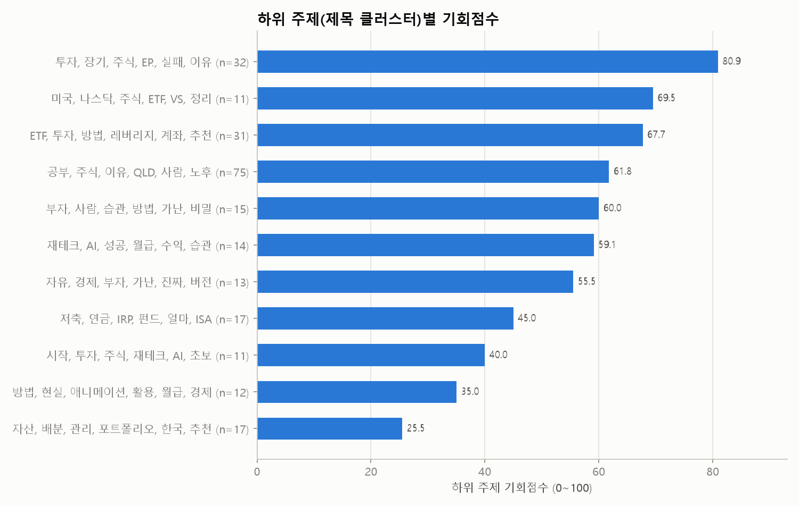

| 기회점수 | 핵심 단어 | 영상 수 | 배수 중앙값 | 성공 비율 | 소규모채널 성공 | 쇼츠 비율 | 예시 제목 |
|---|---|---|---|---|---|---|---|
| 81 | 투자, 장기, 주식, EP., 실패, 이유 | 32 | 6.35 | 53.1% | 6.2% | 53.1% | S&P500 투자를 망설이고 있는 당신, 이 영상 하나로 해결! / 주식 투자 마이너스(-)되도 계속 갖고 있는 사람들의 결말 / 존 리 대표‖'장기투자 할 기업 |
| 70 | 미국, 나스닥, 주식, ETF, VS, 정리 | 11 | 3.83 | 45.5% | 0.0% | 45.5% | S&P500 vs 나스닥100 / 미국 ETF 30초만에 이해하기 / S&P500 vs 나스닥100, 평생 모을 ETF 정해드립니다 |
| 68 | ETF, 투자, 방법, 레버리지, 계좌, 추천 | 31 | 4.02 | 51.6% | 0.0% | 54.8% | etf를 왜 사? #매불쇼 #이광수 #etf / ETF 전법? 4·4·2만 기억하세요 / ETF 투자로 폭망하는 사람들의 치명적인 공통점 🤦‍♂️ #ETF투자 # |
| 62 | 공부, 주식, 이유, QLD, 사람, 노후 | 75 | 3.31 | 41.3% | 4.0% | 33.3% | 맞벌이 부부의 월급날루틴 “빠르게 1억 모으기“ / 주식으로 성공한 부자들의 어마어마한 핵심 노하우 / QQQ vs QLD vs TQQQ 매일 1만원씩 10년 투 |
| 60 | 부자, 사람, 습관, 방법, 가난, 비밀 | 15 | 2.47 | 33.3% | 6.7% | 26.7% | 초기 가난에서 벗어나 부자 되는 법 #초기가난 #부자되는법 #돈이돈을버는 / 부자 습관 vs 가난한 습관  1년 후 37배 성장하는 복리의 마법 / 부자 되는 사 |
| 59 | 재테크, AI, 성공, 월급, 수익, 습관 | 14 | 2.36 | 35.7% | 21.4% | 71.4% | 하정우가 재테크에 진심인 이유. #하정우 #최화정 #재테크 #자산관리 # / 장항준이 알려 주는 재테크 방법 #쇼츠 #Shorts #예능짧게 #꿀잼  / 재테크  |
| 56 | 자유, 경제, 부자, 가난, 진짜, 버전 | 13 | 3.14 | 53.8% | 15.4% | 0.0% | 경제적 자유를 찾는 4단계 로드맵 0원에서 10억까지, 가장 빠른 지름길 / 부자들이 절대 말해주지 않는 '경제적 자유'의 3가지 치명적인 착각 / 경제적 자유를 |
| 45 | 저축, 연금, IRP, 펀드, 얼마, ISA | 17 | 2.03 | 23.5% | 0.0% | 5.9% | "60대 은퇴자 필독: 연금저축계좌 vs ISA, 무엇부터 해야 할까?  / 아직도 헷갈린다고?, 노후준비의 정석\| 연금저축 IRP 총정리 / 생계급여 수급자  |
| 40 | 시작, 투자, 주식, 재테크, AI, 초보 | 11 | 1.20 | 18.2% | 9.1% | 54.5% | 주식초보는 이걸 제대로 알아야 주식투자로 수익 나기 시작합니다 / 돈 공부를 시작했는데, 가장 먼저 바뀐 건 냉장고였습니다 / 1억은 얼마나 큰돈일까? 사실 1억 |
| 35 | 방법, 현실, 애니메이션, 활용, 월급, 경제 | 12 | 2.05 | 33.3% | 0.0% | 0.0% | 99%는 모르는 제미나이 활용한 주식투자방법 3가지 / 10억 모으는 방법, 1억 모은뒤 반드시 해야하는 일 \| 경제 애니메이션 / "S&P500 이걸로 사면  |
| 26 | 자산, 배분, 관리, 포트폴리오, 한국, 추천 | 17 | 1.11 | 23.5% | 5.9% | 41.2% | 연금자산! 주식형 ETF 팔고, 자산배분 포트폴리오로 리밸런싱하세요. / “자산배분 노답이네요”에 62년 백테스트로 답합니다 / 33억 파이어족, 자산 관리 앱  |
| - | 존리, 대표, 부자, ETF, 이유, 상위 | 6 | 8.70 | 50.0% | 0.0% | 16.7% | 상위 0.1% 부자들을 만나고 알게된 가난의 진짜 이유 (존리 대표) ( / 존리 대표 “ETF만으로도 충분합니다”개별주 대신 ETF가 답인 이유 / 존리 대표│ |

## 2. 🔑 키워드 기회 분석

기회점수 = 수요 25% + 자동완성 15% + 소규모채널 진입 20% + 아웃라이어 10% + 신선도 5% + 경쟁(역) 15% + 콘텐츠 공백 10% (키워드 간 백분위 기준). 수요·경쟁은 **주제 관련 영상만**으로 계산했고, 검색 상위 10개 중 절반 이상이 한 채널인 키워드(채널명 검색)는 제외했습니다. '관련 비율'이 낮다 = 사람들이 찾는데 맞는 영상이 적다(콘텐츠 공백).

### 🗂️ 카테고리(소재)별 기회

| 카테고리 | 키워드 수 | 기회(중앙) | 기회(최고) | 최고 키워드 | 검색수요 합 | 일평균 조회(중앙) | 소규모 진입 | 관련 비율 | 성공 영상 | 배수(중앙) |
|---|---|---|---|---|---|---|---|---|---|---|
| 검색어 | 17 | 52 | 66 | 주식투자 | 17.0 | 2.8천 | 3.2% | 94.3% | 107 | 2.82 |

### 🔑 키워드별 기회

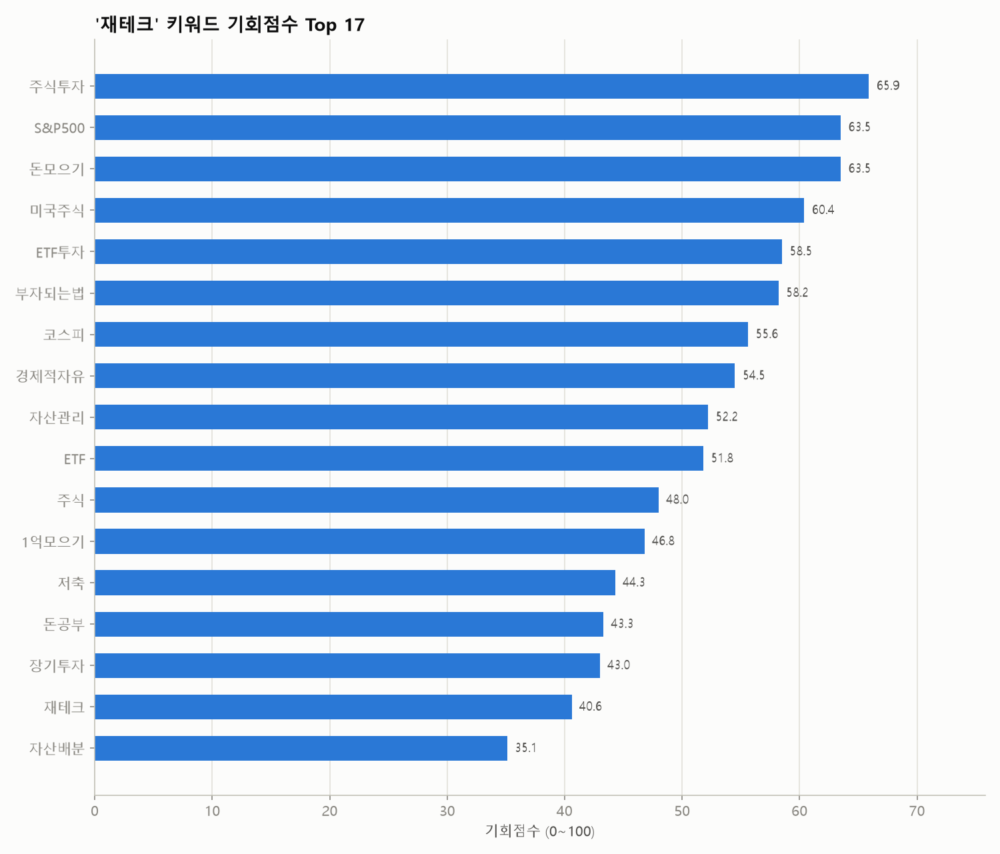
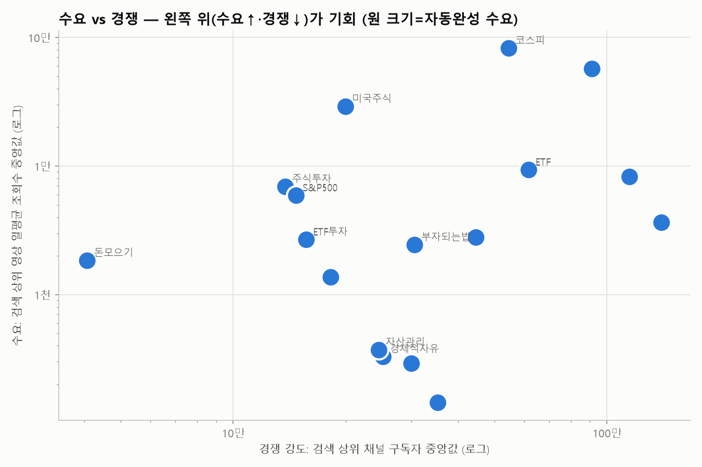

| 키워드 | 카테고리 | 기회점수 | 일평균 조회수(중앙) | 자동완성 | 소규모 진입 | 관련 비율 | 최신 비율 | 경쟁 구독자(중앙) | 배수(중앙) | 성공 수 | 추천 포맷 | 채널명검색 |
|---|---|---|---|---|---|---|---|---|---|---|---|---|
| 주식투자 | 검색어 | 66 | 6.9천 | 1.00 | 0.0% | 95.0% | 73.7% | 13.8만 | 17.15 | 5 | 쇼츠 |  |
| S&P500 | 검색어 | 64 | 5.9천 | 1.00 | 0.0% | 90.0% | 66.7% | 14.8만 | 9.16 | 15 | 쇼츠 |  |
| 돈모으기 | 검색어 | 64 | 1.8천 | 1.00 | 15.0% | 95.0% | 36.8% | 4.1만 | 2.29 | 6 | 롱폼 |  |
| 미국주식 | 검색어 | 60 | 2.9만 | 1.00 | 0.0% | 88.2% | 100.0% | 20만 | 1.41 | 0 | - |  |
| ETF투자 | 검색어 | 58 | 2.7천 | 1.00 | 5.0% | 100.0% | 20.0% | 15.7만 | 8.85 | 12 | 쇼츠 |  |
| 부자되는법 | 검색어 | 58 | 2.4천 | 1.00 | 10.0% | 80.0% | 31.2% | 30.6만 | 2.48 | 6 | 쇼츠 |  |
| 코스피 | 검색어 | 56 | 8.2만 | 1.00 | 0.0% | 100.0% | 100.0% | 54.6만 | - | 0 | - |  |
| 경제적자유 | 검색어 | 54 | 328 | 1.00 | 5.0% | 75.0% | 40.0% | 25.2만 | 3.14 | 7 | 롱폼 |  |
| 자산관리 | 검색어 | 52 | 370 | 1.00 | 10.0% | 100.0% | 20.0% | 24.6만 | 3.60 | 10 | 쇼츠 |  |
| ETF | 검색어 | 52 | 9.3천 | 1.00 | 0.0% | 100.0% | 60.0% | 61.8만 | 8.65 | 15 | 쇼츠 |  |
| 주식 | 검색어 | 48 | 5.7만 | 1.00 | 0.0% | 100.0% | 100.0% | 91.2만 | 1.37 | 2 | - |  |
| 1억모으기 | 검색어 | 47 | 291 | 1.00 | 5.0% | 85.0% | 11.8% | 30만 | 2.51 | 8 | 쇼츠 |  |
| 저축 | 검색어 | 44 | 8.2천 | 1.00 | 0.0% | 100.0% | 70.0% | 115만 | 2.28 | 6 | 롱폼 |  |
| 돈공부 | 검색어 | 43 | 3.6천 | 1.00 | 0.0% | 95.0% | 21.1% | 140만 | 2.54 | 9 | 롱폼 |  |
| 장기투자 | 검색어 | 43 | 1.4천 | 1.00 | 0.0% | 100.0% | 35.0% | 18.2만 | 2.53 | 10 | 쇼츠 |  |
| 재테크 | 검색어 | 41 | 2.8천 | 1.00 | 0.0% | 100.0% | 60.0% | 44.6만 | 2.21 | 7 | 쇼츠 |  |
| 자산배분 | 검색어 | 35 | 144 | 1.00 | 5.0% | 100.0% | 20.0% | 35.3만 | 1.50 | 5 | 롱폼 |  |

키워드별 검색 수요 (자동완성이 표현을 어디까지 알아보는지 — 1.0=전체 문구가 자동완성에 뜸, 0=앞 두 단어도 안 뜸)

| 순위 | 검색어 | 카테고리 | 수요 점수 | 자동완성이 알아본 부분 | 일치 제안 수 |
|---|---|---|---|---|---|
| 1 | 재테크 | 검색어 | 1.00 | 재테크 | 10 |
| 1 | 자산관리 | 검색어 | 1.00 | 자산관리 | 10 |
| 1 | 부자되는법 | 검색어 | 1.00 | 부자되는법 | 10 |
| 1 | 경제적자유 | 검색어 | 1.00 | 경제적자유 | 10 |
| 1 | 돈공부 | 검색어 | 1.00 | 돈공부 | 10 |
| 1 | 돈모으기 | 검색어 | 1.00 | 돈모으기 | 10 |
| 1 | 저축 | 검색어 | 1.00 | 저축 | 10 |
| 1 | 1억모으기 | 검색어 | 1.00 | 1억모으기 | 10 |
| 1 | 주식 | 검색어 | 1.00 | 주식 | 10 |
| 1 | 주식투자 | 검색어 | 1.00 | 주식투자 | 10 |
| 1 | 미국주식 | 검색어 | 1.00 | 미국주식 | 10 |
| 1 | ETF | 검색어 | 1.00 | ETF | 10 |
| 1 | 장기투자 | 검색어 | 1.00 | 장기투자 | 10 |
| 1 | ETF투자 | 검색어 | 1.00 | ETF투자 | 10 |
| 1 | S&P500 | 검색어 | 1.00 | S&P500 | 10 |
| 1 | 코스피 | 검색어 | 1.00 | 코스피 | 10 |
| 1 | 자산배분 | 검색어 | 1.00 | 자산배분 | 10 |
| 1 | 주식초보 | 검색어 | 1.00 | 주식초보 | 10 |
| 1 | 투자전략 | 검색어 | 1.00 | 투자전략 | 10 |
| 1 | 나스닥 | 검색어 | 1.00 | 나스닥 | 10 |
| 1 | 포트폴리오 | 검색어 | 1.00 | 포트폴리오 | 10 |
| 1 | 분산투자 | 검색어 | 1.00 | 분산투자 | 10 |
| 1 | 주식공부 | 검색어 | 1.00 | 주식공부 | 10 |
| 1 | 노후준비 | 검색어 | 1.00 | 노후준비 | 10 |
| 1 | 은퇴준비 | 검색어 | 1.00 | 은퇴준비 | 10 |
| 1 | 연금저축 | 검색어 | 1.00 | 연금저축 | 10 |
| 1 | IRP | 검색어 | 1.00 | IRP | 10 |
| 1 | 연금 | 검색어 | 1.00 | 연금 | 10 |
| 1 | 연금저축펀드 | 검색어 | 1.00 | 연금저축펀드 | 10 |
| 1 | 노후 | 검색어 | 1.00 | 노후 | 10 |
| 1 | 노후자금 | 검색어 | 1.00 | 노후자금 | 10 |
| 1 | ISA | 검색어 | 1.00 | ISA | 10 |
| 1 | ISA계좌 | 검색어 | 1.00 | ISA계좌 | 10 |
| 1 | 돈버는법 | 검색어 | 1.00 | 돈버는법 | 10 |
| 35 | 투자 | 검색어 | 0.90 | 투자 | 8 |
| 36 | 부자 | 검색어 | 0.85 | 부자 | 7 |

⏭️ 이번 실행에서 이월된 키워드 (다음 실행에서 수집)

`주식초보`(쿼터 예산 초과), `투자전략`(쿼터 예산 초과), `나스닥`(쿼터 예산 초과), `포트폴리오`(쿼터 예산 초과), `분산투자`(쿼터 예산 초과), `주식공부`(쿼터 예산 초과), `노후준비`(쿼터 예산 초과), `은퇴준비`(쿼터 예산 초과), `연금저축`(쿼터 예산 초과), `IRP`(쿼터 예산 초과), `연금`(쿼터 예산 초과), `연금저축펀드`(쿼터 예산 초과), `노후`(쿼터 예산 초과), `노후자금`(쿼터 예산 초과), `ISA`(쿼터 예산 초과), `ISA계좌`(쿼터 예산 초과), `돈버는법`(쿼터 예산 초과), `투자`(쿼터 예산 초과), `부자`(쿼터 예산 초과)

📢 광고 집행 의심으로 제외한 영상 23개 (조회수 대비 좋아요·댓글이 극히 적음)

| 영상 | 채널 | 구독자 | 조회수 | 좋아요율 | 댓글 수 |
|---|---|---|---|---|---|
| [현금 1억 생기면? l 재테크 전략 10가지](https://www.youtube.com/watch?v=6QPfyZ61_Cg) | 바른바램 | 1.2만 | 299만 | 0.12% | 39 |
| [한국투자자들이 가장많이 매수한 미국 ETF TOP10](https://www.youtube.com/watch?v=F8IWTTw1Mo8) | 지식쏙쏙 | 5.9천 | 203만 | 0.13% | 18 |
| [평생가난하게살기싫으면봐라 #재테크 #돈모으는법 #절약하는법 #저축습관 #부자되는법…](https://www.youtube.com/watch?v=ehxfLZAs2vs) | 허당인생명언 | 1.6만 | 132만 | 0.20% | 22 |
| [국내 상장 ETF, 이 10개만 알아도 기초 완성](https://www.youtube.com/watch?v=1e3usSuKRig) | 지식쏙쏙 | 5.9천 | 102만 | 0.23% | 4 |
| [금 시세 제 가격으로 ETF 투자하기, 금현물 김치프리미엄 없이 투자하자](https://www.youtube.com/watch?v=kLezC3GRw6Y) | KODEX ETF 유튜브 공식 채널 | 57.9만 | 98.0만 | 0.24% | 2 |
| [주식투자해야 부자되는데, 안하는 이유  #노후준비 #은퇴준비 #재테크 #인생조언 …](https://www.youtube.com/watch?v=x6oGcyrp-TU) | 100세연구소 | 5.8만 | 85.6만 | 0.08% | 3 |
| [주식 오래 한 사람들이 결국 깨닫는 투자 원칙 10가지 #주식투자 #재테크 #투자…](https://www.youtube.com/watch?v=HpOLbLM9AOk) | 만복보감 | 2.1천 | 85.5만 | 0.23% | 26 |
| [자식보다 나은 노후 진짜 알짜 자산 TOP 12 #노후준비 #재테크](https://www.youtube.com/watch?v=1cz2tlXBLTw) | 1분지혜 | 1.6만 | 76.6만 | 0.11% | 6 |
| [나스닥 투자했을때 1억 모으는 기간](https://www.youtube.com/watch?v=VrU_zT1ZC28) | 옥탑커플의 옥탑탈출기 | 694 | 45.6만 | 0.05% | 17 |
| [국내주식 망하고 해외주식 단타 on 오늘도 성공하자! 삼성전자 sk하이닉스 화이팅](https://www.youtube.com/watch?v=WRZxL-d7JsI) | 양티tv | 1.5만 | 38.2만 | 0.16% | 14 |
| [국내주식 망하고 해외주식 초단타 초심1일차 삼성전자 sk하이닉스 화이팅](https://www.youtube.com/watch?v=C4e7na3c2Fc) | 양티tv | 1.5만 | 37.4만 | 0.16% | 4 |
| [배당주 추천 종목 TOP10ㅣ주식투자하면 꼭 알아야하는 1년에 4번 배당받는 국내…](https://www.youtube.com/watch?v=Zlj1mf-0bEE) | 머니벌크업ㅣ주식PT | 1.9만 | 37.2만 | 0.12% | 8 |
| [지금은 '금'보다 '은'에 투자할 때! Kodex 은 ETF](https://www.youtube.com/watch?v=H_T-BB_rcVE) | KODEX ETF 유튜브 공식 채널 | 57.9만 | 36.3만 | 0.12% | 13 |
| [1억에서 10억 가는데 걸리는 진짜 시간  #노후준비 #은퇴준비 #재테크](https://www.youtube.com/watch?v=0SuK0RR28Co) | 100세연구소 | 5.8만 | 31.0만 | 0.09% | 0 |
| [돈의 가치 변화, 눈으로 확인하는 재테크의 필요성!](https://www.youtube.com/watch?v=grot0JjzxqY) | 지혜한마디 | 1.9천 | 26.9만 | 0.06% | 0 |
| [부자들만 남몰래 쓰는 예금 쪼개기 기술](https://www.youtube.com/watch?v=61BNi13s0FA) | 100세 다이어리 | 1.0만 | 24.2만 | 0.10% | 4 |
| [이효리의 자산관리](https://www.youtube.com/watch?v=YgHcLqY41So) | 유머너부리 | 3.3천 | 22.7만 | 0.23% | 2 |
| [돈 잘 모으는 사람 vs 못 모으는 사람](https://www.youtube.com/watch?v=aW5v_IXBqx0) | 오렌지노트🍊 | 1.5만 | 22.6만 | 0.05% | 5 |
| [은퇴 자금 55억 만들려면 이것만 지키세요](https://www.youtube.com/watch?v=L_Z-_Y14F94) | 어른의금융수업 | 1.3만 | 22.2만 | 0.06% | 6 |
| [1억 모으는 데 걸리는 시간 #1억모으기 #월저축액 #재테크기초  #목돈만들기 #…](https://www.youtube.com/watch?v=PpWgGnV73Xk) | 한줄zip | 1.2천 | 13.5만 | 0.20% | 6 |

🎯 주제와 무관해서 제외한 영상 55개 (조회수 상위 15개 — 전체는 data/excluded_offtopic.csv)

| 영상 | 채널 | 조회수 | 검색 키워드 |
|---|---|---|---|
| [서장훈이 말한 부자되는 방법 #서장훈 #서장훈명언 #동기부여 #울림 #인생명언 #…](https://www.youtube.com/watch?v=s51ikWdRb74) | 내가슴속울림 | 452만 | 부자되는법 |
| [S&P 500, 이거 알고 들어갔니?](https://www.youtube.com/watch?v=4f_q4Jwl10E) | 묘하다 | 361만 | S&P500 |
| [📚 하루라도 빨리 읽어야 할! 경제공부 입문 도서 5권 \| 2030 돈린이 강추…](https://www.youtube.com/watch?v=8lNSGQX-oyI) | 옌마드Yenmad | 283만 | 돈공부 |
| [S&P 500 얼마씩 넣어야 돼요?](https://www.youtube.com/watch?v=duTqDoeBSYU) | 김짠부 | 246만 | S&P500 |
| [50대에 이정도 없으면 좌절한다고 합니다..](https://www.youtube.com/watch?v=NWFcsoSGu2I) | 월급쟁이부자들TV | 110만 | 재테크 |
| [우선 1억을 먼저 모아야 하는 이유](https://www.youtube.com/watch?v=JjLzp_oF4EA) | 하꼰대 Ha kkondae | 109만 | 1억모으기 |
| [부자 되고 싶다면 반드시 알아야 하는 것 (추석특집 북토크 레전드 스페셜)](https://www.youtube.com/watch?v=U2ZyI7Y-TzA) | 북토크 | 108만 | 부자되는법 |
| [현금 1억 모으면 얼마나 부자가 되는 걸까?](https://www.youtube.com/watch?v=dKlFo6MzxqA) | 주언규 joo earn gyu | 103만 | 1억모으기 |
| [경제적 자유, 얼마면 가능할까? #shorts](https://www.youtube.com/watch?v=j9zUSZgH6_M) | 캐치TV | 82.4만 | 경제적자유 |
| ['부자 되는 법 1타 강사'가 알려주는 100% 부자 되는 법(추석특집 북토크 보…](https://www.youtube.com/watch?v=_Go9TvSa7i4) | 북토크 | 69.9만 | 부자되는법 |
| [천재 장동민 수익률 1600% 찍고도 그만둔 이유](https://www.youtube.com/watch?v=w5X4SFIfqiI) | 쩐의 흐름 | 61.2만 | 주식투자 |
| [차있으면 돈 못모으는 진짜이유](https://www.youtube.com/watch?v=A_QFEjOTfXk) | 너의생각은머니 | 54.2만 | 돈모으기 |
| [(1부) 10배 부자는 질투하고 10,000배 부자엔 노예 된다 \| 북언더스탠딩…](https://www.youtube.com/watch?v=h6RN-EVFjxY) | 언더스탠딩 : 세상의 모든 지식 | 53.6만 | 돈공부 |
| [1억 모으기 ㅈㄴ어려운 이유](https://www.youtube.com/watch?v=RVxl1pxIhfw) | 자수성가 | 43.4만 | 1억모으기 |
| [52초면 1년 돈모으기 요약 가능합니다.](https://www.youtube.com/watch?v=ZaQXg0bM9TM) | 유스데스크 YOO'S DESK. | 42.2만 | 돈모으기 |

## 3. 🏷️ 제목 패턴 분석

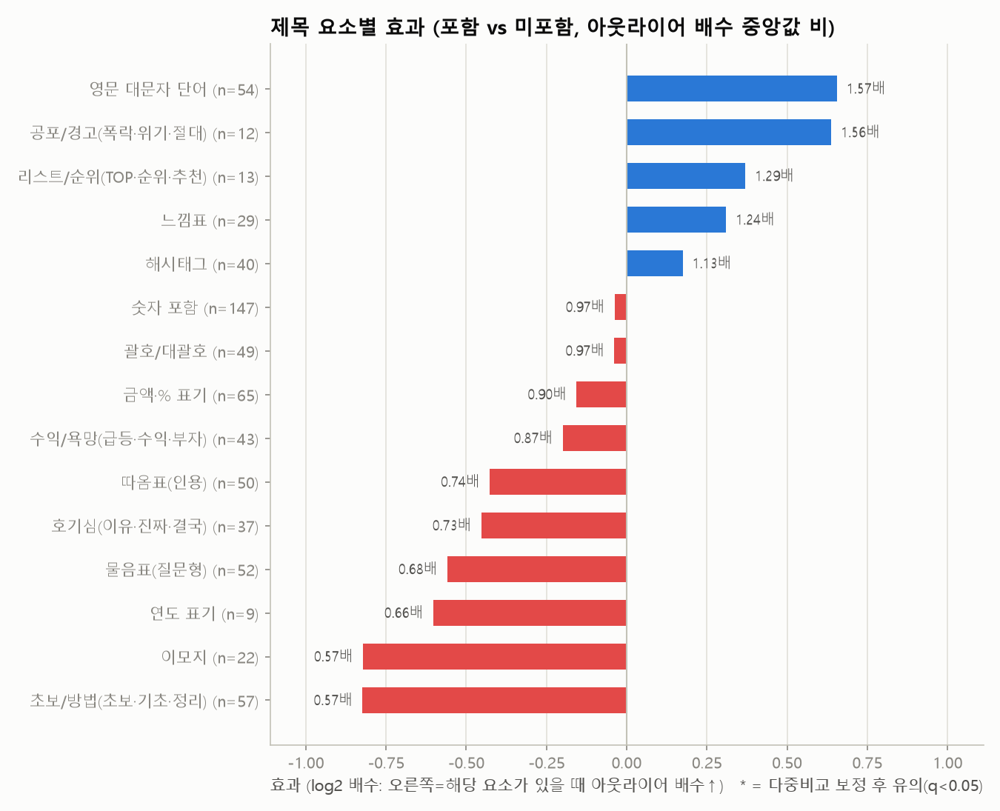
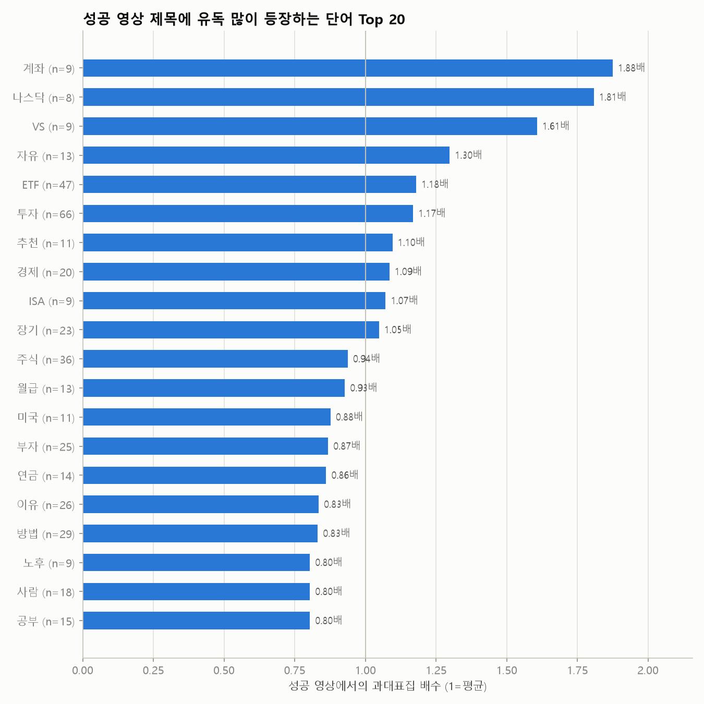
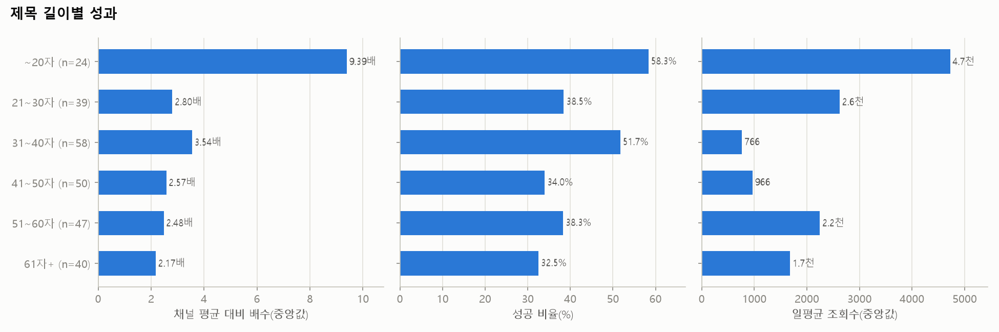

| 제목 요소 | 해당 영상 수 | 배수(있음) | 배수(없음) | 효과(배) | 성공률(있음) | 성공률(없음) | p값 | q값(보정) |
|---|---|---|---|---|---|---|---|---|
| 영문 대문자 단어 | 54 | 4.05 | 2.57 | 1.57 | 59.3% | 43.9% | 0.308 | 0.760 |
| 공포/경고(폭락·위기·절대) | 12 | 4.30 | 2.76 | 1.56 | 58.3% | 46.9% | 0.911 | 0.911 |
| 리스트/순위(TOP·순위·추천) | 13 | 3.61 | 2.79 | 1.29 | 53.8% | 47.2% | 0.855 | 0.911 |
| 느낌표 | 29 | 3.42 | 2.76 | 1.24 | 48.3% | 47.4% | 0.822 | 0.911 |
| 해시태그 | 40 | 3.18 | 2.82 | 1.13 | 47.5% | 47.6% | 0.623 | 0.850 |
| 숫자 포함 | 147 | 2.76 | 2.83 | 0.97 | 48.3% | 46.2% | 0.406 | 0.760 |
| 괄호/대괄호 | 49 | 2.76 | 2.83 | 0.97 | 49.0% | 47.2% | 0.607 | 0.850 |
| 금액·% 표기 | 65 | 2.56 | 2.85 | 0.90 | 47.7% | 47.5% | 0.730 | 0.911 |
| 수익/욕망(급등·수익·부자) | 43 | 2.48 | 2.85 | 0.87 | 46.5% | 47.8% | 0.494 | 0.824 |
| 따옴표(인용) | 50 | 2.46 | 3.31 | 0.74 | 40.0% | 49.7% | 0.166 | 0.760 |
| 호기심(이유·진짜·결국) | 37 | 2.48 | 3.40 | 0.73 | 35.1% | 50.0% | 0.228 | 0.760 |
| 물음표(질문형) | 52 | 2.37 | 3.49 | 0.68 | 34.6% | 51.4% | 0.357 | 0.760 |
| 연도 표기 | 9 | 1.88 | 2.85 | 0.66 | 33.3% | 48.1% | 0.290 | 0.760 |
| 이모지 | 22 | 1.72 | 3.03 | 0.57 | 31.8% | 49.3% | 0.143 | 0.760 |
| 초보/방법(초보·기초·정리) | 57 | 2.03 | 3.59 | 0.57 | 33.3% | 52.4% | 0.007 | 0.103 |

롱폼/쇼츠 따로 본 제목 요소 효과

| 구분 | 제목 요소 | 영상 수 | 효과(배) | 성공률(있음) | p값 |
|---|---|---|---|---|---|
| 롱폼 | 느낌표 | 17 | 2.26 | 58.8% | 0.065 |
| 롱폼 | 공포/경고(폭락·위기·절대) | 9 | 2.20 | 66.7% | 0.400 |
| 롱폼 | 영문 대문자 단어 | 30 | 1.46 | 50.0% | 0.508 |
| 롱폼 | 괄호/대괄호 | 42 | 1.31 | 45.2% | 0.295 |
| 롱폼 | 숫자 포함 | 102 | 1.21 | 38.2% | 0.196 |
| 롱폼 | 호기심(이유·진짜·결국) | 30 | 1.10 | 33.3% | 0.846 |
| 롱폼 | 수익/욕망(급등·수익·부자) | 30 | 1.07 | 33.3% | 0.367 |
| 롱폼 | 금액·% 표기 | 47 | 1.02 | 38.3% | 0.493 |
| 롱폼 | 따옴표(인용) | 43 | 1.02 | 34.9% | 0.969 |
| 롱폼 | 물음표(질문형) | 34 | 0.74 | 23.5% | 0.388 |
| 롱폼 | 초보/방법(초보·기초·정리) | 49 | 0.68 | 28.6% | 0.053 |
| 롱폼 | 이모지 | 16 | 0.66 | 18.8% | 0.226 |
| 롱폼 | 해시태그 | 10 | 0.49 | 0.0% | 0.022 |
| 쇼츠 | 물음표(질문형) | 17 | 1.21 | 58.8% | 0.971 |
| 쇼츠 | 초보/방법(초보·기초·정리) | 8 | 1.06 | 62.5% | 0.994 |
| 쇼츠 | 숫자 포함 | 43 | 0.97 | 74.4% | 0.457 |
| 쇼츠 | 수익/욕망(급등·수익·부자) | 13 | 0.97 | 76.9% | 0.648 |
| 쇼츠 | 영문 대문자 단어 | 23 | 0.95 | 73.9% | 0.983 |
| 쇼츠 | 해시태그 | 30 | 0.92 | 63.3% | 0.514 |
| 쇼츠 | 금액·% 표기 | 18 | 0.81 | 72.2% | 0.873 |
| 쇼츠 | 느낌표 | 12 | 0.27 | 33.3% | 0.011 |

**성공 영상 제목에 유독 많이 나오는 단어** (과대표집 배수 = 성공 영상 내 비중 ÷ 전체 비중)

| 단어 | 영상 수 | 성공 수 | 과대표집 | 배수(중앙) | 일평균 조회수 |
|---|---|---|---|---|---|
| 계좌 | 9 | 7 | 1.88 | 14.16 | 4.1천 |
| 나스닥 | 8 | 6 | 1.81 | 10.05 | 2.9천 |
| VS | 9 | 6 | 1.61 | 30.06 | 1.5천 |
| 자유 | 13 | 7 | 1.30 | 3.14 | 147 |
| ETF | 47 | 23 | 1.18 | 4.02 | 2.5천 |
| 투자 | 66 | 32 | 1.17 | 3.80 | 1.5천 |
| 추천 | 11 | 5 | 1.10 | 3.61 | 920 |
| 경제 | 20 | 9 | 1.09 | 2.99 | 152 |
| ISA | 9 | 4 | 1.07 | 5.60 | 4.1천 |
| 장기 | 23 | 10 | 1.05 | 2.82 | 842 |
| 주식 | 36 | 14 | 0.94 | 2.86 | 1.7천 |
| 월급 | 13 | 5 | 0.93 | 2.39 | 4.1천 |
| 미국 | 11 | 4 | 0.88 | 2.26 | 4.5천 |
| 부자 | 25 | 9 | 0.87 | 2.45 | 1.2천 |
| 연금 | 14 | 5 | 0.86 | 2.49 | 2.9천 |
| 이유 | 26 | 9 | 0.83 | 2.29 | 1.9천 |
| 방법 | 29 | 10 | 0.83 | 2.45 | 1.2천 |
| 노후 | 9 | 3 | 0.80 | 2.76 | 206 |
| 사람 | 18 | 6 | 0.80 | 2.47 | 1.5천 |
| 공부 | 15 | 5 | 0.80 | 1.40 | 899 |
| 재테크 | 21 | 7 | 0.80 | 2.05 | 365 |
| 진짜 | 10 | 3 | 0.72 | 2.48 | 573 |
| 자산 | 30 | 9 | 0.72 | 1.87 | 167 |
| 정리 | 10 | 3 | 0.72 | 1.69 | 2.9천 |
| 시작 | 14 | 4 | 0.69 | 2.03 | 517 |

## 4. 🎞️ 포맷 · 길이

> 쇼츠 조회수는 2025년 3월부터 '재생 시작/반복'마다 집계되어 롱폼 조회수와 직접 비교할 수 없습니다. 그래서 **같은 채널·같은 포맷 대비 배수(아웃라이어)** 와 성공 비율로 비교합니다.

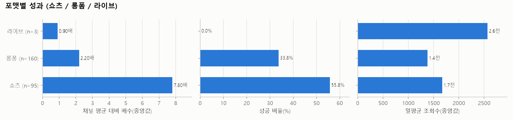
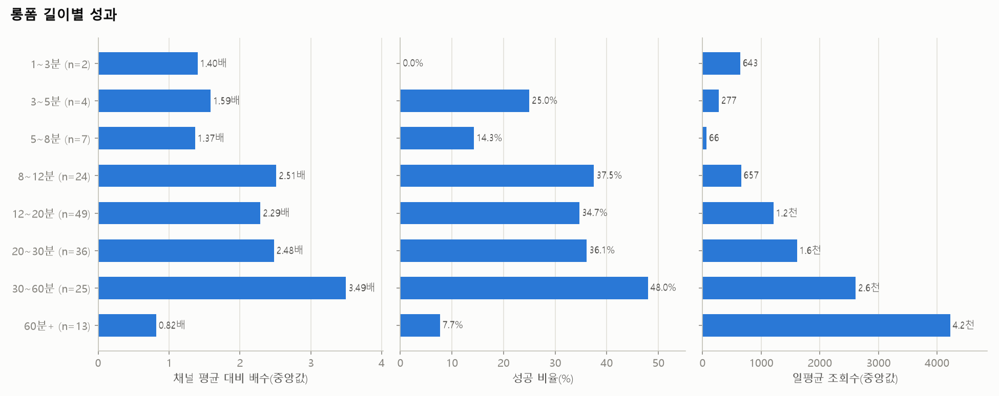

| 포맷 | 영상 수 | 조회수(중앙) | 일평균(중앙) | 배수(중앙) | 성공 비율 | 소규모채널 성공 |
|---|---|---|---|---|---|---|
| 라이브 | 3 | 20.1만 | 2.6천 | 0.90 | 0.0% | 0.0% |
| 롱폼 | 160 | 10.3만 | 1.4천 | 2.20 | 33.8% | 1.9% |
| 쇼츠 | 95 | 17.1만 | 1.7천 | 7.80 | 55.8% | 10.5% |

| 롱폼 길이 | 영상 수 | 조회수(중앙) | 일평균(중앙) | 배수(중앙) | 성공 비율 | 소규모채널 성공 |
|---|---|---|---|---|---|---|
| 1~3분 | 2 | 1.6만 | 643 | 1.40 | 0.0% | 0.0% |
| 3~5분 | 4 | 2.2만 | 277 | 1.59 | 25.0% | 0.0% |
| 5~8분 | 7 | 1.1만 | 66 | 1.37 | 14.3% | 0.0% |
| 8~12분 | 24 | 4.2만 | 657 | 2.51 | 37.5% | 4.2% |
| 12~20분 | 49 | 7.8만 | 1.2천 | 2.29 | 34.7% | 2.0% |
| 20~30분 | 36 | 17.5만 | 1.6천 | 2.48 | 36.1% | 2.8% |
| 30~60분 | 25 | 30.5만 | 2.6천 | 3.49 | 48.0% | 0.0% |
| 60분+ | 13 | 28.8만 | 4.2천 | 0.82 | 7.7% | 0.0% |

## 5. 🕒 업로드 타이밍 (참고용 — 효과가 작고 혼란변수가 많음)

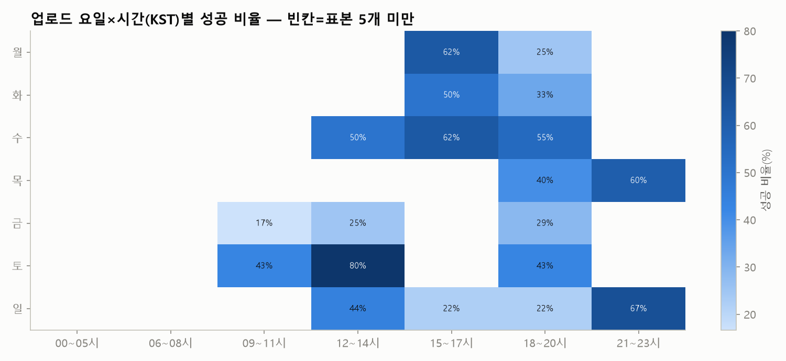

| 요일 | 영상 수 | 조회수(중앙) | 일평균(중앙) | 배수(중앙) | 성공 비율 | 소규모채널 성공 |
|---|---|---|---|---|---|---|
| 월 | 32 | 13.3만 | 2.4천 | 2.94 | 40.6% | 0.0% |
| 화 | 40 | 14.2만 | 2.8천 | 2.30 | 40.0% | 7.5% |
| 수 | 46 | 12.0만 | 1.1천 | 3.64 | 50.0% | 10.9% |
| 목 | 30 | 8.9만 | 671 | 5.16 | 53.3% | 0.0% |
| 금 | 39 | 8.6만 | 899 | 1.94 | 25.6% | 5.1% |
| 토 | 31 | 13.5만 | 1.2천 | 2.56 | 45.2% | 3.2% |
| 일 | 40 | 28.6만 | 2.6천 | 2.86 | 37.5% | 5.0% |

| 시간대(KST) | 영상 수 | 조회수(중앙) | 일평균(중앙) | 배수(중앙) | 성공 비율 | 소규모채널 성공 |
|---|---|---|---|---|---|---|
| 00~05시 | 6 | 5.3만 | 651 | 0.76 | 33.3% | 0.0% |
| 06~08시 | 22 | 4.0만 | 333 | 1.87 | 27.3% | 4.5% |
| 09~11시 | 29 | 11.9만 | 1.7천 | 3.14 | 37.9% | 0.0% |
| 12~14시 | 35 | 13.2만 | 2.3천 | 4.90 | 51.4% | 2.9% |
| 15~17시 | 43 | 20.1만 | 2.6천 | 5.00 | 48.8% | 4.7% |
| 18~20시 | 95 | 16.1만 | 1.8천 | 2.37 | 36.8% | 6.3% |
| 21~23시 | 28 | 12.9만 | 826 | 4.46 | 50.0% | 10.7% |

## 6. 🌱 채널 규모별 분석 — 0명 채널에게 가장 중요한 부분

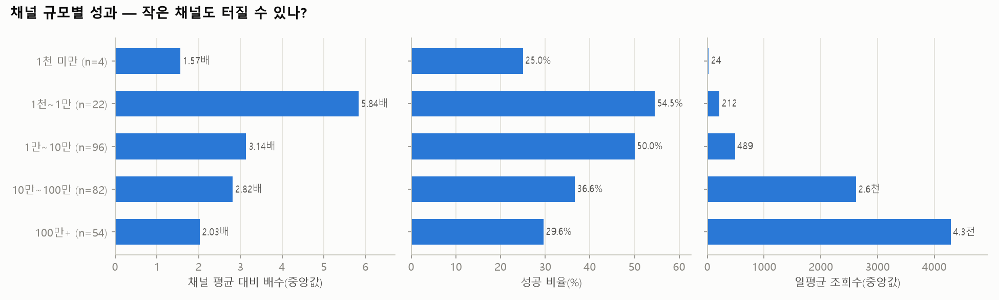
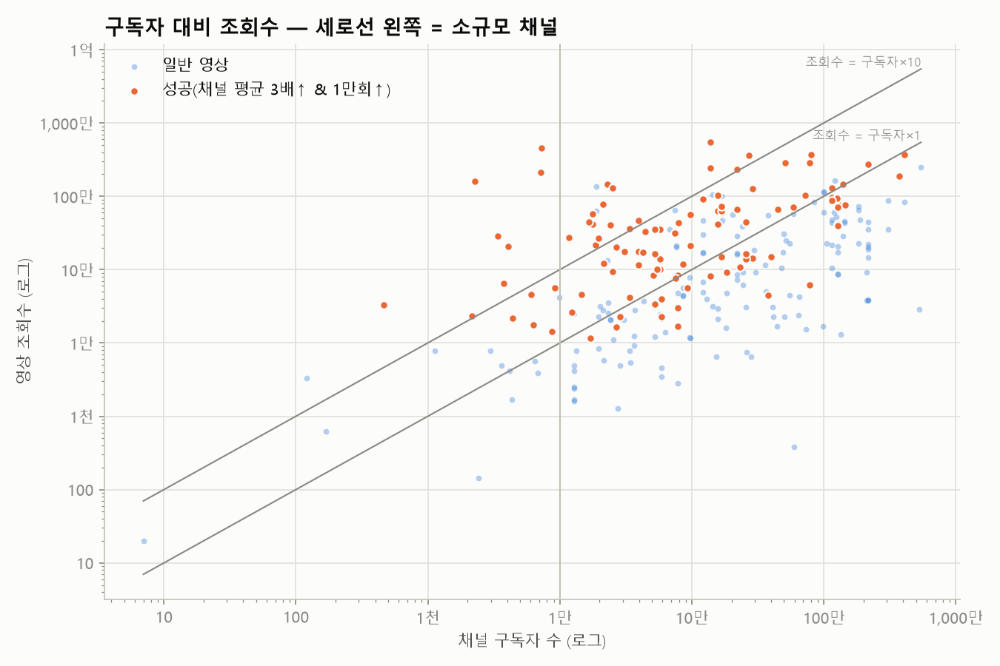

| 구독자 규모 | 영상 수 | 조회수(중앙) | 일평균(중앙) | 배수(중앙) | 성공 비율 | 소규모채널 성공 |
|---|---|---|---|---|---|---|
| 1천 미만 | 4 | 2.0천 | 24 | 1.57 | 25.0% | 25.0% |
| 1천~1만 | 22 | 2.2만 | 212 | 5.84 | 54.5% | 54.5% |
| 1만~10만 | 96 | 4.5만 | 489 | 3.14 | 50.0% | 0.0% |
| 10만~100만 | 82 | 16.3만 | 2.6천 | 2.82 | 36.6% | 0.0% |
| 100만+ | 54 | 46.5만 | 4.3천 | 2.03 | 29.6% | 0.0% |

**개설 1년 이내 채널의 성공 영상** (20개) — 신생 채널이 실제로 터진 사례

| 영상 | 채널 | 구독자 | 조회수 | 배수 | 포맷 | 채널 나이(일) |
|---|---|---|---|---|---|---|
| [경제적 자유를 찾는 4단계 로드맵 0원에서 10억까지, 가장 빠른 지름길](https://www.youtube.com/watch?v=OLRPI78J4Gc) | 알부자경제학 | 462 | 3.3만 | 323.5 | 롱폼 | 238 |
| [100조 펀드매니저가 믿는 단 '한 가지' 지표 #자산배분 #거시경제 #기술분석](https://www.youtube.com/watch?v=aG3AZ-UYoXw) | 박재훈의 투자농장 | 2.0만 | 26.8만 | 59.1 | 쇼츠 | 282 |
| [50대 주식투자를 실패했다면 99%는 3가지 이유 때문입니다 \| 개미투자자가 상…](https://www.youtube.com/watch?v=SoM3W-Cxess) | 만약에 머니 | 3.4만 | 36.4만 | 58.5 | 롱폼 | 290 |
| [초기 가난에서 벗어나 부자 되는 법 #초기가난 #부자되는법 #돈이돈을버는방법](https://www.youtube.com/watch?v=jVYY15gBzJc) | 다힐링 : da-healing | 3.4천 | 28.7만 | 58.5 | 쇼츠 | 253 |
| [하정우가 재테크에 진심인 이유. #하정우 #최화정 #재테크 #자산관리 #인생조언](https://www.youtube.com/watch?v=y-y5rDLW3Gg) | 후샵 | 4.1천 | 20.9만 | 58.4 | 쇼츠 | 355 |
| [장항준이 알려 주는 재테크 방법 #쇼츠 #Shorts #예능짧게 #꿀잼 #예능레전…](https://www.youtube.com/watch?v=hp6mDQXbFHc) | 예능짧게 | 2.3천 | 159만 | 57.4 | 쇼츠 | 237 |
| ["60대 은퇴자 필독: 연금저축계좌 vs ISA, 무엇부터 해야 할까? (건보료 …](https://www.youtube.com/watch?v=mMc8oiejK78) | 경제 해우소 | 3.1만 | 17.7만 | 46.7 | 롱폼 | 297 |
| [부자 습관 vs 가난한 습관  1년 후 37배 성장하는 복리의 마법](https://www.youtube.com/watch?v=WU9V6oO0yzQ) | 위대한 비밀 | 2.4만 | 40.7만 | 44.9 | 롱폼 | 355 |
| [재테크 강연대상이 신세계 손녀일 때](https://www.youtube.com/watch?v=gNNhiknw81s) | 아이돌다이뜌  | 7.3천 | 461만 | 35.6 | 쇼츠 | 315 |
| [주식초보는 이걸 제대로 알아야 주식투자로 수익 나기 시작합니다](https://www.youtube.com/watch?v=BNnyRRfZNPI) | 머니벌크업ㅣ주식PT | 1.9만 | 21.8만 | 29.1 | 쇼츠 | 342 |
| [주식공부 뭐부터 할지 막막하죠? 7단계로 딱 정해드립니다 (순서대로 따라하세요)](https://www.youtube.com/watch?v=C-XSE8PcFwQ) | 똑똑하게 돈 벌기 | 7.8만 | 8.4만 | 25.1 | 롱폼 | 308 |
| [금융자산 10억이 생기면 당신에게 일어나는 변화들. 아무도 알려주지 않는 10억의…](https://www.youtube.com/watch?v=iUV_Dr-2ecI) | 부자아빠의 경제학 | 5.5만 | 10.0만 | 18.3 | 롱폼 | 305 |
| [ETF 투자방법 어르신들도 이해하기 쉬운 기초강의!! 이거 영상하나면 종결!!](https://www.youtube.com/watch?v=CQJkUzwexXg) | 방구석 워런버핏 | 5.2만 | 35.4만 | 16.2 | 롱폼 | 313 |
| [의외로 간단한 부자되는 습관 7가지 #에세이 #갱여운 #명언 #인생조언 #성공 #…](https://www.youtube.com/watch?v=4ZdlgV0Ae1g) | 북플릭스 | 2.3만 | 145만 | 13.2 | 쇼츠 | 348 |
| [ETF로 금융지식 레벨업! \| ETF의 모든 것, 이 영상으로 끝내세요!](https://www.youtube.com/watch?v=uI7o7KD5kfU) | 똑똑하게 돈 벌기 | 7.8만 | 3.0만 | 9.0 | 롱폼 | 308 |

## 7. 🔥 최근 14일 이내 급상승 영상 (아직 성과 집계 전 — 트렌드 참고)

| 영상 | 채널 | 구독자 | 조회수 | 일평균 | 경과일 | 포맷 |
|---|---|---|---|---|---|---|
| [［26년 10월 12일 월］  트럼프 "러-우 에너지 휴전" ｜ 후티 반군, 사우…](https://www.youtube.com/watch?v=WVPw-3pa4Pw) | 오선의 미국 증시 라이브 | 122만 | 113만 | 113만 | 0.7 | 라이브 |
| [［12시에 만나요］ 두 달만에 매도 사이드카 발동, 코스피 6000선 붕괴📉 23…](https://www.youtube.com/watch?v=9pEzsi0J5nw) | 김어준의 겸손은힘들다 뉴스공장 | 230만 | 51.0만 | 51.0만 | 0.5 | 라이브 |
| [코스피 6000 붕괴, 사이드카가 두달만에 울린 이유](https://www.youtube.com/watch?v=1ab1O1erpEw) | 전인구경제연구소 | 128만 | 35.8만 | 35.8만 | 0.5 | 롱폼 |
| [［12시에 만나요］ 외국인 ‘팔자’에 6500선 깨진 코스피😮‍💨, 증권가는 ‘반…](https://www.youtube.com/watch?v=4pjqE6rl66g) | 김어준의 겸손은힘들다 뉴스공장 | 230만 | 50.4만 | 35.1만 | 1.4 | 라이브 |
| [2026년 꼭 담아야 할 최고의 배당ETF 조합 ㅣ지식인 클래스 EP.29 (박곰…](https://www.youtube.com/watch?v=PaN27YpsfIU) | 지식인사이드 | 411만 | 360만 | 29.5만 | 12.2 | 롱폼 |
| [박살난 코스피... 외국인들이 파는 진짜 이유](https://www.youtube.com/watch?v=PNMcJU6BWBs) | 재테크읽어주는 파일럿 | 128만 | 31.5만 | 26.9만 | 1.2 | 롱폼 |
| [코스피 역대급 대폭락의 날... 찐 하락장 시작한걸까?](https://www.youtube.com/watch?v=khyqFPuYH-4) | 재테크읽어주는 파일럿 | 128만 | 24.0만 | 24.0만 | 0.3 | 롱폼 |
| [돈을 모으고 싶게 만드는 저금통의 비밀](https://www.youtube.com/watch?v=iuYzXlP-Pqo) | 발견했음 | 9.6천 | 104만 | 23.9만 | 4.3 | 쇼츠 |
| [［10월 13일 라이브］ 창신메모리의 치킨게임. 반도체의 지속적인 하방 압력. 코…](https://www.youtube.com/watch?v=wOAcCJqTd9I) | 주식명사수 주명 | 7.7만 | 23.7만 | 23.7만 | 0.3 | 라이브 |
| [(실시간) 3분기 미국 실적발표 시즌 시작! \| 국장 반도체, 하락했지만 미장도…](https://www.youtube.com/watch?v=REpwWRS5AXU) | 미국 주식 채널 - 에디 Eddie | 26.7만 | 23.4만 | 23.4만 | 0.7 | 라이브 |
| [삼성전자 폭락한 진짜 이유. 가진 주식 전부 '이렇게' 해라｜염승환 이사 풀버전](https://www.youtube.com/watch?v=1K9unp7MiWU) | 달란트투자 | 159만 | 31.1만 | 22.7만 | 1.4 | 롱폼 |
| [코스피 하방 어디까지 열려있나요.. 외국인들 미친듯이 파는 이유... #코스피 #…](https://www.youtube.com/watch?v=adnS05irnDw) | 증시각도기TV | 47.9만 | 22.2만 | 22.2만 | 0.3 | 쇼츠 |
| [코스피 코스닥 폭락의 주범 #코스피 #코스닥 #OpenAI](https://www.youtube.com/watch?v=-aQybbK5sCI) | 내일은 투자왕 - 김단테 | 61.4만 | 28.6만 | 22.2만 | 1.3 | 쇼츠 |
| [AI투자 판도 조용히 바뀌는 중? 부진했던 빅테크, 팔란티어의 수상한 신고가](https://www.youtube.com/watch?v=ILs31CN-_VA) | 소수몽키 | 116만 | 20.5만 | 18.1만 | 1.1 | 롱폼 |
| [25년간 112조원을 번 미국의 한 천재 컴퓨터과학자 출신의 전설적인 투자자가 말…](https://www.youtube.com/watch?v=QtG0BNW0Wn4) | 수익탐정사무소 | 1.9만 | 223만 | 16.5만 | 13.5 | 쇼츠 |

## 8. 🏆 성공사례 — 대본 · 영상 · 썸네일

선정 기준: 종합점수(아웃라이어 40% + 조회수 35% + 구독자 대비 조회수 25%) 상위, 소규모 채널 ≥50%, 롱폼 ≥50%, 채널당 최대 1개. 각 폴더에 `transcript.txt`(대본), `transcript_timestamped.txt`, `video.mp4`, `thumbnail.jpg`, `metadata.json`, `comments.csv` 가 있습니다.

### 1. [주식으로 성공한 부자들의 어마어마한 핵심 노하우](https://www.youtube.com/watch?v=iacwbUHyqv4)

- 채널 **좋은미래만들기** (구독자 13.8만) · 조회수 **543만** · 채널 평균의 **259.5배** · 쇼츠 00:49 · 업로드 2025-10-29 · 카테고리: 검색어 · 검색어: `부자되는법` · 선정: 종합점수 상위(카테고리 제한 완화) (점수 98)
- 📁 [`success_cases/01_주식으로_성공한_부자들의_어마어마한_핵심_노하우_iacwbUHyqv4/`](success_cases/01_주식으로_성공한_부자들의_어마어마한_핵심_노하우_iacwbUHyqv4/) · 대본: whisper_pending · 영상: skipped(DOWNLOAD_VIDEOS=False)

  

### 2. [맞벌이 부부의 월급날루틴 “빠르게 1억 모으기“](https://www.youtube.com/watch?v=-vPbgWEJg_g)

- 채널 **재테콩** (구독자 7.2천) · 조회수 **210만** · 채널 평균의 **414.2배** · 쇼츠 00:30 · 업로드 2025-12-23 · 카테고리: 검색어 · 검색어: `돈모으기` · 선정: 소규모 채널 쿼터 (점수 98)
- 📁 [`success_cases/02_맞벌이_부부의_월급날루틴_빠르게_1억_모으기_-vPbgWEJg_g/`](success_cases/02_맞벌이_부부의_월급날루틴_빠르게_1억_모으기_-vPbgWEJg_g/) · 대본: whisper_pending · 영상: skipped(DOWNLOAD_VIDEOS=False)

  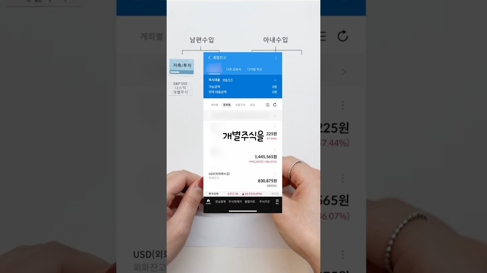

### 3. [재테크 강연대상이 신세계 손녀일 때](https://www.youtube.com/watch?v=gNNhiknw81s)

- 채널 **아이돌다이뜌 ** (구독자 7.3천) · 조회수 **461만** · 채널 평균의 **35.6배** · 쇼츠 00:21 · 업로드 2026-09-08 · 카테고리: 검색어 · 검색어: `재테크` · 선정: 소규모 채널 쿼터 (점수 95)
- 📁 [`success_cases/03_재테크_강연대상이_신세계_손녀일_때_gNNhiknw81s/`](success_cases/03_재테크_강연대상이_신세계_손녀일_때_gNNhiknw81s/) · 대본: whisper_pending · 영상: skipped(DOWNLOAD_VIDEOS=False)

  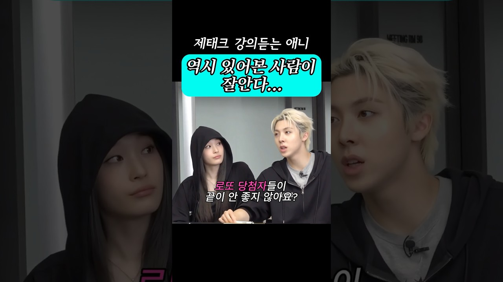

### 4. [S&P500 vs 나스닥100](https://www.youtube.com/watch?v=lg0r2ZOcyXU)

- 채널 **디히치** (구독자 2.5만) · 조회수 **131만** · 채널 평균의 **182.4배** · 쇼츠 00:26 · 업로드 2026-05-28 · 카테고리: 검색어 · 검색어: `S&P500` · 선정: 종합점수 상위(카테고리 제한 완화) (점수 94)
- 📁 [`success_cases/04_S_P500_vs_나스닥100_lg0r2ZOcyXU/`](success_cases/04_S_P500_vs_나스닥100_lg0r2ZOcyXU/) · 대본: whisper_pending · 영상: skipped(DOWNLOAD_VIDEOS=False)

  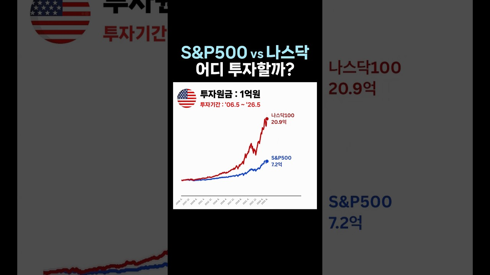

### 5. [장항준이 알려 주는 재테크 방법 #쇼츠 #Shorts #예능짧게 #꿀잼 #예능레전드 #1분요약 #장항준 #장항준감독 #재테크](https://www.youtube.com/watch?v=hp6mDQXbFHc)

- 채널 **예능짧게** (구독자 2.3천) · 조회수 **159만** · 채널 평균의 **57.4배** · 쇼츠 00:34 · 업로드 2026-04-04 · 카테고리: 검색어 · 검색어: `재테크` · 선정: 종합점수 상위(카테고리 제한 완화) (점수 94)
- 📁 [`success_cases/05_장항준이_알려_주는_재테크_방법_쇼츠_Shorts_예능_hp6mDQXbFHc/`](success_cases/05_장항준이_알려_주는_재테크_방법_쇼츠_Shorts_예능_hp6mDQXbFHc/) · 대본: whisper_pending · 영상: skipped(DOWNLOAD_VIDEOS=False)

  

### 6. [99%는 모르는 제미나이 활용한 주식투자방법 3가지](https://www.youtube.com/watch?v=EaED3ZVnlHc)

- 채널 **돈 공부시켜주는남자** (구독자 2.1만) · 조회수 **77.1만** · 채널 평균의 **968.4배** · 롱폼 16:19 · 업로드 2026-02-23 · 카테고리: 검색어 · 검색어: `돈공부` · 선정: 종합점수 상위(카테고리 제한 완화) (점수 93)
- 📁 [`success_cases/06_99_는_모르는_제미나이_활용한_주식투자방법_3가지_EaED3ZVnlHc/`](success_cases/06_99_는_모르는_제미나이_활용한_주식투자방법_3가지_EaED3ZVnlHc/) · 대본: whisper_pending · 영상: skipped(DOWNLOAD_VIDEOS=False)

  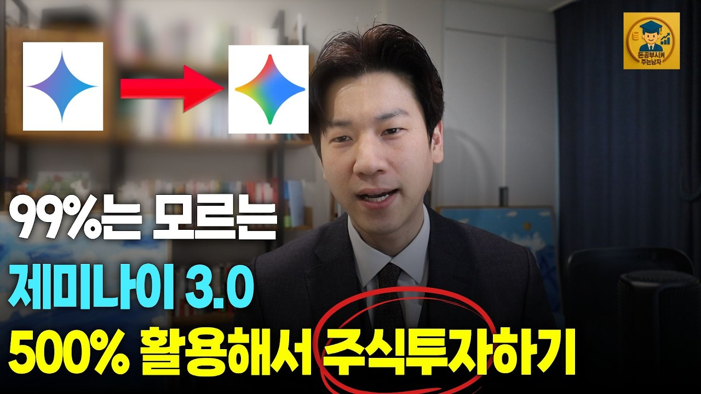

### 7. [미국 ETF 30초만에 이해하기](https://www.youtube.com/watch?v=X08HjlsEvpo)

- 채널 **어피티 UPPITY** (구독자 22만) · 조회수 **233만** · 채널 평균의 **91.6배** · 쇼츠 00:35 · 업로드 2025-10-26 · 카테고리: 검색어 · 검색어: `ETF` · 선정: 종합점수 상위(카테고리 제한 완화) (점수 93)
- 📁 [`success_cases/07_미국_ETF_30초만에_이해하기_X08HjlsEvpo/`](success_cases/07_미국_ETF_30초만에_이해하기_X08HjlsEvpo/) · 대본: whisper_pending · 영상: skipped(DOWNLOAD_VIDEOS=False)

  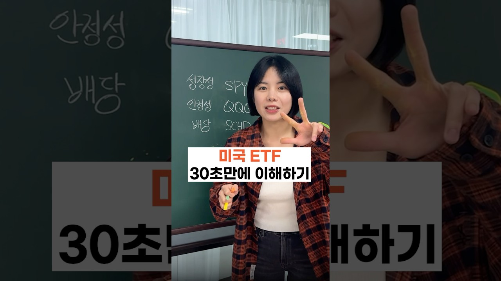

### 8. [S&P500 투자를 망설이고 있는 당신, 이 영상 하나로 해결!](https://www.youtube.com/watch?v=YmSmBiQQbd4)

- 채널 **교보증권 머니텐 Money10** (구독자 12.2만) · 조회수 **92.5만** · 채널 평균의 **277.3배** · 쇼츠 00:50 · 업로드 2026-02-08 · 카테고리: 검색어 · 검색어: `S&P500` · 선정: 종합점수 상위(카테고리 제한 완화) (점수 92)
- 📁 [`success_cases/08_S_P500_투자를_망설이고_있는_당신_이_영상_하나로_YmSmBiQQbd4/`](success_cases/08_S_P500_투자를_망설이고_있는_당신_이_영상_하나로_YmSmBiQQbd4/) · 대본: whisper_pending · 영상: skipped(DOWNLOAD_VIDEOS=False)

  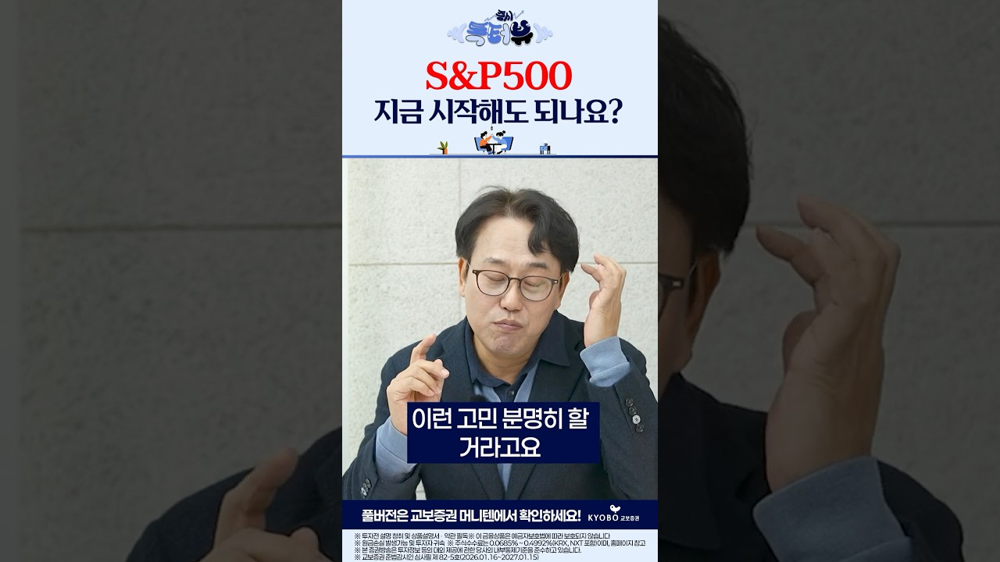

## 9. 💬 시청자 질문 (성공 영상 댓글에서 추출) — 다음 영상 주제 후보

질문 댓글에 많이 나오는 단어: `투자`(48), `주식`(44), `사람`(34), `생각`(20), `정도`(17), `계좌`(17), `ETF`(16), `수익`(14), `시작`(13), `나스닥`(13), `감사`(13), `가능`(12), `필요`(12), `부자`(12), `AI`(11), `중요`(11), `복리`(10), `통장`(10), `종목`(10), `이상`(10)

| 질문 댓글 | 좋아요 | 영상 |
|---|---|---|
| 2조?? 평생 쓰지도못해 ㅋㅋㅋㅋㅋㅋㅋㅋ | 4,889 | [재테크 강연대상이 신세계 손녀일 때](https://www.youtube.com/watch?v=gNNhiknw81s) |
| 3년동안 재탕 했으면 그만 할떄도 됐잖아?ㅋㅋㅋㅋㅋ | 2,928 | [어떤 투자는 '도박'이다? 주식 투자 때문에 …](https://www.youtube.com/watch?v=7FrJ3wuJDaY) |
| 용돈이 십만원…? ㅋㅋㅋㅋㅋ | 1,283 | [맞벌이 부부의 월급날루틴 “빠르게 1억 모으기…](https://www.youtube.com/watch?v=-vPbgWEJg_g) |
| 부동산 빼고 5억이다?? 상위 클래스입니다. | 678 | [은퇴자금 5억 원으로 어느정도 버틸수 있을까?…](https://www.youtube.com/watch?v=86YiCaX9-0o) |
| 10만원을 터치하지않...?음? 그걸 터치하는건 양아치 아니오? | 296 | [맞벌이 부부의 월급날루틴 “빠르게 1억 모으기…](https://www.youtube.com/watch?v=-vPbgWEJg_g) |
| 누가 대출 받아서 주식하라고 누칼협? | 248 | [어떤 투자는 '도박'이다? 주식 투자 때문에 …](https://www.youtube.com/watch?v=7FrJ3wuJDaY) |
| 이런거 알려주시면 안되는데, 저는 49세인데, 부부 외벌이로 지금까지 월급이 300도 안되었는데, 부부가 한마음으로 모으고 모으고 했는데, 젊은시절에는 왜 그렇게 사냐고 주변친구들한테 욕먹고 무시당했는데, 지금은 서울에 아파트 자가도 있고, 아들도 공 | 214 | [부자 되는 사람들의 공통점](https://www.youtube.com/watch?v=nmygd6CEMD0) |
| 5억이 73세에 바닥난다고? 이런애들이 금융유튜브에 나와서 전문가랍시고 떠들어 대는거 보면 참 | 192 | [은퇴자금 5억 원으로 어느정도 버틸수 있을까?…](https://www.youtube.com/watch?v=86YiCaX9-0o) |
| 결론: 20년을 기다릴수있느냐? | 148 | [S&P500 vs 나스닥100](https://www.youtube.com/watch?v=lg0r2ZOcyXU) |
| 말씀공감합니다. 어디에서든빛나는 함익병 원장님 존경함니다. | 141 | [부자 되는 사람들의 공통점](https://www.youtube.com/watch?v=nmygd6CEMD0) |
| 저 존리대표님 영상도많이보고 존경합니다 그런데 이런 일은 처음이시죠? 코스피 상승 나스닥 상승 이런적은 처음이시죠?? 저는 이런상황에서도 존리 대표님 믿고 장기투자를 할겁니다 감사합니다 | 126 | [존 리 대표‖'장기투자 할 기업 고르는 방법'…](https://www.youtube.com/watch?v=0JmEOW0VgFE) |
| 존리대표님 덕분에 주식계좌 만들었고 주식에대한 생각과 장기투자와 복리의 중요성을 깨닫고 적금 넣듯이 매달 넣고있습니다. 감사합니다.앞으로도 한국에 올바른 주식을 알려주시길 바랍니다. | 118 | [존 리 대표‖'장기투자 할 기업 고르는 방법'…](https://www.youtube.com/watch?v=0JmEOW0VgFE) |
| 00:43 현재 뜨거운 주식 시장 열기를 어떻게 생각하시나요? 04:12 이번에 수익을 많이 본 투자자는 매도를 고려해야 할까요? 04:59 AI 순풍이 계속될 거라고 생각하시나요? 05:33 시장이 흔들린다면 어떻게 해야 할까요? 06:43 지금 당 | 110 | [존 리 대표‖'장기투자 할 기업 고르는 방법'…](https://www.youtube.com/watch?v=0JmEOW0VgFE) |
| 그걸 모르는 사람이 있냐? 지나고나서 보니까 그렇구나 하는거지 오른다고 보장해주면 떨어지는애 떨쳐내지 떨쳐내면 걔가 오르고 버티면 떨어지니까 문제인거지 | 103 | [주식으로 성공한 부자들의 어마어마한 핵심 노하…](https://www.youtube.com/watch?v=iacwbUHyqv4) |
| 💸맞벌이 부부의 월급날 루틴 📍저희는 아내 수입을 생활비로 사용하고, 남편 수입으로는 저축+투자, 고정비를 지출해요. 📍지출은 ‘5가지 통장’ 으로 나누어 생활하고 있는데요. 1️⃣ 저축/투자 저축과 투자를 위한 증권사 통장에 넣고 주식을 매수해요 2 | 94 | [맞벌이 부부의 월급날루틴 “빠르게 1억 모으기…](https://www.youtube.com/watch?v=-vPbgWEJg_g) |
| 월급 100만원이야 아니면 남는 돈 100만원이야 AI 사진으로 도배 되어 있고 쓸 때 없는 말만 해서 뒤에만 보니까 결론도 없네 월 100만원씩 매달 쌓인다고 해도 3년이면 3600만원인데 그걸 어떻게 3년만에 1억으로 만들어 장난하나 주식으로 해도 | 91 | [사회초년생이 월급 100만 원으로 3년 만에 …](https://www.youtube.com/watch?v=aMJ9cPRAhSw) |
| 나스닥100이랑 snp500이랑 빠지면 살거같지?ㅋ 그때는 또 무서워서 못사는 사람들이 대부분임 | 73 | [S&P500 투자를 망설이고 있는 당신, 이 …](https://www.youtube.com/watch?v=YmSmBiQQbd4) |
| 5억을 누가 꾸역꾸역 쓰나요…하다못해 은행 이자라도 받겠지요. | 70 | [은퇴자금 5억 원으로 어느정도 버틸수 있을까?…](https://www.youtube.com/watch?v=86YiCaX9-0o) |
| 젊은 사람들 월수입이 350 안되는 사람이 많다. 은퇴 후 월350쓴다고? ㅋㅋㅋ | 67 | [은퇴자금 5억 원으로 어느정도 버틸수 있을까?…](https://www.youtube.com/watch?v=86YiCaX9-0o) |
| 목돈을 일년에 한번씩 해도 적립식이 되는데; 장기 투자 얘기 하다가 갑자기 단기 투자처럼 지수 빠질 때 얘기하네 장투면 타이밍상 언제가 아니라 시장 노출 기간이 더 중요함 | 66 | [S&P500 투자를 망설이고 있는 당신, 이 …](https://www.youtube.com/watch?v=YmSmBiQQbd4) |

## 10. 🔖 태그 분석 (성공 영상에서 과대표집된 태그)

| 태그 | 영상 수 | 성공 수 | 과대표집 | 배수(중앙) |
|---|---|---|---|---|
| etf투자 | 18 | 11 | 1.47 | 5.34 |
| 투자전략 | 10 | 6 | 1.45 | 3.31 |
| 포트폴리오 | 12 | 7 | 1.41 | 3.36 |
| 장기투자 | 21 | 12 | 1.38 | 4.83 |
| 퇴직연금 | 14 | 8 | 1.38 | 3.78 |
| 자산관리 | 27 | 15 | 1.34 | 3.31 |
| 주식초보 | 11 | 6 | 1.32 | 5.04 |
| irp | 19 | 10 | 1.27 | 2.76 |
| 미국주식 | 20 | 10 | 1.21 | 5.34 |
| 1억모으기 | 12 | 6 | 1.21 | 3.99 |
| 가치투자 | 10 | 5 | 1.21 | 3.45 |
| 돈모으는법 | 10 | 5 | 1.21 | 4.28 |
| 은퇴 | 10 | 5 | 1.21 | 5.34 |
| 주식공부 | 10 | 5 | 1.21 | 5.04 |
| 금리 | 8 | 4 | 1.21 | 4.12 |
| 직장인재테크 | 8 | 4 | 1.21 | 4.13 |
| 주식투자 | 37 | 18 | 1.17 | 3.78 |
| 자산배분 | 21 | 10 | 1.15 | 2.99 |
| 분산투자 | 19 | 9 | 1.14 | 2.94 |
| 은퇴준비 | 13 | 6 | 1.11 | 2.76 |

**아웃라이어 배수와의 순위상관(스피어만)** — 절댓값 0.1 미만은 사실상 무관

| 지표 | 상관계수 |
|---|---|
| like_rate | -0.213 |
| comment_rate | -0.171 |
| title_len | -0.148 |
| duration_sec | -0.268 |
| subscribers | -0.174 |
| channel_age_days | -0.084 |
| uploads_per_week | -0.057 |

## 11. ✅ 0명 채널 실행 체크리스트

1. **검색형 키워드로 시작**: 위 기회점수 상위 키워드는 '검색 → 유입'이 가능한 주제입니다. 구독자가 없을 때는 추천 피드보다 검색 유입이 먼저 열립니다.
2. **제목 = 검색어 + 검증된 제목 요소**: 키워드를 제목 앞쪽에 넣고, 3장의 효과 요소를 1~2개만 조합하세요 (과장은 시청 지속률을 떨어뜨립니다).
3. **첫 30초(쇼츠는 첫 3~5초)**: 8장 성공사례의 '도입부'를 비교해 공통 구조(질문 제기 → 결론 예고 → 근거)를 따라 해보세요.
4. **롱폼 1개 → 쇼츠 2~3개 재가공**: 같은 주제를 두 포맷으로 내보내 제작 효율과 노출 채널을 동시에 늘립니다.
5. **업로드 빈도**: 성공한 소규모 채널의 업로드 빈도 중앙값은 주 7.5회입니다. 꾸준함이 우선입니다 (최소 주 1~2회 롱폼 + 쇼츠).
6. **댓글 질문을 다음 영상으로**: 9장의 질문이 바로 수요가 검증된 다음 주제입니다.
7. **주식/금융 주제 주의**: 특정 종목 매수·매도 권유, 수익 보장 표현은 피하고 '투자 권유 아님' 고지를 넣으세요. 유료 리딩방·1:1 종목 추천처럼 대가를 받고 투자 판단을 조언하면 자본시장법상 유사투자자문업 신고 대상이 될 수 있습니다 (사업화 전 확인 필요).
8. **2~4주마다 재분석**: 트렌드는 빠르게 바뀝니다. 이 노트북을 다시 실행해 키워드 순위 변화를 확인하세요.

## 12. 📐 방법론 · 한계 · 재현 정보

- **아웃라이어 배수** = 영상 조회수 ÷ 같은 채널 최근 업로드 50개(업로드 14일 이상 경과, 같은 포맷 우선, 해당 영상 제외)의 조회수 중앙값. 구독자 수와 무관하게 '주제·제목·썸네일의 힘'을 보는 지표입니다.
- **분석 분할**: 성과 분석은 업로드 후 14일 이상 ~ 365일 이내 영상만 사용 (2025-10-14 ~ 2026-09-29). 그보다 최근 영상은 7장(급상승)에서만 참고.
- **미래 정보 누수 방지**: 모든 지표는 수집 시점에 관측 가능한 값만 사용하며, 기준선에서 대상 영상 자신을 제외했습니다.
- **주제 관련성 필터**: 제목·태그에 관련어(재테크, 투자, 주식, 주가, 증시, 코스피, 나스닥, ETF 등)가 있거나 설명란에 2번 이상 나와야 분석·성공사례에 포함 ('주식회사, (주), ㈜, 돈가스, 돈까스' 같은 표현은 먼저 제거). 이번 실행 제외 55개.
- **한계**: ① search.list 결과는 YouTube가 고른 표본이며 개인화되지 않은 결과입니다. ② 오래된 영상일수록 조회수가 누적되어 배수가 커질 수 있습니다 (채널 최근 업로드가 짧은 기간에 몰린 경우). ③ 썸네일·시청 지속률·CTR 등 핵심 내부 지표는 API로 볼 수 없습니다. ④ 제목 요소 효과는 상관관계이며 주제·채널 특성과 섞여 있습니다. ⑤ 쇼츠 판별은 길이 + youtube.com/shorts 응답으로 추정합니다.
- **재현성**: 랜덤 시드 42, 캐시 TTL 24시간, API 호출 {'search': 17, 'videos': 409, 'channels': 9, 'playlistItems': 408, 'commentThreads': 30}, 캐시 적중 {}
- **저작권**: 성공사례 대본·영상은 개인 학습·분석용입니다. 재업로드·재배포하지 마세요. 공개 저장소에는 영상 파일을 올리지 않는 것이 기본값입니다.

**이번 실행의 경고/주의 사항**

- ［INIT］ ⚠️ 위험/비용 관련 설정이 기본값과 다릅니다 key=QUOTA_BUDGET default=9000 current=3142
- ［INIT］ ⚠️ 위험/비용 관련 설정이 기본값과 다릅니다 key=DOWNLOAD_VIDEOS default=True current=False
- ［COLLECT］ 오늘 쿼터 예산을 넘는 키워드는 다음 실행으로 이월 (내일 다시 실행하면 이미 받은 검색은 쿼터 0으로 재사용) deferred=19 examples=［주식초보(검색어),투자전략(검색어),나스닥(검색어),포트폴리오(검색어),분산투자(검색어)］ hint="같은 설정으로 내일 다시 실행하세요 — 검색 결과는 SEARCH_CACHE_TTL_HOURS 동안 보관됩니다"

## 13. 📁 파일 목록

- `README.md` (이 리포트) · `analysis.xlsx` (모든 표) · `data/*.csv` · `charts/*.png` · `success_cases/` · `run_info.json` · `run_log.txt`
