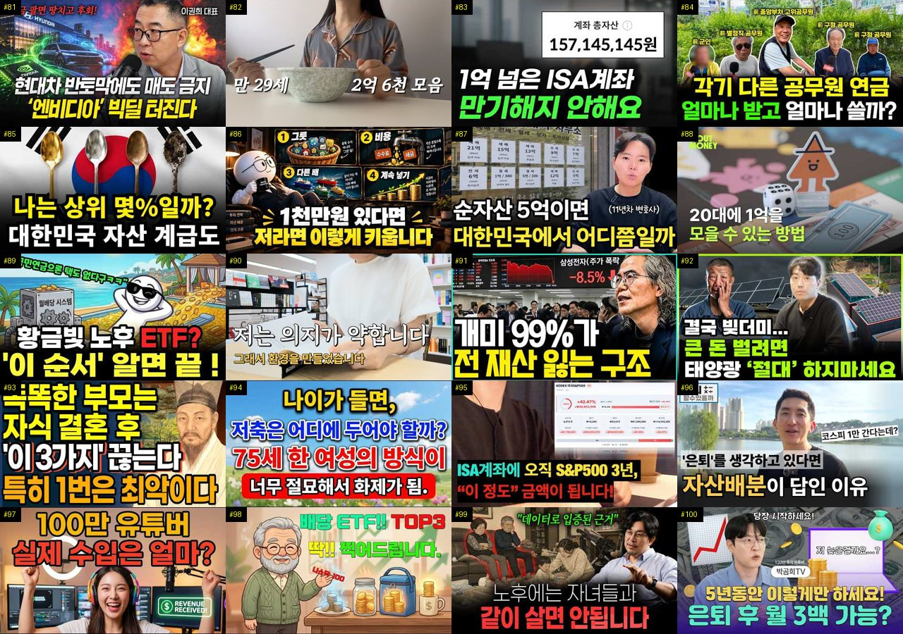
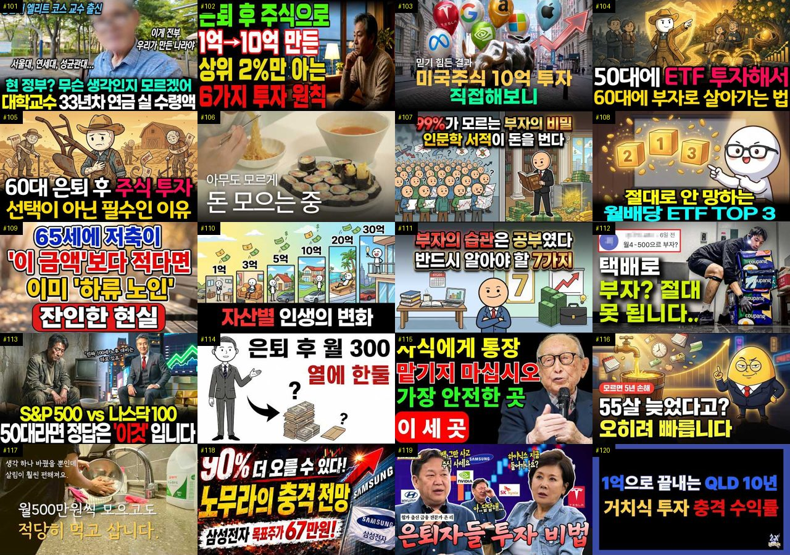
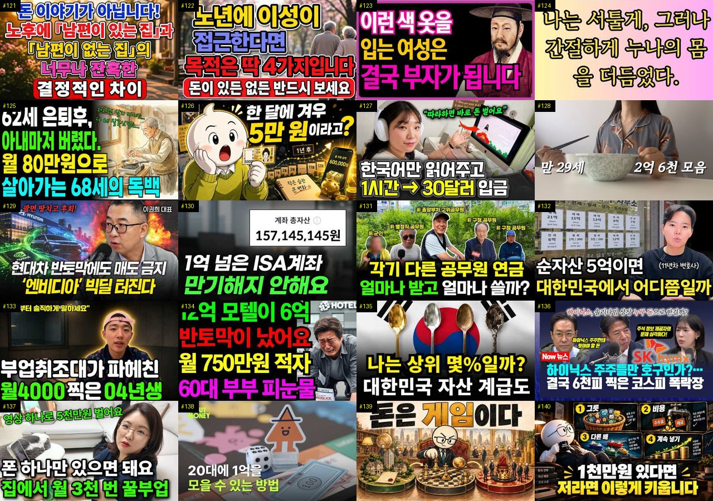
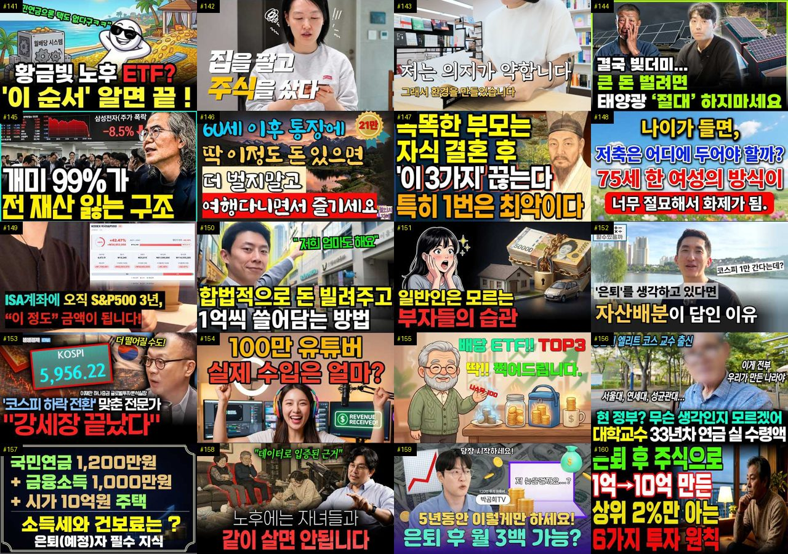
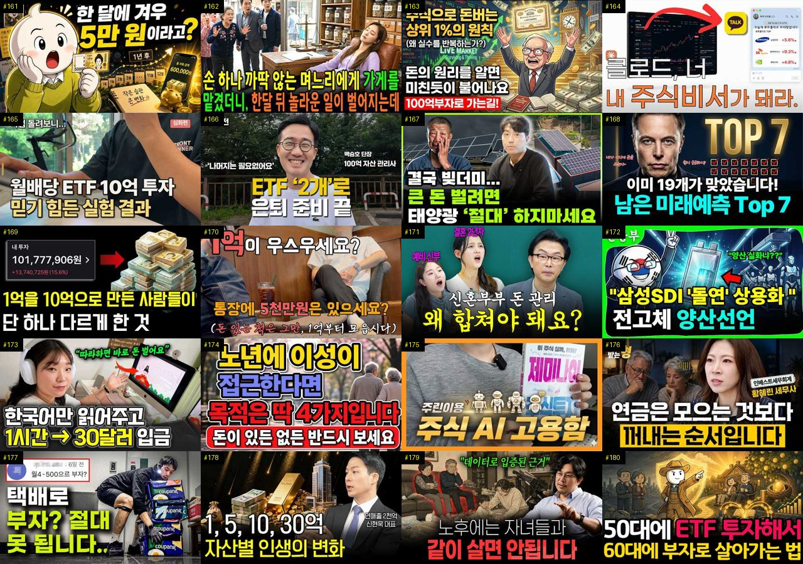
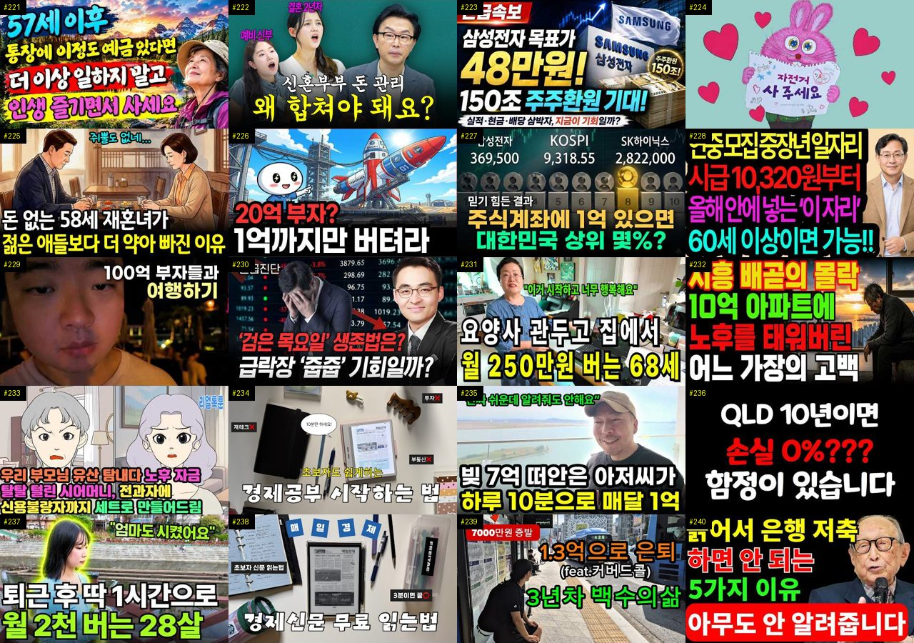
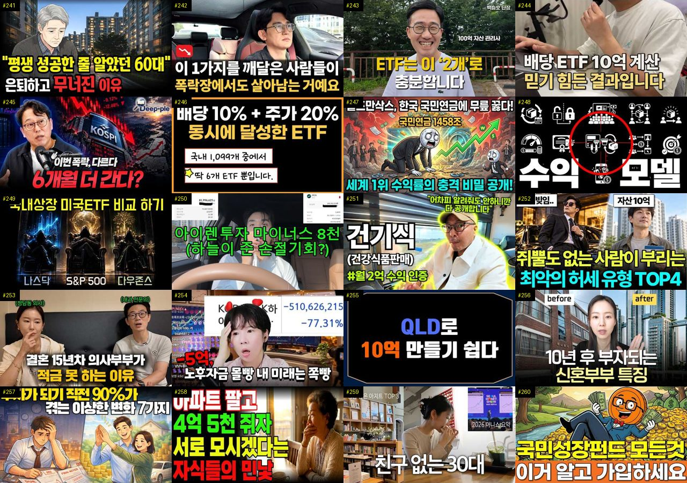

# 재테크 — 성공 사례 분석 (지시사항 재료)

자동 생성 — `tools/success_analysis.py` v1.5.1 (2026-10-24 07:22 UTC), 규칙 `economic/analysis_rules.toml` v1.7. **이 문서는 숫자와 원문만 담는다 — 해석·지시사항은 이것을 읽는 AI 가 만든다.** 주별 추세는 `weekly.md`, 승인한 영상 전부는 `approved.md`. ※ 연구·교육용 — 투자 권유가 아님.

## 0. 자료와 한계

| 자료 | 수 |
|---|---|
| 사례 폴더 (설명·자막·댓글·썸네일을 받은 영상) | 534 (웹 승인 534) |
| **성공 사례** — 180일 안·구독자 50,000 이하·조회수 ≥ 구독자 × 3·10,000회 이상·4분 이상, 채널당 2개 | **260** (기준 통과 315 − 뺀 것 17 − 채널당 제한 38) |
| **하루 조회수 상위** (1-3번 — 성공 사례와 따로) — 검색에서 찾은 주제 관련 4분 이상 영상 2,973개 중 하루 조회수 상위 10% (하루 14,115회 이상), 구독자·올린 날짜 상관없이, 채널당 2개 | **109** (기준 통과 147 − 뺀 것 11 − 채널당 제한 27) · 자료를 받지 않은 후보 172 |
| 성공 사례의 글 출처 (자막·음성인식·설명·없음) | 설명 169 · 음성인식(앞 5분) 79 · 음성인식 2 · 자막 2 · 없음 8 |
| 성공 사례 대본 — 전체 · 앞부분만(음성인식 1차) · 없음 | 4 · 79 · 177 |
| 같은 채널 기준선 (채널 평소 영상) | 성공 사례 242/260 · 채널 238곳 (잘된 영상 810 · 평소 영상 938) |
| 성공 사례 댓글 (받은 / 달린) | 57,453 / 59,040 |
| 성공 사례 썸네일 | 260 |
| 비교 집단 — 탐색에서 본 영상 중 구독자 50,000 이하·4분 이상·365일 안·주제 관련, 채널당 최근 5개 | 1659 (성공 284 = 17%, 채널당 제한으로 뺀 4051) |
| 자료를 받지 않은 성공 후보 (웹 화면에서 승인하면 들어감 — 채널당 자리가 남은 것만) | 144 (자리가 찬 채널의 544개 뺌) |
| 수요·공급 시장 — 최근 90일 영상 (채널 크기 상관없음) | 2065 · 검색어 72 · 자동완성 말 285 (공급 확인 0) |
| 채널 성장 자료 (개설일이 있는 채널) | 1144 (빨리 크는 작은 채널 25) |

성공 기준은 넘었지만 뺀 영상: 에어컨이 필요 없는 문쌤의 폐건물 괴담 [문쌤 라디오] (뺀 주제(괴담)) · '부동산 투자 보다 더 중요한 게 있습니다' 3040… (뺀 주제(부동산)) · 요즘 대세 이선민, 강남 아파트는 77세에?! ∣ 돈… (뺀 주제(아파트)) · 내 집 앞이 바로 맑은 계곡! 537평 땅 부자 되는… (뺀 주제(전원주택)) · "서울요? 아닙니다" 노년에 가장 살기 좋은곳 압도적… (뺀 주제(5. 부동산)) · 여자배구 페퍼저축은행 결국 SOOP 인수 확정, 새 … (뺀 주제(배구)) · 1억 모으는 동안 제가 절대 안 쓴 것들 (외국 영상) · [스포츠 토토] 재테크 적중률 높이는 확률 계산법 대… (뺀 주제(토토)) · 【실화】65세, 내 집에 계속 산 부부와 집을 팔고 … (뺀 주제(월세)) · 돈 없는 노후가 얼마나 비참한지 아십니까? 30평 아… (뺀 주제(아파트)) · "잘 곳은 넘치는데 벌 곳이 없죠" 일산과 송도, 같… (뺀 주제(5. 부동산)) · 30대 직장인 절약 브이로그 ∣ 번아웃 쉬어가요 ∣ … (뺀 주제(월세))

**한계**

- 대본(자막·음성인식)이 없는 성공 사례 177개 (#1, #2, #5, #6, #8, #12, #13, #15, #17, #19, #20, #21, #24, #25, #28, #29, #31, #32, #33, #39, #41, #42, #44, #45, #51, #53, #56, #57, #58, #59 …) — 설명란·챕터만 있음. 도입부·구성·말 속도는 대본이 있는 83개로만 셌다 (음성인식이 끝나면 다시 셈)
- 비교 집단 1659개 = 검색(조회수 순 — 잘된 영상 쪽으로 치우침)·추가한 채널·성공 사례 채널의 평소 영상 879개 (치우침 없음) 에서 올린 지 7~365일 영상, 성공 비율 17% — 실제 시장 비율이 아니다. 같은 집단 안의 '있음/없음' 차이로만 보고, '무엇이 먹혔나'는 1-2번(같은 채널 안)을 먼저 보라
- 하루 조회수 상위 묶음(1-3번) 109개는 구독자·올린 날짜 상관없이 골랐다 — 큰 채널(구독자 50,000 넘음) 88개라 채널 힘(구독자·추천)이 섞여 있다. 작은 채널이 따라 할 근거는 1번 성공 사례로 보라. 하루 조회수 = 조회수 ÷ 올린 지 날수라 갓 올린 영상(며칠)은 부풀고 오래된 영상은 낮아진다. 경계는 검색 결과(조회수 순 — 잘된 쪽으로 치우침) 2973개 안의 상위 10%. 자료를 받지 않은 후보 172개 (웹 화면에서 승인하면 들어감)
- 같은 채널 기준선이 있는 성공 사례 242/260개 (채널 영상이 5개 미만이거나 아직 못 받음)
- 수요·공급의 '시장'은 탐색·검색에서 본 최근 90일 영상 2065개 — 검색이 조회수 순이라 조회수 적은 영상이 덜 잡힌다. 주제 묶음 사이의 상대 비교(지수)로만 보라
- 자동완성 말의 '최근 영상 수'는 우리가 본 영상만 셌다 — 실제 공급은 웹 화면 [공급 확인](말 하나에 검색 1번 = 100단위)으로 확인
- 자동완성 말에는 책·방송·사람·채널 이름도 섞인다 (예: '…를 찾아서'·'…지침서') — 영상 주제가 아닌 말은 건너뛰고 읽어라
- 채널 1곳은 개설일이 아직 없음 (다음 탐색 때 채움)
- '구독자가 많이 모이는가'는 YouTube API 로 영상별 구독 증가를 볼 수 없다 — 대신 채널 성장(7번: 개설 뒤 월 구독자·받을 때마다 남긴 기록), '구독·다음 기대' 댓글, 배수(조회수÷구독자)로 본다
- 댓글 갈래·제목 특징은 낱말 규칙이라 거칠다 (물음표 반문도 '질문', 한 댓글이 여러 갈래). 원문 인용을 함께 보라
- '눈에 띔'은 차이가 크고 표본이 충분하다는 표시일 뿐 원인이 아니다

## 1. 성공 사례 (260개 — 배수 큰 순)

배수 = 조회수 ÷ 구독자. **채널 평소 대비** = 조회수 ÷ 그 채널 최근 롱폼 조회수 중앙값 (같은 채널 기준선 — 클수록 그 영상만의 힘). 썸네일은 5번(장마다 20개, 번호 = #), 사례별 자세히는 **`analysis_cases_01.md` …** (9번).

| # | 제목 | 채널 | 구독자 | 조회수 | 배수 | 채널 평소 대비 | 하루 조회수 | 길이 | 업로드 | 주제 묶음 | 형식 | 글 출처 | 댓글 받은/달린 |
|---|---|---|---|---|---|---|---|---|---|---|---|---|---|
| 1 | [50대 정년퇴직 후 현실｜퇴직을 앞둔 선배가 가장 걱정했던 것](https://www.youtube.com/watch?v=0iduiNNIyRA) | 따세 | 168 | 128,949 | 767.5 | ×52.2 | 21,637.6 | 10.2분 | 2026-10-18 | 4. 노후·연금 | 정보·해설 | 설명 | 30/81 |
| 2 | [산소에도 만기가 있습니다, 제사를 접은 집에서 선산 다툼이 먼저 생기는 이유](https://www.youtube.com/watch?v=7rQLpg5TG-I) | 경제참견 | 1,000 | 669,154 | 669.1 | ×1,765.6 | 13,675.1 | 9.6분 | 2026-09-05 | 4. 노후·연금 | 정보·해설 | 설명 | 489/489 |
| 3 | [안 팔릴수록 부자되는 '동네 금은방'의 소름돋는 수익구조](https://www.youtube.com/watch?v=eFsT1K_mPjc) | 새파란 경제 | 999 | 560,268 | 560.8 | ×499.1 | 14,786.4 | 17.6분 | 2026-09-16 | 1. 재테크 일반·마인드 | 정보·해설 | 음성인식(앞 5분) | 139/144 |
| 4 | [65세 이후 통장에 '이 금액' 있다면 돈 벌지 말고 그냥 인생을 즐겨라ㅣ명언ㅣ인생조언ㅣ오디오북](https://www.youtube.com/watch?v=MJE-dsUuqIM) | 인생의 고수 | 1,680 | 866,692 | 515.9 | ×530.7 | 20,511.3 | 34.8분 | 2026-09-12 | 4. 노후·연금 | 오디오북·낭독 | 음성인식(앞 5분) | 196/199 |
| 5 | [60대부터 격차가 벌어진다｜부자동네 사람들의 남다른 생활습관 10가지 ∣ 명언/ 오디오북/ 라디오북/ 시니…](https://www.youtube.com/watch?v=6Hxcmse6F2c) | 오늘도청춘 | 194 | 73,781 | 380.3 | ×94.7 | 9,224.8 | 21.8분 | 2026-10-16 | 1. 재테크 일반·마인드 | 오디오북·낭독 | 설명 | 16/16 |
| 6 | [왜 내가 사면 떨어지고 팔면 오를까? 개미가 주식으로 돈 못 버는 4가지 이유](https://www.youtube.com/watch?v=fdlfOCtDBqc) | 오피디의 머니노트 | 680 | 257,980 | 379.4 | – | 28,806.1 | 13.6분 | 2026-10-15 | 3. 주식·ETF | 오디오북·낭독 | 설명 | 203/203 |
| 7 | [조용한 부자들이 절대 입에 담지 않는 7가지 — 돈 있는 사람의 진짜 습관 ㅣ시니어ㅣ오디오북ㅣ노후준비ㅣ심리…](https://www.youtube.com/watch?v=TKBAsjZgVWU) | 가을빛 심리학 | 1,250 | 463,637 | 370.9 | ×568.2 | 12,290.3 | 21.7분 | 2026-09-16 | 1. 재테크 일반·마인드 | 오디오북·낭독 | 음성인식(앞 5분) | 100/104 |
| 8 | [내 노후 자금 지키는 법 [후회 없는 소비의 기준]](https://www.youtube.com/watch?v=fUyrCZT0W4E) | 지혜담은 | 272 | 98,314 | 361.4 | ×768.1 | 8,012.2 | 16.6분 | 2026-10-12 | 2. 돈 모으기·저축 | 오디오북·낭독 | 설명 | 9/9 |
| 9 | [기초연금 개편 진짜였네? 결국 내가 받을 돈 '이렇게' 받는다 [대통령 긴급 발표] 61년생부터 주목](https://www.youtube.com/watch?v=42N9nj2wWko) | 연금노하우 | 1,280 | 412,575 | 322.3 | – | 7,383.6 | 9.4분 | 2026-08-29 | 4. 노후·연금 | 정보·해설 | 음성인식(앞 5분) | 349/349 |
| 10 | [생생한 택배기사 최근 6개월치 월급 공개... 이게 '진짜 현실'입니다.](https://www.youtube.com/watch?v=6QkzqMZYrVQ) | 택부 - 택배기사 부자들 | 6,860 | 2,128,314 | 310.2 | ×44.6 | 34,929.1 | 8.6분 | 2026-08-24 | 2. 돈 모으기·저축 | 브이로그·직접 해본 이야기 | 음성인식(앞 5분) | 1,547/1,604 |
| 11 | [은퇴 후 행복한 삶을 누리는 노년층의 4가지 특징 60세 이후 최고의 삶을 누리는 비결은 바로 '이것'을 …](https://www.youtube.com/watch?v=mJbPirgzeu0) | 삶의 깊은 이야기 | 1,600 | 426,948 | 266.8 | ×3,557.9 | 2,480.0 | 21.1분 | 2026-05-05 | 4. 노후·연금 | 사연·드라마 | 음성인식(앞 5분) | 482/483 |
| 12 | [70대가 되기전 돈보다 먼저 준비해야 할 5가지ㅣ인생조언ㅣ노후준비ㅣ삶의지혜ㅣ시니어ㅣ오디오북ㅣ](https://www.youtube.com/watch?v=nVqsO9NQKH0) | 노년의 지혜 | 105 | 27,551 | 262.4 | ×69.6 | 2,986.9 | 56분 | 2026-10-15 | 4. 노후·연금 | 사연·드라마 | 설명 | 5/5 |
| 13 | [올해 68세입니다. 62살에 이 3가지를 시작할걸, 지금은 매일 밤 후회하고 있습니다](https://www.youtube.com/watch?v=nOMrypGAQP8) | 돈과 사람 | 1,410 | 346,348 | 245.6 | ×1,822.9 | 4,756.2 | 22.1분 | 2026-08-12 | 4. 노후·연금 | 오디오북·낭독 | 설명 | 170/170 |
| 14 | [부자들이 먼저 배운 돈의 원리, "열심히 벌어도 왜 안 모일까" 자본주의에 대해 알게되면 부자는 불가능한 …](https://www.youtube.com/watch?v=RGKX32DwzMI) | 경제집현전 | 700 | 171,209 | 244.6 | ×164.6 | 3,143.0 | 24.2분 | 2026-08-30 | 1. 재테크 일반·마인드 | 정보·해설 | 음성인식(앞 5분) | 10/10 |
| 15 | [【이어령 교수의 조언】 늙어서 절대로 친구로 지내면 안되는 사람 '1위' 차라리 개를 키우세요! ∣ 오디오…](https://www.youtube.com/watch?v=Ar5CYDBUGBk) | 노후의 원칙 | 757 | 167,733 | 221.6 | – | 24,169.8 | 40.9분 | 2026-10-17 | 4. 노후·연금 | 오디오북·낭독 | 설명 | 133/133 |
| 16 | [일흔이 넘으면 ‘이 다섯 곳’에는 절대 가지 마세요｜노후 자금을 지키는 지혜｜노년의 마음소리](https://www.youtube.com/watch?v=oyiEl0p35BY) | 은퇴후인생수업 | 408 | 90,250 | 221.2 | ×788.2 | 1,560.1 | 32분 | 2026-08-27 | 4. 노후·연금 | 오디오북·낭독 | 음성인식(앞 5분) | 17/18 |
| 17 | [돈 없는 노후는 얼마나 비참할까… 평생 성실하게 살아도 노후가 캄캄해지는 진짜 이유 ｜ 노후자금 사연 ｜ …](https://www.youtube.com/watch?v=gJ4ogy8mpO8) | 노년의 미래 | 125 | 26,318 | 210.5 | ×272.7 | 2,157.2 | 30.3분 | 2026-10-12 | 4. 노후·연금 | 사연·드라마 | 설명 | 5/5 |
| 18 | [돈이 더 적은 사람들이 항상 당신보다 더 많은 것을 가지고 있는 이유](https://www.youtube.com/watch?v=FJq7Cz3CSz8) | 투자 가이드 | 1,020 | 198,262 | 194.4 | ×182.7 | 4,420.7 | 31.1분 | 2026-09-09 | 2. 돈 모으기·저축 | 오디오북·낭독 | 음성인식(앞 5분) | 15/16 |
| 19 | [국민연금 63세에 바로 받은 김 부장 vs 5년 미뤄 36% 더 받은 박 부장… 10년 뒤 통장에 더 많이…](https://www.youtube.com/watch?v=VoVyS34lpec) | 은퇴 후 일자리 연구소 | 85 | 17,715 | 177.2 | ×10.0 | 1,983.3 | 22.8분 | 2026-10-15 | 4. 노후·연금 | 오디오북·낭독 | 설명 | 43/43 |
| 20 | ["둘이 연금 받으면 넉넉하겠지" 부부 연금 340만 원인데 노후 파산 직전까지 가는 진짜 이유](https://www.youtube.com/watch?v=rrt18r_uOPc) | 퀸즈리의 경제학 | 473 | 83,566 | 176.7 | ×102.2 | 4,426.1 | 18.6분 | 2026-10-05 | 4. 노후·연금 | 브이로그·직접 해본 이야기 | 설명 | 24/24 |
| 21 | [사상 초유의 이틀 연속 서킷브레이커! 폭락장에서 투자자가 절대 해서는 안 될 행동 ∣ 존리 대표](https://www.youtube.com/watch?v=un5SAQlJFcY) | 증시직격 | 111 | 19,590 | 176.5 | ×979.5 | 1,602.5 | 23분 | 2026-10-12 | 3. 주식·ETF | 인터뷰·강연·대담 | 설명 | 17/17 |
| 22 | [은퇴 후 연금만으로 살기 좋은 한국 최고의 섬마을](https://www.youtube.com/watch?v=nksAlCVCgLo) | 살이픽 | 913 | 157,614 | 172.6 | ×13.8 | 6,805.0 | 18.3분 | 2026-10-01 | 4. 노후·연금 | 정보·해설 | 음성인식(앞 5분) | 47/47 |
| 23 | [60세 이후, 계속 일하는 사람 vs 쉬는 사람 5년 후 놀라운 차이 치매 위험 35% 낮추는 비밀!](https://www.youtube.com/watch?v=qOdjXbl2g6Y) | 쉽게 이해하는 경제 | 2,190 | 373,297 | 170.5 | ×1,328.5 | 2,131.0 | 11.8분 | 2026-05-02 | 4. 노후·연금 | 정보·해설 | 음성인식(앞 5분) | 590/590 |
| 24 | [앞으로는 모두 혼자 산다… 준비한 사람만 노후에 살아남는다｜새로운 은퇴 생존법 ｜ 노후지혜](https://www.youtube.com/watch?v=vash2ZD50Cs) | 백년건강 지혜 | 180 | 29,703 | 165.0 | ×153.9 | 3,252.6 | 39.6분 | 2026-10-15 | 4. 노후·연금 | 오디오북·낭독 | 설명 | 10/10 |
| 25 | [S&P500은 최고인데 내 ETF는 마이너스… 지금 환헤지로 갈아타면 늦는 진짜 이유](https://www.youtube.com/watch?v=UcHK1WoTPtY) | 뒤집는경제 | 275 | 44,422 | 161.5 | – | 5,888.9 | 23.2분 | 2026-10-16 | 3. 주식·ETF | 정보·해설 | 설명 | 25/25 |
| 26 | [ISA·연금저축·IRP에서 평생 모아갈 국내상장 월배당 ETF 총정리 ∣ 9월 분배금 이만큼 나왔습니다 (…](https://www.youtube.com/watch?v=kZJEE6mtay4) | 퇴근후ETF | 172 | 27,618 | 160.6 | ×58.0 | 1,538.4 | 19.1분 | 2026-10-06 | 4. 노후·연금 | 인터뷰·강연·대담 | 음성인식(앞 5분) | 6/6 |
| 27 | [[풀영상] 월급 10%로 당장 시작하는 존리의 자산 증식 치트키](https://www.youtube.com/watch?v=q1fYjAwma3s) | 여의돈스트리트 | 1,380 | 220,645 | 159.9 | ×191.5 | 6,070.2 | 36분 | 2026-09-17 | 2. 돈 모으기·저축 | 인터뷰·강연·대담 | 음성인식(앞 5분) | 112/122 |
| 28 | [돈 생기면 제일 먼저 저금부터 하는 사람들, 사실 이런 사람들입니다 (인색함이 아닙니다)](https://www.youtube.com/watch?v=puDreXlIFGU) | 심리잔고 | 144 | 21,276 | 147.8 | ×144.7 | 2,696.4 | 15.7분 | 2026-10-16 | 1. 재테크 일반·마인드 | 정보·해설 | 설명 | 10/10 |
| 29 | [평균 7천만 원은 거짓말입니다. 60대 통장 잔고의 뼈아픈 진짜 현실](https://www.youtube.com/watch?v=UiSDpyl-fxU) | 인생 2막 | 679 | 98,036 | 144.4 | ×326.8 | 1,996.4 | 24분 | 2026-09-05 | 1. 재테크 일반·마인드 | 오디오북·낭독 | 설명 | 68/68 |
| 30 | [본인도 모르는 사이에 남몰래 부자가 되고 있다는 5가지 신호](https://www.youtube.com/watch?v=5kBEU3V3ZXY) | 투자 가이드 | 1,020 | 146,801 | 143.9 | ×135.3 | 3,983.9 | 20분 | 2026-09-17 | 1. 재테크 일반·마인드 | 정보·해설 | 음성인식 | 12/13 |
| 31 | [저축만으로 3억! 이렇게 아꼈습니다.](https://www.youtube.com/watch?v=9R7zyJcCrig) | 베스타 vesta | 702 | 95,607 | 136.2 | ×15.2 | 4,229.9 | 10.9분 | 2026-10-01 | 2. 돈 모으기·저축 | 브이로그·직접 해본 이야기 | 설명 | 60/60 |
| 32 | [노후에 가장 좋은 취미, 압도적 1위는 바로 이것입니다ㅣ걷기보다 좋은 이유가 있습니다](https://www.youtube.com/watch?v=eUjV72DmU1g) | 노후산책 | 91 | 12,754 | 127.5 | ×25.1 | 1,389.2 | 14.8분 | 2026-10-15 | 4. 노후·연금 | 오디오북·낭독 | 설명 | 1/1 |
| 33 | [연금 120만·200만·300만… 고교 동창 세 명, 5년 뒤 통장이 가장 먼저 바닥난 사람은? ∣ 노후준…](https://www.youtube.com/watch?v=gYfSp6GXKLY) | 은퇴 후 일자리 연구소 | 85 | 11,931 | 119.3 | ×4.1 | 1,721.5 | 23.6분 | 2026-10-17 | 4. 노후·연금 | 오디오북·낭독 | 설명 | 15/15 |
| 34 | [노후에 등산가면 접근하는 꽃뱀의 수법, 하필 32년 강력계 형사한테 걸렸다 ∣ 사이다 복수극 ∣ 노후사연 …](https://www.youtube.com/watch?v=ksCSvgpQvg8) | 수채화 인생 이야기 | 4,180 | 479,257 | 114.7 | ×1,872.1 | 9,988.2 | 8.6분 | 2026-09-06 | 4. 노후·연금 | 사연·드라마 | 음성인식(앞 5분) | 158/158 |
| 35 | [50대 억대연봉 임원이 퇴사 1년 후 깨달은 현실](https://www.youtube.com/watch?v=mLyNB42Hhgg) | 50대 새로운 인생 준비… | 2,900 | 320,714 | 110.6 | ×371.6 | 5,041.0 | 8.9분 | 2026-08-21 | 기타 | 정보·해설 | 음성인식(앞 5분) | 219/220 |
| 36 | ["순서대로 무너집니다" 금리 7% 시대, 한국 중산층 자산이 흔들리는 진짜 순서 4단계](https://www.youtube.com/watch?v=5wYVYUrG4Ds) | 월급쟁이경제학 | 3,030 | 313,803 | 103.6 | ×31.1 | 4,974.3 | 27.8분 | 2026-08-22 | 1. 재테크 일반·마인드 | 브이로그·직접 해본 이야기 | 음성인식(앞 5분) | 388/395 |
| 37 | [객실 팔아서 돈 버는 게 아니라고? 우리가 몰랐던 호텔이 진짜 돈을 버는 방법](https://www.youtube.com/watch?v=RuWOYsSZl_E) | 머니파이 | 9,260 | 941,765 | 101.7 | ×201.9 | 9,075.0 | 17.6분 | 2026-07-12 | 기타 | 정보·해설 | 음성인식(앞 5분) | 280/285 |
| 38 | [나이들수록 '이것' 챙기면 노후가 바뀌고 행복해집니다ㅣ귀티나는 노후를 위한 행복특강ㅣ황창연신부님최근강의ㅣ황…](https://www.youtube.com/watch?v=cn8b0mMUR3Q) | 포강쇼 | 5,160 | 506,562 | 98.2 | ×1,485.5 | 3,728.9 | 179.8분 | 2026-06-10 | 4. 노후·연금 | 오디오북·낭독 | 음성인식(앞 5분) | 160/169 |
| 39 | [[노자] 이렇게 하면 바로 대접 받는다 ㅣ인생명언ㅣ행복한 노후ㅣ삶의지혜ㅣ인간관계](https://www.youtube.com/watch?v=-dxUrozfhRQ) | 고전명언 인생조언 | 3,020 | 290,228 | 96.1 | ×127.7 | 23,844.3 | 46분 | 2026-10-12 | 4. 노후·연금 | 오디오북·낭독 | 설명 | 64/64 |
| 40 | [50대에 조기퇴직하면 어떤 삶을 살게 될까? 51세에 경제적 자유와 조기은퇴(FIRE)를 이룬 사람의 실제…](https://www.youtube.com/watch?v=6LShuUa4Zt0) | 누군가의 인생 | 3,110 | 288,316 | 92.7 | ×8.6 | 8,750.9 | 18.8분 | 2026-09-21 | 4. 노후·연금 | 정보·해설 | 음성인식(앞 5분) | 177/183 |
| 41 | [금 투자 시작하는 방법, 금 투자방법 금테크 총정리](https://www.youtube.com/watch?v=0lPGxbxD4Tc) | 부자공식, 파이프라인 만… | 9,460 | 824,093 | 87.1 | ×784.9 | 37,503.0 | 8.5분 | 2026-10-02 | 3. 주식·ETF | 정보·해설 | 설명 | 59/59 |
| 42 | [부자들의 집에는 없고 가난한 집에는 넘쳐나는 '3가지'? 중년 풍수의 핵심은 비움입니다 ∣ 도올 김용옥 법…](https://www.youtube.com/watch?v=h0M1n5EHJSQ) | 평온한마음 | 415 | 35,479 | 85.5 | ×52.2 | 3,373.9 | 107.3분 | 2026-10-13 | 1. 재테크 일반·마인드 | 오디오북·낭독 | 설명 | 15/15 |
| 43 | [재고가 쌓일수록 부자가 되는 유일한 장사, 금은방의 기막힌 구조](https://www.youtube.com/watch?v=DeXKTULwhEI) | 수익구조 연구소 | 6,540 | 534,728 | 81.8 | ×40.8 | 11,537.0 | 15.4분 | 2026-09-07 | 1. 재테크 일반·마인드 | 정보·해설 | 음성인식(앞 5분) | 115/120 |
| 44 | [70대가 되어 뒤늦게 깨달았습니다｜은퇴 후 가장 잘한 일은 일이 아니라 잘 노는 것이었습니다｜노년지혜｜오디…](https://www.youtube.com/watch?v=SJEMyQEhJ10) | 노후의 돈관리 | 159 | 12,221 | 76.9 | ×22.5 | 1,022.4 | 34분 | 2026-10-12 | 4. 노후·연금 | 오디오북·낭독 | 설명 | 0/0 |
| 45 | [69세인 저는 5,500만 원의 예금을 들고 아들 집에 노후를 보내러 갔습니다. 손주에게 밥을 먹여주던 순…](https://www.youtube.com/watch?v=O-IYU1H6J4I) | 시어머니와 며느리 | 18,900 | 1,449,050 | 76.7 | ×8,280.3 | 22,665.0 | 119.3분 | 2026-08-21 | 2. 돈 모으기·저축 | 사연·드라마 | 설명 | 1,369/1,380 |
| 46 | [나스닥 투자하기 전에 이 영상 꼭 보세요 ∣ QLD만 모아가는 이유](https://www.youtube.com/watch?v=g10Y6ZA7rng) | 올레버 | 1,580 | 116,908 | 74.0 | ×162.6 | 811.9 | 5.7분 | 2026-06-02 | 3. 주식·ETF | 정보·해설 | 음성인식(앞 5분) | 347/347 |
| 47 | [5060 노후 준비, 1000만원으로 매월 배당금 받는 가장 현실적인 방법](https://www.youtube.com/watch?v=xQnFTZLNzOM) | 맛스토리 | 2,990 | 189,638 | 63.4 | ×259.6 | 1,071.7 | 17.6분 | 2026-04-30 | 3. 주식·ETF | 정보·해설 | 음성인식(앞 5분) | 44/44 |
| 48 | [50대 옥탑방 부부, "그 나이에 왜 주식을..."](https://www.youtube.com/watch?v=FRzyTNO9mNI) | 반백살, 옥탑방 이야기 | 688 | 43,007 | 62.5 | ×12.5 | 2,066.9 | 6.3분 | 2026-10-03 | 3. 주식·ETF | 정보·해설 | 음성인식(앞 5분) | 187/187 |
| 49 | [아무리 돈이 많아도 없는 척하세요, 재산이 알려지면 생기는 일](https://www.youtube.com/watch?v=FrSslE4xeBA) | 인생다시쓰기 | 8,400 | 518,105 | 61.7 | ×44.4 | 8,720.7 | 17.3분 | 2026-08-25 | 1. 재테크 일반·마인드 | 오디오북·낭독 | 음성인식(앞 5분) | 250/255 |
| 50 | [[100만 조회수] 대기업 30년 다니고 은퇴했지만, 78세에 고시원에서 혼자 사는 이유](https://www.youtube.com/watch?v=8_rq_vVFDTg) | 아니모 인생기록관 | 22,900 | 1,371,558 | 59.9 | ×23.7 | 10,945.6 | 14.5분 | 2026-06-21 | 4. 노후·연금 | 인터뷰·강연·대담 | 음성인식(앞 5분) | 1,690/1,693 |
| 51 | [혼자서도 외롭지 않고 풍요롭게 사는 사람의 비밀ㅣ귀티나는 노후를 위한 행복특강ㅣ황창연신부님최근강의ㅣ황창연신…](https://www.youtube.com/watch?v=Bi-HGrGtQrA) | 수라이야 카라 | 205 | 12,185 | 59.4 | ×31.7 | 1,269.4 | 69.3분 | 2026-10-14 | 4. 노후·연금 | 오디오북·낭독 | 설명 | 1/1 |
| 52 | [60대부터라도 싫어도 부자가 된다. TV에서 소개된 ‘5가지 마법의 습관’이 너무 대단했다](https://www.youtube.com/watch?v=t94bcrWeee0) | 인간 인사이트 | 983 | 57,493 | 58.5 | ×701.1 | 467.9 | 30.4분 | 2026-06-23 | 1. 재테크 일반·마인드 | 브이로그·직접 해본 이야기 | 음성인식(앞 5분) | 40/41 |
| 53 | [5월 나스닥 폭락설? 아무도 안 알려준 돈의 이동설](https://www.youtube.com/watch?v=DsUbusxqaL8) | 한알경제 | 1,610 | 88,509 | 55.0 | ×636.8 | 494.8 | 8.5분 | 2026-04-28 | 3. 주식·ETF | 정보·해설 | 설명 | 100/100 |
| 54 | ["와, 이렇게 돈 버는 여자 처음 봤습니다" 마트 사진 찍어 올려 월 3천만원 버는 98년생의 비밀부업추천](https://www.youtube.com/watch?v=N0gXuYAjgwk) | 머니종결자 | 8,450 | 455,613 | 53.9 | ×25.8 | 11,114.0 | 17.4분 | 2026-09-13 | 8. 부업·소득 | 인터뷰·강연·대담 | 음성인식(앞 5분) | 3,562/3,585 |
| 55 | [AI로 주식 자동 매매하면 어떻게 될까?](https://www.youtube.com/watch?v=9E9OrcoMCjk) | 이영배 | 20,000 | 1,049,911 | 52.5 | ×7.2 | 8,342.8 | 11.3분 | 2026-06-20 | 3. 주식·ETF | 정보·해설 | 음성인식(앞 5분) | 576/584 |
| 56 | [10억이 되면 생기는 일(누구도 알려주지 않는 진짜 현실)](https://www.youtube.com/watch?v=MhOAsuYjJkg) | 탐구하는 변호사 송현영 | 9,700 | 508,433 | 52.4 | ×52.8 | 2,842.1 | 14분 | 2026-04-28 | 1. 재테크 일반·마인드 | 정보·해설 | 설명 | 1,146/1,146 |
| 57 | [S&P 500에 투자하면 노후 걱정 전혀 없습니다! 주식으로 부자 되는 가장 빠른 방법](https://www.youtube.com/watch?v=_fnvM4hpX44) | 오피디의 머니노트 | 680 | 34,310 | 50.5 | – | 5,062.8 | 16.4분 | 2026-10-17 | 3. 주식·ETF | 정보·해설 | 설명 | 45/45 |
| 58 | [은퇴 5년전,우리는 이렇게 살기로 했다.](https://www.youtube.com/watch?v=HL1r9P3dHV4) | 안여사네 작은집 | 1,960 | 96,972 | 49.5 | ×11.9 | 719.5 | 8.9분 | 2026-06-11 | 4. 노후·연금 | 정보·해설 | 설명 | 68/68 |
| 59 | [나스닥은 버티는데 아이온큐가 일주일 새 20% 빠진 건 망해서가 아닙니다 — 가트너가 말한 퇴출 명단은 따…](https://www.youtube.com/watch?v=IbkLrISwBiU) | 경제전략노트 | 725 | 34,791 | 48.0 | ×35.6 | 3,593.3 | 14.4분 | 2026-10-14 | 3. 주식·ETF | 정보·해설 | 설명 | 10/10 |
| 60 | ["모르면 노후에 후회한다" 국민연금 65세 말고 무조건 '이때' 받으세요 ∣ 김현우 소장 ∣ 연금받는형](https://www.youtube.com/watch?v=q3Pig5W6QaI) | 연금 받는 형 | 21,900 | 1,049,484 | 47.9 | ×21.7 | 15,937.8 | 22.9분 | 2026-08-19 | 4. 노후·연금 | 인터뷰·강연·대담 | 음성인식(앞 5분) | 481/487 |
| 61 | [“은퇴자금 아끼려고 당근에 물건 하나 올렸다가…60대 노후가 무너졌습니다”ㅣ 은퇴자금 ㅣ노후사연 ㅣ오디오](https://www.youtube.com/watch?v=YydZ774lKfI) | 노을서사 | 1,820 | 83,193 | 45.7 | ×1,180.0 | 3,103.4 | 73.1분 | 2026-09-27 | 4. 노후·연금 | 사연·드라마 | 음성인식(앞 5분) | 94/94 |
| 62 | [예비 며느리 시험하려 청소부로 변장한 재벌회장, 일부러 커피 쏟았는데 그녀의 행동에 말문이 막혔습니다 ∣ …](https://www.youtube.com/watch?v=PX-qc9FOViA) | 인생유랑 | 21,200 | 964,624 | 45.5 | ×177.0 | 14,015.5 | 96.3분 | 2026-08-16 | 4. 노후·연금 | 사연·드라마 | 음성인식(앞 5분) | 294/365 |
| 63 | [(긴급)매달 나오던 기초연금 7월부터 바뀝니다!! 받던 분도 꼭 확인하세요](https://www.youtube.com/watch?v=TozHpX9DmQU) | 경상도이서방 | 5,550 | 250,433 | 45.1 | ×237.2 | 1,728.6 | 9.2분 | 2026-06-01 | 4. 노후·연금 | 정보·해설 | 음성인식(앞 5분) | 163/163 |
| 64 | [은퇴 후 경비직에 사람들이 몰리는 진짜 이유](https://www.youtube.com/watch?v=7kHfB06S2NM) | 은퇴갓생 | 6,830 | 298,680 | 43.7 | ×64.3 | 3,315.4 | 15.7분 | 2026-07-26 | 4. 노후·연금 | 정보·해설 | 음성인식(앞 5분) | 350/356 |
| 65 | [자식에게서 이 3가지는 절대 받지 마세요! 노후가 불행해질 수 있습니다 ㅣ노후지혜ㅣ인생명언ㅣ오디오북](https://www.youtube.com/watch?v=3aVf1x2D1Z8) | 가족온기 | 392 | 16,967 | 43.3 | ×86.6 | 1,428.5 | 54.5분 | 2026-10-12 | 4. 노후·연금 | 오디오북·낭독 | 설명 | 4/4 |
| 66 | [배당주 20년 vs S&P500 20년, 3억 원이 만든 충격적인 자산과 삶의 격차 [ 재테크/미국주식/E…](https://www.youtube.com/watch?v=cqgVNBbMYew) | 박대리와 황과장의 경제이… | 1,970 | 81,058 | 41.1 | ×30.0 | 942.8 | 20.5분 | 2026-07-30 | 1. 재테크 일반·마인드 | 정보·해설 | 음성인식(앞 5분) | 162/163 |
| 67 | [노후자금사연 월 450만원 연금 받는 전직 은행원 60대 부부도 무너지는 충격적인 현상황!](https://www.youtube.com/watch?v=pMZmS_k_s0U) | 삶의시나리오 | 2,940 | 117,250 | 39.9 | ×761.4 | 3,150.6 | 110.8분 | 2026-09-17 | 4. 노후·연금 | 사연·드라마 | 음성인식(앞 5분) | 104/104 |
| 68 | ["원금 안 깎여요" 진화형 커버드콜 ETF 황금 포트폴리오 공개](https://www.youtube.com/watch?v=yGuybuoroRI) | 투자360 | 16,200 | 645,500 | 39.9 | ×16.8 | 5,665.6 | 22.2분 | 2026-07-02 | 3. 주식·ETF | 브이로그·직접 해본 이야기 | 음성인식(앞 5분) | 574/578 |
| 69 | ["한 그루만 심어도 노후 대비 끝난다더니.." 남도 산비탈마다 황칠나무 꽂았다가 판로 막혀 숲째 방치된 황…](https://www.youtube.com/watch?v=oxMq0Cg7-6k) | 일파만파tv | 1,530 | 59,520 | 38.9 | ×15.4 | 7,503.6 | 21분 | 2026-10-16 | 4. 노후·연금 | 정보·해설 | 설명 | 43/43 |
| 70 | [삼성전자·하이닉스, AI 투자 끝나면 끝? 반도체 '뉴노멀' 온다는 이유](https://www.youtube.com/watch?v=cPm1rukivao) | 경제야! 놀자~ | 4,280 | 161,528 | 37.7 | ×13.7 | 23,092.3 | 11.5분 | 2026-10-17 | 3. 주식·ETF | 정보·해설 | 설명 | 113/113 |
| 71 | [연금 310만 원을 말한 뒤 40년 계모임이 깨졌습니다… 노후에 말하면 안 되는 4가지](https://www.youtube.com/watch?v=vU5PWT2zLDs) | 노년의 마음소리 | 34,200 | 1,264,871 | 37.0 | ×10.0 | 24,834.5 | 29분 | 2026-09-03 | 4. 노후·연금 | 정보·해설 | 음성인식(앞 5분) | 771/791 |
| 72 | [5년간 유지해온 ISA계좌 수익률 공개 (feat.부캉이)](https://www.youtube.com/watch?v=RBhIQUhBnOY) | 철이형님 | 303 | 11,085 | 36.6 | – | 1,034.9 | 5.7분 | 2026-10-13 | 6. 절세·제도 | 인터뷰·강연·대담 | 설명 | 14/14 |
| 73 | [50대 이후, 인생이 술술 풀리는 여성들의 3가지 비밀 ∣ 심리학 ∣ 뇌과학 ∣ 행복한노후 ∣](https://www.youtube.com/watch?v=mopoYlkCYC4) | 브라보 인생후반전 | 8,010 | 279,597 | 34.9 | ×365.0 | 1,747.2 | 21.9분 | 2026-05-17 | 4. 노후·연금 | 오디오북·낭독 | 음성인식(앞 5분) | 214/215 |
| 74 | [국민연금 빈칸 메우는 한국 ETF 3개 — 월 200만 원 평생 월급 만들기](https://www.youtube.com/watch?v=7rtO_hfLvF8) | 술술 경제학 | 17,600 | 608,761 | 34.6 | ×100.6 | 3,422.3 | 16.8분 | 2026-04-29 | 3. 주식·ETF | 정보·해설 | 음성인식(앞 5분) | 284/284 |
| 75 | [복리가 부를 만드는 진짜 시작점｜언제부터 돈이 스스로 일하기 시작할까](https://www.youtube.com/watch?v=JExUQaROk40) | 돈의 통찰 | 3,920 | 133,184 | 34.0 | ×9.3 | 1,418.1 | 17.8분 | 2026-07-22 | 3. 주식·ETF | 정보·해설 | 음성인식(앞 5분) | 103/103 |
| 76 | [주 4일 · 창고 알바 여성의 저축이 약 28만 7천 원 → 약 4,393만 원으로 늘었다, 싫어도 부자가…](https://www.youtube.com/watch?v=qKJQ58SOsow) | 노후 재테크 | 2,440 | 81,303 | 33.3 | ×170.6 | 726.4 | 31분 | 2026-07-04 | 1. 재테크 일반·마인드 | 정보·해설 | 음성인식(앞 5분) | 79/83 |
| 77 | [50대 부부 현실 밥상,현실 토크∣택배 일∣장사 접고 알게 된 자영업 진짜 현실](https://www.youtube.com/watch?v=PWYj6zg7clU) | 볕든내일 | 2,420 | 77,986 | 32.2 | ×3.9 | 8,730.7 | 14.7분 | 2026-10-15 | 4. 노후·연금 | 브이로그·직접 해본 이야기 | 설명 | 79/79 |
| 78 | [금값, 이제 시작입니다. 이것 때문에 금이 폭등합니다.](https://www.youtube.com/watch?v=1eQJLsk4Fm8) | 지금 돈 공부 | 739 | 23,772 | 32.2 | ×56.2 | 468.0 | 18.8분 | 2026-09-03 | 기타 | 정보·해설 | 음성인식(앞 5분) | 35/35 |
| 79 | [2026년 7월부터 기초연금 이렇게 바뀝니다 — 모르면 매달 33만원 손해](https://www.youtube.com/watch?v=ddEat5zF-yU) | 모두의딸 | 5,790 | 184,817 | 31.9 | ×70.8 | 1,754.8 | 11.6분 | 2026-07-10 | 4. 노후·연금 | 정보·해설 | 음성인식(앞 5분) | 267/267 |
| 80 | [경제적 자유의 진실: 이 원리를 모르면 당신은 80살까지 평생 출근해야 합니다](https://www.youtube.com/watch?v=2y3YphVxQaA) | 김상훈의 재테크 | 2,930 | 92,504 | 31.6 | ×226.7 | 647.7 | 28.7분 | 2026-06-03 | 1. 재테크 일반·마인드 | 정보·해설 | 음성인식(앞 5분) | 135/135 |
| 81 | [60세에 퇴직한 남자와 65세까지 회사에 남은 남자. 5년 후 두 사람의 격차가 벌어진 진짜 이유와 ‘회사…](https://www.youtube.com/watch?v=l8ZRtzLLMfE) | 노년 인사이트 | 588 | 18,363 | 31.2 | ×57.8 | 1,685.1 | 33.8분 | 2026-10-13 | 4. 노후·연금 | 정보·해설 | 설명 | 2/2 |
| 82 | [수녀님과 신부님의 노후 생활 생각보다 쉽지 않을 수 있다고? ∣ 천주교상시 ∣ 성직자노후 ∣ 가톨릭이야기](https://www.youtube.com/watch?v=GCbd8J_BDYc) | 신앙의 쉼터 | 12,500 | 389,511 | 31.2 | ×11.3 | 11,353.6 | 20분 | 2026-09-20 | 4. 노후·연금 | 정보·해설 | 자막 | 316/333 |
| 83 | [카드배송 알바, 차 없이 절대 하면 안된다 ∣ 노후이야기, 노후생활, 노인일자리](https://www.youtube.com/watch?v=tEmSSBF3dmI) | 세월금방가 | 6,180 | 191,729 | 31.0 | ×1,176.3 | 17,217.1 | 14분 | 2026-10-13 | 4. 노후·연금 | 정보·해설 | 설명 | 192/192 |
| 84 | ["큰 돈 안들이고 평생 즐긴다" 퇴직 후 비참한 노후를 피하는 취미 3가지 I 교수 정선용 (3부)](https://www.youtube.com/watch?v=IQd8juHSTuw) | 퇴평성대 | 24,800 | 765,421 | 30.9 | ×86.2 | 14,463.3 | 12.3분 | 2026-09-01 | 4. 노후·연금 | 인터뷰·강연·대담 | 음성인식(앞 5분) | 192/207 |
| 85 | [나이 들수록 현명한 여자는 절대 돈 쓰지 않는 5가지｜노후자금을 지키는 소비 습관](https://www.youtube.com/watch?v=i8xF9SYztIY) | 하나둘 심리학 | 367 | 11,204 | 30.5 | ×7.3 | 933.1 | 12.9분 | 2026-10-12 | 2. 돈 모으기·저축 | 오디오북·낭독 | 설명 | 2/2 |
| 86 | [한겨울 저수지 뚝방에 버려진 치매 엄마, 아들 차가 떠나자마자 보따리에서 꺼낸 이것은..ㅣ노후사연ㅣ감동사연…](https://www.youtube.com/watch?v=Pnrbrya6urQ) | 햇살 머문 인생 | 30,600 | 928,921 | 30.4 | ×27.0 | 11,740.1 | 137.6분 | 2026-08-06 | 4. 노후·연금 | 사연·드라마 | 음성인식(앞 5분) | 1,406/1,434 |
| 87 | ["연금 저축부터 채워라?" 연봉 따라 순서 뒤집히는 ISA·연금저축·IRP](https://www.youtube.com/watch?v=m-ZkLW7xMvk) | 머니랩 : 내 돈 지키는… | 382 | 11,471 | 30.0 | ×28.3 | 119.6 | 14.2분 | 2026-07-20 | 4. 노후·연금 | 정보·해설 | 음성인식(앞 5분) | 17/17 |
| 88 | ["저축은 의미 없어집니다" 머스크의 미래 예측이 하나씩 현실이 되는 진짜 이유](https://www.youtube.com/watch?v=o9wqKcVOwPI) | 경제우체부 | 9,570 | 277,656 | 29.0 | ×526.9 | 2,412.5 | 23.2분 | 2026-07-01 | 2. 돈 모으기·저축 | 정보·해설 | 음성인식(앞 5분) | 166/166 |
| 89 | [독일인은 부자인데 왜 가난하게 살까? ∣ 조용히 부자 되는 돈 습관 10가지](https://www.youtube.com/watch?v=yfLp54zD9Gk) | 돈나침반 | 2,590 | 73,280 | 28.3 | ×12.4 | 719.2 | 27.6분 | 2026-07-14 | 1. 재테크 일반·마인드 | 오디오북·낭독 | 음성인식(앞 5분) | 109/109 |
| 90 | [머스크가 던진 32개 예측 중 부자들이 베팅한 TOP 7 카운트다운 "이미 19개가 맞았습니다"](https://www.youtube.com/watch?v=EomU4-CfZCw) | 경제가머니 | 22,600 | 594,941 | 26.3 | ×1,021.4 | 3,630.1 | 27.2분 | 2026-05-13 | 1. 재테크 일반·마인드 | 정보·해설 | 음성인식(앞 5분) | 484/487 |
| 91 | [삼성 전고체 배터리가 노리는 진짜 목표](https://www.youtube.com/watch?v=imK95IyKW3Q) | 돈공부 | 4,540 | 118,948 | 26.2 | ×216.3 | 711.5 | 13.1분 | 2026-05-10 | 1. 재테크 일반·마인드 | 정보·해설 | 음성인식(앞 5분) | 95/95 |
| 92 | [매일 아침 7시, 내 포트폴리오를 관리해주는 AI 주식 비서를 만들어봤습니다](https://www.youtube.com/watch?v=ITzgH6CeZns) | 스티브의 파도타기 ∣ A… | 27,100 | 696,092 | 25.7 | ×591.9 | 4,681.2 | 14.8분 | 2026-05-28 | 3. 주식·ETF | 정보·해설 | 음성인식(앞 5분) | 387/393 |
| 93 | [월배당 ETF 10억 투자하면 정말 배당금 얼마? ∣ 종합소득세·건강보험료 계산법 (은퇴 현금흐름 설계)](https://www.youtube.com/watch?v=yRDpbgaZahc) | 은퇴머니 - 은퇴 현금흐… | 30,000 | 755,685 | 25.2 | ×52.9 | 5,196.2 | 11.4분 | 2026-05-31 | 6. 절세·제도 | 정보·해설 | 음성인식(앞 5분) | 965/969 |
| 94 | [금융자산 10억 부자도 아직 공부합니다… 평생 돈이 안 모이는 사람은 ‘이 6가지’를 놓칩니다](https://www.youtube.com/watch?v=i9Mj9VvL20o) | 오십의 경제지도 | 719 | 17,965 | 25.0 | ×1.2 | 590.9 | 16.5분 | 2026-09-23 | 1. 재테크 일반·마인드 | 정보·해설 | 음성인식(앞 5분) | 1/1 |
| 95 | [65세 이후 통장에 돈 이정도 들어있다면 돈 벌지 말고 그냥 돈 쓰면서 사세요ㅣ명언ㅣ인생조언ㅣ오디오북ㅣ라디…](https://www.youtube.com/watch?v=kXnYK2PiBDc) | 철인의지혜 | 18,600 | 458,065 | 24.6 | ×56.4 | 9,321.5 | 26.9분 | 2026-09-05 | 4. 노후·연금 | 오디오북·낭독 | 음성인식(앞 5분) | 130/130 |
| 96 | [[문남중 출연] "코스피 바닥, 7월29일에 이미 확인 끝! 전고점 회복 근거? '이것' 보시면 됩니다" …](https://www.youtube.com/watch?v=btSUFhvYPwk) | 경제통마늘 | 13,100 | 321,609 | 24.6 | – | 62,082.7 | 10.2분 | 2026-10-19 | 3. 주식·ETF | 오디오북·낭독 | 설명 | 145/228 |
| 97 | [주식 상위 2%만 아는 10가지 절대 생존 원칙 (돈의 원리)](https://www.youtube.com/watch?v=fFURFeLTdAg) | 준의 경제노트 (jun’… | 12,500 | 306,279 | 24.5 | ×389.2 | 2,262.5 | 21.6분 | 2026-06-10 | 3. 주식·ETF | 오디오북·낭독 | 음성인식(앞 5분) | 189/190 |
| 98 | [주식 AI 비서 4명 만들었더니 공부가 쉬워졌어요 (제미나이 활용법)](https://www.youtube.com/watch?v=02hqxRMURPs) | 공부하는 주린이 | 1,300 | 31,249 | 24.0 | ×32.2 | 188.3 | 7.1분 | 2026-05-11 | 3. 주식·ETF | 인터뷰·강연·대담 | 음성인식(앞 5분) | 36/36 |
| 99 | [코스피 7% 폭락, 외인 30분만에 1조 순매도, 무언가 수상합니다](https://www.youtube.com/watch?v=hjIgX9ppDe4) | 경제한잔 | 6,910 | 166,102 | 24.0 | ×121.7 | 21,163.1 | 14분 | 2026-10-16 | 3. 주식·ETF | 정보·해설 | 설명 | 50/50 |
| 100 | [60대 이후 내 형편을 자세히 말하면 안 되는 6가지 이유ㅣ인생조언ㅣ노후준비ㅣ처세술ㅣ인간관계ㅣ삶의지혜ㅣ시니…](https://www.youtube.com/watch?v=RsreeiZhYw0) | 마음 안부 | 3,880 | 92,477 | 23.8 | ×4.8 | 8,410.9 | 28.2분 | 2026-10-13 | 4. 노후·연금 | 오디오북·낭독 | 설명 | 24/24 |
| 101 | [삼성전자 지금 팔아야 하나? 코스피 서킷브레이커 날, 버틸지 팔지 가를 기준 2가지](https://www.youtube.com/watch?v=ICByZXkRrLg) | 경제야! 놀자~ | 4,280 | 101,345 | 23.7 | ×4.4 | 11,176.8 | 13.5분 | 2026-10-15 | 3. 주식·ETF | 정보·해설 | 설명 | 296/296 |
| 102 | [【김형석 교수】 자식에게 통장을 맡기지 마십시오｜노후 자금이 가장 안전한 세 곳](https://www.youtube.com/watch?v=Gd_EdTezZBw) | 영혼의 철학 | 4,970 | 113,707 | 22.9 | ×126.2 | 1,322.7 | 52.5분 | 2026-07-30 | 4. 노후·연금 | 오디오북·낭독 | 음성인식(앞 5분) | 24/25 |
| 103 | [65세 노후 성적표… 통장과 연금을 합쳐 이 선을 넘었는데도 아직 불안하다면, 당신은 이미 충분합니다. 같…](https://www.youtube.com/watch?v=AMzRvtaPZbE) | 지혜로운 노후 | 494 | 11,222 | 22.7 | ×12.4 | 1,372.0 | 29.2분 | 2026-10-16 | 4. 노후·연금 | 오디오북·낭독 | 설명 | 2/2 |
| 104 | ['5천피' 예언적중한 문남중 "코스피 저점? 5040 봅니다, 지금은 아무것도 하지 마세요" #문남중 _2…](https://www.youtube.com/watch?v=SrwNTk6GT9U) | 경제통마늘 | 13,100 | 295,295 | 22.5 | – | 3,426.8 | 19.6분 | 2026-07-30 | 3. 주식·ETF | 정보·해설 | 음성인식(앞 5분) | 989/989 |
| 105 | [1억 모았으면 지금 당장 이것부터 하세요. 10억 가는 사람은 여기서 갈립니다.](https://www.youtube.com/watch?v=USUzkksspmg) | 지금 돈 공부 | 739 | 16,606 | 22.5 | ×39.3 | 123.3 | 13.6분 | 2026-06-11 | 2. 돈 모으기·저축 | 정보·해설 | 음성인식(앞 5분) | 9/9 |
| 106 | [나스닥은 최고가, 반도체만 반 토막. 지금과 똑같았던 1995년으로 앞으로의 흐름을 찾아봤습니다.](https://www.youtube.com/watch?v=7hjl_w2aWtA) | 테스프레소 | 2,030 | 45,178 | 22.3 | ×21.0 | 4,464.0 | 9.9분 | 2026-10-14 | 3. 주식·ETF | 정보·해설 | 설명 | 25/25 |
| 107 | ["돈 버는 규칙은 따로 있어요." 1300억 부자가 추천하는 단 한권의 책/인생책/레버리지 몰아보기](https://www.youtube.com/watch?v=vD6oAnU4ZPo) | 달콤하게성장 | 8,380 | 182,768 | 21.8 | ×3.7 | 5,824.3 | 34.7분 | 2026-09-22 | 1. 재테크 일반·마인드 | 정보·해설 | 음성인식(앞 5분) | 95/95 |
| 108 | [노후 걱정 끝, 커버드콜로 평생 월급받는 법 ∣ 커버드콜 ETF ∣ 조재영 웰스에듀 부사장](https://www.youtube.com/watch?v=IePgz3kEuNk) | 투자360 | 16,200 | 352,865 | 21.8 | ×9.2 | 1,995.1 | 22.8분 | 2026-04-30 | 3. 주식·ETF | 인터뷰·강연·대담 | 음성인식(앞 5분) | 237/237 |
| 109 | [10억 원이 자녀 통장에 그대로? 강남 부자들의 해외 자녀 증여법](https://www.youtube.com/watch?v=csLaVJ0tuTg) | 스마트세무사 | 4,960 | 103,392 | 20.9 | ×49.9 | 9,457.7 | 10.7분 | 2026-10-13 | 1. 재테크 일반·마인드 | 정보·해설 | 설명 | 61/61 |
| 110 | [어쩌면 입시보다 더 중요한 투자 이야기](https://www.youtube.com/watch?v=-3nc7FXlcBE) | 김동욱 아카이브 | 1,870 | 38,549 | 20.6 | – | 6,209.4 | 4.7분 | 2026-10-18 | 3. 주식·ETF | 정보·해설 | 없음 | 90/90 |
| 111 | ["혼자 다 벌면 되잖아요?" 무자본으로 월 4,000만원 버는 04년생이 돈 버는 법을 공개한 이유](https://www.youtube.com/watch?v=1JXdyc7_WrE) | 돈많쥐 | 854 | 17,164 | 20.1 | – | 1,576.0 | 15.1분 | 2026-10-13 | 1. 재테크 일반·마인드 | 인터뷰·강연·대담 | 설명 | 80/80 |
| 112 | [섬인데 배를 안 탑니다｜연금으로 살아볼 만한 섬마을 5곳](https://www.youtube.com/watch?v=3H1zw3f8zAQ) | 살이픽 | 913 | 18,354 | 20.1 | ×1.6 | 1,795.2 | 19.2분 | 2026-10-14 | 4. 노후·연금 | 정보·해설 | 설명 | 3/3 |
| 113 | [🇨🇦 아무도 알려주지 않았던 '은퇴의 잔인한 현실' 8가지! ∣ 브랜든 캐나다](https://www.youtube.com/watch?v=XWjW3xiUKxw) | 브랜든 캐나다 투자전략 | 3,310 | 65,987 | 19.9 | ×6.7 | 754.7 | 18.1분 | 2026-07-28 | 4. 노후·연금 | 인터뷰·강연·대담 | 음성인식(앞 5분) | 78/78 |
| 114 | ["삼성전자 SK하이닉스 2배 레버리지 ETF" 5월 22일 상장 확정인데 증권사 CEO 열 명 중 아홉 명…](https://www.youtube.com/watch?v=aTh--_DtGNU) | 이코노메이션 | 14,400 | 274,428 | 19.1 | ×158.3 | 1,624.2 | 25.6분 | 2026-05-08 | 3. 주식·ETF | 브이로그·직접 해본 이야기 | 음성인식(앞 5분) | 808/808 |
| 115 | [45살에 시작한 사이드잡 부업으로 월 순수익 1억 벌고 인생역전한 48살 아저씨](https://www.youtube.com/watch?v=XX8QV3-5rAM) | 실전부업클럽 | 26,100 | 494,908 | 19.0 | ×18.9 | 45,357.2 | 29.6분 | 2026-10-13 | 2. 돈 모으기·저축 | 정보·해설 | 설명 | 230/993 |
| 116 | [1억이 우스우세요 사실 여기서부터가 진짜 시작입니다](https://www.youtube.com/watch?v=-O-ROZCAU_4) | 송차장기록 | 8,630 | 161,671 | 18.7 | ×9.8 | 1,431.1 | 15.4분 | 2026-07-03 | 2. 돈 모으기·저축 | 브이로그·직접 해본 이야기 | 음성인식(앞 5분) | 595/595 |
| 117 | [1억, 5억, 10억, 30억 자산 구간별 나타나는 인생 변화. (부자들이 돈 버는 법)](https://www.youtube.com/watch?v=hA5g5pbTFUo) | 신현욱의 경영백서 | 8,460 | 157,340 | 18.6 | ×40.5 | 1,191.1 | 26.2분 | 2026-06-14 | 1. 재테크 일반·마인드 | 오디오북·낭독 | 음성인식(앞 5분) | 423/423 |
| 118 | [삼성·SK하이닉스 폭락의 진짜 범인을 추적한다](https://www.youtube.com/watch?v=mXFz6Exhrpo) | Fact and Truth | 1,250 | 22,989 | 18.4 | – | 2,924.1 | 13분 | 2026-10-16 | 3. 주식·ETF | 정보·해설 | 설명 | 40/40 |
| 119 | [내 주변에 주식으로 돈 번 사람이 '진짜' 단 1명도 없는 소름 돋는 이유 ∣ 교수 정선용 (통합본)](https://www.youtube.com/watch?v=SwW4n0ERlS8) | 너와 나의 경제학교 | 33,700 | 615,968 | 18.3 | ×19.7 | 8,685.2 | 52.7분 | 2026-08-14 | 3. 주식·ETF | 인터뷰·강연·대담 | 음성인식(앞 5분) | 1,622/1,622 |
| 120 | [주식으로 돈 잃는 사람들이 겪는 4가지 함정 (ft. 조영구, 장성규) ∣ 뇌과학과 데이터로 분석한 상위 …](https://www.youtube.com/watch?v=AeK-KvdyI-k) | 준의 경제노트 (jun’… | 12,500 | 228,421 | 18.3 | ×290.2 | 1,442.3 | 14.9분 | 2026-05-18 | 3. 주식·ETF | 인터뷰·강연·대담 | 음성인식(앞 5분) | 319/319 |
| 121 | [53살·49살, 평생 필요한 돈 준비가 끝났습니다. 다 버리고 다시 시작합니다 ∣ 마지막 미국 일상](https://www.youtube.com/watch?v=9YTB1MfKGQ4) | 쭈쭈랑야옹이 | 1,810 | 32,689 | 18.1 | ×1.3 | 5,734.9 | 10.7분 | 2026-10-18 | 3. 주식·ETF | 브이로그·직접 해본 이야기 | 설명 | 63/63 |
| 122 | [기준 금리 요동치는 지금, 내 계좌 살리는 분산 포트 비율 (홍춘욱 박사)](https://www.youtube.com/watch?v=RfFgJJomevo) | 오늘의 경제노트 | 1,160 | 20,926 | 18.0 | ×721.6 | 596.2 | 17.6분 | 2026-09-19 | 3. 주식·ETF | 인터뷰·강연·대담 | 음성인식(앞 5분) | 4/4 |
| 123 | [손 하나 까딱 않는 며느리에게 가게를 맡겼더니, 한달 뒤 놀라운 일이 벌어지는데... ㅣ노후사연ㅣ감동사연ㅣ…](https://www.youtube.com/watch?v=9h3kmvUNlB0) | 마음나날 | 15,000 | 265,887 | 17.7 | – | 2,880.1 | 110.1분 | 2026-07-23 | 4. 노후·연금 | 사연·드라마 | 음성인식(앞 5분) | 387/387 |
| 124 | [매달 배당 받으면서 세금도 아끼는 구조 ∣ IRP 황금 포트폴리오-당신의 IRP, 지금 일하고 있나요?](https://www.youtube.com/watch?v=g2en6jgo9Aw) | 투게더경제학 | 806 | 14,271 | 17.7 | ×10.4 | 89.8 | 18.3분 | 2026-05-18 | 3. 주식·ETF | 정보·해설 | 음성인식(앞 5분) | 2/2 |
| 125 | [평생 모은 돈, 노후에는 이 3가지에 먼저 쓰세요](https://www.youtube.com/watch?v=_H2oRoXuF-Q) | 인생다시쓰기 | 8,400 | 145,529 | 17.3 | ×13.2 | 4,782.0 | 16.4분 | 2026-09-23 | 4. 노후·연금 | 오디오북·낭독 | 음성인식(앞 5분) | 12/12 |
| 126 | [50대 자산 7억이 거지라고 진짜 평균은 따로 있습니다](https://www.youtube.com/watch?v=TK4FK8lH1Qs) | 송차장기록 | 8,630 | 148,403 | 17.2 | ×8.9 | 933.6 | 17.6분 | 2026-05-18 | 기타 | 브이로그·직접 해본 이야기 | 음성인식(앞 5분) | 689/730 |
| 127 | [1,200만 원 농막을 노후의 집으로 생각한 61세 남자… 첫겨울 뒤 계산한 실제 총투입액](https://www.youtube.com/watch?v=xPFp2hZ6TDw) | 타인의 삶 | 1,280 | 21,696 | 16.9 | ×1.2 | 2,429.0 | 17분 | 2026-10-15 | 4. 노후·연금 | 정보·해설 | 설명 | 6/6 |
| 128 | [돈 이야기가 아닙니다. 노후에 ‘남편이 있는 집’과 ‘남편이 없는 집’의 너무나 잔혹한 결정적 차이](https://www.youtube.com/watch?v=A9MWoLgYDnQ) | 마음을 안아주는 이야기-… | 14,800 | 248,911 | 16.8 | ×248.8 | 3,544.5 | 40.7분 | 2026-08-15 | 4. 노후·연금 | 브이로그·직접 해본 이야기 | 음성인식(앞 5분) | 335/335 |
| 129 | [노년에 이성이 접근한다면, 목적은 딱 4가지입니다… 돈이 있든 없든 반드시 보세요【노후의 진실】](https://www.youtube.com/watch?v=RRnTh3k1Fls) | 노후의 진실 | 20,600 | 334,555 | 16.2 | ×6.1 | 3,043.3 | 29.1분 | 2026-07-06 | 4. 노후·연금 | 정보·해설 | 음성인식(앞 5분) | 469/471 |
| 130 | [《정약용 명언》 부자가 되는 여성이 즐겨 입는 옷 색깔 5가지. 이 색만 입어도 평생 재물이 따릅니다](https://www.youtube.com/watch?v=BTpNqy7XqJE) | 다산의 서재 | 22,900 | 368,170 | 16.1 | ×33.3 | 5,024.8 | 36.9분 | 2026-08-12 | 1. 재테크 일반·마인드 | 오디오북·낭독 | 음성인식(앞 5분) | 1,619/1,639 |
| 131 | [노래방에서 거래처 여직원을 만났습니다ㅣ황혼사연ㅣ노후사연ㅣ오디오북](https://www.youtube.com/watch?v=aJlrkBnvc9o) | 지혜의온실 | 1,080 | 17,004 | 15.7 | ×3.7 | 2,065.5 | 68분 | 2026-10-16 | 4. 노후·연금 | 사연·드라마 | 설명 | 1/1 |
| 132 | [62세 은퇴후 아내마저 떠났다. 68세에 월 80만원으로 살아가는 노인의 독백 "삼십 년을 살았는데, 아내…](https://www.youtube.com/watch?v=ObUr9qiawmo) | 황금노후 | 12,600 | 195,644 | 15.5 | ×622.1 | 1,197.4 | 13.7분 | 2026-05-13 | 4. 노후·연금 | 사연·드라마 | 음성인식(앞 5분) | 610/610 |
| 133 | [저는 1년 동안 매달 5만 원을 모아봤습니다. 그리고 돈에 대한 생각이 달라졌습니다](https://www.youtube.com/watch?v=IBAvE_dF0L4) | 돈의 통찰 | 3,920 | 57,416 | 14.7 | ×4.0 | 799.6 | 41.6분 | 2026-08-13 | 기타 | 브이로그·직접 해본 이야기 | 음성인식(앞 5분) | 40/40 |
| 134 | [현대차 반토막에 숨겨진 진실… 엔비디아 합작 발표 전 무조건 모아야 할 이유 [이권희 대표]](https://www.youtube.com/watch?v=m3ZRHahRGHU) | 경제시그널 | 28,000 | 403,304 | 14.4 | ×22.7 | 22,568.7 | 33분 | 2026-10-06 | 기타 | 인터뷰·강연·대담 | 설명 | 206/211 |
| 135 | [중개형 ISA 계좌 만기해지 안 하는 이유](https://www.youtube.com/watch?v=AbpqDkCFTT0) | 청년개미 | 15,800 | 226,677 | 14.3 | ×53.6 | 1,293.8 | 5.2분 | 2026-05-02 | 6. 절세·제도 | 정보·해설 | 설명 | 537/540 |
| 136 | ["이건 저희 부모님도 가능해요" 외국인한테 한국어 읽어주고 달러 버는 역대급 부업](https://www.youtube.com/watch?v=lHj-_pcQSX4) | 뉴머니 | 28,800 | 408,527 | 14.2 | ×32.1 | 4,348.7 | 16.1분 | 2026-07-22 | 8. 부업·소득 | 정보·해설 | 음성인식(앞 5분) | 990/993 |
| 137 | [돈 많아도 소용없습니다... 83세 자산가가 목격한 비참한 대한민국 노후 현실](https://www.youtube.com/watch?v=-gerR5CE8eg) | 아니모 인생기록관 | 22,900 | 324,547 | 14.2 | ×5.6 | 2,264.7 | 14.7분 | 2026-06-03 | 4. 노후·연금 | 인터뷰·강연·대담 | 설명 | 558/568 |
| 138 | [순자산 5억은 대한민국에서 정확히 어디쯤인걸까](https://www.youtube.com/watch?v=abPHpPAuZmw) | 탐구하는 변호사 송현영 | 9,700 | 137,186 | 14.1 | ×176.3 | 3,205.1 | 14.7분 | 2026-09-11 | 1. 재테크 일반·마인드 | 정보·해설 | 설명 | 194/200 |
| 139 | ["70대도 월 500버는 국내 1등 부업" 그냥 연결만 해주면 끝이에요. 개꿀 구조를 만든게 제 노하우에요.](https://www.youtube.com/watch?v=9cCthhPwpaI) | 부업취조대 | 957 | 13,507 | 14.1 | – | 1,498.8 | 13.3분 | 2026-10-15 | 8. 부업·소득 | 인터뷰·강연·대담 | 설명 | 232/232 |
| 140 | [월 300 직장인ㅣ알바하면서 3억 모으기ㅣ고물가시대 집밥으로 60% 저축ㅣ사실상 걍생 브이로그](https://www.youtube.com/watch?v=_o4FbnwxGrw) | 테라 | 9,620 | 135,583 | 14.1 | ×23.0 | 930.7 | 7.8분 | 2026-05-31 | 2. 돈 모으기·저축 | 브이로그·직접 해본 이야기 | 설명 | 312/313 |
| 141 | [매달 빚이 750만원씩 불어나요… 12억 모텔이 6억으로 반토막ㅣ60대 은퇴부부의 눈물 노후건강 노후자금 …](https://www.youtube.com/watch?v=PmhYy3u9jxk) | 인생바라봄 | 892 | 12,407 | 13.9 | ×7.5 | 1,122.1 | 43.9분 | 2026-10-13 | 1. 재테크 일반·마인드 | 사연·드라마 | 설명 | 2/2 |
| 142 | [얼마 있어야 대한민국 평균일까? ∣ 2026 대한민국 자산 계급도 완전 분석](https://www.youtube.com/watch?v=FddFrDSLQDU) | 경제만담 | 1,800 | 24,831 | 13.8 | ×51.2 | 150.6 | 18.5분 | 2026-05-12 | 4. 노후·연금 | 정보·해설 | 설명 | 47/47 |
| 143 | [하이닉스 주주들만 호구인가?… 결국 6천피 찍은 코스피 폭락장](https://www.youtube.com/watch?v=O8ZlEWiJ0yI) | 잘되라대한민국 | 6,010 | 82,572 | 13.7 | ×2.4 | 7,556.0 | 15.2분 | 2026-10-13 | 3. 주식·ETF | 정보·해설 | 설명 | 123/123 |
| 144 | ["꼬부랑 할머니 될 때까지 할거예요" 시니어 왕초보도 집에서 폰 하나로 돈 버는 법](https://www.youtube.com/watch?v=eTrwhY7RcdU) | 돈잘버는법 | 891 | 12,123 | 13.6 | ×3.6 | 1,218.0 | 18.9분 | 2026-10-14 | 8. 부업·소득 | 인터뷰·강연·대담 | 설명 | 4/4 |
| 145 | [20대에 1억 모으기 가능할까?](https://www.youtube.com/watch?v=yQfFHr8xZi8) | 토스뱅크 오리지널 | 5,310 | 71,923 | 13.5 | ×1.3 | 594.7 | 10.3분 | 2026-06-25 | 2. 돈 모으기·저축 | 정보·해설 | 설명 | 4/4 |
| 146 | [부자가 되기 위해 꼭 해봐야 할 단 3가지 게임 — 마키아벨리의 잔혹한 전략](https://www.youtube.com/watch?v=JRZMlFWy3vc) | 부의 파워 코드 | 1,630 | 21,889 | 13.4 | ×1.1 | 2,017.6 | 29.3분 | 2026-10-13 | 1. 재테크 일반·마인드 | 오디오북·낭독 | 설명 | 7/7 |
| 147 | [ETF 2개 + 절세 계좌 3개, 이 순서대로 채우면 매달 100만 원이 들어옵니다!](https://www.youtube.com/watch?v=PzWL53BrkcQ) | 술술 경제학 | 17,600 | 230,616 | 13.1 | ×38.1 | 1,489.0 | 18분 | 2026-05-22 | 3. 주식·ETF | 정보·해설 | 설명 | 262/262 |
| 148 | [집은 팔았고, 주식은 물렸고](https://www.youtube.com/watch?v=SbEfHnF8DdY) | 로텐션 LOWTENSIO… | 6,640 | 84,934 | 12.8 | ×11.2 | 12,625.3 | 16.3분 | 2026-10-17 | 3. 주식·ETF | 브이로그·직접 해본 이야기 | 설명 | 126/126 |
| 149 | [평생 돈이 안 모이는 사람들의 치명적인 7가지 소비 습관](https://www.youtube.com/watch?v=8At6s3bc9uY) | 부자의습관 | 3,340 | 42,412 | 12.7 | ×33.1 | 613.3 | 19.2분 | 2026-08-16 | 2. 돈 모으기·저축 | 오디오북·낭독 | 설명 | 4/4 |
| 150 | [노후자금 2억 태양광에 넣은 50대, 1년 만에 벌어진 일ㅣ태양광발전사업 리스크 정리](https://www.youtube.com/watch?v=keim9Fw6NwE) | 짐컴퍼니ㅣ태양광의 모든 것 | 3,970 | 49,480 | 12.5 | – | 643.2 | 7.9분 | 2026-08-08 | 4. 노후·연금 | 사연·드라마 | 설명 | 36/36 |
| 151 | [60세 이후 통장에 딱 이정도 있으면 더 벌지말고 여행다니면서 즐기세요](https://www.youtube.com/watch?v=qT9JE1LTSjU) | 철인의지혜 | 18,600 | 220,587 | 11.9 | ×27.2 | 3,734.0 | 27.1분 | 2026-08-26 | 4. 노후·연금 | 오디오북·낭독 | 설명 | 88/88 |
| 152 | [48살이 되어서야 돈보다 중요한 걸 배웠습니다 l 돈 공부를 시작했더니 제 인생이 달라졌습니다](https://www.youtube.com/watch?v=y4ZUoXoQuXA) | 안녕, 오후 | 4,730 | 55,823 | 11.8 | ×4.6 | 567.6 | 7.4분 | 2026-07-17 | 1. 재테크 일반·마인드 | 브이로그·직접 해본 이야기 | 설명 | 96/96 |
| 153 | [현명한 부모는 결혼한 자식에게 '이 3가지' 당장 끊어낸다 ∣ 정약용 명언 ∣ 인간관계 조언 ∣ 오디오북 …](https://www.youtube.com/watch?v=TkBt14Q2mnQ) | 현인의등불 | 36,900 | 432,319 | 11.7 | ×31.5 | 2,992.8 | 28.4분 | 2026-06-01 | 4. 노후·연금 | 오디오북·낭독 | 설명 | 504/504 |
| 154 | [ISA 계좌, S&P500 하나로 3년 굴리면 얼마 벌까? (ft. 향후 계획 포함)](https://www.youtube.com/watch?v=3mIsnHTgylg) | 원원 - 파이어 준비생 | 16,900 | 196,599 | 11.6 | ×39.8 | 1,286.3 | 15.6분 | 2026-05-24 | 3. 주식·ETF | 오디오북·낭독 | 설명 | 672/677 |
| 155 | [나이가 들면, 저축은 어디에 두어야합니까? 75세가 있는 여성의 방법이 절묘하면 화제에. 이것은 모든 사람…](https://www.youtube.com/watch?v=MDxxdf11In8) | 마음의 빛이 영혼을 비춘다 | 5,090 | 59,139 | 11.6 | ×332.2 | 497.1 | 31.8분 | 2026-06-27 | 2. 돈 모으기·저축 | 정보·해설 | 설명 | 100/100 |
| 156 | ["100억 부자들은 이렇게 사요" 상위 1% 부업으로 1억씩 쓸어담는 돈버는법](https://www.youtube.com/watch?v=4IDGOKXL6h4) | 돈버는시간 | 1,480 | 16,734 | 11.3 | ×10.1 | 1,530.7 | 15.4분 | 2026-10-13 | 8. 부업·소득 | 인터뷰·강연·대담 | 설명 | 211/211 |
| 157 | [상위 1 부자들만 남몰래 실천하고 있는 4가지 소름 돋는 습관](https://www.youtube.com/watch?v=xmL_DjpA5hY) | 부자의습관 | 3,340 | 37,030 | 11.1 | ×28.9 | 3,050.0 | 39.5분 | 2026-10-12 | 1. 재테크 일반·마인드 | 오디오북·낭독 | 설명 | 9/9 |
| 158 | [내 주변에 주식으로 돈 번 사람이 '진짜' 단 한 명도 없는 소름 돋는 이유 ∣ 교수 정선용 (3부)](https://www.youtube.com/watch?v=k9be9TSs41s) | 너와 나의 경제학교 | 33,700 | 371,275 | 11.0 | ×11.9 | 4,321.1 | 11.9분 | 2026-07-30 | 3. 주식·ETF | 인터뷰·강연·대담 | 설명 | 1,286/1,286 |
| 159 | [연금자산! 주식형 ETF 팔고, 자산배분 포트폴리오로 리밸런싱하세요.](https://www.youtube.com/watch?v=_YjqNIK-ONY) | 은퇴할수있을까 | 2,140 | 23,475 | 11.0 | ×28.2 | 153.7 | 11.3분 | 2026-05-24 | 3. 주식·ETF | 정보·해설 | 설명 | 37/37 |
| 160 | [1천만원으로 시작한다면 ‘분산 공식’부터 버리세요 — 소액 투자 자산배분 4원칙](https://www.youtube.com/watch?v=UqaJYS7vQfE) | 경제포커스 | 1,580 | 17,111 | 10.8 | ×1.7 | 385.8 | 18.7분 | 2026-09-09 | 3. 주식·ETF | 정보·해설 | 설명 | 0/0 |
| 161 | ["절대 자식 곁으로 이사 가지 마세요" 노후에 피눈물 흘리며 후회하는 진짜 이유 I 교수 정선용 (2부)](https://www.youtube.com/watch?v=48I2AB2GXF0) | 퇴평성대 | 24,800 | 261,403 | 10.5 | ×28.8 | 2,027.6 | 15.7분 | 2026-06-17 | 4. 노후·연금 | 인터뷰·강연·대담 | 설명 | 432/432 |
| 162 | [[원가공개] 100만 유튜버, 한달에 얼마 벌까?](https://www.youtube.com/watch?v=HSAB2xHXtiQ) | 원가 공개 경제학 | 40,800 | 426,746 | 10.5 | ×29.6 | 3,807.6 | 26.1분 | 2026-07-04 | 기타 | 정보·해설 | 설명 | 125/125 |
| 163 | [# "같은 ETF도 통장 잘못 고르면 손해" 직장인 배당 ETF TOP 3 + 1 통장 매칭 가이드, 배당…](https://www.youtube.com/watch?v=LHUIFXJ3eAs) | 머니톡 마니업 | 1,080 | 10,995 | 10.2 | ×20.3 | 66.5 | 15.1분 | 2026-05-11 | 3. 주식·ETF | 정보·해설 | 설명 | 10/10 |
| 164 | [팩트 체크 ! 연금, 금융소득 있을 때 진짜 받는 돈, 현실 총정리!](https://www.youtube.com/watch?v=Lk0CkUkrevY) | 리클래스 | 3,710 | 36,340 | 9.8 | ×18.7 | 3,018.4 | 11.6분 | 2026-10-12 | 4. 노후·연금 | 정보·해설 | 설명 | 11/11 |
| 165 | ["우리나라 현 정부 얼마 안남았어" 명문대 엘리트 코스 33년차 교수는 연금을 얼마나 받을까?](https://www.youtube.com/watch?v=IAFVinxTAbQ) | 할티비 | 41,800 | 399,043 | 9.6 | ×19.5 | 9,516.4 | 11.9분 | 2026-09-12 | 4. 노후·연금 | 정보·해설 | 설명 | 1,047/1,095 |
| 166 | [【성철스님】 부자가 되려면 절대 이 색깔 옷은 입지 마세요! 재물운이 달아납니다 ㅣ돈복 부르는 옷 색깔 ㅣ…](https://www.youtube.com/watch?v=Ld78QoSYFrk) | 행복한 노후연구소 | 11,200 | 106,855 | 9.5 | ×6.6 | 8,771.2 | 56.1분 | 2026-10-12 | 1. 재테크 일반·마인드 | 정보·해설 | 설명 | 366/366 |
| 167 | [은퇴 후 노후 걱정? 이렇게만 하면 월 300만 원도 가능합니다!ㅣ은퇴레시피](https://www.youtube.com/watch?v=0vnE5QONVtk) | 건강IN으로 | 17,200 | 163,866 | 9.5 | – | 1,106.3 | 18.9분 | 2026-05-29 | 4. 노후·연금 | 정보·해설 | 설명 | 90/90 |
| 168 | [퇴직금 반토막 나고 깨달은 '상위 2%'의 주식투자자 생존법 6가지! ∣ 노후자금사연 ∣ 오디오북](https://www.youtube.com/watch?v=r-tcC-ZmMBE) | 은빛시나리오 | 29,600 | 281,799 | 9.5 | ×9.2 | 1,714.2 | 52.8분 | 2026-05-12 | 3. 주식·ETF | 사연·드라마 | 설명 | 424/461 |
| 169 | [미국 주식 10억 투자 직접해보니 믿기 힘든 결과가 생깁니다](https://www.youtube.com/watch?v=-PrN9w6Fu0Y) | 억빌더 ∣ 순자산 10억… | 6,510 | 61,359 | 9.4 | ×19.2 | 470.6 | 10.6분 | 2026-06-15 | 3. 주식·ETF | 브이로그·직접 해본 이야기 | 설명 | 86/86 |
| 170 | [노후에 자녀와 같이 살면 안 되는 이유｜데이터가 보여준 부모와 자녀의 적정 거리](https://www.youtube.com/watch?v=Zor4Zw2SyYI) | 김지호의 공간문해력 | 19,400 | 181,421 | 9.3 | ×1.9 | 2,705.5 | 15.7분 | 2026-08-18 | 4. 노후·연금 | 정보·해설 | 설명 | 241/243 |
| 171 | [AI 투자 "매년 5000조 못 벌면 본전도 못 찾는다" 한국에선 아무도 모르는 진짜 계산서](https://www.youtube.com/watch?v=xe6nMxngK7A) | 김열매TV | 12,200 | 114,049 | 9.3 | ×6.1 | 11,458.7 | 41.7분 | 2026-10-14 | 3. 주식·ETF | 정보·해설 | 설명 | 406/406 |
| 172 | [월 100만원 ETF 투자하면, 60대에 "진짜 부자"가 됩니다](https://www.youtube.com/watch?v=WGkQ7wwHHlQ) | 농부의 경제학 | 8,310 | 77,498 | 9.3 | ×8.8 | 1,047.3 | 13.4분 | 2026-08-11 | 3. 주식·ETF | 정보·해설 | 설명 | 82/82 |
| 173 | [노령연금만 75만원, 60대 부부 일 안하고 어떻게 '기적처럼' 버틸 수 있을까?](https://www.youtube.com/watch?v=aeGZ8be-ASU) | 겨울 사랑 | 1,150 | 10,671 | 9.3 | ×2.5 | 1,083.5 | 77.1분 | 2026-10-14 | 4. 노후·연금 | 사연·드라마 | 설명 | 24/24 |
| 174 | [노년에 무조건 주식 투자를 해야하는 이유 ∣ 이 영상이 당신의…](https://www.youtube.com/watch?v=qRxB_45NLys) | 농부의 경제학 | 8,310 | 74,961 | 9.0 | ×8.5 | 433.3 | 11.8분 | 2026-05-04 | 1. 재테크 일반·마인드 | 정보·해설 | 없음 | 77/77 |
| 175 | ['단타'로 돈 버는 '볼린저밴드 세팅법' 완벽정리](https://www.youtube.com/watch?v=wfcP-pTUItY) | 코선사 - 코인선물사관학교 | 1,530 | 13,764 | 9.0 | ×2.9 | 1,549.4 | 25.9분 | 2026-10-15 | 기타 | 정보·해설 | 설명 | 59/59 |
| 176 | [스트레스 없이 돈 모으는 미니멀 소비습관 3가지 ㅣ 미니멀라이프](https://www.youtube.com/watch?v=bk5ingu3Eb0) | 비채홈 | 12,800 | 112,517 | 8.8 | ×6.0 | 908.4 | 12분 | 2026-06-22 | 2. 돈 모으기·저축 | 브이로그·직접 해본 이야기 | 설명 | 126/128 |
| 177 | [99%가 모르는 부자의 비밀 습관 ∣ 인문학 서적 7가지로 부의 본질을 읽는 법](https://www.youtube.com/watch?v=2nDXlFjGSzQ) | 위대한 비밀 | 24,400 | 209,843 | 8.6 | ×31.2 | 3,261.6 | 43.7분 | 2026-08-20 | 1. 재테크 일반·마인드 | 오디오북·낭독 | 음성인식 | 125/129 |
| 178 | [은퇴 후에도 월 300만원 쓰는 사람 실제로 몇 %일까](https://www.youtube.com/watch?v=SqA7WIZcrQs) | Ah Gong Talks… | 5,820 | 50,027 | 8.6 | ×55.6 | 666.9 | 16.8분 | 2026-08-10 | 4. 노후·연금 | 정보·해설 | 설명 | 39/44 |
| 179 | ["5천까지는 나라가 지켜 준다길래" 저축은행에 노후자금 넣은 사람들이 아직 돈을 못 찾는 이유](https://www.youtube.com/watch?v=NkJAvLHzj3Q) | 경제콜라주 | 1,730 | 14,795 | 8.6 | ×7.6 | 1,789.9 | 16.2분 | 2026-10-16 | 2. 돈 모으기·저축 | 정보·해설 | 설명 | 6/6 |
| 180 | ["미국 주식 배당금 세금 0원 만드는 법: ISA, 연금저축, IRP 완벽 비교 가이드"](https://www.youtube.com/watch?v=qeJz6DUm3DI) | 맛스토리 | 2,990 | 25,555 | 8.6 | ×35.0 | 146.5 | 20.2분 | 2026-05-02 | 4. 노후·연금 | 정보·해설 | 설명 | 17/17 |
| 181 | [부자 되고 싶으면 공부하라 ∣ 핵심 이유 7가지 완벽 정리 #부자되는법](https://www.youtube.com/watch?v=XyfHR8H2JI0) | 위대한 비밀 | 24,400 | 207,540 | 8.5 | ×30.9 | 2,827.1 | 46.9분 | 2026-08-11 | 1. 재테크 일반·마인드 | 정보·해설 | 설명 | 58/61 |
| 182 | [노후자금사연 태국 푸켓으로 떠났다가 3억 전재산 날리고 고시원 신세 된 65세 부부의 눈물 사연 노후자금 …](https://www.youtube.com/watch?v=QhY-znsxiBk) | 冬の話題コーナー | 1,350 | 11,450 | 8.5 | ×1.7 | 1,009.2 | 62.5분 | 2026-10-12 | 1. 재테크 일반·마인드 | 사연·드라마 | 설명 | 2/2 |
| 183 | [레이 달리오 경고: 앞으로 18개월, 반드시 지켜야 할 4가지 투자 자산 ∣ 투자 전략 ∣ 부자 마인드 ∣…](https://www.youtube.com/watch?v=xsKZGlTvrhw) | 투자 전략 | 6,040 | 50,598 | 8.4 | ×15.1 | 282.7 | 62.7분 | 2026-04-28 | 1. 재테크 일반·마인드 | 정보·해설 | 설명 | 42/42 |
| 184 | [통장에 돈이 없으면 정말 미친다... 비참 그 자체... 40이 되어보니 극 공감...](https://www.youtube.com/watch?v=G-W92zK_kXk) | 하루 | 1,540 | 12,874 | 8.4 | ×3.9 | 2,238.9 | 10.4분 | 2026-10-18 | 2. 돈 모으기·저축 | 정보·해설 | 설명 | 22/30 |
| 185 | [39살 애 엄마가 노트북 한대로 수다 떨면서 월 4백만 원 버는 부업](https://www.youtube.com/watch?v=86r1uUvk2-A) | 배워서벌자 | 1,710 | 14,219 | 8.3 | – | 1,200.0 | 24.1분 | 2026-10-12 | 8. 부업·소득 | 인터뷰·강연·대담 | 설명 | 7/7 |
| 186 | [자산 1억, 3억, 5억, 10억, 20억, 30억 자산 구간마다 나타나는 인생의 변화들 [ 재테크/미국주…](https://www.youtube.com/watch?v=cQY_kOU_Rhs) | 경제기상도 | 4,410 | 36,290 | 8.2 | ×7.9 | 288.1 | 14분 | 2026-06-20 | 1. 재테크 일반·마인드 | 인터뷰·강연·대담 | 설명 | 37/37 |
| 187 | [65세에 저축이 '이 금액' 이하라면... 당신은 이미 '하류 노인'입니다 ∣ 아무도 말해주지 않은 잔인한…](https://www.youtube.com/watch?v=TEPZ-oD7iFA) | 노후의 진실 | 20,600 | 167,117 | 8.1 | ×3.1 | 1,562.8 | 25.9분 | 2026-07-09 | 2. 돈 모으기·저축 | 정보·해설 | 설명 | 131/131 |
| 188 | [우리 돈 이렇게 쓰고 있어요 💦 ∣ 30대에 돈 공부 시작한 사람들의 소비·투자 고백💸🫶🏻](https://www.youtube.com/watch?v=34hswtlGpU4) | 조.진 토크 | 1,440 | 11,650 | 8.1 | – | 1,292.2 | 20.8분 | 2026-10-15 | 2. 돈 모으기·저축 | 정보·해설 | 설명 | 18/18 |
| 189 | [택배로 부자가 될 수 있냐고요? 솔직하게 말씀드리겠습니다](https://www.youtube.com/watch?v=r5jnahsJw5Q) | 택부 - 택배기사 부자들 | 6,860 | 54,313 | 7.9 | ×1.1 | 1,026.1 | 8.3분 | 2026-09-01 | 1. 재테크 일반·마인드 | 브이로그·직접 해본 이야기 | 설명 | 203/203 |
| 190 | [【김형석 교수】 자식에게 통장을 맡기지 마십시오｜노후 자금이 가장 안전한 세 곳](https://www.youtube.com/watch?v=v7tzJPrZr4A) | 인생의 통찰 | 4,110 | 32,493 | 7.9 | ×451.3 | 387.0 | 52.5분 | 2026-08-01 | 4. 노후·연금 | 오디오북·낭독 | 없음 | 11/11 |
| 191 | [50대 노후자금, S&P500 버리고 나스닥100만 사면 벌어지는 일 (현실적인 은퇴 포트폴리오)](https://www.youtube.com/watch?v=dtX7Hmq0tdU) | 돈잡는 경제학 | 2,700 | 21,336 | 7.9 | ×97.4 | 128.3 | 13.7분 | 2026-05-10 | 3. 주식·ETF | 정보·해설 | 설명 | 9/9 |
| 192 | ["55세 노후준비, 지금 시작해도 늦지 않은 진짜 이유"](https://www.youtube.com/watch?v=mhUHrujFtEU) | 야무진 경제학 | 22,500 | 176,306 | 7.8 | ×18.5 | 2,338.6 | 18.1분 | 2026-08-09 | 4. 노후·연금 | 정보·해설 | 설명 | 81/84 |
| 193 | [1억으로 노후준비 끝, QLD에 1억 넣고 10년 버텼더니 충격 결과!](https://www.youtube.com/watch?v=97zLvnO3BnY) | 두배럭 2XLuck | 3,060 | 23,841 | 7.8 | ×2.4 | 169.2 | 11.5분 | 2026-06-05 | 2. 돈 모으기·저축 | 정보·해설 | 설명 | 41/41 |
| 194 | ["2026년 상반기 연금 순위" 은퇴한 내 친구들의 연금은 상위 몇%일까? 연금 수령액 TOP 10](https://www.youtube.com/watch?v=QEgZrrQEQfA) | 할티비 | 41,800 | 320,639 | 7.7 | ×15.7 | 2,607.0 | 15분 | 2026-06-23 | 4. 노후·연금 | 인터뷰·강연·대담 | 설명 | 188/199 |
| 195 | [이 방식으로 살림 하니 돈이 무섭게 쌓여요.(주중 외식비0원, 배달비0원)](https://www.youtube.com/watch?v=q8knIYPIobk) | 뚝딱 살림 | 30,900 | 235,127 | 7.6 | ×4.5 | 1,668.7 | 8.6분 | 2026-06-05 | 기타 | 브이로그·직접 해본 이야기 | 설명 | 400/412 |
| 196 | [반드시 봐야 할 뼈 때리는 노후 인생조언 3가지ㅣ명언ㅣ인생조언ㅣ오디오북ㅣ라디오북ㅣ시니어ㅣ노후](https://www.youtube.com/watch?v=d-mIsUP1Yzs) | Ritmos del Co… | 1,460 | 11,071 | 7.6 | ×11.5 | 1,066.1 | 25.9분 | 2026-10-13 | 4. 노후·연금 | 오디오북·낭독 | 설명 | 0/0 |
| 197 | [노후 투자 얘기하다가 존리랑 싸웠습니다. 삼전 사도 되나요?vs그걸 제가 어떻게 알아요](https://www.youtube.com/watch?v=gzP2RMXMuBU) | 웬만해선 정수를 막을 수… | 45,600 | 343,344 | 7.5 | ×1.6 | 2,402.1 | 37.2분 | 2026-06-03 | 3. 주식·ETF | 브이로그·직접 해본 이야기 | 설명 | 386/390 |
| 198 | [연금고수들이 연금저축계좌 반드시 담는 ETF 3가지](https://www.youtube.com/watch?v=iMkvDXx86dE) | 경제나침반 | 14,000 | 105,244 | 7.5 | ×2,844.4 | 1,194.5 | 25.2분 | 2026-07-28 | 4. 노후·연금 | 정보·해설 | 설명 | 67/67 |
| 199 | [삼성전자 지금 시작인가? 노무라가 목표주가 67만원 제시한 이유가 소름입니다... 여기서 90% 더 오를 …](https://www.youtube.com/watch?v=JJG1mtkTN6g) | 코스피 읽는 개미 | 2,260 | 16,870 | 7.5 | ×39.8 | 141.6 | 15.7분 | 2026-06-27 | 기타 | 정보·해설 | 설명 | 25/25 |
| 200 | [누적 매출 100억!! 택배상하차 알바하던 내가 릴스로 이만큼 번 이야기 궁금하지 않으세요? 저는 릴스 부…](https://www.youtube.com/watch?v=T3aa35YuYFg) | 머니클립 | 3,000 | 22,256 | 7.4 | – | 2,733.9 | 20.8분 | 2026-10-16 | 8. 부업·소득 | 인터뷰·강연·대담 | 설명 | 16/16 |
| 201 | [ETF 이 '2가지'만 사두면 됩니다. '나머지는 필요없어요' 100억 자산 관리자의 꿀팁(백승호 단장 풀…](https://www.youtube.com/watch?v=1qlywudP2oY) | 자람들 - 자립하는사람들 | 34,800 | 256,361 | 7.4 | ×9.5 | 6,389.8 | 69.7분 | 2026-09-14 | 3. 주식·ETF | 인터뷰·강연·대담 | 설명 | 69/75 |
| 202 | [남들이 걱정하는 삶을 선택했습니다 #배당투자 #배당은퇴 #경제적자유 #파이어족 #월배당 #고배당주 #주식투…](https://www.youtube.com/watch?v=SiE0NjI7Fu0) | ttobaedang또배당 | 6,950 | 50,639 | 7.3 | ×6.1 | 5,077.2 | 9.1분 | 2026-10-14 | 1. 재테크 일반·마인드 | 정보·해설 | 없음 | 155/175 |
| 203 | ["공무원 연금 받아도 빠듯해" 대기업·선생님·군인·자영업자, 70대 노후가 가장 든든한 친구는 누구일까?](https://www.youtube.com/watch?v=HT1qghQXwiI) | 실전머니토크 | 1,790 | 13,040 | 7.3 | ×5.9 | 1,690.0 | 34분 | 2026-10-16 | 4. 노후·연금 | 정보·해설 | 설명 | 18/18 |
| 204 | [S&P500 하나로 채운 ISA 3년 투자 총정리 ∣ 5년 연장 대신 지금 해지한 이유 ∣ 직접 경험한 이…](https://www.youtube.com/watch?v=WGCZYnwacuo) | 원원 - 파이어 준비생 | 16,900 | 122,796 | 7.3 | ×24.8 | 1,268.1 | 22.5분 | 2026-07-19 | 3. 주식·ETF | 오디오북·낭독 | 설명 | 542/552 |
| 205 | [인생 별거 없다. 70대 부터는 이렇게 사는게 최고 행복합니다. ｜ 노후에 인생이 편해지는 이유 딱 6가지…](https://www.youtube.com/watch?v=TKZDD14eVAs) | 눈물로 쓴 인생 | 1,640 | 11,900 | 7.3 | ×12.7 | 1,300.9 | 51.8분 | 2026-10-15 | 4. 노후·연금 | 오디오북·낭독 | 없음 | 1/1 |
| 206 | [국민연금 추납, 1,850만원 내고 월 15만원 더 받으면 이득일까?](https://www.youtube.com/watch?v=acPLoAXYROM) | 김성일 TV | 28,800 | 205,778 | 7.2 | ×55.0 | 3,430.2 | 14.2분 | 2026-08-25 | 4. 노후·연금 | 정보·해설 | 설명 | 107/109 |
| 207 | [젠슨 황이 한국에 온 진짜 이유, 소름 돋는 반전](https://www.youtube.com/watch?v=SgL_q0Ybdvc) | 돈공부 | 4,540 | 32,265 | 7.1 | ×58.7 | 235.2 | 18.1분 | 2026-06-09 | 1. 재테크 일반·마인드 | 사연·드라마 | 설명 | 59/59 |
| 208 | [은퇴 후 최대 걱정 '건보료 폭탄' 피하려면? "이것만은 꼭 알아두세요!" ∣ 신승식 ∣ 김경록 ∣ 연금받…](https://www.youtube.com/watch?v=TrpDxPeBbbY) | 연금 받는 형 | 21,900 | 152,781 | 7.0 | ×3.2 | 1,330.3 | 27.8분 | 2026-07-01 | 4. 노후·연금 | 정보·해설 | 설명 | 128/130 |
| 209 | [부자가 되기 위해 반드시 거쳐야 할 3단계 – 마키아벨리의 부의 청사진](https://www.youtube.com/watch?v=VDrLyc9skjk) | 부의 파워 코드 | 1,630 | 11,222 | 6.9 | ×0.5 | 1,268.2 | 45.1분 | 2026-10-15 | 1. 재테크 일반·마인드 | 오디오북·낭독 | 설명 | 7/7 |
| 210 | [박카스 집안 부자 갈등, 그 뒤 두 아들 모두 실형… 동아제약 경영권 분쟁의 전말](https://www.youtube.com/watch?v=PC10zRnT7E4) | 경제꽈배기 | 5,170 | 35,315 | 6.8 | ×2.4 | 5,953.1 | 15분 | 2026-10-18 | 1. 재테크 일반·마인드 | 정보·해설 | 설명 | 19/19 |
| 211 | [나스닥100 1배수, 2배수, 3배수 20년 어떤 성과 보여주나(거치식, 적립식, 리벨런싱) ㅣ QQQ, …](https://www.youtube.com/watch?v=dQdACzI6nKE) | 레버리지 하는 미국회계사… | 13,300 | 86,138 | 6.5 | ×6.0 | 683.4 | 16.3분 | 2026-06-20 | 3. 주식·ETF | 정보·해설 | 설명 | 390/390 |
| 212 | [평생 모은 노후자금 뜯긴 노인들... 조폭 소굴 쳐들어간 아줌마의 100대 참교육 [박여사 6화]](https://www.youtube.com/watch?v=cc4uBxFSiiY) | 아직 늦지 않았습니다 | 30,900 | 194,867 | 6.3 | ×19.6 | 3,226.8 | 9.2분 | 2026-08-24 | 4. 노후·연금 | 사연·드라마 | 설명 | 36/41 |
| 213 | [나이 들수록 착하게만 살면 안 되는 이유｜만만하게 보이지 않는 6가지 방법ㅣ인생조언ㅣ노후준비ㅣ처세술ㅣ인간관…](https://www.youtube.com/watch?v=DJHfVSc-DvE) | 마음 안부 | 3,880 | 24,039 | 6.2 | ×1.2 | 2,000.7 | 30.1분 | 2026-10-12 | 4. 노후·연금 | 오디오북·낭독 | 설명 | 1/1 |
| 214 | [QLD 직투 vs ISA, 잘 못 선택하면 10년 뒤 수천만 원 손해 봅니다.](https://www.youtube.com/watch?v=vU5AK1FfCqQ) | 돈재이 DONJAY | 19,900 | 122,801 | 6.2 | ×7.4 | 937.3 | 20.3분 | 2026-06-15 | 6. 절세·제도 | 오디오북·낭독 | 설명 | 465/465 |
| 215 | [주식 ETF 자산 17억 구독자님의 포트폴리오 분석, 세금 건보료 절세 위한 추가 전략](https://www.youtube.com/watch?v=x26AhOtaVsg) | 배당으로 부자되기 | 8,610 | 53,048 | 6.2 | ×4.1 | 329.8 | 15.2분 | 2026-05-16 | 3. 주식·ETF | 정보·해설 | 설명 | 78/78 |
| 216 | [50대 이후, 이런 집에 살면 노후가 무너집니다](https://www.youtube.com/watch?v=NGLEPdYvQdQ) | 김지호의 공간문해력 | 19,400 | 118,686 | 6.1 | ×1.3 | 1,022.3 | 18.2분 | 2026-06-30 | 4. 노후·연금 | 인터뷰·강연·대담 | 설명 | 207/214 |
| 217 | ["S&P500 ETF, 종목보다 '계좌'가 20년 뒤를 바꾸는 진짜 이유 (연금·ISA)"](https://www.youtube.com/watch?v=fmQLRfIm28Y) | 야무진 경제학 | 22,500 | 137,319 | 6.1 | ×14.3 | 1,266.9 | 28.4분 | 2026-07-07 | 3. 주식·ETF | 정보·해설 | 설명 | 115/115 |
| 218 | [호주 한국 반반 살기 '이것' 모르면 은퇴 자금 거덜 납니다 건강보험 & 세금 폭탄의 진실](https://www.youtube.com/watch?v=WS4hFxgz01Y) | Jungestate | 3,370 | 19,961 | 5.9 | ×2.9 | 142.6 | 15.9분 | 2026-06-06 | 6. 절세·제도 | 브이로그·직접 해본 이야기 | 설명 | 91/91 |
| 219 | [부자일수록 비싼 세무사 찾는 이유(김수미 세무사)](https://www.youtube.com/watch?v=EIxNl0TiWDo) | 돈에 미친 세무사, 돈미… | 46,000 | 269,626 | 5.9 | ×9.7 | 2,434.2 | 16.9분 | 2026-07-05 | 1. 재테크 일반·마인드 | 정보·해설 | 자막 | 244/245 |
| 220 | [나스닥 2배 QLD 무지성 적립식매수 vs. 공포탐욕지수 활용 매수 I QQQ, QLD, TQQQ, SOXL](https://www.youtube.com/watch?v=V_RecmLncz4) | 레버리지 하는 미국회계사… | 13,300 | 77,231 | 5.8 | ×5.4 | 1,200.5 | 16.1분 | 2026-08-20 | 3. 주식·ETF | 정보·해설 | 설명 | 192/192 |
| 221 | [57세 이후 통장에 이정도 예금 있다면 더 이상 일하지 말고 인생 즐기면서 사세요ㅣ명언ㅣ인생조언ㅣ오디오북ㅣ…](https://www.youtube.com/watch?v=AJFlT07d2uo) | 노후생활설계실 | 3,010 | 17,196 | 5.7 | ×4.0 | 1,709.3 | 64.7분 | 2026-10-14 | 2. 돈 모으기·저축 | 사연·드라마 | 설명 | 0/0 |
| 222 | [신혼부부가 돈 못 모으는 이유...결혼 후 돈 관리 이렇게 하세요(김경필 머니트레이너)ㅣ보라언니동생 EP.…](https://www.youtube.com/watch?v=vmjGJVCfwhk) | STUDIO OMG | 31,500 | 178,363 | 5.7 | ×6.9 | 5,578.4 | 18.2분 | 2026-09-22 | 1. 재테크 일반·마인드 | 인터뷰·강연·대담 | 설명 | 62/63 |
| 223 | [삼성전자 투자자분들 주목하셔야합니다 실적은 사상 최대인데 주가는 왜 못 따라갈까? 목표가 48만원·150조…](https://www.youtube.com/watch?v=0ftjA5wsqtQ) | 코스피 읽는 개미 | 2,260 | 12,663 | 5.6 | ×29.9 | 101.2 | 18.6분 | 2026-06-21 | 3. 주식·ETF | 정보·해설 | 설명 | 17/17 |
| 224 | [[냠냠동화] 🍭자전거 사주세요! ∣ 사회공룡 ∣ 저축 습관 ∣ 유아 동화∣ 어린이 동화 읽어주기 ∣ 동화책…](https://www.youtube.com/watch?v=vN--X8tbqIA) | 냠냠동화 | 7,960 | 43,172 | 5.4 | ×4.9 | 270.0 | 5.8분 | 2026-05-17 | 2. 돈 모으기·저축 | 정보·해설 | 설명 | 0/0 |
| 225 | [돈 없는 58세 재혼녀가 젊은 애들보다 더 약아 빠져도 되는 이유](https://www.youtube.com/watch?v=QnnwzV8yHpU) | 내 누군지 아나? | 6,290 | 33,714 | 5.4 | ×13.6 | 421.8 | 29분 | 2026-08-05 | 기타 | 정보·해설 | 설명 | 106/106 |
| 226 | [1억을 모았다면 20억까지 절대 꿈의 숫자가 아닙니다 (돈의 물리학)](https://www.youtube.com/watch?v=gPYpuRW8UOk) | 경제기상도 | 4,410 | 22,754 | 5.2 | ×5.0 | 136.3 | 16.9분 | 2026-05-10 | 2. 돈 모으기·저축 | 정보·해설 | 설명 | 43/43 |
| 227 | [주식계좌에 1억 있으면, 대한민국 상위 몇 % 일까요?](https://www.youtube.com/watch?v=-gcRoQnRARY) | 억빌더 ∣ 순자산 10억… | 6,510 | 33,481 | 5.1 | ×10.5 | 271.4 | 8.6분 | 2026-06-22 | 2. 돈 모으기·저축 | 정보·해설 | 설명 | 156/156 |
| 228 | [지금 바로 지원 가능한 노인일자리 24만 개 TOP5, 연말 모집 안 기다려도 됩니다! ∣ #노인일자리 #…](https://www.youtube.com/watch?v=ZcDVI5t76xc) | 육공청춘 | 2,430 | 12,489 | 5.1 | ×2.0 | 2,061.8 | 9.7분 | 2026-10-18 | 4. 노후·연금 | 정보·해설 | 설명 | 5/5 |
| 229 | [평범한 내가 부자들 사이에서 느낀 것들](https://www.youtube.com/watch?v=SF1SLHOlcC0) | 30대 우영이의 일기 | 4,690 | 23,743 | 5.1 | ×5.9 | 3,873.2 | 12.3분 | 2026-10-18 | 1. 재테크 일반·마인드 | 정보·해설 | 없음 | 52/52 |
| 230 | [긴급진단📢 '검은 목요일' 생존법은? 급락장 '줍줍' 기회일까? [염승환 이사]](https://www.youtube.com/watch?v=lXqkrXt2uNs) | 경제시그널 | 28,000 | 140,897 | 5.0 | ×7.9 | 15,434.1 | 16.5분 | 2026-10-15 | 기타 | 인터뷰·강연·대담 | 설명 | 128/128 |
| 231 | ["68세도 돈버는 부업" 월급70만원 요양사 관두고 집에서 노트북 하나로 순수익 월250만원 버는 68살](https://www.youtube.com/watch?v=pZ7fCdoOvCI) | 록터뷰 | 35,600 | 170,739 | 4.8 | ×62.9 | 1,537.5 | 7.8분 | 2026-07-05 | 8. 부업·소득 | 인터뷰·강연·대담 | 설명 | 1,602/1,603 |
| 232 | [시흥 배곧 신도시의 몰락? 대출 없던 내 집 팔고 5억 빚 냈다가 4년 만에 전재산 날린 택시기사 이야기!…](https://www.youtube.com/watch?v=Y3Fiyr3Qses) | 은빛시나리오 | 29,600 | 141,591 | 4.8 | ×4.6 | 793.7 | 43.7분 | 2026-04-28 | 4. 노후·연금 | 사연·드라마 | 설명 | 512/512 |
| 233 | [우리 부모님 유산 탐내다 노후 자금 탈탈 털린 시어머니, 전과자에 신용불량자까지 세트로 만들어드림](https://www.youtube.com/watch?v=5c7V1i5q_xc) | 리얼톡툰 | 15,400 | 73,069 | 4.7 | ×1.5 | 489.8 | 9.8분 | 2026-05-28 | 4. 노후·연금 | 사연·드라마 | 설명 | 19/19 |
| 234 | [경제공부 시작하는 법 ∣ 하루 10분이면 됩니다! (해야하는 이유) 🗞️ 📊 💸](https://www.youtube.com/watch?v=z7fHe2Og-zE) | 찌니ZZINI | 30,800 | 145,555 | 4.7 | ×8.9 | 835.7 | 17.5분 | 2026-05-03 | 1. 재테크 일반·마인드 | 정보·해설 | 설명 | 147/149 |
| 235 | [45살에 시작한 재택부업으로 매달 순수익 1억, 인생역전한 48살 대표님](https://www.youtube.com/watch?v=yoaOIMkMTVE) | 두 번째 직업 : 부업으… | 3,050 | 14,202 | 4.7 | ×9.3 | 1,604.9 | 25분 | 2026-10-15 | 2. 돈 모으기·저축 | 정보·해설 | 설명 | 129/129 |
| 236 | [QLD는 몇 년 들고 있어야 안전할까? 20년치 모든 매수 시점을 계산해봤습니다.](https://www.youtube.com/watch?v=PWr2oclRWKs) | 여의도 아빠 | 2,320 | 10,287 | 4.4 | ×1.7 | 944.6 | 6.7분 | 2026-10-13 | 기타 | 브이로그·직접 해본 이야기 | 설명 | 11/11 |
| 237 | ["1시간만 해보세요" 퇴근 후 아무도 모르는 사이드잡으로 월 2천만원 버는 28살 여자](https://www.youtube.com/watch?v=6yurUbmQWu0) | 실전부업클럽 | 26,100 | 113,604 | 4.3 | ×4.3 | 11,510.1 | 27.5분 | 2026-10-14 | 1. 재테크 일반·마인드 | 정보·해설 | 설명 | 295/329 |
| 238 | [경제신문 무료로 보는법 📰 (경제공부 초보 읽는 방법 👀)](https://www.youtube.com/watch?v=PIiGnsoTl7I) | 찌니ZZINI | 30,800 | 132,990 | 4.3 | ×8.1 | 795.3 | 10.2분 | 2026-05-10 | 2. 돈 모으기·저축 | 정보·해설 | 설명 | 334/336 |
| 239 | [1.3억 커버드콜로 은퇴했어요 #배당투자 #배당은퇴 #경제적자유 #파이어족 #월배당 #고배당주 #주식투자 …](https://www.youtube.com/watch?v=BqDfJt2vAHY) | ttobaedang또배당 | 6,950 | 29,694 | 4.3 | ×3.6 | 571.3 | 7.9분 | 2026-09-02 | 1. 재테크 일반·마인드 | 정보·해설 | 없음 | 153/157 |
| 240 | [【김형석 교수】 늙어서 은행에 저축하면 안 되는 5가지 이유, 아무도 말해주지 않았습니다 ∣ 반드시 보세요](https://www.youtube.com/watch?v=8oDN0iMKo_M) | 위대한 여정 | 47,200 | 198,091 | 4.2 | ×15.7 | 2,297.4 | 56.1분 | 2026-07-30 | 2. 돈 모으기·저축 | 오디오북·낭독 | 없음 | 60/60 |
| 241 | [성공한 인생인 줄 알았습니다... 은퇴 후 찾아온 잔인한 현실](https://www.youtube.com/watch?v=27QUCjtiMVg) | 인생의에필로그 | 9,600 | 40,195 | 4.2 | ×22.7 | 372.2 | 19.3분 | 2026-07-08 | 4. 노후·연금 | 사연·드라마 | 설명 | 40/40 |
| 242 | [개인투자자는 하락장에서 이렇게 대응해야 합니다](https://www.youtube.com/watch?v=4UdVEI_udfc) | 리채피 richappy | 4,630 | 19,240 | 4.2 | ×1.8 | 2,311.7 | 9.1분 | 2026-10-15 | 3. 주식·ETF | 정보·해설 | 설명 | 27/27 |
| 243 | [ETF는 이 '2개'로 충분합니다. 돈 있으면 무조건 여기부터 넣습니다. 노후 준비 끝납니다 (백승호 단장…](https://www.youtube.com/watch?v=YdmZDxBcYKE) | 자람들 - 자립하는사람들 | 34,800 | 143,821 | 4.1 | ×5.3 | 3,075.1 | 19.7분 | 2026-09-07 | 3. 주식·ETF | 인터뷰·강연·대담 | 설명 | 61/61 |
| 244 | [배당 ETF 10억 투자하면 진짜 배당금 얼마? ∣ 공식분배금·실수령 차이 (무료 전자책 제공)](https://www.youtube.com/watch?v=KGOC_mfphu4) | 은퇴머니 - 은퇴 현금흐… | 30,000 | 123,678 | 4.1 | ×8.7 | 732.0 | 18.8분 | 2026-05-08 | 3. 주식·ETF | 정보·해설 | 설명 | 261/261 |
| 245 | [지난 폭락과는 완전히 다릅니다…코스피가 진짜 위험한 이유 (Feat. 박병창 MP파트너스 대표) [딥플 D…](https://www.youtube.com/watch?v=y_mvodyrXhQ) | 핀플 - Finple | 47,000 | 192,594 | 4.1 | ×20.7 | 24,537.8 | 60분 | 2026-10-16 | 3. 주식·ETF | 인터뷰·강연·대담 | 설명 | 357/357 |
| 246 | [배당 10%를 주면서 동시에 주가도 20% 오른 단 6개의 ETF [1,099개 ETF 모두 뒤져봤습니다.]](https://www.youtube.com/watch?v=4Gy4lBNuebE) | 우아한짠테크 TV | 37,200 | 150,880 | 4.1 | ×14.0 | 935.1 | 12.7분 | 2026-05-15 | 3. 주식·ETF | 정보·해설 | 설명 | 316/316 |
| 247 | ["골드만삭스가 전주에 무릎 꿇었습니다" 국민연금 1,458조, 세계 1위 수익률의 비밀](https://www.youtube.com/watch?v=3Hw87oNMlHI) | 경제초고수 | 39,400 | 149,400 | 3.8 | ×34.7 | 873.6 | 14.7분 | 2026-05-06 | 4. 노후·연금 | 인터뷰·강연·대담 | 설명 | 415/415 |
| 248 | [돈 버는 방식은 정해져 있다, 수익 모델 15종 다이제스트](https://www.youtube.com/watch?v=wr4nCMUy1dk) | 사다리게임 | 36,400 | 134,102 | 3.7 | ×7.3 | 901.1 | 18분 | 2026-05-28 | 기타 | 정보·해설 | 설명 | 77/77 |
| 249 | [연금저축 IRP 계좌에서 사모을 ETF 3대장 추천! 결국 국내상장 나스닥 S&P500 다우존스 ETF 적…](https://www.youtube.com/watch?v=yITsxwpiFOw) | 소금달 - 소액 금 달러… | 2,770 | 10,178 | 3.7 | ×21.5 | 1,128.9 | 20분 | 2026-10-15 | 4. 노후·연금 | 정보·해설 | 설명 | 2/2 |
| 250 | [“아이렌 긴급 ,30달러 깨질듯한 상황.. 손절각인가??(ft.코어위브/CPI)아이렌맨.](https://www.youtube.com/watch?v=cTlVY95Qzlk) | 아이렌맨 : IREN을 … | 8,020 | 27,807 | 3.5 | ×2.2 | 3,057.7 | 8.8분 | 2026-10-15 | 기타 | 인터뷰·강연·대담 | 설명 | 398/398 |
| 251 | ["유료강의 듣지 마세요" 건기식으로 하루 10분 일하고 월 2억 매출내는 건기식 부업의 모든 것 [500만…](https://www.youtube.com/watch?v=YUyMEz4qCdM) | 돈되는대화 | 3,340 | 11,546 | 3.5 | ×2.0 | 1,164.9 | 19.3분 | 2026-10-14 | 8. 부업·소득 | 인터뷰·강연·대담 | 설명 | 91/91 |
| 252 | ["진짜 부자는 티를 안 낸다" 허세 부리는 사람과 조용히 부자가 된 사람의 결정적 차이 4가지](https://www.youtube.com/watch?v=2JSu61-Eh2o) | 존버리즘 | 20,000 | 68,778 | 3.4 | ×0.9 | 9,921.2 | 39.5분 | 2026-10-17 | 1. 재테크 일반·마인드 | 정보·해설 | 설명 | 54/54 |
| 253 | [돈 모으기 힘든 의사부부의 현실적인 재테크 이야기](https://www.youtube.com/watch?v=VI9RFlefx5w) | 솔직하지영 | 9,810 | 33,739 | 3.4 | ×2.0 | 3,438.1 | 11.9분 | 2026-10-14 | 1. 재테크 일반·마인드 | 정보·해설 | 설명 | 9/9 |
| 254 | [-5억, 주식에 노후자금 몰빵🔥내 미래는 쪽빵ㅜㅜ](https://www.youtube.com/watch?v=IthWsvdt6q4) | 권감각의 유기주식테라피 | 20,500 | 70,304 | 3.4 | ×2.1 | 1,436.9 | 11.1분 | 2026-09-05 | 3. 주식·ETF | 사연·드라마 | 설명 | 81/83 |
| 255 | [월 100만 원으로 QLD 적립식 투자하면 10억 은퇴자금 가능할까?](https://www.youtube.com/watch?v=hSorn4W4RsI) | 돈재이 DONJAY | 19,900 | 68,168 | 3.4 | ×4.0 | 434.1 | 19.2분 | 2026-05-20 | 3. 주식·ETF | 오디오북·낭독 | 설명 | 342/343 |
| 256 | [반드시 부자되는 신혼부부의 3가지 공통점 (부자되는 방법)](https://www.youtube.com/watch?v=t6NrbgrRE_k) | 해쏘현_신혼부부 재테크 | 26,500 | 89,935 | 3.4 | ×11.4 | 1,453.1 | 11.9분 | 2026-08-23 | 1. 재테크 일반·마인드 | 정보·해설 | 설명 | 100/100 |
| 257 | [부자 되기 바로 전, 삶에 나타나는 이상한 변화 7가지 (놓치면 평생 후회합니다)](https://www.youtube.com/watch?v=GxGvoXZQbZ0) | 누구나 겪는 돈 이야기 | 4,490 | 14,388 | 3.2 | ×2.1 | 88.3 | 17.2분 | 2026-05-14 | 1. 재테크 일반·마인드 | 정보·해설 | 설명 | 14/14 |
| 258 | [부모 노후자금 4억 5천만 원 앞에서 드러낸 자식들의 민낯! "엄마 노후는 우리가 책임질게" 서로 모시겠다…](https://www.youtube.com/watch?v=iIGP8SjSqRE) | 청춘은안단테 | 19,800 | 60,208 | 3.0 | ×3.4 | 722.0 | 57분 | 2026-08-01 | 4. 노후·연금 | 사연·드라마 | 설명 | 35/35 |
| 259 | [친구? 없어요. 혼자 재테크 경제 세미나 다니는 30대 미혼 여자 직장인 vlog 💸 ∣ 자산 폭등기 대처…](https://www.youtube.com/watch?v=jHm2LpwKQRg) | 일어나안나 | 42,400 | 128,794 | 3.0 | ×5.9 | 771.7 | 6.5분 | 2026-05-10 | 1. 재테크 일반·마인드 | 브이로그·직접 해본 이야기 | 설명 | 188/188 |
| 260 | [2026 국민성장펀드 가입전 필수 확인! 5060이 반드시 피해야 할 함정 3가지 (소득공제, 분리과세 총…](https://www.youtube.com/watch?v=A5E-2sukBgo) | 만약에 머니 | 33,800 | 102,316 | 3.0 | ×16.2 | 632.0 | 20.6분 | 2026-05-15 | 3. 주식·ETF | 정보·해설 | 설명 | 87/87 |

### 자료를 받지 않은 성공 후보 (144개 중 배수 큰 40개 — 웹 화면 탐색 목록에서 승인하면 분석에 들어감, 성공 사례가 이미 채널당 2개인 채널은 뺌)

| 제목 | 채널 | 구독자 | 조회수 | 배수 | 길이 | 업로드 | 주제 묶음 |
|---|---|---|---|---|---|---|---|
| [빚 없이 사는 사람들, 사실 이런 사람들입니다 (돈이 많아서가 아닙니다)](https://www.youtube.com/watch?v=K4-GQDwv3gM) | 심리잔고 | 144 | 86,354 | 599.7 | 13.7분 | 2026-10-12 | 7. 빚·대출·신용 |
| [결혼한 자녀가 명절마다 먼저 찾아오는 부모의 5가지 특징｜부담 없이 보고 싶은 부모가 되는 법](https://www.youtube.com/watch?v=wFefwQi3CZ0) | 하나둘 심리학 | 367 | 134,704 | 367.0 | 15.5분 | 2026-09-09 | 4. 노후·연금 |
| [【일본이 20년 먼저 겪었습니다】지금 일본 노인들이 뒤늦게 후회하는 '이 7가지'… 20년 뒤 한국인의 모…](https://www.youtube.com/watch?v=GGfbDU1lCwo) | 지혜로운 노후 | 494 | 135,249 | 273.8 | 29.4분 | 2026-08-27 | 4. 노후·연금 |
| [부자일수록 집이 휑한 이유, 돈이 생기면 ‘이것’부터 달라집니다 ㅣ시니어ㅣ오디오북ㅣ노후준비ㅣ심리학ㅣ](https://www.youtube.com/watch?v=TEyb6TlSEFI) | 가을빛 심리학 | 1,250 | 316,716 | 253.4 | 14.3분 | 2026-09-22 | 1. 재테크 일반·마인드 |
| [60~65세에 꼭 해야 할 것들 ∣ 이호선 교수](https://www.youtube.com/watch?v=EeSCIHh5JwQ) | 돈과 사람 | 1,410 | 338,957 | 240.4 | 33.5분 | 2026-07-15 | 4. 노후·연금 |
| [70대가 은퇴 후 가장 후회하는 것… “일을 그만두고도 다시 일한 것” ｜ 쉬는 게 최고의 선택인 진짜 이…](https://www.youtube.com/watch?v=S9hYb2vsxlo) | 노년의 미래 | 125 | 24,129 | 193.0 | 31.6분 | 2026-10-12 | 4. 노후·연금 |
| ["경비라도 하면 되겠지" 대기업 부장 출신 60대, 경비 자리마저 무너지는 진짜 이유](https://www.youtube.com/watch?v=Lj_2hl2YxHw) | 퀸즈리의 경제학 | 473 | 84,592 | 178.8 | 16.1분 | 2026-10-08 | 1. 재테크 일반·마인드 |
| [60세 넘으면 열심히 살지 마세요｜오히려 노는 사람이 더 오래 젊고 행복합니다｜노년지혜｜오디오북 노년의 지혜](https://www.youtube.com/watch?v=xdwqRxXJMG0) | 노후의 돈관리 | 159 | 24,836 | 156.2 | 39분 | 2026-10-13 | 2. 돈 모으기·저축 |
| [【만화】70세에도 계속 일하는 남자와 65세에 일을 그만둔 남자. 5년 후, 두 사람의 인생에 큰 차이가 …](https://www.youtube.com/watch?v=I2oXslRQCCg) | 노년 인사이트 | 588 | 88,788 | 151.0 | 35.1분 | 2026-09-09 | 기타 |
| [이렇게 살아보세요! 요즘 똑똑한 70대가 사는 법 ｜ 혼자 연금 90만원으로 살아도 노후가 천국인 이유 ｜…](https://www.youtube.com/watch?v=6YOkRxOKKuM) | 눈물로 쓴 인생 | 1,640 | 243,293 | 148.3 | 53.2분 | 2026-09-29 | 4. 노후·연금 |
| [딸이 8,000만 원을 1원도 안 틀리게 돌려보낸 날, 엄마는 딸을 잃었다](https://www.youtube.com/watch?v=bHLOeTZkiWY) | 내 누군지 아나? | 6,290 | 816,383 | 129.8 | 26.3분 | 2026-07-21 | 기타 |
| [요즘 며느리들이 시댁과 연 끊는 진짜 이유](https://www.youtube.com/watch?v=4cVPXXkVWWo) | 노후산책 | 91 | 11,626 | 116.3 | 18.9분 | 2026-10-12 | 4. 노후·연금 |
| [이거 딱 두 개면 충분하다? 존리 대표의 심플한 투자 공식](https://www.youtube.com/watch?v=9bQncZDMMqE) | 여의돈스트리트 | 1,380 | 155,894 | 113.0 | 22.4분 | 2026-09-08 | 3. 주식·ETF |
| [[공자] 돈이 있든 없든 반드시 봐야 하는 노년에 접근하는 이성의 목적 4가지ㅣ인생명언ㅣ행복한 노후ㅣ삶의지…](https://www.youtube.com/watch?v=IJ0Hsv2aarc) | 고전명언 인생조언 | 3,020 | 336,381 | 111.4 | 38.8분 | 2026-09-23 | 4. 노후·연금 |
| [일하는 60대와 쉬는 60대의 결정적 차이｜5년 후 건강과 인생이 완전히 갈렸습니다!](https://www.youtube.com/watch?v=9poYKzIKaf8) | 쉽게 이해하는 경제 | 2,190 | 239,440 | 109.3 | 21.8분 | 2026-05-23 | 4. 노후·연금 |
| [퇴직금으로 개인택시를 산 55세 남자… 한 달 매출 뒤에 실제로 남은 돈](https://www.youtube.com/watch?v=ydVAKqIiRos) | 타인의 삶 | 1,280 | 137,873 | 107.7 | 16.9분 | 2026-09-26 | 4. 노후·연금 |
| ["대부분 모르십니다" 개인사업자 2천만원 절세 방법 제대로 알려드립니다](https://www.youtube.com/watch?v=hfj3-B1wpQI) | 국내 최초 안심 상환 소… | 251 | 26,917 | 107.2 | 6.6분 | 2026-08-25 | 6. 절세·제도 |
| [환율 1,300원대 달러예금 역대 최대… 같은 달러인데 담는 곳 따라 결과가 뒤집히는 진짜 이유](https://www.youtube.com/watch?v=YFlx2Nb2Gkg) | 뒤집는경제 | 275 | 25,096 | 91.3 | 23.6분 | 2026-10-18 | 2. 돈 모으기·저축 |
| [백 살까지 다 쓰고 죽기로 했습니다. 53살, 49살 부부 돈 버는 걸 멈췄습니다 ∣ 마지막 미국 일상 E…](https://www.youtube.com/watch?v=VQQ7_Uwoax4) | 쭈쭈랑야옹이 | 1,810 | 163,818 | 90.5 | 12.6분 | 2026-10-05 | 3. 주식·ETF |
| [은퇴 후 월 310만 원 연금 자랑했다가 평생 친구 5명을 잃었습니다](https://www.youtube.com/watch?v=fY93Yv2mXBQ) | 인생 2막 | 679 | 58,462 | 86.1 | 26.9분 | 2026-09-06 | 4. 노후·연금 |
| [연금 하나 없던 70대 부부, 일 안 하고도 매달 돈이 '기적처럼' 들어온 이유](https://www.youtube.com/watch?v=EwfWtOky-IQ) | 겨울 사랑 | 1,150 | 92,481 | 80.4 | 116.1분 | 2026-10-11 | 4. 노후·연금 |
| ['2억빚' 옥탑방부부 고혈압, 고지혈증, 당뇨 남편과 먹고사는 이야기](https://www.youtube.com/watch?v=wa5zxxVqfk0) | 반백살, 옥탑방 이야기 | 688 | 53,094 | 77.2 | 9분 | 2026-09-05 | 7. 빚·대출·신용 |
| [진짜 이렇게 돈 버는 사람 처음 봅니다. 시장에서 파는 음식으로 연 9억 버는 엄마](https://www.youtube.com/watch?v=vTsm7_jil-E) | 두 번째 직업 : 부업으… | 3,050 | 234,242 | 76.8 | 23.2분 | 2026-09-08 | 기타 |
| [월급 300만원이 적다고 생각했던 제가 사업을 하고 깨달은 것](https://www.youtube.com/watch?v=wm8p-PWbgEo) | 따세 | 168 | 11,534 | 68.7 | 10.2분 | 2026-10-08 | 2. 돈 모으기·저축 |
| ["2년 전엔 금목걸이 차고 다녔는데" 텅 빈 중고차 매매단지, 딜러들이 야반도주한 진짜 이유](https://www.youtube.com/watch?v=YaTg_gTkano) | 최소한의 경제 | 6,650 | 425,591 | 64.0 | 26.8분 | 2026-06-25 | 기타 |
| [윤석열 법정 증인 출석, 자기 입으로 다 말했다 ∣ 부산저축은행 의혹과 박영수 변호사 충격 증언](https://www.youtube.com/watch?v=9RW6PFO83Vs) | 행동민주 | 1,670 | 106,672 | 63.9 | 31분 | 2026-06-12 | 2. 돈 모으기·저축 |
| [80세가 되어보니 알았습니다, 내가 65세라면 재테크는 이렇게 하겠습니다｜노후자금·은퇴준비 ∣ 명언/ 오디…](https://www.youtube.com/watch?v=22krQ_JoZzw) | 오늘도청춘 | 194 | 11,883 | 61.2 | 22.4분 | 2026-10-07 | 1. 재테크 일반·마인드 |
| [금융소득 2천만원, 넘어도 괜찮은 사람과 큰일 나는 사람 (종합과세 완전정리)](https://www.youtube.com/watch?v=6mI1txu1gJ4) | 경제포커스 | 1,580 | 92,731 | 58.7 | 21.8분 | 2026-10-15 | 1. 재테크 일반·마인드 |
| ["은퇴하고 택시나 할까?" 제발 멈추세요. 월 250만 원에 속아 노후 자금 날리고 골병만 남았습니다 ∣ …](https://www.youtube.com/watch?v=o5TfzFa-1B4) | 인생바라봄 | 892 | 51,128 | 57.3 | 42.9분 | 2026-10-11 | 4. 노후·연금 |
| [돈 버는 게 쉬운 게 있나요? ∣ 48살, 다시 일하며 알게 된 것](https://www.youtube.com/watch?v=kJMnhDJ3Itk) | 안녕, 오후 | 4,730 | 242,004 | 51.2 | 10.7분 | 2026-08-30 | 8. 부업·소득 |
| [한진그룹 4형제, 형들은 "멸치나 먹어라"며 찌꺼기 줬는데 막내만 10조 대박](https://www.youtube.com/watch?v=bUHMs1dudFg) | 경제꽈배기 | 5,170 | 257,473 | 49.8 | 15.9분 | 2026-10-10 | 3. 주식·ETF |
| [[해외반응] 중국 전문가가 평가한 CXMT의 현실… 관영방송·국책연구원이 가리킨 '단 하나의 단어' ∣ 삼…](https://www.youtube.com/watch?v=-XywU2wdCWw) | Fact and Truth | 1,250 | 61,536 | 49.2 | 7.5분 | 2026-10-17 | 기타 |
| [노후에는 자식이 필요 없습니다, 대신 반드시 갖춰야 할 3가지 ∣ 도올 김용옥 법문 ∣ 인생조언](https://www.youtube.com/watch?v=mNdFjaUGdc8) | 평온한마음 | 415 | 20,161 | 48.6 | 103.2분 | 2026-10-09 | 4. 노후·연금 |
| [뭘 해야될지 막막한 40대 50대 꼭 보세요](https://www.youtube.com/watch?v=VbsJr00b_SY) | 50대 새로운 인생 준비… | 2,900 | 140,234 | 48.4 | 9.8분 | 2026-09-20 | 기타 |
| [다 퍼줘 봐야 소용없다 아들 딸에게 전 재산 안 물려주고 69세 엄마가 자식들과 연락끊어버린 진짜 이유](https://www.youtube.com/watch?v=OpyiKv0fzKs) | 冬の話題コーナー | 1,350 | 62,875 | 46.6 | 60.5분 | 2026-10-01 | 4. 노후·연금 |
| [67세에 은퇴하고 아들 가족 근처로 이사한다면, 당신의 삶은 어떻게 될까요...노후에 자식과 손주 곁에서 …](https://www.youtube.com/watch?v=7oBRZldFf9E) | 누군가의 인생 | 3,110 | 136,038 | 43.7 | 26분 | 2026-10-06 | 4. 노후·연금 |
| [파크골프 모임을 조용히 무너뜨리는 3가지 심리 ∣ 골프심리 ∣ 시니어심리학 ∣ 관계심리학 ∣](https://www.youtube.com/watch?v=zyVvu8J7gsw) | 브라보 인생후반전 | 8,010 | 346,782 | 43.3 | 19.4분 | 2026-08-26 | 4. 노후·연금 |
| [9억 집 가진 60세, 팔아야 할까? 주택연금 계산했더니 예상 밖의 결과](https://www.youtube.com/watch?v=8A9Dm0Gm2cQ) | 오십의 경제지도 | 719 | 30,481 | 42.4 | 16.6분 | 2026-10-05 | 4. 노후·연금 |
| [3가지만 해라 노후가 즐겁다ㅣ명언ㅣ인생조언ㅣ오디오북ㅣ라디오북ㅣ시니어ㅣ노후ㅣ노년](https://www.youtube.com/watch?v=A18-trvTfiQ) | Ritmos del Co… | 1,460 | 61,639 | 42.2 | 25.9분 | 2026-10-02 | 4. 노후·연금 |
| [오늘부터 오후 8시까지 애프터마켓 오픈!! 주식패턴 ‘이렇게’ 완전히 바뀐다](https://www.youtube.com/watch?v=wwrCztntACs) | 잘되라대한민국 | 6,010 | 243,814 | 40.6 | 8.2분 | 2026-09-14 | 3. 주식·ETF |

## 1-2. 같은 채널 안에서 — 잘된 영상 vs 평소 영상 (채널 크기·구독층을 뺀 비교)

채널 218곳의 최근 롱폼(7~365일)에서, 그 채널 조회수 중앙값의 ×3 넘은 **잘된 영상 810개**와 ×0.5~1.5 인 **평소 영상 938개** (채널당 5개씩). 같은 채널이니 차이는 채널 크기가 아니라 영상(주제·제목·썸네일·길이) 쪽이다.

### 1-2-1. 제목 특징 (잘된 영상 중 비율 vs 평소 영상 중 비율)

| 제목 특징 | 잘된 영상 | 평소 영상 | 차이 | 표시 |
|---|---|---|---|---|
| 숫자가 들어감 | 72% | 66% | +6%p |  |
| 금액(억·만원) | 22% | 18% | +4%p |  |
| 물음표 ? | 16% | 20% | -4%p |  |
| 노후·퇴직금·은퇴·50~70대 | 31% | 27% | +4%p |  |
| N가지 | 16% | 13% | +3%p |  |
| 구분 기호(ㅣ·｜·/)로 나눔 | 34% | 31% | +3%p |  |
| 패턴형(공통점·특징·이유·N가지·착각·과정) | 32% | 30% | +2%p |  |
| 따옴표·괄호로 강조 | 35% | 38% | -2%p |  |
| 사연·오디오북·실화·고백 | 12% | 9.1% | +2%p |  |
| 느낌표 ! | 13% | 11% | +2%p |  |
| 40자 이상 | 71% | 69% | +2%p |  |
| 직접·해보니·N년 기록 | 3.8% | 2.5% | +1%p |  |
| vs 비교 | 13% | 14% | -1%p |  |
| 공통점 | 0.5% | 1.3% | -1%p |  |
| 말줄임 …·... | 11% | 12% | -1%p |  |
| 25자 미만 | 4.1% | 4.9% | -1%p |  |
| S&P500·ETF·지수·나스닥 | 6.8% | 6.1% | +1%p |  |
| 과정·벌어진 일·결말·결국 | 1.5% | 2.1% | -1%p |  |
| 손실 낱말(망하·날린·잃은·반토막) | 1.7% | 2.3% | -1%p |  |
| 빚투·신용·미수·레버리지·대출 | 2.6% | 2.0% | +1%p |  |
| AI | 2.2% | 2.8% | -1%p |  |
| 코스피·폭락·급락·하락장 | 1.7% | 2.1% | -0%p |  |
| 두 금액(반전) | 4.1% | 3.8% | +0%p |  |
| 이유 | 17% | 17% | +0%p |  |

### 1-2-2. 주제 묶음 (잘된 영상 중 비율 vs 평소 영상 중 비율)

| 주제 묶음 | 잘된 영상 | 평소 영상 | 차이 |
|---|---|---|---|
| 4. 노후·연금 | 34% | 26% | +8%p |
| 2. 돈 모으기·저축 | 8.4% | 7.9% | +0%p |
| 1. 재테크 일반·마인드 | 15% | 15% | +0%p |
| 7. 빚·대출·신용 | 1.4% | 1.1% | +0%p |
| 10. 금융 사기 | 0.1% | 0.2% | -0%p |
| 8. 부업·소득 | 2.3% | 2.9% | -1%p |
| 6. 절세·제도 | 1.5% | 2.3% | -1%p |
| 3. 주식·ETF | 16% | 18% | -2%p |
| 기타 | 20% | 26% | -6%p |

### 1-2-3. 제목 낱말 (같은 채널 안 — 잘된 영상에 더 자주 / 덜 나온 말, 합쳐 5번 이상)

| 낱말 | 잘된 영상 | 평소 영상 | 차이 |
|---|---|---|---|
| 오디오북 | 10% | 7.6% | +3%p |
| 이렇게 | 5.4% | 3.3% | +2%p |
| 사람 | 9.4% | 7.6% | +2%p |
| 10억 | 2.5% | 1.0% | +2%p |
| 이후 | 3.2% | 1.7% | +2%p |
| 노후 | 11% | 9.3% | +2%p |
| 현실 | 3.0% | 1.6% | +1%p |
| 부자 | 4.9% | 3.6% | +1%p |
| 통장 | 2.8% | 1.5% | +1%p |
| 노후준비 | 4.0% | 2.7% | +1%p |
| 없이 | 1.9% | 0.6% | +1%p |
| 배당 | 2.8% | 1.6% | +1%p |
| 삼성전자 | 1.5% | 2.8% | -1%p |
| 30대 | 0.7% | 2.0% | -1%p |
| 이것 | 2.8% | 4.2% | -1%p |
| 순간 | 0.2% | 1.4% | -1%p |
| 반도체 | 0.6% | 1.5% | -1%p |
| 주식 | 2.6% | 3.5% | -1%p |
| 최악 | 0.5% | 1.4% | -1%p |
| 일상 | 0.1% | 1.1% | -1%p |

- 길이 중앙값: 잘된 영상 19.9분 · 평소 영상 19.8분
- 제목 글자 수 중앙값: 잘된 영상 47.0 · 평소 영상 47.0
- 타임라인(챕터) 있는 영상: 잘된 영상 33% · 평소 영상 30%

### 1-2-4. 성공 사례와 같은 채널의 평소 영상 (제목 짝 — 썸네일 짝은 5번)

| # | 성공 사례 (채널 평소 대비) | 같은 채널 평소 영상 1 | 같은 채널 평소 영상 2 |
|---|---|---|---|
| 1 | 50대 정년퇴직 후 현실｜퇴직을 앞둔 선배가 가장 걱정했던 것 (×52.2) | 퇴사하기 전에, 저는 먼저 이것부터 해봤습니다 (2,471회) | 월급 300만원 vs 월매출 3000만원｜직장인과 자영업자, 누가 더 나을까? (2,678회) |
| 2 | 산소에도 만기가 있습니다, 제사를 접은 집에서 선산 다툼이 먼저 생기는 이유 (×1,765.6) | 대형마트 하나 없어졌을 뿐인데, 그 동네 사람은 오히려 늘었습니다 (410회) | 가계빚 2,019조 원 사상 최대인데 부채 비율은 왜 6년 만에 최저로 내려갔을까 (348회) |
| 3 | 안 팔릴수록 부자되는 '동네 금은방'의 소름돋는 수익구조 (×499.1) | "빚갚을 생각 1도없는 트럼프" , 나랏빚 5경 4천조를 넘긴 미국이 끄떡없는 … (1,249회) | 호르무즈 파병 준비 중인 한국, 프랑스는 왜 지금 이재명 대통령을 국빈으로 불렀… (996회) |
| 4 | 65세 이후 통장에 '이 금액' 있다면 돈 벌지 말고 그냥 인생을 즐겨라ㅣ명언ㅣ인생조언ㅣ… (×530.7) | "돈 안쓰고 평생 즐긴다" 노후에 최고로 좋은 취미 활동 압도적 '1위'ㅣ명언ㅣ… (2,315회) | 자녀와 대화할 때 가장 중요한 부모의 '첫마디', 나이 들어도 자녀와 가까운 부… (951회) |
| 5 | 60대부터 격차가 벌어진다｜부자동네 사람들의 남다른 생활습관 10가지 ∣ 명언/ 오디오북… (×94.7) | 60대 이후 멋있어 보이는 사람들의 공통점｜젊어 보이는 시니어 스타일 10가지 … (951회) | 65세 이상인데 이 혜택 모르면 매년 손해봅니다｜꼭 챙겨야 할 정부지원 혜택 1… (607회) |
| 7 | 조용한 부자들이 절대 입에 담지 않는 7가지 — 돈 있는 사람의 진짜 습관 ㅣ시니어ㅣ오디… (×568.2) | 자리 일어날때 의자를 정리하는 사람의 특징 ㅣ오디오북ㅣ심리학ㅣ (816회) | 2000년 전 세네카의 경고, 50 넘으면 이 시간은 버리세요 ㅣ시니어ㅣ오디오북… (913회) |
| 8 | 내 노후 자금 지키는 법 [후회 없는 소비의 기준] (×768.1) | 늙어서 즐겁게 살려면 무조건 '이것' 해라 그게 진짜 성공한 삶이다 (128회) | 70평생 착하게 살았는데 손해만 본 이유, 나이 들수록 이렇게 사세요. ㅣ 삶의… (134회) |
| 10 | 생생한 택배기사 최근 6개월치 월급 공개... 이게 '진짜 현실'입니다. (×44.6) | 아무도 알려주지 않았던 후회없이 택배차 고르는 방법 - 이 영상 하나로 끝! (51,289회) | 쿠팡택배해서 빚 2억, 4년 만에 갚아보겠습니다 (44,147회) |
| 11 | 은퇴 후 행복한 삶을 누리는 노년층의 4가지 특징 60세 이후 최고의 삶을 누리는 비결은… (×3,557.9) | 노년층의 탐욕과 무지는 화병(분노병)을 유발합니다 - 놓치지 마세요! (120회) | 은퇴자금계좌만 있으면 저축 계좌가 필요 없다고 하셨는데, 그렇다면 해결책은 무엇… (122회) |
| 12 | 70대가 되기전 돈보다 먼저 준비해야 할 5가지ㅣ인생조언ㅣ노후준비ㅣ삶의지혜ㅣ시니어ㅣ오디오… (×69.6) | 60대 이후 친구가 필요 없는 이유, 오히려 많을수록 피곤해집니다 (396회) | 앞서가는 엄마가 집에만 있으려는 진짜 이유 심리학이 밝힌 충격적 반전 뇌과학 ｜… (375회) |
| 13 | 올해 68세입니다. 62살에 이 3가지를 시작할걸, 지금은 매일 밤 후회하고 있습니다 (×1,822.9) | 60대, '후회 없는 은퇴'를 위해 반드시 알아야 할 6가지! 지금부터 준비하지… (190회) | 쎄함은 과학입니다" FBI 요원이 직감을 믿는 이유 (187회) |
| 14 | 부자들이 먼저 배운 돈의 원리, "열심히 벌어도 왜 안 모일까" 자본주의에 대해 알게되면… (×164.6) | "영국 해군 배를 거제에서 짓습니다" 강대국들이 배와 발전소와 전차를 맡기기 시… (1,040회) | 대한민국 회사들이 만든 K뷰티 화장품 진짜 대박난 이유 (945회) |
| 16 | 일흔이 넘으면 ‘이 다섯 곳’에는 절대 가지 마세요｜노후 자금을 지키는 지혜｜노년의 마음… (×788.2) | 50년 우정에서 끝까지 지켜야 할 것들｜노년의 마음소리 (116회) | 혼자 사는 노인, ‘매일 연락할 한 사람’을 정하세요｜늦은 발견을 막는 노후의 … (113회) |
| 17 | 돈 없는 노후는 얼마나 비참할까… 평생 성실하게 살아도 노후가 캄캄해지는 진짜 이유 ｜ … (×272.7) | 요즘 60대가 은퇴 후 더 이상 일하지 않으려는 진짜 이유… 살아보니 돈보다 중… (113회) | 65~75세에 이 7가지를 실천하고 있다면 당신은 이미 상위 1%입니다 ｜ 행복… (80회) |
| 18 | 돈이 더 적은 사람들이 항상 당신보다 더 많은 것을 가지고 있는 이유 (×182.7) | 신차 vs. 중고차 구매: 아무도 알려주지 않는 비용 계산 (1,085회) | 2,800만 원을 모은 후 모든 것이 더 크게 달라지는 이유 (1,080회) |
| 19 | 국민연금 63세에 바로 받은 김 부장 vs 5년 미뤄 36% 더 받은 박 부장… 10년 … (×10.0) | 【만화】 은퇴 후 58세에 새벽 물류센터를 시작한 나… (2,894회) | 【만화】 은퇴 후 67세에 노인일자리를 시작한 분식집 사장님… '용돈벌이인 줄'… (651회) |
| 20 | "둘이 연금 받으면 넉넉하겠지" 부부 연금 340만 원인데 노후 파산 직전까지 가는 진짜… (×102.2) | "장비만 2천만 원이 됐습니다" 3만 원이면 시작한다던 낚시가 이렇게 된 진짜 … (973회) | "명함엔 사장님이었습니다" 노후 파산한 다섯 사람, 빚을 지워 줘도 다시 무너지… (662회) |
| 21 | 사상 초유의 이틀 연속 서킷브레이커! 폭락장에서 투자자가 절대 해서는 안 될 행동 ∣ 존… (×979.5) | 트럼프도 예상 못 한 이란의 역습! 미국이 전쟁을 끝내지 못하는 진짜 이유 ∣ … (20회) | “유럽을 무조건 따라 하지 마세요!” 영국·독일 전문가가 분석한 한국만의 경쟁력… (20회) |
| 22 | 은퇴 후 연금만으로 살기 좋은 한국 최고의 섬마을 (×13.8) | 연금 150만원, 어디서 가장 많이 남을까?｜은퇴도시 5곳 생활비 비교 (8,529회) | 섬인데 배를 안 탑니다｜연금으로 살아볼 만한 섬마을 5곳 (18,354회) |
| 23 | 60세 이후, 계속 일하는 사람 vs 쉬는 사람 5년 후 놀라운 차이 치매 위험 35% … (×1,328.5) | 자식 때문에 상처받는 노년층이 늘어나는 이유｜부모 자녀 관계 심리 완전정리 ! (282회) | 60세가 되면 해야 할 일들: 꼭 봐야 할 영상! (280회) |

## 1-3. 하루 조회수 상위 — 구독자·올린 날짜 상관없이 (109개, 하루 조회수 큰 순)

하루 조회수 = 조회수 ÷ 올린 지 날수. 경계 = 검색에서 찾은 주제 관련 4분 이상 영상 2,973개 중 상위 10% (**하루 14,115회 이상**). 자료를 받은 영상 중 넘은 것, 채널당 2개 (V# 번호). **성공 사례(1번)와 따로** — 큰 채널 88개, 성공 사례에도 든 것 20개(‘성공 #’ 칸). 글 출처: 설명 98 · 없음 5 · 음성인식(앞 5분) 6 · 댓글 받은/달린 79,879/82,050.

| V# | 제목 | 채널 | 구독자 | 조회수 | 하루 조회수 | 배수 | 올린 지 | 길이 | 주제 묶음 | 형식 | 글 출처 | 댓글 받은/달린 | 성공 # |
|---|---|---|---|---|---|---|---|---|---|---|---|---|---|
| V1 | ['풀오토' 무인 투자라고 홍보하던 프랜차이즈... 업체 말 듣고 수천만 원을 투자했지만 8개월이 넘도록 오…](https://www.youtube.com/watch?v=zp3eavZey2o) | KBS 추적60분 | 807,000 | 925,078 | 251,148.0 | 1.1 | 3.7일 | 14.3분 | 3. 주식·ETF | 인터뷰·강연·대담 | 설명 | 791/791 |  |
| V2 | [계속 떨어지더니 '최저' 찍었다.."요즘 금값 왜 이래" 이유 보니 / 친절한 경제 / SBS 모닝와이드 …](https://www.youtube.com/watch?v=ZlGbs_sIbQg) | SBS 뉴스 | 5,300,000 | 4,192,694 | 172,784.5 | 0.8 | 24.3일 | 5.1분 | 2. 돈 모으기·저축 | 정보·해설 | 설명 | 1,364/1,364 |  |
| V3 | [(친필 싸인 포토북 증정 이벤트 진행중) [EP.03] '상견례 프리패스상' 등극? 프로미스나인 이채영과 …](https://www.youtube.com/watch?v=WfEK5IRkpE4) | ACE ETF | 149,000 | 3,402,772 | 155,006.0 | 22.8 | 22.0일 | 24.6분 | 3. 주식·ETF | 정보·해설 | 설명 | 353/403 |  |
| V4 | [국채 금리 5% 시대에 현명하게 미국주식 하는 법](https://www.youtube.com/watch?v=V4mCCBmoCdc) | PLUS TV (플러스 … | 166,000 | 1,314,145 | 146,442.9 | 7.9 | 9.0일 | 33.2분 | 3. 주식·ETF | 인터뷰·강연·대담 | 설명 | 2,535/2,583 |  |
| V5 | [국민연금 182조가 녹았다… 코스피 폭락에 대규모 손실 발생 [뉴스플레이리스트] / 채널A](https://www.youtube.com/watch?v=xQ8IpN0iQnU) | 채널A News | 3,530,000 | 894,087 | 145,053.4 | 0.2 | 6.2일 | 22.8분 | 3. 주식·ETF | 정보·해설 | 설명 | 2,833/3,134 |  |
| V6 | ["살다살다 이런 발표는 처음" 기초연금 충격 개편에 발칵 ∣ 이영주 대표 1부](https://www.youtube.com/watch?v=UInNIcvnTC4) | 김정호의 경제TV | 292,000 | 3,943,057 | 140,537.2 | 13.5 | 28.1일 | 27.7분 | 4. 노후·연금 | 인터뷰·강연·대담 | 설명 | 2,487/2,487 |  |
| V7 | [한국 증시 또 급락, 언제 반등할까? (박종훈의 지식한방)](https://www.youtube.com/watch?v=hTRG4ehA6NU) | 박종훈의 지식한방 | 1,220,000 | 1,554,272 | 131,405.3 | 1.3 | 11.8일 | 30.3분 | 기타 | 정보·해설 | 없음 | 1,721/1,724 |  |
| V8 | [뭣도 모르고 산 레버리지 ETF 엄청난 수익에 돈 끌어다 더 매수했더니｜국내 최초 개인투자자 거래내역 분석…](https://www.youtube.com/watch?v=GLF5zNDqYtA) | EBSDocumentar… | 5,470,000 | 455,004 | 113,841.1 | 0.1 | 4.0일 | 31.2분 | 3. 주식·ETF | 정보·해설 | 설명 | 462/462 |  |
| V9 | [살다살다 이런 발표는 처음 "73년생부터 적용됩니다" 국민연금 또 싹 다 개편됩니다 ∣ 이영주 대표…](https://www.youtube.com/watch?v=1rkfeD1rFZc) | 재테크는 두꺼비 세무사 | 296,000 | 561,972 | 112,987.2 | 1.9 | 5.0일 | 20.2분 | 4. 노후·연금 | 인터뷰·강연·대담 | 설명 | 669/669 |  |
| V10 | ["부자 될 확률 높다" 늙을수록 오히려 팔자 좋은 사람 특징 ㅣ Ep. 책과사람 163 (이석진 역술가 2…](https://www.youtube.com/watch?v=jAOLy75qtGk) | 책과삶 | 1,270,000 | 3,292,112 | 109,985.5 | 2.6 | 29.9일 | 27.9분 | 1. 재테크 일반·마인드 | 정보·해설 | 설명 | 470/621 |  |
| V11 | ["올해 안에 담으세요. 저도 담고 있습니다" 내년부터 14%씩 배당 퍼준다. 원금까지 불어나는 무적 배당 …](https://www.youtube.com/watch?v=oHx-Eq1bal0) | 재테크는 두꺼비 세무사 | 296,000 | 842,954 | 106,268.6 | 2.9 | 7.9일 | 19.4분 | 3. 주식·ETF | 인터뷰·강연·대담 | 설명 | 132/160 |  |
| V12 | [인도 옵션 투자 광풍, 50조 털린 인도 개미들](https://www.youtube.com/watch?v=0K52Ex714NU) | 슈카월드 | 3,740,000 | 1,934,673 | 92,678.0 | 0.5 | 20.9일 | 27.1분 | 3. 주식·ETF | 정보·해설 | 없음 | 660/667 |  |
| V13 | [주식시장 폭락, 지금 팔아야 할까? 존리가 말하는 하락장 대응 원칙 ∣ 존리 존리의부자학교 대표 [얘기좀합…](https://www.youtube.com/watch?v=GNyTjCfCA1s) | 머니인더트랩 | 113,000 | 834,032 | 92,619.4 | 7.4 | 9.0일 | 35.3분 | 1. 재테크 일반·마인드 | 정보·해설 | 설명 | 618/618 |  |
| V14 | [검은월요일, 코스피는 얼마나 떨어질까?(ft.딥시크, 코워위브)](https://www.youtube.com/watch?v=ZRcF6P2y9Bo) | 전인구경제연구소 | 1,280,000 | 504,478 | 87,143.2 | 0.4 | 5.8일 | 13분 | 3. 주식·ETF | 인터뷰·강연·대담 | 설명 | 997/1,080 |  |
| V15 | [월요일 아침 코스피 대폭락? 곧 무시무시한 일 터질 겁니다 (차영주 소장 / 1부)](https://www.youtube.com/watch?v=qBYvNiWwwMM) | 신사임당 | 2,830,000 | 597,481 | 86,448.0 | 0.2 | 6.9일 | 23.2분 | 3. 주식·ETF | 인터뷰·강연·대담 | 설명 | 291/291 |  |
| V16 | [신세계, 워너브라더스 인수에 1조4천억 투자](https://www.youtube.com/watch?v=zXtseb96cmc) | 슈카월드 | 3,740,000 | 817,779 | 82,444.4 | 0.2 | 9.9일 | 25.2분 | 3. 주식·ETF | 정보·해설 | 없음 | 975/975 |  |
| V17 | [주식 대폭락, 숨겨진 이유 [김진 앵커]](https://www.youtube.com/watch?v=EQDU2WiYrmc) | 꽉TV | 1,430,000 | 550,076 | 82,106.1 | 0.4 | 6.7일 | 16.5분 | 3. 주식·ETF | 정보·해설 | 없음 | 1,323/1,373 |  |
| V18 | [“50대 이후 급변해요” 은퇴 후 인생 격차 급격하게 벌어지는 이유 ∣ Ep. 책과사람 164 (김민식PD…](https://www.youtube.com/watch?v=6XD2NySGz7w) | 책과삶 | 1,270,000 | 2,247,148 | 76,784.4 | 1.8 | 29.3일 | 28.9분 | 4. 노후·연금 | 정보·해설 | 설명 | 432/492 |  |
| V19 | [나스닥 급락, AI투자자들이 도망치고 있습니다](https://www.youtube.com/watch?v=GegwvHasjoE) | 전인구경제연구소 | 1,280,000 | 522,062 | 72,628.3 | 0.4 | 7.2일 | 10.3분 | 3. 주식·ETF | 인터뷰·강연·대담 | 설명 | 685/685 |  |
| V20 | ['저축 안하고 버는대로 다 써요' 트리마제 사는 과소비 끝판왕 의사 부부의 충격적인 소비 습관](https://www.youtube.com/watch?v=_p51F64NNfY) | Turbo832 TV | 418,000 | 435,571 | 69,982.1 | 1.0 | 6.2일 | 26.6분 | 1. 재테크 일반·마인드 | 정보·해설 | 설명 | 534/534 |  |
| V21 | [투자 1도 몰라도 주식으로 부자되는 방법 ㅣ김현준 대표, 이대호 기자 (몰아보기)](https://www.youtube.com/watch?v=6PWYcQorUlA) | 장사건물주 강호동 | 524,000 | 500,893 | 69,738.6 | 1.0 | 7.2일 | 49.5분 | 1. 재테크 일반·마인드 | 브이로그·직접 해본 이야기 | 설명 | 174/174 |  |
| V22 | ["이런 발표는 난생 처음" 기초연금 충격 개편 발칵 뒤집힌 한국 상황｜이영주 대표 풀버전](https://www.youtube.com/watch?v=99oK8-6j27o) | 김정호의 경제TV | 292,000 | 903,340 | 69,184.4 | 3.1 | 13.1일 | 65.9분 | 4. 노후·연금 | 인터뷰·강연·대담 | 설명 | 688/710 |  |
| V23 | ["1억에서 10억 너무 쉽다" 적금부터 싹 다 끊으세요. 가진 돈 전부 이 ETF로 사세요. 집 한 채만 …](https://www.youtube.com/watch?v=LjOC7j8-Na0) | 부티플 - 부의 배수를 … | 1,210,000 | 500,976 | 62,991.9 | 0.4 | 8.0일 | 30.9분 | 3. 주식·ETF | 인터뷰·강연·대담 | 설명 | 127/127 |  |
| V24 | [[문남중 출연] "코스피 바닥, 7월29일에 이미 확인 끝! 전고점 회복 근거? '이것' 보시면 됩니다" …](https://www.youtube.com/watch?v=btSUFhvYPwk) | 경제통마늘 | 13,100 | 321,609 | 62,082.7 | 24.6 | 5.2일 | 10.2분 | 3. 주식·ETF | 오디오북·낭독 | 설명 | 145/228 | #96 |
| V25 | [코스피·코스닥 양시장 '서킷 브레이커'…20만전자·120만닉스 원인은!?](https://www.youtube.com/watch?v=M5zsRm2vG0Y) | 장르만 여의도 | 692,000 | 540,360 | 60,006.6 | 0.8 | 9.0일 | 43.4분 | 3. 주식·ETF | 정보·해설 | 설명 | 837/837 |  |
| V26 | ["8조 팔때 고작 2천억 매수"…급락장 안전판 '실종' [마켓딥다이브] / 한국경제TV뉴스](https://www.youtube.com/watch?v=Xsj_BipjvVI) | 한국경제TV뉴스 | 229,000 | 564,336 | 56,115.6 | 2.5 | 10.1일 | 7분 | 3. 주식·ETF | 정보·해설 | 설명 | 824/824 |  |
| V27 | [공포에 떨지 마라! 천재들이 증명한 죽어도 안 잃는 법이 있습니다. / 박소연 신영증권 이사 (레전드 다시…](https://www.youtube.com/watch?v=L4rz0rsU6Ng) | 와이스트릿 - 지식과 자… | 1,000,000 | 341,035 | 54,071.5 | 0.3 | 6.3일 | 36.9분 | 3. 주식·ETF | 정보·해설 | 설명 | 122/122 |  |
| V28 | ['의외로 많이 필요 없다' 매달 이 금액만 있으면, 60대 노후 걱정 끝입니다. (김동엽 상무 1부) #연…](https://www.youtube.com/watch?v=9yH6p9YHQsc) | 연금박사 이영주 | 446,000 | 172,662 | 53,742.8 | 0.4 | 3.2일 | 26.3분 | 4. 노후·연금 | 인터뷰·강연·대담 | 설명 | 38/38 |  |
| V29 | [‘찐 부자’에게는 한 가지 특징이 있습니다｜모건 하우절 『돈의 심리학』](https://www.youtube.com/watch?v=77exyhGYbro) | 이혜성의 1% 북클럽 | 444,000 | 2,772,469 | 48,705.3 | 6.2 | 56.9일 | 30.1분 | 1. 재테크 일반·마인드 | 오디오북·낭독 | 설명 | 762/797 |  |
| V30 | ["정말 열받습니다" 살다살다 이런 발표는 처음이다. 국민연금 충격 개편 방안 또 떴습니다 #돈쭐남 #김경필](https://www.youtube.com/watch?v=bfz5NQNYBhQ) | 부티플 - 부의 배수를 … | 1,210,000 | 828,229 | 46,240.2 | 0.7 | 17.9일 | 20.9분 | 4. 노후·연금 | 정보·해설 | 설명 | 1,389/1,389 |  |
| V31 | [어떤 투자는 '도박'이다? 주식 투자 때문에 인생이 무너진 사람들 ∣ 추적60분 KBS 방송](https://www.youtube.com/watch?v=7FrJ3wuJDaY) | KBS 추적60분 | 807,000 | 3,800,590 | 45,965.9 | 4.7 | 82.7일 | 38.6분 | 3. 주식·ETF | 인터뷰·강연·대담 | 설명 | 9,494/9,551 |  |
| V32 | [45살에 시작한 사이드잡 부업으로 월 순수익 1억 벌고 인생역전한 48살 아저씨](https://www.youtube.com/watch?v=XX8QV3-5rAM) | 실전부업클럽 | 26,100 | 494,908 | 45,357.2 | 19.0 | 10.9일 | 29.6분 | 2. 돈 모으기·저축 | 정보·해설 | 설명 | 230/993 | #115 |
| V33 | ['보기만 해도 피가되고 살이된다' EBS 레전드 명작 주식의 시대, 돈의 얼굴, 자본주의 핵심 몰아보기｜다…](https://www.youtube.com/watch?v=VEq_V5USmRg) | EBSDocumentar… | 5,470,000 | 2,248,977 | 45,078.0 | 0.4 | 49.9일 | 102.7분 | 3. 주식·ETF | 정보·해설 | 설명 | 294/300 |  |
| V34 | [미국주식 너무 올랐다고요? 10년 전에도 고점이었습니다 ∣ 포메뽀꼬 김지훈 작가 [얘기좀합시다]](https://www.youtube.com/watch?v=Cx2KhmXJI7k) | 머니인더트랩 | 113,000 | 591,564 | 44,489.4 | 5.2 | 13.3일 | 33.6분 | 3. 주식·ETF | 정보·해설 | 설명 | 486/486 |  |
| V35 | [3년 전 리센느 10억 투자한 태초매수 비결? "요요 무한 재생"/ 비디오머그](https://www.youtube.com/watch?v=--yAj5ZJQV8) | 비디오머그 - VIDEO… | 1,870,000 | 2,325,997 | 43,079.6 | 1.2 | 54.0일 | 10.1분 | 3. 주식·ETF | 정보·해설 | 설명 | 2,047/2,047 |  |
| V36 | [은퇴자금 5억에 대출 7억.. 건물주 2년 만에 연금까지 털린 63세 김 선생님 (단희쌤)](https://www.youtube.com/watch?v=jKrd2_5eOmU) | 단희TV | 959,000 | 227,234 | 42,153.8 | 0.2 | 5.4일 | 13.3분 | 4. 노후·연금 | 정보·해설 | 설명 | 99/99 |  |
| V37 | [패닉에 빠진 주식시장... 저는 이렇게 했습니다](https://www.youtube.com/watch?v=kahfWbNxi_k) | 재테크읽어주는 파일럿 | 1,280,000 | 360,923 | 40,595.2 | 0.3 | 8.9일 | 9분 | 3. 주식·ETF | 정보·해설 | 설명 | 398/398 |  |
| V38 | [6개월 연구 끝에 완성된 황금 포트폴리오 공개ㅣ어반비오나](https://www.youtube.com/watch?v=pjlP2CmnJxg) | 경제로그 | 134,000 | 5,551,573 | 39,322.3 | 41.4 | 141.2일 | 7.2분 | 3. 주식·ETF | 브이로그·직접 해본 이야기 | 설명 | 879/901 |  |
| V39 | ["둘다 퇴사하고, 5억 투자했어요..!" 결혼 후 회사 때려치고, 둘만의 행복 찾아 섬 생활하는 30대 신…](https://www.youtube.com/watch?v=rNLt2Jpf2Qk) | 도시에서 온 총각 | 77,900 | 1,034,092 | 38,575.2 | 13.3 | 26.8일 | 44.6분 | 1. 재테크 일반·마인드 | 사연·드라마 | 설명 | 332/333 |  |
| V40 | ["은퇴했다고 모아둔 돈만 까먹어야 하나?"... 매달 부족한 생활비를 채우는 커버드콜 투자금의 결정적인 차이](https://www.youtube.com/watch?v=ViVdiknpn04) | 이효석아카데미 | 747,000 | 278,553 | 38,499.0 | 0.4 | 7.2일 | 18.3분 | 3. 주식·ETF | 정보·해설 | 설명 | 158/158 |  |
| V41 | [지금 코스피는 어디쯤일까, 자산 배분 ‘이렇게’ 준비하세요 ∣ 김영익 교수](https://www.youtube.com/watch?v=PgM8rv-Fs4U) | 김영익의 경제스쿨 | 341,000 | 149,315 | 38,133.3 | 0.4 | 3.9일 | 9분 | 3. 주식·ETF | 인터뷰·강연·대담 | 설명 | 60/60 |  |
| V42 | ["이러면, 지옥문 열릴 것" 지금 하락은 진짜 공포일까? ∣ 염승환 LS증권 이사 [더블 업]](https://www.youtube.com/watch?v=03LsfqTIOYY) | 삼프로TV 3PROTV | 3,040,000 | 427,366 | 38,064.3 | 0.1 | 11.2일 | 28분 | 3. 주식·ETF | 정보·해설 | 설명 | 343/343 |  |
| V43 | [650만 원 버는데도 마이너스... 연봉 1억 맞벌이인데도 집 못 사는 부부의 공통점 (구해줘월급)](https://www.youtube.com/watch?v=5TF8BKFWERo) | 월급쟁이부자들TV | 2,120,000 | 1,152,462 | 37,973.9 | 0.5 | 30.3일 | 21.2분 | 1. 재테크 일반·마인드 | 인터뷰·강연·대담 | 설명 | 637/698 |  |
| V44 | [금 투자 시작하는 방법, 금 투자방법 금테크 총정리](https://www.youtube.com/watch?v=0lPGxbxD4Tc) | 부자공식, 파이프라인 만… | 9,460 | 824,093 | 37,503.0 | 87.1 | 22.0일 | 8.5분 | 3. 주식·ETF | 정보·해설 | 설명 | 59/59 | #41 |
| V45 | ["ISA는 가입했다고 끝이 아닙니다"...만들어놓고 멈춰버린 계좌를 채우는 '가장 단순한 조합'](https://www.youtube.com/watch?v=nttINf-CD18) | 이효석아카데미 | 747,000 | 519,544 | 36,314.0 | 0.7 | 14.3일 | 18.4분 | 6. 절세·제도 | 정보·해설 | 설명 | 265/266 |  |
| V46 | [생생한 택배기사 최근 6개월치 월급 공개... 이게 '진짜 현실'입니다.](https://www.youtube.com/watch?v=6QkzqMZYrVQ) | 택부 - 택배기사 부자들 | 6,860 | 2,128,314 | 34,929.1 | 310.2 | 60.9일 | 8.6분 | 2. 돈 모으기·저축 | 브이로그·직접 해본 이야기 | 음성인식(앞 5분) | 1,547/1,604 | #10 |
| V47 | ["요양원 안 가" 연금 120만원에 월 300만원 간병인 고집하는 80대 노후 현실](https://www.youtube.com/watch?v=JQlbQrknM-o) | 누룽지 - 정보를 구수하… | 68,700 | 348,930 | 33,446.8 | 5.1 | 10.4일 | 13.2분 | 4. 노후·연금 | 인터뷰·강연·대담 | 설명 | 379/379 |  |
| V48 | [국세청도 절대 못 잡습니다.부자들은 자식한테 현금 줄 때 '이 방법' 씁니다 (문재완 세무사)](https://www.youtube.com/watch?v=tuINIT0KS88) | 표영호 tv / 경제적 … | 875,000 | 1,270,548 | 33,125.1 | 1.4 | 38.4일 | 19.9분 | 1. 재테크 일반·마인드 | 정보·해설 | 설명 | 593/593 |  |
| V49 | ["반등 올 때 판다고요?" 20년 차 프랍 트레이더가 폭락장에 '이 전략' 외치는 이유 #김진 #머니쇼 #…](https://www.youtube.com/watch?v=wOwejb1a8jQ) | SBS Biz 뉴스 | 460,000 | 164,896 | 33,002.5 | 0.4 | 5.0일 | 42.5분 | 3. 주식·ETF | 정보·해설 | 설명 | 169/169 |  |
| V50 | [(#이벤트있음) 어떤 걸 좋아하실지 몰라 다 준비했습니다🔮 주식 초보 스윙스 X 주식 고수 장투교에게 내린…](https://www.youtube.com/watch?v=J1dI8O1aKcc) | 강남역 8번 출구 | 83,100 | 563,506 | 32,716.7 | 6.8 | 17.2일 | 30.6분 | 3. 주식·ETF | 정보·해설 | 설명 | 1,362/1,362 |  |
| V51 | [[박소연 3시간 몰아보기] 죽어도 잃지 않는 천재들의 투자공식 (신영증권 박소연 이사)](https://www.youtube.com/watch?v=QTJS93hW4LE) | 언더스탠딩 : 세상의 모… | 1,410,000 | 433,593 | 31,395.4 | 0.3 | 13.8일 | 188.5분 | 3. 주식·ETF | 인터뷰·강연·대담 | 설명 | 101/101 |  |
| V52 | ["어떻게든 1억만 만들어라" 상상을 초월하는 부를 가진 사람들의 방향과 지시를 따라가기 위한 지침서 #몰아…](https://www.youtube.com/watch?v=4c9K3Z9vtlo) | EBSCulture (E… | 3,090,000 | 752,668 | 30,163.2 | 0.2 | 25.0일 | 47분 | 2. 돈 모으기·저축 | 오디오북·낭독 | 설명 | 246/249 |  |
| V53 | [S&P500 폭락하면 팔아야 할까?｜역사로 보는 3가지 투자 원칙](https://www.youtube.com/watch?v=9Te7rlDk5CU) | 어피티 UPPITY | 222,000 | 236,388 | 29,958.0 | 1.1 | 7.9일 | 19.6분 | 3. 주식·ETF | 브이로그·직접 해본 이야기 | 설명 | 98/98 |  |
| V54 | [시장 공포 극에 달했을 때에도 잃지 않는 투자하는 법 (홍춘욱 박사)](https://www.youtube.com/watch?v=N45-RHBz-ig) | 홍춘욱의 경제강의노트 | 385,000 | 54,976 | 29,506.0 | 0.1 | 1.9일 | 10.7분 | 3. 주식·ETF | 인터뷰·강연·대담 | 설명 | 15/15 |  |
| V55 | [왜 내가 사면 떨어지고 팔면 오를까? 개미가 주식으로 돈 못 버는 4가지 이유](https://www.youtube.com/watch?v=fdlfOCtDBqc) | 오피디의 머니노트 | 680 | 257,980 | 28,806.1 | 379.4 | 9.0일 | 13.6분 | 3. 주식·ETF | 오디오북·낭독 | 설명 | 203/203 | #6 |
| V56 | [미국에서 평생 일한 남편 67세에 받는 연금은 얼마일까? ∣ 하와이 노후의 현실](https://www.youtube.com/watch?v=JmXB0f10uj0) | KonaJoa-코나조아 | 82,600 | 1,597,126 | 28,094.3 | 19.3 | 56.8일 | 18.7분 | 3. 주식·ETF | 브이로그·직접 해본 이야기 | 설명 | 1,054/1,054 |  |
| V57 | [💰나의 순자산, 미래가치, 노후를 계산해보자! (feat. 경제적 자유 계산기 버전 3 대공개)](https://www.youtube.com/watch?v=4uwYUJUpkQc) | 미키피디아 | 377,000 | 566,264 | 28,057.7 | 1.5 | 20.2일 | 20.3분 | 4. 노후·연금 | 인터뷰·강연·대담 | 설명 | 148/149 |  |
| V58 | [71세 전직 3성 장군, 하루 1시간 부업으로 월 450만원 법니다](https://www.youtube.com/watch?v=mtt8jIsIdQg) | 돈터치 | 130,000 | 1,299,446 | 27,505.9 | 10.0 | 47.2일 | 15.7분 | 8. 부업·소득 | 인터뷰·강연·대담 | 설명 | 1,303/1,303 |  |
| V59 | [퇴근하고 부업 뛰고 돈을 위해 달려가는 당신이 반드시 봐야 할 영상ㅣ사마천의 연구](https://www.youtube.com/watch?v=d1X-vkjfMdc) | 하와이 대저택 | 1,050,000 | 1,061,792 | 26,261.1 | 1.0 | 40.4일 | 21.6분 | 8. 부업·소득 | 오디오북·낭독 | 설명 | 256/260 |  |
| V60 | [니니는 올해 주식으로 얼마 벌었을까](https://www.youtube.com/watch?v=Lv6yZTp777Y) | 머니코믹스 Money C… | 1,440,000 | 332,478 | 25,446.8 | 0.2 | 13.1일 | 24.9분 | 3. 주식·ETF | 정보·해설 | 설명 | 199/199 |  |
| V61 | [위기에 빠진 SCHD 계속 모아가도 될까?](https://www.youtube.com/watch?v=ZYatUkqCZ8M) | 수페TV | 839,000 | 276,530 | 25,392.0 | 0.3 | 10.9일 | 15.8분 | 3. 주식·ETF | 정보·해설 | 설명 | 222/222 |  |
| V62 | [월 500만 원 연금 죽을 때까지 받는 방법 딱 알려드립니다. ∣ 절세미녀](https://www.youtube.com/watch?v=ZIxOAdXGChA) | 절세미녀 김희연 회계사 | 192,000 | 574,930 | 25,254.2 | 3.0 | 22.8일 | 18.7분 | 4. 노후·연금 | 정보·해설 | 설명 | 160/167 |  |
| V63 | [연금 310만 원을 말한 뒤 40년 계모임이 깨졌습니다… 노후에 말하면 안 되는 4가지](https://www.youtube.com/watch?v=vU5PWT2zLDs) | 노년의 마음소리 | 34,200 | 1,264,871 | 24,834.5 | 37.0 | 50.9일 | 29분 | 4. 노후·연금 | 정보·해설 | 음성인식(앞 5분) | 771/791 | #71 |
| V64 | [지난 폭락과는 완전히 다릅니다…코스피가 진짜 위험한 이유 (Feat. 박병창 MP파트너스 대표) [딥플 D…](https://www.youtube.com/watch?v=y_mvodyrXhQ) | 핀플 - Finple | 47,000 | 192,594 | 24,537.8 | 4.1 | 7.8일 | 60분 | 3. 주식·ETF | 인터뷰·강연·대담 | 설명 | 357/357 | #245 |
| V65 | [【이어령 교수의 조언】 늙어서 절대로 친구로 지내면 안되는 사람 '1위' 차라리 개를 키우세요! ∣ 오디오…](https://www.youtube.com/watch?v=Ar5CYDBUGBk) | 노후의 원칙 | 757 | 167,733 | 24,169.8 | 221.6 | 6.9일 | 40.9분 | 4. 노후·연금 | 오디오북·낭독 | 설명 | 133/133 | #15 |
| V66 | [[노자] 이렇게 하면 바로 대접 받는다 ㅣ인생명언ㅣ행복한 노후ㅣ삶의지혜ㅣ인간관계](https://www.youtube.com/watch?v=-dxUrozfhRQ) | 고전명언 인생조언 | 3,020 | 290,228 | 23,844.3 | 96.1 | 12.2일 | 46분 | 4. 노후·연금 | 오디오북·낭독 | 설명 | 64/64 | #39 |
| V67 | [집 줄여서 2억 남긴다? 은퇴 후 90%가 놓치는 집을 줄여 이사갈 때 치명적 함정 (단희쌤)](https://www.youtube.com/watch?v=1lZ5bRbbsgM) | 단희TV | 959,000 | 958,394 | 23,728.3 | 1.0 | 40.4일 | 11.6분 | 4. 노후·연금 | 정보·해설 | 설명 | 248/248 |  |
| V68 | ["S&P500 이렇게만 사세요" 나이 들수록 돈 모이는 투자법(김현우 소장 통합본)](https://www.youtube.com/watch?v=2x-l1oYTovc) | 지식한상 | 1,460,000 | 470,291 | 23,206.4 | 0.3 | 20.3일 | 46.2분 | 3. 주식·ETF | 인터뷰·강연·대담 | 설명 | 87/87 |  |
| V69 | [삼성전자·하이닉스, AI 투자 끝나면 끝? 반도체 '뉴노멀' 온다는 이유](https://www.youtube.com/watch?v=cPm1rukivao) | 경제야! 놀자~ | 4,280 | 161,528 | 23,092.3 | 37.7 | 7.0일 | 11.5분 | 3. 주식·ETF | 정보·해설 | 설명 | 113/113 | #70 |
| V70 | [노후 자금 주식에 올인했다간 큰일 납니다, 은퇴자가 무조건 사서 묻어둬야 할 ETF 종목 ∣ 존리 ∣ ET…](https://www.youtube.com/watch?v=e3EY2JJMgDw) | ETF 아는 형 | 158,000 | 975,606 | 23,037.2 | 6.2 | 42.3일 | 19.2분 | 3. 주식·ETF | 정보·해설 | 설명 | 161/166 |  |
| V71 | [“살다살다 이런 방법으로 돈버는 거 처음 봤습니다” 동네 슈퍼에서 사진 대충찍고 수백버는 98년생의 부업 …](https://www.youtube.com/watch?v=Cq6kKqfKVbg) | 돈터치 | 130,000 | 765,641 | 23,031.7 | 5.9 | 33.2일 | 27.2분 | 8. 부업·소득 | 인터뷰·강연·대담 | 설명 | 4,916/4,918 |  |
| V72 | ["통장에 최소 1,000만원은 꼭 묶어두세요" 은퇴 6년차가 말하는 노후 한 달 실제 지출 내역](https://www.youtube.com/watch?v=z-DkCGSLX0Q) | 누룽지 - 정보를 구수하… | 68,700 | 555,522 | 22,737.3 | 8.1 | 24.4일 | 14.8분 | 4. 노후·연금 | 정보·해설 | 설명 | 153/155 |  |
| V73 | [69세인 저는 5,500만 원의 예금을 들고 아들 집에 노후를 보내러 갔습니다. 손주에게 밥을 먹여주던 순…](https://www.youtube.com/watch?v=O-IYU1H6J4I) | 시어머니와 며느리 | 18,900 | 1,449,050 | 22,665.0 | 76.7 | 63.9일 | 119.3분 | 2. 돈 모으기·저축 | 사연·드라마 | 설명 | 1,369/1,380 | #45 |
| V74 | [현대차 반토막에 숨겨진 진실… 엔비디아 합작 발표 전 무조건 모아야 할 이유 [이권희 대표]](https://www.youtube.com/watch?v=m3ZRHahRGHU) | 경제시그널 | 28,000 | 403,304 | 22,568.7 | 14.4 | 17.9일 | 33분 | 기타 | 인터뷰·강연·대담 | 설명 | 206/211 | #134 |
| V75 | [퇴근하고 하루 10분, 블로그로 돈버는 방법 총정리💰 (블로그 글로 영상 만들기, 숏폼 부업)](https://www.youtube.com/watch?v=BWVGEhf17P8) | 옌마드Yenmad | 362,000 | 1,472,713 | 22,385.9 | 4.1 | 65.8일 | 8.3분 | 8. 부업·소득 | 정보·해설 | 설명 | 536/536 |  |
| V76 | ['50,60년생 필수 시청' 5년 납입하면 평생 받는다. 초고속 연금 드디어 나왔다. 안 챙기면 나만 손해…](https://www.youtube.com/watch?v=hgNb6qQsoOo) | 부자해커 | 83,300 | 994,570 | 22,158.1 | 11.9 | 44.9일 | 75.3분 | 4. 노후·연금 | 인터뷰·강연·대담 | 설명 | 537/537 |  |
| V77 | [“개미의 90%는 결국 잃는다” 주식으로 돈 버는 10%의 투자법ㅣ돈크라테스 EP.31](https://www.youtube.com/watch?v=kUhfmmGn3pU) | 지식한상 | 1,460,000 | 838,097 | 22,118.9 | 0.6 | 37.9일 | 31.5분 | 3. 주식·ETF | 정보·해설 | 설명 | 242/244 |  |
| V78 | [50대 정년퇴직 후 현실｜퇴직을 앞둔 선배가 가장 걱정했던 것](https://www.youtube.com/watch?v=0iduiNNIyRA) | 따세 | 168 | 128,949 | 21,637.6 | 767.5 | 6.0일 | 10.2분 | 4. 노후·연금 | 정보·해설 | 설명 | 30/81 | #1 |
| V79 | [코스피 7% 폭락, 외인 30분만에 1조 순매도, 무언가 수상합니다](https://www.youtube.com/watch?v=hjIgX9ppDe4) | 경제한잔 | 6,910 | 166,102 | 21,163.1 | 24.0 | 7.8일 | 14분 | 3. 주식·ETF | 정보·해설 | 설명 | 50/50 | #99 |
| V80 | [🟣모르면 손해본다! 9월부터 바뀌는 국민연금 제도 총정리 - 이영주 대표 1부 '언니가 대신 물어볼게'](https://www.youtube.com/watch?v=kVh88f2UbS0) | MKTV 김미경TV | 1,890,000 | 800,286 | 21,132.5 | 0.4 | 37.9일 | 19.3분 | 4. 노후·연금 | 사연·드라마 | 설명 | 137/142 |  |
| V81 | [현실적인 2030 재테크](https://www.youtube.com/watch?v=LALHM41PKzY) | 머니코믹스 Money C… | 1,440,000 | 731,652 | 20,944.9 | 0.5 | 34.9일 | 16.3분 | 1. 재테크 일반·마인드 | 정보·해설 | 설명 | 271/272 |  |
| V82 | ["어차피 손절도 못 하면서..." 주식 투자로 매번 망하는 사람들의 치명적 착각 1가지 ∣ 존리 ∣ ETF…](https://www.youtube.com/watch?v=yzFcWRov45c) | ETF 아는 형 | 158,000 | 635,012 | 20,923.8 | 4.0 | 30.3일 | 95.7분 | 3. 주식·ETF | 오디오북·낭독 | 설명 | 170/170 |  |
| V83 | [1살때 날 버린 친엄마 시험하러 거지꼴로 갔더니 아들인줄 모르고 절뚝거리며 한 말이.. ㅣ노후사연ㅣ오디오북…](https://www.youtube.com/watch?v=yK9eq5BccTA) | 사연그리다 | 104,000 | 2,141,952 | 20,584.4 | 20.6 | 104.1일 | 127.9분 | 4. 노후·연금 | 사연·드라마 | 설명 | 3,812/3,812 |  |
| V84 | [65세 이후 통장에 '이 금액' 있다면 돈 벌지 말고 그냥 인생을 즐겨라ㅣ명언ㅣ인생조언ㅣ오디오북](https://www.youtube.com/watch?v=MJE-dsUuqIM) | 인생의 고수 | 1,680 | 866,692 | 20,511.3 | 515.9 | 42.3일 | 34.8분 | 4. 노후·연금 | 오디오북·낭독 | 음성인식(앞 5분) | 196/199 | #4 |
| V85 | ["정치인들 때매 한국 떠나고 싶어!" 연금 0원 받는 대기업 이사 출신이 은퇴하고 후회하는 진짜 이유](https://www.youtube.com/watch?v=RpFlsPlN0gU) | 할티비 | 41,800 | 220,429 | 20,163.4 | 5.3 | 10.9일 | 12.9분 | 4. 노후·연금 | 인터뷰·강연·대담 | 설명 | 440/563 |  |
| V86 | [광고❌ 30만 원부터 1억까지, 금액별 이자 1등 통장 ∣ 매달 돈 주는 파킹통장 추천 2026 4분기, …](https://www.youtube.com/watch?v=McoWW_mot2c) | 부자습관은 래빗해빛 | 111,000 | 176,507 | 19,761.0 | 1.6 | 8.9일 | 11.6분 | 2. 돈 모으기·저축 | 정보·해설 | 설명 | 81/81 |  |
| V87 | [홍춘욱 투자 리밸런싱 대공개.. 하락장, 이렇게 대처하세요 - 홍춘욱 대표 (프리즘투자자문) [성공예감 이…](https://www.youtube.com/watch?v=cigqEa6D788) | KBS 1라디오 | 1,400,000 | 103,129 | 19,738.9 | 0.1 | 5.2일 | 42.8분 | 3. 주식·ETF | 오디오북·낭독 | 설명 | 81/81 |  |
| V88 | [아무도 안하는 부업으로 27억 모은 40대, 70대도 첫 달 9천만원 매출했어요](https://www.youtube.com/watch?v=OBGWI2sJfr8) | 배움에 끝은없다 | 67,400 | 914,583 | 18,573.2 | 13.6 | 49.2일 | 32.1분 | 8. 부업·소득 | 인터뷰·강연·대담 | 설명 | 2,130/2,130 |  |
| V89 | [3억원으로 월 300만원 평생 받는 법 (커버드콜 vs 나스닥100)](https://www.youtube.com/watch?v=XbXfph9KUXY) | 수페TV | 839,000 | 320,903 | 17,895.3 | 0.4 | 17.9일 | 16.1분 | 3. 주식·ETF | 정보·해설 | 설명 | 189/190 |  |
| V90 | ["노후는 완벽하게 해결됩니다" 월급에서 딱 50만 원만 '이 계좌'에 넣으세요 (박곰희 작가 2부)](https://www.youtube.com/watch?v=L_g1h2oVZv0) | 머니인사이드 | 2,170,000 | 2,805,559 | 17,878.4 | 1.3 | 156.9일 | 39.1분 | 2. 돈 모으기·저축 | 인터뷰·강연·대담 | 없음 | 1,330/1,336 |  |
| V91 | [카드배송 알바, 차 없이 절대 하면 안된다 ∣ 노후이야기, 노후생활, 노인일자리](https://www.youtube.com/watch?v=tEmSSBF3dmI) | 세월금방가 | 6,180 | 191,729 | 17,217.1 | 31.0 | 11.1일 | 14분 | 4. 노후·연금 | 정보·해설 | 설명 | 192/192 | #83 |
| V92 | ["한국말만 알면 가능해요" 외국인한테 한국어 읽어주고 달러 버는 역대급 부업](https://www.youtube.com/watch?v=LI-nijoM-xU) | 배움에 끝은없다 | 67,400 | 1,181,396 | 16,813.8 | 17.5 | 70.3일 | 20.5분 | 8. 부업·소득 | 인터뷰·강연·대담 | 설명 | 5,810/5,810 |  |
| V93 | ["지금이 가장 저렴하다" 전쟁 직후 의외로 수혜 볼 국내 주식ㅣ지식인초대석 EP.123 (이선엽 대표 1부)](https://www.youtube.com/watch?v=lm2URqHD1nY) | 지식인사이드 | 4,130,000 | 3,156,961 | 16,680.1 | 0.8 | 189.3일 | 35.7분 | 3. 주식·ETF | 정보·해설 | 설명 | 1,510/1,510 |  |
| V94 | [수학 천재가 찾아냈다 절대 잃지 않는 투자법 ∣ 북언더스탠딩 ∣ 독하게 돈 공부 ∣ 신영증권 박소연 이사](https://www.youtube.com/watch?v=h_sI7zIdZLI) | 언더스탠딩 : 세상의 모… | 1,410,000 | 1,575,842 | 16,624.6 | 1.1 | 94.8일 | 61.1분 | 3. 주식·ETF | 인터뷰·강연·대담 | 설명 | 868/868 |  |
| V95 | [20년 차 베테랑 투자자가 이야기하는 초보도 주식 시장에서 승리하는 방법ㅣ주식투자자 깡토](https://www.youtube.com/watch?v=0cfnnb5kiyA) | Turbo832 TV | 418,000 | 235,172 | 16,606.6 | 0.6 | 14.2일 | 39.3분 | 3. 주식·ETF | 인터뷰·강연·대담 | 설명 | 97/97 |  |
| V96 | [미국 직장생활 14년 차, 67세에 받을 연금을 조회해 봤더니 뜻밖의 결과가…](https://www.youtube.com/watch?v=r3QH1kMWd3s) | KonaJoa-코나조아 | 82,600 | 697,694 | 16,266.8 | 8.4 | 42.9일 | 15.3분 | 3. 주식·ETF | 브이로그·직접 해본 이야기 | 설명 | 458/458 |  |
| V97 | [끌로드, 챗GPT가 주식투자도 대신해준다? AI 실생활 침투 가속화의 수혜주들](https://www.youtube.com/watch?v=bL2q1ZfwdJA) | 소수몽키 | 1,160,000 | 271,633 | 16,164.8 | 0.2 | 16.8일 | 18.1분 | 3. 주식·ETF | 정보·해설 | 설명 | 64/64 |  |
| V98 | [배당 위주로 투자해 배달 기사 그만 두고 월 200만원 받는 3년 차 파이어족 [싱글파이어]](https://www.youtube.com/watch?v=oGOz1HXeYQM) | 싱글파이어 | 513,000 | 957,590 | 15,977.8 | 1.9 | 59.9일 | 11.5분 | 3. 주식·ETF | 인터뷰·강연·대담 | 설명 | 451/453 |  |
| V99 | ["모르면 노후에 후회한다" 국민연금 65세 말고 무조건 '이때' 받으세요 ∣ 김현우 소장 ∣ 연금받는형](https://www.youtube.com/watch?v=q3Pig5W6QaI) | 연금 받는 형 | 21,900 | 1,049,484 | 15,937.8 | 47.9 | 65.8일 | 22.9분 | 4. 노후·연금 | 인터뷰·강연·대담 | 음성인식(앞 5분) | 481/487 | #60 |
| V100 | [공무원 월급으로 노후준비 어떻게 하나요? ∣ 공무원의 재테크 ∣ 공무원 자산관리 ∣ 금융꿀팁](https://www.youtube.com/watch?v=zi9x_q2fYoc) | 박곰희TV | 1,280,000 | 726,587 | 15,847.5 | 0.6 | 45.8일 | 42.5분 | 1. 재테크 일반·마인드 | 인터뷰·강연·대담 | 설명 | 286/286 |  |
| V101 | [S&P500 ETF, 매달 이만큼만 사두세요 ∣ 20억 모은 선배의 ETF 추천·적립식투자 방법 (ISA …](https://www.youtube.com/watch?v=x3Be7YHi3Fs) | 부자습관은 래빗해빛 | 111,000 | 312,534 | 15,799.5 | 2.8 | 19.8일 | 15.4분 | 3. 주식·ETF | 정보·해설 | 설명 | 107/109 |  |
| V102 | [긴급진단📢 '검은 목요일' 생존법은? 급락장 '줍줍' 기회일까? [염승환 이사]](https://www.youtube.com/watch?v=lXqkrXt2uNs) | 경제시그널 | 28,000 | 140,897 | 15,434.1 | 5.0 | 9.1일 | 16.5분 | 기타 | 인터뷰·강연·대담 | 설명 | 128/128 | #230 |
| V103 | [달러 환율 1300원대, 수수료 0원? 달러 최저가에 사는 법! 환테크 '딸깍' 자동매매로 투자하기](https://www.youtube.com/watch?v=6Db8HdIrydo) | 댈님 | 76,200 | 805,426 | 14,934.1 | 10.6 | 53.9일 | 7.5분 | 3. 주식·ETF | 정보·해설 | 설명 | 50/50 |  |
| V104 | [안 팔릴수록 부자되는 '동네 금은방'의 소름돋는 수익구조](https://www.youtube.com/watch?v=eFsT1K_mPjc) | 새파란 경제 | 999 | 560,268 | 14,786.4 | 560.8 | 37.9일 | 17.6분 | 1. 재테크 일반·마인드 | 정보·해설 | 음성인식(앞 5분) | 139/144 | #3 |
| V105 | [나스닥 최악의 달 9월, “그런데… 또 놀라서 파실거예요?”](https://www.youtube.com/watch?v=8IH_hQaWyQ8) | PLUS TV (플러스 … | 166,000 | 762,392 | 14,668.7 | 4.6 | 52.0일 | 26분 | 3. 주식·ETF | 정보·해설 | 설명 | 179/179 |  |
| V106 | ["돈부터 모으세요" 1억 모으고 나면 절대 가난해질 수 없는 이유 (박차장)](https://www.youtube.com/watch?v=ruJV5WoxV0o) | 쩐문가 | 169,000 | 671,260 | 14,607.6 | 4.0 | 46.0일 | 15.8분 | 2. 돈 모으기·저축 | 정보·해설 | 설명 | 423/423 |  |
| V107 | ["큰 돈 안들이고 평생 즐긴다" 퇴직 후 비참한 노후를 피하는 취미 3가지 I 교수 정선용 (3부)](https://www.youtube.com/watch?v=IQd8juHSTuw) | 퇴평성대 | 24,800 | 765,421 | 14,463.3 | 30.9 | 52.9일 | 12.3분 | 4. 노후·연금 | 인터뷰·강연·대담 | 음성인식(앞 5분) | 192/207 | #84 |
| V108 | [대한민국에서 부자가 되는 제일 현실적인 방법(몰아보기)](https://www.youtube.com/watch?v=57tWx2FKhKs) | 장사건물주 강호동 | 524,000 | 617,185 | 14,403.7 | 1.2 | 42.8일 | 24.6분 | 1. 재테크 일반·마인드 | 브이로그·직접 해본 이야기 | 설명 | 216/216 |  |
| V109 | [악착같이 6억 모아서 배당주 투자로 갑니다 - 조윤진 작가 [성공예감 이대호입니다]｜KBS 260916 방송](https://www.youtube.com/watch?v=pTDvC51fEoY) | KBS 1라디오 | 1,400,000 | 544,997 | 14,256.4 | 0.4 | 38.2일 | 38.4분 | 3. 주식·ETF | 오디오북·낭독 | 설명 | 144/144 |  |

### 1-3-1. 자료를 받지 않은 하루 조회수 상위 후보 (172개 중 하루 조회수 큰 30개 — 승인하면 이 묶음에 들어감)

| 제목 | 채널 | 구독자 | 조회수 | 하루 조회수 | 길이 | 업로드 | 주제 묶음 |
|---|---|---|---|---|---|---|---|
| [개인 투자자도 투자하기 좋은 시대⁉️ AI를 활용한 초특급 투자 전략 공개✨ #유퀴즈](https://www.youtube.com/watch?v=jk61l5VCSGM) | 디글 클래식 :Diggl… | 3,420,000 | 2,546,803 | 277,356.9 | 18.2분 | 2026-10-15 | 3. 주식·ETF |
| [“받는 돈 2배 차이”…국민연금 이때 받으면 손해? [경제콘서트] / KBS 2026.10.12.](https://www.youtube.com/watch?v=fIyFbw6AcKA) | KBS News | 3,720,000 | 1,934,575 | 162,564.0 | 8.2분 | 2026-10-12 | 4. 노후·연금 |
| [진퇴양난에 빠진 미국 증시](https://www.youtube.com/watch?v=4sdi2vGvY8k) | 내일은 투자왕 - 김단테 | 616,000 | 261,579 | 148,033.0 | 15.1분 | 2026-10-22 | 3. 주식·ETF |
| [세계 꼴찌로 추락한 코스피..하필 한국이 직격탄 맞은 이유 / 친절한 경제 / SBS 모닝와이드](https://www.youtube.com/watch?v=88p_CERJ_a4) | SBS 뉴스 | 5,300,000 | 534,568 | 124,739.3 | 5.8분 | 2026-10-20 | 3. 주식·ETF |
| [[자막] 이재명 대통령 "아는 사람만 혜택받는 국민연금, 이게 공정합니까?" 정은경 장관에 제도 개선 주문!](https://www.youtube.com/watch?v=oFPYeodfUjI) | 춘천MBC뉴스 | 261,000 | 502,956 | 120,304.2 | 8.2분 | 2026-10-20 | 4. 노후·연금 |
| ["1999년 붕괴 직전과 완벽히 똑같다" 월가 초고수의 변심, 적중할까](https://www.youtube.com/watch?v=JFtx8IXlz5c) | 소수몽키 | 1,160,000 | 445,085 | 114,850.5 | 18.7분 | 2026-10-20 | 기타 |
| ['코스피 급락' 원인 3가지...JP모간의 경고 신호｜앵커브리핑](https://www.youtube.com/watch?v=7HO_Ehoefz8) | 한국경제TV | 1,400,000 | 376,475 | 94,009.2 | 6.7분 | 2026-10-20 | 3. 주식·ETF |
| [코스피 7% 폭락, 외인 30분만에 1조 순매도, 무언가 수상합니다](https://www.youtube.com/watch?v=hGApFhkLSDw) | 전인구경제연구소 | 1,280,000 | 846,174 | 91,339.8 | 7분 | 2026-10-15 | 3. 주식·ETF |
| [코스피 IMF급 폭락, 7일 동안 -20%... 반등은 '이때' 입니다!](https://www.youtube.com/watch?v=QslXeEZ0tPI) | 재테크읽어주는 파일럿 | 1,280,000 | 368,194 | 75,499.6 | 16.8분 | 2026-10-19 | 3. 주식·ETF |
| [재료가 먹히지 않는 시장...지금 우리에게 필요한 전략은 (이승조) ∣ 팔로더머니 2026년 10월 21일…](https://www.youtube.com/watch?v=DAjoSseuUCM) | 연합뉴스경제TV | 1,080,000 | 203,887 | 72,158.3 | 55.5분 | 2026-10-21 | 3. 주식·ETF |
| [국민연금 181조원 증발? 더 큰 문제가 있습니다 (박종훈의 지식한방)](https://www.youtube.com/watch?v=i6RO9FTUuKQ) | 박종훈의 지식한방 | 1,220,000 | 1,209,514 | 67,645.2 | 22.9분 | 2026-10-06 | 4. 노후·연금 |
| [코스피 급락에 "세계 최악"..폭락 원인은? / 친절한 경제 / SBS 모닝와이드 2부](https://www.youtube.com/watch?v=Uuw517jwuRQ) | SBS 뉴스 | 5,300,000 | 1,449,700 | 62,364.4 | 5.9분 | 2026-10-01 | 3. 주식·ETF |
| ["전국민이 부자되게 생겼다" 국민소득 4만 달러 시대에 '이 자산'이 폭등하는 이유(부자들의 은밀한 술토크…](https://www.youtube.com/watch?v=NnK3_snS1r8) | 장사건물주 강호동 | 524,000 | 703,856 | 54,780.3 | 25.7분 | 2026-10-11 | 1. 재테크 일반·마인드 |
| [[한눈에 경제] 빚내서 주식 샀는데 '강제 처분'…비명도 안 나오는 개미들 / KBS 2026.10.19.](https://www.youtube.com/watch?v=mC4ic5oiHRE) | KBS News | 3,720,000 | 286,686 | 54,736.5 | 9분 | 2026-10-19 | 3. 주식·ETF |
| [회사가 돈을 이렇게 많이 버는데 주식은 왜 떨어지나요?! [주식 기초 특강 2탄]](https://www.youtube.com/watch?v=Z7xsFLBl8NM) | 우정잉 | 926,000 | 425,136 | 53,596.7 | 38.3분 | 2026-10-16 | 3. 주식·ETF |
| [주식 잘하는 사람들은 의외로 아무것도 하지 않습니다 ∣ 존리 존리의부자학교 대표 [얘기좀합시다]](https://www.youtube.com/watch?v=_g3WfiDtVmw) | 머니인더트랩 | 113,000 | 381,857 | 52,331.6 | 28.6분 | 2026-10-17 | 1. 재테크 일반·마인드 |
| [현실적인 직장인 재테크](https://www.youtube.com/watch?v=Hkz_PARUpIc) | 머니코믹스 Money C… | 1,440,000 | 359,890 | 51,916.8 | 10.3분 | 2026-10-17 | 1. 재테크 일반·마인드 |
| [또 다른 AI 펀드 청산? 코어위브 위기 전염? AI 주식 최악의 시나리오로 가나?](https://www.youtube.com/watch?v=NhSEP0KFais) | 내일은 투자왕 - 김단테 | 616,000 | 361,398 | 51,422.3 | 16분 | 2026-10-17 | 3. 주식·ETF |
| ["외국인 먹튀 돕고 개미 폭망시켰다?"..'룰 바꾸고 버틴 국민연금' 공방 / SBS / 모아보는 뉴스](https://www.youtube.com/watch?v=RAvxV-0V6R0) | SBS 뉴스 | 5,300,000 | 365,035 | 51,122.0 | 7.5분 | 2026-10-17 | 4. 노후·연금 |
| [강한 상승 뒤 찾아온 썰물의 시간, 지금 필요한 투자 전략은? (박두환)](https://www.youtube.com/watch?v=Ls8oKmX2GVE) | 박두환의 실전투자교실 | 269,000 | 196,620 | 50,271.5 | 12.9분 | 2026-10-20 | 3. 주식·ETF |
| [나스닥 상승의 진짜 이유](https://www.youtube.com/watch?v=wSmkhWHEYNM) | 내일은 투자왕 - 김단테 | 616,000 | 221,819 | 48,459.3 | 10분 | 2026-10-19 | 3. 주식·ETF |
| [“7만전자·20만닉스 적정”, 침묵을 부른 애널리스트의 발언ㅣ체슬리투자자문 박세익 전무 [워매신박 / 26…](https://www.youtube.com/watch?v=5-5kzb43rFU) | 체슬리TV | 209,000 | 377,896 | 47,191.7 | 70.2분 | 2026-10-16 | 3. 주식·ETF |
| [이번주에 또 떨어지거나 or 반등하면 어떻게 해야할까? ∣ 체슬리 학습부장 임 감독 & 박세익 전무 [별주…](https://www.youtube.com/watch?v=Vq8vfS2Eb0c) | 체슬리TV | 209,000 | 274,391 | 47,156.7 | 6.5분 | 2026-10-18 | 기타 |
| [[지식뉴스] "결국 AI 빚폭탄 터지나? 신용 불안 최고조"...당신은 어디에 베팅하시겠습니까, 이제부터 …](https://www.youtube.com/watch?v=skkKlZ3LrIg) | 교양이를 부탁해 | 504,000 | 318,631 | 43,686.3 | 23.8분 | 2026-10-17 | 7. 빚·대출·신용 |
| [코스피 원툴 정부에서 주식 폭락으로 국민연금 182조 손실. 우린 뭘 준비해야할까?](https://www.youtube.com/watch?v=kOUjrmsK4us) | 유튜브가 낳은 의대교수였… | 201,000 | 262,909 | 43,534.0 | 13.4분 | 2026-10-18 | 3. 주식·ETF |
| [드디어 새로운 공장을 공개합니다… 무려 5억 원 투자!](https://www.youtube.com/watch?v=H5MfqNccmhs) | 코이티비 KOITV | 1,300,000 | 435,628 | 42,839.7 | 18.1분 | 2026-10-14 | 3. 주식·ETF |
| ["의외로 많이 필요 없어요" 65세 통장에 이 금액 있다면 뒤돌아보지 말고 인생 즐겨라 ∣ 차경수 대표 3부](https://www.youtube.com/watch?v=7-fYDRGotOI) | 재테크는 두꺼비 세무사 | 296,000 | 417,278 | 42,189.6 | 20.8분 | 2026-10-14 | 4. 노후·연금 |
| [외국인은 왜 한국 반도체를 팔아치울까? 증시가 다시 반등하려면 필요한 것ㅣ문홍철 DB증권 자산전략팀장 [주…](https://www.youtube.com/watch?v=Fnlg3uWqLHA) | 삼프로TV 3PROTV | 3,040,000 | 304,440 | 42,142.3 | 42.5분 | 2026-10-17 | 3. 주식·ETF |
| ["코어위브 끝났다는 판에 캐시 우드는 어제도 샀다고?"...점심식사 자리에서 직접 들은 캐시우드의 충격적인…](https://www.youtube.com/watch?v=wRF41ozmszY) | 이효석아카데미 | 747,000 | 261,921 | 41,528.0 | 24.5분 | 2026-10-18 | 1. 재테크 일반·마인드 |
| [금리 5.5%가 증시 충격 마지노선? 월가 초고수들의 경고, 대비해야 할까](https://www.youtube.com/watch?v=PrEHp2DoRVU) | 소수몽키 | 1,160,000 | 405,531 | 41,290.0 | 23.3분 | 2026-10-14 | 기타 |

### 1-3-2. 이 묶음의 시청자 니즈 (시청자 댓글 70,893개 — 채널 주인 댓글·도배 87개 뺌, 8번과 같은 규칙)

| 갈래 | 댓글 | 비율 | 좋아요 합 |
|---|---|---|---|
| 좋은 점 — 영상 (도움·설명·정리·공감) | 1,550 | 2.2% | 11,462 |
| 감사·응원 (일반) | 3,931 | 5.5% | 28,573 |
| 더 알고 싶은 것 (질문·요청) | 1,318 | 1.9% | 4,216 |
| 아쉬운 점 — 영상 (제목·광고·길이·정보 오류·목소리) | 385 | 0.5% | 2,791 |
| 반박·불만 — 의견 다름 (내용) | 831 | 1.2% | 4,713 |
| 정치·사회 (영상과 무관한 의견) | 5,011 | 7.1% | 80,508 |
| 경험 공유 (내 이야기) | 3,624 | 5.1% | 28,530 |
| 구독·다음 기대 | 321 | 0.5% | 626 |
| **어느 갈래에도 안 듦** | 55,770 | 79% | 394,955 |

요청 — 다뤄 주세요·알려 주세요·궁금해요 (762개 중 좋아요 순 15개, 영상마다 2개까지):

- 👍1,666 [V38] “오늘도 아주 유익한 영상 감사합니다:) 확실히 배당투자에 대한 고민이 많았었는데 이렇게 숫자로 계산해서 보여주시니 이해가 쏙쏙❤ 저는 5개월전부터 방콕상품 꾸준히 복리효과 누리면서 분할구매 하고있어요!! 질문! 나스닥100에도 적립식투자를 하고있는데 현실적인 현금화 타이밍이나... 이런팁들도 궁금해요!!”
- 👍94 [V46] “진짜 문제는 대리점이죠 자신 스스로는 긍정적인 마인드로 일한다지만 대리점은 그걸 악용하는 사례가 많다 알고 있습니다 이런 부분도 추 후 알려주세요”
- 👍72 [V93] “제목에 촬영일자 좀 같이 올려주세요”
- 👍46 [V56] “남편 잘 만나셨네요 천사같아요 꼬리곰탕 자주 부탁드려요”
- 👍25 [V53] “나스닥100의 역사도 알려주세요!!”
- 👍24 [V14] “저녁에 "검은 화요일" 썸네일로 영상 하나만 더 올려주시면 안되나요? 😂😂”
- 👍23 [V90] “50대초반 연금부자되기 부탁드립니다. 60세 정년입니다”
- 👍22 [V29] “저도 23년 올해의 책중 하나로 뽑고 2번 읽은 책인 정말 좋아하는 모건 하우절의 <돈의 심리학>에 대한 책을 이렇게 소개하는 영상을 보니 정말 반갑네요. 좋은 책 소개 영상 계속계속 부탁드립니다.”
- 👍19 [V62] “1억이 어떻게 50만원이 나오는지 알려주세요”
- 👍17 [V100] “곰희님 팬인 30년차 공무원입니다. 공제회에서 연금으로 받는다는건 공제회에서 "장기저축급여 분할급여금" 받는걸 말씀하시는것 같은데, 3억을 30년 동안 수령하면(연복리 5%) 159만원 나오는데요, 어떻게 213만원으로 계산하신건지 궁금합니다.”
- 👍15 [V21] “촬영일자를 알고싶어요?”
- 👍15 [V65] “정말 이런곳에 이런글 남기게 되어 정말 죄송합니다..부탁드리고싶어도 부모님도 계시지않고 지인도안계십니다..초등학교저학년 나이쯤에 지속되는 친부의 폭력과 학대로 아동보호센터를통해 고아원에버려졌습니다.. 고아원에서도 형들에게 구타를당하며 컸고누군가와 어울리지도못하고 그런채로 졸업하게됬습니다.고등학교만졸업하고 바로돈을벌어야겠다고 생각하여 경기도에나와 고시원을잡고”
- 👍15 [V81] “니황 이제 그만나와도 될것같아 은정님 잘부탁드려요”
- 👍15 [V83] “울산에서 감동 깊게 잘 시청했습니다. 😊 마음에 오래 남는 좋은 내용 덕분에 큰 위로와 감동을 받았습니다. 이렇게 좋은 영상을 만들어 주셔서 진심으로 감사합니다. 앞으로도 늘 건강하시고 좋은 작품 많이 부탁드립니다. 🙏💖🌸”
- 👍14 [V96] “예전에 봤던 영상에선 온통 어두움 뿐이라 보는 내내 우울해서 한동안 안보고, 안보고 싶었어요. 오늘 미국에 살고 있는 저도 연금 부분때문에 궁금해서 들어왔더니 굉장히 밝아진 영상에 힘을 얻고 갑니다 건강하세요”

물음표 질문 (반문이 섞임 — 좋아요 순 10개):

- 👍544 [V4] “얼마나 많은 오선팬들이 여기 있나요?”
- 👍196 [V93] “안녕하세요. 한석준입니다. 이선엽 대표님과의 대화에서 산업 전반에 대한 생각을 허게 됐습니다. 단순히 하나의 종목을 보는 게 아니라 지금 이 시점에서 필요한 산업은 무엇인지, 그 산업에 필요한 제품은 무엇인지, 그럼 그 제품을 생각하는 기업은 어디인지. 그래서 무엇을 사야되는거죠?”
- 👍81 [V1] “계약후 오픈을 못한다?? 그럼 본사 과실이니까 돈은 돌려줘야지~ 게약서가 어떻게 되있길래 저런거죠?”
- 👍54 [V67] “다른 현금자산이 전혀 없어서 다운 사이징을 한다면 8억집에서 6억집으로 가는 게 맞나요? 다시 자산의 75% 정도를 집으로 깔고 앉게 되죠. 저라면 현금 자산 별로 여유가 없다면 4억짜리 집으로 옮기고, 생활비는 조금 더 여유있게 살면서 해외여행도 하면 좋을 것 같네요.”
- 👍35 [V94] “와 이분 더 자주 초대해주심 안되나요? 진짜 목소리 좋으시고 똑똑하시고 침착하시고 그냥 육각형이신데요? 다 맘에 들어요! ❤”
- 👍19 [V11] “요즘 노후에 대한 고민을 많이하다 우연히 이런정보들이 떠서 보게 됐는데 연저펀 Isa랑 Irp도 함께 하라고 하던데 저는 프리렌서고 나이는 51세입니다. 주식은 아예 모르고 연저펀 시작하려면 아무증권사에 전화하면 될까요?.. Isa는 etf를 제가 선택해야 한다는 것 같은데 들어도 헷갈리고 어렵네요.. 오늘이라도 그만두면 백수가 되는 직업이다보니 제가 일할”
- 👍18 [V72] “박희숙님. . 저도. 근. 또래유아교육 전공자입니다 말이 앞뒤가. 안맞아요 유치원 사립 사학연금냅니다 유치원근무 맞나요? 연금 없다?”
- 👍17 [V84] “은행빛없고 자식들에게 손벌릴 정도는 아닙니다 근데 정말 70대에 통장에 백만원 없는사람들이 있을까요? 믿기지가 않네요”
- 👍16 [V30] “대부분 50세전후로 퇴직합니다. 크레바스 8년이 아니고 18년입니다. 60세 정년퇴직하는 사람이 몇명이나 되나요? 현실성이 없습니다.”
- 👍13 [V93] “현대차 언급은 언제 해주나요?”

## 2. 주제 — 주제 묶음별 성공 비율 (비교 집단)

주제 묶음 = `tag_rules.toml` TAG_THEMES (제목에서 맞는 글자가 가장 긴 묶음, 없으면 태그). 비교 집단 성공 비율 17% 과 견주어 본다. 영상 15개 미만은 '표본 적음'.

| 주제 묶음 | 영상 | 성공 | 성공 비율 | 배수 중앙값 | 조회수 중앙값 | 성공 사례 # |
|---|---|---|---|---|---|---|
| 기타 | 160 | 48 | 30% | 1.2 | 10,168.5 | 35, 37, 78, 126, 133, 134, 162, 175, 195, 199, 225, 230, 236, 248, 250 |
| 8. 부업·소득 | 69 | 19 | 28% | 1.1 | 4,708 | 54, 136, 139, 144, 156, 185, 200, 231, 251 |
| 6. 절세·제도 | 42 | 10 | 24% | 0.7 | 1,057.0 | 72, 93, 135, 214, 218 |
| 2. 돈 모으기·저축 | 175 | 32 | 18% | 1.7 | 1,743 | 8, 10, 18, 27, 31, 45, 85, 88, 105, 115, 116, 140, 145, 149, 155, 176, 179, 184, 187, 188, 193, 221, 224, 226, 227, 235, 238, 240 |
| 1. 재테크 일반·마인드 | 258 | 43 | 17% | 0.6 | 3,487.0 | 3, 5, 7, 14, 28, 29, 30, 36, 42, 43, 49, 52, 56, 66, 76, 80, 89, 90, 91, 94, 107, 109, 111, 117, 130, 138, 141, 146, 152, 157, 166, 174, 177, 181, 182, 183, 186, 189, 202, 207, 209, 210, 219, 222, 229, 234, 237, 239, 252, 253, 256, 257, 259 |
| 4. 노후·연금 | 490 | 81 | 16% | 0.8 | 2,422.0 | 1, 2, 4, 9, 11, 12, 13, 15, 16, 17, 19, 20, 22, 23, 24, 26, 32, 33, 34, 38, 39, 40, 44, 50, 51, 58, 60, 61, 62, 63, 64, 65, 67, 69, 71, 73, 77, 79, 81, 82, 83, 84, 86, 87, 95, 100, 102, 103, 112, 113, 123, 125, 127, 128, 129, 131, 132, 137, 142, 150, 151, 153, 161, 164, 165, 167, 170, 173, 178, 180, 190, 192, 194, 196, 198, 203, 205, 206, 208, 212, 213, 216, 228, 232, 233, 241, 247, 249, 258 |
| 3. 주식·ETF | 449 | 47 | 10% | 0.6 | 2,091 | 6, 21, 25, 41, 46, 47, 48, 53, 55, 57, 59, 68, 70, 74, 75, 92, 96, 97, 98, 99, 101, 104, 106, 108, 110, 114, 118, 119, 120, 121, 122, 124, 143, 147, 148, 154, 158, 159, 160, 163, 168, 169, 171, 172, 191, 197, 201, 204, 211, 215, 217, 220, 223, 242, 243, 244, 245, 246, 254, 255, 260 |
| 7. 빚·대출·신용 (표본 적음) | 12 | 3 | 25% | 1.8 | 5,386.5 | - |
| 10. 금융 사기 (표본 적음) | 4 | 1 | 25% | 0.7 | 23,141.0 | - |

## 2-2. 형식(포맷) — 어떤 모양의 영상인가 (제목·채널 이름·태그 낱말로 나눔)

형식 규칙 = `analysis_rules.toml` [format] (위에서부터 먼저 맞는 것 하나, 낱말 규칙이라 거칠다). **성공 사례 몫**은 성공 사례 중 그 형식 비율, **시장 지수**는 3번과 같은 수요 몫 ÷ 공급 몫 (1보다 크면 영상 하나가 평균보다 많이 봄), **같은 채널**은 1-2번의 잘된 영상 중 비율 vs 평소 영상 중 비율. 원인이 아니라 묶음이다.

| 형식 | 비교 집단 영상 (성공 비율) | 배수 중앙값 | 성공 사례 몫 (#) | 시장 영상 · 지수 | 같은 채널 잘된 vs 평소 |
|---|---|---|---|---|---|
| 사연·드라마 | 170 (16%) | 0.7 | 9.6% (11, 12, 17, 34, 45, 61, 62, 67, 86, 123, 131, 132 …) | 89 · 0.5 | 11% vs 13% |
| 오디오북·낭독 (명언·인생조언) | 255 (14%) | 0.7 | 19% (4, 5, 6, 7, 8, 13, 15, 16, 18, 19, 24, 29 …) | 198 · 0.7 | 20% vs 17% |
| 인터뷰·강연·대담 | 195 (18%) | 1.0 | 14% (21, 26, 27, 50, 54, 60, 72, 84, 98, 108, 111, 113 …) | 481 · 1.2 | 9.6% vs 9.3% |
| 브이로그·직접 해본 이야기 | 125 (23%) | 1.8 | 9.2% (10, 20, 31, 36, 52, 68, 77, 114, 116, 121, 126, 128 …) | 106 · 0.7 | 8.5% vs 11% |
| 정보·해설 (그 밖) | 914 (17%) | 0.7 | 48% (1, 2, 3, 9, 14, 22, 23, 25, 28, 30, 35, 37 …) | 1191 · 1.0 | 51% vs 50% |

## 3. 수요와 공급 — 찾는 사람에 비해 영상이 적은 곳

### 3-1. 주제 묶음별 (최근 90일 영상 2065개 — 채널 크기 상관없음)

수요 몫 = 그 묶음 영상들의 하루 조회수 합 ÷ 전체, 공급 몫 = 영상 수 ÷ 전체. **지수 = 수요 몫 ÷ 공급 몫** — 1 보다 크면 영상 하나가 평균보다 많이 보임(공급이 모자라 보임), 작으면 영상이 넘침. 작은 채널 성공 비율 = 2번 표. 시청자 질문 = 사례 댓글 중 그 묶음 낱말이 든 질문·요청.

| 주제 묶음 | 영상(공급) | 채널 | 수요 몫 | 공급 몫 | 지수 | 영상당 하루 조회수 중앙값 | 작은 채널 성공 비율 | 시청자 질문 |
|---|---|---|---|---|---|---|---|---|
| 기타 | 95 | 64 | 5.9% | 4.6% | **1.3** | 2,213.0 | 30% | 0 |
| 3. 주식·ETF | 914 | 417 | 57% | 44% | **1.3** | 2,920.0 | 10% | 843 |
| 4. 노후·연금 | 444 | 282 | 20% | 22% | **0.9** | 1,279.5 | 16% | 334 |
| 1. 재테크 일반·마인드 | 324 | 217 | 11% | 16% | **0.7** | 961.5 | 17% | 57 |
| 8. 부업·소득 | 65 | 46 | 1.9% | 3.1% | **0.6** | 927.5 | 28% | 26 |
| 6. 절세·제도 | 48 | 44 | 1.2% | 2.3% | **0.5** | 1,290.5 | 24% | 167 |
| 2. 돈 모으기·저축 | 170 | 143 | 3.0% | 8.2% | **0.4** | 444.4 | 18% | 103 |
| 7. 빚·대출·신용 (표본 적음) | 4 | 3 | 0.6% | 0.2% | **3.1** | 24,572.8 | 25% | 8 |
| 10. 금융 사기 (표본 적음) | 1 | 1 | 0% | 0% | **0.9** | 6,396.9 | 25% | 4 |

### 3-2. 검색어별 (탐색·검색 캐시 — 검색어마다 조회수 순 상위 결과)

결과 수 = YouTube 가 알려 준 그 기간 영상 수 추정(공급). 영상당 하루 조회수 = 상위 결과 하루 조회수 합 ÷ 결과 수 (클수록 영상에 비해 찾는 사람이 많음). 큰 채널 비율 = 상위 결과 중 구독자 5만 넘는 채널 (클수록 들어가기 어려움). **작은 채널이 뚫은 비율** = 상위 결과 중 작은 채널(5만 이하)의 성공 영상(×3·1만) 비율 — 클수록 새 채널도 상위에 들 수 있음. 지금 검색어(keywords.txt)가 먼저, 예전 검색어는 '(예전)'.

| 검색어 | 기간(일) | 본 영상 | 결과 수(공급) | 최근 30일 | 조회수 중앙값 | 하루 조회수 중앙값 | 영상당 하루 조회수 | 큰 채널 비율 | 작은 채널이 뚫은 비율 |
|---|---|---|---|---|---|---|---|---|---|
| 노후 | 182 | 100 | 1,670,024 | 5 | 362,567 | 3,461.8 | 0.4 | 70% | 30% (27개) |
| 노후 | 7 | 100 | 158,069 | 88 | 16,006.5 | 1,699.7 | 2.7 | 33% | 27% (24개) |
| 부자 | 7 | 100 | 226,832 | 49 | 35,479 | 4,697.2 | 2.2 | 65% | 26% (13개) |
| 노후준비 | 182 | 100 | 927,299 | 3 | 376,387 | 3,756.2 | 0.6 | 74% | 26% (24개) |
| 노후자금 | 182 | 100 | 535,041 | 15 | 104,255.0 | 1,514.0 | 0.9 | 66% | 26% (23개) |
| ISA | 182 | 100 | 2,000,000 | 0 | 388,658 | 3,510.0 | 0.0 | 78% | 22% (2개) |
| 부자되는법 | 182 | 100 | 873,825 | 6 | 180,765.0 | 2,007.2 | 0.4 | 76% | 22% (15개) |
| 은퇴준비 | 182 | 100 | 969,085 | 6 | 278,011.5 | 2,486.6 | 0.6 | 80% | 20% (19개) |
| 노후준비 | 7 | 100 | 123,268 | 92 | 9,056.0 | 951.5 | 2.5 | 24% | 18% (17개) |
| 돈공부 | 182 | 100 | 1,779,549 | 6 | 99,100 | 1,153.0 | 0.2 | 70% | 17% (12개) |
| 돈버는법 | 7 | 100 | 61,638 | 66 | 3,517.0 | 430.1 | 2.3 | 26% | 17% (11개) |
| 1억모으기 | 182 | 100 | 170,499 | 4 | 127,488.5 | 1,322.2 | 1.9 | 78% | 16% (13개) |
| 경제적자유 | 182 | 100 | 653,005 | 7 | 76,748 | 702.7 | 0.3 | 82% | 16% (10개) |
| 저축 | 182 | 100 | 2,000,000 | 6 | 132,187 | 1,493.2 | 0.2 | 82% | 16% (11개) |
| ISA | 7 | 100 | 316,312 | 7 | 48,243 | 5,146.5 | 0.2 | 71% | 14% (1개) |
| 장기투자 | 182 | 100 | 1,402,437 | 8 | 188,499.0 | 1,960.9 | 0.3 | 84% | 14% (13개) |
| 자산관리 | 182 | 100 | 1,817,679 | 6 | 184,792 | 2,126.1 | 0.3 | 85% | 13% (11개) |
| S&P500 | 7 | 100 | 149,726 | 16 | 37,227.0 | 4,440.8 | 0.7 | 75% | 12% (2개) |
| 돈모으기 | 182 | 100 | 574,762 | 6 | 192,446.5 | 2,212.2 | 0.6 | 85% | 12% (9개) |
| 연금저축펀드 | 182 | 100 | 496,902 | 3 | 137,526.0 | 1,285.4 | 0.6 | 88% | 12% (12개) |
| 은퇴준비 | 7 | 100 | 100,262 | 82 | 2,616.5 | 303.1 | 1.7 | 11% | 12% (10개) |
| 코스피 | 7 | 100 | 317,879 | 67 | 166,102 | 18,738.3 | 5.6 | 88% | 12% (8개) |
| 연금저축 | 182 | 100 | 1,268,340 | 4 | 239,087 | 2,338.6 | 0.4 | 88% | 11% (11개) |
| 돈버는법 | 182 | 100 | 1,182,384 | 1 | 454,552 | 4,969.0 | 0.5 | 89% | 11% (7개) |
| 경제적자유 | 7 | 54 | 56,764 | 27 | 535 | 51.9 | 1.2 | 22% | 11% (3개) |
| 연금 | 182 | 100 | 2,000,000 | 14 | 561,526 | 6,841.2 | 0.9 | 89% | 11% (10개) |
| 노후자금 | 7 | 100 | 57,935 | 82 | 1,692.0 | 174.4 | 3.0 | 16% | 11% (9개) |
| ETF투자 | 182 | 100 | 2,000,000 | 5 | 317,166 | 2,798.2 | 0.4 | 89% | 11% (10개) |
| ISA계좌 | 182 | 100 | 459,277 | 3 | 196,599 | 1,657.4 | 0.7 | 89% | 11% (10개) |
| 돈모으기 | 7 | 40 | 2,441 | 29 | 154 | 20.6 | 8.1 | 6.9% | 10% (3개) |
| IRP | 182 | 100 | 482,607 | 8 | 47,610 | 457.7 | 0.2 | 80% | 9.6% (8개) |
| 주식공부 | 182 | 100 | 1,592,251 | 6 | 139,005.5 | 1,630.8 | 0.2 | 77% | 9.5% (7개) |
| ETF | 182 | 100 | 2,000,000 | 3 | 459,031.0 | 3,889.7 | 0.3 | 91% | 8.6% (5개) |
| 연금 | 7 | 100 | 154,178 | 82 | 48,021.0 | 5,617.9 | 8.3 | 76% | 8.5% (7개) |
| 부자되는법 | 7 | 65 | 38,300 | 51 | 19 | 2.7 | 2.3 | 5.9% | 7.8% (4개) |
| 자산배분 | 182 | 100 | 418,830 | 14 | 108,704 | 1,517.6 | 0.7 | 89% | 7.2% (6개) |
| 투자 | 7 | 100 | 900,121 | 78 | 121,500.0 | 15,043.5 | 2.2 | 92% | 6.4% (5개) |
| 주식 | 182 | 100 | 2,000,000 | 3 | 616,669 | 5,048.0 | 0.3 | 94% | 6.1% (3개) |
| 주식투자 | 7 | 100 | 614,053 | 68 | 119,421.5 | 12,712.8 | 2.9 | 94% | 5.9% (4개) |
| 돈공부 | 7 | 21 | 134,279 | 17 | 370 | 44.1 | 0.5 | 18% | 5.9% (1개) |
| … 나머지 32개는 analysis.json |  |  |  |  |  |  |  |  |  |

### 3-3. 사람들이 찾는 말 (YouTube 자동완성) 중 최근 영상이 적은 말

수요 점수 = 검색어를 넣었을 때 자동완성에 앞쪽에 나올수록·여러 검색어에서 나올수록 큼. 최근 영상 = 우리가 본 최근 영상 중 제목에 그 말의 낱말이 다 든 수. 틈 = 수요 점수 ÷ (1 + 최근 영상). **공급 확인** = 웹 화면 [공급 확인]으로 그 말을 직접 검색한 결과 (최근 90일 결과 수·상위 영상).

| 말 | 수요 점수 | 나온 검색어 | 최근 영상(우리가 본) | 틈 | 공급 확인: 결과 수 | 영상당 하루 조회수 | 작은 채널 비율 | 최근 30일 |
|---|---|---|---|---|---|---|---|---|
| 연금저축펀드 증권사 추천 | 1.4 | 연금저축, 연금저축펀드 | 0 | 1.4 | 확인 전 |  |  |  |
| isa계좌 만들기 | 1.3 | ISA, ISA계좌 | 0 | 1.3 | 확인 전 |  |  |  |
| 연금저축펀드 가입방법 | 1.1 | 연금저축, 연금저축펀드 | 0 | 1.1 | 확인 전 |  |  |  |
| 돈공부는 처음이라 | 0.9 | 돈공부 | 0 | 0.9 | 확인 전 |  |  |  |
| 돈모으기 브이로그 | 0.9 | 돈모으기 | 0 | 0.9 | 확인 전 |  |  |  |
| 저축하는법 | 0.9 | 저축 | 0 | 0.9 | 확인 전 |  |  |  |
| 1억모으기 적금 | 0.9 | 1억모으기 | 0 | 0.9 | 확인 전 |  |  |  |
| 주식애소리 | 0.9 | 주식 | 0 | 0.9 | 확인 전 |  |  |  |
| 주식투자 기초 | 0.9 | 주식투자 | 0 | 0.9 | 확인 전 |  |  |  |
| s&p500 모멘텀 | 0.9 | S&P500 | 0 | 0.9 | 확인 전 |  |  |  |
| 주식초보강의 | 0.9 | 주식초보 | 0 | 0.9 | 확인 전 |  |  |  |
| 포트폴리오 만들기 | 0.9 | 포트폴리오 | 0 | 0.9 | 확인 전 |  |  |  |
| 분산투자 포트폴리오 | 0.9 | 분산투자 | 0 | 0.9 | 확인 전 |  |  |  |
| 주식공부 기초 | 0.9 | 주식공부 | 0 | 0.9 | 확인 전 |  |  |  |
| 은퇴준비지침서 | 0.9 | 은퇴준비 | 0 | 0.9 | 확인 전 |  |  |  |
| 돈버는법 학생 | 0.9 | 돈버는법 | 0 | 0.9 | 확인 전 |  |  |  |
| isa계좌 추천 | 1.7 | ISA, ISA계좌 | 1 | 0.85 | 확인 전 |  |  |  |
| 자산관리 어플 추천 | 0.8 | 자산관리 | 0 | 0.8 | 확인 전 |  |  |  |
| 부자되는법 강의 | 0.8 | 부자되는법 | 0 | 0.8 | 확인 전 |  |  |  |
| 경제적자유를찾아서 | 0.8 | 경제적자유 | 0 | 0.8 | 확인 전 |  |  |  |
| 돈모으기 꿀팁 | 0.8 | 돈모으기 | 0 | 0.8 | 확인 전 |  |  |  |
| 주식투자 실패 | 0.8 | 주식투자 | 0 | 0.8 | 확인 전 |  |  |  |
| etf 사는법 | 0.8 | ETF | 0 | 0.8 | 확인 전 |  |  |  |
| etf투자 장단점 | 0.8 | ETF투자 | 0 | 0.8 | 확인 전 |  |  |  |
| s&p500 사는법 | 0.8 | S&P500 | 0 | 0.8 | 확인 전 |  |  |  |
| 주식초보 차트보는법 | 0.8 | 주식초보 | 0 | 0.8 | 확인 전 |  |  |  |
| 투자전략 코부코 | 0.8 | 투자전략 | 0 | 0.8 | 확인 전 |  |  |  |
| 포트폴리오 예시 | 0.8 | 포트폴리오 | 0 | 0.8 | 확인 전 |  |  |  |
| 분산투자 집중투자 | 0.8 | 분산투자 | 0 | 0.8 | 확인 전 |  |  |  |
| 주식공부하는법 | 0.8 | 주식공부 | 0 | 0.8 | 확인 전 |  |  |  |

### 3-4. 주제 묶음별 시청자 질문 (사례 댓글 — 좋아요 순)

- **3. 주식·ETF** (843개): 👍1666 “오늘도 아주 유익한 영상 감사합니다:) 확실히 배당투자에 대한 고민이 많았었는데 이렇게 숫자로 계산해서 보여주시니 이해가 쏙쏙❤ 저는 5개월전부터 방콕상품 꾸준히 복리효과 누리면서 분할구매 하고있…” / 👍55 “주식 투자를 하는 사람으로서 정말 감사합니다. 혹시 텔레그램에 팔로우하는 채널들에 수많은 주식 정보가 있는데 그걸 요약해서 브리핑하는 것도 가능할까요? 검토 부탁드립니다.” / 👍34 “1400만 개미투자자를 기만하는 ‘무늬만’ 주주 보호법인 ‘의무공개매수제도’, ‘주가 누르기 방지법’의 전면 재검토 및 수정 입법 요청에 관한 청원 국회전자청원 참여 부탁드려요.”
- **4. 노후·연금** (334개): 👍85 “진짜 기초연금은 국민연금 으로 생활하기 어려운 우리도 좀 주세요. 젊었을때 세금내고 죽어라 일한 사람은 못받고 평생 놀고 먹은 인간만 받는게 말이되나요? 특히 전업주부들은 돈이 많던 적든 기초연금…” / 👍73 “이게 뭡니까? 누가 무엇을 신청했다는 말인가요? 국민연금 전면 개편 됐나요? 가끔 보고 있는데, 이런 낚시성 제목을 다니 진정성 없는 채널로 밖에 볼 수 없네요. 앞으로는 패스하겠습니다. 설명하시…” / 👍66 “연금운용 잘못한 책임을 국민에게 돌리려하는~~~ 65세도 너무 늦은나이인데 68세? 국민들 가만이 있을까요?”
- **6. 절세·제도** (167개): 👍58 “ISA 계좌에 넣어둔 돈을 5-6년 후에 결혼 및 전세 자금(?) 등으로 사용할 예정인데, 그 전까지는 계속 묵히고 있다가 큰 돈 나갈 일 전에 해지하는게 좋다고 생각했습니다. 짠부님 의견이 궁금…” / 👍43 “조기수령을 고민하는 가장 큰 이유는 "건강보험료" 에요. 이 부분도 같이 설명해 주시면 좋겠습니다. 아무 생각없이 연금을 늘리는데만 노력을 했는데 실제 나이가 들어가고 수령 나이가 다가올수록 아차…” / 👍40 “ISA 계좌에 a 주식을 계속 모으고 있었는데 배당이 나와도 ISA에서는 못 빼쓰자나요? ISA 계좌를 그냥 일반 계좌로 만들수 있나요? 아니면 그냥 계속 3년 마다(혹은 절세구간까지만) 털고 새…”
- **2. 돈 모으기·저축** (103개): 👍38 “다이소 올리브영에서 가성비좋고 꼭 필요한 제품 낱개씩 사서 열심히 잘 사용하고있습니다. 백화점에서 화장품사는 것보다 알뜰하게 구매하고 잘 소비하고 잘 사용하고 있어 지혜롭게 소비생활하고있습니다. …” / 👍38 “죄송한데 얼마 버셔서 500만원 저축하시는거예요?? 정말 대단하셔서 궁금해서요” / 👍33 “기존에 혼자살때 돈을 분배하고 저축하고 주식하고 잘 분배했던거 같은데, 부부가 되고나서 소득을 합치고 나니 용돈이 적어서인지 계속 빵꾸나네요ㅠㅠ 혼자 살땐 신용카드도 잘 안썼거든요... 근데 결혼…”
- **1. 재테크 일반·마인드** (57개): 👍39 “전직 은행원이신분의 재테크의 모임을 알려주세요” / 👍23 “50대초반 연금부자되기 부탁드립니다. 60세 정년입니다” / 👍15 “정말 이런곳에 이런글 남기게 되어 정말 죄송합니다..부탁드리고싶어도 부모님도 계시지않고 지인도안계십니다..초등학교저학년 나이쯤에 지속되는 친부의 폭력과 학대로 아동보호센터를통해 고아원에버려졌습니다…”
- **8. 부업·소득** (26개): 👍9 “안녕하세요! 진짜 부업소개해주시는 분들 중 최고입니다. 혹시 저도 꼭 부업을 해야하는데 판다랭크는 1일 1영상할거면 베이직만 해도되나요? 블로그 새로파고 숏폼영상 만들어보고싶습니다 모바일로도 수월…” / 👍2 “뉴욕에서 살고있는 아줌마 입니다. 저도 부업으로 하고 싶은데 어떻게 신청하나요? 영어도 어느정도 되니까 시작해 보고 싶어요. 저도 신청합니다,” / 👍1 “저도 이 부업을 하고 싶네요… 어떻게 해야하는지 알고 싶어요. 이 영상에서 보여주신 책자는 어떻게 구할 수 있을까요..? 저도 가지고 배워보고 싶습니다. 부탁드립니다…^^”
- **7. 빚·대출·신용** (8개): 👍1 “금리가2%? 3%? 어디서 그런 금리로 대출이 가능한가요?” / 👍1 “다양한 소득공제 혜택 설명 중, 고소득자는 주택자금대출이자 소득공제 안돼요. 잘 모르시네. 고소득자 기준이 어떻게 되나요?” / 👍0 “현재 택배 순수익으로만 4년에 빚 2억이 탕감 가능한가요?? 이자빼고 원금으로만 420씩..생활비 별도..????”
- **10. 금융 사기** (4개): 👍32 “그래서 다음에 사기 위해서 일단 다 팔면 되나요?” / 👍1 “일년 전쯤 보이스 피싱 전화 왔습니다. 경찰에 신고를 했죠 ㅋㅋㅋㅋㅋ 경찰아져씨가 그거 못잡아요. 다시 전화 오시면 신고 부탁드려요. 이게 끝이던데요? 뭐가 문제인지 아시겠죠?” / 👍0 “사기꾼아님? 궁금해서”

## 4. 제목

### 4-1. 제목 특징별 성공 비율 (비교 집단: 있음 vs 없음)

'눈에 띔' = 차이 10%p 이상 · 양쪽 15개 이상 (원인이 아니라 표시). 마지막 열 = 성공 사례 중 그 특징이 있는 비율.

| 제목 특징 | 있음 (성공 비율) | 없음 (성공 비율) | 차이 | 표시 | 성공 사례 중 |
|---|---|---|---|---|---|
| S&P500·ETF·지수·나스닥 | 135 (7.4%) | 1524 (18%) | -11%p | **눈에 띔** | 12% |
| AI | 42 (26%) | 1617 (17%) | +9%p |  | 2.3% |
| 손실 낱말(망하·날린·잃은·반토막) | 30 (10%) | 1629 (17%) | -7%p |  | 1.9% |
| 과정·벌어진 일·결말·결국 | 29 (24%) | 1630 (17%) | +7%p |  | 1.5% |
| 코스피·폭락·급락·하락장 | 76 (10%) | 1583 (17%) | -7%p |  | 4.2% |
| 공통점 | 13 (23%) | 1646 (17%) | +6%p | 표본 적음 | 0.4% |
| N가지 | 201 (12%) | 1458 (18%) | -6%p |  | 17% |
| 패턴형(공통점·특징·이유·N가지·착각·과정) | 447 (14%) | 1212 (18%) | -4%p |  | 28% |
| 말줄임 …·... | 164 (21%) | 1495 (17%) | +4%p |  | 11% |
| 느낌표 ! | 211 (14%) | 1448 (18%) | -4%p |  | 11% |
| 사연·오디오북·실화·고백 | 140 (21%) | 1519 (17%) | +4%p |  | 12% |
| vs 비교 | 201 (20%) | 1458 (17%) | +4%p |  | 14% |
| 40자 이상 | 1102 (18%) | 557 (15%) | +3%p |  | 71% |
| 25자 미만 | 83 (14%) | 1576 (17%) | -3%p |  | 3.8% |
| 숫자가 들어감 | 1145 (16%) | 514 (19%) | -2%p |  | 73% |
| 물음표 ? | 345 (19%) | 1314 (17%) | +2%p |  | 18% |
| 노후·퇴직금·은퇴·50~70대 | 471 (18%) | 1188 (17%) | +2%p |  | 39% |
| 따옴표·괄호로 강조 | 541 (18%) | 1118 (17%) | +2%p |  | 34% |
| 직접·해보니·N년 기록 | 38 (16%) | 1621 (17%) | -1%p |  | 3.1% |
| 빚투·신용·미수·레버리지·대출 | 38 (16%) | 1621 (17%) | -1%p |  | 1.9% |
| 구분 기호(ㅣ·｜·/)로 나눔 | 499 (18%) | 1160 (17%) | +1%p |  | 32% |
| 두 금액(반전) | 81 (16%) | 1578 (17%) | -1%p |  | 5.4% |
| 금액(억·만원) | 346 (18%) | 1313 (17%) | +1%p |  | 24% |
| 이유 | 253 (17%) | 1406 (17%) | +0%p |  | 14% |

### 4-2. 제목 낱말 (비교 집단 제목에 자주 나온 낱말 — 조사를 거칠게 뗌)

| 낱말 | 있음 (성공 비율) | 없음 (성공 비율) | 차이 | 표시 |
|---|---|---|---|---|
| 버는 | 51 (35%) | 1608 (16%) | +19%p | **눈에 띔** |
| 부자 | 79 (25%) | 1580 (17%) | +9%p |  |
| 이렇게 | 66 (24%) | 1593 (17%) | +7%p |  |
| 연금 | 59 (24%) | 1600 (17%) | +7%p |  |
| 사람 | 101 (22%) | 1558 (17%) | +5%p |  |
| 오디오북 | 111 (21%) | 1548 (17%) | +4%p |  |
| 1억 | 70 (20%) | 1589 (17%) | +3%p |  |
| 은퇴 | 69 (19%) | 1590 (17%) | +2%p |  |
| 60대 | 54 (18%) | 1605 (17%) | +1%p |  |
| 이유 | 250 (17%) | 1409 (17%) | +0%p |  |
| 주식 | 101 (6.9%) | 1558 (18%) | -11%p | **눈에 띔** |
| ETF | 86 (7.0%) | 1573 (18%) | -11%p | **눈에 띔** |
| 투자 | 87 (9.2%) | 1572 (18%) | -8%p |  |
| 3가지 | 63 (9.5%) | 1596 (17%) | -8%p |  |
| 이것 | 51 (14%) | 1608 (17%) | -4%p |  |
| 노후 | 170 (15%) | 1489 (17%) | -3%p |  |
| 방법 | 65 (15%) | 1594 (17%) | -2%p |  |
| 노후준비 | 68 (16%) | 1591 (17%) | -1%p |  |

### 4-3. 제목 길이

| 길이 | 영상 (성공 비율) |
|---|---|
| 0~24자 | 83 (14%) |
| 25~34자 | 267 (13%) |
| 35~44자 | 457 (22%) |
| 45자 이상 | 852 (16%) |

성공 사례 제목 전부는 1번 표 (#순).

## 5. 썸네일

글자·얼굴·색·구도는 자동으로 뽑지 않는다 — **이미지를 직접 보고** 판단한다 (번호 = 1번 표의 #).

성공 사례 #1–#20:

성공 사례 #21–#40:

성공 사례 #41–#60:

성공 사례 #61–#80:

성공 사례 #81–#100:

성공 사례 #101–#120:

성공 사례 #121–#140:

성공 사례 #141–#160:

성공 사례 #161–#180:

성공 사례 #181–#200:

성공 사례 #201–#220:

성공 사례 #221–#240:

성공 사례 #241–#260:

같은 채널 짝 — 줄마다 [성공 사례 #n · 같은 채널 평소 영상 #n-a · #n-b] (1 … #12-b):

같은 채널 짝 — 줄마다 [성공 사례 #n · 같은 채널 평소 영상 #n-a · #n-b] (13 … #23-b):

비교 — 자료를 받았지만 성공 기준 밖 (조회수 큰 순, 번호는 `analysis.json` 의 others 순서):

## 6. 길이·내용 구성

### 6-1. 길이별 성공 비율 (비교 집단)

| 길이 | 영상 (성공 비율) | 성공 사례 |
|---|---|---|
| 4~8분 | 167 (8.4%) | 14 |
| 8~15분 | 508 (17%) | 71 |
| 15~25분 | 501 (21%) | 95 |
| 25~40분 | 277 (20%) | 44 |
| 40분 이상 | 206 (13%) | 36 |

### 6-2. 채널 크기별 성공 비율 (참고 — 구독자가 적을수록 배수가 커지기 쉬움)

| 구독자 | 영상 (성공 비율) |
|---|---|
| 0~999명 | 506 (8.5%) |
| 1,000~4,999명 | 459 (28%) |
| 5,000~19,999명 | 372 (20%) |
| 20,000~50,000명 | 322 (12%) |

### 6-3. 성공 사례의 구성

- 길이 중앙값: 성공 사례 18.1분 · 비교 집단의 나머지 17.5분
- 타임라인(챕터) 있는 성공 사례: 34% (챕터 수 중앙값 9.0)
- 대본이 있는 성공 사례: 83개 — 말 속도 중앙값 5.0 음절/초, 첫 1분 음절 중앙값 319
- 도입부(첫 20초 첫 문장) 유형: 질문으로 시작 19 · 내 이야기·사연 6 · 그 밖 34 · 시청자 부르기 6 · 경고·단정 3 · 숫자로 시작 24
- 사례마다의 챕터·도입부(첫 20초)·첫 1분·90초마다 흐름은 9번.

### 6-4. 참여율 (비교 집단, 중앙값)

| | 영상 | 조회수 1,000회당 좋아요 | 조회수 1,000회당 댓글 |
|---|---|---|---|
| 성공 | 284 | 6.6 | 0.7 |
| 나머지 | 1375 | 8.9 | 0.6 |

## 7. 구독자 — 빨리 크는 작은 채널

YouTube API 는 영상별 구독 증가를 주지 않는다 → 채널 단위로 본다. 개설 24개월 안·구독자 1,000 이상 채널을 **월 구독자 증가(구독자 ÷ 개설 뒤 달 수)** 순으로. 최근 하루 증가 = 받을 때마다 남긴 구독자 기록 (3일 넘게 벌어져야 나옴). 주로 다룬 주제 = 우리가 본 그 채널 영상의 주제 묶음. **기관·브랜드?** = 채널 이름에 운용사 ETF 상표·증권·은행·공식·방송 같은 말 (`analysis_rules.toml` [growth] BRAND_HINT) — 광고비로 큰 채널일 수 있어 개인 채널과 따로 보라.

| 채널 | 기관·브랜드? | 개설 | 구독자 | 월 구독자 증가 | 최근 하루 증가 | 영상 수 | 월 업로드 | 길이 중앙값 | 주로 다룬 주제 | 대표 영상 (하루 조회수 큰 것) |
|---|---|---|---|---|---|---|---|---|---|---|
| PLUS TV (플러스 TV) | 예(PLUS) | 2026-04-23 | 166,000 | 27,462 | 428.6 | 356 | 58.9 | 33.2분 | 3. 주식·ETF, 4. 노후·연금 | [국채 금리 5% 시대에 현명하게 미국주식 하는 법](https://www.youtube.com/watch?v=V4mCCBmoCdc) 1,314,145회 |
| 경제명탐정 |  | 2026-02-08 | 200,000 | 23,689 | 0.0 | 634 | 75.1 | 16.3분 | 3. 주식·ETF | [[다음주 투자 핵심 포인트] 금융위기 이후 최악의 한 주, 국장 미장 …](https://www.youtube.com/watch?v=kqbI7QjvuAk) 80,437회 |
| 강지영의 동그라미 |  | 2026-03-02 | 148,000 | 19,089 | 428.6 | 89 | 11.5 | 25.2분 | 3. 주식·ETF, 2. 돈 모으기·저축 | [월급만으로 돈이 모이지 않는 이 시대의 '진짜' 투자법 (오건영 단장님)](https://www.youtube.com/watch?v=oRuHo2hsX0U) 745,859회 |
| 경제해적단 |  | 2026-03-18 | 122,000 | 16,957 | 142.9 | 54 | 7.5 | 22.4분 | 3. 주식·ETF, 1. 재테크 일반·마인드 | [아직도 배당 투자를 고민하시나요? 월 500만 원 만드는 ETF 전략](https://www.youtube.com/watch?v=TRWrnmmKu1E) 94,844회 |
| 배움에 끝은없다 |  | 2026-06-07 | 67,400 | 14,760 | 871.4 | 36 | 7.9 | 20.5분 | 8. 부업·소득, 기타 | [아무도 안하는 부업으로 27억 모은 40대, 70대도 첫 달 9천만원 …](https://www.youtube.com/watch?v=OBGWI2sJfr8) 914,583회 |
| 집구석 경제학 |  | 2025-11-21 | 133,000 | 12,049 | 0.0 | 415 | 37.6 | 29.6분 | 3. 주식·ETF, 4. 노후·연금 | [삼성 전자 우선주 왜 안살까? 10년 후 이만큼' 차이 나는데.. 같은…](https://www.youtube.com/watch?v=yxbH18cIR_s) 455,489회 |
| ETF 아는 형 |  | 2025-07-01 | 158,000 | 10,020 | 142.9 | 962 | 61.0 | 27.7분 | 3. 주식·ETF | [노후 자금 주식에 올인했다간 큰일 납니다, 은퇴자가 무조건 사서 묻어둬…](https://www.youtube.com/watch?v=e3EY2JJMgDw) 975,606회 |
| 송팀장 |  | 2026-01-06 | 93,700 | 9,835 | 71.4 | 121 | 12.7 | 29.5분 | 3. 주식·ETF | [공포에 사면 어떻게 될까? 나스닥 40년 데이터 돌려서 찾은 저점 조건](https://www.youtube.com/watch?v=dPgPHCUwRRs) 69,615회 |
| 돈터치 |  | 2025-08-30 | 130,000 | 9,422 | 142.9 | 71 | 5.1 | 22.2분 | 8. 부업·소득, 기타 | [71세 전직 3성 장군, 하루 1시간 부업으로 월 450만원 법니다](https://www.youtube.com/watch?v=mtt8jIsIdQg) 1,299,446회 |
| 머니클래스 - 경제적 자유를… |  | 2026-01-06 | 87,800 | 9,216 | 214.3 | 309 | 32.4 | 23.3분 | 3. 주식·ETF, 1. 재테크 일반·마인드 | ["월요일 폭락에 놀라지 마라" 66조 빚더미가 만든 가짜 공포, 삼성전…](https://www.youtube.com/watch?v=_FatIixwAx0) 62,214회 |
| 위폴 WePoll |  | 2026-03-11 | 67,100 | 8,998 | 42.9 | 369 | 49.5 | 36.0분 | 3. 주식·ETF | [7월 변동성 예견한 백찬규 센터장의 하반기 전략 (NH투자증권 백찬규 …](https://www.youtube.com/watch?v=DIkn2We-Gwk) 76,197회 |
| 배워야산다 |  | 2025-12-29 | 85,400 | 8,723 | 57.1 | 257 | 26.3 | 24.2분 | 8. 부업·소득, 1. 재테크 일반·마인드 | ["타자는 칠 줄 아셔야해요" 60대 컴맹도 집에서 돈 버는 역대급 주부…](https://www.youtube.com/watch?v=lEli6wK_-KQ) 48,422회 |
| 돈에 미친 세무사, 돈미세무… |  | 2026-05-12 | 46,000 | 8,486 | 971.4 | 92 | 17.0 | 1.1분 | 6. 절세·제도, 2. 돈 모으기·저축 | ["은퇴 후 이자 받는다고요?" 세금과 건보료 다 떼면 이것밖에 안남습니…](https://www.youtube.com/watch?v=9EqXG1RzlqE) 221,919회 |
| 디에스경제TOP |  | 2025-02-24 | 169,000 | 8,475 | – | 516 | 25.9 | 18.9분 | 3. 주식·ETF | [[상한가 주식추천] 내일 상한가 급등할 "이 주식" 바로! 공개 무섭게…](https://www.youtube.com/watch?v=3OFddZa5C48) 6,274회 |
| 머니인더트랩 |  | 2025-09-09 | 113,000 | 8,390 | 428.6 | 1,045 | 77.6 | 33.6분 | 3. 주식·ETF, 1. 재테크 일반·마인드 | [주식시장 폭락, 지금 팔아야 할까? 존리가 말하는 하락장 대응 원칙 ∣…](https://www.youtube.com/watch?v=GNyTjCfCA1s) 834,032회 |
| 머니스토리랩 |  | 2025-11-29 | 90,000 | 8,352 | -14.3 | 163 | 15.1 | 19.2분 | 3. 주식·ETF, 6. 절세·제도 | [당신의 ISA, 올해 안에 이 버튼 안 누르면 5년짜리로 묶입니다](https://www.youtube.com/watch?v=Kd2TEM-WL48) 81,172회 |
| ACE ETF | 예(ACE) | 2025-04-17 | 149,000 | 8,172 | 142.9 | 173 | 9.5 | 37.5분 | 3. 주식·ETF, 1. 재테크 일반·마인드 | [(친필 싸인 포토북 증정 이벤트 진행중) [EP.03] '상견례 프리패…](https://www.youtube.com/watch?v=WfEK5IRkpE4) 3,402,772회 |
| 똑똑하게 돈 벌기 |  | 2025-12-09 | 78,200 | 7,462 | 28.6 | 289 | 27.6 | 24.2분 | 3. 주식·ETF | [세력이 절대로 개미투자자를 이길 수 없는 단 한가지](https://www.youtube.com/watch?v=dWMaO6aX7cE) 27,064회 |
| 시어머니와 며느리 |  | 2026-07-20 | 18,900 | 6,056 | 57.1 | 70 | 22.4 | 115.7분 | 2. 돈 모으기·저축, 기타 | [69세인 저는 5,500만 원의 예금을 들고 아들 집에 노후를 보내러 …](https://www.youtube.com/watch?v=O-IYU1H6J4I) 1,449,050회 |
| 경제초고수 |  | 2026-03-21 | 39,400 | 5,527 | – | 231 | 32.4 | 23.8분 | 3. 주식·ETF, 2. 돈 모으기·저축 | ["골드만삭스가 전주에 무릎 꿇었습니다" 국민연금 1,458조, 세계 1…](https://www.youtube.com/watch?v=3Hw87oNMlHI) 149,400회 |
| 핀플 - Finple |  | 2026-01-26 | 47,000 | 5,279 | 157.1 | 836 | 93.9 | 15.2분 | 3. 주식·ETF, 기타 | [지난 폭락과는 완전히 다릅니다…코스피가 진짜 위험한 이유 (Feat. …](https://www.youtube.com/watch?v=y_mvodyrXhQ) 192,594회 |
| 인생유랑 |  | 2026-06-16 | 21,200 | 4,964 | – | 47 | 11.0 | 108.1분 | 4. 노후·연금 | [예비 며느리 시험하려 청소부로 변장한 재벌회장, 일부러 커피 쏟았는데 …](https://www.youtube.com/watch?v=PX-qc9FOViA) 964,624회 |
| 스티브의 파도타기 ∣ AI … |  | 2026-05-08 | 27,100 | 4,910 | 57.1 | 111 | 20.1 | 13.5분 | 3. 주식·ETF, 기타 | [매일 아침 7시, 내 포트폴리오를 관리해주는 AI 주식 비서를 만들어봤…](https://www.youtube.com/watch?v=ITzgH6CeZns) 696,092회 |
| 경제왕토끼 |  | 2026-04-06 | 32,100 | 4,886 | 14.3 | 57 | 8.7 | 23.8분 | 7. 빚·대출·신용, 기타 | ["이재용의 복수" JTBC 광고만 끊은게 아니다.. 삼성이 거둬간 진짜…](https://www.youtube.com/watch?v=xWNvI8q43no) 1,191,380회 |
| 경제나침반 |  | 2026-07-27 | 14,000 | 4,788 | 0.0 | 151 | 51.6 | 20.1분 | 1. 재테크 일반·마인드, 2. 돈 모으기… | [연금고수들이 연금저축계좌 반드시 담는 ETF 3가지](https://www.youtube.com/watch?v=iMkvDXx86dE) 105,244회 |

## 8. 시청자 니즈 (성공 사례 260개의 시청자 댓글 46,564개 — 채널 주인 댓글·도배 댓글 47개 뺌)

갈래는 낱말 규칙 (한 댓글이 여러 갈래). '더 알고 싶은 것'은 ① **요청**(다뤄 주세요·알려 주세요·궁금해요 — 다음 영상 주제 후보, 아래 8-1) 과 ② 물음표 질문(반문이 섞임, 8-2) 으로 나눠 인용한다. **어느 갈래에도 안 듦** 줄을 같이 볼 것 — 갈래 비율은 낱말 규칙에 걸린 몫이다. 모든 댓글(승인 영상 전부)에 유형 하나를 붙인 분포는 `comment_types.md` (사람이 분류한 표본 1,100개 + 규칙 — 2번이 가장 믿을 숫자).

| 갈래 | 댓글 | 비율 | 좋아요 합 |
|---|---|---|---|
| 좋은 점 — 영상 (도움·설명·정리·공감) | 1,591 | 3.4% | 13,205 |
| 감사·응원 (일반) | 3,647 | 7.8% | 26,437 |
| 더 알고 싶은 것 (질문·요청) | 1,368 | 2.9% | 2,589 |
| 아쉬운 점 — 영상 (제목·광고·길이·정보 오류·목소리) | 350 | 0.8% | 2,053 |
| 반박·불만 — 의견 다름 (내용) | 739 | 1.6% | 8,022 |
| 정치·사회 (영상과 무관한 의견) | 1,372 | 2.9% | 11,592 |
| 경험 공유 (내 이야기) | 3,476 | 7.5% | 26,186 |
| 구독·다음 기대 | 223 | 0.5% | 999 |
| **어느 갈래에도 안 듦** | 35,763 | 77% | 213,755 |

### 좋은 점 — 영상 (도움·설명·정리·공감) — 좋아요 많은 댓글

- 👍501 [#161] “많이 공감합니다 남편이 결혼한 아들 딸이 있는 경기도로 이사가고 싶어하는데 내가 생각을 바꾸도록 설득 중입니다 편하고 익숙한 곳에서 노후를 보내자고, 자식들은 저희들끼리 잘 살고 우리는 우리끼리 잘 살자고..”
- 👍426 [#50] “저도 70이 되고보니 건강 돈 에 대해 절절히 와닿네요.학교 선배님이시기도 한데 남은 생이 더욱 알차시길요.건강하세요.”
- 👍332 [#119] “이분이 최고의 주식 전문가 입니다 인정합니다 허황된 꿈을 부추기지 않고 현실적인 필요하고 도움되는 얘기만 하시네요”
- 👍311 [#234] “신문사에서 가장 중요하게 생각하는 페이지의 순서는 1> 3면이라고 합니다. 그래서 1면의 심층기사가 3면에 계속되는게 보통이라고 들었습니다. 저는 1,3,world,market 섹션은 꼭 읽고 나머지는 시간이 되면 읽는 편입니다. 못읽는날도 스트레스 없이 그냥 넘기고 꾸준히 읽다보니 책도 잘 안읽던 제가 신문을 본지 어느덧 1년이 조금 넘었습니다. 보통 출”
- 👍261 [#165] “구구절절 맞는 말씀 감사합니다 모든 세대가 정신 똑바로 차려야 합니다 대한민국 지켜야지요.. 어떻게 일군 나라인데... ㅠㅠ”
- 👍229 [#165] “구구절절 옳은말씀 틀린게 하나도 없네요”
- 👍228 [#45] “저는 직장암3기로 수술한지 1년됐습니다. 수술하다가 암이 터져서 척추와 골반으로 흘러내리고 그걸건들이면 사지마비된다고 항암으로 하자하셔서 깨끗이 수술못하고 영구장루달고 나왓습니다 결국 후유증으로 디스크까지 터져서 허리통증으로 2개월 동안 병원에 누워 있었어요. 당시에 이야기 읽어주는 사연 영상 챙겨보던 낙으로 하루하루 버텼습니다. 진심으로 감사합니다. 그때”
- 👍195 [#119] “구구절절 맞는말입니다 사람 좋아 보이는거랑 그들의 속마음은 다르다는걸 알았습니다”

### 감사·응원 (일반) — 좋아요 많은 댓글

- 👍1,988 [#50] “열심히 사신 분이시다. 경의를 표합니다. 그리고 대한민국을 성장시켜 주셔서 감사드립니다.”
- 👍624 [#10] “노고에 비하면 적다고 생각합니다. 우리생활에 필수적인 서비스를 제공해주시는 택배기사님들께 늘감사드립니다. 화이팅입니다!!”
- 👍582 [#50] “이래서 귀티는 안 없어지는구나 역시 사람은 배워야한다고 느껴지네요 진솔한 인터뷰 감사합니다👏”
- 👍261 [#165] “구구절절 맞는 말씀 감사합니다 모든 세대가 정신 똑바로 차려야 합니다 대한민국 지켜야지요.. 어떻게 일군 나라인데... ㅠㅠ”
- 👍248 [#130] “나는 언제나 이세상에 제일 귀한 사람이라고 생각 하며 살고있어요 나없는 이세상 아무것도 없다는 마음으로 아침에 새로운 부활에 감사하며 살아갑니다~❤😅❤”
- 👍242 [#119] “귀한말씀 너무 늦게 들어서 안타까울 따름입니다 삼전 65만 하닉 400간다고 하면서 정작 자신들은 팔고 있었다는것을 나중에 알게됐습니다. 그렇게 보고서를 낸 증권사나 그걸 유튜브에서 전파한 사람들은 앞으로 다신 보지않을것입니다 귀한말씀 다시한번 감사드립니다”
- 👍240 [#165] “맞습니다. 훌륭하세요. 진짜 깨어있는 의견 감사합니다😊”
- 👍233 [#136] “안녕하세요, 한글언니입니다! 🥰 저도 광고를 보고 시작한 사람인만큼 많은 무료 부업 강의들을 시청했습니다 여러분이 느끼셨던 기분, 저도 느껴봤어요 🫥 제 시급 4만원을 기준으로 강의는 두시간가량 진행 예정이니 여러분이 내어주시는 시간을 돈으로 환산하면 10만원이 되겠네요 (그보다 더한 가치라고 생각합니다) 하나 약속드릴 수 있는 건, 귀하신 시간 내어 참석”

### 더 알고 싶은 것 (질문·요청) — 좋아요 많은 댓글

- 👍94 [#10] “진짜 문제는 대리점이죠 자신 스스로는 긍정적인 마인드로 일한다지만 대리점은 그걸 악용하는 사례가 많다 알고 있습니다 이런 부분도 추 후 알려주세요”
- 👍55 [#86] “참 기가 막힙니다 어떻게자식이... 그래도 딸만은 효녀네요 감옥에서 깨달을수있을까요? 분당에서 듣습니다 감사합니다”
- 👍55 [#92] “주식 투자를 하는 사람으로서 정말 감사합니다. 혹시 텔레그램에 팔로우하는 채널들에 수많은 주식 정보가 있는데 그걸 요약해서 브리핑하는 것도 가능할까요? 검토 부탁드립니다.”
- 👍54 [#136] “무료 강의후에 강의 신청하라고 하죠? 강의비 대략 얼마인가요?😅😊❤”
- 👍47 [#136] “저는70살 LA거주 할머니 입니다 영어도 가능하고 한글 학교 선생으로 7년 이상 경력이 있습니다 신청할 수 있을까요?”
- 👍42 [#137] “결국 자다가 저 세상 안 가는이상 병원 먼저 가고 대 소변 못 가리고 병마에 시달릴 정도 되면 요양원 신세 안지고 갈수 없는게 지금의 시스템인데 나이 먹으면 어쩔수 없는 현상임 저 분 처럼 충분한 자금력있으면 돈 으로 죽을때까지 집에서 간호받다 갈수만 있다면 그거 또한 복임 고로~제발좀 편안하게 죽을수 있도록 존엄사좀 법좀 만들어주세요😢”
- 👍38 [#195] “죄송한데 얼마 버셔서 500만원 저축하시는거예요?? 정말 대단하셔서 궁금해서요”
- 👍37 [#88] “아이들 자꾸 낳으라고 하면서 직업은 점점 줄어들고 AI 관련해서 새로운 직업이 창출된다 하더라도 지금까지 해왔던 직업군 보다 더 많아진다는 보장도 없는데 자꾸만 애를 낳으면 그 아이들은 무엇을 하고 살까요?”

### 아쉬운 점 — 영상 (제목·광고·길이·정보 오류·목소리) — 좋아요 많은 댓글

- 👍311 [#234] “신문사에서 가장 중요하게 생각하는 페이지의 순서는 1> 3면이라고 합니다. 그래서 1면의 심층기사가 3면에 계속되는게 보통이라고 들었습니다. 저는 1,3,world,market 섹션은 꼭 읽고 나머지는 시간이 되면 읽는 편입니다. 못읽는날도 스트레스 없이 그냥 넘기고 꾸준히 읽다보니 책도 잘 안읽던 제가 신문을 본지 어느덧 1년이 조금 넘었습니다. 보통 출”
- 👍233 [#136] “안녕하세요, 한글언니입니다! 🥰 저도 광고를 보고 시작한 사람인만큼 많은 무료 부업 강의들을 시청했습니다 여러분이 느끼셨던 기분, 저도 느껴봤어요 🫥 제 시급 4만원을 기준으로 강의는 두시간가량 진행 예정이니 여러분이 내어주시는 시간을 돈으로 환산하면 10만원이 되겠네요 (그보다 더한 가치라고 생각합니다) 하나 약속드릴 수 있는 건, 귀하신 시간 내어 참석”
- 👍179 [#137] “나이먹어도 부모님은 참.. 항상 그리워요…..그리고 83세인데 어쩜 이리 정정하세요. 서리태가 정말 몸에 좋다고 합디다”
- 👍84 [#201] “너무 길어요... AI에 요약을 요청~ 심플이즈 베스트: 일반 투자자에게는 S&P500과 나스닥100 ETF 두 가지만 꾸준히 사 모으는 것을 0순위로 추천합니다 (30:38). 결국 이 2개...ㅋ”
- 👍57 [#35] “뭐지 이 뻔한말 대잔치 무한반복은..”
- 👍55 [#176] “제가 결혼하고 몇년 집대출금 갚으려고 아꼈거든요 지금은 집 대출금은 다 갚고 작은 땅도 사고 했는데요 4기암 걸리고 나니 그렇게 아낀거 부질 없더라구요 오히려 일 쉬고 있는 요즘은 여행도 다니고 외식도 하고 사고 싶은 옷도 사고해요 죽을때 가져가는 것도 아니구요 일상은 반복되니 강렬한 기억이 덜 할까봐 이제는 초등아이와 함께 여행도 자주 다니고 합니다”
- 👍41 [#177] “지금껏 유투버강의중에 최고의강의였습니다 눈이번쩍터졌습니다 저장해놓고 10번 20번 흔들릴때마다 반복또반복해서듣겠습니다 고맙습니다 누구나알기쉽게 설명을잘해주시네요”
- 👍36 [#129] “걷기 수영하기 자전거타기 낚시하기 등산하기 음악듣기 책보기 부산의 남포동국제시장 부평시장 쇼핑맛집 탐방하기 둘랫길걷기 진짜최고입니다 나이66세 남 ㅡㅡㅡㅡㅡ”

### 반박·불만 — 의견 다름 (내용) — 좋아요 많은 댓글

- 👍983 [#50] “고독사는 실패한 죽음이 아닙니다. 비싼 병원에서 가족과 간병인의 보호 아래 눈 감는다 한들 화려하고 행복한 죽음이란 있을 수 없어요.”
- 👍817 [#93] “개인연금 시대에 종합소득 과세 2000은 말도 안되는 시대에 뒤떨어진 정책입니다 최소 4000은 되어야 함”
- 👍756 [#104] “이분이 이번에 맞췄다고 해서 다음에 또 맞추는건 아닙니다. 남의 말 듣지말고 자기 주관대로 해야 후회가 남지 않습니다”
- 👍589 [#135] “소액만 하고 목돈 안모아본 사람들 댓글이 대부분이네요 ㅋㅋㅋ 저도 1억 채웠는데 해지 안합니다. 해지하지마세요. 경험들도 안해봤으면서 돈 모이면 연금저축으로 이전해라 얼마빼고 일부 돈 뺼수잇다 이러는데 전혀 아닙니다. 연말정산 자기들이 직접 하는게 아니라 회사서 일괄로 하기때문에 세액공제 조금씩은 다 받아져잇습니다.(안받앗다고 주장하는 사람들 나중에 다 몰”
- 👍376 [#245] “반도체 업계 종사자입니다 중국 반도체 신기술(특히 창신메모리 CXMT의 차세대 D램 '4F²' 연내 출시 발표 등) 정치적·시장적 과장(선동에 가까운 쇼맨십)이 99%, 무시 못 할 기술적 우회 시도가 0.1%' 정도로 보시는 것이 가장 냉정한 팩트입니다. 단순히 '거짓말'이라기보다는, 실험실 수준의 시제품이나 수율을 무시한 무리한 공정을 마치 완벽한 상용”
- 👍200 [#55] “재밌어요. 구독자 68명 퀄이아닌데요 머지”
- 👍164 [#71] “아무 말도 안할거면 친구를 왜만나나 서로 흠도 나누고 자랑도 나눠야 친구지”
- 👍136 [#165] “그때는 옳고 현재는 틀렸다. 역사가 어떻게 증명할지 기대 됩니다. 그때는 내주머니에 돈채워주던때 지금은 내주머니 돈 뺏어가던때”

### 정치·사회 (영상과 무관한 의견) — 좋아요 많은 댓글

- 👍527 [#9] “나라가 돈이 없는것이 아니다 도둑이 많을 뿐이다”
- 👍432 [#9] “외국인에게 , 국민연금 .기초연금, 의료보험등등 국가의일체 지급을 중단하라!!”
- 👍273 [#165] “이렇게 공감이 가고 속 시원한 영상 정말 간만에 봅니다. 어렵게 만든 이나라를 망치는 이재명 같은 놈은 내쳐야지요.”
- 👍204 [#88] “국회의원도 AI로 바꿔야합니다”
- 👍192 [#104] “외국인 주식 놀이터 만들고 개미들 핏눈물 책임질 사람 아무도 없네ㅠㅠㅠ”
- 👍189 [#119] “개미들 돈 누가 다 먹었을까요? 다 외국인 기관들한테 갔습니다 증권사는 수수료로 돈 잔치 했겠죠. 그동안 주식해서 번돈 다시 재투자하면서 이제 원금입니다 ㅠ 그나마 다행이지요. ㅠㅠ 그동안 무료 봉사 했어요 주식에~~~~”
- 👍169 [#104] “국민연금 리밸런싱 방치, 외국인 수백조 먹튀기회 제공~~~~~ 특검수사대상이다!!!!!!!”
- 👍155 [#256] “문재인 만나기전에 결혼하신 분들은 3배가 안되면 이상한겁니다!”

### 경험 공유 (내 이야기) — 좋아요 많은 댓글

- 👍1,258 [#50] “그동안 본 은퇴자 인터뷰 중에서 가장 마음에 와 닿고 솔직한 인터뷰입니다. 어르신 학력좋고 일도 열심히 하셨는데 친구들과 자산 격차가 벌어진 사실을 담담히 말씀하시네요. 좋은 대학 나와 30년 넘게 일했는데 노후는 편치 않아보여요. 저도 생각이 많아지네요 ㅠ”
- 👍826 [#71] “친구가 부자 됐다고 그 친구에게 내가 거리 느끼고 시기하고 질투하면 나는 그 사람 친구될 자격 없는겁니다.”
- 👍589 [#135] “소액만 하고 목돈 안모아본 사람들 댓글이 대부분이네요 ㅋㅋㅋ 저도 1억 채웠는데 해지 안합니다. 해지하지마세요. 경험들도 안해봤으면서 돈 모이면 연금저축으로 이전해라 얼마빼고 일부 돈 뺼수잇다 이러는데 전혀 아닙니다. 연말정산 자기들이 직접 하는게 아니라 회사서 일괄로 하기때문에 세액공제 조금씩은 다 받아져잇습니다.(안받앗다고 주장하는 사람들 나중에 다 몰”
- 👍551 [#50] “대화에서 가식없고 성실하게 사신 진솔함이 느껴지네요 가족의 의미에 대해 여러가지 생각이 듭니다 저도 60대 중반에 접어드니 더욱 홀로서기와 죽을때까지 건강과 여러 분야의 학습을 통해 시간 보내기를 잘하고 사흘 정도만 아프고 먼곳으로 가고 싶네요”
- 👍501 [#161] “많이 공감합니다 남편이 결혼한 아들 딸이 있는 경기도로 이사가고 싶어하는데 내가 생각을 바꾸도록 설득 중입니다 편하고 익숙한 곳에서 노후를 보내자고, 자식들은 저희들끼리 잘 살고 우리는 우리끼리 잘 살자고..”
- 👍497 [#93] “저도 은퇴 후 자산정리하고, 분배금으로 살고 있습니다. 님과는 다르게 ETF반 커버드콜반으로 운영중이고, 현재 커버드콜은 전부 국내만 운영중입니다. 커버드콜 자산은 조금더 많은것 같고, 결론적으로 올해 총 수익은 1.2억정도인데 과세기준소득은 약 1천만원, 올해 말은 다른 이지소득까지 합하면 2천5백정도할 것 같습니다. 건보료는 기준소득기준 월 약 29만원”
- 👍437 [#197] “저도 6년전에 존리님 말씀듣고 주식투자 하고 있어요. 애들 학원 안 보내고 매달 10만원씩 주식 사주고 있는데요. 많이 불어나서 세명 아이꺼 합치면 1억2천정도 됩니다. 초반 300만원 각자 입출금통장에 모아둔 용돈으로 시작했고 명절 용돈 받은 거 ,매달 넣어준 10만원이 단데 6년만에 이렇게 불어나서 저도 놀라워요. 존리대표님 덕입니다.”
- 👍377 [#56] “드딛어 저도 해냈어요 축하좀 해주세요”

### 구독·다음 기대 — 좋아요 많은 댓글

- 👍176 [#195] “촬영용으로 예쁘게 미리. 만들어 놓은게 아니라 진짜 현실그대로 보여주는거 같아서 뭔가.. 위로와 용기와 응원을 주는거 같아서 구독해요!! 꾸밈없이 현실그대로 보여주세요!!^^”
- 👍45 [#23] “뇌피셜로 쓴글. 젊은시절 미국에 와서 남은세월 돈걱정은 안할거같아 58세에 뒤도 안돌아보고 은퇴하고 지금 68세됐네요. 결론은 일할때보다 더 바쁜 세월을 보냈습니다. 그 바쁜것도 다 내가 하고싶은 것만 하면서요. 계절마다 가고 싶은 곳이 얼마나 많은지 그렇게 돌아다녀도 아직까지 다 못가봤어요. 앞으로의 세월이 분명 얼마안남았을텐데 다 가볼수있을지 모르겠네요”
- 👍43 [#37] “좋은 방향으로 사건과 사물을 보고, 해석을 하시는 것이 좋은 채널로 성장하실 것 같습니다. 이렇게 작은 채널엔 처음 구독 신청했는데, 계속 좋은 관점과 분석 기대합니다.~~”
- 👍32 [#93] “이제까지 봤던 은퇴관련 배당 컨텐츠중에서 가장 실용적이고 퀄리티높은 !!!! 구독합니다.”
- 👍30 [#56] “목소리 참듣기 좋구요 내용전달도 야무지게 해주시네요. . 구독합니다”
- 👍29 [#119] “매일매일 듣고 보고 있습니다교수님 감사해요”
- 👍29 [#211] “저는 얼마전부터 모아오던 QQQ를 QLD로 전환 매수했고 매달 월급날에 추매하는 장기 투자를 목표하고 있구요. 나스닥의 우상향을 믿지만 2배수라서 약간의 두려움도 있었는데 이 방송을 보고 나니 QLD가 더욱 든든해보입니다. 이렇게 좋은 방송을 공유해주셔서 진심으로 감사드리고, 바로 구독했어요. 저도 장기로 쭉 같이 모아갈게요!! 그리고 미국에 사는데, 미국”
- 👍24 [#195] “이 채널 은근히 재미있네.. 주인장이 재미난 분인듯. 나도 모르게 구독했뿟네요.”

### 8-1. 더 알고 싶은 것 ① 요청 — 다뤄 주세요·알려 주세요·궁금해요 (753개 중 좋아요 순, 영상마다 2개까지)

- 👍94 [#10] “진짜 문제는 대리점이죠 자신 스스로는 긍정적인 마인드로 일한다지만 대리점은 그걸 악용하는 사례가 많다 알고 있습니다 이런 부분도 추 후 알려주세요”
- 👍55 [#92] “주식 투자를 하는 사람으로서 정말 감사합니다. 혹시 텔레그램에 팔로우하는 채널들에 수많은 주식 정보가 있는데 그걸 요약해서 브리핑하는 것도 가능할까요? 검토 부탁드립니다.”
- 👍42 [#137] “결국 자다가 저 세상 안 가는이상 병원 먼저 가고 대 소변 못 가리고 병마에 시달릴 정도 되면 요양원 신세 안지고 갈수 없는게 지금의 시스템인데 나이 먹으면 어쩔수 없는 현상임 저 분 처럼 충분한 자금력있으면 돈 으로 죽을때까지 집에서 간호받다 갈수만 있다면 그거 또한 복임 고로~제발좀 편안하게 죽을수 있도록 존엄사좀 법좀 만들어주세요😢”
- 👍38 [#195] “죄송한데 얼마 버셔서 500만원 저축하시는거예요?? 정말 대단하셔서 궁금해서요”
- 👍33 [#222] “기존에 혼자살때 돈을 분배하고 저축하고 주식하고 잘 분배했던거 같은데, 부부가 되고나서 소득을 합치고 나니 용돈이 적어서인지 계속 빵꾸나네요ㅠㅠ 혼자 살땐 신용카드도 잘 안썼거든요... 근데 결혼 관련한 명목으로 신용카드 사용량도 늘다보니 감도 안오는 상태로 긁고 있구요... 필요하기는 또 필요한 물건들이지만요... 책도 받고싶지만 정말 김경필 선생님의 조”
- 👍23 [#167] “너무 예시가 대기업 정년 풀로 다녔을때 기준으로만 얘기하시는듯... 현실적인 중소기업 다니는 버전으로도 부탁합니다... 나이 45만 넘어도 회사에서 짤릴 수 있습니다😂”
- 👍22 [#132] “지하철 무료고 공원도 무료입니다. 혼자 사니 도시락 직접 싸든가,깁밥 2줄이면 7,000원 하고 막걸리 2통 사서 산에 가면 체력단련 할수 있고요. 나이먹어 연애는 못해도 건강한 말동무 친구도 만날 기회 있네요. 우리나이 67세 촌로의 생각입니다. 30년 열심히 사신분의 재산이 저 정도인 이사회를 고발하는 이야기 부탁합니다.”
- 👍21 [#148] “악~~! 이렇게 금방 올라오다니 선물같고 너무 좋네요. 로텐션 영상 너무 제 취향입니다. 오늘도 여러편 또 보고.. 앞으로도 빠른 업데이트 많은 영상 부탁드립니다~😊”
- 👍20 [#167] “곰희님 팬이에요. 늘 우리나라 국민들 개인연금에 애쓰고계셔서 넘 감사해요. 노후 55세은퇴 기준 5년전 50세에는 수입이 극대화될수있을지라도 지출도 극대화됩니다. 금융교육이 늦어 준비되지못한 우리나라의 실제적 50-55세분들이 ISA와 연저를 저렇게 할수있는분은 상위 20%도 안될겁니다. 지금 30세전후로부터 포트폴리오를 장기적으로 가질수있게 강의해주시는건”
- 👍17 [#7] “쓸데없이 정보도 흘리기 싫고 상대방이 나와 자기를 비교하면 관계가 피곤해지기 때문에 말을 아낍니다. 자기 가진거 자랑하는건 잘 들어줘요. 그런데 자기와 나를 비교하면서 내가 얼마 가졌나 파고들며 묻는 사람들은 무조건 피합니다. 그렇게 묻는 이유는 두가지인데 자기가 나보다 낫다고 착각하고 그걸 확인하고 싶어하는 것 그리고 나를 경쟁자로 본다는 것이죠. 어떻게”
- 👍16 [#248] “당연한 얘기들이지만 실천하기가 참 어려운😂 각각의 초기자금과 난이도도 붙여서 심화버전도 만들어주시면 좋겠네요!”
- 👍15 [#15] “정말 이런곳에 이런글 남기게 되어 정말 죄송합니다..부탁드리고싶어도 부모님도 계시지않고 지인도안계십니다..초등학교저학년 나이쯤에 지속되는 친부의 폭력과 학대로 아동보호센터를통해 고아원에버려졌습니다.. 고아원에서도 형들에게 구타를당하며 컸고누군가와 어울리지도못하고 그런채로 졸업하게됬습니다.고등학교만졸업하고 바로돈을벌어야겠다고 생각하여 경기도에나와 고시원을잡고”
- 👍15 [#106] “중국산은 시제품 성능이 검증된 게 없잖아요. 그리고 장기 계약분과 향후 로봇에 대한 D램 수요는 아직 잡히지도 않았다고 하는데 과연 어떻게 돌아갈지 궁금하네요.”
- 👍15 [#153] “보고싶고 궁금해도 전화 먼저 하지 마세요 자녀들이 궁금해서 전화 할때까지요”
- 👍15 [#204] “ISA 계좌 저도 내년 5월이면 3년 만기입니다. 무척 유익한 내용이었습니다. 궁금한 점도 많이 해소 되었구요. 원원님 혹시 노후에 생활비로 연금계좌 운영은 어떤 방식으로 하실런지요. . . ? 이 내용을 주제로 영상을 한번 찍어 주시던지 아니면 간단한 답변이라도 부탁드려요. . . 오늘 영상도 고맙습니다~~~”
- 👍14 [#74] “어디서 어텋게 가입하는지도 가르쳐주셔요”
- 👍14 [#74] “제발 대표님 저에게도 꼭 좀 알려 주세요 손주한명 대리고 살기가 넘 힘들어요 부탁드립니다 .”
- 👍14 [#101] “오늘은 뭐라 하는지 궁금해서 들어 와봣더니.. 역시나..ㅠㅠㅠ”
- 👍14 [#162] “정말🍀궁금해요🍀”
- 👍13 [#54] “저는 해외에서 살고 있고 쿠팡 웹사이트 로그인 할 수 없고 오랫동안 그 어카운트 사용을 안해서 사용 할 수 없기에 해외 연락처로 가능할까요? 알려 주세요. 감사합니다”
- 👍13 [#136] “마음만 먹고, 막연한 상황인데,, 신청 했습니다!! 잘 부탁드립니다”
- 👍13 [#187] “하류 노인 어쩌고 한 방송 알려주세요. PD엄벌”
- 👍13 [#239] “시간의 간절함 정말 공감해요. 이 시간이라는게 젊음이기도 하니까요. 100세 시대가 온다고 젊은 시절의 육체로 100년 사는게 아니고 한 해 한 해 체력이 예전같지 않는 걸 느끼며 자산 뿐만 아니고 내 남은 수명과의 밸런스의 중요하단 생각이 드네요. 앞으로도 좋은 영상 많이 올려주세요”
- 👍12 [#63] “올려주시면감사”
- 👍12 [#256] “요즘 부동산 입장권이라는말이 있던데 , 둘이합쳐 1억뿐인데도 바로 매수하는게 맞을까요.. 예를들어 5억대 매매해서 1억 오를때 상급지는 몇억씩 뛸것같아서 6억 미만 사는게 리스크가 있을것같아서요.. 부부합산 연봉 9천인데, 2년동안 1억을 모아서 시드 2억일때 아파트 매매하려는데 너무 늦을까요…. 영상에서 말씀하시는 “모은돈이 얼마없어도 가능해요” 라는게 ”
- 👍11 [#47] “종목 알려주세요”
- 👍11 [#168] “1년에 3-4번 오는 폭락장만 노리면 되는데 현실에 저는 아직 초보네요. 많은 도움 많은 생각을 해봅니다. 좋은 영상 꾸준히 올려주세요.”
- 👍10 [#222] “4050세대를 위한 자산관리도 해주시면 안되나유 ㅎㅎㅎ”
- 👍10 [#232] “무슨 아파트인지 알려주세요~ 배곧신도시 분양때부터 제가 중개했습니다~10억이면 송도 매매가였습니다~ 이분 누구인가요?”
- 👍9 [#82] “도움되었고 앞으로 다른 부분도 알려주세요”
- 👍9 [#95] “내 친구 주식, 투자성 관심 없고 순수하게 은행예금 이자와 연금 150만 원으로 윌생활 비 400만 원 만들고 외국으로 돌아다니면서 인생 즐겁게 사는 친구가 있어요 궁금해서 슬쩍 물어보니 현금 12억 있고 지금처럼 이렇게 평생 쓰고도 원금은 그대로 유지된다네요 나중에 맨 끝인생 5년 정도는 집에서 간병비 월 300만 원 추가로 쓰고 별이 되겠다네요”
- 👍9 [#121] “와 부럽 또 부산이라니 맘 여유있게 사시겠네요.직장 다닐일없음 굳이 서울에 안 살아도 되는거 같아요 어떻게 미국에 가시게 됐는지 자리를 잡으시고 오래 사셨는데 왜 은퇴는 한국으로 다시 오시는건지 그간 스토리도 궁금하네요!”
- 👍9 [#171] “너무 좋은 컨텐츠였습니다. 앞으로도 계속 올려 주세요. 몇 조 달러 이런 거 말씀하실 때 항상 원으로 얼만지. 함께 말씀해 주시면 더욱 직권적이게 이해할 것 같습니다. 그리고 그 정도 돈이 어느 정도의 가치가 있는 돈인지도 함께 말씀해 주시면 더 좋을 것 같습니다. 좋은 콘텐츠 고맙습니다.”
- 👍9 [#192] “50대 중반부터는 자산 시세차익보다는 안정적인 현금흐름(배당이나 월세, 연금)을 만드는 게 핵심 같은데, 다들 50대 들어서 포트폴리오를 어떻게 재정비하셨는지 궁금하네요.”
- 👍9 [#239] “형님 전 직장생활이 너무 힘든 12년차 직장인입니다 이제 막 3억을 바라보고있는데 형님 영상보면서 나도 할수있구나 하고 자신감 얻어갑니다 나중에라도 팬들이랑 가볍게 밥한끼 했으면 하네요 솔직하고 용기있는 모습 너무 멋있습니다 나중에 세금 건보료 관련해서 영상도 부탁드립니다 !”
- 👍9 [#244] “연금저축계좌나 isa에서는 얼마나 절세되는지 비교분석해 주시면 감사하겠습니다”
- 👍8 [#13] “59년생 68세입니다 잘살고 잇는지 댓글 부탁해요 일주일 4일 운동. 영어. 스마트폰 배우러다니고 일요일 교회 다녀옵니다 그런데 특별히 따로 걷기는 안하고 그냥 배우러 다니고 가서 운동가고 마트가는걸로 대체합니다 대신 일주일에 3-4번정도는 스트레칭과 근력운동을 섞어서 30분정도 합니다”
- 👍8 [#147] “60~70대에 할수있는거 올려주세요 30~40대위주라서”
- 👍8 [#211] “백데이터는 환율이 상승했던 20년간인데요. 만약 현재 1500원대 환율이 900원대로 20년간 하락할 시의 시뮬레이션도 부탁드려봅니다. 모든 가정은 열어두어야 하니깐요. 앞으로도 환율이 고정 내지는 계속 상승할지는 알 수 없다고 생각해요. 수식을 잘 사용하시는 회계사님의 분석 부탁드려봅니다”
- 👍7 [#46] “구독 눌렀어요 좋은정보 앞으로도 부탁드려요😂”

### 8-2. 더 알고 싶은 것 ② 물음표 질문 (반문이 섞임 — 좋아요 순, 최상위 댓글)

- 👍55 [#86] “참 기가 막힙니다 어떻게자식이... 그래도 딸만은 효녀네요 감옥에서 깨달을수있을까요? 분당에서 듣습니다 감사합니다”
- 👍54 [#136] “무료 강의후에 강의 신청하라고 하죠? 강의비 대략 얼마인가요?😅😊❤”
- 👍47 [#136] “저는70살 LA거주 할머니 입니다 영어도 가능하고 한글 학교 선생으로 7년 이상 경력이 있습니다 신청할 수 있을까요?”
- 👍37 [#88] “아이들 자꾸 낳으라고 하면서 직업은 점점 줄어들고 AI 관련해서 새로운 직업이 창출된다 하더라도 지금까지 해왔던 직업군 보다 더 많아진다는 보장도 없는데 자꾸만 애를 낳으면 그 아이들은 무엇을 하고 살까요?”
- 👍34 [#138] “솔직히 집과 현금등을 빼고 주식 자산만도 5억이 넘고 빚도 없지만 . . 차가 코란도 스포츠인데... 아파트를 보면 차들이 너무 좋던데 신기하군요.. 쓸거다쓰고 무슨 수로 돈에서 자유로울수 있을까요?”
- 👍29 [#128] “남편 있는지 없는지 누구에게 굳이 알릴필요가 있을까요? 수리하시는분들도 아무 관심없어요”
- 👍24 [#222] “진짜죄송한데 선생님 강의 풀버전 내주시면안되나요?”
- 👍21 [#73] “소모 되는 관계가 시누이라면 .. 연락을 안하는게 나을까요?”
- 👍19 [#151] “이걸 준비가 되었있는분들이 얼마나될까요?현실에?”
- 👍17 [#4] “은행빛없고 자식들에게 손벌릴 정도는 아닙니다 근데 정말 70대에 통장에 백만원 없는사람들이 있을까요? 믿기지가 않네요”
- 👍16 [#250] “주가가 얼마나 떨어지던 물타고 버티고 하는 종목은 대형주에나 해당되는 말이고요.. 아이렌같은 부도날 가능성도 있는 중소형주는 그렇게 하다가 골로간 사람들 한둘이 아닙니다. 아이렌은 절대 부도 안난다구요?? 지금 cds 폭등하는게 안보이시나요? 코로나때 저금리로 유동성이 풍부했을때 spac주 중소형주들 인기 엄청 많았어요. 그때도 뭐 2차전지니 전도유망한 절”
- 👍13 [#79] “국민연금 깍였던 사람 인데 몇년전까지 소급시켜줄까요?”
- 👍11 [#74] “45세 젊다면 젊은 나이. 많다면 많은 나이에 이런걸 알게 되어 조금씩 손대고 있습니다. 15년뒤 60세에는 우리 집사람 사모님 소리 듣게 해 주겠다고 했는데 결혼전엔 잠자는 숲속의 공주처럼 모시겠다는 약속도 못 지킨 지금 15년뒤 그 약속을 지킬수 있을까요? 아니 애들한테 민폐끼치지 않고 두 부부가 먹고사는데 지장없을만큼 벌고 수익을 낼 수 있을까요?”
- 👍9 [#30] “사람들에게 보여주기 위한 삶이 아닌 내가 하고 싶은거 내가 꿈꾸는게 미디어에 노출된 것을 보고 동경하는것이 아닌지 의문이 들때가 있습니다.진짜 나의 삶이란 것이 살아오면서 누군가가 행동하는 보습을 보고 동경하는것이 꿈이라고 이야기하는것이 아닐지 의문을 가집니다.진짜 나의 꿈이란것이 있을까요?”
- 👍9 [#217] “연금계좌는 1년에 얼마까지입금(투자)가능한가요?”
- 👍8 [#46] “도움 많이 되었네요! 근데 4:44초에 저런 비교 데이터는 어디에서 볼 수 있을까요?!”
- 👍8 [#84] “뭐가 무섭나요? 오히려 평온한 일상이 더 좋던데요~ 단 돈이 있을때~ 친구도 만나서 술도 사고 / 식사도 같이 하고/ 백화점/ 마트/취미생활/ 운동등 할게 정말 많아요~”
- 👍8 [#93] “3년후 제피큐에넣은 10억은 얼마가남았나요?”
- 👍8 [#207] “네이버,LG 다시 오를 수 있을까요?😂”
- 👍7 [#147] “연금저축계좌는 어디가서 만드나요?? Isa계좌는 키움에서 만들었어요 연금저축계좌도 키움에서 만들어야하나요? 아니면 미래에셋에서 만들어도되나요?? IRP계좌도 어디서만드나요?”

### 8-3. 아쉬운 점 — 영상에 대한 비판 (좋아요 순, 답글 포함)

- 👍311 [#234] “신문사에서 가장 중요하게 생각하는 페이지의 순서는 1> 3면이라고 합니다. 그래서 1면의 심층기사가 3면에 계속되는게 보통이라고 들었습니다. 저는 1,3,world,market 섹션은 꼭 읽고 나머지는 시간이 되면 읽는 편입니다. 못읽는날도 스트레스 없이 그냥 넘기고 꾸준히 읽다보니 책도 잘 안읽던 제가 신문을 본지 어느덧 1년이 조금 넘었습니다. 보통 출”
- 👍233 [#136] “안녕하세요, 한글언니입니다! 🥰 저도 광고를 보고 시작한 사람인만큼 많은 무료 부업 강의들을 시청했습니다 여러분이 느끼셨던 기분, 저도 느껴봤어요 🫥 제 시급 4만원을 기준으로 강의는 두시간가량 진행 예정이니 여러분이 내어주시는 시간을 돈으로 환산하면 10만원이 되겠네요 (그보다 더한 가치라고 생각합니다) 하나 약속드릴 수 있는 건, 귀하신 시간 내어 참석”
- 👍179 [#137] “나이먹어도 부모님은 참.. 항상 그리워요…..그리고 83세인데 어쩜 이리 정정하세요. 서리태가 정말 몸에 좋다고 합디다”
- 👍84 [#201] “너무 길어요... AI에 요약을 요청~ 심플이즈 베스트: 일반 투자자에게는 S&P500과 나스닥100 ETF 두 가지만 꾸준히 사 모으는 것을 0순위로 추천합니다 (30:38). 결국 이 2개...ㅋ”
- 👍59 [#50] (답글) “어르신. 너무 미남이시고 80세정정 하시고 마음도 넓어시고 잘살아 오셨어요”
- 👍57 [#35] “뭐지 이 뻔한말 대잔치 무한반복은..”
- 👍55 [#176] “제가 결혼하고 몇년 집대출금 갚으려고 아꼈거든요 지금은 집 대출금은 다 갚고 작은 땅도 사고 했는데요 4기암 걸리고 나니 그렇게 아낀거 부질 없더라구요 오히려 일 쉬고 있는 요즘은 여행도 다니고 외식도 하고 사고 싶은 옷도 사고해요 죽을때 가져가는 것도 아니구요 일상은 반복되니 강렬한 기억이 덜 할까봐 이제는 초등아이와 함께 여행도 자주 다니고 합니다”
- 👍41 [#177] “지금껏 유투버강의중에 최고의강의였습니다 눈이번쩍터졌습니다 저장해놓고 10번 20번 흔들릴때마다 반복또반복해서듣겠습니다 고맙습니다 누구나알기쉽게 설명을잘해주시네요”
- 👍36 [#129] “걷기 수영하기 자전거타기 낚시하기 등산하기 음악듣기 책보기 부산의 남포동국제시장 부평시장 쇼핑맛집 탐방하기 둘랫길걷기 진짜최고입니다 나이66세 남 ㅡㅡㅡㅡㅡ”
- 👍35 [#60] “국민연금 현재 보험료를 60세가지 냈을때가 수령액인듯한데 잘못 설명한듯합니다 정확한 정보를 주세요.”
- 👍30 [#60] “국민연금 설명이 틀린 부분이 있네요. 잘 모르면서 이런 영상 당당하게 찍는것도,,,”
- 👍27 [#170] “대가족 문화가 살아나야 한다. 인간은 개인화 하면 망가질 수 밖에 없어. 나이 쳐먹고 이상한 인간들 많아지고 뻔뻔한 늙은이들 많은 이유가 주변에 가까운 가족이 없기 때문이야. 가족이 모여살면 배우자를 아무나 들이지 않고 위계와 예의가 있을 수 밖에 없다. 떨어져 사니 아무나 만나서 자신과 자식의 삶도 망치는 것. 가족이 없으니 잃을것도 없도 마구 살다가 추”
- 👍26 [#82] “요새 신부 수녀들이 너무 정치색에 빠져있고 정작 신앙생활과 성직자라는 개념에서 점점 멀어져가고 있는모습이 보여요. 저도 몇년전까지는 신부님, 수녀님들보면 평생을 주님만 섬기며 살아가시는 모습에 정말이지 존경과 거룩함이 들었지만 갈수록 강론때마다 정치색의 강론에다가 점점 실망이 들어서 성당에 점점 나가기 싫습니다”
- 👍22 [#97] “나는 뻔한 예가 나오면 흐름이 끊겨서 거기까지만 듣고 나갑니다.”
- 👍22 [#135] (답글) “틀린 정보가 일부 있네요. 먼저 연금수령 1,200만원 넘어가면 15.6% 과세된다는 건 윗분이 정정해주셨고. 중도인출시 “과세제외분&과세분”이 일정비율 섞인다고 하셨는데, 아닙니다. 시행령40조의3에 과세제외분이 먼저 인출된다고 나옵니다. 연금저축을 여러 계좌 운용하시면 증권사마다 세액공제내역 증명서 요청하셔서 각 증권사에 제출 후 제대로 정산&인출해달라”
- 👍20 [#201] “13년전에 별생각없이 가입한 변액연금보험 10년납입 끝나고 2년정도 놔뒀는데 지금 수익률이 250퍼센트 넘어요. 조금더 많이 넣을껄하는 아쉬움이...”
- 👍19 [#9] “최종 확정된거 없는데 꼭 있는것처럼 낚시질하니 나쁜놈”
- 👍18 [#50] “말씀은 확실히 잘 하시고 맞는 말씀만 하시네요~~ 그런데 마지막 아니모 선물이 넘 별로네요~ 연세드신 분 선물로는 다른 걸 준비하시면 좋겠네요~~ 많이 아쉽네요^^”
- 👍15 [#133] “너무길어요 요점만”
- 👍15 [#256] “그걸 누가 모르나? 다들 돈이 모자르고 대출 받기도 힘드니 오피스텔이나 빌라라도 생각하는거다 뭐? 리센츠, 헬리오? 그거 살 돈 있는 사람들이 이런거 보겠냐? 다들 작은 시드로 시작하니 이런거라도 보면서 방법을 찾을려고 하는거다 누구나 다 알고 있는 뻔한 내용들만 얘기하네”

## 9. 사례별 자세히 (따로 — 40개씩)

사례마다 챕터·설명 앞부분·대본(첫 20초·첫 1분·90초마다 흐름)·같은 채널 평소 영상·댓글 갈래와 인용 (같은 # 번호):

- `analysis_cases_01.md` — #1–#40
- `analysis_cases_02.md` — #41–#80
- `analysis_cases_03.md` — #81–#120
- `analysis_cases_04.md` — #121–#160
- `analysis_cases_05.md` — #161–#200
- `analysis_cases_06.md` — #201–#240
- `analysis_cases_07.md` — #241–#260
