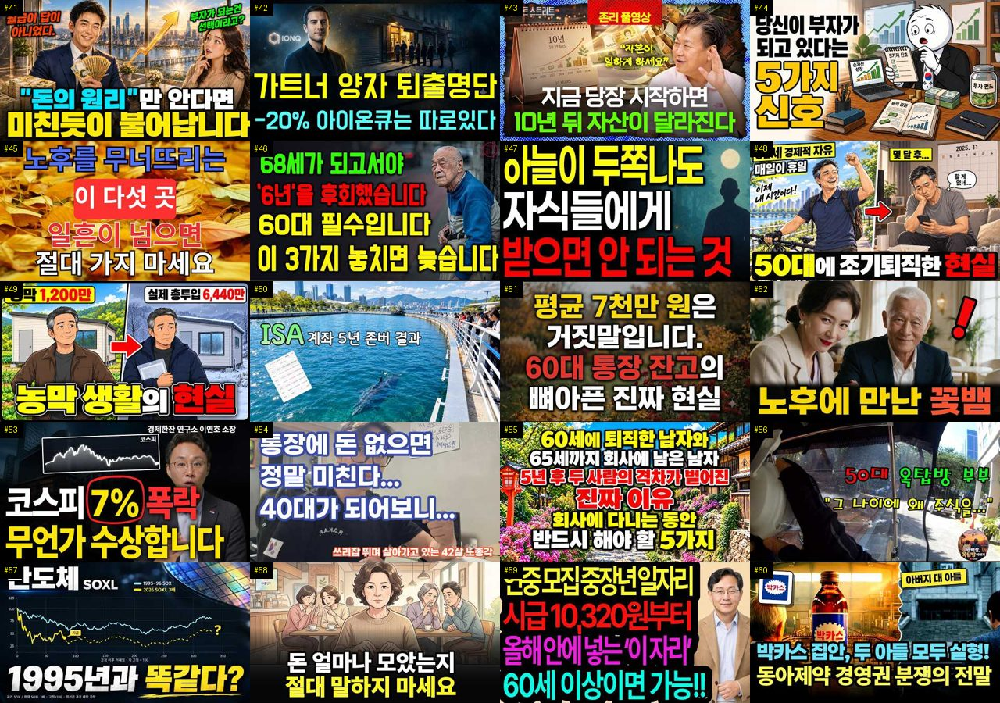
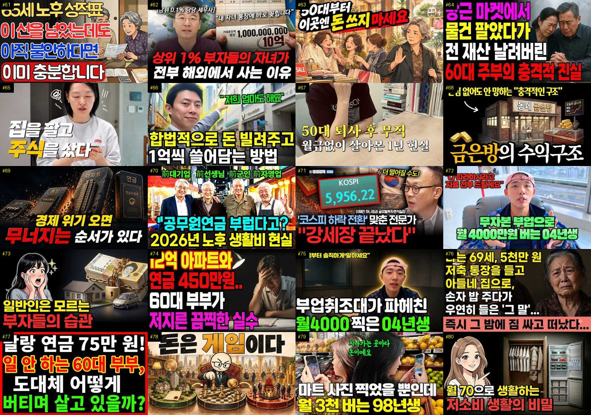
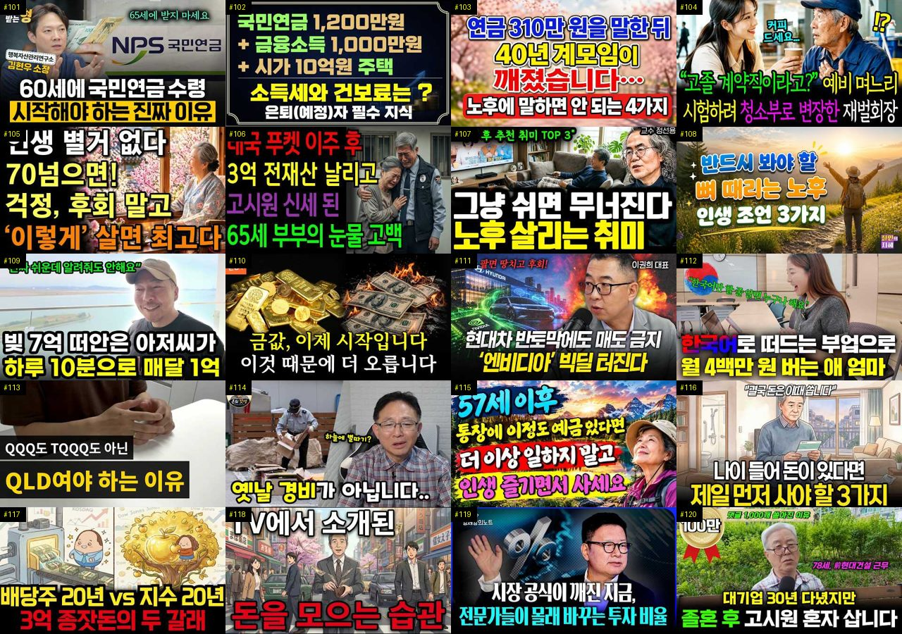
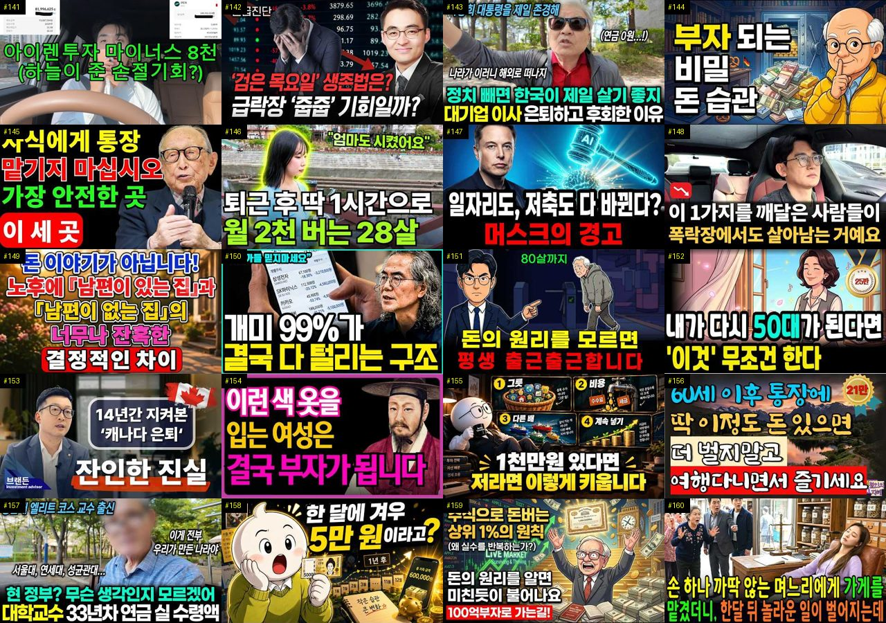
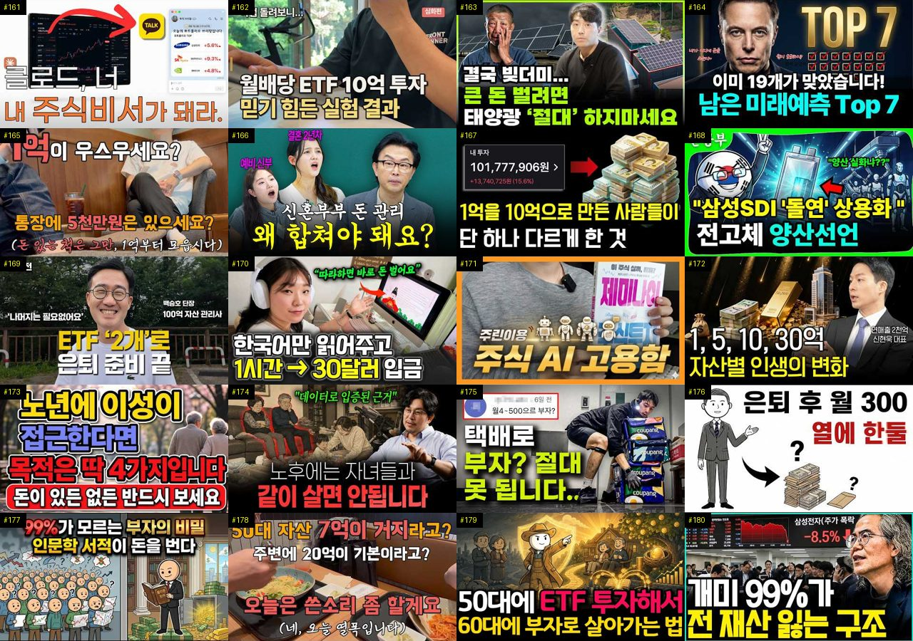
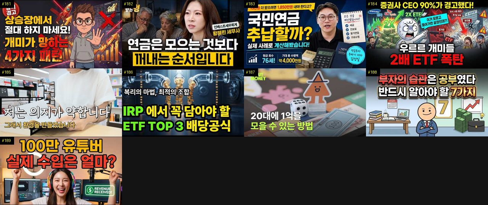
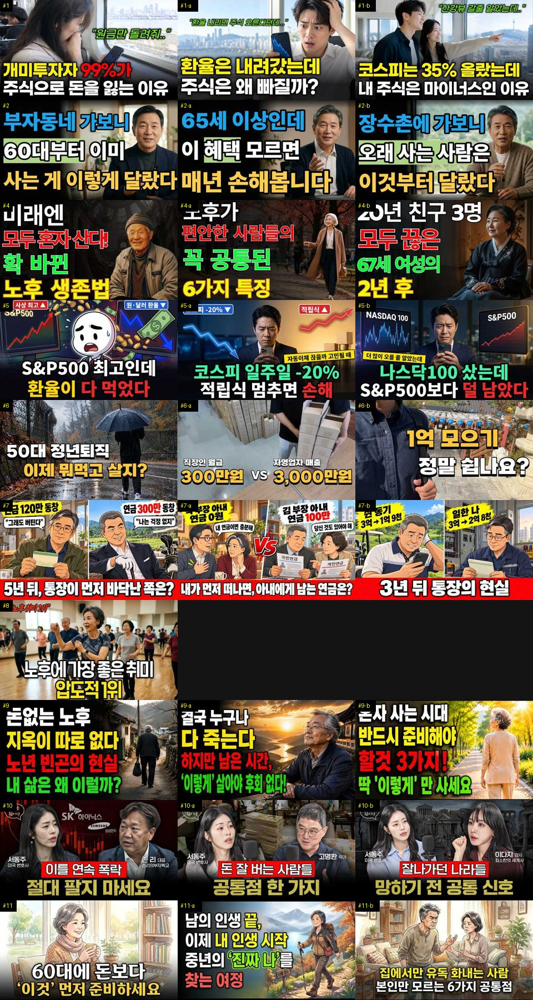

# 재테크 — 성공 사례 분석 (지시사항 재료)

자동 생성 — `tools/success_analysis.py` v1.6 (2026-11-02 08:09 UTC), 규칙 `economic/analysis_rules.toml` v1.8. **이 문서는 숫자와 원문만 담는다 — 해석·지시사항은 이것을 읽는 AI 가 만든다.** 주별 추세는 `weekly.md`, 승인한 영상 전부는 `approved.md`. ※ 연구·교육용 — 투자 권유가 아님.

## 0. 자료와 한계

| 자료 | 수 |
|---|---|
| 사례 폴더 (설명·자막·댓글·썸네일을 받은 영상) | 709 (웹 승인 709) |
| **성공 사례** — 7~180일·구독자 50,000 이하·**구독자당 하루 조회수 ≥ 0.1** (하루 조회수 ÷ 구독자)·10,000회 이상·4분 이상, 채널당 2개 | **189** (기준 통과 212 − 뺀 것 13 − 채널당 제한 10) |
| **하루 조회수 상위** (1-3번 — 성공 사례와 따로) — 검색에서 찾은 주제 관련 4분 이상 영상 2,851개 중 하루 조회수 상위 10% (하루 20,808회 이상), 구독자·올린 날짜 상관없이, 채널당 2개 | **70** (기준 통과 85 − 뺀 것 6 − 채널당 제한 9) · 자료를 받지 않은 후보 211 |
| **조회수 상위** (1-4번 — 올린 날짜·구독자 상관없이) — 검색(기간 없는 검색 포함)에서 찾은 주제 관련 4분 이상 영상 4,182개(가장 오래된 5620일) 중 조회수 상위 10% (881,502회 이상), 채널당 2개 | **158** (기준 통과 248 − 뺀 것 19 − 채널당 제한 71) · 자료를 받지 않은 후보 196 |
| 성공 사례의 글 출처 (자막·음성인식·설명·없음) | 설명 110 · 음성인식(앞 5분) 72 · 없음 4 · 음성인식 2 · 자막 1 |
| 성공 사례 대본 — 전체 · 앞부분만(음성인식 1차) · 없음 | 3 · 72 · 114 |
| 같은 채널 기준선 (채널 평소 영상) | 성공 사례 176/189 · 채널 242곳 (잘된 영상 822 · 평소 영상 956) |
| 성공 사례 댓글 (받은 / 달린) | 40,220 / 45,209 |
| 성공 사례 썸네일 | 189 |
| 비교 집단 — 탐색에서 본 영상 중 구독자 50,000 이하·4분 이상·365일 안·주제 관련, 채널당 최근 5개 | 1824 (성공 355 = 20%, 채널당 제한으로 뺀 5018) |
| 자료를 받지 않은 성공 후보 (웹 화면에서 승인하면 들어감 — 채널당 자리가 남은 것만) | 199 (자리가 찬 채널의 610개 뺌) |
| 수요·공급 시장 — 최근 90일 영상 (채널 크기 상관없음) | 1983 · 검색어 72 · 자동완성 말 280 (공급 확인 0) |
| 채널 성장 자료 (개설일이 있는 채널) | 1366 (빨리 크는 작은 채널 25) |

성공 기준은 넘었지만 뺀 영상: 금 투자 시작하는 방법, 금 투자방법 금테크 총정리 (광고 의심(좋아요·댓글 거의 없음)) · 에어컨이 필요 없는 문쌤의 폐건물 괴담 [문쌤 라디오] (뺀 주제(괴담)) · 요즘 대세 이선민, 강남 아파트는 77세에?! ∣ 돈… (뺀 주제(아파트)) · "서울요? 아닙니다" 노년에 가장 살기 좋은곳 압도적… (뺀 주제(5. 부동산)) · 여자배구 페퍼저축은행 결국 SOOP 인수 확정, 새 … (뺀 주제(배구)) · 1억 모으는 동안 제가 절대 안 쓴 것들 (외국 영상) · [스포츠 토토] 재테크 적중률 높이는 확률 계산법 대… (뺀 주제(토토)) · 【실화】65세, 내 집에 계속 산 부부와 집을 팔고 … (뺀 주제(월세)) · "잘 곳은 넘치는데 벌 곳이 없죠" 일산과 송도, 같… (뺀 주제(5. 부동산)) · 급락장에 버티는 비트코인... 돈나무 언니는 '20억… (뺀 주제(비트코인)) · 일본 다가구 주택 2동 사면 경제적 자유를 달성할 수… (뺀 주제(부동산)) · 연말정산 연금저축·IRP 무조건 가입하면 후회하는 3… (광고 의심(좋아요·댓글 거의 없음))

**한계**

- 대본(자막·음성인식)이 없는 성공 사례 114개 (#1, #2, #3, #4, #5, #6, #7, #8, #9, #10, #11, #12, #13, #14, #15, #17, #18, #19, #20, #23, #24, #25, #26, #27, #29, #30, #31, #34, #36, #37 …) — 설명란·챕터만 있음. 도입부·구성·말 속도는 대본이 있는 75개로만 셌다 (음성인식이 끝나면 다시 셈)
- 비교 집단 1824개 = 검색(조회수 순 — 잘된 영상 쪽으로 치우침)·추가한 채널·성공 사례 채널의 평소 영상 938개 (치우침 없음) 에서 올린 지 7~365일 영상, 성공 비율 20% — 실제 시장 비율이 아니다. 같은 집단 안의 '있음/없음' 차이로만 보고, '무엇이 먹혔나'는 1-2번(같은 채널 안)을 먼저 보라
- 하루 조회수 상위 묶음(1-3번) 70개는 구독자·올린 날짜 상관없이 골랐다 — 큰 채널(구독자 50,000 넘음) 59개라 채널 힘(구독자·추천)이 섞여 있다. 작은 채널이 따라 할 근거는 1번 성공 사례로 보라. 하루 조회수 = 조회수 ÷ 올린 지 날수라 갓 올린 영상(며칠)은 부풀고 오래된 영상은 낮아진다. 경계는 검색 결과(조회수 순 — 잘된 쪽으로 치우침) 2851개 안의 상위 10%. 자료를 받지 않은 후보 211개 (웹 화면에서 승인하면 들어감)
- 조회수 상위 묶음(1-4번) 158개는 올린 날짜·구독자 상관없이 조회수만으로 골랐다 — 오래 쌓인 조회수·큰 채널 힘이 섞여 있다 (큰 채널 138개 · 1년 넘은 영상 93개). 모집단 4,182개에서 가장 오래된 영상 5620일 — 기간 없는 검색은 할당량이 남을 때만 하므로 다 못 했으면 과거 영상이 적다. 자료를 받지 않은 후보 196개
- 성공 사례 몫(가중) = 성공 사례마다 무게 1 + log2(구독자당 하루 조회수 ÷ 기준)로 센 몫 (사용자 지시 2026-10-28 '최근에 조회수가 높을수록 더 많이 반영' — 점수가 기준의 2배면 무게 2, 4배면 3). 이번 무게 중앙값 3.889 · 가장 큰 10.0 — 사례 수가 적은 묶음은 가중 없는 몫·사례 수와 같이 본다
- 같은 채널 기준선이 있는 성공 사례 176/189개 (채널 영상이 5개 미만이거나 아직 못 받음)
- 수요·공급의 '시장'은 탐색·검색에서 본 최근 90일 영상 1983개 — 검색이 조회수 순이라 조회수 적은 영상이 덜 잡힌다. 주제 묶음 사이의 상대 비교(지수)로만 보라
- 자동완성 말의 '최근 영상 수'는 우리가 본 영상만 셌다 — 실제 공급은 웹 화면 [공급 확인](말 하나에 검색 1번 = 100단위)으로 확인
- 자동완성 말에는 책·방송·사람·채널 이름도 섞인다 (예: '…를 찾아서'·'…지침서') — 영상 주제가 아닌 말은 건너뛰고 읽어라
- 채널 1곳은 개설일이 아직 없음 (다음 탐색 때 채움)
- '구독자가 많이 모이는가'는 YouTube API 로 영상별 구독 증가를 볼 수 없다 — 대신 채널 성장(7번: 개설 뒤 월 구독자·받을 때마다 남긴 기록), '구독·다음 기대' 댓글, 배수(조회수÷구독자)로 본다
- 댓글 갈래·제목 특징은 낱말 규칙이라 거칠다 (물음표 반문도 '질문', 한 댓글이 여러 갈래). 원문 인용을 함께 보라
- '눈에 띔'은 차이가 크고 표본이 충분하다는 표시일 뿐 원인이 아니다

## 1. 성공 사례 (189개 — 구독자당 하루 조회수 큰 순)

**구독자당 하루 조회수** = 하루 조회수(받은 때 조회수 ÷ 올린 날부터 받은 때까지 날수) ÷ 구독자 — 성공 기준. 배수 = 조회수 ÷ 구독자. **채널 평소 대비** = 조회수 ÷ 그 채널 최근 롱폼 조회수 중앙값 (같은 채널 기준선 — 클수록 그 영상만의 힘). 썸네일은 5번(장마다 20개, 번호 = #), 사례별 자세히는 **`analysis_cases_01.md` …** (9번).

| # | 제목 | 채널 | 구독자 | 조회수 | 구독자당 하루 조회수 | 배수 | 채널 평소 대비 | 하루 조회수 | 길이 | 업로드 | 주제 묶음 | 형식 | 글 출처 | 댓글 받은/달린 |
|---|---|---|---|---|---|---|---|---|---|---|---|---|---|---|
| 1 | [왜 내가 사면 떨어지고 팔면 오를까? 개미가 주식으로 돈 못 버는 4가지 이유](https://www.youtube.com/watch?v=fdlfOCtDBqc) | 오피디의 머니노트 | 680 | 604,644 | 68.1304 | 889.2 | ×384.9 | 46,328.7 | 13.6분 | 2026-10-15 | 3. 주식·ETF | 오디오북·낭독 | 설명 | 203/285 |
| 2 | [60대부터 격차가 벌어진다｜부자동네 사람들의 남다른 생활습관 10가지 ∣ 명언/ 오디오북/ 라디오북/ 시니…](https://www.youtube.com/watch?v=6Hxcmse6F2c) | 오늘도청춘 | 194 | 121,760 | 51.8979 | 627.6 | ×207.4 | 10,068.2 | 21.8분 | 2026-10-16 | 1. 재테크 일반·마인드 | 오디오북·낭독 | 설명 | 16/30 |
| 3 | [【이어령 교수의 조언】 늙어서 절대로 친구로 지내면 안되는 사람 '1위' 차라리 개를 키우세요! ∣ 오디오…](https://www.youtube.com/watch?v=Ar5CYDBUGBk) | 노후의 원칙 | 757 | 422,627 | 50.5918 | 558.3 | – | 38,298.0 | 40.9분 | 2026-10-17 | 4. 노후·연금 | 오디오북·낭독 | 설명 | 133/205 |
| 4 | [앞으로는 모두 혼자 산다… 준비한 사람만 노후에 살아남는다｜새로운 은퇴 생존법 ｜ 노후지혜](https://www.youtube.com/watch?v=vash2ZD50Cs) | 백년건강 지혜 | 180 | 29,703 | 39.7144 | 165.0 | ×153.9 | 7,148.6 | 39.6분 | 2026-10-15 | 4. 노후·연금 | 오디오북·낭독 | 설명 | 10/10 |
| 5 | [S&P500은 최고인데 내 ETF는 마이너스… 지금 환헤지로 갈아타면 늦는 진짜 이유](https://www.youtube.com/watch?v=UcHK1WoTPtY) | 뒤집는경제 | 275 | 101,252 | 31.6345 | 368.2 | ×7.2 | 8,699.5 | 23.2분 | 2026-10-16 | 3. 주식·ETF | 정보·해설 | 설명 | 25/61 |
| 6 | [50대 정년퇴직 후 현실｜퇴직을 앞둔 선배가 가장 걱정했던 것](https://www.youtube.com/watch?v=0iduiNNIyRA) | 따세 | 532 | 164,700 | 30.7895 | 309.6 | ×27.1 | 16,380.0 | 10.2분 | 2026-10-18 | 4. 노후·연금 | 정보·해설 | 설명 | 30/98 |
| 7 | [연금 120만·200만·300만… 고교 동창 세 명, 5년 뒤 통장이 가장 먼저 바닥난 사람은? ∣ 노후준…](https://www.youtube.com/watch?v=gYfSp6GXKLY) | 은퇴 후 일자리 연구소 | 85 | 33,818 | 30.671 | 338.2 | ×7.7 | 3,067.1 | 23.6분 | 2026-10-17 | 4. 노후·연금 | 오디오북·낭독 | 설명 | 15/28 |
| 8 | [노후에 가장 좋은 취미, 압도적 1위는 바로 이것입니다ㅣ걷기보다 좋은 이유가 있습니다](https://www.youtube.com/watch?v=eUjV72DmU1g) | 노후산책 | 91 | 12,754 | 30.341 | 127.5 | ×25.5 | 3,034.1 | 14.8분 | 2026-10-15 | 4. 노후·연금 | 오디오북·낭독 | 설명 | 1/1 |
| 9 | [돈 없는 노후는 얼마나 비참할까… 평생 성실하게 살아도 노후가 캄캄해지는 진짜 이유 ｜ 노후자금 사연 ｜ …](https://www.youtube.com/watch?v=gJ4ogy8mpO8) | 노년의 미래 | 125 | 26,318 | 29.1488 | 210.5 | ×108.8 | 3,643.6 | 30.3분 | 2026-10-12 | 4. 노후·연금 | 사연·드라마 | 설명 | 5/5 |
| 10 | [사상 초유의 이틀 연속 서킷브레이커! 폭락장에서 투자자가 절대 해서는 안 될 행동 ∣ 존리 대표](https://www.youtube.com/watch?v=un5SAQlJFcY) | 증시직격 | 111 | 19,590 | 24.3523 | 176.5 | ×1,865.7 | 2,703.1 | 23분 | 2026-10-12 | 3. 주식·ETF | 인터뷰·강연·대담 | 설명 | 17/17 |
| 11 | [70대가 되기전 돈보다 먼저 준비해야 할 5가지ㅣ인생조언ㅣ노후준비ㅣ삶의지혜ㅣ시니어ㅣ오디오북ㅣ](https://www.youtube.com/watch?v=nVqsO9NQKH0) | 노년의 지혜 | 105 | 33,616 | 24.0371 | 320.1 | ×25.1 | 2,523.9 | 56분 | 2026-10-15 | 4. 노후·연금 | 사연·드라마 | 설명 | 5/6 |
| 12 | [내 노후 자금 지키는 법 [후회 없는 소비의 기준]](https://www.youtube.com/watch?v=fUyrCZT0W4E) | 지혜담은 | 309 | 102,485 | 20.2657 | 331.7 | ×732.0 | 6,262.1 | 16.6분 | 2026-10-12 | 2. 돈 모으기·저축 | 오디오북·낭독 | 설명 | 9/9 |
| 13 | [국민연금 63세에 바로 받은 김 부장 vs 5년 미뤄 36% 더 받은 박 부장… 10년 뒤 통장에 더 많이…](https://www.youtube.com/watch?v=VoVyS34lpec) | 은퇴 후 일자리 연구소 | 85 | 25,721 | 19.743 | 257.2 | ×5.8 | 1,974.3 | 22.8분 | 2026-10-15 | 4. 노후·연금 | 오디오북·낭독 | 설명 | 43/59 |
| 14 | [돈 생기면 제일 먼저 저금부터 하는 사람들, 사실 이런 사람들입니다 (인색함이 아닙니다)](https://www.youtube.com/watch?v=puDreXlIFGU) | 심리잔고 | 144 | 33,758 | 19.559 | 234.4 | ×47.6 | 2,816.5 | 15.7분 | 2026-10-16 | 1. 재테크 일반·마인드 | 정보·해설 | 설명 | 10/15 |
| 15 | [삼성전자·하이닉스, AI 투자 끝나면 끝? 반도체 '뉴노멀' 온다는 이유](https://www.youtube.com/watch?v=cPm1rukivao) | 경제야! 놀자~ | 4,280 | 161,528 | 18.7033 | 37.7 | ×7.7 | 80,050.3 | 11.5분 | 2026-10-17 | 3. 주식·ETF | 정보·해설 | 설명 | 113/113 |
| 16 | [안 팔릴수록 부자되는 '동네 금은방'의 소름돋는 수익구조](https://www.youtube.com/watch?v=eFsT1K_mPjc) | 새파란 경제 | 999 | 680,016 | 14.508 | 680.7 | ×715.4 | 14,493.5 | 17.6분 | 2026-09-16 | 1. 재테크 일반·마인드 | 정보·해설 | 음성인식(앞 5분) | 139/177 |
| 17 | [[노자] 이렇게 하면 바로 대접 받는다 ㅣ인생명언ㅣ행복한 노후ㅣ삶의지혜ㅣ인간관계](https://www.youtube.com/watch?v=-dxUrozfhRQ) | 고전명언 인생조언 | 3,020 | 678,092 | 13.8027 | 224.5 | ×123.3 | 41,684.3 | 46분 | 2026-10-12 | 4. 노후·연금 | 오디오북·낭독 | 설명 | 64/222 |
| 18 | [S&P 500에 투자하면 노후 걱정 전혀 없습니다! 주식으로 부자 되는 가장 빠른 방법](https://www.youtube.com/watch?v=_fnvM4hpX44) | 오피디의 머니노트 | 680 | 93,877 | 12.6978 | 138.1 | ×59.8 | 8,634.5 | 16.4분 | 2026-10-17 | 3. 주식·ETF | 정보·해설 | 설명 | 45/79 |
| 19 | [산소에도 만기가 있습니다, 제사를 접은 집에서 선산 다툼이 먼저 생기는 이유](https://www.youtube.com/watch?v=7rQLpg5TG-I) | 경제참견 | 1,000 | 669,425 | 11.5497 | 669.4 | ×773.9 | 11,549.7 | 9.6분 | 2026-09-05 | 4. 노후·연금 | 정보·해설 | 설명 | 489/489 |
| 20 | [70대가 되어 뒤늦게 깨달았습니다｜은퇴 후 가장 잘한 일은 일이 아니라 잘 노는 것이었습니다｜노년지혜｜오디…](https://www.youtube.com/watch?v=SJEMyQEhJ10) | 노후의 돈관리 | 159 | 12,221 | 11.0182 | 76.9 | ×17.5 | 1,751.9 | 34분 | 2026-10-12 | 4. 노후·연금 | 오디오북·낭독 | 설명 | 0/0 |
| 21 | [65세 이후 통장에 '이 금액' 있다면 돈 벌지 말고 그냥 인생을 즐겨라ㅣ명언ㅣ인생조언ㅣ오디오북](https://www.youtube.com/watch?v=MJE-dsUuqIM) | 인생의 고수 | 1,680 | 895,912 | 10.3989 | 533.3 | ×1,014.0 | 17,470.2 | 34.8분 | 2026-09-12 | 4. 노후·연금 | 오디오북·낭독 | 음성인식(앞 5분) | 196/198 |
| 22 | [조용한 부자들이 절대 입에 담지 않는 7가지 — 돈 있는 사람의 진짜 습관 ㅣ시니어ㅣ오디오북ㅣ노후준비ㅣ심리…](https://www.youtube.com/watch?v=TKBAsjZgVWU) | 가을빛 심리학 | 1,250 | 485,131 | 8.3014 | 388.1 | ×407.2 | 10,376.7 | 21.7분 | 2026-09-16 | 1. 재테크 일반·마인드 | 오디오북·낭독 | 음성인식(앞 5분) | 100/110 |
| 23 | [어쩌면 입시보다 더 중요한 투자 이야기](https://www.youtube.com/watch?v=-3nc7FXlcBE) | 김동욱 아카이브 | 1,870 | 152,171 | 7.8975 | 81.4 | – | 14,768.4 | 4.7분 | 2026-10-18 | 3. 주식·ETF | 정보·해설 | 없음 | 90/252 |
| 24 | [부자들의 집에는 없고 가난한 집에는 넘쳐나는 '3가지'? 중년 풍수의 핵심은 비움입니다 ∣ 도올 김용옥 법…](https://www.youtube.com/watch?v=h0M1n5EHJSQ) | 평온한마음 | 415 | 41,217 | 6.7973 | 99.3 | ×55.1 | 2,820.9 | 107.3분 | 2026-10-13 | 1. 재테크 일반·마인드 | 오디오북·낭독 | 설명 | 15/15 |
| 25 | ["둘이 연금 받으면 넉넉하겠지" 부부 연금 340만 원인데 노후 파산 직전까지 가는 진짜 이유](https://www.youtube.com/watch?v=rrt18r_uOPc) | 퀸즈리의 경제학 | 734 | 137,158 | 6.6956 | 186.9 | ×131.5 | 4,914.6 | 18.6분 | 2026-10-05 | 4. 노후·연금 | 브이로그·직접 해본 이야기 | 설명 | 24/43 |
| 26 | [53살·49살, 평생 필요한 돈 준비가 끝났습니다. 다 버리고 다시 시작합니다 ∣ 마지막 미국 일상](https://www.youtube.com/watch?v=9YTB1MfKGQ4) | 쭈쭈랑야옹이 | 1,810 | 115,255 | 6.5005 | 63.7 | ×4.4 | 11,765.9 | 10.7분 | 2026-10-18 | 3. 주식·ETF | 브이로그·직접 해본 이야기 | 설명 | 63/147 |
| 27 | [삼성·SK하이닉스 폭락의 진짜 범인을 추적한다](https://www.youtube.com/watch?v=mXFz6Exhrpo) | Fact and Truth | 1,250 | 22,989 | 6.3748 | 18.4 | ×7.3 | 7,968.5 | 13분 | 2026-10-16 | 3. 주식·ETF | 정보·해설 | 설명 | 40/40 |
| 28 | [ISA·연금저축·IRP에서 평생 모아갈 국내상장 월배당 ETF 총정리 ∣ 9월 분배금 이만큼 나왔습니다 (…](https://www.youtube.com/watch?v=kZJEE6mtay4) | 퇴근후ETF | 172 | 27,686 | 5.9657 | 161.0 | ×54.8 | 1,026.1 | 19.1분 | 2026-10-06 | 4. 노후·연금 | 인터뷰·강연·대담 | 음성인식(앞 5분) | 6/6 |
| 29 | [삼성전자 지금 팔아야 하나? 코스피 서킷브레이커 날, 버틸지 팔지 가를 기준 2가지](https://www.youtube.com/watch?v=ICByZXkRrLg) | 경제야! 놀자~ | 4,280 | 101,345 | 5.7888 | 23.7 | ×4.9 | 24,776.0 | 13.5분 | 2026-10-15 | 3. 주식·ETF | 정보·해설 | 설명 | 296/296 |
| 30 | [혼자서도 외롭지 않고 풍요롭게 사는 사람의 비밀ㅣ귀티나는 노후를 위한 행복특강ㅣ황창연신부님최근강의ㅣ황창연신…](https://www.youtube.com/watch?v=Bi-HGrGtQrA) | 수라이야 카라 | 205 | 16,211 | 5.7746 | 79.1 | ×22.6 | 1,183.8 | 69.3분 | 2026-10-14 | 4. 노후·연금 | 오디오북·낭독 | 설명 | 1/2 |
| 31 | [[문남중 출연] "코스피 바닥, 7월29일에 이미 확인 끝! 전고점 회복 근거? '이것' 보시면 됩니다" …](https://www.youtube.com/watch?v=btSUFhvYPwk) | 경제통마늘 | 14,100 | 321,609 | 5.4575 | 22.8 | – | 76,950.8 | 10.2분 | 2026-10-19 | 3. 주식·ETF | 오디오북·낭독 | 설명 | 145/228 |
| 32 | [은퇴 후 연금만으로 살기 좋은 한국 최고의 섬마을](https://www.youtube.com/watch?v=nksAlCVCgLo) | 살이픽 | 913 | 157,696 | 5.3658 | 172.7 | ×17.6 | 4,899.0 | 18.3분 | 2026-10-01 | 4. 노후·연금 | 정보·해설 | 음성인식(앞 5분) | 47/47 |
| 33 | [기초연금 개편 진짜였네? 결국 내가 받을 돈 '이렇게' 받는다 [대통령 긴급 발표] 61년생부터 주목](https://www.youtube.com/watch?v=42N9nj2wWko) | 연금노하우 | 1,280 | 412,598 | 4.9663 | 322.3 | – | 6,356.9 | 9.4분 | 2026-08-29 | 4. 노후·연금 | 정보·해설 | 음성인식(앞 5분) | 349/349 |
| 34 | [노래방에서 거래처 여직원을 만났습니다ㅣ황혼사연ㅣ노후사연ㅣ오디오북](https://www.youtube.com/watch?v=aJlrkBnvc9o) | 지혜의온실 | 1,080 | 17,004 | 4.8362 | 15.7 | ×3.8 | 5,223.1 | 68분 | 2026-10-16 | 4. 노후·연금 | 사연·드라마 | 설명 | 1/1 |
| 35 | [생생한 택배기사 최근 6개월치 월급 공개... 이게 '진짜 현실'입니다.](https://www.youtube.com/watch?v=6QkzqMZYrVQ) | 택부 - 택배기사 부자들 | 6,860 | 2,252,197 | 4.6928 | 328.3 | ×50.2 | 32,192.4 | 8.6분 | 2026-08-24 | 2. 돈 모으기·저축 | 브이로그·직접 해본 이야기 | 음성인식(앞 5분) | 1,547/1,645 |
| 36 | [50대 부부 현실 밥상,현실 토크∣택배 일∣장사 접고 알게 된 자영업 진짜 현실](https://www.youtube.com/watch?v=PWYj6zg7clU) | 볕든내일 | 2,420 | 138,923 | 4.4064 | 57.4 | ×7.6 | 10,663.5 | 14.7분 | 2026-10-15 | 4. 노후·연금 | 브이로그·직접 해본 이야기 | 설명 | 79/138 |
| 37 | [저축만으로 3억! 이렇게 아꼈습니다.](https://www.youtube.com/watch?v=9R7zyJcCrig) | 베스타 vesta | 823 | 107,896 | 4.1447 | 131.1 | ×16.5 | 3,411.1 | 10.9분 | 2026-10-01 | 2. 돈 모으기·저축 | 브이로그·직접 해본 이야기 | 설명 | 60/69 |
| 38 | [돈이 더 적은 사람들이 항상 당신보다 더 많은 것을 가지고 있는 이유](https://www.youtube.com/watch?v=FJq7Cz3CSz8) | 투자 가이드 | 1,020 | 201,612 | 4.0382 | 197.7 | ×227.7 | 4,119.0 | 31.1분 | 2026-09-09 | 2. 돈 모으기·저축 | 오디오북·낭독 | 음성인식(앞 5분) | 15/16 |
| 39 | ["한 그루만 심어도 노후 대비 끝난다더니.." 남도 산비탈마다 황칠나무 꽂았다가 판로 막혀 숲째 방치된 황…](https://www.youtube.com/watch?v=oxMq0Cg7-6k) | 일파만파tv | 1,530 | 72,562 | 3.9431 | 47.4 | ×31.4 | 6,032.9 | 21분 | 2026-10-16 | 4. 노후·연금 | 정보·해설 | 설명 | 43/55 |
| 40 | [카드배송 알바, 차 없이 절대 하면 안된다 ∣ 노후이야기, 노후생활, 노인일자리](https://www.youtube.com/watch?v=tEmSSBF3dmI) | 세월금방가 | 6,180 | 370,499 | 3.936 | 60.0 | ×933.2 | 24,324.4 | 14분 | 2026-10-13 | 4. 노후·연금 | 정보·해설 | 설명 | 192/298 |
| 41 | [부자들이 먼저 배운 돈의 원리, "열심히 벌어도 왜 안 모일까" 자본주의에 대해 알게되면 부자는 불가능한 …](https://www.youtube.com/watch?v=RGKX32DwzMI) | 경제집현전 | 700 | 171,571 | 3.8597 | 245.1 | ×157.3 | 2,701.8 | 24.2분 | 2026-08-30 | 1. 재테크 일반·마인드 | 정보·해설 | 음성인식(앞 5분) | 10/10 |
| 42 | [나스닥은 버티는데 아이온큐가 일주일 새 20% 빠진 건 망해서가 아닙니다 — 가트너가 말한 퇴출 명단은 따…](https://www.youtube.com/watch?v=IbkLrISwBiU) | 경제전략노트 | 725 | 37,794 | 3.7836 | 52.1 | ×33.2 | 2,743.1 | 14.4분 | 2026-10-14 | 3. 주식·ETF | 정보·해설 | 설명 | 10/11 |
| 43 | [[풀영상] 월급 10%로 당장 시작하는 존리의 자산 증식 치트키](https://www.youtube.com/watch?v=q1fYjAwma3s) | 여의돈스트리트 | 1,380 | 228,382 | 3.6471 | 165.5 | ×203.0 | 5,033.0 | 36분 | 2026-09-17 | 2. 돈 모으기·저축 | 인터뷰·강연·대담 | 음성인식(앞 5분) | 112/120 |
| 44 | [본인도 모르는 사이에 남몰래 부자가 되고 있다는 5가지 신호](https://www.youtube.com/watch?v=5kBEU3V3ZXY) | 투자 가이드 | 1,020 | 155,693 | 3.3272 | 152.6 | ×175.8 | 3,393.7 | 20분 | 2026-09-17 | 1. 재테크 일반·마인드 | 정보·해설 | 음성인식 | 12/14 |
| 45 | [일흔이 넘으면 ‘이 다섯 곳’에는 절대 가지 마세요｜노후 자금을 지키는 지혜｜노년의 마음소리](https://www.youtube.com/watch?v=oyiEl0p35BY) | 은퇴후인생수업 | 408 | 90,572 | 3.3194 | 222.0 | ×640.1 | 1,354.3 | 32분 | 2026-08-27 | 4. 노후·연금 | 오디오북·낭독 | 음성인식(앞 5분) | 17/18 |
| 46 | [올해 68세입니다. 62살에 이 3가지를 시작할걸, 지금은 매일 밤 후회하고 있습니다](https://www.youtube.com/watch?v=nOMrypGAQP8) | 돈과 사람 | 1,410 | 368,706 | 3.1949 | 261.5 | ×1,431.9 | 4,504.8 | 22.1분 | 2026-08-12 | 4. 노후·연금 | 오디오북·낭독 | 설명 | 170/178 |
| 47 | [자식에게서 이 3가지는 절대 받지 마세요! 노후가 불행해질 수 있습니다 ㅣ노후지혜ㅣ인생명언ㅣ오디오북](https://www.youtube.com/watch?v=3aVf1x2D1Z8) | 가족온기 | 392 | 17,743 | 2.8337 | 45.3 | ×35.4 | 1,110.8 | 54.5분 | 2026-10-12 | 4. 노후·연금 | 오디오북·낭독 | 설명 | 4/5 |
| 48 | [50대에 조기퇴직하면 어떤 삶을 살게 될까? 51세에 경제적 자유와 조기은퇴(FIRE)를 이룬 사람의 실제…](https://www.youtube.com/watch?v=6LShuUa4Zt0) | 누군가의 인생 | 3,110 | 301,382 | 2.6159 | 96.9 | ×9.0 | 8,135.5 | 18.8분 | 2026-09-21 | 4. 노후·연금 | 정보·해설 | 음성인식(앞 5분) | 177/195 |
| 49 | [1,200만 원 농막을 노후의 집으로 생각한 61세 남자… 첫겨울 뒤 계산한 실제 총투입액](https://www.youtube.com/watch?v=xPFp2hZ6TDw) | 타인의 삶 | 1,280 | 42,507 | 2.5491 | 33.2 | ×3.0 | 3,262.8 | 17분 | 2026-10-15 | 4. 노후·연금 | 정보·해설 | 설명 | 6/9 |
| 50 | [5년간 유지해온 ISA계좌 수익률 공개 (feat.부캉이)](https://www.youtube.com/watch?v=RBhIQUhBnOY) | 철이형님 | 303 | 11,117 | 2.4779 | 36.7 | – | 750.8 | 5.7분 | 2026-10-13 | 6. 절세·제도 | 인터뷰·강연·대담 | 설명 | 14/16 |
| 51 | [평균 7천만 원은 거짓말입니다. 60대 통장 잔고의 뼈아픈 진짜 현실](https://www.youtube.com/watch?v=UiSDpyl-fxU) | 인생 2막 | 780 | 98,340 | 2.3696 | 126.1 | ×371.1 | 1,848.3 | 24분 | 2026-09-05 | 1. 재테크 일반·마인드 | 오디오북·낭독 | 설명 | 68/69 |
| 52 | [노후에 등산가면 접근하는 꽃뱀의 수법, 하필 32년 강력계 형사한테 걸렸다 ∣ 사이다 복수극 ∣ 노후사연 …](https://www.youtube.com/watch?v=ksCSvgpQvg8) | 수채화 인생 이야기 | 4,180 | 537,012 | 2.2535 | 128.5 | ×1,642.2 | 9,419.5 | 8.6분 | 2026-09-06 | 4. 노후·연금 | 사연·드라마 | 음성인식(앞 5분) | 158/169 |
| 53 | [코스피 7% 폭락, 외인 30분만에 1조 순매도, 무언가 수상합니다](https://www.youtube.com/watch?v=hjIgX9ppDe4) | 경제한잔 | 6,910 | 179,802 | 2.1785 | 26.0 | ×129.4 | 15,053.4 | 14분 | 2026-10-16 | 3. 주식·ETF | 정보·해설 | 설명 | 50/71 |
| 54 | [통장에 돈이 없으면 정말 미친다... 비참 그 자체... 40이 되어보니 극 공감...](https://www.youtube.com/watch?v=G-W92zK_kXk) | 하루 | 1,540 | 32,828 | 2.165 | 21.3 | ×9.2 | 3,334.1 | 10.4분 | 2026-10-18 | 2. 돈 모으기·저축 | 정보·해설 | 설명 | 22/44 |
| 55 | [60세에 퇴직한 남자와 65세까지 회사에 남은 남자. 5년 후 두 사람의 격차가 벌어진 진짜 이유와 ‘회사…](https://www.youtube.com/watch?v=l8ZRtzLLMfE) | 노년 인사이트 | 588 | 18,813 | 2.134 | 32.0 | ×59.2 | 1,254.8 | 33.8분 | 2026-10-13 | 4. 노후·연금 | 정보·해설 | 설명 | 2/2 |
| 56 | [50대 옥탑방 부부, "그 나이에 왜 주식을..."](https://www.youtube.com/watch?v=FRzyTNO9mNI) | 반백살, 옥탑방 이야기 | 688 | 43,520 | 2.1202 | 63.3 | ×12.2 | 1,458.7 | 6.3분 | 2026-10-03 | 3. 주식·ETF | 정보·해설 | 음성인식(앞 5분) | 187/187 |
| 57 | [나스닥은 최고가, 반도체만 반 토막. 지금과 똑같았던 1995년으로 앞으로의 흐름을 찾아봤습니다.](https://www.youtube.com/watch?v=7hjl_w2aWtA) | 테스프레소 | 2,030 | 60,801 | 2.1068 | 29.9 | ×13.9 | 4,276.9 | 9.9분 | 2026-10-14 | 3. 주식·ETF | 정보·해설 | 설명 | 25/31 |
| 58 | [60대 이후 내 형편을 자세히 말하면 안 되는 6가지 이유ㅣ인생조언ㅣ노후준비ㅣ처세술ㅣ인간관계ㅣ삶의지혜ㅣ시니…](https://www.youtube.com/watch?v=RsreeiZhYw0) | 마음 안부 | 3,880 | 120,683 | 2.0612 | 31.1 | ×5.6 | 7,997.3 | 28.2분 | 2026-10-13 | 4. 노후·연금 | 오디오북·낭독 | 설명 | 24/29 |
| 59 | [지금 바로 지원 가능한 노인일자리 24만 개 TOP5, 연말 모집 안 기다려도 됩니다! ∣ #노인일자리 #…](https://www.youtube.com/watch?v=ZcDVI5t76xc) | 육공청춘 | 2,430 | 50,498 | 2.0468 | 20.8 | ×7.1 | 4,973.7 | 9.7분 | 2026-10-18 | 4. 노후·연금 | 정보·해설 | 설명 | 5/12 |
| 60 | [박카스 집안 부자 갈등, 그 뒤 두 아들 모두 실형… 동아제약 경영권 분쟁의 전말](https://www.youtube.com/watch?v=PC10zRnT7E4) | 경제꽈배기 | 5,170 | 100,838 | 1.945 | 19.5 | ×5.3 | 10,055.6 | 15분 | 2026-10-18 | 1. 재테크 일반·마인드 | 정보·해설 | 설명 | 19/40 |
| 61 | [65세 노후 성적표… 통장과 연금을 합쳐 이 선을 넘었는데도 아직 불안하다면, 당신은 이미 충분합니다. 같…](https://www.youtube.com/watch?v=AMzRvtaPZbE) | 지혜로운 노후 | 494 | 11,676 | 1.9255 | 23.6 | ×13.7 | 951.2 | 29.2분 | 2026-10-16 | 4. 노후·연금 | 오디오북·낭독 | 설명 | 2/2 |
| 62 | [10억 원이 자녀 통장에 그대로? 강남 부자들의 해외 자녀 증여법](https://www.youtube.com/watch?v=csLaVJ0tuTg) | 스마트세무사 | 4,960 | 142,316 | 1.9093 | 28.7 | ×19.6 | 9,470.3 | 10.7분 | 2026-10-13 | 1. 재테크 일반·마인드 | 정보·해설 | 설명 | 61/81 |
| 63 | [나이 들수록 현명한 여자는 절대 돈 쓰지 않는 5가지｜노후자금을 지키는 소비 습관](https://www.youtube.com/watch?v=i8xF9SYztIY) | 하나둘 심리학 | 367 | 11,274 | 1.9076 | 30.7 | ×7.6 | 700.1 | 12.9분 | 2026-10-12 | 2. 돈 모으기·저축 | 오디오북·낭독 | 설명 | 2/2 |
| 64 | [“은퇴자금 아끼려고 당근에 물건 하나 올렸다가…60대 노후가 무너졌습니다”ㅣ 은퇴자금 ㅣ노후사연 ㅣ오디오](https://www.youtube.com/watch?v=YydZ774lKfI) | 노을서사 | 1,820 | 83,193 | 1.8426 | 45.7 | ×956.2 | 3,353.5 | 73.1분 | 2026-09-27 | 4. 노후·연금 | 사연·드라마 | 음성인식(앞 5분) | 94/94 |
| 65 | [집은 팔았고, 주식은 물렸고](https://www.youtube.com/watch?v=SbEfHnF8DdY) | 로텐션 LOWTENSIO… | 6,640 | 128,683 | 1.7906 | 19.4 | ×16.0 | 11,889.8 | 16.3분 | 2026-10-17 | 3. 주식·ETF | 브이로그·직접 해본 이야기 | 설명 | 126/185 |
| 66 | ["100억 부자들은 이렇게 사요" 상위 1% 부업으로 1억씩 쓸어담는 돈버는법](https://www.youtube.com/watch?v=4IDGOKXL6h4) | 돈버는시간 | 1,480 | 37,586 | 1.6899 | 25.4 | ×16.5 | 2,501.1 | 15.4분 | 2026-10-13 | 8. 부업·소득 | 인터뷰·강연·대담 | 설명 | 211/526 |
| 67 | [50대 억대연봉 임원이 퇴사 1년 후 깨달은 현실](https://www.youtube.com/watch?v=mLyNB42Hhgg) | 50대 새로운 인생 준비… | 2,900 | 341,178 | 1.6194 | 117.7 | ×151.5 | 4,696.2 | 8.9분 | 2026-08-21 | 기타 | 정보·해설 | 음성인식(앞 5분) | 219/226 |
| 68 | [재고가 쌓일수록 부자가 되는 유일한 장사, 금은방의 기막힌 구조](https://www.youtube.com/watch?v=DeXKTULwhEI) | 수익구조 연구소 | 6,540 | 551,704 | 1.5233 | 84.4 | ×40.1 | 9,962.6 | 15.4분 | 2026-09-07 | 1. 재테크 일반·마인드 | 정보·해설 | 음성인식(앞 5분) | 115/119 |
| 69 | ["순서대로 무너집니다" 금리 7% 시대, 한국 중산층 자산이 흔들리는 진짜 순서 4단계](https://www.youtube.com/watch?v=5wYVYUrG4Ds) | 월급쟁이경제학 | 3,030 | 331,503 | 1.5172 | 109.4 | ×32.8 | 4,597.0 | 27.8분 | 2026-08-22 | 1. 재테크 일반·마인드 | 브이로그·직접 해본 이야기 | 음성인식(앞 5분) | 388/405 |
| 70 | ["공무원 연금 받아도 빠듯해" 대기업·선생님·군인·자영업자, 70대 노후가 가장 든든한 친구는 누구일까?](https://www.youtube.com/watch?v=HT1qghQXwiI) | 실전머니토크 | 1,790 | 30,694 | 1.4517 | 17.1 | ×13.0 | 2,598.6 | 34분 | 2026-10-16 | 4. 노후·연금 | 정보·해설 | 설명 | 18/43 |
| 71 | ['코스피 하락 전환' 맞춘 전문가 "강세장 종료"…'5천'도 깨지나 #이재만 _261013](https://www.youtube.com/watch?v=v3lby9QzpS0) | 경제통마늘 | 14,100 | 125,130 | 1.4226 | 8.9 | – | 20,059.1 | 16.3분 | 2026-10-13 | 3. 주식·ETF | 오디오북·낭독 | 설명 | 104/104 |
| 72 | ["혼자 다 벌면 되잖아요?" 무자본으로 월 4,000만원 버는 04년생이 돈 버는 법을 공개한 이유](https://www.youtube.com/watch?v=1JXdyc7_WrE) | 돈많쥐 | 854 | 17,904 | 1.3989 | 21.0 | – | 1,194.7 | 15.1분 | 2026-10-13 | 1. 재테크 일반·마인드 | 인터뷰·강연·대담 | 설명 | 80/89 |
| 73 | [상위 1 부자들만 남몰래 실천하고 있는 4가지 소름 돋는 습관](https://www.youtube.com/watch?v=xmL_DjpA5hY) | 부자의습관 | 3,890 | 37,030 | 1.3288 | 9.5 | ×13.6 | 5,169.0 | 39.5분 | 2026-10-12 | 1. 재테크 일반·마인드 | 오디오북·낭독 | 설명 | 9/9 |
| 74 | [노후자금사연 월 450만원 연금 받는 전직 은행원 60대 부부도 무너지는 충격적인 현상황!](https://www.youtube.com/watch?v=pMZmS_k_s0U) | 삶의시나리오 | 2,940 | 117,250 | 1.3201 | 39.9 | ×761.4 | 3,881.0 | 110.8분 | 2026-09-17 | 4. 노후·연금 | 사연·드라마 | 음성인식(앞 5분) | 104/104 |
| 75 | ["70대도 월 500버는 국내 1등 부업" 그냥 연결만 해주면 끝이에요. 개꿀 구조를 만든게 제 노하우에요.](https://www.youtube.com/watch?v=9cCthhPwpaI) | 부업취조대 | 957 | 14,633 | 1.1666 | 15.3 | – | 1,116.4 | 13.3분 | 2026-10-15 | 8. 부업·소득 | 인터뷰·강연·대담 | 설명 | 232/280 |
| 76 | [69세인 저는 5,500만 원의 예금을 들고 아들 집에 노후를 보내러 갔습니다. 손주에게 밥을 먹여주던 순…](https://www.youtube.com/watch?v=O-IYU1H6J4I) | 시어머니와 며느리 | 18,900 | 1,486,808 | 1.1563 | 78.7 | ×8,124.6 | 21,854.6 | 119.3분 | 2026-08-21 | 2. 돈 모으기·저축 | 사연·드라마 | 설명 | 1,369/1,383 |
| 77 | [노령연금만 75만원, 60대 부부 일 안하고 어떻게 '기적처럼' 버틸 수 있을까?](https://www.youtube.com/watch?v=aeGZ8be-ASU) | 겨울 사랑 | 1,150 | 18,055 | 1.1259 | 15.7 | ×2.6 | 1,294.8 | 77.1분 | 2026-10-14 | 4. 노후·연금 | 사연·드라마 | 설명 | 24/30 |
| 78 | [부자가 되기 위해 꼭 해봐야 할 단 3가지 게임 — 마키아벨리의 잔혹한 전략](https://www.youtube.com/watch?v=JRZMlFWy3vc) | 부의 파워 코드 | 1,630 | 26,618 | 1.0927 | 16.3 | ×1.6 | 1,781.1 | 29.3분 | 2026-10-13 | 1. 재테크 일반·마인드 | 오디오북·낭독 | 설명 | 7/7 |
| 79 | ["와, 이렇게 돈 버는 여자 처음 봤습니다" 마트 사진 찍어 올려 월 3천만원 버는 98년생의 비밀부업추천](https://www.youtube.com/watch?v=N0gXuYAjgwk) | 머니종결자 | 8,450 | 459,309 | 1.0866 | 54.4 | ×36.0 | 9,182.0 | 17.4분 | 2026-09-13 | 8. 부업·소득 | 인터뷰·강연·대담 | 음성인식(앞 5분) | 3,562/3,589 |
| 80 | [월 70만 원으로 자산을 쌓은 사람의 3가지 원칙](https://www.youtube.com/watch?v=axzUYMuirTs) | 부자의습관 | 3,890 | 13,005 | 1.0545 | 3.3 | ×4.8 | 4,102.0 | 43.7분 | 2026-10-16 | 1. 재테크 일반·마인드 | 오디오북·낭독 | 설명 | 2/2 |
| 81 | [섬인데 배를 안 탑니다｜연금으로 살아볼 만한 섬마을 5곳](https://www.youtube.com/watch?v=3H1zw3f8zAQ) | 살이픽 | 913 | 18,369 | 1.045 | 20.1 | ×2.1 | 954.1 | 19.2분 | 2026-10-14 | 4. 노후·연금 | 정보·해설 | 설명 | 3/3 |
| 82 | ['단타'로 돈 버는 '볼린저밴드 세팅법' 완벽정리](https://www.youtube.com/watch?v=wfcP-pTUItY) | 코선사 - 코인선물사관학교 | 1,530 | 20,725 | 1.0437 | 13.6 | ×4.2 | 1,596.8 | 25.9분 | 2026-10-15 | 기타 | 정보·해설 | 설명 | 59/75 |
| 83 | ["꼬부랑 할머니 될 때까지 할거예요" 시니어 왕초보도 집에서 폰 하나로 돈 버는 법](https://www.youtube.com/watch?v=eTrwhY7RcdU) | 돈잘버는법 | 891 | 12,783 | 1.0212 | 14.3 | ×3.7 | 909.9 | 18.9분 | 2026-10-14 | 8. 부업·소득 | 인터뷰·강연·대담 | 설명 | 4/4 |
| 84 | [매달 빚이 750만원씩 불어나요… 12억 모텔이 6억으로 반토막ㅣ60대 은퇴부부의 눈물 노후건강 노후자금 …](https://www.youtube.com/watch?v=PmhYy3u9jxk) | 인생바라봄 | 892 | 13,370 | 0.9891 | 15.0 | ×41.7 | 882.3 | 43.9분 | 2026-10-13 | 1. 재테크 일반·마인드 | 사연·드라마 | 설명 | 2/2 |
| 85 | [아무리 돈이 많아도 없는 척하세요, 재산이 알려지면 생기는 일](https://www.youtube.com/watch?v=FrSslE4xeBA) | 인생다시쓰기 | 8,400 | 526,153 | 0.9863 | 62.6 | ×39.8 | 8,284.6 | 17.3분 | 2026-08-25 | 1. 재테크 일반·마인드 | 오디오북·낭독 | 음성인식(앞 5분) | 250/259 |
| 86 | [45살에 시작한 사이드잡 부업으로 월 순수익 1억 벌고 인생역전한 48살 아저씨](https://www.youtube.com/watch?v=XX8QV3-5rAM) | 실전부업클럽 | 26,100 | 511,837 | 0.9835 | 19.6 | ×19.0 | 25,669.4 | 29.6분 | 2026-10-13 | 2. 돈 모으기·저축 | 정보·해설 | 설명 | 230/1,884 |
| 87 | [객실 팔아서 돈 버는 게 아니라고? 우리가 몰랐던 호텔이 진짜 돈을 버는 방법](https://www.youtube.com/watch?v=RuWOYsSZl_E) | 머니파이 | 9,260 | 968,969 | 0.97 | 104.6 | ×207.5 | 8,982.4 | 17.6분 | 2026-07-12 | 기타 | 정보·해설 | 음성인식(앞 5분) | 280/291 |
| 88 | [우리 돈 이렇게 쓰고 있어요 💦 ∣ 30대에 돈 공부 시작한 사람들의 소비·투자 고백💸🫶🏻](https://www.youtube.com/watch?v=34hswtlGpU4) | 조.진 토크 | 1,440 | 17,407 | 0.9219 | 12.1 | – | 1,327.6 | 20.8분 | 2026-10-15 | 2. 돈 모으기·저축 | 정보·해설 | 설명 | 18/26 |
| 89 | [하이닉스 주주들만 호구인가?… 결국 6천피 찍은 코스피 폭락장](https://www.youtube.com/watch?v=O8ZlEWiJ0yI) | 잘되라대한민국 | 6,010 | 82,620 | 0.915 | 13.8 | ×2.6 | 5,499.3 | 15.2분 | 2026-10-13 | 3. 주식·ETF | 정보·해설 | 설명 | 123/123 |
| 90 | [평범한 내가 부자들 사이에서 느낀 것들](https://www.youtube.com/watch?v=SF1SLHOlcC0) | 30대 우영이의 일기 | 4,930 | 43,652 | 0.8659 | 8.8 | ×10.2 | 4,268.8 | 12.3분 | 2026-10-18 | 1. 재테크 일반·마인드 | 정보·해설 | 없음 | 52/59 |
| 91 | [수녀님과 신부님의 노후 생활 생각보다 쉽지 않을 수 있다고? ∣ 천주교상시 ∣ 성직자노후 ∣ 가톨릭이야기](https://www.youtube.com/watch?v=GCbd8J_BDYc) | 신앙의 쉼터 | 12,500 | 436,833 | 0.8064 | 35.0 | ×10.6 | 10,080.2 | 20분 | 2026-09-20 | 4. 노후·연금 | 정보·해설 | 자막 | 316/381 |
| 92 | [【성철스님】 부자가 되려면 절대 이 색깔 옷은 입지 마세요! 재물운이 달아납니다 ㅣ돈복 부르는 옷 색깔 ㅣ…](https://www.youtube.com/watch?v=Ld78QoSYFrk) | 행복한 노후연구소 | 11,200 | 140,184 | 0.7689 | 12.5 | ×7.9 | 8,611.8 | 56.1분 | 2026-10-12 | 1. 재테크 일반·마인드 | 정보·해설 | 설명 | 366/453 |
| 93 | ["5천까지는 나라가 지켜 준다길래" 저축은행에 노후자금 넣은 사람들이 아직 돈을 못 찾는 이유](https://www.youtube.com/watch?v=NkJAvLHzj3Q) | 경제콜라주 | 1,730 | 16,072 | 0.7516 | 9.3 | ×3.4 | 1,300.2 | 16.2분 | 2026-10-16 | 2. 돈 모으기·저축 | 정보·해설 | 설명 | 6/6 |
| 94 | [부자가 되기 위해 반드시 거쳐야 할 3단계 – 마키아벨리의 부의 청사진](https://www.youtube.com/watch?v=VDrLyc9skjk) | 부의 파워 코드 | 1,630 | 15,654 | 0.7419 | 9.6 | ×0.8 | 1,209.3 | 45.1분 | 2026-10-15 | 1. 재테크 일반·마인드 | 오디오북·낭독 | 설명 | 7/9 |
| 95 | [금융자산 10억 부자도 아직 공부합니다… 평생 돈이 안 모이는 사람은 ‘이 6가지’를 놓칩니다](https://www.youtube.com/watch?v=i9Mj9VvL20o) | 오십의 경제지도 | 719 | 18,377 | 0.7409 | 25.6 | ×1.5 | 532.7 | 16.5분 | 2026-09-23 | 1. 재테크 일반·마인드 | 정보·해설 | 음성인식(앞 5분) | 1/1 |
| 96 | ["돈 버는 규칙은 따로 있어요." 1300억 부자가 추천하는 단 한권의 책/인생책/레버리지 몰아보기](https://www.youtube.com/watch?v=vD6oAnU4ZPo) | 달콤하게성장 | 8,380 | 182,768 | 0.7179 | 21.8 | ×2.8 | 6,016.2 | 34.7분 | 2026-09-22 | 1. 재테크 일반·마인드 | 정보·해설 | 음성인식(앞 5분) | 95/95 |
| 97 | [AI 투자 "매년 5000조 못 벌면 본전도 못 찾는다" 한국에선 아무도 모르는 진짜 계산서](https://www.youtube.com/watch?v=xe6nMxngK7A) | 김열매TV | 12,200 | 121,262 | 0.7075 | 9.9 | ×5.4 | 8,631.5 | 41.7분 | 2026-10-14 | 3. 주식·ETF | 정보·해설 | 설명 | 406/420 |
| 98 | [나이들수록 '이것' 챙기면 노후가 바뀌고 행복해집니다ㅣ귀티나는 노후를 위한 행복특강ㅣ황창연신부님최근강의ㅣ황…](https://www.youtube.com/watch?v=cn8b0mMUR3Q) | 포강쇼 | 5,160 | 528,837 | 0.7074 | 102.5 | ×1,544.0 | 3,650.2 | 179.8분 | 2026-06-10 | 4. 노후·연금 | 오디오북·낭독 | 음성인식(앞 5분) | 160/176 |
| 99 | [누적 매출 100억!! 택배상하차 알바하던 내가 릴스로 이만큼 번 이야기 궁금하지 않으세요? 저는 릴스 부…](https://www.youtube.com/watch?v=T3aa35YuYFg) | 머니클립 | 3,000 | 25,774 | 0.7021 | 8.6 | – | 2,106.3 | 20.8분 | 2026-10-16 | 8. 부업·소득 | 인터뷰·강연·대담 | 설명 | 16/28 |
| 100 | ["진짜 부자는 티를 안 낸다" 허세 부리는 사람과 조용히 부자가 된 사람의 결정적 차이 4가지](https://www.youtube.com/watch?v=2JSu61-Eh2o) | 존버리즘 | 20,000 | 153,127 | 0.6942 | 7.7 | ×1.8 | 13,884.9 | 39.5분 | 2026-10-17 | 1. 재테크 일반·마인드 | 정보·해설 | 설명 | 54/93 |
| 101 | ["모르면 노후에 후회한다" 국민연금 65세 말고 무조건 '이때' 받으세요 ∣ 김현우 소장 ∣ 연금받는형](https://www.youtube.com/watch?v=q3Pig5W6QaI) | 연금 받는 형 | 22,700 | 1,077,735 | 0.6788 | 47.5 | ×24.3 | 15,407.8 | 22.9분 | 2026-08-19 | 4. 노후·연금 | 인터뷰·강연·대담 | 음성인식(앞 5분) | 481/497 |
| 102 | [팩트 체크 ! 연금, 금융소득 있을 때 진짜 받는 돈, 현실 총정리!](https://www.youtube.com/watch?v=Lk0CkUkrevY) | 리클래스 | 3,710 | 38,677 | 0.6461 | 10.4 | ×13.9 | 2,397.0 | 11.6분 | 2026-10-12 | 4. 노후·연금 | 정보·해설 | 설명 | 11/11 |
| 103 | [연금 310만 원을 말한 뒤 40년 계모임이 깨졌습니다… 노후에 말하면 안 되는 4가지](https://www.youtube.com/watch?v=vU5PWT2zLDs) | 노년의 마음소리 | 34,200 | 1,277,158 | 0.6228 | 37.3 | ×13.2 | 21,300.0 | 29분 | 2026-09-03 | 4. 노후·연금 | 정보·해설 | 음성인식(앞 5분) | 771/794 |
| 104 | [예비 며느리 시험하려 청소부로 변장한 재벌회장, 일부러 커피 쏟았는데 그녀의 행동에 말문이 막혔습니다 ∣ …](https://www.youtube.com/watch?v=PX-qc9FOViA) | 인생유랑 | 21,200 | 1,023,008 | 0.6198 | 48.3 | ×186.7 | 13,140.1 | 96.3분 | 2026-08-16 | 4. 노후·연금 | 사연·드라마 | 음성인식(앞 5분) | 294/382 |
| 105 | [인생 별거 없다. 70대 부터는 이렇게 사는게 최고 행복합니다. ｜ 노후에 인생이 편해지는 이유 딱 6가지…](https://www.youtube.com/watch?v=TKZDD14eVAs) | 눈물로 쓴 인생 | 1,640 | 12,581 | 0.5793 | 7.7 | ×10.5 | 950.0 | 51.8분 | 2026-10-15 | 4. 노후·연금 | 오디오북·낭독 | 없음 | 1/1 |
| 106 | [노후자금사연 태국 푸켓으로 떠났다가 3억 전재산 날리고 고시원 신세 된 65세 부부의 눈물 사연 노후자금 …](https://www.youtube.com/watch?v=QhY-znsxiBk) | 冬の話題コーナー | 1,350 | 11,885 | 0.5701 | 8.8 | ×1.8 | 769.7 | 62.5분 | 2026-10-12 | 1. 재테크 일반·마인드 | 사연·드라마 | 설명 | 2/3 |
| 107 | ["큰 돈 안들이고 평생 즐긴다" 퇴직 후 비참한 노후를 피하는 취미 3가지 I 교수 정선용 (3부)](https://www.youtube.com/watch?v=IQd8juHSTuw) | 퇴평성대 | 24,800 | 865,751 | 0.5635 | 34.9 | ×73.4 | 13,975.0 | 12.3분 | 2026-09-01 | 4. 노후·연금 | 인터뷰·강연·대담 | 음성인식(앞 5분) | 192/236 |
| 108 | [반드시 봐야 할 뼈 때리는 노후 인생조언 3가지ㅣ명언ㅣ인생조언ㅣ오디오북ㅣ라디오북ㅣ시니어ㅣ노후](https://www.youtube.com/watch?v=d-mIsUP1Yzs) | Ritmos del Co… | 1,460 | 11,621 | 0.5497 | 8.0 | ×10.6 | 802.5 | 25.9분 | 2026-10-13 | 4. 노후·연금 | 오디오북·낭독 | 설명 | 0/0 |
| 109 | [45살에 시작한 재택부업으로 매달 순수익 1억, 인생역전한 48살 대표님](https://www.youtube.com/watch?v=yoaOIMkMTVE) | 두 번째 직업 : 부업으… | 3,050 | 21,671 | 0.5489 | 7.1 | ×10.4 | 1,674.1 | 25분 | 2026-10-15 | 2. 돈 모으기·저축 | 정보·해설 | 설명 | 129/170 |
| 110 | [금값, 이제 시작입니다. 이것 때문에 금이 폭등합니다.](https://www.youtube.com/watch?v=1eQJLsk4Fm8) | 지금 돈 공부 | 739 | 23,867 | 0.5399 | 32.3 | ×44.4 | 399.0 | 18.8분 | 2026-09-03 | 기타 | 정보·해설 | 음성인식(앞 5분) | 35/35 |
| 111 | [현대차 반토막에 숨겨진 진실… 엔비디아 합작 발표 전 무조건 모아야 할 이유 [이권희 대표]](https://www.youtube.com/watch?v=m3ZRHahRGHU) | 경제시그널 | 28,300 | 406,480 | 0.534 | 14.4 | ×167.3 | 15,111.7 | 33분 | 2026-10-06 | 기타 | 인터뷰·강연·대담 | 설명 | 206/213 |
| 112 | [39살 애 엄마가 노트북 한대로 수다 떨면서 월 4백만 원 버는 부업](https://www.youtube.com/watch?v=86r1uUvk2-A) | 배워서벌자 | 1,710 | 14,365 | 0.5268 | 8.4 | – | 900.9 | 24.1분 | 2026-10-12 | 8. 부업·소득 | 인터뷰·강연·대담 | 설명 | 7/7 |
| 113 | [나스닥 투자하기 전에 이 영상 꼭 보세요 ∣ QLD만 모아가는 이유](https://www.youtube.com/watch?v=g10Y6ZA7rng) | 올레버 | 1,580 | 119,388 | 0.4938 | 75.6 | ×164.2 | 780.2 | 5.7분 | 2026-06-02 | 3. 주식·ETF | 정보·해설 | 음성인식(앞 5분) | 347/347 |
| 114 | [은퇴 후 경비직에 사람들이 몰리는 진짜 이유](https://www.youtube.com/watch?v=7kHfB06S2NM) | 은퇴갓생 | 6,830 | 323,478 | 0.4778 | 47.4 | ×66.2 | 3,263.6 | 15.7분 | 2026-07-26 | 4. 노후·연금 | 정보·해설 | 음성인식(앞 5분) | 350/361 |
| 115 | [57세 이후 통장에 이정도 예금 있다면 더 이상 일하지 말고 인생 즐기면서 사세요ㅣ명언ㅣ인생조언ㅣ오디오북ㅣ…](https://www.youtube.com/watch?v=AJFlT07d2uo) | 노후생활설계실 | 3,010 | 20,283 | 0.476 | 6.7 | ×5.3 | 1,432.8 | 64.7분 | 2026-10-14 | 2. 돈 모으기·저축 | 사연·드라마 | 설명 | 0/0 |
| 116 | [평생 모은 돈, 노후에는 이 3가지에 먼저 쓰세요](https://www.youtube.com/watch?v=_H2oRoXuF-Q) | 인생다시쓰기 | 8,400 | 155,460 | 0.469 | 18.5 | ×12.4 | 3,939.6 | 16.4분 | 2026-09-23 | 4. 노후·연금 | 오디오북·낭독 | 음성인식(앞 5분) | 12/12 |
| 117 | [배당주 20년 vs S&P500 20년, 3억 원이 만든 충격적인 자산과 삶의 격차 [ 재테크/미국주식/E…](https://www.youtube.com/watch?v=cqgVNBbMYew) | 박대리와 황과장의 경제이… | 1,970 | 82,995 | 0.4677 | 42.1 | ×34.0 | 921.4 | 20.5분 | 2026-07-30 | 1. 재테크 일반·마인드 | 정보·해설 | 음성인식(앞 5분) | 162/166 |
| 118 | [60대부터라도 싫어도 부자가 된다. TV에서 소개된 ‘5가지 마법의 습관’이 너무 대단했다](https://www.youtube.com/watch?v=t94bcrWeee0) | 인간 인사이트 | 983 | 57,963 | 0.4644 | 59.0 | ×747.9 | 456.5 | 30.4분 | 2026-06-23 | 1. 재테크 일반·마인드 | 브이로그·직접 해본 이야기 | 음성인식(앞 5분) | 40/41 |
| 119 | [기준 금리 요동치는 지금, 내 계좌 살리는 분산 포트 비율 (홍춘욱 박사)](https://www.youtube.com/watch?v=RfFgJJomevo) | 오늘의 경제노트 | 1,160 | 20,927 | 0.4603 | 18.0 | ×597.9 | 533.9 | 17.6분 | 2026-09-19 | 3. 주식·ETF | 인터뷰·강연·대담 | 음성인식(앞 5분) | 4/4 |
| 120 | [[100만 조회수] 대기업 30년 다니고 은퇴했지만, 78세에 고시원에서 혼자 사는 이유](https://www.youtube.com/watch?v=8_rq_vVFDTg) | 아니모 인생기록관 | 24,100 | 1,430,978 | 0.4588 | 59.4 | ×23.3 | 11,058.1 | 14.5분 | 2026-06-21 | 4. 노후·연금 | 인터뷰·강연·대담 | 음성인식(앞 5분) | 1,690/1,715 |
| 121 | [65세 이후 통장에 돈 이정도 들어있다면 돈 벌지 말고 그냥 돈 쓰면서 사세요ㅣ명언ㅣ인생조언ㅣ오디오북ㅣ라디…](https://www.youtube.com/watch?v=kXnYK2PiBDc) | 철인의지혜 | 19,400 | 464,429 | 0.4497 | 23.9 | ×77.8 | 8,723.5 | 26.9분 | 2026-09-05 | 4. 노후·연금 | 오디오북·낭독 | 음성인식(앞 5분) | 130/130 |
| 122 | [남들이 걱정하는 삶을 선택했습니다 #배당투자 #배당은퇴 #경제적자유 #파이어족 #월배당 #고배당주 #주식투…](https://www.youtube.com/watch?v=SiE0NjI7Fu0) | ttobaedang또배당 | 7,290 | 61,768 | 0.4459 | 8.5 | ×5.1 | 3,250.6 | 9.1분 | 2026-10-14 | 1. 재테크 일반·마인드 | 정보·해설 | 없음 | 155/186 |
| 123 | ["중장기 투자? 삼전닉스 말고 스페이스X 모으세요” (정의훈 선임연구원)](https://www.youtube.com/watch?v=bMR3jvlYDgo) | 투자360 | 16,500 | 139,795 | 0.4231 | 8.5 | ×4.0 | 6,981.7 | 16분 | 2026-10-13 | 3. 주식·ETF | 정보·해설 | 설명 | 59/77 |
| 124 | [AI로 주식 자동 매매하면 어떻게 될까?](https://www.youtube.com/watch?v=9E9OrcoMCjk) | 이영배 | 20,000 | 1,134,589 | 0.4206 | 56.7 | ×6.8 | 8,412.2 | 11.3분 | 2026-06-20 | 3. 주식·ETF | 정보·해설 | 음성인식(앞 5분) | 576/594 |
| 125 | [나이 들수록 착하게만 살면 안 되는 이유｜만만하게 보이지 않는 6가지 방법ㅣ인생조언ㅣ노후준비ㅣ처세술ㅣ인간관…](https://www.youtube.com/watch?v=DJHfVSc-DvE) | 마음 안부 | 3,880 | 25,131 | 0.402 | 6.5 | ×1.2 | 1,559.9 | 30.1분 | 2026-10-12 | 4. 노후·연금 | 오디오북·낭독 | 설명 | 1/1 |
| 126 | [돈 모으기 힘든 의사부부의 현실적인 재테크 이야기](https://www.youtube.com/watch?v=VI9RFlefx5w) | 솔직하지영 | 9,810 | 50,077 | 0.367 | 5.1 | ×2.6 | 3,600.3 | 11.9분 | 2026-10-14 | 1. 재테크 일반·마인드 | 정보·해설 | 설명 | 9/11 |
| 127 | [한겨울 저수지 뚝방에 버려진 치매 엄마, 아들 차가 떠나자마자 보따리에서 꺼낸 이것은..ㅣ노후사연ㅣ감동사연…](https://www.youtube.com/watch?v=Pnrbrya6urQ) | 햇살 머문 인생 | 30,600 | 968,802 | 0.3592 | 31.7 | ×28.1 | 10,990.1 | 137.6분 | 2026-08-06 | 4. 노후·연금 | 사연·드라마 | 음성인식(앞 5분) | 1,406/1,489 |
| 128 | [은퇴 5년전,우리는 이렇게 살기로 했다.](https://www.youtube.com/watch?v=HL1r9P3dHV4) | 안여사네 작은집 | 1,960 | 98,077 | 0.348 | 50.0 | ×11.9 | 682.0 | 8.9분 | 2026-06-11 | 4. 노후·연금 | 정보·해설 | 설명 | 68/68 |
| 129 | [지난 폭락과는 완전히 다릅니다…코스피가 진짜 위험한 이유 (Feat. 박병창 MP파트너스 대표) [딥플 D…](https://www.youtube.com/watch?v=y_mvodyrXhQ) | 핀플 - Finple | 47,400 | 195,359 | 0.345 | 4.1 | ×32.8 | 16,355.2 | 60분 | 2026-10-16 | 3. 주식·ETF | 인터뷰·강연·대담 | 설명 | 357/357 |
| 130 | ["원금 안 깎여요" 진화형 커버드콜 ETF 황금 포트폴리오 공개](https://www.youtube.com/watch?v=yGuybuoroRI) | 투자360 | 16,500 | 657,918 | 0.3378 | 39.9 | ×17.9 | 5,574.1 | 22.2분 | 2026-07-02 | 3. 주식·ETF | 브이로그·직접 해본 이야기 | 음성인식(앞 5분) | 574/580 |
| 131 | [QLD는 몇 년 들고 있어야 안전할까? 20년치 모든 매수 시점을 계산해봤습니다.](https://www.youtube.com/watch?v=PWr2oclRWKs) | 여의도 아빠 | 2,320 | 11,666 | 0.3355 | 5.0 | ×1.8 | 778.4 | 6.7분 | 2026-10-13 | 기타 | 브이로그·직접 해본 이야기 | 설명 | 11/14 |
| 132 | [복리가 부를 만드는 진짜 시작점｜언제부터 돈이 스스로 일하기 시작할까](https://www.youtube.com/watch?v=JExUQaROk40) | 돈의 통찰 | 3,920 | 135,214 | 0.3351 | 34.5 | ×9.5 | 1,313.4 | 17.8분 | 2026-07-22 | 3. 주식·ETF | 정보·해설 | 음성인식(앞 5분) | 103/104 |
| 133 | [부잣집 딸과 월급 모아 땅 산 주부, 84세 두 할머니가 말하는 돈,가족,노후 #노후준비 #시니어건강 #시…](https://www.youtube.com/watch?v=WrKfma__H7s) | 아니모 인생기록관 | 24,100 | 305,863 | 0.3228 | 12.7 | ×5.3 | 7,779.8 | 18.9분 | 2026-09-24 | 2. 돈 모으기·저축 | 인터뷰·강연·대담 | 설명 | 113/120 |
| 134 | [(긴급)매달 나오던 기초연금 7월부터 바뀝니다!! 받던 분도 꼭 확인하세요](https://www.youtube.com/watch?v=TozHpX9DmQU) | 경상도이서방 | 5,550 | 250,449 | 0.3029 | 45.1 | ×290.2 | 1,681.1 | 9.2분 | 2026-06-01 | 4. 노후·연금 | 정보·해설 | 음성인식(앞 5분) | 163/163 |
| 135 | ["유료강의 듣지 마세요" 건기식으로 하루 10분 일하고 월 2억 매출내는 건기식 부업의 모든 것 [500만…](https://www.youtube.com/watch?v=YUyMEz4qCdM) | 돈되는대화 | 3,340 | 13,952 | 0.2982 | 4.2 | ×2.2 | 996.0 | 19.3분 | 2026-10-14 | 8. 부업·소득 | 인터뷰·강연·대담 | 설명 | 91/252 |
| 136 | [주 4일 · 창고 알바 여성의 저축이 약 28만 7천 원 → 약 4,393만 원으로 늘었다, 싫어도 부자가…](https://www.youtube.com/watch?v=qKJQ58SOsow) | 노후 재테크 | 2,440 | 81,954 | 0.2895 | 33.6 | ×171.6 | 706.3 | 31분 | 2026-07-04 | 1. 재테크 일반·마인드 | 정보·해설 | 음성인식(앞 5분) | 79/84 |
| 137 | ["연금 저축부터 채워라?" 연봉 따라 순서 뒤집히는 ISA·연금저축·IRP](https://www.youtube.com/watch?v=m-ZkLW7xMvk) | 머니랩 : 내 돈 지키는… | 382 | 11,479 | 0.2864 | 30.1 | ×28.1 | 109.4 | 14.2분 | 2026-07-20 | 4. 노후·연금 | 정보·해설 | 음성인식(앞 5분) | 17/17 |
| 138 | [연금저축 IRP 계좌에서 사모을 ETF 3대장 추천! 결국 국내상장 나스닥 S&P500 다우존스 ETF 적…](https://www.youtube.com/watch?v=yITsxwpiFOw) | 소금달 - 소액 금 달러… | 2,770 | 10,257 | 0.2824 | 3.7 | ×25.4 | 782.3 | 20분 | 2026-10-15 | 4. 노후·연금 | 정보·해설 | 설명 | 2/2 |
| 139 | [2026년 7월부터 기초연금 이렇게 바뀝니다 — 모르면 매달 33만원 손해](https://www.youtube.com/watch?v=ddEat5zF-yU) | 모두의딸 | 5,790 | 184,942 | 0.2793 | 31.9 | ×70.3 | 1,617.3 | 11.6분 | 2026-07-10 | 4. 노후·연금 | 정보·해설 | 음성인식(앞 5분) | 267/267 |
| 140 | [순자산 5억은 대한민국에서 정확히 어디쯤인걸까](https://www.youtube.com/watch?v=abPHpPAuZmw) | 탐구하는 변호사 송현영 | 9,700 | 140,323 | 0.2791 | 14.5 | ×164.7 | 2,707.4 | 14.7분 | 2026-09-11 | 1. 재테크 일반·마인드 | 정보·해설 | 설명 | 194/205 |
| 141 | [“아이렌 긴급 ,30달러 깨질듯한 상황.. 손절각인가??(ft.코어위브/CPI)아이렌맨.](https://www.youtube.com/watch?v=cTlVY95Qzlk) | 아이렌맨 : IREN을 … | 8,020 | 29,335 | 0.2773 | 3.7 | ×2.0 | 2,224.0 | 8.8분 | 2026-10-15 | 기타 | 인터뷰·강연·대담 | 설명 | 398/480 |
| 142 | [긴급진단📢 '검은 목요일' 생존법은? 급락장 '줍줍' 기회일까? [염승환 이사]](https://www.youtube.com/watch?v=lXqkrXt2uNs) | 경제시그널 | 28,300 | 141,127 | 0.2746 | 5.0 | ×58.1 | 7,772.5 | 16.5분 | 2026-10-15 | 기타 | 인터뷰·강연·대담 | 설명 | 128/128 |
| 143 | ["정치인들 때매 한국 떠나고 싶어!" 연금 0원 받는 대기업 이사 출신이 은퇴하고 후회하는 진짜 이유](https://www.youtube.com/watch?v=RpFlsPlN0gU) | 할티비 | 44,300 | 238,113 | 0.2693 | 5.4 | ×3.7 | 11,929.2 | 12.9분 | 2026-10-13 | 4. 노후·연금 | 인터뷰·강연·대담 | 설명 | 440/599 |
| 144 | [독일인은 부자인데 왜 가난하게 살까? ∣ 조용히 부자 되는 돈 습관 10가지](https://www.youtube.com/watch?v=yfLp54zD9Gk) | 돈나침반 | 2,590 | 73,412 | 0.2674 | 28.3 | ×12.5 | 692.6 | 27.6분 | 2026-07-14 | 1. 재테크 일반·마인드 | 오디오북·낭독 | 음성인식(앞 5분) | 109/109 |
| 145 | [【김형석 교수】 자식에게 통장을 맡기지 마십시오｜노후 자금이 가장 안전한 세 곳](https://www.youtube.com/watch?v=Gd_EdTezZBw) | 영혼의 철학 | 4,970 | 122,749 | 0.26 | 24.7 | ×134.2 | 1,292.2 | 52.5분 | 2026-07-30 | 4. 노후·연금 | 오디오북·낭독 | 음성인식(앞 5분) | 24/26 |
| 146 | ["1시간만 해보세요" 퇴근 후 아무도 모르는 사이드잡으로 월 2천만원 버는 28살 여자](https://www.youtube.com/watch?v=6yurUbmQWu0) | 실전부업클럽 | 26,100 | 121,281 | 0.2459 | 4.7 | ×4.5 | 6,417.6 | 27.5분 | 2026-10-14 | 1. 재테크 일반·마인드 | 정보·해설 | 설명 | 295/362 |
| 147 | ["저축은 의미 없어집니다" 머스크의 미래 예측이 하나씩 현실이 되는 진짜 이유](https://www.youtube.com/watch?v=o9wqKcVOwPI) | 경제우체부 | 9,570 | 278,231 | 0.2342 | 29.1 | ×570.7 | 2,241.7 | 23.2분 | 2026-07-01 | 2. 돈 모으기·저축 | 정보·해설 | 음성인식(앞 5분) | 166/166 |
| 148 | [개인투자자는 하락장에서 이렇게 대응해야 합니다](https://www.youtube.com/watch?v=4UdVEI_udfc) | 리채피 richappy | 7,340 | 21,189 | 0.2325 | 2.9 | ×1.2 | 1,706.2 | 9.1분 | 2026-10-15 | 3. 주식·ETF | 정보·해설 | 설명 | 27/29 |
| 149 | [돈 이야기가 아닙니다. 노후에 ‘남편이 있는 집’과 ‘남편이 없는 집’의 너무나 잔혹한 결정적 차이](https://www.youtube.com/watch?v=A9MWoLgYDnQ) | 마음을 안아주는 이야기-… | 14,800 | 248,940 | 0.2263 | 16.8 | ×333.9 | 3,349.5 | 40.7분 | 2026-08-15 | 4. 노후·연금 | 브이로그·직접 해본 이야기 | 음성인식(앞 5분) | 335/335 |
| 150 | [내 주변에 주식으로 돈 번 사람이 '진짜' 단 1명도 없는 소름 돋는 이유 ∣ 교수 정선용 (통합본)](https://www.youtube.com/watch?v=SwW4n0ERlS8) | 너와 나의 경제학교 | 36,400 | 617,711 | 0.2262 | 17.0 | ×21.0 | 8,233.9 | 52.7분 | 2026-08-14 | 3. 주식·ETF | 인터뷰·강연·대담 | 음성인식(앞 5분) | 1,622/1,622 |
| 151 | [경제적 자유의 진실: 이 원리를 모르면 당신은 80살까지 평생 출근해야 합니다](https://www.youtube.com/watch?v=2y3YphVxQaA) | 김상훈의 재테크 | 2,930 | 92,563 | 0.2151 | 31.6 | ×136.3 | 630.1 | 28.7분 | 2026-06-03 | 1. 재테크 일반·마인드 | 정보·해설 | 음성인식(앞 5분) | 135/135 |
| 152 | [50대 이후, 인생이 술술 풀리는 여성들의 3가지 비밀 ∣ 심리학 ∣ 뇌과학 ∣ 행복한노후 ∣](https://www.youtube.com/watch?v=mopoYlkCYC4) | 브라보 인생후반전 | 8,010 | 281,082 | 0.2138 | 35.1 | ×356.7 | 1,712.6 | 21.9분 | 2026-05-17 | 4. 노후·연금 | 오디오북·낭독 | 음성인식(앞 5분) | 214/215 |
| 153 | [🇨🇦 아무도 알려주지 않았던 '은퇴의 잔인한 현실' 8가지! ∣ 브랜든 캐나다](https://www.youtube.com/watch?v=XWjW3xiUKxw) | 브랜든 캐나다 투자전략 | 3,310 | 67,278 | 0.2107 | 20.3 | ×6.2 | 697.5 | 18.1분 | 2026-07-28 | 4. 노후·연금 | 인터뷰·강연·대담 | 음성인식(앞 5분) | 78/79 |
| 154 | [《정약용 명언》 부자가 되는 여성이 즐겨 입는 옷 색깔 5가지. 이 색만 입어도 평생 재물이 따릅니다](https://www.youtube.com/watch?v=BTpNqy7XqJE) | 다산의 서재 | 22,900 | 373,024 | 0.2105 | 16.3 | ×34.0 | 4,821.4 | 36.9분 | 2026-08-12 | 1. 재테크 일반·마인드 | 오디오북·낭독 | 음성인식(앞 5분) | 1,619/1,657 |
| 155 | [1천만원으로 시작한다면 ‘분산 공식’부터 버리세요 — 소액 투자 자산배분 4원칙](https://www.youtube.com/watch?v=UqaJYS7vQfE) | 경제포커스 | 1,580 | 17,217 | 0.2042 | 10.9 | ×1.8 | 322.6 | 18.7분 | 2026-09-09 | 3. 주식·ETF | 정보·해설 | 설명 | 0/0 |
| 156 | [60세 이후 통장에 딱 이정도 있으면 더 벌지말고 여행다니면서 즐기세요](https://www.youtube.com/watch?v=qT9JE1LTSjU) | 철인의지혜 | 19,400 | 220,587 | 0.1992 | 11.4 | ×36.9 | 3,864.8 | 27.1분 | 2026-08-26 | 4. 노후·연금 | 오디오북·낭독 | 설명 | 88/88 |
| 157 | ["우리나라 현 정부 얼마 안남았어" 명문대 엘리트 코스 33년차 교수는 연금을 얼마나 받을까?](https://www.youtube.com/watch?v=IAFVinxTAbQ) | 할티비 | 44,300 | 406,061 | 0.1991 | 9.2 | ×6.3 | 8,821.6 | 11.9분 | 2026-09-12 | 4. 노후·연금 | 정보·해설 | 설명 | 1,047/1,112 |
| 158 | [저는 1년 동안 매달 5만 원을 모아봤습니다. 그리고 돈에 대한 생각이 달라졌습니다](https://www.youtube.com/watch?v=IBAvE_dF0L4) | 돈의 통찰 | 3,920 | 58,066 | 0.1832 | 14.8 | ×4.1 | 718.3 | 41.6분 | 2026-08-13 | 기타 | 브이로그·직접 해본 이야기 | 음성인식(앞 5분) | 40/40 |
| 159 | [주식 상위 2%만 아는 10가지 절대 생존 원칙 (돈의 원리)](https://www.youtube.com/watch?v=fFURFeLTdAg) | 준의 경제노트 (jun’… | 12,500 | 306,780 | 0.176 | 24.5 | ×388.3 | 2,199.6 | 21.6분 | 2026-06-10 | 3. 주식·ETF | 오디오북·낭독 | 음성인식(앞 5분) | 189/190 |
| 160 | [손 하나 까딱 않는 며느리에게 가게를 맡겼더니, 한달 뒤 놀라운 일이 벌어지는데... ㅣ노후사연ㅣ감동사연ㅣ…](https://www.youtube.com/watch?v=9h3kmvUNlB0) | 마음나날 | 15,000 | 267,471 | 0.1759 | 17.8 | – | 2,639.2 | 110.1분 | 2026-07-23 | 4. 노후·연금 | 사연·드라마 | 음성인식(앞 5분) | 387/390 |
| 161 | [매일 아침 7시, 내 포트폴리오를 관리해주는 AI 주식 비서를 만들어봤습니다](https://www.youtube.com/watch?v=ITzgH6CeZns) | 스티브의 파도타기 ∣ A… | 27,100 | 713,720 | 0.1724 | 26.3 | ×581.2 | 4,671.0 | 14.8분 | 2026-05-28 | 3. 주식·ETF | 정보·해설 | 음성인식(앞 5분) | 387/393 |
| 162 | [월배당 ETF 10억 투자하면 정말 배당금 얼마? ∣ 종합소득세·건강보험료 계산법 (은퇴 현금흐름 설계)](https://www.youtube.com/watch?v=yRDpbgaZahc) | 은퇴머니 - 은퇴 현금흐… | 30,000 | 757,998 | 0.169 | 25.3 | ×53.9 | 5,069.2 | 11.4분 | 2026-05-31 | 6. 절세·제도 | 정보·해설 | 음성인식(앞 5분) | 965/968 |
| 163 | [노후자금 2억 태양광에 넣은 50대, 1년 만에 벌어진 일ㅣ태양광발전사업 리스크 정리](https://www.youtube.com/watch?v=keim9Fw6NwE) | 짐컴퍼니ㅣ태양광의 모든 것 | 3,970 | 53,320 | 0.1657 | 13.4 | ×2.5 | 658.0 | 7.9분 | 2026-08-08 | 4. 노후·연금 | 사연·드라마 | 설명 | 36/36 |
| 164 | [머스크가 던진 32개 예측 중 부자들이 베팅한 TOP 7 카운트다운 "이미 19개가 맞았습니다"](https://www.youtube.com/watch?v=EomU4-CfZCw) | 경제가머니 | 22,600 | 623,213 | 0.1642 | 27.6 | ×941.4 | 3,709.8 | 27.2분 | 2026-05-13 | 1. 재테크 일반·마인드 | 정보·해설 | 음성인식(앞 5분) | 484/489 |
| 165 | [1억이 우스우세요 사실 여기서부터가 진짜 시작입니다](https://www.youtube.com/watch?v=-O-ROZCAU_4) | 송차장기록 | 8,630 | 162,263 | 0.1606 | 18.8 | ×9.1 | 1,386.0 | 15.4분 | 2026-07-03 | 2. 돈 모으기·저축 | 브이로그·직접 해본 이야기 | 음성인식(앞 5분) | 595/595 |
| 166 | [신혼부부가 돈 못 모으는 이유...결혼 후 돈 관리 이렇게 하세요(김경필 머니트레이너)ㅣ보라언니동생 EP.…](https://www.youtube.com/watch?v=vmjGJVCfwhk) | STUDIO OMG | 31,500 | 178,891 | 0.1574 | 5.7 | – | 4,959.3 | 18.2분 | 2026-09-22 | 1. 재테크 일반·마인드 | 인터뷰·강연·대담 | 설명 | 62/63 |
| 167 | [1억 모았으면 지금 당장 이것부터 하세요. 10억 가는 사람은 여기서 갈립니다.](https://www.youtube.com/watch?v=USUzkksspmg) | 지금 돈 공부 | 739 | 16,610 | 0.1563 | 22.5 | ×30.9 | 115.5 | 13.6분 | 2026-06-11 | 2. 돈 모으기·저축 | 정보·해설 | 음성인식(앞 5분) | 9/9 |
| 168 | [삼성 전고체 배터리가 노리는 진짜 목표](https://www.youtube.com/watch?v=imK95IyKW3Q) | 돈공부 | 4,540 | 119,064 | 0.1531 | 26.2 | ×365.2 | 695.1 | 13.1분 | 2026-05-10 | 1. 재테크 일반·마인드 | 정보·해설 | 음성인식(앞 5분) | 95/95 |
| 169 | [ETF 이 '2가지'만 사두면 됩니다. '나머지는 필요없어요' 100억 자산 관리자의 꿀팁(백승호 단장 풀…](https://www.youtube.com/watch?v=1qlywudP2oY) | 자람들 - 자립하는사람들 | 34,800 | 261,118 | 0.1527 | 7.5 | ×9.5 | 5,312.8 | 69.7분 | 2026-09-14 | 3. 주식·ETF | 인터뷰·강연·대담 | 설명 | 69/77 |
| 170 | ["이건 저희 부모님도 가능해요" 외국인한테 한국어 읽어주고 달러 버는 역대급 부업](https://www.youtube.com/watch?v=lHj-_pcQSX4) | 뉴머니 | 28,800 | 409,751 | 0.1451 | 14.2 | ×32.5 | 4,179.4 | 16.1분 | 2026-07-22 | 8. 부업·소득 | 정보·해설 | 음성인식(앞 5분) | 990/997 |
| 171 | [주식 AI 비서 4명 만들었더니 공부가 쉬워졌어요 (제미나이 활용법)](https://www.youtube.com/watch?v=02hqxRMURPs) | 공부하는 주린이 | 1,300 | 31,400 | 0.1381 | 24.1 | ×32.4 | 179.5 | 7.1분 | 2026-05-11 | 3. 주식·ETF | 인터뷰·강연·대담 | 음성인식(앞 5분) | 36/36 |
| 172 | [1억, 5억, 10억, 30억 자산 구간별 나타나는 인생 변화. (부자들이 돈 버는 법)](https://www.youtube.com/watch?v=hA5g5pbTFUo) | 신현욱의 경영백서 | 8,470 | 158,255 | 0.1372 | 18.7 | ×40.6 | 1,162.0 | 26.2분 | 2026-06-14 | 1. 재테크 일반·마인드 | 오디오북·낭독 | 음성인식(앞 5분) | 423/424 |
| 173 | [노년에 이성이 접근한다면, 목적은 딱 4가지입니다… 돈이 있든 없든 반드시 보세요【노후의 진실】](https://www.youtube.com/watch?v=RRnTh3k1Fls) | 노후의 진실 | 20,600 | 335,105 | 0.1367 | 16.3 | ×5.8 | 2,816.9 | 29.1분 | 2026-07-06 | 4. 노후·연금 | 정보·해설 | 음성인식(앞 5분) | 469/471 |
| 174 | [노후에 자녀와 같이 살면 안 되는 이유｜데이터가 보여준 부모와 자녀의 적정 거리](https://www.youtube.com/watch?v=Zor4Zw2SyYI) | 김지호의 공간문해력 | 19,400 | 198,192 | 0.1343 | 10.2 | ×1.8 | 2,604.9 | 15.7분 | 2026-08-18 | 4. 노후·연금 | 정보·해설 | 설명 | 241/247 |
| 175 | [택배로 부자가 될 수 있냐고요? 솔직하게 말씀드리겠습니다](https://www.youtube.com/watch?v=r5jnahsJw5Q) | 택부 - 택배기사 부자들 | 6,860 | 55,165 | 0.1298 | 8.0 | ×1.2 | 890.3 | 8.3분 | 2026-09-01 | 1. 재테크 일반·마인드 | 브이로그·직접 해본 이야기 | 설명 | 203/203 |
| 176 | [은퇴 후에도 월 300만원 쓰는 사람 실제로 몇 %일까](https://www.youtube.com/watch?v=SqA7WIZcrQs) | Ah Gong Talks… | 5,820 | 55,234 | 0.12 | 9.5 | ×108.3 | 698.2 | 16.8분 | 2026-08-10 | 4. 노후·연금 | 정보·해설 | 설명 | 39/47 |
| 177 | [99%가 모르는 부자의 비밀 습관 ∣ 인문학 서적 7가지로 부의 본질을 읽는 법](https://www.youtube.com/watch?v=2nDXlFjGSzQ) | 위대한 비밀 | 24,400 | 210,594 | 0.1176 | 8.6 | ×27.5 | 2,870.4 | 43.7분 | 2026-08-20 | 1. 재테크 일반·마인드 | 오디오북·낭독 | 음성인식 | 125/132 |
| 178 | [50대 자산 7억이 거지라고 진짜 평균은 따로 있습니다](https://www.youtube.com/watch?v=TK4FK8lH1Qs) | 송차장기록 | 8,630 | 161,724 | 0.1149 | 18.7 | ×9.1 | 991.8 | 17.6분 | 2026-05-18 | 기타 | 브이로그·직접 해본 이야기 | 음성인식(앞 5분) | 689/772 |
| 179 | [월 100만원 ETF 투자하면, 60대에 "진짜 부자"가 됩니다](https://www.youtube.com/watch?v=WGkQ7wwHHlQ) | 농부의 경제학 | 8,310 | 78,484 | 0.1138 | 9.4 | ×9.3 | 945.3 | 13.4분 | 2026-08-11 | 3. 주식·ETF | 정보·해설 | 설명 | 82/83 |
| 180 | [내 주변에 주식으로 돈 번 사람이 '진짜' 단 한 명도 없는 소름 돋는 이유 ∣ 교수 정선용 (3부)](https://www.youtube.com/watch?v=k9be9TSs41s) | 너와 나의 경제학교 | 36,400 | 371,620 | 0.1134 | 10.2 | ×12.6 | 4,128.2 | 11.9분 | 2026-07-30 | 3. 주식·ETF | 인터뷰·강연·대담 | 설명 | 1,286/1,286 |
| 181 | [주식으로 돈 잃는 사람들이 겪는 4가지 함정 (ft. 조영구, 장성규) ∣ 뇌과학과 데이터로 분석한 상위 …](https://www.youtube.com/watch?v=AeK-KvdyI-k) | 준의 경제노트 (jun’… | 12,500 | 228,436 | 0.1125 | 18.3 | ×289.2 | 1,406.0 | 14.9분 | 2026-05-18 | 3. 주식·ETF | 인터뷰·강연·대담 | 음성인식(앞 5분) | 319/319 |
| 182 | [연금저축·IRP, 세금 가장 적게 내는 인출 순서 ∣ 황혜린 세무사 ∣ 연금받는형](https://www.youtube.com/watch?v=Uv3FpJVvy8A) | 연금 받는 형 | 22,700 | 59,981 | 0.1107 | 2.6 | ×1.4 | 2,512.1 | 28.9분 | 2026-10-09 | 4. 노후·연금 | 정보·해설 | 설명 | 16/16 |
| 183 | [국민연금 추납, 1,850만원 내고 월 15만원 더 받으면 이득일까?](https://www.youtube.com/watch?v=acPLoAXYROM) | 김성일 TV | 28,800 | 219,119 | 0.1102 | 7.6 | ×48.7 | 3,174.8 | 14.2분 | 2026-08-25 | 4. 노후·연금 | 정보·해설 | 설명 | 107/111 |
| 184 | ["삼성전자 SK하이닉스 2배 레버리지 ETF" 5월 22일 상장 확정인데 증권사 CEO 열 명 중 아홉 명…](https://www.youtube.com/watch?v=aTh--_DtGNU) | 이코노메이션 | 14,400 | 274,431 | 0.1101 | 19.1 | ×177.9 | 1,585.8 | 25.6분 | 2026-05-08 | 3. 주식·ETF | 브이로그·직접 해본 이야기 | 음성인식(앞 5분) | 808/808 |
| 185 | [48살이 되어서야 돈보다 중요한 걸 배웠습니다 l 돈 공부를 시작했더니 제 인생이 달라졌습니다](https://www.youtube.com/watch?v=y4ZUoXoQuXA) | 안녕, 오후 | 4,890 | 55,966 | 0.1066 | 11.4 | ×3.2 | 521.2 | 7.4분 | 2026-07-17 | 1. 재테크 일반·마인드 | 브이로그·직접 해본 이야기 | 설명 | 96/98 |
| 186 | [매달 배당 받으면서 세금도 아끼는 구조 ∣ IRP 황금 포트폴리오-당신의 IRP, 지금 일하고 있나요?](https://www.youtube.com/watch?v=g2en6jgo9Aw) | 투게더경제학 | 806 | 14,300 | 0.1056 | 17.7 | ×10.4 | 85.1 | 18.3분 | 2026-05-18 | 3. 주식·ETF | 정보·해설 | 음성인식(앞 5분) | 2/2 |
| 187 | [20대에 1억 모으기 가능할까?](https://www.youtube.com/watch?v=yQfFHr8xZi8) | 토스뱅크 오리지널 | 5,310 | 71,989 | 0.1043 | 13.6 | ×1.3 | 553.9 | 10.3분 | 2026-06-25 | 2. 돈 모으기·저축 | 정보·해설 | 설명 | 4/4 |
| 188 | [부자 되고 싶으면 공부하라 ∣ 핵심 이유 7가지 완벽 정리 #부자되는법](https://www.youtube.com/watch?v=XyfHR8H2JI0) | 위대한 비밀 | 24,400 | 209,614 | 0.1042 | 8.6 | ×27.3 | 2,542.6 | 46.9분 | 2026-08-11 | 1. 재테크 일반·마인드 | 정보·해설 | 설명 | 58/63 |
| 189 | [[원가공개] 100만 유튜버, 한달에 얼마 벌까?](https://www.youtube.com/watch?v=HSAB2xHXtiQ) | 원가 공개 경제학 | 40,800 | 426,746 | 0.1021 | 10.5 | ×17.5 | 4,165.2 | 26.1분 | 2026-07-04 | 기타 | 정보·해설 | 설명 | 125/125 |

### 자료를 받지 않은 성공 후보 (199개 중 배수 큰 40개 — 웹 화면 탐색 목록에서 승인하면 분석에 들어감, 성공 사례가 이미 채널당 2개인 채널은 뺌)

| 제목 | 채널 | 구독자 | 조회수 | 배수 | 길이 | 업로드 | 주제 묶음 |
|---|---|---|---|---|---|---|---|
| [빚 없이 사는 사람들, 사실 이런 사람들입니다 (돈이 많아서가 아닙니다)](https://www.youtube.com/watch?v=K4-GQDwv3gM) | 심리잔고 | 144 | 240,344 | 1,669.1 | 13.7분 | 2026-10-12 | 7. 빚·대출·신용 |
| [60대 이후 부부가 절대 같이하면 안 되는 5가지ㅣ이것만큼은 따로 하세요ㅣ인생조언ㅣ오디오북ㅣ시니어ㅣ노후ㅣ지…](https://www.youtube.com/watch?v=WzUfNoaIIkA) | 노년의 지혜 | 105 | 64,631 | 615.5 | 64분 | 2026-10-21 | 4. 노후·연금 |
| [60대가 일을 내려놓는 이유, 돈이 아니라 이것 때문입니다 I 인간관계 I 행복한노후 I 삶의지혜 I 오디…](https://www.youtube.com/watch?v=PD_NjtwQ2io) | 노후산책 | 91 | 56,297 | 563.0 | 22.6분 | 2026-10-20 | 4. 노후·연금 |
| [S&P500 적립식, 다들 거꾸로 하고 있습니다… 5천만원 갈리는 진짜 이유](https://www.youtube.com/watch?v=h5Cu52-q0oE) | 뒤집는경제 | 275 | 201,748 | 733.6 | 24.9분 | 2026-10-10 | 3. 주식·ETF |
| [70대가 은퇴 후 가장 후회하는 것… “일을 그만두고도 다시 일한 것” ｜ 쉬는 게 최고의 선택인 진짜 이…](https://www.youtube.com/watch?v=S9hYb2vsxlo) | 노년의 미래 | 125 | 24,129 | 193.0 | 31.6분 | 2026-10-12 | 4. 노후·연금 |
| [60세 넘으면 열심히 살지 마세요｜오히려 노는 사람이 더 오래 젊고 행복합니다｜노년지혜｜오디오북 노년의 지혜](https://www.youtube.com/watch?v=xdwqRxXJMG0) | 노후의 돈관리 | 159 | 24,836 | 156.2 | 39분 | 2026-10-13 | 2. 돈 모으기·저축 |
| [살다살다 이렇게 돈 버는 사람 처음 봤습니다. 코스트코 물티슈로 월 1천 버는 부업](https://www.youtube.com/watch?v=oqnDkP1FEg8) | 두 번째 직업 : 부업으… | 3,050 | 317,134 | 104.0 | 24분 | 2026-10-23 | 8. 부업·소득 |
| [크림 팔아 번 돈이 아들 슈퍼카 가게로… 청개구리 참존 몰락의 전말](https://www.youtube.com/watch?v=7msPbEO6HXg) | 경제꽈배기 | 5,170 | 349,847 | 67.7 | 20.6분 | 2026-10-24 | 기타 |
| [보험설계사로 재취업한 56세 남자… 첫 달 480만 원, 석 달 뒤 실제 월평균은 127만 원](https://www.youtube.com/watch?v=R6K2ZL9qCr4) | 타인의 삶 | 1,280 | 175,492 | 137.1 | 17.6분 | 2026-10-21 | 기타 |
| [75세가 넘으면 갑자기 달라지는 것들｜알면 늦지 않다, 모르면 위험하다 ｜ 노후지혜](https://www.youtube.com/watch?v=Dyf9yyEXn08) | 백년건강 지혜 | 180 | 28,190 | 156.6 | 39.3분 | 2026-10-18 | 4. 노후·연금 |
| [반도체 폭락 뒤 찾아온 9배 상승, 이번에도 반복될까?](https://www.youtube.com/watch?v=1b-TwEDV4iM) | 테스프레소 | 2,030 | 152,224 | 75.0 | 23.4분 | 2026-10-21 | 기타 |
| [천국이 따로 없는 노후를 보내는 사람들의 비밀｜60대 이후 행복하게 사는 10가지 방법 ∣ 명언/ 오디오북…](https://www.youtube.com/watch?v=l4ls8j16P8U) | 오늘도청춘 | 194 | 10,944 | 56.4 | 22분 | 2026-10-23 | 4. 노후·연금 |
| [주방에 물건이 없는 사람들의 놀라운 심리 3가지 ㅣ시니어ㅣ오디오북ㅣ노후준비ㅣ심리학ㅣ](https://www.youtube.com/watch?v=PKJLC0s8ZVU) | 가을빛 심리학 | 1,250 | 189,005 | 151.2 | 14.3분 | 2026-10-18 | 4. 노후·연금 |
| [NAKO PO! INDAY SARA KAYLANGAN MAG INGAT?! KAP DADO ISA LANG…](https://www.youtube.com/watch?v=wztoYKBeqf0) | DAILY REACTIO… | 1,260 | 44,506 | 35.3 | 41.6분 | 2026-10-15 | 6. 절세·제도 |
| ["택시라도 몰면 되겠지" 대기업 부장 출신 60대, 퇴직금 2억 들고 택시 했다가 시급 8천 원이 된 진짜…](https://www.youtube.com/watch?v=8TNP8wIPp3Y) | 퀸즈리의 경제학 | 734 | 69,153 | 94.2 | 15.1분 | 2026-10-22 | 4. 노후·연금 |
| [자식에게 아무 생각 없이 받지 마세요! 노후를 힘들게 만드는 3가지](https://www.youtube.com/watch?v=9i0Z3hBMeEA) | 가족온기 | 392 | 12,771 | 32.6 | 43.1분 | 2026-10-24 | 4. 노후·연금 |
| [결혼한 자녀가 명절마다 먼저 찾아오는 부모의 5가지 특징｜부담 없이 보고 싶은 부모가 되는 법](https://www.youtube.com/watch?v=wFefwQi3CZ0) | 하나둘 심리학 | 367 | 134,766 | 367.2 | 15.5분 | 2026-09-09 | 4. 노후·연금 |
| [이렇게 살아보세요! 요즘 똑똑한 70대가 사는 법 ｜ 혼자 연금 90만원으로 살아도 노후가 천국인 이유 ｜…](https://www.youtube.com/watch?v=6YOkRxOKKuM) | 눈물로 쓴 인생 | 1,640 | 243,293 | 148.3 | 53.2분 | 2026-09-29 | 4. 노후·연금 |
| ["은퇴하고 택시나 할까?" 제발 멈추세요. 월 250만 원에 속아 노후 자금 날리고 골병만 남았습니다 ∣ …](https://www.youtube.com/watch?v=o5TfzFa-1B4) | 인생바라봄 | 892 | 51,128 | 57.3 | 42.9분 | 2026-10-11 | 4. 노후·연금 |
| [[해외반응] 중국 전문가가 평가한 CXMT의 현실… 관영방송·국책연구원이 가리킨 '단 하나의 단어' ∣ 삼…](https://www.youtube.com/watch?v=-XywU2wdCWw) | Fact and Truth | 1,250 | 89,788 | 71.8 | 7.5분 | 2026-10-17 | 기타 |
| [연금 하나 없던 70대 부부, 일 안 하고도 매달 돈이 '기적처럼' 들어온 이유](https://www.youtube.com/watch?v=EwfWtOky-IQ) | 겨울 사랑 | 1,150 | 117,948 | 102.6 | 116.1분 | 2026-10-11 | 4. 노후·연금 |
| [별거중인 형부를 사별한 처제가 대신 위로해줬습니다ㅣ황혼사연ㅣ노후사연ㅣ오디오북](https://www.youtube.com/watch?v=WTNKUP-uULE) | 지혜의온실 | 1,080 | 35,410 | 32.8 | 42.5분 | 2026-10-13 | 4. 노후·연금 |
| [백 살까지 다 쓰고 죽기로 했습니다. 53살, 49살 부부 돈 버는 걸 멈췄습니다 ∣ 마지막 미국 일상 E…](https://www.youtube.com/watch?v=VQQ7_Uwoax4) | 쭈쭈랑야옹이 | 1,810 | 188,833 | 104.3 | 12.6분 | 2026-10-05 | 3. 주식·ETF |
| [【일본이 20년 먼저 겪었습니다】지금 일본 노인들이 뒤늦게 후회하는 '이 7가지'… 20년 뒤 한국인의 모…](https://www.youtube.com/watch?v=GGfbDU1lCwo) | 지혜로운 노후 | 494 | 135,255 | 273.8 | 29.4분 | 2026-08-27 | 4. 노후·연금 |
| [금융소득 2천만원, 넘어도 괜찮은 사람과 큰일 나는 사람 (종합과세 완전정리)](https://www.youtube.com/watch?v=6mI1txu1gJ4) | 경제포커스 | 1,580 | 115,170 | 72.9 | 21.8분 | 2026-10-15 | 1. 재테크 일반·마인드 |
| [【이어령 교수의 조언】친구 없는 여자를 알고 보면 진짜 무서운 이유가 있습니다 ｜ 혼자를 택한 여성의 내면…](https://www.youtube.com/watch?v=qwSewiwSwJw) | 노후의 원칙 | 757 | 25,144 | 33.2 | 28.5분 | 2026-10-20 | 기타 |
| [하락장에서 계좌를 지키는 세 가지](https://www.youtube.com/watch?v=AUeEkRnKeM8) | 리채피 richappy | 7,340 | 72,355 | 9.9 | 16.7분 | 2026-10-26 | 3. 주식·ETF |
| [같은 은퇴인데 연금은 40만 원 vs 350만 원… 직업별 연금 순위 1위는?](https://www.youtube.com/watch?v=g3My-Fq3l4s) | 새파란 경제 | 999 | 56,483 | 56.5 | 32.8분 | 2026-10-18 | 4. 노후·연금 |
| [【만화】70세에도 계속 일하는 남자와 65세에 일을 그만둔 남자. 5년 후, 두 사람의 인생에 큰 차이가 …](https://www.youtube.com/watch?v=I2oXslRQCCg) | 노년 인사이트 | 588 | 113,493 | 193.0 | 35.1분 | 2026-09-09 | 기타 |
| [[공자] 돈이 있든 없든 반드시 봐야 하는 노년에 접근하는 이성의 목적 4가지ㅣ인생명언ㅣ행복한 노후ㅣ삶의지…](https://www.youtube.com/watch?v=IJ0Hsv2aarc) | 고전명언 인생조언 | 3,020 | 394,094 | 130.5 | 38.8분 | 2026-09-23 | 4. 노후·연금 |
| [하루만에 ‘삼성전자’ HBM 뒤흔든 젠슨황… TSMC ‘3나노’ 돌연 채택 뜻밖의 변수 발생](https://www.youtube.com/watch?v=whybLg0YCWg) | 경제한잔 | 6,910 | 184,280 | 26.7 | 17.2분 | 2026-10-20 | 3. 주식·ETF |
| [노년에 가장 먼저 줄여야 할 것, 그래야 마음이 산다 ∣ 도올 김용옥 법문 ∣ 인생조언](https://www.youtube.com/watch?v=c2CA7fhUmKg) | 평온한마음 | 415 | 14,131 | 34.0 | 51.2분 | 2026-10-17 | 기타 |
| [70세가 넘으면 자식보다 더 의지해야 할 것, 반드시 챙겨야 할 4가지ㅣ명언ㅣ인생조언ㅣ오디오북ㅣ라디오북ㅣ시…](https://www.youtube.com/watch?v=p7eBKkTcckM) | 노후생활설계실 | 3,010 | 170,479 | 56.6 | 53.2분 | 2026-10-10 | 4. 노후·연금 |
| [월 1,000만 원 번다던 당구장, 실제로 얼마 남을까 (구조를 파헤치다)](https://www.youtube.com/watch?v=UPq40HI5TO8) | 수익구조 연구소 | 6,540 | 314,389 | 48.1 | 22.6분 | 2026-10-17 | 6. 절세·제도 |
| [왜 요즘 나이 든 부부들의 이혼이 급증하고 있을까. 많은 부부가 결혼 생활에 지쳐 이혼하지만, 결국 후회하…](https://www.youtube.com/watch?v=c-xnRl4NX3M) | 누군가의 인생 | 3,110 | 65,083 | 20.9 | 23.7분 | 2026-10-16 | 기타 |
| [65세에 ‘이 정도 돈’이 있다면… 노후의 승자입니다｜이 기준은 놀랄 만큼 정확합니다](https://www.youtube.com/watch?v=30yzycWT7c8) | 노후의 진실 | 20,600 | 540,004 | 26.2 | 31.4분 | 2026-10-24 | 4. 노후·연금 |
| [IBM이 느린 양자는 10만 배 비싸다고 한 건 아이온큐가 밀린 게 아닙니다 — IBM 양자는 9년 10억…](https://www.youtube.com/watch?v=SCod0_3JUXs) | 경제전략노트 | 725 | 11,026 | 15.2 | 18.6분 | 2026-10-22 | 3. 주식·ETF |
| [60~65세에 꼭 해야 할 것들 ∣ 이호선 교수](https://www.youtube.com/watch?v=EeSCIHh5JwQ) | 돈과 사람 | 1,410 | 407,727 | 289.2 | 33.5분 | 2026-07-15 | 4. 노후·연금 |
| [한남동 자가 마련할 예정이라는 래퍼 (부자란 소리는❌) ∣ 불량학생 EP.04](https://www.youtube.com/watch?v=h6VtY3Ha_5Y) | 이페오카카 | 7,980 | 123,731 | 15.5 | 24.2분 | 2026-10-13 | 1. 재테크 일반·마인드 |
| ["1조 팔던 디올이 가장 덜 무너졌습니다" 3년 새 한국에서 무너진 명품 브랜드 TOP5](https://www.youtube.com/watch?v=tNEFpqPFVY8) | 경제콜라주 | 1,730 | 24,292 | 14.0 | 23.5분 | 2026-10-22 | 기타 |

## 1-2. 같은 채널 안에서 — 잘된 영상 vs 평소 영상 (채널 크기·구독층을 뺀 비교)

채널 223곳의 최근 롱폼(7~365일)에서, 그 채널 조회수 중앙값의 ×3 넘은 **잘된 영상 822개**와 ×0.5~1.5 인 **평소 영상 956개** (채널당 5개씩). 같은 채널이니 차이는 채널 크기가 아니라 영상(주제·제목·썸네일·길이) 쪽이다.

### 1-2-1. 제목 특징 (잘된 영상 중 비율 vs 평소 영상 중 비율)

| 제목 특징 | 잘된 영상 | 평소 영상 | 차이 | 표시 |
|---|---|---|---|---|
| 물음표 ? | 16% | 21% | -6%p |  |
| 숫자가 들어감 | 73% | 67% | +6%p |  |
| 노후·퇴직금·은퇴·50~70대 | 32% | 26% | +5%p |  |
| 40자 이상 | 72% | 69% | +4%p |  |
| 금액(억·만원) | 21% | 18% | +3%p |  |
| N가지 | 17% | 14% | +3%p |  |
| 패턴형(공통점·특징·이유·N가지·착각·과정) | 32% | 30% | +3%p |  |
| 구분 기호(ㅣ·｜·/)로 나눔 | 35% | 33% | +3%p |  |
| 느낌표 ! | 14% | 12% | +3%p |  |
| 사연·오디오북·실화·고백 | 11% | 8.6% | +2%p |  |
| S&P500·ETF·지수·나스닥 | 7.9% | 5.6% | +2%p |  |
| 코스피·폭락·급락·하락장 | 1.7% | 3.9% | -2%p |  |
| 따옴표·괄호로 강조 | 34% | 36% | -2%p |  |
| 말줄임 …·... | 10% | 12% | -2%p |  |
| 25자 미만 | 3.8% | 5.2% | -1%p |  |
| 공통점 | 0.2% | 1.2% | -1%p |  |
| 이유 | 17% | 16% | +1%p |  |
| 손실 낱말(망하·날린·잃은·반토막) | 1.6% | 2.3% | -1%p |  |
| 두 금액(반전) | 4.7% | 4.1% | +1%p |  |
| 직접·해보니·N년 기록 | 2.9% | 2.3% | +1%p |  |
| AI | 2.1% | 2.5% | -0%p |  |
| 과정·벌어진 일·결말·결국 | 1.8% | 2.1% | -0%p |  |
| vs 비교 | 14% | 14% | -0%p |  |
| 빚투·신용·미수·레버리지·대출 | 2.6% | 2.6% | +0%p |  |

### 1-2-2. 주제 묶음 (잘된 영상 중 비율 vs 평소 영상 중 비율)

| 주제 묶음 | 잘된 영상 | 평소 영상 | 차이 |
|---|---|---|---|
| 4. 노후·연금 | 35% | 26% | +9%p |
| 7. 빚·대출·신용 | 1.5% | 0.9% | +1%p |
| 8. 부업·소득 | 2.6% | 2.6% | +0%p |
| 10. 금융 사기 | 0.1% | 0.3% | -0%p |
| 2. 돈 모으기·저축 | 7.9% | 8.3% | -0%p |
| 6. 절세·제도 | 1.2% | 1.8% | -1%p |
| 3. 주식·ETF | 18% | 19% | -1%p |
| 1. 재테크 일반·마인드 | 14% | 15% | -2%p |
| 기타 | 21% | 27% | -6%p |

### 1-2-3. 제목 낱말 (같은 채널 안 — 잘된 영상에 더 자주 / 덜 나온 말, 합쳐 5번 이상)

| 낱말 | 잘된 영상 | 평소 영상 | 차이 |
|---|---|---|---|
| 노후 | 12% | 8.6% | +4%p |
| 이렇게 | 6.0% | 2.7% | +3%p |
| 오디오북 | 9.9% | 7.2% | +3%p |
| 현실 | 3.4% | 1.6% | +2%p |
| 10억 | 2.7% | 0.9% | +2%p |
| 이후 | 3.4% | 1.9% | +2%p |
| 가장 | 4.1% | 2.6% | +2%p |
| 먼저 | 3.0% | 1.6% | +2%p |
| 60세 | 2.4% | 1.0% | +1%p |
| ISA | 2.3% | 1.0% | +1%p |
| 노년 | 5.0% | 3.7% | +1%p |
| 실제 | 1.6% | 0.3% | +1%p |
| 삼성전자 | 1.5% | 2.8% | -1%p |
| 순간 | 0.2% | 1.6% | -1%p |
| 충격적인 | 0.9% | 2.1% | -1%p |
| SCHD | 0.6% | 1.7% | -1%p |
| SK하이닉스 | 0.6% | 1.7% | -1%p |
| 주식 | 2.6% | 3.7% | -1%p |
| 요즘 | 0.4% | 1.5% | -1%p |
| 이것 | 2.6% | 3.6% | -1%p |

- 길이 중앙값: 잘된 영상 19.8분 · 평소 영상 19.3분
- 제목 글자 수 중앙값: 잘된 영상 48.0 · 평소 영상 47.0
- 타임라인(챕터) 있는 영상: 잘된 영상 32% · 평소 영상 30%

### 1-2-4. 성공 사례와 같은 채널의 평소 영상 (제목 짝 — 썸네일 짝은 5번)

| # | 성공 사례 (채널 평소 대비) | 같은 채널 평소 영상 1 | 같은 채널 평소 영상 2 |
|---|---|---|---|
| 1 | 왜 내가 사면 떨어지고 팔면 오를까? 개미가 주식으로 돈 못 버는 4가지 이유 (×384.9) | 달러 떨어지는데 코스피까지 빠지는 이유, 지금 주식 팔아야 할까? (318회) | 코스피는 올해 35% 올랐는데 내 계좌는 왜 마이너스일까 ∣ 개인 투자자가 주식… (9,211회) |
| 2 | 60대부터 격차가 벌어진다｜부자동네 사람들의 남다른 생활습관 10가지 ∣ 명언/ 오디오북… (×207.4) | 65세 이상인데 이 혜택 모르면 매년 손해봅니다｜꼭 챙겨야 할 정부지원 혜택 1… (623회) | 100세까지 사는 사람은 따로 있었습니다｜장수촌에서 발견한 10가지 장수 비결 … (551회) |
| 4 | 앞으로는 모두 혼자 산다… 준비한 사람만 노후에 살아남는다｜새로운 은퇴 생존법 ｜ 노후지혜 (×153.9) | 60대·70대에 팔자가 트이는 사람들의 숨겨진 습관 6가지｜노후 준비의 정답 ｜… (196회) | 노후에 친구가 많을수록 더 힘들어지는 이유 – 67세의 현실 고백 ｜ 노후지혜 (190회) |
| 5 | S&P500은 최고인데 내 ETF는 마이너스… 지금 환헤지로 갈아타면 늦는 진짜 이유 (×7.2) | 코스피 일주일 -20%… 지금 적립식을 멈추면 손해 보는 진짜 이유 (14,153회) | S&P500 vs 나스닥100, 20년 뒤 결과가 뒤집히는 진짜 이유 (18,547회) |
| 6 | 50대 정년퇴직 후 현실｜퇴직을 앞둔 선배가 가장 걱정했던 것 (×27.1) | 월급 300만원 vs 월매출 3000만원｜직장인과 자영업자, 누가 더 나을까? (6,067회) | 요즘 1억을 너무 쉽게 생각하는 것 같습니다 (8,283회) |
| 7 | 연금 120만·200만·300만… 고교 동창 세 명, 5년 뒤 통장이 가장 먼저 바닥난 … (×7.7) | '내 연금이면 아내도 충분하다'던 박 부장 vs 아내 국민연금까지 챙긴 김 부장… (4,401회) | 퇴직금 3억 믿고 쉰 동기 vs 다시 출근한 나… 3년 뒤 통장 차이 (6,558회) |
| 8 | 노후에 가장 좋은 취미, 압도적 1위는 바로 이것입니다ㅣ걷기보다 좋은 이유가 있습니다 (×25.5) | 60대 이후 친구가 많이 필요 없는 진짜 이유 (500회) | 60대 이후 모임에서 사람이 하나둘 사라지는 진짜 이유 (505회) |
| 9 | 돈 없는 노후는 얼마나 비참할까… 평생 성실하게 살아도 노후가 캄캄해지는 진짜 이유 ｜ … (×108.8) | 죽음 앞에서 돈도 자식도 소용없습니다｜마지막 순간에야 알게 되는 인생의 진실 ｜… (242회) | 혼자 사는 노후, 결국 이것이 인생을 바꿉니다｜반드시 준비해야 할 3가지｜인생조… (256회) |
| 10 | 사상 초유의 이틀 연속 서킷브레이커! 폭락장에서 투자자가 절대 해서는 안 될 행동 ∣ 존… (×1,865.7) | 돈 버는 사람은 생각부터 다르다…복잡한 아이디어를 실제 수익으로 바꾸는 방법 ∣… (11회) | 역사 속에서 무너진 나라들, 놀라울 만큼 똑같은 몰락의 길을 걸었다…과거가 보내… (11회) |
| 11 | 70대가 되기전 돈보다 먼저 준비해야 할 5가지ㅣ인생조언ㅣ노후준비ㅣ삶의지혜ㅣ시니어ㅣ오디오… (×25.1) | 중년의 ‘진짜 나’를 찾는 여정ㅣ인생조언ㅣ삶의지혜ㅣ오디오북ㅣ마음공부ㅣ시니어ㅣ (1,339회) | 가족에게 쉽게 화내는 진짜 이유ㅣ인생조언ㅣ노후ㅣ가족갈등ㅣ지혜ㅣ시니어ㅣ오디오북ㅣ (1,283회) |
| 12 | 내 노후 자금 지키는 법 [후회 없는 소비의 기준] (×732.0) | 곁에 두면 노후 망치는 사람 1위, 친구 때문에 상처받는다면 보세요 (145회) | 나이 드니 자식도 돈도 다 필요 없다 '이렇게'만 살아라. 성공한 인생이다. (135회) |
| 13 | 국민연금 63세에 바로 받은 김 부장 vs 5년 미뤄 36% 더 받은 박 부장… 10년 … (×5.8) | '내 연금이면 아내도 충분하다'던 박 부장 vs 아내 국민연금까지 챙긴 김 부장… (4,401회) | 퇴직금 3억 믿고 쉰 동기 vs 다시 출근한 나… 3년 뒤 통장 차이 (6,558회) |
| 14 | 돈 생기면 제일 먼저 저금부터 하는 사람들, 사실 이런 사람들입니다 (인색함이 아닙니다) (×47.6) | 밖에서 커피 안 사 먹는 사람들, 사실 이런 사람들입니다 (궁상이 아닙니다) (733회) | 돈 생기면 누구한테도 먼저 말 안 하는 사람들, 사실 이런 사람들입니다 (비밀이… (684회) |
| 15 | 삼성전자·하이닉스, AI 투자 끝나면 끝? 반도체 '뉴노멀' 온다는 이유 (×7.7) | 하이닉스 주당 2만원대 특별배당 진짜 주나? 이번 주 실적 발표가 답한다 (20,856회) | 이번 주 내 주식 흔들 날은? 삼성전자·하이닉스 실적에 미국·유럽·일본 금리까지… (28,637회) |
| 16 | 안 팔릴수록 부자되는 '동네 금은방'의 소름돋는 수익구조 (×715.4) | 호르무즈 파병 준비 중인 한국, 프랑스는 왜 지금 이재명 대통령을 국빈으로 불렀… (996회) | "나라도 포기한 수군을 장사로 살렸다?" 미국이 반한 이순신의 숨은 능력 (905회) |
| 17 | [노자] 이렇게 하면 바로 대접 받는다 ㅣ인생명언ㅣ행복한 노후ㅣ삶의지혜ㅣ인간관계 (×123.3) | [맹자] 여자에게 돈이 있는지 없는지 얼굴 '이 세 곳'만 보면 한눈에 바로 알… (6,486회) | [노자] 자식 결혼 후에는 이 3가지 무조건 끊어라 , 특히 1번은 최악 ㅣ인생… (4,509회) |
| 18 | S&P 500에 투자하면 노후 걱정 전혀 없습니다! 주식으로 부자 되는 가장 빠른 방법 (×59.8) | 달러 떨어지는데 코스피까지 빠지는 이유, 지금 주식 팔아야 할까? (318회) | 코스피는 올해 35% 올랐는데 내 계좌는 왜 마이너스일까 ∣ 개인 투자자가 주식… (9,211회) |
| 19 | 산소에도 만기가 있습니다, 제사를 접은 집에서 선산 다툼이 먼저 생기는 이유 (×773.9) | 홍삼 검색은 줄고 정관장 검색은 늘었습니다, 명절 선물 시장에서 갈린 두 숫자 (865회) | 휴게소 우동 9천 원에 붙은 수수료, 매출의 33~51%가 빠져나가던 구조 (788회) |
| 20 | 70대가 되어 뒤늦게 깨달았습니다｜은퇴 후 가장 잘한 일은 일이 아니라 잘 노는 것이었습… (×17.5) | 73세가 되어서야 깨달았습니다… 자식에게 기대지 말아야 하는 이유 3가지 노후지… (699회) | 혼자가 편합니다! 나이 들수록 친했던 친구도 점점 불편해지는 이유｜친구 없어도 … (699회) |
| 21 | 65세 이후 통장에 '이 금액' 있다면 돈 벌지 말고 그냥 인생을 즐겨라ㅣ명언ㅣ인생조언ㅣ… (×1,014.0) | 자녀와 대화할 때 가장 중요한 부모의 '첫마디', 나이 들어도 자녀와 가까운 부… (956회) | 40년 지기 친구라도 절대 집에 초대하면 안 되는 진짜 이유ㅣ명언ㅣ인생조언ㅣ오디… (811회) |

## 1-3. 하루 조회수 상위 — 구독자·올린 날짜 상관없이 (70개, 하루 조회수 큰 순)

하루 조회수 = 받은 때 조회수 ÷ 올린 날부터 받은 때까지 날수. 경계 = 검색에서 찾은 주제 관련 4분 이상 영상(최근 182일 안 — 최근 트렌드) 2,851개 중 상위 10% (**하루 20,808회 이상**). 자료를 받은 영상 중 넘은 것, 채널당 2개 (V# 번호). **성공 사례(1번)와 따로** — 큰 채널 59개, 성공 사례에도 든 것 11개(‘성공 #’ 칸). 글 출처: 설명 64 · 없음 4 · 음성인식(앞 5분) 2 · 댓글 받은/달린 56,595/61,334.

| V# | 제목 | 채널 | 구독자 | 조회수 | 하루 조회수 | 배수 | 올린 지 | 길이 | 주제 묶음 | 형식 | 글 출처 | 댓글 받은/달린 | 성공 # |
|---|---|---|---|---|---|---|---|---|---|---|---|---|---|
| V1 | [월요일 아침 코스피 대폭락? 곧 무시무시한 일 터질 겁니다 (차영주 소장 / 1부)](https://www.youtube.com/watch?v=qBYvNiWwwMM) | 신사임당 | 2,830,000 | 597,481 | 308,873.4 | 0.2 | 15.9일 | 23.2분 | 3. 주식·ETF | 인터뷰·강연·대담 | 설명 | 291/291 |  |
| V2 | ['풀오토' 무인 투자라고 홍보하던 프랜차이즈... 업체 말 듣고 수천만 원을 투자했지만 8개월이 넘도록 오…](https://www.youtube.com/watch?v=zp3eavZey2o) | KBS 추적60분 | 807,000 | 2,163,713 | 278,053.4 | 2.7 | 12.7일 | 14.3분 | 3. 주식·ETF | 인터뷰·강연·대담 | 설명 | 791/1,352 |  |
| V3 | [한국 증시 또 급락, 언제 반등할까? (박종훈의 지식한방)](https://www.youtube.com/watch?v=hTRG4ehA6NU) | 박종훈의 지식한방 | 1,220,000 | 1,554,272 | 226,867.3 | 1.3 | 20.9일 | 30.3분 | 기타 | 정보·해설 | 없음 | 1,721/1,724 |  |
| V4 | [주식시장 폭락, 지금 팔아야 할까? 존리가 말하는 하락장 대응 원칙 ∣ 존리 존리의부자학교 대표 [얘기좀합…](https://www.youtube.com/watch?v=GNyTjCfCA1s) | 머니인더트랩 | 120,000 | 834,032 | 207,066.5 | 7.0 | 18.0일 | 35.3분 | 1. 재테크 일반·마인드 | 정보·해설 | 설명 | 618/618 |  |
| V5 | [신세계, 워너브라더스 인수에 1조4천억 투자](https://www.youtube.com/watch?v=zXtseb96cmc) | 슈카월드 | 3,740,000 | 817,779 | 165,471.8 | 0.2 | 19.0일 | 25.2분 | 3. 주식·ETF | 정보·해설 | 없음 | 975/975 |  |
| V6 | [계속 떨어지더니 '최저' 찍었다.."요즘 금값 왜 이래" 이유 보니 / 친절한 경제 / SBS 모닝와이드 …](https://www.youtube.com/watch?v=ZlGbs_sIbQg) | SBS 뉴스 | 5,300,000 | 4,235,640 | 149,332.1 | 0.8 | 33.3일 | 5.1분 | 2. 돈 모으기·저축 | 정보·해설 | 설명 | 1,364/1,365 |  |
| V7 | [(친필 싸인 포토북 증정 이벤트 진행중) [EP.03] '상견례 프리패스상' 등극? 프로미스나인 이채영과 …](https://www.youtube.com/watch?v=WfEK5IRkpE4) | ACE ETF | 150,000 | 3,831,664 | 147,084.9 | 25.5 | 31.0일 | 24.6분 | 3. 주식·ETF | 정보·해설 | 설명 | 353/417 |  |
| V8 | [코스피·코스닥 양시장 '서킷 브레이커'…20만전자·120만닉스 원인은!?](https://www.youtube.com/watch?v=M5zsRm2vG0Y) | 장르만 여의도 | 692,000 | 540,360 | 134,152.9 | 0.8 | 18.0일 | 43.4분 | 3. 주식·ETF | 정보·해설 | 설명 | 837/837 |  |
| V9 | ["살다살다 이런 발표는 처음" 기초연금 충격 개편에 발칵 ∣ 이영주 대표 1부](https://www.youtube.com/watch?v=UInNIcvnTC4) | 김정호의 경제TV | 292,000 | 3,947,685 | 122,769.0 | 13.5 | 37.1일 | 27.7분 | 4. 노후·연금 | 인터뷰·강연·대담 | 설명 | 2,487/2,487 |  |
| V10 | ["8조 팔때 고작 2천억 매수"…급락장 안전판 '실종' [마켓딥다이브] / 한국경제TV뉴스](https://www.youtube.com/watch?v=Xsj_BipjvVI) | 한국경제TV뉴스 | 229,000 | 564,336 | 111,098.4 | 2.5 | 19.1일 | 7분 | 3. 주식·ETF | 정보·해설 | 설명 | 824/824 |  |
| V11 | [국채 금리 5% 시대에 현명하게 미국주식 하는 법](https://www.youtube.com/watch?v=V4mCCBmoCdc) | PLUS TV (플러스 … | 169,000 | 1,349,081 | 103,203.7 | 8.0 | 18.0일 | 33.2분 | 3. 주식·ETF | 인터뷰·강연·대담 | 설명 | 2,535/2,587 |  |
| V12 | ["부자 될 확률 높다" 늙을수록 오히려 팔자 좋은 사람 특징 ㅣ Ep. 책과사람 163 (이석진 역술가 2…](https://www.youtube.com/watch?v=jAOLy75qtGk) | 책과삶 | 1,270,000 | 3,500,743 | 102,870.9 | 2.8 | 39.0일 | 27.9분 | 1. 재테크 일반·마인드 | 정보·해설 | 설명 | 470/680 |  |
| V13 | [국민연금 182조가 녹았다… 코스피 폭락에 대규모 손실 발생 [뉴스플레이리스트] / 채널A](https://www.youtube.com/watch?v=xQ8IpN0iQnU) | 채널A News | 3,540,000 | 896,474 | 87,357.5 | 0.2 | 15.2일 | 22.8분 | 3. 주식·ETF | 정보·해설 | 설명 | 2,833/3,096 |  |
| V14 | ["올해 안에 담으세요. 저도 담고 있습니다" 내년부터 14%씩 배당 퍼준다. 원금까지 불어나는 무적 배당 …](https://www.youtube.com/watch?v=oHx-Eq1bal0) | 재테크는 두꺼비 세무사 | 296,000 | 964,173 | 80,144.2 | 3.3 | 17.0일 | 19.4분 | 3. 주식·ETF | 인터뷰·강연·대담 | 설명 | 132/184 |  |
| V15 | [삼성전자·하이닉스, AI 투자 끝나면 끝? 반도체 '뉴노멀' 온다는 이유](https://www.youtube.com/watch?v=cPm1rukivao) | 경제야! 놀자~ | 4,280 | 161,528 | 80,050.3 | 37.7 | 16.0일 | 11.5분 | 3. 주식·ETF | 정보·해설 | 설명 | 113/113 | #15 |
| V16 | [살다살다 이런 발표는 처음 "73년생부터 적용됩니다" 국민연금 또 싹 다 개편됩니다 ∣ 이영주 대표…](https://www.youtube.com/watch?v=1rkfeD1rFZc) | 재테크는 두꺼비 세무사 | 296,000 | 711,942 | 78,475.8 | 2.4 | 14.0일 | 20.2분 | 4. 노후·연금 | 인터뷰·강연·대담 | 설명 | 669/810 |  |
| V17 | [인도 옵션 투자 광풍, 50조 털린 인도 개미들](https://www.youtube.com/watch?v=0K52Ex714NU) | 슈카월드 | 3,740,000 | 1,949,661 | 78,069.3 | 0.5 | 29.9일 | 27.1분 | 3. 주식·ETF | 정보·해설 | 없음 | 660/666 |  |
| V18 | [[문남중 출연] "코스피 바닥, 7월29일에 이미 확인 끝! 전고점 회복 근거? '이것' 보시면 됩니다" …](https://www.youtube.com/watch?v=btSUFhvYPwk) | 경제통마늘 | 14,100 | 321,609 | 76,950.8 | 22.8 | 14.2일 | 10.2분 | 3. 주식·ETF | 오디오북·낭독 | 설명 | 145/228 | #31 |
| V19 | [“50대 이후 급변해요” 은퇴 후 인생 격차 급격하게 벌어지는 이유 ∣ Ep. 책과사람 164 (김민식PD…](https://www.youtube.com/watch?v=6XD2NySGz7w) | 책과삶 | 1,270,000 | 2,300,230 | 68,943.4 | 1.8 | 38.3일 | 28.9분 | 4. 노후·연금 | 정보·해설 | 설명 | 432/491 |  |
| V20 | ["이러면, 지옥문 열릴 것" 지금 하락은 진짜 공포일까? ∣ 염승환 LS증권 이사 [더블 업]](https://www.youtube.com/watch?v=03LsfqTIOYY) | 삼프로TV 3PROTV | 3,040,000 | 427,366 | 68,374.0 | 0.1 | 20.3일 | 28분 | 3. 주식·ETF | 정보·해설 | 설명 | 343/343 |  |
| V21 | [뭣도 모르고 산 레버리지 ETF 엄청난 수익에 돈 끌어다 더 매수했더니｜국내 최초 개인투자자 거래내역 분석…](https://www.youtube.com/watch?v=GLF5zNDqYtA) | EBSDocumentar… | 5,470,000 | 512,012 | 63,249.6 | 0.1 | 13.0일 | 31.2분 | 3. 주식·ETF | 정보·해설 | 설명 | 462/501 |  |
| V22 | ["이런 발표는 난생 처음" 기초연금 충격 개편 발칵 뒤집힌 한국 상황｜이영주 대표 풀버전](https://www.youtube.com/watch?v=99oK8-6j27o) | 김정호의 경제TV | 292,000 | 1,011,035 | 58,934.1 | 3.5 | 22.1일 | 65.9분 | 4. 노후·연금 | 인터뷰·강연·대담 | 설명 | 688/829 |  |
| V23 | [주식 대폭락, 숨겨진 이유 [김진 앵커]](https://www.youtube.com/watch?v=EQDU2WiYrmc) | 꽉TV | 1,440,000 | 565,788 | 52,398.4 | 0.4 | 15.7일 | 16.5분 | 3. 주식·ETF | 정보·해설 | 없음 | 1,323/1,367 |  |
| V24 | [패닉에 빠진 주식시장... 저는 이렇게 했습니다](https://www.youtube.com/watch?v=kahfWbNxi_k) | 재테크읽어주는 파일럿 | 1,280,000 | 360,923 | 52,372.8 | 0.3 | 17.9일 | 9분 | 3. 주식·ETF | 정보·해설 | 설명 | 398/398 |  |
| V25 | [검은월요일, 코스피는 얼마나 떨어질까?(ft.딥시크, 코워위브)](https://www.youtube.com/watch?v=ZRcF6P2y9Bo) | 전인구경제연구소 | 1,280,000 | 506,681 | 51,245.4 | 0.4 | 14.8일 | 13분 | 3. 주식·ETF | 인터뷰·강연·대담 | 설명 | 997/1,067 |  |
| V26 | ['저축 안하고 버는대로 다 써요' 트리마제 사는 과소비 끝판왕 의사 부부의 충격적인 소비 습관](https://www.youtube.com/watch?v=_p51F64NNfY) | Turbo832 TV | 419,000 | 510,208 | 49,427.9 | 1.2 | 15.3일 | 26.6분 | 1. 재테크 일반·마인드 | 정보·해설 | 설명 | 534/575 |  |
| V27 | ["1억에서 10억 너무 쉽다" 적금부터 싹 다 끊으세요. 가진 돈 전부 이 ETF로 사세요. 집 한 채만 …](https://www.youtube.com/watch?v=LjOC7j8-Na0) | 부티플 - 부의 배수를 … | 1,210,000 | 584,457 | 48,497.4 | 0.5 | 17.0일 | 30.9분 | 3. 주식·ETF | 인터뷰·강연·대담 | 설명 | 127/152 |  |
| V28 | [투자 1도 몰라도 주식으로 부자되는 방법 ㅣ김현준 대표, 이대호 기자 (몰아보기)](https://www.youtube.com/watch?v=6PWYcQorUlA) | 장사건물주 강호동 | 528,000 | 540,382 | 47,903.5 | 1.0 | 16.2일 | 49.5분 | 1. 재테크 일반·마인드 | 브이로그·직접 해본 이야기 | 설명 | 174/181 |  |
| V29 | [‘찐 부자’에게는 한 가지 특징이 있습니다｜모건 하우절 『돈의 심리학』](https://www.youtube.com/watch?v=77exyhGYbro) | 이혜성의 1% 북클럽 | 444,000 | 2,857,281 | 46,824.1 | 6.4 | 66.0일 | 30.1분 | 1. 재테크 일반·마인드 | 오디오북·낭독 | 설명 | 762/834 |  |
| V30 | [나스닥 급락, AI투자자들이 도망치고 있습니다](https://www.youtube.com/watch?v=GegwvHasjoE) | 전인구경제연구소 | 1,280,000 | 523,257 | 46,361.8 | 0.4 | 16.2일 | 10.3분 | 3. 주식·ETF | 인터뷰·강연·대담 | 설명 | 685/685 |  |
| V31 | [왜 내가 사면 떨어지고 팔면 오를까? 개미가 주식으로 돈 못 버는 4가지 이유](https://www.youtube.com/watch?v=fdlfOCtDBqc) | 오피디의 머니노트 | 680 | 604,644 | 46,328.7 | 889.2 | 18.0일 | 13.6분 | 3. 주식·ETF | 오디오북·낭독 | 설명 | 203/285 | #1 |
| V32 | ['의외로 많이 필요 없다' 매달 이 금액만 있으면, 60대 노후 걱정 끝입니다. (김동엽 상무 1부) #연…](https://www.youtube.com/watch?v=9yH6p9YHQsc) | 연금박사 이영주 | 448,000 | 328,487 | 44,929.8 | 0.7 | 12.2일 | 26.3분 | 4. 노후·연금 | 인터뷰·강연·대담 | 설명 | 38/74 |  |
| V33 | [어떤 투자는 '도박'이다? 주식 투자 때문에 인생이 무너진 사람들 ∣ 추적60분 KBS 방송](https://www.youtube.com/watch?v=7FrJ3wuJDaY) | KBS 추적60분 | 807,000 | 3,878,370 | 44,691.5 | 4.8 | 91.7일 | 38.6분 | 3. 주식·ETF | 인터뷰·강연·대담 | 설명 | 9,494/9,586 |  |
| V34 | ['보기만 해도 피가되고 살이된다' EBS 레전드 명작 주식의 시대, 돈의 얼굴, 자본주의 핵심 몰아보기｜다…](https://www.youtube.com/watch?v=VEq_V5USmRg) | EBSDocumentar… | 5,470,000 | 2,262,407 | 41,905.0 | 0.4 | 58.9일 | 102.7분 | 3. 주식·ETF | 정보·해설 | 설명 | 294/301 |  |
| V35 | [[노자] 이렇게 하면 바로 대접 받는다 ㅣ인생명언ㅣ행복한 노후ㅣ삶의지혜ㅣ인간관계](https://www.youtube.com/watch?v=-dxUrozfhRQ) | 고전명언 인생조언 | 3,020 | 678,092 | 41,684.3 | 224.5 | 21.2일 | 46분 | 4. 노후·연금 | 오디오북·낭독 | 설명 | 64/222 | #17 |
| V36 | [6개월 연구 끝에 완성된 황금 포트폴리오 공개ㅣ어반비오나](https://www.youtube.com/watch?v=pjlP2CmnJxg) | 경제로그 | 134,000 | 5,863,716 | 40,361.6 | 43.8 | 150.2일 | 7.2분 | 3. 주식·ETF | 브이로그·직접 해본 이야기 | 설명 | 879/919 |  |
| V37 | [3년 전 리센느 10억 투자한 태초매수 비결? "요요 무한 재생"/ 비디오머그](https://www.youtube.com/watch?v=--yAj5ZJQV8) | 비디오머그 - VIDEO… | 1,870,000 | 2,328,275 | 40,079.7 | 1.2 | 63.0일 | 10.1분 | 3. 주식·ETF | 정보·해설 | 설명 | 2,047/2,047 |  |
| V38 | [공포에 떨지 마라! 천재들이 증명한 죽어도 안 잃는 법이 있습니다. / 박소연 신영증권 이사 (레전드 다시…](https://www.youtube.com/watch?v=L4rz0rsU6Ng) | 와이스트릿 - 지식과 자… | 1,010,000 | 413,763 | 39,764.5 | 0.4 | 15.3일 | 36.9분 | 3. 주식·ETF | 정보·해설 | 설명 | 122/149 |  |
| V39 | [【이어령 교수의 조언】 늙어서 절대로 친구로 지내면 안되는 사람 '1위' 차라리 개를 키우세요! ∣ 오디오…](https://www.youtube.com/watch?v=Ar5CYDBUGBk) | 노후의 원칙 | 757 | 422,627 | 38,298.0 | 558.3 | 16.0일 | 40.9분 | 4. 노후·연금 | 오디오북·낭독 | 설명 | 133/205 | #3 |
| V40 | ["정말 열받습니다" 살다살다 이런 발표는 처음이다. 국민연금 충격 개편 방안 또 떴습니다 #돈쭐남 #김경필](https://www.youtube.com/watch?v=bfz5NQNYBhQ) | 부티플 - 부의 배수를 … | 1,210,000 | 829,896 | 37,705.7 | 0.7 | 26.9일 | 20.9분 | 4. 노후·연금 | 정보·해설 | 설명 | 1,389/1,389 |  |
| V41 | [벼락부자 or 벼락거지⚡️투자, 꼭 해야해?ㅣ돈키타카](https://www.youtube.com/watch?v=X845X_D5ixE) | 카카오뱅크 | 143,000 | 975,687 | 36,160.6 | 6.8 | 31.9일 | 31.8분 | 1. 재테크 일반·마인드 | 정보·해설 | 설명 | 48/52 |  |
| V42 | [650만 원 버는데도 마이너스... 연봉 1억 맞벌이인데도 집 못 사는 부부의 공통점 (구해줘월급)](https://www.youtube.com/watch?v=5TF8BKFWERo) | 월급쟁이부자들TV | 2,120,000 | 1,209,306 | 35,106.3 | 0.6 | 39.4일 | 21.2분 | 1. 재테크 일반·마인드 | 인터뷰·강연·대담 | 설명 | 637/728 |  |
| V43 | [미국주식 너무 올랐다고요? 10년 전에도 고점이었습니다 ∣ 포메뽀꼬 김지훈 작가 [얘기좀합시다]](https://www.youtube.com/watch?v=Cx2KhmXJI7k) | 머니인더트랩 | 120,000 | 605,915 | 34,832.7 | 5.0 | 22.3일 | 33.6분 | 3. 주식·ETF | 정보·해설 | 설명 | 486/491 |  |
| V44 | ["둘다 퇴사하고, 5억 투자했어요..!" 결혼 후 회사 때려치고, 둘만의 행복 찾아 섬 생활하는 30대 신…](https://www.youtube.com/watch?v=rNLt2Jpf2Qk) | 도시에서 온 총각 | 77,900 | 1,076,278 | 34,824.9 | 13.8 | 35.8일 | 44.6분 | 1. 재테크 일반·마인드 | 사연·드라마 | 설명 | 332/340 |  |
| V45 | [생생한 택배기사 최근 6개월치 월급 공개... 이게 '진짜 현실'입니다.](https://www.youtube.com/watch?v=6QkzqMZYrVQ) | 택부 - 택배기사 부자들 | 6,860 | 2,252,197 | 32,192.4 | 328.3 | 70.0일 | 8.6분 | 2. 돈 모으기·저축 | 브이로그·직접 해본 이야기 | 음성인식(앞 5분) | 1,547/1,645 | #35 |
| V46 | [국세청도 절대 못 잡습니다.부자들은 자식한테 현금 줄 때 '이 방법' 씁니다 (문재완 세무사)](https://www.youtube.com/watch?v=tuINIT0KS88) | 표영호 tv / 경제적 … | 875,000 | 1,334,837 | 31,441.8 | 1.5 | 47.4일 | 19.9분 | 1. 재테크 일반·마인드 | 정보·해설 | 설명 | 593/626 |  |
| V47 | ["ISA는 가입했다고 끝이 아닙니다"...만들어놓고 멈춰버린 계좌를 채우는 '가장 단순한 조합'](https://www.youtube.com/watch?v=nttINf-CD18) | 이효석아카데미 | 747,000 | 557,207 | 30,274.2 | 0.8 | 23.3일 | 18.4분 | 6. 절세·제도 | 정보·해설 | 설명 | 265/275 |  |
| V48 | [[박소연 3시간 몰아보기] 죽어도 잃지 않는 천재들의 투자공식 (신영증권 박소연 이사)](https://www.youtube.com/watch?v=QTJS93hW4LE) | 언더스탠딩 : 세상의 모… | 1,410,000 | 511,914 | 28,584.3 | 0.4 | 22.8일 | 188.5분 | 3. 주식·ETF | 인터뷰·강연·대담 | 설명 | 101/114 |  |
| V49 | [(#이벤트있음) 어떤 걸 좋아하실지 몰라 다 준비했습니다🔮 주식 초보 스윙스 X 주식 고수 장투교에게 내린…](https://www.youtube.com/watch?v=J1dI8O1aKcc) | 강남역 8번 출구 | 83,100 | 595,019 | 27,906.2 | 7.2 | 26.3일 | 30.6분 | 3. 주식·ETF | 정보·해설 | 설명 | 1,362/1,362 |  |
| V50 | [은퇴자금 5억에 대출 7억.. 건물주 2년 만에 연금까지 털린 63세 김 선생님 (단희쌤)](https://www.youtube.com/watch?v=jKrd2_5eOmU) | 단희TV | 959,000 | 264,609 | 27,886.0 | 0.3 | 14.4일 | 13.3분 | 4. 노후·연금 | 정보·해설 | 설명 | 99/112 |  |
| V51 | ["요양원 안 가" 연금 120만원에 월 300만원 간병인 고집하는 80대 노후 현실](https://www.youtube.com/watch?v=JQlbQrknM-o) | 누룽지 - 정보를 구수하… | 69,700 | 403,415 | 27,762.8 | 5.8 | 19.5일 | 13.2분 | 4. 노후·연금 | 인터뷰·강연·대담 | 설명 | 379/443 |  |
| V52 | ["어떻게든 1억만 만들어라" 상상을 초월하는 부를 가진 사람들의 방향과 지시를 따라가기 위한 지침서 #몰아…](https://www.youtube.com/watch?v=4c9K3Z9vtlo) | EBSCulture (E… | 3,090,000 | 804,898 | 27,706.0 | 0.3 | 34.0일 | 47분 | 2. 돈 모으기·저축 | 오디오북·낭독 | 설명 | 246/272 |  |
| V53 | ["은퇴했다고 모아둔 돈만 까먹어야 하나?"... 매달 부족한 생활비를 채우는 커버드콜 투자금의 결정적인 차이](https://www.youtube.com/watch?v=ViVdiknpn04) | 이효석아카데미 | 747,000 | 308,562 | 27,225.2 | 0.4 | 16.3일 | 18.3분 | 3. 주식·ETF | 정보·해설 | 설명 | 158/165 |  |
| V54 | [미국에서 평생 일한 남편 67세에 받는 연금은 얼마일까? ∣ 하와이 노후의 현실](https://www.youtube.com/watch?v=JmXB0f10uj0) | KonaJoa-코나조아 | 82,600 | 1,607,739 | 26,379.2 | 19.5 | 65.9일 | 18.7분 | 3. 주식·ETF | 브이로그·직접 해본 이야기 | 설명 | 1,054/1,055 |  |
| V55 | [45살에 시작한 사이드잡 부업으로 월 순수익 1억 벌고 인생역전한 48살 아저씨](https://www.youtube.com/watch?v=XX8QV3-5rAM) | 실전부업클럽 | 26,100 | 511,837 | 25,669.4 | 19.6 | 19.9일 | 29.6분 | 2. 돈 모으기·저축 | 정보·해설 | 설명 | 230/1,884 | #86 |
| V56 | [71세 전직 3성 장군, 하루 1시간 부업으로 월 450만원 법니다](https://www.youtube.com/watch?v=mtt8jIsIdQg) | 돈터치 | 130,000 | 1,306,966 | 25,456.6 | 10.1 | 56.3일 | 15.7분 | 8. 부업·소득 | 인터뷰·강연·대담 | 설명 | 1,303/1,319 |  |
| V57 | [퇴근하고 하루 10분, 블로그로 돈버는 방법 총정리💰 (블로그 글로 영상 만들기, 숏폼 부업)](https://www.youtube.com/watch?v=BWVGEhf17P8) | 옌마드Yenmad | 362,000 | 1,740,880 | 24,910.3 | 4.8 | 74.8일 | 8.3분 | 8. 부업·소득 | 정보·해설 | 설명 | 536/536 |  |
| V58 | [삼성전자 지금 팔아야 하나? 코스피 서킷브레이커 날, 버틸지 팔지 가를 기준 2가지](https://www.youtube.com/watch?v=ICByZXkRrLg) | 경제야! 놀자~ | 4,280 | 101,345 | 24,776.0 | 23.7 | 18.1일 | 13.5분 | 3. 주식·ETF | 정보·해설 | 설명 | 296/296 | #29 |
| V59 | [카드배송 알바, 차 없이 절대 하면 안된다 ∣ 노후이야기, 노후생활, 노인일자리](https://www.youtube.com/watch?v=tEmSSBF3dmI) | 세월금방가 | 6,180 | 370,499 | 24,324.4 | 60.0 | 20.2일 | 14분 | 4. 노후·연금 | 정보·해설 | 설명 | 192/298 | #40 |
| V60 | [퇴근하고 부업 뛰고 돈을 위해 달려가는 당신이 반드시 봐야 할 영상ㅣ사마천의 연구](https://www.youtube.com/watch?v=d1X-vkjfMdc) | 하와이 대저택 | 1,060,000 | 1,069,009 | 24,006.3 | 1.0 | 49.5일 | 21.6분 | 8. 부업·소득 | 오디오북·낭독 | 설명 | 256/262 |  |
| V61 | [월 500만 원 연금 죽을 때까지 받는 방법 딱 알려드립니다. ∣ 절세미녀](https://www.youtube.com/watch?v=ZIxOAdXGChA) | 절세미녀 김희연 회계사 | 198,000 | 643,079 | 23,938.3 | 3.2 | 31.8일 | 18.7분 | 4. 노후·연금 | 정보·해설 | 설명 | 160/201 |  |
| V62 | [💰나의 순자산, 미래가치, 노후를 계산해보자! (feat. 경제적 자유 계산기 버전 3 대공개)](https://www.youtube.com/watch?v=4uwYUJUpkQc) | 미키피디아 | 378,000 | 577,185 | 23,771.7 | 1.5 | 29.2일 | 20.3분 | 4. 노후·연금 | 인터뷰·강연·대담 | 설명 | 148/155 |  |
| V63 | [S&P500 폭락하면 팔아야 할까?｜역사로 보는 3가지 투자 원칙](https://www.youtube.com/watch?v=9Te7rlDk5CU) | 어피티 UPPITY | 223,000 | 283,942 | 23,683.7 | 1.3 | 16.9일 | 19.6분 | 3. 주식·ETF | 브이로그·직접 해본 이야기 | 설명 | 98/110 |  |
| V64 | [1살때 날 버린 친엄마 시험하러 거지꼴로 갔더니 아들인줄 모르고 절뚝거리며 한 말이.. ㅣ노후사연ㅣ오디오북…](https://www.youtube.com/watch?v=yK9eq5BccTA) | 사연그리다 | 104,000 | 2,141,952 | 22,682.4 | 20.6 | 113.1일 | 127.9분 | 4. 노후·연금 | 사연·드라마 | 설명 | 3,812/3,812 |  |
| V65 | [69세인 저는 5,500만 원의 예금을 들고 아들 집에 노후를 보내러 갔습니다. 손주에게 밥을 먹여주던 순…](https://www.youtube.com/watch?v=O-IYU1H6J4I) | 시어머니와 며느리 | 18,900 | 1,486,808 | 21,854.6 | 78.7 | 73.0일 | 119.3분 | 2. 돈 모으기·저축 | 사연·드라마 | 설명 | 1,369/1,383 | #76 |
| V66 | [집 줄여서 2억 남긴다? 은퇴 후 90%가 놓치는 집을 줄여 이사갈 때 치명적 함정 (단희쌤)](https://www.youtube.com/watch?v=1lZ5bRbbsgM) | 단희TV | 959,000 | 971,815 | 21,844.1 | 1.0 | 49.4일 | 11.6분 | 4. 노후·연금 | 정보·해설 | 설명 | 248/249 |  |
| V67 | [노후 자금 주식에 올인했다간 큰일 납니다, 은퇴자가 무조건 사서 묻어둬야 할 ETF 종목 ∣ 존리 ∣ ET…](https://www.youtube.com/watch?v=e3EY2JJMgDw) | ETF 아는 형 | 158,000 | 992,544 | 21,369.2 | 6.3 | 51.4일 | 19.2분 | 3. 주식·ETF | 정보·해설 | 설명 | 161/170 |  |
| V68 | [연금 310만 원을 말한 뒤 40년 계모임이 깨졌습니다… 노후에 말하면 안 되는 4가지](https://www.youtube.com/watch?v=vU5PWT2zLDs) | 노년의 마음소리 | 34,200 | 1,277,158 | 21,300.0 | 37.3 | 60.0일 | 29분 | 4. 노후·연금 | 정보·해설 | 음성인식(앞 5분) | 771/794 | #103 |
| V69 | [“개미의 90%는 결국 잃는다” 주식으로 돈 버는 10%의 투자법ㅣ돈크라테스 EP.31](https://www.youtube.com/watch?v=kUhfmmGn3pU) | 지식한상 | 1,460,000 | 886,390 | 21,110.2 | 0.6 | 46.9일 | 31.5분 | 3. 주식·ETF | 정보·해설 | 설명 | 242/269 |  |
| V70 | [지금 코스피는 어디쯤일까, 자산 배분 ‘이렇게’ 준비하세요 ∣ 김영익 교수](https://www.youtube.com/watch?v=PgM8rv-Fs4U) | 김영익의 경제스쿨 | 341,000 | 166,756 | 20,808.3 | 0.5 | 12.9일 | 9분 | 3. 주식·ETF | 인터뷰·강연·대담 | 설명 | 60/62 |  |

### 1-3-1. 자료를 받지 않은 하루 조회수 상위 후보 (211개 중 하루 조회수 큰 30개 — 승인하면 이 묶음에 들어감)

| 제목 | 채널 | 구독자 | 조회수 | 하루 조회수 | 길이 | 업로드 | 주제 묶음 |
|---|---|---|---|---|---|---|---|
| [[한눈에 경제] 빚내서 주식 샀는데 '강제 처분'…비명도 안 나오는 개미들 / KBS 2026.10.19.](https://www.youtube.com/watch?v=mC4ic5oiHRE) | KBS News | 3,730,000 | 286,686 | 286,686.0 | 9분 | 2026-10-19 | 3. 주식·ETF |
| [이번주에 또 떨어지거나 or 반등하면 어떻게 해야할까? ∣ 체슬리 학습부장 임 감독 & 박세익 전무 [별주…](https://www.youtube.com/watch?v=Vq8vfS2Eb0c) | 체슬리TV | 211,000 | 274,391 | 274,391.0 | 6.5분 | 2026-10-18 | 기타 |
| [코스피 원툴 정부에서 주식 폭락으로 국민연금 182조 손실. 우린 뭘 준비해야할까?](https://www.youtube.com/watch?v=kOUjrmsK4us) | 유튜브가 낳은 의대교수였… | 201,000 | 262,909 | 247,538.7 | 13.4분 | 2026-10-18 | 3. 주식·ETF |
| [주식에 동원된 국민연금, 이러다 사달난다 [김진 앵커]](https://www.youtube.com/watch?v=kQ0zhabhUzQ) | 꽉TV | 1,440,000 | 227,747 | 227,747.0 | 25.2분 | 2026-10-18 | 3. 주식·ETF |
| [식당 차리려고 평생 모은 11억 다 쏟아부었는데. 자식 돈 4억까지 보태고도 폐업 위기에 몰린 70대 부부…](https://www.youtube.com/watch?v=lm90zG3hRYc) | EBSDocumentar… | 5,470,000 | 221,073 | 215,042.4 | 41.9분 | 2026-10-18 | 1. 재테크 일반·마인드 |
| [개인 투자자도 투자하기 좋은 시대⁉️ AI를 활용한 초특급 투자 전략 공개✨ #유퀴즈](https://www.youtube.com/watch?v=jk61l5VCSGM) | 디글 클래식 :Diggl… | 3,430,000 | 2,735,183 | 205,952.5 | 18.2분 | 2026-10-15 | 3. 주식·ETF |
| ["코어위브 끝났다는 판에 캐시 우드는 어제도 샀다고?"...점심식사 자리에서 직접 들은 캐시우드의 충격적인…](https://www.youtube.com/watch?v=wRF41ozmszY) | 이효석아카데미 | 747,000 | 261,921 | 196,927.5 | 24.5분 | 2026-10-18 | 1. 재테크 일반·마인드 |
| [[속보]코스피, 3%대 하락…유승민 “바보 정책 때문에 증시 붕괴” [뉴스플레이리스트] / 채널A](https://www.youtube.com/watch?v=6ZfypnsvFMs) | 채널A News | 3,540,000 | 190,330 | 190,330.0 | 4.7분 | 2026-10-19 | 3. 주식·ETF |
| [2018년에도 SK하이닉스는 PBR 0.86까지 50% 이상 하락했다 ∣ 체슬리투자자문 박세익 전무 [체슬…](https://www.youtube.com/watch?v=jxebGk9j6kM) | 체슬리TV | 211,000 | 194,845 | 185,450.5 | 23.8분 | 2026-10-18 | 3. 주식·ETF |
| [현실적인 직장인 재테크](https://www.youtube.com/watch?v=Hkz_PARUpIc) | 머니코믹스 Money C… | 1,440,000 | 359,890 | 184,092.8 | 10.3분 | 2026-10-17 | 1. 재테크 일반·마인드 |
| [또 다른 AI 펀드 청산? 코어위브 위기 전염? AI 주식 최악의 시나리오로 가나?](https://www.youtube.com/watch?v=NhSEP0KFais) | 내일은 투자왕 - 김단테 | 617,000 | 361,398 | 176,208.3 | 16분 | 2026-10-17 | 3. 주식·ETF |
| [“AI 부채 폭탄보다 더 무서운 게 터진다?” 헤지펀드 연쇄 청산 공포… 삼성전자·SK하이닉스 급락의 진짜…](https://www.youtube.com/watch?v=_v8rV9CnW5Q) | 815머니톡 | 1,290,000 | 212,037 | 175,913.4 | 27.4분 | 2026-10-18 | 3. 주식·ETF |
| [[✏️ 복습용 풀버전] 금융위기 직전에도 나타났던 신호들, 주의가 필요합니다 ∣ 서준식 숭실대학교 경제학과…](https://www.youtube.com/watch?v=cLmXBmbYBcs) | 증시각도기TV | 493,000 | 209,369 | 173,726.9 | 43.2분 | 2026-10-18 | 3. 주식·ETF |
| ["외국인 먹튀 돕고 개미 폭망시켰다?"..'룰 바꾸고 버틴 국민연금' 공방 / SBS / 모아보는 뉴스](https://www.youtube.com/watch?v=RAvxV-0V6R0) | SBS 뉴스 | 5,300,000 | 365,035 | 168,723.0 | 7.5분 | 2026-10-17 | 4. 노후·연금 |
| [주식 잘하는 사람들은 의외로 아무것도 하지 않습니다 ∣ 존리 존리의부자학교 대표 [얘기좀합시다]](https://www.youtube.com/watch?v=_g3WfiDtVmw) | 머니인더트랩 | 120,000 | 381,857 | 164,609.2 | 28.6분 | 2026-10-17 | 1. 재테크 일반·마인드 |
| [우리 국민들 '노후' 어쩌나..폭락장에 역대 최대 규모 '증발' / SBS / 모아보는 뉴스](https://www.youtube.com/watch?v=ML6FnQiqHFo) | SBS 뉴스 | 5,300,000 | 159,724 | 159,724.0 | 7.4분 | 2026-10-18 | 4. 노후·연금 |
| [반도체 급락에 패닉셀, 월가 거물은 이 때를 경고했다.](https://www.youtube.com/watch?v=qjrAdBB7h5U) | 수페TV | 839,000 | 276,192 | 144,349.5 | 20.2분 | 2026-10-17 | 3. 주식·ETF |
| [회사가 돈을 이렇게 많이 버는데 주식은 왜 떨어지나요?! [주식 기초 특강 2탄]](https://www.youtube.com/watch?v=Z7xsFLBl8NM) | 우정잉 | 928,000 | 425,136 | 143,866.9 | 38.3분 | 2026-10-16 | 3. 주식·ETF |
| [K 비만약 ‘에페’ 출격ㅣ룰루레몬 주가 폭락ㅣ좀비 ETF 등 4가지 🥬경제 이슈🥬](https://www.youtube.com/watch?v=P2RgHzSPT_c) | 14F 일사에프 | 2,390,000 | 164,640 | 141,502.4 | 14.8분 | 2026-10-18 | 3. 주식·ETF |
| [[지식뉴스] "결국 AI 빚폭탄 터지나? 신용 불안 최고조"...당신은 어디에 베팅하시겠습니까, 이제부터 …](https://www.youtube.com/watch?v=skkKlZ3LrIg) | 교양이를 부탁해 | 508,000 | 318,631 | 137,541.9 | 23.8분 | 2026-10-17 | 7. 빚·대출·신용 |
| [외국인은 왜 한국 반도체를 팔아치울까? 증시가 다시 반등하려면 필요한 것ㅣ문홍철 DB증권 자산전략팀장 [주…](https://www.youtube.com/watch?v=Fnlg3uWqLHA) | 삼프로TV 3PROTV | 3,040,000 | 304,440 | 135,481.0 | 42.5분 | 2026-10-17 | 3. 주식·ETF |
| [“받는 돈 2배 차이”…국민연금 이때 받으면 손해? [경제콘서트] / KBS 2026.10.12.](https://www.youtube.com/watch?v=fIyFbw6AcKA) | KBS News | 3,730,000 | 2,007,349 | 125,469.2 | 8.2분 | 2026-10-12 | 4. 노후·연금 |
| [“7만전자·20만닉스 적정”, 침묵을 부른 애널리스트의 발언ㅣ체슬리투자자문 박세익 전무 [워매신박 / 26…](https://www.youtube.com/watch?v=5-5kzb43rFU) | 체슬리TV | 211,000 | 377,896 | 124,692.5 | 70.2분 | 2026-10-16 | 3. 주식·ETF |
| [🆚 미국 ETF를 할까? 국내상장 ETF를 할까? ∣ ETF비교](https://www.youtube.com/watch?v=VfbHDWcmji8) | 박곰희TV | 1,280,000 | 121,963 | 121,963.0 | 54.6분 | 2026-10-18 | 3. 주식·ETF |
| [5060 현금 싹 다 여기로 옮겨라 "저도 담았어요" 내년부터 배당 14%씩 나온다. 원금까지 불어나는 무…](https://www.youtube.com/watch?v=lXqPmkSGRQk) | 재테크는 두꺼비 세무사 | 296,000 | 142,978 | 116,598.9 | 68.2분 | 2026-10-18 | 3. 주식·ETF |
| ["18년만에 나온 대폭락" 시장 폭락 더 나올 수 있다. 단, 지금은 팔면 안 되는 이유. 삼전닉스 손실 …](https://www.youtube.com/watch?v=D6QQel5W-qk) | 경제 원탑 | 553,000 | 125,216 | 109,101.7 | 51.5분 | 2026-10-18 | 기타 |
| [사악한 이재명 정권 국민연금 100일만에 182조 날렸다/국정조사 특검 도입 시급/ 강신업tv](https://www.youtube.com/watch?v=Qc0rHP9tkro) | 강신업TV | 589,000 | 134,628 | 108,299.8 | 8.7분 | 2026-10-18 | 4. 노후·연금 |
| [지옥 같은 코스피에서 살아남을 단어 '양극단' ∣ 윤지호 경제평론가 [주말인터뷰]](https://www.youtube.com/watch?v=L2GG_DeUDa0) | 삼프로TV 3PROTV | 3,040,000 | 249,804 | 105,316.0 | 43.7분 | 2026-10-16 | 3. 주식·ETF |
| [코스피 역대급 급락에 물타기 고민? 계좌 지키고 대반격 시작될 '반등 타이밍' 공개! I 김장열 I 이혁진…](https://www.youtube.com/watch?v=2s5kkYzTa7M) | ETF 아는 형 | 158,000 | 102,951 | 102,951.0 | 26.9분 | 2026-10-18 | 3. 주식·ETF |
| ["다들 모르고 있습니다" 다음주 월요일에 코스피 또 빠질까..곧 무시무시한 일 터질 겁니다 ∣ 굿모닝임당 …](https://www.youtube.com/watch?v=9zamKcAM_U8) | 신사임당 | 2,830,000 | 280,453 | 99,092.2 | 23.9분 | 2026-10-16 | 3. 주식·ETF |

### 1-3-2. 이 묶음의 시청자 니즈 (시청자 댓글 53,043개 — 채널 주인 댓글·도배 43개 뺌, 8번과 같은 규칙)

| 갈래 | 댓글 | 비율 | 좋아요 합 |
|---|---|---|---|
| 좋은 점 — 영상 (도움·설명·정리·공감) | 902 | 1.7% | 6,459 |
| 감사·응원 (일반) | 2,546 | 4.8% | 20,422 |
| 더 알고 싶은 것 (질문·요청) | 626 | 1.2% | 3,229 |
| 아쉬운 점 — 영상 (제목·광고·길이·정보 오류·목소리) | 271 | 0.5% | 880 |
| 반박·불만 — 의견 다름 (내용) | 686 | 1.3% | 3,577 |
| 정치·사회 (영상과 무관한 의견) | 4,565 | 8.6% | 75,340 |
| 경험 공유 (내 이야기) | 2,519 | 4.7% | 22,098 |
| 구독·다음 기대 | 155 | 0.3% | 207 |
| **어느 갈래에도 안 듦** | 41,872 | 79% | 323,620 |

요청 — 다뤄 주세요·알려 주세요·궁금해요 (340개 중 좋아요 순 15개, 영상마다 2개까지):

- 👍1,666 [V36] “오늘도 아주 유익한 영상 감사합니다:) 확실히 배당투자에 대한 고민이 많았었는데 이렇게 숫자로 계산해서 보여주시니 이해가 쏙쏙❤ 저는 5개월전부터 방콕상품 꾸준히 복리효과 누리면서 분할구매 하고있어요!! 질문! 나스닥100에도 적립식투자를 하고있는데 현실적인 현금화 타이밍이나... 이런팁들도 궁금해요!!”
- 👍94 [V45] “진짜 문제는 대리점이죠 자신 스스로는 긍정적인 마인드로 일한다지만 대리점은 그걸 악용하는 사례가 많다 알고 있습니다 이런 부분도 추 후 알려주세요”
- 👍46 [V54] “남편 잘 만나셨네요 천사같아요 꼬리곰탕 자주 부탁드려요”
- 👍25 [V63] “나스닥100의 역사도 알려주세요!!”
- 👍24 [V25] “저녁에 "검은 화요일" 썸네일로 영상 하나만 더 올려주시면 안되나요? 😂😂”
- 👍22 [V29] “저도 23년 올해의 책중 하나로 뽑고 2번 읽은 책인 정말 좋아하는 모건 하우절의 <돈의 심리학>에 대한 책을 이렇게 소개하는 영상을 보니 정말 반갑네요. 좋은 책 소개 영상 계속계속 부탁드립니다.”
- 👍19 [V61] “1억이 어떻게 50만원이 나오는지 알려주세요”
- 👍15 [V28] “촬영일자를 알고싶어요?”
- 👍15 [V39] “정말 이런곳에 이런글 남기게 되어 정말 죄송합니다..부탁드리고싶어도 부모님도 계시지않고 지인도안계십니다..초등학교저학년 나이쯤에 지속되는 친부의 폭력과 학대로 아동보호센터를통해 고아원에버려졌습니다.. 고아원에서도 형들에게 구타를당하며 컸고누군가와 어울리지도못하고 그런채로 졸업하게됬습니다.고등학교만졸업하고 바로돈을벌어야겠다고 생각하여 경기도에나와 고시원을잡고”
- 👍15 [V64] “울산에서 감동 깊게 잘 시청했습니다. 😊 마음에 오래 남는 좋은 내용 덕분에 큰 위로와 감동을 받았습니다. 이렇게 좋은 영상을 만들어 주셔서 진심으로 감사합니다. 앞으로도 늘 건강하시고 좋은 작품 많이 부탁드립니다. 🙏💖🌸”
- 👍14 [V58] “오늘은 뭐라 하는지 궁금해서 들어 와봣더니.. 역시나..ㅠㅠㅠ”
- 👍12 [V54] “남편분 국물요리 잘드시는 모습이 너무 보기좋고 뭉클합니다😊 힘들게 요리 하셨는데 잘드셔주시니 오늘은 또 뭐해먹나 고민 조금 줄어들고 메뉴에 요리 하나 추가되었네요😊 한국 국물요리도 드시려나 궁금하네요😊 삼계탕이나 갈비탕도 좋아하실것 같아요! 얼른 완쾌하시길 바다 건너에서도 기도 많이 합니다😊”
- 👍9 [V3] “팬딩도 가입했지만 유투브를 더 잘보게 되네요 ~ 자주 올려주세요~”
- 👍9 [V24] “감사합니다. 근데..궁금한게..오늘 하이닉스 매수 하셨는데, 오늘 최고가 1,406,000 인데.. 어떻게..1,510,000 매수 하셨나요? 주린이라 궁금해요.”
- 👍8 [V42] “더 더 더 더 많이 써주세요!!!! 부탁드립니다!!”

물음표 질문 (반문이 섞임 — 좋아요 순 10개):

- 👍544 [V11] “얼마나 많은 오선팬들이 여기 있나요?”
- 👍81 [V2] “계약후 오픈을 못한다?? 그럼 본사 과실이니까 돈은 돌려줘야지~ 게약서가 어떻게 되있길래 저런거죠?”
- 👍54 [V66] “다른 현금자산이 전혀 없어서 다운 사이징을 한다면 8억집에서 6억집으로 가는 게 맞나요? 다시 자산의 75% 정도를 집으로 깔고 앉게 되죠. 저라면 현금 자산 별로 여유가 없다면 4억짜리 집으로 옮기고, 생활비는 조금 더 여유있게 살면서 해외여행도 하면 좋을 것 같네요.”
- 👍19 [V14] “요즘 노후에 대한 고민을 많이하다 우연히 이런정보들이 떠서 보게 됐는데 연저펀 Isa랑 Irp도 함께 하라고 하던데 저는 프리렌서고 나이는 51세입니다. 주식은 아예 모르고 연저펀 시작하려면 아무증권사에 전화하면 될까요?.. Isa는 etf를 제가 선택해야 한다는 것 같은데 들어도 헷갈리고 어렵네요.. 오늘이라도 그만두면 백수가 되는 직업이다보니 제가 일할”
- 👍16 [V40] “대부분 50세전후로 퇴직합니다. 크레바스 8년이 아니고 18년입니다. 60세 정년퇴직하는 사람이 몇명이나 되나요? 현실성이 없습니다.”
- 👍12 [V12] “사주는 있더고생각해요 . 저분 말씀에 100%공감합니다 .통계학이라 들었고요 그러나 보통은 사람들을 보면 내사주를 봤으면 아 나의 사주는 대충 이렇구나 . 하고 앞으로의 선탁을 나에게 맞는 그런 선택을 하면되는데 꼬이는사람들보면 .궂이 별로라는데 조금더 있다가 하는게 좋다는데 … 5곳을가면 4군데가 그리말하는데 궂이 본인이듣고싶어하는 말을 해주는 곳을 찾아”
- 👍9 [V57] “안녕하세요! 진짜 부업소개해주시는 분들 중 최고입니다. 혹시 저도 꼭 부업을 해야하는데 판다랭크는 1일 1영상할거면 베이직만 해도되나요? 블로그 새로파고 숏폼영상 만들어보고싶습니다 모바일로도 수월할까요”
- 👍9 [V57] “기존에 쓰고 있던 블로그로 시작해도 괜찮을까요?!”
- 👍8 [V62] “시계가 너무 이쁜데요..혹시 어디껀가요? 얼마정도 하는 시계인가요?”
- 👍7 [V1] “언제까지 내릴까요? IMF왔나 서키서킷 요 정부 들어 도대체 뭐냐..”

## 1-4. 조회수 상위 — 올린 날짜·구독자 상관없이 (158개, 조회수 큰 순 — 최근 트렌드에 비슷한 과거 사례)

경계 = 검색(기간 있는 검색 + 할당량이 남을 때 한 기간 없는 검색)에서 찾은 주제 관련 4분 이상 영상 4,182개 (가장 오래된 5620일 · 1년 넘은 923개) 중 조회수 상위 10% (**881,502회 이상**). 자료를 받은 영상 중 넘은 것, 채널당 2개 (T# 번호). 1년 넘은 영상 93개 · 큰 채널 138개 · 성공 사례에도 든 것 10개 · 1-3번에도 든 것 27개. 글 출처: 설명 141 · 없음 7 · 음성인식(앞 5분) 9 · 음성인식 1 · 댓글 받은/달린 232,645/234,696.

| T# | 제목 | 채널 | 구독자 | 조회수 | 하루 조회수 | 올린 지 | 길이 | 주제 묶음 | 형식 | 글 출처 | 성공 # | V# |
|---|---|---|---|---|---|---|---|---|---|---|---|---|
| T1 | ["일해서 돈버는 시대 끝났다." AI시대 몸값 폭등하는 사람의 특징ㅣ지식인초대석 EP.100 (김대식 X …](https://www.youtube.com/watch?v=512LLypVJfQ) | 지식인사이드 | 4,150,000 | 7,594,334 | 32,266.3 | 240.3일 | 76.5분 | 8. 부업·소득 | 정보·해설 | 설명 |  |  |
| T2 | [[최진기의 주식투자 무조건 따라 하기] - 차트분석 1](https://www.youtube.com/watch?v=I6_BwoX2MY0) | 오마이스쿨 | 483,000 | 6,950,671 | 1,824.1 | 3,815.3일 | 43.5분 | 3. 주식·ETF | 인터뷰·강연·대담 | 설명 |  |  |
| T3 | [적은 돈을 큰 돈으로 불리는 가장 확실한 투자 전략ㅣ지식인초대석 EP.39 (오건영 단장 2부)](https://www.youtube.com/watch?v=dpeAk8_oRNs) | 지식인사이드 | 4,150,000 | 5,903,477 | 11,798.4 | 505.3일 | 19.5분 | 3. 주식·ETF | 인터뷰·강연·대담 | 설명 |  |  |
| T4 | [6개월 연구 끝에 완성된 황금 포트폴리오 공개ㅣ어반비오나](https://www.youtube.com/watch?v=pjlP2CmnJxg) | 경제로그 | 134,000 | 5,863,716 | 40,361.6 | 150.2일 | 7.2분 | 3. 주식·ETF | 브이로그·직접 해본 이야기 | 설명 |  | V36 |
| T5 | [[주식] 드디어 배운 '재무제표' 읽는법(홍진경,슈카)](https://www.youtube.com/watch?v=bE1iSUYA0KI) | 공부왕찐천재 홍진경 | 1,770,000 | 5,543,641 | 3,262.9 | 1,703.9일 | 18.1분 | 3. 주식·ETF | 브이로그·직접 해본 이야기 | 설명 |  |  |
| T6 | [노후파산 대비할 수 있는 가장 확실한 노후준비 1개 (강창희 대표 풀버전)](https://www.youtube.com/watch?v=M0mZwTl6a6s) | 김작가 TV | 2,730,000 | 4,993,322 | 2,869.6 | 1,745.0일 | 113.8분 | 4. 노후·연금 | 정보·해설 | 설명 |  |  |
| T7 | [계속 떨어지더니 '최저' 찍었다.."요즘 금값 왜 이래" 이유 보니 / 친절한 경제 / SBS 모닝와이드 …](https://www.youtube.com/watch?v=ZlGbs_sIbQg) | SBS 뉴스 | 5,300,000 | 4,235,640 | 149,332.1 | 33.3일 | 5.1분 | 2. 돈 모으기·저축 | 정보·해설 | 설명 |  | V6 |
| T8 | ["살다살다 이런 발표는 처음" 기초연금 충격 개편에 발칵 ∣ 이영주 대표 1부](https://www.youtube.com/watch?v=UInNIcvnTC4) | 김정호의 경제TV | 292,000 | 3,947,685 | 122,769.0 | 37.1일 | 27.7분 | 4. 노후·연금 | 인터뷰·강연·대담 | 설명 |  | V9 |
| T9 | [가장 기본적인 투자방법](https://www.youtube.com/watch?v=5lHHAxyXI_g) | 머니코믹스 Money C… | 1,440,000 | 3,934,178 | 3,831.1 | 1,031.8일 | 19.3분 | 3. 주식·ETF | 정보·해설 | 설명 |  |  |
| T10 | [어떤 투자는 '도박'이다? 주식 투자 때문에 인생이 무너진 사람들 ∣ 추적60분 KBS 방송](https://www.youtube.com/watch?v=7FrJ3wuJDaY) | KBS 추적60분 | 807,000 | 3,878,370 | 44,691.5 | 91.7일 | 38.6분 | 3. 주식·ETF | 인터뷰·강연·대담 | 설명 |  | V33 |
| T11 | [(친필 싸인 포토북 증정 이벤트 진행중) [EP.03] '상견례 프리패스상' 등극? 프로미스나인 이채영과 …](https://www.youtube.com/watch?v=WfEK5IRkpE4) | ACE ETF | 150,000 | 3,831,664 | 147,084.9 | 31.0일 | 24.6분 | 3. 주식·ETF | 정보·해설 | 설명 |  | V7 |
| T12 | [이보다 더 쉽게 설명할 순 없다! 은행에서 돈이 돌아가는 원리💸 ∣ 배우 염혜란이 설명해 주는 꼭 알아야 …](https://www.youtube.com/watch?v=uYLuGAwmOMY) | EBS | 711,000 | 3,802,672 | 4,146.9 | 921.9일 | 4.3분 | 기타 | 브이로그·직접 해본 이야기 | 설명 |  |  |
| T13 | [부자와 가난한 사람들의 7가지 차이점](https://www.youtube.com/watch?v=bnWeUG_WW9Q) | 밝은 면 Bright S… | 1,810,000 | 3,760,419 | 1,283.4 | 2,934.9일 | 11분 | 1. 재테크 일반·마인드 | 오디오북·낭독 | 설명 |  |  |
| T14 | [연말정산에 집착하다 벌어진 일, 연금저축과 IRP에 절대 돈 넣어선 안되는 분, 치명적 독소 有](https://www.youtube.com/watch?v=vYNggP6tmgY) | 윤창희의 생존경제_KBS | 286,000 | 3,597,325 | 1,976.7 | 1,824.8일 | 12.3분 | 4. 노후·연금 | 정보·해설 | 없음 |  |  |
| T15 | [젊었을 때 격차가 노후에 더 커져... 국민연금 1세대, 60년대생의 현실 ∣ 시사직격 KBS 230512…](https://www.youtube.com/watch?v=8cic8GwEVAE) | KBS 추적60분 | 807,000 | 3,596,060 | 2,865.8 | 1,259.8일 | 13.3분 | 4. 노후·연금 | 인터뷰·강연·대담 | 설명 |  |  |
| T16 | ["부자 될 확률 높다" 늙을수록 오히려 팔자 좋은 사람 특징 ㅣ Ep. 책과사람 163 (이석진 역술가 2…](https://www.youtube.com/watch?v=jAOLy75qtGk) | 책과삶 | 1,270,000 | 3,500,743 | 102,870.9 | 39.0일 | 27.9분 | 1. 재테크 일반·마인드 | 정보·해설 | 설명 |  | V12 |
| T17 | ["그냥 죽은 목숨으로 살아요"..'지산' 투자로 시작된 지옥 [뉴스.zip/MBC뉴스]](https://www.youtube.com/watch?v=ylWUToH6Mb0) | MBCNEWS | 6,210,000 | 3,325,006 | 3,330.9 | 1,003.2일 | 7분 | 3. 주식·ETF | 정보·해설 | 설명 |  |  |
| T18 | [부자공부 EP1. 흙수저에서 수백억 건물주가 되기까지](https://www.youtube.com/watch?v=UHAd3fWtJro) | 부자공부 | 26,200 | 3,273,964 | 3,406.6 | 966.0일 | 23.7분 | 1. 재테크 일반·마인드 | 정보·해설 | 설명 |  |  |
| T19 | [광고❌ 돈 모으고 싶다면 꼭 알아야 하는 요즘 핫한 초단기 적금💸](https://www.youtube.com/watch?v=e3jtSgqxSHo) | 김짠부 | 1,150,000 | 3,244,501 | 3,128.6 | 1,042.0일 | 6.6분 | 2. 돈 모으기·저축 | 정보·해설 | 설명 |  |  |
| T20 | [주식을 하려면 꼭 알고 있어야 할 기본 지식 ∣ 주식초보 입문서](https://www.youtube.com/watch?v=LzXzHoXO5ZE) | 14F 일사에프 | 2,390,000 | 3,216,176 | 1,343.4 | 2,398.9일 | 7.4분 | 3. 주식·ETF | 정보·해설 | 설명 |  |  |
| T21 | ['진정한 복리의 힘' 15억원으로 QQQ, SCHD, S&P500 미국 지수 투자하는 직장인의 실제 계좌 …](https://www.youtube.com/watch?v=KrF3cYdcT1A) | 싱글파이어 | 514,000 | 3,123,634 | 4,857.7 | 648.0일 | 16.6분 | 3. 주식·ETF | 브이로그·직접 해본 이야기 | 설명 |  |  |
| T22 | [연금저축, IRP, ISA만 있으면 저축 계좌 필요없다고? ㄷㄷ💰ㅣ타이머 / 14F](https://www.youtube.com/watch?v=EohbxcEnCYw) | 14F 일사에프 | 2,390,000 | 3,114,914 | 6,001.2 | 524.0일 | 22.5분 | 4. 노후·연금 | 정보·해설 | 설명 |  |  |
| T23 | ['장기투자의 힘' 주식으로 4000만원에서 55억원 만든 직장인의 실제 계좌 공개 [싱글파이어]](https://www.youtube.com/watch?v=T22mXDQYnT0) | 싱글파이어 | 514,000 | 3,041,363 | 6,389.0 | 481.0일 | 12.6분 | 3. 주식·ETF | 브이로그·직접 해본 이야기 | 설명 |  |  |
| T24 | [[상품지식] 연금저축펀드를 꼭 가지고 있어야 하는 이유 (ft.세액공제 가능한 연금저축펀드)](https://www.youtube.com/watch?v=4wt9xB9KV6A) | 박곰희TV | 1,280,000 | 2,911,500 | 1,128.9 | 2,584.0일 | 22분 | 4. 노후·연금 | 인터뷰·강연·대담 | 설명 |  |  |
| T25 | [재테크, 지금도 늦었다.](https://www.youtube.com/watch?v=SpWz5Q4OS1A) | 머니코믹스 Money C… | 1,440,000 | 2,903,887 | 3,044.4 | 958.8일 | 21.5분 | 1. 재테크 일반·마인드 | 정보·해설 | 설명 |  |  |
| T26 | [‘찐 부자’에게는 한 가지 특징이 있습니다｜모건 하우절 『돈의 심리학』](https://www.youtube.com/watch?v=77exyhGYbro) | 이혜성의 1% 북클럽 | 444,000 | 2,857,281 | 46,824.1 | 66.0일 | 30.1분 | 1. 재테크 일반·마인드 | 오디오북·낭독 | 설명 |  | V29 |
| T27 | [“S&P500 ETF 이만큼 사두세요” 연 10% 수익률 ETF로 1억 만드는 법 (적금식 투자로 노후준비…](https://www.youtube.com/watch?v=t6qV5XaCy2o) | 김짠부 | 1,150,000 | 2,852,689 | 7,169.6 | 402.8일 | 13.1분 | 3. 주식·ETF | 브이로그·직접 해본 이야기 | 설명 |  |  |
| T28 | ["노후는 완벽하게 해결됩니다" 월급에서 딱 50만 원만 '이 계좌'에 넣으세요 (박곰희 작가 2부)](https://www.youtube.com/watch?v=L_g1h2oVZv0) | 머니인사이드 | 2,170,000 | 2,836,634 | 17,616.4 | 166.0일 | 39.1분 | 2. 돈 모으기·저축 | 인터뷰·강연·대담 | 없음 |  |  |
| T29 | [김승호 회장의 부자되는 법 5가지](https://www.youtube.com/watch?v=S-IaULnKPRM) | 볼수록 부자되는 채널 | 31,700 | 2,836,433 | 2,235.3 | 1,273.9일 | 15.1분 | 1. 재테크 일반·마인드 | 정보·해설 | 설명 |  |  |
| T30 | ["모르면 노후에 후회한다" 국민연금 65세 말고 무조건 '이때' 받으세요ㅣ Ep. 책과사람 123 (이영주…](https://www.youtube.com/watch?v=9Ykpq_LRPwA) | 책과삶 | 1,270,000 | 2,750,513 | 27,774.5 | 104.0일 | 26.5분 | 4. 노후·연금 | 인터뷰·강연·대담 | 설명 |  |  |
| T31 | [부자는 알지만 가난한 사람은 모르는 것 (존리)](https://www.youtube.com/watch?v=e6Qa05lBdEI) | 신사임당 | 2,830,000 | 2,715,721 | 1,075.1 | 2,531.0일 | 21.8분 | 1. 재테크 일반·마인드 | 정보·해설 | 설명 |  |  |
| T32 | [해외 주식 양도소득세 폭탄을 피하는 방법 : 저처럼 주식하지 마세요](https://www.youtube.com/watch?v=l-6nebhNsq4) | 시나쓰 유튜브SHINASU | 64,500 | 2,696,385 | 1,515.0 | 1,784.7일 | 5.5분 | 3. 주식·ETF | 정보·해설 | 설명 |  |  |
| T33 | [주식초보 주린이를 위한 1 Tier 추천 도서 완벽 정리, 한권으로 주식투자 공부 끝! 코스톨라니의달걀, …](https://www.youtube.com/watch?v=-7PNSj9m1XA) | 부자회사원 | 409,000 | 2,668,876 | 1,441.7 | 1,856.2일 | 60분 | 3. 주식·ETF | 인터뷰·강연·대담 | 설명 |  |  |
| T34 | [[사건X파일] 33년 일했는데 이제 와서…"공무원 연금 못 준다" / SBS / 뉴스헌터스](https://www.youtube.com/watch?v=zTkA5Hu9ik8) | SBS 뉴스 | 5,300,000 | 2,615,065 | 8,329.8 | 318.9일 | 12.5분 | 4. 노후·연금 | 인터뷰·강연·대담 | 설명 |  |  |
| T35 | ["연금은 용돈일뿐이죠..." 논현동에 거주하는 대한민국 상위 0.1% 노인들의 생활비는?!](https://www.youtube.com/watch?v=munvEEQ8Pp0) | 아이스튜디오 | 228,000 | 2,585,356 | 7,242.1 | 361.9일 | 16.6분 | 4. 노후·연금 | 인터뷰·강연·대담 | 설명 |  |  |
| T36 | [가난한 사람의 3가지 습관, 부자 되려면 절대 하면 안됩니다.](https://www.youtube.com/watch?v=uO5w-vK2eek) | 북토크 | 382,000 | 2,572,400 | 1,880.3 | 1,373.0일 | 13.4분 | 1. 재테크 일반·마인드 | 오디오북·낭독 | 설명 |  |  |
| T37 | [100세 시대…현명한 노후 준비 방법은? / KBS뉴스(News)](https://www.youtube.com/watch?v=UbCs7mFXgbs) | KBS News | 3,730,000 | 2,528,781 | 739.0 | 3,427.0일 | 16.3분 | 4. 노후·연금 | 정보·해설 | 설명 |  |  |
| T38 | [EBS가 영혼을 갈아 만든 2026 주식 다큐멘터리 1시간 핵심 요약본｜코스피 6,000시대 우량주와 ET…](https://www.youtube.com/watch?v=H7_oH-Ujqak) | EBSDocumentar… | 5,470,000 | 2,515,337 | 10,430.3 | 246.1일 | 60.2분 | 3. 주식·ETF | 정보·해설 | 설명 |  |  |
| T39 | [대부분의 사람들이 부자가 되지 못하는 이유 [부자마인드 모음집]](https://www.youtube.com/watch?v=SOs-zhmd_7Q) | 부읽남TV_내집마련부터건… | 1,850,000 | 2,496,324 | 2,520.8 | 995.2일 | 193.5분 | 1. 재테크 일반·마인드 | 정보·해설 | 설명 |  |  |
| T40 | [누적 조회수 2500만 이상! 10년 연속 경제 서적 부문 베스트 셀러 1위!┃부자가 되는 법은 이 한편에…](https://www.youtube.com/watch?v=ahNyJgDZmkc) | EBSDocumentar… | 5,470,000 | 2,470,825 | 2,603.5 | 954.0일 | 280.1분 | 1. 재테크 일반·마인드 | 오디오북·낭독 | 설명 |  |  |
| T41 | [가난한 사람들의 6가지 습관 [부자, 부자되는법, 돈버는방법]](https://www.youtube.com/watch?v=d3kUcaamB84) | 책갈피 | 507,000 | 2,452,254 | 932.4 | 2,634.8일 | 10.2분 | 8. 부업·소득 | 정보·해설 | 설명 |  |  |
| T42 | ["61년생 이상은 무조건 확인하세요" 기초연금 억울하게 탈락하지 않는 방법 (2026년 기초연금 지급 기준)](https://www.youtube.com/watch?v=FjnqiPvuFKo) | 아이스튜디오 | 228,000 | 2,417,383 | 10,271.7 | 240.3일 | 19.9분 | 4. 노후·연금 | 인터뷰·강연·대담 | 설명 |  |  |
| T43 | [좋은 입지도 소용없다.. 노후에 이런 집은 폭망이다 (강창희 대표)](https://www.youtube.com/watch?v=Wra4h1cQbQE) | KBS 경제한방 | 569,000 | 2,354,572 | 1,638.5 | 1,441.9일 | 25.6분 | 4. 노후·연금 | 인터뷰·강연·대담 | 설명 |  |  |
| T44 | [[EP.01] “프로미스나인 백지헌이 ACE 투자상담소를 찾아온 이유는?" ∣ ACE 투자상담소](https://www.youtube.com/watch?v=aFGHYbgvVLM) | ACE ETF | 150,000 | 2,339,407 | 13,360.4 | 186.1일 | 37.5분 | 3. 주식·ETF | 정보·해설 | 설명 |  |  |
| T45 | [50대에 시작해 1년 6개월 만에 25억 자산가 된 주부](https://www.youtube.com/watch?v=75si_6Tl4og) | 책식주의 | 844,000 | 2,329,638 | 1,358.4 | 1,719.9일 | 5.5분 | 1. 재테크 일반·마인드 | 정보·해설 | 설명 |  |  |
| T46 | [3년 전 리센느 10억 투자한 태초매수 비결? "요요 무한 재생"/ 비디오머그](https://www.youtube.com/watch?v=--yAj5ZJQV8) | 비디오머그 - VIDEO… | 1,870,000 | 2,328,275 | 40,079.7 | 63.0일 | 10.1분 | 3. 주식·ETF | 정보·해설 | 설명 |  | V37 |
| T47 | [은행직원, 보험사, 증권사, 믿지 마세요!! 노후 자산관리는 이렇게 해야합니다](https://www.youtube.com/watch?v=hEoGHRheqr4) | 배가의 머니쇼 | 32,300 | 2,312,114 | 1,854.2 | 1,251.9일 | 7.4분 | 1. 재테크 일반·마인드 | 정보·해설 | 설명 |  |  |
| T48 | [김경필 작가ㅣ"월급 받으면 바로 여기에 송금하세요" 가만히 있어도 1억 모이는 통장 쪼개기 기술 공개합니다…](https://www.youtube.com/watch?v=d-_Gx75lQdA) | 경제야놀자 | 379,000 | 2,296,406 | 1,921.6 | 1,200.0일 | 23.6분 | 2. 돈 모으기·저축 | 인터뷰·강연·대담 | 설명 |  |  |
| T49 | ["법인 돈 이렇게 사용하면 온가족 부자됩니다" 가족법인 노후걱정 없이 설계하는 방법을 국세청 출신 세무사가…](https://www.youtube.com/watch?v=UxSfuHcj6GU) | 세금 아는형 | 328,000 | 2,265,582 | 3,053.6 | 746.9일 | 15.7분 | 1. 재테크 일반·마인드 | 정보·해설 | 설명 |  |  |
| T50 | [생생한 택배기사 최근 6개월치 월급 공개... 이게 '진짜 현실'입니다.](https://www.youtube.com/watch?v=6QkzqMZYrVQ) | 택부 - 택배기사 부자들 | 6,860 | 2,252,197 | 32,192.4 | 70.0일 | 8.6분 | 2. 돈 모으기·저축 | 브이로그·직접 해본 이야기 | 음성인식(앞 5분) | #35 | V45 |
| T51 | [(2026년 최신) "내 연금은 상위 몇 %일까?" 연금 수령액 TOP 10 몰아보기](https://www.youtube.com/watch?v=76GaqpIWtaU) | 누룽지 - 정보를 구수하… | 69,700 | 2,218,923 | 12,936.0 | 176.5일 | 12.6분 | 4. 노후·연금 | 인터뷰·강연·대담 | 설명 |  |  |
| T52 | [1살때 날 버린 친엄마 시험하러 거지꼴로 갔더니 아들인줄 모르고 절뚝거리며 한 말이.. ㅣ노후사연ㅣ오디오북…](https://www.youtube.com/watch?v=yK9eq5BccTA) | 사연그리다 | 104,000 | 2,141,952 | 22,682.4 | 113.1일 | 127.9분 | 4. 노후·연금 | 사연·드라마 | 설명 |  | V64 |
| T53 | [“ISA로 ETF 이렇게 사면 됩니다" 초등학생도 이해 가능한 ISA 계좌 활용법(세무사 문재완)](https://www.youtube.com/watch?v=NspmZUfG6Ps) | 밉지않은 관종언니 | 1,040,000 | 2,122,877 | 9,229.1 | 235.0일 | 20.2분 | 3. 주식·ETF | 오디오북·낭독 | 설명 |  |  |
| T54 | [퇴근 후 부업으로 월 500만원 돈버는 현실적인 방법 BEST5 (직장인 투잡+수익인증+노하우 공개)](https://www.youtube.com/watch?v=x8RTig-jbi4) | 절약왕 정약용 | 485,000 | 2,109,919 | 936.5 | 2,257.9일 | 11.6분 | 8. 부업·소득 | 정보·해설 | 설명 |  |  |
| T55 | [강제 장기투자로 들어간 K-개미들](https://www.youtube.com/watch?v=4u3VzpSKE1g) | 슈카월드 | 3,740,000 | 2,100,972 | 36,234.6 | 62.9일 | 34.4분 | 3. 주식·ETF | 정보·해설 | 없음 |  |  |
| T56 | [행복한 자산관리 광주 특별강연회 (강창희 소장)](https://www.youtube.com/watch?v=3jBkGHjt3UE) | 금융투자아카데미 | 43,900 | 2,031,810 | 414.0 | 4,913.0일 | 74분 | 1. 재테크 일반·마인드 | 인터뷰·강연·대담 | 없음 |  |  |
| T57 | [쓰레기주워 돈버는 20대 (시급3만원)](https://www.youtube.com/watch?v=zNVZTuQyx60) | 보물사냥꾼 | 7,560 | 2,030,441 | 2,028.3 | 1,006.0일 | 10.6분 | 8. 부업·소득 | 정보·해설 | 설명 |  |  |
| T58 | [10만원에서 10억 만들기 몰아보기💰 무일푼에서 억만장자로 성공한 남자의 언더커버 사업기 시즌 1 [억만장…](https://www.youtube.com/watch?v=hqAe1_LPuIY) | Discovery Kor… | 1,500,000 | 1,952,627 | 1,842.3 | 1,064.8일 | 113.3분 | 1. 재테크 일반·마인드 | 정보·해설 | 설명 |  |  |
| T59 | [인도 옵션 투자 광풍, 50조 털린 인도 개미들](https://www.youtube.com/watch?v=0K52Ex714NU) | 슈카월드 | 3,740,000 | 1,949,661 | 78,069.3 | 29.9일 | 27.1분 | 3. 주식·ETF | 정보·해설 | 없음 |  | V17 |
| T60 | ["하루 15분 챗GPT로 쇼츠 만들고 수천만원 벌어요" 돈 없고 시간 없는 직장인이 가장 쉽게 부업으로 돈…](https://www.youtube.com/watch?v=gGSwlyCYe58) | 월급쟁이부자들TV | 2,120,000 | 1,930,331 | 3,348.4 | 581.4일 | 24분 | 8. 부업·소득 | 인터뷰·강연·대담 | 설명 |  |  |
| T61 | [[🏅100만]공부합시다📖 초고령사회 - 노후의 품격 (김미경 강사) ∣ 아침마당 ∣ KBS 20160728](https://www.youtube.com/watch?v=H8B6InYBo3I) | KBS전주 | 569,000 | 1,928,260 | 1,200.7 | 1,610.9일 | 59.7분 | 4. 노후·연금 | 인터뷰·강연·대담 | 설명 |  |  |
| T62 | [[#하이라이트] 부자만 알고 있는 "돈의 비밀" 5가지, 4천억 자산 CEO 김승호회장](https://www.youtube.com/watch?v=phUwO6RDnkA) | 하우투 : 하루를 우리에… | 433,000 | 1,885,802 | 656.6 | 2,876.9일 | 12.9분 | 1. 재테크 일반·마인드 | 인터뷰·강연·대담 | 설명 |  |  |
| T63 | [2시간만에 주린이 탈출...주식투자 기초 완전 마스터 (18만원 상당의 선물까지!) / 주식투자 기초강의 …](https://www.youtube.com/watch?v=BfxO1AZ1Xek) | 와이스트릿 - 지식과 자… | 1,010,000 | 1,873,393 | 3,846.2 | 492.0일 | 118.3분 | 3. 주식·ETF | 인터뷰·강연·대담 | 설명 |  |  |
| T64 | [(속보) 2026 기초연금 끝내 폐지? 34만원 정부지원금의 미래 변화ㅣ65세 이상 '이것' 모르면 내일부…](https://www.youtube.com/watch?v=v4CdpV064Po) | 다정한노후 | 85,800 | 1,868,923 | 4,957.2 | 381.9일 | 47.1분 | 4. 노후·연금 | 오디오북·낭독 | 설명 |  |  |
| T65 | ["역대급 슈퍼 ISA 통장 출시 예고. 나이제한, 소득제한, 비과세 제한 없다" 앞으로 3달 뒤 이재명표 …](https://www.youtube.com/watch?v=86E2BxZX7cA) | 부티플 - 부의 배수를 … | 1,210,000 | 1,835,801 | 7,249.3 | 258.2일 | 16.6분 | 6. 절세·제도 | 인터뷰·강연·대담 | 설명 |  |  |
| T66 | [색칠 부업으로 매월 200만원 버는 방법 공개 (주는사란)](https://www.youtube.com/watch?v=jhmwz5Uol08) | 주는사란 | 175,000 | 1,833,857 | 1,588.8 | 1,159.2일 | 40.3분 | 8. 부업·소득 | 인터뷰·강연·대담 | 설명 |  |  |
| T67 | [부부가 국민연금 받으면 최악의 상황 옵니다 (엠코글로벌 신승식 교육본부장)](https://www.youtube.com/watch?v=5ywzBxk-CIk) | 언더스탠딩 : 세상의 모… | 1,410,000 | 1,818,244 | 2,497.5 | 733.0일 | 48.7분 | 4. 노후·연금 | 정보·해설 | 설명 |  |  |
| T68 | [월급 200만원, 할거 다하면서 빨리 1억 모으는 방법](https://www.youtube.com/watch?v=FpG38WJKHRA) | 시골쥐의 도시생활 | 502,000 | 1,798,715 | 835.9 | 2,156.8일 | 16분 | 2. 돈 모으기·저축 | 정보·해설 | 설명 |  |  |
| T69 | [식물 재테크해서 돈 버는 40대 남자](https://www.youtube.com/watch?v=rQPkugNTThw) | 머니멘터리 | 302,000 | 1,783,547 | 1,254.3 | 1,426.8일 | 20.2분 | 1. 재테크 일반·마인드 | 정보·해설 | 없음 |  |  |
| T70 | ["소득제한, 나이제한 없는 지원금 떴다" 이재명 정부 파격 노후 지원금 1000만원 부모님 꼭 챙겨드리세요…](https://www.youtube.com/watch?v=5R6Y_FUVVIY) | 부티플 - 부의 배수를 … | 1,210,000 | 1,750,080 | 5,336.1 | 332.9일 | 18.8분 | 4. 노후·연금 | 브이로그·직접 해본 이야기 | 설명 |  |  |
| T71 | [퇴근하고 하루 10분, 블로그로 돈버는 방법 총정리💰 (블로그 글로 영상 만들기, 숏폼 부업)](https://www.youtube.com/watch?v=BWVGEhf17P8) | 옌마드Yenmad | 362,000 | 1,740,880 | 24,910.3 | 74.8일 | 8.3분 | 8. 부업·소득 | 정보·해설 | 설명 |  | V57 |
| T72 | [[ENG] 💸존리 부자되고 싶은 주린이들 주목💸 인생 한방 여기있다🙌 ∣ 투자 ∣ 주식 ∣ 펀드 ∣ 펀드매…](https://www.youtube.com/watch?v=cfxCS8wuy-k) | 워크맨-Workman | 4,310,000 | 1,730,033 | 841.4 | 2,061.0일 | 12.2분 | 1. 재테크 일반·마인드 | 브이로그·직접 해본 이야기 | 설명 |  |  |
| T73 | [이제 막 돈 모으기 시작한 2030을 위한 현실 가이드 (w. 찰스엔터, 이제규, 이재용, 박진영) ∣ 토…](https://www.youtube.com/watch?v=79u_hSgFUys) | 머니그라피 Moneygr… | 897,000 | 1,723,294 | 5,334.8 | 328.0일 | 56.1분 | 기타 | 정보·해설 | 설명 |  |  |
| T74 | [혼자 벌어도 맞벌이 효과내는 3가지 재테크 비결 대공개!-김미경의 네자매 의상실#9](https://www.youtube.com/watch?v=1uWOJ33ILOM) | MKTV 김미경TV | 1,890,000 | 1,712,657 | 555.4 | 3,088.8일 | 29.1분 | 1. 재테크 일반·마인드 | 오디오북·낭독 | 설명 |  |  |
| T75 | [갈아 탈래? 말래? 탈래? 말래?｜크랩](https://www.youtube.com/watch?v=29o7Rlf3DUI) | 크랩 KLAB | 1,080,000 | 1,701,006 | 9,606.3 | 182.0일 | 5.9분 | 1. 재테크 일반·마인드 | 정보·해설 | 설명 |  |  |
| T76 | [다시 60으로 돌아간다면 무조건 이렇게 살겁니다｜50대60대에 꼭 알아야 할 인생조언 ∣ 여든전에 노후가 …](https://www.youtube.com/watch?v=PqG70ZOSumY) | 나이듦의 품격 | 57,600 | 1,693,335 | 2,217.6 | 768.5일 | 34.1분 | 4. 노후·연금 | 오디오북·낭독 | 설명 |  |  |
| T77 | [[손경제][콘서트] 50대, 이미 늦었다고 생각하는 당신을 위한 노후준비법 (김경록 미래에셋자산운용 고문)](https://www.youtube.com/watch?v=PUwekhIRgUM) | 손에잡히는경제 | 505,000 | 1,685,449 | 1,998.2 | 848.4일 | 120.7분 | 4. 노후·연금 | 정보·해설 | 설명 |  |  |
| T78 | ["100만원도 못 모은 직장인" 요즘 30대들 사이에 나타나는 이상현상 💰 [돈터뷰] #1](https://www.youtube.com/watch?v=oHP_vS7okhU) | 머니인사이드 | 2,170,000 | 1,684,169 | 3,854.4 | 441.9일 | 28.4분 | 1. 재테크 일반·마인드 | 사연·드라마 | 설명 |  |  |
| T79 | [빠르게 돈 모으기 위해 반드시 알아야 하는 실전꿀팁! (적은 월급 버전) (ft.김유라)](https://www.youtube.com/watch?v=9l0-G6Fa1fs) | 신사임당 | 2,830,000 | 1,683,760 | 654.4 | 2,578.0일 | 27.1분 | 2. 돈 모으기·저축 | 인터뷰·강연·대담 | 설명 |  |  |
| T80 | [※요즘 주식한다면 꼭 봐야 할 영상※｜크랩](https://www.youtube.com/watch?v=nR_GakozEOY) | 크랩 KLAB | 1,080,000 | 1,682,020 | 9,293.8 | 185.9일 | 6.6분 | 3. 주식·ETF | 정보·해설 | 설명 |  |  |
| T81 | [초등학생도 이해하기 쉽게 설명하는 ETF의 모든 것 ∣ 투자 기초](https://www.youtube.com/watch?v=rX4Y23mh1XY) | 보통사람의 재테크 사관학교 | 54,000 | 1,681,288 | 4,298.9 | 396.0일 | 18.6분 | 3. 주식·ETF | 정보·해설 | 설명 |  |  |
| T82 | [[주식단테] 계좌 손실난 주식 초보자들이 꼭 봐야할 주식 매매포지션! 진짜 중요합니다! 무조건 시청하셔야 …](https://www.youtube.com/watch?v=URcHVSFCCaE) | 주식단테_20년차트고수 | 605,000 | 1,661,509 | 388.6 | 4,280.4일 | 59.8분 | 3. 주식·ETF | 인터뷰·강연·대담 | 설명 |  |  |
| T83 | [[주식] 주식 매수 절차는 3개만 알면됩니다 (ft.주식/ETF 매수방법)](https://www.youtube.com/watch?v=6RnM1qM0o6Q) | 박곰희TV | 1,280,000 | 1,660,605 | 667.5 | 2,492.8일 | 18.3분 | 3. 주식·ETF | 인터뷰·강연·대담 | 설명 |  |  |
| T84 | ["착각하지 마세요. 이건 정말 바보 같은 거예요"...40·50대가 직장에서 끝까지 생존하는 법 (ft.김…](https://www.youtube.com/watch?v=Yn8H7LokKdQ) | 교양이를 부탁해 | 508,000 | 1,659,305 | 3,592.6 | 466.8일 | 13.3분 | 1. 재테크 일반·마인드 | 오디오북·낭독 | 설명 |  |  |
| T85 | [삼x전자 때려치고 재테크 유튜버? 월급 200으로 3년만에 1억 모으는 법 💸💸 (ft.시골쥐) ∣ 주당의…](https://www.youtube.com/watch?v=RWQL7Du3hdw) | 스튜디오 상상인 | 213,000 | 1,654,411 | 2,469.2 | 675.0일 | 25.7분 | 1. 재테크 일반·마인드 | 인터뷰·강연·대담 | 설명 |  |  |
| T86 | [최진기의 '주식투자 무조건 따라 하기, 재테크가 필수가 된 슬픈 우리의 현실 1'](https://www.youtube.com/watch?v=-HA0Z72qjNw) | 오마이스쿨 | 483,000 | 1,654,097 | 432.5 | 3,829.2일 | 26.6분 | 1. 재테크 일반·마인드 | 인터뷰·강연·대담 | 설명 |  |  |
| T87 | [수학 천재가 찾아냈다 절대 잃지 않는 투자법 ∣ 북언더스탠딩 ∣ 독하게 돈 공부 ∣ 신영증권 박소연 이사](https://www.youtube.com/watch?v=h_sI7zIdZLI) | 언더스탠딩 : 세상의 모… | 1,410,000 | 1,625,631 | 16,439.1 | 103.8일 | 61.1분 | 3. 주식·ETF | 인터뷰·강연·대담 | 설명 |  |  |
| T88 | [가난하게 태어나도 부자가 되는 7가지 습관 [부자되는법,습관,돈버는법,성공,동기부여]](https://www.youtube.com/watch?v=PFuEcd8V12I) | 책갈피 | 507,000 | 1,621,173 | 652.7 | 2,488.8일 | 12.8분 | 8. 부업·소득 | 정보·해설 | 설명 |  |  |
| T89 | [샐러리맨 주식으로 부자되는법(존리대표특강)-신동일꿈발전소](https://www.youtube.com/watch?v=FHJrGyM0heA) | 3.1경제독립tv | 256,000 | 1,619,885 | 401.0 | 4,045.0일 | 77.2분 | 1. 재테크 일반·마인드 | 인터뷰·강연·대담 | 설명 |  |  |
| T90 | [진짜 아무것도 몰라도 알아두면 돈 버는 공부｜이진우와 경제 마스터 1편｜나의 두 번째 교과서｜알고e즘](https://www.youtube.com/watch?v=45BACPG6jPQ) | EBSCulture (E… | 3,090,000 | 1,613,566 | 3,555.0 | 458.8일 | 91.2분 | 기타 | 정보·해설 | 설명 |  |  |
| T91 | [존리대표가 추천하는 연금저축펀드/IRP 증권사 Best 1](https://www.youtube.com/watch?v=gtGIj88EqTc) | 우리투자증권(펀드) | 7,840 | 1,611,119 | 693.8 | 2,327.1일 | 4.1분 | 4. 노후·연금 | 정보·해설 | 설명 |  |  |
| T92 | [미국에서 평생 일한 남편 67세에 받는 연금은 얼마일까? ∣ 하와이 노후의 현실](https://www.youtube.com/watch?v=JmXB0f10uj0) | KonaJoa-코나조아 | 82,600 | 1,607,739 | 26,379.2 | 65.9일 | 18.7분 | 3. 주식·ETF | 브이로그·직접 해본 이야기 | 설명 |  | V54 |
| T93 | [【침터뷰/슈카 편】 2부 - 주식투자는 안해도 되지만 투자는 해야한다](https://www.youtube.com/watch?v=Fu5rVNmjrn4) | 침착맨 | 3,300,000 | 1,577,801 | 657.4 | 2,404.9일 | 105.6분 | 3. 주식·ETF | 인터뷰·강연·대담 | 설명 |  |  |
| T94 | [[지식뉴스] 은퇴 충격, 이 정도라고? "나부터 살아야 자식도 삽니다"..대한민국 50대가 절대 착각하면 …](https://www.youtube.com/watch?v=ueXQJipAaYs) | 교양이를 부탁해 | 508,000 | 1,567,073 | 8,339.7 | 192.8일 | 23.5분 | 4. 노후·연금 | 인터뷰·강연·대담 | 설명 |  |  |
| T95 | [당신이 노후 준비를 위해 반.드.시 시작해야하는 것?│금융전문가 존리의 '연금제도 활용방법 (연금저축펀드)…](https://www.youtube.com/watch?v=OUtzQxlB_sk) | EBSCulture (E… | 3,090,000 | 1,559,493 | 709.8 | 2,202.0일 | 7.7분 | 4. 노후·연금 | 인터뷰·강연·대담 | 설명 |  |  |
| T96 | [상위 1% 부자들의 전담 세무사가 알려주는 상속, 증여 절세 비밀ㅣ신영일의 토크한상 EP. 37](https://www.youtube.com/watch?v=GP7XnT4VOkA) | 지식한상 | 1,460,000 | 1,554,826 | 10,095.6 | 158.9일 | 39.4분 | 1. 재테크 일반·마인드 | 정보·해설 | 설명 |  |  |
| T97 | [한국 증시 또 급락, 언제 반등할까? (박종훈의 지식한방)](https://www.youtube.com/watch?v=hTRG4ehA6NU) | 박종훈의 지식한방 | 1,220,000 | 1,554,272 | 226,867.3 | 20.9일 | 30.3분 | 기타 | 정보·해설 | 없음 |  | V3 |
| T98 | [100만 명이 선택한 국민연금 조기 수령 , 나도 해야 할까? 조기수령과 연기연금의 숨겨진 진실을 알려드립…](https://www.youtube.com/watch?v=FaXpSwJHEbc) | 누룽지 - 정보를 구수하… | 69,700 | 1,528,651 | 3,517.9 | 439.5일 | 23.2분 | 4. 노후·연금 | 인터뷰·강연·대담 | 설명 |  |  |
| T99 | [부자가 되고 싶다면? 💰 당신이 가난한 이유는 자본주의를 이해하지 못했기 때문이다 ∣ 돈의 속성 ∣ 경제 …](https://www.youtube.com/watch?v=u2sH0Iya87U) | EBS 컬렉션 - 사이언스 | 1,360,000 | 1,526,778 | 1,507.3 | 1,017.9일 | 56.4분 | 1. 재테크 일반·마인드 | 정보·해설 | 설명 |  |  |
| T100 | [주식투자로 돈 벌기 위해 지금 당장 버려야 할 습관들(박종석 정신과 전문의)](https://www.youtube.com/watch?v=ynJkEAj4dEg) | 소수몽키 | 1,160,000 | 1,521,551 | 788.4 | 1,934.8일 | 24.7분 | 3. 주식·ETF | 정보·해설 | 설명 |  |  |
| T101 | [(닥치고) 55세부터 사적연금은 수령 시작하는 게 맞습니다. 왜 그럴까요?](https://www.youtube.com/watch?v=vdZ-CRmsNA4) | 윤창희의 생존경제_KBS | 286,000 | 1,520,899 | 1,259.7 | 1,212.3일 | 6.8분 | 4. 노후·연금 | 정보·해설 | 설명 |  |  |
| T102 | [비참한 노후 피하려면 당장 '이것'부터 하세요 [노후 대비 인터뷰 모음집]](https://www.youtube.com/watch?v=6DWcxR-MGGw) | 부읽남TV_내집마련부터건… | 1,850,000 | 1,518,974 | 1,353.5 | 1,127.2일 | 137.3분 | 4. 노후·연금 | 인터뷰·강연·대담 | 설명 |  |  |
| T103 | ["늦기 전에 이것만은 꼭 해라" 월급쟁이에서 50억 부자된 아빠가 아들에게 당부한 말](https://www.youtube.com/watch?v=i4305uKSp7Y) | 책식주의 | 844,000 | 1,507,121 | 1,201.9 | 1,258.9일 | 7분 | 1. 재테크 일반·마인드 | 정보·해설 | 설명 |  |  |
| T104 | [중학생때 취미로 부업해 슈퍼카 2대 뽑은 02년생 대표](https://www.youtube.com/watch?v=07EVT17jpoY) | 돈 버는 사람들 | 300,000 | 1,497,484 | 2,948.3 | 512.8일 | 20.1분 | 8. 부업·소득 | 인터뷰·강연·대담 | 설명 |  |  |
| T105 | [69세인 저는 5,500만 원의 예금을 들고 아들 집에 노후를 보내러 갔습니다. 손주에게 밥을 먹여주던 순…](https://www.youtube.com/watch?v=O-IYU1H6J4I) | 시어머니와 며느리 | 18,900 | 1,486,808 | 21,854.6 | 73.0일 | 119.3분 | 2. 돈 모으기·저축 | 사연·드라마 | 설명 | #76 | V65 |
| T106 | [“퇴직 후 매일 구박만 받던 제가, 결국 67세에 이혼을 했습니다｜노후사연 ∣ 오디오북 ∣ 시니어스토](https://www.youtube.com/watch?v=Y2oycf0lPrU) | 건강노후 | 19,700 | 1,474,126 | 3,417.4 | 436.3일 | 31.5분 | 4. 노후·연금 | 사연·드라마 | 설명 |  |  |
| T107 | [65세까지 3억만 모으세요, 앞으로 평생 돈 걱정 끝이다 (85만 경제 유튜버 박곰희 작가)](https://www.youtube.com/watch?v=xEXZ6xvV-aw) | 김작가 TV | 2,730,000 | 1,471,724 | 3,697.7 | 402.9일 | 31.8분 | 기타 | 정보·해설 | 설명 |  |  |
| T108 | [주식리딩방 사기 수법! HTS도 가짜? 수익난 것처럼?ㅣKBS 시사멘터리 추적 22.05.29 방송](https://www.youtube.com/watch?v=Zhnf9CNVb-A) | KBS시사 | 648,000 | 1,461,905 | 977.9 | 1,499.9일 | 23분 | 10. 금융 사기 | 정보·해설 | 설명 |  |  |
| T109 | [주식 왕초보를 위한 필수 기초용어 & S전자 1주 매수하기](https://www.youtube.com/watch?v=510vY2intVY) | 구채희 | 303,000 | 1,460,151 | 659.4 | 2,219.2일 | 11.5분 | 3. 주식·ETF | 브이로그·직접 해본 이야기 | 설명 |  |  |
| T110 | ["주식은 10년 동안 안 팔아요" 투자 전문가 존 리의 투자 비법 대공개 ∣ 가치 들어요 2회](https://www.youtube.com/watch?v=N5oXIJYxbOo) | MBN Entertain… | 2,970,000 | 1,453,885 | 2,289.2 | 640.1일 | 32.9분 | 3. 주식·ETF | 인터뷰·강연·대담 | 설명 |  |  |
| T111 | ["자식, 배우자 믿지마세요" 70년 살아보니 비참한 노후 피하려면, 결국 '이것'을 해야합니다 (강창희 대…](https://www.youtube.com/watch?v=u0slfUMopXI) | 지식한상 | 1,460,000 | 1,434,443 | 1,503.6 | 958.9일 | 14분 | 4. 노후·연금 | 정보·해설 | 설명 |  |  |
| T112 | [직장 다니면서 주식으로 2년만에 현금 10억 만든 남자의 하루](https://www.youtube.com/watch?v=F8_lj6DgCmE) | 휴먼스토리 | 1,270,000 | 1,434,011 | 3,782.9 | 384.0일 | 45.3분 | 3. 주식·ETF | 정보·해설 | 설명 |  |  |
| T113 | [[100만 조회수] 대기업 30년 다니고 은퇴했지만, 78세에 고시원에서 혼자 사는 이유](https://www.youtube.com/watch?v=8_rq_vVFDTg) | 아니모 인생기록관 | 24,100 | 1,430,978 | 11,058.1 | 134.3일 | 14.5분 | 4. 노후·연금 | 인터뷰·강연·대담 | 음성인식(앞 5분) | #120 |  |
| T114 | [기자도 당할 뻔했다? 주식 리딩방의 실체 ∣ 몰라도 되는 이야기](https://www.youtube.com/watch?v=mVXP51wmcaE) | 한경 코리아마켓 | 762,000 | 1,410,659 | 777.2 | 1,820.0일 | 12.7분 | 10. 금융 사기 | 정보·해설 | 설명 |  |  |
| T115 | [진짜 부자들은 입 밖으로 꺼내지 않아요. 가난이 평생 대물림 되는 이유 (이하영 원장 ㅣ부자들의 은밀한 술…](https://www.youtube.com/watch?v=8qcQx1FzWZ8) | 장사건물주 강호동 | 528,000 | 1,351,547 | 1,944.8 | 699.9일 | 33.4분 | 1. 재테크 일반·마인드 | 브이로그·직접 해본 이야기 | 설명 |  |  |
| T116 | [국채 금리 5% 시대에 현명하게 미국주식 하는 법](https://www.youtube.com/watch?v=V4mCCBmoCdc) | PLUS TV (플러스 … | 169,000 | 1,349,081 | 103,203.7 | 18.0일 | 33.2분 | 3. 주식·ETF | 인터뷰·강연·대담 | 설명 |  | V11 |
| T117 | [20대 직장인 재테크. 돈 모으기 위한 현명한 방법. 저축률 높이는 종잣돈 재테크.](https://www.youtube.com/watch?v=90fhxh0rB-A) | 책상 밖 세상 | 21,400 | 1,344,209 | 527.4 | 2,553.9일 | 9.7분 | 1. 재테크 일반·마인드 | 브이로그·직접 해본 이야기 | 설명 |  |  |
| T118 | [ETF, 이제는 졸업하세요🫡](https://www.youtube.com/watch?v=8jgo99Q2yX0) | 시골쥐의 도시생활 | 502,000 | 1,335,744 | 1,793.0 | 749.9일 | 10.1분 | 3. 주식·ETF | 정보·해설 | 설명 |  |  |
| T119 | [국세청도 절대 못 잡습니다.부자들은 자식한테 현금 줄 때 '이 방법' 씁니다 (문재완 세무사)](https://www.youtube.com/watch?v=tuINIT0KS88) | 표영호 tv / 경제적 … | 875,000 | 1,334,837 | 31,441.8 | 47.4일 | 19.9분 | 1. 재테크 일반·마인드 | 정보·해설 | 설명 |  | V46 |
| T120 | [돈버는 방법 7가지 간단 소개! - 모동린이를 위한 공략](https://www.youtube.com/watch?v=UImOW7t5WUY) | 드드겜겜[GAME] | 9,850 | 1,316,154 | 555.2 | 2,375.3일 | 6분 | 8. 부업·소득 | 정보·해설 | 설명 |  |  |
| T121 | [주식 시작하는법! 쌩기초부터 쉽게 배우는 주식 입문 강의; “계좌개설” 부터 “거래 방법”까지 ! 😆](https://www.youtube.com/watch?v=pVBZjzNBEok) | 혼노비 | 97,000 | 1,310,009 | 644.4 | 2,037.9일 | 11.6분 | 3. 주식·ETF | 인터뷰·강연·대담 | 설명 |  |  |
| T122 | [71세 전직 3성 장군, 하루 1시간 부업으로 월 450만원 법니다](https://www.youtube.com/watch?v=mtt8jIsIdQg) | 돈터치 | 130,000 | 1,306,966 | 25,456.6 | 56.3일 | 15.7분 | 8. 부업·소득 | 인터뷰·강연·대담 | 설명 |  | V56 |
| T123 | [[PD수첩 10분 컷] 노후가 불안한 5060세대...은퇴 후 그들이 처한 현실 - 2024년 11월 12…](https://www.youtube.com/watch?v=c8b_-NnykK8) | MBC PD수첩 | 1,200,000 | 1,303,793 | 1,825.7 | 719.1일 | 17.9분 | 4. 노후·연금 | 정보·해설 | 설명 |  |  |
| T124 | [남들 다 벌었다는데 나도 주식 한번 해봐..!?](https://www.youtube.com/watch?v=3wDg-1Lso24) | 총몇명 | 4,060,000 | 1,298,566 | 13,522.4 | 101.0일 | 5.7분 | 3. 주식·ETF | 정보·해설 | 설명 |  |  |
| T125 | [주식? 저축보다 쉽다](https://www.youtube.com/watch?v=blXjbwoQTy4) | 빠더너스 BDNS | 2,490,000 | 1,290,168 | 3,850.9 | 340.0일 | 7.6분 | 2. 돈 모으기·저축 | 인터뷰·강연·대담 | 설명 |  |  |
| T126 | [부자가 될 20대들이 알아야하는 5가지 (20대 재테크, 젊은자유)](https://www.youtube.com/watch?v=wwzDZWIpyuY) | 뿅글이 | 479,000 | 1,289,302 | 813.3 | 1,590.2일 | 20분 | 1. 재테크 일반·마인드 | 정보·해설 | 설명 |  |  |
| T127 | [연금 310만 원을 말한 뒤 40년 계모임이 깨졌습니다… 노후에 말하면 안 되는 4가지](https://www.youtube.com/watch?v=vU5PWT2zLDs) | 노년의 마음소리 | 34,200 | 1,277,158 | 21,300.0 | 60.0일 | 29분 | 4. 노후·연금 | 정보·해설 | 음성인식(앞 5분) | #103 | V68 |
| T128 | ["5060세대 필수 시청" 통장에 '이 금액' 이상 있으면 기초연금 절대 못 받습니다. ( 연금박사 이영주…](https://www.youtube.com/watch?v=TrGGdmM3qpM) | 경제 원탑 | 553,000 | 1,275,722 | 6,213.3 | 210.3일 | 35.6분 | 4. 노후·연금 | 인터뷰·강연·대담 | 설명 |  |  |
| T129 | [통장을 보니 노후는 답이 없다고 생각하는 사람들에게 - 김창옥 [정기강연 ep.295]](https://www.youtube.com/watch?v=9RsnvdBW018) | 김창옥TV | 1,560,000 | 1,270,093 | 1,835.6 | 696.8일 | 17.1분 | 4. 노후·연금 | 오디오북·낭독 | 설명 |  |  |
| T130 | [총 투자금 2억! 인간과 주식투자 AI의 한달 수익률 대결, 그 결과는? ∣ AI vs 인간 (SBS방송)](https://www.youtube.com/watch?v=jC7scXEQQMw) | 달리 [SBS DALI]… | 1,160,000 | 1,267,304 | 606.4 | 2,094.8일 | 20분 | 3. 주식·ETF | 인터뷰·강연·대담 | 설명 |  |  |
| T131 | [국민연금 60세 이후 계속 납부할까말까?(임의계속가입)](https://www.youtube.com/watch?v=TuB1kCsOh-g) | 연금부자연구소 | 103,000 | 1,253,281 | 2,266.2 | 558.0일 | 8.9분 | 4. 노후·연금 | 인터뷰·강연·대담 | 설명 |  |  |
| T132 | [🤩👍안정적인 60대 만드는 가장 현실적인 자격증 - 정도영 소장 '20분 트렌드과외'](https://www.youtube.com/watch?v=vfmyR6JSDI4) | MKTV 김미경TV | 1,890,000 | 1,233,646 | 1,429.5 | 867.9일 | 21.1분 | 1. 재테크 일반·마인드 | 사연·드라마 | 설명 |  |  |
| T133 | [예적금도 이걸로 3억 가능해요. 가장 빠르고 확실한 방법 (85만 재테크 유튜버 박곰희)](https://www.youtube.com/watch?v=k9V2NgyaB_g) | 월급쟁이부자들TV | 2,120,000 | 1,232,510 | 2,720.8 | 457.9일 | 16.1분 | 1. 재테크 일반·마인드 | 인터뷰·강연·대담 | 설명 |  |  |
| T134 | [S&P500 이렇게 사세요 '평생 놀고 먹는 시스템' 자동수익 만드는 법](https://www.youtube.com/watch?v=hO6hdYvLEig) | 이로미즘 | 38,700 | 1,199,259 | 3,701.5 | 328.9일 | 17.8분 | 3. 주식·ETF | 오디오북·낭독 | 설명 |  |  |
| T135 | ["한국말만 알면 가능해요" 외국인한테 한국어 읽어주고 달러 버는 역대급 부업](https://www.youtube.com/watch?v=LI-nijoM-xU) | 배움에 끝은없다 | 67,400 | 1,194,738 | 16,066.5 | 79.3일 | 20.5분 | 8. 부업·소득 | 인터뷰·강연·대담 | 설명 |  |  |
| T136 | [20대에 반드시 해야 하는 재테크 습관](https://www.youtube.com/watch?v=_dNULGjqHaY) | 티벳동생 | 509,000 | 1,194,731 | 3,095.8 | 390.9일 | 8.3분 | 1. 재테크 일반·마인드 | 정보·해설 | 설명 |  |  |
| T137 | [베트남에서 경제적 자유를 이루려면 얼마가 있어야 할까요?](https://www.youtube.com/watch?v=gBvqIgQx7dw) | 황세유기 | 121,000 | 1,192,485 | 1,626.9 | 737.9일 | 14.8분 | 2. 돈 모으기·저축 | 브이로그·직접 해본 이야기 | 설명 |  |  |
| T138 | ["모르면 수천만원 손해" 국민연금 전면 개편됐습니다. 57~76년생 당장 신청하세요 ∣ 차경수 대표 1부](https://www.youtube.com/watch?v=mfkRso_GjO0) | 재테크는 두꺼비 세무사 | 296,000 | 1,184,106 | 74,056.9 | 20.9일 | 19.4분 | 4. 노후·연금 | 정보·해설 | 설명 |  |  |
| T139 | [2030 자산성장, 어떻게 시작해야 할까? 「주식투자는 처음이라 EP.1」 #곽범 #슈카](https://www.youtube.com/watch?v=l4MAizC_l20) | 깨비증권 마블TV [KB… | 667,000 | 1,181,006 | 11,806.5 | 105.0일 | 34.9분 | 3. 주식·ETF | 정보·해설 | 설명 |  |  |
| T140 | ['이 여자 미쳤습니다" 살다살다 이렇게 돈 버는 사람 처음 봤습니다. 남들 다 먹는 햇반으로 월 6500버…](https://www.youtube.com/watch?v=4TRHaTMecXQ) | 돈터치 | 130,000 | 1,165,204 | 18,995.5 | 66.3일 | 16.4분 | 기타 | 정보·해설 | 설명 |  |  |
| T141 | [AI로 주식 자동 매매하면 어떻게 될까?](https://www.youtube.com/watch?v=9E9OrcoMCjk) | 이영배 | 20,000 | 1,134,589 | 8,412.2 | 134.9일 | 11.3분 | 3. 주식·ETF | 정보·해설 | 음성인식(앞 5분) | #124 |  |
| T142 | ["모르면 노후에 후회한다" 국민연금 65세 말고 무조건 '이때' 받으세요 ∣ 김현우 소장 ∣ 연금받는형](https://www.youtube.com/watch?v=q3Pig5W6QaI) | 연금 받는 형 | 22,700 | 1,077,735 | 15,407.8 | 74.9일 | 22.9분 | 4. 노후·연금 | 인터뷰·강연·대담 | 음성인식(앞 5분) | #101 |  |
| T143 | [20대에 돈 가장 빨리 모으는 현실적인 방법 (ISA, ETF 활용법)](https://www.youtube.com/watch?v=1AFnKX2-rt0) | 강지영의 동그라미 | 158,000 | 1,076,829 | 6,106.4 | 181.3일 | 26.4분 | 3. 주식·ETF | 정보·해설 | 음성인식 |  |  |
| T144 | ["둘다 퇴사하고, 5억 투자했어요..!" 결혼 후 회사 때려치고, 둘만의 행복 찾아 섬 생활하는 30대 신…](https://www.youtube.com/watch?v=rNLt2Jpf2Qk) | 도시에서 온 총각 | 77,900 | 1,076,278 | 34,824.9 | 35.8일 | 44.6분 | 1. 재테크 일반·마인드 | 사연·드라마 | 설명 |  | V44 |
| T145 | [본격 실전투자! 주린이 탈출하기 「주식투자는 처음이라 EP.2」 #곽범 #슈카](https://www.youtube.com/watch?v=WYqO4w43Rns) | 깨비증권 마블TV [KB… | 667,000 | 1,070,913 | 11,511.4 | 98.0일 | 33.5분 | 3. 주식·ETF | 정보·해설 | 설명 |  |  |
| T146 | [퇴근하고 부업 뛰고 돈을 위해 달려가는 당신이 반드시 봐야 할 영상ㅣ사마천의 연구](https://www.youtube.com/watch?v=d1X-vkjfMdc) | 하와이 대저택 | 1,060,000 | 1,069,009 | 24,006.3 | 49.5일 | 21.6분 | 8. 부업·소득 | 오디오북·낭독 | 설명 |  | V60 |
| T147 | [예비 며느리 시험하려 청소부로 변장한 재벌회장, 일부러 커피 쏟았는데 그녀의 행동에 말문이 막혔습니다 ∣ …](https://www.youtube.com/watch?v=PX-qc9FOViA) | 인생유랑 | 21,200 | 1,023,008 | 13,140.1 | 77.9일 | 96.3분 | 4. 노후·연금 | 사연·드라마 | 음성인식(앞 5분) | #104 |  |
| T148 | ["이런 발표는 난생 처음" 기초연금 충격 개편 발칵 뒤집힌 한국 상황｜이영주 대표 풀버전](https://www.youtube.com/watch?v=99oK8-6j27o) | 김정호의 경제TV | 292,000 | 1,011,035 | 58,934.1 | 22.1일 | 65.9분 | 4. 노후·연금 | 인터뷰·강연·대담 | 설명 |  | V22 |
| T149 | ['50,60년생 필수 시청' 5년 납입하면 평생 받는다. 초고속 연금 드디어 나왔다. 안 챙기면 나만 손해…](https://www.youtube.com/watch?v=hgNb6qQsoOo) | 부자해커 | 83,300 | 1,006,079 | 20,539.1 | 53.9일 | 75.3분 | 4. 노후·연금 | 인터뷰·강연·대담 | 설명 |  |  |
| T150 | [노후 자금 주식에 올인했다간 큰일 납니다, 은퇴자가 무조건 사서 묻어둬야 할 ETF 종목 ∣ 존리 ∣ ET…](https://www.youtube.com/watch?v=e3EY2JJMgDw) | ETF 아는 형 | 158,000 | 992,544 | 21,369.2 | 51.4일 | 19.2분 | 3. 주식·ETF | 정보·해설 | 설명 |  | V67 |
| T151 | [벼락부자 or 벼락거지⚡️투자, 꼭 해야해?ㅣ돈키타카](https://www.youtube.com/watch?v=X845X_D5ixE) | 카카오뱅크 | 143,000 | 975,687 | 36,160.6 | 31.9일 | 31.8분 | 1. 재테크 일반·마인드 | 정보·해설 | 설명 |  | V41 |
| T152 | [집 줄여서 2억 남긴다? 은퇴 후 90%가 놓치는 집을 줄여 이사갈 때 치명적 함정 (단희쌤)](https://www.youtube.com/watch?v=1lZ5bRbbsgM) | 단희TV | 959,000 | 971,815 | 21,844.1 | 49.4일 | 11.6분 | 4. 노후·연금 | 정보·해설 | 설명 |  | V66 |
| T153 | [객실 팔아서 돈 버는 게 아니라고? 우리가 몰랐던 호텔이 진짜 돈을 버는 방법](https://www.youtube.com/watch?v=RuWOYsSZl_E) | 머니파이 | 9,260 | 968,969 | 8,982.4 | 112.8일 | 17.6분 | 기타 | 정보·해설 | 음성인식(앞 5분) | #87 |  |
| T154 | [한겨울 저수지 뚝방에 버려진 치매 엄마, 아들 차가 떠나자마자 보따리에서 꺼낸 이것은..ㅣ노후사연ㅣ감동사연…](https://www.youtube.com/watch?v=Pnrbrya6urQ) | 햇살 머문 인생 | 30,600 | 968,802 | 10,990.1 | 88.2일 | 137.6분 | 4. 노후·연금 | 사연·드라마 | 음성인식(앞 5분) | #127 |  |
| T155 | ["올해 안에 담으세요. 저도 담고 있습니다" 내년부터 14%씩 배당 퍼준다. 원금까지 불어나는 무적 배당 …](https://www.youtube.com/watch?v=oHx-Eq1bal0) | 재테크는 두꺼비 세무사 | 296,000 | 964,173 | 80,144.2 | 17.0일 | 19.4분 | 3. 주식·ETF | 인터뷰·강연·대담 | 설명 |  | V14 |
| T156 | [아무도 안하는 부업으로 27억 모은 40대, 70대도 첫 달 9천만원 매출했어요](https://www.youtube.com/watch?v=OBGWI2sJfr8) | 배움에 끝은없다 | 67,400 | 915,451 | 17,162.4 | 58.3일 | 32.1분 | 8. 부업·소득 | 인터뷰·강연·대담 | 설명 |  |  |
| T157 | [국민연금 182조가 녹았다… 코스피 폭락에 대규모 손실 발생 [뉴스플레이리스트] / 채널A](https://www.youtube.com/watch?v=xQ8IpN0iQnU) | 채널A News | 3,540,000 | 896,474 | 87,357.5 | 15.2일 | 22.8분 | 3. 주식·ETF | 정보·해설 | 설명 |  | V13 |
| T158 | [65세 이후 통장에 '이 금액' 있다면 돈 벌지 말고 그냥 인생을 즐겨라ㅣ명언ㅣ인생조언ㅣ오디오북](https://www.youtube.com/watch?v=MJE-dsUuqIM) | 인생의 고수 | 1,680 | 895,912 | 17,470.2 | 51.3일 | 34.8분 | 4. 노후·연금 | 오디오북·낭독 | 음성인식(앞 5분) | #21 |  |

### 1-4-1. 자료를 받지 않은 조회수 상위 후보 (196개 중 조회수 큰 30개 — 승인하면 이 묶음에 들어감)

| 제목 | 채널 | 구독자 | 조회수 | 하루 조회수 | 길이 | 업로드 | 주제 묶음 |
|---|---|---|---|---|---|---|---|
| [용돈 쓰는 유형 14가지!! (용돈 받을 때 공감도ㅋㅋㅋ)](https://www.youtube.com/watch?v=aZU_M7kT_OE) | 웃소 Wootso | 2,060,000 | 17,464,266 | 6,224.0 | 10.8분 | 2019-02-21 | 2. 돈 모으기·저축 |
| [구글에서 입사 제의 받은 포트폴리오](https://www.youtube.com/watch?v=cpEeqACsF_Q) | Interactive D… | 212,000 | 11,312,887 | 4,895.1 | 11.9분 | 2020-06-30 | 3. 주식·ETF |
| [[런닝맨] 요약 '남 잘 되는거 보면 배 아픈 과몰입 주식 투자 대회' / 'RunningMan' Spec…](https://www.youtube.com/watch?v=8IyCPgwrJ24) | SBS | 5,880,000 | 9,748,437 | 4,718.5 | 29.1분 | 2021-03-02 | 3. 주식·ETF |
| [밥을 먹을 때도 주식 창만 보고 있는 개미들의 하루 관찰 카메라│위기가 곧 기회라고 믿는 사람들│주린이 주…](https://www.youtube.com/watch?v=VhGF4dmh2kA) | EBSDocumentar… | 5,470,000 | 8,064,665 | 7,115.7 | 26.4분 | 2023-09-21 | 3. 주식·ETF |
| [[라이벌 I Rival ] 김가영 vs. 이미래 [웰컴저축은행 PBA 팀리그 2R I 신한알파스 vs. T…](https://www.youtube.com/watch?v=Ai-DGefm0n8) | PBA TV | 280,000 | 6,366,030 | 3,306.4 | 24.1분 | 2021-07-21 | 2. 돈 모으기·저축 |
| [5년동안 차트도 안보고 단타로 20억 버는 비결[트레이더 만쥬 1부]](https://www.youtube.com/watch?v=AF37XxPtoz4) | TV러셀 | 575,000 | 5,030,789 | 5,989.0 | 27.8분 | 2024-07-10 | 기타 |
| [🌕추석특집 겸공 몰아보기🌕 "그 때 살걸..." 많은 주아가들의 요청이 있었던 '주식아가방' 몰아보기!](https://www.youtube.com/watch?v=TxhzCea3un4) | 김어준의 겸손은힘들다 뉴… | 2,290,000 | 4,737,308 | 12,162.8 | 225.3분 | 2025-10-03 | 3. 주식·ETF |
| [[🔴ON AIR] 목숨도 살리고 투자도 도와주고😎 예쁜 짓만 골라 하는 손자 송중기에게 분당 땅 5만 평 …](https://www.youtube.com/watch?v=X0tq_uGYlw0) | DRAMA Voyage | 1,240,000 | 4,403,196 | 3,062.4 | 15.9분 | 2022-11-20 | 3. 주식·ETF |
| [(中文 -SUB)[즉문즉설]인생의 노후를 어떻게 보내야 되는가](https://www.youtube.com/watch?v=Eb6hxXrvBRo) | 법륜스님의 희망세상만들기 | 1,300,000 | 4,071,644 | 725.1 | 26.1분 | 2011-06-14 | 4. 노후·연금 |
| [[사이다당] "물리면 지만 손해잖아요😊🔥" 해외 주식 투자 포트폴리오 훔쳐간 금융그룹 사장 큰아버지 참교육…](https://www.youtube.com/watch?v=6Y0z9mwqw8w) | DRAMA Voyage | 1,240,000 | 3,834,127 | 4,096.2 | 45.4분 | 2024-04-05 | 3. 주식·ETF |
| [와이프가 생활비만이라도 제대로 갖다주라네요. 회사 그만두고 매일 매매방으로 출근하는 사람들, 투자인가 투기…](https://www.youtube.com/watch?v=GiYiN6qdObY) | EBSDocumentar… | 5,470,000 | 3,668,282 | 5,066.5 | 43분 | 2024-11-03 | 3. 주식·ETF |
| [매일 5분만 해서 팔뚝살빼자!! 딱 5분 투자 최대효과](https://www.youtube.com/watch?v=eRpPqnmb0PM) | 강하나 스트레칭_stre… | 785,000 | 3,573,236 | 1,755.9 | 7.3분 | 2021-04-02 | 3. 주식·ETF |
| [[#유퀴즈온더블럭] 26세에 2억, 30세엔 5억⁉️ '안 쓰고 더 벌기' 전략으로 치열하게 돈 모은 99…](https://www.youtube.com/watch?v=AfrjZuzKT3g) | 디글 :Diggle | 4,310,000 | 3,471,143 | 6,845.5 | 19.6분 | 2025-06-08 | 2. 돈 모으기·저축 |
| [《정약용 지혜》 노후에 친구가 필요없는 이유 3가지](https://www.youtube.com/watch?v=NgFHI7Cx-M4) | 정약용의 지혜 | 64,400 | 3,251,869 | 3,095.7 | 8분 | 2023-12-12 | 4. 노후·연금 |
| ["돈 안 들이고 평생 즐긴다" 비참한 노후를 피하는 단 1가지 방법 (이호선 교수 3부)](https://www.youtube.com/watch?v=da5Q34PXeR4) | 머니인사이드 | 2,170,000 | 3,236,176 | 5,779.0 | 22.5분 | 2025-04-16 | 4. 노후·연금 |
| [주린이를 위한 기초 차트 보는 법(놀면뭐하니 주식공부하자)](https://www.youtube.com/watch?v=s-iXhlDLQdw) | 전인구경제연구소 | 1,280,000 | 3,214,863 | 1,543.1 | 23분 | 2021-02-13 | 3. 주식·ETF |
| ["화장실 곰팡이 제거 10분만 투자하세요" 제일 쉬운 방법 공개합니다](https://www.youtube.com/watch?v=a4Fa8nKU-GA) | 청소고수 | 108,000 | 3,159,204 | 6,331.0 | 10.6분 | 2025-06-16 | 3. 주식·ETF |
| [[풀영상] 60~65세에 꼭 해야 할 것들 ∣ 이호선 교수 [명사들의 명강 ∣ GOODCLASS 215회]](https://www.youtube.com/watch?v=tUI5wS5hmz4) | GOODTV | 276,000 | 3,150,207 | 3,305.2 | 27.5분 | 2024-03-19 | 4. 노후·연금 |
| [60세 넘으면 '이런 물건' 아까워도 가차없이 버리세요 (이지영 전문가 2부)](https://www.youtube.com/watch?v=vsp_HHG_KNo) | 지식한상 | 1,460,000 | 3,100,770 | 7,657.2 | 17.2분 | 2025-09-18 | 기타 |
| ["이 시간에 사지 마세요." 주식 고수들의 투자 철칙ㅣ지식인초대석 EP.114 (이광수 대표 2부)](https://www.youtube.com/watch?v=FRT5DqFpy1U) | 지식인사이드 | 4,150,000 | 3,025,900 | 14,015.1 | 23.8분 | 2026-03-26 | 3. 주식·ETF |
| [🟣60에 '이것' 없으면 진짜 삶의 질이 떨어집니다 - 20분 인생명언](https://www.youtube.com/watch?v=Zhex_2a7DmU) | MKTV 김미경TV | 1,890,000 | 2,975,163 | 5,672.7 | 17.8분 | 2025-05-21 | 1. 재테크 일반·마인드 |
| ["이런 주식 고르세요." 수익률 극대화하는 최적의 투자 전략ㅣ지식인초대석 EP.102 (이광수 대표 2부)](https://www.youtube.com/watch?v=Wwpe7cCu2Lc) | 지식인사이드 | 4,150,000 | 2,959,842 | 11,590.7 | 25.7분 | 2026-02-15 | 3. 주식·ETF |
| [[ch.찡💧] 😎😎부자 언니🌟 박세리의 은퇴 후 리치한 일상_🏌️‍♂️프로 골프 선수 박세리_MBC 스페셜…](https://www.youtube.com/watch?v=UIL4kNocMd8) | MBClife | 692,000 | 2,858,816 | 1,244.6 | 12.2분 | 2020-07-14 | 1. 재테크 일반·마인드 |
| [개인 투자자도 투자하기 좋은 시대⁉️ AI를 활용한 초특급 투자 전략 공개✨ #유퀴즈](https://www.youtube.com/watch?v=jk61l5VCSGM) | 디글 클래식 :Diggl… | 3,430,000 | 2,735,183 | 205,952.5 | 18.2분 | 2026-10-15 | 3. 주식·ETF |
| [월 1억 버는 전업투자자의 주식투자 매수 타이밍 (김정수 풀버전)](https://www.youtube.com/watch?v=AqncKjGmfe8) | 김작가 TV | 2,730,000 | 2,663,746 | 1,536.9 | 117.6분 | 2022-01-29 | 2. 돈 모으기·저축 |
| [주식이라 쓰고 땡슬라 찾기라고 읽는다](https://www.youtube.com/watch?v=T3v4vjTCJc0) | 스브스 예능맛집 | 2,780,000 | 2,495,551 | 1,562.7 | 22.7분 | 2022-06-14 | 3. 주식·ETF |
| [새 집 살 필요 없구나. 오래된 노후주택 싹 고쳤더니 놀라운 내부｜30년 구옥 리모델링 결과｜극한직업｜#골…](https://www.youtube.com/watch?v=JB2QFvJ8XR8) | EBSDocumentar… | 5,470,000 | 2,483,660 | 3,552.5 | 39.2분 | 2024-11-28 | 4. 노후·연금 |
| [주식 초보라면 꼭 알아둬야 할 차트 보는 방법](https://www.youtube.com/watch?v=hI3pzjLbOzY) | 14F 일사에프 | 2,390,000 | 2,339,168 | 1,010.7 | 8.2분 | 2020-06-27 | 3. 주식·ETF |
| [금리, 환율 미치도록 쉽게 설명해드립니다. 딱 이것만 이해하세요ㅣ지식인초대석 EP.38 (오건영 단장 1부)](https://www.youtube.com/watch?v=OhkXR23v5s0) | 지식인사이드 | 4,150,000 | 2,313,294 | 4,614.0 | 26.6분 | 2025-06-14 | 기타 |
| ["노후에 자식은 필요없다" 불행한 노후 피하려면 독하게 '이것'부터 하세요 (조관일 대표 통합본)](https://www.youtube.com/watch?v=9xh_KPfB8MU) | 지식한상 | 1,460,000 | 2,307,334 | 2,919.3 | 29.9분 | 2024-08-29 | 4. 노후·연금 |

### 1-4-2. 이 묶음의 시청자 니즈 (시청자 댓글 212,669개 — 채널 주인 댓글·도배 867개 뺌, 8번과 같은 규칙)

| 갈래 | 댓글 | 비율 | 좋아요 합 |
|---|---|---|---|
| 좋은 점 — 영상 (도움·설명·정리·공감) | 12,875 | 6.1% | 121,614 |
| 감사·응원 (일반) | 18,829 | 8.9% | 180,310 |
| 더 알고 싶은 것 (질문·요청) | 8,569 | 4.0% | 21,230 |
| 아쉬운 점 — 영상 (제목·광고·길이·정보 오류·목소리) | 1,419 | 0.7% | 11,368 |
| 반박·불만 — 의견 다름 (내용) | 2,959 | 1.4% | 38,435 |
| 정치·사회 (영상과 무관한 의견) | 9,000 | 4.2% | 165,254 |
| 경험 공유 (내 이야기) | 15,384 | 7.2% | 157,513 |
| 구독·다음 기대 | 1,680 | 0.8% | 5,291 |
| **어느 갈래에도 안 듦** | 158,264 | 74% | 1,631,668 |

요청 — 다뤄 주세요·알려 주세요·궁금해요 (5,181개 중 좋아요 순 15개, 영상마다 2개까지):

- 👍1,666 [T4] “오늘도 아주 유익한 영상 감사합니다:) 확실히 배당투자에 대한 고민이 많았었는데 이렇게 숫자로 계산해서 보여주시니 이해가 쏙쏙❤ 저는 5개월전부터 방콕상품 꾸준히 복리효과 누리면서 분할구매 하고있어요!! 질문! 나스닥100에도 적립식투자를 하고있는데 현실적인 현금화 타이밍이나... 이런팁들도 궁금해요!!”
- 👍988 [T29] “부자 되는 법 영상 보다 보면 결국 돈 버는 방법보다 자기한테 맞는 흐름을 빨리 찾는 게 더 중요한 것 같더라구요. 저는 재물운이 어떤 편인지 궁금해서 천시록에서 정통사주로 한번 봤는데, 돈을 대하는 성향이나 시기별 흐름을 같이 보니까 생각보다 흥미로웠어요.”
- 👍507 [T53] “재무재표 쉽게보는법도 알려주세요”
- 👍490 [T70] “부정수급전담팀만들어주세요”
- 👍348 [T68] “나중에 기초적인 경제용어도 한번 다뤄주세요ㅠㅠㅠㅠ 이제 갓 스무살인데 저도 유튜버님처럼 똑부러지게 겅제생활 하고싶습니다💛”
- 👍279 [T40] “돈의얼굴 통합본도 올려주시면 넘나 감사하겠습니다~~~♡♡♡ EBS는 사랑입니다.”
- 👍271 [T1] “한석준님 1000회까지 부탁드려요 최고의 진행자세요 !!!♡♡”
- 👍212 [T74] “계속 '응~' 리액션 해주시는 하얀조끼분 너무 귀엽고 사랑스러우세요 ㅎㅎ 은희님께 좋은 마인드 배우고갑니다 ㅎㅎ 네자매 앞으로도 응원합니다. 계속올려 주세요~감사합니다♡”
- 👍210 [T74] “은희님 정말감동했어요 은희님의 노후대책에대해서도 말씀해주세요 저는 장애를가진 남편을만나 남편의 근로능력상실자를증명해서 한부모가족등록으로 급식비를지원받는 등 나 혼자버는 작은돈으로 이리저리 잔머리써서 애들 둘을 대학졸업시켜 아들은 공무원이되고 딸은 대기업에 취업시켰어요 이제 부터 벌어 노후자금을 만들어야하는데 62년생으로 일할수있는 시간이 얼마안남아 미경언니”
- 👍185 [T1] “교수님이 미용실원장이라서 좋았습니다. 컨셉유지 부탁드립니다. 멋지십니다.”
- 👍170 [T95] “제발 여유돈으로하라는말 꼭 말씀 부탁합니다”
- 👍149 [T21] “ㅋㅋㅋㅋ 6-7 개월 전 하락장에 조롱댓글다신분들, 그때의 하락장조차 이분의 예측범위안에있었죠 ㅎㅎ 그때 이분은 더욱 공격적인매수를 하셨을거구요 지금 얼마나 웃고계실까요? 그리고 그때 조롱댓글단분들은 지금머하고계실지 참 궁금하네요!”
- 👍149 [T72] “4:55 그래서 진짜 포켓몬 카드는 왜 가지고 다니시는거죠....? 너무 궁금한데 본인 등판 부탁....ㅋㅋㅋㅋㅋㅋㅋㅋㅋ”
- 👍136 [T6] “노후준비에 넘 유익한강의 감사합니다 우리아이들도 이런 강의를 듣고 노후준비를 이른나이부터 시작했으면 좋겠네요 나이를 먹고나니 연금준비는 필수입니다 항상건강하셔서 좋은강의 자주부탁드립니다♡♡”
- 👍130 [T19] “영상에서 청년희망적금 만기 이야기하셨는데 혹시 만기되고 나서 추천하실만한 방향이 있으신지 궁금해요! 청년도약계좌로도 환승이 가능하다던데 짠부님은 어떻게 생각하시는지 의견도 궁금합니다 !!”

## 2. 주제 — 주제 묶음별 성공 비율 (비교 집단)

주제 묶음 = `tag_rules.toml` TAG_THEMES (제목에서 맞는 글자가 가장 긴 묶음, 없으면 태그). 비교 집단 성공 비율 20% 과 견주어 본다. 영상 15개 미만은 '표본 적음'.

| 주제 묶음 | 영상 | 성공 | 성공 비율 | 성공 사례 몫 | 배수 중앙값 | 조회수 중앙값 | 성공 사례 # |
|---|---|---|---|---|---|---|---|
| 8. 부업·소득 | 77 | 21 | 27% | 4.2% · 가중 3.7% | 1.3 | 4,703 | 66, 75, 79, 83, 99, 112, 135, 170 |
| 7. 빚·대출·신용 | 15 | 4 | 27% | 0% | 1.0 | 2,275 | - |
| 기타 | 167 | 44 | 26% | 5.8% · 가중 4.0% | 0.7 | 6,244 | 67, 82, 87, 110, 111, 131, 141, 142, 158, 178, 189 |
| 2. 돈 모으기·저축 | 195 | 38 | 20% | 9.5% · 가중 9.6% | 1.4 | 1,627 | 12, 35, 37, 38, 43, 54, 63, 76, 86, 88, 93, 109, 115, 133, 147, 165, 167, 187 |
| 1. 재테크 일반·마인드 | 284 | 54 | 19% | 23% · 가중 21% | 0.7 | 3,255.5 | 2, 14, 16, 22, 24, 41, 44, 51, 60, 62, 68, 69, 72, 73, 78, 80, 84, 85, 90, 92, 94, 95, 96, 100, 106, 117, 118, 122, 126, 136, 140, 144, 146, 151, 154, 164, 166, 168, 172, 175, 177, 185, 188 |
| 4. 노후·연금 | 538 | 99 | 18% | 37% · 가중 41% | 0.8 | 2,414.5 | 3, 4, 6, 7, 8, 9, 11, 13, 17, 19, 20, 21, 25, 28, 30, 32, 33, 34, 36, 39, 40, 45, 46, 47, 48, 49, 52, 55, 58, 59, 61, 64, 70, 74, 77, 81, 91, 98, 101, 102, 103, 104, 105, 107, 108, 114, 116, 120, 121, 125, 127, 128, 134, 137, 138, 139, 143, 145, 149, 152, 153, 156, 157, 160, 163, 173, 174, 176, 182, 183 |
| 6. 절세·제도 | 45 | 8 | 18% | 1.1% · 가중 0.9% | 0.5 | 662 | 50, 162 |
| 3. 주식·ETF | 501 | 87 | 17% | 20% · 가중 20% | 0.6 | 2,197 | 1, 5, 10, 15, 18, 23, 26, 27, 29, 31, 42, 53, 56, 57, 65, 71, 89, 97, 113, 119, 123, 124, 129, 130, 132, 148, 150, 155, 159, 161, 169, 171, 179, 180, 181, 184, 186 |
| 10. 금융 사기 (표본 적음) | 2 | 0 | 0% | 0% | 2.2 | 66,800.5 | - |

## 2-2. 형식(포맷) — 어떤 모양의 영상인가 (제목·채널 이름·태그 낱말로 나눔)

형식 규칙 = `analysis_rules.toml` [format] (위에서부터 먼저 맞는 것 하나, 낱말 규칙이라 거칠다). **성공 사례 몫**은 성공 사례 중 그 형식 비율, **시장 지수**는 3번과 같은 수요 몫 ÷ 공급 몫 (1보다 크면 영상 하나가 평균보다 많이 봄), **같은 채널**은 1-2번의 잘된 영상 중 비율 vs 평소 영상 중 비율. 원인이 아니라 묶음이다.

| 형식 | 비교 집단 영상 (성공 비율) | 배수 중앙값 | 성공 사례 몫 (#) | 시장 영상 · 지수 | 같은 채널 잘된 vs 평소 |
|---|---|---|---|---|---|
| 사연·드라마 | 179 (17%) | 0.5 | 7.9% · 가중 8.6% (9, 11, 34, 52, 64, 74, 76, 77, 84, 104, 106, 115 …) | 89 · 0.4 | 10% vs 13% |
| 오디오북·낭독 (명언·인생조언) | 270 (16%) | 0.7 | 23% · 가중 29% (1, 2, 3, 4, 7, 8, 12, 13, 17, 20, 21, 22 …) | 194 · 0.5 | 20% vs 16% |
| 인터뷰·강연·대담 | 224 (22%) | 1.1 | 15% · 가중 12% (10, 28, 43, 50, 66, 72, 75, 79, 83, 99, 101, 107 …) | 453 · 1.2 | 9.1% vs 9.0% |
| 브이로그·직접 해본 이야기 | 130 (27%) | 2.0 | 9.0% · 가중 7.7% (25, 26, 35, 36, 37, 65, 69, 118, 130, 131, 149, 158 …) | 102 · 0.5 | 8.8% vs 11% |
| 정보·해설 (그 밖) | 1021 (19%) | 0.7 | 45% · 가중 42% (5, 6, 14, 15, 16, 18, 19, 23, 27, 29, 32, 33 …) | 1145 · 1.1 | 52% vs 51% |

## 3. 수요와 공급 — 찾는 사람에 비해 영상이 적은 곳

### 3-1. 주제 묶음별 (최근 90일 영상 1983개 — 채널 크기 상관없음)

수요 몫 = 그 묶음 영상들의 하루 조회수 합 ÷ 전체, 공급 몫 = 영상 수 ÷ 전체. **지수 = 수요 몫 ÷ 공급 몫** — 1 보다 크면 영상 하나가 평균보다 많이 보임(공급이 모자라 보임), 작으면 영상이 넘침. 작은 채널 성공 비율 = 2번 표. 시청자 질문 = 사례 댓글 중 그 묶음 낱말이 든 질문·요청.

| 주제 묶음 | 영상(공급) | 채널 | 수요 몫 | 공급 몫 | 지수 | 영상당 하루 조회수 중앙값 | 작은 채널 성공 비율 | 시청자 질문 |
|---|---|---|---|---|---|---|---|---|
| 기타 | 88 | 61 | 6.4% | 4.4% | **1.4** | 3,418.9 | 26% | 0 |
| 3. 주식·ETF | 877 | 411 | 60% | 44% | **1.4** | 4,496.5 | 17% | 2534 |
| 4. 노후·연금 | 424 | 270 | 16% | 21% | **0.8** | 1,756.8 | 18% | 1772 |
| 1. 재테크 일반·마인드 | 316 | 214 | 12% | 16% | **0.7** | 1,000.5 | 19% | 251 |
| 6. 절세·제도 | 44 | 41 | 1.0% | 2.2% | **0.5** | 1,097.2 | 18% | 675 |
| 8. 부업·소득 | 63 | 46 | 1.4% | 3.2% | **0.5** | 996.0 | 27% | 309 |
| 2. 돈 모으기·저축 | 166 | 139 | 2.0% | 8.4% | **0.2** | 605.5 | 20% | 562 |
| 7. 빚·대출·신용 (표본 적음) | 4 | 3 | 0.9% | 0.2% | **4.6** | 38,899.8 | 27% | 40 |
| 10. 금융 사기 (표본 적음) | 1 | 1 | 0% | 0.1% | **0.5** | 6,389.7 | 0% | 53 |

### 3-2. 검색어별 (탐색·검색 캐시 — 검색어마다 조회수 순 상위 결과)

결과 수 = YouTube 가 알려 준 그 기간 영상 수 추정(공급). 영상당 하루 조회수 = 상위 결과 하루 조회수 합 ÷ 결과 수 (클수록 영상에 비해 찾는 사람이 많음). 큰 채널 비율 = 상위 결과 중 구독자 5만 넘는 채널 (클수록 들어가기 어려움). **작은 채널이 뚫은 비율** = 상위 결과 중 작은 채널(5만 이하)의 성공 영상(×3·1만) 비율 — 클수록 새 채널도 상위에 들 수 있음. 지금 검색어(keywords.txt)가 먼저, 예전 검색어는 '(예전)'.

| 검색어 | 기간(일) | 본 영상 | 결과 수(공급) | 최근 30일 | 조회수 중앙값 | 하루 조회수 중앙값 | 영상당 하루 조회수 | 큰 채널 비율 | 작은 채널이 뚫은 비율 |
|---|---|---|---|---|---|---|---|---|---|
| 노후 | 7 | 100 | 158,069 | 88 | 16,369.5 | 2,699.1 | 5.0 | 33% | 35% (31개) |
| 부자 | 7 | 100 | 226,832 | 49 | 43,652 | 9,125.9 | 5.3 | 65% | 31% (15개) |
| ISA | 7 | 100 | 316,312 | 7 | 48,243 | 7,426.1 | 0.3 | 71% | 29% (2개) |
| 노후준비 | 7 | 100 | 123,268 | 92 | 9,056.0 | 1,546.0 | 3.8 | 24% | 22% (20개) |
| 노후 | 182 | 100 | 1,670,024 | 2 | 388,164 | 3,364.6 | 0.4 | 70% | 21% (19개) |
| 노후준비 | 182 | 100 | 927,299 | 0 | 377,512 | 3,626.1 | 0.6 | 74% | 19% (17개) |
| 연금 | 7 | 100 | 154,178 | 82 | 53,562.0 | 12,147.1 | 16.4 | 76% | 18% (15개) |
| 돈버는법 | 7 | 100 | 61,638 | 66 | 3,517.0 | 844.3 | 4.0 | 26% | 18% (12개) |
| 나스닥 | 7 | 100 | 147,751 | 57 | 26,693 | 6,999.4 | 7.3 | 70% | 18% (10개) |
| 부자되는법 | 182 | 100 | 873,825 | 2 | 185,404.0 | 1,995.4 | 0.4 | 76% | 16% (11개) |
| 돈모으기 | 7 | 40 | 2,441 | 29 | 154 | 67.4 | 14.5 | 6.9% | 14% (4개) |
| 은퇴준비 | 7 | 100 | 100,262 | 82 | 2,636.0 | 425.2 | 2.2 | 11% | 13% (11개) |
| 포트폴리오 | 7 | 100 | 172,087 | 39 | 13,047 | 2,756.1 | 1.4 | 59% | 13% (5개) |
| 경제적자유 | 182 | 100 | 653,005 | 4 | 76,760 | 678.9 | 0.3 | 82% | 13% (8개) |
| S&P500 | 7 | 100 | 149,726 | 16 | 45,899.5 | 8,593.9 | 1.2 | 75% | 12% (2개) |
| 노후자금 | 182 | 100 | 535,041 | 13 | 105,719.5 | 1,406.3 | 0.8 | 66% | 12% (11개) |
| 노후자금 | 7 | 100 | 57,935 | 82 | 1,692.0 | 294.9 | 2.8 | 16% | 12% (10개) |
| ETF투자 | 7 | 100 | 157,391 | 83 | 15,889 | 4,684.1 | 5.5 | 59% | 12% (10개) |
| 코스피 | 7 | 100 | 317,879 | 67 | 167,765 | 34,224.2 | 10.8 | 88% | 12% (8개) |
| 경제적자유 | 7 | 54 | 56,764 | 27 | 535 | 126.4 | 0.9 | 22% | 11% (3개) |
| 은퇴준비 | 182 | 100 | 969,085 | 2 | 283,092.5 | 2,592.9 | 0.6 | 80% | 11% (10개) |
| 연금 | 182 | 100 | 2,000,000 | 10 | 592,302 | 6,402.6 | 0.7 | 89% | 9.9% (9개) |
| 돈공부 | 182 | 100 | 1,779,549 | 4 | 99,201 | 1,110.0 | 0.1 | 70% | 9.9% (7개) |
| 장기투자 | 7 | 100 | 145,761 | 71 | 4,646 | 689.3 | 1.3 | 20% | 9.9% (7개) |
| 자산관리 | 182 | 100 | 1,817,679 | 3 | 189,488 | 2,082.2 | 0.3 | 85% | 9.2% (8개) |
| ETF | 182 | 100 | 2,000,000 | 2 | 459,750.5 | 3,831.7 | 0.3 | 91% | 8.6% (5개) |
| 돈모으기 | 182 | 100 | 574,762 | 2 | 196,112.0 | 2,118.1 | 0.5 | 85% | 8.1% (6개) |
| 재테크 | 7 | 96 | 222,060 | 75 | 812 | 205.0 | 2.4 | 21% | 8.0% (6개) |
| 돈버는법 | 182 | 100 | 1,182,384 | 1 | 462,021 | 4,729.3 | 0.4 | 89% | 7.9% (5개) |
| 부자되는법 | 7 | 65 | 38,300 | 51 | 19 | 8.2 | 2.4 | 5.9% | 7.8% (4개) |
| 투자 | 7 | 100 | 900,121 | 78 | 123,955.5 | 27,511.8 | 3.8 | 92% | 7.7% (6개) |
| 투자전략 | 7 | 100 | 302,039 | 65 | 50,530 | 15,511.8 | 6.9 | 89% | 7.7% (5개) |
| ETF | 7 | 100 | 319,112 | 40 | 70,747.0 | 15,817.5 | 4.0 | 90% | 7.5% (3개) |
| 주식 | 182 | 100 | 2,000,000 | 2 | 620,278 | 4,929.8 | 0.3 | 94% | 6.1% (3개) |
| 주식투자 | 7 | 100 | 614,053 | 68 | 123,171.0 | 20,267.4 | 5.0 | 94% | 5.9% (4개) |
| 돈공부 | 7 | 21 | 134,279 | 17 | 370 | 108.4 | 0.4 | 18% | 5.9% (1개) |
| 저축 | 7 | 95 | 132,014 | 87 | 1,743 | 589.9 | 2.4 | 30% | 5.7% (5개) |
| ISA계좌 | 7 | 38 | 4,823 | 35 | 36 | 10.3 | 15.0 | 11% | 5.7% (2개) |
| 저축 | 182 | 100 | 2,000,000 | 4 | 133,358 | 1,442.6 | 0.2 | 82% | 5.6% (4개) |
| 주식투자 | 182 | 100 | 2,000,000 | 1 | 677,128 | 5,317.8 | 0.4 | 94% | 5.5% (4개) |
| … 나머지 32개는 analysis.json |  |  |  |  |  |  |  |  |  |

### 3-3. 사람들이 찾는 말 (YouTube 자동완성) 중 최근 영상이 적은 말

수요 점수 = 검색어를 넣었을 때 자동완성에 앞쪽에 나올수록·여러 검색어에서 나올수록 큼. 최근 영상 = 우리가 본 최근 영상 중 제목에 그 말의 낱말이 다 든 수. 틈 = 수요 점수 ÷ (1 + 최근 영상). **공급 확인** = 웹 화면 [공급 확인]으로 그 말을 직접 검색한 결과 (최근 90일 결과 수·상위 영상).

| 말 | 수요 점수 | 나온 검색어 | 최근 영상(우리가 본) | 틈 | 공급 확인: 결과 수 | 영상당 하루 조회수 | 작은 채널 비율 | 최근 30일 |
|---|---|---|---|---|---|---|---|---|
| 연금저축펀드 etf | 2.0 | 연금저축, 연금, 연금저축펀드 | 0 | 2.0 | 확인 전 |  |  |  |
| 연금저축펀드 추천 | 1.3 | 연금저축, 연금, 연금저축펀드 | 0 | 1.3 | 확인 전 |  |  |  |
| isa계좌 만들기 | 1.3 | ISA, ISA계좌 | 0 | 1.3 | 확인 전 |  |  |  |
| 돈공부는 처음이라 | 0.9 | 돈공부 | 0 | 0.9 | 확인 전 |  |  |  |
| 돈모으기 브이로그 | 0.9 | 돈모으기 | 0 | 0.9 | 확인 전 |  |  |  |
| 저축하는법 | 0.9 | 저축 | 0 | 0.9 | 확인 전 |  |  |  |
| 1억모으기 적금 | 0.9 | 1억모으기 | 0 | 0.9 | 확인 전 |  |  |  |
| 주식애소리 | 0.9 | 주식 | 0 | 0.9 | 확인 전 |  |  |  |
| 주식투자 기초 | 0.9 | 주식투자 | 0 | 0.9 | 확인 전 |  |  |  |
| s&p500 사는법 | 0.9 | S&P500 | 0 | 0.9 | 확인 전 |  |  |  |
| 주식초보강의 | 0.9 | 주식초보 | 0 | 0.9 | 확인 전 |  |  |  |
| 포트폴리오 만들기 | 0.9 | 포트폴리오 | 0 | 0.9 | 확인 전 |  |  |  |
| 분산투자 포트폴리오 | 0.9 | 분산투자 | 0 | 0.9 | 확인 전 |  |  |  |
| 주식공부 기초 | 0.9 | 주식공부 | 0 | 0.9 | 확인 전 |  |  |  |
| 은퇴준비지침서 | 0.9 | 은퇴준비 | 0 | 0.9 | 확인 전 |  |  |  |
| 연금저축펀드 증권사 추천 | 0.9 | 연금저축, 연금저축펀드 | 0 | 0.9 | 확인 전 |  |  |  |
| 노후자금 얼마나 필요한가 | 0.9 | 노후자금 | 0 | 0.9 | 확인 전 |  |  |  |
| 돈버는법 학생 | 0.9 | 돈버는법 | 0 | 0.9 | 확인 전 |  |  |  |
| 자산관리 어플 추천 | 0.8 | 자산관리 | 0 | 0.8 | 확인 전 |  |  |  |
| 부자되는법 강의 | 0.8 | 부자되는법 | 0 | 0.8 | 확인 전 |  |  |  |
| 경제적자유를찾아서 | 0.8 | 경제적자유 | 0 | 0.8 | 확인 전 |  |  |  |
| 돈모으기 꿀팁 | 0.8 | 돈모으기 | 0 | 0.8 | 확인 전 |  |  |  |
| 주식투자하는법 | 0.8 | 주식투자 | 0 | 0.8 | 확인 전 |  |  |  |
| etf 사는법 | 0.8 | ETF | 0 | 0.8 | 확인 전 |  |  |  |
| etf투자 장단점 | 0.8 | ETF투자 | 0 | 0.8 | 확인 전 |  |  |  |
| s&p500 모멘텀 | 0.8 | S&P500 | 0 | 0.8 | 확인 전 |  |  |  |
| 주식초보 차트보는법 | 0.8 | 주식초보 | 0 | 0.8 | 확인 전 |  |  |  |
| 투자전략 코부코 | 0.8 | 투자전략 | 0 | 0.8 | 확인 전 |  |  |  |
| 포트폴리오 예시 | 0.8 | 포트폴리오 | 0 | 0.8 | 확인 전 |  |  |  |
| 분산투자 집중투자 | 0.8 | 분산투자 | 0 | 0.8 | 확인 전 |  |  |  |

### 3-4. 주제 묶음별 시청자 질문 (사례 댓글 — 좋아요 순)

- **3. 주식·ETF** (2534개): 👍1666 “오늘도 아주 유익한 영상 감사합니다:) 확실히 배당투자에 대한 고민이 많았었는데 이렇게 숫자로 계산해서 보여주시니 이해가 쏙쏙❤ 저는 5개월전부터 방콕상품 꾸준히 복리효과 누리면서 분할구매 하고있…” / 👍1371 “전 여름에 겨울옷 ( final sale ) 을 10-20% 내고 사고 , 겨울에 여름옷 삽니다. 세일 옷 사서 안쓴돈 , 커피 숍에서 커피 안사고 모은돈, 새차 안뽑고 20 년째 중고차 몰면서 …” / 👍826 “5천 투자해서 매달 240을 어떻게 버나요? 그렇게 벌 생각하는 자체가 도둑심보 같은데... 잘되면 내가 현명해서 투자 잘한거고 안되면 남탓.....”
- **4. 노후·연금** (1772개): 👍3057 “국회의원 연금 없애야 합니다. 국민들은 힘들게 일해 연금 내는데 국회의원 연금 없애야 합니다. 낸만큼 받아갑시다. 국회의원 특권 없앱시다, 어떻게 해야 할까요?” / 👍737 “속도가 너무 좋다 ㅋㅋㅋㅋ 속시원해요... ㅎㅎ 미래에셋 만들었는데.. 통장이 4개가 생겼어요... 이것도 알려주세요... 종합_주식, 종합_CMA(주식),종합_CMA, 연금저축...” / 👍598 “Isa 해지시 돈을 연금저축 계좌로 이전하는 방법, 장점, 단점을 집중해서 영상 하나 만들어주세요😅”
- **6. 절세·제도** (675개): 👍207 “6월에 출시되는 청년형 ISA 알려주세요 ㅠ” / 👍179 “외국인들 국민건강보험 혜택 다른나라에선 한나도 안주는 나라도 있는데 5,10년거주한후 주는거로 바꿔주세요 그들도 국민건강보험료 낸다음 혜택받게 해야져 당근 국민은 건강보험도 올르고 뼈빠지게 벌어서…” / 👍121 “계좌등록 부분을 따라할 수 있게 알려주실 수 있을까요? 그리고 수익정산 후 세금은 신경 안써도 되는지 궁금합니다. 항상 좋은 정보 알려주셔서 감사합니다 😊”
- **2. 돈 모으기·저축** (562개): 👍130 “영상에서 청년희망적금 만기 이야기하셨는데 혹시 만기되고 나서 추천하실만한 방향이 있으신지 궁금해요! 청년도약계좌로도 환승이 가능하다던데 짠부님은 어떻게 생각하시는지 의견도 궁금합니다 !!” / 👍128 “개인연금은 보험사에서 가장 환영하는 상품입니다 곧 고객이 호구이고 회사는 오예인거죠 보험사에 맡겨서 돈 굴리는거나 원숭이에게 맡겨서 굴리는거나 차이가 있을까요? 저축을 하세요 저축해서 아껴서 생기…” / 👍121 “20대 초반 대학생인데 저도 최근에 알고리즘의 선택을 받고 재태크 유튜브들을 보게됐어요! 정말 초초초안정 추구형이라 알바비 버는 족족 적금만 들었는데 이제 소액이라도 투자를 시작해봐야겠다는 생각이…”
- **8. 부업·소득** (309개): 👍308 “일해서 돈버는 시대는 끝났다.. 저는 그렇게 생각하지 않습니다. 앞으로도 몇십년간 쭈욱~~ 인간의 노동은 이어질겁니다. 단, 책상에 앉아서 하는 창조적인 작업이나 서류작업들은 많은 부분이 AI에 …” / 👍58 “좀 궁금한 점들이 있는데요 1. 저작권의 이슈가 없는지? : 요즘 ai가 만드는 그림이 저작권에 대한 문제가 있다고 들었습니다. 제작한 책이 저작권에서 지유로운지 궁금합니다. 2. 미드저니의 그림…” / 👍10 “대부업 하는 국회의원들에 범죄자 출신 대통령에.... 이 나라에 희망이 있을까요?”
- **1. 재테크 일반·마인드** (251개): 👍988 “부자 되는 법 영상 보다 보면 결국 돈 버는 방법보다 자기한테 맞는 흐름을 빨리 찾는 게 더 중요한 것 같더라구요. 저는 재물운이 어떤 편인지 궁금해서 천시록에서 정통사주로 한번 봤는데, 돈을 대…” / 👍102 “제목 수정 부탁합니다. 괄호해서(주관적견해)라고 해주세요. 이건 뭐 부자에 대해 잘 모르시는 작가시점인데..” / 👍93 “500만원을 노후에 필요하다는 말씀 공감이 안가네요 ㅋㅋ 젊은분들도 월 500벌기 힘들지 않나요? 일반 서민들에대한 방법을 알려주시면 좋지 않을까 생각해봅니다 부자들 말고요 ㅋㅋㅋㅋ”
- **10. 금융 사기** (53개): 👍81 “제발!!!!!! 보이스피싱,주식,코인 리딩방 피해갈수 없는 법안을좀 만들어주세요 이거 너무 사기꾼들한테 유리한거 아닙니까?” / 👍32 “그래서 다음에 사기 위해서 일단 다 팔면 되나요?” / 👍13 “저는 요즘 그 카톡초대많이 기다립니다 유료를 할거처럼 그주식이 안사지는거처럼 내가추식을 잘 모르는것처럼 돈은 있는것처럼굴면 아주 사기칠려고 애를쓰는 그걸보며 즐기고 가지고놀죠 ㅋㅋㅋㅋ 리딩방주소좀…”
- **7. 빚·대출·신용** (40개): 👍16 “체크카드 선택하는 기준도 제시해주셨으면 좋겠어요. ㅜ ㅜ 사회초년생되고 신용카드 만들었는데 이건 아닌것 같아 카드하나 없앴네요 ㅜㅠㅜ 그러고 언니 영항 상 접하게 됐는데 체크카드도 종류가 넘 많아…” / 👍5 “집은 있지만 대출금이 있으면 어떻게 처리되는지 궁금합니다 답변부탁드립니다 꾸ㅡ벅!!” / 👍4 “신랑님의 용돈은 몇퍼센트를주면만족할까요?? 저의꿈도그렇게 관리하고싶은데 신랑이 신용카드를쓰니 펑크가 나서 저도 자포자기했네요 ㅜㅜ”

## 4. 제목

### 4-1. 제목 특징별 성공 비율 (비교 집단: 있음 vs 없음)

'눈에 띔' = 차이 10%p 이상 · 양쪽 15개 이상 (원인이 아니라 표시). 마지막 열 = 성공 사례 중 그 특징이 있는 비율.

| 제목 특징 | 있음 (성공 비율) | 없음 (성공 비율) | 차이 | 표시 | 성공 사례 중 |
|---|---|---|---|---|---|
| 과정·벌어진 일·결말·결국 | 31 (36%) | 1793 (19%) | +16%p | **눈에 띔** | 2.1% · 가중 1.9% |
| AI | 41 (32%) | 1783 (19%) | +12%p | **눈에 띔** | 3.2% · 가중 3.0% |
| 손실 낱말(망하·날린·잃은·반토막) | 34 (12%) | 1790 (20%) | -8%p |  | 1.6% · 가중 1.1% |
| S&P500·ETF·지수·나스닥 | 149 (13%) | 1675 (20%) | -7%p |  | 6.9% · 가중 6.6% |
| N가지 | 214 (14%) | 1610 (20%) | -6%p |  | 18% · 가중 18% |
| 공통점 | 14 (14%) | 1810 (20%) | -5%p | 표본 적음 | 0% |
| 물음표 ? | 384 (23%) | 1440 (18%) | +5%p |  | 16% |
| 코스피·폭락·급락·하락장 | 93 (24%) | 1731 (19%) | +4%p |  | 5.3% · 가중 6.3% |
| 패턴형(공통점·특징·이유·N가지·착각·과정) | 489 (16%) | 1335 (21%) | -4%p |  | 29% · 가중 30% |
| 말줄임 …·... | 165 (23%) | 1659 (19%) | +4%p |  | 13% · 가중 16% |
| 따옴표·괄호로 강조 | 569 (22%) | 1255 (18%) | +3%p |  | 35% · 가중 33% |
| 25자 미만 | 98 (22%) | 1726 (19%) | +3%p |  | 4.8% · 가중 4.3% |
| 40자 이상 | 1233 (20%) | 591 (18%) | +3%p |  | 72% · 가중 74% |
| 숫자가 들어감 | 1268 (19%) | 556 (21%) | -2%p |  | 69% · 가중 68% |
| 이유 | 292 (18%) | 1532 (20%) | -2%p |  | 14% · 가중 15% |
| 느낌표 ! | 243 (18%) | 1581 (20%) | -2%p |  | 7.9% · 가중 9.5% |
| 직접·해보니·N년 기록 | 33 (18%) | 1791 (20%) | -1%p |  | 2.1% · 가중 1.0% |
| 두 금액(반전) | 92 (18%) | 1732 (20%) | -1%p |  | 3.7% · 가중 2.2% |
| 구분 기호(ㅣ·｜·/)로 나눔 | 549 (19%) | 1275 (20%) | -1%p |  | 33% · 가중 37% |
| 노후·퇴직금·은퇴·50~70대 | 514 (20%) | 1310 (19%) | +1%p |  | 40% · 가중 45% |
| 금액(억·만원) | 375 (19%) | 1449 (20%) | -1%p |  | 22% · 가중 16% |
| 빚투·신용·미수·레버리지·대출 | 50 (20%) | 1774 (19%) | +1%p |  | 1.6% · 가중 1.1% |
| 사연·오디오북·실화·고백 | 137 (19%) | 1687 (20%) | -0%p |  | 15% · 가중 20% |
| vs 비교 | 212 (20%) | 1612 (19%) | +0%p |  | 14% · 가중 16% |

### 4-2. 제목 낱말 (비교 집단 제목에 자주 나온 낱말 — 조사를 거칠게 뗌)

| 낱말 | 있음 (성공 비율) | 없음 (성공 비율) | 차이 | 표시 |
|---|---|---|---|---|
| 버는 | 55 (34%) | 1769 (19%) | +16%p | **눈에 띔** |
| 연금 | 65 (28%) | 1759 (19%) | +8%p |  |
| 노후준비 | 79 (27%) | 1745 (19%) | +8%p |  |
| 이렇게 | 74 (23%) | 1750 (19%) | +4%p |  |
| 사람 | 126 (22%) | 1698 (19%) | +3%p |  |
| 돈이 | 55 (22%) | 1769 (19%) | +2%p |  |
| 부자 | 83 (20%) | 1741 (19%) | +1%p |  |
| 노후 | 183 (20%) | 1641 (19%) | +1%p |  |
| 오디오북 | 106 (20%) | 1718 (19%) | +0%p |  |
| 평생 | 55 (9.1%) | 1769 (20%) | -11%p | **눈에 띔** |
| ETF | 94 (9.6%) | 1730 (20%) | -10%p | **눈에 띔** |
| 투자 | 97 (10%) | 1727 (20%) | -10%p |  |
| 은퇴 | 78 (13%) | 1746 (20%) | -7%p |  |
| 방법 | 73 (14%) | 1751 (20%) | -6%p |  |
| 주식 | 121 (14%) | 1703 (20%) | -6%p |  |
| 1억 | 82 (15%) | 1742 (20%) | -5%p |  |
| 이유 | 285 (18%) | 1539 (20%) | -2%p |  |

### 4-3. 제목 길이

| 길이 | 영상 (성공 비율) |
|---|---|
| 0~24자 | 98 (22%) |
| 25~34자 | 287 (16%) |
| 35~44자 | 468 (20%) |
| 45자 이상 | 971 (20%) |

성공 사례 제목 전부는 1번 표 (#순).

## 5. 썸네일

글자·얼굴·색·구도는 자동으로 뽑지 않는다 — **이미지를 직접 보고** 판단한다 (번호 = 1번 표의 #).

성공 사례 #1–#20:

성공 사례 #21–#40:

성공 사례 #41–#60:

성공 사례 #61–#80:

성공 사례 #81–#100:

성공 사례 #101–#120:

성공 사례 #121–#140:

성공 사례 #141–#160:

성공 사례 #161–#180:

성공 사례 #181–#189:

같은 채널 짝 — 줄마다 [성공 사례 #n · 같은 채널 평소 영상 #n-a · #n-b] (1 … #11-b):

같은 채널 짝 — 줄마다 [성공 사례 #n · 같은 채널 평소 영상 #n-a · #n-b] (12 … #21-b):

비교 — 자료를 받았지만 성공 기준 밖 (조회수 큰 순, 번호는 `analysis.json` 의 others 순서):

## 6. 길이·내용 구성

### 6-1. 길이별 성공 비율 (비교 집단)

| 길이 | 영상 (성공 비율) | 성공 사례 |
|---|---|---|
| 4~8분 | 188 (11%) | 8 |
| 8~15분 | 545 (20%) | 50 |
| 15~25분 | 563 (24%) | 63 |
| 25~40분 | 297 (20%) | 37 |
| 40분 이상 | 231 (15%) | 31 |

### 6-2. 채널 크기별 성공 비율 (참고 — 구독자가 적을수록 배수가 커지기 쉬움)

| 구독자 | 영상 (성공 비율) |
|---|---|
| 0~999명 | 578 (6.7%) |
| 1,000~4,999명 | 482 (27%) |
| 5,000~19,999명 | 406 (28%) |
| 20,000~50,000명 | 358 (21%) |

### 6-3. 성공 사례의 구성

- 길이 중앙값: 성공 사례 18.9분 · 비교 집단의 나머지 17.6분
- 타임라인(챕터) 있는 성공 사례: 31% (챕터 수 중앙값 9)
- 대본이 있는 성공 사례: 75개 — 말 속도 중앙값 5.0 음절/초, 첫 1분 음절 중앙값 318
- 도입부(첫 20초 첫 문장) 유형: 질문으로 시작 17 · 내 이야기·사연 5 · 그 밖 31 · 숫자로 시작 20 · 시청자 부르기 5 · 경고·단정 3
- 사례마다의 챕터·도입부(첫 20초)·첫 1분·90초마다 흐름은 9번.

### 6-4. 참여율 (비교 집단, 중앙값)

| | 영상 | 조회수 1,000회당 좋아요 | 조회수 1,000회당 댓글 |
|---|---|---|---|
| 성공 | 355 | 7.2 | 0.8 |
| 나머지 | 1469 | 8.9 | 0.5 |

## 7. 구독자 — 빨리 크는 작은 채널

YouTube API 는 영상별 구독 증가를 주지 않는다 → 채널 단위로 본다. 개설 24개월 안·구독자 1,000 이상 채널을 **월 구독자 증가(구독자 ÷ 개설 뒤 달 수)** 순으로. 최근 하루 증가 = 받을 때마다 남긴 구독자 기록 (3일 넘게 벌어져야 나옴). 주로 다룬 주제 = 우리가 본 그 채널 영상의 주제 묶음. **기관·브랜드?** = 채널 이름에 운용사 ETF 상표·증권·은행·공식·방송 같은 말 (`analysis_rules.toml` [growth] BRAND_HINT) — 광고비로 큰 채널일 수 있어 개인 채널과 따로 보라.

| 채널 | 기관·브랜드? | 개설 | 구독자 | 월 구독자 증가 | 최근 하루 증가 | 영상 수 | 월 업로드 | 길이 중앙값 | 주로 다룬 주제 | 대표 영상 (하루 조회수 큰 것) |
|---|---|---|---|---|---|---|---|---|---|---|
| PLUS TV (플러스 TV) | 예(PLUS) | 2026-04-23 | 169,000 | 26,655 | 352.9 | 371 | 58.5 | 33.2분 | 3. 주식·ETF, 4. 노후·연금 | [국채 금리 5% 시대에 현명하게 미국주식 하는 법](https://www.youtube.com/watch?v=V4mCCBmoCdc) 1,349,081회 |
| 경제명탐정 |  | 2026-02-08 | 200,000 | 22,887 | 0.0 | 655 | 75.0 | 16.3분 | 3. 주식·ETF | [[다음주 투자 핵심 포인트] 금융위기 이후 최악의 한 주, 국장 미장 …](https://www.youtube.com/watch?v=kqbI7QjvuAk) 80,437회 |
| 강지영의 동그라미 |  | 2026-03-02 | 158,000 | 19,631 | 764.7 | 90 | 11.2 | 25.2분 | 3. 주식·ETF, 2. 돈 모으기·저축 | [월급만으로 돈이 모이지 않는 이 시대의 '진짜' 투자법 (오건영 단장님)](https://www.youtube.com/watch?v=oRuHo2hsX0U) 755,803회 |
| 경제해적단 |  | 2026-03-18 | 122,000 | 16,288 | 142.9 | 54 | 7.2 | 22.4분 | 3. 주식·ETF, 1. 재테크 일반·마인드 | [13개월만에 최저치 찍은 환율. 기업이 돈을 쓰는 곳에 기회가 있습니다.](https://www.youtube.com/watch?v=W8ktTNAzCws) 647,492회 |
| 배움에 끝은없다 |  | 2026-06-07 | 67,400 | 13,863 | 871.4 | 36 | 7.4 | 20.5분 | 8. 부업·소득, 기타 | [아무도 안하는 부업으로 27억 모은 40대, 70대도 첫 달 9천만원 …](https://www.youtube.com/watch?v=OBGWI2sJfr8) 915,451회 |
| 집구석 경제학 |  | 2025-11-21 | 133,000 | 11,701 | 0.0 | 416 | 36.6 | 29.6분 | 3. 주식·ETF, 4. 노후·연금 | [초등학생도 이해하기 쉽게 설명하는 ETF의 모든 것 투자기초 ETF 투…](https://www.youtube.com/watch?v=DiWSJwnN_DM) 745,290회 |
| ETF 아는 형 |  | 2025-07-01 | 158,000 | 9,835 | 58.8 | 978 | 60.9 | 27.3분 | 3. 주식·ETF | [코스피 역대급 급락에 물타기 고민? 계좌 지키고 대반격 시작될 '반등 …](https://www.youtube.com/watch?v=2s5kkYzTa7M) 102,951회 |
| 송팀장 |  | 2026-01-06 | 93,700 | 9,539 | 71.4 | 121 | 12.3 | 27.4분 | 3. 주식·ETF | [공포에 사면 어떻게 될까? 나스닥 40년 데이터 돌려서 찾은 저점 조건](https://www.youtube.com/watch?v=dPgPHCUwRRs) 69,615회 |
| 돈터치 |  | 2025-08-30 | 130,000 | 9,224 | 142.9 | 71 | 5.0 | 22.2분 | 8. 부업·소득, 기타 | [71세 전직 3성 장군, 하루 1시간 부업으로 월 450만원 법니다](https://www.youtube.com/watch?v=mtt8jIsIdQg) 1,306,966회 |
| 머니클래스 - 경제적 자유를… |  | 2026-01-06 | 87,800 | 8,939 | 214.3 | 309 | 31.5 | 23.3분 | 3. 주식·ETF, 1. 재테크 일반·마인드 | ["월요일 폭락에 놀라지 마라" 66조 빚더미가 만든 가짜 공포, 삼성전…](https://www.youtube.com/watch?v=_FatIixwAx0) 63,286회 |
| 자산제곱 |  | 2026-03-10 | 68,300 | 8,772 | 0.0 | 27 | 3.5 | 21.9분 | 3. 주식·ETF, 2. 돈 모으기·저축 | [순자산 6단계 투자 전략, 3천만원부터 20억 이상까지](https://www.youtube.com/watch?v=8KYN-lrLumc) 128,359회 |
| 위폴 WePoll |  | 2026-03-11 | 67,600 | 8,719 | 50.0 | 392 | 50.6 | 36.0분 | 3. 주식·ETF | [7월 변동성 예견한 백찬규 센터장의 하반기 전략 (NH투자증권 백찬규 …](https://www.youtube.com/watch?v=DIkn2We-Gwk) 76,253회 |
| 머니인더트랩 |  | 2025-09-09 | 120,000 | 8,718 | 588.2 | 1,085 | 78.8 | 33.6분 | 3. 주식·ETF, 1. 재테크 일반·마인드 | [주식시장 폭락, 지금 팔아야 할까? 존리가 말하는 하락장 대응 원칙 ∣…](https://www.youtube.com/watch?v=GNyTjCfCA1s) 834,032회 |
| 돈에 미친 세무사, 돈미세무… |  | 2026-05-12 | 48,800 | 8,537 | 564.7 | 96 | 16.8 | 1.2분 | 6. 절세·제도, 2. 돈 모으기·저축 | ["은퇴 후 이자 받는다고요?" 세금과 건보료 다 떼면 이것밖에 안남습니…](https://www.youtube.com/watch?v=9EqXG1RzlqE) 329,988회 |
| 배워야산다 |  | 2025-12-29 | 85,400 | 8,468 | 57.1 | 257 | 25.5 | 24.2분 | 8. 부업·소득, 1. 재테크 일반·마인드 | ["타자는 칠 줄 아셔야해요" 60대 컴맹도 집에서 돈 버는 역대급 주부…](https://www.youtube.com/watch?v=lEli6wK_-KQ) 48,422회 |
| 디에스경제TOP |  | 2025-02-24 | 169,000 | 8,351 | – | 516 | 25.5 | 18.9분 | 3. 주식·ETF | [[상한가 주식추천] 내일 상한가 급등할 "이 주식" 바로! 공개 무섭게…](https://www.youtube.com/watch?v=3OFddZa5C48) 6,274회 |
| 머니스토리랩 |  | 2025-11-29 | 90,000 | 8,129 | -14.3 | 163 | 14.7 | 17.1분 | 3. 주식·ETF, 6. 절세·제도 | [1억으로 평생 월100만원 받는 'ETF 3개…](https://www.youtube.com/watch?v=7k40jQD-avw) 365,234회 |
| ACE ETF | 예(ACE) | 2025-04-17 | 150,000 | 8,096 | 117.6 | 175 | 9.4 | 31.1분 | 3. 주식·ETF, 1. 재테크 일반·마인드 | [(친필 싸인 포토북 증정 이벤트 진행중) [EP.03] '상견례 프리패…](https://www.youtube.com/watch?v=WfEK5IRkpE4) 3,831,664회 |
| 똑똑하게 돈 벌기 |  | 2025-12-09 | 78,200 | 7,257 | 28.6 | 289 | 26.8 | 24.3분 | 3. 주식·ETF | [크게 수익 낸 투자자 90%가 결국 거지되는 진짜 이유](https://www.youtube.com/watch?v=fcrm53NZNIY) 825,555회 |
| 시어머니와 며느리 |  | 2026-07-20 | 18,900 | 5,479 | 57.1 | 70 | 20.3 | 115.7분 | 2. 돈 모으기·저축, 기타 | [69세인 저는 5,500만 원의 예금을 들고 아들 집에 노후를 보내러 …](https://www.youtube.com/watch?v=O-IYU1H6J4I) 1,486,808회 |
| 경제초고수 |  | 2026-03-21 | 39,400 | 5,307 | – | 231 | 31.1 | 23.8분 | 3. 주식·ETF, 2. 돈 모으기·저축 | ["골드만삭스가 전주에 무릎 꿇었습니다" 국민연금 1,458조, 세계 1…](https://www.youtube.com/watch?v=3Hw87oNMlHI) 149,400회 |
| 핀플 - Finple |  | 2026-01-26 | 47,400 | 5,153 | 93.8 | 867 | 94.3 | 7.7분 | 기타, 3. 주식·ETF | [지난 폭락과는 완전히 다릅니다…코스피가 진짜 위험한 이유 (Feat. …](https://www.youtube.com/watch?v=y_mvodyrXhQ) 195,359회 |
| 부자아빠의 경제학 |  | 2025-12-12 | 54,700 | 5,123 | -14.3 | 120 | 11.2 | 24.8분 | 기타, 3. 주식·ETF | [일론 머스크의 충격적인 향후3년 예측과 그에 따른 나스닥 100 S&P…](https://www.youtube.com/watch?v=W4HPToC3uAo) 673,218회 |
| 경제왕토끼 |  | 2026-04-06 | 32,100 | 4,675 | 14.3 | 57 | 8.3 | 23.8분 | 7. 빚·대출·신용, 기타 | ["이재용의 복수" JTBC 광고만 끊은게 아니다.. 삼성이 거둬간 진짜…](https://www.youtube.com/watch?v=xWNvI8q43no) 1,191,380회 |
| 스티브의 파도타기 ∣ AI … |  | 2026-05-08 | 27,100 | 4,661 | 57.1 | 111 | 19.1 | 13.5분 | 3. 주식·ETF, 기타 | [매일 아침 7시, 내 포트폴리오를 관리해주는 AI 주식 비서를 만들어봤…](https://www.youtube.com/watch?v=ITzgH6CeZns) 713,720회 |

## 8. 시청자 니즈 (성공 사례 189개의 시청자 댓글 33,518개 — 채널 주인 댓글·도배 댓글 29개 뺌)

갈래는 낱말 규칙 (한 댓글이 여러 갈래). '더 알고 싶은 것'은 ① **요청**(다뤄 주세요·알려 주세요·궁금해요 — 다음 영상 주제 후보, 아래 8-1) 과 ② 물음표 질문(반문이 섞임, 8-2) 으로 나눠 인용한다. **어느 갈래에도 안 듦** 줄을 같이 볼 것 — 갈래 비율은 낱말 규칙에 걸린 몫이다. 모든 댓글(승인 영상 전부)에 유형 하나를 붙인 분포는 `comment_types.md` (사람이 분류한 표본 1,100개 + 규칙 — 2번이 가장 믿을 숫자).

| 갈래 | 댓글 | 비율 | 좋아요 합 |
|---|---|---|---|
| 좋은 점 — 영상 (도움·설명·정리·공감) | 1,018 | 3.0% | 10,651 |
| 감사·응원 (일반) | 2,291 | 6.8% | 20,009 |
| 더 알고 싶은 것 (질문·요청) | 689 | 2.1% | 1,451 |
| 아쉬운 점 — 영상 (제목·광고·길이·정보 오류·목소리) | 244 | 0.7% | 1,338 |
| 반박·불만 — 의견 다름 (내용) | 551 | 1.6% | 5,366 |
| 정치·사회 (영상과 무관한 의견) | 1,171 | 3.5% | 9,920 |
| 경험 공유 (내 이야기) | 2,151 | 6.4% | 17,032 |
| 구독·다음 기대 | 128 | 0.4% | 410 |
| **어느 갈래에도 안 듦** | 26,365 | 79% | 163,303 |

### 좋은 점 — 영상 (도움·설명·정리·공감) — 좋아요 많은 댓글

- 👍426 [#120] “저도 70이 되고보니 건강 돈 에 대해 절절히 와닿네요.학교 선배님이시기도 한데 남은 생이 더욱 알차시길요.건강하세요.”
- 👍332 [#150] “이분이 최고의 주식 전문가 입니다 인정합니다 허황된 꿈을 부추기지 않고 현실적인 필요하고 도움되는 얘기만 하시네요”
- 👍261 [#157] “구구절절 맞는 말씀 감사합니다 모든 세대가 정신 똑바로 차려야 합니다 대한민국 지켜야지요.. 어떻게 일군 나라인데... ㅠㅠ”
- 👍229 [#157] “구구절절 옳은말씀 틀린게 하나도 없네요”
- 👍228 [#76] “저는 직장암3기로 수술한지 1년됐습니다. 수술하다가 암이 터져서 척추와 골반으로 흘러내리고 그걸건들이면 사지마비된다고 항암으로 하자하셔서 깨끗이 수술못하고 영구장루달고 나왓습니다 결국 후유증으로 디스크까지 터져서 허리통증으로 2개월 동안 병원에 누워 있었어요. 당시에 이야기 읽어주는 사연 영상 챙겨보던 낙으로 하루하루 버텼습니다. 진심으로 감사합니다. 그때”
- 👍195 [#150] “구구절절 맞는말입니다 사람 좋아 보이는거랑 그들의 속마음은 다르다는걸 알았습니다”
- 👍182 [#143] “어르신 건강하시고 오래오래 좋은말씀 해주세요 ~꾸벅❤”
- 👍160 [#120] “스킵하나도 안하고 집중해서 봤네요, 좋은말씀 감사해요 어르신.”

### 감사·응원 (일반) — 좋아요 많은 댓글

- 👍1,988 [#120] “열심히 사신 분이시다. 경의를 표합니다. 그리고 대한민국을 성장시켜 주셔서 감사드립니다.”
- 👍624 [#35] “노고에 비하면 적다고 생각합니다. 우리생활에 필수적인 서비스를 제공해주시는 택배기사님들께 늘감사드립니다. 화이팅입니다!!”
- 👍582 [#120] “이래서 귀티는 안 없어지는구나 역시 사람은 배워야한다고 느껴지네요 진솔한 인터뷰 감사합니다👏”
- 👍261 [#157] “구구절절 맞는 말씀 감사합니다 모든 세대가 정신 똑바로 차려야 합니다 대한민국 지켜야지요.. 어떻게 일군 나라인데... ㅠㅠ”
- 👍248 [#154] “나는 언제나 이세상에 제일 귀한 사람이라고 생각 하며 살고있어요 나없는 이세상 아무것도 없다는 마음으로 아침에 새로운 부활에 감사하며 살아갑니다~❤😅❤”
- 👍242 [#150] “귀한말씀 너무 늦게 들어서 안타까울 따름입니다 삼전 65만 하닉 400간다고 하면서 정작 자신들은 팔고 있었다는것을 나중에 알게됐습니다. 그렇게 보고서를 낸 증권사나 그걸 유튜브에서 전파한 사람들은 앞으로 다신 보지않을것입니다 귀한말씀 다시한번 감사드립니다”
- 👍240 [#157] “맞습니다. 훌륭하세요. 진짜 깨어있는 의견 감사합니다😊”
- 👍233 [#170] “안녕하세요, 한글언니입니다! 🥰 저도 광고를 보고 시작한 사람인만큼 많은 무료 부업 강의들을 시청했습니다 여러분이 느끼셨던 기분, 저도 느껴봤어요 🫥 제 시급 4만원을 기준으로 강의는 두시간가량 진행 예정이니 여러분이 내어주시는 시간을 돈으로 환산하면 10만원이 되겠네요 (그보다 더한 가치라고 생각합니다) 하나 약속드릴 수 있는 건, 귀하신 시간 내어 참석”

### 더 알고 싶은 것 (질문·요청) — 좋아요 많은 댓글

- 👍94 [#35] “진짜 문제는 대리점이죠 자신 스스로는 긍정적인 마인드로 일한다지만 대리점은 그걸 악용하는 사례가 많다 알고 있습니다 이런 부분도 추 후 알려주세요”
- 👍55 [#127] “참 기가 막힙니다 어떻게자식이... 그래도 딸만은 효녀네요 감옥에서 깨달을수있을까요? 분당에서 듣습니다 감사합니다”
- 👍55 [#161] “주식 투자를 하는 사람으로서 정말 감사합니다. 혹시 텔레그램에 팔로우하는 채널들에 수많은 주식 정보가 있는데 그걸 요약해서 브리핑하는 것도 가능할까요? 검토 부탁드립니다.”
- 👍54 [#170] “무료 강의후에 강의 신청하라고 하죠? 강의비 대략 얼마인가요?😅😊❤”
- 👍47 [#170] “저는70살 LA거주 할머니 입니다 영어도 가능하고 한글 학교 선생으로 7년 이상 경력이 있습니다 신청할 수 있을까요?”
- 👍37 [#147] “아이들 자꾸 낳으라고 하면서 직업은 점점 줄어들고 AI 관련해서 새로운 직업이 창출된다 하더라도 지금까지 해왔던 직업군 보다 더 많아진다는 보장도 없는데 자꾸만 애를 낳으면 그 아이들은 무엇을 하고 살까요?”
- 👍34 [#140] “솔직히 집과 현금등을 빼고 주식 자산만도 5억이 넘고 빚도 없지만 . . 차가 코란도 스포츠인데... 아파트를 보면 차들이 너무 좋던데 신기하군요.. 쓸거다쓰고 무슨 수로 돈에서 자유로울수 있을까요?”
- 👍33 [#166] “기존에 혼자살때 돈을 분배하고 저축하고 주식하고 잘 분배했던거 같은데, 부부가 되고나서 소득을 합치고 나니 용돈이 적어서인지 계속 빵꾸나네요ㅠㅠ 혼자 살땐 신용카드도 잘 안썼거든요... 근데 결혼 관련한 명목으로 신용카드 사용량도 늘다보니 감도 안오는 상태로 긁고 있구요... 필요하기는 또 필요한 물건들이지만요... 책도 받고싶지만 정말 김경필 선생님의 조”

### 아쉬운 점 — 영상 (제목·광고·길이·정보 오류·목소리) — 좋아요 많은 댓글

- 👍233 [#170] “안녕하세요, 한글언니입니다! 🥰 저도 광고를 보고 시작한 사람인만큼 많은 무료 부업 강의들을 시청했습니다 여러분이 느끼셨던 기분, 저도 느껴봤어요 🫥 제 시급 4만원을 기준으로 강의는 두시간가량 진행 예정이니 여러분이 내어주시는 시간을 돈으로 환산하면 10만원이 되겠네요 (그보다 더한 가치라고 생각합니다) 하나 약속드릴 수 있는 건, 귀하신 시간 내어 참석”
- 👍84 [#169] “너무 길어요... AI에 요약을 요청~ 심플이즈 베스트: 일반 투자자에게는 S&P500과 나스닥100 ETF 두 가지만 꾸준히 사 모으는 것을 0순위로 추천합니다 (30:38). 결국 이 2개...ㅋ”
- 👍57 [#67] “뭐지 이 뻔한말 대잔치 무한반복은..”
- 👍49 [#143] “국민이 정신차려야...아쉽네요”
- 👍41 [#177] “지금껏 유투버강의중에 최고의강의였습니다 눈이번쩍터졌습니다 저장해놓고 10번 20번 흔들릴때마다 반복또반복해서듣겠습니다 고맙습니다 누구나알기쉽게 설명을잘해주시네요”
- 👍36 [#173] “걷기 수영하기 자전거타기 낚시하기 등산하기 음악듣기 책보기 부산의 남포동국제시장 부평시장 쇼핑맛집 탐방하기 둘랫길걷기 진짜최고입니다 나이66세 남 ㅡㅡㅡㅡㅡ”
- 👍35 [#101] “국민연금 현재 보험료를 60세가지 냈을때가 수령액인듯한데 잘못 설명한듯합니다 정확한 정보를 주세요.”
- 👍32 [#143] “옳으신 말씀만 골라서. 쏙쏙. 핵심만”

### 반박·불만 — 의견 다름 (내용) — 좋아요 많은 댓글

- 👍983 [#120] “고독사는 실패한 죽음이 아닙니다. 비싼 병원에서 가족과 간병인의 보호 아래 눈 감는다 한들 화려하고 행복한 죽음이란 있을 수 없어요.”
- 👍817 [#162] “개인연금 시대에 종합소득 과세 2000은 말도 안되는 시대에 뒤떨어진 정책입니다 최소 4000은 되어야 함”
- 👍376 [#129] “반도체 업계 종사자입니다 중국 반도체 신기술(특히 창신메모리 CXMT의 차세대 D램 '4F²' 연내 출시 발표 등) 정치적·시장적 과장(선동에 가까운 쇼맨십)이 99%, 무시 못 할 기술적 우회 시도가 0.1%' 정도로 보시는 것이 가장 냉정한 팩트입니다. 단순히 '거짓말'이라기보다는, 실험실 수준의 시제품이나 수율을 무시한 무리한 공정을 마치 완벽한 상용”
- 👍200 [#124] “재밌어요. 구독자 68명 퀄이아닌데요 머지”
- 👍164 [#103] “아무 말도 안할거면 친구를 왜만나나 서로 흠도 나누고 자랑도 나눠야 친구지”
- 👍136 [#157] “그때는 옳고 현재는 틀렸다. 역사가 어떻게 증명할지 기대 됩니다. 그때는 내주머니에 돈채워주던때 지금은 내주머니 돈 뺏어가던때”
- 👍90 [#114] “근데 경비 2교대하는 주변인들 보니 얼굴이 금방 삭고 건강이 말이 아닙니다. 몇 년 지나니 폭삭 늙었더라구요. 돈 있다면 굳이 할게 못됩니다.”
- 👍89 [#103] “난 이영상 공감할수읍어. 누군가에게 뭘 물었을때 먹고살만해. 그저그래. 두리뭉실 대답할때 난 무시당한다는 기분들었어.그래서 난 누가 물으면 구체적은 아니어도 성심껏 대답해. 나라면 연금 310에서 깍아서 120정도 받는다고 차라리 얘기했을거야. 그리고 자기신랑 파킨슨 병수발 고생을 6년 말안하는게 그게 친구사이냐? 이영상대로라면 모든 인간관계가 수박 겉햛기”

### 정치·사회 (영상과 무관한 의견) — 좋아요 많은 댓글

- 👍527 [#33] “나라가 돈이 없는것이 아니다 도둑이 많을 뿐이다”
- 👍432 [#33] “외국인에게 , 국민연금 .기초연금, 의료보험등등 국가의일체 지급을 중단하라!!”
- 👍273 [#157] “이렇게 공감이 가고 속 시원한 영상 정말 간만에 봅니다. 어렵게 만든 이나라를 망치는 이재명 같은 놈은 내쳐야지요.”
- 👍204 [#147] “국회의원도 AI로 바꿔야합니다”
- 👍189 [#150] “개미들 돈 누가 다 먹었을까요? 다 외국인 기관들한테 갔습니다 증권사는 수수료로 돈 잔치 했겠죠. 그동안 주식해서 번돈 다시 재투자하면서 이제 원금입니다 ㅠ 그나마 다행이지요. ㅠㅠ 그동안 무료 봉사 했어요 주식에~~~~”
- 👍150 [#143] “후진국에서 선진국의ㅈ발판 마련하신 박대통령. 깊이 감사드립니다”
- 👍130 [#69] “남의 돈 무서운줄 아셔야 합니다 무리 하지 마시고 모두 분수에 맞게 사셔요 무리 하게 자영업 하지 마시고 중소 기업 일자리 있읍니다 현장 가면 외국인 대다수”
- 👍87 [#150] “딱 맞아요... 애널리스트 증권회사 삐끼들입니다. 개미들은 털리게 돼 있어요. 주식은 전문가가 없어요. 나스닥 하세요. 코스피는 증권회사 외국인들 땜에 절대 돈 벌기 힘든 구조예요. 어느정도 이익오면 우선 반은 빼고 시작하세요”

### 경험 공유 (내 이야기) — 좋아요 많은 댓글

- 👍1,258 [#120] “그동안 본 은퇴자 인터뷰 중에서 가장 마음에 와 닿고 솔직한 인터뷰입니다. 어르신 학력좋고 일도 열심히 하셨는데 친구들과 자산 격차가 벌어진 사실을 담담히 말씀하시네요. 좋은 대학 나와 30년 넘게 일했는데 노후는 편치 않아보여요. 저도 생각이 많아지네요 ㅠ”
- 👍826 [#103] “친구가 부자 됐다고 그 친구에게 내가 거리 느끼고 시기하고 질투하면 나는 그 사람 친구될 자격 없는겁니다.”
- 👍551 [#120] “대화에서 가식없고 성실하게 사신 진솔함이 느껴지네요 가족의 의미에 대해 여러가지 생각이 듭니다 저도 60대 중반에 접어드니 더욱 홀로서기와 죽을때까지 건강과 여러 분야의 학습을 통해 시간 보내기를 잘하고 사흘 정도만 아프고 먼곳으로 가고 싶네요”
- 👍497 [#162] “저도 은퇴 후 자산정리하고, 분배금으로 살고 있습니다. 님과는 다르게 ETF반 커버드콜반으로 운영중이고, 현재 커버드콜은 전부 국내만 운영중입니다. 커버드콜 자산은 조금더 많은것 같고, 결론적으로 올해 총 수익은 1.2억정도인데 과세기준소득은 약 1천만원, 올해 말은 다른 이지소득까지 합하면 2천5백정도할 것 같습니다. 건보료는 기준소득기준 월 약 29만원”
- 👍350 [#157] “제가 생각하고 말하고 알고있는 것과 100%일치합니다.”
- 👍314 [#150] “진짜 맞습니다 이번에 처음으로 주식하는 분들 많이 당했을꺼에요 저도 그중 한명이네요 ~~~”
- 👍302 [#150] “피같은 돈 주식으로 다 날리고 몇년째 투잡하고 있습니다... 주식으로 3억잃으니 인생이 골로 가는 듯 합니다 무주식이 상팔자입니다”
- 👍238 [#170] “전에 한번 해봤는데, 돈 받고 떠든다고 생각하니까.. 부담감이 장난아니더라구요. 잘나가시는 분은 커리큘럼도 있어야하고, 교재도 만들어서 사용허시요”

### 구독·다음 기대 — 좋아요 많은 댓글

- 👍43 [#87] “좋은 방향으로 사건과 사물을 보고, 해석을 하시는 것이 좋은 채널로 성장하실 것 같습니다. 이렇게 작은 채널엔 처음 구독 신청했는데, 계속 좋은 관점과 분석 기대합니다.~~”
- 👍32 [#162] “이제까지 봤던 은퇴관련 배당 컨텐츠중에서 가장 실용적이고 퀄리티높은 !!!! 구독합니다.”
- 👍29 [#150] “매일매일 듣고 보고 있습니다교수님 감사해요”
- 👍19 [#162] “제피큐 모으고 있어서 궁금했던 내용인데 영상 잘 봤습니다 ㅎ 구독하고 갑니다”
- 👍16 [#124] “영상주기만 빨라지만 훨씬 대형채널이 될거같네요 저점매수 구독하고갑니다”
- 👍15 [#132] “도움되는 영상!구독했어요.기억할께요.복리의 힘.주식시장 떠나지 말고 세월로 돈을 엉덩이로 깔고 않아서 건강만 챙기기.감사합니다.”
- 👍15 [#136] “구독해요❤”
- 👍14 [#118] “많이 배웠습니다.저도 실천 하겠습니다.감사합니다.❤❤❤성장하세요.구독했어요.”

### 8-1. 더 알고 싶은 것 ① 요청 — 다뤄 주세요·알려 주세요·궁금해요 (387개 중 좋아요 순, 영상마다 2개까지)

- 👍94 [#35] “진짜 문제는 대리점이죠 자신 스스로는 긍정적인 마인드로 일한다지만 대리점은 그걸 악용하는 사례가 많다 알고 있습니다 이런 부분도 추 후 알려주세요”
- 👍55 [#161] “주식 투자를 하는 사람으로서 정말 감사합니다. 혹시 텔레그램에 팔로우하는 채널들에 수많은 주식 정보가 있는데 그걸 요약해서 브리핑하는 것도 가능할까요? 검토 부탁드립니다.”
- 👍33 [#166] “기존에 혼자살때 돈을 분배하고 저축하고 주식하고 잘 분배했던거 같은데, 부부가 되고나서 소득을 합치고 나니 용돈이 적어서인지 계속 빵꾸나네요ㅠㅠ 혼자 살땐 신용카드도 잘 안썼거든요... 근데 결혼 관련한 명목으로 신용카드 사용량도 늘다보니 감도 안오는 상태로 긁고 있구요... 필요하기는 또 필요한 물건들이지만요... 책도 받고싶지만 정말 김경필 선생님의 조”
- 👍21 [#65] “악~~! 이렇게 금방 올라오다니 선물같고 너무 좋네요. 로텐션 영상 너무 제 취향입니다. 오늘도 여러편 또 보고.. 앞으로도 빠른 업데이트 많은 영상 부탁드립니다~😊”
- 👍17 [#22] “쓸데없이 정보도 흘리기 싫고 상대방이 나와 자기를 비교하면 관계가 피곤해지기 때문에 말을 아낍니다. 자기 가진거 자랑하는건 잘 들어줘요. 그런데 자기와 나를 비교하면서 내가 얼마 가졌나 파고들며 묻는 사람들은 무조건 피합니다. 그렇게 묻는 이유는 두가지인데 자기가 나보다 낫다고 착각하고 그걸 확인하고 싶어하는 것 그리고 나를 경쟁자로 본다는 것이죠. 어떻게”
- 👍15 [#3] “정말 이런곳에 이런글 남기게 되어 정말 죄송합니다..부탁드리고싶어도 부모님도 계시지않고 지인도안계십니다..초등학교저학년 나이쯤에 지속되는 친부의 폭력과 학대로 아동보호센터를통해 고아원에버려졌습니다.. 고아원에서도 형들에게 구타를당하며 컸고누군가와 어울리지도못하고 그런채로 졸업하게됬습니다.고등학교만졸업하고 바로돈을벌어야겠다고 생각하여 경기도에나와 고시원을잡고”
- 👍15 [#57] “중국산은 시제품 성능이 검증된 게 없잖아요. 그리고 장기 계약분과 향후 로봇에 대한 D램 수요는 아직 잡히지도 않았다고 하는데 과연 어떻게 돌아갈지 궁금하네요.”
- 👍14 [#29] “오늘은 뭐라 하는지 궁금해서 들어 와봣더니.. 역시나..ㅠㅠㅠ”
- 👍14 [#189] “정말🍀궁금해요🍀”
- 👍13 [#79] “저는 해외에서 살고 있고 쿠팡 웹사이트 로그인 할 수 없고 오랫동안 그 어카운트 사용을 안해서 사용 할 수 없기에 해외 연락처로 가능할까요? 알려 주세요. 감사합니다”
- 👍13 [#170] “마음만 먹고, 막연한 상황인데,, 신청 했습니다!! 잘 부탁드립니다”
- 👍12 [#134] “올려주시면감사”
- 👍10 [#166] “4050세대를 위한 자산관리도 해주시면 안되나유 ㅎㅎㅎ”
- 👍9 [#26] “와 부럽 또 부산이라니 맘 여유있게 사시겠네요.직장 다닐일없음 굳이 서울에 안 살아도 되는거 같아요 어떻게 미국에 가시게 됐는지 자리를 잡으시고 오래 사셨는데 왜 은퇴는 한국으로 다시 오시는건지 그간 스토리도 궁금하네요!”
- 👍9 [#91] “도움되었고 앞으로 다른 부분도 알려주세요”
- 👍9 [#97] “너무 좋은 컨텐츠였습니다. 앞으로도 계속 올려 주세요. 몇 조 달러 이런 거 말씀하실 때 항상 원으로 얼만지. 함께 말씀해 주시면 더욱 직권적이게 이해할 것 같습니다. 그리고 그 정도 돈이 어느 정도의 가치가 있는 돈인지도 함께 말씀해 주시면 더 좋을 것 같습니다. 좋은 콘텐츠 고맙습니다.”
- 👍9 [#121] “내 친구 주식, 투자성 관심 없고 순수하게 은행예금 이자와 연금 150만 원으로 윌생활 비 400만 원 만들고 외국으로 돌아다니면서 인생 즐겁게 사는 친구가 있어요 궁금해서 슬쩍 물어보니 현금 12억 있고 지금처럼 이렇게 평생 쓰고도 원금은 그대로 유지된다네요 나중에 맨 끝인생 5년 정도는 집에서 간병비 월 300만 원 추가로 쓰고 별이 되겠다네요”
- 👍8 [#46] “59년생 68세입니다 잘살고 잇는지 댓글 부탁해요 일주일 4일 운동. 영어. 스마트폰 배우러다니고 일요일 교회 다녀옵니다 그런데 특별히 따로 걷기는 안하고 그냥 배우러 다니고 가서 운동가고 마트가는걸로 대체합니다 대신 일주일에 3-4번정도는 스트레칭과 근력운동을 섞어서 30분정도 합니다”
- 👍7 [#113] “구독 눌렀어요 좋은정보 앞으로도 부탁드려요😂”
- 👍7 [#130] “상품을 예시로 설명해주셨으면 좋을거같은데요”
- 👍7 [#139] “공무원 유족연금받고있어요 170만원정도요 그래도 받을수있나요 무주택 재산없어요 알려주세요”
- 👍6 [#107] “인생 최대의 업적이 결혼 잘 하신것 이니 언제 한번 결혼은 어떻게 해야 되나 로 강의해주세요”
- 👍6 [#113] “혹시 isa계좌로 나스닥 레버리지 이용하시는 지 그냥 해외주식 투자 QLD로 하시는 지 궁금합니다!!”
- 👍6 [#162] “좋은 정보 고맙습니다. 능력자 이시네요~ 저도 은퇴후 제일 고민이 건보료입니다. 인별로 나누고 있고 연금저축 IRP ISA 모두 활용중입니다. 국내지수 커버드콜 비중도 점점 커집니다. 은퇴후 투자법인도 고려중입니다. 앞으로도 좋은 컨텐츠 부탁드립니다. 목소리 좋으시네요~”
- 👍6 [#162] “이 시뮬레이션은 챗지피티로 한걸까요? 궁금합니다”
- 👍5 [#177] “유익한 영상 감사합니다 매번잘보고있습니다 앞으로도 좋은영상 만들어주세요~^^”
- 👍5 [#177] “이런비법을 공짜로 알려주시면어쩝니까😅 많이배웁니다. 이렇게 다알려줘도 알아듣는사람은 소수겠죠. 그래도 좋은일하시는겁니다. 이걸듣고 부자가되는사람이 한명이라도있다면 성공입니다.”
- 👍4 [#3] “이어령교수님 안녕하세요 반갑습니다 저는 교수님말씀을 늘 좋아했습니다 건강하게 오래오래 좋은 말씀 부탁드립니다”
- 👍4 [#23] “이런거 더 올려주세요오”
- 👍4 [#104] “좋은 글을 올려 주셔서 정말 감사합니다 앞으로도 유익한 글 많이 올려주세요 감사합니다”
- 👍4 [#119] “박사님만 자료와 함께 나오는게 훨씬 집중도가 좋습니다. 피디님이 굳이 화면에 보여야 하는 이유를 모르겠습니다. 그리고 왜 눈내리는 저건 무슨 의도인지…궁금하네요 정신사나워요”
- 👍4 [#122] “진정성이 느껴지고 서민형이라 와닿는 영상이라 보면서 위로를 받게 되네요. 좋은 영상 자주 올려주세요. 😊❤”
- 👍4 [#130] “한국투신에서 무슨 역할 맡고 계신지 모르겠습니다만 설명 제대로 한 것 맞으실까요? 원금을 지켜준다는 표현 나온거 같은데 기초자산 을 잘못 말씀 하신 거 아닌가요? 이것은 묵과할 수 없는 실수 이신거 같은데요? 커버드콜이 원금을 어떻게 지켜주죠? 진화형 커버드콜도 OTM 도 기초자산 폭락하면 원금 못지켜줘요. 하락폭을 분배금으로 조금 완화 하는 정도죠. 최근”
- 👍4 [#141] “손절좀부탁드려요형님ㅜㅜ 그래야오를듯합니다”
- 👍4 [#141] “현 상황 영상 하나만 올려주세요”
- 👍4 [#154] “다선까지글을 올려주세요. 말만지나니또있어버림”
- 👍4 [#161] “내용이 너무 좋아서 저도 해보고 싶은데, 컴퓨터가 켜져 있어야 한다는 부분이 가장 아쉬운 지점이네요... 근데 궁금한게 클로드는 기본적으로 서버에서 작동하는 거 아닌가요? 근데 왜 마치 로컬 프로그램인 것처럼 내 컴퓨터가 켜져 있어야 한다고 하는지 모르겠네요... 대부분의 AI 서비스들이 어떤 예약 작업 같은 걸 시킬 때 내 컴퓨터가 켜져 있어야 실행된다고”
- 👍4 [#178] “위례 전세 살고 있는 53세 젊은 아찌입니다 요즘 송차장님 영상 참 즐겁게 보고 있네여 내용 너무 좋구여 현실적인 애기에 공감합니다 앞으로도 꾸준한 영상 부탁드립니다”
- 👍4 [#179] “어렵네요. PDF로 정리해 주시면 감사하겠습니다”
- 👍4 [#183] “저는 66년 12월생으로 올 연말까지 국민연금을 의무 납부합니다. 현재 주20시간 근무라 매월 납부금액이 최저 수준인 95,000원. 2031년 1월부터 매월 64만원을 수령하는데 중간에 쉬었던 기간을 추납할 수 있어요. 119개월 치 11,146,730원을 추납하면 매월 21만원을 더 받을 수 있다는데 추납하는 게 좋을까요? 근데 평소 월급 수령시 세금을”

### 8-2. 더 알고 싶은 것 ② 물음표 질문 (반문이 섞임 — 좋아요 순, 최상위 댓글)

- 👍55 [#127] “참 기가 막힙니다 어떻게자식이... 그래도 딸만은 효녀네요 감옥에서 깨달을수있을까요? 분당에서 듣습니다 감사합니다”
- 👍54 [#170] “무료 강의후에 강의 신청하라고 하죠? 강의비 대략 얼마인가요?😅😊❤”
- 👍47 [#170] “저는70살 LA거주 할머니 입니다 영어도 가능하고 한글 학교 선생으로 7년 이상 경력이 있습니다 신청할 수 있을까요?”
- 👍37 [#147] “아이들 자꾸 낳으라고 하면서 직업은 점점 줄어들고 AI 관련해서 새로운 직업이 창출된다 하더라도 지금까지 해왔던 직업군 보다 더 많아진다는 보장도 없는데 자꾸만 애를 낳으면 그 아이들은 무엇을 하고 살까요?”
- 👍34 [#140] “솔직히 집과 현금등을 빼고 주식 자산만도 5억이 넘고 빚도 없지만 . . 차가 코란도 스포츠인데... 아파트를 보면 차들이 너무 좋던데 신기하군요.. 쓸거다쓰고 무슨 수로 돈에서 자유로울수 있을까요?”
- 👍29 [#149] “남편 있는지 없는지 누구에게 굳이 알릴필요가 있을까요? 수리하시는분들도 아무 관심없어요”
- 👍24 [#166] “진짜죄송한데 선생님 강의 풀버전 내주시면안되나요?”
- 👍21 [#152] “소모 되는 관계가 시누이라면 .. 연락을 안하는게 나을까요?”
- 👍19 [#156] “이걸 준비가 되었있는분들이 얼마나될까요?현실에?”
- 👍17 [#21] “은행빛없고 자식들에게 손벌릴 정도는 아닙니다 근데 정말 70대에 통장에 백만원 없는사람들이 있을까요? 믿기지가 않네요”
- 👍16 [#141] “주가가 얼마나 떨어지던 물타고 버티고 하는 종목은 대형주에나 해당되는 말이고요.. 아이렌같은 부도날 가능성도 있는 중소형주는 그렇게 하다가 골로간 사람들 한둘이 아닙니다. 아이렌은 절대 부도 안난다구요?? 지금 cds 폭등하는게 안보이시나요? 코로나때 저금리로 유동성이 풍부했을때 spac주 중소형주들 인기 엄청 많았어요. 그때도 뭐 2차전지니 전도유망한 절”
- 👍13 [#139] “국민연금 깍였던 사람 인데 몇년전까지 소급시켜줄까요?”
- 👍9 [#44] “사람들에게 보여주기 위한 삶이 아닌 내가 하고 싶은거 내가 꿈꾸는게 미디어에 노출된 것을 보고 동경하는것이 아닌지 의문이 들때가 있습니다.진짜 나의 삶이란 것이 살아오면서 누군가가 행동하는 보습을 보고 동경하는것이 꿈이라고 이야기하는것이 아닐지 의문을 가집니다.진짜 나의 꿈이란것이 있을까요?”
- 👍8 [#107] “뭐가 무섭나요? 오히려 평온한 일상이 더 좋던데요~ 단 돈이 있을때~ 친구도 만나서 술도 사고 / 식사도 같이 하고/ 백화점/ 마트/취미생활/ 운동등 할게 정말 많아요~”
- 👍8 [#113] “도움 많이 되었네요! 근데 4:44초에 저런 비교 데이터는 어디에서 볼 수 있을까요?!”
- 👍8 [#162] “3년후 제피큐에넣은 10억은 얼마가남았나요?”
- 👍7 [#179] “은퇴후(10년후예상)현금흐름이 있어서 하락장 방어 가능하다면 슨피 500, 나스닥 100을 5:5로 가져가도 괜찮을까요?”
- 👍6 [#130] “커버드콜 상품은 기본적으로 주가가올라도 상승에 제한이 있는상품입니다. 지금은 주가 상승기이니 커버콜 상품이 판을치는듯 합니다. 하락시기에는 어떨까요? 판단은 개인몫 2022년 같은 장기 하락기에도 커버콜 상품 권하는분 있을까요? 약장사들 많습니다. 차라리 S&P500 하세요~~^^”
- 👍6 [#153] “55세 은퇴 하고 싶은데 매달 현금 6천불 쓰려면 얼마를 모아 둬야 하나요? 현금 20억 ?”
- 👍6 [#157] “선관위가 투표하고 따로 지들 마음대로 투표자수 지들 마음대로 기입하는 나라인데 그 실제 표는 어떻게 맞출었을까요? 빠빳한 그 표일까요? 그럼 그 기표는 지들 마음대로 1번을 하든지 2번을 하든지 국민들의 실제 투표행위와 지들이 기입하는 것하고 씽크 일치가 안 되는데 판사가 다 막아 주고 지들이 선관위원장이니 선관위 이거 어떻게 못하면 국민들이 원해도 안 이”

### 8-3. 아쉬운 점 — 영상에 대한 비판 (좋아요 순, 답글 포함)

- 👍233 [#170] “안녕하세요, 한글언니입니다! 🥰 저도 광고를 보고 시작한 사람인만큼 많은 무료 부업 강의들을 시청했습니다 여러분이 느끼셨던 기분, 저도 느껴봤어요 🫥 제 시급 4만원을 기준으로 강의는 두시간가량 진행 예정이니 여러분이 내어주시는 시간을 돈으로 환산하면 10만원이 되겠네요 (그보다 더한 가치라고 생각합니다) 하나 약속드릴 수 있는 건, 귀하신 시간 내어 참석”
- 👍84 [#169] “너무 길어요... AI에 요약을 요청~ 심플이즈 베스트: 일반 투자자에게는 S&P500과 나스닥100 ETF 두 가지만 꾸준히 사 모으는 것을 0순위로 추천합니다 (30:38). 결국 이 2개...ㅋ”
- 👍59 [#120] (답글) “어르신. 너무 미남이시고 80세정정 하시고 마음도 넓어시고 잘살아 오셨어요”
- 👍57 [#67] “뭐지 이 뻔한말 대잔치 무한반복은..”
- 👍49 [#143] “국민이 정신차려야...아쉽네요”
- 👍41 [#177] “지금껏 유투버강의중에 최고의강의였습니다 눈이번쩍터졌습니다 저장해놓고 10번 20번 흔들릴때마다 반복또반복해서듣겠습니다 고맙습니다 누구나알기쉽게 설명을잘해주시네요”
- 👍36 [#173] “걷기 수영하기 자전거타기 낚시하기 등산하기 음악듣기 책보기 부산의 남포동국제시장 부평시장 쇼핑맛집 탐방하기 둘랫길걷기 진짜최고입니다 나이66세 남 ㅡㅡㅡㅡㅡ”
- 👍35 [#101] “국민연금 현재 보험료를 60세가지 냈을때가 수령액인듯한데 잘못 설명한듯합니다 정확한 정보를 주세요.”
- 👍32 [#143] “옳으신 말씀만 골라서. 쏙쏙. 핵심만”
- 👍30 [#101] “국민연금 설명이 틀린 부분이 있네요. 잘 모르면서 이런 영상 당당하게 찍는것도,,,”
- 👍27 [#174] “대가족 문화가 살아나야 한다. 인간은 개인화 하면 망가질 수 밖에 없어. 나이 쳐먹고 이상한 인간들 많아지고 뻔뻔한 늙은이들 많은 이유가 주변에 가까운 가족이 없기 때문이야. 가족이 모여살면 배우자를 아무나 들이지 않고 위계와 예의가 있을 수 밖에 없다. 떨어져 사니 아무나 만나서 자신과 자식의 삶도 망치는 것. 가족이 없으니 잃을것도 없도 마구 살다가 추”
- 👍26 [#91] “요새 신부 수녀들이 너무 정치색에 빠져있고 정작 신앙생활과 성직자라는 개념에서 점점 멀어져가고 있는모습이 보여요. 저도 몇년전까지는 신부님, 수녀님들보면 평생을 주님만 섬기며 살아가시는 모습에 정말이지 존경과 거룩함이 들었지만 갈수록 강론때마다 정치색의 강론에다가 점점 실망이 들어서 성당에 점점 나가기 싫습니다”
- 👍22 [#159] “나는 뻔한 예가 나오면 흐름이 끊겨서 거기까지만 듣고 나갑니다.”
- 👍20 [#169] “13년전에 별생각없이 가입한 변액연금보험 10년납입 끝나고 2년정도 놔뒀는데 지금 수익률이 250퍼센트 넘어요. 조금더 많이 넣을껄하는 아쉬움이...”
- 👍19 [#33] “최종 확정된거 없는데 꼭 있는것처럼 낚시질하니 나쁜놈”
- 👍18 [#120] “말씀은 확실히 잘 하시고 맞는 말씀만 하시네요~~ 그런데 마지막 아니모 선물이 넘 별로네요~ 연세드신 분 선물로는 다른 걸 준비하시면 좋겠네요~~ 많이 아쉽네요^^”
- 👍15 [#158] “너무길어요 요점만”
- 👍13 [#162] (답글) “@Factory.5 요즘 나오는 옵션 매도 비중을 낮추거나 지수 상승을 일부 추종하도록 설계된 변형 커버드콜(예: 상방 열린 커버드콜 등)을 말씀하시는 것 같네요. 물론 그런 상품들이 기존 구형 커버드콜보다 원금 방어를 신경 쓴 건 맞습니다. 하지만 "옵션을 매도해서 프리미엄(배당 재원)을 얻는다"는 구조적 본질이 바뀐 건 아닙니다. '원금도 지수 따라 잘”
- 👍12 [#133] (답글) “지금은 부모님이 정정하시니 자식이 요양병원 절대 안보낸다 말합니다. 나이들수록 소변흘리죠 가끔 변 실수에 온 집안 냄새 진동하면 자식들 절대 함께 못삽니다.저는 시어머니 와상으로 집에서 모시다 병원2주 입원후 돌아가셨습니다.24시간 간병인 토일 주말간병인 등 한달에 6백 7백만원 나갑니다. 돈으로 모셔야되어요.그것도 쉽지않습니다. 노인문제는 겪어보지 않으면”
- 👍11 [#35] (답글) “​@내낚시잘하쥬탑차 뒤에 쭈그려서 울어봐야 알지”

## 9. 사례별 자세히 (따로 — 40개씩)

사례마다 챕터·설명 앞부분·대본(첫 20초·첫 1분·90초마다 흐름)·같은 채널 평소 영상·댓글 갈래와 인용 (같은 # 번호):

- `analysis_cases_01.md` — #1–#40
- `analysis_cases_02.md` — #41–#80
- `analysis_cases_03.md` — #81–#120
- `analysis_cases_04.md` — #121–#160
- `analysis_cases_05.md` — #161–#189
