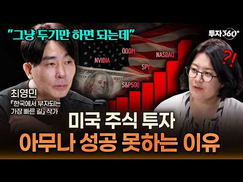
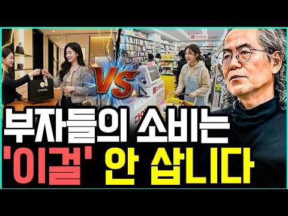

# 재테크 — 성공 사례 분석 (지시사항 재료)

자동 생성 — `tools/success_analysis.py` v1.0 (2026-10-14 07:15 UTC), 규칙 `economic/analysis_rules.toml` v1.0. **이 문서는 숫자와 원문만 담는다 — 해석·지시사항은 이것을 읽는 AI 가 만든다.** 주별 추세는 `weekly.md`, 승인한 영상 전부는 `approved.md`. ※ 연구·교육용 — 투자 권유가 아님.

## 0. 자료와 한계

| 자료 | 수 |
|---|---|
| 사례 폴더 (설명·자막·댓글·썸네일을 받은 영상) | 88 (웹 승인 88) |
| **성공 사례** — 180일 안·구독자 50,000 이하·조회수 ≥ 구독자 × 3·10,000회 이상·4분 이상, 채널당 2개 | **25** (기준 통과 27 − 뺀 것 2 − 채널당 제한 0) |
| 성공 사례의 글 출처 (자막·음성인식·설명·없음) | 설명 25 |
| 성공 사례 댓글 (받은 / 달린) | 5,254 / 5,255 |
| 성공 사례 썸네일 | 25 |
| 비교 집단 — 탐색에서 본 영상 중 구독자 50,000 이하·4분 이상·365일 안·주제 관련, 채널당 최근 5개 | 33 (성공 27 = 82%, 채널당 제한으로 뺀 0) |
| 자료를 받지 않은 성공 후보 (웹 화면에서 승인하면 들어감) | 2 |
| 수요·공급 시장 — 최근 90일 영상 (채널 크기 상관없음) | 130 · 검색어 3 · 자동완성 말 0 (공급 확인 0) |
| 채널 성장 자료 (개설일이 있는 채널) | 0 (빨리 크는 작은 채널 0) |

성공 기준은 넘었지만 뺀 영상: 내 집 앞이 바로 맑은 계곡! 537평 땅 부자 되는… (뺀 주제(전원주택)) · IT 자산관리 전문 기업이 브라더 라벨 프린터를 쓰는… (광고 의심(좋아요·댓글 거의 없음))

**한계**

- 대본(자막·음성인식)이 없는 성공 사례 25개 (#1, #2, #3, #4, #5, #6, #7, #8, #9, #10, #11, #12, #13, #14, #15, #16, #17, #18, #19, #20, #21, #22, #23, #24, #25) — 설명란·챕터만 있음. 도입부·구성·말 속도는 대본이 있는 0개로만 셌다 (음성인식이 끝나면 다시 셈)
- 비교 집단 33개는 검색(조회수 순)·추가한 채널에서 나와 성공 비율(82%)이 실제보다 높다 — 같은 집단 안의 '있음/없음' 차이로만 보라
- 수요·공급의 '시장'은 탐색·검색에서 본 최근 90일 영상 130개 — 검색이 조회수 순이라 조회수 적은 영상이 덜 잡힌다. 주제 묶음 사이의 상대 비교(지수)로만 보라
- 검색어별 결과 수(공급 추정)는 outlier_research v2.1 이후의 검색부터 저장된다 — 그 전 검색은 '–' (7일 캐시가 지나 다시 검색하면 채워짐)
- 자동완성(사람들이 찾는 말) 자료 없음 — 웹 화면에서 '검색어로도 찾기'로 탐색하면 받는다 (할당량 0)
- 채널 개설일 자료 없음 — outlier_research v2.1 로 다시 탐색하면 채널을 한 번 다시 받는다 (50채널 1단위). 그때부터 '빨리 크는 채널'이 나온다
- '구독자가 많이 모이는가'는 YouTube API 로 영상별 구독 증가를 볼 수 없다 — 대신 채널 성장(7번: 개설 뒤 월 구독자·받을 때마다 남긴 기록), '구독·다음 기대' 댓글, 배수(조회수÷구독자)로 본다
- 댓글 갈래·제목 특징은 낱말 규칙이라 거칠다 (물음표 반문도 '질문', 한 댓글이 여러 갈래). 원문 인용을 함께 보라
- '눈에 띔'은 차이가 크고 표본이 충분하다는 표시일 뿐 원인이 아니다

## 1. 성공 사례 (25개 — 배수 큰 순)

| # | 썸네일 | 제목 | 채널 | 구독자 | 조회수 | 배수 | 하루 조회수 | 길이 | 업로드 | 주제 묶음 | 글 출처 | 댓글 받은/달린 |
|---|---|---|---|---|---|---|---|---|---|---|---|---|
| 1 |  | [안 팔릴수록 부자되는 '동네 금은방'의 소름돋는 수익구조](https://www.youtube.com/watch?v=eFsT1K_mPjc) | 새파란 경제 | 906 | 510,269 | 563.2 | 18,298.6 | 17.6분 | 2026-09-16 | 1. 재테크 일반·마인드 | 설명 | 139/139 |
| 2 |  | [조용한 부자들이 절대 입에 담지 않는 7가지 — 돈 있는 사람의 진짜 습관 ㅣ시니어ㅣ오디오북ㅣ노후준비ㅣ심리…](https://www.youtube.com/watch?v=TKBAsjZgVWU) | 가을빛 심리학 | 1,000 | 413,701 | 413.7 | 14,924.9 | 21.7분 | 2026-09-16 | 1. 재테크 일반·마인드 | 설명 | 100/100 |
| 3 |  | [부자들이 먼저 배운 돈의 원리, "열심히 벌어도 왜 안 모일까" 자본주의에 대해 알게되면 부자는 불가능한 …](https://www.youtube.com/watch?v=RGKX32DwzMI) | 경제집현전 | 699 | 168,049 | 240.4 | 3,779.0 | 24.2분 | 2026-08-30 | 1. 재테크 일반·마인드 | 설명 | 10/10 |
| 4 |  | [[풀영상] 월급 10%로 당장 시작하는 존리의 자산 증식 치트키](https://www.youtube.com/watch?v=q1fYjAwma3s) | 여의돈스트리트 | 1,330 | 203,470 | 153.0 | 7,723.6 | 36분 | 2026-09-17 | 2. 돈 모으기·저축 | 설명 | 112/112 |
| 5 |  | [본인도 모르는 사이에 남몰래 부자가 되고 있다는 5가지 신호](https://www.youtube.com/watch?v=5kBEU3V3ZXY) | 투자 가이드 | 962 | 138,086 | 143.5 | 5,144.0 | 20분 | 2026-09-17 | 1. 재테크 일반·마인드 | 설명 | 12/12 |
| 6 |  | [60대부터라도 싫어도 부자가 된다. TV에서 소개된 ‘5가지 마법의 습관’이 너무 대단했다](https://www.youtube.com/watch?v=t94bcrWeee0) | 인간 인사이트 | 946 | 53,221 | 56.3 | 471.5 | 30.4분 | 2026-06-23 | 1. 재테크 일반·마인드 | 설명 | 40/40 |
| 7 |  | [국민연금 빈칸 메우는 한국 ETF 3개 — 월 200만 원 평생 월급 만들기](https://www.youtube.com/watch?v=7rtO_hfLvF8) | 술술 경제학 | 17,600 | 608,500 | 34.6 | 3,624.7 | 16.8분 | 2026-04-29 | 3. 주식·ETF | 설명 | 284/284 |
| 8 |  | [복리가 부를 만드는 진짜 시작점｜언제부터 돈이 스스로 일하기 시작할까](https://www.youtube.com/watch?v=JExUQaROk40) | 돈의 통찰 | 3,930 | 131,681 | 33.5 | 1,569.2 | 17.8분 | 2026-07-22 | 3. 주식·ETF | 설명 | 103/103 |
| 9 |  | [독일인은 부자인데 왜 가난하게 살까? ∣ 조용히 부자 되는 돈 습관 10가지](https://www.youtube.com/watch?v=yfLp54zD9Gk) | 돈나침반 | 2,350 | 73,180 | 31.1 | 796.4 | 27.6분 | 2026-07-14 | 1. 재테크 일반·마인드 | 설명 | 109/109 |
| 10 |  | [매일 아침 7시, 내 포트폴리오를 관리해주는 AI 주식 비서를 만들어봤습니다](https://www.youtube.com/watch?v=ITzgH6CeZns) | 스티브의 파도타기 ∣ A… | 26,600 | 680,729 | 25.6 | 4,908.1 | 14.8분 | 2026-05-28 | 3. 주식·ETF | 설명 | 387/388 |
| 11 |  | [주식 상위 2%만 아는 10가지 절대 생존 원칙 (돈의 원리)](https://www.youtube.com/watch?v=fFURFeLTdAg) | 준의 경제노트 (jun’… | 12,600 | 305,667 | 24.3 | 2,438.2 | 21.6분 | 2026-06-10 | 3. 주식·ETF | 설명 | 189/189 |
| 12 |  | ["돈 버는 규칙은 따로 있어요." 1300억 부자가 추천하는 단 한권의 책/인생책/레버리지 몰아보기](https://www.youtube.com/watch?v=vD6oAnU4ZPo) | 달콤하게성장 | 8,040 | 181,711 | 22.6 | 8,501.0 | 34.7분 | 2026-09-22 | 1. 재테크 일반·마인드 | 설명 | 95/95 |
| 13 |  | [🇨🇦 아무도 알려주지 않았던 '은퇴의 잔인한 현실' 8가지! ∣ 브랜든 캐나다](https://www.youtube.com/watch?v=XWjW3xiUKxw) | 브랜든 캐나다 투자전략 | 3,240 | 65,369 | 20.2 | 844.3 | 18.1분 | 2026-07-28 | 4. 노후·연금 | 설명 | 78/78 |
| 14 |  | [1억, 5억, 10억, 30억 자산 구간별 나타나는 인생 변화. (부자들이 돈 버는 법)](https://www.youtube.com/watch?v=hA5g5pbTFUo) | 신현욱의 경영백서 | 8,410 | 155,355 | 18.5 | 1,272.5 | 26.2분 | 2026-06-14 | 1. 재테크 일반·마인드 | 설명 | 423/423 |
| 15 |  | [《정약용 명언》 부자가 되는 여성이 즐겨 입는 옷 색깔 5가지. 이 색만 입어도 평생 재물이 따릅니다](https://www.youtube.com/watch?v=BTpNqy7XqJE) | 다산의 서재 | 22,200 | 363,948 | 16.4 | 5,752.7 | 36.9분 | 2026-08-12 | 1. 재테크 일반·마인드 | 설명 | 1,619/1,619 |
| 16 |  | [중개형 ISA 계좌 만기해지 안 하는 이유](https://www.youtube.com/watch?v=AbpqDkCFTT0) | 청년개미 | 15,800 | 224,984 | 14.2 | 1,361.9 | 5.2분 | 2026-05-02 | 6. 절세·제도 | 설명 | 537/537 |
| 17 |  | [순자산 5억은 대한민국에서 정확히 어디쯤인걸까](https://www.youtube.com/watch?v=abPHpPAuZmw) | 탐구하는 변호사 송현영 | 9,680 | 131,847 | 13.6 | 4,020.1 | 14.7분 | 2026-09-11 | 1. 재테크 일반·마인드 | 설명 | 194/194 |
| 18 |  | [S&P500 ETF 좋다고 투자해도 90%가 망하는 이유 ∣ 최영민 작가](https://www.youtube.com/watch?v=2hEQ_7smoy8) | 투자360 | 15,800 | 138,605 | 8.8 | 2,828.1 | 16.3분 | 2026-08-26 | 3. 주식·ETF | 설명 | 111/111 |
| 19 |  | [99%가 모르는 부자의 비밀 습관 ∣ 인문학 서적 7가지로 부의 본질을 읽는 법](https://www.youtube.com/watch?v=2nDXlFjGSzQ) | 위대한 비밀 | 24,300 | 208,928 | 8.6 | 3,845.3 | 43.7분 | 2026-08-20 | 1. 재테크 일반·마인드 | 설명 | 125/125 |
| 20 |  | [부자 되고 싶으면 공부하라 ∣ 핵심 이유 7가지 완벽 정리 #부자되는법](https://www.youtube.com/watch?v=XyfHR8H2JI0) | 위대한 비밀 | 24,300 | 198,504 | 8.2 | 3,130.7 | 46.9분 | 2026-08-11 | 1. 재테크 일반·마인드 | 설명 | 58/58 |
| 21 |  | [택배로 부자가 될 수 있냐고요? 솔직하게 말씀드리겠습니다](https://www.youtube.com/watch?v=r5jnahsJw5Q) | 택부 - 택배기사 부자들 | 6,550 | 52,828 | 8.1 | 1,230.6 | 8.3분 | 2026-09-01 | 1. 재테크 일반·마인드 | 설명 | 203/203 |
| 22 |  | [(가난한 사람들은 절대 모르는) 부자들의 진짜 소비법 I 교수 정선용 (통합본)](https://www.youtube.com/watch?v=ghEDa5tjlvs) | 너와 나의 경제학교 | 30,200 | 185,743 | 6.2 | 1,498.9 | 40.5분 | 2026-06-12 | 1. 재테크 일반·마인드 | 설명 | 150/150 |
| 23 |  | [신혼부부가 돈 못 모으는 이유...결혼 후 돈 관리 이렇게 하세요(김경필 머니트레이너)ㅣ보라언니동생 EP.…](https://www.youtube.com/watch?v=vmjGJVCfwhk) | STUDIO OMG | 31,100 | 171,556 | 5.5 | 7,809.1 | 18.2분 | 2026-09-22 | 1. 재테크 일반·마인드 | 설명 | 62/62 |
| 24 |  | [반드시 부자되는 신혼부부의 3가지 공통점 (부자되는 방법)](https://www.youtube.com/watch?v=t6NrbgrRE_k) | 해쏘현_신혼부부 재테크 | 26,400 | 89,264 | 3.4 | 1,720.4 | 11.9분 | 2026-08-23 | 1. 재테크 일반·마인드 | 설명 | 100/100 |
| 25 |  | [부자 되기 바로 전, 삶에 나타나는 이상한 변화 7가지 (놓치면 평생 후회합니다)](https://www.youtube.com/watch?v=GxGvoXZQbZ0) | 누구나 겪는 돈 이야기 | 4,490 | 14,314 | 3.2 | 93.6 | 17.2분 | 2026-05-14 | 1. 재테크 일반·마인드 | 설명 | 14/14 |

### 자료를 받지 않은 성공 후보 (2개 중 배수 큰 2개 — 웹 화면 탐색 목록에서 승인하면 분석에 들어감)

| 제목 | 채널 | 구독자 | 조회수 | 배수 | 길이 | 업로드 | 주제 묶음 |
|---|---|---|---|---|---|---|---|
| [[스포츠 토토] 재테크 적중률 높이는 확률 계산법 대공개! #토토 #스포츠토토 #토토분석 #프로토분석 #스…](https://www.youtube.com/watch?v=Ly8W-jVvLa0) | 스포츠토토_메시 | 1,130 | 190,686 | 168.8 | 4.4분 | 2026-07-27 | 1. 재테크 일반·마인드 |
| [에어컨이 필요 없는 문쌤의 폐건물 괴담 [문쌤 라디오]](https://www.youtube.com/watch?v=2yOps8H0fWs) | 한국자산관리공사 캠코TV | 42,700 | 1,040,777 | 24.4 | 15.8분 | 2026-09-11 | 1. 재테크 일반·마인드 |

## 2. 주제 — 주제 묶음별 성공 비율 (비교 집단)

주제 묶음 = `tag_rules.toml` TAG_THEMES (제목에서 맞는 글자가 가장 긴 묶음, 없으면 태그). 비교 집단 성공 비율 82% 과 견주어 본다. 영상 15개 미만은 '표본 적음'.

| 주제 묶음 | 영상 | 성공 | 성공 비율 | 배수 중앙값 | 조회수 중앙값 | 성공 사례 # |
|---|---|---|---|---|---|---|
| 1. 재테크 일반·마인드 | 23 | 19 | 83% | 13.6 | 155,355 | 1, 2, 3, 5, 6, 9, 12, 14, 15, 17, 19, 20, 21, 22, 23, 24, 25 |
| 4. 노후·연금 (표본 적음) | 1 | 1 | 100% | 20.2 | 65,369 | 13 |
| 6. 절세·제도 (표본 적음) | 1 | 1 | 100% | 14.2 | 224,984 | 16 |
| 3. 주식·ETF (표본 적음) | 6 | 5 | 83% | 24.9 | 222,136.0 | 7, 8, 10, 11, 18 |
| 2. 돈 모으기·저축 (표본 적음) | 2 | 1 | 50% | 76.7 | 107,960.0 | 4 |

## 3. 수요와 공급 — 찾는 사람에 비해 영상이 적은 곳

### 3-1. 주제 묶음별 (최근 90일 영상 130개 — 채널 크기 상관없음)

수요 몫 = 그 묶음 영상들의 하루 조회수 합 ÷ 전체, 공급 몫 = 영상 수 ÷ 전체. **지수 = 수요 몫 ÷ 공급 몫** — 1 보다 크면 영상 하나가 평균보다 많이 보임(공급이 모자라 보임), 작으면 영상이 넘침. 작은 채널 성공 비율 = 2번 표. 시청자 질문 = 사례 댓글 중 그 묶음 낱말이 든 질문·요청.

| 주제 묶음 | 영상(공급) | 채널 | 수요 몫 | 공급 몫 | 지수 | 영상당 하루 조회수 중앙값 | 작은 채널 성공 비율 | 시청자 질문 |
|---|---|---|---|---|---|---|---|---|
| 3. 주식·ETF | 34 | 18 | 42% | 26% | **1.6** | 5,488.1 | 83% | 760 |
| 1. 재테크 일반·마인드 | 61 | 39 | 37% | 47% | **0.8** | 4,284.3 | 83% | 60 |
| 8. 부업·소득 (표본 적음) | 1 | 1 | 2.3% | 0.8% | **3.0** | 34,179.6 | – | 4 |
| 기타 (표본 적음) | 4 | 3 | 3.2% | 3.1% | **1.0** | 12,536.4 | – | 0 |
| 2. 돈 모으기·저축 (표본 적음) | 12 | 11 | 7.3% | 9.2% | **0.8** | 6,775.6 | 50% | 112 |
| 4. 노후·연금 (표본 적음) | 13 | 7 | 6.6% | 10% | **0.7** | 2,547.4 | 100% | 152 |
| 6. 절세·제도 (표본 적음) | 5 | 5 | 1.6% | 3.8% | **0.4** | 4,194.7 | 100% | 158 |
| 7. 빚·대출·신용 (표본 적음) | 0 | 0 | 0% | 0% | **–** | – | – | 16 |
| 10. 금융 사기 (표본 적음) | 0 | 0 | 0% | 0% | **–** | – | – | 5 |

### 3-2. 검색어별 (탐색·검색 캐시 — 검색어마다 조회수 순 상위 결과)

결과 수 = YouTube 가 알려 준 그 기간 영상 수 추정(공급). 영상당 하루 조회수 = 상위 결과 하루 조회수 합 ÷ 결과 수 (클수록 영상에 비해 찾는 사람이 많음). 큰 채널 비율 = 상위 결과 중 구독자 5만 넘는 채널 (클수록 들어가기 어려움). **작은 채널이 뚫은 비율** = 상위 결과 중 작은 채널(5만 이하)의 성공 영상(×3·1만) 비율 — 클수록 새 채널도 상위에 들 수 있음. 지금 검색어(keywords.txt)가 먼저, 예전 검색어는 '(예전)'.

| 검색어 | 기간(일) | 본 영상 | 결과 수(공급) | 최근 30일 | 조회수 중앙값 | 하루 조회수 중앙값 | 영상당 하루 조회수 | 큰 채널 비율 | 작은 채널이 뚫은 비율 |
|---|---|---|---|---|---|---|---|---|---|
| 부자되는법 | 168 | 100 | – | 13 | 162,894 | 2,153.2 | – | 70% | 25% (17개) |
| 자산관리 | 168 | 100 | – | 4 | 177,463.5 | 2,097.4 | – | 89% | 9.1% (8개) |
| 재테크 | 168 | 100 | – | 6 | 436,564 | 4,940.5 | – | 97% | 2.9% (2개) |

### 3-3. 사람들이 찾는 말 (YouTube 자동완성) 중 최근 영상이 적은 말

수요 점수 = 검색어를 넣었을 때 자동완성에 앞쪽에 나올수록·여러 검색어에서 나올수록 큼. 최근 영상 = 우리가 본 최근 영상 중 제목에 그 말의 낱말이 다 든 수. 틈 = 수요 점수 ÷ (1 + 최근 영상). **공급 확인** = 웹 화면 [공급 확인]으로 그 말을 직접 검색한 결과 (최근 90일 결과 수·상위 영상).

| 말 | 수요 점수 | 나온 검색어 | 최근 영상(우리가 본) | 틈 | 공급 확인: 결과 수 | 영상당 하루 조회수 | 작은 채널 비율 | 최근 30일 |
|---|---|---|---|---|---|---|---|---|
| (자동완성 자료 없음 — 웹 화면 탐색 때 받음) |  |  |  |  |  |  |  |  |

### 3-4. 주제 묶음별 시청자 질문 (사례 댓글 — 좋아요 순)

- **3. 주식·ETF** (760개): 👍83 “나스닥100 안 좋아지니 탈출해야한다는 쇼츠 몇 개를 보고 어이가 없으면서도 도대체 무슨 일인가 궁금했는데 짠부님 덕분에 궁금증 해결했습니다~!” / 👍55 “주식 투자를 하는 사람으로서 정말 감사합니다. 혹시 텔레그램에 팔로우하는 채널들에 수많은 주식 정보가 있는데 그걸 요약해서 브리핑하는 것도 가능할까요? 검토 부탁드립니다.” / 👍51 “지난 2달간 외인의 한국증시 흔들기~ 그 목적이 무엇인지 알고 있나요? 간단하게 요약하면, AI 생태계의 핵심 산업을 싼 값에 자기 것으로 만드는 작업이라 봅니다. 외환위기 당시 IMF의 2가지 …”
- **6. 절세·제도** (158개): 👍212 “개빡치는게 세금 왜 이따구로 복잡하게 만드는거냐 ㅡ 그냥 깔끔하게 퍼센트 정해서 그거 고정으로 가져가면 되잖아ㅡㅡ 왜 저딴 여러 계좌를 우리가 공부해야돼?” / 👍61 “나라가 이상해진다.. 열심히 일해서 집장만한 사람들 죄인취급하고 괴씸죄로 세금으로 빼앗고 분명 하위층이 된 이유가 있는 사람들에겐 생계비를 준다.. 민주주의 맞나?” / 👍40 “ISA 계좌에 a 주식을 계속 모으고 있었는데 배당이 나와도 ISA에서는 못 빼쓰자나요? ISA 계좌를 그냥 일반 계좌로 만들수 있나요? 아니면 그냥 계속 3년 마다(혹은 절세구간까지만) 털고 새…”
- **4. 노후·연금** (152개): 👍127 “주식생활 28년차, 능력되시는 3040세대는 Isa계좌는 만기가 중요한게 아니라 웬만하면 만기 9999년 끝까지 끌고 가시며 미장 기술주 etf에 투자하시고 미장 지수추종 & 배당 etf를 연금저…” / 👍85 “진짜 기초연금은 국민연금 으로 생활하기 어려운 우리도 좀 주세요. 젊었을때 세금내고 죽어라 일한 사람은 못받고 평생 놀고 먹은 인간만 받는게 말이되나요? 특히 전업주부들은 돈이 많던 적든 기초연금…” / 👍22 “안녕하세요, 제 자녀가 22세 대학생입니다. 그래서 ISA에 미국상장 국내ETF와 국내ETF를 같이 매일 1주씻 사주고 있습니다. 선생님 말씀대로 ISA계좌에 ETF를 매도후에 미국직투가 나을까요…”
- **2. 돈 모으기·저축** (112개): 👍164 “금융소득 종합과세 2000만원은 왜 왜 그대로냐고??????? 배당금으로 생활을 하려해도 그놈의 세금때문에???? 예금자보호도 1억으로 상향했으면 이것도 5천정도로 올려야지??????” / 👍38 “다이소 올리브영에서 가성비좋고 꼭 필요한 제품 낱개씩 사서 열심히 잘 사용하고있습니다. 백화점에서 화장품사는 것보다 알뜰하게 구매하고 잘 소비하고 잘 사용하고 있어 지혜롭게 소비생활하고있습니다. …” / 👍35 “정부를 어떻게믿어. 지금도 저축 딴소리하는게있지않나?”
- **1. 재테크 일반·마인드** (60개): 👍103 “사는동안 잘사는 것도 중요하지않나요? 돈만 모으다가 죽는 사람도 많이 봤어요 돈도 모으는 사람은 평생 돈을 못쓰더라구요 부자면 뭐해요 평생 지질이 궁사안 떨다가 죽는것도 문제” / 👍23 “50대초반 연금부자되기 부탁드립니다. 60세 정년입니다” / 👍11 “삼전 하이닉스 초과 이익분을 국민에게 나눠 준다는 정신 나간 이 정부의 리스크를 생각하면 그냥 개 폭 망 아니겠나 싶은데 오늘 대통령 정책실장의 말 한마디에 대 폭락을 경험 했자나요 ? 코리아 디…”
- **7. 빚·대출·신용** (16개): 👍5 “신용카드 매주 자동 결재 좋던데요?” / 👍4 “한 가지 잘 모르시는 사항이 있으시군요. 일본의 부채는 다른 나라와 달리 외국 돈을 빌리는 게 아니라 자기네 나라 국채 라든가 중앙 은행이라든가 자기네 나라 돈을 빌리는 겁니다. 그리고 엔화 가 …” / 👍2 “어떻게 매년 10%수익을 내지? 그럼 풀대출받아서 다때려박지 과거 동안 매년 10% 수익냈다고 앞으로도 그럴거라고 보장이되나??”
- **10. 금융 사기** (5개): 👍1 “토사기.삼성반토막낫다현제상황은?” / 👍0 “너네 ㅅ ㄲ 들은 개인계좌 다보고 가지고 논다는거네 사기인정한거 맞냐?” / 👍0 “요새 검증 안 된 주식 정보나 리딩방 유혹이 많아서 무서웠는데 올바른 정보 리터러시가 왜 중요한지 다시금 깨달았습니다. 남들 말만 믿고 따라가는 투자는 결국 위험하다는 것을 명심하고 내가 아는 범…”
- **8. 부업·소득** (4개): 👍18 “돈버는 방법 알려주는데 말투가 무슨 상관이겠습니까? 감사합니다 열심히해서 부자되겠습니다” / 👍9 “왠지 딱 20프로 손실나서 국민은 세금감면만 받아서 입꾹닫하고 펀드만 20프로 돈버는 결말은 아니겠지?” / 👍1 “불편한 진실을 하나 알려주지. 부자가 되는 방법을 알려주는 책을 읽고 부자가 될 확률은 번개에 맞을 확률보다 낮다는거야. 그런데도 왜 이런 책들은 끊임없이 출판되고 또 읽히냐면 이 시장 자체가 기…”

## 4. 제목

### 4-1. 제목 특징별 성공 비율 (비교 집단: 있음 vs 없음)

'눈에 띔' = 차이 10%p 이상 · 양쪽 15개 이상 (원인이 아니라 표시). 마지막 열 = 성공 사례 중 그 특징이 있는 비율.

| 제목 특징 | 있음 (성공 비율) | 없음 (성공 비율) | 차이 | 표시 | 성공 사례 중 |
|---|---|---|---|---|---|
| 패턴형(공통점·특징·이유·N가지·착각·과정) | 16 (88%) | 17 (76%) | +11%p | **눈에 띔** | 56% |
| 느낌표 ! | 4 (50%) | 29 (86%) | -36%p | 표본 적음 | 4.0% |
| 두 금액(반전) | 2 (50%) | 31 (84%) | -34%p | 표본 적음 | 4.0% |
| 노후·퇴직금·은퇴·50~70대 | 3 (100%) | 30 (80%) | +20%p | 표본 적음 | 12% |
| S&P500·ETF·지수·나스닥 | 2 (100%) | 31 (81%) | +19%p | 표본 적음 | 8.0% |
| 공통점 | 1 (100%) | 32 (81%) | +19%p | 표본 적음 | 4.0% |
| 손실 낱말(망하·날린·잃은·반토막) | 1 (100%) | 32 (81%) | +19%p | 표본 적음 | 4.0% |
| 사연·오디오북·실화·고백 | 1 (100%) | 32 (81%) | +19%p | 표본 적음 | 4.0% |
| 직접·해보니·N년 기록 | 1 (100%) | 32 (81%) | +19%p | 표본 적음 | 4.0% |
| 빚투·신용·미수·레버리지·대출 | 1 (100%) | 32 (81%) | +19%p | 표본 적음 | 4.0% |
| AI | 1 (100%) | 32 (81%) | +19%p | 표본 적음 | 4.0% |
| 말줄임 …·... | 1 (100%) | 32 (81%) | +19%p | 표본 적음 | 4.0% |
| 25자 미만 | 1 (100%) | 32 (81%) | +19%p | 표본 적음 | 4.0% |
| 물음표 ? | 3 (67%) | 30 (83%) | -17%p | 표본 적음 | 8.0% |
| N가지 | 12 (92%) | 21 (76%) | +16%p | 표본 적음 | 44% |
| vs 비교 | 4 (75%) | 29 (83%) | -8%p | 표본 적음 | 12% |
| 40자 이상 | 20 (80%) | 13 (85%) | -5%p | 표본 적음 | 60% |
| 숫자가 들어감 | 23 (83%) | 10 (80%) | +3%p | 표본 적음 | 76% |
| 금액(억·만원) | 5 (80%) | 28 (82%) | -2%p | 표본 적음 | 16% |
| 이유 | 5 (80%) | 28 (82%) | -2%p | 표본 적음 | 16% |
| 따옴표·괄호로 강조 | 11 (82%) | 22 (82%) | +0%p | 표본 적음 | 28% |
| 구분 기호(ㅣ·｜·/)로 나눔 | 11 (82%) | 22 (82%) | +0%p | 표본 적음 | 36% |

### 4-2. 제목 낱말 (비교 집단 제목에 자주 나온 낱말 — 조사를 거칠게 뗌)

| 낱말 | 있음 (성공 비율) | 없음 (성공 비율) | 차이 | 표시 |
|---|---|---|---|---|
| 부자 | 17 (88%) | 16 (75%) | +13%p | **눈에 띔** |

### 4-3. 제목 길이

| 길이 | 영상 (성공 비율) |
|---|---|
| 0~24자 | 1 (100%) |
| 25~34자 | 9 (78%) |
| 35~44자 | 11 (91%) |
| 45자 이상 | 12 (75%) |

성공 사례 제목 전부는 1번 표 (#순).

## 5. 썸네일

글자·얼굴·색·구도는 자동으로 뽑지 않는다 — **이미지를 직접 보고** 판단한다 (번호 = 1번 표의 #).

성공 사례:

비교 — 자료를 받았지만 성공 기준 밖 (조회수 큰 순, 번호는 `analysis.json` 의 others 순서):

## 6. 길이·내용 구성

### 6-1. 길이별 성공 비율 (비교 집단)

| 길이 | 영상 (성공 비율) | 성공 사례 |
|---|---|---|
| 4~8분 | 3 (67%) | 1 |
| 8~15분 | 6 (67%) | 4 |
| 15~25분 | 13 (92%) | 11 |
| 25~40분 | 8 (75%) | 6 |
| 40분 이상 | 3 (100%) | 3 |

### 6-2. 채널 크기별 성공 비율 (참고 — 구독자가 적을수록 배수가 커지기 쉬움)

| 구독자 | 영상 (성공 비율) |
|---|---|
| 0~999명 | 4 (100%) |
| 1,000~4,999명 | 7 (100%) |
| 5,000~19,999명 | 9 (89%) |
| 20,000~50,000명 | 13 (62%) |

### 6-3. 성공 사례의 구성

- 길이 중앙값: 성공 사례 20.0분 · 비교 집단의 나머지 15.3분
- 타임라인(챕터) 있는 성공 사례: 44% (챕터 수 중앙값 10)
- 대본이 있는 성공 사례: 0개 — 말 속도 중앙값 – 음절/초, 첫 1분 음절 중앙값 – (대본이 없어 도입부·흐름은 아직 셀 수 없음)
- 도입부(첫 20초 첫 문장) 유형: 대본 없음 — 아직 셀 수 없음
- 사례마다의 챕터·도입부(첫 20초)·첫 1분·90초마다 흐름은 9번.

### 6-4. 참여율 (비교 집단, 중앙값)

| | 영상 | 좋아요 ÷ 조회수 | 댓글 ÷ 조회수 |
|---|---|---|---|
| 성공 | 27 | 1.0% | 0% |
| 나머지 | 6 | 2.0% | 0% |

## 7. 구독자 — 빨리 크는 작은 채널

YouTube API 는 영상별 구독 증가를 주지 않는다 → 채널 단위로 본다. 개설 24개월 안·구독자 1,000 이상 채널을 **월 구독자 증가(구독자 ÷ 개설 뒤 달 수)** 순으로. 최근 하루 증가 = 받을 때마다 남긴 구독자 기록 (3일 넘게 벌어져야 나옴). 주로 다룬 주제 = 우리가 본 그 채널 영상의 주제 묶음.

| 채널 | 개설 | 구독자 | 월 구독자 증가 | 최근 하루 증가 | 영상 수 | 월 업로드 | 길이 중앙값 | 주로 다룬 주제 | 대표 영상 (하루 조회수 큰 것) |
|---|---|---|---|---|---|---|---|---|---|
| (자료 없음 — 한계 참고) |  |  |  |  |  |  |  |  |  |

## 8. 시청자 니즈 (성공 사례 25개의 시청자 댓글 3,857개 — 채널 주인 댓글 뺌)

| 갈래 | 댓글 | 비율 | 좋아요 합 |
|---|---|---|---|
| 좋은 점 (칭찬·도움·공감) | 727 | 19% | 3,755 |
| 더 알고 싶은 것 (질문·요청) | 490 | 13% | 1,101 |
| 아쉬운 점 (비판·불만·반박) | 131 | 3.4% | 1,019 |
| 경험 공유 (내 이야기) | 365 | 9.5% | 2,708 |
| 구독·다음 기대 | 19 | 0.5% | 49 |

### 좋은 점 (칭찬·도움·공감) — 좋아요 많은 댓글

- 👍248 [#15] “나는 언제나 이세상에 제일 귀한 사람이라고 생각 하며 살고있어요 나없는 이세상 아무것도 없다는 마음으로 아침에 새로운 부활에 감사하며 살아갑니다~❤😅❤”
- 👍227 [#7] “67세 입니다 지난달부터 isa계좌(3년)만들어 200넣어 매수매도로 공부하는 초보(빌딩 미화원)입니다 저에게는 꼭 필요 정보이기에 감사함 느끼면 주식교실로 입학합니다😂😂😂”
- 👍175 [#15] “감사합니다^^ 나는 귀부인처럼 귀하게 품격 있게 살겠습니다 ^^”
- 👍138 [#15] “나는 오늘부터 색갈잇는옷을 입을것입니다 좋은말씀 잘들었습니다 감사합니다”
- 👍120 [#15] “나는 품격있는 여성입니다 감사합니다”
- 👍93 [#22] “목적물건만 사라 감정안 좋을때 가지마라 좋은 말씀 감사해요”
- 👍77 [#4] “제 나이가 현재 72세인데 존리 대표님 덕분에 노후대책을 완전히 하고 지금은 돈에 걱정없이 자유롭게 생활하고 있습니다 고맙습니다 퇴직하고 퇴직금으로 리딩방 따라 다니다가 그사람들한테 속아서 실패하고 있을 때 우연히 존리 대표님 강의를 듣고 존리 대표님 말씀대로 7년전부터 연금받은 날 오르든 내리든 꾸준히 실천하면서 좋은결과 얻어 생활하고 있습니다 다시한번 ”
- 👍63 [#15] “나는 귀부인처럼 귀하게 품격 있게 살겠습니다😊 감사합니다”

### 더 알고 싶은 것 (질문·요청) — 좋아요 많은 댓글

- 👍103 [#22] “사는동안 잘사는 것도 중요하지않나요? 돈만 모으다가 죽는 사람도 많이 봤어요 돈도 모으는 사람은 평생 돈을 못쓰더라구요 부자면 뭐해요 평생 지질이 궁사안 떨다가 죽는것도 문제”
- 👍55 [#10] “주식 투자를 하는 사람으로서 정말 감사합니다. 혹시 텔레그램에 팔로우하는 채널들에 수많은 주식 정보가 있는데 그걸 요약해서 브리핑하는 것도 가능할까요? 검토 부탁드립니다.”
- 👍38 [#22] “다이소 올리브영에서 가성비좋고 꼭 필요한 제품 낱개씩 사서 열심히 잘 사용하고있습니다. 백화점에서 화장품사는 것보다 알뜰하게 구매하고 잘 소비하고 잘 사용하고 있어 지혜롭게 소비생활하고있습니다. 명품옷가방,보석,생화 절대사지않습니다 그리고 다이소 올리브영 장점 더 많습니다 (간략하게 말씀해주시길부탁합니다)”
- 👍34 [#17] “솔직히 집과 현금등을 빼고 주식 자산만도 5억이 넘고 빚도 없지만 . . 차가 코란도 스포츠인데... 아파트를 보면 차들이 너무 좋던데 신기하군요.. 쓸거다쓰고 무슨 수로 돈에서 자유로울수 있을까요?”
- 👍34 [#21] “현직 cj기사입니다. 택배기사가 다힘든건아니에요ㅋㅋ 올아파트 타는 기사들이 관절상하고 할까요? 택배해서 돈빠짝벌어서 졸업할거야할거면 그냥시도도하지마세요 현제 저도 6년넘게 번지만타고있고 소장들 수수료 악합니다ㅋㅋ 고생해서 소장 수수료 지방은15~20. 퍼 예 1000원벌수있는거 - 200원을 1건당 때줘야합니다. 모든 대리점이다그렇다고 이야기할수없지만. 택”
- 👍33 [#23] “기존에 혼자살때 돈을 분배하고 저축하고 주식하고 잘 분배했던거 같은데, 부부가 되고나서 소득을 합치고 나니 용돈이 적어서인지 계속 빵꾸나네요ㅠㅠ 혼자 살땐 신용카드도 잘 안썼거든요... 근데 결혼 관련한 명목으로 신용카드 사용량도 늘다보니 감도 안오는 상태로 긁고 있구요... 필요하기는 또 필요한 물건들이지만요... 책도 받고싶지만 정말 김경필 선생님의 조”
- 👍25 [#4] “존리 선생님 덕분에 3년전부터 노후준비를, 장기투자를 목표로 삼게 되었습니다. 좋은 투자철학을 가르쳐주셔서 감사합니다❤”
- 👍24 [#14] “1억 모으면 인생 바뀝니다 1억만들고 바로 5천만원 차 지르고 명품 지르고 그건 븅x이죠 근데 1억까지 모았다는건 보통 저런짓 안할꺼라고 보네요 나도 1억 만들고 투자 더욱 적극적으로해서 지금 22억입니다 인생 제대로 바꼈는데요...? 32살에 2천만원 있었는데 언제 결혼하냐고 한탄하면서 살았습니다 그래도 쭉 모으고 투자하고 1억 모았더니 기하 급수적으로 ”

### 아쉬운 점 (비판·불만·반박) — 좋아요 많은 댓글

- 👍589 [#16] “소액만 하고 목돈 안모아본 사람들 댓글이 대부분이네요 ㅋㅋㅋ 저도 1억 채웠는데 해지 안합니다. 해지하지마세요. 경험들도 안해봤으면서 돈 모이면 연금저축으로 이전해라 얼마빼고 일부 돈 뺼수잇다 이러는데 전혀 아닙니다. 연말정산 자기들이 직접 하는게 아니라 회사서 일괄로 하기때문에 세액공제 조금씩은 다 받아져잇습니다.(안받앗다고 주장하는 사람들 나중에 다 몰”
- 👍44 [#22] “틀렸습니다 부자들도 캐바캐 입니다 사치품좋아하는 찐부자 관심없는 찐부자 성향이 다 다릅니다~~ 제가본 부자 재벌들 명품과 아닌것 섞어 쇼핑합니다 그대가 말하는사람은 중산층한테 말하는거같군요~~ 부자는 명품엄청좋아합니다 왜냐? 돈이많으니까요~~~^^”
- 👍40 [#14] “쩝...금융자산만 30억 이어도 별로 달라지는 것 없는데요...그리고, 사모펀드 가입하는 건 바보짓입니다.”
- 👍30 [#16] “ISA 만기 후 연금저축 계좌로 3천만원 이전하면 3백만원이 세액공제대상이고, 연말정산하면 대략 40만원 정도의 세금이 감면됩니다. ISA 계좌 1억원 이상 굴려보면 하루에 오르락 내리락 하는 금액도 커서, 비과세 혜택 200만원이나 연말정산 혜택은 크게 고려할만한 요소는 아닙니다. ISA 계좌는 연금저축 계좌나 퇴직연금과 달리 레버리지 ETF 나 파생상품”
- 👍22 [#11] “나는 뻔한 예가 나오면 흐름이 끊겨서 거기까지만 듣고 나갑니다.”
- 👍15 [#24] “그걸 누가 모르나? 다들 돈이 모자르고 대출 받기도 힘드니 오피스텔이나 빌라라도 생각하는거다 뭐? 리센츠, 헬리오? 그거 살 돈 있는 사람들이 이런거 보겠냐? 다들 작은 시드로 시작하니 이런거라도 보면서 방법을 찾을려고 하는거다 누구나 다 알고 있는 뻔한 내용들만 얘기하네”
- 👍13 [#14] “주식으로만 43억. 화정에 아파트 2채 보유중입니다. 인생 변하는거 별로 없습니다.”
- 👍13 [#17] “수치는 거짓말을 안하는데, 사람들 눈높이는 높아서, 5억으로도 가난하다고 느끼는 거임. 밑은 안보니까, 비싼차 타고 다니는 사람들이나 눈에 들어오고.”

### 경험 공유 (내 이야기) — 좋아요 많은 댓글

- 👍589 [#16] “소액만 하고 목돈 안모아본 사람들 댓글이 대부분이네요 ㅋㅋㅋ 저도 1억 채웠는데 해지 안합니다. 해지하지마세요. 경험들도 안해봤으면서 돈 모이면 연금저축으로 이전해라 얼마빼고 일부 돈 뺼수잇다 이러는데 전혀 아닙니다. 연말정산 자기들이 직접 하는게 아니라 회사서 일괄로 하기때문에 세액공제 조금씩은 다 받아져잇습니다.(안받앗다고 주장하는 사람들 나중에 다 몰”
- 👍140 [#22] “부자가 돈을 아끼고 소비를 안한다면 자본주의 사회에서 악입니다 자산도 키우고 일부는 서민들에게 돌려야 경제가 돌아갑니다 부자가 너무 안쓰고 자산만 키워 나간다면 부자가 부자가 아니라 돈에 노예가 되어 가장 불쌍한 사람 입니다 세상의 모든 원리는 균형입니다 자산과 소비를 균형을 이루면 사는 사람이 진짜 부자가 아닐까요”
- 👍137 [#11] “120만원으로 시작해서 7년만에 1억 4천넘게 벌어보고 느낀점 버핏옹의 투자원칙 첫번째 원칙 돈을 지켜라 두번째 원칙 첫번째 원칙을 지켜라 이말은 진리고 내가 주식시장에서 돈을 벌 수 있던 말이다 저말을 뜻을 깨닫는다면 시장에서 돈을 벌수 있다 이걸 설명하기 어려운건 한사람한사람 생각이 다르고 투자 마인드가 ㅈ다르기 때문이다 내가 투자할 회사 특히 오너리스”
- 👍96 [#8] “제가 4년전 2022년 1~2월달 무렵 그당시 요식업 식당 다니고 있을때 어렵게 모은 종잣돈 8천7백만원이 있었어요...그때 이 돈으로 장사해볼까 정말 고민의 고민을 했어요ㅠ실행 직전까지 갔는데 마지막에 내 자신도 컨트롤 못하는데 내가 요식업 차려서 직원을 잘 컨트롤하며 운영할 수 있겠나? ㅠ 장사 마음 접고... 2022년 3월 전재산과도 같던 8천7백만”
- 👍87 [#2] “나도 조금 벌면, 떠벌려서 커피값이든 술값이든 돈을 내게 됨.... 조용히 있어야 한다는 걸 아는데도 자꾸 말하게 됨.....50대가 코앞인데 아직 덜 성숙한 것 같다.”
- 👍76 [#9] “현금을쓰면.확실히.지출이.감소합니다 빚으로.집사는것이.싫어서 퇴사하여.퇴직금받아서.집샀습니다.그리고직장을 옮겼습니다 자동차는.18년째 타고있구요 스마트폰은.9년8개월사용 시계는.35년착용하고.케스갈이 5만원으로.새것 만들어서.계속차고있습니다 저축은.소득의 30%지속적으로 하고있습니다 절약은.자랑스럽습니다 평생 대출.빚진적없습니다. 가치있는.투자는 서슴치않고”
- 👍56 [#16] “ISA계좌 7년 차이고 잔고는 2억9천입니다. 연금계좌도 함께 운영중인데 연금계좌 수익율이 ISA에 한참 못 미칩니다. 개별주 투자 가능 여부 때문으로 보입니다. 세제해택보다 수익율 때문에 ISA를 그냥 유지하고 있어요”
- 👍55 [#12] “공감 100% 입니다 내가 돈 쓰지 않는 곳 - 시계, 자동차 시간 쓰지 않는 곳 - 쇼핑, 논쟁 멀리하는 사람 - 위에 두가지에서 나랑 방향이 반대인 사람”

### 구독·다음 기대 — 좋아요 많은 댓글

- 👍15 [#8] “도움되는 영상!구독했어요.기억할께요.복리의 힘.주식시장 떠나지 말고 세월로 돈을 엉덩이로 깔고 않아서 건강만 챙기기.감사합니다.”
- 👍14 [#6] “많이 배웠습니다.저도 실천 하겠습니다.감사합니다.❤❤❤성장하세요.구독했어요.”
- 👍8 [#7] “오늘 처음 보는데 구독했습니다.”
- 👍2 [#17] “좋은 영상 감사합니다 구독했습니다”
- 👍2 [#21] “눈빛이 살아있으시네요 존경스럽습니다 많이 배우고 가요 ㅎㅎ 저는 동태눈깔된지 오랜데 ㅠㅠ 구독박고 갑니다”
- 👍2 [#24] “대출을 저금리에 받을 수 있는 여권이 돼서 대출+모은 돈과 합쳐서 상급지는 아니더라고 관심이 생기는 지역에 매매를 할지, 저금리로 대출을 받을 수 있어서 오피스텔 전세로 주거비를 최소화하고 돈을 1-2년간 모아 조금 더 좋은 곳을 매매할지 고민중이에요. 이 영상에서는 돈이 부족하니까 조금만 더 모으자, 조정될 때까지 기다려보자는 마인드가 매수의 기회를 놓치”
- 👍1 [#7] “좋은정보 감사합니다.......!! 구독하고 갑니다........자주 방문할께요.....꾸벅...!!”
- 👍1 [#9] “감사합니다 차분한 음색이 듣기 편했습니나 많이 배우고 구독합니다”

### 더 알고 싶은 것 — 질문·요청 (좋아요 순, 최상위 댓글)

- 👍103 [#22] “사는동안 잘사는 것도 중요하지않나요? 돈만 모으다가 죽는 사람도 많이 봤어요 돈도 모으는 사람은 평생 돈을 못쓰더라구요 부자면 뭐해요 평생 지질이 궁사안 떨다가 죽는것도 문제”
- 👍55 [#10] “주식 투자를 하는 사람으로서 정말 감사합니다. 혹시 텔레그램에 팔로우하는 채널들에 수많은 주식 정보가 있는데 그걸 요약해서 브리핑하는 것도 가능할까요? 검토 부탁드립니다.”
- 👍38 [#22] “다이소 올리브영에서 가성비좋고 꼭 필요한 제품 낱개씩 사서 열심히 잘 사용하고있습니다. 백화점에서 화장품사는 것보다 알뜰하게 구매하고 잘 소비하고 잘 사용하고 있어 지혜롭게 소비생활하고있습니다. 명품옷가방,보석,생화 절대사지않습니다 그리고 다이소 올리브영 장점 더 많습니다 (간략하게 말씀해주시길부탁합니다)”
- 👍34 [#17] “솔직히 집과 현금등을 빼고 주식 자산만도 5억이 넘고 빚도 없지만 . . 차가 코란도 스포츠인데... 아파트를 보면 차들이 너무 좋던데 신기하군요.. 쓸거다쓰고 무슨 수로 돈에서 자유로울수 있을까요?”
- 👍34 [#21] “현직 cj기사입니다. 택배기사가 다힘든건아니에요ㅋㅋ 올아파트 타는 기사들이 관절상하고 할까요? 택배해서 돈빠짝벌어서 졸업할거야할거면 그냥시도도하지마세요 현제 저도 6년넘게 번지만타고있고 소장들 수수료 악합니다ㅋㅋ 고생해서 소장 수수료 지방은15~20. 퍼 예 1000원벌수있는거 - 200원을 1건당 때줘야합니다. 모든 대리점이다그렇다고 이야기할수없지만. 택”
- 👍33 [#23] “기존에 혼자살때 돈을 분배하고 저축하고 주식하고 잘 분배했던거 같은데, 부부가 되고나서 소득을 합치고 나니 용돈이 적어서인지 계속 빵꾸나네요ㅠㅠ 혼자 살땐 신용카드도 잘 안썼거든요... 근데 결혼 관련한 명목으로 신용카드 사용량도 늘다보니 감도 안오는 상태로 긁고 있구요... 필요하기는 또 필요한 물건들이지만요... 책도 받고싶지만 정말 김경필 선생님의 조”
- 👍25 [#4] “존리 선생님 덕분에 3년전부터 노후준비를, 장기투자를 목표로 삼게 되었습니다. 좋은 투자철학을 가르쳐주셔서 감사합니다❤”
- 👍24 [#14] “1억 모으면 인생 바뀝니다 1억만들고 바로 5천만원 차 지르고 명품 지르고 그건 븅x이죠 근데 1억까지 모았다는건 보통 저런짓 안할꺼라고 보네요 나도 1억 만들고 투자 더욱 적극적으로해서 지금 22억입니다 인생 제대로 바꼈는데요...? 32살에 2천만원 있었는데 언제 결혼하냐고 한탄하면서 살았습니다 그래도 쭉 모으고 투자하고 1억 모았더니 기하 급수적으로 ”
- 👍24 [#23] “진짜죄송한데 선생님 강의 풀버전 내주시면안되나요?”
- 👍20 [#12] “책읽기와 글쓰기는 생존이다..동감합니다. 글쓰기 6개월 하니까 긍정에너지가 치솟아 창업도 하게되고 사람이 밝아지더라구요.브런치스토리 작가도 합격하게 되었습니다. 중간에 몸이 안좋아서(축적된 과긴장) 건강을 되찾기위해 노력중이고 벌어서 내몸에 투자중입니다^^ 여러고비를 넘고 있지만 피아노도 배우고 가끔 글도 쓰면서 작은 내 삶의 도전을 틈나는 대로 하고 있습”
- 👍17 [#2] “쓸데없이 정보도 흘리기 싫고 상대방이 나와 자기를 비교하면 관계가 피곤해지기 때문에 말을 아낍니다. 자기 가진거 자랑하는건 잘 들어줘요. 그런데 자기와 나를 비교하면서 내가 얼마 가졌나 파고들며 묻는 사람들은 무조건 피합니다. 그렇게 묻는 이유는 두가지인데 자기가 나보다 낫다고 착각하고 그걸 확인하고 싶어하는 것 그리고 나를 경쟁자로 본다는 것이죠. 어떻게”
- 👍14 [#7] “어디서 어텋게 가입하는지도 가르쳐주셔요”
- 👍14 [#7] “제발 대표님 저에게도 꼭 좀 알려 주세요 손주한명 대리고 살기가 넘 힘들어요 부탁드립니다 .”
- 👍12 [#18] “미장도 박살났는데 여전히 수익률이 20프로가 넘습니다. 저는 주식은 잘몰라서 안전하게 지수투자만 해요. 10년 20년뒤에 저를 지켜주겠죠?”
- 👍12 [#24] “요즘 부동산 입장권이라는말이 있던데 , 둘이합쳐 1억뿐인데도 바로 매수하는게 맞을까요.. 예를들어 5억대 매매해서 1억 오를때 상급지는 몇억씩 뛸것같아서 6억 미만 사는게 리스크가 있을것같아서요.. 부부합산 연봉 9천인데, 2년동안 1억을 모아서 시드 2억일때 아파트 매매하려는데 너무 늦을까요…. 영상에서 말씀하시는 “모은돈이 얼마없어도 가능해요” 라는게 ”
- 👍11 [#7] “45세 젊다면 젊은 나이. 많다면 많은 나이에 이런걸 알게 되어 조금씩 손대고 있습니다. 15년뒤 60세에는 우리 집사람 사모님 소리 듣게 해 주겠다고 했는데 결혼전엔 잠자는 숲속의 공주처럼 모시겠다는 약속도 못 지킨 지금 15년뒤 그 약속을 지킬수 있을까요? 아니 애들한테 민폐끼치지 않고 두 부부가 먹고사는데 지장없을만큼 벌고 수익을 낼 수 있을까요?”
- 👍10 [#11] “저런말 누가 못하나.., 쌀때사라, 원금안잃게확보해라.. ?”
- 👍10 [#14] “좋은내용 감사합니다. 50만원 100만원 소수인원들을 위한 멤버쉽 계획은 없으신가요?”
- 👍10 [#22] “화장품 안쓰고 돈 모으다 늙어서 돈은 많은데 쭈글해져서 슬픈면 어떤 인생이 나을까요???”
- 👍10 [#23] “4050세대를 위한 자산관리도 해주시면 안되나유 ㅎㅎㅎ”
- 👍9 [#5] “사람들에게 보여주기 위한 삶이 아닌 내가 하고 싶은거 내가 꿈꾸는게 미디어에 노출된 것을 보고 동경하는것이 아닌지 의문이 들때가 있습니다.진짜 나의 삶이란 것이 살아오면서 누군가가 행동하는 보습을 보고 동경하는것이 꿈이라고 이야기하는것이 아닐지 의문을 가집니다.진짜 나의 꿈이란것이 있을까요?”
- 👍8 [#7] “수고가많으시네요 항상 감사하게 잘듣구있어요 55세 직장인데 지금부터 매달 모아가도될까요??”
- 👍7 [#8] “늦으면 복리의 마법에 못올라타는게 아니다.. 예를들어 50만원씩 매월 납입을 했다고 가정하면 약 1년 8개월 정도면 1천만원을 달성한다.. 그럼 나는 딱 12개월뒤에 1천만원을 넣었다면? 복리가 답인것 같지만 실제는 원금의 규모다, 개별주로 자금을 불리는 사람도 있다. 복리가 무조건 좋다 보다는 원금이 얼마냐. 그 원금에서 연 4%의 이자로 불려 나간다..”
- 👍7 [#13] “캐나다 이민자 생활 에 많은 정보와 지식 알려 주셔서 감사드립니다”
- 👍7 [#18] “환율 신경쓰는 사람은 이해가. 몇년 하다 말껀가. 배당이든 매매든 같은 달러에 세금만 줄어 좋구만. 반도체 특수 끝나고 원화가 이전처럼 유지될수 있다고 보나? 이재명 시대에?”

### 아쉬운 점 — 비판·불만 (좋아요 순, 답글 포함)

- 👍589 [#16] “소액만 하고 목돈 안모아본 사람들 댓글이 대부분이네요 ㅋㅋㅋ 저도 1억 채웠는데 해지 안합니다. 해지하지마세요. 경험들도 안해봤으면서 돈 모이면 연금저축으로 이전해라 얼마빼고 일부 돈 뺼수잇다 이러는데 전혀 아닙니다. 연말정산 자기들이 직접 하는게 아니라 회사서 일괄로 하기때문에 세액공제 조금씩은 다 받아져잇습니다.(안받앗다고 주장하는 사람들 나중에 다 몰”
- 👍44 [#22] “틀렸습니다 부자들도 캐바캐 입니다 사치품좋아하는 찐부자 관심없는 찐부자 성향이 다 다릅니다~~ 제가본 부자 재벌들 명품과 아닌것 섞어 쇼핑합니다 그대가 말하는사람은 중산층한테 말하는거같군요~~ 부자는 명품엄청좋아합니다 왜냐? 돈이많으니까요~~~^^”
- 👍40 [#14] “쩝...금융자산만 30억 이어도 별로 달라지는 것 없는데요...그리고, 사모펀드 가입하는 건 바보짓입니다.”
- 👍30 [#16] “ISA 만기 후 연금저축 계좌로 3천만원 이전하면 3백만원이 세액공제대상이고, 연말정산하면 대략 40만원 정도의 세금이 감면됩니다. ISA 계좌 1억원 이상 굴려보면 하루에 오르락 내리락 하는 금액도 커서, 비과세 혜택 200만원이나 연말정산 혜택은 크게 고려할만한 요소는 아닙니다. ISA 계좌는 연금저축 계좌나 퇴직연금과 달리 레버리지 ETF 나 파생상품”
- 👍24 [#16] (답글) “@방범스 저랑 같은 상황이셨습니다. 저는 ISA그대로 운용중이고 현재 4억을 향해 가고 있습니다. 만약 연금저축으로 넘겼더라면 이렇게 못모았습니다. 심리적으로도 새로 시작하면 하락장을 견디기 힘듭니다. 또한 새로 만들었으면 다시 한도 연 2천인데 또 납입하느라 적금마냥 넣고 있었을건데 해지 하지 않아서 그 모은돈으로 해외 직투 하고 있습니다. 투자의 선택지”
- 👍22 [#11] “나는 뻔한 예가 나오면 흐름이 끊겨서 거기까지만 듣고 나갑니다.”
- 👍22 [#16] (답글) “틀린 정보가 일부 있네요. 먼저 연금수령 1,200만원 넘어가면 15.6% 과세된다는 건 윗분이 정정해주셨고. 중도인출시 “과세제외분&과세분”이 일정비율 섞인다고 하셨는데, 아닙니다. 시행령40조의3에 과세제외분이 먼저 인출된다고 나옵니다. 연금저축을 여러 계좌 운용하시면 증권사마다 세액공제내역 증명서 요청하셔서 각 증권사에 제출 후 제대로 정산&인출해달라”
- 👍15 [#24] “그걸 누가 모르나? 다들 돈이 모자르고 대출 받기도 힘드니 오피스텔이나 빌라라도 생각하는거다 뭐? 리센츠, 헬리오? 그거 살 돈 있는 사람들이 이런거 보겠냐? 다들 작은 시드로 시작하니 이런거라도 보면서 방법을 찾을려고 하는거다 누구나 다 알고 있는 뻔한 내용들만 얘기하네”
- 👍13 [#14] “주식으로만 43억. 화정에 아파트 2채 보유중입니다. 인생 변하는거 별로 없습니다.”
- 👍13 [#17] “수치는 거짓말을 안하는데, 사람들 눈높이는 높아서, 5억으로도 가난하다고 느끼는 거임. 밑은 안보니까, 비싼차 타고 다니는 사람들이나 눈에 들어오고.”
- 👍11 [#17] (답글) “우리나라 세금은 다른나라보다 적은편인데. 특히 재산이 별로 없는 사람들은 세상 어디보다 세금을 덜내는 나라임.”
- 👍10 [#14] (답글) “세금은 뺏기는거 아니고 내는겁니다. 선진국은 훨씬더 많은 세금을 자본에 과세해요 미국이나 프랑스 살아보심 아실거에요. 한국이 부자가 세금 제일 적게 냅니다. 부자는 한국이상 인프라 되는.나라 아니면 살기 어렵구요. 상속세가 우리나라가 말도 안되는데 다 우회하고 해서 그거 다 내는 사람 본적 없고 그거 다 내면 오뚜기 회장처럼 뉴스에 납니다..”
- 👍9 [#13] “은퇴후에는 그냥 지루하고 재미없게 보내는게 최고입니다...그냥 걸어다니세요...아무생각없이...”
- 👍8 [#16] “아쉬운짓 한거네요... 빨리해지하시고. 해지금액은은 연금계좌로 이전하고, isa재개설하여 미국지수형etf 하시고, 국내주식은 일반계좌에서 하고싶으면하시고....”
- 👍8 [#16] (답글) “소액만해보고 목돈 안모아봐서 뭘 모르네... 1200인것도 틀렸고(1500임) 1500넘으면 종힙과세 15.6%된다는것도 틀림. 분리과세 15.6%랑 종합과세중 선택할 수 있는데 불리한것만 섞어서 기억하고있으니 당연히 하면 안된다고 잘못알고있는거지. 목돈이 될수록 분리과세 할 수 있다는게 꿀같은데 말야. 제대로 공부하고 댓달거나 제대로 모르면 잘못된 정보 ”

## 9. 사례별 자세히

### 1. 안 팔릴수록 부자되는 '동네 금은방'의 소름돋는 수익구조

- https://www.youtube.com/watch?v=eFsT1K_mPjc · 새파란 경제 · 구독자 906 · 조회수 510,269 (×563.2, 하루 18,298.6) · 좋아요 1,284 (0.2%) · 17.6분 · 2026-09-16 · 주제 묶음 1. 재테크 일반·마인드 · 폴더 `W_eFsT1K_mPjc` (웹 승인)
- 썸네일: 
- 챕터: 0:00 손님 없는 금은방이 버티는 이유 · 1:16 금은방이 보는 건 무게와 순도뿐 · 2:17 18K와 순금, 받는 돈이 갈리는 이유 · 3:56 금시세보다 낮은 금액을 부르는 까닭 · 5:00 가게마다 금매입 가격이 다른 이유 · 7:22 금 한 돈 사서 바로 팔면 11만 9000원 · 8:04 그 차액의 3분의 2는 부가세 · 9:57 팔린 돌반지가 녹으러 가는 길 · 13:06 금은방이 교환에서 버는 방식 · 13:48 수리와 재세공에서 생기는 공임 · 15:14 안 팔린 금을 녹일 수 있다는 말의 뜻
- 설명 앞부분: 진열장 앞은 비어 있는데 금은방은 문을 닫지 않습니다. 금시세가 오르는 동안 금값과 금매입 가격이 얼마나 벌어졌는지, 서랍 속 돌반지 하나가 금은방 안에서 몇 번 돈이 되는지 순서대로 따라가 봤습니다. 【 ⏱️ 타임코드 】 1. 한국금거래소 — 「2026년 9월 14일 귀금속 시세 고시」 (순금 한 돈 살 때 827,000원 · 팔 때 708,000원 · 차액 11만 9000원) 2. 한국표준금거래소 — 「2026년 9월 14일 귀금속 시세 고시」 (거래소 두 곳 매입가 차이 0.14% · 은 5.3% · 백금) 3. 농민신문 —…
- 대본 없음 (설명) — 음성인식이 끝나면 도입부·흐름이 들어감
- 댓글 139/139: 좋은 점 3 · 더 알고 싶은 것 5 · 아쉬운 점 7 · 경험 공유 2 · 구독·다음 기대 0
  - 좋은 점 👍3 “금은방도 힘들다 그러더라..부산지역에 남아있는 가게에 물어봤더니.. 자신들은 세공까지 해서 겨우 유지한다고.. 다른 곳은 남에게 맡기다가 문 다 닫았다고. 금은 계산 쉽게 한다. 살때 20프로 세금 내야하고, 팔 때 또 20프로 깍아야 하고..40프로 오를 비젼 있을…”
  - 좋은 점 👍2 “금거래 방식을 잘 배우고 갑니다 감사합니다”
  - 더 알고 싶은 것 👍2 “그래서 왜 안 망하는데요 ?”
  - 더 알고 싶은 것 👍1 “3가 금은방 그렇게 많은줄 몰랐네.. 종로3가 금은방 거리인가?”
  - 아쉬운 점 👍4 “스프레드 차이라고 하죠. 순금이 그나마 덜하고 나머진 특히 은은 말도 안되죠. 한놈만 걸려도 먹고 삼.”
  - 아쉬운 점 👍1 “뭔 얘기를 길게 늘여놨냐? 다 아는 얘기임.”

### 2. 조용한 부자들이 절대 입에 담지 않는 7가지 — 돈 있는 사람의 진짜 습관 ㅣ시니어ㅣ오디오북ㅣ노후준비ㅣ심리학ㅣ

- https://www.youtube.com/watch?v=TKBAsjZgVWU · 가을빛 심리학 · 구독자 1,000 · 조회수 413,701 (×413.7, 하루 14,924.9) · 좋아요 1,518 (0.4%) · 21.7분 · 2026-09-16 · 주제 묶음 1. 재테크 일반·마인드 · 폴더 `W_TKBAsjZgVWU` (웹 승인)
- 썸네일: 
- 설명 앞부분: 🔇 조용한 부자들은 왜 말을 안 할까? 모임에서 늘 구석에 앉고, 누가 물어봐도 "이것저것이요" 한마디로 끝내는 사람. 알고 보니 건물 두 채, 세 채를 가지고 있었습니다. 이 사람들에게는 절대 입 밖에 꺼내지 않는 공통된 습관이 있었어요. 자산 규모, 소비 기준, 성공 원인, 심지어 좋은 일을 하고도 말하지 않습니다. 왜 그런 걸까요? 심리학 연구와 실제 사례를 바탕으로, 조용한 부자들이 침묵하는 진짜 이유 7가지를 하나씩 풀어봤습니다. 💡 이런 분들에게 추천합니다 ✔️ 말을 아끼는 사람들의 심리가 궁금한 분 ✔️ 부자들의 실제…
- 대본 없음 (설명) — 음성인식이 끝나면 도입부·흐름이 들어감
- 댓글 100/100: 좋은 점 8 · 더 알고 싶은 것 3 · 아쉬운 점 1 · 경험 공유 10 · 구독·다음 기대 0
  - 좋은 점 👍20 “듣고 나는 너무 말을 많이 해구나 주식얘기 돈얘기 남편과 나 사이얘기 앞으로는 듵는 쪽으로 ~~ 잘 들었습니다”
  - 좋은 점 👍15 “조용히 있다가 그돈 남으면 저승에 가져가면 되겠네요 ᆢ좋습니다ᆢ”
  - 더 알고 싶은 것 👍17 “쓸데없이 정보도 흘리기 싫고 상대방이 나와 자기를 비교하면 관계가 피곤해지기 때문에 말을 아낍니다. 자기 가진거 자랑하는건 잘 들어줘요. 그런데 자기와 나를 비교하면서 내가 얼마 가졌나 파고들며 묻는 사람들은 무조건 피합니다. 그렇게 묻는 이유는 두가지인데 자기가 나…”
  - 더 알고 싶은 것 👍0 “난 조용한데도 돈 없는데... 지나가다 오토바이 헬멧을 주웠으니 이제 오토바이만 주우면 되는건가?”
  - 경험 공유 👍87 “나도 조금 벌면, 떠벌려서 커피값이든 술값이든 돈을 내게 됨.... 조용히 있어야 한다는 걸 아는데도 자꾸 말하게 됨.....50대가 코앞인데 아직 덜 성숙한 것 같다.”
  - 경험 공유 👍21 “좋은 대화를 위해서 인문학, 문화예술 분야를 독서하고 경험합시다.”

### 3. 부자들이 먼저 배운 돈의 원리, "열심히 벌어도 왜 안 모일까" 자본주의에 대해 알게되면 부자는 불가능한 일이 아니라 선택의 영역이 되실겁니다.

- https://www.youtube.com/watch?v=RGKX32DwzMI · 경제집현전 · 구독자 699 · 조회수 168,049 (×240.4, 하루 3,779.0) · 좋아요 1,136 (0.7%) · 24.2분 · 2026-08-30 · 주제 묶음 1. 재테크 일반·마인드 · 폴더 `W_RGKX32DwzMI` (웹 승인)
- 썸네일: 
- 설명 앞부분: 한국은행이 실제로 찍어낸 돈은 309조 원입니다. 그런데 시중에 도는 돈은 4213조 원입니다. 나머지 92.7퍼센트는 종이가 아니라 은행 장부 위에 적힌 숫자, 그러니까 누군가의 빚입니다. 돈이 어떻게 태어나고 왜 매년 늙는지를 따라가면, 부자가 되는 일이 재능이 아니라 순서의 문제로 바뀝니다. 이 영상에서 다루는 내용 금융자산 10억 원 이상 부자는 47만 6천 명, 인구의 0.93퍼센트. 그런데 이들이 꼽은 자산관리 성공 비결 1위는 종목도 타이밍도 아닌 지속적인 학습이었습니다 부의 원천에서 상속과 증여는 18.3퍼센트. 가…
- 대본 없음 (설명) — 음성인식이 끝나면 도입부·흐름이 들어감
- 댓글 10/10: 좋은 점 3 · 더 알고 싶은 것 1 · 아쉬운 점 0 · 경험 공유 2 · 구독·다음 기대 0
  - 좋은 점 👍8 “부자 안 부러워요.. 건강이 최고입니다”
  - 좋은 점 👍3 “영상 마지막에 질문하신 '가장 오래된 물건값'에 답해봅니다. 어릴 적 동네에서 붕어빵을 1,000원에 10개씩 사 먹었던 기억이 선명한데, 요즘은 1,000원에 2개, 심지어 1개인 곳도 있더군요. 방금 전까지 그냥 '물가가 많이 올랐네'라고만 생각했는데, 영상을 보…”
  - 더 알고 싶은 것 👍2 “그래서 결론은 무엇인가?”
  - 경험 공유 👍3 “영상 마지막에 질문하신 '가장 오래된 물건값'에 답해봅니다. 어릴 적 동네에서 붕어빵을 1,000원에 10개씩 사 먹었던 기억이 선명한데, 요즘은 1,000원에 2개, 심지어 1개인 곳도 있더군요. 방금 전까지 그냥 '물가가 많이 올랐네'라고만 생각했는데, 영상을 보…”
  - 경험 공유 👍0 “연금저축펀드 타이거 s&p500, isa 코덱스 나스닥100 두가지만 3년차 풀매수했습니다 그리고 올해 3월부터 irp 계좌만들어 코덱스 s&p500 추가했습니다 올해부터 투자금만 큰거1장이ㅜ넘어갔구요 수익률까지 중반조금 넘어섰습니다 이제부터 돈이 돈을 번다는걸 느끼…”

### 4. [풀영상] 월급 10%로 당장 시작하는 존리의 자산 증식 치트키

- https://www.youtube.com/watch?v=q1fYjAwma3s · 여의돈스트리트 · 구독자 1,330 · 조회수 203,470 (×153.0, 하루 7,723.6) · 좋아요 1,260 (0.6%) · 36분 · 2026-09-17 · 주제 묶음 2. 돈 모으기·저축 · 폴더 `W_q1fYjAwma3s` (웹 승인)
- 썸네일: 
- 챕터: 0:00 인트로 · 0:50 ‘존리의 부자학교’, 어떤 곳인가요? · 1:09 우리나라 금융 수준, 정말 높아졌나요? · 2:39 빨리 부자가 되는 투자, 가능한가요? · 4:53 장기 투자, 어떤 ETF를 사야 할까요? · 6:53 평범한 사람은 어떻게 부자가 되나요? · 8:30 주식 투자에 전문가가 없다? · 10:24 레버리지 투자는 왜 위험한가요? · 11:31 한국주식, 지금도 투자할 만한가요? · 12:16 투자 뉴스는 어디까지 봐야 할까요? · 14:44 부동산 비중이 높으면 위험한가요? · 16:45 주식 투자의 진짜 목적은 무엇인가요? · 17:26 좋은 기업은 어떻게 고르나요? · 20:19 장기 투자 중 기업 상황이 나빠진다면? · 21:09 박스권에 갇힌 현재 증시 진단 · 22:23 AI 버블 우려 속 올바른 매수 시기 · 23:30 안전해 보이는 ‘원금 보장’ 상품의 함정 · 25:01 반도체·대형주 쏠림 계좌, 포트폴리오 개선 조언 · 27:15 시황 뉴스·차트·리포트의 올바른 활용법 · 29:35 직장인 월급 대비 적정 투자 비중 및 방법
- 설명 앞부분: 매일 오르내리는 주가, 금리 인상 뉴스... 언제 사고 언제 팔아야 할지 늘 스트레스받고 계시나요? 혹은 원금 손실이 두려워 아직도 투자를 망설이고 계신가요? 이번 풀영상에서는 '존리의 부자학교' 존리 대표님을 모시고 평범한 사람이 스트레스 없이 진짜 부자가 되는 투자의 본질부터 구체적인 실천 방법까지 모두 담았습니다. 단기간에 부자가 되려는 조급함과 마켓 타이밍을 재는 습관을 버리고, 내 자본이 스스로 일하게 만드는 진짜 투자법을 짚어봅니다. 또한, 인플레이션 시대에 돈을 예적금에만 두는 것이 왜 자산 가치를 갉아먹는 가장 위험…
- 대본 없음 (설명) — 음성인식이 끝나면 도입부·흐름이 들어감
- 댓글 112/112: 좋은 점 21 · 더 알고 싶은 것 12 · 아쉬운 점 4 · 경험 공유 14 · 구독·다음 기대 0
  - 좋은 점 👍77 “제 나이가 현재 72세인데 존리 대표님 덕분에 노후대책을 완전히 하고 지금은 돈에 걱정없이 자유롭게 생활하고 있습니다 고맙습니다 퇴직하고 퇴직금으로 리딩방 따라 다니다가 그사람들한테 속아서 실패하고 있을 때 우연히 존리 대표님 강의를 듣고 존리 대표님 말씀대로 7년전…”
  - 좋은 점 👍25 “존리 선생님 덕분에 3년전부터 노후준비를, 장기투자를 목표로 삼게 되었습니다. 좋은 투자철학을 가르쳐주셔서 감사합니다❤”
  - 더 알고 싶은 것 👍25 “존리 선생님 덕분에 3년전부터 노후준비를, 장기투자를 목표로 삼게 되었습니다. 좋은 투자철학을 가르쳐주셔서 감사합니다❤”
  - 더 알고 싶은 것 👍6 “진행자분 존리대표님 모셔놓고 졸리라고 지금 발음 하신건가요? 어떻게 저런 귀한분을 모셔넣고 존을 졸로 발음 할수가 있어요? 너무 예의가 없네요 이광수라는 좋은 이름을 리광수로 표현하면 좋나요? 기본을 좀 지켜주세요”
  - 아쉬운 점 👍4 “이게 말이 쉽지 2002년 닷컴 버블 경험하고 이제 회복되나 싶었더니 2008년 금융위기 오고 투자 14년 차인데 투입원금보다도 계좌에 쌓인 돈이 없고 그러면 진짜 현타옵니다. 복리의 힘이라는게 말이 쉽지 일정금액 이상이 쌓이지 않으면 기별도 안 오고, 녹아내리는 계…”
  - 아쉬운 점 👍0 “개인적으로 무조건적이고 비판없는 의견을 따르실 필요는 없습니다. 모든 투자는 개인의 책임이니 신중하게 생각해보고 투자하시길 바랍니다. 그렇다고 존 리님이 무조건 좋다 나쁘다 이렇게 생각하는 게아니라 본인에게 맞는 투자를 하시라는 말씀 꼭 드리고 싶습니다. 장기투자라고…”
  - 경험 공유 👍24 “연금저축+isa ETF 5년차 적립중인데 희망이 생겨서 든든합니다😊 더 빨리 깨우쳤어야 했는데 ㅠㅠ”
  - 경험 공유 👍4 “이게 말이 쉽지 2002년 닷컴 버블 경험하고 이제 회복되나 싶었더니 2008년 금융위기 오고 투자 14년 차인데 투입원금보다도 계좌에 쌓인 돈이 없고 그러면 진짜 현타옵니다. 복리의 힘이라는게 말이 쉽지 일정금액 이상이 쌓이지 않으면 기별도 안 오고, 녹아내리는 계…”

### 5. 본인도 모르는 사이에 남몰래 부자가 되고 있다는 5가지 신호

- https://www.youtube.com/watch?v=5kBEU3V3ZXY · 투자 가이드 · 구독자 962 · 조회수 138,086 (×143.5, 하루 5,144.0) · 좋아요 826 (0.6%) · 20분 · 2026-09-17 · 주제 묶음 1. 재테크 일반·마인드 · 폴더 `W_5kBEU3V3ZXY` (웹 승인)
- 썸네일: 
- 설명 앞부분: "자신도 모르게 부자가 되어가고 있다는 5가지 신호 대부분의 사람들은 부자가 되기 시작하면 그 변화를 즉시 느낄 수 있을 것이라 생각합니다. 예를 들어, 감탄이 나올 만한 통장 잔고, 늘 꿈꿔왔던 삶의 모습, 혹은 그간의 노력이 헛되지 않았음을 증명해 주는 계좌 속 숫자 같은 확실한 신호가 있을 것이라고 말이죠. 하지만 진정한 부는 요란하게 그 시작을 알리지 않습니다. 부는 조용히 쌓여갑니다. 사소해 보이는 결정들과 소셜 미디어에는 드러나지 않는 습관들을 통해서 말이죠. 그렇기에 수많은 사람들이 자신도 모르는 사이에 부자가 되어가…
- 대본 없음 (설명) — 음성인식이 끝나면 도입부·흐름이 들어감
- 댓글 12/12: 좋은 점 3 · 더 알고 싶은 것 1 · 아쉬운 점 0 · 경험 공유 3 · 구독·다음 기대 0
  - 좋은 점 👍7 “5가지 다 해당돼요. 좋은 영상 감사합니다.”
  - 좋은 점 👍6 “바쁜 세상에 좀 짧게. 결국 공감하느냐에 문제니까 구구절절 설명 필요없어요. 7분이내로. 보다가 지쳐서 댓글보고 나갑니다.”
  - 더 알고 싶은 것 👍9 “사람들에게 보여주기 위한 삶이 아닌 내가 하고 싶은거 내가 꿈꾸는게 미디어에 노출된 것을 보고 동경하는것이 아닌지 의문이 들때가 있습니다.진짜 나의 삶이란 것이 살아오면서 누군가가 행동하는 보습을 보고 동경하는것이 꿈이라고 이야기하는것이 아닐지 의문을 가집니다.진짜 …”
  - 경험 공유 👍9 “사람들에게 보여주기 위한 삶이 아닌 내가 하고 싶은거 내가 꿈꾸는게 미디어에 노출된 것을 보고 동경하는것이 아닌지 의문이 들때가 있습니다.진짜 나의 삶이란 것이 살아오면서 누군가가 행동하는 보습을 보고 동경하는것이 꿈이라고 이야기하는것이 아닐지 의문을 가집니다.진짜 …”

### 6. 60대부터라도 싫어도 부자가 된다. TV에서 소개된 ‘5가지 마법의 습관’이 너무 대단했다

- https://www.youtube.com/watch?v=t94bcrWeee0 · 인간 인사이트 · 구독자 946 · 조회수 53,221 (×56.3, 하루 471.5) · 좋아요 1,303 (2.5%) · 30.4분 · 2026-06-23 · 주제 묶음 1. 재테크 일반·마인드 · 폴더 `W_t94bcrWeee0` (웹 승인)
- 썸네일: 
- 설명 앞부분: 매달 통장 잔고를 보며 한숨 쉬는 노후 불안, 이제 끝내세요. 연금 130만원으로도 여유롭게 사는 68세 이정인 씨의 실화입니다. 돈이 먼저 다가오는 다섯 가지 마법의 습관을 공개합니다. 봉투 나누기 게임, 집을 호텔 라운지로 만드는 법, 만원 버스 여행, 일주일 보류 법칙, 감사의 가계부까지! 아끼는 게 아니라 즐기며 돈이 쌓이는 방법. 체면, 충동구매, 허세에서 벗어나 진짜 부자로 사는 법을 알려드립니다. 오늘부터 작은 변화로 풍요로운 노후를 시작하세요.
- 대본 없음 (설명) — 음성인식이 끝나면 도입부·흐름이 들어감
- 댓글 40/40: 좋은 점 14 · 더 알고 싶은 것 1 · 아쉬운 점 1 · 경험 공유 3 · 구독·다음 기대 1
  - 좋은 점 👍14 “많이 배웠습니다.저도 실천 하겠습니다.감사합니다.❤❤❤성장하세요.구독했어요.”
  - 좋은 점 👍13 “오~ 좋은 내용 감사합니다. 충동구매를 많이 했는데 반성하고 실천해 보겠습니다.😊”
  - 아쉬운 점 👍0 “내용은 너무좋은데 자막 글씨틀린게 너무많네요 성의있게좀 만들었으면 좋겠습니다”
  - 경험 공유 👍14 “많이 배웠습니다.저도 실천 하겠습니다.감사합니다.❤❤❤성장하세요.구독했어요.”
  - 경험 공유 👍12 “말씀 고맙습니다 저도 실천에 옮기겠습니다”
  - 구독·다음 기대 👍14 “많이 배웠습니다.저도 실천 하겠습니다.감사합니다.❤❤❤성장하세요.구독했어요.”

### 7. 국민연금 빈칸 메우는 한국 ETF 3개 — 월 200만 원 평생 월급 만들기

- https://www.youtube.com/watch?v=7rtO_hfLvF8 · 술술 경제학 · 구독자 17,600 · 조회수 608,500 (×34.6, 하루 3,624.7) · 좋아요 9,030 (1.5%) · 16.8분 · 2026-04-29 · 주제 묶음 3. 주식·ETF · 폴더 `W_7rtO_hfLvF8` (웹 승인)
- 썸네일: 
- 설명 앞부분: 국민연금만 믿고 노후를 준비하고 계신가요? 부부 합산 노령연금이 약 220만 원이라 해도, 적정 생활비 298만 원에 비하면 매달 80만 원이라는 '구조적 결손'이 발생합니다. 이 빈칸을 방치하면 노후 내내 통장에 구멍이 뚫린 채 살아가야 합니다. 하지만 2026년부터 완전히 답이 달라졌습니다. 한국 세법이 두 가지(고배당 분리과세, 자사주 소각 의무화)나 바뀌면서, 미국 주식이 아닌 한국 ETF만으로도 이 구멍을 완벽하게 메울 수 있는 길이 열렸기 때문입니다. 오늘 영상에서는 13년 동안 배당이 깎인 적 없는 기둥 같은 ETF부…
- 대본 없음 (설명) — 음성인식이 끝나면 도입부·흐름이 들어감
- 댓글 284/284: 좋은 점 60 · 더 알고 싶은 것 57 · 아쉬운 점 7 · 경험 공유 10 · 구독·다음 기대 2
  - 좋은 점 👍227 “67세 입니다 지난달부터 isa계좌(3년)만들어 200넣어 매수매도로 공부하는 초보(빌딩 미화원)입니다 저에게는 꼭 필요 정보이기에 감사함 느끼면 주식교실로 입학합니다😂😂😂”
  - 좋은 점 👍31 “문제는 지금 들어가면 최고점이라 걍 박살날 수 있슴...상투 잡는다고 하죠”
  - 더 알고 싶은 것 👍14 “어디서 어텋게 가입하는지도 가르쳐주셔요”
  - 더 알고 싶은 것 👍14 “제발 대표님 저에게도 꼭 좀 알려 주세요 손주한명 대리고 살기가 넘 힘들어요 부탁드립니다 .”
  - 아쉬운 점 👍1 “10년뒤 20년뒤를 목표로 한다면 배당투자말고 성장주 투자하는게 맞고요. 당장 은퇴해서 현금흐름을 만들려면 3세대 커버드콜 하는게 맞습니다. 물론 커버드콜 투자하려면 현금비중 항상 채워두시고 리벨런싱 하셔야 하고요. 결론은 이러나 저러나 일반 배당주투자는 글쎄요..”
  - 아쉬운 점 👍1 “국민연금 직장생활4년포함 작년까지 총20년 꾸준히 넣었는데도 지금 조회해 봐도 겨우 56만원 받는다고 나옴.... 110만원 아닙니다! 기본가입금이 작년까지는 9만원이였는데 이게 9%인데, 올해 1월부터 갑자기 9만 5천원으로 올랐고 & 그게 끝이 아니라 매년 0.5…”
  - 경험 공유 👍11 “45세 젊다면 젊은 나이. 많다면 많은 나이에 이런걸 알게 되어 조금씩 손대고 있습니다. 15년뒤 60세에는 우리 집사람 사모님 소리 듣게 해 주겠다고 했는데 결혼전엔 잠자는 숲속의 공주처럼 모시겠다는 약속도 못 지킨 지금 15년뒤 그 약속을 지킬수 있을까요? 아니 …”
  - 경험 공유 👍9 “주식은 변동성이 있어도 제자리로 반드시 돌아옵니다 단 우량주라야겠지요 부정적으로 하락할때만 생각한다면 은행 적금만해야겠지요 주린이 4년차인데 꾸준히 적립매수하고 이제는 연봉만큼 제 자본이 일을하고 있읍니다”
  - 구독·다음 기대 👍8 “오늘 처음 보는데 구독했습니다.”
  - 구독·다음 기대 👍1 “좋은정보 감사합니다.......!! 구독하고 갑니다........자주 방문할께요.....꾸벅...!!”

### 8. 복리가 부를 만드는 진짜 시작점｜언제부터 돈이 스스로 일하기 시작할까

- https://www.youtube.com/watch?v=JExUQaROk40 · 돈의 통찰 · 구독자 3,930 · 조회수 131,681 (×33.5, 하루 1,569.2) · 좋아요 1,542 (1.2%) · 17.8분 · 2026-07-22 · 주제 묶음 3. 주식·ETF · 폴더 `W_JExUQaROk40` (웹 승인)
- 썸네일: 
- 설명 앞부분: 복리는 단순히 이자를 더해주는 원리가 아닙니다. 대부분의 사람들은 복리의 힘이 나타나기 전에 포기합니다. 이 영상에서는 복리가 언제부터 눈에 보이는 자산 성장으로 이어지는지, 돈이 스스로 일하기 시작하는 진짜 전환점은 언제인지 실제 숫자와 사례를 통해 쉽게 설명합니다. 장기 투자, 경제적 자유, 자산 증식을 목표로 한다면 꼭 끝까지 시청해 보세요.
- 대본 없음 (설명) — 음성인식이 끝나면 도입부·흐름이 들어감
- 댓글 103/103: 좋은 점 20 · 더 알고 싶은 것 8 · 아쉬운 점 2 · 경험 공유 12 · 구독·다음 기대 1
  - 좋은 점 👍15 “도움되는 영상!구독했어요.기억할께요.복리의 힘.주식시장 떠나지 말고 세월로 돈을 엉덩이로 깔고 않아서 건강만 챙기기.감사합니다.”
  - 좋은 점 👍8 “좋은 영상 감사합니다”
  - 더 알고 싶은 것 👍7 “늦으면 복리의 마법에 못올라타는게 아니다.. 예를들어 50만원씩 매월 납입을 했다고 가정하면 약 1년 8개월 정도면 1천만원을 달성한다.. 그럼 나는 딱 12개월뒤에 1천만원을 넣었다면? 복리가 답인것 같지만 실제는 원금의 규모다, 개별주로 자금을 불리는 사람도 있다…”
  - 더 알고 싶은 것 👍3 “요즘 나스닥100 에센피 너무떨어져서 늦게들어간 내계좌는 푸른물결입니다. 괜찮아 지겠죠?”
  - 아쉬운 점 👍7 “늦으면 복리의 마법에 못올라타는게 아니다.. 예를들어 50만원씩 매월 납입을 했다고 가정하면 약 1년 8개월 정도면 1천만원을 달성한다.. 그럼 나는 딱 12개월뒤에 1천만원을 넣었다면? 복리가 답인것 같지만 실제는 원금의 규모다, 개별주로 자금을 불리는 사람도 있다…”
  - 경험 공유 👍96 “제가 4년전 2022년 1~2월달 무렵 그당시 요식업 식당 다니고 있을때 어렵게 모은 종잣돈 8천7백만원이 있었어요...그때 이 돈으로 장사해볼까 정말 고민의 고민을 했어요ㅠ실행 직전까지 갔는데 마지막에 내 자신도 컨트롤 못하는데 내가 요식업 차려서 직원을 잘 컨트롤…”
  - 경험 공유 👍32 “진짜 맞말입니다 이제 고작 3년차 연저펀 에쎈피500 하고있는데요 시간이...와ㅏㅏㅏㅏ 아주 맞는말 😊”
  - 구독·다음 기대 👍15 “도움되는 영상!구독했어요.기억할께요.복리의 힘.주식시장 떠나지 말고 세월로 돈을 엉덩이로 깔고 않아서 건강만 챙기기.감사합니다.”

### 9. 독일인은 부자인데 왜 가난하게 살까? ∣ 조용히 부자 되는 돈 습관 10가지

- https://www.youtube.com/watch?v=yfLp54zD9Gk · 돈나침반 · 구독자 2,350 · 조회수 73,180 (×31.1, 하루 796.4) · 좋아요 1,778 (2.4%) · 27.6분 · 2026-07-14 · 주제 묶음 1. 재테크 일반·마인드 · 폴더 `W_yfLp54zD9Gk` (웹 승인)
- 썸네일: 
- 설명 앞부분: 세계에서 가장 부유한 나라 중 하나인 독일. 그런데 독일 백만장자는 20년 된 차를 몰고, 대기업 임원은 낡은 자전거로 출근합니다. 명품도, 외제차 경쟁도 없습니다. 왜일까요? 그들은 '부자처럼 보이는 것'과 '진짜 부자가 되는 것'이 완전히 다른 일이라는 걸 문화적으로 아는 사람들이기 때문입니다. 현금 지불, 빚을 죄악처럼 여기는 태도, 평생 쓰는 물건, 그리고 우리가 미덕이라 믿어온 것을 뒤집는 7번째 습관까지 — 조용히, 그러나 확실하게 부를 쌓는 독일인의 돈 습관 10가지를 공개합니다. 여러분이 오늘 시작해 보고 싶은 습관…
- 대본 없음 (설명) — 음성인식이 끝나면 도입부·흐름이 들어감
- 댓글 109/109: 좋은 점 12 · 더 알고 싶은 것 4 · 아쉬운 점 2 · 경험 공유 8 · 구독·다음 기대 1
  - 좋은 점 👍6 “공감 합니다”
  - 좋은 점 👍5 “현금으로쓰려고 합니다 유익한말씀 감사합니다~~^^”
  - 더 알고 싶은 것 👍3 “월 소득 300인 사림과 500인 사람 중 누가 부자가 될까요? 99%는 500인 사람이라 말할겁니다 아닙니다 부자 될 확율은 500인 사람이 높습니다 하지만 지출을 어찌 하느냐에 따라 달라집니다 예를 들어 300인 사람이 자가용이 없고 500인 사람이 제네시스 정도…”
  - 더 알고 싶은 것 👍0 “현금을 뽑고 지출을 쓰면 증여아닌가?”
  - 아쉬운 점 👍3 “월 소득 300인 사림과 500인 사람 중 누가 부자가 될까요? 99%는 500인 사람이라 말할겁니다 아닙니다 부자 될 확율은 500인 사람이 높습니다 하지만 지출을 어찌 하느냐에 따라 달라집니다 예를 들어 300인 사람이 자가용이 없고 500인 사람이 제네시스 정도…”
  - 아쉬운 점 👍1 “자수성가 47세로 순자산 상위 0.5%지만, 아직 가계부 사용합니다. 10년된 소형차와, 24평 아파트에 살고 있습니다. 무언가를 살 때 큰 고민은 안하지만, 갈수록 욕심나는게 별로 없네요.”
  - 경험 공유 👍76 “현금을쓰면.확실히.지출이.감소합니다 빚으로.집사는것이.싫어서 퇴사하여.퇴직금받아서.집샀습니다.그리고직장을 옮겼습니다 자동차는.18년째 타고있구요 스마트폰은.9년8개월사용 시계는.35년착용하고.케스갈이 5만원으로.새것 만들어서.계속차고있습니다 저축은.소득의 30%지속적…”
  - 경험 공유 👍33 “저도 40년직장은퇴한 60대입니다. 40년전 첫직장부터 급여75% 저축했으며 결혼후에도 50% 저축하고 아파트 사고 난후 차량도 현금으로 구입했고 35세부터 60만원씩 개인연금저축으로 은퇴후 빚없이 연금으로 독서나 하면서 놀고 하고 싶은것 하고 삽니다”
  - 구독·다음 기대 👍1 “감사합니다 차분한 음색이 듣기 편했습니나 많이 배우고 구독합니다”

### 10. 매일 아침 7시, 내 포트폴리오를 관리해주는 AI 주식 비서를 만들어봤습니다

- https://www.youtube.com/watch?v=ITzgH6CeZns · 스티브의 파도타기 | AI 시대 일하는 법 · 구독자 26,600 · 조회수 680,729 (×25.6, 하루 4,908.1) · 좋아요 16,162 (2.4%) · 14.8분 · 2026-05-28 · 주제 묶음 3. 주식·ETF · 폴더 `W_ITzgH6CeZns` (웹 승인)
- 썸네일: 
- 챕터: 0:00 Intro · 1:44 시작 전 꼭 알아야 할 것 · 2:37 1단계 - 주식 가격 정확하게 가져오기 · 3:40 2단계 - 관련 뉴스 가져오기 (날짜 문제 해결) · 6:20 3단계 - 브리핑으로 묶기 · 7:54 4단계 - 카카오톡으로 받기 (PlayMCP 연결) · 11:17 5단계 - 매일 아침 7시 자동 실행 (스케줄 등록) · 13:09 다음날 아침, 실제로 작동하는지 확인
- 설명 앞부분: Claude 하나로 매일 아침 7시, 코딩을 모르는 누구나 만들 수 있을만큼 쉽습니다. AI 자동화 콘텐츠가 넘쳐납니다. "주식 자동 매매", "포트폴리오 자동 운영" 같은 것들이요. 저는 개인적으로 추천드리지 않습니다. AI가 주식 판단을 대신할 수 있다면, AI 쓰는 사람들 모두 부자가 됐겠죠. AI는 미래를 알지 못합니다. 반복 노동은 AI에게 넘기고 진짜 중요한 판단은 내가 하는 것. 이게 제가 생각하는 AI 시대의 일하는 방식입니다. 타임라인 ○ 이렇게 AI를 활용하는 법을 직접 배우고 싶다면?
- 대본 없음 (설명) — 음성인식이 끝나면 도입부·흐름이 들어감
- 댓글 387/388: 좋은 점 50 · 더 알고 싶은 것 103 · 아쉬운 점 8 · 경험 공유 15 · 구독·다음 기대 6
  - 좋은 점 👍55 “주식 투자를 하는 사람으로서 정말 감사합니다. 혹시 텔레그램에 팔로우하는 채널들에 수많은 주식 정보가 있는데 그걸 요약해서 브리핑하는 것도 가능할까요? 검토 부탁드립니다.”
  - 좋은 점 👍11 “클로드 코웤.... 대단한 기능이네요. 꼭 주식이 아니더라도 회사 업무 관련 시장 분석에도 활용해봐야겠습니다. 좋은 정보 감사합니다”
  - 더 알고 싶은 것 👍55 “주식 투자를 하는 사람으로서 정말 감사합니다. 혹시 텔레그램에 팔로우하는 채널들에 수많은 주식 정보가 있는데 그걸 요약해서 브리핑하는 것도 가능할까요? 검토 부탁드립니다.”
  - 더 알고 싶은 것 👍4 “내용이 너무 좋아서 저도 해보고 싶은데, 컴퓨터가 켜져 있어야 한다는 부분이 가장 아쉬운 지점이네요... 근데 궁금한게 클로드는 기본적으로 서버에서 작동하는 거 아닌가요? 근데 왜 마치 로컬 프로그램인 것처럼 내 컴퓨터가 켜져 있어야 한다고 하는지 모르겠네요... 대…”
  - 아쉬운 점 👍5 “이게 아쉬운게 컴이 켜져 있어서 된다라는게 단점이네오”
  - 아쉬운 점 👍4 “내용이 너무 좋아서 저도 해보고 싶은데, 컴퓨터가 켜져 있어야 한다는 부분이 가장 아쉬운 지점이네요... 근데 궁금한게 클로드는 기본적으로 서버에서 작동하는 거 아닌가요? 근데 왜 마치 로컬 프로그램인 것처럼 내 컴퓨터가 켜져 있어야 한다고 하는지 모르겠네요... 대…”
  - 경험 공유 👍4 “컴맹인 제가 해냈어요 . 친절한 설명 감사드립니다.”
  - 경험 공유 👍4 “내용이 너무 좋아서 저도 해보고 싶은데, 컴퓨터가 켜져 있어야 한다는 부분이 가장 아쉬운 지점이네요... 근데 궁금한게 클로드는 기본적으로 서버에서 작동하는 거 아닌가요? 근데 왜 마치 로컬 프로그램인 것처럼 내 컴퓨터가 켜져 있어야 한다고 하는지 모르겠네요... 대…”
  - 구독·다음 기대 👍1 “클로드는 금방금방 사용량이 줄어들어서 일할때 쓰는데 하루에 몇번씩 기다려야하는데...이것까지하면 더 빨리 줄어들겠죠?”
  - 구독·다음 기대 👍0 “오~구독했습니다~바로 공유하고~좋아요^^ 이런 유요한 꿀팁이 클로드 써보면서 이런정보가 있는지😅”

### 11. 주식 상위 2%만 아는 10가지 절대 생존 원칙 (돈의 원리)

- https://www.youtube.com/watch?v=fFURFeLTdAg · 준의 경제노트 (jun’s Note) · 구독자 12,600 · 조회수 305,667 (×24.3, 하루 2,438.2) · 좋아요 6,907 (2.3%) · 21.6분 · 2026-06-10 · 주제 묶음 3. 주식·ETF · 폴더 `W_fFURFeLTdAg` (웹 승인)
- 썸네일: 
- 챕터: 0:00 주식 시장, 살아남는 자가 강하다 · 1:25 금융 천재 vs 평범한 경비원, 진짜 승자는? · 3:10 주식 투자는 지능이 아닌 '행동'의 영역 · 3:52 원칙 1. 예측하지 말고, 대응하라 · 5:22 원칙 2. 손실의 비대칭성을 이해하라 (바벨 전략) · 7:23 원칙 3. 승률이 아니라, 손익비로 계산하라 · 9:05 원칙 4. 좋은 회사가 아니라, 싼 주식을 사라 · 11:00 원칙 5. 현금은 쓰레기가 아니라, 무기다 · 12:56 원칙 6. 살 때는 신중하게, 팔 때는 과감하게 · 14:00 원칙 7. 공포에 사고, 환희에 팔아라 · 15:35 원칙 8. 좋은 종목만 사라 · 16:45 원칙 9. 본전 심리를 버려라 · 17:50 원칙 10. 감정과 싸우지 말고, 회피하라 · 19:25 실전 적용: 시장의 주인이 되는 법 · 20:20 마무리: 10년 생존을 위한 자가 진단
- 설명 앞부분: 주식 투자자 10명 중 9명은 왜 돈을 잃을까요?** 📉 예측에 의존하는 투자가 아닌, 진짜 부자들만 아는 '10가지 절대 생존 원칙'을 공개합니다. 평생 경비원으로 일하며 95억 원의 유산을 남긴 로널드 리드와, 화려한 경력에도 파산한 금융 천재의 결정적 차이는 무엇이었을까요? 이 영상에서 자산을 수십 배로 불리는 투자의 본질을 확실히 해부해 드립니다. 핵심 요약 주식 투자는 지능의 게임이 아니라 '행동'의 영역입니다. 10년, 20년 동안 시장에서 살아남아 끝까지 승리하는 상위 2%가 되고 싶다면, 영상에서 제시하는 생존 지도…
- 대본 없음 (설명) — 음성인식이 끝나면 도입부·흐름이 들어감
- 댓글 189/189: 좋은 점 36 · 더 알고 싶은 것 15 · 아쉬운 점 8 · 경험 공유 14 · 구독·다음 기대 0
  - 좋은 점 👍20 “백배 공감합니다 꼭 간직하겠습니다. 감사합니다 ❤”
  - 좋은 점 👍17 “정말 큰 도움이 되는 영상이였습니다 덕분에 주식으로 이백억을 벌것 같습니다”
  - 더 알고 싶은 것 👍10 “저런말 누가 못하나.., 쌀때사라, 원금안잃게확보해라.. ?”
  - 더 알고 싶은 것 👍6 “맞는말인듯😊전 샀다팔았다 하지 않으려고 연금저축펀드 에쎈피500!!!😊 감사합니다!! 그리고 딴분들이 웃기는겤ㅋㅋㅋㅋ아니 영상만들어 주신분한테 목소리가 어떻니 왜 그러심? 물림? ㅋㅋㅋㅋㅋㅋ 그런 댓글 작성할 시간에 영상 올려주신분께 감사하다고 좋아요 한번 눌러욬ㅋㅋ…”
  - 아쉬운 점 👍22 “나는 뻔한 예가 나오면 흐름이 끊겨서 거기까지만 듣고 나갑니다.”
  - 아쉬운 점 👍5 “모두 맞는 이야기 이지만 2번 손해안보는 안전한 자산에 85~90%를 넣어두고 나머지만 위험을 감수한 투자를 한다는 것은 틀렸네요. 현재 안전한 투자는 한국 단기채권은 3% 초반, 미국단기채권은 4% 초반으로 이자율이 나오는데 대한민국의 최근 10년간 연평균 화폐증가…”
  - 경험 공유 👍137 “120만원으로 시작해서 7년만에 1억 4천넘게 벌어보고 느낀점 버핏옹의 투자원칙 첫번째 원칙 돈을 지켜라 두번째 원칙 첫번째 원칙을 지켜라 이말은 진리고 내가 주식시장에서 돈을 벌 수 있던 말이다 저말을 뜻을 깨닫는다면 시장에서 돈을 벌수 있다 이걸 설명하기 어려운건…”
  - 경험 공유 👍9 “시장을 보는 안목 30% + 운 70%..30년 경험입니다.”

### 12. "돈 버는 규칙은 따로 있어요." 1300억 부자가 추천하는 단 한권의 책/인생책/레버리지 몰아보기

- https://www.youtube.com/watch?v=vD6oAnU4ZPo · 달콤하게성장 · 구독자 8,040 · 조회수 181,711 (×22.6, 하루 8,501.0) · 좋아요 1,290 (0.7%) · 34.7분 · 2026-09-22 · 주제 묶음 1. 재테크 일반·마인드 · 폴더 `W_vD6oAnU4ZPo` (웹 승인)
- 썸네일: 
- 챕터: 0:00 열심히만 살면 부자가 될까? · 2:47 레버리지란 무엇인가 · 5:20 내가 아니어도 되는 일은 위임하라 · 7:45 절약보다 투자 · 10:23 시간 관리보다 감정 관리 · 13:24 아끼고 열심히 살아도 부자가 되지 않는 이유 · 16:59 작은 돈보다 시간과 에너지를 아껴라 · 21:05 가격 비교에 시간 쓰지 마라 · 25:10 건강에는 아끼지 마라 · 29:13 책과 배움에 투자하라 · 31:25 돈보다 시간·건강·교육에 투자하라
- 설명 앞부분: 레버리지는 무조건 열심히 사는 것이 아니라 적은 노력으로 더 큰 성과를 만드는 방법입니다. 열심히 살고 악착같이 아끼는데도 왜 생각만큼 부자가 되지 못할까요? 부자되는 법을 알고 싶다면 돈보다 먼저 나의 시간과 에너지를 어디에 쓰고 있는지 살펴봐야 합니다. 진짜 돈 관리는 무조건 아끼고 저축하는 것만을 의미하지 않습니다. 몇백 원, 몇천 원을 아끼기 위해 소중한 시간과 에너지를 낭비하고 있지는 않은지 생각해 봐야 합니다. 레버리지를 이해하면 돈을 써서 시간을 사고, 그 시간을 더 가치 있는 일에 사용하는 방법을 고민하게 됩니다. …
- 대본 없음 (설명) — 음성인식이 끝나면 도입부·흐름이 들어감
- 댓글 95/95: 좋은 점 17 · 더 알고 싶은 것 6 · 아쉬운 점 2 · 경험 공유 9 · 구독·다음 기대 0
  - 좋은 점 👍55 “공감 100% 입니다 내가 돈 쓰지 않는 곳 - 시계, 자동차 시간 쓰지 않는 곳 - 쇼핑, 논쟁 멀리하는 사람 - 위에 두가지에서 나랑 방향이 반대인 사람”
  - 좋은 점 👍48 “독서,쓰기,운동,잘자기,잘먹기 그리고 명상하고 일하고 투자하며 사람과 세상에 감사하는 마음 퍼내기”
  - 더 알고 싶은 것 👍20 “책읽기와 글쓰기는 생존이다..동감합니다. 글쓰기 6개월 하니까 긍정에너지가 치솟아 창업도 하게되고 사람이 밝아지더라구요.브런치스토리 작가도 합격하게 되었습니다. 중간에 몸이 안좋아서(축적된 과긴장) 건강을 되찾기위해 노력중이고 벌어서 내몸에 투자중입니다^^ 여러고비를…”
  - 더 알고 싶은 것 👍2 “책 홍보인가요?”
  - 아쉬운 점 👍2 “책 제목이 레버리지 인가요?”
  - 아쉬운 점 👍1 “헛된것 쫓지마세요 투자 가입말고 음식으로 아픈것 아니고 형편대로 사세요 하나님께서 노후 책임지세요 걱정마세요 다 거짓이에요 이들이 인생 책임지는거 아니니 현혹되지 마세요 반드시 다양한 사람들과 어울리며 좋은점 배우고 넘어가는 사랑해야해요 교회와서 따뜻한 사랑 나누시길…”
  - 경험 공유 👍55 “공감 100% 입니다 내가 돈 쓰지 않는 곳 - 시계, 자동차 시간 쓰지 않는 곳 - 쇼핑, 논쟁 멀리하는 사람 - 위에 두가지에서 나랑 방향이 반대인 사람”
  - 경험 공유 👍18 “지나보면 시간 낭비였던 경험들로 인해서 이제는 알아차릴수 있었던거 같아요 경험이 쌓였으니깐요”

### 13. 🇨🇦 아무도 알려주지 않았던 '은퇴의 잔인한 현실' 8가지! ∣ 브랜든 캐나다

- https://www.youtube.com/watch?v=XWjW3xiUKxw · 브랜든 캐나다 투자전략 · 구독자 3,240 · 조회수 65,369 (×20.2, 하루 844.3) · 좋아요 1,342 (2.1%) · 18.1분 · 2026-07-28 · 주제 묶음 4. 노후·연금 · 폴더 `W_XWjW3xiUKxw` (웹 승인)
- 썸네일: 
- 설명 앞부분: 📍 상담 안내 상담 가능 지역: BC, ON, AB (공식 금융 라이센스 보유) 브랜든 유 (Branden Yu), CIM®, Investment Advisor 🏛️ Harbourfront Wealth Management 🏦 National Bank Independent Network (NBIN) Custodian 🇨🇦 전략적 투자플랜/ 프라이빗 자산관리/ 은퇴 및 상속플랜 📩 Contact 604-616-0192 (BC), 647-982-0192 (ON) 문자 메세지 캐나다에서의 은퇴는 단순한 자산 축적이 아닌, 철저한 세금 통…
- 대본 없음 (설명) — 음성인식이 끝나면 도입부·흐름이 들어감
- 댓글 78/78: 좋은 점 27 · 더 알고 싶은 것 6 · 아쉬운 점 2 · 경험 공유 9 · 구독·다음 기대 0
  - 좋은 점 👍18 “40살에 이민 온 저도, 은퇴 준비를 조금 더 한다고 69세 2개월 전 인 2027년 12월까지 일 하려고 합니다. Wealth management 관련 사항에 익숙하지 않아 은퇴할 날짜는 정했지만 불안한 마음입니다. 유익한 내용을 공유해 주셔서 감사합니다!!”
  - 좋은 점 👍11 “좋은 내용 감사합니다.”
  - 더 알고 싶은 것 👍7 “캐나다 이민자 생활 에 많은 정보와 지식 알려 주셔서 감사드립니다”
  - 더 알고 싶은 것 👍6 “가장 기본적이고 중요한 점을 조목조목 알려주심에 진심으로 감사드립니다. 많은 도움이 되었습니다.”
  - 아쉬운 점 👍9 “은퇴후에는 그냥 지루하고 재미없게 보내는게 최고입니다...그냥 걸어다니세요...아무생각없이...”
  - 아쉬운 점 👍7 “은퇴후에 배와 비행기만 안탈수있다면 더이상바랄께 없습니다... 어렵게 사는건 견딜수있지만 배타는것과 비행기타는건 정말싫어요... 젊은시절 수출업에 종사하다보니까 세계 안가본곳이 없는데...언제나 어딜가나 다 그게그거고 다똑같습니다..별 재미나 흥분되는장면이 없어요..…”
  - 경험 공유 👍18 “40살에 이민 온 저도, 은퇴 준비를 조금 더 한다고 69세 2개월 전 인 2027년 12월까지 일 하려고 합니다. Wealth management 관련 사항에 익숙하지 않아 은퇴할 날짜는 정했지만 불안한 마음입니다. 유익한 내용을 공유해 주셔서 감사합니다!!”
  - 경험 공유 👍15 “캐나디에서 OAS든 CPP든 적으면 적은대로 보조금 GIC가 나오기 때문에 자세히 따져보면 거기서 거깁니다. 오히려 올드에이지나 시피피가 적은 사람이 유리 할 수 있다는 사실도 알아야 합니다. 아무 연금도 받을 수 없는 즉 아무것도 내지 않고 경제 생활을 전혀 안 한…”

### 14. 1억, 5억, 10억, 30억 자산 구간별 나타나는 인생 변화. (부자들이 돈 버는 법)

- https://www.youtube.com/watch?v=hA5g5pbTFUo · 신현욱의 경영백서 · 구독자 8,410 · 조회수 155,355 (×18.5, 하루 1,272.5) · 좋아요 1,796 (1.2%) · 26.2분 · 2026-06-14 · 주제 묶음 1. 재테크 일반·마인드 · 폴더 `W_hA5g5pbTFUo` (웹 승인)
- 썸네일: 
- 설명 앞부분: 나의 상황에 맞는 1 - 5 - 10 - 30억 자산 형성 로드맵을 얻고 싶다면? 1억은 태도의 변화, 5억은 생존으로의 안정감을 주는 레버리지의 수단, 10억은 경제적 자유가 아닌 자산/소비의 변화 30억은 자산이 자산을 형성하는 막강한 동력으로서 큰 의미를 가지고 있다고 영상을 통해 말씀 드렸습니다. 여러분들은 오늘 이야기 중 어떤 부분이 가장 인상 깊거나 공감 되셨나요? 댓글에 편하게 남겨주시면 함께 소통하겠습니다.
- 대본 없음 (설명) — 음성인식이 끝나면 도입부·흐름이 들어감
- 댓글 423/423: 좋은 점 34 · 더 알고 싶은 것 36 · 아쉬운 점 13 · 경험 공유 37 · 구독·다음 기대 0
  - 좋은 점 👍25 “영상보고 당혹스러워서 글 남깁니다. 50대고 지방 흙수저 출신에 작은 사업해서 자산 100억 모았습니다. 근데 이 영상에서 얘기하는 것처럼 삶이 드라마틱하게 바뀌는 거 없습니다. 제 고향친구들이랑 비교해도 뭐 대단히 고급스러운 삶을 살고 그런거 없습니다. 그냥 먹는거…”
  - 좋은 점 👍10 “좋은내용 감사합니다. 50만원 100만원 소수인원들을 위한 멤버쉽 계획은 없으신가요?”
  - 더 알고 싶은 것 👍24 “1억 모으면 인생 바뀝니다 1억만들고 바로 5천만원 차 지르고 명품 지르고 그건 븅x이죠 근데 1억까지 모았다는건 보통 저런짓 안할꺼라고 보네요 나도 1억 만들고 투자 더욱 적극적으로해서 지금 22억입니다 인생 제대로 바꼈는데요...? 32살에 2천만원 있었는데 언제…”
  - 더 알고 싶은 것 👍10 “좋은내용 감사합니다. 50만원 100만원 소수인원들을 위한 멤버쉽 계획은 없으신가요?”
  - 아쉬운 점 👍40 “쩝...금융자산만 30억 이어도 별로 달라지는 것 없는데요...그리고, 사모펀드 가입하는 건 바보짓입니다.”
  - 아쉬운 점 👍13 “주식으로만 43억. 화정에 아파트 2채 보유중입니다. 인생 변하는거 별로 없습니다.”
  - 경험 공유 👍32 “그냥 하고 싶은것 하고 사세요 아끼다 똥됩니다 개처럼 벌다가 작년에 1미터 높이에서 뒤로 떨어졌는데 암튼 밑에 날카로운 돌이 있어서 중환자실서 3일만에 깨어남 생각이 바뀜 하고 픈것 다해도 생각보다 자산이 줄지 않음 오히려 조금씩 더 늘어남 결국엔 어느정도 가지게 되…”
  - 경험 공유 👍25 “영상보고 당혹스러워서 글 남깁니다. 50대고 지방 흙수저 출신에 작은 사업해서 자산 100억 모았습니다. 근데 이 영상에서 얘기하는 것처럼 삶이 드라마틱하게 바뀌는 거 없습니다. 제 고향친구들이랑 비교해도 뭐 대단히 고급스러운 삶을 살고 그런거 없습니다. 그냥 먹는거…”

### 15. 《정약용 명언》 부자가 되는 여성이 즐겨 입는 옷 색깔 5가지. 이 색만 입어도 평생 재물이 따릅니다

- https://www.youtube.com/watch?v=BTpNqy7XqJE · 다산의 서재 · 구독자 22,200 · 조회수 363,948 (×16.4, 하루 5,752.7) · 좋아요 11,916 (3.3%) · 36.9분 · 2026-08-12 · 주제 묶음 1. 재테크 일반·마인드 · 폴더 `W_BTpNqy7XqJE` (웹 승인)
- 썸네일: 
- 챕터: 0:00 당신의 옷장이 자신도 모르는 사이에 행운을 쫓아내고 … · 3:42 현인 정약용은 복장과 인품에 관해 무엇을 가르쳤습니까? · 8:18 결단력의 색이자 신뢰의 색, 이는 부유한 여성들이 결… · 13:21 "대지의 색과 지성의 색—자산의 유출을 막아주는 두 … · 18:57 "위엄 있는 품격의 색 — 자연스럽게 타인의 시선을 … · 24:30 "대가들은 공허한 이론을 가르치지 않습니다 — 오늘 … · 30:33 색을 이해하는 여성은 자신의 운명을 이해하는 여성입니…
- 설명 앞부분: 정약용 선생의 가르침에 따르면, 사람의 옷차림은 단순한 외모가 아니라 마음의 태도와 운의 흐름을 나타냅니다. 특히 여성이 즐겨 입는 옷의 색깔은 그 사람의 내면 에너지, 자존감, 그리고 재물을 끌어당기는 기운을 그대로 반영합니다. 부자가 되는 여성들은 결코 우연히 부를 얻은 것이 아닙니다. 그들은 자신도 모르게 특정 색깔의 옷을 선택하며, 그 색이 마음의 품격을 세우고 주변의 존중을 자연스럽게 불러옵니다. 오늘 이 영상에서는 정약용 선생이 남긴 지혜를 통해, 평생 재물이 따르는 여성들이 사랑하는 5가지 옷 색깔의 비밀을 함께 나눕…
- 대본 없음 (설명) — 음성인식이 끝나면 도입부·흐름이 들어감
- 댓글 1,619/1,619: 좋은 점 240 · 더 알고 싶은 것 19 · 아쉬운 점 11 · 경험 공유 33 · 구독·다음 기대 0
  - 좋은 점 👍248 “나는 언제나 이세상에 제일 귀한 사람이라고 생각 하며 살고있어요 나없는 이세상 아무것도 없다는 마음으로 아침에 새로운 부활에 감사하며 살아갑니다~❤😅❤”
  - 좋은 점 👍175 “감사합니다^^ 나는 귀부인처럼 귀하게 품격 있게 살겠습니다 ^^”
  - 더 알고 싶은 것 👍4 “다선까지글을 올려주세요. 말만지나니또있어버림”
  - 더 알고 싶은 것 👍3 “알려주시는건좋은데정야경이랬다정량경이라고아무리급하게알려져도철자법좀제대로읽어주셨으면좋겠어요”
  - 아쉬운 점 👍3 “너무 길고 지루하다”
  - 아쉬운 점 👍2 “내용은 좋은데 광고가 너무 많이나와서 속터집니다”
  - 경험 공유 👍26 “나는 내가 13살 소녀때 부터 나를 귀하고 아주 특별한 사람이라 믿었고 옷에도 매우 신경 썼습니다 또 하나님을 믿게된후 20세가 넘어서는 더육 더 주님의 자녀답게 존귀한 여자로써 어디에 있든지 스스로 한국인 다운 외국인들 앞에서는 빛나도록 옷을 입는 페션과 칼러 그리…”
  - 경험 공유 👍9 “내가 나를 존중해야 한다.😂”

### 16. 중개형 ISA 계좌 만기해지 안 하는 이유

- https://www.youtube.com/watch?v=AbpqDkCFTT0 · 청년개미 · 구독자 15,800 · 조회수 224,984 (×14.2, 하루 1,361.9) · 좋아요 2,558 (1.1%) · 5.2분 · 2026-05-02 · 주제 묶음 6. 절세·제도 · 폴더 `W_AbpqDkCFTT0` (웹 승인)
- 썸네일: 
- 챕터: 0:00 인트로 · 0:19 ISA 1억 초과 · 0:50 만기해지 안하는 이유 1 · 2:29 만기해지 안하는 이유 2 · 3:56 연금 계좌로 이전 안하는 이유 · 4:23 정리하면..
- 설명 앞부분: ISA 계좌 잔고가 1억 5천만 원을 넘었지만, 저는 아직 만기 해지를 하지 않고 있습니다. 🚩청년개미와 함께 노후준비하기
- 대본 없음 (설명) — 음성인식이 끝나면 도입부·흐름이 들어감
- 댓글 537/537: 좋은 점 64 · 더 알고 싶은 것 107 · 아쉬운 점 37 · 경험 공유 98 · 구독·다음 기대 2
  - 좋은 점 👍20 “아시겠지만 연금저축펀드 계좌는 과세이연 효과가 있습니다. 그리고 대부분이 잘 모르지만 납입 또는 이전된 금액 중 세액공제 받지 않은 금액은 패널티없이 중도 인출이 가능합니다. 따라서 3년 주기로 연금저축펀드로 옮기는 것이 세금을 줄이는 장기투자 용도로 가장 좋습니다.”
  - 좋은 점 👍19 “으아 내가 원한게 이거였는데요 감사합니다”
  - 더 알고 싶은 것 👍5 “으잉 isa에서 왜 국내주식을??”
  - 더 알고 싶은 것 👍2 “isa 가입하고 미국나스닥etf 1년 굴리니까 수익이 400만원이 금방 넘어가서 다 매도하고 국장 개별주로 바꿨어요 이게 수익률이 더 좋아서 이대로 3년 만기 채우려고하는데 괜찮은가요?”
  - 아쉬운 점 👍589 “소액만 하고 목돈 안모아본 사람들 댓글이 대부분이네요 ㅋㅋㅋ 저도 1억 채웠는데 해지 안합니다. 해지하지마세요. 경험들도 안해봤으면서 돈 모이면 연금저축으로 이전해라 얼마빼고 일부 돈 뺼수잇다 이러는데 전혀 아닙니다. 연말정산 자기들이 직접 하는게 아니라 회사서 일괄…”
  - 아쉬운 점 👍30 “ISA 만기 후 연금저축 계좌로 3천만원 이전하면 3백만원이 세액공제대상이고, 연말정산하면 대략 40만원 정도의 세금이 감면됩니다. ISA 계좌 1억원 이상 굴려보면 하루에 오르락 내리락 하는 금액도 커서, 비과세 혜택 200만원이나 연말정산 혜택은 크게 고려할만한 …”
  - 경험 공유 👍589 “소액만 하고 목돈 안모아본 사람들 댓글이 대부분이네요 ㅋㅋㅋ 저도 1억 채웠는데 해지 안합니다. 해지하지마세요. 경험들도 안해봤으면서 돈 모이면 연금저축으로 이전해라 얼마빼고 일부 돈 뺼수잇다 이러는데 전혀 아닙니다. 연말정산 자기들이 직접 하는게 아니라 회사서 일괄…”
  - 경험 공유 👍56 “ISA계좌 7년 차이고 잔고는 2억9천입니다. 연금계좌도 함께 운영중인데 연금계좌 수익율이 ISA에 한참 못 미칩니다. 개별주 투자 가능 여부 때문으로 보입니다. 세제해택보다 수익율 때문에 ISA를 그냥 유지하고 있어요”

### 17. 순자산 5억은 대한민국에서 정확히 어디쯤인걸까

- https://www.youtube.com/watch?v=abPHpPAuZmw · 탐구하는 변호사 송현영 · 구독자 9,680 · 조회수 131,847 (×13.6, 하루 4,020.1) · 좋아요 1,162 (0.9%) · 14.7분 · 2026-09-11 · 주제 묶음 1. 재테크 일반·마인드 · 폴더 `W_abPHpPAuZmw` (웹 승인)
- 썸네일: 
- 설명 앞부분: 순자산 5억이면 대한민국에서 어느 정도일까요? 요즘 집값을 보면 5억이 큰돈 같지도 않다고도 느껴집니다, 하지만 막상 모으려면 엄청 큰돈이죠. 대한민국 전체 가구를 줄 세워보면 생각보다 꽤 앞에 있습니다. 하지만 문제는, 똑같이 5억을 가지고 있어도 어떤 형태냐에 따라 완전히 다르게 살아간다는 것입니다. 그리고 5억부터는 단순히 얼마를 더 모으느냐보다, 그 돈을 어디에 두고 어떻게 굴리느냐가 더 중요해지기도 합니다. 오늘은 순자산 5억의 실제 위치와, 같은 5억이 왜 전혀 다른 삶을 만드는지 이야기해보겠습니다.
- 대본 없음 (설명) — 음성인식이 끝나면 도입부·흐름이 들어감
- 댓글 194/194: 좋은 점 17 · 더 알고 싶은 것 23 · 아쉬운 점 5 · 경험 공유 6 · 구독·다음 기대 1
  - 좋은 점 👍18 “갈수록 험악해지는 k자 생태계. 부익부빈익빈의 가속화. 순자산4.7억ㆍ 2.38억이 왜 강남 아파트ㆍ종부세ㆍ부자 걱정을 하는지.. 지도자 잘 뽑아야 함.이해가 안됨. 국회의원도 150놈으로 줄이고 도의원ㆍ시의원 없애야 됨.”
  - 좋은 점 👍15 “자산이 5억이든 50억이든 내가 가지고갈수있는건 아무것도없어요. 행복은 돈에 있는게 아니라 내 마음 속에 있는겁니다. 남과 비교하지말고 스트레스받지마세요. 내가 지금 누리고 있는 당연한 것들에대해 감사하세요.”
  - 더 알고 싶은 것 👍34 “솔직히 집과 현금등을 빼고 주식 자산만도 5억이 넘고 빚도 없지만 . . 차가 코란도 스포츠인데... 아파트를 보면 차들이 너무 좋던데 신기하군요.. 쓸거다쓰고 무슨 수로 돈에서 자유로울수 있을까요?”
  - 더 알고 싶은 것 👍2 “현실적인 얘기네요. 울나라 자산 눈높이가 서울부동산이라 이런 통계가 눈에 들어올까요? 50넘어가서 자산 관리를 이제 신경쓰네요”
  - 아쉬운 점 👍13 “수치는 거짓말을 안하는데, 사람들 눈높이는 높아서, 5억으로도 가난하다고 느끼는 거임. 밑은 안보니까, 비싼차 타고 다니는 사람들이나 눈에 들어오고.”
  - 아쉬운 점 👍2 “가구..즉 세대당입니다. 지금 20대중반의 사회초년생이 원룸얻고 주소지분리시키면 세대주가 되는겁니다. 이런 사회생활 막 시작한지 하루된 세대들포함이라 어쩌면 저돈은 큰돈도 아니죠. 사회생활을 40년한 사람까지포함인데”
  - 경험 공유 👍15 “자산이 5억이든 50억이든 내가 가지고갈수있는건 아무것도없어요. 행복은 돈에 있는게 아니라 내 마음 속에 있는겁니다. 남과 비교하지말고 스트레스받지마세요. 내가 지금 누리고 있는 당연한 것들에대해 감사하세요.”
  - 경험 공유 👍6 “내가 상위 30%라니 허허 기분나쁘진않네 열심히 살긴살았지”
  - 구독·다음 기대 👍2 “좋은 영상 감사합니다 구독했습니다”

### 18. S&P500 ETF 좋다고 투자해도 90%가 망하는 이유 ∣ 최영민 작가

- https://www.youtube.com/watch?v=2hEQ_7smoy8 · 투자360 · 구독자 15,800 · 조회수 138,605 (×8.8, 하루 2,828.1) · 좋아요 617 (0.4%) · 16.3분 · 2026-08-26 · 주제 묶음 3. 주식·ETF · 폴더 `W_2hEQ_7smoy8` (웹 승인)
- 썸네일: 
- 챕터: 0:00 인트로 · 1:08 시작은 평범한 직장인 · 1:44 부자가 되는 가장 현실적인 3단계 · 2:57 [과거 데이터] 왜 미국 주식에 투자해야 할까? · 4:23 이미 오른 미국 주식, 앞으로도 계속 오를까? · 5:24 도대체 언제 사야 할까? · 7:30 [지수] 장기투자라면 SPY· QQQ대신 이걸 사세요 · 8:56 [개별주] AI 버블이라는데, 엔비디아 지금 사도 될… · 10:12 미국 주식에 투자하고도 실패하는 이유 · 11:11 장기 투자의 기준은 몇 년일까? · 12:18 비싼 환율, 지금 미국 주식 사도 괜찮을까? · 13:33 [절세] 미국 주식 세금, 이렇게 줄이세요
- 설명 앞부분: “평범한 직장인이 부자가 되려면, 어떻게 투자해야 할까?” 한국에서 부자 되는 가장 빠른 길의 저자 최영민 작가와 함께 직장인이 현실적으로 자산을 불리는 방법과 미국주식 투자 전략을 핵심만 짚어봤습니다. 월급을 모아 종잣돈을 만들고, 시세차익을 얻을 수 있는 자산에 투자한 뒤, 은퇴 시점에는 월배당 ETF로 현금흐름을 만드는 것. 최영민 작가가 직접 경험한 경제적 자유와 파이어족의 투자 원칙을 통해 평범한 직장인이 따라갈 수 있는 현실적인 자산관리 방법을 알아봅니다. 평범한 직장인이 경제적 자유에 가까워지기 위해 어떤 투자 원칙을…
- 대본 없음 (설명) — 음성인식이 끝나면 도입부·흐름이 들어감
- 댓글 111/111: 좋은 점 2 · 더 알고 싶은 것 13 · 아쉬운 점 5 · 경험 공유 8 · 구독·다음 기대 0
  - 좋은 점 👍7 “환율 신경쓰는 사람은 이해가. 몇년 하다 말껀가. 배당이든 매매든 같은 달러에 세금만 줄어 좋구만. 반도체 특수 끝나고 원화가 이전처럼 유지될수 있다고 보나? 이재명 시대에?”
  - 더 알고 싶은 것 👍12 “미장도 박살났는데 여전히 수익률이 20프로가 넘습니다. 저는 주식은 잘몰라서 안전하게 지수투자만 해요. 10년 20년뒤에 저를 지켜주겠죠?”
  - 더 알고 싶은 것 👍7 “환율 신경쓰는 사람은 이해가. 몇년 하다 말껀가. 배당이든 매매든 같은 달러에 세금만 줄어 좋구만. 반도체 특수 끝나고 원화가 이전처럼 유지될수 있다고 보나? 이재명 시대에?”
  - 아쉬운 점 👍3 “2000년 초반 중국 투자 안하면 바보 였고 2020년 대 지금은 미국 투자 안하면 바보라고 한다 글쎄다”
  - 아쉬운 점 👍2 “어그로를 ㅠㅠ”
  - 경험 공유 👍30 “세상에 넘쳐나는 정보 짜집기 후 너도 나도 전문가, 너도나도 작가.”
  - 경험 공유 👍5 “그냥 아닥 연저펀 s&p500, isa 나스닥100 두가지만 3년차 풀매수중입니다 😊 생각없이 버티면+ 그때 투자하면 되더라구요 😊”

### 19. 99%가 모르는 부자의 비밀 습관 ∣ 인문학 서적 7가지로 부의 본질을 읽는 법

- https://www.youtube.com/watch?v=2nDXlFjGSzQ · 위대한 비밀 · 구독자 24,300 · 조회수 208,928 (×8.6, 하루 3,845.3) · 좋아요 2,092 (1.0%) · 43.7분 · 2026-08-20 · 주제 묶음 1. 재테크 일반·마인드 · 폴더 `W_2nDXlFjGSzQ` (웹 승인)
- 썸네일: 
- 설명 앞부분: 부자가 되기 위해 읽어야 할 인문학 서적 7가지 ∣ 차트 공부는 그만, 이제 고전을 읽어라 차트만 보다 망한 사람들의 공통점 ∣ 부자들이 주식책 대신 읽는 인문학 7권 99%가 모르는 부자의 비밀 습관 ∣ 인문학 서적 7가지로 부의 본질을 읽는 법 단 7권으로 투자 철학 완성 ∣ 군주론부터 죽음의 수용소까지, 부자들의 필독서 왜 부자들은 역사책을 읽을까? ∣ 차트 대신 인문학으로 돈의 흐름을 읽는 법 억대 부자들의 서재에 꽂힌 7권 ∣ 주식 기술서가 아닌 고전이 부를 만든다 투자 실패자가 몰랐던 진실 ∣ 인문학 서적 7가지가 알려…
- 대본 없음 (설명) — 음성인식이 끝나면 도입부·흐름이 들어감
- 댓글 125/125: 좋은 점 20 · 더 알고 싶은 것 2 · 아쉬운 점 1 · 경험 공유 3 · 구독·다음 기대 1
  - 좋은 점 👍41 “지금껏 유투버강의중에 최고의강의였습니다 눈이번쩍터졌습니다 저장해놓고 10번 20번 흔들릴때마다 반복또반복해서듣겠습니다 고맙습니다 누구나알기쉽게 설명을잘해주시네요”
  - 좋은 점 👍14 “중요한 것은 지금 이 영상을 보며 고개를 끄덕일만큼의 자신에 대한 성장인 것 같다 보이지 않고 들리지 않으면 어떠한 가치로운 것도 무가치하니까 이 영상을 가치롭게 볼 수 있는 이 순간에 감사합니다 좋은 영상 감사합니다”
  - 더 알고 싶은 것 👍5 “이런비법을 공짜로 알려주시면어쩝니까😅 많이배웁니다. 이렇게 다알려줘도 알아듣는사람은 소수겠죠. 그래도 좋은일하시는겁니다. 이걸듣고 부자가되는사람이 한명이라도있다면 성공입니다.”
  - 더 알고 싶은 것 👍3 “아니 그래서 이 영상 만드신분 돈 벌엇어요?”
  - 아쉬운 점 👍6 “영상 쓸데 없이 너무 길어서 나갑니다. 영상이 길다고 좋은 방송 아니거든요. 10여분으로 줄여보세요. 가입자 많이 늘겁니다”
  - 경험 공유 👍14 “100억도달후 집:5억짜리사고 바로연금으로 돈을 넣어서 다음달부터 내가 움직이지 않아도 매달 2천만원씩 또박또박 들어 오게 만든다~물론 모든 부채도 없애고 할부도 없애고..온깆보험다가입해서 보험혜택누리고~~오로지 2천만원으로 취미와 가치있는 삶으로 살아가기....(구…”
  - 구독·다음 기대 👍1 “영상 하나 듣고 많은 깨달음 얻고 갑니다. 다음 내용도 기대합니다”

### 20. 부자 되고 싶으면 공부하라 ∣ 핵심 이유 7가지 완벽 정리 #부자되는법

- https://www.youtube.com/watch?v=XyfHR8H2JI0 · 위대한 비밀 · 구독자 24,300 · 조회수 198,504 (×8.2, 하루 3,130.7) · 좋아요 2,180 (1.1%) · 46.9분 · 2026-08-11 · 주제 묶음 1. 재테크 일반·마인드 · 폴더 `W_XyfHR8H2JI0` (웹 승인)
- 썸네일: 
- 설명 앞부분: 부자가 되기 위해 공부를 잘 해야 하는 7가지 이유 ∣ 빌게이츠도 숨긴 진실 공부 안 하면 평생 가난? 부자들이 절대 말 안 하는 비밀 7가지 대공개 왜 부자는 책을 읽을까? 공부의 힘 7가지 진실 전격 공개 공부 잘하면 부자 된다! 아무도 안 알려준 충격적인 이유 7개 부자의 습관은 공부였다 ∣ 반드시 알아야 할 7가지 핵심 원리 공부가 부를 만드는 원리 ∣ 충격적인 이유 7가지 과학적 분석 부자 되고 싶으면 공부하라 ∣ 핵심 이유 7가지 완벽 정리 공부를 멈추면 가난해진다 ∣ 부자의 비밀 습관 7개 최초 공개 억대 연봉의 비밀…
- 대본 없음 (설명) — 음성인식이 끝나면 도입부·흐름이 들어감
- 댓글 58/58: 좋은 점 4 · 더 알고 싶은 것 1 · 아쉬운 점 0 · 경험 공유 2 · 구독·다음 기대 0
  - 좋은 점 👍7 “좋은 영상 올려주셔서 정말 감사드립니다”
  - 좋은 점 👍7 “항상 잘 보고 있습니다 감사합니다 🎉🎉🎉❤❤❤”
  - 더 알고 싶은 것 👍7 “좋은 영상 올려주셔서 정말 감사드립니다”
  - 경험 공유 👍8 “수익과 직결되어있는데 사업보고서나 리서치한줄 보지않고 클릭한다는것은 감각적인 스캘퍼나 경험많은 단타 트레이더의 영역”
  - 경험 공유 👍1 “많이 알아야 합니다. 넓고 깊게. 우선 내가 뭘 알고 뭘 모르는지를 알아야 하죠”

### 21. 택배로 부자가 될 수 있냐고요? 솔직하게 말씀드리겠습니다

- https://www.youtube.com/watch?v=r5jnahsJw5Q · 택부 - 택배기사 부자들 · 구독자 6,550 · 조회수 52,828 (×8.1, 하루 1,230.6) · 좋아요 413 (0.8%) · 8.3분 · 2026-09-01 · 주제 묶음 1. 재테크 일반·마인드 · 폴더 `W_r5jnahsJw5Q` (웹 승인)
- 썸네일: 
- 챕터: 0:00 택배로 부자 못 됩니다 · 0:22 택배기사 월급 공개 영상 댓글 · 0:48 부자란 무엇인가? · 1:30 부자들의 공통점 · 2:49 택배기사들이 좋은 이유 · 4:37 택배기사는 해병대다? · 5:17 부정적인 댓글들에게 하고 싶은 말 · 7:00 인생의 불확실성을 대하는 태도
- 설명 앞부분: [Community] 택배기사 소통카페 전국 택배기사 구인구직 카페 [Contct]
- 대본 없음 (설명) — 음성인식이 끝나면 도입부·흐름이 들어감
- 댓글 203/203: 좋은 점 27 · 더 알고 싶은 것 21 · 아쉬운 점 9 · 경험 공유 25 · 구독·다음 기대 2
  - 좋은 점 👍7 “출근하시기 전에 촬영 하신거 같네요 ~!! 저도 파주에서 쿠팡야간배송하는 기사인데. 저는 일산1캠프 소속입니다 ^ ^ 오늘 쉬는날이라 영상 잘 보았습니다. 저보다는 한참 나이가 적으신 동생이신데. 교수님께 강의들은것처럼 도움되는 영상이었습니다 ~!!!”
  - 좋은 점 👍4 “4인가족, 이제 40, 쿠팡 7년차(쿠친포함) 입니다. 개인 빚없고 이제 신축아파트 한곳 마련했습니다. 택배는 최대 안쓰고 해야 집마련 가능합니다. 힐링(휴가)은 나이들어 즐기고 오로지 직진만하시는게 좋습니다. 같은 직종 파이팅입니다.”
  - 더 알고 싶은 것 👍34 “현직 cj기사입니다. 택배기사가 다힘든건아니에요ㅋㅋ 올아파트 타는 기사들이 관절상하고 할까요? 택배해서 돈빠짝벌어서 졸업할거야할거면 그냥시도도하지마세요 현제 저도 6년넘게 번지만타고있고 소장들 수수료 악합니다ㅋㅋ 고생해서 소장 수수료 지방은15~20. 퍼 예 1000…”
  - 더 알고 싶은 것 👍5 “부자는 운도 좋아야 되요 당장 눈앞에 행복을 버리진 마세요. 공부 죽어라 해서 의대가는게 유일한 확정 부자의 길이었는데 흙수저가 올라갈수 있는 건 거의 다 끊겼고 그나마 한번씩 사업 아이디어로 레드오션을 뚫고 올라오는 사람들이 있지만 진짜 극소수 입니다. 부자도 극소…”
  - 아쉬운 점 👍3 “그런말하는사람입니다. 전에 그런댓글도 달았구요. 근로소득으로는 절대 부자못됩니다. 월천벌어서 부자될수있을까요? 근로소득은 아무리 잘해도 한계라는게 있습니다. 혼자택배해서 월 2천가능한가요??? 불가능이죠?? 택배를 직원써서 시키는사람이되야지 직접뛰어서는 안됩니다. 사…”
  - 아쉬운 점 👍1 “왜 이랬다가 저랬다가 어그로 끄시나요??”
  - 경험 공유 👍34 “현직 cj기사입니다. 택배기사가 다힘든건아니에요ㅋㅋ 올아파트 타는 기사들이 관절상하고 할까요? 택배해서 돈빠짝벌어서 졸업할거야할거면 그냥시도도하지마세요 현제 저도 6년넘게 번지만타고있고 소장들 수수료 악합니다ㅋㅋ 고생해서 소장 수수료 지방은15~20. 퍼 예 1000…”
  - 경험 공유 👍7 “출근하시기 전에 촬영 하신거 같네요 ~!! 저도 파주에서 쿠팡야간배송하는 기사인데. 저는 일산1캠프 소속입니다 ^ ^ 오늘 쉬는날이라 영상 잘 보았습니다. 저보다는 한참 나이가 적으신 동생이신데. 교수님께 강의들은것처럼 도움되는 영상이었습니다 ~!!!”
  - 구독·다음 기대 👍2 “눈빛이 살아있으시네요 존경스럽습니다 많이 배우고 가요 ㅎㅎ 저는 동태눈깔된지 오랜데 ㅠㅠ 구독박고 갑니다”
  - 구독·다음 기대 👍1 “마인드 넘 훌륭하셔서 바로 구독합니다 화이팅😊”

### 22. (가난한 사람들은 절대 모르는) 부자들의 진짜 소비법 I 교수 정선용 (통합본)

- https://www.youtube.com/watch?v=ghEDa5tjlvs · 너와 나의 경제학교 · 구독자 30,200 · 조회수 185,743 (×6.2, 하루 1,498.9) · 좋아요 2,910 (1.6%) · 40.5분 · 2026-06-12 · 주제 묶음 1. 재테크 일반·마인드 · 폴더 `W_ghEDa5tjlvs` (웹 승인)
- 썸네일: 
- 설명 앞부분: 정선용, 달리고 읽고 쓰는 사람의 하이
- 대본 없음 (설명) — 음성인식이 끝나면 도입부·흐름이 들어감
- 댓글 150/150: 좋은 점 20 · 더 알고 싶은 것 12 · 아쉬운 점 4 · 경험 공유 20 · 구독·다음 기대 0
  - 좋은 점 👍93 “목적물건만 사라 감정안 좋을때 가지마라 좋은 말씀 감사해요”
  - 좋은 점 👍22 “좋은 말씀 감사합니다 우리 자식들이 좀보고 배웟으면 좋겟어요”
  - 더 알고 싶은 것 👍103 “사는동안 잘사는 것도 중요하지않나요? 돈만 모으다가 죽는 사람도 많이 봤어요 돈도 모으는 사람은 평생 돈을 못쓰더라구요 부자면 뭐해요 평생 지질이 궁사안 떨다가 죽는것도 문제”
  - 더 알고 싶은 것 👍38 “다이소 올리브영에서 가성비좋고 꼭 필요한 제품 낱개씩 사서 열심히 잘 사용하고있습니다. 백화점에서 화장품사는 것보다 알뜰하게 구매하고 잘 소비하고 잘 사용하고 있어 지혜롭게 소비생활하고있습니다. 명품옷가방,보석,생화 절대사지않습니다 그리고 다이소 올리브영 장점 더 많…”
  - 아쉬운 점 👍44 “틀렸습니다 부자들도 캐바캐 입니다 사치품좋아하는 찐부자 관심없는 찐부자 성향이 다 다릅니다~~ 제가본 부자 재벌들 명품과 아닌것 섞어 쇼핑합니다 그대가 말하는사람은 중산층한테 말하는거같군요~~ 부자는 명품엄청좋아합니다 왜냐? 돈이많으니까요~~~^^”
  - 아쉬운 점 👍1 “부자들은 돈이 넘처나는데 뭘 신경쓰나? 사고 싶은것 사고 쓰고싶은것 쓰는거지. 싫증나면 남에게 선심도쓰고. 덜 부자일때 따지면서 소비하는거지. 개인취향도 달라서 물건에 별로 욕심없는사람도 있어서 스트레스 안받고 살지. 그런데 이것저것 다 해본사람은 별관심없다 그게 그…”
  - 경험 공유 👍140 “부자가 돈을 아끼고 소비를 안한다면 자본주의 사회에서 악입니다 자산도 키우고 일부는 서민들에게 돌려야 경제가 돌아갑니다 부자가 너무 안쓰고 자산만 키워 나간다면 부자가 부자가 아니라 돈에 노예가 되어 가장 불쌍한 사람 입니다 세상의 모든 원리는 균형입니다 자산과 소비…”
  - 경험 공유 👍44 “틀렸습니다 부자들도 캐바캐 입니다 사치품좋아하는 찐부자 관심없는 찐부자 성향이 다 다릅니다~~ 제가본 부자 재벌들 명품과 아닌것 섞어 쇼핑합니다 그대가 말하는사람은 중산층한테 말하는거같군요~~ 부자는 명품엄청좋아합니다 왜냐? 돈이많으니까요~~~^^”

### 23. 신혼부부가 돈 못 모으는 이유...결혼 후 돈 관리 이렇게 하세요(김경필 머니트레이너)ㅣ보라언니동생 EP.04

- https://www.youtube.com/watch?v=vmjGJVCfwhk · STUDIO OMG · 구독자 31,100 · 조회수 171,556 (×5.5, 하루 7,809.1) · 좋아요 585 (0.3%) · 18.2분 · 2026-09-22 · 주제 묶음 1. 재테크 일반·마인드 · 폴더 `W_vmjGJVCfwhk` (웹 승인)
- 썸네일: 
- 설명 앞부분: 오늘은 김경필 머니트레이너 님을 모시고 내 돈 관리법 수업을 듣고 왔어요!💸 곧 결혼을 앞둔 PD동생도, 결혼 2년차인 저도 돈 관리에 고민이 정말 많았는데요! 주식부터 월급 관리, 내집마련까지 2030세대가 필수시청해야 할 자산관리 꿀팁 쏙쏙 뽑아왔으니까 영상 정주행해주세요~! 🎁보라언니동생 4화 댓글 이벤트🎁 참여방법 1. "영상 소감" or “재테크 고민”을 댓글로 남겨주세요 2. 아래 구글 폼에 정보 제출하면 끝! 📚 이벤트 상품 돈쭐남 김경필 쌤의 친필사인 도서 [딱 1억만 모읍시다] 증정! (10명) 🎉 당첨자 발표 개…
- 대본 없음 (설명) — 음성인식이 끝나면 도입부·흐름이 들어감
- 댓글 62/62: 좋은 점 15 · 더 알고 싶은 것 21 · 아쉬운 점 0 · 경험 공유 11 · 구독·다음 기대 1
  - 좋은 점 👍10 “출산한지 한달도 안된 구독자입니다🙌🏻 가족이 늘어나니 몸은 힘들지만 매일 행복한 하루를 보내고 있는데요, 문제는 육아휴직으로 소득절벽이 되면서 앞으로 우리가정의 지출은 어떻게 줄이고 저축을 어떻게해야할지 현실적으로 좀 막막한 마음입니다🥲 선생님의 뼈때리는 조언을 영상…”
  - 좋은 점 👍6 “우연히 보라님이 떠서 봤는데 필쌤 명강의 너무 잘 봤어요 역시 뭘 해야 하고 하지 않아야 하는지를 명쾌하게 속시원히 풀어주셔서 너무나 감사해요😊”
  - 더 알고 싶은 것 👍33 “기존에 혼자살때 돈을 분배하고 저축하고 주식하고 잘 분배했던거 같은데, 부부가 되고나서 소득을 합치고 나니 용돈이 적어서인지 계속 빵꾸나네요ㅠㅠ 혼자 살땐 신용카드도 잘 안썼거든요... 근데 결혼 관련한 명목으로 신용카드 사용량도 늘다보니 감도 안오는 상태로 긁고 있…”
  - 더 알고 싶은 것 👍24 “진짜죄송한데 선생님 강의 풀버전 내주시면안되나요?”
  - 경험 공유 👍10 “출산한지 한달도 안된 구독자입니다🙌🏻 가족이 늘어나니 몸은 힘들지만 매일 행복한 하루를 보내고 있는데요, 문제는 육아휴직으로 소득절벽이 되면서 앞으로 우리가정의 지출은 어떻게 줄이고 저축을 어떻게해야할지 현실적으로 좀 막막한 마음입니다🥲 선생님의 뼈때리는 조언을 영상…”
  - 경험 공유 👍2 “강사님 교육이 T스럽게 딱 딱 현실만 짚어주셔서 넘 좋아요 ㅋㅋㅋ 저도 2030세대로 공감되는 부분이라 집중해서 봤어요 이런 영상 많이 만들어주세요!!😂 부동산, 아파트 매매 이런 쪽도 궁금해졌어요”
  - 구독·다음 기대 👍1 “예전 국민영수증때부터 즐겨듣던 팬입니다! 40대 미혼으로 살아갈 사람들의 재테크도 알려주시면 감사하겠습니다! 내집 마련 이후의 재테크요”

### 24. 반드시 부자되는 신혼부부의 3가지 공통점 (부자되는 방법)

- https://www.youtube.com/watch?v=t6NrbgrRE_k · 해쏘현_신혼부부 재테크 · 구독자 26,400 · 조회수 89,264 (×3.4, 하루 1,720.4) · 좋아요 723 (0.8%) · 11.9분 · 2026-08-23 · 주제 묶음 1. 재테크 일반·마인드 · 폴더 `W_t6NrbgrRE_k` (웹 승인)
- 썸네일: 
- 챕터: 0:00 인트로 · 0:50 부부가 한 방향으로 돈을 굴린다 · 3:30 오를 곳을 고르는 방법 · 6:53 남들이 망설일 때 실행한다 · 8:54 클로징 · 11:15 요즘 근황
- 설명 앞부분: 🙋‍♀️ 여전히 내집마련이 어렵다면 고민 상담하기 ‼️내집마련 고민상담 대기 신청하기
- 대본 없음 (설명) — 음성인식이 끝나면 도입부·흐름이 들어감
- 댓글 100/100: 좋은 점 6 · 더 알고 싶은 것 12 · 아쉬운 점 2 · 경험 공유 9 · 구독·다음 기대 1
  - 좋은 점 👍2 “알고리즘에 떠서 보게 되었는데 좋은 내용이네요! 전달력이 굉장히 좋으시네요! 감사합니다!”
  - 좋은 점 👍1 “제 머릿속에 들어갔다 오셨나 했어요😮 ㅎㅎ ㅠ^ㅠ 완전 마음에 와닿아요”
  - 더 알고 싶은 것 👍12 “요즘 부동산 입장권이라는말이 있던데 , 둘이합쳐 1억뿐인데도 바로 매수하는게 맞을까요.. 예를들어 5억대 매매해서 1억 오를때 상급지는 몇억씩 뛸것같아서 6억 미만 사는게 리스크가 있을것같아서요.. 부부합산 연봉 9천인데, 2년동안 1억을 모아서 시드 2억일때 아파트…”
  - 더 알고 싶은 것 👍3 “책 궁금해요! 나오면 사서 읽어볼게요~!!”
  - 아쉬운 점 👍15 “그걸 누가 모르나? 다들 돈이 모자르고 대출 받기도 힘드니 오피스텔이나 빌라라도 생각하는거다 뭐? 리센츠, 헬리오? 그거 살 돈 있는 사람들이 이런거 보겠냐? 다들 작은 시드로 시작하니 이런거라도 보면서 방법을 찾을려고 하는거다 누구나 다 알고 있는 뻔한 내용들만 얘…”
  - 경험 공유 👍6 “18년에 결혼해서 저도 순자산 5배가 늘었는데요 각자 상황에 따라 다릅니다. 잘 판단하고 결정하세요.”
  - 경험 공유 👍2 “공주시 같은 소도시는여???? 현 대장 아파트가 300세대 ( 3년차 ) 거의 5억입니다.”
  - 구독·다음 기대 👍2 “대출을 저금리에 받을 수 있는 여권이 돼서 대출+모은 돈과 합쳐서 상급지는 아니더라고 관심이 생기는 지역에 매매를 할지, 저금리로 대출을 받을 수 있어서 오피스텔 전세로 주거비를 최소화하고 돈을 1-2년간 모아 조금 더 좋은 곳을 매매할지 고민중이에요. 이 영상에서는…”

### 25. 부자 되기 바로 전, 삶에 나타나는 이상한 변화 7가지 (놓치면 평생 후회합니다)

- https://www.youtube.com/watch?v=GxGvoXZQbZ0 · 누구나 겪는 돈 이야기 · 구독자 4,490 · 조회수 14,314 (×3.2, 하루 93.6) · 좋아요 356 (2.5%) · 17.2분 · 2026-05-14 · 주제 묶음 1. 재테크 일반·마인드 · 폴더 `W_GxGvoXZQbZ0` (웹 승인)
- 썸네일: 
- 챕터: 0:00 도입: 최근 느껴지는 낯선 감각 · 1:45 신호 1: 기존 인간관계에서의 소외감 · 3:30 신호 2: 예전의 취미가 무의미하게 느껴짐 · 5:15 신호 3: 직관의 필터가 바뀌기 시작함 · 7:00 신호 4: 논쟁을 멈추고 실행에 집중 · 9:15 신호 5: 하나의 목표에 대한 강한 집중 · 11:30 신호 6: 극한의 피로에 도달 · 13:45 신호 7: 현재 수입 구조에 대한 의문 · 15:30 정리: 폭발을 위한 에너지가 축적되는 과정 · 16:45 당신에게 전하는 메시지: 멈추지 마세요
- 설명 앞부분: 7가지 이상한 신호: 당신의 인생이 곧 완전히 바뀐다 ∣ 성공의 전환점 최근 들어 주변의 모든 것이 낯설게 느껴지나요? 친구들과의 즐거운 시간조차 공허하게 느껴지고, 예전에는 좋아하던 것들이 더 이상 흥미롭지 않거나, 심지어 모든 것에 대해 피로감과 의문을 느끼고 있나요? 너무 걱정하지 마세요. 이것이 단순한 하락의 신호일 거라고 생각할 필요는 없습니다. 사실 이런 불편하고 혼란스러운 감정은 무너짐이 아니라, 당신이 완전히 새로운 단계로 나아가기 직전이라는 신호일 수 있습니다. 대부분의 성공한 사람들은 인생이 크게 바뀌기 직전에 …
- 대본 없음 (설명) — 음성인식이 끝나면 도입부·흐름이 들어감
- 댓글 14/14: 좋은 점 4 · 더 알고 싶은 것 1 · 아쉬운 점 0 · 경험 공유 2 · 구독·다음 기대 0
  - 좋은 점 👍4 “나는 백프로왔어요.감사합니다.고맙습니다.”
  - 좋은 점 👍1 “좋은 영상 올려주셔서 정말 감사드립니다”
  - 더 알고 싶은 것 👍1 “좋은 영상 올려주셔서 정말 감사드립니다”
  - 경험 공유 👍4 “나도나도 이런느낌. 부자될 상이로군요.. 아니라도 이영상. 자신감 뿜뿜 되네요~~”

