# 재테크 — 성공 사례 분석 (지시사항 재료)

자동 생성 — `tools/success_analysis.py` v1.0 (2026-10-14 07:27 UTC), 규칙 `economic/analysis_rules.toml` v1.0. **이 문서는 숫자와 원문만 담는다 — 해석·지시사항은 이것을 읽는 AI 가 만든다.** 주별 추세는 `weekly.md`, 승인한 영상 전부는 `approved.md`. ※ 연구·교육용 — 투자 권유가 아님.

## 0. 자료와 한계

| 자료 | 수 |
|---|---|
| 사례 폴더 (설명·자막·댓글·썸네일을 받은 영상) | 234 (웹 승인 234) |
| **성공 사례** — 180일 안·구독자 50,000 이하·조회수 ≥ 구독자 × 3·10,000회 이상·4분 이상, 채널당 2개 | **145** (기준 통과 167 − 뺀 것 9 − 채널당 제한 13) |
| 성공 사례의 글 출처 (자막·음성인식·설명·없음) | 설명 140 · 없음 5 |
| 성공 사례 댓글 (받은 / 달린) | 43,506 / 43,511 |
| 성공 사례 썸네일 | 145 |
| 비교 집단 — 탐색에서 본 영상 중 구독자 50,000 이하·4분 이상·365일 안·주제 관련, 채널당 최근 5개 | 271 (성공 181 = 67%, 채널당 제한으로 뺀 15) |
| 자료를 받지 않은 성공 후보 (웹 화면에서 승인하면 들어감) | 34 |
| 수요·공급 시장 — 최근 90일 영상 (채널 크기 상관없음) | 778 · 검색어 36 · 자동완성 말 312 (공급 확인 0) |
| 채널 성장 자료 (개설일이 있는 채널) | 507 (빨리 크는 작은 채널 25) |

성공 기준은 넘었지만 뺀 영상: '부동산 투자 보다 더 중요한 게 있습니다' 3040… (뺀 주제(부동산)) · 내 집 앞이 바로 맑은 계곡! 537평 땅 부자 되는… (뺀 주제(전원주택)) · "서울요? 아닙니다" 노년에 가장 살기 좋은곳 압도적… (뺀 주제(5. 부동산)) · 일본 다가구 주택 2동 사면 경제적 자유를 달성할 수… (뺀 주제(부동산)) · 연말정산 연금저축·IRP 무조건 가입하면 후회하는 3… (광고 의심(좋아요·댓글 거의 없음)) · 【실화】65세, 내 집에 계속 산 부부와 집을 팔고 … (뺀 주제(월세)) · IT 자산관리 전문 기업이 브라더 라벨 프린터를 쓰는… (광고 의심(좋아요·댓글 거의 없음)) · 돈 없는 노후가 얼마나 비참한지 아십니까? 30평 아… (뺀 주제(아파트)) · "잘 곳은 넘치는데 벌 곳이 없죠" 일산과 송도, 같… (뺀 주제(5. 부동산))

**한계**

- 대본(자막·음성인식)이 없는 성공 사례 145개 (#1, #2, #3, #4, #5, #6, #7, #8, #9, #10, #11, #12, #13, #14, #15, #16, #17, #18, #19, #20, #21, #22, #23, #24, #25, #26, #27, #28, #29, #30 …) — 설명란·챕터만 있음. 도입부·구성·말 속도는 대본이 있는 0개로만 셌다 (음성인식이 끝나면 다시 셈)
- 댓글을 다 받지 못한 성공 사례 1개 (받은 43,506 / 달린 43,511개 — 할당량이 끝나면 다음에 이어 받음)
- 비교 집단 271개는 검색(조회수 순)·추가한 채널에서 나와 성공 비율(67%)이 실제보다 높다 — 같은 집단 안의 '있음/없음' 차이로만 보라
- 수요·공급의 '시장'은 탐색·검색에서 본 최근 90일 영상 778개 — 검색이 조회수 순이라 조회수 적은 영상이 덜 잡힌다. 주제 묶음 사이의 상대 비교(지수)로만 보라
- 자동완성 말의 '최근 영상 수'는 우리가 본 영상만 셌다 — 실제 공급은 웹 화면 [공급 확인](말 하나에 검색 1번 = 100단위)으로 확인
- 채널의 최근 구독자 증가는 구독자 수를 3일 넘게 사이를 두고 두 번 이상 받아야 나온다 (7일마다 다시 받음)
- '구독자가 많이 모이는가'는 YouTube API 로 영상별 구독 증가를 볼 수 없다 — 대신 채널 성장(7번: 개설 뒤 월 구독자·받을 때마다 남긴 기록), '구독·다음 기대' 댓글, 배수(조회수÷구독자)로 본다
- 댓글 갈래·제목 특징은 낱말 규칙이라 거칠다 (물음표 반문도 '질문', 한 댓글이 여러 갈래). 원문 인용을 함께 보라
- '눈에 띔'은 차이가 크고 표본이 충분하다는 표시일 뿐 원인이 아니다

## 1. 성공 사례 (145개 — 배수 큰 순)

| # | 썸네일 | 제목 | 채널 | 구독자 | 조회수 | 배수 | 하루 조회수 | 길이 | 업로드 | 주제 묶음 | 글 출처 | 댓글 받은/달린 |
|---|---|---|---|---|---|---|---|---|---|---|---|---|
| 1 | 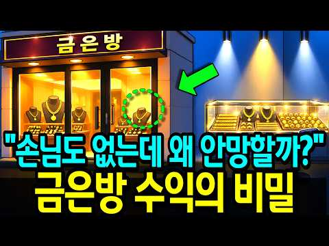 | [안 팔릴수록 부자되는 '동네 금은방'의 소름돋는 수익구조](https://www.youtube.com/watch?v=eFsT1K_mPjc) | 새파란 경제 | 908 | 510,269 | 562.0 | 18,293.3 | 17.6분 | 2026-09-16 | 1. 재테크 일반·마인드 | 설명 | 139/139 |
| 2 |  | [65세 이후 통장에 '이 금액' 있다면 돈 벌지 말고 그냥 인생을 즐겨라ㅣ명언ㅣ인생조언ㅣ오디오북](https://www.youtube.com/watch?v=MJE-dsUuqIM) | 인생의 고수 | 1,580 | 838,223 | 530.5 | 25,985.5 | 34.8분 | 2026-09-12 | 4. 노후·연금 | 설명 | 196/196 |
| 3 | 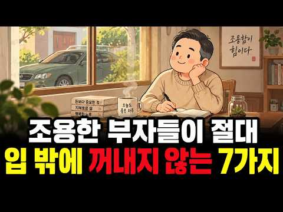 | [조용한 부자들이 절대 입에 담지 않는 7가지 — 돈 있는 사람의 진짜 습관 ㅣ시니어ㅣ오디오북ㅣ노후준비ㅣ심리…](https://www.youtube.com/watch?v=TKBAsjZgVWU) | 가을빛 심리학 | 1,000 | 413,701 | 413.7 | 14,920.6 | 21.7분 | 2026-09-16 | 1. 재테크 일반·마인드 | 설명 | 100/100 |
| 4 |  | [기초연금 개편 진짜였네? 결국 내가 받을 돈 '이렇게' 받는다 [대통령 긴급 발표] 61년생부터 주목](https://www.youtube.com/watch?v=42N9nj2wWko) | 연금노하우 | 1,280 | 412,530 | 322.3 | 8,991.5 | 9.4분 | 2026-08-29 | 4. 노후·연금 | 설명 | 349/349 |
| 5 | 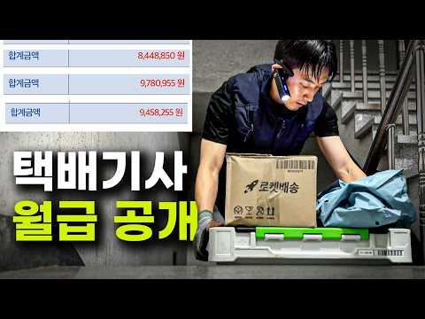 | [생생한 택배기사 최근 6개월치 월급 공개... 이게 '진짜 현실'입니다.](https://www.youtube.com/watch?v=6QkzqMZYrVQ) | 택부 - 택배기사 부자들 | 6,550 | 1,941,365 | 296.4 | 38,114.3 | 8.6분 | 2026-08-24 | 2. 돈 모으기·저축 | 설명 | 1,547/1,547 |
| 6 |  | [은퇴 후 행복한 삶을 누리는 노년층의 4가지 특징 60세 이후 최고의 삶을 누리는 비결은 바로 '이것'을 …](https://www.youtube.com/watch?v=mJbPirgzeu0) | 삶의 깊은 이야기 | 1,600 | 425,737 | 266.1 | 2,625.4 | 21.1분 | 2026-05-05 | 4. 노후·연금 | 설명 | 482/482 |
| 7 | 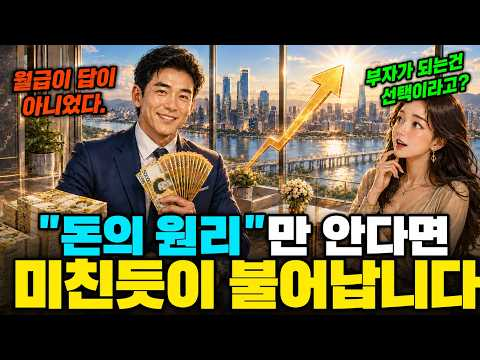 | [부자들이 먼저 배운 돈의 원리, "열심히 벌어도 왜 안 모일까" 자본주의에 대해 알게되면 부자는 불가능한 …](https://www.youtube.com/watch?v=RGKX32DwzMI) | 경제집현전 | 699 | 168,049 | 240.4 | 3,778.3 | 24.2분 | 2026-08-30 | 1. 재테크 일반·마인드 | 설명 | 10/10 |
| 8 | 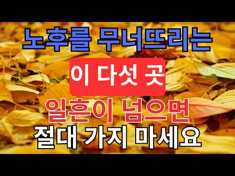 | [일흔이 넘으면 ‘이 다섯 곳’에는 절대 가지 마세요｜노후 자금을 지키는 지혜｜노년의 마음소리](https://www.youtube.com/watch?v=oyiEl0p35BY) | 은퇴후인생수업 | 407 | 89,871 | 220.8 | 1,878.1 | 32분 | 2026-08-27 | 4. 노후·연금 | 설명 | 17/17 |
| 9 | 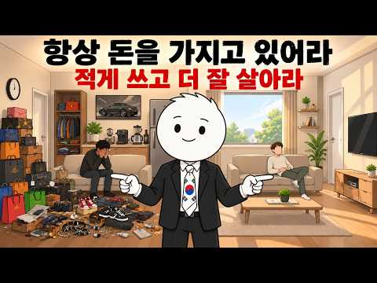 | [돈이 더 적은 사람들이 항상 당신보다 더 많은 것을 가지고 있는 이유](https://www.youtube.com/watch?v=FJq7Cz3CSz8) | 투자 가이드 | 962 | 183,116 | 190.3 | 5,254.1 | 31.1분 | 2026-09-09 | 2. 돈 모으기·저축 | 설명 | 15/15 |
| 10 |  | [은퇴 후 연금만으로 살기 좋은 한국 최고의 섬마을](https://www.youtube.com/watch?v=nksAlCVCgLo) | 살이픽 | 898 | 157,461 | 175.3 | 11,960.9 | 18.3분 | 2026-10-01 | 4. 노후·연금 | 설명 | 47/47 |
| 11 | 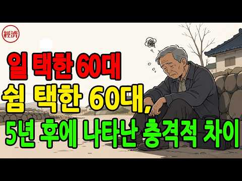 | [60세 이후, 계속 일하는 사람 vs 쉬는 사람 5년 후 놀라운 차이 치매 위험 35% 낮추는 비밀!](https://www.youtube.com/watch?v=qOdjXbl2g6Y) | 쉽게 이해하는 경제 | 2,200 | 373,184 | 169.6 | 2,259.3 | 11.8분 | 2026-05-02 | 4. 노후·연금 | 설명 | 590/590 |
| 12 | 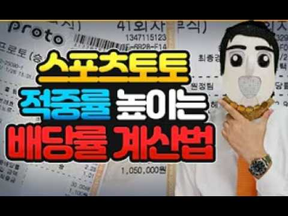 | [[스포츠 토토] 재테크 적중률 높이는 확률 계산법 대공개! #토토 #스포츠토토 #토토분석 #프로토분석 #스…](https://www.youtube.com/watch?v=Ly8W-jVvLa0) | 스포츠토토_메시 | 1,130 | 190,686 | 168.8 | 2,414.5 | 4.4분 | 2026-07-27 | 1. 재테크 일반·마인드 | 없음 | 2/2 |
| 13 | 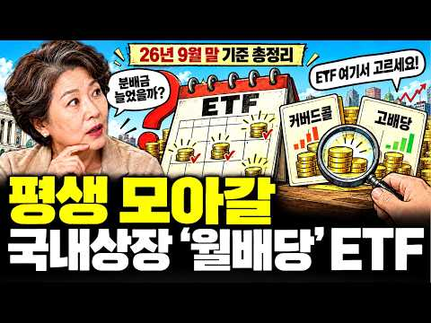 | [ISA·연금저축·IRP에서 평생 모아갈 국내상장 월배당 ETF 총정리 ∣ 9월 분배금 이만큼 나왔습니다 (…](https://www.youtube.com/watch?v=kZJEE6mtay4) | 퇴근후ETF | 169 | 26,238 | 155.2 | 3,297.9 | 19.1분 | 2026-10-06 | 4. 노후·연금 | 설명 | 6/6 |
| 14 |  | [[풀영상] 월급 10%로 당장 시작하는 존리의 자산 증식 치트키](https://www.youtube.com/watch?v=q1fYjAwma3s) | 여의돈스트리트 | 1,330 | 203,470 | 153.0 | 7,721.3 | 36분 | 2026-09-17 | 2. 돈 모으기·저축 | 설명 | 112/112 |
| 15 |  | [50대에 조기퇴직하면 어떤 삶을 살게 될까? 51세에 경제적 자유와 조기은퇴(FIRE)를 이룬 사람의 실제…](https://www.youtube.com/watch?v=6LShuUa4Zt0) | 누군가의 인생 | 1,820 | 273,612 | 150.3 | 11,922.0 | 18.8분 | 2026-09-21 | 4. 노후·연금 | 설명 | 177/177 |
| 16 | 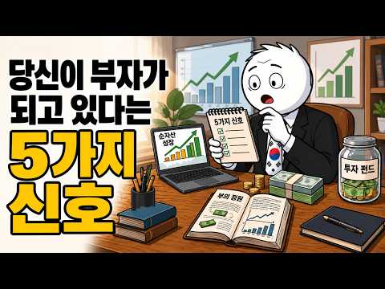 | [본인도 모르는 사이에 남몰래 부자가 되고 있다는 5가지 신호](https://www.youtube.com/watch?v=5kBEU3V3ZXY) | 투자 가이드 | 962 | 138,086 | 143.5 | 5,142.5 | 20분 | 2026-09-17 | 1. 재테크 일반·마인드 | 설명 | 12/12 |
| 17 |  | [노후에 등산가면 접근하는 꽃뱀의 수법, 하필 32년 강력계 형사한테 걸렸다 ∣ 사이다 복수극 ∣ 노후사연 …](https://www.youtube.com/watch?v=ksCSvgpQvg8) | 수채화 인생 이야기 | 4,070 | 460,244 | 113.1 | 12,116.4 | 8.6분 | 2026-09-06 | 4. 노후·연금 | 설명 | 158/158 |
| 18 | 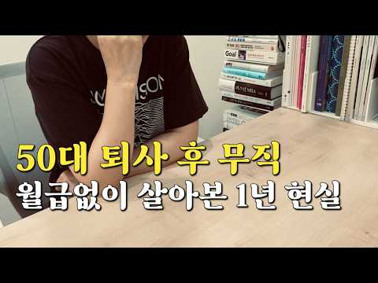 | [50대 억대연봉 임원이 퇴사 1년 후 깨달은 현실](https://www.youtube.com/watch?v=mLyNB42Hhgg) | 50대 새로운 인생 준비… | 2,780 | 311,751 | 112.1 | 5,813.7 | 8.9분 | 2026-08-21 | 기타 | 설명 | 219/219 |
| 19 | 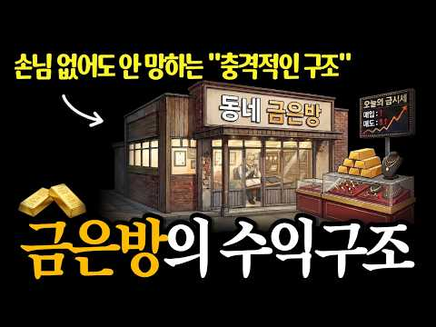 | [재고가 쌓일수록 부자가 되는 유일한 장사, 금은방의 기막힌 구조](https://www.youtube.com/watch?v=DeXKTULwhEI) | 수익구조 연구소 | 4,820 | 523,257 | 108.6 | 14,394.1 | 15.4분 | 2026-09-07 | 1. 재테크 일반·마인드 | 설명 | 115/115 |
| 20 |  | ["순서대로 무너집니다" 금리 7% 시대, 한국 중산층 자산이 흔들리는 진짜 순서 4단계](https://www.youtube.com/watch?v=5wYVYUrG4Ds) | 월급쟁이경제학 | 2,910 | 300,548 | 103.3 | 5,661.3 | 27.8분 | 2026-08-22 | 1. 재테크 일반·마인드 | 설명 | 388/388 |
| 21 |  | [객실 팔아서 돈 버는 게 아니라고? 우리가 몰랐던 호텔이 진짜 돈을 버는 방법](https://www.youtube.com/watch?v=RuWOYsSZl_E) | 머니파이 | 9,110 | 916,998 | 100.7 | 9,778.3 | 17.6분 | 2026-07-12 | 기타 | 설명 | 280/280 |
| 22 | 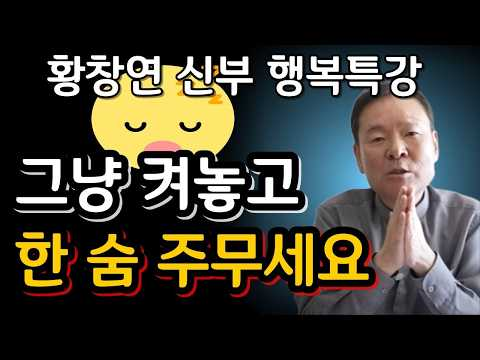 | [나이들수록 '이것' 챙기면 노후가 바뀌고 행복해집니다ㅣ귀티나는 노후를 위한 행복특강ㅣ황창연신부님최근강의ㅣ황…](https://www.youtube.com/watch?v=cn8b0mMUR3Q) | 포강쇼 | 5,060 | 488,848 | 96.6 | 3,884.3 | 179.8분 | 2026-06-10 | 4. 노후·연금 | 설명 | 160/160 |
| 23 | 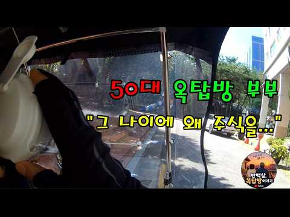 | [50대 옥탑방 부부, "그 나이에 왜 주식을..."](https://www.youtube.com/watch?v=FRzyTNO9mNI) | 반백살, 옥탑방 이야기 | 580 | 42,191 | 72.7 | 3,902.9 | 6.3분 | 2026-10-03 | 3. 주식·ETF | 설명 | 187/187 |
| 24 |  | [나스닥 투자하기 전에 이 영상 꼭 보세요 ∣ QLD만 모아가는 이유](https://www.youtube.com/watch?v=g10Y6ZA7rng) | 올레버 | 1,580 | 114,758 | 72.6 | 856.4 | 5.7분 | 2026-06-02 | 3. 주식·ETF | 설명 | 347/347 |
| 25 | 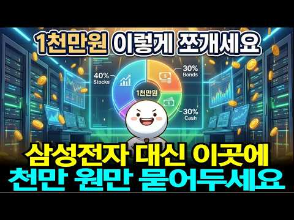 | [5060 노후 준비, 1000만원으로 매월 배당금 받는 가장 현실적인 방법](https://www.youtube.com/watch?v=xQnFTZLNzOM) | 맛스토리 | 3,000 | 189,623 | 63.2 | 1,135.8 | 17.6분 | 2026-04-30 | 3. 주식·ETF | 설명 | 44/44 |
| 26 |  | [아무리 돈이 많아도 없는 척하세요, 재산이 알려지면 생기는 일](https://www.youtube.com/watch?v=FrSslE4xeBA) | 인생다시쓰기 | 8,060 | 505,964 | 62.8 | 10,239.2 | 17.3분 | 2026-08-25 | 1. 재테크 일반·마인드 | 설명 | 250/250 |
| 27 |  | [[100만 조회수] 대기업 30년 다니고 은퇴했지만, 78세에 고시원에서 혼자 사는 이유](https://www.youtube.com/watch?v=8_rq_vVFDTg) | 아니모 인생기록관 | 21,600 | 1,338,670 | 62.0 | 11,609.3 | 14.5분 | 2026-06-21 | 4. 노후·연금 | 설명 | 1,690/1,690 |
| 28 |  | ["와, 이렇게 돈 버는 여자 처음 봤습니다" 마트 사진 찍어 올려 월 3천만원 버는 98년생의 비밀부업추천](https://www.youtube.com/watch?v=N0gXuYAjgwk) | 머니종결자 | 8,000 | 452,263 | 56.5 | 14,590.2 | 17.4분 | 2026-09-13 | 8. 부업·소득 | 설명 | 3,562/3,565 |
| 29 | 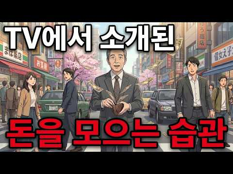 | [60대부터라도 싫어도 부자가 된다. TV에서 소개된 ‘5가지 마법의 습관’이 너무 대단했다](https://www.youtube.com/watch?v=t94bcrWeee0) | 인간 인사이트 | 946 | 53,221 | 56.3 | 471.5 | 30.4분 | 2026-06-23 | 1. 재테크 일반·마인드 | 설명 | 40/40 |
| 30 |  | [여자배구 페퍼저축은행 결국 SOOP 인수 확정, 새 외국인 선수 레베카? 투트쿠? 시마무라 재계약 여부는?](https://www.youtube.com/watch?v=KSCrtH33vPA) | 배구의정석 | 998 | 51,819 | 51.9 | 342.5 | 4.9분 | 2026-05-16 | 2. 돈 모으기·저축 | 설명 | 184/184 |
| 31 |  | [AI로 주식 자동 매매하면 어떻게 될까?](https://www.youtube.com/watch?v=9E9OrcoMCjk) | 이영배 | 18,800 | 962,332 | 51.2 | 8,306.8 | 11.3분 | 2026-06-20 | 3. 주식·ETF | 없음 | 576/576 |
| 32 | 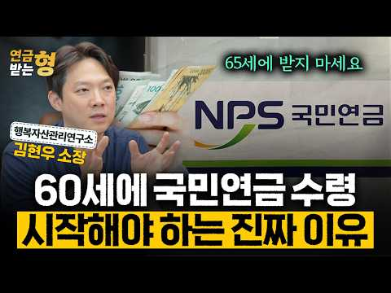 | ["모르면 노후에 후회한다" 국민연금 65세 말고 무조건 '이때' 받으세요 ∣ 김현우 소장 ∣ 연금받는형](https://www.youtube.com/watch?v=q3Pig5W6QaI) | 연금 받는 형 | 21,500 | 1,022,606 | 47.6 | 18,309.2 | 22.9분 | 2026-08-19 | 4. 노후·연금 | 설명 | 481/481 |
| 33 | 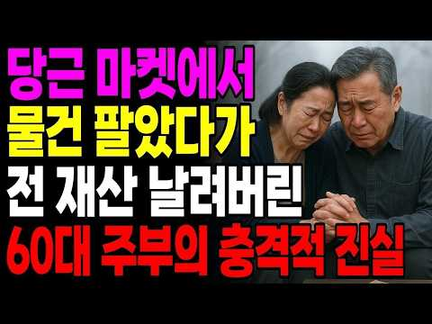 | [“은퇴자금 아끼려고 당근에 물건 하나 올렸다가…60대 노후가 무너졌습니다”ㅣ 은퇴자금 ㅣ노후사연 ㅣ오디오](https://www.youtube.com/watch?v=YydZ774lKfI) | 노을서사 | 1,790 | 82,621 | 46.2 | 4,914.9 | 73.1분 | 2026-09-27 | 4. 노후·연금 | 설명 | 94/94 |
| 34 | 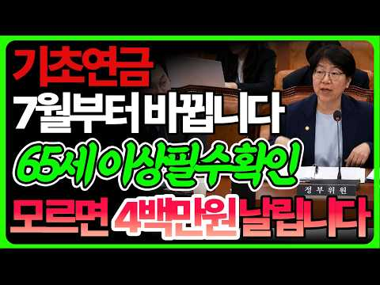 | [(긴급)매달 나오던 기초연금 7월부터 바뀝니다!! 받던 분도 꼭 확인하세요](https://www.youtube.com/watch?v=TozHpX9DmQU) | 경상도이서방 | 5,520 | 250,421 | 45.4 | 1,856.6 | 9.2분 | 2026-06-01 | 4. 노후·연금 | 설명 | 163/163 |
| 35 | 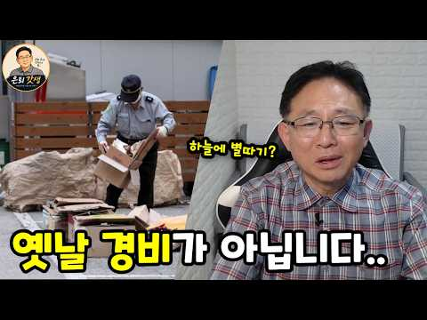 | [은퇴 후 경비직에 사람들이 몰리는 진짜 이유](https://www.youtube.com/watch?v=7kHfB06S2NM) | 은퇴갓생 | 6,780 | 287,847 | 42.5 | 3,594.0 | 15.7분 | 2026-07-26 | 4. 노후·연금 | 설명 | 350/350 |
| 36 | 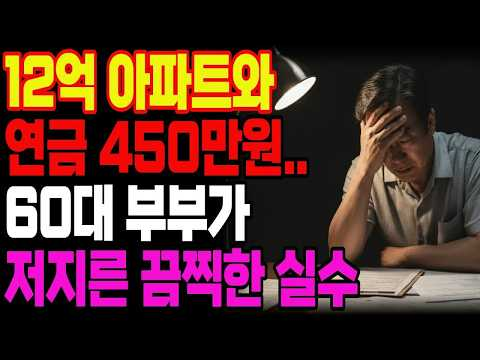 | [노후자금사연 월 450만원 연금 받는 전직 은행원 60대 부부도 무너지는 충격적인 현상황!](https://www.youtube.com/watch?v=pMZmS_k_s0U) | 삶의시나리오 | 2,820 | 115,876 | 41.1 | 4,257.3 | 110.8분 | 2026-09-17 | 4. 노후·연금 | 설명 | 104/104 |
| 37 |  | [예비 며느리 시험하려 청소부로 변장한 재벌회장, 일부러 커피 쏟았는데 그녀의 행동에 말문이 막혔습니다 ∣ …](https://www.youtube.com/watch?v=PX-qc9FOViA) | 인생유랑 | 20,900 | 856,988 | 41.0 | 14,567.6 | 96.3분 | 2026-08-16 | 4. 노후·연금 | 설명 | 294/294 |
| 38 |  | [배당주 20년 vs S&P500 20년, 3억 원이 만든 충격적인 자산과 삶의 격차 [ 재테크/미국주식/E…](https://www.youtube.com/watch?v=cqgVNBbMYew) | 박대리와 황과장의 경제이… | 1,920 | 78,181 | 40.7 | 1,029.0 | 20.5분 | 2026-07-30 | 1. 재테크 일반·마인드 | 설명 | 162/162 |
| 39 | 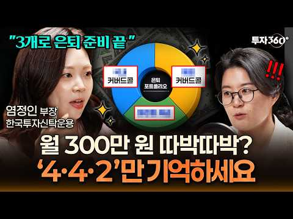 | ["원금 안 깎여요" 진화형 커버드콜 ETF 황금 포트폴리오 공개](https://www.youtube.com/watch?v=yGuybuoroRI) | 투자360 | 15,800 | 633,839 | 40.1 | 6,098.4 | 22.2분 | 2026-07-02 | 3. 주식·ETF | 설명 | 574/574 |
| 40 |  | [연금 310만 원을 말한 뒤 40년 계모임이 깨졌습니다… 노후에 말하면 안 되는 4가지](https://www.youtube.com/watch?v=vU5PWT2zLDs) | 노년의 마음소리 | 33,500 | 1,247,649 | 37.2 | 30,478.7 | 29분 | 2026-09-03 | 4. 노후·연금 | 설명 | 771/771 |
| 41 |  | [50대 이후, 인생이 술술 풀리는 여성들의 3가지 비밀 ∣ 심리학 ∣ 뇌과학 ∣ 행복한노후 ∣](https://www.youtube.com/watch?v=mopoYlkCYC4) | 브라보 인생후반전 | 7,670 | 277,152 | 36.1 | 1,847.3 | 21.9분 | 2026-05-17 | 4. 노후·연금 | 설명 | 214/214 |
| 42 | 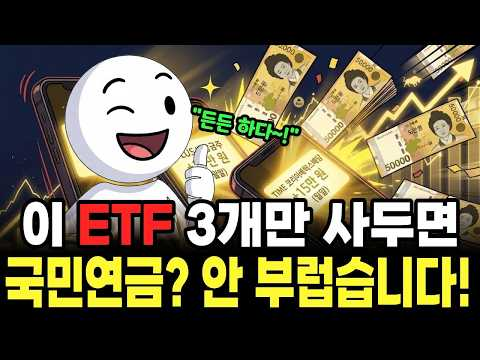 | [국민연금 빈칸 메우는 한국 ETF 3개 — 월 200만 원 평생 월급 만들기](https://www.youtube.com/watch?v=7rtO_hfLvF8) | 술술 경제학 | 17,600 | 608,500 | 34.6 | 3,624.5 | 16.8분 | 2026-04-29 | 3. 주식·ETF | 설명 | 284/284 |
| 43 |  | [주 4일 · 창고 알바 여성의 저축이 약 28만 7천 원 → 약 4,393만 원으로 늘었다, 싫어도 부자가…](https://www.youtube.com/watch?v=qKJQ58SOsow) | 노후 재테크 | 2,320 | 79,707 | 34.4 | 781.9 | 31분 | 2026-07-04 | 1. 재테크 일반·마인드 | 설명 | 79/79 |
| 44 |  | [복리가 부를 만드는 진짜 시작점｜언제부터 돈이 스스로 일하기 시작할까](https://www.youtube.com/watch?v=JExUQaROk40) | 돈의 통찰 | 3,930 | 131,681 | 33.5 | 1,569.1 | 17.8분 | 2026-07-22 | 3. 주식·ETF | 설명 | 103/103 |
| 45 |  | [2026년 7월부터 기초연금 이렇게 바뀝니다 — 모르면 매달 33만원 손해](https://www.youtube.com/watch?v=ddEat5zF-yU) | 모두의딸 | 5,670 | 184,556 | 32.5 | 1,936.1 | 11.6분 | 2026-07-10 | 4. 노후·연금 | 설명 | 267/267 |
| 46 |  | [금값, 이제 시작입니다. 이것 때문에 금이 폭등합니다.](https://www.youtube.com/watch?v=1eQJLsk4Fm8) | 지금 돈 공부 | 737 | 23,504 | 31.9 | 576.2 | 18.8분 | 2026-09-03 | 기타 | 설명 | 35/35 |
| 47 |  | [경제적 자유의 진실: 이 원리를 모르면 당신은 80살까지 평생 출근해야 합니다](https://www.youtube.com/watch?v=2y3YphVxQaA) | 김상훈의 재테크 | 2,930 | 92,404 | 31.5 | 695.8 | 28.7분 | 2026-06-03 | 1. 재테크 일반·마인드 | 설명 | 135/135 |
| 48 |  | [독일인은 부자인데 왜 가난하게 살까? ∣ 조용히 부자 되는 돈 습관 10가지](https://www.youtube.com/watch?v=yfLp54zD9Gk) | 돈나침반 | 2,350 | 73,180 | 31.1 | 796.4 | 27.6분 | 2026-07-14 | 1. 재테크 일반·마인드 | 설명 | 109/109 |
| 49 |  | ["연금 저축부터 채워라?" 연봉 따라 순서 뒤집히는 ISA·연금저축·IRP](https://www.youtube.com/watch?v=m-ZkLW7xMvk) | 머니랩 : 내 돈 지키는… | 380 | 11,446 | 30.1 | 133.2 | 14.2분 | 2026-07-20 | 4. 노후·연금 | 설명 | 17/17 |
| 50 |  | [한겨울 저수지 뚝방에 버려진 치매 엄마, 아들 차가 떠나자마자 보따리에서 꺼낸 이것은..ㅣ노후사연ㅣ감동사연…](https://www.youtube.com/watch?v=Pnrbrya6urQ) | 햇살 머문 인생 | 30,500 | 886,017 | 29.1 | 12,817.2 | 137.6분 | 2026-08-06 | 4. 노후·연금 | 설명 | 1,406/1,406 |
| 51 |  | ["저축은 의미 없어집니다" 머스크의 미래 예측이 하나씩 현실이 되는 진짜 이유](https://www.youtube.com/watch?v=o9wqKcVOwPI) | 경제우체부 | 9,570 | 277,072 | 28.9 | 2,636.5 | 23.2분 | 2026-07-01 | 2. 돈 모으기·저축 | 설명 | 166/166 |
| 52 |  | ["큰 돈 안들이고 평생 즐긴다" 퇴직 후 비참한 노후를 피하는 취미 3가지 I 교수 정선용 (3부)](https://www.youtube.com/watch?v=IQd8juHSTuw) | 퇴평성대 | 24,300 | 695,761 | 28.6 | 16,208.9 | 12.3분 | 2026-09-01 | 4. 노후·연금 | 설명 | 192/192 |
| 53 |  | [삼성 전고체 배터리가 노리는 진짜 목표](https://www.youtube.com/watch?v=imK95IyKW3Q) | 돈공부 | 4,550 | 118,841 | 26.1 | 756.1 | 13.1분 | 2026-05-10 | 1. 재테크 일반·마인드 | 설명 | 95/95 |
| 54 |  | ['5천피' 예언적중한 문남중 "코스피 저점? 5040 봅니다, 지금은 아무것도 하지 마세요" #문남중 _2…](https://www.youtube.com/watch?v=SrwNTk6GT9U) | 경제통마늘 | 11,300 | 295,016 | 26.1 | 3,872.9 | 19.6분 | 2026-07-30 | 3. 주식·ETF | 설명 | 989/989 |
| 55 |  | [매일 아침 7시, 내 포트폴리오를 관리해주는 AI 주식 비서를 만들어봤습니다](https://www.youtube.com/watch?v=ITzgH6CeZns) | 스티브의 파도타기 ∣ A… | 26,600 | 680,729 | 25.6 | 4,907.8 | 14.8분 | 2026-05-28 | 3. 주식·ETF | 설명 | 387/388 |
| 56 |  | [금융자산 10억 부자도 아직 공부합니다… 평생 돈이 안 모이는 사람은 ‘이 6가지’를 놓칩니다](https://www.youtube.com/watch?v=i9Mj9VvL20o) | 오십의 경제지도 | 677 | 17,188 | 25.4 | 842.4 | 16.5분 | 2026-09-23 | 1. 재테크 일반·마인드 | 설명 | 1/1 |
| 57 |  | [월배당 ETF 10억 투자하면 정말 배당금 얼마? ∣ 종합소득세·건강보험료 계산법 (은퇴 현금흐름 설계)](https://www.youtube.com/watch?v=yRDpbgaZahc) | 은퇴머니 - 은퇴 현금흐… | 30,000 | 748,689 | 25.0 | 5,528.1 | 11.4분 | 2026-05-31 | 6. 절세·제도 | 설명 | 965/965 |
| 58 |  | [머스크가 던진 32개 예측 중 부자들이 베팅한 TOP 7 카운트다운 "이미 19개가 맞았습니다"](https://www.youtube.com/watch?v=EomU4-CfZCw) | 경제가머니 | 22,500 | 558,543 | 24.8 | 3,629.4 | 27.2분 | 2026-05-13 | 1. 재테크 일반·마인드 | 설명 | 484/484 |
| 59 | 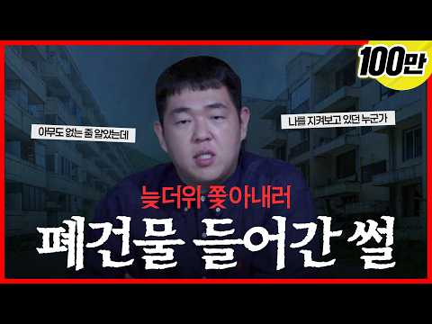 | [에어컨이 필요 없는 문쌤의 폐건물 괴담 [문쌤 라디오]](https://www.youtube.com/watch?v=2yOps8H0fWs) | 한국자산관리공사 캠코TV | 42,700 | 1,040,777 | 24.4 | 31,521.0 | 15.8분 | 2026-09-11 | 1. 재테크 일반·마인드 | 설명 | 853/853 |
| 60 |  | [주식 상위 2%만 아는 10가지 절대 생존 원칙 (돈의 원리)](https://www.youtube.com/watch?v=fFURFeLTdAg) | 준의 경제노트 (jun’… | 12,600 | 305,667 | 24.3 | 2,438.1 | 21.6분 | 2026-06-10 | 3. 주식·ETF | 설명 | 189/189 |
| 61 |  | [65세 이후 통장에 돈 이정도 들어있다면 돈 벌지 말고 그냥 돈 쓰면서 사세요ㅣ명언ㅣ인생조언ㅣ오디오북ㅣ라디…](https://www.youtube.com/watch?v=kXnYK2PiBDc) | 철인의지혜 | 18,400 | 446,340 | 24.3 | 11,402.6 | 26.9분 | 2026-09-05 | 4. 노후·연금 | 설명 | 130/130 |
| 62 |  | [주식 AI 비서 4명 만들었더니 공부가 쉬워졌어요 (제미나이 활용법)](https://www.youtube.com/watch?v=02hqxRMURPs) | 공부하는 주린이 | 1,310 | 31,158 | 23.8 | 199.8 | 7.1분 | 2026-05-11 | 3. 주식·ETF | 설명 | 36/36 |
| 63 |  | ["돈 버는 규칙은 따로 있어요." 1300억 부자가 추천하는 단 한권의 책/인생책/레버리지 몰아보기](https://www.youtube.com/watch?v=vD6oAnU4ZPo) | 달콤하게성장 | 8,040 | 181,711 | 22.6 | 8,497.9 | 34.7분 | 2026-09-22 | 1. 재테크 일반·마인드 | 설명 | 95/95 |
| 64 |  | [1억 모았으면 지금 당장 이것부터 하세요. 10억 가는 사람은 여기서 갈립니다.](https://www.youtube.com/watch?v=USUzkksspmg) | 지금 돈 공부 | 737 | 16,603 | 22.5 | 133.1 | 13.6분 | 2026-06-11 | 2. 돈 모으기·저축 | 설명 | 9/9 |
| 65 |  | [【김형석 교수】 자식에게 통장을 맡기지 마십시오｜노후 자금이 가장 안전한 세 곳](https://www.youtube.com/watch?v=Gd_EdTezZBw) | 영혼의 철학 | 4,860 | 108,084 | 22.2 | 1,422.7 | 52.5분 | 2026-07-30 | 4. 노후·연금 | 없음 | 24/24 |
| 66 |  | [노후 걱정 끝, 커버드콜로 평생 월급받는 법 ∣ 커버드콜 ETF ∣ 조재영 웰스에듀 부사장](https://www.youtube.com/watch?v=IePgz3kEuNk) | 투자360 | 15,800 | 350,615 | 22.2 | 2,101.1 | 22.8분 | 2026-04-30 | 3. 주식·ETF | 설명 | 237/237 |
| 67 |  | [내 주변에 주식으로 돈 번 사람이 '진짜' 단 1명도 없는 소름 돋는 이유 ∣ 교수 정선용 (통합본)](https://www.youtube.com/watch?v=SwW4n0ERlS8) | 너와 나의 경제학교 | 30,200 | 613,828 | 20.3 | 10,075.1 | 52.7분 | 2026-08-14 | 3. 주식·ETF | 설명 | 1,622/1,622 |
| 68 |  | [🇨🇦 아무도 알려주지 않았던 '은퇴의 잔인한 현실' 8가지! ∣ 브랜든 캐나다](https://www.youtube.com/watch?v=XWjW3xiUKxw) | 브랜든 캐나다 투자전략 | 3,240 | 65,369 | 20.2 | 844.2 | 18.1분 | 2026-07-28 | 4. 노후·연금 | 설명 | 78/78 |
| 69 |  | ["삼성전자 SK하이닉스 2배 레버리지 ETF" 5월 22일 상장 확정인데 증권사 CEO 열 명 중 아홉 명…](https://www.youtube.com/watch?v=aTh--_DtGNU) | 이코노메이션 | 14,400 | 274,426 | 19.1 | 1,726.3 | 25.6분 | 2026-05-08 | 3. 주식·ETF | 설명 | 808/808 |
| 70 |  | [1억이 우스우세요 사실 여기서부터가 진짜 시작입니다](https://www.youtube.com/watch?v=-O-ROZCAU_4) | 송차장기록 | 8,440 | 160,569 | 19.0 | 1,559.3 | 15.4분 | 2026-07-03 | 2. 돈 모으기·저축 | 설명 | 595/595 |
| 71 |  | [1억, 5억, 10억, 30억 자산 구간별 나타나는 인생 변화. (부자들이 돈 버는 법)](https://www.youtube.com/watch?v=hA5g5pbTFUo) | 신현욱의 경영백서 | 8,410 | 155,355 | 18.5 | 1,272.4 | 26.2분 | 2026-06-14 | 1. 재테크 일반·마인드 | 설명 | 423/423 |
| 72 |  | [주식으로 돈 잃는 사람들이 겪는 4가지 함정 (ft. 조영구, 장성규) ∣ 뇌과학과 데이터로 분석한 상위 …](https://www.youtube.com/watch?v=AeK-KvdyI-k) | 준의 경제노트 (jun’… | 12,600 | 228,391 | 18.1 | 1,539.3 | 14.9분 | 2026-05-18 | 3. 주식·ETF | 설명 | 319/319 |
| 73 |  | [기준 금리 요동치는 지금, 내 계좌 살리는 분산 포트 비율 (홍춘욱 박사)](https://www.youtube.com/watch?v=RfFgJJomevo) | 오늘의 경제노트 | 1,160 | 20,924 | 18.0 | 833.6 | 17.6분 | 2026-09-19 | 3. 주식·ETF | 설명 | 4/4 |
| 74 |  | [손 하나 까딱 않는 며느리에게 가게를 맡겼더니, 한달 뒤 놀라운 일이 벌어지는데... ㅣ노후사연ㅣ감동사연ㅣ…](https://www.youtube.com/watch?v=9h3kmvUNlB0) | 마음나날 | 14,900 | 264,874 | 17.8 | 3,217.6 | 110.1분 | 2026-07-23 | 4. 노후·연금 | 설명 | 387/387 |
| 75 |  | [매달 배당 받으면서 세금도 아끼는 구조 ∣ IRP 황금 포트폴리오-당신의 IRP, 지금 일하고 있나요?](https://www.youtube.com/watch?v=g2en6jgo9Aw) | 투게더경제학 | 806 | 14,248 | 17.7 | 95.6 | 18.3분 | 2026-05-18 | 3. 주식·ETF | 설명 | 2/2 |
| 76 |  | [평생 모은 돈, 노후에는 이 3가지에 먼저 쓰세요](https://www.youtube.com/watch?v=_H2oRoXuF-Q) | 인생다시쓰기 | 8,060 | 140,789 | 17.5 | 6,889.4 | 16.4분 | 2026-09-23 | 4. 노후·연금 | 설명 | 12/12 |
| 77 |  | [돈 이야기가 아닙니다. 노후에 ‘남편이 있는 집’과 ‘남편이 없는 집’의 너무나 잔혹한 결정적 차이](https://www.youtube.com/watch?v=A9MWoLgYDnQ) | 마음을 안아주는 이야기-… | 14,700 | 248,782 | 16.9 | 4,130.7 | 40.7분 | 2026-08-15 | 4. 노후·연금 | 설명 | 335/335 |
| 78 |  | [노년에 이성이 접근한다면, 목적은 딱 4가지입니다… 돈이 있든 없든 반드시 보세요【노후의 진실】](https://www.youtube.com/watch?v=RRnTh3k1Fls) | 노후의 진실 | 20,100 | 333,845 | 16.6 | 3,340.6 | 29.1분 | 2026-07-06 | 4. 노후·연금 | 설명 | 469/469 |
| 79 |  | [《정약용 명언》 부자가 되는 여성이 즐겨 입는 옷 색깔 5가지. 이 색만 입어도 평생 재물이 따릅니다](https://www.youtube.com/watch?v=BTpNqy7XqJE) | 다산의 서재 | 22,200 | 363,948 | 16.4 | 5,752.0 | 36.9분 | 2026-08-12 | 1. 재테크 일반·마인드 | 설명 | 1,619/1,619 |
| 80 |  | [62세 은퇴후 아내마저 떠났다. 68세에 월 80만원으로 살아가는 노인의 독백 "삼십 년을 살았는데, 아내…](https://www.youtube.com/watch?v=ObUr9qiawmo) | 황금노후 | 12,400 | 194,163 | 15.7 | 1,265.8 | 13.7분 | 2026-05-13 | 4. 노후·연금 | 설명 | 610/610 |
| 81 |  | [50대 자산 7억이 거지라고 진짜 평균은 따로 있습니다](https://www.youtube.com/watch?v=TK4FK8lH1Qs) | 송차장기록 | 8,440 | 131,445 | 15.6 | 882.4 | 17.6분 | 2026-05-18 | 기타 | 설명 | 689/689 |
| 82 |  | ["이건 저희 부모님도 가능해요" 외국인한테 한국어 읽어주고 달러 버는 역대급 부업](https://www.youtube.com/watch?v=lHj-_pcQSX4) | 뉴머니 | 27,800 | 405,639 | 14.6 | 4,832.2 | 16.1분 | 2026-07-22 | 8. 부업·소득 | 설명 | 990/990 |
| 83 |  | [저는 1년 동안 매달 5만 원을 모아봤습니다. 그리고 돈에 대한 생각이 달라졌습니다](https://www.youtube.com/watch?v=IBAvE_dF0L4) | 돈의 통찰 | 3,930 | 56,958 | 14.5 | 921.5 | 41.6분 | 2026-08-13 | 기타 | 설명 | 40/40 |
| 84 | 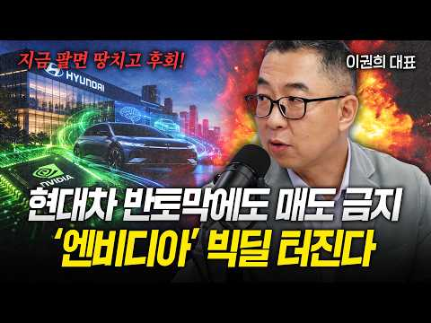 | [현대차 반토막에 숨겨진 진실… 엔비디아 합작 발표 전 무조건 모아야 할 이유 [이권희 대표]](https://www.youtube.com/watch?v=m3ZRHahRGHU) | 경제시그널 | 27,500 | 397,862 | 14.5 | 50,534.3 | 33분 | 2026-10-06 | 기타 | 설명 | 206/206 |
| 85 | 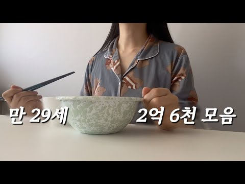 | [월 300 직장인ㅣ알바하면서 3억 모으기ㅣ고물가시대 집밥으로 60% 저축ㅣ사실상 걍생 브이로그](https://www.youtube.com/watch?v=_o4FbnwxGrw) | 테라 | 9,400 | 135,113 | 14.4 | 995.8 | 7.8분 | 2026-05-31 | 2. 돈 모으기·저축 | 설명 | 312/312 |
| 86 | 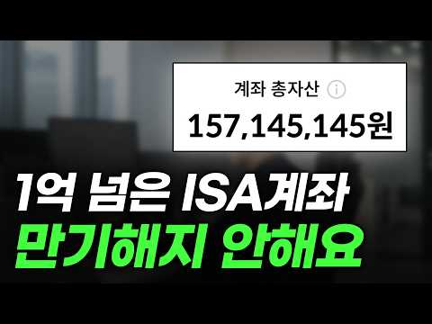 | [중개형 ISA 계좌 만기해지 안 하는 이유](https://www.youtube.com/watch?v=AbpqDkCFTT0) | 청년개미 | 15,800 | 224,984 | 14.2 | 1,361.8 | 5.2분 | 2026-05-02 | 6. 절세·제도 | 설명 | 537/537 |
| 87 |  | [퇴직 공무원들의 연금과 생활비는 어떨까｜고위공무원·별정직·군인·구청공무원에게 직접 물었습니다](https://www.youtube.com/watch?v=WOiX6ELngak) | 아니모 인생기록관 | 21,600 | 305,635 | 14.2 | 2,987.9 | 34.2분 | 2026-07-04 | 4. 노후·연금 | 설명 | 607/607 |
| 88 |  | [얼마 있어야 대한민국 평균일까? ∣ 2026 대한민국 자산 계급도 완전 분석](https://www.youtube.com/watch?v=FddFrDSLQDU) | 경제만담 | 1,800 | 24,734 | 13.7 | 159.6 | 18.5분 | 2026-05-12 | 4. 노후·연금 | 설명 | 47/47 |
| 89 |  | [1천만원으로 시작한다면 ‘분산 공식’부터 버리세요 — 소액 투자 자산배분 4원칙](https://www.youtube.com/watch?v=UqaJYS7vQfE) | 경제포커스 | 1,230 | 16,805 | 13.7 | 489.2 | 18.7분 | 2026-09-09 | 3. 주식·ETF | 설명 | 0/0 |
| 90 | 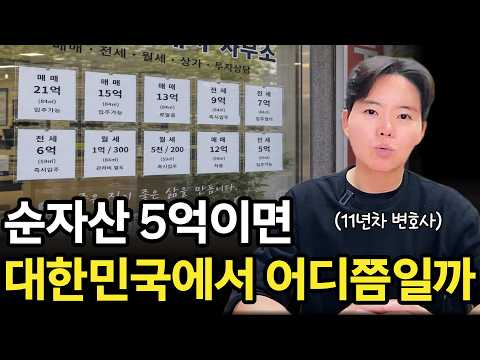 | [순자산 5억은 대한민국에서 정확히 어디쯤인걸까](https://www.youtube.com/watch?v=abPHpPAuZmw) | 탐구하는 변호사 송현영 | 9,680 | 131,847 | 13.6 | 4,019.1 | 14.7분 | 2026-09-11 | 1. 재테크 일반·마인드 | 설명 | 194/194 |
| 91 | 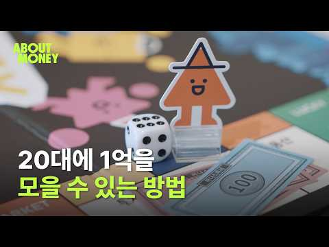 | [20대에 1억 모으기 가능할까?](https://www.youtube.com/watch?v=yQfFHr8xZi8) | 토스뱅크 오리지널 | 5,310 | 71,871 | 13.5 | 647.9 | 10.3분 | 2026-06-25 | 2. 돈 모으기·저축 | 설명 | 4/4 |
| 92 | 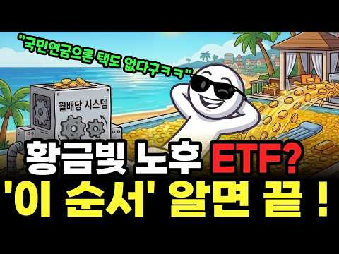 | [ETF 2개 + 절세 계좌 3개, 이 순서대로 채우면 매달 100만 원이 들어옵니다!](https://www.youtube.com/watch?v=PzWL53BrkcQ) | 술술 경제학 | 17,600 | 230,573 | 13.1 | 1,591.4 | 18분 | 2026-05-22 | 3. 주식·ETF | 설명 | 262/262 |
| 93 | 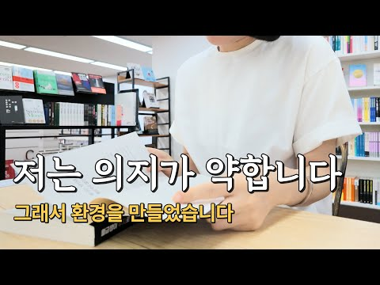 | [48살이 되어서야 돈보다 중요한 걸 배웠습니다 l 돈 공부를 시작했더니 제 인생이 달라졌습니다](https://www.youtube.com/watch?v=y4ZUoXoQuXA) | 안녕, 오후 | 4,380 | 55,676 | 12.7 | 630.2 | 7.4분 | 2026-07-17 | 1. 재테크 일반·마인드 | 설명 | 96/96 |
| 94 |  | [내 주변에 주식으로 돈 번 사람이 '진짜' 단 한 명도 없는 소름 돋는 이유 ∣ 교수 정선용 (3부)](https://www.youtube.com/watch?v=k9be9TSs41s) | 너와 나의 경제학교 | 30,200 | 370,855 | 12.3 | 4,884.5 | 11.9분 | 2026-07-30 | 3. 주식·ETF | 설명 | 1,286/1,286 |
| 95 |  | [노후자금 2억 태양광에 넣은 50대, 1년 만에 벌어진 일ㅣ태양광발전사업 리스크 정리](https://www.youtube.com/watch?v=keim9Fw6NwE) | 짐컴퍼니ㅣ태양광의 모든 것 | 3,780 | 45,565 | 12.1 | 680.7 | 7.9분 | 2026-08-08 | 4. 노후·연금 | 설명 | 36/36 |
| 96 | 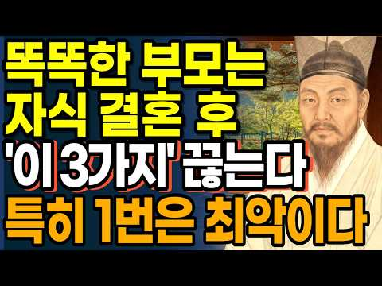 | [현명한 부모는 결혼한 자식에게 '이 3가지' 당장 끊어낸다 ∣ 정약용 명언 ∣ 인간관계 조언 ∣ 오디오북 …](https://www.youtube.com/watch?v=TkBt14Q2mnQ) | 현인의등불 | 36,700 | 431,970 | 11.8 | 3,212.7 | 28.4분 | 2026-06-01 | 4. 노후·연금 | 설명 | 504/504 |
| 97 |  | [나이가 들면, 저축은 어디에 두어야합니까? 75세가 있는 여성의 방법이 절묘하면 화제에. 이것은 모든 사람…](https://www.youtube.com/watch?v=MDxxdf11In8) | 마음의 빛이 영혼을 비춘다 | 5,080 | 59,135 | 11.6 | 542.7 | 31.8분 | 2026-06-27 | 2. 돈 모으기·저축 | 설명 | 100/100 |
| 98 | 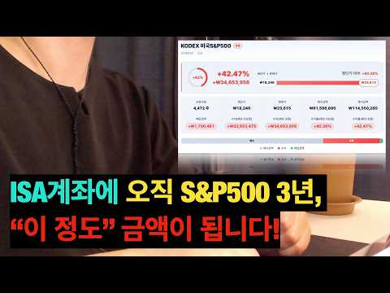 | [ISA 계좌, S&P500 하나로 3년 굴리면 얼마 벌까? (ft. 향후 계획 포함)](https://www.youtube.com/watch?v=3mIsnHTgylg) | 원원 - 파이어 준비생 | 16,900 | 195,289 | 11.6 | 1,367.2 | 15.6분 | 2026-05-24 | 3. 주식·ETF | 설명 | 672/672 |
| 99 | 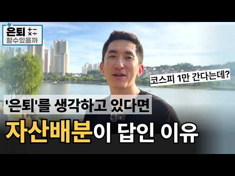 | [연금자산! 주식형 ETF 팔고, 자산배분 포트폴리오로 리밸런싱하세요.](https://www.youtube.com/watch?v=_YjqNIK-ONY) | 은퇴할수있을까 | 2,150 | 23,396 | 10.9 | 163.9 | 11.3분 | 2026-05-24 | 3. 주식·ETF | 설명 | 37/37 |
| 100 |  | [[원가공개] 100만 유튜버, 한달에 얼마 벌까?](https://www.youtube.com/watch?v=HSAB2xHXtiQ) | 원가 공개 경제학 | 40,500 | 426,746 | 10.5 | 4,180.5 | 26.1분 | 2026-07-04 | 기타 | 설명 | 125/125 |
| 101 | 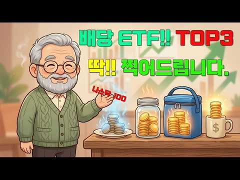 | [# "같은 ETF도 통장 잘못 고르면 손해" 직장인 배당 ETF TOP 3 + 1 통장 매칭 가이드, 배당…](https://www.youtube.com/watch?v=LHUIFXJ3eAs) | 머니톡 마니업 | 1,080 | 10,992 | 10.2 | 70.8 | 15.1분 | 2026-05-11 | 3. 주식·ETF | 설명 | 10/10 |
| 102 | 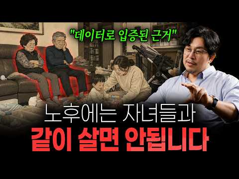 | [노후에 자녀와 같이 살면 안 되는 이유｜데이터가 보여준 부모와 자녀의 적정 거리](https://www.youtube.com/watch?v=Zor4Zw2SyYI) | 김지호의 공간문해력 | 18,300 | 179,016 | 9.8 | 3,137.3 | 15.7분 | 2026-08-18 | 4. 노후·연금 | 설명 | 241/241 |
| 103 | 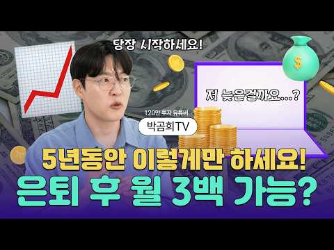 | [은퇴 후 노후 걱정? 이렇게만 하면 월 300만 원도 가능합니다!ㅣ은퇴레시피](https://www.youtube.com/watch?v=0vnE5QONVtk) | 건강IN으로 | 16,900 | 162,739 | 9.6 | 1,178.2 | 18.9분 | 2026-05-29 | 4. 노후·연금 | 설명 | 90/90 |
| 104 | 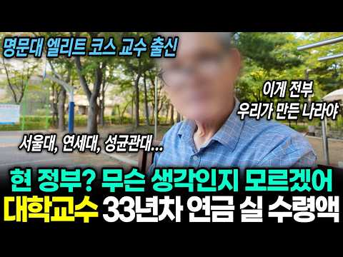 | ["우리나라 현 정부 얼마 안남았어" 명문대 엘리트 코스 33년차 교수는 연금을 얼마나 받을까?](https://www.youtube.com/watch?v=IAFVinxTAbQ) | 할티비 | 39,500 | 379,369 | 9.6 | 11,879.4 | 11.9분 | 2026-09-12 | 4. 노후·연금 | 설명 | 1,047/1,047 |
| 105 |  | [퇴직금 반토막 나고 깨달은 '상위 2%'의 주식투자자 생존법 6가지! ∣ 노후자금사연 ∣ 오디오북](https://www.youtube.com/watch?v=r-tcC-ZmMBE) | 은빛시나리오 | 29,200 | 276,405 | 9.5 | 1,790.3 | 52.8분 | 2026-05-12 | 3. 주식·ETF | 설명 | 424/424 |
| 106 |  | [미국 주식 10억 투자 직접해보니 믿기 힘든 결과가 생깁니다](https://www.youtube.com/watch?v=-PrN9w6Fu0Y) | 억빌더 ∣ 순자산 10억… | 6,490 | 61,266 | 9.4 | 508.9 | 10.6분 | 2026-06-15 | 3. 주식·ETF | 설명 | 86/86 |
| 107 | 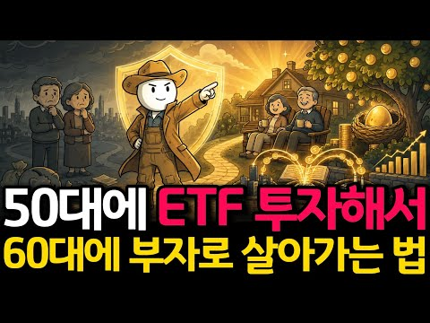 | [월 100만원 ETF 투자하면, 60대에 "진짜 부자"가 됩니다](https://www.youtube.com/watch?v=WGkQ7wwHHlQ) | 농부의 경제학 | 8,260 | 76,560 | 9.3 | 1,196.3 | 13.4분 | 2026-08-11 | 3. 주식·ETF | 설명 | 82/82 |
| 108 |  | [노년에 무조건 주식 투자를 해야하는 이유 ∣ 이 영상이 당신의…](https://www.youtube.com/watch?v=qRxB_45NLys) | 농부의 경제학 | 8,260 | 74,915 | 9.1 | 459.6 | 11.8분 | 2026-05-04 | 1. 재테크 일반·마인드 | 없음 | 77/77 |
| 109 | 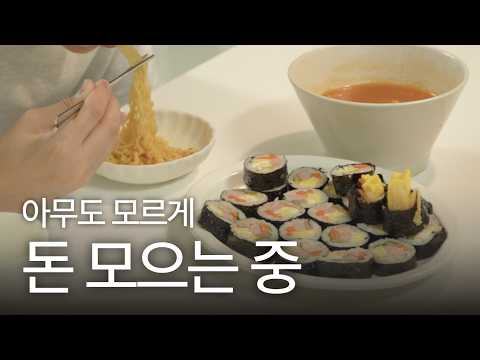 | [스트레스 없이 돈 모으는 미니멀 소비습관 3가지 ㅣ 미니멀라이프](https://www.youtube.com/watch?v=bk5ingu3Eb0) | 비채홈 | 12,600 | 110,997 | 8.8 | 974.8 | 12분 | 2026-06-22 | 2. 돈 모으기·저축 | 설명 | 126/126 |
| 110 | 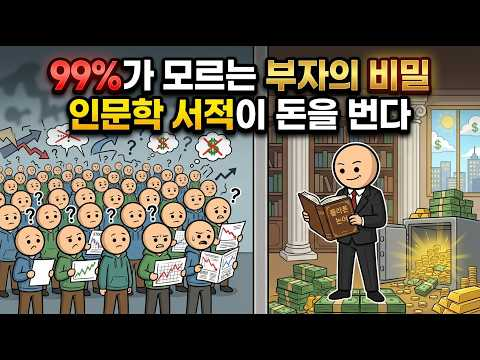 | [99%가 모르는 부자의 비밀 습관 ∣ 인문학 서적 7가지로 부의 본질을 읽는 법](https://www.youtube.com/watch?v=2nDXlFjGSzQ) | 위대한 비밀 | 24,300 | 208,928 | 8.6 | 3,844.7 | 43.7분 | 2026-08-20 | 1. 재테크 일반·마인드 | 설명 | 125/125 |
| 111 | 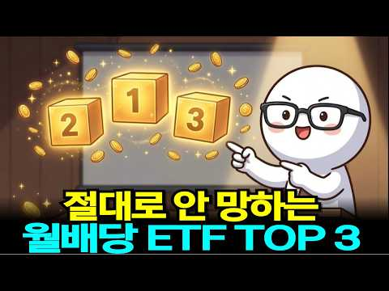 | ["미국 주식 배당금 세금 0원 만드는 법: ISA, 연금저축, IRP 완벽 비교 가이드"](https://www.youtube.com/watch?v=qeJz6DUm3DI) | 맛스토리 | 3,000 | 25,551 | 8.5 | 155.4 | 20.2분 | 2026-05-02 | 4. 노후·연금 | 설명 | 17/17 |
| 112 |  | [65세에 저축이 '이 금액' 이하라면... 당신은 이미 '하류 노인'입니다 ∣ 아무도 말해주지 않은 잔인한…](https://www.youtube.com/watch?v=TEPZ-oD7iFA) | 노후의 진실 | 20,100 | 167,064 | 8.3 | 1,723.5 | 25.9분 | 2026-07-09 | 2. 돈 모으기·저축 | 설명 | 131/131 |
| 113 |  | [자산 1억, 3억, 5억, 10억, 20억, 30억 자산 구간마다 나타나는 인생의 변화들 [ 재테크/미국주…](https://www.youtube.com/watch?v=cQY_kOU_Rhs) | 경제기상도 | 4,310 | 35,446 | 8.2 | 305.6 | 14분 | 2026-06-20 | 1. 재테크 일반·마인드 | 설명 | 37/37 |
| 114 | 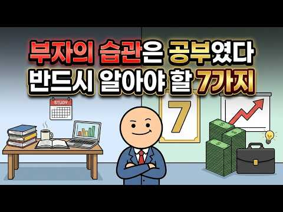 | [부자 되고 싶으면 공부하라 ∣ 핵심 이유 7가지 완벽 정리 #부자되는법](https://www.youtube.com/watch?v=XyfHR8H2JI0) | 위대한 비밀 | 24,300 | 198,504 | 8.2 | 3,130.3 | 46.9분 | 2026-08-11 | 1. 재테크 일반·마인드 | 설명 | 58/58 |
| 115 |  | [택배로 부자가 될 수 있냐고요? 솔직하게 말씀드리겠습니다](https://www.youtube.com/watch?v=r5jnahsJw5Q) | 택부 - 택배기사 부자들 | 6,550 | 52,828 | 8.1 | 1,230.4 | 8.3분 | 2026-09-01 | 1. 재테크 일반·마인드 | 설명 | 203/203 |
| 116 |  | [50대 노후자금, S&P500 버리고 나스닥100만 사면 벌어지는 일 (현실적인 은퇴 포트폴리오)](https://www.youtube.com/watch?v=dtX7Hmq0tdU) | 돈잡는 경제학 | 2,700 | 21,336 | 7.9 | 136.5 | 13.7분 | 2026-05-10 | 3. 주식·ETF | 설명 | 9/9 |
| 117 |  | [은퇴 후에도 월 300만원 쓰는 사람 실제로 몇 %일까](https://www.youtube.com/watch?v=SqA7WIZcrQs) | Ah Gong Talks… | 5,810 | 45,558 | 7.8 | 700.7 | 16.8분 | 2026-08-10 | 4. 노후·연금 | 설명 | 39/39 |
| 118 |  | [【김형석 교수】 자식에게 통장을 맡기지 마십시오｜노후 자금이 가장 안전한 세 곳](https://www.youtube.com/watch?v=v7tzJPrZr4A) | 인생의 통찰 | 4,100 | 32,093 | 7.8 | 433.9 | 52.5분 | 2026-08-01 | 4. 노후·연금 | 없음 | 11/11 |
| 119 |  | ["55세 노후준비, 지금 시작해도 늦지 않은 진짜 이유"](https://www.youtube.com/watch?v=mhUHrujFtEU) | 야무진 경제학 | 22,500 | 174,365 | 7.8 | 2,666.4 | 18.1분 | 2026-08-09 | 4. 노후·연금 | 설명 | 81/81 |
| 120 |  | [이 방식으로 살림 하니 돈이 무섭게 쌓여요.(주중 외식비0원, 배달비0원)](https://www.youtube.com/watch?v=q8knIYPIobk) | 뚝딱 살림 | 29,400 | 227,454 | 7.7 | 1,737.6 | 8.6분 | 2026-06-05 | 기타 | 설명 | 400/400 |
| 121 |  | [삼성전자 지금 시작인가? 노무라가 목표주가 67만원 제시한 이유가 소름입니다... 여기서 90% 더 오를 …](https://www.youtube.com/watch?v=JJG1mtkTN6g) | 코스피 읽는 개미 | 2,190 | 16,835 | 7.7 | 154.2 | 15.7분 | 2026-06-27 | 기타 | 설명 | 25/25 |
| 122 |  | [노후 투자 얘기하다가 존리랑 싸웠습니다. 삼전 사도 되나요?vs그걸 제가 어떻게 알아요](https://www.youtube.com/watch?v=gzP2RMXMuBU) | 웬만해선 정수를 막을 수… | 44,400 | 340,212 | 7.7 | 2,559.2 | 37.2분 | 2026-06-03 | 3. 주식·ETF | 설명 | 386/386 |
| 123 |  | [1억으로 노후준비 끝, QLD에 1억 넣고 10년 버텼더니 충격 결과!](https://www.youtube.com/watch?v=97zLvnO3BnY) | 두배럭 2XLuck | 3,040 | 23,220 | 7.6 | 177.4 | 11.5분 | 2026-06-05 | 2. 돈 모으기·저축 | 설명 | 41/41 |
| 124 |  | [연금고수들이 연금저축계좌 반드시 담는 ETF 3가지](https://www.youtube.com/watch?v=iMkvDXx86dE) | 경제나침반 | 14,000 | 105,108 | 7.5 | 1,345.7 | 25.2분 | 2026-07-28 | 4. 노후·연금 | 설명 | 67/67 |
| 125 |  | [ETF 이 '2가지'만 사두면 됩니다. '나머지는 필요없어요' 100억 자산 관리자의 꿀팁(백승호 단장 풀…](https://www.youtube.com/watch?v=1qlywudP2oY) | 자람들 - 자립하는사람들 | 33,400 | 248,645 | 7.4 | 8,254.2 | 69.7분 | 2026-09-14 | 3. 주식·ETF | 설명 | 69/69 |
| 126 |  | ["2026년 상반기 연금 순위" 은퇴한 내 친구들의 연금은 상위 몇%일까? 연금 수령액 TOP 10](https://www.youtube.com/watch?v=QEgZrrQEQfA) | 할티비 | 39,500 | 289,996 | 7.3 | 2,566.5 | 15분 | 2026-06-23 | 4. 노후·연금 | 설명 | 188/188 |
| 127 |  | [S&P500 하나로 채운 ISA 3년 투자 총정리 ∣ 5년 연장 대신 지금 해지한 이유 ∣ 직접 경험한 이…](https://www.youtube.com/watch?v=WGCZYnwacuo) | 원원 - 파이어 준비생 | 16,900 | 120,100 | 7.1 | 1,383.0 | 22.5분 | 2026-07-19 | 3. 주식·ETF | 설명 | 542/542 |
| 128 |  | [젠슨 황이 한국에 온 진짜 이유, 소름 돋는 반전](https://www.youtube.com/watch?v=SgL_q0Ybdvc) | 돈공부 | 4,550 | 32,264 | 7.1 | 253.7 | 18.1분 | 2026-06-09 | 1. 재테크 일반·마인드 | 설명 | 59/59 |
| 129 |  | [은퇴 후 최대 걱정 '건보료 폭탄' 피하려면? "이것만은 꼭 알아두세요!" ∣ 신승식 ∣ 김경록 ∣ 연금받…](https://www.youtube.com/watch?v=TrpDxPeBbbY) | 연금 받는 형 | 21,500 | 146,252 | 6.8 | 1,394.8 | 27.8분 | 2026-07-01 | 4. 노후·연금 | 설명 | 128/128 |
| 130 |  | [국민연금 추납, 1,850만원 내고 월 15만원 더 받으면 이득일까?](https://www.youtube.com/watch?v=acPLoAXYROM) | 김성일 TV | 28,700 | 194,385 | 6.8 | 3,888.3 | 14.2분 | 2026-08-25 | 4. 노후·연금 | 설명 | 107/107 |
| 131 |  | [나스닥100 1배수, 2배수, 3배수 20년 어떤 성과 보여주나(거치식, 적립식, 리벨런싱) ㅣ QQQ, …](https://www.youtube.com/watch?v=dQdACzI6nKE) | 레버리지 하는 미국회계사… | 13,100 | 84,907 | 6.5 | 731.7 | 16.3분 | 2026-06-20 | 3. 주식·ETF | 설명 | 390/390 |
| 132 |  | [50대 이후, 이런 집에 살면 노후가 무너집니다](https://www.youtube.com/watch?v=NGLEPdYvQdQ) | 김지호의 공간문해력 | 18,300 | 114,720 | 6.3 | 1,081.2 | 18.2분 | 2026-06-30 | 4. 노후·연금 | 설명 | 207/207 |
| 133 |  | [주식 ETF 자산 17억 구독자님의 포트폴리오 분석, 세금 건보료 절세 위한 추가 전략](https://www.youtube.com/watch?v=x26AhOtaVsg) | 배당으로 부자되기 | 8,560 | 53,030 | 6.2 | 351.5 | 15.2분 | 2026-05-16 | 3. 주식·ETF | 설명 | 78/78 |
| 134 |  | [QLD 직투 vs ISA, 잘 못 선택하면 10년 뒤 수천만 원 손해 봅니다.](https://www.youtube.com/watch?v=vU5AK1FfCqQ) | 돈재이 DONJAY | 19,700 | 121,030 | 6.1 | 1,000.1 | 20.3분 | 2026-06-15 | 6. 절세·제도 | 설명 | 465/465 |
| 135 |  | ["S&P500 ETF, 종목보다 '계좌'가 20년 뒤를 바꾸는 진짜 이유 (연금·ISA)"](https://www.youtube.com/watch?v=fmQLRfIm28Y) | 야무진 경제학 | 22,500 | 137,168 | 6.1 | 1,394.1 | 28.4분 | 2026-07-07 | 3. 주식·ETF | 설명 | 115/115 |
| 136 |  | [호주 한국 반반 살기 '이것' 모르면 은퇴 자금 거덜 납니다 건강보험 & 세금 폭탄의 진실](https://www.youtube.com/watch?v=WS4hFxgz01Y) | Jungestate | 3,370 | 19,864 | 5.9 | 152.8 | 15.9분 | 2026-06-06 | 6. 절세·제도 | 설명 | 91/91 |
| 137 |  | [삼성전자 투자자분들 주목하셔야합니다 실적은 사상 최대인데 주가는 왜 못 따라갈까? 목표가 48만원·150조…](https://www.youtube.com/watch?v=0ftjA5wsqtQ) | 코스피 읽는 개미 | 2,190 | 12,659 | 5.8 | 109.9 | 18.6분 | 2026-06-21 | 3. 주식·ETF | 설명 | 17/17 |
| 138 |  | [평생 모은 노후자금 뜯긴 노인들... 조폭 소굴 쳐들어간 아줌마의 100대 참교육 [박여사 6화]](https://www.youtube.com/watch?v=cc4uBxFSiiY) | 아직 늦지 않았습니다 | 30,800 | 176,854 | 5.7 | 3,509.5 | 9.2분 | 2026-08-24 | 4. 노후·연금 | 설명 | 36/36 |
| 139 |  | [신혼부부가 돈 못 모으는 이유...결혼 후 돈 관리 이렇게 하세요(김경필 머니트레이너)ㅣ보라언니동생 EP.…](https://www.youtube.com/watch?v=vmjGJVCfwhk) | STUDIO OMG | 31,100 | 171,556 | 5.5 | 7,806.3 | 18.2분 | 2026-09-22 | 1. 재테크 일반·마인드 | 설명 | 62/62 |
| 140 |  | [돈 없는 58세 재혼녀가 젊은 애들보다 더 약아 빠져도 되는 이유](https://www.youtube.com/watch?v=QnnwzV8yHpU) | 내 누군지 아나? | 6,190 | 33,695 | 5.4 | 481.8 | 29분 | 2026-08-05 | 기타 | 설명 | 106/106 |
| 141 |  | [1억을 모았다면 20억까지 절대 꿈의 숫자가 아닙니다 (돈의 물리학)](https://www.youtube.com/watch?v=gPYpuRW8UOk) | 경제기상도 | 4,310 | 22,754 | 5.3 | 145.0 | 16.9분 | 2026-05-10 | 2. 돈 모으기·저축 | 설명 | 43/43 |
| 142 |  | [주식계좌에 1억 있으면, 대한민국 상위 몇 % 일까요?](https://www.youtube.com/watch?v=-gcRoQnRARY) | 억빌더 ∣ 순자산 10억… | 6,490 | 33,299 | 5.1 | 293.7 | 8.6분 | 2026-06-22 | 2. 돈 모으기·저축 | 설명 | 156/156 |
| 143 |  | [라오어님의 TQQQ, SOXL 무한매수법 정말 좋아합니다(QQQ, QLD, TQQQ, SOXL)](https://www.youtube.com/watch?v=QTrCmMxmAdg) | 레버리지 하는 미국회계사… | 13,100 | 66,746 | 5.1 | 635.7 | 5.2분 | 2026-07-01 | 3. 주식·ETF | 설명 | 198/199 |
| 144 |  | [반드시 부자되는 신혼부부의 3가지 공통점 (부자되는 방법)](https://www.youtube.com/watch?v=t6NrbgrRE_k) | 해쏘현_신혼부부 재테크 | 26,400 | 89,264 | 3.4 | 1,720.1 | 11.9분 | 2026-08-23 | 1. 재테크 일반·마인드 | 설명 | 100/100 |
| 145 |  | [부자 되기 바로 전, 삶에 나타나는 이상한 변화 7가지 (놓치면 평생 후회합니다)](https://www.youtube.com/watch?v=GxGvoXZQbZ0) | 누구나 겪는 돈 이야기 | 4,490 | 14,314 | 3.2 | 93.6 | 17.2분 | 2026-05-14 | 1. 재테크 일반·마인드 | 설명 | 14/14 |

### 자료를 받지 않은 성공 후보 (34개 중 배수 큰 34개 — 웹 화면 탐색 목록에서 승인하면 분석에 들어감)

| 제목 | 채널 | 구독자 | 조회수 | 배수 | 길이 | 업로드 | 주제 묶음 |
|---|---|---|---|---|---|---|---|
| ["노후자금 구멍 5개, 당신은 이미 2개 뚫려 있습니다"](https://www.youtube.com/watch?v=LjHlXKeRH5s) | 야무진 경제학 | 22,500 | 114,379 | 5.1 | 14.9분 | 2026-08-07 | 4. 노후·연금 |
| [금융자산 10억을 넘긴 순간, 돈의 성격이 완전히 바뀝니다 금융자산가가 찐부자인 이유](https://www.youtube.com/watch?v=xEH9PaLKOR0) | 경제기상도 | 4,310 | 21,778 | 5.0 | 23.9분 | 2026-05-24 | 1. 재테크 일반·마인드 |
| ["삼성전자 SK하이닉스 2배 레버리지 ETF", 사도 되는 사람과 절대 안 되는 사람 (5월 27일 상장)](https://www.youtube.com/watch?v=ZUz1YwWZ0s8) | 술술 경제학 | 17,600 | 87,394 | 5.0 | 27.6분 | 2026-05-15 | 3. 주식·ETF |
| ["68세도 돈버는 부업" 월급70만원 요양사 관두고 집에서 노트북 하나로 순수익 월250만원 버는 68살](https://www.youtube.com/watch?v=pZ7fCdoOvCI) | 록터뷰 | 35,600 | 170,591 | 4.8 | 7.8분 | 2026-07-05 | 8. 부업·소득 |
| [경제공부 시작하는 법 ∣ 하루 10분이면 됩니다! (해야하는 이유) 🗞️ 📊 💸](https://www.youtube.com/watch?v=z7fHe2Og-zE) | 찌니ZZINI | 30,500 | 143,670 | 4.7 | 17.5분 | 2026-05-03 | 1. 재테크 일반·마인드 |
| [우리 부모님 유산 탐내다 노후 자금 탈탈 털린 시어머니, 전과자에 신용불량자까지 세트로 만들어드림](https://www.youtube.com/watch?v=5c7V1i5q_xc) | 리얼톡툰 | 15,400 | 70,535 | 4.6 | 9.8분 | 2026-05-28 | 4. 노후·연금 |
| [1.3억 커버드콜로 은퇴했어요 #배당투자 #배당은퇴 #경제적자유 #파이어족 #월배당 #고배당주 #주식투자 …](https://www.youtube.com/watch?v=BqDfJt2vAHY) | ttobaedang또배당 | 6,330 | 28,523 | 4.5 | 7.9분 | 2026-09-02 | 1. 재테크 일반·마인드 |
| [ETF는 이 '2개'로 충분합니다. 돈 있으면 무조건 여기부터 넣습니다. 노후 준비 끝납니다 (백승호 단장…](https://www.youtube.com/watch?v=YdmZDxBcYKE) | 자람들 - 자립하는사람들 | 33,400 | 143,569 | 4.3 | 19.7분 | 2026-09-07 | 3. 주식·ETF |
| [경제신문 무료로 보는법 📰 (경제공부 초보 읽는 방법 👀)](https://www.youtube.com/watch?v=PIiGnsoTl7I) | 찌니ZZINI | 30,500 | 130,846 | 4.3 | 10.2분 | 2026-05-10 | 2. 돈 모으기·저축 |
| [반도체 주식 열풍에 예순 살 부부의 은퇴자금 2억이 단 한 달만에 반토막 나기까지!](https://www.youtube.com/watch?v=Uwfjww9_yKk) | 은빛시나리오 | 29,200 | 124,612 | 4.3 | 39.6분 | 2026-08-06 | 1. 재테크 일반·마인드 |
| [55세, 인생이 갈린다! 미리 대비하지 않으면 노후 파산하는 이유? ∣ 김동엽 ∣ 김경록 ∣ 연금받는형](https://www.youtube.com/watch?v=vUDveBMalNQ) | 연금 받는 형 | 21,500 | 90,358 | 4.2 | 23.4분 | 2026-07-07 | 4. 노후·연금 |
| ["머리 쓸 수록 수명이 줄어들어" 월 연금 300만원 교사 출신 어르신이 노후 자금 아들에게 투자하는 이유](https://www.youtube.com/watch?v=dAKKRj0KBog) | 할티비 | 39,500 | 164,945 | 4.2 | 8분 | 2026-09-17 | 3. 주식·ETF |
| [성공한 인생인 줄 알았습니다... 은퇴 후 찾아온 잔인한 현실](https://www.youtube.com/watch?v=27QUCjtiMVg) | 인생의에필로그 | 9,590 | 39,773 | 4.2 | 19.3분 | 2026-07-08 | 4. 노후·연금 |
| [배당 ETF 10억 투자하면 진짜 배당금 얼마? ∣ 공식분배금·실수령 차이 (무료 전자책 제공)](https://www.youtube.com/watch?v=KGOC_mfphu4) | 은퇴머니 - 은퇴 현금흐… | 30,000 | 123,678 | 4.1 | 18.8분 | 2026-05-08 | 3. 주식·ETF |
| [배당 10%를 주면서 동시에 주가도 20% 오른 단 6개의 ETF [1,099개 ETF 모두 뒤져봤습니다.]](https://www.youtube.com/watch?v=4Gy4lBNuebE) | 우아한짠테크 TV | 37,200 | 150,656 | 4.0 | 12.7분 | 2026-05-15 | 3. 주식·ETF |
| ['2가지' ETF만 모아도 됩니다. 100억 자산관리사의 꿀팁 (백승호 단장 2부) #ETF #배당주 #주…](https://www.youtube.com/watch?v=Gwk2gkxpx3I) | 자람들 - 자립하는사람들 | 33,400 | 127,177 | 3.8 | 23.7분 | 2026-09-02 | 1. 재테크 일반·마인드 |
| ["골드만삭스가 전주에 무릎 꿇었습니다" 국민연금 1,458조, 세계 1위 수익률의 비밀](https://www.youtube.com/watch?v=3Hw87oNMlHI) | 경제초고수 | 39,400 | 149,400 | 3.8 | 14.7분 | 2026-05-06 | 4. 노후·연금 |
| [서울대 의대생이었던 내가 돈을 모으기 시작한 이유ㅣ반지하에서 반포자가까지(feat. 절약, 저축)](https://www.youtube.com/watch?v=qP7PI42yX6g) | 닥터나솔 | 48,900 | 181,738 | 3.7 | 15.8분 | 2026-08-13 | 2. 돈 모으기·저축 |
| [돈 버는 방식은 정해져 있다, 수익 모델 15종 다이제스트](https://www.youtube.com/watch?v=wr4nCMUy1dk) | 사다리게임 | 36,100 | 133,654 | 3.7 | 18분 | 2026-05-28 | 기타 |
| ["50세 매달 75만원 넣으면, 10년 뒤 통장에 찍히는 숫자 (연금저축·IRP)"](https://www.youtube.com/watch?v=MDITNCGFdNU) | 야무진 경제학 | 22,500 | 81,679 | 3.6 | 18분 | 2026-07-09 | 4. 노후·연금 |
| [월 150만원 QLD 적립식 매수로 3억 달성 시간, 15년 후 50억?(QQQ, TQQQ, SOXL, 나…](https://www.youtube.com/watch?v=j276Y2gU6hg) | 레버리지 하는 미국회계사… | 13,100 | 46,228 | 3.5 | 7.8분 | 2026-06-07 | 3. 주식·ETF |
| [45살에 시작한 사이드잡 부업으로 월 순수익 1억 벌고 인생역전한 48살 아저씨](https://www.youtube.com/watch?v=XX8QV3-5rAM) | 실전부업클럽 | 23,400 | 81,154 | 3.5 | 29.6분 | 2026-10-13 | 2. 돈 모으기·저축 |
| [연금 300만원 받아도 부족한 생활비, 현실적인 노후생활](https://www.youtube.com/watch?v=NJNjJ8ym8lI) | 아니모 인생기록관 | 21,600 | 74,541 | 3.5 | 12.9분 | 2026-05-10 | 4. 노후·연금 |
| [월 100만 원으로 QLD 적립식 투자하면 10억 은퇴자금 가능할까?](https://www.youtube.com/watch?v=hSorn4W4RsI) | 돈재이 DONJAY | 19,700 | 67,682 | 3.4 | 19.2분 | 2026-05-20 | 3. 주식·ETF |
| [-5억, 주식에 노후자금 몰빵🔥내 미래는 쪽빵ㅜㅜ](https://www.youtube.com/watch?v=IthWsvdt6q4) | 권감각의 유기주식테라피 | 20,300 | 68,927 | 3.4 | 11.1분 | 2026-09-05 | 3. 주식·ETF |
| ["지금 잔고 5천만원 안 되신다면, 이것부터 이렇게 하세요"](https://www.youtube.com/watch?v=Suach3Oqdas) | 야무진 경제학 | 22,500 | 75,534 | 3.4 | 22.4분 | 2026-08-01 | 기타 |
| [2000만원으로 시작하는 '가장 쉬운 S&P500 장기투자'](https://www.youtube.com/watch?v=oRPjnPQvygE) | 농부의 경제학 | 8,260 | 27,232 | 3.3 | 14.1분 | 2026-09-07 | 3. 주식·ETF |
| [ISA 3년마다 연금저축 이전, 진짜 이득일까? 아니면 놔두는 것이 좋을까? 직접 계산해본 놀라운 결과](https://www.youtube.com/watch?v=X6WyXVU7LZ8) | 돈재이 DONJAY | 19,700 | 64,525 | 3.3 | 15.5분 | 2026-06-22 | 4. 노후·연금 |
| ["50대 노후 5억, 지금 이렇게 준비하세요 (연금저축·IRP 148만원)"](https://www.youtube.com/watch?v=LC8DvY1DUoA) | 야무진 경제학 | 22,500 | 73,383 | 3.3 | 27.3분 | 2026-07-04 | 4. 노후·연금 |
| [상위 1%는 매일 하는 '이것’! 당신의 돈이 일하게 하세요. ∣ 존리 ∣ 연금받는형 ∣](https://www.youtube.com/watch?v=3Q3-zlebLjk) | 연금 받는 형 | 21,500 | 69,241 | 3.2 | 14.5분 | 2026-05-15 | 4. 노후·연금 |
| [친구? 없어요. 혼자 재테크 경제 세미나 다니는 30대 미혼 여자 직장인 vlog 💸 ∣ 자산 폭등기 대처…](https://www.youtube.com/watch?v=jHm2LpwKQRg) | 일어나안나 | 42,200 | 128,570 | 3.0 | 6.5분 | 2026-05-10 | 1. 재테크 일반·마인드 |
| [[전문가 초대] 인플레 고착화 시대...내 포트폴리오에 담을 자산은? (오건영 단장)](https://www.youtube.com/watch?v=6tQaMqgqoxA) | 돈에안기자(TV조선경제채… | 26,500 | 80,561 | 3.0 | 44.2분 | 2026-06-09 | 3. 주식·ETF |
| [부모 노후자금 4억 5천만 원 앞에서 드러낸 자식들의 민낯! "엄마 노후는 우리가 책임질게" 서로 모시겠다…](https://www.youtube.com/watch?v=iIGP8SjSqRE) | 청춘은안단테 | 19,800 | 60,114 | 3.0 | 57분 | 2026-08-01 | 4. 노후·연금 |
| [2026 국민성장펀드 가입전 필수 확인! 5060이 반드시 피해야 할 함정 3가지 (소득공제, 분리과세 총…](https://www.youtube.com/watch?v=A5E-2sukBgo) | 만약에 머니 | 33,900 | 102,308 | 3.0 | 20.6분 | 2026-05-15 | 3. 주식·ETF |

## 2. 주제 — 주제 묶음별 성공 비율 (비교 집단)

주제 묶음 = `tag_rules.toml` TAG_THEMES (제목에서 맞는 글자가 가장 긴 묶음, 없으면 태그). 비교 집단 성공 비율 67% 과 견주어 본다. 영상 15개 미만은 '표본 적음'.

| 주제 묶음 | 영상 | 성공 | 성공 비율 | 배수 중앙값 | 조회수 중앙값 | 성공 사례 # |
|---|---|---|---|---|---|---|
| 4. 노후·연금 | 65 | 54 | 83% | 13.7 | 157,461 | 2, 4, 6, 8, 10, 11, 13, 15, 17, 22, 27, 32, 33, 34, 35, 36, 37, 40, 41, 45, 49, 50, 52, 61, 65, 68, 74, 76, 77, 78, 80, 87, 88, 95, 96, 102, 103, 104, 111, 117, 118, 119, 124, 126, 129, 130, 132, 138 |
| 기타 | 15 | 12 | 80% | 7.7 | 75,534 | 18, 21, 46, 81, 83, 84, 100, 120, 121, 140 |
| 2. 돈 모으기·저축 | 24 | 19 | 79% | 8.6 | 79,675.0 | 5, 9, 14, 30, 51, 64, 70, 85, 91, 97, 109, 112, 123, 141, 142 |
| 1. 재테크 일반·마인드 | 58 | 38 | 66% | 5.8 | 70,009.5 | 1, 3, 7, 12, 16, 19, 20, 26, 29, 38, 43, 47, 48, 53, 56, 58, 59, 63, 71, 79, 90, 93, 108, 110, 113, 114, 115, 128, 139, 144, 145 |
| 3. 주식·ETF | 100 | 51 | 51% | 3.4 | 39,646.0 | 23, 24, 25, 31, 39, 42, 44, 54, 55, 60, 62, 66, 67, 69, 72, 73, 75, 89, 92, 94, 98, 99, 101, 105, 106, 107, 116, 122, 125, 127, 131, 133, 135, 137, 143 |
| 8. 부업·소득 (표본 적음) | 3 | 3 | 100% | 14.6 | 405,639 | 28, 82 |
| 6. 절세·제도 (표본 적음) | 5 | 4 | 80% | 6.1 | 121,030 | 57, 86, 134, 136 |
| 7. 빚·대출·신용 (표본 적음) | 1 | 0 | 0% | 1.3 | 18,364 | - |

## 3. 수요와 공급 — 찾는 사람에 비해 영상이 적은 곳

### 3-1. 주제 묶음별 (최근 90일 영상 778개 — 채널 크기 상관없음)

수요 몫 = 그 묶음 영상들의 하루 조회수 합 ÷ 전체, 공급 몫 = 영상 수 ÷ 전체. **지수 = 수요 몫 ÷ 공급 몫** — 1 보다 크면 영상 하나가 평균보다 많이 보임(공급이 모자라 보임), 작으면 영상이 넘침. 작은 채널 성공 비율 = 2번 표. 시청자 질문 = 사례 댓글 중 그 묶음 낱말이 든 질문·요청.

| 주제 묶음 | 영상(공급) | 채널 | 수요 몫 | 공급 몫 | 지수 | 영상당 하루 조회수 중앙값 | 작은 채널 성공 비율 | 시청자 질문 |
|---|---|---|---|---|---|---|---|---|
| 4. 노후·연금 | 161 | 94 | 28% | 21% | **1.4** | 5,260.1 | 83% | 535 |
| 8. 부업·소득 | 17 | 8 | 2.5% | 2.2% | **1.1** | 13,312.0 | 100% | 23 |
| 2. 돈 모으기·저축 | 51 | 39 | 7.1% | 6.6% | **1.1** | 4,073.1 | 79% | 196 |
| 3. 주식·ETF | 345 | 145 | 44% | 44% | **1.0** | 4,044.7 | 51% | 1321 |
| 기타 | 41 | 26 | 4.7% | 5.3% | **0.9** | 5,676.4 | 80% | 0 |
| 1. 재테크 일반·마인드 | 132 | 79 | 11% | 17% | **0.6** | 3,973.8 | 66% | 99 |
| 6. 절세·제도 | 27 | 22 | 1.6% | 3.5% | **0.5** | 2,109.8 | 80% | 333 |
| 10. 금융 사기 (표본 적음) | 3 | 3 | 0.9% | 0.4% | **2.2** | 7,739.7 | – | 15 |
| 7. 빚·대출·신용 (표본 적음) | 1 | 1 | 0.1% | 0.1% | **0.5** | 7,353.9 | 0% | 21 |

### 3-2. 검색어별 (탐색·검색 캐시 — 검색어마다 조회수 순 상위 결과)

결과 수 = YouTube 가 알려 준 그 기간 영상 수 추정(공급). 영상당 하루 조회수 = 상위 결과 하루 조회수 합 ÷ 결과 수 (클수록 영상에 비해 찾는 사람이 많음). 큰 채널 비율 = 상위 결과 중 구독자 5만 넘는 채널 (클수록 들어가기 어려움). **작은 채널이 뚫은 비율** = 상위 결과 중 작은 채널(5만 이하)의 성공 영상(×3·1만) 비율 — 클수록 새 채널도 상위에 들 수 있음. 지금 검색어(keywords.txt)가 먼저, 예전 검색어는 '(예전)'.

| 검색어 | 기간(일) | 본 영상 | 결과 수(공급) | 최근 30일 | 조회수 중앙값 | 하루 조회수 중앙값 | 영상당 하루 조회수 | 큰 채널 비율 | 작은 채널이 뚫은 비율 |
|---|---|---|---|---|---|---|---|---|---|
| 노후자금 | 168 | 100 | 164,506 | 12 | 92,621 | 1,489.9 | 2.4 | 62% | 29% (26개) |
| 노후 | 168 | 100 | 222,398 | 4 | 385,783 | 3,884.3 | 3.4 | 72% | 28% (25개) |
| 노후준비 | 168 | 100 | 196,467 | 6 | 364,239.5 | 3,800.8 | 3.3 | 75% | 25% (23개) |
| 부자되는법 | 168 | 100 | – | 13 | 162,894 | 2,153.1 | – | 70% | 25% (17개) |
| 은퇴준비 | 168 | 100 | 194,198 | 9 | 235,477 | 2,352.7 | 3.3 | 77% | 23% (22개) |
| 1억모으기 | 168 | 100 | 76,176 | 8 | 113,058.0 | 1,364.5 | 5.0 | 73% | 19% (15개) |
| 돈공부 | 168 | 100 | 220,872 | 9 | 79,235.5 | 902.0 | 1.3 | 68% | 16% (11개) |
| 저축 | 168 | 100 | 220,772 | 6 | 112,875.0 | 1,483.2 | 1.5 | 81% | 15% (11개) |
| 돈모으기 | 168 | 100 | 157,849 | 11 | 185,308 | 2,312.0 | 2.7 | 82% | 14% (11개) |
| 장기투자 | 168 | 100 | 203,694 | 8 | 165,112 | 2,071.4 | 2.0 | 86% | 14% (13개) |
| 돈버는법 | 168 | 100 | 209,869 | 5 | 429,547.5 | 4,470.9 | 2.7 | 86% | 14% (9개) |
| 연금 | 168 | 100 | 176,237 | 14 | 460,009 | 7,314.9 | 14.6 | 87% | 13% (12개) |
| 연금저축펀드 | 168 | 100 | 153,617 | 6 | 129,619 | 1,383.0 | 2.4 | 88% | 12% (12개) |
| 경제적자유 | 168 | 100 | 178,501 | 9 | 67,108.5 | 661.9 | 1.6 | 85% | 12% (8개) |
| 연금저축 | 168 | 100 | 188,677 | 4 | 230,573 | 2,298.7 | 2.9 | 88% | 11% (11개) |
| ISA계좌 | 168 | 100 | 152,289 | 4 | 181,132.0 | 1,705.2 | 2.5 | 88% | 11% (10개) |
| ETF투자 | 168 | 100 | 218,565 | 4 | 284,123 | 2,974.1 | 3.8 | 90% | 10% (10개) |
| 주식공부 | 168 | 100 | 212,591 | 8 | 143,169 | 1,474.0 | 1.2 | 77% | 9.6% (7개) |
| IRP | 168 | 100 | 171,137 | 9 | 46,597 | 482.6 | 1.0 | 78% | 9.6% (8개) |
| 자산배분 | 168 | 100 | 159,575 | 16 | 107,554.5 | 1,677.4 | 2.0 | 86% | 9.5% (8개) |
| 부자 | 168 | 100 | 245,278 | 4 | 523,257 | 5,345.4 | 2.2 | 91% | 9.1% (3개) |
| 자산관리 | 168 | 100 | – | 4 | 177,463.5 | 2,097.3 | – | 89% | 9.1% (8개) |
| 포트폴리오 | 168 | 100 | 216,782 | 6 | 228,572.5 | 2,468.4 | 1.7 | 91% | 7.1% (4개) |
| ETF | 168 | 100 | 228,131 | 2 | 435,219.0 | 4,088.8 | 1.7 | 93% | 6.9% (4개) |
| 주식투자 | 168 | 100 | 305,804 | 2 | 630,420.0 | 5,900.6 | 3.2 | 95% | 5.1% (4개) |
| 분산투자 | 168 | 100 | 147,669 | 11 | 7,818 | 123.3 | 0.5 | 60% | 4.7% (4개) |
| S&P500 | 168 | 100 | 211,104 | 0 | 314,474.5 | 2,780.1 | 0.7 | 96% | 4.2% (1개) |
| 주식 | 168 | 100 | 356,141 | 1 | 621,812 | 5,429.9 | 1.6 | 96% | 4.1% (2개) |
| 재테크 | 168 | 100 | – | 6 | 436,564 | 4,940.0 | – | 97% | 2.9% (2개) |
| 투자 | 168 | 100 | 480,082 | 7 | 591,606 | 5,779.9 | 3.4 | 98% | 2.5% (2개) |
| 주식초보 | 168 | 100 | 179,106 | 7 | 100,113.0 | 1,000.3 | 1.4 | 96% | 2.4% (2개) |
| 나스닥 | 168 | 100 | 204,358 | 5 | 168,549.0 | 1,618.4 | 2.0 | 98% | 1.9% (1개) |
| 코스피 | 168 | 100 | 217,550 | 4 | 287,983.0 | 2,475.7 | 5.1 | 98% | 1.6% (1개) |
| 투자전략 | 168 | 100 | 237,300 | 21 | 97,422 | 1,354.0 | 3.3 | 95% | 1.3% (1개) |
| ISA | 168 | 100 | 286,572 | 0 | 953,809.5 | 6,358.6 | 0.2 | 100% | 0% (0개) |
| 미국주식 | 168 | 100 | 228,269 | 15 | 250,840.0 | 4,138.7 | 3.3 | 100% | 0% (0개) |

### 3-3. 사람들이 찾는 말 (YouTube 자동완성) 중 최근 영상이 적은 말

수요 점수 = 검색어를 넣었을 때 자동완성에 앞쪽에 나올수록·여러 검색어에서 나올수록 큼. 최근 영상 = 우리가 본 최근 영상 중 제목에 그 말의 낱말이 다 든 수. 틈 = 수요 점수 ÷ (1 + 최근 영상). **공급 확인** = 웹 화면 [공급 확인]으로 그 말을 직접 검색한 결과 (최근 90일 결과 수·상위 영상).

| 말 | 수요 점수 | 나온 검색어 | 최근 영상(우리가 본) | 틈 | 공급 확인: 결과 수 | 영상당 하루 조회수 | 작은 채널 비율 | 최근 30일 |
|---|---|---|---|---|---|---|---|---|
| isa계좌 추천 | 1.7 | ISA, ISA계좌 | 0 | 1.7 | 확인 전 |  |  |  |
| 연금저축펀드 추천 | 1.6 | 연금저축, 연금, 연금저축펀드 | 0 | 1.6 | 확인 전 |  |  |  |
| isa계좌 만들기 | 1.3 | ISA, ISA계좌 | 0 | 1.3 | 확인 전 |  |  |  |
| 연금저축 irp | 1.1 | 연금저축, 연금 | 0 | 1.1 | 확인 전 |  |  |  |
| 연금저축펀드 증권사 추천 | 1.1 | 연금저축, 연금저축펀드 | 0 | 1.1 | 확인 전 |  |  |  |
| isa계좌 활용 | 1.1 | ISA, ISA계좌 | 0 | 1.1 | 확인 전 |  |  |  |
| 부자회사원 | 1.0 | 부자 | 0 | 1.0 | 확인 전 |  |  |  |
| isa계좌 | 1.0 | ISA | 0 | 1.0 | 확인 전 |  |  |  |
| 경제적자유를찾아서 | 0.9 | 경제적자유 | 0 | 0.9 | 확인 전 |  |  |  |
| 부자티비 | 0.9 | 부자 | 0 | 0.9 | 확인 전 |  |  |  |
| 돈공부는 처음이라 | 0.9 | 돈공부 | 0 | 0.9 | 확인 전 |  |  |  |
| 돈모으기 브이로그 | 0.9 | 돈모으기 | 0 | 0.9 | 확인 전 |  |  |  |
| 저축하는법 | 0.9 | 저축 | 0 | 0.9 | 확인 전 |  |  |  |
| 1억모으기 적금 | 0.9 | 1억모으기 | 0 | 0.9 | 확인 전 |  |  |  |
| 주식전망 | 0.9 | 주식 | 0 | 0.9 | 확인 전 |  |  |  |
| 투자자산운용사 | 0.9 | 투자 | 0 | 0.9 | 확인 전 |  |  |  |
| 주식투자 기초 | 0.9 | 주식투자 | 0 | 0.9 | 확인 전 |  |  |  |
| 미국주식 실시간 | 0.9 | 미국주식 | 0 | 0.9 | 확인 전 |  |  |  |
| 장기투자 etf | 0.9 | 장기투자 | 0 | 0.9 | 확인 전 |  |  |  |
| etf투자 방법 | 0.9 | ETF투자 | 0 | 0.9 | 확인 전 |  |  |  |
| s&p500 모멘텀 | 0.9 | S&P500 | 0 | 0.9 | 확인 전 |  |  |  |
| 코스피 전망 | 0.9 | 코스피 | 0 | 0.9 | 확인 전 |  |  |  |
| 주식초보강의 | 0.9 | 주식초보 | 0 | 0.9 | 확인 전 |  |  |  |
| 투자전략 롤체 | 0.9 | 투자전략 | 0 | 0.9 | 확인 전 |  |  |  |
| 나스닥 실시간 | 0.9 | 나스닥 | 0 | 0.9 | 확인 전 |  |  |  |
| 포트폴리오 만들기 | 0.9 | 포트폴리오 | 0 | 0.9 | 확인 전 |  |  |  |
| 주식공부 기초 | 0.9 | 주식공부 | 0 | 0.9 | 확인 전 |  |  |  |
| 노후준비 etf | 0.9 | 노후준비 | 0 | 0.9 | 확인 전 |  |  |  |
| 은퇴준비지침서 | 0.9 | 은퇴준비 | 0 | 0.9 | 확인 전 |  |  |  |
| 연금저축계좌 개설 | 0.9 | 연금저축, 연금 | 0 | 0.9 | 확인 전 |  |  |  |

### 3-4. 주제 묶음별 시청자 질문 (사례 댓글 — 좋아요 순)

- **3. 주식·ETF** (1321개): 👍1666 “오늘도 아주 유익한 영상 감사합니다:) 확실히 배당투자에 대한 고민이 많았었는데 이렇게 숫자로 계산해서 보여주시니 이해가 쏙쏙❤ 저는 5개월전부터 방콕상품 꾸준히 복리효과 누리면서 분할구매 하고있…” / 👍220 “안그래도 느꼈어요 요즘은 증권방송 보기도 싷더라구요 소위 주식 전문가들 증권사 직원들 에널리스트들 전부 자기밥그릇 챙기느라 혈안ᆢ 한통속 이예요 ᆢ 그들의 만행을 속시원히 알려주니 감사하네요 ᆢ” / 👍219 “하이닉스 기업총수 조강지처 헌신짝 처럼 버리는데 주식 주주님들 한테 진심일까요? 기업총수 정신자세 중요하죠. 주식은 믿음이 있어야 장기투자 할수있으니까요!”
- **4. 노후·연금** (535개): 👍226 “조두순이 월120받습니다 국민연금30년부어서 월100받습니다 공정한사회인가요?” / 👍222 “정말 기본적인건데 국민연금 예상연금액 조회하면 나오는 예상연금액은 지금 가입된 소득으로 60세까지 납부했을때 기준이에요 왜 저렇게 설명하시지? 오해 소지가 넘 많은데요?” / 👍189 “은퇴하고 쉰지3년 하루하루가행복합니다 왜?꼭일해야하나요? 참나 죽을때가지일하라하지마세요~”
- **6. 절세·제도** (333개): 👍380 “국내 중국인들에게 25가지 정부지원이 네이버 검색하니 쭉 나오네요 왜 이렇게 세금으로 혜택을주나요?” / 👍212 “개빡치는게 세금 왜 이따구로 복잡하게 만드는거냐 ㅡ 그냥 깔끔하게 퍼센트 정해서 그거 고정으로 가져가면 되잖아ㅡㅡ 왜 저딴 여러 계좌를 우리가 공부해야돼?” / 👍76 “국회의원. 지방의원 반드시 줄여야 해요. 해야 할 일은 안하고 쓸모없는 법안이나 만들고 온갖 혜택은 다 누리니 왜 우리의 피같은 세금을 그들에게 줘야 하나요? 나라 꼴 개판으로 돌아가게 힘쓴분들이…”
- **2. 돈 모으기·저축** (196개): 👍164 “금융소득 종합과세 2000만원은 왜 왜 그대로냐고??????? 배당금으로 생활을 하려해도 그놈의 세금때문에???? 예금자보호도 1억으로 상향했으면 이것도 5천정도로 올려야지??????” / 👍38 “다이소 올리브영에서 가성비좋고 꼭 필요한 제품 낱개씩 사서 열심히 잘 사용하고있습니다. 백화점에서 화장품사는 것보다 알뜰하게 구매하고 잘 소비하고 잘 사용하고 있어 지혜롭게 소비생활하고있습니다. …” / 👍38 “죄송한데 얼마 버셔서 500만원 저축하시는거예요?? 정말 대단하셔서 궁금해서요”
- **1. 재테크 일반·마인드** (99개): 👍103 “사는동안 잘사는 것도 중요하지않나요? 돈만 모으다가 죽는 사람도 많이 봤어요 돈도 모으는 사람은 평생 돈을 못쓰더라구요 부자면 뭐해요 평생 지질이 궁사안 떨다가 죽는것도 문제” / 👍27 “주식해서 폭망하라고요? 투자해서 쪽박차라고요? 거지될 확률을 알려주시나요? 직장 다닐때 감사하세요 투자해서 부자되는것이 쉬의면 세상사람절반이 부자됐겠다 허파에 바람만 쳐넣는구나” / 👍24 “공무원 이십년 퇴직자의 공무원연금 백만원 정도다. 퇴직금도없다. 공공근로도 제외된다. 어떤 곳에서도 이에 대한 말을 안한다. 정부의 함구령인가? 공무원 퇴직자가 받는 백만원 연금은 상위 30퍼센트…”
- **8. 부업·소득** (23개): 👍18 “돈버는 방법 알려주는데 말투가 무슨 상관이겠습니까? 감사합니다 열심히해서 부자되겠습니다” / 👍9 “왠지 딱 20프로 손실나서 국민은 세금감면만 받아서 입꾹닫하고 펀드만 20프로 돈버는 결말은 아니겠지?” / 👍4 “부업으로 할 수 있는 일을 찾고 있었는데 알고리즘에 딱 뜨네요 운명인가😮 가지고 계신 노하우를 알려주시는게 쉬운일은 아니실텐데 이렇게 공유해주신다니 감사할 따름이네요..! 도전해보고 싶어지네요 저…”
- **7. 빚·대출·신용** (21개): 👍10 “재산이 있다면, 죽을때까지 관리 잘 해야 합니다~ 내 손을 떠난 돈은 다시 돌아오기 엄청 어렵습니다~ 누구에게 빌려 줬더라도 받기가 힘들고요~ 특히 자녀들에게 준것은 돌려받기 어렵지요~ 달라고 하…” / 👍5 “신용카드 매주 자동 결재 좋던데요?” / 👍4 “한 가지 잘 모르시는 사항이 있으시군요. 일본의 부채는 다른 나라와 달리 외국 돈을 빌리는 게 아니라 자기네 나라 국채 라든가 중앙 은행이라든가 자기네 나라 돈을 빌리는 겁니다. 그리고 엔화 가 …”
- **10. 금융 사기** (15개): 👍52 “첫번째 노인 사기꾼 아닌가요 사고방식이나 말투가 서울대 나온사람이 아님 삼성에서 오라했는데 본인이 안갔다??” / 👍5 “금시세라는게 동네 금방만 가도 바로 아는데ᆢ5백을 더 준다는게 소설이네 ㅋ 당근에서는 단돈 만원도 깍을려구하지ᆢ누가 더 준대요? 백프로 사기지요 ㅋ 그것도 2천5백이나 큰돈을ᆢ 당근거래?” / 👍2 “머리 저렇게 지저분하게 기른놈중 사기꾼 이 많더라! 젊은청년들에게 사기처 요즘 시끄러운 이병한놈과 비스무리한 머리스타일???”

## 4. 제목

### 4-1. 제목 특징별 성공 비율 (비교 집단: 있음 vs 없음)

'눈에 띔' = 차이 10%p 이상 · 양쪽 15개 이상 (원인이 아니라 표시). 마지막 열 = 성공 사례 중 그 특징이 있는 비율.

| 제목 특징 | 있음 (성공 비율) | 없음 (성공 비율) | 차이 | 표시 | 성공 사례 중 |
|---|---|---|---|---|---|
| 노후·퇴직금·은퇴·50~70대 | 76 (86%) | 195 (60%) | +26%p | **눈에 띔** | 35% |
| 40자 이상 | 172 (76%) | 99 (52%) | +24%p | **눈에 띔** | 70% |
| 말줄임 …·... | 18 (83%) | 253 (66%) | +18%p | **눈에 띔** | 9.0% |
| 숫자가 들어감 | 188 (72%) | 83 (55%) | +16%p | **눈에 띔** | 71% |
| 이유 | 43 (54%) | 228 (69%) | -16%p | **눈에 띔** | 12% |
| 따옴표·괄호로 강조 | 90 (77%) | 181 (62%) | +15%p | **눈에 띔** | 39% |
| 사연·오디오북·실화·고백 | 15 (80%) | 256 (66%) | +14%p | **눈에 띔** | 8.3% |
| vs 비교 | 32 (78%) | 239 (65%) | +13%p | **눈에 띔** | 14% |
| 느낌표 ! | 28 (57%) | 243 (68%) | -11%p | **눈에 띔** | 9.0% |
| 코스피·폭락·급락·하락장 | 5 (20%) | 266 (68%) | -48%p | 표본 적음 | 0.7% |
| 공통점 | 1 (100%) | 270 (67%) | +33%p | 표본 적음 | 0.7% |
| 직접·해보니·N년 기록 | 10 (90%) | 261 (66%) | +24%p | 표본 적음 | 4.8% |
| AI | 5 (80%) | 266 (66%) | +14%p | 표본 적음 | 2.8% |
| 25자 미만 | 7 (57%) | 264 (67%) | -10%p | 표본 적음 | 3.4% |
| N가지 | 35 (74%) | 236 (66%) | +9%p |  | 17% |
| 물음표 ? | 54 (61%) | 217 (68%) | -7%p |  | 17% |
| 과정·벌어진 일·결말·결국 | 5 (60%) | 266 (67%) | -7%p | 표본 적음 | 2.1% |
| 금액(억·만원) | 71 (72%) | 200 (65%) | +7%p |  | 26% |
| 패턴형(공통점·특징·이유·N가지·착각·과정) | 77 (62%) | 194 (69%) | -6%p |  | 28% |
| S&P500·ETF·지수·나스닥 | 41 (71%) | 230 (66%) | +5%p |  | 14% |
| 손실 낱말(망하·날린·잃은·반토막) | 8 (62%) | 263 (67%) | -4%p | 표본 적음 | 2.1% |
| 두 금액(반전) | 17 (71%) | 254 (66%) | +4%p |  | 5.5% |
| 구분 기호(ㅣ·｜·/)로 나눔 | 74 (68%) | 197 (66%) | +1%p |  | 31% |
| 빚투·신용·미수·레버리지·대출 | 6 (67%) | 265 (67%) | -0%p | 표본 적음 | 1.4% |

### 4-2. 제목 낱말 (비교 집단 제목에 자주 나온 낱말 — 조사를 거칠게 뗌)

| 낱말 | 있음 (성공 비율) | 없음 (성공 비율) | 차이 | 표시 |
|---|---|---|---|---|
| 노후 | 27 (96%) | 244 (64%) | +33%p | **눈에 띔** |
| 사람 | 15 (93%) | 256 (65%) | +28%p | **눈에 띔** |
| 오디오북 | 9 (89%) | 262 (66%) | +23%p | 표본 적음 |
| 3가지 | 9 (89%) | 262 (66%) | +23%p | 표본 적음 |
| 은퇴 | 15 (87%) | 256 (66%) | +21%p | **눈에 띔** |
| 자산 | 13 (85%) | 258 (66%) | +19%p | 표본 적음 |
| 부자 | 24 (83%) | 247 (65%) | +18%p | **눈에 띔** |
| 버는 | 10 (80%) | 261 (66%) | +14%p | 표본 적음 |
| 노후준비 | 9 (78%) | 262 (66%) | +11%p | 표본 적음 |
| 연금 | 9 (78%) | 262 (66%) | +11%p | 표본 적음 |
| QLD | 9 (78%) | 262 (66%) | +11%p | 표본 적음 |
| 1억 | 12 (75%) | 259 (66%) | +9%p | 표본 적음 |
| 50대 | 12 (75%) | 259 (66%) | +9%p | 표본 적음 |
| 포트폴리오 | 12 (75%) | 259 (66%) | +9%p | 표본 적음 |
| 평생 | 15 (73%) | 256 (66%) | +7%p |  |
| 분산투자 | 10 (0%) | 261 (69%) | -69%p | 표본 적음 |
| 투자 | 22 (27%) | 249 (70%) | -43%p | **눈에 띔** |
| 연금저축 | 9 (44%) | 262 (68%) | -23%p | 표본 적음 |
| IRP | 9 (44%) | 262 (68%) | -23%p | 표본 적음 |
| 방법 | 11 (46%) | 260 (68%) | -22%p | 표본 적음 |
| 이유 | 43 (54%) | 228 (69%) | -16%p | **눈에 띔** |
| S&P500 | 13 (54%) | 258 (67%) | -14%p | 표본 적음 |
| 주식 | 27 (56%) | 244 (68%) | -12%p | **눈에 띔** |
| 3억 | 9 (56%) | 262 (67%) | -12%p | 표본 적음 |
| ISA | 13 (62%) | 258 (67%) | -6%p | 표본 적음 |

### 4-3. 제목 길이

| 길이 | 영상 (성공 비율) |
|---|---|
| 0~24자 | 7 (57%) |
| 25~34자 | 59 (51%) |
| 35~44자 | 73 (63%) |
| 45자 이상 | 132 (76%) |

성공 사례 제목 전부는 1번 표 (#순).

## 5. 썸네일

글자·얼굴·색·구도는 자동으로 뽑지 않는다 — **이미지를 직접 보고** 판단한다 (번호 = 1번 표의 #).

성공 사례:

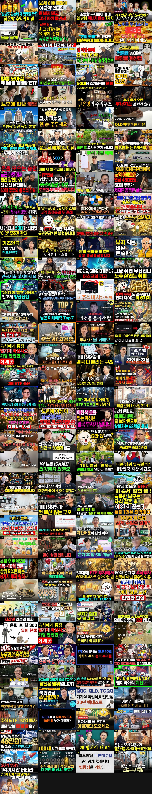

비교 — 자료를 받았지만 성공 기준 밖 (조회수 큰 순, 번호는 `analysis.json` 의 others 순서):

## 6. 길이·내용 구성

### 6-1. 길이별 성공 비율 (비교 집단)

| 길이 | 영상 (성공 비율) | 성공 사례 |
|---|---|---|
| 4~8분 | 23 (61%) | 10 |
| 8~15분 | 74 (57%) | 35 |
| 15~25분 | 109 (69%) | 57 |
| 25~40분 | 43 (72%) | 28 |
| 40분 이상 | 22 (86%) | 15 |

### 6-2. 채널 크기별 성공 비율 (참고 — 구독자가 적을수록 배수가 커지기 쉬움)

| 구독자 | 영상 (성공 비율) |
|---|---|
| 0~999명 | 27 (56%) |
| 1,000~4,999명 | 55 (82%) |
| 5,000~19,999명 | 81 (79%) |
| 20,000~50,000명 | 108 (53%) |

### 6-3. 성공 사례의 구성

- 길이 중앙값: 성공 사례 18.0분 · 비교 집단의 나머지 15.7분
- 타임라인(챕터) 있는 성공 사례: 34% (챕터 수 중앙값 8.0)
- 대본이 있는 성공 사례: 0개 — 말 속도 중앙값 – 음절/초, 첫 1분 음절 중앙값 – (대본이 없어 도입부·흐름은 아직 셀 수 없음)
- 도입부(첫 20초 첫 문장) 유형: 대본 없음 — 아직 셀 수 없음
- 사례마다의 챕터·도입부(첫 20초)·첫 1분·90초마다 흐름은 9번.

### 6-4. 참여율 (비교 집단, 중앙값)

| | 영상 | 좋아요 ÷ 조회수 | 댓글 ÷ 조회수 |
|---|---|---|---|
| 성공 | 181 | 1.0% | 0% |
| 나머지 | 90 | 2.0% | 0% |

## 7. 구독자 — 빨리 크는 작은 채널

YouTube API 는 영상별 구독 증가를 주지 않는다 → 채널 단위로 본다. 개설 24개월 안·구독자 1,000 이상 채널을 **월 구독자 증가(구독자 ÷ 개설 뒤 달 수)** 순으로. 최근 하루 증가 = 받을 때마다 남긴 구독자 기록 (3일 넘게 벌어져야 나옴). 주로 다룬 주제 = 우리가 본 그 채널 영상의 주제 묶음.

| 채널 | 개설 | 구독자 | 월 구독자 증가 | 최근 하루 증가 | 영상 수 | 월 업로드 | 길이 중앙값 | 주로 다룬 주제 | 대표 영상 (하루 조회수 큰 것) |
|---|---|---|---|---|---|---|---|---|---|
| ALLDAY PROJECT | 2024-11-20 | 1,200,000 | 52,786 | – | 568 | 25.0 | 21.5분 | 1. 재테크 일반·마인드 | [LEARNING CREW - 재테크 ∣ ALLDAY PROJECT](https://www.youtube.com/watch?v=7XuczPXv4_o) 600,919회 |
| 경제사냥꾼 | 2025-06-03 | 649,000 | 39,670 | – | 2,871 | 175.5 | 14.0분 | 3. 주식·ETF | [스페이스X 역대급 상장 속, 투자자들이 반드시 알아야 하는 주가 '상승…](https://www.youtube.com/watch?v=TgmHuzIKM6E) 215,324회 |
| 김재원TV | 2025-04-11 | 632,000 | 34,915 | – | 1,099 | 60.7 | 52.1분 | 4. 노후·연금, 3. 주식·ETF | ["여름에 겨울옷을 사야 합니다" 오건영 단장이 말하는 고금리 시대 부자…](https://www.youtube.com/watch?v=51VHCtzlPW8) 513,966회 |
| 순풍 선우용여 | 2025-04-02 | 584,000 | 31,801 | – | 318 | 17.3 | 21.9분 | 4. 노후·연금 | [같이 노후 보낼 양수리 600평 땅에 드디어 집 지으러 간 82세 절친…](https://www.youtube.com/watch?v=GQEO5Th0-7c) 820,793회 |
| PLUS TV (플러스 TV) | 2026-04-23 | 161,000 | 28,166 | – | 333 | 58.3 | 38.2분 | 3. 주식·ETF, 1. 재테크 일반·마인드 | [나스닥 최악의 달 9월, “그런데… 또 놀라서 파실거예요?”](https://www.youtube.com/watch?v=8IH_hQaWyQ8) 762,094회 |
| 이혜성의 1% 북클럽 | 2025-06-13 | 435,000 | 27,134 | – | 134 | 8.4 | 58.0분 | 1. 재테크 일반·마인드, 3. 주식·ETF | [‘찐 부자’에게는 한 가지 특징이 있습니다｜모건 하우절 『돈의 심리학』](https://www.youtube.com/watch?v=77exyhGYbro) 2,668,198회 |
| 경제명탐정 | 2026-02-08 | 200,000 | 24,648 | – | 602 | 74.2 | 14.9분 | 3. 주식·ETF | [[긴급] 나스닥100 ETF 5월부터 룰 변경, 적립식 투자가 호구 되…](https://www.youtube.com/watch?v=d3bAeeYGu1I) 266,486회 |
| 교양이를 부탁해 | 2024-12-27 | 496,000 | 23,051 | – | 2,239 | 104.1 | 42.4분 | 4. 노후·연금, 2. 돈 모으기·저축 | [[이슈읽기] "'큰손'들은 조용히 돈의 방향을 틀었다"...국채금리 5…](https://www.youtube.com/watch?v=W8gLNcBmLLE) 548,696회 |
| 강지영의 동그라미 | 2026-03-02 | 144,000 | 19,395 | – | 89 | 12.0 | 25.2분 | 3. 주식·ETF | [20대에 돈 가장 빨리 모으는 현실적인 방법 (ISA, ETF 활용법)](https://www.youtube.com/watch?v=1AFnKX2-rt0) 1,044,886회 |
| 묘하다 | 2025-09-29 | 242,000 | 19,385 | – | 338 | 27.1 | 31.0분 | 3. 주식·ETF, 1. 재테크 일반·마인드 | [폭망하는 법을 알면 부자 되는 법이 보인다](https://www.youtube.com/watch?v=H_Gb60vFilc) 362,651회 |
| 이미숙_숙스러운 미숙씨 | 2025-04-23 | 332,000 | 18,750 | – | 216 | 12.2 | 31.2분 | 3. 주식·ETF | [미숙한 초보 투자 수업📊 시작 5분 만에 한탕각 잡는 미숙씨💸 (w. …](https://www.youtube.com/watch?v=CiIPNgsBIDQ) 189,900회 |
| 시니어 정보탐정 | 2025-05-27 | 301,000 | 18,179 | – | 39 | 2.4 | 14.5분 | 3. 주식·ETF | [99%는 모르는 제미나이 활용법! 주식·영어 한 방에 끝내는 '마법의 …](https://www.youtube.com/watch?v=Xv0qUVyf-NM) 245,992회 |
| 경제해적단 | 2026-03-18 | 121,000 | 17,623 | – | 50 | 7.3 | 22.4분 | 3. 주식·ETF, 1. 재테크 일반·마인드 | [아직도 주식에만 올인하시나요? 완벽한 노후 포트폴리오 공개](https://www.youtube.com/watch?v=gA4FS4OwUJU) 42,110회 |
| 경제학 똑똑 | 2025-05-22 | 258,000 | 15,399 | – | 210 | 12.5 | 15.0분 | 3. 주식·ETF, 4. 노후·연금 | [사회초년생이 월급 100만 원으로 3년 만에 1억 만드는 법](https://www.youtube.com/watch?v=aMJ9cPRAhSw) 436,385회 |
| 배움에 끝은없다 | 2026-06-07 | 60,800 | 14,347 | – | 31 | 7.3 | 20.5분 | 8. 부업·소득, 기타 | [아무도 안하는 부업으로 27억 모은 40대, 70대도 첫 달 9천만원 …](https://www.youtube.com/watch?v=OBGWI2sJfr8) 912,296회 |
| 와우사연 | 2026-04-14 | 79,900 | 13,290 | – | 44 | 7.3 | 112.3분 | 4. 노후·연금 | ["청소부 딸 주제에!" 며느리 모욕한 시어머니, 재벌 친정아버지 나타나…](https://www.youtube.com/watch?v=l904XNZI3mI) 508,099회 |
| 집구석 경제학 | 2025-11-21 | 133,000 | 12,419 | – | 415 | 38.8 | 29.7분 | 3. 주식·ETF, 6. 절세·제도 | [퇴직연금 IRP 안전자산 30% ETF 추천: 예금 탈출 실전 가이드 …](https://www.youtube.com/watch?v=pIZdQ4qsweU) 101,642회 |
| 사연그리다 | 2026-01-31 | 104,000 | 12,366 | – | 15 | 1.8 | 127.9분 | 4. 노후·연금 | [1살때 날 버린 친엄마 시험하러 거지꼴로 갔더니 아들인줄 모르고 절뚝거…](https://www.youtube.com/watch?v=yK9eq5BccTA) 2,141,952회 |
| 강남역 8번 출구 | 2026-03-18 | 80,200 | 11,625 | – | 113 | 16.4 | 30.6분 | 3. 주식·ETF | [(#이벤트있음) 어떤 걸 좋아하실지 몰라 다 준비했습니다🔮 주식 초보 …](https://www.youtube.com/watch?v=J1dI8O1aKcc) 202,409회 |
| ETF 아는 형 | 2025-07-01 | 157,000 | 10,168 | – | 955 | 61.9 | 24.0분 | 3. 주식·ETF | [노후 자금 주식에 올인했다간 큰일 납니다, 은퇴자가 무조건 사서 묻어둬…](https://www.youtube.com/watch?v=e3EY2JJMgDw) 946,952회 |
| 송팀장 | 2026-01-06 | 93,100 | 10,121 | – | 109 | 11.8 | 40.8분 | 3. 주식·ETF, 1. 재테크 일반·마인드 | ["월 50만원, 뭘 사야 하나요?" 계좌별 나스닥 ETF 최강자는 따로…](https://www.youtube.com/watch?v=aPQurUnzhTs) 189,132회 |
| 꽃편지사연 | 2025-12-11 | 99,800 | 9,895 | – | 67 | 6.6 | 81.3분 | 4. 노후·연금 | [돌잔치 2시간 전 100인분 취소한 동서, 무시하던 형님의 진짜 정체를…](https://www.youtube.com/watch?v=9DDcNwv4GUw) 790,513회 |
| 돈터치 | 2025-08-30 | 129,000 | 9,577 | – | 62 | 4.6 | 22.1분 | 8. 부업·소득, 기타 | [71세 전직 3성 장군, 하루 1시간 부업으로 월 450만원 법니다](https://www.youtube.com/watch?v=mtt8jIsIdQg) 1,284,719회 |
| 자산제곱 | 2026-03-10 | 68,300 | 9,537 | – | 27 | 3.8 | 28.7분 | 3. 주식·ETF | [순자산 6단계 투자 전략, 3천만원부터 20억 이상까지](https://www.youtube.com/watch?v=8KYN-lrLumc) 124,831회 |
| 위폴 WePoll | 2026-03-11 | 66,600 | 9,342 | – | 352 | 49.4 | 46.8분 | 3. 주식·ETF | [7월 변동성 예견한 백찬규 센터장의 하반기 전략 (NH투자증권 백찬규 …](https://www.youtube.com/watch?v=DIkn2We-Gwk) 76,139회 |

## 8. 시청자 니즈 (성공 사례 145개의 시청자 댓글 35,749개 — 채널 주인 댓글 뺌)

| 갈래 | 댓글 | 비율 | 좋아요 합 |
|---|---|---|---|
| 좋은 점 (칭찬·도움·공감) | 4,679 | 13% | 42,054 |
| 더 알고 싶은 것 (질문·요청) | 4,062 | 11% | 13,623 |
| 아쉬운 점 (비판·불만·반박) | 1,282 | 3.6% | 10,742 |
| 경험 공유 (내 이야기) | 2,931 | 8.2% | 26,122 |
| 구독·다음 기대 | 234 | 0.7% | 1,215 |

### 좋은 점 (칭찬·도움·공감) — 좋아요 많은 댓글

- 👍1,988 [#27] “열심히 사신 분이시다. 경의를 표합니다. 그리고 대한민국을 성장시켜 주셔서 감사드립니다.”
- 👍1,744 [#27] “60 넘으면 학력. 경력 다 의미 없어짐. 밥 걱정 없고. 건강하고. 서이 좋은 뱌우자 옆에 있는게 최고.”
- 👍1,330 [#27] “저분 때는 건축과 토목과가 이과 최고였지. 사우디가서 달러 벌어오면 부자소리 들었으니까”
- 👍624 [#5] “노고에 비하면 적다고 생각합니다. 우리생활에 필수적인 서비스를 제공해주시는 택배기사님들께 늘감사드립니다. 화이팅입니다!!”
- 👍582 [#27] “이래서 귀티는 안 없어지는구나 역시 사람은 배워야한다고 느껴지네요 진솔한 인터뷰 감사합니다👏”
- 👍582 [#78] “노후에 혼자살면 제일 편합니다 가벼운 운동하면. 건강관리하면서 병원 가까운곳에서. 사세요 취미생활도 좋습니다~절대 재혼 하지 마세요. 후회 합니다”
- 👍569 [#67] “주식유튜브 안보는게 더 도움된다.”
- 👍523 [#96] “딸집도 아들집도 가지않습니다 가끔만나 밖에서 식사하고 커피마시고 각자헤어집니다 잘 살아주는게 고마운일입니다 너무좋습니다”

### 더 알고 싶은 것 (질문·요청) — 좋아요 많은 댓글

- 👍477 [#21] “뭐야 예약취소해서 경제 활성화 되는거 아니었어??”
- 👍380 [#4] “국내 중국인들에게 25가지 정부지원이 네이버 검색하니 쭉 나오네요 왜 이렇게 세금으로 혜택을주나요?”
- 👍322 [#4] “중국인 가족까지 70만 원씩 줄 돈은 있고 자국민 줄 돈은 없고?”
- 👍288 [#21] “우리가 아는 호텔들은 대부분이 가맹점주, 대리점주라는거군...?”
- 👍264 [#4] “중국인이 받는 것이 말이됩니까?”
- 👍222 [#32] “정말 기본적인건데 국민연금 예상연금액 조회하면 나오는 예상연금액은 지금 가입된 소득으로 60세까지 납부했을때 기준이에요 왜 저렇게 설명하시지? 오해 소지가 넘 많은데요?”
- 👍220 [#67] “안그래도 느꼈어요 요즘은 증권방송 보기도 싷더라구요 소위 주식 전문가들 증권사 직원들 에널리스트들 전부 자기밥그릇 챙기느라 혈안ᆢ 한통속 이예요 ᆢ 그들의 만행을 속시원히 알려주니 감사하네요 ᆢ”
- 👍219 [#67] “하이닉스 기업총수 조강지처 헌신짝 처럼 버리는데 주식 주주님들 한테 진심일까요? 기업총수 정신자세 중요하죠. 주식은 믿음이 있어야 장기투자 할수있으니까요!”

### 아쉬운 점 (비판·불만·반박) — 좋아요 많은 댓글

- 👍983 [#27] “고독사는 실패한 죽음이 아닙니다. 비싼 병원에서 가족과 간병인의 보호 아래 눈 감는다 한들 화려하고 행복한 죽음이란 있을 수 없어요.”
- 👍817 [#57] “개인연금 시대에 종합소득 과세 2000은 말도 안되는 시대에 뒤떨어진 정책입니다 최소 4000은 되어야 함”
- 👍756 [#54] “이분이 이번에 맞췄다고 해서 다음에 또 맞추는건 아닙니다. 남의 말 듣지말고 자기 주관대로 해야 후회가 남지 않습니다”
- 👍589 [#86] “소액만 하고 목돈 안모아본 사람들 댓글이 대부분이네요 ㅋㅋㅋ 저도 1억 채웠는데 해지 안합니다. 해지하지마세요. 경험들도 안해봤으면서 돈 모이면 연금저축으로 이전해라 얼마빼고 일부 돈 뺼수잇다 이러는데 전혀 아닙니다. 연말정산 자기들이 직접 하는게 아니라 회사서 일괄로 하기때문에 세액공제 조금씩은 다 받아져잇습니다.(안받앗다고 주장하는 사람들 나중에 다 몰”
- 👍233 [#82] “안녕하세요, 한글언니입니다! 🥰 저도 광고를 보고 시작한 사람인만큼 많은 무료 부업 강의들을 시청했습니다 여러분이 느끼셨던 기분, 저도 느껴봤어요 🫥 제 시급 4만원을 기준으로 강의는 두시간가량 진행 예정이니 여러분이 내어주시는 시간을 돈으로 환산하면 10만원이 되겠네요 (그보다 더한 가치라고 생각합니다) 하나 약속드릴 수 있는 건, 귀하신 시간 내어 참석”
- 👍229 [#104] “구구절절 옳은말씀 틀린게 하나도 없네요”
- 👍200 [#31] “재밌어요. 구독자 68명 퀄이아닌데요 머지”
- 👍191 [#18] “50대 초반 대기업 시니어 부장에서 퇴직하고 거짓말 안 보태고 이력서만 100곳 이상 썼습니다. 그리고 천신만고 끝에 조그만 중소기업에 재취업을 했는데, 공황장애가 오더군요. 이번엔 살려고 퇴사했습니다. 그리고 결국 다 내려놓고, 자격증을 땄습니다. 70 넘어서도 일할 수 있는 일이 기준이었고(물론 그 이전 65세에 은퇴할 생각입니다) 밑바닥 부터 시작해도”

### 경험 공유 (내 이야기) — 좋아요 많은 댓글

- 👍1,622 [#27] “친구들 보다 경제적으로 부족한데도 자격지심이 하나도 없으시고 현실인데 뭐 어떡하겠냐 이런 식으로 받아들이면서 웃어버리는 게 참 긍정적이고 건강하시네요”
- 👍1,258 [#27] “그동안 본 은퇴자 인터뷰 중에서 가장 마음에 와 닿고 솔직한 인터뷰입니다. 어르신 학력좋고 일도 열심히 하셨는데 친구들과 자산 격차가 벌어진 사실을 담담히 말씀하시네요. 좋은 대학 나와 30년 넘게 일했는데 노후는 편치 않아보여요. 저도 생각이 많아지네요 ㅠ”
- 👍826 [#40] “친구가 부자 됐다고 그 친구에게 내가 거리 느끼고 시기하고 질투하면 나는 그 사람 친구될 자격 없는겁니다.”
- 👍589 [#86] “소액만 하고 목돈 안모아본 사람들 댓글이 대부분이네요 ㅋㅋㅋ 저도 1억 채웠는데 해지 안합니다. 해지하지마세요. 경험들도 안해봤으면서 돈 모이면 연금저축으로 이전해라 얼마빼고 일부 돈 뺼수잇다 이러는데 전혀 아닙니다. 연말정산 자기들이 직접 하는게 아니라 회사서 일괄로 하기때문에 세액공제 조금씩은 다 받아져잇습니다.(안받앗다고 주장하는 사람들 나중에 다 몰”
- 👍551 [#27] “대화에서 가식없고 성실하게 사신 진솔함이 느껴지네요 가족의 의미에 대해 여러가지 생각이 듭니다 저도 60대 중반에 접어드니 더욱 홀로서기와 죽을때까지 건강과 여러 분야의 학습을 통해 시간 보내기를 잘하고 사흘 정도만 아프고 먼곳으로 가고 싶네요”
- 👍509 [#78] “혼자 된 팔자에 다시 만나야 파란을 겪을 것 다 이유없는 공짜가 없다 괜히 쓸데없는 인연 만들지 마라”
- 👍497 [#57] “저도 은퇴 후 자산정리하고, 분배금으로 살고 있습니다. 님과는 다르게 ETF반 커버드콜반으로 운영중이고, 현재 커버드콜은 전부 국내만 운영중입니다. 커버드콜 자산은 조금더 많은것 같고, 결론적으로 올해 총 수익은 1.2억정도인데 과세기준소득은 약 1천만원, 올해 말은 다른 이지소득까지 합하면 2천5백정도할 것 같습니다. 건보료는 기준소득기준 월 약 29만원”
- 👍437 [#122] “저도 6년전에 존리님 말씀듣고 주식투자 하고 있어요. 애들 학원 안 보내고 매달 10만원씩 주식 사주고 있는데요. 많이 불어나서 세명 아이꺼 합치면 1억2천정도 됩니다. 초반 300만원 각자 입출금통장에 모아둔 용돈으로 시작했고 명절 용돈 받은 거 ,매달 넣어준 10만원이 단데 6년만에 이렇게 불어나서 저도 놀라워요. 존리대표님 덕입니다.”

### 구독·다음 기대 — 좋아요 많은 댓글

- 👍253 [#120] “후라이팬이나 하나 사세요. 식구들 건강 다 해칩니다. 저금은 499만원만 하시고.”
- 👍176 [#120] “촬영용으로 예쁘게 미리. 만들어 놓은게 아니라 진짜 현실그대로 보여주는거 같아서 뭔가.. 위로와 용기와 응원을 주는거 같아서 구독해요!! 꾸밈없이 현실그대로 보여주세요!!^^”
- 👍45 [#11] “뇌피셜로 쓴글. 젊은시절 미국에 와서 남은세월 돈걱정은 안할거같아 58세에 뒤도 안돌아보고 은퇴하고 지금 68세됐네요. 결론은 일할때보다 더 바쁜 세월을 보냈습니다. 그 바쁜것도 다 내가 하고싶은 것만 하면서요. 계절마다 가고 싶은 곳이 얼마나 많은지 그렇게 돌아다녀도 아직까지 다 못가봤어요. 앞으로의 세월이 분명 얼마안남았을텐데 다 가볼수있을지 모르겠네요”
- 👍43 [#21] “좋은 방향으로 사건과 사물을 보고, 해석을 하시는 것이 좋은 채널로 성장하실 것 같습니다. 이렇게 작은 채널엔 처음 구독 신청했는데, 계속 좋은 관점과 분석 기대합니다.~~”
- 👍32 [#57] “이제까지 봤던 은퇴관련 배당 컨텐츠중에서 가장 실용적이고 퀄리티높은 !!!! 구독합니다.”
- 👍29 [#67] “매일매일 듣고 보고 있습니다교수님 감사해요”
- 👍29 [#131] “저는 얼마전부터 모아오던 QQQ를 QLD로 전환 매수했고 매달 월급날에 추매하는 장기 투자를 목표하고 있구요. 나스닥의 우상향을 믿지만 2배수라서 약간의 두려움도 있었는데 이 방송을 보고 나니 QLD가 더욱 든든해보입니다. 이렇게 좋은 방송을 공유해주셔서 진심으로 감사드리고, 바로 구독했어요. 저도 장기로 쭉 같이 모아갈게요!! 그리고 미국에 사는데, 미국”
- 👍24 [#120] “이 채널 은근히 재미있네.. 주인장이 재미난 분인듯. 나도 모르게 구독했뿟네요.”

### 더 알고 싶은 것 — 질문·요청 (좋아요 순, 최상위 댓글)

- 👍477 [#21] “뭐야 예약취소해서 경제 활성화 되는거 아니었어??”
- 👍380 [#4] “국내 중국인들에게 25가지 정부지원이 네이버 검색하니 쭉 나오네요 왜 이렇게 세금으로 혜택을주나요?”
- 👍322 [#4] “중국인 가족까지 70만 원씩 줄 돈은 있고 자국민 줄 돈은 없고?”
- 👍288 [#21] “우리가 아는 호텔들은 대부분이 가맹점주, 대리점주라는거군...?”
- 👍264 [#4] “중국인이 받는 것이 말이됩니까?”
- 👍222 [#32] “정말 기본적인건데 국민연금 예상연금액 조회하면 나오는 예상연금액은 지금 가입된 소득으로 60세까지 납부했을때 기준이에요 왜 저렇게 설명하시지? 오해 소지가 넘 많은데요?”
- 👍220 [#67] “안그래도 느꼈어요 요즘은 증권방송 보기도 싷더라구요 소위 주식 전문가들 증권사 직원들 에널리스트들 전부 자기밥그릇 챙기느라 혈안ᆢ 한통속 이예요 ᆢ 그들의 만행을 속시원히 알려주니 감사하네요 ᆢ”
- 👍219 [#67] “하이닉스 기업총수 조강지처 헌신짝 처럼 버리는데 주식 주주님들 한테 진심일까요? 기업총수 정신자세 중요하죠. 주식은 믿음이 있어야 장기투자 할수있으니까요!”
- 👍189 [#11] “은퇴하고 쉰지3년 하루하루가행복합니다 왜?꼭일해야하나요? 참나 죽을때가지일하라하지마세요~”
- 👍189 [#67] “개미들 돈 누가 다 먹었을까요? 다 외국인 기관들한테 갔습니다 증권사는 수수료로 돈 잔치 했겠죠. 그동안 주식해서 번돈 다시 재투자하면서 이제 원금입니다 ㅠ 그나마 다행이지요. ㅠㅠ 그동안 무료 봉사 했어요 주식에~~~~”
- 👍177 [#87] “저분이 삼성 안가서 삼성한테는 다행이다 ᆢ무슨 저런 생각을하나?”
- 👍127 [#66] “질문? 한국주식에서 매매차익은 비과세라고 한 얘기가 한국주식시장에서 운영하는 미국주식 etf 등의 상품에 대한 매매차익까지 비과세는 아니라는 얘기를 반드시 해주셔야 합니다. 왜냐하면 잘 모르는 사람들은 한국주식시장에서 거래하는 모든 상품의 매매차익이 전부 비과세인지 알 수 있거덩요 맞죠?”
- 👍127 [#102] “올해 아들 장가 보내면서 덕담할때 갑자기 눈물터져서 나를 포함 하객들이 어리둥절했는데 희안하게 전혀 보고싶지 않음. 며느리전화번호도 모르는데 딱히 알고 싶은 마음도 없음😂”
- 👍107 [#81] “허언증 말기인 모지리들임 ㅋ 순자산 천억이라 ㅆㅣ부리면 내가 천억자산가인가?”
- 👍102 [#26] “내가 돈많다고 너희가 내재산 불려줬냐?”
- 👍94 [#5] “진짜 문제는 대리점이죠 자신 스스로는 긍정적인 마인드로 일한다지만 대리점은 그걸 악용하는 사례가 많다 알고 있습니다 이런 부분도 추 후 알려주세요”
- 👍91 [#19] “궁금하기는 했어”
- 👍87 [#38] “슨피로 20억을 만들어 나중에 팔아서 16억원어치 배당주를 사 그럼 되는거 아니야?”
- 👍81 [#82] “대단하세요. 한국어 배울 맛 나겠어요. 저도 온라인으로 스페인어를 배워봤는데, 정말 선생님들의 실력이 천차만별입니다. 정말 정말 잘 가르쳐 주는 분들도 있고, 뭘 어떻게 가르쳐야 되는지 모르는 분들도 많습니다. 한글 언니는 참 준비도 열심히 하시고, 레엑션도 잘 해주셔서 인기가 많으실 것 같습니다. 시간당 30달러 받으실 정도면, 온라인 플랫폼에서 실력을 ”
- 👍75 [#87] “기업을 기우면 우리국민한테 돌아오는데 삼성을 위해서는 안는다고 그럼지금 무슨 봉사라도 하시나?”
- 👍75 [#126] “진짜 웃기네.... 아무것도 안하고 범죄자로 살다가 100만원씩 받고, 열심히 살았는데 칠팔십만원 받는다?????”
- 👍74 [#4] “세금 쓰는 모든 돈의 지출을 복잡하게 해서 누구 주머니 채울생각임?”
- 👍73 [#104] “전부 다 맞는말이네요~~??”
- 👍71 [#96] “맞아요 부탁할때만, 호출할때만 봐주면 좋아요”
- 👍68 [#59] “빠더너스 채널인줄 알았어요..! 시간이 지나면 폐건물이 되는 건 당연한 수순인데 하나만 있어도 그 주변 미관이 많이 망가지더라구요. 그런 건물들을 찾아다니며 리모델링한다니 너무 좋네요! 앞으로 많은 활동 부탁드려용”

### 아쉬운 점 — 비판·불만 (좋아요 순, 답글 포함)

- 👍983 [#27] “고독사는 실패한 죽음이 아닙니다. 비싼 병원에서 가족과 간병인의 보호 아래 눈 감는다 한들 화려하고 행복한 죽음이란 있을 수 없어요.”
- 👍817 [#57] “개인연금 시대에 종합소득 과세 2000은 말도 안되는 시대에 뒤떨어진 정책입니다 최소 4000은 되어야 함”
- 👍756 [#54] “이분이 이번에 맞췄다고 해서 다음에 또 맞추는건 아닙니다. 남의 말 듣지말고 자기 주관대로 해야 후회가 남지 않습니다”
- 👍589 [#86] “소액만 하고 목돈 안모아본 사람들 댓글이 대부분이네요 ㅋㅋㅋ 저도 1억 채웠는데 해지 안합니다. 해지하지마세요. 경험들도 안해봤으면서 돈 모이면 연금저축으로 이전해라 얼마빼고 일부 돈 뺼수잇다 이러는데 전혀 아닙니다. 연말정산 자기들이 직접 하는게 아니라 회사서 일괄로 하기때문에 세액공제 조금씩은 다 받아져잇습니다.(안받앗다고 주장하는 사람들 나중에 다 몰”
- 👍233 [#82] “안녕하세요, 한글언니입니다! 🥰 저도 광고를 보고 시작한 사람인만큼 많은 무료 부업 강의들을 시청했습니다 여러분이 느끼셨던 기분, 저도 느껴봤어요 🫥 제 시급 4만원을 기준으로 강의는 두시간가량 진행 예정이니 여러분이 내어주시는 시간을 돈으로 환산하면 10만원이 되겠네요 (그보다 더한 가치라고 생각합니다) 하나 약속드릴 수 있는 건, 귀하신 시간 내어 참석”
- 👍229 [#104] “구구절절 옳은말씀 틀린게 하나도 없네요”
- 👍200 [#31] “재밌어요. 구독자 68명 퀄이아닌데요 머지”
- 👍191 [#18] “50대 초반 대기업 시니어 부장에서 퇴직하고 거짓말 안 보태고 이력서만 100곳 이상 썼습니다. 그리고 천신만고 끝에 조그만 중소기업에 재취업을 했는데, 공황장애가 오더군요. 이번엔 살려고 퇴사했습니다. 그리고 결국 다 내려놓고, 자격증을 땄습니다. 70 넘어서도 일할 수 있는 일이 기준이었고(물론 그 이전 65세에 은퇴할 생각입니다) 밑바닥 부터 시작해도”
- 👍183 [#27] (답글) “그래도 와이프분 분당에 사는거 보면 아예 없는 사람은 아닙니다. 스스로 검소한 생활을 하고 있다보는게 맞습니다”
- 👍164 [#40] “아무 말도 안할거면 친구를 왜만나나 서로 흠도 나누고 자랑도 나눠야 친구지”
- 👍140 [#54] “대책이 더 실망스러워 김용범 안짜르면 이잼지지율 바닥칠꺼다 정신 차리길😢”
- 👍136 [#104] “그때는 옳고 현재는 틀렸다. 역사가 어떻게 증명할지 기대 됩니다. 그때는 내주머니에 돈채워주던때 지금은 내주머니 돈 뺏어가던때”
- 👍121 [#120] “저렇게 만들어준 집밥 먹어주는 자녀들이 기특하다는 댓글들 많은데요 글쎄요~ 저는 다른관점에서 보네요. 아이들을 그렇게 키우신 엄마가 지혜롭고 야무져보입니다.”
- 👍114 [#54] “돌이켜보니 이 사람 예측이 제일 정확했다...5000대 초반까지 떨어질 수 있다고 한 유일한 사람임...그 때는 말도 안되는 소리라 생각했는데 정확했음”
- 👍106 [#140] “함께 이룬 재산도 아닌데 재혼하면서 왜 그걸 자기랑 공유해야한다고 생각하는지...”

## 9. 사례별 자세히

### 1. 안 팔릴수록 부자되는 '동네 금은방'의 소름돋는 수익구조

- https://www.youtube.com/watch?v=eFsT1K_mPjc · 새파란 경제 · 구독자 908 · 조회수 510,269 (×562.0, 하루 18,293.3) · 좋아요 1,284 (0.2%) · 17.6분 · 2026-09-16 · 주제 묶음 1. 재테크 일반·마인드 · 폴더 `W_eFsT1K_mPjc` (웹 승인)
- 썸네일: 
- 챕터: 0:00 손님 없는 금은방이 버티는 이유 · 1:16 금은방이 보는 건 무게와 순도뿐 · 2:17 18K와 순금, 받는 돈이 갈리는 이유 · 3:56 금시세보다 낮은 금액을 부르는 까닭 · 5:00 가게마다 금매입 가격이 다른 이유 · 7:22 금 한 돈 사서 바로 팔면 11만 9000원 · 8:04 그 차액의 3분의 2는 부가세 · 9:57 팔린 돌반지가 녹으러 가는 길 · 13:06 금은방이 교환에서 버는 방식 · 13:48 수리와 재세공에서 생기는 공임 · 15:14 안 팔린 금을 녹일 수 있다는 말의 뜻
- 설명 앞부분: 진열장 앞은 비어 있는데 금은방은 문을 닫지 않습니다. 금시세가 오르는 동안 금값과 금매입 가격이 얼마나 벌어졌는지, 서랍 속 돌반지 하나가 금은방 안에서 몇 번 돈이 되는지 순서대로 따라가 봤습니다. 【 ⏱️ 타임코드 】 1. 한국금거래소 — 「2026년 9월 14일 귀금속 시세 고시」 (순금 한 돈 살 때 827,000원 · 팔 때 708,000원 · 차액 11만 9000원) 2. 한국표준금거래소 — 「2026년 9월 14일 귀금속 시세 고시」 (거래소 두 곳 매입가 차이 0.14% · 은 5.3% · 백금) 3. 농민신문 —…
- 대본 없음 (설명) — 음성인식이 끝나면 도입부·흐름이 들어감
- 댓글 139/139: 좋은 점 3 · 더 알고 싶은 것 5 · 아쉬운 점 7 · 경험 공유 2 · 구독·다음 기대 0
  - 좋은 점 👍3 “금은방도 힘들다 그러더라..부산지역에 남아있는 가게에 물어봤더니.. 자신들은 세공까지 해서 겨우 유지한다고.. 다른 곳은 남에게 맡기다가 문 다 닫았다고. 금은 계산 쉽게 한다. 살때 20프로 세금 내야하고, 팔 때 또 20프로 깍아야 하고..40프로 오를 비젼 있을…”
  - 좋은 점 👍2 “금거래 방식을 잘 배우고 갑니다 감사합니다”
  - 더 알고 싶은 것 👍2 “그래서 왜 안 망하는데요 ?”
  - 더 알고 싶은 것 👍1 “3가 금은방 그렇게 많은줄 몰랐네.. 종로3가 금은방 거리인가?”
  - 아쉬운 점 👍4 “스프레드 차이라고 하죠. 순금이 그나마 덜하고 나머진 특히 은은 말도 안되죠. 한놈만 걸려도 먹고 삼.”
  - 아쉬운 점 👍1 “뭔 얘기를 길게 늘여놨냐? 다 아는 얘기임.”

### 2. 65세 이후 통장에 '이 금액' 있다면 돈 벌지 말고 그냥 인생을 즐겨라ㅣ명언ㅣ인생조언ㅣ오디오북

- https://www.youtube.com/watch?v=MJE-dsUuqIM · 인생의 고수 · 구독자 1,580 · 조회수 838,223 (×530.5, 하루 25,985.5) · 좋아요 3,156 (0.4%) · 34.8분 · 2026-09-12 · 주제 묶음 4. 노후·연금 · 폴더 `W_MJE-dsUuqIM` (웹 승인)
- 썸네일: 
- 설명 앞부분: 요즘 저는 거의 매일 동네 복지관에 갑니다. 그곳에서 운동도 하고, 프로그램도 듣고, 또래 어르신들과 잡담도 하며 소소한 재미를 느끼고 있습니다. 그런데 어느 순간부터 이런 생각이 들기 시작했습니다. “이분들은 도대체 노후 자금이 얼마나 될까?” 화려한 삶을 사는 것도 아닌데, 매일 복지관에 오고 지역 모임에도 참여하고, 커피 한 잔 편하게 마실 수 있는 걸 보면 돈 걱정이 아주 심한 분들은 아닐 텐데…라는 의문 말입니다. 그리고 이 질문은 자연스럽게 제 자신의 노후를 떠올리게 했습니다. “나는 70대가 되었을 때, 통장에 얼마를…
- 대본 없음 (설명) — 음성인식이 끝나면 도입부·흐름이 들어감
- 댓글 196/196: 좋은 점 27 · 더 알고 싶은 것 18 · 아쉬운 점 6 · 경험 공유 9 · 구독·다음 기대 0
  - 좋은 점 👍16 “서로 배풀고 배려하는 사랑을 실천해야됨을 알려주심감사합니다❤❤❤”
  - 좋은 점 👍12 “마지막의 좋은글 멋진글 감사합니다.❤❤❤”
  - 더 알고 싶은 것 👍23 “100만원도통장에없는분이 진짜있을까요? 설마요 이야기전개상 괜히하는소리로들리네요 진짜그런분이있다면 그건좀.....”
  - 더 알고 싶은 것 👍17 “은행빛없고 자식들에게 손벌릴 정도는 아닙니다 근데 정말 70대에 통장에 백만원 없는사람들이 있을까요? 믿기지가 않네요”
  - 아쉬운 점 👍17 “은행빛없고 자식들에게 손벌릴 정도는 아닙니다 근데 정말 70대에 통장에 백만원 없는사람들이 있을까요? 믿기지가 않네요”
  - 아쉬운 점 👍4 “70대부터는 돈보다 시간이 더 아깝지요. 살 날이 길어봤자 25년밖에 안 남았으니, 하루 하루 시간이 흘러가는게 너무 아깝지요. 공적연금220만원+주택연금 70만원 등 월290만원이 꾸준히 들어오면, 가진 목돈2억원 중에서, 70대에 8천만원으로 전국 자가용여행(50…”
  - 경험 공유 👍50 “보험은 꼭 있어야 합니다 현금은 누가 써도 써 버립니다 실손과 간병인보험은 꼭 의무적으로 있어야 합니다 간병비 하루20만원 감당힘듭니다 이 보험 안들면 재산 지키기 힘듭니다. 보험은 내 자신과 가족들을 지키는 길이고 내가 아프면 비참해 지지 않는 길입니다”
  - 경험 공유 👍11 “나는 저축액 1억원에 매달 382만원의 무노동수입이 있어요. 임대수입(수익형부동산이 빚없이 5건 + 서울빌라거주) 이자수입 국민연금의 합계 또한 아내가 큰딸 손주 돌봐주고 100만원씩 받고 있어요. 나는 매일매일 먹고 놀아요.”

### 3. 조용한 부자들이 절대 입에 담지 않는 7가지 — 돈 있는 사람의 진짜 습관 ㅣ시니어ㅣ오디오북ㅣ노후준비ㅣ심리학ㅣ

- https://www.youtube.com/watch?v=TKBAsjZgVWU · 가을빛 심리학 · 구독자 1,000 · 조회수 413,701 (×413.7, 하루 14,920.6) · 좋아요 1,518 (0.4%) · 21.7분 · 2026-09-16 · 주제 묶음 1. 재테크 일반·마인드 · 폴더 `W_TKBAsjZgVWU` (웹 승인)
- 썸네일: 
- 설명 앞부분: 🔇 조용한 부자들은 왜 말을 안 할까? 모임에서 늘 구석에 앉고, 누가 물어봐도 "이것저것이요" 한마디로 끝내는 사람. 알고 보니 건물 두 채, 세 채를 가지고 있었습니다. 이 사람들에게는 절대 입 밖에 꺼내지 않는 공통된 습관이 있었어요. 자산 규모, 소비 기준, 성공 원인, 심지어 좋은 일을 하고도 말하지 않습니다. 왜 그런 걸까요? 심리학 연구와 실제 사례를 바탕으로, 조용한 부자들이 침묵하는 진짜 이유 7가지를 하나씩 풀어봤습니다. 💡 이런 분들에게 추천합니다 ✔️ 말을 아끼는 사람들의 심리가 궁금한 분 ✔️ 부자들의 실제…
- 대본 없음 (설명) — 음성인식이 끝나면 도입부·흐름이 들어감
- 댓글 100/100: 좋은 점 8 · 더 알고 싶은 것 3 · 아쉬운 점 1 · 경험 공유 10 · 구독·다음 기대 0
  - 좋은 점 👍20 “듣고 나는 너무 말을 많이 해구나 주식얘기 돈얘기 남편과 나 사이얘기 앞으로는 듵는 쪽으로 ~~ 잘 들었습니다”
  - 좋은 점 👍15 “조용히 있다가 그돈 남으면 저승에 가져가면 되겠네요 ᆢ좋습니다ᆢ”
  - 더 알고 싶은 것 👍17 “쓸데없이 정보도 흘리기 싫고 상대방이 나와 자기를 비교하면 관계가 피곤해지기 때문에 말을 아낍니다. 자기 가진거 자랑하는건 잘 들어줘요. 그런데 자기와 나를 비교하면서 내가 얼마 가졌나 파고들며 묻는 사람들은 무조건 피합니다. 그렇게 묻는 이유는 두가지인데 자기가 나…”
  - 더 알고 싶은 것 👍0 “난 조용한데도 돈 없는데... 지나가다 오토바이 헬멧을 주웠으니 이제 오토바이만 주우면 되는건가?”
  - 경험 공유 👍87 “나도 조금 벌면, 떠벌려서 커피값이든 술값이든 돈을 내게 됨.... 조용히 있어야 한다는 걸 아는데도 자꾸 말하게 됨.....50대가 코앞인데 아직 덜 성숙한 것 같다.”
  - 경험 공유 👍21 “좋은 대화를 위해서 인문학, 문화예술 분야를 독서하고 경험합시다.”

### 4. 기초연금 개편 진짜였네? 결국 내가 받을 돈 '이렇게' 받는다 [대통령 긴급 발표] 61년생부터 주목

- https://www.youtube.com/watch?v=42N9nj2wWko · 연금노하우 · 구독자 1,280 · 조회수 412,530 (×322.3, 하루 8,991.5) · 좋아요 4,308 (1.0%) · 9.4분 · 2026-08-29 · 주제 묶음 4. 노후·연금 · 폴더 `W_42N9nj2wWko` (웹 승인)
- 썸네일: 
- 설명 앞부분: "기초연금 개편 진짜였다" 여러분, 61년생부터 받는 기초연금이 12년만에 확 달라졌습니다. 대통령이 긴급 발표한 내용인데요. 이재명 대통령이 절대 그냥 주라고 하지는 않았다네요.. 그동안 똑같이 받던 연금, 이제 누구는 더 받고, 또 누구는 그대로 라는데요. 여러분의 부모님은 과연 어느 쪽일까요? 자세한 내용은 영상에서 확인하세요!
- 대본 없음 (설명) — 음성인식이 끝나면 도입부·흐름이 들어감
- 댓글 349/349: 좋은 점 21 · 더 알고 싶은 것 49 · 아쉬운 점 13 · 경험 공유 12 · 구독·다음 기대 0
  - 좋은 점 👍417 “외국인들한테 기초연금 국민연금 고용보험을 왜 주는지 이해가 안 됩니다.외국인 혜택 절대 반대합니다.”
  - 좋은 점 👍194 “젊은 청년이 깨어있네. 고맙습니다.”
  - 더 알고 싶은 것 👍380 “국내 중국인들에게 25가지 정부지원이 네이버 검색하니 쭉 나오네요 왜 이렇게 세금으로 혜택을주나요?”
  - 더 알고 싶은 것 👍322 “중국인 가족까지 70만 원씩 줄 돈은 있고 자국민 줄 돈은 없고?”
  - 아쉬운 점 👍57 “재산도 별로 없는데 안준다 외국인은 주고 내국민은 안주고 이게 뭐하는짖인지”
  - 아쉬운 점 👍54 “저건 대한민국의 정부가 아닙니다!”
  - 경험 공유 👍157 “문제는 국민연금이 왜 외국사람에게 지불하느냐 ??? 이다. 대한민국 국민인 나도 못 받는데”
  - 경험 공유 👍9 “3년째 대상에서 제외되는 사람은 애국자?”

### 5. 생생한 택배기사 최근 6개월치 월급 공개... 이게 '진짜 현실'입니다.

- https://www.youtube.com/watch?v=6QkzqMZYrVQ · 택부 - 택배기사 부자들 · 구독자 6,550 · 조회수 1,941,365 (×296.4, 하루 38,114.3) · 좋아요 6,600 (0.3%) · 8.6분 · 2026-08-24 · 주제 묶음 2. 돈 모으기·저축 · 폴더 `W_6QkzqMZYrVQ` (웹 승인)
- 썸네일: 
- 챕터: 0:00 인트로 · 0:16 택배기사 진짜 돈 많이 버나? · 0:39 택배기사 월급, 매출 계산하는 방법 · 1:32 택배기사 월급 공개 · 3:14 순수익 계산 방법 · 4:49 택배기사 현실 순수익 · 5:46 현 시점 택배가 돈이 되는 이유 · 6:34 근데도 내가 돈이 없는 이유 · 7:26 택배기사의 꿈
- 설명 앞부분: 택배 얼마 벌어? 이제 그만 물어보세요. 다 말씀드릴테니까 😉 택배로 돈 더 벌 수 있는 새로운 방법
- 대본 없음 (설명) — 음성인식이 끝나면 도입부·흐름이 들어감
- 댓글 1,547/1,547: 좋은 점 143 · 더 알고 싶은 것 173 · 아쉬운 점 58 · 경험 공유 131 · 구독·다음 기대 7
  - 좋은 점 👍624 “노고에 비하면 적다고 생각합니다. 우리생활에 필수적인 서비스를 제공해주시는 택배기사님들께 늘감사드립니다. 화이팅입니다!!”
  - 좋은 점 👍129 “참된 노동의 대가! 열심히 사시는 모습 보기 좋습니다. 구독!”
  - 더 알고 싶은 것 👍94 “진짜 문제는 대리점이죠 자신 스스로는 긍정적인 마인드로 일한다지만 대리점은 그걸 악용하는 사례가 많다 알고 있습니다 이런 부분도 추 후 알려주세요”
  - 더 알고 싶은 것 👍15 “영상 잘봤습니다. 유익한 정보네요 다만 급여에 관한 내용을 말할때는 실 근무시간 근무시간대도 알려줘야 시청자들이 합리적으로 이해하지 않을까요? 😂”
  - 아쉬운 점 👍29 “몸관리 잘하셔야 합니다 업무 전후 10분씩이라도 스트레칭 해주셔요 나이 들어서 아프다는말 거짓아닙디다 하나둘씩고장나요 화이팅”
  - 아쉬운 점 👍11 “택배20년 했습니다. 돈은벌었지만 도가니가 내것이 아닙니다..^^”
  - 경험 공유 👍28 “내가 저돈벌면 입에풀칠만 겨우하고 십원한푼못남긴다 애둘아빠가.. 정말 힘든세상임”
  - 경험 공유 👍15 “쿠팡초창기에 했었는데 돈 아무리줘도 2년이상 못할직업임.. 무릎에 물 ㅈㄴ차서 20대였는데도 고만두고나서 한달정도 병원다녔음”
  - 구독·다음 기대 👍1 “솔직한 직업생활과 따뜻한 인상이 마음에 들어 구독하고 갑니다. 건승하시기 바랍니다.”
  - 구독·다음 기대 👍0 “그동안 샨타님 구독했었던 구독자입니다. 더 이상 채널에서 뵐수 없다는게 안타까웠는데 여기서 뵙네요~ 힘내세요~!!!”

### 6. 은퇴 후 행복한 삶을 누리는 노년층의 4가지 특징 60세 이후 최고의 삶을 누리는 비결은 바로 '이것'을 실천하는 사람들에게 있다 !

- https://www.youtube.com/watch?v=mJbPirgzeu0 · 삶의 깊은 이야기 · 구독자 1,600 · 조회수 425,737 (×266.1, 하루 2,625.4) · 좋아요 4,876 (1.1%) · 21.1분 · 2026-05-05 · 주제 묶음 4. 노후·연금 · 폴더 `W_mJbPirgzeu0` (웹 승인)
- 썸네일: 
- 설명 앞부분: 다음 영상은 노년의 외로움과 삶의 의미를 다시 찾는 과정을 담은 깊이 있는 이야기입니다. 전라북도 전주에 사는 임명자 어르신의 실제 경험을 바탕으로, 남편을 떠나보낸 이후 느낀 공허함과 그 속에서 발견한 작은 변화들을 차분히 풀어냅니다. 특히 오래된 가계부 속 기록을 통해 사랑의 의미를 깨닫고, 일기 쓰기와 이웃을 돌보는 행동으로 삶의 방향을 바꿔가는 과정이 인상적으로 그려집니다. 또한 빅토르 프랑클의 ‘의미 치료’ 개념을 통해 왜 인간에게 ‘의미 있는 삶’이 중요한지 쉽게 이해할 수 있도록 설명합니다. 이 영상을 통해 시청자는 …
- 대본 없음 (설명) — 음성인식이 끝나면 도입부·흐름이 들어감
- 댓글 482/482: 좋은 점 143 · 더 알고 싶은 것 12 · 아쉬운 점 5 · 경험 공유 12 · 구독·다음 기대 0
  - 좋은 점 👍85 “전 암을 치료중입니다 가족들덕에 더 행복한하루를 보내고있어요 아픈저를 너무아껴준다는걸 알았을때 전 행복을알게되었답니다 감사하며 남은 여생살거에요”
  - 좋은 점 👍42 “네 좋은 동영상 감사합니다. 모처럼 소소한 이야기지만 저에게 따뜻함을 느끼게 해주네요! 저도 이제 60이 되서 어떻게 노년을 보내야 하나 걱정이 많았는데 하루 중 느꼈던 작은 일들을 생각하게 하고 이제는 그것을 동영상에서 처럼 글을 남기려 합니다. 저에게 조용한 미소…”
  - 더 알고 싶은 것 👍2 “이런 콘텐츠 너무 좋아요 자주 올려주세요!”
  - 더 알고 싶은 것 👍2 “은퇴 후에도 행복한 삶을 살아가는 사람들에겐 공통된 습관이 있었습니다. 여러분은 지금 어떤 삶을 준비하고 계신가요? 댓글로 함께 이야기 나눠주세요.”
  - 아쉬운 점 👍102 “노년 혼자 됐을때 무슨일이든 자기에게 맞는일을 찾아서 하면 됩니다. 여기서 나오는 한두개의 얘기가 절대 답이 아닙니다. 착각하면 안됩니다. 수십개 아니 수백개의 일이 있습니다. 취미생활, 운동, 봉사 활동, 종교 생활, 공부등 수도 없이 많습니다. 자기에게 맞는것을 …”
  - 아쉬운 점 👍5 “지루하지 않게 잘 ~설명해 주시는군요. 고맙습니다 .노년엔 혼자 잘 사는법을 터득해야해요.....❤”
  - 경험 공유 👍68 “우리 부모님 세대는 평생 가족을 위해 살아오셨는데, 은퇴 후에는 본인의 삶의 의미도 꼭 찾으셨으면 좋겠습니다.”
  - 경험 공유 👍53 “사람 만나는거 자체가 스트레스인 직업이여서 9년 일찍 은퇴하고 5년째... 만나고 싶은 사람만 보고 운동과 주식이 일상인데 인생에 있어 지금이 제일 만족하는 삶입니다.”

### 7. 부자들이 먼저 배운 돈의 원리, "열심히 벌어도 왜 안 모일까" 자본주의에 대해 알게되면 부자는 불가능한 일이 아니라 선택의 영역이 되실겁니다.

- https://www.youtube.com/watch?v=RGKX32DwzMI · 경제집현전 · 구독자 699 · 조회수 168,049 (×240.4, 하루 3,778.3) · 좋아요 1,136 (0.7%) · 24.2분 · 2026-08-30 · 주제 묶음 1. 재테크 일반·마인드 · 폴더 `W_RGKX32DwzMI` (웹 승인)
- 썸네일: 
- 설명 앞부분: 한국은행이 실제로 찍어낸 돈은 309조 원입니다. 그런데 시중에 도는 돈은 4213조 원입니다. 나머지 92.7퍼센트는 종이가 아니라 은행 장부 위에 적힌 숫자, 그러니까 누군가의 빚입니다. 돈이 어떻게 태어나고 왜 매년 늙는지를 따라가면, 부자가 되는 일이 재능이 아니라 순서의 문제로 바뀝니다. 이 영상에서 다루는 내용 금융자산 10억 원 이상 부자는 47만 6천 명, 인구의 0.93퍼센트. 그런데 이들이 꼽은 자산관리 성공 비결 1위는 종목도 타이밍도 아닌 지속적인 학습이었습니다 부의 원천에서 상속과 증여는 18.3퍼센트. 가…
- 대본 없음 (설명) — 음성인식이 끝나면 도입부·흐름이 들어감
- 댓글 10/10: 좋은 점 3 · 더 알고 싶은 것 1 · 아쉬운 점 0 · 경험 공유 2 · 구독·다음 기대 0
  - 좋은 점 👍8 “부자 안 부러워요.. 건강이 최고입니다”
  - 좋은 점 👍3 “영상 마지막에 질문하신 '가장 오래된 물건값'에 답해봅니다. 어릴 적 동네에서 붕어빵을 1,000원에 10개씩 사 먹었던 기억이 선명한데, 요즘은 1,000원에 2개, 심지어 1개인 곳도 있더군요. 방금 전까지 그냥 '물가가 많이 올랐네'라고만 생각했는데, 영상을 보…”
  - 더 알고 싶은 것 👍2 “그래서 결론은 무엇인가?”
  - 경험 공유 👍3 “영상 마지막에 질문하신 '가장 오래된 물건값'에 답해봅니다. 어릴 적 동네에서 붕어빵을 1,000원에 10개씩 사 먹었던 기억이 선명한데, 요즘은 1,000원에 2개, 심지어 1개인 곳도 있더군요. 방금 전까지 그냥 '물가가 많이 올랐네'라고만 생각했는데, 영상을 보…”
  - 경험 공유 👍0 “연금저축펀드 타이거 s&p500, isa 코덱스 나스닥100 두가지만 3년차 풀매수했습니다 그리고 올해 3월부터 irp 계좌만들어 코덱스 s&p500 추가했습니다 올해부터 투자금만 큰거1장이ㅜ넘어갔구요 수익률까지 중반조금 넘어섰습니다 이제부터 돈이 돈을 번다는걸 느끼…”

### 8. 일흔이 넘으면 ‘이 다섯 곳’에는 절대 가지 마세요｜노후 자금을 지키는 지혜｜노년의 마음소리

- https://www.youtube.com/watch?v=oyiEl0p35BY · 은퇴후인생수업 · 구독자 407 · 조회수 89,871 (×220.8, 하루 1,878.1) · 좋아요 743 (0.8%) · 32분 · 2026-08-27 · 주제 묶음 4. 노후·연금 · 폴더 `W_oyiEl0p35BY` (웹 승인)
- 썸네일: 
- 챕터: 0:00 노후를 위협하는 다섯 곳, 우리가 피해야 할 이유 · 1:34 국민연금과 노후 생활비의 현실 · 3:06 매달 조금씩 새는 노후 자금의 비밀 · 5:17 돈을 버는 것보다 지키는 지혜 · 6:05 건강식품 홍보관의 달콤한 상술 · 10:00 무료 건강 강좌 뒤에 숨은 함정 · 12:49 노름이 노년의 삶을 무너뜨리는 이유 · 15:14 손주 사랑과 불필요한 지출 줄이기 · 20:50 체면 때문에 늘어나는 노후 지출 · 23:26 노후 자금을 지키는 실천법과 마지막 조언
- 설명 앞부분: 일흔이 넘으면 ‘이 다섯 곳’에는 절대 가지 마세요｜노후 자금을 지키는 지혜｜노년의 마음소리 노년의 마음소리와 함께 노후에 무심코 돈이 새어나가는 다섯 곳을 짚어봅니다. 💰 건강식품 홍보관과 무료 건강 강좌에서 시작되는 소비의 함정, 노름과 과도한 손주 선물, 체면 때문에 늘어나는 지출까지 노년의 마음소리로 차분히 살펴봅니다. 🧓 노년의 마음소리는 단순히 돈을 아끼라는 이야기가 아니라, 외로움과 두려움에 흔들리지 않고 내 삶과 노후 자금을 지키는 방법을 전합니다. 🌱 작은 지출도 10년이 지나면 큰돈이 될 수 있습니다. 노년의 마…
- 대본 없음 (설명) — 음성인식이 끝나면 도입부·흐름이 들어감
- 댓글 17/17: 좋은 점 3 · 더 알고 싶은 것 0 · 아쉬운 점 0 · 경험 공유 1 · 구독·다음 기대 0
  - 좋은 점 👍2 “참, 사람의 마음을 교묘하게 움직이게 만드는 것들이 많습니다. 어떤 것은 어쩔 수 없는 것도 있습니다. 고맙습니다. 새롭게 정리해 주심을 감사 드립니다”
  - 좋은 점 👍1 “감사합니다.”
  - 경험 공유 👍2 “정신차려야겠다 내가낭비가 좀 있는데 절제해야겠네 ❤❤❤😢😢”

### 9. 돈이 더 적은 사람들이 항상 당신보다 더 많은 것을 가지고 있는 이유

- https://www.youtube.com/watch?v=FJq7Cz3CSz8 · 투자 가이드 · 구독자 962 · 조회수 183,116 (×190.3, 하루 5,254.1) · 좋아요 1,024 (0.6%) · 31.1분 · 2026-09-09 · 주제 묶음 2. 돈 모으기·저축 · 폴더 `W_FJq7Cz3CSz8` (웹 승인)
- 썸네일: 
- 설명 앞부분: "왜 소득이 더 적은 사람들이 결국 더 많은 저축액과 마음의 평화, 그리고 선택의 자유를 누리게 될까요? 이 영상에서는 고소득자가 왜 종종 빈털터리로 남는지, 그리고 재정적 안정과 급여 수준이 사실상 거의 무관한 이유를 밝혀드립니다. 매달 돈이 어디로 사라지는지 알 수 없거나, 자신보다 소득은 적지만 스트레스 없이 살아가는 사람을 알고 계신다면, 이 영상에서 그 숨겨진 이유를 확인해 보세요. 이 영상을 통해 '라이프스타일 크립(소득이 늘어남에 따라 소비 수준도 함께 높아지는 현상)'이 어떻게 소리 없이 부를 갉아먹는지, 소유한 물…
- 대본 없음 (설명) — 음성인식이 끝나면 도입부·흐름이 들어감
- 댓글 15/15: 좋은 점 4 · 더 알고 싶은 것 0 · 아쉬운 점 2 · 경험 공유 1 · 구독·다음 기대 0
  - 좋은 점 👍9 “감사합니다........”
  - 좋은 점 👍4 “정말로기막히게아주정확한엑기스만100%뽑아서팩트를집어주셨군요!감사합니다!이렇게유익한영상은처음접하는듯합니다.한국인의성인들이월소비하는고정비에서제일건강과재정을박살내고있는것이바로3가지.술과담배와자동차입니다.꼭알아두셔야합니다.”
  - 아쉬운 점 👍19 “주위에 재산 없는 분들 보면 남들 하는거 다 따라 하거나 남들보다 더 빨리 사야한다. 그리고 뿌듯해한다. 돈있는 사람은 별로 신경 안쓰지.”
  - 아쉬운 점 👍0 “말도 안되는 소리하고 있네 돈 적은 사람은 여유자금 모으기도 더 빡시다 개똥 철학을 가졌누”
  - 경험 공유 👍2 “현명하고 지혜롭네요 대부분 은 저도 그렇게 하고 있지만 한번 더 생각 하게됩니다.”

### 10. 은퇴 후 연금만으로 살기 좋은 한국 최고의 섬마을

- https://www.youtube.com/watch?v=nksAlCVCgLo · 살이픽 · 구독자 898 · 조회수 157,461 (×175.3, 하루 11,960.9) · 좋아요 1,209 (0.8%) · 18.3분 · 2026-10-01 · 주제 묶음 4. 노후·연금 · 폴더 `W_nksAlCVCgLo` (웹 승인)
- 썸네일: 
- 설명 앞부분: 은퇴 후 연금만으로도 비교적 여유롭게 살 수 있는 곳이 있을까요? 생활비는 낮추고 자연은 가까이 누리면서 조용한 노후를 보내고 싶다면, 한국의 섬마을도 하나의 선택지가 될 수 있습니다. 이번 영상에서는 은퇴 후 살기 좋은 한국의 섬마을을 살펴보고, 60대 이후 실제 정착을 고민할 때 반드시 확인해야 할 조건들을 함께 알아봅니다. 도시를 떠나 섬에서 생활하면 주거비와 일부 생활비를 줄일 가능성이 있지만, 단순히 경치가 좋다는 이유만으로 결정해서는 안 됩니다. 노후에는 특히 다음 조건이 중요합니다. ✓ 월평균 생활비는 얼마나 필요한지…
- 대본 없음 (설명) — 음성인식이 끝나면 도입부·흐름이 들어감
- 댓글 47/47: 좋은 점 3 · 더 알고 싶은 것 4 · 아쉬운 점 0 · 경험 공유 5 · 구독·다음 기대 0
  - 좋은 점 👍19 “농촌 텃세 못버티고 정신과 다니거나 야반도주 하는일이 허다한데 그중 최고 텃세가 섬임 ㅋㅋㅋ 잘 알고 들어가보셈”
  - 좋은 점 👍2 “와~우 영상 감사드립니다 은퇴후 살곳 고민했는데 도움 되었어요”
  - 더 알고 싶은 것 👍10 “왜 섬에 살아?”
  - 더 알고 싶은 것 👍4 “아니. 목포, 여수, 진안, 무주, 군산, 통영 같이 깨끗하고 집값 저렴하고 편리한 곳이 널렸는데 굳이 섬마을로 귀양가서 살다니...나이 들었다고 머리도 망가지나요? 나도 나이가 많지만 섬에서 사는건 바보짓입니다.”
  - 경험 공유 👍21 “강화도--->텃세 진짜 ㅜㅜㅜㅜ 경험해 본 1인.”
  - 경험 공유 👍4 “아니. 목포, 여수, 진안, 무주, 군산, 통영 같이 깨끗하고 집값 저렴하고 편리한 곳이 널렸는데 굳이 섬마을로 귀양가서 살다니...나이 들었다고 머리도 망가지나요? 나도 나이가 많지만 섬에서 사는건 바보짓입니다.”

### 11. 60세 이후, 계속 일하는 사람 vs 쉬는 사람 5년 후 놀라운 차이 치매 위험 35% 낮추는 비밀!

- https://www.youtube.com/watch?v=qOdjXbl2g6Y · 쉽게 이해하는 경제 · 구독자 2,200 · 조회수 373,184 (×169.6, 하루 2,259.3) · 좋아요 4,882 (1.3%) · 11.8분 · 2026-05-02 · 주제 묶음 4. 노후·연금 · 폴더 `W_qOdjXbl2g6Y` (웹 승인)
- 썸네일: 
- 설명 앞부분: 이 영상은 은퇴 이후 전혀 다른 삶을 살아가는 네 명의 사례를 통해 노후의 선택이 얼마나 중요한지 보여줍니다. 강원도 춘천의 변영호 어르신, 청주의 함정숙 여사, 진주의 노만석 어르신, 군산의 추기영 어르신까지, 비슷한 조건에서 시작했지만 5년 후 완전히 달라진 삶을 비교 분석합니다. 단순한 휴식이 아닌 ‘의미 있는 활동’이 건강, 우울감, 삶의 만족도에 어떤 영향을 주는지 실제 사례와 통계를 통해 설명합니다. 특히 노후 준비, 소득 공백, 사회적 관계, 정신 건강 문제까지 현실적인 관점에서 다루며, 시청자에게 자신의 노후를 다시…
- 대본 없음 (설명) — 음성인식이 끝나면 도입부·흐름이 들어감
- 댓글 590/590: 좋은 점 46 · 더 알고 싶은 것 27 · 아쉬운 점 23 · 경험 공유 37 · 구독·다음 기대 2
  - 좋은 점 👍196 “경제적 문제가 없다면 쉬는게 좋아요. 헬스도 다니고 친구도 만나고 여행도 취미생활등 바쁨니다. 60,70대가 인생 황금기라 생각 되네요.”
  - 좋은 점 👍45 “뇌피셜로 쓴글. 젊은시절 미국에 와서 남은세월 돈걱정은 안할거같아 58세에 뒤도 안돌아보고 은퇴하고 지금 68세됐네요. 결론은 일할때보다 더 바쁜 세월을 보냈습니다. 그 바쁜것도 다 내가 하고싶은 것만 하면서요. 계절마다 가고 싶은 곳이 얼마나 많은지 그렇게 돌아다녀…”
  - 더 알고 싶은 것 👍189 “은퇴하고 쉰지3년 하루하루가행복합니다 왜?꼭일해야하나요? 참나 죽을때가지일하라하지마세요~”
  - 더 알고 싶은 것 👍20 “왜 사람을만나려하죠? 혼자있는시간이 얼마나좋은데 왜 늙어서도일하려하죠? 혼자즐길일이 얼마나많은데 사람마다 다릅니다 case by case 입니다”
  - 아쉬운 점 👍14 “나는 한달에 국민연금 빼고도 개인연금, 퇴직연금 등으로 380만원 받습니다. 국민연금을 조기 수령하면 200만원이 추가 됩니다. 62세라서 내년부터 정상적으로 나옵니다. 그러나 지금도 일을 하고 있습니다. 한달에 400정도 받는데 마음만 먹으면 죽을 때까지 일할 수 …”
  - 아쉬운 점 👍3 “단순히 일한다는것과 쉬는것으로 2분법적으로 구분하지말고 잘쉬고 잘노는것이 중요합니다 그냥 가만히 있는 것은 쉬는것도 노는것도 아닙니다 제대로 놀고 쉴줄을 안다면 일하는 것보다도 더많은 것을 즐기면서 일하는 것처럼 놀기도하고 쉬기도 하는거지요 심신의 활력을 주는 건전한…”
  - 경험 공유 👍196 “경제적 문제가 없다면 쉬는게 좋아요. 헬스도 다니고 친구도 만나고 여행도 취미생활등 바쁨니다. 60,70대가 인생 황금기라 생각 되네요.”
  - 경험 공유 👍48 “벼랑끝 아니면 쉬세요 쉬어보면 그동안 쌓였던 보이지 않은 정신적, 육체적 독소들이 올라옵니다. 한국인은 잘 쉬는법, 노는법에 익숙하지 않습니다. 잘 쉬는건 이제부터 내 몸과 마음을 회복하라는 것. 잘 자고 잘 먹고 잘 운동하는 지속일상루틴을 만들어 가다보면 그동안 내…”
  - 구독·다음 기대 👍45 “뇌피셜로 쓴글. 젊은시절 미국에 와서 남은세월 돈걱정은 안할거같아 58세에 뒤도 안돌아보고 은퇴하고 지금 68세됐네요. 결론은 일할때보다 더 바쁜 세월을 보냈습니다. 그 바쁜것도 다 내가 하고싶은 것만 하면서요. 계절마다 가고 싶은 곳이 얼마나 많은지 그렇게 돌아다녀…”
  - 구독·다음 기대 👍2 “경제력만 갖춘다면 노는게 좋다고 생각합니다. 그래서 50부터는 노는 기술을 터득해야 하고 실행해야 합니다. 노는 것도 쉽지 않습니다. 돈도 들고 시간도 써야 하고... 올해 62인데 내년말에 은퇴 예정입니다. 50부터 정기적으로 노는 연습 했습니다. 낚시, 당구, 가…”

### 12. [스포츠 토토] 재테크 적중률 높이는 확률 계산법 대공개! #토토 #스포츠토토 #토토분석 #프로토분석 #스포츠분석

- https://www.youtube.com/watch?v=Ly8W-jVvLa0 · 스포츠토토_메시 · 구독자 1,130 · 조회수 190,686 (×168.8, 하루 2,414.5) · 좋아요 738 (0.4%) · 4.4분 · 2026-07-27 · 주제 묶음 1. 재테크 일반·마인드 · 폴더 `W_Ly8W-jVvLa0` (웹 승인)
- 썸네일: 
- 대본 없음 (없음) — 음성인식이 끝나면 도입부·흐름이 들어감
- 댓글 2/2: 좋은 점 0 · 더 알고 싶은 것 0 · 아쉬운 점 0 · 경험 공유 0 · 구독·다음 기대 0

### 13. ISA·연금저축·IRP에서 평생 모아갈 국내상장 월배당 ETF 총정리 ∣ 9월 분배금 이만큼 나왔습니다 (ft. 커버드콜, 고배당 etf)

- https://www.youtube.com/watch?v=kZJEE6mtay4 · 퇴근후ETF · 구독자 169 · 조회수 26,238 (×155.2, 하루 3,297.9) · 좋아요 317 (1.2%) · 19.1분 · 2026-10-06 · 주제 묶음 4. 노후·연금 · 폴더 `W_kZJEE6mtay4` (웹 승인)
- 썸네일: 
- 설명 앞부분: 같은 1억원인데 9월 분배금은 201만원과 44만원으로 갈렸습니다. 그런데 많이 받은 쪽이 재산도 더 불렸을까요? 26년 9월 말 공시를 기준으로 국내상장 월배당 ETF의 9월 분배금을 정리하고, 커버드콜과 고배당 ETF의 차이를 짚었습니다. 분배율은 그대로인데 분배금이 줄어드는 이유, 상승장과 하락장에서 갈린 성적, 일반계좌에선 비과세였던 분배금이 연금계좌에서 과세되는 구조까지 담았습니다. ISA·연금저축·IRP의 규칙과 연금 수령 연 1,500만원 기준을 바탕으로, 평생 모아가는 시기와 꺼내 쓰는 시기에 무엇을 봐야 하는지 정…
- 대본 없음 (설명) — 음성인식이 끝나면 도입부·흐름이 들어감
- 댓글 6/6: 좋은 점 0 · 더 알고 싶은 것 2 · 아쉬운 점 0 · 경험 공유 1 · 구독·다음 기대 0
  - 더 알고 싶은 것 👍6 “ISA 계좌에서 손익통산에 대한 설명 좀 확인해 주세요. ISA에서 국내 ETF나 커버드콜 등 세금이 붙지 않는 것은 원래 손익통산의 대상이 아니라고 알고 있는데, 설명에는 이에 대한 설명이 정확하지 않았던 것같아요. 제가 잘 못 알고 있는지도 모르겠구요. 일반계좌:…”
  - 더 알고 싶은 것 👍1 “핵심은?”
  - 경험 공유 👍6 “ISA 계좌에서 손익통산에 대한 설명 좀 확인해 주세요. ISA에서 국내 ETF나 커버드콜 등 세금이 붙지 않는 것은 원래 손익통산의 대상이 아니라고 알고 있는데, 설명에는 이에 대한 설명이 정확하지 않았던 것같아요. 제가 잘 못 알고 있는지도 모르겠구요. 일반계좌:…”

### 14. [풀영상] 월급 10%로 당장 시작하는 존리의 자산 증식 치트키

- https://www.youtube.com/watch?v=q1fYjAwma3s · 여의돈스트리트 · 구독자 1,330 · 조회수 203,470 (×153.0, 하루 7,721.3) · 좋아요 1,260 (0.6%) · 36분 · 2026-09-17 · 주제 묶음 2. 돈 모으기·저축 · 폴더 `W_q1fYjAwma3s` (웹 승인)
- 썸네일: 
- 챕터: 0:00 인트로 · 0:50 ‘존리의 부자학교’, 어떤 곳인가요? · 1:09 우리나라 금융 수준, 정말 높아졌나요? · 2:39 빨리 부자가 되는 투자, 가능한가요? · 4:53 장기 투자, 어떤 ETF를 사야 할까요? · 6:53 평범한 사람은 어떻게 부자가 되나요? · 8:30 주식 투자에 전문가가 없다? · 10:24 레버리지 투자는 왜 위험한가요? · 11:31 한국주식, 지금도 투자할 만한가요? · 12:16 투자 뉴스는 어디까지 봐야 할까요? · 14:44 부동산 비중이 높으면 위험한가요? · 16:45 주식 투자의 진짜 목적은 무엇인가요? · 17:26 좋은 기업은 어떻게 고르나요? · 20:19 장기 투자 중 기업 상황이 나빠진다면? · 21:09 박스권에 갇힌 현재 증시 진단 · 22:23 AI 버블 우려 속 올바른 매수 시기 · 23:30 안전해 보이는 ‘원금 보장’ 상품의 함정 · 25:01 반도체·대형주 쏠림 계좌, 포트폴리오 개선 조언 · 27:15 시황 뉴스·차트·리포트의 올바른 활용법 · 29:35 직장인 월급 대비 적정 투자 비중 및 방법
- 설명 앞부분: 매일 오르내리는 주가, 금리 인상 뉴스... 언제 사고 언제 팔아야 할지 늘 스트레스받고 계시나요? 혹은 원금 손실이 두려워 아직도 투자를 망설이고 계신가요? 이번 풀영상에서는 '존리의 부자학교' 존리 대표님을 모시고 평범한 사람이 스트레스 없이 진짜 부자가 되는 투자의 본질부터 구체적인 실천 방법까지 모두 담았습니다. 단기간에 부자가 되려는 조급함과 마켓 타이밍을 재는 습관을 버리고, 내 자본이 스스로 일하게 만드는 진짜 투자법을 짚어봅니다. 또한, 인플레이션 시대에 돈을 예적금에만 두는 것이 왜 자산 가치를 갉아먹는 가장 위험…
- 대본 없음 (설명) — 음성인식이 끝나면 도입부·흐름이 들어감
- 댓글 112/112: 좋은 점 21 · 더 알고 싶은 것 12 · 아쉬운 점 4 · 경험 공유 14 · 구독·다음 기대 0
  - 좋은 점 👍77 “제 나이가 현재 72세인데 존리 대표님 덕분에 노후대책을 완전히 하고 지금은 돈에 걱정없이 자유롭게 생활하고 있습니다 고맙습니다 퇴직하고 퇴직금으로 리딩방 따라 다니다가 그사람들한테 속아서 실패하고 있을 때 우연히 존리 대표님 강의를 듣고 존리 대표님 말씀대로 7년전…”
  - 좋은 점 👍25 “존리 선생님 덕분에 3년전부터 노후준비를, 장기투자를 목표로 삼게 되었습니다. 좋은 투자철학을 가르쳐주셔서 감사합니다❤”
  - 더 알고 싶은 것 👍25 “존리 선생님 덕분에 3년전부터 노후준비를, 장기투자를 목표로 삼게 되었습니다. 좋은 투자철학을 가르쳐주셔서 감사합니다❤”
  - 더 알고 싶은 것 👍6 “진행자분 존리대표님 모셔놓고 졸리라고 지금 발음 하신건가요? 어떻게 저런 귀한분을 모셔넣고 존을 졸로 발음 할수가 있어요? 너무 예의가 없네요 이광수라는 좋은 이름을 리광수로 표현하면 좋나요? 기본을 좀 지켜주세요”
  - 아쉬운 점 👍4 “이게 말이 쉽지 2002년 닷컴 버블 경험하고 이제 회복되나 싶었더니 2008년 금융위기 오고 투자 14년 차인데 투입원금보다도 계좌에 쌓인 돈이 없고 그러면 진짜 현타옵니다. 복리의 힘이라는게 말이 쉽지 일정금액 이상이 쌓이지 않으면 기별도 안 오고, 녹아내리는 계…”
  - 아쉬운 점 👍0 “개인적으로 무조건적이고 비판없는 의견을 따르실 필요는 없습니다. 모든 투자는 개인의 책임이니 신중하게 생각해보고 투자하시길 바랍니다. 그렇다고 존 리님이 무조건 좋다 나쁘다 이렇게 생각하는 게아니라 본인에게 맞는 투자를 하시라는 말씀 꼭 드리고 싶습니다. 장기투자라고…”
  - 경험 공유 👍24 “연금저축+isa ETF 5년차 적립중인데 희망이 생겨서 든든합니다😊 더 빨리 깨우쳤어야 했는데 ㅠㅠ”
  - 경험 공유 👍4 “이게 말이 쉽지 2002년 닷컴 버블 경험하고 이제 회복되나 싶었더니 2008년 금융위기 오고 투자 14년 차인데 투입원금보다도 계좌에 쌓인 돈이 없고 그러면 진짜 현타옵니다. 복리의 힘이라는게 말이 쉽지 일정금액 이상이 쌓이지 않으면 기별도 안 오고, 녹아내리는 계…”

### 15. 50대에 조기퇴직하면 어떤 삶을 살게 될까? 51세에 경제적 자유와 조기은퇴(FIRE)를 이룬 사람의 실제 이야기…

- https://www.youtube.com/watch?v=6LShuUa4Zt0 · 누군가의 인생 · 구독자 1,820 · 조회수 273,612 (×150.3, 하루 11,922.0) · 좋아요 695 (0.2%) · 18.8분 · 2026-09-21 · 주제 묶음 4. 노후·연금 · 폴더 `W_6LShuUa4Zt0` (웹 승인)
- 썸네일: 
- 설명 앞부분: 50대에 조기퇴직하면 어떤 삶을 살게 될까? 51세에 경제적 자유와 조기은퇴(FIRE)를 이룬 사람의 실제 이야기… 51세에 경제적 자유를 이루고, 29년 동안 다니던 회사를 떠난 한 남성. 출근도 없고, 상사의 눈치도 없고, 이제부터 매일이 자유로울 거라 생각했습니다. 충분한 자산도 있었고 오랫동안 꿈꿔 온 자전거 여행도 시작했습니다. 하지만 조기퇴직 후 몇 달이 지나자 예상하지 못했던 현실이 찾아왔습니다. 돈은 준비했지만 하루를 어떻게 보낼지는 준비하지 못했습니다. 사람들과의 관계가 줄어들고, 생활 리듬이 무너지면서 그토록 바…
- 대본 없음 (설명) — 음성인식이 끝나면 도입부·흐름이 들어감
- 댓글 177/177: 좋은 점 15 · 더 알고 싶은 것 17 · 아쉬운 점 10 · 경험 공유 23 · 구독·다음 기대 0
  - 좋은 점 👍17 “저는 21년 회사생활 후 50세에 희퇴함..지금 약 1년 8개월이 지나가고 있는데 마음을 내려 놓고 불안한 마음을 갖지 않으려는 노력은 필요함..꼭 주변 지인들에게 뭔가를 보여주기식이라도 해야한다는 강박관념에서 벗어나 자기만의 루틴을 만들고 하루하루를 소박하게 살려는…”
  - 좋은 점 👍4 “몇달동안 갑자기 일이 생겨서 퇴직을 하였지만. 처음 2주는 좋았는데, 일정 시간이 지나니 돈이 문제가 아니라 하루의 일정을 어떻게 보내야하는지가 어려웠어요 그렇다보니 지금은 금전문제보다 은퇴후 하루 일주일 한달을 어떻게 보내야할지가 고민이네요”
  - 더 알고 싶은 것 👍57 “그래서! 다시회사로 돌아가면 행복할까요? 모든건 욕심이고 미련입니다. 현실에 충실합시다~”
  - 더 알고 싶은 것 👍12 “장난하냐? 8억이면 한달 생활비 500씩 13년을 버틸수 있는 돈이다..그돈으로 생활하고 예금이자받고 또 저축하고 투자하면 국민연금 나올때까지 일 안해도 버틴다...시간이 남아서 뭘할줄 모른다는 무슨 개소리를 하고 있냐?”
  - 아쉬운 점 👍52 “2023년 정년 6년을 남겨 놓고 명예퇴직했습니다. 평생 회사를 위해 가족을 위해 한 몸 갈아 넣고도 막상 시간이 주어졌을 때 그 시간을 온전히 자신을 위해 쓰지 못하는 분이 많더군요, 저는 퇴직 후에 평소 읽고 싶었던 책 마음껏 읽고, 보고 싶은 영화 마음껏 보고,…”
  - 아쉬운 점 👍13 “말도 안되는 20년전 이야기...... 솔직히 요즘은 백수가 젤 바쁜세상인데 시대에 맞는 영상좀 만들지”
  - 경험 공유 👍19 “어차피 나중에 다들 겪을거 미리 겪었다고 생각하면 됩니다. 조기퇴직이든 뭐든 누구나 예외없이 거쳐갑니다”
  - 경험 공유 👍7 “경제적 그리고 건강하대면 세상은 내가 만들어 갈수 있어요. 노는것이 아니라 하고 싶은 것들을 하며 사는건 은퇴후 축복이예요. 타인의 시선은 내려 놓고 자신과의 시간을 보내보면 어떨까요. 내가 하고 싶은 것을 하며 바쁜 하루를 ...”

### 16. 본인도 모르는 사이에 남몰래 부자가 되고 있다는 5가지 신호

- https://www.youtube.com/watch?v=5kBEU3V3ZXY · 투자 가이드 · 구독자 962 · 조회수 138,086 (×143.5, 하루 5,142.5) · 좋아요 826 (0.6%) · 20분 · 2026-09-17 · 주제 묶음 1. 재테크 일반·마인드 · 폴더 `W_5kBEU3V3ZXY` (웹 승인)
- 썸네일: 
- 설명 앞부분: "자신도 모르게 부자가 되어가고 있다는 5가지 신호 대부분의 사람들은 부자가 되기 시작하면 그 변화를 즉시 느낄 수 있을 것이라 생각합니다. 예를 들어, 감탄이 나올 만한 통장 잔고, 늘 꿈꿔왔던 삶의 모습, 혹은 그간의 노력이 헛되지 않았음을 증명해 주는 계좌 속 숫자 같은 확실한 신호가 있을 것이라고 말이죠. 하지만 진정한 부는 요란하게 그 시작을 알리지 않습니다. 부는 조용히 쌓여갑니다. 사소해 보이는 결정들과 소셜 미디어에는 드러나지 않는 습관들을 통해서 말이죠. 그렇기에 수많은 사람들이 자신도 모르는 사이에 부자가 되어가…
- 대본 없음 (설명) — 음성인식이 끝나면 도입부·흐름이 들어감
- 댓글 12/12: 좋은 점 3 · 더 알고 싶은 것 1 · 아쉬운 점 0 · 경험 공유 3 · 구독·다음 기대 0
  - 좋은 점 👍7 “5가지 다 해당돼요. 좋은 영상 감사합니다.”
  - 좋은 점 👍6 “바쁜 세상에 좀 짧게. 결국 공감하느냐에 문제니까 구구절절 설명 필요없어요. 7분이내로. 보다가 지쳐서 댓글보고 나갑니다.”
  - 더 알고 싶은 것 👍9 “사람들에게 보여주기 위한 삶이 아닌 내가 하고 싶은거 내가 꿈꾸는게 미디어에 노출된 것을 보고 동경하는것이 아닌지 의문이 들때가 있습니다.진짜 나의 삶이란 것이 살아오면서 누군가가 행동하는 보습을 보고 동경하는것이 꿈이라고 이야기하는것이 아닐지 의문을 가집니다.진짜 …”
  - 경험 공유 👍9 “사람들에게 보여주기 위한 삶이 아닌 내가 하고 싶은거 내가 꿈꾸는게 미디어에 노출된 것을 보고 동경하는것이 아닌지 의문이 들때가 있습니다.진짜 나의 삶이란 것이 살아오면서 누군가가 행동하는 보습을 보고 동경하는것이 꿈이라고 이야기하는것이 아닐지 의문을 가집니다.진짜 …”

### 17. 노후에 등산가면 접근하는 꽃뱀의 수법, 하필 32년 강력계 형사한테 걸렸다 ∣ 사이다 복수극 ∣ 노후사연 ∣ AI드라마

- https://www.youtube.com/watch?v=ksCSvgpQvg8 · 수채화 인생 이야기 · 구독자 4,070 · 조회수 460,244 (×113.1, 하루 12,116.4) · 좋아요 2,104 (0.5%) · 8.6분 · 2026-09-06 · 주제 묶음 4. 노후·연금 · 폴더 `W_ksCSvgpQvg8` (웹 승인)
- 썸네일: 
- 설명 앞부분: "혼인신고까지 세 달. 건물 팔아서 넘기는 데 두 달. 이번이 마지막이야." 등산 모임에서 손수건 한 장 주워준 어수룩한 홀아비. 상가 세 채에 자식들은 다 분가. 꽃뱀은 완벽한 먹잇감을 골랐다고 믿었습니다. 그런데 그 영감, 32년 강력계 형사였습니다. 처음 만난 것도 등산 모임이 아니라 15년 전 조사실이었습니다. 결과는 어떻게 될까요? ⚠️ 본 영상의 모든 인물, 배경, 음성, 음악은 AI로 생성된 가상의 콘텐츠입니다. 등장하는 인물·기업·사건은 실존하지 않으며 실제와 무관합니다. [법적 고지 및 면책조항] 창작물 안내 : …
- 대본 없음 (설명) — 음성인식이 끝나면 도입부·흐름이 들어감
- 댓글 158/158: 좋은 점 16 · 더 알고 싶은 것 7 · 아쉬운 점 4 · 경험 공유 1 · 구독·다음 기대 1
  - 좋은 점 👍38 “멎지다 뛰는사기꾼위에 나는 전직경찰 잘봤수다ㅎ”
  - 좋은 점 👍9 “최고다~♡”
  - 더 알고 싶은 것 👍39 “피해받으신분들이 그돈다찾으면좋겟다 ㆍ 얼마나 힘드실까요?”
  - 더 알고 싶은 것 👍10 “통쾌한 스토리네요!장수하셔서 더 많은 희생자들 복수해 주세요!❤”
  - 아쉬운 점 👍7 “와.진짜좋은시나리오네요.올라오는게 매일뻔한얘긴데.최고요”
  - 아쉬운 점 👍1 “할배들요 ! 🌶 절대로 넣을려고 용 쓰지 마세요 나이들어 기운 빠지는데 안 서는 🌶 약먹고 세워도 두번 하기도 힘드는데 정신차리고 적당한 suv 하나 샀어 바다나 민물낚시 다니세요 또 골프는 젋은시절에 맞고 나이들면 거리줄고 관절 부상 올수 있으니 자제 하시고요 은퇴…”
  - 경험 공유 👍2 “저는 소년기에 집이 워낙 가난해서 생을 포기해야할 어려움을 겪었읍니다. 그래서 악착같이 돈을 모았읍니다. 직업상 전세계을 누비며 살았는데...천상에서나 볼 법한 아름다운 여자들이 저를 유혹했고 돈도 여러번 뜯길 뻔했읍니다. 지갑까지는 빼 들어도 차마 그 돈을 줄수가 …”
  - 구독·다음 기대 👍13 “깜짝 놀래서 구독합니다^^ 우째 이런재미난 이야기를 만드셨는지 신기합니다.”

### 18. 50대 억대연봉 임원이 퇴사 1년 후 깨달은 현실

- https://www.youtube.com/watch?v=mLyNB42Hhgg · 50대 새로운 인생 준비하기 · 구독자 2,780 · 조회수 311,751 (×112.1, 하루 5,813.7) · 좋아요 1,648 (0.5%) · 8.9분 · 2026-08-21 · 주제 묶음 기타 · 폴더 `W_mLyNB42Hhgg` (웹 승인)
- 썸네일: 
- 챕터: 0:00 인트로: 50대 퇴사, 인생 후반전의 시작 · 0:10 퇴사 후 가장 먼저 맞닥뜨린 현실, '돈' · 0:43 직함이 사라진 뒤 찾아온 정체성 고민 · 2:08 50대 퇴사자들의 실제 사례와 공통점 · 3:22 회사 밖에서 겪는 인간관계의 변화 · 4:47 퇴직 전, 현실적인 자금 계획 세우기 · 5:22 준비 없는 재취업이 오래가지 못하는 이유 · 6:29 회사 밖에서도 나를 지탱해 줄 관계 만들기 · 7:08 퇴직 전, 지금 바로 점검해야 할 4가지
- 설명 앞부분: 49살, 25년간 직장생활을 한 뒤 저는 결국 퇴사를 선택했습니다. 대기업, 중견기업, 스타트업을 거치며 40대 중반에는 임원까지 올라갔지만, 회사의 자금 문제와 경영권 문제를 겪으며 결국 멘탈이 무너졌고 더 이상 버티기 어렵다는 판단을 내렸습니다. 퇴사를 결심한 뒤 가장 먼저 한 것은 “돈을 벌지 않아도 나는 얼마나 버틸 수 있을까?”를 계산하는 일이었습니다. 하지만 막상 회사를 나오고 보니 돈만큼이나 어려운 문제가 있었습니다. “회사라는 이름을 떼고 나면 나는 누구인가?” 25년 동안 해왔던 일을 내려놓고 나니 내가 무엇을 좋…
- 대본 없음 (설명) — 음성인식이 끝나면 도입부·흐름이 들어감
- 댓글 219/219: 좋은 점 25 · 더 알고 싶은 것 17 · 아쉬운 점 11 · 경험 공유 34 · 구독·다음 기대 1
  - 좋은 점 👍36 “4년전 30년 2개월 근무한 회사를 퇴직 후 잘 버텨내고 있는 57세 남성 입니다 퇴직 후 1년정도 재취업해서 일하다가 현제는 쉬고있음. 잘 버티고 있는 이유 딱 한 가지를 말씀 드리자면 퇴직 6년전 부터 가계부를 꾸준하게 써 왔다는게 제일 큰 힘이였죠~ 그 결과로 …”
  - 좋은 점 👍16 “40 년전 부모님께 감사드립니다. 공부하라고 혼내고 다그치고 이런 과정을 통하여 대학가고 전문자격사 가 되어 법인운영하고 60이 다되어도 고민이 없게 된 것은 부모님의 은혜네요 그때는 항상 원망과 공격적인 모습으로 부모를 대했는데,”
  - 더 알고 싶은 것 👍4 “45세에 퇴사할거 같은데 할 수있는 전문직은 뭐가 있을까요?”
  - 더 알고 싶은 것 👍1 “뭘 찾았는지 알려주셔야;;”
  - 아쉬운 점 👍191 “50대 초반 대기업 시니어 부장에서 퇴직하고 거짓말 안 보태고 이력서만 100곳 이상 썼습니다. 그리고 천신만고 끝에 조그만 중소기업에 재취업을 했는데, 공황장애가 오더군요. 이번엔 살려고 퇴사했습니다. 그리고 결국 다 내려놓고, 자격증을 땄습니다. 70 넘어서도 일…”
  - 아쉬운 점 👍66 “퇴사를 하니 나라는 사람이 없다는건 회사에서 자아실현를 해온 거죠. 자아는 회사 안에서 찾으면 안됩니다. 그건 모래성과 같아요. 파도가 한번 휩쓸고 가면 무너져서 흔적만 남죠. 대기업이건 중소기업이건 쿠팡이건 공장이건. 회사는 돈벌이 수단일뿐 내 자아를 실현하는 곳이…”
  - 경험 공유 👍191 “50대 초반 대기업 시니어 부장에서 퇴직하고 거짓말 안 보태고 이력서만 100곳 이상 썼습니다. 그리고 천신만고 끝에 조그만 중소기업에 재취업을 했는데, 공황장애가 오더군요. 이번엔 살려고 퇴사했습니다. 그리고 결국 다 내려놓고, 자격증을 땄습니다. 70 넘어서도 일…”
  - 경험 공유 👍52 “대기업 / 외국계기업 20년 이상 다니며 이사/상무 달면 내가 이일을 잘한다 생각하지만 그저 이일을 오래 해왔던 사람이지 그 이상도 이하도 아닙니다 직장생활 30년을 바라보지만 내 자신을 깨달은지 오래됐습니다”
  - 구독·다음 기대 👍3 “연금 배당금 등 퇴사후 인컴을 만들어놓지 않았다면 100프로 후회한다. 자아실현? 그딴건 배안고플때 찾는거고. 대부분 사람은 회사의 시스템 속 톱니바퀴에 지나지 않기때문에 회사를 나오면 아무것도 아니다. 그리고 인맥 아무리 챙겨봐야 소용없다. 스스로 혼자 가치를 창출…”

### 19. 재고가 쌓일수록 부자가 되는 유일한 장사, 금은방의 기막힌 구조

- https://www.youtube.com/watch?v=DeXKTULwhEI · 수익구조 연구소 · 구독자 4,820 · 조회수 523,257 (×108.6, 하루 14,394.1) · 좋아요 1,402 (0.3%) · 15.4분 · 2026-09-07 · 주제 묶음 1. 재테크 일반·마인드 · 폴더 `W_DeXKTULwhEI` (웹 승인)
- 썸네일: 
- 설명 앞부분: 금은방 벽에는 오늘의 시세가 두 줄로 붙어 있습니다. 살 때 값과 팔 때 값입니다. 그 두 값 사이가 한 돈에 13만 원 넘게 벌어져 있습니다. 사서 그 자리에서 도로 팔면 그만큼이 사라집니다. 그 돈은 누가 가져갈까요. 이 영상은 금은방이 돈을 버는 길을 하나씩 엽니다. 순금을 팔아 남기는 몫, 14K·18K 완제품에서 남기는 몫, 손님 금을 녹여 주고 받는 분석료와 공임, 줄 하나 이어 주고 받는 수리비, 그리고 안 팔린 채 진열장에 놓여 있는 금이 오르는 몫까지입니다. 한국금거래소 공식 고시가(2026-09-02) — 순금 …
- 대본 없음 (설명) — 음성인식이 끝나면 도입부·흐름이 들어감
- 댓글 115/115: 좋은 점 2 · 더 알고 싶은 것 12 · 아쉬운 점 4 · 경험 공유 6 · 구독·다음 기대 1
  - 좋은 점 👍6 “누가 내용 정리해서 댓글좀 내용이 너무 쭉쭉 쳐지네”
  - 좋은 점 👍0 “뭔가 맞는 말을 나열하기만 하고 정리가 안되는 느낌임. 뭔말인지는 알겠는데 정작 핵심 결론은 이것도 되고 저것도 되고 너무 던져주기만 함”
  - 더 알고 싶은 것 👍91 “궁금하기는 했어”
  - 더 알고 싶은 것 👍1 “구독하고갑니다 아정당같은 정수기,인터넷 지원금주는곳 수익구조 궁금합니다”
  - 아쉬운 점 👍5 “금은방에 있는 한돈 돌반지입니다. 헛소리입니다. 팔지를 않고 시세만 올랐으면 그 오를때까지 들어간 비용은 계산 안한다면 비슷합니다”
  - 아쉬운 점 👍1 “먼헛소리대도않는헛소리사람마다다 다르지니가뭔할일없는소리하냐.”
  - 경험 공유 👍2 “난 오히려 노래방이신기함.우리동네에 노래방이 깉은자리에 20년30년 정도된노래방이있는데 내가 거의 안가서그런가 저거 장사가되나?싶음.근데 안망하고 계속있는거보면 사람들이 계속가나보다싶기도하고...암튼그렇게 오랫동안안망하고유지하는게신기...”
  - 경험 공유 👍0 “이분말은 종로 기준이네 종로는 비싸긴 함 그래서 서울서 구경하고 대구,부산에 문의 하는 경우도 많아요~~ 저희도 물건은 진짜 이쁘게 잘만드는 종로껄 쓰기에... 대충..서울은 모르겠고 5~7퍼 정도 남겨요”
  - 구독·다음 기대 👍1 “구독하고갑니다 아정당같은 정수기,인터넷 지원금주는곳 수익구조 궁금합니다”

### 20. "순서대로 무너집니다" 금리 7% 시대, 한국 중산층 자산이 흔들리는 진짜 순서 4단계

- https://www.youtube.com/watch?v=5wYVYUrG4Ds · 월급쟁이경제학 · 구독자 2,910 · 조회수 300,548 (×103.3, 하루 5,661.3) · 좋아요 4,645 (1.6%) · 27.8분 · 2026-08-22 · 주제 묶음 1. 재테크 일반·마인드 · 폴더 `W_5wYVYUrG4Ds` (웹 승인)
- 썸네일: 
- 설명 앞부분: 경제 위기는 한꺼번에 오지 않습니다. 가장 약한 고리부터 도미노처럼 순서대로 옵니다. 가계부채 2,000조 시대, 위기가 자영업에서 서민 예금으로, 영끌 아파트에서 노후 연금으로 번지는 순서를 2026년 한국의 실제 데이터로 따라갑니다. 이 영상에서 다루는 내용 첫 번째 도미노 — 취약 자영업자 연체율 12.24%, 4년 만에 3배가 된 이유 재작년 폐업 사업자 사상 첫 100만 명 돌파, 절반이 '사업부진' 두 번째 도미노 — 새마을금고·신협 등 상호금융 예금, 33년 만에 처음 줄어든 27조 8,200억 원의 행방 같은 기간 …
- 대본 없음 (설명) — 음성인식이 끝나면 도입부·흐름이 들어감
- 댓글 388/388: 좋은 점 22 · 더 알고 싶은 것 49 · 아쉬운 점 18 · 경험 공유 20 · 구독·다음 기대 1
  - 좋은 점 👍20 “저목소리 이제 징하다”
  - 좋은 점 👍17 “목소리 귀 따가워서 최소로 들어도 귓속을 날카롭게 파고 찌름 음소거로 들음 아유 참. 다른 목소리 없을까요? 여기저기 이 목소리 열불나네요 채널장이 다 같은 사람인가.”
  - 더 알고 싶은 것 👍17 “목소리 귀 따가워서 최소로 들어도 귓속을 날카롭게 파고 찌름 음소거로 들음 아유 참. 다른 목소리 없을까요? 여기저기 이 목소리 열불나네요 채널장이 다 같은 사람인가.”
  - 더 알고 싶은 것 👍11 “지금 민주당정부 이 재명 잘 하고 있나요? 검수검박 으로 다 정리하고 경찰에 힘 싫어주니 사건사고 수백건씩 문제생기고 사람이 죽어도... 부동산 주식장 모두 죽을맛! 모두 국민본인들 잘못입니다. 정신들 바짝 차려야 할 겁니다!”
  - 아쉬운 점 👍77 “부정선거 재선거 당일투표 수개표!!!! 가짜국회 해산하고 가짜대통령 감옥가라”
  - 아쉬운 점 👍16 “집값 부동산 정말 거품 넘 심하네 언론과 건설사 내려가고 있는거 진실보도 않하고 자꾸 거짓보도하면 경제가 더 꼬여 어려워진다 부동산 그만 거짓말하고 거품빠지게 훼방놓지마라 넘어질넘 넘어져야 경제가 정리된다”
  - 경험 공유 👍45 “집이 있는데 수입이 잆다고 빈곤하게 산다고~? 그럼 집을 팔고 싼대로 이사가서 차액으로 살던가... 주택연금으로 살던가 하면되지 이 무슨 배부른 소리~? 자식들에게 집 남겨주려다 내가 죽게 생겼는데 무슨~~ 집없고 수익이 없는 경우가 걱정되는거지....”
  - 경험 공유 👍22 “공산당과 일명 보수우파(정말 보수인지는 모르겠음! 내가 아는 보수는 국익을 위하는 건데, 지금까지 보수라고 떠들었던 사람들이 진짜 보수인지는 모르겠으나)의 공통점. 권력자인 자신의 배만 채우면 된다는거..”
  - 구독·다음 기대 👍4 “윤떡렬 정부에서 거니가 해쳐묵고 주식 작전을 해서 이익챙기고 말할수없이 똥칠해논거 치울려니 이재명 정부넘 힘든 시기 그러나 차츰 좋아 지리라 기대합니다 홧팅입니다”

### 21. 객실 팔아서 돈 버는 게 아니라고? 우리가 몰랐던 호텔이 진짜 돈을 버는 방법

- https://www.youtube.com/watch?v=RuWOYsSZl_E · 머니파이 · 구독자 9,110 · 조회수 916,998 (×100.7, 하루 9,778.3) · 좋아요 5,862 (0.6%) · 17.6분 · 2026-07-12 · 주제 묶음 기타 · 폴더 `W_RuWOYsSZl_E` (웹 승인)
- 썸네일: 
- 설명 앞부분: 하룻밤 자는데 수십만 원, 건물 하나 짓는 데는 무려 1조 원이 넘게 드는 글로벌 럭셔리 호텔들! 힐튼, 메리어트, 하얏트 같은 세계적인 호텔 체인들은 과연 객실 요금으로만 이 엄청난 건축비와 유지비를 감당하고 있을까요? 🎵Music provided by 브금대통령 🎵Track : 쳇바퀴 인생
- 대본 없음 (설명) — 음성인식이 끝나면 도입부·흐름이 들어감
- 댓글 280/280: 좋은 점 14 · 더 알고 싶은 것 42 · 아쉬운 점 5 · 경험 공유 8 · 구독·다음 기대 3
  - 좋은 점 👍77 “쉽게 잘정리했네 굿잡”
  - 좋은 점 👍66 “감사합니다. 브랜드의 이름만 빌려주는건 이번에 처음 알았습니다. 치킨집에 비유해 설명해줘서 편하게 이해가 됐네요. 다만 개인(각 호텔)의 특성을 살리기는 커녕, 그런것들을 무서워?(귀찮아, 굳이?)의 이유로 특색이 사라지는 것처럼 보여 슬프네요”
  - 더 알고 싶은 것 👍477 “뭐야 예약취소해서 경제 활성화 되는거 아니었어??”
  - 더 알고 싶은 것 👍288 “우리가 아는 호텔들은 대부분이 가맹점주, 대리점주라는거군...?”
  - 아쉬운 점 👍7 “아늑이 ㅇㅈㄹ해서 돈버는중 sns광고비만 조내쓰는중..”
  - 아쉬운 점 👍2 “지루함”
  - 경험 공유 👍23 “내가 가장 좋아하는 구조, 시스템에 대한 이야기다. 바로 구독”
  - 경험 공유 👍23 “머니스웨거 영상이랑 너무 시기랑 주제가 딱 겹치네...”
  - 구독·다음 기대 👍43 “좋은 방향으로 사건과 사물을 보고, 해석을 하시는 것이 좋은 채널로 성장하실 것 같습니다. 이렇게 작은 채널엔 처음 구독 신청했는데, 계속 좋은 관점과 분석 기대합니다.~~”
  - 구독·다음 기대 👍7 “영상 잘보고갑니다!!! 다양한 관점들이 다각도로 녹여져있고, 한순간도 스킵하지 않을 정도로 내용도 알차네요. 구독하고갑니다 :)”

### 22. 나이들수록 '이것' 챙기면 노후가 바뀌고 행복해집니다ㅣ귀티나는 노후를 위한 행복특강ㅣ황창연신부님최근강의ㅣ황창연신부님행복특강ㅣ인생 조언ㅣ오디오북ㅣ나눔철학 srt

- https://www.youtube.com/watch?v=cn8b0mMUR3Q · 포강쇼 · 구독자 5,060 · 조회수 488,848 (×96.6, 하루 3,884.3) · 좋아요 8,184 (1.7%) · 179.8분 · 2026-06-10 · 주제 묶음 4. 노후·연금 · 폴더 `W_cn8b0mMUR3Q` (웹 승인)
- 썸네일: 
- 설명 앞부분: 🎉 웃음과 재미가 가득한 포강쇼에 오신 것을 환영합니다! 🎉 포강쇼는 매일 새로운 웃음과 즐거움을 전하는 엔터테인먼트 채널입니다. 😄 재미있는 챌린지, 리액션, 유머 영상, 브이로그, 그리고 최신 트렌드까지! 지루할 틈 없이 누구나 함께 즐길 수 있는 콘텐츠를 제공합니다. 🚀 매일 업로드되는 다양한 영상으로 여러분의 하루를 더 즐겁게 만들어 드립니다. 함께 웃고 함께 즐기는 공간, 지금 바로 포강쇼와 함께하세요! 🎬✨ 새로운 영상 매일 업로드! 재미와 감동이 가득한 채널!
- 대본 없음 (설명) — 음성인식이 끝나면 도입부·흐름이 들어감
- 댓글 160/160: 좋은 점 34 · 더 알고 싶은 것 4 · 아쉬운 점 5 · 경험 공유 6 · 구독·다음 기대 0
  - 좋은 점 👍30 “황장연시부님 감사합니다 이밤도시부님강의듣고 잠을청하고있답니다 신부님강외정말감동받고있답니다 신부님 고맙고 감사합니다 늘 건강하고우리겉에합께하여주시옵기을기원합니다 감사합니다 황창연시부님 부뒤건강하시옵소셔 🎉🎉🎉”
  - 좋은 점 👍28 “그래유 우리나라가제일좋았유❤❤”
  - 아쉬운 점 👍14 “신부님 부정선거를 했습니다 신부님께서 정치말씀 하시는 것에 너무 실망하고 ~~~~ 하느님 ?이 하시는것 싫습니다”
  - 아쉬운 점 👍5 “황신부 좋아했는데ᆢ강의도 재밌고ᆢ 그런대ㅜ왜?좌파신부가 됐을까? 언행 불일치ㅜ왕실망ᆢ차라리 정치색을 감추든지ㅜ이젠 강의 않듣는다”
  - 경험 공유 👍25 “너무나도 옳은 말씀 감사합니다 지혜롭고 지식이 많으신 신부님 사랑하고 존경합니다”
  - 경험 공유 👍0 “예수 없는 기독교. 그러면 난 마음이 편하고 양떼들과 함께 할 수 있다. 예수는 허구가 많다. 기독교도는 진실 앞에 예수를 떨치고 진실로 하나님 앞에 경배하라 신부님 목사님들과 진솔한 대화를 통해서 스스로 예수에 갇혀서 진싫 앞에 멈칫하는 안타까운 때가 많았다. 예수…”

### 23. 50대 옥탑방 부부, "그 나이에 왜 주식을..."

- https://www.youtube.com/watch?v=FRzyTNO9mNI · 반백살, 옥탑방 이야기 · 구독자 580 · 조회수 42,191 (×72.7, 하루 3,902.9) · 좋아요 414 (1.0%) · 6.3분 · 2026-10-03 · 주제 묶음 3. 주식·ETF · 폴더 `W_FRzyTNO9mNI` (웹 승인)
- 썸네일: 
- 설명 앞부분: 지난 영상 이후, 50대 옥탑방 부부인 저희의 주식 도전에 많은 분들이 걱정과 조언을 남겨주셨습니다. 진심으로 감사드립니다. "그 나이에 왜 위험하게 주식을 하느냐"는 물음에 오늘 제 진솔한 속마음을 전합니다. 사기와 빚을 겪으며 깨달은 금융 무지의 서러움, 그리고 평생 일할 수 없다는 현실 앞에 저희에게 파이어족은 노후를 위한 '마지막 생존 전략"입니다. 지치지 않고 끝까지 걸어갈 수 있도록 많은 응원과 격려 부탁드립니다. 오늘도 시청해 주셔서 감사합니다.
- 대본 없음 (설명) — 음성인식이 끝나면 도입부·흐름이 들어감
- 댓글 187/187: 좋은 점 19 · 더 알고 싶은 것 7 · 아쉬운 점 4 · 경험 공유 22 · 구독·다음 기대 0
  - 좋은 점 👍25 “목소리가 참 좋으시네요😊 저도 50대 중반이고 주식으로 노후자금 준비를 하고있어요 이제는 근로소득만 가지고 자산을 늘리는 시대는 끝났다고 봅니다 부동산은 목돈이 들어가니 서민들은 주식이 접근하기 쉽죠 저도 처음에 주식.금융공부 많이 하고 시작했는데요, 결국 공부보다 …”
  - 좋은 점 👍17 “목소리 좋으시네요 아무것도 안하면 아무것도 될 수 없을 껍니다 화이팅 하시길요”
  - 더 알고 싶은 것 👍3 “주식에나이가있나요? 나이얘기하시는분들은 평생 안늙고 그대로사시는건지? 나이들면 이것도하지말고 저것도하지말고 살아야하는것도아니고 본인들이 선택해서 본인돈으로하시겠다는데 참나”
  - 더 알고 싶은 것 👍2 “영상 자주 올려주세요❤ 주식공부도 열심히 하시고 화이팅입니다 ❤”
  - 아쉬운 점 👍2 “하지마시고 한국 미국 반반 지수 장기투자하세요. 몇달한다고 되는게 아닙니다.”
  - 아쉬운 점 👍1 “위 제목 아래에 AI라고 써있는데요 목소리는 ai같지않고 영상도 ai같지않은데..어느것이 Ai 인가요?”
  - 경험 공유 👍25 “목소리가 참 좋으시네요😊 저도 50대 중반이고 주식으로 노후자금 준비를 하고있어요 이제는 근로소득만 가지고 자산을 늘리는 시대는 끝났다고 봅니다 부동산은 목돈이 들어가니 서민들은 주식이 접근하기 쉽죠 저도 처음에 주식.금융공부 많이 하고 시작했는데요, 결국 공부보다 …”
  - 경험 공유 👍16 “저도 주식하면 패가 망신한다는 부모님 말씀을 금과옥조로 여기며 살다가, 50세가 넘은 나이에, 금기의 영역으로 생각했던 주식을 시작했어요. 개별주는 하나도 안하고, 미국지수, 국내지수만 투자하는데...진작 시작할걸 싶네요. 3년전부터 했는데 5년전, 10년전 시작할걸…”

### 24. 나스닥 투자하기 전에 이 영상 꼭 보세요 ∣ QLD만 모아가는 이유

- https://www.youtube.com/watch?v=g10Y6ZA7rng · 올레버 · 구독자 1,580 · 조회수 114,758 (×72.6, 하루 856.4) · 좋아요 1,623 (1.4%) · 5.7분 · 2026-06-02 · 주제 묶음 3. 주식·ETF · 폴더 `W_g10Y6ZA7rng` (웹 승인)
- 썸네일: 
- 챕터: 0:00 도입 — QLD를 추천하는 이유 · 0:12 레버리지의 음의 복리(Volatility Decay)… · 1:31 나스닥에서 음의 복리가 반은 틀린 이유 · 2:02 QQQ / QLD / TQQQ 수익률 비교 (2010… · 3:05 왜 TQQQ보다 QLD인가 — 최적 레버리지 배율 · 4:01 2021년 차트로 보는 변동성 비교 · 4:29 장기 투자자에게 QLD가 적합한 이유 · 4:52 개인 목표 (10년 순자산 30억) 기준으로 본 QLD · 5:18 리스크 안내 및 마무리
- 설명 앞부분: 나스닥 ETF, 어떤 걸 사야 할까요? QQQ, QLD, TQQQ. 다들 나스닥 기반인데 뭐가 다른지, 그리고 왜 저는 QLD를 선택했는지 오늘 얘기해볼게요. 이런 분들께 추천드려요 나스닥 ETF 투자를 고민 중인 분 QQQ, QLD, TQQQ 차이가 궁금한 분 레버리지 ETF가 위험하다고 들었는데 궁금한 분 📊 영상에서 다루는 내용 QQQ / QLD / TQQQ 각각 뭐가 다른가 레버리지는 장기 보유하면 녹는다? 진실은 나스닥 각 배율별 10년 수익률 비교 10년 뒤 30억을 위해 필요한 수익률 🎯 목표 : 순자산 30억 파이어…
- 대본 없음 (설명) — 음성인식이 끝나면 도입부·흐름이 들어감
- 댓글 347/347: 좋은 점 29 · 더 알고 싶은 것 57 · 아쉬운 점 8 · 경험 공유 21 · 구독·다음 기대 2
  - 좋은 점 👍12 “1.닷컴버블 폭락 기간: 약 2년 6개월 (31개월) 회복 기간: 약 4년 5개월 (53개월) 내 돈이 묶인 총 기간: 약 7년 1개월 2. 리먼 브라더스 사태 폭락 기간: 약 1년 5개월 (17개월) 회복 기간: 약 4년 (48개월) 내 돈이 묶인 총 기간: 약 5…”
  - 좋은 점 👍8 “도움 많이 되었네요! 근데 4:44초에 저런 비교 데이터는 어디에서 볼 수 있을까요?!”
  - 더 알고 싶은 것 👍8 “도움 많이 되었네요! 근데 4:44초에 저런 비교 데이터는 어디에서 볼 수 있을까요?!”
  - 더 알고 싶은 것 👍7 “구독 눌렀어요 좋은정보 앞으로도 부탁드려요😂”
  - 아쉬운 점 👍41 “QLD 6년차, 만5년 매도 없이 모아가는 중입니다. 여러분, 레버리지는 하락장 횡보장에 다 녹는 다는 말에 너무 매몰 되지 마세요. 하락후 반드시 찾아오게 되는 긴 상승장에서의 양의 복리는 퍼포먼스가 두배가 아닙니다. 속된말로 존나 오릅니다. 횡보, 하락장에서 추종…”
  - 아쉬운 점 👍13 “하락장 자신없는분은 건드리지도 마세요. 좋다좋다그래도 레버리지는 막 하는거 아닙니다”
  - 경험 공유 👍41 “QLD 6년차, 만5년 매도 없이 모아가는 중입니다. 여러분, 레버리지는 하락장 횡보장에 다 녹는 다는 말에 너무 매몰 되지 마세요. 하락후 반드시 찾아오게 되는 긴 상승장에서의 양의 복리는 퍼포먼스가 두배가 아닙니다. 속된말로 존나 오릅니다. 횡보, 하락장에서 추종…”
  - 경험 공유 👍33 “한 3년 흘러내리는 장을 아직 못 겪어보셨구만 나스닥 할배라도 안됩니다. 사람이 100거래일 이상 지속되는 마이너스에 의구심 없이 지속적으로 추가투자 넣는게 얼마나 힘든지. 그리고 그 옆에서는 잘 올라가는 다른 대체자산으로 환호하는 소외감은 더 큽니다. 그리고 이미 …”
  - 구독·다음 기대 👍3 “구독했습니다~~ 혹시 경상도 이신가요? ㅎㅎ”

### 25. 5060 노후 준비, 1000만원으로 매월 배당금 받는 가장 현실적인 방법

- https://www.youtube.com/watch?v=xQnFTZLNzOM · 맛스토리 · 구독자 3,000 · 조회수 189,623 (×63.2, 하루 1,135.8) · 좋아요 2,404 (1.3%) · 17.6분 · 2026-04-30 · 주제 묶음 3. 주식·ETF · 폴더 `W_xQnFTZLNzOM` (웹 승인)
- 썸네일: 
- 챕터: 0:00 1000만원으로 노후를 바꿀 마지막 기회 · 1:40 은행 예금은 왜 내 자산을 갉아먹는 독인가? · 3:08 60대 박 선생님이 매달 스벅 20잔을 마시게 된 비결 · 4:22 2026년 시니어 투자 황금비율 : '4:3:3 법칙' · 6:10 내 돈 노리는 '독버섯' 사기꾼 완벽하게 거르는 법 · 7:35 배당금 꽂히는 데이터센터/헬스케어 리츠의 비밀 · 8:45 금리 하락기, 내 계좌를 지켜주는 무적의 '채권 투자' · 9:50 세상의 변화에 올라타는 '글로벌 성장주' 30% · 11:20 자산을 기하급수적으로 불리는 '복리'의 마법과 멘탈 … · 13:10 당장 오늘부터 실천해야 할 3가지 액션 플랜
- 설명 앞부분: 아직도 소중한 1000만원을 이자도 안 붙는 은행 예금에만 넣어두고 계신가요? 매년 내 돈을 갉아먹는 예금을 탈출해 '평생 마르지 않는 월급 기계'를 만드는 4:3:3 황금 비율 투자법을 공개합니다. [본문 요약] 2026년 고물가 시대, "원금 보장이 최고다"라는 고정관념은 여러분을 가난하게 만듭니다. 이번 영상에서는 은퇴를 앞두거나 이미 은퇴하신 5060 시니어분들을 위해, 가장 안전하면서도 확실한 '1000만원 분산 투자 가이드'를 준비했습니다. 건물주가 되는 '데이터센터/헬스케어 리츠(40%)', 내 계좌의 든든한 방패 '…
- 대본 없음 (설명) — 음성인식이 끝나면 도입부·흐름이 들어감
- 댓글 44/44: 좋은 점 11 · 더 알고 싶은 것 7 · 아쉬운 점 0 · 경험 공유 3 · 구독·다음 기대 0
  - 좋은 점 👍49 “1. KODEX 코리아밸류업 ETF(국내주식과 반도체2종류등) 2. SOL AI반도체TOP2플러스ETF (성장주 반도체들) 3. 나머지 채권 ETF추천 그리고 3개 나눠서 투자해 보세요 도움이 되셨으면 좋겠어요....”
  - 좋은 점 👍26 “제 지인분이 70세에 미장 시작하셔서 7년째 수익률 평균 130~150%대 그분의 사례를 보고 저도 60초반에 시작 지금 6년째 들어셌네요~ 평단가는 가격 상관없이 계속 투자하니까 높아졌어도 필반나 수익이 엄청납니다 물론 snp500도 테크탑10도 요즘 장은 좋습니다…”
  - 더 알고 싶은 것 👍11 “종목 알려주세요”
  - 더 알고 싶은 것 👍5 “전제산 5백만원 뭘할까?”
  - 경험 공유 👍26 “제 지인분이 70세에 미장 시작하셔서 7년째 수익률 평균 130~150%대 그분의 사례를 보고 저도 60초반에 시작 지금 6년째 들어셌네요~ 평단가는 가격 상관없이 계속 투자하니까 높아졌어도 필반나 수익이 엄청납니다 물론 snp500도 테크탑10도 요즘 장은 좋습니다…”
  - 경험 공유 👍19 “퇴직연금에 4천안되게 있는데 몇년째 정기예금에만 있었네요ㅠ. etf 같은거 해볼려고 해도 뭔지 모르겠어서 그냥 잘나가고 안정적인거 아반테 쏘나타 그렌져 같이 대표적인거 뭐가 있을까요. 무식한 질문같지만 안하는것보다 시작부터 해보면 좋아지않을까 햬서 여쭙니다.”

### 26. 아무리 돈이 많아도 없는 척하세요, 재산이 알려지면 생기는 일

- https://www.youtube.com/watch?v=FrSslE4xeBA · 인생다시쓰기 · 구독자 8,060 · 조회수 505,964 (×62.8, 하루 10,239.2) · 좋아요 1,887 (0.4%) · 17.3분 · 2026-08-25 · 주제 묶음 1. 재테크 일반·마인드 · 폴더 `W_FrSslE4xeBA` (웹 승인)
- 썸네일: 
- 챕터: 0:00 돈이 알려지는 순간 생기는 일 · 2:47 돈 많은 사람의 200만 원은 왜 작아 보일까 · 4:15 부모의 노후자금을 자식은 다르게 봅니다 · 7:15 내 재산을 말하면 부탁의 기준도 달라집니다 · 8:55 10억짜리 집이 있어도 현금 부자는 아닙니다 · 9:55 돈 있는 사람이 표적이 되는 순간 · 11:13 돈이 많을수록 지켜야 하는 진짜 자유 · 15:17 돈이 많아도 굳이 말하지 않아야 하는 이유
- 설명 앞부분: 돈의 가치는 자산 규모에 따라 완전히 달라집니다. 재산의 크기가 당신의 경제적 판단에 어떤 영향을 미치는지 구체적인 사례를 통해 확인해보세요. 이 영상은 현재 나의 자산 상황에 따라 10만 원이나 1억 원이라는 돈의 가치가 어떻게 다르게 느껴지는지 분석합니다. 10억 원의 자산을 가진 사람에게는 사소한 금액이라도, 당장 급전이 필요한 사람에게는 생존과 직결된 문제일 수 있습니다. 경제적 상황에 따른 돈의 가치를 이해하는 것은 올바른 자산 관리를 위한 첫걸음입니다.
- 대본 없음 (설명) — 음성인식이 끝나면 도입부·흐름이 들어감
- 댓글 250/250: 좋은 점 17 · 더 알고 싶은 것 29 · 아쉬운 점 11 · 경험 공유 27 · 구독·다음 기대 0
  - 좋은 점 👍62 “돈은 거짓말 안한다. 친구인지 내사람인지 알아보기 쉽게 해준다.”
  - 좋은 점 👍22 “완전 공감.. 인생 답없는거같아서 작년 전세빼서 월세로 이사가고 주식투자 했는데 성공함.. 주변 친한 몇명한테만 말했는데 내가 산 주식이 올라가면 "오늘 저녁 사나?" "얼마 쯤 됐겠는데??" 진짜 후회한다.. 이제 다 팔아서 예금에 넣었다고 말하기 시작했다.”
  - 더 알고 싶은 것 👍102 “내가 돈많다고 너희가 내재산 불려줬냐?”
  - 더 알고 싶은 것 👍20 “좋은점은 이딴 식으로 대하는 인간들은 진정한 친구들이 아니라는 사실. 누구를 걸러 만나야 하는지를 알수 있어 참 정확한 기준임. 솔직히 생각해봐. 돈 좀 있다고 너가 다 사라고 한다면 그 정도로 그 인간은 밥살 여유의 돈도 없는 거지인거잖아. 그런 수준 낮은 인간이랑…”
  - 아쉬운 점 👍62 “돈은 거짓말 안한다. 친구인지 내사람인지 알아보기 쉽게 해준다.”
  - 아쉬운 점 👍17 “40대 백수인 가장입니다. 현재 자산 12억 정도 여유 정도는 아니지만 어느정도 월세 장사하면서 먹고 살만합니다. 하도 주변에 어렵고 빚진 사람들이 많아서 나도 돈도 없고 취업도 어렵다고 하소연하니 전부 저를 손절하고 연락도 안오더라구요. 저를 손절한 지인들은 제가 …”
  - 경험 공유 👍140 “내가 삼전 주식을 보유 하고 있다는 사실이 우연히 알려지면서 형제부터.주변인까지 나를 괴롭히기 시작하고 돈을 안쓰면 나보고 쫌생이 구두쇠라고 함.. 1인가구인 내 노후 자금인데.. 주식 팔아서 돈을 빌려줄수는 없잖아.”
  - 경험 공유 👍102 “내가 돈많다고 너희가 내재산 불려줬냐?”

### 27. [100만 조회수] 대기업 30년 다니고 은퇴했지만, 78세에 고시원에서 혼자 사는 이유

- https://www.youtube.com/watch?v=8_rq_vVFDTg · 아니모 인생기록관 · 구독자 21,600 · 조회수 1,338,670 (×62.0, 하루 11,609.3) · 좋아요 14,268 (1.1%) · 14.5분 · 2026-06-21 · 주제 묶음 4. 노후·연금 · 폴더 `W_8_rq_vVFDTg` (웹 승인)
- 썸네일: 
- 설명 앞부분: 대기업 30년 현장소장에서 고시원 생활까지... 석촌호수에 만난 78세 어르신이 졸혼 후 노후에 마주한 현실을 솔직하게 들려드립니다. 아니모 채널에서는 시니어분들의 삶을 기록합니다. 지나온 시간, 지금의 고민 그리고 앞으로의 하루를 묻습니다. 많은 시청 부탁드립니다.
- 대본 없음 (설명) — 음성인식이 끝나면 도입부·흐름이 들어감
- 댓글 1,690/1,690: 좋은 점 177 · 더 알고 싶은 것 124 · 아쉬운 점 53 · 경험 공유 125 · 구독·다음 기대 3
  - 좋은 점 👍1,988 “열심히 사신 분이시다. 경의를 표합니다. 그리고 대한민국을 성장시켜 주셔서 감사드립니다.”
  - 좋은 점 👍1,744 “60 넘으면 학력. 경력 다 의미 없어짐. 밥 걱정 없고. 건강하고. 서이 좋은 뱌우자 옆에 있는게 최고.”
  - 더 알고 싶은 것 👍33 “말씀하시는 내용이나 얼굴 모습을 보니 세상 잘 사신 분이네요.😅 친구분들과의 경제적 차이는 인생의 변화와 굴곡의 과정에서 나타난 소소한 현상이라 생각합니다. 지금 건강하시고 지금 평안하시면 다른 무엇이 그렇게 중요하겠습니까?”
  - 더 알고 싶은 것 👍11 “돈이 웬수구나. 어르신 말씀도 잘하시고 성품도 따뜻해보이는데 고시원에 산다니 씁쓸하네요. 젊을적 이분 덕분에 가족들 호의호식하며 살아왔으면 지금은 따로 살더라고 조금씩 모아서 아버지께 생활비라도 드려야 하는거 아니에요?”
  - 아쉬운 점 👍983 “고독사는 실패한 죽음이 아닙니다. 비싼 병원에서 가족과 간병인의 보호 아래 눈 감는다 한들 화려하고 행복한 죽음이란 있을 수 없어요.”
  - 아쉬운 점 👍34 “저런 처지(고시원)면 동창회에 안나가게 되는데 저 사람은 별로 개의치 않고 나가네”
  - 경험 공유 👍1,622 “친구들 보다 경제적으로 부족한데도 자격지심이 하나도 없으시고 현실인데 뭐 어떡하겠냐 이런 식으로 받아들이면서 웃어버리는 게 참 긍정적이고 건강하시네요”
  - 경험 공유 👍1,258 “그동안 본 은퇴자 인터뷰 중에서 가장 마음에 와 닿고 솔직한 인터뷰입니다. 어르신 학력좋고 일도 열심히 하셨는데 친구들과 자산 격차가 벌어진 사실을 담담히 말씀하시네요. 좋은 대학 나와 30년 넘게 일했는데 노후는 편치 않아보여요. 저도 생각이 많아지네요 ㅠ”
  - 구독·다음 기대 👍5 “정주행 .. 쭈욱 고견 많이 들었습니다. 건강하시구요. 고맙습니다..”
  - 구독·다음 기대 👍0 “와, 아저씨 세대차이를 못 느끼겠네요 민간인 토크를 이렇게 정주행 해 본적이 있었나 싶네요 문장 단어 선정 하나하나가 Chat GPT 돌린듯이 맥락들이 귀에 파고들 정도로 깔끔합니다 대기업 클라스는 나이 먹어도 이렇게 티가 나는거네요 세상을 또 이렇게 배웠네요 알고리…”

### 28. "와, 이렇게 돈 버는 여자 처음 봤습니다" 마트 사진 찍어 올려 월 3천만원 버는 98년생의 비밀부업추천

- https://www.youtube.com/watch?v=N0gXuYAjgwk · 머니종결자 · 구독자 8,000 · 조회수 452,263 (×56.5, 하루 14,590.2) · 좋아요 0 (0.0%) · 17.4분 · 2026-09-13 · 주제 묶음 8. 부업·소득 · 폴더 `W_N0gXuYAjgwk` (웹 승인)
- 썸네일: 
- 설명 앞부분: 👇 무료 전자책, 이렇게 받아가세요 👇 1. ”무료강의 신청완료” 댓글 달기 3. 무료강의 시청하고 무료 전자책 받기 📲 휴대폰 하나로 월 순수익 2천만 원 버는 미친 부업 사진 3장 찍어서 → 실제 수익으로 연결하는 과정을 무료 강의에서 공개합니다 🔥 🎁 무료강의 신청자 한정 혜택 🔥 무료강의 정원 곧 마감!!! 딱 하루만 진행합니다 ❌ 다시보기 없음 ❌ 📢 저희 머니종결자 채널은 돈 되는 부업, 창업, 재테크 정보들을 소개합니다.
- 대본 없음 (설명) — 음성인식이 끝나면 도입부·흐름이 들어감
- 댓글 3,562/3,565: 좋은 점 76 · 더 알고 싶은 것 80 · 아쉬운 점 1 · 경험 공유 46 · 구독·다음 기대 8
  - 좋은 점 👍13 “저는 해외에서 살고 있고 쿠팡 웹사이트 로그인 할 수 없고 오랫동안 그 어카운트 사용을 안해서 사용 할 수 없기에 해외 연락처로 가능할까요? 알려 주세요. 감사합니다”
  - 좋은 점 👍2 “무료강의 신청합니다 꼭 배우고 싶습니다 좋은 정보 나눔해 주셔서 감사합니다”
  - 더 알고 싶은 것 👍13 “저는 해외에서 살고 있고 쿠팡 웹사이트 로그인 할 수 없고 오랫동안 그 어카운트 사용을 안해서 사용 할 수 없기에 해외 연락처로 가능할까요? 알려 주세요. 감사합니다”
  - 더 알고 싶은 것 👍2 “만약에 누군가 내껄로 들어와서 흔적이 남았는데 그 사람이 또 다른 사람꺼 들어가서 거기도 흔적이 남으면 3%를 나눠 가지는건가요? 아니면 처음 들어간 사람만 적용이 되고 두번째부터는 상관없어지는건지 아니면 모두에게 다 적용되는건지”
  - 아쉬운 점 👍5 “이건 무료 강의 들으실 필요 없는데요? 그냥 쿠팡 계정 만들, 파트너 계정만들고, 인스타 혹은 광고 대행 사이트 주소 를 파트너에 등록해주고 광고 대상 url나와서 쿠팡 수수료 받는다 문구 넣고 무작위로 올리면 땡인데... 문제는 이미 하는 사람도 많고 실제로 수익까…”
  - 경험 공유 👍63 “추척60분 고수익 강의 보고 무료강의 취소했습니다 저희 남편도 전에 다른 무료강의로 부업하려고 들었다가 강의료 500만원 달하는 금액을 결제했어요 유튜브에 추적60분 고수익의 환상을 심어주는 강사들이라는 제목으로 들어보세요 똑같은 루트입니다 속지 마세요!!”
  - 경험 공유 👍2 “대단하시네요. 저도 꼭 배우고 싶네요 저도 무료강의 신청 합니다.^^】”
  - 구독·다음 기대 👍1 “좋아요 구독했어요 다음에만나요^^”
  - 구독·다음 기대 👍0 “신청완료요!! 기대됩니다!!”

### 29. 60대부터라도 싫어도 부자가 된다. TV에서 소개된 ‘5가지 마법의 습관’이 너무 대단했다

- https://www.youtube.com/watch?v=t94bcrWeee0 · 인간 인사이트 · 구독자 946 · 조회수 53,221 (×56.3, 하루 471.5) · 좋아요 1,303 (2.5%) · 30.4분 · 2026-06-23 · 주제 묶음 1. 재테크 일반·마인드 · 폴더 `W_t94bcrWeee0` (웹 승인)
- 썸네일: 
- 설명 앞부분: 매달 통장 잔고를 보며 한숨 쉬는 노후 불안, 이제 끝내세요. 연금 130만원으로도 여유롭게 사는 68세 이정인 씨의 실화입니다. 돈이 먼저 다가오는 다섯 가지 마법의 습관을 공개합니다. 봉투 나누기 게임, 집을 호텔 라운지로 만드는 법, 만원 버스 여행, 일주일 보류 법칙, 감사의 가계부까지! 아끼는 게 아니라 즐기며 돈이 쌓이는 방법. 체면, 충동구매, 허세에서 벗어나 진짜 부자로 사는 법을 알려드립니다. 오늘부터 작은 변화로 풍요로운 노후를 시작하세요.
- 대본 없음 (설명) — 음성인식이 끝나면 도입부·흐름이 들어감
- 댓글 40/40: 좋은 점 14 · 더 알고 싶은 것 1 · 아쉬운 점 1 · 경험 공유 3 · 구독·다음 기대 1
  - 좋은 점 👍14 “많이 배웠습니다.저도 실천 하겠습니다.감사합니다.❤❤❤성장하세요.구독했어요.”
  - 좋은 점 👍13 “오~ 좋은 내용 감사합니다. 충동구매를 많이 했는데 반성하고 실천해 보겠습니다.😊”
  - 아쉬운 점 👍0 “내용은 너무좋은데 자막 글씨틀린게 너무많네요 성의있게좀 만들었으면 좋겠습니다”
  - 경험 공유 👍14 “많이 배웠습니다.저도 실천 하겠습니다.감사합니다.❤❤❤성장하세요.구독했어요.”
  - 경험 공유 👍12 “말씀 고맙습니다 저도 실천에 옮기겠습니다”
  - 구독·다음 기대 👍14 “많이 배웠습니다.저도 실천 하겠습니다.감사합니다.❤❤❤성장하세요.구독했어요.”

### 30. 여자배구 페퍼저축은행 결국 SOOP 인수 확정, 새 외국인 선수 레베카? 투트쿠? 시마무라 재계약 여부는?

- https://www.youtube.com/watch?v=KSCrtH33vPA · 배구의정석 · 구독자 998 · 조회수 51,819 (×51.9, 하루 342.5) · 좋아요 712 (1.4%) · 4.9분 · 2026-05-16 · 주제 묶음 2. 돈 모으기·저축 · 폴더 `W_KSCrtH33vPA` (웹 승인)
- 썸네일: 
- 설명 앞부분: SOOP(구 아프리카TV)의 페퍼저축은행 배구단 인수가 사실상 가시화되면서 여자배구 팬들의 관심이 완전히 새로운 방향으로 향하고 있습니다. 가장 큰 관심사는 역시 외국인 선수 구성입니다. 현재 시장 상황과 V리그 흐름을 고려했을 때 레베카 라셈, 투트쿠 등의 이름이 거론되고 있으며, 새 체제에서 어떤 선택을 하게 될지 주목받고 있습니다.
- 대본 없음 (설명) — 음성인식이 끝나면 도입부·흐름이 들어감
- 댓글 184/184: 좋은 점 13 · 더 알고 싶은 것 11 · 아쉬운 점 4 · 경험 공유 8 · 구독·다음 기대 2
  - 좋은 점 👍37 “시마무라는 반드시 필요한 선수이고, 외국인으로는 투트카, 라셈 둘 중 아무라도 좋네요”
  - 좋은 점 👍14 “친한파 레베카랑 투트쿠 너무 좋아요 어차피 올해는 팀 리빌딩하는 해라 호감형 선수들 영입 하는 게 맞음”
  - 더 알고 싶은 것 👍10 “감독이 제일 중요한 거 아님?”
  - 더 알고 싶은 것 👍3 “레베카 오면....응원한다!!?”
  - 아쉬운 점 👍28 “레베카 한시즌하고 가기에는 넘 아쉽네 쩝”
  - 아쉬운 점 👍1 “투트크나 레베카 둘다 국내리그 용병아포짓으론 좀아쉽고 부족하긴한데 그래도 공격점유율 측면이든 구단마케팅이든 모두 레베카가 나음 심지어 투트쿠는 내구성문제 부상우려도 있음 투트쿠 블로킹 좋고 실력있는 선수인건 맞지만 레베카보단 아님 시마무라와 레베카로 가는게 맞을듯 이…”
  - 경험 공유 👍5 “내가 투트쿠를 말하려 했는데 바로 나오네~”
  - 경험 공유 👍1 “신생팀 SOOP은 레베카 뽑아서 봄배구가자. 작년에 흥국은 김연경이 빠져서 꼴찌는 맡아났다고 했었는데, 레베카혼자 점수다내서 MVP도 받으면서 팀을 플레이오프까지 이끌었다. 레베카잡으면 우승과 인기를 한번에 얻을수 있다.”
  - 구독·다음 기대 👍0 “흥국 팬입니다. 시마무라 놓치면 두고두고 후회각 입니다.”

### 31. AI로 주식 자동 매매하면 어떻게 될까?

- https://www.youtube.com/watch?v=9E9OrcoMCjk · 이영배 · 구독자 18,800 · 조회수 962,332 (×51.2, 하루 8,306.8) · 좋아요 5,234 (0.5%) · 11.3분 · 2026-06-20 · 주제 묶음 3. 주식·ETF · 폴더 `W_9E9OrcoMCjk` (웹 승인)
- 썸네일: 
- 대본 없음 (없음) — 음성인식이 끝나면 도입부·흐름이 들어감
- 댓글 576/576: 좋은 점 43 · 더 알고 싶은 것 99 · 아쉬운 점 22 · 경험 공유 41 · 구독·다음 기대 20
  - 좋은 점 👍188 “아니 주식을 하니까 이런 영상도 뜨니 재밌긴한데 ㅋㅋㅋㅋㅋㅋㅋㅋㅋㅋㅋ천만원을 컨텐츠로 쓰시는 그 담대함이 대단합니다ㅎㅎ 대박이네 진짴ㅋㅋㅋㅋㅋㅋㅋㅋㅋㅋ”
  - 좋은 점 👍24 “솔직히 테슬라 FSD 처럼 실시간으로 판단해야 안정적인 AI 주식매매법이 가능하다고 봅니다. 그 AI가 학습한 데이터도 수많은 트레이더의 데이터 쌓은 기준이 되야할겁니다. 일단 무조건 제작자가 주식시장 이해도가 높아야하고 코딩도 할줄 알아야합니다 (어떤 구조로 짠지 …”
  - 더 알고 싶은 것 👍57 “모의투자도 아니고 실제 자기돈으로 테스트한다는게 쉽지 않은데 덕분에 궁금증이 해결됐네요. 요즘 주식투자 공부로 주로 클로드만 썼는데 확실히 GPT보다 보수적이긴해요. 클로드말 믿고 대기하다가 놓친 수익이 얼마인지ㅜㅠ..GPT는 제 의견에 동조하는 경향이 있어서 신뢰도…”
  - 더 알고 싶은 것 👍17 “클짱이. 챗짱이정도면 별명 안붙여도 되지않을까요?😂”
  - 아쉬운 점 👍200 “재밌어요. 구독자 68명 퀄이아닌데요 머지”
  - 아쉬운 점 👍24 “솔직히 테슬라 FSD 처럼 실시간으로 판단해야 안정적인 AI 주식매매법이 가능하다고 봅니다. 그 AI가 학습한 데이터도 수많은 트레이더의 데이터 쌓은 기준이 되야할겁니다. 일단 무조건 제작자가 주식시장 이해도가 높아야하고 코딩도 할줄 알아야합니다 (어떤 구조로 짠지 …”
  - 경험 공유 👍142 “저도 직접 자동매매 시스템 만들어서 실제 운용 중인데, 느낀 점이 AI한테 판단을 맡기는 게 아니라 내 철학을 코드로 번역하는 게 핵심이더라고요. 언제 사고 언제 파느냐를 AI가 즉흥으로 결정하게 두면 결국 감정매매랑 다를 게 없어요. 시스템이 일관성을 갖추려면 철학…”
  - 경험 공유 👍24 “솔직히 테슬라 FSD 처럼 실시간으로 판단해야 안정적인 AI 주식매매법이 가능하다고 봅니다. 그 AI가 학습한 데이터도 수많은 트레이더의 데이터 쌓은 기준이 되야할겁니다. 일단 무조건 제작자가 주식시장 이해도가 높아야하고 코딩도 할줄 알아야합니다 (어떤 구조로 짠지 …”
  - 구독·다음 기대 👍16 “영상주기만 빨라지만 훨씬 대형채널이 될거같네요 저점매수 구독하고갑니다”
  - 구독·다음 기대 👍9 “이야 ㅋㅋㅋㅋ 주제 ㅅㅌㅊ 돈 잃었으니 바아로 구독합니다”

### 32. "모르면 노후에 후회한다" 국민연금 65세 말고 무조건 '이때' 받으세요 ∣ 김현우 소장 ∣ 연금받는형

- https://www.youtube.com/watch?v=q3Pig5W6QaI · 연금 받는 형 · 구독자 21,500 · 조회수 1,022,606 (×47.6, 하루 18,309.2) · 좋아요 5,728 (0.6%) · 22.9분 · 2026-08-19 · 주제 묶음 4. 노후·연금 · 폴더 `W_q3Pig5W6QaI` (웹 승인)
- 썸네일: 
- 설명 앞부분: 많은 분들이 국민연금은 오래 납부하면 정해진 금액을 국가에서 알아서 지급해주는 제도라고 생각합니다. 하지만 같은 기간, 같은 보험료를 납부해도 연금을 언제부터 받느냐에 따라 누군가는 월 130만 원을 받고, 누군가는 월 220만 원을 받을 수도 있습니다. 조기수령과 연기수령 중 무엇이 유리한지, 임의계속가입과 추후납부는 어떻게 활용해야 하는지, 국민연금에 세금이 붙는 기준은 무엇인지에 따라 실제 노후에 받게 되는 금액은 크게 달라질 수 있습니다. 또한 연금 수령액만 늘리는 데 집중하다 보면 건강보험 피부양자 자격이나 세금, 노후에…
- 대본 없음 (설명) — 음성인식이 끝나면 도입부·흐름이 들어감
- 댓글 481/481: 좋은 점 19 · 더 알고 싶은 것 56 · 아쉬운 점 42 · 경험 공유 50 · 구독·다음 기대 0
  - 좋은 점 👍39 “급공감 실제 62세인데 30프로 깍여도 미리신청 해서 받고 있는데 훨씬 여유로워요 조기연금 신청 강추요”
  - 좋은 점 👍15 “소장님 안녕하세요. 이렇게 같이 고민해주시니 감사합니다. ^^”
  - 더 알고 싶은 것 👍222 “정말 기본적인건데 국민연금 예상연금액 조회하면 나오는 예상연금액은 지금 가입된 소득으로 60세까지 납부했을때 기준이에요 왜 저렇게 설명하시지? 오해 소지가 넘 많은데요?”
  - 더 알고 싶은 것 👍27 “잘못된 정보를 알려주는군 예상연금은 현재까지 낸것을 기준으로 한것이 아니고 60세까지 납부했을시 산출한 금액이며 물가인상분 미포함입니다!!!”
  - 아쉬운 점 👍93 “60세까지 현재 납입금으로 납부했을 때 65세에 받게 될 조회하는 시점의 현재가치 금액인데 설명이 조금 틀린 것 같습니다.”
  - 아쉬운 점 👍87 “국민연금을 제대로 설명을 못하니 이상한 선택이 나오는 것입니다. 참 답답하네요. 혼자나 잘못 알고 지내면 되는데 수많은 사람들에게 피해가 될 수도 있습니다.”
  - 경험 공유 👍14 “뭔 개소리냐 지금 연금 생활자이고 만약 내가 연금 없다면 끔찍하다 싶은데?? 이상한 헛소리로 사람들 착각하게 하지마라!!! 살아보니 연금이 든든한 효자더랏”
  - 경험 공유 👍11 “60세 넘으면 50대때 생각했던 것보다 건강이 많이 나빠집니다. 저도 50대 후반까지는 70세까지 몸쓰는일 해야지 생각했었는데 그게 안되더라고요 62세에 좀 힘든거 하다가 허리가 안좋아져서 지금은 집안일만 합니다. 그리고 바로 조기연금 신청해서 잘 쓰고 있습니다.”

### 33. “은퇴자금 아끼려고 당근에 물건 하나 올렸다가…60대 노후가 무너졌습니다”ㅣ 은퇴자금 ㅣ노후사연 ㅣ오디오

- https://www.youtube.com/watch?v=YydZ774lKfI · 노을서사 · 구독자 1,790 · 조회수 82,621 (×46.2, 하루 4,914.9) · 좋아요 1,206 (1.5%) · 73.1분 · 2026-09-27 · 주제 묶음 4. 노후·연금 · 폴더 `W_YydZ774lKfI` (웹 승인)
- 썸네일: 
- 설명 앞부분: 인생의 속도가 조금 느려진 뒤에야 비로소 보이는 것들이 있습니다. 노을서사는 50대, 60대, 70대 이후의 삶을 살아가는 분들과 함께 은퇴 이후의 현실, 노후의 선택, 가족 관계, 건강한 일상, 그리고 지나온 세월에서 얻은 인생의 지혜를 나누는 채널입니다. 오랜 시간 가족과 일을 위해 달려온 뒤 맞이하는 퇴직과 은퇴는 끝이 아니라 새로운 삶의 시작입니다. 달라진 하루의 리듬, 인간관계의 변화, 노후 자금과 연금에 대한 고민, 자녀와 배우자 사이의 갈등, 앞으로 어떻게 살아가야 할지에 대한 현실적인 이야기를 따뜻한 시선으로 풀어냅…
- 대본 없음 (설명) — 음성인식이 끝나면 도입부·흐름이 들어감
- 댓글 94/94: 좋은 점 7 · 더 알고 싶은 것 10 · 아쉬운 점 4 · 경험 공유 6 · 구독·다음 기대 0
  - 좋은 점 👍27 “이해가 부족하땐 믿어서 안됨니다”
  - 좋은 점 👍10 “훌륭한 남편과 훌륭한 아들, 정말 훌륭항 가족입니다. 끝까지 승리하실 것이라 믿어집니다. ^.^”
  - 더 알고 싶은 것 👍5 “금시세라는게 동네 금방만 가도 바로 아는데ᆢ5백을 더 준다는게 소설이네 ㅋ 당근에서는 단돈 만원도 깍을려구하지ᆢ누가 더 준대요? 백프로 사기지요 ㅋ 그것도 2천5백이나 큰돈을ᆢ 당근거래?”
  - 더 알고 싶은 것 👍3 “소설같은 내용인듯하지만 , 현실에서 정말로 일어나고 있는 실화 맞아요 . 이 수법. 국제 사기 조직단이 전세계 넷 악이용해서 벌이고 있어요 . 제가 여기 내용을 끝까지 듣고 있으니 .지난날 . 저의 언니한테서 갑자기 저에게 돈 ,3천만원을 갑자기 빌려 달라는 내용으로…”
  - 아쉬운 점 👍11 “금을금방에서 팔지 당근에다 어리석네요 앱을신청해놓고 거래안합니다 어떤사람도금이 나왓기에 그사람이사기꾼이란 생각이 들더라구요 그것은 다가짜네요 보이시피싱었네”
  - 아쉬운 점 👍3 “소설같은 내용인듯하지만 , 현실에서 정말로 일어나고 있는 실화 맞아요 . 이 수법. 국제 사기 조직단이 전세계 넷 악이용해서 벌이고 있어요 . 제가 여기 내용을 끝까지 듣고 있으니 .지난날 . 저의 언니한테서 갑자기 저에게 돈 ,3천만원을 갑자기 빌려 달라는 내용으로…”
  - 경험 공유 👍53 “보이시피싱 당할때는 자신도모르게 당하게됨니니다 저도 나름 똑똑한사람인데 무심코 받은 전화한통에 일사천리로 끌려드가서 은행에서 이체 직전 은행직원이 경찰을불러 덕분에 보이시피싱이라는것을 알고난뒤 내가 그놈들 농간에 놀아난것에 울화통이 나 한달동안 휴유증과 내가 이런바보…”
  - 경험 공유 👍3 “소설같은 내용인듯하지만 , 현실에서 정말로 일어나고 있는 실화 맞아요 . 이 수법. 국제 사기 조직단이 전세계 넷 악이용해서 벌이고 있어요 . 제가 여기 내용을 끝까지 듣고 있으니 .지난날 . 저의 언니한테서 갑자기 저에게 돈 ,3천만원을 갑자기 빌려 달라는 내용으로…”

### 34. (긴급)매달 나오던 기초연금 7월부터 바뀝니다!! 받던 분도 꼭 확인하세요

- https://www.youtube.com/watch?v=TozHpX9DmQU · 경상도이서방 · 구독자 5,520 · 조회수 250,421 (×45.4, 하루 1,856.6) · 좋아요 2,902 (1.2%) · 9.2분 · 2026-06-01 · 주제 묶음 4. 노후·연금 · 폴더 `W_TozHpX9DmQU` (웹 승인)
- 썸네일: 
- 챕터: 0:00 기초연금 기준 달라집니다 · 0:40 기초연금 폐지되는 건 아닙니다 · 1:20 7월부터 달라지는 제도 · 2:10 신청 안 해도 재검토되는 경우 · 3:10 찾아가는 복지 방향 · 4:00 재산·소득 심사 강화 가능성 · 5:00 차등 지급 논의 · 6:10 통장·보험·자동차 주의 · 7:20 부부 감액제도 개선 가능성 · 8:10 노인 기준 연령 상향 논의 · 9:00 기초연금 준비 방법 · 10:00 핵심 정리 · 10:40 마무리
- 설명 앞부분: 매달 받던 기초연금 기준이 앞으로 달라질 수 있습니다. 7월부터는 예전에 기초연금을 신청했다가 탈락한 분들도 정부가 다시 소득과 재산 자료를 확인해 수급 가능성을 검토하는 방식이 시작됩니다. 하지만 반대로 통장 예금, 보험 만기금, 자동차, 부동산, 금융재산 등 재산 심사는 더 꼼꼼해질 가능성이 큽니다. 이번 영상에서는 기초연금 자동 재검토 제도, 차등 지급 논의, 부부 감액 완화 가능성, 재산 심사 강화 방향, 그리고 어르신들이 미리 준비해야 할 핵심 사항까지 쉽게 정리해드립니다. 기초연금은 신청하지 않으면 받을 수 없습니다. …
- 대본 없음 (설명) — 음성인식이 끝나면 도입부·흐름이 들어감
- 댓글 163/163: 좋은 점 11 · 더 알고 싶은 것 14 · 아쉬운 점 6 · 경험 공유 5 · 구독·다음 기대 1
  - 좋은 점 👍12 “올려주시면감사”
  - 좋은 점 👍9 “차등 지급이 정답입니다 감사합니다”
  - 더 알고 싶은 것 👍12 “올려주시면감사”
  - 더 알고 싶은 것 👍8 “나라가 새배돈 주나? 엿장수 맘대로 누군 주고 누군 안 주고 혈세가 자기들 쌈지돈인가?”
  - 아쉬운 점 👍2 “이거도가짜가6월1일부터달라진다해는대”
  - 아쉬운 점 👍1 “안녕하셔요 수급자나 조사 엄격하게했으며는 좋게서요 돈은 많이벌어서 다숨기고 아들이든 딸이든 있으며는 수급자에서 탈락시켜야되요 지금 보며는 자식같이 안살며는 다 수급비를 받고살면서 전기세 물세 까스비 빵빵튼다고 나와 자랑을하면서 곁에서 들른 사람은 기분상해요 나라에서 …”
  - 경험 공유 👍23 “기초연금 재산이 있는 사람에게는 줄여서 주고, 빈곤층에 조금 더 준다는 건데~ 빈곤층 기초연금 조금 더 받으면, 그만큼 생계급여에서 공제가 되기 때문에 빈곤층 수급자들 1도 이득이 없습니다~”
  - 경험 공유 👍9 “우리 세대가 이 나라를 만들었는데 뭐라 일마 니는 대장동 도둑질 한 것이 많으니 걱정이 없지만 적은 돈도 내가 이 나라세웠고 이것을 바꾼다고 야 임마 감옥 갈 준비나 해라 버르지보다 못한 인간아”

### 35. 은퇴 후 경비직에 사람들이 몰리는 진짜 이유

- https://www.youtube.com/watch?v=7kHfB06S2NM · 은퇴갓생 · 구독자 6,780 · 조회수 287,847 (×42.5, 하루 3,594.0) · 좋아요 2,550 (0.9%) · 15.7분 · 2026-07-26 · 주제 묶음 4. 노후·연금 · 폴더 `W_7kHfB06S2NM` (웹 승인)
- 썸네일: 
- 챕터: 0:00 취업 센터의 기이한 풍경 · 1:28 5가지 경비직의 현실 · 4:50 기술이 없는 은퇴자 · 6:03 나이가 무기가 되는 곳 · 7:13 매달 찌히는 통장의 의미 · 8:52 10년을 계속하는 진짜 이유 · 10:58 누군가에게 필요한 존재 · 12:13 시작 전 반드시 따져볼 5가지 · 13:31 화려함 뒤에 숨은 진짜 가치
- 설명 앞부분: "평생 열심히 일했는데 결국 경비직인가 자존심이 상했습니다. 하지만 시니어 취업 센터에 가서야 비로소 깨달았습니다." 안녕하십니까, 은퇴갓생입니다. 20~30년간 대기업, 공무원, 교사, 은행원, 자영업 사장님으로 사회를 이끌어오셨던 분들이 은퇴 후 취업 센터에 오셔서 가장 먼저 찾는 일자리가 무엇인지 아십니까? 바로 '경비직'입니다. 고용24 채용 정보의 90%를 차지할 정도로 많은 은퇴자들이 몰리는 곳입니다. 처음에는 "잠깐만 하겠다"던 분들이 3년, 5년, 길게는 10년 넘게 경비 일자리를 지키는 진짜 이유는 무엇일까요? 단…
- 대본 없음 (설명) — 음성인식이 끝나면 도입부·흐름이 들어감
- 댓글 350/350: 좋은 점 34 · 더 알고 싶은 것 38 · 아쉬운 점 13 · 경험 공유 41 · 구독·다음 기대 0
  - 좋은 점 👍49 “나는 은퇴후에 갈곳이 있어서 좋다 보다도 저는 내 시간을 자유로이 내마음대로 취미를 갖고 시간에 억메이지않고 자유로운 시간이 너무좋다 얼마남지 안는인생 내가 하고 싶은데로 하는게최고다”
  - 좋은 점 👍20 “저도 직장생활 오래 했지만 임금이 많어면 힘들어 오래 근무 하기 힘들어요 조금 임금 적어도 오래 근무 할수 있는것이 좋아요”
  - 더 알고 싶은 것 👍34 “요즘 아파트 택배 현관입구에 놓고 가니까 경비실 택배관리 안합니다. 참고해 주세요”
  - 더 알고 싶은 것 👍11 “우리는 너무 오래산다. 65세가 적당하다. 65세면 운전도, 뭣도 힘들다. 당장 주인장부터 이런짓거리 멈추는게 어떠실까?”
  - 아쉬운 점 👍90 “근데 경비 2교대하는 주변인들 보니 얼굴이 금방 삭고 건강이 말이 아닙니다. 몇 년 지나니 폭삭 늙었더라구요. 돈 있다면 굳이 할게 못됩니다.”
  - 아쉬운 점 👍6 “아침에 일어나면 갈곳이없다 아니오 봄 여름 가을 겨울 눈을뜨면 갈곳이 세상에 널렸다 취미를 많이 가져라 아침에 달리기 수영 아침밥을 먹고 어르신 카드 들고 세상 구경하러 나선다 배고프면 국수 도 먹고 빵도 먹고 먹고 싶은것 다 먹는다 매일 똑같은 패턴은 안한다 낚시 …”
  - 경험 공유 👍75 “30년 넘게 프로그래밍 개발일을 했습니다. 코로나 여파로 회사가 거의 폐업위기일때 사직을 했는데, 처음엔 실업급여받으며 좀 쉬고싶어서 취업될까봐 일부러 이력서 안내고 교육만 받았습니다. 구직필수 기간이됐을때부터 이력서를 냈는데 웬걸.. 연락이 하나도 안옵니다. 결국 …”
  - 경험 공유 👍49 “나는 은퇴후에 갈곳이 있어서 좋다 보다도 저는 내 시간을 자유로이 내마음대로 취미를 갖고 시간에 억메이지않고 자유로운 시간이 너무좋다 얼마남지 안는인생 내가 하고 싶은데로 하는게최고다”

### 36. 노후자금사연 월 450만원 연금 받는 전직 은행원 60대 부부도 무너지는 충격적인 현상황!

- https://www.youtube.com/watch?v=pMZmS_k_s0U · 삶의시나리오 · 구독자 2,820 · 조회수 115,876 (×41.1, 하루 4,257.3) · 좋아요 1,340 (1.2%) · 110.8분 · 2026-09-17 · 주제 묶음 4. 노후·연금 · 폴더 `W_pMZmS_k_s0U` (웹 승인)
- 썸네일: 
- 설명 앞부분: 본 채널의 모든 영상은 실제 사례와 사회적 이슈를 바탕으로 재구성한 감동 스토리 콘텐츠입니다. 등장인물과 일부 상황은 이해를 돕기 위해 각색되거나 창작될 수 있으며, 특정 개인이나 단체를 지칭하는 의도는 없습니다. 영상은 삶의 교훈과 공감, 그리고 올바른 가치관을 나누기 위한 목적으로 제작되었습니다. 재산, 상속, 법률, 의료, 투자 등 중요한 문제는 반드시 전문가와 상담하시기 바랍니다. 여러분의 소중한 의견은 댓글을 통해 자유롭게 남겨주세요. 시청해 주셔서 진심으로 감사합니다.
- 대본 없음 (설명) — 음성인식이 끝나면 도입부·흐름이 들어감
- 댓글 104/104: 좋은 점 8 · 더 알고 싶은 것 7 · 아쉬운 점 14 · 경험 공유 2 · 구독·다음 기대 0
  - 좋은 점 👍6 “😂남의일 같지않아서 끝까지 경청하고 많이 깨닫고 맘으로 새기고, 이글을 보는 많은 이들의 도움이 될 것입니다, 특히 완전히 황혼의 우리네에겐 완전 최면 자존심 버려야 하을 절실히 느끼게 하는 교훈입니다! 감사합니다 🎉”
  - 좋은 점 👍4 “참 좋은 충고네요 감사하네요”
  - 더 알고 싶은 것 👍5 “이런 웃기는 이야기 배 꼽이 하품난다. 말도 안 되는 것을 진짜라고 믿을 사람이 있을까?? 초딩생이라면 믿을까??”
  - 더 알고 싶은 것 👍0 “체면이 밥먹여 주는거 아닙니다. 정신 차려야 합니다. 근데 후반부 사연에서 월세는 왜 안올리나요?”
  - 아쉬운 점 👍12 “지금잘되면 니돈어로 해라고해라 헛소리하지말고”
  - 아쉬운 점 👍9 “잘못된게 아닙니다. 돈자랑 돈잔치 잘하고 잘됐네요 서민의 입장에서볼땐 돈으로갑질하네요 돈잔치하고 인생잔치잘하시네요 분노가앞서네요”
  - 경험 공유 👍0 “정보 하나에 몇백이 왔다 갔다 하네요. 저도 몇 년째 하고 있는데 매년이 고비네요. 저도 알아보다가 헷갈려서 항목별로 따로 정리해뒀습니다.”

### 37. 예비 며느리 시험하려 청소부로 변장한 재벌회장, 일부러 커피 쏟았는데 그녀의 행동에 말문이 막혔습니다 ∣ 인생사연 ∣ 노후사연 ∣ 감동사연 ∣ 시니어사연 ∣

- https://www.youtube.com/watch?v=PX-qc9FOViA · 인생유랑 · 구독자 20,900 · 조회수 856,988 (×41.0, 하루 14,567.6) · 좋아요 9,876 (1.1%) · 96.3분 · 2026-08-16 · 주제 묶음 4. 노후·연금 · 폴더 `W_PX-qc9FOViA` (웹 승인)
- 썸네일: 
- 설명 앞부분: 예비며느리를 시험하려고 청소부로 변장한 회장님은 오히려 그녀의 인품에 완전히 반해버리는데...ㅣ노후사연ㅣ인생사연ㅣ감동사연ㅣ시니어사연ㅣ오디오북 ☕ 아들이 선택한 사람은 화려한 배경도, 대단한 학벌도 없는 고졸 계약직 직원이었습니다. 못마땅했던 재벌회장은 직접 청소부로 변장해 그녀의 진짜 모습을 확인하기로 합니다. 그리고 일부러 벌어진 작은 사고 하나. 그런데 예상과 전혀 다른 그녀의 행동에 회장은 순간 아무 말도 하지 못하는데… 😳 사람의 진짜 가치는 어디에서 드러나는 걸까요?
- 대본 없음 (설명) — 음성인식이 끝나면 도입부·흐름이 들어감
- 댓글 294/294: 좋은 점 100 · 더 알고 싶은 것 9 · 아쉬운 점 6 · 경험 공유 2 · 구독·다음 기대 1
  - 좋은 점 👍46 “감동적인 이야기 잘 듣었습니다”
  - 좋은 점 👍32 “감동입니다 지금 살아가는것이 바다위에서. 조각배타고 폭퐁우를 헤치고 가는것 처럼 끔찍하지만 멋진 해가 뜰것을 믿고 이겨 나가겠습니다 감사합니다”
  - 더 알고 싶은 것 👍4 “좋은 글을 올려 주셔서 정말 감사합니다 앞으로도 유익한 글 많이 올려주세요 감사합니다”
  - 더 알고 싶은 것 👍3 “계약직 지수는 본인의 업무에 불성실한 사람이네. 청소부(사실은 회장님)의 돌발상황(구토)에 사내 경비를 부르는게 메뉴얼에 맞지 않을까요? 뭔 자기일은 내박쳐 두고 청소부일에 집중하고 있는지. 그리고 저런 대처 상황을 보고 인성이 갑이라고 하는지 참 단편적으로 사람을 …”
  - 아쉬운 점 👍4 “여자든ㆍ남자든 초등학교만 졸업해도 됩니다. 한글 쓰고 읽는것만, 하면됩니다. 그리고, 사칙연산 만으로도 충분 합니다. 물론, 해외 유학파도 좋지만, 집안 사정이 어려워서 공부를 접은 사람들도 있어요. 그런 사람들은 멍청해서 대학 진학을 못한것이 아닙니다. 못 배워도 …”
  - 아쉬운 점 👍2 “너무길어요 얘기듣고있는대 너무길어서 지루하내요 간단하게 짦게 해야지 ㅡㅡ”
  - 경험 공유 👍1 “경상남도 진주시 지수면 우리 집 에서 보고있어요 😂😂😂😂😂😂😂😂❤❤❤❤🎉🎉🎉🎉”
  - 경험 공유 👍0 “듣고 되는 그 의식의 이해에는 실은 아무것도 없어요.교육을 가득 받았다해봤자 정부의 방정식에 꽉 찝혀서 전혀 다르게 생활하죠.그만합시다 이거 차이니즈나 지어내는 이야기.송씨 손씨 두놈새끼”
  - 구독·다음 기대 👍1 “너무 감동입니다. 다 엮어낸 이야기지만 너무 감동입니다. 구독했습니다. 늘 발전을 기원드립니다.”

### 38. 배당주 20년 vs S&P500 20년, 3억 원이 만든 충격적인 자산과 삶의 격차 [ 재테크/미국주식/ETF/배당주/노후준비 ]

- https://www.youtube.com/watch?v=cqgVNBbMYew · 박대리와 황과장의 경제이야기 · 구독자 1,920 · 조회수 78,181 (×40.7, 하루 1,029.0) · 좋아요 1,106 (1.4%) · 20.5분 · 2026-07-30 · 주제 묶음 1. 재테크 일반·마인드 · 폴더 `W_cqgVNBbMYew` (웹 승인)
- 썸네일: 
- 설명 앞부분: 같은 3억 원으로 시작해 20년 동안 완전히 다른 길을 걸어간 두 사람. 미국 배당 성장주에 투자해 매달 현금흐름을 굴린 박 대리와, S&P 500 지수 전체에 투자해 자본의 성장을 노린 황 과장. 20년이라는 긴 세월이 흐른 뒤, 두 사람의 계좌에 찍힌 숫자는 어떻게 달라졌을까요? 그리고 더 중요한 것, 은퇴 후 두 사람의 '진짜 삶의 모습'은 어떻게 갈렸을까요? 단순히 "어느 쪽이 더 많이 벌었나"를 넘어, 자산 형성기에서 은퇴기까지 우리가 투자를 바라보는 관점 자체를 바꿔줄 20년의 실측 데이터 서사를 확인해 보세요. [영상…
- 대본 없음 (설명) — 음성인식이 끝나면 도입부·흐름이 들어감
- 댓글 162/162: 좋은 점 11 · 더 알고 싶은 것 20 · 아쉬운 점 20 · 경험 공유 9 · 구독·다음 기대 0
  - 좋은 점 👍46 “배당ETF나 지수추종ETF나 정답은 없습니다. 20년동안 버티기에는 배당 ETF가 심리적으로 매달 따박따박들어오기때문에 장투하기에 좋구요. 다만 배당소득이 꽤되면 종합소득과세되기때문에 배당을 다시 배당에 재투자하기보다는 일정배당금 이상이되면 배당에만 투자하지말고 지수…”
  - 좋은 점 👍4 “좋은정보 감사드립니다”
  - 더 알고 싶은 것 👍87 “슨피로 20억을 만들어 나중에 팔아서 16억원어치 배당주를 사 그럼 되는거 아니야?”
  - 더 알고 싶은 것 👍5 “운용하기 나름인듯 다만 지수는 손이좀 가고 배당은 손이 조금 덜간다는 차이가 있을뿐. 그리고 배당을 받는경우는 세금문제도 생각해야하고. 수입이 안끊어졌다는 전제로 하락장때 추매를 하면 안되는거였나? 아니면 3억을 한번에 몰아넣지 말고 적립식으로 했었다면?? 지수에 넣…”
  - 아쉬운 점 👍33 “소득이 있을 때 황과장처럼 투자해서 은퇴후에는 박대리 처럼 배당 받으면 되는거지.”
  - 아쉬운 점 👍8 “황과장 테크로 20년하고 20억으로 박대리 테크로 갈아타는게 현명해보이는데”
  - 경험 공유 👍5 “운용하기 나름인듯 다만 지수는 손이좀 가고 배당은 손이 조금 덜간다는 차이가 있을뿐. 그리고 배당을 받는경우는 세금문제도 생각해야하고. 수입이 안끊어졌다는 전제로 하락장때 추매를 하면 안되는거였나? 아니면 3억을 한번에 몰아넣지 말고 적립식으로 했었다면?? 지수에 넣…”
  - 경험 공유 👍0 “저는 모든 수익의 절반을 투자 및 재투자하는 방식을 하고 있습니다. 배당주 위주로 하고 있고요. 월급의 절반도 투자, 배당금의 절반도 재투자. 내가 쓸 수 있는 현금도 매년 늘어나고, 배당금도 재투자가 계속 이루어져서 매년 늘어나는 구조죠. 배당금이 2천만원 넘어가면…”

### 39. "원금 안 깎여요" 진화형 커버드콜 ETF 황금 포트폴리오 공개

- https://www.youtube.com/watch?v=yGuybuoroRI · 투자360 · 구독자 15,800 · 조회수 633,839 (×40.1, 하루 6,098.4) · 좋아요 6,189 (1.0%) · 22.2분 · 2026-07-02 · 주제 묶음 3. 주식·ETF · 폴더 `W_yGuybuoroRI` (웹 승인)
- 썸네일: 
- 설명 앞부분: 커버드콜 ETF는 정말 원금을 깎아먹는 상품일까요? 한국투자신탁운용 염정인 부장과 함께 커버드콜 ETF의 오해와 진실, 활용법까지 알아봤습니다. 국내 주식형 커버드콜이 절세에 유리한 이유는 무엇인지, 미국 주식형 커버드콜은 왜 연금저축·IRP 계좌에서 활용하는 것이 좋은지도 함께 짚어봅니다. 또한 국내 커버드콜, 해외 커버드콜, 파킹형 ETF 또는 채권형 ETF으로 구성하는 포트폴리오 전략과 계좌별 인출 순서까지 정리했습니다. 노후자금을 지키면서 매달 현금흐름을 만들고 싶은 분들이라면 끝까지 시청해 주세요. 핵심만 골라보기
- 대본 없음 (설명) — 음성인식이 끝나면 도입부·흐름이 들어감
- 댓글 574/574: 좋은 점 55 · 더 알고 싶은 것 86 · 아쉬운 점 24 · 경험 공유 36 · 구독·다음 기대 0
  - 좋은 점 👍41 “3:37 거위가 어느 정도 이상으로 홀쭉해지고 나면, 다시는 이전 상태만큼 살이 오르지 "않을지도 모른다는" 위험성을 알려주시는게 맞지 않을까요? 4:40 옛날 커버드콜 상품들은 그러했지만, 최근 출시된 상품들은 이제 그러한 문제점을 개선했다 라고 주장하기엔, 닷컴버…”
  - 좋은 점 👍35 “댓글로도 배웁니다 감사합니다 😊”
  - 더 알고 싶은 것 👍54 “배당 이자가 15% 주는데 원금손실이 없다? 누가 책임질까요? 쉽지 않다 원금손실 날수 있음🎉”
  - 더 알고 싶은 것 👍41 “3:37 거위가 어느 정도 이상으로 홀쭉해지고 나면, 다시는 이전 상태만큼 살이 오르지 "않을지도 모른다는" 위험성을 알려주시는게 맞지 않을까요? 4:40 옛날 커버드콜 상품들은 그러했지만, 최근 출시된 상품들은 이제 그러한 문제점을 개선했다 라고 주장하기엔, 닷컴버…”
  - 아쉬운 점 👍24 “커콜에 다들 너무 부정적이시네.. 다 틀린말은 아니지만 팔아야 내돈.. 적당한 타이밍에 팔 자신없는 저는 자산의 65%를 일반계좌 국내커콜, isa.연금계좌에 국내고배당,해외커콜 투자해서 분배금 월 400현금흐름 만듬 그나마 이런 변동장세에 계속 들고 갈수 있고 매달…”
  - 아쉬운 점 👍15 “커버드콜해보니좋기는한데 2~40대는 좀 아닌거같고 은퇴시점에 넣는게 맞는거같아요. 국내의 경우 삼전닉스때문에 관련 커버드콜 원금이 오르긴했다지만 그외기타 및 해외 커버드콜은 수익이 상당히 별로입니다. 시험적으로 1년간해보고내린결론이에요”
  - 경험 공유 👍75 “젊었을땐 커버드콜이나 배당 하지 마시고 본주 사셔서 수익률 높이시구요. 어느정도 금융자산이 축적되고 (최소 5억이상 ) 은퇴 시점이 가까와서 인출 해야할 시점이 오면 그 때 본인의 상황에 따라 커버드콜을 20-40 % 정도 가지고 가면 돼여 . 이삼십대 때 월급 받을…”
  - 경험 공유 👍30 “커버드콜 3년째 하고 있는데ᆢ 좋습니다 ^^ 하락장이오든ᆢ 상승장이 오든 신경끄고 있을수 있어서ᆢ 짱입니다^^”

### 40. 연금 310만 원을 말한 뒤 40년 계모임이 깨졌습니다… 노후에 말하면 안 되는 4가지

- https://www.youtube.com/watch?v=vU5PWT2zLDs · 노년의 마음소리 · 구독자 33,500 · 조회수 1,247,649 (×37.2, 하루 30,478.7) · 좋아요 8,750 (0.7%) · 29분 · 2026-09-03 · 주제 묶음 4. 노후·연금 · 폴더 `W_vU5PWT2zLDs` (웹 승인)
- 썸네일: 
- 설명 앞부분: 친한 사이일수록 절대 입 밖으로 꺼내지 마세요… 73세 노인이 뼈저리게 후회한 4가지
- 대본 없음 (설명) — 음성인식이 끝나면 도입부·흐름이 들어감
- 댓글 771/771: 좋은 점 98 · 더 알고 싶은 것 64 · 아쉬운 점 43 · 경험 공유 94 · 구독·다음 기대 0
  - 좋은 점 👍172 “많은 생각을 하게 하는 글이 고맙습니다! 많이 반성하고 배우겠습니다.”
  - 좋은 점 👍105 “그 명자라는 친구분 같은 사람이 그냥 평범히 잘 살아야 하는데.. 참으로 인생이 그렇네요.. ㅉㅉㅉ 나도 많이 배웠습니다. 고맙습니다.”
  - 더 알고 싶은 것 👍56 “이건 친구사이가 아니고 마치 기밀유지 첩보원 되라고 유도하는것 같어. 친구사이에 6년간병 말도 안허냐? 그게 잘한거냐?”
  - 더 알고 싶은 것 👍54 “나이가 들수록 모든 것을 솔직하게 말하는 것이 항상 좋은 것은 아니라는 생각이 듭니다. 경험에서 나온 조언이라 더 공감되고, 앞으로 인간관계를 어떻게 해야 할지 다시 생각하게 되는 영상이었습니다.”
  - 아쉬운 점 👍164 “아무 말도 안할거면 친구를 왜만나나 서로 흠도 나누고 자랑도 나눠야 친구지”
  - 아쉬운 점 👍89 “난 이영상 공감할수읍어. 누군가에게 뭘 물었을때 먹고살만해. 그저그래. 두리뭉실 대답할때 난 무시당한다는 기분들었어.그래서 난 누가 물으면 구체적은 아니어도 성심껏 대답해. 나라면 연금 310에서 깍아서 120정도 받는다고 차라리 얘기했을거야. 그리고 자기신랑 파킨슨…”
  - 경험 공유 👍826 “친구가 부자 됐다고 그 친구에게 내가 거리 느끼고 시기하고 질투하면 나는 그 사람 친구될 자격 없는겁니다.”
  - 경험 공유 👍216 “연금 액수보다 더 무서운 건, 가까운 사람들 사이에서 돈 이야기가 관계를 바꿔버리는 순간인 것 같습니다. 노후에는 무엇을 말하고 무엇을 숨겨야 하는지 정말 신중해야겠네요. 영상 보면서 저도 많이 생각하게 됐습니다.”

### 41. 50대 이후, 인생이 술술 풀리는 여성들의 3가지 비밀 ∣ 심리학 ∣ 뇌과학 ∣ 행복한노후 ∣

- https://www.youtube.com/watch?v=mopoYlkCYC4 · 브라보 인생후반전 · 구독자 7,670 · 조회수 277,152 (×36.1, 하루 1,847.3) · 좋아요 3,778 (1.4%) · 21.9분 · 2026-05-17 · 주제 묶음 4. 노후·연금 · 폴더 `W_mopoYlkCYC4` (웹 승인)
- 썸네일: 
- 챕터: 0:00 오프닝 — 당신의 인생 후반전은 어떻습니까? · 1:20 기(起) — 왜 50대 이후 삶의 분위기가 달라질까? · 5:42 첫 번째 비밀 — '누구의 인생'이 아니라 '내 인생… · 9:26 두 번째 비밀 — 삶을 가볍게 만드는 '관계 정리'의… · 14:28 세 번째 비밀 — 몸을 미워하지 않고, 호기심을 잃지… · 17:40 결(結) — 결국 인생을 바꾸는 건 '작은 태도'입니다 · 20:48 아웃트로 — 오늘부터, 당신의 후반전이 시작됩니다
- 설명 앞부분: 50대 이후, 어떤 여성은 나이가 들수록 더 우아해지고 삶이 오히려 편안해지는 이유가 무엇일까요? 돈도, 특별한 환경도 아닙니다. 심리학과 뇌과학이 밝혀낸 '작은 태도의 차이'가 인생 후반전을 완전히 바꿉니다. 오늘 영상에서는 나이 들수록 빛나는 여성들이 공통적으로 가진 3가지 비밀**을 함께 이야기해봅니다. ⏱ 타임라인 💡브라보인생후반전만의 차별점 본 채널은 전문 심리상담사가 직접 콘텐츠를 기획하고 분석합니다. 수십 년의 삶의 경험과 심리학적 전문성을 결합하여, 시니어 여러분께 가장 현실적이고 과학적인 마음 관리법을 전해드립니다…
- 대본 없음 (설명) — 음성인식이 끝나면 도입부·흐름이 들어감
- 댓글 214/214: 좋은 점 30 · 더 알고 싶은 것 9 · 아쉬운 점 3 · 경험 공유 20 · 구독·다음 기대 1
  - 좋은 점 👍121 “나이가 들어가니 목적과 목표를 세우고 살아가는 것 보다 그날 그날 무사무탈함에 감사할 따름 입니다 살림도 인간관계도 미니멀 하지만 오히려 단조로움에 깊어가는 내 삶과 마음에서 평온함을 느껴가고 있습니다. 많은걸 공감하고 갑니다 감사합니다”
  - 좋은 점 👍118 “제나이 52인데 국가고시 시험 도전중입니다 너무 기대되고 두렵고 설레입니다 지금 오늘이 너무 감사하고 행복합니다”
  - 더 알고 싶은 것 👍21 “소모 되는 관계가 시누이라면 .. 연락을 안하는게 나을까요?”
  - 더 알고 싶은 것 👍7 “다 떠나고 아무도 없는건 다 제 잘 못 인거겠죠? 너무 외롭네요..ㅜㅜ”
  - 아쉬운 점 👍4 “광고가 거슬려요 못끄나요? 집중이 안되요”
  - 아쉬운 점 👍1 “29살 딸과 남자친구 문제로 엄청 싸우고 한달동안 말도 안했어요~~ 제가 딸 생각에 제 생각을 너무 강요 했더군요~ 그래서 얼른 미안하다고 사과하고 딸 생활에 너무 많이 관여하지 않기로 했습니다.”
  - 경험 공유 👍11 “아들의 아버지 하나님 나의 하나님 아버지 우리를 도와주세요 이제는 기도가 이렇게 나오네요 맞는말이지요 나이드니 눈물도 많이나고 마이클도 그립고 젊을때는 흑인이라 조금좋아했었는데 지금은 그렇게 죽어서 불쌍하고 노래도 좋네요 쓸때없이 과거 사람들이 생각나네요 인생짧아 나…”
  - 경험 공유 👍7 “사춘기 아이에게 자꾸 개입했는데 다시 한번 생각하게 되네요. 요즘 줌바하는데 댄스 따라 박자 맞춰 춤추는게 너무 재밌고 뒤늦게 40대에 자영업도 해보고 네일아트 자격증도 한번에 따고 도전과 경험을 통해 많이 배우기도 한거 같아요.”

### 42. 국민연금 빈칸 메우는 한국 ETF 3개 — 월 200만 원 평생 월급 만들기

- https://www.youtube.com/watch?v=7rtO_hfLvF8 · 술술 경제학 · 구독자 17,600 · 조회수 608,500 (×34.6, 하루 3,624.5) · 좋아요 9,030 (1.5%) · 16.8분 · 2026-04-29 · 주제 묶음 3. 주식·ETF · 폴더 `W_7rtO_hfLvF8` (웹 승인)
- 썸네일: 
- 설명 앞부분: 국민연금만 믿고 노후를 준비하고 계신가요? 부부 합산 노령연금이 약 220만 원이라 해도, 적정 생활비 298만 원에 비하면 매달 80만 원이라는 '구조적 결손'이 발생합니다. 이 빈칸을 방치하면 노후 내내 통장에 구멍이 뚫린 채 살아가야 합니다. 하지만 2026년부터 완전히 답이 달라졌습니다. 한국 세법이 두 가지(고배당 분리과세, 자사주 소각 의무화)나 바뀌면서, 미국 주식이 아닌 한국 ETF만으로도 이 구멍을 완벽하게 메울 수 있는 길이 열렸기 때문입니다. 오늘 영상에서는 13년 동안 배당이 깎인 적 없는 기둥 같은 ETF부…
- 대본 없음 (설명) — 음성인식이 끝나면 도입부·흐름이 들어감
- 댓글 284/284: 좋은 점 60 · 더 알고 싶은 것 57 · 아쉬운 점 7 · 경험 공유 10 · 구독·다음 기대 2
  - 좋은 점 👍227 “67세 입니다 지난달부터 isa계좌(3년)만들어 200넣어 매수매도로 공부하는 초보(빌딩 미화원)입니다 저에게는 꼭 필요 정보이기에 감사함 느끼면 주식교실로 입학합니다😂😂😂”
  - 좋은 점 👍31 “문제는 지금 들어가면 최고점이라 걍 박살날 수 있슴...상투 잡는다고 하죠”
  - 더 알고 싶은 것 👍14 “어디서 어텋게 가입하는지도 가르쳐주셔요”
  - 더 알고 싶은 것 👍14 “제발 대표님 저에게도 꼭 좀 알려 주세요 손주한명 대리고 살기가 넘 힘들어요 부탁드립니다 .”
  - 아쉬운 점 👍1 “10년뒤 20년뒤를 목표로 한다면 배당투자말고 성장주 투자하는게 맞고요. 당장 은퇴해서 현금흐름을 만들려면 3세대 커버드콜 하는게 맞습니다. 물론 커버드콜 투자하려면 현금비중 항상 채워두시고 리벨런싱 하셔야 하고요. 결론은 이러나 저러나 일반 배당주투자는 글쎄요..”
  - 아쉬운 점 👍1 “국민연금 직장생활4년포함 작년까지 총20년 꾸준히 넣었는데도 지금 조회해 봐도 겨우 56만원 받는다고 나옴.... 110만원 아닙니다! 기본가입금이 작년까지는 9만원이였는데 이게 9%인데, 올해 1월부터 갑자기 9만 5천원으로 올랐고 & 그게 끝이 아니라 매년 0.5…”
  - 경험 공유 👍11 “45세 젊다면 젊은 나이. 많다면 많은 나이에 이런걸 알게 되어 조금씩 손대고 있습니다. 15년뒤 60세에는 우리 집사람 사모님 소리 듣게 해 주겠다고 했는데 결혼전엔 잠자는 숲속의 공주처럼 모시겠다는 약속도 못 지킨 지금 15년뒤 그 약속을 지킬수 있을까요? 아니 …”
  - 경험 공유 👍9 “주식은 변동성이 있어도 제자리로 반드시 돌아옵니다 단 우량주라야겠지요 부정적으로 하락할때만 생각한다면 은행 적금만해야겠지요 주린이 4년차인데 꾸준히 적립매수하고 이제는 연봉만큼 제 자본이 일을하고 있읍니다”
  - 구독·다음 기대 👍8 “오늘 처음 보는데 구독했습니다.”
  - 구독·다음 기대 👍1 “좋은정보 감사합니다.......!! 구독하고 갑니다........자주 방문할께요.....꾸벅...!!”

### 43. 주 4일 · 창고 알바 여성의 저축이 약 28만 7천 원 → 약 4,393만 원으로 늘었다, 싫어도 부자가 되어버리는 단 하나의 습관

- https://www.youtube.com/watch?v=qKJQ58SOsow · 노후 재테크 · 구독자 2,320 · 조회수 79,707 (×34.4, 하루 781.9) · 좋아요 1,294 (1.6%) · 31분 · 2026-07-04 · 주제 묶음 1. 재테크 일반·마인드 · 폴더 `W_qKJQ58SOsow` (웹 승인)
- 썸네일: 
- 설명 앞부분: 쉰여덟 살 김은미 씨, 통장 잔고 2만 8470원으로 월급날마다 눈물 흘리던 그녀의 인생이 단 하나의 습관으로 극적으로 바뀌었습니다. 지출 노트 쓰기 시작한 후 2년 만에 3천만 원 정기예금! 매일 소비를 기록하며 충동구매를 막고, 생활비를 절반으로 줄인 현실적인 돈 모으기 비법을 공개합니다. 국민연금 수령자, 은퇴 준비, 저축 습관으로 인생 역전한 감동 실화. 돈이 부족한 중장년, 50대 60대 필수 시청! 지금 바로 시작하세요. 작은 노트 하나가 여러분의 노후를 바꿉니다.
- 대본 없음 (설명) — 음성인식이 끝나면 도입부·흐름이 들어감
- 댓글 79/79: 좋은 점 18 · 더 알고 싶은 것 2 · 아쉬운 점 0 · 경험 공유 14 · 구독·다음 기대 1
  - 좋은 점 👍63 “기분전환으로 지출하는게 최고의 적인거 같아요”
  - 좋은 점 👍41 “건강이재산 이네요 보여주는 삶은 피곤 하더라고요 정리하고 버리고 체크 하는것 필요 없는것 사지마세요^^꼭♡ 체크 합시다🎉❤🍀👈 감사합니다”
  - 더 알고 싶은 것 👍2 “이야기 내용은 좋은데 자막에 오타가 왜 그리 많은지,,,, AI가 국어교육을 제대로 못 받았나?”
  - 더 알고 싶은 것 👍0 “보험은 안들었ㄴㅏ요?”
  - 경험 공유 👍80 “옷 가방 신발 이런거 안사면 생활비 많이 줄어요. 돈은 쓰기 나름이죠. 40대후반이 되니 노후준비를 생각하게 됩니다. 꾸밈비는 안써도 사는데 문제가 없는거 같아요”
  - 경험 공유 👍29 “저는 2년 넘게 가계부를 쓰고 있지만 나아지는게 하나도 없었어요 오늘부터 다시한번 가겨부를 대해봐야겠어요 감사합니다 ~^^”
  - 구독·다음 기대 👍15 “구독해요❤”

### 44. 복리가 부를 만드는 진짜 시작점｜언제부터 돈이 스스로 일하기 시작할까

- https://www.youtube.com/watch?v=JExUQaROk40 · 돈의 통찰 · 구독자 3,930 · 조회수 131,681 (×33.5, 하루 1,569.1) · 좋아요 1,542 (1.2%) · 17.8분 · 2026-07-22 · 주제 묶음 3. 주식·ETF · 폴더 `W_JExUQaROk40` (웹 승인)
- 썸네일: 
- 설명 앞부분: 복리는 단순히 이자를 더해주는 원리가 아닙니다. 대부분의 사람들은 복리의 힘이 나타나기 전에 포기합니다. 이 영상에서는 복리가 언제부터 눈에 보이는 자산 성장으로 이어지는지, 돈이 스스로 일하기 시작하는 진짜 전환점은 언제인지 실제 숫자와 사례를 통해 쉽게 설명합니다. 장기 투자, 경제적 자유, 자산 증식을 목표로 한다면 꼭 끝까지 시청해 보세요.
- 대본 없음 (설명) — 음성인식이 끝나면 도입부·흐름이 들어감
- 댓글 103/103: 좋은 점 20 · 더 알고 싶은 것 8 · 아쉬운 점 2 · 경험 공유 12 · 구독·다음 기대 1
  - 좋은 점 👍15 “도움되는 영상!구독했어요.기억할께요.복리의 힘.주식시장 떠나지 말고 세월로 돈을 엉덩이로 깔고 않아서 건강만 챙기기.감사합니다.”
  - 좋은 점 👍8 “좋은 영상 감사합니다”
  - 더 알고 싶은 것 👍7 “늦으면 복리의 마법에 못올라타는게 아니다.. 예를들어 50만원씩 매월 납입을 했다고 가정하면 약 1년 8개월 정도면 1천만원을 달성한다.. 그럼 나는 딱 12개월뒤에 1천만원을 넣었다면? 복리가 답인것 같지만 실제는 원금의 규모다, 개별주로 자금을 불리는 사람도 있다…”
  - 더 알고 싶은 것 👍3 “요즘 나스닥100 에센피 너무떨어져서 늦게들어간 내계좌는 푸른물결입니다. 괜찮아 지겠죠?”
  - 아쉬운 점 👍7 “늦으면 복리의 마법에 못올라타는게 아니다.. 예를들어 50만원씩 매월 납입을 했다고 가정하면 약 1년 8개월 정도면 1천만원을 달성한다.. 그럼 나는 딱 12개월뒤에 1천만원을 넣었다면? 복리가 답인것 같지만 실제는 원금의 규모다, 개별주로 자금을 불리는 사람도 있다…”
  - 경험 공유 👍96 “제가 4년전 2022년 1~2월달 무렵 그당시 요식업 식당 다니고 있을때 어렵게 모은 종잣돈 8천7백만원이 있었어요...그때 이 돈으로 장사해볼까 정말 고민의 고민을 했어요ㅠ실행 직전까지 갔는데 마지막에 내 자신도 컨트롤 못하는데 내가 요식업 차려서 직원을 잘 컨트롤…”
  - 경험 공유 👍32 “진짜 맞말입니다 이제 고작 3년차 연저펀 에쎈피500 하고있는데요 시간이...와ㅏㅏㅏㅏ 아주 맞는말 😊”
  - 구독·다음 기대 👍15 “도움되는 영상!구독했어요.기억할께요.복리의 힘.주식시장 떠나지 말고 세월로 돈을 엉덩이로 깔고 않아서 건강만 챙기기.감사합니다.”

### 45. 2026년 7월부터 기초연금 이렇게 바뀝니다 — 모르면 매달 33만원 손해

- https://www.youtube.com/watch?v=ddEat5zF-yU · 모두의딸 · 구독자 5,670 · 조회수 184,556 (×32.5, 하루 1,936.1) · 좋아요 4,406 (2.4%) · 11.6분 · 2026-07-10 · 주제 묶음 4. 노후·연금 · 폴더 `W_ddEat5zF-yU` (웹 승인)
- 썸네일: 
- 설명 앞부분: "2026년 7월부터 기초연금이 확 바뀝니다. 모르면 매달 33만원 손해 보세요." 기초연금 받고 계신가요? 앞으로 받으실 예정인가요? 2026년 7월부터 달라지는 게 딱 3가지 있어요. 이 영상에서 알려드릴 내용: 소득별로 기초연금 차등 지급 — 누구는 더 받고 누구는 그대로 배우자 감액 20%, 2027년부터 점차 사라집니다 일하는 어르신들, 월 519만원까지 벌어도 기초연금 그대로 받아요 2025년으로 소급 적용 — 이미 깎인 분들은 환급! "나는 해당되는가?" 헷갈리시죠? 영상 끝까지 보시면, 내 경우엔 얼마나 받는지, 언…
- 대본 없음 (설명) — 음성인식이 끝나면 도입부·흐름이 들어감
- 댓글 267/267: 좋은 점 25 · 더 알고 싶은 것 18 · 아쉬운 점 11 · 경험 공유 4 · 구독·다음 기대 2
  - 좋은 점 👍51 “모두의딸, 어르신 입장에서 아주 똑부러지게 군더더기 없이 정리를 잘 해주셔서 감사해요. 구독~!^^”
  - 좋은 점 👍14 “고위공직자들특별사용금을50%줄여야한다ㆍ국회의장해외출장때그금액이이해가됩니까.”
  - 더 알고 싶은 것 👍25 “쌈질만 일삼는 국캐 반이 없어지면 싸악 해결 된다?”
  - 더 알고 싶은 것 👍13 “국민연금 깍였던 사람 인데 몇년전까지 소급시켜줄까요?”
  - 아쉬운 점 👍5 “진짜 헛소리 7월23일 부터”
  - 아쉬운 점 👍5 “7월부터 확정 아니잖아 ? 미확정 거짓선동.정보는그만!!!”
  - 경험 공유 👍26 “국개의원 월급 무료 해야 합니다 제가 정신차리세요”
  - 경험 공유 👍3 “나이먹음건강이다들문제가오는것을건들지나말고가만히두기라도해야온통”
  - 구독·다음 기대 👍1 “구독하고 갑니다~!”

### 46. 금값, 이제 시작입니다. 이것 때문에 금이 폭등합니다.

- https://www.youtube.com/watch?v=1eQJLsk4Fm8 · 지금 돈 공부 · 구독자 737 · 조회수 23,504 (×31.9, 하루 576.2) · 좋아요 394 (1.7%) · 18.8분 · 2026-09-03 · 주제 묶음 기타 · 폴더 `W_1eQJLsk4Fm8` (웹 승인)
- 썸네일: 
- 챕터: 0:00 끝난 줄 알았던 금, 다시 움직인다 · 0:59 ① 금리가 오르는데 금도 오른다? · 2:15 ② 미국 국채에 무슨 일이 생긴 걸까 · 3:58 ③ 중앙은행들은 왜 금을 사고 있을까 · 6:31 ④ 중국은 왜 이렇게까지 금을 모을까 · 8:48 ⑤ 중국이 걱정하는 건 금값이 아니라 달러 · 10:33 ⑥ 그렇다고 달러가 망한다는 얘기는 아니다 · 11:34 ⑦ 금은 다시 전고점을 뚫을까 · 13:29 ⑧ 금 38,000달러, 가능할까 · 15:02 ⑨ 그래서 개인투자자는 어떻게 해야 할까 · 16:49 마무리 — 가격보다 중요한 것
- 설명 앞부분: 금만 사면 위험합니다. 금은 '흔들림을 막는 한 칸'일 뿐, 나머지 3칸을 채워야 끝까지 버팁니다. 금값이 크게 빠졌다가 다시 반등하고 있습니다. 이번 반등이 잠깐 오르고 마는 희망고문일까요, 아니면 전고점을 뚫는 진짜 상승의 시작일까요? 지금 금 시장에서는 우리가 알던 공식이 깨지고 있습니다. 금리가 오르면 금은 떨어져야 하는데, 국채금리가 오르는데도 금이 같이 오르고요. 세계 중앙은행들은 금을 쓸어 담고 있고, 금에 무관심하던 한국은행마저 13년 만에 다시 금을 사기 시작했습니다. 이 흐름을 하나씩 따라가면 결국 한 곳에서 만…
- 대본 없음 (설명) — 음성인식이 끝나면 도입부·흐름이 들어감
- 댓글 35/35: 좋은 점 1 · 더 알고 싶은 것 4 · 아쉬운 점 2 · 경험 공유 2 · 구독·다음 기대 0
  - 좋은 점 👍2 “감사합니다”
  - 더 알고 싶은 것 👍2 “언제 팔까요?수익20프로 봤어요. 팔까요?”
  - 더 알고 싶은 것 👍0 “한은 금산다니 폭락할일만남았네 뭐하다이제??????????”
  - 아쉬운 점 👍2 “글쎄요!!!!!.... 어제,오늘.....계속 내려가는데...!!!!!!!!!!😢😢😢”
  - 경험 공유 👍1 “에헤! 금값못올라요. 내가90 만원돈당주고 엇그제샀는데요 40 만원에 샀던게 있어서 그중간값 알고. 쬐끔씩. 던져주고받고 계속하는데ㅡ 금 계속 떤어질거예요.”

### 47. 경제적 자유의 진실: 이 원리를 모르면 당신은 80살까지 평생 출근해야 합니다

- https://www.youtube.com/watch?v=2y3YphVxQaA · 김상훈의 재테크 · 구독자 2,930 · 조회수 92,404 (×31.5, 하루 695.8) · 좋아요 1,921 (2.1%) · 28.7분 · 2026-06-03 · 주제 묶음 1. 재테크 일반·마인드 · 폴더 `W_2y3YphVxQaA` (웹 승인)
- 썸네일: 
- 챕터: 0:00 오프닝: 성실함이라는 달콤한 최면에서 깨어나는 법 · 1:13 제일부: 빗물 젖은 양복과 일억 원의 빈곤 · 4:19 제이부: 물통을 드는 성실함이라는 저주 · 9:41 제삼부: 차가운 숫자가 말하는 생존의 시계 · 15:53 제사부: 물길을 만드는 설계자의 시선 · 20:40 제오부: 여든 살의 출근길을 지우는 법 · 25:34 마무리: 당신의 시간은 누구의 것입니까
- 설명 앞부분: 이 원리를 모르면 당신은 80살까지 평생 출근해야 합니다 매달 꼬박꼬박 나오는 월급에 안도하며 평생 성실하게 일하면 안정적인 노후준비와 경제적 자유가 보장될 거라 믿으셨나요? 오늘 옆집 김대리는 이 치명적인 자본주의의 착각을 깨부수고, 80살까지 평생 출근하는 노예의 사슬을 끊어낼 단 하나의 절대 원리를 공개합니다. 지금 아래 더 보기를 눌러 매일 반복되는 쳇바퀴에서 탈출하고 당신의 계좌를 진짜 자본가 시스템으로 바꿀 실전 생존 설계도를 확인하세요. 우리는 회사와 사회가 설계한 달콤한 안락함에 속아 내 소중한 인생의 시간을 돈과 …
- 대본 없음 (설명) — 음성인식이 끝나면 도입부·흐름이 들어감
- 댓글 135/135: 좋은 점 7 · 더 알고 싶은 것 11 · 아쉬운 점 6 · 경험 공유 7 · 구독·다음 기대 0
  - 좋은 점 👍27 “주식해서 폭망하라고요? 투자해서 쪽박차라고요? 거지될 확률을 알려주시나요? 직장 다닐때 감사하세요 투자해서 부자되는것이 쉬의면 세상사람절반이 부자됐겠다 허파에 바람만 쳐넣는구나”
  - 좋은 점 👍1 “김대리 최고 👍”
  - 더 알고 싶은 것 👍27 “주식해서 폭망하라고요? 투자해서 쪽박차라고요? 거지될 확률을 알려주시나요? 직장 다닐때 감사하세요 투자해서 부자되는것이 쉬의면 세상사람절반이 부자됐겠다 허파에 바람만 쳐넣는구나”
  - 더 알고 싶은 것 👍9 “80살까지 일하지 않으려면 결국 ‘돈을 위해 일하는 구조’에서 ‘돈이 나를 위해 일하는 구조’로 바꾸는 게 핵심인 것 같네요. 영상 보면서 제 소비 습관과 투자 마인드를 다시 돌아보게 됐습니다. 여러분은 경제적 자유를 위해 가장 먼저 바꿔야 할 습관이 뭐라고 생각하시…”
  - 아쉬운 점 👍2 “매제보니 일만하더니 제일편안히 삶 모두 거짓말”
  - 아쉬운 점 👍1 “김대리.. 내일부터 과장 해..”
  - 경험 공유 👍5 “여기서 엄청난 오류가 있어 이 사람이 연봉이 1억인데 대출 원리금이 나간다며 그 말은 자가 집이 있다는 거고 자가 집이 있으면 원리금이 뭐 그닥 아깝지가 않아 원금은 매월 강제저축이고이자내는 거 그거보다 집값 오르는게 훨씬 더 가파르게 오르거든 그러면이 사람이 600…”
  - 경험 공유 👍4 “당장 살기가 힘든거는 대부분 다 비슷합니다. 나라에서 장려하는 절세계좌를 잘 활용하여 매년 꾸준하게 투자금을 눌려가고 공부도 많이 하면서 투자금을 늘려가는것 시간이 흘러 은퇴시점이 다가오면 그동안 늘어난 원금으로 배당 ETF를 분할로 매수하여 월중.월말 배당을 나누어…”

### 48. 독일인은 부자인데 왜 가난하게 살까? ∣ 조용히 부자 되는 돈 습관 10가지

- https://www.youtube.com/watch?v=yfLp54zD9Gk · 돈나침반 · 구독자 2,350 · 조회수 73,180 (×31.1, 하루 796.4) · 좋아요 1,778 (2.4%) · 27.6분 · 2026-07-14 · 주제 묶음 1. 재테크 일반·마인드 · 폴더 `W_yfLp54zD9Gk` (웹 승인)
- 썸네일: 
- 설명 앞부분: 세계에서 가장 부유한 나라 중 하나인 독일. 그런데 독일 백만장자는 20년 된 차를 몰고, 대기업 임원은 낡은 자전거로 출근합니다. 명품도, 외제차 경쟁도 없습니다. 왜일까요? 그들은 '부자처럼 보이는 것'과 '진짜 부자가 되는 것'이 완전히 다른 일이라는 걸 문화적으로 아는 사람들이기 때문입니다. 현금 지불, 빚을 죄악처럼 여기는 태도, 평생 쓰는 물건, 그리고 우리가 미덕이라 믿어온 것을 뒤집는 7번째 습관까지 — 조용히, 그러나 확실하게 부를 쌓는 독일인의 돈 습관 10가지를 공개합니다. 여러분이 오늘 시작해 보고 싶은 습관…
- 대본 없음 (설명) — 음성인식이 끝나면 도입부·흐름이 들어감
- 댓글 109/109: 좋은 점 12 · 더 알고 싶은 것 4 · 아쉬운 점 2 · 경험 공유 8 · 구독·다음 기대 1
  - 좋은 점 👍6 “공감 합니다”
  - 좋은 점 👍5 “현금으로쓰려고 합니다 유익한말씀 감사합니다~~^^”
  - 더 알고 싶은 것 👍3 “월 소득 300인 사림과 500인 사람 중 누가 부자가 될까요? 99%는 500인 사람이라 말할겁니다 아닙니다 부자 될 확율은 500인 사람이 높습니다 하지만 지출을 어찌 하느냐에 따라 달라집니다 예를 들어 300인 사람이 자가용이 없고 500인 사람이 제네시스 정도…”
  - 더 알고 싶은 것 👍0 “현금을 뽑고 지출을 쓰면 증여아닌가?”
  - 아쉬운 점 👍3 “월 소득 300인 사림과 500인 사람 중 누가 부자가 될까요? 99%는 500인 사람이라 말할겁니다 아닙니다 부자 될 확율은 500인 사람이 높습니다 하지만 지출을 어찌 하느냐에 따라 달라집니다 예를 들어 300인 사람이 자가용이 없고 500인 사람이 제네시스 정도…”
  - 아쉬운 점 👍1 “자수성가 47세로 순자산 상위 0.5%지만, 아직 가계부 사용합니다. 10년된 소형차와, 24평 아파트에 살고 있습니다. 무언가를 살 때 큰 고민은 안하지만, 갈수록 욕심나는게 별로 없네요.”
  - 경험 공유 👍76 “현금을쓰면.확실히.지출이.감소합니다 빚으로.집사는것이.싫어서 퇴사하여.퇴직금받아서.집샀습니다.그리고직장을 옮겼습니다 자동차는.18년째 타고있구요 스마트폰은.9년8개월사용 시계는.35년착용하고.케스갈이 5만원으로.새것 만들어서.계속차고있습니다 저축은.소득의 30%지속적…”
  - 경험 공유 👍33 “저도 40년직장은퇴한 60대입니다. 40년전 첫직장부터 급여75% 저축했으며 결혼후에도 50% 저축하고 아파트 사고 난후 차량도 현금으로 구입했고 35세부터 60만원씩 개인연금저축으로 은퇴후 빚없이 연금으로 독서나 하면서 놀고 하고 싶은것 하고 삽니다”
  - 구독·다음 기대 👍1 “감사합니다 차분한 음색이 듣기 편했습니나 많이 배우고 구독합니다”

### 49. "연금 저축부터 채워라?" 연봉 따라 순서 뒤집히는 ISA·연금저축·IRP

- https://www.youtube.com/watch?v=m-ZkLW7xMvk · 머니랩 : 내 돈 지키는 투자법 · 구독자 380 · 조회수 11,446 (×30.1, 하루 133.2) · 좋아요 234 (2.0%) · 14.2분 · 2026-07-20 · 주제 묶음 4. 노후·연금 · 폴더 `W_m-ZkLW7xMvk` (웹 승인)
- 썸네일: 
- 챕터: 0:00 다들 "연금저축부터"라는데, 진짜일까? · 0:42 이 순서, 누군가에겐 최악의 선택일 수도 있다 · 2:22 ISA·연금저축·IRP, 시소 하나로 정리 끝 · 6:10 진짜 기준은 '결정세액'입니다 · 9:45 내 결정세액 확인하고 실전 배분하기 · 12:39 결론: 순서는 사람마다 다릅니다
- 설명 앞부분: "연금저축부터 채우세요" — 저도 이렇게 추천합니다. 하지만? 이 순서가 어떤 분에게는 세금 한 푼 못 돌려받고 돈만 묶이는 선택이 될 수 있습니다. 내 연봉과 결정세액에 따라 채우는 순서가 왜 완전히 뒤집히는지 계산으로 보여드립니다. 이 영상에서 다루는 내용 "연금저축부터 채우세요" 공식, 정말 모두에게 맞는 정답일까 ISA·연금저축·IRP, 세금 혜택과 인출 자유의 '시소' 관계로 한 번에 정리 연금저축 세액공제율 16.5%/13.2%, 600만원 채우면 약 99만원 환급 IRP 합산 900만원까지 공제 확대, 약 148.5만…
- 대본 없음 (설명) — 음성인식이 끝나면 도입부·흐름이 들어감
- 댓글 17/17: 좋은 점 2 · 더 알고 싶은 것 2 · 아쉬운 점 0 · 경험 공유 0 · 구독·다음 기대 0
  - 좋은 점 👍8 “연말정산 세액공제 받을일없는 가정주부지만 노후대비로 연금저축계좌에 매달 자동매수로 미국 s&p500etf를 적립하고 있습니다. 좋은 영상 감사합니다.”
  - 좋은 점 👍2 “제일 알고 싶었던 내용을 꼭 찝어 알려주셨네요. 좋은 정보 감사합니다.”
  - 더 알고 싶은 것 👍2 “제일 알고 싶었던 내용을 꼭 찝어 알려주셨네요. 좋은 정보 감사합니다.”

### 50. 한겨울 저수지 뚝방에 버려진 치매 엄마, 아들 차가 떠나자마자 보따리에서 꺼낸 이것은..ㅣ노후사연ㅣ감동사연ㅣ사연라디오ㅣ오디오북

- https://www.youtube.com/watch?v=Pnrbrya6urQ · 햇살 머문 인생 · 구독자 30,500 · 조회수 886,017 (×29.1, 하루 12,817.2) · 좋아요 19,185 (2.2%) · 137.6분 · 2026-08-06 · 주제 묶음 4. 노후·연금 · 폴더 `W_Pnrbrya6urQ` (웹 승인)
- 썸네일: 
- 설명 앞부분: 본 영상은 창작자가 직접 기획·대본·연출한 100% 순수 창작 드라마(픽션)입니다. (영상 속 이미지와 음성은 일부 AI 기술 활용하여 생성) 이번 인생사연은 한겨울 저수지 둑방에 홀로 버려진 68세 치매 어머니의 이야기입니다. 효자로 소문난 큰아들이 어머니를 놓고 떠나자마자 멍하게 풀려 있던 어머니의 눈빛이 또렷하게 변하기 시작했습니다. 그런데 이 모든 비극의 시작은 석 달 전 아들이 병원에서 몰래 꺼내 든 인감도장에서 비롯되었습니다. 과연 어머니는 정말 치매였을까요? 도대체 그 효자 아들은 무슨 짓을 저지른 걸까요? ☀ 햇살머…
- 대본 없음 (설명) — 음성인식이 끝나면 도입부·흐름이 들어감
- 댓글 1,406/1,406: 좋은 점 65 · 더 알고 싶은 것 42 · 아쉬운 점 25 · 경험 공유 23 · 구독·다음 기대 2
  - 좋은 점 👍76 “변호사님경찰님.구급대원님고맞읍니다.감사합니다.😮😮😮😮😮😮”
  - 좋은 점 👍57 “67세. 문귀영. 저는 8년동안 허리디스크 때문에 고생했어요. 하루에 10분도 제대로 못 걷고 누워만 있어서 우울증까지 왔었어요. 당시 누워만 있고 운동도 못하니 근육이 많이 빠져 살이 5kg 줄고 혈압, 혈당이 모두 높아졌었죠. 그러다 서울의 대학병원 교수님 추천으…”
  - 더 알고 싶은 것 👍57 “67세. 문귀영. 저는 8년동안 허리디스크 때문에 고생했어요. 하루에 10분도 제대로 못 걷고 누워만 있어서 우울증까지 왔었어요. 당시 누워만 있고 운동도 못하니 근육이 많이 빠져 살이 5kg 줄고 혈압, 혈당이 모두 높아졌었죠. 그러다 서울의 대학병원 교수님 추천으…”
  - 더 알고 싶은 것 👍55 “참 기가 막힙니다 어떻게자식이... 그래도 딸만은 효녀네요 감옥에서 깨달을수있을까요? 분당에서 듣습니다 감사합니다”
  - 아쉬운 점 👍8 “처음에는 제목만 보고 흔한 가족 갈등 이야기인가 했는데, 보다 보니 생각보다 훨씬 몰입감이 있네요. 한겨울 저수지 둑방에 어머니를 혼자 두고 떠나는 장면에서는 정말 마음이 먹먹했습니다. 아무리 사정이 있다고 해도 부모를 저렇게 두고 갈 수 있을까 싶어서 화도 나고, …”
  - 아쉬운 점 👍6 “딸이 면회가 안된다는게 이해가 안되네요. 이런 애기는 만들어 내니까 더 세월이 어수선 하지 왜 없는 애기 만들어서 아들과 며느리 나쁜 사람 만드나 말도 안되는 소리”
  - 경험 공유 👍57 “67세. 문귀영. 저는 8년동안 허리디스크 때문에 고생했어요. 하루에 10분도 제대로 못 걷고 누워만 있어서 우울증까지 왔었어요. 당시 누워만 있고 운동도 못하니 근육이 많이 빠져 살이 5kg 줄고 혈압, 혈당이 모두 높아졌었죠. 그러다 서울의 대학병원 교수님 추천으…”
  - 경험 공유 👍46 “자식 믿는 사람 바보, 나는 내가 보살핀다, 병이든거 알게되면, 바로 마지막을 준비하라 !”
  - 구독·다음 기대 👍6 “안양에서보고있습니다 좋은내용기대합니다”
  - 구독·다음 기대 👍0 “나쁜놈 지네. 아이가 똑같이할것이니. 기다려라 아휴 화가나네.”

### 51. "저축은 의미 없어집니다" 머스크의 미래 예측이 하나씩 현실이 되는 진짜 이유

- https://www.youtube.com/watch?v=o9wqKcVOwPI · 경제우체부 · 구독자 9,570 · 조회수 277,072 (×28.9, 하루 2,636.5) · 좋아요 3,424 (1.2%) · 23.2분 · 2026-07-01 · 주제 묶음 2. 돈 모으기·저축 · 폴더 `W_o9wqKcVOwPI` (웹 승인)
- 썸네일: 
- 설명 앞부분: 평생 아껴가며 노후 자금 모으고 계시죠? 자식만큼은 의사나 전문직 시키려 뒷바라지하시고요. 그런데 머스크는, 그렇게 모은 저축도 그 자식의 길도 곧 의미가 없어진다고 말합니다. 허풍 같으시죠? 그런데 전기차도 로켓 재활용도 다 해낸 그 사람이, 지난 5년간 던진 예측 가운데 상당수가 이미 현실이 됐습니다. 남은 예측에는 지금 전 세계 큰손들의 돈이 몰리고 있고요. 이 영상에서는 어떤 직업이 가장 먼저 흔들리는지(놀랍게도 단순직이 아닙니다), 그 일을 대신할 로봇은 어디까지 왔는지, 우리가 평생 믿어온 저축과 돈의 의미가 어떻게 바…
- 대본 없음 (설명) — 음성인식이 끝나면 도입부·흐름이 들어감
- 댓글 166/166: 좋은 점 4 · 더 알고 싶은 것 22 · 아쉬운 점 6 · 경험 공유 8 · 구독·다음 기대 1
  - 좋은 점 👍5 “좋은내용 감사합니다... 그런데 마음과 관계면에 누구보다 잘 해내는게 ai인데요?? 마음이나 감정이 없다는 건 알지만 사람의 의도를 정확히 알고 이해해주고 위로해주고 어떻한 경우에서도 관계를 해칠 말을 하지 않는게 ai입니다.”
  - 좋은 점 👍0 “감동적인 시간이었습니다 감사합니다”
  - 더 알고 싶은 것 👍37 “아이들 자꾸 낳으라고 하면서 직업은 점점 줄어들고 AI 관련해서 새로운 직업이 창출된다 하더라도 지금까지 해왔던 직업군 보다 더 많아진다는 보장도 없는데 자꾸만 애를 낳으면 그 아이들은 무엇을 하고 살까요?”
  - 더 알고 싶은 것 👍6 “중국의 전기차도입 위험하며 ~중국에 물건들 구입하고 몰카 달려와서 위험에 처해질뻔하였는데 중*의 스텐레스도 다기짜라고하고 전기차에 들어가는 것들은 진짜일까요?자꾸 터지는것도 그중 하나이며 중*의 전기차.cbdc도입.15분도시.모바일주민중 다같은 중*의 통제.검열시스템…”
  - 아쉬운 점 👍28 “친중정치인들을 몰아내고 좌파선동으로 망하게 하려는 삼성 SK 현대차 기술이면 대한민국 국민들은 하고 싶은일만 하고도 잘산다”
  - 아쉬운 점 👍3 “판사는 무조건 ai가 판결해야 한다 인간이 법을 판결한다는 것 자격이 없다. 인간은 사실 사기꾼이 많다 판사도 올바른 인간이 별로없다”
  - 경험 공유 👍29 “먹고사는건 지금도 문제가없어. 누가 더 경치 좋은집에 사는지. 누가 더 갓구운 빵을 먼저 먹느냐의 문제이지. 결국 머스크도 해결못해주는 문제이고. 남보다 더좋은걸 차지하기위해 고통스러운삶을 스스로 선택하는게 인간이야. 로봇이 모든걸해줘도 나는 꼭 brand new r…”
  - 경험 공유 👍3 “내가 예측하는 30년후 부와 가난이 없어진다.ㅡ 사유가 없어지고 공유화 된다.ㅡ 육식이 없고 채식문화가 된다.ㅡ 인간의 영성이 깨어난다ㅡ”
  - 구독·다음 기대 👍4 “생존을 위해 노동하지 않고 기본소득 보장되어 자기가 하고 싶은 일을 하면서 사는것이 가장 기대됩니다^^ 제발^^”

### 52. "큰 돈 안들이고 평생 즐긴다" 퇴직 후 비참한 노후를 피하는 취미 3가지 I 교수 정선용 (3부)

- https://www.youtube.com/watch?v=IQd8juHSTuw · 퇴평성대 · 구독자 24,300 · 조회수 695,761 (×28.6, 하루 16,208.9) · 좋아요 2,737 (0.4%) · 12.3분 · 2026-09-01 · 주제 묶음 4. 노후·연금 · 폴더 `W_IQd8juHSTuw` (웹 승인)
- 썸네일: 
- 설명 앞부분: 🎁 달리고 읽고 쓰는 사람의 하이, 정선용 진솔하게 자신의 경험을 나눠주신 선생님께 감사의 말씀을 드립니다. 선생님의 경험과 지식이 많은 분들에게 도움이 되었으면 좋겠습니다.
- 대본 없음 (설명) — 음성인식이 끝나면 도입부·흐름이 들어감
- 댓글 192/192: 좋은 점 55 · 더 알고 싶은 것 9 · 아쉬운 점 8 · 경험 공유 14 · 구독·다음 기대 0
  - 좋은 점 👍75 “저는 혼자놀기의 달인입니다 혼자가 최고 👍”
  - 좋은 점 👍66 “몸을 움직이야 한다는 말씀이 가장 가슴에 와닿네요”
  - 더 알고 싶은 것 👍8 “뭐가 무섭나요? 오히려 평온한 일상이 더 좋던데요~ 단 돈이 있을때~ 친구도 만나서 술도 사고 / 식사도 같이 하고/ 백화점/ 마트/취미생활/ 운동등 할게 정말 많아요~”
  - 더 알고 싶은 것 👍6 “인생 최대의 업적이 결혼 잘 하신것 이니 언제 한번 결혼은 어떻게 해야 되나 로 강의해주세요”
  - 아쉬운 점 👍11 “저는 아침저녁 동네공원 산책하면서 근육운동까지하고 5분거리 새로생긴 도서관가서 영자신문과 Time지 그리고 다양한 책을 매일 읽으며 지내는게 즐겁습니다,..퇴직한지 12년됬지만 지루한건 전혀 없습니다...집에서는 아령과 덤벨등 홈트운동을 합니다..이제는 사람속에서 더…”
  - 아쉬운 점 👍5 “제 취미는 낚시올시다”
  - 경험 공유 👍35 “퇴직 후 삶은 본인하기 나름으로 믿고 직장생활에서 못해본거 찾아하고 있어요. 현재 퇴직 8년차로 꿈을 하나하나 이루어 가는 재미로 즐겁게 살고 있습니다. 특히 건강은 필수! 재력은 선택! 건강하면 뭐든 다할 수 있어요 ㅎㅎㅎ”
  - 경험 공유 👍15 “다 좋은데 사람과 연결되는 취미는 케바케인듯 합니다 직장 다니면서 별 사람 다 겪어봤으면 됐고 인간관계 별거 없다 생각이 더 듭니다”

### 53. 삼성 전고체 배터리가 노리는 진짜 목표

- https://www.youtube.com/watch?v=imK95IyKW3Q · 돈공부 · 구독자 4,550 · 조회수 118,841 (×26.1, 하루 756.1) · 좋아요 1,163 (1.0%) · 13.1분 · 2026-05-10 · 주제 묶음 1. 재테크 일반·마인드 · 폴더 `W_imK95IyKW3Q` (웹 승인)
- 썸네일: 
- 챕터: 0:00 삼성이 찾아간 곳은 전기차가 아니었다 · 1:00 한국 배터리 3사 위기의 실체 · 4:00 로봇이라는 블루오션 · 7:00 KAIST가 뚫은 새로운 길 · 9:00 삼성 30년 공정의 비밀 · 11:00 내 돈에 무슨 의미인가 · 14:00 정리 — 삼성의 진짜 전략
- 설명 앞부분: 삼성SDI가 전고체 배터리를 들고 가장 먼저 찾아간 곳은 전기차가 아니라 로봇이었습니다. 한국 배터리 3사 점유율이 25.5%로 추락한 지금, 삼성이 왜 가장 작은 시장부터 시작하는지 그 경제 논리를 추적합니다. KAIST의 특허 우회 전략부터 30년 MLCC 제조 노하우, 그리고 이 모든 것이 우리 돈에 어떤 의미인지까지. 타임라인 KAIST 지르코늄 기반 할라이드 전해질 연구 — Nature Communications, 헤럴드경제 2026.01.07 KAIST 산소 앵커링 후속 연구 — Advanced Energy Materi…
- 대본 없음 (설명) — 음성인식이 끝나면 도입부·흐름이 들어감
- 댓글 95/95: 좋은 점 2 · 더 알고 싶은 것 6 · 아쉬운 점 4 · 경험 공유 0 · 구독·다음 기대 0
  - 좋은 점 👍2 “중국으로 최고급기술은 수출하지마세요”
  - 좋은 점 👍0 “가만히 누워서 보기엔 넘 유익한 정보가 많네요.. 무료로 나눠주셔서 넘 감사하네요. 꼭 부자되세요.. 회사 연구를 정말 많이 하셔서 채널주인이 궁금하네요. 저 진짜 댓글 안다는 사람인데 ...”
  - 더 알고 싶은 것 👍3 “그래서 SDI 추매하면 되는건가요?”
  - 더 알고 싶은 것 👍3 “핀란드에서는 전고체 배터리 벌써 양산 완료 중국은 최첨단 배터리 양산 우리나라는 이제 전고체 배터리 양산?”
  - 아쉬운 점 👍2 “서론이 너무 길어 보다 나갑니다 핵심만 짚어주세”
  - 아쉬운 점 👍2 “글쎄다”

### 54. '5천피' 예언적중한 문남중 "코스피 저점? 5040 봅니다, 지금은 아무것도 하지 마세요" #문남중 _260730

- https://www.youtube.com/watch?v=SrwNTk6GT9U · 경제통마늘 · 구독자 11,300 · 조회수 295,016 (×26.1, 하루 3,872.9) · 좋아요 4,518 (1.5%) · 19.6분 · 2026-07-30 · 주제 묶음 3. 주식·ETF · 폴더 `W_SrwNTk6GT9U` (웹 승인)
- 썸네일: 
- 설명 앞부분: 여기서 더 떨어진다고? '5천피' 적중한 전문가 "지금 아무 것도 하지마라!" '5천피' 예언적중? 슬픈 예감은 틀린 적이 없어요 지금은 펀더멘털보다는 기술적 분석에 의존해야하는 시기 6월부터 부각된 물가, 금리불안, 이란전쟁 재확전, 美 관세부과로 인한 미 증시 하락 등 살펴야 낙폭 과대하지만, 코스피 '저점' 섣부른 예단 안돼..추가하락 염두해야 코스피 급락, 이번주가 '클라이막스' 증시 반등 시점? 4분기 예상..반도체 주가 급등할 것 펀더멘탈 훼손은 없어...문제는 '가치' 아닌 '이 것' (가격) 코스피 4일연속 음봉, …
- 대본 없음 (설명) — 음성인식이 끝나면 도입부·흐름이 들어감
- 댓글 989/989: 좋은 점 53 · 더 알고 싶은 것 103 · 아쉬운 점 41 · 경험 공유 70 · 구독·다음 기대 7
  - 좋은 점 👍166 “V자 반등은 바라지도 않아요 야금야금 이라도 오르면 고맙겠습니다”
  - 좋은 점 👍152 “정부 안일한 대응책 없는것이 최고의 악재이다.”
  - 더 알고 싶은 것 👍11 “제대로 못 보고 욕하신 분 많네요 이 분 말대로라면 금요일 정도 기술적 반등 오고 반등 후 6500에서 7000사이 단기 저항 있고 기술적 반등후 하락시 5040까지 열어놔야한다 이렇게 얘기했어요 기슐적 반등시 비중조절하고 저점에서 매수해 놓으면 올 4분기부터 내년 …”
  - 더 알고 싶은 것 👍8 “레버리지 정책도 신용도 제한이나 레버 비율 조정 등 다양한 방법 있는데 증거금 인상 ? 증권사와 한 통속인가요?”
  - 아쉬운 점 👍756 “이분이 이번에 맞췄다고 해서 다음에 또 맞추는건 아닙니다. 남의 말 듣지말고 자기 주관대로 해야 후회가 남지 않습니다”
  - 아쉬운 점 👍140 “대책이 더 실망스러워 김용범 안짜르면 이잼지지율 바닥칠꺼다 정신 차리길😢”
  - 경험 공유 👍152 “자주 보기 힘든 일이 아니고 사상 처음 겪는 일이다”
  - 경험 공유 👍32 “잼데믹 김용범 레버리지 사이드카 서킷 브레이크가 일상이 된 국장 진짜 한번도 경험해 보지 못한 나라 꼬라지”
  - 구독·다음 기대 👍1 “미이란 전쟁이 끝나길 기다려야겠네요.”
  - 구독·다음 기대 👍0 “투기아니고 투자니 내년상반기까ㅣ 기다려야지 투자를 빚내서하고 담보받고 당장 들어갈돈 땡겨서하고 그맘 이해는하지 5~6월 상승장에는 누구나 그러하듯이 .. 여튼 지금 마이너스는 다 스샷찍어놨다 이또한 추억으로 얘기하겠지”

### 55. 매일 아침 7시, 내 포트폴리오를 관리해주는 AI 주식 비서를 만들어봤습니다

- https://www.youtube.com/watch?v=ITzgH6CeZns · 스티브의 파도타기 | AI 시대 일하는 법 · 구독자 26,600 · 조회수 680,729 (×25.6, 하루 4,907.8) · 좋아요 16,162 (2.4%) · 14.8분 · 2026-05-28 · 주제 묶음 3. 주식·ETF · 폴더 `W_ITzgH6CeZns` (웹 승인)
- 썸네일: 
- 챕터: 0:00 Intro · 1:44 시작 전 꼭 알아야 할 것 · 2:37 1단계 - 주식 가격 정확하게 가져오기 · 3:40 2단계 - 관련 뉴스 가져오기 (날짜 문제 해결) · 6:20 3단계 - 브리핑으로 묶기 · 7:54 4단계 - 카카오톡으로 받기 (PlayMCP 연결) · 11:17 5단계 - 매일 아침 7시 자동 실행 (스케줄 등록) · 13:09 다음날 아침, 실제로 작동하는지 확인
- 설명 앞부분: Claude 하나로 매일 아침 7시, 코딩을 모르는 누구나 만들 수 있을만큼 쉽습니다. AI 자동화 콘텐츠가 넘쳐납니다. "주식 자동 매매", "포트폴리오 자동 운영" 같은 것들이요. 저는 개인적으로 추천드리지 않습니다. AI가 주식 판단을 대신할 수 있다면, AI 쓰는 사람들 모두 부자가 됐겠죠. AI는 미래를 알지 못합니다. 반복 노동은 AI에게 넘기고 진짜 중요한 판단은 내가 하는 것. 이게 제가 생각하는 AI 시대의 일하는 방식입니다. 타임라인 ○ 이렇게 AI를 활용하는 법을 직접 배우고 싶다면?
- 대본 없음 (설명) — 음성인식이 끝나면 도입부·흐름이 들어감
- 댓글 387/388: 좋은 점 50 · 더 알고 싶은 것 103 · 아쉬운 점 8 · 경험 공유 15 · 구독·다음 기대 6
  - 좋은 점 👍55 “주식 투자를 하는 사람으로서 정말 감사합니다. 혹시 텔레그램에 팔로우하는 채널들에 수많은 주식 정보가 있는데 그걸 요약해서 브리핑하는 것도 가능할까요? 검토 부탁드립니다.”
  - 좋은 점 👍11 “클로드 코웤.... 대단한 기능이네요. 꼭 주식이 아니더라도 회사 업무 관련 시장 분석에도 활용해봐야겠습니다. 좋은 정보 감사합니다”
  - 더 알고 싶은 것 👍55 “주식 투자를 하는 사람으로서 정말 감사합니다. 혹시 텔레그램에 팔로우하는 채널들에 수많은 주식 정보가 있는데 그걸 요약해서 브리핑하는 것도 가능할까요? 검토 부탁드립니다.”
  - 더 알고 싶은 것 👍4 “내용이 너무 좋아서 저도 해보고 싶은데, 컴퓨터가 켜져 있어야 한다는 부분이 가장 아쉬운 지점이네요... 근데 궁금한게 클로드는 기본적으로 서버에서 작동하는 거 아닌가요? 근데 왜 마치 로컬 프로그램인 것처럼 내 컴퓨터가 켜져 있어야 한다고 하는지 모르겠네요... 대…”
  - 아쉬운 점 👍5 “이게 아쉬운게 컴이 켜져 있어서 된다라는게 단점이네오”
  - 아쉬운 점 👍4 “내용이 너무 좋아서 저도 해보고 싶은데, 컴퓨터가 켜져 있어야 한다는 부분이 가장 아쉬운 지점이네요... 근데 궁금한게 클로드는 기본적으로 서버에서 작동하는 거 아닌가요? 근데 왜 마치 로컬 프로그램인 것처럼 내 컴퓨터가 켜져 있어야 한다고 하는지 모르겠네요... 대…”
  - 경험 공유 👍4 “컴맹인 제가 해냈어요 . 친절한 설명 감사드립니다.”
  - 경험 공유 👍4 “내용이 너무 좋아서 저도 해보고 싶은데, 컴퓨터가 켜져 있어야 한다는 부분이 가장 아쉬운 지점이네요... 근데 궁금한게 클로드는 기본적으로 서버에서 작동하는 거 아닌가요? 근데 왜 마치 로컬 프로그램인 것처럼 내 컴퓨터가 켜져 있어야 한다고 하는지 모르겠네요... 대…”
  - 구독·다음 기대 👍1 “클로드는 금방금방 사용량이 줄어들어서 일할때 쓰는데 하루에 몇번씩 기다려야하는데...이것까지하면 더 빨리 줄어들겠죠?”
  - 구독·다음 기대 👍0 “오~구독했습니다~바로 공유하고~좋아요^^ 이런 유요한 꿀팁이 클로드 써보면서 이런정보가 있는지😅”

### 56. 금융자산 10억 부자도 아직 공부합니다… 평생 돈이 안 모이는 사람은 ‘이 6가지’를 놓칩니다

- https://www.youtube.com/watch?v=i9Mj9VvL20o · 오십의 경제지도 · 구독자 677 · 조회수 17,188 (×25.4, 하루 842.4) · 좋아요 101 (0.6%) · 16.5분 · 2026-09-23 · 주제 묶음 1. 재테크 일반·마인드 · 폴더 `W_i9Mj9VvL20o` (웹 승인)
- 썸네일: 
- 설명 앞부분: 금융자산 10억 원 이상 부자들이 왜 계속 금융지식을 공부하는지, 금리·세금·현금흐름·자산배분·시간·투자심리 여섯 가지로 정리합니다. 40대·50대 자산관리와 노후 준비에 필요한 돈 공부의 핵심을 확인해 보세요. 가장 자신 없는 과목도 댓글로 남겨주세요. 여섯 과목 중 지금 가장 자신 없는 것은 무엇인가요? 금리, 세금, 현금흐름, 자산배분, 시간, 나 자신 중 딱 하나만 골라 댓글로 남겨주세요. 가장 많이 나온 과목부터 다음 영상에서 깊게 다뤄보겠습니다.
- 대본 없음 (설명) — 음성인식이 끝나면 도입부·흐름이 들어감
- 댓글 1/1: 좋은 점 0 · 더 알고 싶은 것 0 · 아쉬운 점 0 · 경험 공유 0 · 구독·다음 기대 0

### 57. 월배당 ETF 10억 투자하면 정말 배당금 얼마? ∣ 종합소득세·건강보험료 계산법 (은퇴 현금흐름 설계)

- https://www.youtube.com/watch?v=yRDpbgaZahc · 은퇴머니 - 은퇴 현금흐름 설계 · 구독자 30,000 · 조회수 748,689 (×25.0, 하루 5,528.1) · 좋아요 10,244 (1.4%) · 11.4분 · 2026-05-31 · 주제 묶음 6. 절세·제도 · 폴더 `W_yRDpbgaZahc` (웹 승인)
- 썸네일: 
- 챕터: 0:00 평생 모은 10억으로 생활비를 만들어야 한다면 · 1:10 10억을 배당 ETF에 넣고 3년, 직접 따라가 봤습… · 2:00 첫 분배금, 그리고 먼저 떼이는 원천세 · 3:11 예상 못 한 종합소득세 · 4:36 매달 빠져나가는 건강보험료 · 6:25 분배금은 36개월, 세금은 58개월 · 7:04 시뮬레이터 + 커버드콜 ETF 3종 비교 · 8:39 결국 종목이 아니라, 본인의 다섯 변수
- 설명 앞부분: 은퇴 후 10억을 월배당 ETF(JEPQ)에 넣으면 매달 얼마가 들어오고, 세금은 언제 얼마가 빠질까. 2023~2025년 3년 치 통장을 한 화면에 펼쳐 직접 확인해 봤습니다. 타임라인 📑 영상 PPT 자료 영상 내용을 정리한 슬라이드를 웹에서 바로 보고, PDF로도 내려받을 수 있습니다. 🧮 직접 계산해 보기 영상의 사례를 내 조건으로 바꿔 계산할 수 있습니다. 📄 전자책 「은퇴 현금흐름 설계법」 💬 여러분의 은퇴 설계에서 가장 고민되는 부분은? (자산 규모 / 세금 / 건강보험) 댓글로 알려 주세요.
- 대본 없음 (설명) — 음성인식이 끝나면 도입부·흐름이 들어감
- 댓글 965/965: 좋은 점 98 · 더 알고 싶은 것 171 · 아쉬운 점 28 · 경험 공유 55 · 구독·다음 기대 4
  - 좋은 점 👍60 “금융자산 10억이면 우리나라 상위 1%이내의 수준입니다.. 퇴직전에 가능할지 의문인 금액이군요..^^ 암튼 잘 봤습니다..!”
  - 좋은 점 👍32 “제가 지금 비슷한 처지에 종소세 건보료 때문에 수많은 고민을 하고있읍니다 좋은자료 감사합니다”
  - 더 알고 싶은 것 👍47 “개인법인을 설립해 금융투자업으로 하면 어떨까요? 법인의 소득으로 만들어 본인 소득을 줄이고 법인경비로 기타 비용을 사용하는 형태입니다 저는 나스닥 선물거래만 합니다 모든 거래는 법인계좌로 거래합니다 사업자 등록증에 기타금융업을 추가했습니다 선물거래에서 얻은 소득은 기…”
  - 더 알고 싶은 것 👍20 “꼭 필요한 내용이네요. 궁금했는데 정말 감사드려요~ 구독, 좋아요 누르고 갑니다.”
  - 아쉬운 점 👍817 “개인연금 시대에 종합소득 과세 2000은 말도 안되는 시대에 뒤떨어진 정책입니다 최소 4000은 되어야 함”
  - 아쉬운 점 👍32 “아쉽네!!! 분배금은 월별로 금액을 말해주면서 투자한 원금의 성장 흐름은 언급이 없으니!!! 배당주는 분배금만큼 원금의 성장유지도 중요하니요”
  - 경험 공유 👍497 “저도 은퇴 후 자산정리하고, 분배금으로 살고 있습니다. 님과는 다르게 ETF반 커버드콜반으로 운영중이고, 현재 커버드콜은 전부 국내만 운영중입니다. 커버드콜 자산은 조금더 많은것 같고, 결론적으로 올해 총 수익은 1.2억정도인데 과세기준소득은 약 1천만원, 올해 말은…”
  - 경험 공유 👍74 “건보료 150만원 내도 좋으니 ㅅㅂ 나도 월 분배금 900들어오면 소원이 없겠다😂😂😂😂😂”
  - 구독·다음 기대 👍32 “이제까지 봤던 은퇴관련 배당 컨텐츠중에서 가장 실용적이고 퀄리티높은 !!!! 구독합니다.”
  - 구독·다음 기대 👍19 “제피큐 모으고 있어서 궁금했던 내용인데 영상 잘 봤습니다 ㅎ 구독하고 갑니다”

### 58. 머스크가 던진 32개 예측 중 부자들이 베팅한 TOP 7 카운트다운 "이미 19개가 맞았습니다"

- https://www.youtube.com/watch?v=EomU4-CfZCw · 경제가머니 · 구독자 22,500 · 조회수 558,543 (×24.8, 하루 3,629.4) · 좋아요 10,625 (1.9%) · 27.2분 · 2026-05-13 · 주제 묶음 1. 재테크 일반·마인드 · 폴더 `W_EomU4-CfZCw` (웹 승인)
- 썸네일: 
- 설명 앞부분: 머스크가 5년 동안 던진 미래 예측 32개 중 19개가 이미 현실이 됐습니다. 그럼 남은 13개는요? 부자들이 진짜 돈을 쏟아붓는 일곱 자리, 그리고 카운트다운에 적히지 않은 자리 하나가 더 있습니다. 오픈AI 5,000억 달러, xAI 2,300억 달러, 스페이스X 8,000억 달러. 부자들의 자본이 한 산업으로 빨려 들어가는 그림과, AI 시대의 새 석유·새 전기·새 노동력이 어디로 향하는지, 그리고 그 거대한 베팅 옆에 한국이 어떤 자리에 끼어 있는지 — 친근한 선생님 톤으로 한 번에 정리해드립니다. 노후 적금부터 자녀 진로…
- 대본 없음 (설명) — 음성인식이 끝나면 도입부·흐름이 들어감
- 댓글 484/484: 좋은 점 16 · 더 알고 싶은 것 27 · 아쉬운 점 14 · 경험 공유 14 · 구독·다음 기대 0
  - 좋은 점 👍48 “농지거래허가제를 폐지하여 도시민의 농업활동을 활성화하고, 농약공장을 폐지하고 미생물 농약공장으로 전환하여 식수와 식품의 안전을 국가가 책임지고, 기뻐하고 감사하며 사랑하는 영성산업으로 세계통일하여 기아,난민,전쟁을 종식하자.”
  - 좋은 점 👍7 “1분넘도록 본론 안돌아가고 이빨만 ㅈㄴ 털길래 지루해서 걍 ai요약 돌렸다 미안하고 고맙다”
  - 더 알고 싶은 것 👍35 “머스크한테 탈모 극복은 불가능한지를 물어봐야 하는거 아님?”
  - 더 알고 싶은 것 👍17 “근데 머스크 재산이 개인재산이냐? 대부분 회사 가치,주식 아니야?”
  - 아쉬운 점 👍13 “마지막 결론이 따뜻하네요 마음을 챙겨보겠습니다”
  - 아쉬운 점 👍7 “1분넘도록 본론 안돌아가고 이빨만 ㅈㄴ 털길래 지루해서 걍 ai요약 돌렸다 미안하고 고맙다”
  - 경험 공유 👍2 “나도주식이란걸 사야되나 했는데,,투자라는이름으로삥뜯어가는거네”
  - 경험 공유 👍1 “없는사람은 더 암울하고 격차가 더 벌어진다는 얘기 그래서 지금 경기안좋아도 주식은난리 삼전 왜우리아빠 없어 찾을때만 샀어도 대박 취업하는아들과 너무오래살것같은 경제력이 걱정이더”

### 59. 에어컨이 필요 없는 문쌤의 폐건물 괴담 [문쌤 라디오]

- https://www.youtube.com/watch?v=2yOps8H0fWs · 한국자산관리공사 캠코TV · 구독자 42,700 · 조회수 1,040,777 (×24.4, 하루 31,521.0) · 좋아요 4,433 (0.4%) · 15.8분 · 2026-09-11 · 주제 묶음 1. 재테크 일반·마인드 · 폴더 `W_2yOps8H0fWs` (웹 승인)
- 썸네일: 
- 설명 앞부분: [캠코 X 빠더너스 문쌤] 문쌤이 들려주는 공포 라디오 특집 아직 덥지 얘들아? 오늘은 폐건물에 관한 이야기를 준비해봤어. 늦더위 쫓아낼 만큼 으스스한 이야기니깐 다들 각오해! '캠코 X 빠더너스 문쌤의 공포 라디오' 영상 시청하고, 캠코의 ‘나라On’ 사업이 널리 알려질 수 있도록 응원과 지지, 또는 시청 소감 댓글을 달아줘! (*캠코는 재정경제부로부터 국유재산을 위탁받아 관리, 활용하는 국내 유일 공적자산관리 전문기관입니다. 캠코는 더 이상 활용되지 않는 폐파출소 등의 국유재산을 리모델링하고 재활용하여 국가재산의 가치를 높이는…
- 대본 없음 (설명) — 음성인식이 끝나면 도입부·흐름이 들어감
- 댓글 853/853: 좋은 점 311 · 더 알고 싶은 것 62 · 아쉬운 점 17 · 경험 공유 37 · 구독·다음 기대 51
  - 좋은 점 👍68 “빠더너스 채널인줄 알았어요..! 시간이 지나면 폐건물이 되는 건 당연한 수순인데 하나만 있어도 그 주변 미관이 많이 망가지더라구요. 그런 건물들을 찾아다니며 리모델링한다니 너무 좋네요! 앞으로 많은 활동 부탁드려용”
  - 좋은 점 👍27 “전 20대 남자이며 댓글 봇이 아닙니다!ㅎㅎ 이벤트 당첨될라믄 열심히 써야됨 여름을 잊게 해주는 문상훈 선생님의 맛깔나는 공포 이야기 참 잘 들었습니다. 약간 돌비 라디오 느낌도 나는 듯 ㅎ 기획이 참신하네요 폐건물을 활용한 나라On 사업의 의미를 아주 쉽게 설명해 …”
  - 더 알고 싶은 것 👍68 “빠더너스 채널인줄 알았어요..! 시간이 지나면 폐건물이 되는 건 당연한 수순인데 하나만 있어도 그 주변 미관이 많이 망가지더라구요. 그런 건물들을 찾아다니며 리모델링한다니 너무 좋네요! 앞으로 많은 활동 부탁드려용”
  - 더 알고 싶은 것 👍24 “어 문쌤 공포라디오가 왜 생소한 채널에? ㅎㅎ 빠더너스 이 컨텐츠 제일 좋아하는데 잘됐다 더 많이 올려주세요~!!❤❤”
  - 아쉬운 점 👍27 “전 20대 남자이며 댓글 봇이 아닙니다!ㅎㅎ 이벤트 당첨될라믄 열심히 써야됨 여름을 잊게 해주는 문상훈 선생님의 맛깔나는 공포 이야기 참 잘 들었습니다. 약간 돌비 라디오 느낌도 나는 듯 ㅎ 기획이 참신하네요 폐건물을 활용한 나라On 사업의 의미를 아주 쉽게 설명해 …”
  - 아쉬운 점 👍5 “오늘 공포는 귀신보다 그동안 활용되지 못한 국유재산이 더 아쉽네요👀 나라On이 공간에 새로운 쓰임을 찾아주는 좋은 변화로 오래 이어지길 응원합니다!”
  - 경험 공유 👍65 “1:19 ㄹㅇ 귀신이 문제가 아니고 범죄자나 노숙자 아무튼 신원미상자들이 거주하고 있을 수도 있음 진짜 위험해”
  - 경험 공유 👍5 “문상훈님 특유의 담담하게 공포썰 풀어주시는 방식 때문에 처음에는 웃으면서 보기 시작했는데, 이야기가 진행될수록 저도 모르게 몰입해서 보게 됐어요ㅋㅋ 특히 무서운 이야기를 너무 아무렇지 않게 말씀하셔서 오히려 더 무섭게 느껴졌던 것 같아요. 재미있게 영상을 시청하면서 …”
  - 구독·다음 기대 👍2 “폐건물을 방치하지 않고 주민 복지 공간으로 바꾸는 캠코 나라On 사업 응원합니다 🏢😊 지역 치안도 살리고 꼭 필요한 쉼터와 일자리로 환원해 주니 정말 든든하네요 앞으로도 멋진 활약 기대할게요 😊”
  - 구독·다음 기대 👍2 “캠코의 나라On 사업을 통해 버려진 국유재산이 새로운 공간으로 재탄생하는 모습이 정말 인상적입니다. 폐건물도 지역사회에 활력을 불어넣는 자산으로 바뀌는 과정이 기대됩니다. 앞으로도 국민이 체감할 수 있는 가치 창출을 이어가길 응원합니다”

### 60. 주식 상위 2%만 아는 10가지 절대 생존 원칙 (돈의 원리)

- https://www.youtube.com/watch?v=fFURFeLTdAg · 준의 경제노트 (jun’s Note) · 구독자 12,600 · 조회수 305,667 (×24.3, 하루 2,438.1) · 좋아요 6,907 (2.3%) · 21.6분 · 2026-06-10 · 주제 묶음 3. 주식·ETF · 폴더 `W_fFURFeLTdAg` (웹 승인)
- 썸네일: 
- 챕터: 0:00 주식 시장, 살아남는 자가 강하다 · 1:25 금융 천재 vs 평범한 경비원, 진짜 승자는? · 3:10 주식 투자는 지능이 아닌 '행동'의 영역 · 3:52 원칙 1. 예측하지 말고, 대응하라 · 5:22 원칙 2. 손실의 비대칭성을 이해하라 (바벨 전략) · 7:23 원칙 3. 승률이 아니라, 손익비로 계산하라 · 9:05 원칙 4. 좋은 회사가 아니라, 싼 주식을 사라 · 11:00 원칙 5. 현금은 쓰레기가 아니라, 무기다 · 12:56 원칙 6. 살 때는 신중하게, 팔 때는 과감하게 · 14:00 원칙 7. 공포에 사고, 환희에 팔아라 · 15:35 원칙 8. 좋은 종목만 사라 · 16:45 원칙 9. 본전 심리를 버려라 · 17:50 원칙 10. 감정과 싸우지 말고, 회피하라 · 19:25 실전 적용: 시장의 주인이 되는 법 · 20:20 마무리: 10년 생존을 위한 자가 진단
- 설명 앞부분: 주식 투자자 10명 중 9명은 왜 돈을 잃을까요?** 📉 예측에 의존하는 투자가 아닌, 진짜 부자들만 아는 '10가지 절대 생존 원칙'을 공개합니다. 평생 경비원으로 일하며 95억 원의 유산을 남긴 로널드 리드와, 화려한 경력에도 파산한 금융 천재의 결정적 차이는 무엇이었을까요? 이 영상에서 자산을 수십 배로 불리는 투자의 본질을 확실히 해부해 드립니다. 핵심 요약 주식 투자는 지능의 게임이 아니라 '행동'의 영역입니다. 10년, 20년 동안 시장에서 살아남아 끝까지 승리하는 상위 2%가 되고 싶다면, 영상에서 제시하는 생존 지도…
- 대본 없음 (설명) — 음성인식이 끝나면 도입부·흐름이 들어감
- 댓글 189/189: 좋은 점 36 · 더 알고 싶은 것 15 · 아쉬운 점 8 · 경험 공유 14 · 구독·다음 기대 0
  - 좋은 점 👍20 “백배 공감합니다 꼭 간직하겠습니다. 감사합니다 ❤”
  - 좋은 점 👍17 “정말 큰 도움이 되는 영상이였습니다 덕분에 주식으로 이백억을 벌것 같습니다”
  - 더 알고 싶은 것 👍10 “저런말 누가 못하나.., 쌀때사라, 원금안잃게확보해라.. ?”
  - 더 알고 싶은 것 👍6 “맞는말인듯😊전 샀다팔았다 하지 않으려고 연금저축펀드 에쎈피500!!!😊 감사합니다!! 그리고 딴분들이 웃기는겤ㅋㅋㅋㅋ아니 영상만들어 주신분한테 목소리가 어떻니 왜 그러심? 물림? ㅋㅋㅋㅋㅋㅋ 그런 댓글 작성할 시간에 영상 올려주신분께 감사하다고 좋아요 한번 눌러욬ㅋㅋ…”
  - 아쉬운 점 👍22 “나는 뻔한 예가 나오면 흐름이 끊겨서 거기까지만 듣고 나갑니다.”
  - 아쉬운 점 👍5 “모두 맞는 이야기 이지만 2번 손해안보는 안전한 자산에 85~90%를 넣어두고 나머지만 위험을 감수한 투자를 한다는 것은 틀렸네요. 현재 안전한 투자는 한국 단기채권은 3% 초반, 미국단기채권은 4% 초반으로 이자율이 나오는데 대한민국의 최근 10년간 연평균 화폐증가…”
  - 경험 공유 👍137 “120만원으로 시작해서 7년만에 1억 4천넘게 벌어보고 느낀점 버핏옹의 투자원칙 첫번째 원칙 돈을 지켜라 두번째 원칙 첫번째 원칙을 지켜라 이말은 진리고 내가 주식시장에서 돈을 벌 수 있던 말이다 저말을 뜻을 깨닫는다면 시장에서 돈을 벌수 있다 이걸 설명하기 어려운건…”
  - 경험 공유 👍9 “시장을 보는 안목 30% + 운 70%..30년 경험입니다.”

### 61. 65세 이후 통장에 돈 이정도 들어있다면 돈 벌지 말고 그냥 돈 쓰면서 사세요ㅣ명언ㅣ인생조언ㅣ오디오북ㅣ라디오북ㅣ시니어ㅣ노후ㅣ노년

- https://www.youtube.com/watch?v=kXnYK2PiBDc · 철인의지혜 · 구독자 18,400 · 조회수 446,340 (×24.3, 하루 11,402.6) · 좋아요 1,820 (0.4%) · 26.9분 · 2026-09-05 · 주제 묶음 4. 노후·연금 · 폴더 `W_kXnYK2PiBDc` (웹 승인)
- 썸네일: 
- 설명 앞부분: 65세 이후에는 더 많이 버는 것보다 지금까지 모은 돈을 현명하게 사용하는 일이 중요합니다. 평생 가족을 위해 아끼고 참고 살아왔지만, 건강과 시간은 돈처럼 통장에 쌓아둘 수 없습니다. 생활비와 의료비를 충분히 준비했다면, 이제는 무리해서 돈을 벌기보다 여행도 다니고 먹고 싶었던 음식도 즐기며 자신을 위해 살아야 합니다. 이번 영상에서는 65세 이후 일을 내려놓아도 되는 현실적인 예금 기준과 노후 자금을 안전하게 관리하고 사용하는 방법을 알아봅니다. 돈은 남기기 위해서만 모으는 것이 아닙니다. 건강하게 움직일 수 있는 지금, 여러…
- 대본 없음 (설명) — 음성인식이 끝나면 도입부·흐름이 들어감
- 댓글 130/130: 좋은 점 15 · 더 알고 싶은 것 8 · 아쉬운 점 9 · 경험 공유 6 · 구독·다음 기대 0
  - 좋은 점 👍56 “65세 이후는 사정만된다면 먹고싶은 것 먹고 가고싶은데 있으면 가고 그것이 최고의 생활이고 인생이다 인생은 일회전 한번살다 가는 인생 최선을 다하고 살다가자”
  - 좋은 점 👍31 “십억있는사람도어떻게사느냐가중요하다 65센디몸이아파서편히살고있지요1억도없는데마음편히즐겁게살고있읍니다이렇게살아도좋아요 저는여행가고십지가않아요 집에서밥색끼다먹어도행복해요”
  - 더 알고 싶은 것 👍9 “내 친구 주식, 투자성 관심 없고 순수하게 은행예금 이자와 연금 150만 원으로 윌생활 비 400만 원 만들고 외국으로 돌아다니면서 인생 즐겁게 사는 친구가 있어요 궁금해서 슬쩍 물어보니 현금 12억 있고 지금처럼 이렇게 평생 쓰고도 원금은 그대로 유지된다네요 나중에…”
  - 더 알고 싶은 것 👍7 “어제 어느 영상에서 안유화 교수의 최신 저서 부의 곡선 이란 책을 접하고 ChatGPT 에 내용 요약을 부탁하고 나의 재정 상황에 대입해보니 다소 막연해보이던 은퇴시기를 더 구체적 그림으로 볼수 있었음.. 앞으로도 재정 상황, 건강 등 변수들이 발생하겠지만 지속적으로…”
  - 아쉬운 점 👍46 “돈이란 아등바등 해서 버는 것이 아닙니다. 적정한 곳에 굴러가도록 내버려 두면 불어나는 것입니다.”
  - 아쉬운 점 👍15 “80세이후 돈을 실컷 쓰며 노는것은 너무 늦습니다. 돈 쓸곳도 별로 없고, 체력이 떨어져서 노는 재미도 떨어지죠. 무조건 노는것은 60대에 실컷 놀고, 할것 다 해 보아야죠. 해발3천미터급 히말라야 산맥 트레킹, 해발2천미터급 알프스 산악 트레킹 등 60대는 돈 쓸곳…”
  - 경험 공유 👍12 “자연인 귀촌 5년차구요 딱육십중반이네요.지금 감사한 마음으로 재미나게사는 저는 예방학으로사니 마음이 평안합니다 , 그날이와도 양노원에는 안갈 계획이고해서 그런가봅니다 . 멋지게 동적으로살다가 그날이오면 편안히가자 그런 계획이라서 넘좋아요 ~~~”
  - 경험 공유 👍9 “서울에 3.5억 빌라 거주하고 94만원 국민연금 있고 7억원 있습니다. 아내가 손주돌봄비로 큰딸에게 100만원씩 받고 있어요. 7억은 부동산5개 ㅡ 월 임대소득 260 ~300만원 큰딸 차용금회수 ㅡ 매달8만원씩 한달생활비250ㅡ300만원입니다. 7억 수익형부동산 외…”

### 62. 주식 AI 비서 4명 만들었더니 공부가 쉬워졌어요 (제미나이 활용법)

- https://www.youtube.com/watch?v=02hqxRMURPs · 공부하는 주린이 · 구독자 1,310 · 조회수 31,158 (×23.8, 하루 199.8) · 좋아요 1,002 (3.2%) · 7.1분 · 2026-05-11 · 주제 묶음 3. 주식·ETF · 폴더 `W_02hqxRMURPs` (웹 승인)
- 썸네일: 
- 챕터: 0:00 예고 · 0:11 영끌 실패한 썰 · 0:25 AI 비서 4인방 공개 · 1:02 AI에게 역할 부여하기 · 1:30 AI 비서1. 단어 의미 설명가 / AI 비서 만드는… · 3:26 AI 비서2. 20년 경력의 수석 애널리스트 · 5:05 AI 비서 3,4 및 고정하기 · 5:58 마무리 · 6:24 주린이 투자 한 주 브리핑
- 설명 앞부분: 타임라인 템플릿 공유해 드립니다 :) 비서1은 "세컨드브레인연구소", 나머지 2,3,4는 "제미나이 주식투자"의 템플릿을 참고하여, 주린이의 필요에 맞게 변형해 사용했습니다. ㅡAI 비서1ㅡ 이름 : 단어 의미 설명가 설명 : 너는 복잡한 개념을 가장 쉽고 명쾌하게 설명하는 '지식 큐레이터'이자 '비유의 대가'이다. 생소한 용어나 최신 기술 단어를 해부하고, 뇌에 박히는 비유를 통해 완벽한 이해를 돕는 역할을 수행한다. 요청 사항 내가 단어를 제시하면 [사전적 정의/등장 배경/직관적 비유/주식 시장과의 연관성]을 포함한 '개념 요…
- 대본 없음 (설명) — 음성인식이 끝나면 도입부·흐름이 들어감
- 댓글 36/36: 좋은 점 8 · 더 알고 싶은 것 7 · 아쉬운 점 0 · 경험 공유 5 · 구독·다음 기대 0
  - 좋은 점 👍3 “저도 재작년부터 AI를 활용해서 주식을 하는데 1번 단어 설명해주는 AI를 저도 만들어서 사용했어요 정확히는 주식에서 쓰는 용어를 하루에 3단어씩 골라서 설명 해 달라는 식으로 자동 메크로를 달았었는데 이게 도움이 많이 되었네용 지금은 안쓰기는 합니다 그래도 지금 경…”
  - 좋은 점 👍2 “정말 필요한 정보 였는데.. 더 보기란에 템플릿까지.. 너무 감사합니다^^”
  - 더 알고 싶은 것 👍5 “AI로 주식투자 해서 돈 벌었다면 모든 투자자들이 다 큰 돈을 벌었을 것이다. ㅎㄷㄷ 그런거 본다고 주식투자가 될거라 보임?”
  - 더 알고 싶은 것 👍3 “저도 재작년부터 AI를 활용해서 주식을 하는데 1번 단어 설명해주는 AI를 저도 만들어서 사용했어요 정확히는 주식에서 쓰는 용어를 하루에 3단어씩 골라서 설명 해 달라는 식으로 자동 메크로를 달았었는데 이게 도움이 많이 되었네용 지금은 안쓰기는 합니다 그래도 지금 경…”
  - 경험 공유 👍3 “저도 재작년부터 AI를 활용해서 주식을 하는데 1번 단어 설명해주는 AI를 저도 만들어서 사용했어요 정확히는 주식에서 쓰는 용어를 하루에 3단어씩 골라서 설명 해 달라는 식으로 자동 메크로를 달았었는데 이게 도움이 많이 되었네용 지금은 안쓰기는 합니다 그래도 지금 경…”
  - 경험 공유 👍2 “나도 따라해볼께요~”

### 63. "돈 버는 규칙은 따로 있어요." 1300억 부자가 추천하는 단 한권의 책/인생책/레버리지 몰아보기

- https://www.youtube.com/watch?v=vD6oAnU4ZPo · 달콤하게성장 · 구독자 8,040 · 조회수 181,711 (×22.6, 하루 8,497.9) · 좋아요 1,290 (0.7%) · 34.7분 · 2026-09-22 · 주제 묶음 1. 재테크 일반·마인드 · 폴더 `W_vD6oAnU4ZPo` (웹 승인)
- 썸네일: 
- 챕터: 0:00 열심히만 살면 부자가 될까? · 2:47 레버리지란 무엇인가 · 5:20 내가 아니어도 되는 일은 위임하라 · 7:45 절약보다 투자 · 10:23 시간 관리보다 감정 관리 · 13:24 아끼고 열심히 살아도 부자가 되지 않는 이유 · 16:59 작은 돈보다 시간과 에너지를 아껴라 · 21:05 가격 비교에 시간 쓰지 마라 · 25:10 건강에는 아끼지 마라 · 29:13 책과 배움에 투자하라 · 31:25 돈보다 시간·건강·교육에 투자하라
- 설명 앞부분: 레버리지는 무조건 열심히 사는 것이 아니라 적은 노력으로 더 큰 성과를 만드는 방법입니다. 열심히 살고 악착같이 아끼는데도 왜 생각만큼 부자가 되지 못할까요? 부자되는 법을 알고 싶다면 돈보다 먼저 나의 시간과 에너지를 어디에 쓰고 있는지 살펴봐야 합니다. 진짜 돈 관리는 무조건 아끼고 저축하는 것만을 의미하지 않습니다. 몇백 원, 몇천 원을 아끼기 위해 소중한 시간과 에너지를 낭비하고 있지는 않은지 생각해 봐야 합니다. 레버리지를 이해하면 돈을 써서 시간을 사고, 그 시간을 더 가치 있는 일에 사용하는 방법을 고민하게 됩니다. …
- 대본 없음 (설명) — 음성인식이 끝나면 도입부·흐름이 들어감
- 댓글 95/95: 좋은 점 17 · 더 알고 싶은 것 6 · 아쉬운 점 2 · 경험 공유 9 · 구독·다음 기대 0
  - 좋은 점 👍55 “공감 100% 입니다 내가 돈 쓰지 않는 곳 - 시계, 자동차 시간 쓰지 않는 곳 - 쇼핑, 논쟁 멀리하는 사람 - 위에 두가지에서 나랑 방향이 반대인 사람”
  - 좋은 점 👍48 “독서,쓰기,운동,잘자기,잘먹기 그리고 명상하고 일하고 투자하며 사람과 세상에 감사하는 마음 퍼내기”
  - 더 알고 싶은 것 👍20 “책읽기와 글쓰기는 생존이다..동감합니다. 글쓰기 6개월 하니까 긍정에너지가 치솟아 창업도 하게되고 사람이 밝아지더라구요.브런치스토리 작가도 합격하게 되었습니다. 중간에 몸이 안좋아서(축적된 과긴장) 건강을 되찾기위해 노력중이고 벌어서 내몸에 투자중입니다^^ 여러고비를…”
  - 더 알고 싶은 것 👍2 “책 홍보인가요?”
  - 아쉬운 점 👍2 “책 제목이 레버리지 인가요?”
  - 아쉬운 점 👍1 “헛된것 쫓지마세요 투자 가입말고 음식으로 아픈것 아니고 형편대로 사세요 하나님께서 노후 책임지세요 걱정마세요 다 거짓이에요 이들이 인생 책임지는거 아니니 현혹되지 마세요 반드시 다양한 사람들과 어울리며 좋은점 배우고 넘어가는 사랑해야해요 교회와서 따뜻한 사랑 나누시길…”
  - 경험 공유 👍55 “공감 100% 입니다 내가 돈 쓰지 않는 곳 - 시계, 자동차 시간 쓰지 않는 곳 - 쇼핑, 논쟁 멀리하는 사람 - 위에 두가지에서 나랑 방향이 반대인 사람”
  - 경험 공유 👍18 “지나보면 시간 낭비였던 경험들로 인해서 이제는 알아차릴수 있었던거 같아요 경험이 쌓였으니깐요”

### 64. 1억 모았으면 지금 당장 이것부터 하세요. 10억 가는 사람은 여기서 갈립니다.

- https://www.youtube.com/watch?v=USUzkksspmg · 지금 돈 공부 · 구독자 737 · 조회수 16,603 (×22.5, 하루 133.1) · 좋아요 452 (2.7%) · 13.6분 · 2026-06-11 · 주제 묶음 2. 돈 모으기·저축 · 폴더 `W_USUzkksspmg` (웹 승인)
- 썸네일: 
- 챕터: 0:00 1억에서 10억으로 가기 위해 꼭 알아야 할 것 · 0:32 1억 모은 사람이 절대 하면 안 되는 실수 ① (소비… · 2:09 실수 ② (예적금의 덫) · 3:36 실수 ③ (무리한 투자와 레버리지) · 6:11 돈이 불어나는 무너지지 않는 구조란? · 7:26 방법 1: S&P500 적립식 장기투자 (부부가 20… · 9:38 방법 2: 마음 편한 자산배분, '투자 4분법' (홍… · 11:46 요약 및 마무리 (지금 당장 해야 할 딱 한 가지)
- 설명 앞부분: 1억을 모았다면, 이제는 '안 잃고 꾸준히 불리는 구조'에서 갈립니다. "열심히 일해서 드디어 1억을 모았는데... 이제 어떻게 굴려야 할까?" 1억을 모은 순간, 누구나 깊은 고민에 빠지게 됩니다. 참았던 보상 심리에 소비를 늘리거나, 원금을 지키겠다고 예적금에만 묶어두거나, 조급해져 실력에 맞지 않는 무리한 투자(빚투)를 하다가 오히려 원금을 잃곤 합니다. 1억에서 10억으로 넘어가는 구간에서 중요한 것은 '얼마나 빨리 벌까'가 아니라, '어떻게 돈이 불어나는 무너지지 않는 구조를 만들까'입니다. 평범한 직장인 부부도 20년 …
- 대본 없음 (설명) — 음성인식이 끝나면 도입부·흐름이 들어감
- 댓글 9/9: 좋은 점 2 · 더 알고 싶은 것 0 · 아쉬운 점 0 · 경험 공유 0 · 구독·다음 기대 0
  - 좋은 점 👍6 “영상 잘 봤습니다. 앞으로 10억원을 만들 구조를 만들어 보겠습니다. 대박이 아니라 꾸준함. 이게 쉽지만 무엇보다 어렵습니다.”
  - 좋은 점 👍2 “실질적인 도움이 되네요. 감사합니다.”

### 65. 【김형석 교수】 자식에게 통장을 맡기지 마십시오｜노후 자금이 가장 안전한 세 곳

- https://www.youtube.com/watch?v=Gd_EdTezZBw · 영혼의 철학 · 구독자 4,860 · 조회수 108,084 (×22.2, 하루 1,422.7) · 좋아요 1,574 (1.5%) · 52.5분 · 2026-07-30 · 주제 묶음 4. 노후·연금 · 폴더 `W_Gd_EdTezZBw` (웹 승인)
- 썸네일: 
- 대본 없음 (없음) — 음성인식이 끝나면 도입부·흐름이 들어감
- 댓글 24/24: 좋은 점 16 · 더 알고 싶은 것 1 · 아쉬운 점 1 · 경험 공유 0 · 구독·다음 기대 0
  - 좋은 점 👍39 “영상 잘 보았습니다. 교수님의 귀한 말씀 명심 하겠습니다.! 감사 합니다.! 만수무강 하십시오.!😊❤🎉”
  - 좋은 점 👍15 “AI 목소리 추출로 가짜로 교수님 음성을 만들어 조회수를 올리는 채널인것 같네요”
  - 더 알고 싶은 것 👍1 “테스트를 해보셨나요?ㅎㅎz”
  - 아쉬운 점 👍15 “AI 목소리 추출로 가짜로 교수님 음성을 만들어 조회수를 올리는 채널인것 같네요”

### 66. 노후 걱정 끝, 커버드콜로 평생 월급받는 법 ∣ 커버드콜 ETF ∣ 조재영 웰스에듀 부사장

- https://www.youtube.com/watch?v=IePgz3kEuNk · 투자360 · 구독자 15,800 · 조회수 350,615 (×22.2, 하루 2,101.1) · 좋아요 6,213 (1.8%) · 22.8분 · 2026-04-30 · 주제 묶음 3. 주식·ETF · 폴더 `W_IePgz3kEuNk` (웹 승인)
- 썸네일: 
- 챕터: 0:00 🔥하이라이트 · 0:25 커버드콜 etf 한 번에 이해하기 · 2:08 언제 돈 버는 전략인가요 · 4:52 커버드콜의 세부 종류 · 8:04 금융소득세와 건보료 · 14:42 커버드콜ETF가 은퇴 후 유리한 진짜 이유 · 17:50 일반계좌? ISA계좌? · 20:13 원하는 ETF 찾는 사이트
- 설명 앞부분: 배당을 많이 준다는 커버드콜 ETF 그런데 왜 이렇게 많이 줄 수 있을까요? 이 영상에서는 그 구조를 먼저 짚어봅니다. 은퇴자와 고소득자가 몰리는 이유 단순히 ‘고배당’ 때문만은 아닙니다. 사실 커버드콜의 핵심 수익인 옵션 프리미엄은 과세 구조가 달라 건강보험료나 금융소득종합과세 부담을 줄일 수 있다는 점도 중요한 포인트입니다. 커버드콜의 구조부터 옵션 프리미엄 그리고 세금까지 핵심만 짧고 명확하게 정리해드립니다. [ 타임라인 ]
- 대본 없음 (설명) — 음성인식이 끝나면 도입부·흐름이 들어감
- 댓글 237/237: 좋은 점 88 · 더 알고 싶은 것 32 · 아쉬운 점 6 · 경험 공유 7 · 구독·다음 기대 5
  - 좋은 점 👍74 “지금까지 월배당 커버드콜 강의중에 최고였습니다 감사합니다~^^”
  - 좋은 점 👍51 “제가 본 etf, 커버드콜 강의중에 최고였습니다 감사합니다~^^🎉”
  - 더 알고 싶은 것 👍127 “질문? 한국주식에서 매매차익은 비과세라고 한 얘기가 한국주식시장에서 운영하는 미국주식 etf 등의 상품에 대한 매매차익까지 비과세는 아니라는 얘기를 반드시 해주셔야 합니다. 왜냐하면 잘 모르는 사람들은 한국주식시장에서 거래하는 모든 상품의 매매차익이 전부 비과세인지 …”
  - 더 알고 싶은 것 👍7 “커버드콜 고배당을 줄 수 있는 이면에 숨겨진 단점 허점은 왜 설명하지ㅈ앐나?”
  - 아쉬운 점 👍1 “AI에게 사실일까 라고 질문해 보니 짧게 말하면 👉 “노후 걱정 끝, 평생 월급”은 사실이 아닙니다. 과장된 표현이에요. 📌 커버드콜 ETF가 뭐냐면 대표적으로 QYLD, JEPI 같은 상품이 있습니다. 이 ETF들은 👉 주식 + 옵션(콜옵션 매도)을 섞어서 👉 배당…”
  - 아쉬운 점 👍0 “상방 막히고 하방 열린 상품을 포장하면 안되여 운영이 100%오픈 된 상품 자체가 아닌데 ㅋㅋㅋ칠판 필요 없으실듯”
  - 경험 공유 👍51 “제가 본 etf, 커버드콜 강의중에 최고였습니다 감사합니다~^^🎉”
  - 경험 공유 👍6 “현재 어머니는 피부양자 자격, 국민연금 월 87만원 수령 중이며 spyi, qqqi 투자하여 분배금을 세전 1천만원 미만 받게끔 조정 중 올해말 기초연금 신청 예정입니다. 여기서 궁금한 점이 있는데 1.피부양자 자격 유지하려면 현재처럼 국민연금 + 커버드콜 분배금을 …”
  - 구독·다음 기대 👍7 “은퇴자인데 정말 유익한 정보에 진심으로 감사드립니다 구독합니다 😊😊😊”
  - 구독·다음 기대 👍4 “구독하고 좋아요 ❤ 방송잘들었습니다”

### 67. 내 주변에 주식으로 돈 번 사람이 '진짜' 단 1명도 없는 소름 돋는 이유 ∣ 교수 정선용 (통합본)

- https://www.youtube.com/watch?v=SwW4n0ERlS8 · 너와 나의 경제학교 · 구독자 30,200 · 조회수 613,828 (×20.3, 하루 10,075.1) · 좋아요 11,581 (1.9%) · 52.7분 · 2026-08-14 · 주제 묶음 3. 주식·ETF · 폴더 `W_SwW4n0ERlS8` (웹 승인)
- 썸네일: 
- 설명 앞부분: 정선용, 달리고 읽고 쓰는 사람의 하이
- 대본 없음 (설명) — 음성인식이 끝나면 도입부·흐름이 들어감
- 댓글 1,622/1,622: 좋은 점 162 · 더 알고 싶은 것 137 · 아쉬운 점 98 · 경험 공유 164 · 구독·다음 기대 11
  - 좋은 점 👍569 “주식유튜브 안보는게 더 도움된다.”
  - 좋은 점 👍332 “이분이 최고의 주식 전문가 입니다 인정합니다 허황된 꿈을 부추기지 않고 현실적인 필요하고 도움되는 얘기만 하시네요”
  - 더 알고 싶은 것 👍220 “안그래도 느꼈어요 요즘은 증권방송 보기도 싷더라구요 소위 주식 전문가들 증권사 직원들 에널리스트들 전부 자기밥그릇 챙기느라 혈안ᆢ 한통속 이예요 ᆢ 그들의 만행을 속시원히 알려주니 감사하네요 ᆢ”
  - 더 알고 싶은 것 👍219 “하이닉스 기업총수 조강지처 헌신짝 처럼 버리는데 주식 주주님들 한테 진심일까요? 기업총수 정신자세 중요하죠. 주식은 믿음이 있어야 장기투자 할수있으니까요!”
  - 아쉬운 점 👍50 “구구 절절히 옳으신 말씀입니다. 저는 은행 저점장을 하면서 주식투자 하는 고객분들이 결론이 전부 허망한 것을 보았습니다 건강 잃고 돈잃고... 한 마디로 주식은 중독입니다 일상의 소중한 가치들이 눈에 보이지 않습니다 잘 생각해 봅시다~~”
  - 아쉬운 점 👍34 “부동산에 투자 하란 말씀은 틀린것 같습니다.. 인구소멸로 공실이 가득한 세상인데요!”
  - 경험 공유 👍314 “진짜 맞습니다 이번에 처음으로 주식하는 분들 많이 당했을꺼에요 저도 그중 한명이네요 ~~~”
  - 경험 공유 👍302 “피같은 돈 주식으로 다 날리고 몇년째 투잡하고 있습니다... 주식으로 3억잃으니 인생이 골로 가는 듯 합니다 무주식이 상팔자입니다”
  - 구독·다음 기대 👍29 “매일매일 듣고 보고 있습니다교수님 감사해요”
  - 구독·다음 기대 👍12 “미국Etf투자 6년째 평균 70프로. 이익중. 노후자금으로 기대됩니다”

### 68. 🇨🇦 아무도 알려주지 않았던 '은퇴의 잔인한 현실' 8가지! ∣ 브랜든 캐나다

- https://www.youtube.com/watch?v=XWjW3xiUKxw · 브랜든 캐나다 투자전략 · 구독자 3,240 · 조회수 65,369 (×20.2, 하루 844.2) · 좋아요 1,342 (2.1%) · 18.1분 · 2026-07-28 · 주제 묶음 4. 노후·연금 · 폴더 `W_XWjW3xiUKxw` (웹 승인)
- 썸네일: 
- 설명 앞부분: 📍 상담 안내 상담 가능 지역: BC, ON, AB (공식 금융 라이센스 보유) 브랜든 유 (Branden Yu), CIM®, Investment Advisor 🏛️ Harbourfront Wealth Management 🏦 National Bank Independent Network (NBIN) Custodian 🇨🇦 전략적 투자플랜/ 프라이빗 자산관리/ 은퇴 및 상속플랜 📩 Contact 604-616-0192 (BC), 647-982-0192 (ON) 문자 메세지 캐나다에서의 은퇴는 단순한 자산 축적이 아닌, 철저한 세금 통…
- 대본 없음 (설명) — 음성인식이 끝나면 도입부·흐름이 들어감
- 댓글 78/78: 좋은 점 27 · 더 알고 싶은 것 6 · 아쉬운 점 2 · 경험 공유 9 · 구독·다음 기대 0
  - 좋은 점 👍18 “40살에 이민 온 저도, 은퇴 준비를 조금 더 한다고 69세 2개월 전 인 2027년 12월까지 일 하려고 합니다. Wealth management 관련 사항에 익숙하지 않아 은퇴할 날짜는 정했지만 불안한 마음입니다. 유익한 내용을 공유해 주셔서 감사합니다!!”
  - 좋은 점 👍11 “좋은 내용 감사합니다.”
  - 더 알고 싶은 것 👍7 “캐나다 이민자 생활 에 많은 정보와 지식 알려 주셔서 감사드립니다”
  - 더 알고 싶은 것 👍6 “가장 기본적이고 중요한 점을 조목조목 알려주심에 진심으로 감사드립니다. 많은 도움이 되었습니다.”
  - 아쉬운 점 👍9 “은퇴후에는 그냥 지루하고 재미없게 보내는게 최고입니다...그냥 걸어다니세요...아무생각없이...”
  - 아쉬운 점 👍7 “은퇴후에 배와 비행기만 안탈수있다면 더이상바랄께 없습니다... 어렵게 사는건 견딜수있지만 배타는것과 비행기타는건 정말싫어요... 젊은시절 수출업에 종사하다보니까 세계 안가본곳이 없는데...언제나 어딜가나 다 그게그거고 다똑같습니다..별 재미나 흥분되는장면이 없어요..…”
  - 경험 공유 👍18 “40살에 이민 온 저도, 은퇴 준비를 조금 더 한다고 69세 2개월 전 인 2027년 12월까지 일 하려고 합니다. Wealth management 관련 사항에 익숙하지 않아 은퇴할 날짜는 정했지만 불안한 마음입니다. 유익한 내용을 공유해 주셔서 감사합니다!!”
  - 경험 공유 👍15 “캐나디에서 OAS든 CPP든 적으면 적은대로 보조금 GIC가 나오기 때문에 자세히 따져보면 거기서 거깁니다. 오히려 올드에이지나 시피피가 적은 사람이 유리 할 수 있다는 사실도 알아야 합니다. 아무 연금도 받을 수 없는 즉 아무것도 내지 않고 경제 생활을 전혀 안 한…”

### 69. "삼성전자 SK하이닉스 2배 레버리지 ETF" 5월 22일 상장 확정인데 증권사 CEO 열 명 중 아홉 명이 올해 최대 폭탄이라고 경고했다

- https://www.youtube.com/watch?v=aTh--_DtGNU · 이코노메이션 · 구독자 14,400 · 조회수 274,426 (×19.1, 하루 1,726.3) · 좋아요 5,239 (1.9%) · 25.6분 · 2026-05-08 · 주제 묶음 3. 주식·ETF · 폴더 `W_aTh--_DtGNU` (웹 승인)
- 썸네일: 
- 설명 앞부분: 5월 22일 삼성전자와 SK하이닉스 주가를 두 배로 추종하는 단일종목 레버리지 ETF가 국내 최초로 상장됩니다. 사전교육에만 만 이천 명이 몰렸고 최대 오조 삼천억원이 유입될 것으로 추정되지만, 증권사 CEO 열 명 중 아홉 명은 이 상품을 올해 국내 증시 최대 리스크로 꼽았습니다. 음의 복리 효과와 강제청산 구조, 장 마감 전 리밸런싱 폭탄까지. 알고 들어가는 것과 모르고 들어가는 것은 완전히 다릅니다. 🎨 본 영상의 시각 자료는 Stable Diffusion 등 생성형 AI 기술을 활용하여 제작되었으며, 경제 지식 전달을 위한…
- 대본 없음 (설명) — 음성인식이 끝나면 도입부·흐름이 들어감
- 댓글 808/808: 좋은 점 56 · 더 알고 싶은 것 43 · 아쉬운 점 12 · 경험 공유 15 · 구독·다음 기대 2
  - 좋은 점 👍201 “역대급 불장이라서 주식 쉽게 보는 사람들 많은데 이럴수록 조금 차가워져야 한다”
  - 좋은 점 👍29 “레버리지는 절데 손대면 안됨! 뭐든 좋아보이는거 자체가 사기임, 세상 이치에 쉽게 돈 버는 구조는 절데 없음, 쉽게 벌수 있다는 것에는 항상 함정이 존재한다는걸 명심하세요, 욕심내다가 항상 구렁텅이에 빠짐,”
  - 더 알고 싶은 것 👍63 “이런 영상에 호덜갑은. 2배짜리 널린 나스닥, 3배짜리 있는 영국은?”
  - 더 알고 싶은 것 👍14 “나라를투기장으로 만드는군.? 국민이 투기꾼으로 내모리는 짓을 누가…????”
  - 아쉬운 점 👍3 “얘는 맨날 삼전 까더라 삼전 못들어가서 열 받나?? ai목소리 듣기 싫어 나갈란다”
  - 아쉬운 점 👍2 “하한가 비유하면서 하루 60프로 손실은 좀 억지스럽네요 삼성 닉스가 상하한가 칠일이 있을까요?”
  - 경험 공유 👍88 “내가 작년 11월 부터 미장 개별주 2배 래버러지 1주로 시작해서 떨어질때마다 물타고 또타고 또타고...타다타다 -60프로까지 떨어져 마지막 최저점에서 마지막 현금 올인해서 -30프로까지 만들고나서부터 반등 시작 70프로익절로 마감 했지만 스트레스 장난아님..초보자는…”
  - 경험 공유 👍10 “이해하기좋게 설명해줘서. 감사합니다 Etf 나오면 나도 해봐야지 했는데 큰일 날 뻔했네요 빨리 일반 들이 많이 알았으면 하네요.”
  - 구독·다음 기대 👍2 “그럼 기존 ETF상품과 현물 시장에도 충격을 줄 수 밖에 없는 상품인거네요. 급등락도 심할거고 순항중이던 돛에 돌풍이 몰아치는것과 같네요. 홍콩으로 국부유출된다면서 국장에 더 큰 혼란을 초래 하는 실수 아닐까요? 그럼 정리하고 기다려야 할지 고민되네요. 내년까지 장기…”
  - 구독·다음 기대 👍1 “5월22일이 기대됩니다!!!!!! 장 시작과 동시에 몰빵 하고 털고 나오면 됩니다!!”

### 70. 1억이 우스우세요 사실 여기서부터가 진짜 시작입니다

- https://www.youtube.com/watch?v=-O-ROZCAU_4 · 송차장기록 · 구독자 8,440 · 조회수 160,569 (×19.0, 하루 1,559.3) · 좋아요 1,913 (1.2%) · 15.4분 · 2026-07-03 · 주제 묶음 2. 돈 모으기·저축 · 폴더 `W_-O-ROZCAU_4` (웹 승인)
- 썸네일: 
- 챕터: 0:00 통장에 1억, 아니 5천은 있으세요? · 4:00 "요즘 1억이 돈이에요?" 후배의 한마디 · 8:30 주식으로 1억 넘게 가진 사람, 몇 명이나 될까 · 12:30 1억이 우스운 게 아니라, 여기서부터가 시작인 이유
- 설명 앞부분: 오늘은 무더운 여름날, 평범한 40대 직장인의 점심 한 끼에서 시작된 이야기입니다. 후배와 슬로우캘리에서 먹은 연어 샐러드, 후배가 사준 스타벅스 커피, 그리고 퇴근 전 잠깐 걸은 공원 산책. 후배가 그러더라고요. "형, 솔직히 요즘 1억이 돈이에요?" 유튜브만 켜면 몇 억씩 벌었다는 얘기뿐이니, 1억쯤은 우습게 느껴질 만도 하죠. 근데 마흔 넘으면서 알게 됐어요. 남들 억대 얘기에 눈 맞추다 보면, 정작 내 발밑의 첫 1억은 우스워 보인다는 걸. 근데 그 1억, 절대 우스운 돈이 아니더라고요. 그리고 그건 끝이 아니라 시작이었습…
- 대본 없음 (설명) — 음성인식이 끝나면 도입부·흐름이 들어감
- 댓글 595/595: 좋은 점 34 · 더 알고 싶은 것 29 · 아쉬운 점 23 · 경험 공유 37 · 구독·다음 기대 1
  - 좋은 점 👍79 “저는 34이고 지방 5억정도 되는 자가에 빚 2억정도 남아있고 이제 금융자산 5천정도 모았는데 주변 또래를 둘러보면 돈 몇천을 정말 쉽게쉽게 쓰더라구요...유혹에 넘어가지 않게 열심히 월급의 절반은 재테크하며 살고 있습니다”
  - 좋은 점 👍37 “40대 중반에 깨달은 것은 결국 건강이 최고라는 걸 느낍니다. 돈도 삶에 필요하지만 적당한 돈이 있고 빚 없고 건강하다면 부러울 것 없는 살맛 나는 세상인 거죠. 이 말은 젊을때는 모르지만 나이가 들면 들수록 공감하실 거예요.”
  - 더 알고 싶은 것 👍11 “가야지 가야지 스타벅스 가야지?”
  - 더 알고 싶은 것 👍6 “누구에겐 1 억이 아무것도 아니지만 다른 이에겐 평생 만질 수 없는 큰 돈이죠. 돈이란 그렇게 상대적인 것 같습니다. 하지만 소액이라도 소중하게 생각하지 않으면 어느새 빠져나가고 없을 겁니다. 없으면 사람 구실 하기 힘들고 잘못 사용하면 그렇게 추할 수가 없는 이 물…”
  - 아쉬운 점 👍58 “1억은 결코 작은돈이 아니죠😂 누구나 종자돈 일백, 일천에서 시작합니다 백원한닢도 소중한겁니다”
  - 아쉬운 점 👍18 “아파트값이 말도 안되게 뛸 때.. 무주택자로 만원도 고민고민하며 저축하는 기쁨으로 8년에 5억 정도를 모았어요.. 저희는 빌라를 샀는데 비록 이제 통장에는 돈이 없지만 그래도 뿌듯합니다.. 그리고 다시 저축하면 된다는 걸 아니까 두렵지 않습니다..”
  - 경험 공유 👍26 “저도 이제 오십을 바라보는 나이가 되었고 서울 자가에 대기업 부장이상 직급이지만 여전히 완전한 경제적 자유는 이루지 못했네요. 저는 개인적인 경험이지만 초기 1억은 그리 어렵지 않았어요. 무에서 시작하다보니 지출통제가 쉬웠거든요. 오히려 1억에서 3억 구간이 너무 힘…”
  - 경험 공유 👍21 “전 6000만으로 삼성전자 4년 장기 투자자 입니다 제 경험으로 반도체 사이클만 제대로 공부하면 3~4년 주기로 삼성전자 싸게 살 기회 옵니다 지금은 금융 지식을 가지고 있는냐 없는냐에 노후가 달라지는 시대가 왔어요”
  - 구독·다음 기대 👍0 “1억은 정말 큰돈이지요... 지금 가계빚이 2000조가량 된다고 해요. 그걸 빚진 가구주가 대략 1천만명이라고 가정하면 평균 빚이 2억이라는 계산이 나옵니다. 문제는 그 부채의 대부분이 살고있는 집하나를 담보로 받은 주택담보대출인거고 그주택은 그냥 소비재에 불과한, …”

### 71. 1억, 5억, 10억, 30억 자산 구간별 나타나는 인생 변화. (부자들이 돈 버는 법)

- https://www.youtube.com/watch?v=hA5g5pbTFUo · 신현욱의 경영백서 · 구독자 8,410 · 조회수 155,355 (×18.5, 하루 1,272.4) · 좋아요 1,796 (1.2%) · 26.2분 · 2026-06-14 · 주제 묶음 1. 재테크 일반·마인드 · 폴더 `W_hA5g5pbTFUo` (웹 승인)
- 썸네일: 
- 설명 앞부분: 나의 상황에 맞는 1 - 5 - 10 - 30억 자산 형성 로드맵을 얻고 싶다면? 1억은 태도의 변화, 5억은 생존으로의 안정감을 주는 레버리지의 수단, 10억은 경제적 자유가 아닌 자산/소비의 변화 30억은 자산이 자산을 형성하는 막강한 동력으로서 큰 의미를 가지고 있다고 영상을 통해 말씀 드렸습니다. 여러분들은 오늘 이야기 중 어떤 부분이 가장 인상 깊거나 공감 되셨나요? 댓글에 편하게 남겨주시면 함께 소통하겠습니다.
- 대본 없음 (설명) — 음성인식이 끝나면 도입부·흐름이 들어감
- 댓글 423/423: 좋은 점 34 · 더 알고 싶은 것 36 · 아쉬운 점 13 · 경험 공유 37 · 구독·다음 기대 0
  - 좋은 점 👍25 “영상보고 당혹스러워서 글 남깁니다. 50대고 지방 흙수저 출신에 작은 사업해서 자산 100억 모았습니다. 근데 이 영상에서 얘기하는 것처럼 삶이 드라마틱하게 바뀌는 거 없습니다. 제 고향친구들이랑 비교해도 뭐 대단히 고급스러운 삶을 살고 그런거 없습니다. 그냥 먹는거…”
  - 좋은 점 👍10 “좋은내용 감사합니다. 50만원 100만원 소수인원들을 위한 멤버쉽 계획은 없으신가요?”
  - 더 알고 싶은 것 👍24 “1억 모으면 인생 바뀝니다 1억만들고 바로 5천만원 차 지르고 명품 지르고 그건 븅x이죠 근데 1억까지 모았다는건 보통 저런짓 안할꺼라고 보네요 나도 1억 만들고 투자 더욱 적극적으로해서 지금 22억입니다 인생 제대로 바꼈는데요...? 32살에 2천만원 있었는데 언제…”
  - 더 알고 싶은 것 👍10 “좋은내용 감사합니다. 50만원 100만원 소수인원들을 위한 멤버쉽 계획은 없으신가요?”
  - 아쉬운 점 👍40 “쩝...금융자산만 30억 이어도 별로 달라지는 것 없는데요...그리고, 사모펀드 가입하는 건 바보짓입니다.”
  - 아쉬운 점 👍13 “주식으로만 43억. 화정에 아파트 2채 보유중입니다. 인생 변하는거 별로 없습니다.”
  - 경험 공유 👍32 “그냥 하고 싶은것 하고 사세요 아끼다 똥됩니다 개처럼 벌다가 작년에 1미터 높이에서 뒤로 떨어졌는데 암튼 밑에 날카로운 돌이 있어서 중환자실서 3일만에 깨어남 생각이 바뀜 하고 픈것 다해도 생각보다 자산이 줄지 않음 오히려 조금씩 더 늘어남 결국엔 어느정도 가지게 되…”
  - 경험 공유 👍25 “영상보고 당혹스러워서 글 남깁니다. 50대고 지방 흙수저 출신에 작은 사업해서 자산 100억 모았습니다. 근데 이 영상에서 얘기하는 것처럼 삶이 드라마틱하게 바뀌는 거 없습니다. 제 고향친구들이랑 비교해도 뭐 대단히 고급스러운 삶을 살고 그런거 없습니다. 그냥 먹는거…”

### 72. 주식으로 돈 잃는 사람들이 겪는 4가지 함정 (ft. 조영구, 장성규) ∣ 뇌과학과 데이터로 분석한 상위 5% 투자법

- https://www.youtube.com/watch?v=AeK-KvdyI-k · 준의 경제노트 (jun’s Note) · 구독자 12,600 · 조회수 228,391 (×18.1, 하루 1,539.3) · 좋아요 4,361 (1.9%) · 14.9분 · 2026-05-18 · 주제 묶음 3. 주식·ETF · 폴더 `W_AeK-KvdyI-k` (웹 승인)
- 썸네일: 
- 챕터: 0:00 오프닝: 똑똑한 그들이 주식 앞에서 무너진 이유 · 1:12 데이터로 보는 개인투자자 90%가 실패하는 구조 · 2:15 [함정 1] 열심히 할수록, 자주 볼수록 더 잃는다 … · 4:20 상위 5%의 전략: '아무것도 안 하는 것'도 전략이다 · 5:35 [함정 2] 뉴스 보고 샀더니 이미 늦은 이유 (스마… · 7:12 오늘 기사 보고 오늘 사지 않는 실전 습관 · 8:22 [함정 3] "본전만 오면 판다" 이 생각이 저주인 … · 9:45 내 계좌가 마이너스 종목만 남은 '박물관 계좌'가 된… · 10:50 물타기라는 착각: 가라앉는 배에 짐을 더 싣는 행위 · 11:32 [함정 4] 종목이 많으면 안전하다? '가짜 분산투자… · 12:40 진짜 분산투자의 3가지 기준 (자산군, 지역, 섹터) · 13:42 결론: 감정을 브레이크 잡는 매수 전 '3줄 습관' · 14:25 아웃트로: 실수를 데이터로 바꾸는 사람만 살아남는다
- 설명 앞부분: [ 영상 타임라인 안내 ] 안녕하세요! 평생의 노후를 축제로 만드는 경제 가이드, '준 투자'입니다. 우리 채널은 뇌과학과 데이터를 기반으로 가장 효율적인 돈 공부 방법을 나눕니다.
- 대본 없음 (설명) — 음성인식이 끝나면 도입부·흐름이 들어감
- 댓글 319/319: 좋은 점 45 · 더 알고 싶은 것 14 · 아쉬운 점 6 · 경험 공유 12 · 구독·다음 기대 1
  - 좋은 점 👍116 “에코프로 역사적 최고점에 사서 아직도 있음 ㅋㅋㅋ”
  - 좋은 점 👍27 “공감이 가는 내용입니다. ^^ 투자하면서 이런일이 나오는거 같아요.”
  - 더 알고 싶은 것 👍5 “날 보고 쓴내용인가?”
  - 더 알고 싶은 것 👍4 “삼성 29만원, 하낙 198만원 사야 하나요?”
  - 아쉬운 점 👍7 “그 말이 다 맞는거는 아니죠 꼭지까지 오른 주식을 안팔고 보유하다가 좆된경우도 많아요 또 어떤경우는 장기간 옆으로 횡보하다가 어느날 상한가 찍었는데 흘러내려서 결국 윗꼬리 달린 장대 음봉으로 끝나고 이후로 지하로 내려간 경우도 있어요 주로 코스닥에 많죠 또 유명한 회…”
  - 아쉬운 점 👍6 “수수료 0.5% 아닙니다. 0.005입니다”
  - 경험 공유 👍23 “남이 수익나면 박수🎉처주고 기다리면. 나도 수익납니다 마음이 중용을. 실천”
  - 경험 공유 👍12 “내가 알고 매수할정도면 모든 주주님들은 수익보고 나가는 상태임 상승장에 사고 하락장에 매도하는 전형적 개미 영상 보고 수익으로 바꿔보겠읍니다 좋은 정보 감사합니다”

### 73. 기준 금리 요동치는 지금, 내 계좌 살리는 분산 포트 비율 (홍춘욱 박사)

- https://www.youtube.com/watch?v=RfFgJJomevo · 오늘의 경제노트 · 구독자 1,160 · 조회수 20,924 (×18.0, 하루 833.6) · 좋아요 83 (0.4%) · 17.6분 · 2026-09-19 · 주제 묶음 3. 주식·ETF · 폴더 `W_RfFgJJomevo` (웹 승인)
- 썸네일: 
- 설명 앞부분: 기준금리가 크게 움직이는 지금, 내 자산은 안전하게 분산되어 있을까요? 금리 변화가 이어지는 시기에는 주식과 채권, 현금 등 자산별 움직임도 달라질 수 있습니다. 그렇다면 변동성이 커진 시장에서 계좌를 지키기 위해 어떤 방식으로 포트폴리오를 구성해야 할까요? 이번 영상에서는 홍춘욱 박사가 금리 변화에 따른 시장의 흐름을 살펴보고, 분산투자의 중요성과 자산별 비중을 어떻게 바라봐야 하는지 자세히 설명합니다. 주식에만 집중하는 것이 부담스럽거나 시장 변동성에 대비하고 싶다면, 지금 내 포트폴리오에서 무엇을 점검해야 하는지 함께 확인해…
- 대본 없음 (설명) — 음성인식이 끝나면 도입부·흐름이 들어감
- 댓글 4/4: 좋은 점 2 · 더 알고 싶은 것 2 · 아쉬운 점 0 · 경험 공유 0 · 구독·다음 기대 0
  - 좋은 점 👍4 “박사님만 자료와 함께 나오는게 훨씬 집중도가 좋습니다. 피디님이 굳이 화면에 보여야 하는 이유를 모르겠습니다. 그리고 왜 눈내리는 저건 무슨 의도인지…궁금하네요 정신사나워요”
  - 좋은 점 👍0 “어 편집이 왜..이렇죠. 좋은 내용에 그렇지 못한 편집. 그래도 응원합니다”
  - 더 알고 싶은 것 👍4 “박사님만 자료와 함께 나오는게 훨씬 집중도가 좋습니다. 피디님이 굳이 화면에 보여야 하는 이유를 모르겠습니다. 그리고 왜 눈내리는 저건 무슨 의도인지…궁금하네요 정신사나워요”
  - 더 알고 싶은 것 👍0 “편집 정말 왜?? 눈 내리는 효과에 꽂혔나?”

### 74. 손 하나 까딱 않는 며느리에게 가게를 맡겼더니, 한달 뒤 놀라운 일이 벌어지는데... ㅣ노후사연ㅣ감동사연ㅣ사연라디오ㅣ오디오북

- https://www.youtube.com/watch?v=9h3kmvUNlB0 · 마음나날 · 구독자 14,900 · 조회수 264,874 (×17.8, 하루 3,217.6) · 좋아요 8,729 (3.3%) · 110.1분 · 2026-07-23 · 주제 묶음 4. 노후·연금 · 폴더 `W_9h3kmvUNlB0` (웹 승인)
- 썸네일: 
- 설명 앞부분: 시집온 지 사흘, 손 하나 까딱 않는 며느리에게 시어머니가 가게 열쇠를 통째로 맡겼습니다. 시장 사람들은 노망이 났다며 손가락질했지요. 그런데 한 달 뒤, 그 며느리가 입을 열었습니다. "이상한 날은 일곱 번이었습니다." 사십 년을 지켜온 가게에서, 십오 년 동안 아무도 몰랐던 일이 그날 처음 드러났습니다. 걷지 못해 종일 앉아만 있던 사람이, 그 자리에서 모든 것을 보고 있었던 것입니다. 끝까지 들으시면, 아무 말 없이 내 편에 서 주었던 그 사람이 떠오르실 겁니다. ☕ 따뜻한 차 한 잔 준비하시고, 편안히 이야기 속으로 들어오…
- 대본 없음 (설명) — 음성인식이 끝나면 도입부·흐름이 들어감
- 댓글 387/387: 좋은 점 26 · 더 알고 싶은 것 4 · 아쉬운 점 6 · 경험 공유 4 · 구독·다음 기대 0
  - 좋은 점 👍28 “68세. 이영자. 저는 11년동안 허리디스크 때문에 고생했어요. 하루에 10분도 제대로 못 걷고 누워만 있어서 우울증까지 왔었어요. 당시 누워만 있고 운동도 못하니 근육이 많이 빠져 살이 5kg 줄고 혈압, 혈당이 모두 높아졌었죠. 그러다 서울의 대학병원 교수님 추천…”
  - 좋은 점 👍7 “미국 칼리포니아 감사합니다.”
  - 더 알고 싶은 것 👍28 “68세. 이영자. 저는 11년동안 허리디스크 때문에 고생했어요. 하루에 10분도 제대로 못 걷고 누워만 있어서 우울증까지 왔었어요. 당시 누워만 있고 운동도 못하니 근육이 많이 빠져 살이 5kg 줄고 혈압, 혈당이 모두 높아졌었죠. 그러다 서울의 대학병원 교수님 추천…”
  - 더 알고 싶은 것 👍0 “도장을 왜 은수에게 주나요? 부인에게 줘야지”
  - 아쉬운 점 👍3 “뭘 나중에 안다 그런식으로 전개합니까 자꾸 그러니까 답답하고 지루합니다”
  - 아쉬운 점 👍3 “작가님! 자식이 잘 못하면, 부모가 회초리을 드는 것은 옮은 일입니다! 바늘 도둑이, 소 도둑이 된다는 옛 말이 있지요! 것도 남의 인생을 망치는 사람은 인간이 아닙니다! 수원시 원천동에서~🤗”
  - 경험 공유 👍28 “68세. 이영자. 저는 11년동안 허리디스크 때문에 고생했어요. 하루에 10분도 제대로 못 걷고 누워만 있어서 우울증까지 왔었어요. 당시 누워만 있고 운동도 못하니 근육이 많이 빠져 살이 5kg 줄고 혈압, 혈당이 모두 높아졌었죠. 그러다 서울의 대학병원 교수님 추천…”
  - 경험 공유 👍2 “시모님정말감사하고. 고맙습니다 이사연 너무감동적이고 내가슴이뭉클하네요 이렇게 고맙고. 친모님 하고오래오래 가슴뭉클한사연 너무감사합니다 은수씨. 고생많았어요 시모님 며느리가 않이고 딸로평생. 안아주세요 시모님 항상행복하시고 행복한. 나. 날되십시요 좋은영상감사합니다”

### 75. 매달 배당 받으면서 세금도 아끼는 구조 ∣ IRP 황금 포트폴리오-당신의 IRP, 지금 일하고 있나요?

- https://www.youtube.com/watch?v=g2en6jgo9Aw · 투게더경제학 · 구독자 806 · 조회수 14,248 (×17.7, 하루 95.6) · 좋아요 275 (1.9%) · 18.3분 · 2026-05-18 · 주제 묶음 3. 주식·ETF · 폴더 `W_g2en6jgo9Aw` (웹 승인)
- 썸네일: 
- 챕터: 0:00 IRP에 2% 예금 넣고 있다면 당장 보세요! · 0:45 IRP, 세액공제만 받는 계좌가 아닙니다 (최대 14… · 2:10 2026년 IRP 계좌 활용법: 배당 ETF 3가지가… · 3:05 IRP 계좌에 ETF 담을 때 규칙 (위험자산 70%… · 3:40 첫 번째 배당 ETF: ACE 미국배당다우존스 (장기… · 7:20 두 번째 배당 ETF: TIGER 미국배당다우존스 (… · 9:30 세 번째 배당 ETF: KODEX 미국배당커버드콜액티… · 13:50 IRP 안에서 3가지 ETF, 어떻게 배합해야 할까요… · 15:30 상황별 IRP 투자 전략: 금리 인하 vs 인플레이션… · 18:00 지금 당장 확인해야 할 IRP 체크리스트 5가지 · 20:30 오늘 영상 3줄 요약 (IRP 핵심 정리) · 21:20 중요한 투자 유의사항 (면책 조항)
- 설명 앞부분: IRP 계좌에 2% 예금만 넣어두셨나요? 10년 뒤 당신의 노후 자산이 150만원 더 벌 기회를 놓치고 있다면 이 영상을 꼭 보세요! 세액공제 혜택과 월배당 ETF 3가지로 노후를 완벽하게 준비하는 방법을 공개합니다. 안녕하세요, 투게더경제학입니다. 혹시 IRP 계좌를 단순한 절세 통장으로만 생각하고 계신가요? 2026년 현재, 많은 분들이 IRP의 진정한 잠재력을 놓치고 있습니다. 원금보장 예금이나 방치된 펀드 대신, 세액공제 최대 900만원(연봉 5,500만원 이하 시 16.5% 공제율로 최대 148.5만원 환급) 혜택 위에 …
- 대본 없음 (설명) — 음성인식이 끝나면 도입부·흐름이 들어감
- 댓글 2/2: 좋은 점 0 · 더 알고 싶은 것 1 · 아쉬운 점 0 · 경험 공유 0 · 구독·다음 기대 0
  - 더 알고 싶은 것 👍0 “커버드콜은 상승장 수익을 버리고 하락장만 맞는 바보 같은 전략입니다. 노후 자산을 왜 이런 상품에 낭비합니까?”

### 76. 평생 모은 돈, 노후에는 이 3가지에 먼저 쓰세요

- https://www.youtube.com/watch?v=_H2oRoXuF-Q · 인생다시쓰기 · 구독자 8,060 · 조회수 140,789 (×17.5, 하루 6,889.4) · 좋아요 500 (0.4%) · 16.4분 · 2026-09-23 · 주제 묶음 4. 노후·연금 · 폴더 `W__H2oRoXuF-Q` (웹 승인)
- 썸네일: 
- 챕터: 0:00 돈이 있어도 가난해지는 노후 · 1:16 첫 번째, 80세에도 혼자 살 수 있는 집 · 4:34 두 번째, 귀가 멀어지면 사람도 멀어진다 · 7:44 세 번째, 자동차보다 중요한 이동의 자유 · 10:31 돈을 아끼면 자식이 시간을 쓰게 됩니다 · 14:36 노후에 돈으로 정말 사야 하는 것
- 설명 앞부분: 나이 들어 돈이 있어도 가난하게 느껴지는 노후가 있습니다. 돈보다 중요한 독립적인 노후 준비를 위해 지금 당장 시작해야 할 3가지를 정리했습니다. 영상에서는 단순히 재산의 많고 적음을 떠나, 실제로 어떻게 살아가느냐에 따라 갈리는 삶의 풍경을 다룹니다. 통장에 돈이 있어도 활동 반경이 좁아지면 결국 가난한 노후 생활을 보내게 되기 때문입니다. 반대로 적은 돈으로도 시장에 가고 친구를 만나며 활기차게 지내는 분들도 있습니다. 결국 중요한 것은 돈을 어떻게 쓰느냐입니다. 건강하게 움직이고 사람들과 어울릴 수 있는 환경을 만드는 것이야…
- 대본 없음 (설명) — 음성인식이 끝나면 도입부·흐름이 들어감
- 댓글 12/12: 좋은 점 2 · 더 알고 싶은 것 0 · 아쉬운 점 0 · 경험 공유 1 · 구독·다음 기대 0
  - 좋은 점 👍6 “맞는말씀이세요! 공감합니다! 안전손잡이 화장실 미끄럼방지매트 중요합니다. 좋은영상감사합니다! 좋아요 누르고 성우님 읽어주셔서 잘듣고갑니다! 인생다시쓰기 채널님 감사합니다!”
  - 좋은 점 👍0 “귀가 잘 안 들리면 대화가 힘든데 진짜 공감되네요.”
  - 경험 공유 👍8 “건강을 잘 지켜서 5년만 버티면 내가 운전할 필요없이 차가 알아서 가는 세상이 되지 않을까요”

### 77. 돈 이야기가 아닙니다. 노후에 ‘남편이 있는 집’과 ‘남편이 없는 집’의 너무나 잔혹한 결정적 차이

- https://www.youtube.com/watch?v=A9MWoLgYDnQ · 마음을 안아주는 이야기-hkt · 구독자 14,700 · 조회수 248,782 (×16.9, 하루 4,130.7) · 좋아요 4,334 (1.7%) · 40.7분 · 2026-08-15 · 주제 묶음 4. 노후·연금 · 폴더 `W_A9MWoLgYDnQ` (웹 승인)
- 썸네일: 
- 설명 앞부분: 노후의 삶에서 가장 큰 차이는 단순히 돈이나 재산의 많고 적음에서 결정되지 않습니다. 오랜 세월 함께 살아온 남편이 곁에 있는 집과 남편이 없는 집은 일상, 감정, 건강, 인간관계에서 생각보다 훨씬 큰 차이를 만들어냅니다. 이번 영상에서는 노후, 남편이 있는 집, 남편이 없는 집에서 실제로 나타날 수 있는 결정적인 차이를 현실적인 시선으로 살펴봅니다. 경제적인 문제만이 아니라 외로움, 정서적 안정, 생활 습관, 가족과의 관계, 사회적 연결까지 노후의 삶에 영향을 미치는 중요한 요소들을 이야기합니다. 특히 평소에는 당연하게 생각했던…
- 대본 없음 (설명) — 음성인식이 끝나면 도입부·흐름이 들어감
- 댓글 335/335: 좋은 점 32 · 더 알고 싶은 것 15 · 아쉬운 점 14 · 경험 공유 48 · 구독·다음 기대 0
  - 좋은 점 👍45 “따뜻한물에 몸을 담구고ㆍ그다음 넘행복 너무 감사 ᆢ이런말이 나올줄알았는데ᆢㅋㅋ 긍정적으로 생각하면 온통 감사할거리로 바뀔수있구요 ᆢ어차피 둘살다 한명 먼저가요 혼자왔다 혼자갑니다 ᆢ부부둘이 같이 사기당하는일도 심심찮게많아요 인생사는것도 계속배우고ᆢ그과정에서 많이 지혜…”
  - 좋은 점 👍14 “세상은 절대라는 공식이 적용된다는 생각이 문제. 부부가 아니라도. 두사람 이상이 지혜를 모으면 유리하지요. 함께 있지만 기대나 참견을 안하고 내버려 두는 것이 최고의 마음 자세. 서로가 지헤를 제공하는 삶이 좋은 것이지 서로가 속박하면 피곤한 삶이 되지요. 이 방송에…”
  - 더 알고 싶은 것 👍29 “남편 있는지 없는지 누구에게 굳이 알릴필요가 있을까요? 수리하시는분들도 아무 관심없어요”
  - 더 알고 싶은 것 👍17 “남편이 없어도 있어도 보일러 10년 됨 200여만원이 들더라도 바꿔야하고요.. 거짓말을 78년만에 처음했다는 거? 것두 착각일듯! 언제든 누구나 혼자 됩니다. 그동안 뭐하고 사셨나요? 저는 59에 혼자되서 11년간 뒤도 옆도 안보고 걍 삽니다. 보일러뿐 아니라 모든 …”
  - 아쉬운 점 👍17 “남편이 없어도 있어도 보일러 10년 됨 200여만원이 들더라도 바꿔야하고요.. 거짓말을 78년만에 처음했다는 거? 것두 착각일듯! 언제든 누구나 혼자 됩니다. 그동안 뭐하고 사셨나요? 저는 59에 혼자되서 11년간 뒤도 옆도 안보고 걍 삽니다. 보일러뿐 아니라 모든 …”
  - 아쉬운 점 👍13 “.나도 보일러 청 소 하려고 7만원이라고 광고지 전단에 되어 있어 오래간만에 에어좀 빼려고 기사를 불러던니 저가 안보는 사이 이제까지 물이 새지 않았던 물이 샌다하면 서 호수를 갈아야 한다 하고 30분 정도 일을하고 나서 1250000윈 청구하여 뭐가 이리비싼야고 하…”
  - 경험 공유 👍172 “우리집 관리, 수리는 다 내가, 남편은 아무것도 몰라.”
  - 경험 공유 👍124 “업자들이 남편없다고 깔봐서 그런게 아님 업자들 각자 생긴 양심임 . 남편있어도 그래요 울집은 여자인 내가 다 알아서 함. 단골없이 뭔일 생기면 여러군데 견적 물어봐서 그 중에 젤 싼면서도 잘 고쳐줄거 같은 업자한테 맡기는데...단골할 정도의 양심업자 아직 한군데도 없…”

### 78. 노년에 이성이 접근한다면, 목적은 딱 4가지입니다… 돈이 있든 없든 반드시 보세요【노후의 진실】

- https://www.youtube.com/watch?v=RRnTh3k1Fls · 노후의 진실 · 구독자 20,100 · 조회수 333,845 (×16.6, 하루 3,340.6) · 좋아요 7,505 (2.2%) · 29.1분 · 2026-07-06 · 주제 묶음 4. 노후·연금 · 폴더 `W_RRnTh3k1Fls` (웹 승인)
- 썸네일: 
- 설명 앞부분: 노년에 이성이 접근한다면, 목적은 딱 4가지입니다… 돈이 있든 없든 반드시 보세요【노후의 진실】
- 대본 없음 (설명) — 음성인식이 끝나면 도입부·흐름이 들어감
- 댓글 469/469: 좋은 점 52 · 더 알고 싶은 것 26 · 아쉬운 점 10 · 경험 공유 21 · 구독·다음 기대 1
  - 좋은 점 👍582 “노후에 혼자살면 제일 편합니다 가벼운 운동하면. 건강관리하면서 병원 가까운곳에서. 사세요 취미생활도 좋습니다~절대 재혼 하지 마세요. 후회 합니다”
  - 좋은 점 👍407 “이제와서 무슨 부귀영화를 보겠다고 그냥 혼자가 최고에요.”
  - 더 알고 싶은 것 👍15 “동네 작은 미용실에서 손님 이름 적고, 연락처 받고... 매일매일 방문한 손님 이름 기록하는 미용실도 있냐...?”
  - 더 알고 싶은 것 👍2 “외로움은 도미노같아서 다같이 쓰러집니다 물론 잘만나면 다행이지만 그게 어디 쉽나요? 홀로서기든 아님 하나님을 진심으로 만나시길 권합니다😊😊”
  - 아쉬운 점 👍65 “노후에 대한 여러가지 채널을 봤는데 다들 뻔한 얘기들이였어요 여기가 제대로네요”
  - 아쉬운 점 👍36 “걷기 수영하기 자전거타기 낚시하기 등산하기 음악듣기 책보기 부산의 남포동국제시장 부평시장 쇼핑맛집 탐방하기 둘랫길걷기 진짜최고입니다 나이66세 남 ㅡㅡㅡㅡㅡ”
  - 경험 공유 👍509 “혼자 된 팔자에 다시 만나야 파란을 겪을 것 다 이유없는 공짜가 없다 괜히 쓸데없는 인연 만들지 마라”
  - 경험 공유 👍78 “좀 다른말이긴 한데, 베트남 여자덜 조심하세요. 고맙다는말 절대 안하고, 뭔 가족들까지 허구헌날 아프고... 연금 나오는거 쪼개서라도 송금하라 하고 본인과 그친척은 맨날 아프고 내가 아픈건 별관심 없음. 😂”
  - 구독·다음 기대 👍2 “잘들었습니다. 구독합니다~”

### 79. 《정약용 명언》 부자가 되는 여성이 즐겨 입는 옷 색깔 5가지. 이 색만 입어도 평생 재물이 따릅니다

- https://www.youtube.com/watch?v=BTpNqy7XqJE · 다산의 서재 · 구독자 22,200 · 조회수 363,948 (×16.4, 하루 5,752.0) · 좋아요 11,916 (3.3%) · 36.9분 · 2026-08-12 · 주제 묶음 1. 재테크 일반·마인드 · 폴더 `W_BTpNqy7XqJE` (웹 승인)
- 썸네일: 
- 챕터: 0:00 당신의 옷장이 자신도 모르는 사이에 행운을 쫓아내고 … · 3:42 현인 정약용은 복장과 인품에 관해 무엇을 가르쳤습니까? · 8:18 결단력의 색이자 신뢰의 색, 이는 부유한 여성들이 결… · 13:21 "대지의 색과 지성의 색—자산의 유출을 막아주는 두 … · 18:57 "위엄 있는 품격의 색 — 자연스럽게 타인의 시선을 … · 24:30 "대가들은 공허한 이론을 가르치지 않습니다 — 오늘 … · 30:33 색을 이해하는 여성은 자신의 운명을 이해하는 여성입니…
- 설명 앞부분: 정약용 선생의 가르침에 따르면, 사람의 옷차림은 단순한 외모가 아니라 마음의 태도와 운의 흐름을 나타냅니다. 특히 여성이 즐겨 입는 옷의 색깔은 그 사람의 내면 에너지, 자존감, 그리고 재물을 끌어당기는 기운을 그대로 반영합니다. 부자가 되는 여성들은 결코 우연히 부를 얻은 것이 아닙니다. 그들은 자신도 모르게 특정 색깔의 옷을 선택하며, 그 색이 마음의 품격을 세우고 주변의 존중을 자연스럽게 불러옵니다. 오늘 이 영상에서는 정약용 선생이 남긴 지혜를 통해, 평생 재물이 따르는 여성들이 사랑하는 5가지 옷 색깔의 비밀을 함께 나눕…
- 대본 없음 (설명) — 음성인식이 끝나면 도입부·흐름이 들어감
- 댓글 1,619/1,619: 좋은 점 240 · 더 알고 싶은 것 19 · 아쉬운 점 11 · 경험 공유 33 · 구독·다음 기대 0
  - 좋은 점 👍248 “나는 언제나 이세상에 제일 귀한 사람이라고 생각 하며 살고있어요 나없는 이세상 아무것도 없다는 마음으로 아침에 새로운 부활에 감사하며 살아갑니다~❤😅❤”
  - 좋은 점 👍175 “감사합니다^^ 나는 귀부인처럼 귀하게 품격 있게 살겠습니다 ^^”
  - 더 알고 싶은 것 👍4 “다선까지글을 올려주세요. 말만지나니또있어버림”
  - 더 알고 싶은 것 👍3 “알려주시는건좋은데정야경이랬다정량경이라고아무리급하게알려져도철자법좀제대로읽어주셨으면좋겠어요”
  - 아쉬운 점 👍3 “너무 길고 지루하다”
  - 아쉬운 점 👍2 “내용은 좋은데 광고가 너무 많이나와서 속터집니다”
  - 경험 공유 👍26 “나는 내가 13살 소녀때 부터 나를 귀하고 아주 특별한 사람이라 믿었고 옷에도 매우 신경 썼습니다 또 하나님을 믿게된후 20세가 넘어서는 더육 더 주님의 자녀답게 존귀한 여자로써 어디에 있든지 스스로 한국인 다운 외국인들 앞에서는 빛나도록 옷을 입는 페션과 칼러 그리…”
  - 경험 공유 👍9 “내가 나를 존중해야 한다.😂”

### 80. 62세 은퇴후 아내마저 떠났다. 68세에 월 80만원으로 살아가는 노인의 독백 "삼십 년을 살았는데, 아내 하루가 어떻게 흘러가는지 한 번도 몰랐습니다"

- https://www.youtube.com/watch?v=ObUr9qiawmo · 황금노후 · 구독자 12,400 · 조회수 194,163 (×15.7, 하루 1,265.8) · 좋아요 2,890 (1.5%) · 13.7분 · 2026-05-13 · 주제 묶음 4. 노후·연금 · 폴더 `W_ObUr9qiawmo` (웹 승인)
- 썸네일: 
- 설명 앞부분: 황혼이혼, 독거노인, 노후준비, 은퇴 후 삶, 부부관계, 노년 외로움, 정년퇴직 현실 누구도 말하지 않았던 그 이야기를 68세 노인이 직접 전합니다. 삼십 년을 함께 살았던 아내와의 이혼, 연락이 끊긴 자녀들, 월세 35만원 원룸에서 국민연금 80만원으로 살아가는 하루. 이것은 먼 이야기가 아닙니다. 중견기업 부장까지 올라가 성실하게 삼십 년을 일했습니다. 퇴직금도 받았고, 연금도 나왔습니다. 돈은 준비했다고 생각했습니다. 하지만 아무도 알려주지 않았습니다. 마음의 준비, 관계의 준비가 더 중요하다는 것을. 지금 이 영상을 보고 …
- 대본 없음 (설명) — 음성인식이 끝나면 도입부·흐름이 들어감
- 댓글 610/610: 좋은 점 36 · 더 알고 싶은 것 35 · 아쉬운 점 13 · 경험 공유 31 · 구독·다음 기대 1
  - 좋은 점 👍15 “우리네. 인생은. 늙고. 병들면. 고독하고. 외롭고. 허무해집니다. 그러나. 나의. 현실을. 인정하면서. 모든. 과정을. 철학적인. 관점에서. 보면은. 결코. 살아있음에. 감사하고. 이세상이. 즐거운. 날. 소풍이였다고. 너무. 슬퍼하거나. 착망하지. 말아야합니다 끝…”
  - 좋은 점 👍10 “아름다운 마음으로 행복을 전해주시는 영상에 감사드립니다.”
  - 더 알고 싶은 것 👍22 “지하철 무료고 공원도 무료입니다. 혼자 사니 도시락 직접 싸든가,깁밥 2줄이면 7,000원 하고 막걸리 2통 사서 산에 가면 체력단련 할수 있고요. 나이먹어 연애는 못해도 건강한 말동무 친구도 만날 기회 있네요. 우리나이 67세 촌로의 생각입니다. 30년 열심히 사신…”
  - 더 알고 싶은 것 👍16 “엥? 그 정도 월세면 지방으로 가라! 믿을 수 없는 말이네?”
  - 아쉬운 점 👍8 “사람마다 생각이 천차 만별 이네요.저는 평생 주변인에게 배풀기만 했어요. 그런 형편도 늘 감사해 하였지요. 60이 들어설때 저는 아내와 저를 위해 남은 시간을 쓰기로 하고 친구들을 다 끊었었습니다. 아내와 일요일 마다 같이 다니고. 그동안 시간 없어서 못했던 일과 배…”
  - 아쉬운 점 👍4 “저는 70대인데 궁금해서 들어와 봤더니 낚시 당한 기분입니다. 실화가 아니고 참 참 . . .”
  - 경험 공유 👍81 “의미 없는 이러한 삶을 계속 살아야 하는가 하는 생각이 듭니다. .나도 몸이 많이 아프고 매일 하는 것이 집 근처 공원에 나가서 시간을 보냅니다. .아무 의미도 없는. 이러한 삶을 왜 이렇게 계속 살아야 하는지 참으로 안타깝습니다”
  - 경험 공유 👍71 “저희들키운다고아빠는평생을바쳤는데.부인도.남편이헛짓하며살지않았는데가족남보다못한사이.잘못한거없습니다.고생하셨습니다”
  - 구독·다음 기대 👍1 “남의일같지않네요 국가의 혜택이 기다려지네요 그래도 줄이고 줄여서 조금씩 저축해보세요 한달 일이만원이라도 그럼희망이 생깁니다 돈생기는 재미가 그것도 위안되는겁니다 그리고 운동을 취미로 여기세요 어떡하든 희망 만들어야 합니다”

### 81. 50대 자산 7억이 거지라고 진짜 평균은 따로 있습니다

- https://www.youtube.com/watch?v=TK4FK8lH1Qs · 송차장기록 · 구독자 8,440 · 조회수 131,445 (×15.6, 하루 882.4) · 좋아요 1,514 (1.1%) · 17.6분 · 2026-05-18 · 주제 묶음 기타 · 폴더 `W_TK4FK8lH1Qs` (웹 승인)
- 썸네일: 
- 챕터: 0:00 회사 선배가 며칠째 잠을 못 이루는 이유 · 3:30 "50대 7억은 폐지 주워라"… 진짜 그런가 · 9:00 100가구 중 88가구는 10억이 없습니다 · 13:40 댓글창의 거짓말, 영화 「리플리」처럼
- 설명 앞부분: 어제 회사 선배랑 저녁 한 끼 먹었습니다. 술 못 드시는 선배라 커피 한 잔에 두 시간을 앉아 있었는데, 며칠 전 블라인드에서 본 글 하나가 머리에서 안 떠나신다고 하시더라고요. 50대 가장이 부부 합산 7억으로 노후 준비를 묻는 글에, 폐지 주우라는 댓글이 줄줄이 달렸다는 이야기. 30년 가까이 한 회사에서 새벽에 일어나 출근해 온 사람의 자존심이 한 줄짜리 댓글에 깎이는 걸 본 거지요. 집에 와서 자료를 찾아봤습니다. 댓글창 풍경은 우리나라 평균이 아니더라고요. 자산 많은 분들 목소리만 모이는 자리지, 보통 사람의 자리가 아니…
- 대본 없음 (설명) — 음성인식이 끝나면 도입부·흐름이 들어감
- 댓글 689/689: 좋은 점 44 · 더 알고 싶은 것 62 · 아쉬운 점 35 · 경험 공유 52 · 구독·다음 기대 1
  - 좋은 점 👍117 “50대 7억이면 열심히 사신거고 훌륭합니다. 고생 하셨어요😊”
  - 좋은 점 👍32 “50대 중반을 지나면서 지금이 제일 만족스런 이유. 1.집 포함해서 4억인 재산. 아무리 생각해도 돈 버는 재주는 별로 없구나 싶지만 빚 없슴에 만족하고 행복함. 2.두 자녀 중 큰 애는 대학 졸업 후 취업 2년차 독립. 막내도 대학 4학년 대단히 나를 행복하게 만듦…”
  - 더 알고 싶은 것 👍107 “허언증 말기인 모지리들임 ㅋ 순자산 천억이라 ㅆㅣ부리면 내가 천억자산가인가?”
  - 더 알고 싶은 것 👍7 “이재용이 왜 부자일까요? 아파트가 아니라 삼성전자 주식을 엄청 많이 가지고 있으니 부자죠 금융자산 1억도 흔하지 않죠 왜 서민들은 아파트로 서로 계급을 나누는지... 아파트는 거주 하는 순간 0원 아닐까요? 5억이든 50억이든 "현금 흐름" 이 없으니까요. 겸손이 필…”
  - 아쉬운 점 👍32 “50대 중반을 지나면서 지금이 제일 만족스런 이유. 1.집 포함해서 4억인 재산. 아무리 생각해도 돈 버는 재주는 별로 없구나 싶지만 빚 없슴에 만족하고 행복함. 2.두 자녀 중 큰 애는 대학 졸업 후 취업 2년차 독립. 막내도 대학 4학년 대단히 나를 행복하게 만듦…”
  - 아쉬운 점 👍5 “요새 이런통계도 안보는 사람도 있나요? 통계는 거짓말안함”
  - 경험 공유 👍145 “50대 중반인 저로서도 신경이 쓰이는 내용이네요. 댓글이 맞고 틀리고를 떠나서 예의가 없는 댓글이네요. 제가 아는 부자들은 대부분은 예의 바르고 성실한 분들입니다. 저런 말을 아무렇지도 않게 사람이라면 부자가 아닐 확률이 매우 높고 혹여 갑작스레 졸부가 되었더라도 얼…”
  - 경험 공유 👍107 “허언증 말기인 모지리들임 ㅋ 순자산 천억이라 ㅆㅣ부리면 내가 천억자산가인가?”
  - 구독·다음 기대 👍2 “구독하고갑니다”

### 82. "이건 저희 부모님도 가능해요" 외국인한테 한국어 읽어주고 달러 버는 역대급 부업

- https://www.youtube.com/watch?v=lHj-_pcQSX4 · 뉴머니 · 구독자 27,800 · 조회수 405,639 (×14.6, 하루 4,832.2) · 좋아요 8,170 (2.0%) · 16.1분 · 2026-07-22 · 주제 묶음 8. 부업·소득 · 폴더 `W_lHj-_pcQSX4` (웹 승인)
- 썸네일: 
- 설명 앞부분: ⏰ 무료라이브 날짜는 신청하시면 단톡방에서 공지드립니다 ⚠️현재 신청 폭주!!! 곧 단톡방 마감됩니다⚠ 필수! 단톡방 입장하면 필살기 무료선물 드립니다 🚨선착순 한정 한국어만 읽어주고 달러를 번다고?🫢 오늘 출연하신 한글언니님은 영어를 유창하게 하지 않아도 외국인들에게 한국어를 가르치며 매달 꾸준히 달러 수익을 만들고 계십니다. “이런 거 하는 사람 많아서 이미 레드오션 아닌가요?” 그렇게 생각하실 수도 있는데요. 놀랍게도 한국어 강사는 영어 강사보다 훨씬 적은 반면 배우려는 학생은 200만명이 넘는다는 사실...🫢 이번 영상에서…
- 대본 없음 (설명) — 음성인식이 끝나면 도입부·흐름이 들어감
- 댓글 990/990: 좋은 점 126 · 더 알고 싶은 것 134 · 아쉬운 점 13 · 경험 공유 245 · 구독·다음 기대 12
  - 좋은 점 👍233 “안녕하세요, 한글언니입니다! 🥰 저도 광고를 보고 시작한 사람인만큼 많은 무료 부업 강의들을 시청했습니다 여러분이 느끼셨던 기분, 저도 느껴봤어요 🫥 제 시급 4만원을 기준으로 강의는 두시간가량 진행 예정이니 여러분이 내어주시는 시간을 돈으로 환산하면 10만원이 되겠…”
  - 좋은 점 👍46 “호주 25년째 거주하고있습니다. 한글 배우고 싶어하는 외국인들에게 많은 도움이 되고 싶습니다. 제 주위에도 엄청 많습니다! 이렇게 좋은 기회가 있는줄 몰랐습니다. 저도 특강 신청하겠습니다!”
  - 더 알고 싶은 것 👍81 “대단하세요. 한국어 배울 맛 나겠어요. 저도 온라인으로 스페인어를 배워봤는데, 정말 선생님들의 실력이 천차만별입니다. 정말 정말 잘 가르쳐 주는 분들도 있고, 뭘 어떻게 가르쳐야 되는지 모르는 분들도 많습니다. 한글 언니는 참 준비도 열심히 하시고, 레엑션도 잘 해주…”
  - 더 알고 싶은 것 👍68 “와 이렇게도 돈벌수있는지 몰랐어요 10년넘게 언어교환으로 친구들한테 무료로 가르쳐주기만 해봤지 똑똑하시네요! 저도 신청합니다”
  - 아쉬운 점 👍233 “안녕하세요, 한글언니입니다! 🥰 저도 광고를 보고 시작한 사람인만큼 많은 무료 부업 강의들을 시청했습니다 여러분이 느끼셨던 기분, 저도 느껴봤어요 🫥 제 시급 4만원을 기준으로 강의는 두시간가량 진행 예정이니 여러분이 내어주시는 시간을 돈으로 환산하면 10만원이 되겠…”
  - 아쉬운 점 👍7 “무료신청 ㅡ낚시 입니다ㆍ”
  - 경험 공유 👍238 “전에 한번 해봤는데, 돈 받고 떠든다고 생각하니까.. 부담감이 장난아니더라구요. 잘나가시는 분은 커리큘럼도 있어야하고, 교재도 만들어서 사용허시요”
  - 경험 공유 👍233 “안녕하세요, 한글언니입니다! 🥰 저도 광고를 보고 시작한 사람인만큼 많은 무료 부업 강의들을 시청했습니다 여러분이 느끼셨던 기분, 저도 느껴봤어요 🫥 제 시급 4만원을 기준으로 강의는 두시간가량 진행 예정이니 여러분이 내어주시는 시간을 돈으로 환산하면 10만원이 되겠…”
  - 구독·다음 기대 👍8 “달러를 벌고 싶어서 부업알아보는데 알고리즘이 데려다줬어요 기대됩니다. 신청합니다”
  - 구독·다음 기대 👍5 “우연한 기회에 유튜브를 찍게 되었는데 발음이 정확하고 자연스럽다는 것을 알게되어 저의 장점을 살릴 수 있는 일인것 같아 너무 배우고 싶습니다. 매달 제로에서 시작해야하는 영업 프리랜서로 일하고 있습니다. 대출로 인한 가계 지출이 많은 저로서는 안정적인 수익창출이 절실…”

### 83. 저는 1년 동안 매달 5만 원을 모아봤습니다. 그리고 돈에 대한 생각이 달라졌습니다

- https://www.youtube.com/watch?v=IBAvE_dF0L4 · 돈의 통찰 · 구독자 3,930 · 조회수 56,958 (×14.5, 하루 921.5) · 좋아요 777 (1.4%) · 41.6분 · 2026-08-13 · 주제 묶음 기타 · 폴더 `W_IBAvE_dF0L4` (웹 승인)
- 썸네일: 
- 설명 앞부분: 매달 5만 원. 처음에는 너무 작은 금액처럼 보였습니다. 하지만 1년 동안 꾸준히 모아보니, 단순히 통장 잔액만 달라진 것이 아니었습니다. 이 영상에서는 **매달 부담 없이 저축할 수 있는 작은 금액을 정하고, 자동으로 분리해 쌓아가는 방법**을 이야기합니다. 월급의 20%를 무조건 저축해야 한다는 말이 부담스러웠던 분들, 몇 번이나 저축을 시작했다가 예상치 못한 지출 때문에 포기했던 분들이라면 이 방법이 도움이 될 수 있습니다. 💰 매달 5만 원을 꾸준히 모으는 방법 🏦 생활비와 저축금을 분리하는 이유 🧠 작은 목표가 저축 습관…
- 대본 없음 (설명) — 음성인식이 끝나면 도입부·흐름이 들어감
- 댓글 40/40: 좋은 점 5 · 더 알고 싶은 것 2 · 아쉬운 점 2 · 경험 공유 5 · 구독·다음 기대 0
  - 좋은 점 👍8 “영상 너무 유익해요!”
  - 좋은 점 👍6 “영상보고 많이 배웠 어요 감사 합니다”
  - 더 알고 싶은 것 👍14 “여기 등장인물이 몇명임?? 김지훈->민수->김민수->김지훈->구스타보->이준호->김지훈->민수->이준호가 되고.. 수진->박서연->데보라->수진 으로 바뀌는... 합성 영상이라도 자기영상인데 만들고... 확인을 안하나??? 자기영상!! 확인 하고 올리자!! 그리고 했…”
  - 더 알고 싶은 것 👍1 “아~~ 날도 더운데 주저리주저리 말 x라 많네~~ 같은말만 반복~~ 결론은 왜 말을 안하거야~?”
  - 아쉬운 점 👍14 “여기 등장인물이 몇명임?? 김지훈->민수->김민수->김지훈->구스타보->이준호->김지훈->민수->이준호가 되고.. 수진->박서연->데보라->수진 으로 바뀌는... 합성 영상이라도 자기영상인데 만들고... 확인을 안하나??? 자기영상!! 확인 하고 올리자!! 그리고 했…”
  - 아쉬운 점 👍6 “지루하네요”
  - 경험 공유 👍12 “항상기준에 못미쳐서 내가 못하는거구나 그랬는데 위로를 받았네요”
  - 경험 공유 👍8 “맞아요 위로를 받았어요 항상기준에 못미쳐서 내가 못하는거구나 그랬는데 위로를 받았네요”

### 84. 현대차 반토막에 숨겨진 진실… 엔비디아 합작 발표 전 무조건 모아야 할 이유 [이권희 대표]

- https://www.youtube.com/watch?v=m3ZRHahRGHU · 경제시그널 · 구독자 27,500 · 조회수 397,862 (×14.5, 하루 50,534.3) · 좋아요 1,826 (0.5%) · 33분 · 2026-10-06 · 주제 묶음 기타 · 폴더 `W_m3ZRHahRGHU` (웹 승인)
- 썸네일: 
- 챕터: 0:00 오프닝 · 0:15 요즘 주식시장 · 13:25 삼성전자 3분기 잠정실적 · 15:40 수급으로 인한 리스크는? · 20:10 반도체 소부장 접근법 · 22:30 전력기기·전선주 투자 포인트 · 24:25 현대차 언제 전고점가나? · 28:45 3분기 어닝시즌 진입... 투자 전략은?
- 설명 앞부분: 🔎올초 피지컬 AI와 로봇 기대감으로 치솟았던 현대차 주가 고점 대비 반토막 난 상황! 새만금 데이터센터 건립과 복정동 연구센터에 '엔비디아' 엔지니어들이 들어온다? 연내 발표될 엔비디아와의 합작법인 모멘텀부터 2035년까지 이어질 메모리·로봇 대폭발 사이클까지! 지금 현대차를 팔면 안 되는 이유와 반등 타이밍을 공개합니다. 뿐만 아니라 삼성전자 3분기 실적발표를 앞두고 반도체 소부장주 급등랠리 중입니다. 50개가 넘는 소부장 종목 속에서 가장 스마트하게 수익률을 챙기는 전략도 전격 공개합니다. 🕥 타임스탬프 🕥 녹화일: 2026…
- 대본 없음 (설명) — 음성인식이 끝나면 도입부·흐름이 들어감
- 댓글 206/206: 좋은 점 7 · 더 알고 싶은 것 26 · 아쉬운 점 12 · 경험 공유 10 · 구독·다음 기대 1
  - 좋은 점 👍6 “갓권희대표님~ 좋은 말씀 감사합니다~ 👍👍👍”
  - 좋은 점 👍5 “좋은 소리 몬알아들으면. 소귀에. 경 읽기쥐. ~~~이권희 대표님 사이다 팩폭에 힐링합니다. ㅋㅋㅋ”
  - 더 알고 싶은 것 👍11 “여자분 좀 조용하면 안되나?”
  - 더 알고 싶은 것 👍8 “뭐 이랬다 저랬다 하노 이건?”
  - 아쉬운 점 👍7 “이권희 이 친구만 바른소리 한다 닭다리 광고에 저는 날개 좋아합니다 찐이여”
  - 아쉬운 점 👍7 “권희야 입이찢어져도 거짓말은하지마”
  - 경험 공유 👍32 “냉정하게 보면 저 사람이 현대차 주가를 떨어트린것도 아니고 왜 저사람에게 화풀이지? 올랐으면 저사람에게 수익의 반은 줄건가?? 나도 현대차 물려있지만 선택은 개인이 한것이니 개인이 감내해야한다고 본다.”
  - 경험 공유 👍4 “내가 "밧데리아저씨2" 가 될상인가”
  - 구독·다음 기대 👍0 “현대차. 개미들 물량 덜려야. 반등이라도 하려면 30만 아래도. 20만대. 와야 매수가능. 할까요. 기다려야 될까싶어요 ᆢ”

### 85. 월 300 직장인ㅣ알바하면서 3억 모으기ㅣ고물가시대 집밥으로 60% 저축ㅣ사실상 걍생 브이로그

- https://www.youtube.com/watch?v=_o4FbnwxGrw · 테라 · 구독자 9,400 · 조회수 135,113 (×14.4, 하루 995.8) · 좋아요 1,307 (1.0%) · 7.8분 · 2026-05-31 · 주제 묶음 2. 돈 모으기·저축 · 폴더 `W__o4FbnwxGrw` (웹 승인)
- 썸네일: 
- 설명 앞부분: 6월도 잘 부탁혀요 (하트. 브금대통령 🎵트랙 : 왜저래 - • [웃긴 음악] 왜저래 (숏폼 / 개그 / 재미있는 상황 브금) 🎵트랙 : 아니요 - • [귀엽고도 코믹한음악] 아니야 ☝🏻
- 대본 없음 (설명) — 음성인식이 끝나면 도입부·흐름이 들어감
- 댓글 312/312: 좋은 점 17 · 더 알고 싶은 것 31 · 아쉬운 점 2 · 경험 공유 24 · 구독·다음 기대 1
  - 좋은 점 👍50 “96년생 작년까지 2억 이었는데 1년새 보유종목이 다 올라서 4억됬네요 내생애 1년만에 2억을 그냥 벌다니 너무 좋네요 테라님도 멋지십니다”
  - 좋은 점 👍19 “93년생 2023년 8월 결혼할때 부부합쳐 1.3억 들고 시작했어요. 구두쇠처럼 살면서 기회 찾아 영끌로 서울에 집사고, 주식사고 해서 순자산으로 7억 달성했네요. 요새 해이해졌는데 자극 많이 받고 갑니다. 검소하게 살면서 정부 움직임 잘 보고 움직이면 기회는 항상 …”
  - 더 알고 싶은 것 👍9 “무슨일 하시며 주식으로 3억 모우신 건가요?”
  - 더 알고 싶은 것 👍3 “Etf 뭐 넣으세요? 궁금해요!”
  - 아쉬운 점 👍0 “우앙 개념녀 쵝오임!! 좋은하루되세요!! 아 볶음밥 저도 잘먹을수 있는데!! 아 이상한 사람아닙니다 ㅠㅠ 행복하셍ㅇㅅㅁ!!”
  - 아쉬운 점 👍0 “님처럼 깨작깨작해서 저축해서 모아가는 그런 사주가 아닙니다.저는 한방에 포클레인으류 돈을 쓸어담는 사주입니다. !! 말년에 돈이 마르지 않는 사주란 뜻입니다요 !! 부자의 으뜸 사주 !! 넘버1 사주 신왕재왕 사주을 갖고 태어났습니다.!!”
  - 경험 공유 👍44 “제가 살면서 느낀건데 확실히 j형 사람들이 돈도 잘벌고 모으는것 같아요! 32 35 37 벌써 인생계획 및 부동산 공부하시는거보고 놀랐오요...ㅠㅠ 전 그나이대에 뭐하면서 살았는지ㅠㅠ 저도 테라님처럼 지금부터라도 더더 계획적으로 부지런히 살아봐야겠숩니다! 잘보구가여~”
  - 경험 공유 👍20 “29살인데 3억까지 쉽지 않은데 대단하십니다.. 저도 본받아서 돈 모을거에요 !!”
  - 구독·다음 기대 👍0 “다음 영상도 기대할게요. 앞으로도 멋진 영상 만들어 주세요♪ 저는 일본에서 무료 BGM을 만들고 있어요. 영상에 음악이 필요할 때 편하게 사용해 주세요♪”

### 86. 중개형 ISA 계좌 만기해지 안 하는 이유

- https://www.youtube.com/watch?v=AbpqDkCFTT0 · 청년개미 · 구독자 15,800 · 조회수 224,984 (×14.2, 하루 1,361.8) · 좋아요 2,558 (1.1%) · 5.2분 · 2026-05-02 · 주제 묶음 6. 절세·제도 · 폴더 `W_AbpqDkCFTT0` (웹 승인)
- 썸네일: 
- 챕터: 0:00 인트로 · 0:19 ISA 1억 초과 · 0:50 만기해지 안하는 이유 1 · 2:29 만기해지 안하는 이유 2 · 3:56 연금 계좌로 이전 안하는 이유 · 4:23 정리하면..
- 설명 앞부분: ISA 계좌 잔고가 1억 5천만 원을 넘었지만, 저는 아직 만기 해지를 하지 않고 있습니다. 🚩청년개미와 함께 노후준비하기
- 대본 없음 (설명) — 음성인식이 끝나면 도입부·흐름이 들어감
- 댓글 537/537: 좋은 점 64 · 더 알고 싶은 것 107 · 아쉬운 점 37 · 경험 공유 98 · 구독·다음 기대 2
  - 좋은 점 👍20 “아시겠지만 연금저축펀드 계좌는 과세이연 효과가 있습니다. 그리고 대부분이 잘 모르지만 납입 또는 이전된 금액 중 세액공제 받지 않은 금액은 패널티없이 중도 인출이 가능합니다. 따라서 3년 주기로 연금저축펀드로 옮기는 것이 세금을 줄이는 장기투자 용도로 가장 좋습니다.”
  - 좋은 점 👍19 “으아 내가 원한게 이거였는데요 감사합니다”
  - 더 알고 싶은 것 👍5 “으잉 isa에서 왜 국내주식을??”
  - 더 알고 싶은 것 👍2 “isa 가입하고 미국나스닥etf 1년 굴리니까 수익이 400만원이 금방 넘어가서 다 매도하고 국장 개별주로 바꿨어요 이게 수익률이 더 좋아서 이대로 3년 만기 채우려고하는데 괜찮은가요?”
  - 아쉬운 점 👍589 “소액만 하고 목돈 안모아본 사람들 댓글이 대부분이네요 ㅋㅋㅋ 저도 1억 채웠는데 해지 안합니다. 해지하지마세요. 경험들도 안해봤으면서 돈 모이면 연금저축으로 이전해라 얼마빼고 일부 돈 뺼수잇다 이러는데 전혀 아닙니다. 연말정산 자기들이 직접 하는게 아니라 회사서 일괄…”
  - 아쉬운 점 👍30 “ISA 만기 후 연금저축 계좌로 3천만원 이전하면 3백만원이 세액공제대상이고, 연말정산하면 대략 40만원 정도의 세금이 감면됩니다. ISA 계좌 1억원 이상 굴려보면 하루에 오르락 내리락 하는 금액도 커서, 비과세 혜택 200만원이나 연말정산 혜택은 크게 고려할만한 …”
  - 경험 공유 👍589 “소액만 하고 목돈 안모아본 사람들 댓글이 대부분이네요 ㅋㅋㅋ 저도 1억 채웠는데 해지 안합니다. 해지하지마세요. 경험들도 안해봤으면서 돈 모이면 연금저축으로 이전해라 얼마빼고 일부 돈 뺼수잇다 이러는데 전혀 아닙니다. 연말정산 자기들이 직접 하는게 아니라 회사서 일괄…”
  - 경험 공유 👍56 “ISA계좌 7년 차이고 잔고는 2억9천입니다. 연금계좌도 함께 운영중인데 연금계좌 수익율이 ISA에 한참 못 미칩니다. 개별주 투자 가능 여부 때문으로 보입니다. 세제해택보다 수익율 때문에 ISA를 그냥 유지하고 있어요”

### 87. 퇴직 공무원들의 연금과 생활비는 어떨까｜고위공무원·별정직·군인·구청공무원에게 직접 물었습니다

- https://www.youtube.com/watch?v=WOiX6ELngak · 아니모 인생기록관 · 구독자 21,600 · 조회수 305,635 (×14.2, 하루 2,987.9) · 좋아요 3,351 (1.1%) · 34.2분 · 2026-07-04 · 주제 묶음 4. 노후·연금 · 폴더 `W_WOiX6ELngak` (웹 승인)
- 썸네일: 
- 설명 앞부분: 퇴직한 공무원들은 연금과 생활비는 어떻게 될까? 전직 고위공무원, 군인, 별정직, 구청공무원에게 직접 여쭤봤습니다. 퇴직한 공무원들의 진솔한 노후 생활 이야기를 들려드립니다 아니모 채널에서는 시니어분들의 삶을 기록합니다. 지나온 시간, 지금의 고민 그리고 앞으로의 하루를 묻습니다. 많은 시청 부탁드립니다.
- 대본 없음 (설명) — 음성인식이 끝나면 도입부·흐름이 들어감
- 댓글 607/607: 좋은 점 31 · 더 알고 싶은 것 65 · 아쉬운 점 32 · 경험 공유 26 · 구독·다음 기대 2
  - 좋은 점 👍37 “개헛소리. 지가 다했다 고뻥은 최고😢”
  - 좋은 점 👍26 “저런 패세적인 생각을 가진 분이 재정부 국장을 했다니 그 밑에 직원들의 애로가 심히 느껴진다 기업과 국가를 구분 짓는 고루한 사고로 국가재정을 담당했다는 것은 나라에도 전혀 도움이 되지 않는 전형적인 무능의 소치깉아 심히 안타깝다 기업의 부가 곧 국가의 부가 아닐까?…”
  - 더 알고 싶은 것 👍177 “저분이 삼성 안가서 삼성한테는 다행이다 ᆢ무슨 저런 생각을하나?”
  - 더 알고 싶은 것 👍75 “기업을 기우면 우리국민한테 돌아오는데 삼성을 위해서는 안는다고 그럼지금 무슨 봉사라도 하시나?”
  - 아쉬운 점 👍103 “아무래도 이건 믿기가 힘들다. 기획자 정부 국장까지 한 사람이 이런데 나와서 지 자랑을 해? 스스로 서울대학교를 수석으로 졸업 했다고 그러고 말도 안되는 소리를 참.아무리 봐도 그런 그릇이 안 되는 거 같은 데.”
  - 아쉬운 점 👍38 “기재부국장 가짜아니가 사기꾼같네 뻥쟁이”
  - 경험 공유 👍82 “허언증 환자인분을..잘 못 인터뷰했네. 기재부국장에..노벨문학상 목표에.. 앞뒤말과..디테일 내용이 하나도 안맞음. 그리고..말투와 태도가..고위급 리더를 거친 사람이 아님..”
  - 경험 공유 👍46 “기획재정부 에서 91년부터 98년.99년 7조씩 흑자가 본인이 내세울수 있는자랑이라?? 어허 이양반 허언증이 심하네 그래서 98년도 겪어보지도 못한 IMF를 겪게했나?😢😢😢뭔뻥을 쳐도 ㅉㅉ”
  - 구독·다음 기대 👍13 “자랑이 아니랍니다 노벨상 탈때까지 기다려줍시다”

### 88. 얼마 있어야 대한민국 평균일까? ∣ 2026 대한민국 자산 계급도 완전 분석

- https://www.youtube.com/watch?v=FddFrDSLQDU · 경제만담 · 구독자 1,800 · 조회수 24,734 (×13.7, 하루 159.6) · 좋아요 390 (1.6%) · 18.5분 · 2026-05-12 · 주제 묶음 4. 노후·연금 · 폴더 `W_FddFrDSLQDU` (웹 승인)
- 썸네일: 
- 챕터: 0:00 나는 상위 몇 퍼센트일까 · 0:44 평균이라는 단어가 우리를 속이고 있다 · 3:21 숟가락 계급도의 실제지도 · 6:56 집 한 채가 전부인 나라 · 10:45 국민연금과 노후 생활비의 간극 · 14:46 진짜 안전한 노후 구조 3가지
- 설명 앞부분: 순자산 얼마면 대한민국 평균일까요? 그리고 평균보다 많으면, 노후는 안전할까요? 이 영상에서는 2025년 가계금융복지조사 최신 데이터를 기반으로 대한민국 순자산 계급도를 구간별로 정확하게 짚어드립니다. 그런데 오늘 영상의 핵심은 숫자가 아닙니다. 순자산 상위 10%도 은퇴 후 빈곤층이 될 수 있는 이유, 집 한 채 있는 중산층이 왜 가장 먼저 무너지는지, 그리고 진짜 노후 안정을 만드는 현금흐름 구조까지 한 번에 다룹니다. 나는 상위 몇 %인가 — 구간별 커트라인 완전 정리 평균 4억 7천만 원의 함정 — 중앙값과 평균의 차이 부…
- 대본 없음 (설명) — 음성인식이 끝나면 도입부·흐름이 들어감
- 댓글 47/47: 좋은 점 2 · 더 알고 싶은 것 3 · 아쉬운 점 1 · 경험 공유 5 · 구독·다음 기대 0
  - 좋은 점 👍3 “방송 잘 들었어요. 저는 나이 70을 넘긴 외국에서 35년 넘게 살고 있어요, 요새 인터넷을 보고 생각하는 건 방송 내용보다 훨씬 더 부자들 이라고 생각합니다. 인터넷에서 흔히들 사람들이 말하길 돈백만원은 별 가치도 없는 35년 전 5천원 정도도 안되는 것 처럼, 대…”
  - 좋은 점 👍0 “순자산이라는 개념이 대출을 뺀 집값 포함인데 어떻게 10억 있으면 10분위에 속한다는건지 이해가 안가네요 서울,경기도 집값이 거의 10억이 넘고 모든집이 대출이 있는것도 아닐텐데 .. 집값을 너무 후려친듯 합니다”
  - 더 알고 싶은 것 👍1 “부모님 순자산이 17억정도 되는데 노후걱정은 안해도 되려나요?”
  - 더 알고 싶은 것 👍1 “50대 중반 4인가구 순자산6억 어느정도 인가요? ㅠㅠ 개인텍시하고 있고요 살살 하루 5시간요”
  - 아쉬운 점 👍3 “말많다 핵심만 말해라.”
  - 경험 공유 👍7 “오늘 친한 인도 친구와 Menya Ultra 라는 일본 라멘가게에서 점심을 먹었는데, 반년전 점심때 같은 식당에서 대기표를 받았던 기억이 나는데 오늘은 바로 입장했고 머무는 시간 내내 많은 빈자리.. 미국 인플레이션이 천장을 뚫으면서 중산층은 계속 감소하고 그 감소분…”
  - 경험 공유 👍3 “방송 잘 들었어요. 저는 나이 70을 넘긴 외국에서 35년 넘게 살고 있어요, 요새 인터넷을 보고 생각하는 건 방송 내용보다 훨씬 더 부자들 이라고 생각합니다. 인터넷에서 흔히들 사람들이 말하길 돈백만원은 별 가치도 없는 35년 전 5천원 정도도 안되는 것 처럼, 대…”

### 89. 1천만원으로 시작한다면 ‘분산 공식’부터 버리세요 — 소액 투자 자산배분 4원칙

- https://www.youtube.com/watch?v=UqaJYS7vQfE · 경제포커스 · 구독자 1,230 · 조회수 16,805 (×13.7, 하루 489.2) · 좋아요 142 (0.8%) · 18.7분 · 2026-09-09 · 주제 묶음 3. 주식·ETF · 폴더 `W_UqaJYS7vQfE` (웹 승인)
- 썸네일: 
- 설명 앞부분: "계란을 한 바구니에 담지 마라"는 말만 믿고 10개 종목으로 쪼갰는데, 왜 계좌는 1년 내내 제자리일까요? 정작 늘어난 건 수익이 아니라, 야금야금 새어 나간 매매 수수료와 세금뿐이었습니다. 분산 투자는 원래 '큰돈을 지키기 위한 기술'이지, '작은 돈을 빠르게 불리는 기술'이 아닙니다. 종목 개수만 늘리는 헛수고를 멈추고, 소액일수록 반드시 지켜야 할 자산배분 4원칙과 내 계좌 점검 체크리스트를 공개합니다. 💬 여러분의 계좌는 지금 '지키는 계좌'인가요, 아니면 '불리는 계좌'인가요? 댓글로 자유롭게 남겨주세요!
- 대본 없음 (설명) — 음성인식이 끝나면 도입부·흐름이 들어감
- 댓글 0/0: 좋은 점 0 · 더 알고 싶은 것 0 · 아쉬운 점 0 · 경험 공유 0 · 구독·다음 기대 0

### 90. 순자산 5억은 대한민국에서 정확히 어디쯤인걸까

- https://www.youtube.com/watch?v=abPHpPAuZmw · 탐구하는 변호사 송현영 · 구독자 9,680 · 조회수 131,847 (×13.6, 하루 4,019.1) · 좋아요 1,162 (0.9%) · 14.7분 · 2026-09-11 · 주제 묶음 1. 재테크 일반·마인드 · 폴더 `W_abPHpPAuZmw` (웹 승인)
- 썸네일: 
- 설명 앞부분: 순자산 5억이면 대한민국에서 어느 정도일까요? 요즘 집값을 보면 5억이 큰돈 같지도 않다고도 느껴집니다, 하지만 막상 모으려면 엄청 큰돈이죠. 대한민국 전체 가구를 줄 세워보면 생각보다 꽤 앞에 있습니다. 하지만 문제는, 똑같이 5억을 가지고 있어도 어떤 형태냐에 따라 완전히 다르게 살아간다는 것입니다. 그리고 5억부터는 단순히 얼마를 더 모으느냐보다, 그 돈을 어디에 두고 어떻게 굴리느냐가 더 중요해지기도 합니다. 오늘은 순자산 5억의 실제 위치와, 같은 5억이 왜 전혀 다른 삶을 만드는지 이야기해보겠습니다.
- 대본 없음 (설명) — 음성인식이 끝나면 도입부·흐름이 들어감
- 댓글 194/194: 좋은 점 17 · 더 알고 싶은 것 23 · 아쉬운 점 5 · 경험 공유 6 · 구독·다음 기대 1
  - 좋은 점 👍18 “갈수록 험악해지는 k자 생태계. 부익부빈익빈의 가속화. 순자산4.7억ㆍ 2.38억이 왜 강남 아파트ㆍ종부세ㆍ부자 걱정을 하는지.. 지도자 잘 뽑아야 함.이해가 안됨. 국회의원도 150놈으로 줄이고 도의원ㆍ시의원 없애야 됨.”
  - 좋은 점 👍15 “자산이 5억이든 50억이든 내가 가지고갈수있는건 아무것도없어요. 행복은 돈에 있는게 아니라 내 마음 속에 있는겁니다. 남과 비교하지말고 스트레스받지마세요. 내가 지금 누리고 있는 당연한 것들에대해 감사하세요.”
  - 더 알고 싶은 것 👍34 “솔직히 집과 현금등을 빼고 주식 자산만도 5억이 넘고 빚도 없지만 . . 차가 코란도 스포츠인데... 아파트를 보면 차들이 너무 좋던데 신기하군요.. 쓸거다쓰고 무슨 수로 돈에서 자유로울수 있을까요?”
  - 더 알고 싶은 것 👍2 “현실적인 얘기네요. 울나라 자산 눈높이가 서울부동산이라 이런 통계가 눈에 들어올까요? 50넘어가서 자산 관리를 이제 신경쓰네요”
  - 아쉬운 점 👍13 “수치는 거짓말을 안하는데, 사람들 눈높이는 높아서, 5억으로도 가난하다고 느끼는 거임. 밑은 안보니까, 비싼차 타고 다니는 사람들이나 눈에 들어오고.”
  - 아쉬운 점 👍2 “가구..즉 세대당입니다. 지금 20대중반의 사회초년생이 원룸얻고 주소지분리시키면 세대주가 되는겁니다. 이런 사회생활 막 시작한지 하루된 세대들포함이라 어쩌면 저돈은 큰돈도 아니죠. 사회생활을 40년한 사람까지포함인데”
  - 경험 공유 👍15 “자산이 5억이든 50억이든 내가 가지고갈수있는건 아무것도없어요. 행복은 돈에 있는게 아니라 내 마음 속에 있는겁니다. 남과 비교하지말고 스트레스받지마세요. 내가 지금 누리고 있는 당연한 것들에대해 감사하세요.”
  - 경험 공유 👍6 “내가 상위 30%라니 허허 기분나쁘진않네 열심히 살긴살았지”
  - 구독·다음 기대 👍2 “좋은 영상 감사합니다 구독했습니다”

### 91. 20대에 1억 모으기 가능할까?

- https://www.youtube.com/watch?v=yQfFHr8xZi8 · 토스뱅크 오리지널 · 구독자 5,310 · 조회수 71,871 (×13.5, 하루 647.9) · 좋아요 20 (0.0%) · 10.3분 · 2026-06-25 · 주제 묶음 2. 돈 모으기·저축 · 폴더 `W_yQfFHr8xZi8` (웹 승인)
- 썸네일: 
- 설명 앞부분: 20대에 1억 모으기, 진짜 가능할까요? 이제 막 사회생활을 시작하거나 취업을 준비 중인 분들에게는 너무 큰 금액처럼 보일텐데요🤑 전문가들은 1억이 부자가 되는 금액이 아니라 근로소득만으로 도달할 수 있는 현실적 최대치이자 복리 효과를 체감하는 시작점이라고 말합니다💰 그럼 진짜 1억을 모으려면 대체 어떻게 해야할까요? 💸내 삶을 더 풍요롭게 하는 돈에 대한 모든 이야기💸 ABOUT MONEY는 토스뱅크 오리지널 채널에서 계속됩니다. Original Content by Toss Bank
- 대본 없음 (설명) — 음성인식이 끝나면 도입부·흐름이 들어감
- 댓글 4/4: 좋은 점 2 · 더 알고 싶은 것 0 · 아쉬운 점 0 · 경험 공유 2 · 구독·다음 기대 0
  - 좋은 점 👍5 “와우~ 대단하네요. 좋은 정보 감사”
  - 경험 공유 👍9 “이번 영상에 출연하게 된 곽지현입니다🤭🍀 제가 좋아하는 절약과 돈 모으는 이야기를 누군가에게 맘것 할 수 있어 너무 재미있고 행복한 시간이었습니다💜 모두 1억 화이팅해요💸💰”

### 92. ETF 2개 + 절세 계좌 3개, 이 순서대로 채우면 매달 100만 원이 들어옵니다!

- https://www.youtube.com/watch?v=PzWL53BrkcQ · 술술 경제학 · 구독자 17,600 · 조회수 230,573 (×13.1, 하루 1,591.4) · 좋아요 3,903 (1.7%) · 18분 · 2026-05-22 · 주제 묶음 3. 주식·ETF · 폴더 `W_PzWL53BrkcQ` (웹 승인)
- 썸네일: 
- 설명 앞부분: 국민연금만 믿고 노후를 준비하고 계신가요? 전체 수급자 평균 월 70만 원, 20년 이상 성실하게 납부한 분들도 평균 116만 원입니다. 부부 최소 생활비 248만 원에 비하면 매달 130만 원이라는 '구조적 결손'이 발생합니다. 이 빈칸을 방치하면 노후 내내 통장에 구멍이 뚫린 채 살아가야 합니다. 하지만 답은 생각보다 단순합니다. ETF 수백 개를 비교할 필요 없이 딱 2개만 사면 되고, 진짜 중요한 건 어떤 ETF를 사느냐가 아니라 어느 계좌에 담느냐입니다. 같은 ETF, 같은 수익인데 계좌 하나 차이로 세금이 매년 120만…
- 대본 없음 (설명) — 음성인식이 끝나면 도입부·흐름이 들어감
- 댓글 262/262: 좋은 점 36 · 더 알고 싶은 것 76 · 아쉬운 점 5 · 경험 공유 24 · 구독·다음 기대 1
  - 좋은 점 👍12 “선생님~저의 취침asmr입니다. 잠도잘오고 잠들기전까지 공부도 되고 넘 좋아요 늘.감사합니다🙂‍↕️🫶🏻❤️”
  - 좋은 점 👍9 “도대체 이목소리는 채널이 몇개여”
  - 더 알고 싶은 것 👍8 “60~70대에 할수있는거 올려주세요 30~40대위주라서”
  - 더 알고 싶은 것 👍7 “연금저축계좌는 어디가서 만드나요?? Isa계좌는 키움에서 만들었어요 연금저축계좌도 키움에서 만들어야하나요? 아니면 미래에셋에서 만들어도되나요?? IRP계좌도 어디서만드나요?”
  - 아쉬운 점 👍1 “광고가 너무길어서 짜증”
  - 아쉬운 점 👍1 “절판됐어요 광고따라 쿠팡갔더니 안팔아요”
  - 경험 공유 👍5 “20년간 넣을 돈이라도 있으면 좋겠네요. 경험상 연금저축, IRP, ISA 변화가 오지않을까 싶어요. 가난한 노후를 원하는게 정부에요. 세금노예를 양성하려면 튼튼하다고 생각되는 구조를 무너뜨리기 위한 움직임을 보이기 시작할거에요.”
  - 경험 공유 👍4 “IRP는 누구나 가입 할 수 있나요? 연저축 계좌에는 입금만 하는 걸로 소득공제가 되나요? 아님 주식이나 ETF를 사서 투자를 해야 하나쇼?”

### 93. 48살이 되어서야 돈보다 중요한 걸 배웠습니다 l 돈 공부를 시작했더니 제 인생이 달라졌습니다

- https://www.youtube.com/watch?v=y4ZUoXoQuXA · 안녕, 오후 · 구독자 4,380 · 조회수 55,676 (×12.7, 하루 630.2) · 좋아요 892 (1.6%) · 7.4분 · 2026-07-17 · 주제 묶음 1. 재테크 일반·마인드 · 폴더 `W_y4ZUoXoQuXA` (웹 승인)
- 썸네일: 
- 설명 앞부분: 45살. 300만 원이 없어 동생에게 돈을 빌렸던 날. 처음으로 돈 공부를 시작했습니다. 그런데 돈보다 먼저 바뀐 건 제 생활이었습니다. 배달을 줄이고, 냉장고를 정리하고, 돈을 대하는 태도가 달라졌습니다. 저는 의지가 강한 사람이 아닙니다. 그래서 꾸준히 할 수 있는 환경을 만들었습니다. 오늘 영상이 누군가의 작은 시작이 되었으면 좋겠습니다. 오늘도 함께해 주셔서 감사합니다. 우리 인생은 아직 오후니까요. 😊
- 대본 없음 (설명) — 음성인식이 끝나면 도입부·흐름이 들어감
- 댓글 96/96: 좋은 점 16 · 더 알고 싶은 것 3 · 아쉬운 점 1 · 경험 공유 8 · 구독·다음 기대 3
  - 좋은 점 👍24 “저는 44살인데 너무 늦은 건 아닌가 이번생은 망했나 싶었는데 선배님 보고 열심히 따라가보렵니다. 영상 감사해요✨️”
  - 좋은 점 👍18 “나이 50에 미혼 아재입니다 하루 종일 회사에서 일하고 오면,,,,,, 집에서 무슨 공부할 힘조차 없습니다 하지만 이 영상을 보며 다시 용기를 얻습니다 감사합니다!!!!!^^”
  - 더 알고 싶은 것 👍3 “영상보면서 공감합니다. 돈도 돈이지만, 뭔가 부족해지고 삶에서 어떤 신호를 주는데, 그걸 못 알아차리고, 사는것 같습니다. 쌓여버린 식재료!, 높은 혈당, 혈당스파이크 이후에 졸린 내몸 등이 보여주는것은 너 지금 건강상태가 문제가 있어 라는 신호, 인간 관계가 안좋다…”
  - 더 알고 싶은 것 👍3 “저는 부린인데 주식창 보는방법 어디서 배우나요?”
  - 아쉬운 점 👍1 “돈은 거짓말 하지 않죠”
  - 경험 공유 👍7 “안녕하세요~~ 저도 안녕님과 비슷한 나이에 비슷한 처지로 영상 보면서 바로 구독버튼 눌렀습니다 이 영상을 계기로 배우는 바가 많습니다 종종 놀러올께요!! 우리 모두 행복 가득하고 걱정없는 미래로 가득한 날로 이어지기를 바래 봅니다. 영상 잘봤습니다😊❤”
  - 경험 공유 👍5 “같은나이 친구분이네요~~ 저도 의지가 약한사람인데 ,,, 저와 관심사도 같고 생각하는것도 비슷해서 구독하고 가요^^”
  - 구독·다음 기대 👍5 “같은나이 친구분이네요~~ 저도 의지가 약한사람인데 ,,, 저와 관심사도 같고 생각하는것도 비슷해서 구독하고 가요^^”
  - 구독·다음 기대 👍2 “안녕하세요^^ 영상 보며 공감이 많이 되고 좋아서 구독합니다. 우리 인생은 아직 오후라는 말이 제겐 힘이 되어주네요^^”

### 94. 내 주변에 주식으로 돈 번 사람이 '진짜' 단 한 명도 없는 소름 돋는 이유 ∣ 교수 정선용 (3부)

- https://www.youtube.com/watch?v=k9be9TSs41s · 너와 나의 경제학교 · 구독자 30,200 · 조회수 370,855 (×12.3, 하루 4,884.5) · 좋아요 5,569 (1.5%) · 11.9분 · 2026-07-30 · 주제 묶음 3. 주식·ETF · 폴더 `W_k9be9TSs41s` (웹 승인)
- 썸네일: 
- 설명 앞부분: 정선용, 달리고 읽고 쓰는 사람의 하이
- 대본 없음 (설명) — 음성인식이 끝나면 도입부·흐름이 들어감
- 댓글 1,286/1,286: 좋은 점 83 · 더 알고 싶은 것 88 · 아쉬운 점 49 · 경험 공유 134 · 구독·다음 기대 4
  - 좋은 점 👍41 “위내용 100% 공감.. 주식시장에서 수익 내는 사람은 3%미만이라고 함. 근데 더 중요한게 있음.. 돈의 집중력임.. 개미의 돈은 기관이나 외인들에 비해 돈의 집중력이 약하니 개미는 힘이 없음...수익내기가 쉽지 않은 기울어진 운동장.”
  - 좋은 점 👍19 “이분 진짜 고수시세요. 최고의 정확한 말씀이십니다.”
  - 더 알고 싶은 것 👍29 “벌었다고 얘기하는 순간 털리기 시작한다고 봐야죠. 개미들은 절대 돈을 못번다고 생각합니다. 세력들이 가만히 보고만 있을까요? ㅎ”
  - 더 알고 싶은 것 👍5 “난 돈 벌었는데?”
  - 아쉬운 점 👍84 “대부분의 사람들은 돈이 별로 없고 큰 돈을 벌려고 하기 때문에 돈을 못 버는 것이다. 돈을 버는 사람들은 돈이 충분하고 황당한 수익보다는 현실적으로 확실한 수익을 노리는 사람들이다.”
  - 아쉬운 점 👍39 “투자보단 투기를 한거지 뭐겠어요...동영상 계속 보니까 주식투자를 제대로 안해본거 같은데, 책상머리에 앉아서 공부만하고 제대로 안해본 사람들 얘기는 별로 듣고싶지가 않네요”
  - 경험 공유 👍167 “AI한테 물어봤더니 요즘 대한민국 장은 그냥 세력들의 장난이 너무 심함으로 들어가지말라고 하데,, 내가 기어코 들어가겠다고 하니까 그럼 차라리 카지노에 가서 게임하는게 더 공평하대 ㅎㅎ똑같은 조건에서 오픈하니까 ,”
  - 경험 공유 👍42 “돈 번 사람도 있어요 단 가족에게도 말을 안할뿐이지 내가 그런경우 삼전 몇년전에 5만원에 사서 아직 들고 있음 지금 팔아도 꽤 큰돈임 근데 아무에게도 말 안함 여기는 나를 모르니까 말한거고 그러니 가만보면 다들 손해보고 잃은것만 떠벌리고 번 건 입 다물고 있음”
  - 구독·다음 기대 👍2 “나도 삼성 오르기전에 사놓은 것이 올랐지. 그뒤에 정리하고 지금은 많이 떨어진 국내주 위주로 사모았는데 이건 아니올리다. 지금 손해만 보고 있다. 그런데 그냥 낚시질 하듯 기다린다. 어짜피 어디로 가든 지금처럼 주식으로 쉽게 돈 못벌기 때문이다. 주식은 그냥 강태공이…”
  - 구독·다음 기대 👍1 “운수좋게 상승장에 진입하기전 주식이 있어 상승한후에 익절하고 주식판이 조용해질때까지 기다려야 하는데, 익절한 돈을 다른 주식으로 갈아타면서 상승장이 하락장으로 바뀌면서 다 말아먹음. 익절했으면 1-2년 쉬면 주식판에 돈잃을일 없다. - 주식판이 조용해지고, 누구 자살…”

### 95. 노후자금 2억 태양광에 넣은 50대, 1년 만에 벌어진 일ㅣ태양광발전사업 리스크 정리

- https://www.youtube.com/watch?v=keim9Fw6NwE · 짐컴퍼니ㅣ태양광의 모든 것 · 구독자 3,780 · 조회수 45,565 (×12.1, 하루 680.7) · 좋아요 234 (0.5%) · 7.9분 · 2026-08-08 · 주제 묶음 4. 노후·연금 · 폴더 `W_keim9Fw6NwE` (웹 승인)
- 썸네일: 
- 챕터: 0:00 "큰돈 벌 생각이면 주식하세요" — 태양광발전사업의 … · 0:22 노후자금 2억 태양광에 넣었다가 빚만 남은 사연 · 0:39 실패 원인 ① 태양광 보험을 제대로 알아보지 않았다 · 0:46 시드 8천 + 대출 1.5억, 100kW 발전소의 구조 · 1:06 실패 원인 ② 현물시장 vs 고정가격계약, 뭐가 달랐나 · 1:30 "매달 200만원 나옵니다"를 그대로 믿으면 안 되는… · 1:53 태양광 발전량은 계절마다 다릅니다 (겨울 100만 ↔… · 2:11 SMP·REC 변동 리스크를 알고도 현물시장에 들어간… · 2:32 사업주의 잘못 vs 영업자·시공사의 설명 의무 · 2:40 실패 원인 ③ 태풍 피해 3천만원, 보험은 얼마 나왔나 · 2:47 태양광 종합보험 자기부담금 구조 (2%면 1천, 4%… · 3:20 이분도 결국 노후자금 때문에 시작한 겁니다 · 3:27 상담 전화의 대부분이 "돈 많이 벌려고"입니다 · 3:54 노후에 필요한 월 300만원, 어떻게 만드나 · 4:02 국민연금으로 월 100만원 받으려면 (월급 500만원… · 4:24 개인연금 1억 3,500만원 넣어야 월 100만원 · 4:33 주택연금 5억 주택이면 월 75만원, 대신 집은 은행에 · 4:50 지붕 태양광 100kW 1억 7천 → 20년 고정 월… · 5:19 국민연금 100만 + 태양광 180만 = 노후 월 3… · 5:26 목돈 1억 5천이 없다면? 40% 분양 프로모션 구조
- 설명 앞부분: 노후자금으로 태양광발전사업을 고민 중이시라면 이 영상 먼저 보세요. 2억 넣고 1년 만에 빚만 남은 사례부터, 국민연금·개인연금·주택연금과 지붕 태양광 수익을 나란히 계산해 노후 월 300만원 만드는 법까지 정리했습니다. 태양광 발전소, 20년을 보고 시작하는 분들이 꼭 확인해야 할 기준을 실제 상담 사례로 풀었습니다. ⏱ 타임스탬프 이 영상에서 다루는 내용 태양광발전사업을 "큰돈 버는 사업"으로 접근하면 왜 실패하는지 노후자금 2억을 태양광에 넣었다가 빚만 남은 실제 사례의 3가지 원인 (보험 미확인 / 현물시장 리스크 / 계절…
- 대본 없음 (설명) — 음성인식이 끝나면 도입부·흐름이 들어감
- 댓글 36/36: 좋은 점 2 · 더 알고 싶은 것 6 · 아쉬운 점 1 · 경험 공유 1 · 구독·다음 기대 0
  - 좋은 점 👍0 “태양광요?말도 안된소리 까다롭고 특별한곳 아니면 할수가 없어요.아무렇게나 얘기하시는데 절대 쉽게 안됩니다~ 안됩니다~장관님이나 윗분들은 ㅎᆢ”
  - 좋은 점 👍0 “넌 6800만원 있냐??말 쉽게 하네 6800만원만?”
  - 더 알고 싶은 것 👍4 “매년 태풍 오는데 태양광 사업한다는건 돈을 버린다는 의미죠 ㅋㅋ 설치하고 태풍, 폭설, 우박 오기전에 소득이 얼마나 발생할까요? 그리고 수리비는? 공짜면 할만하죠.”
  - 더 알고 싶은 것 👍0 “400키로 발전되는데 총비용과 자기자본은 어느정도있어야되는지요?”
  - 아쉬운 점 👍0 “태양광요?말도 안된소리 까다롭고 특별한곳 아니면 할수가 없어요.아무렇게나 얘기하시는데 절대 쉽게 안됩니다~ 안됩니다~장관님이나 윗분들은 ㅎᆢ”

### 96. 현명한 부모는 결혼한 자식에게 '이 3가지' 당장 끊어낸다 ∣ 정약용 명언 ∣ 인간관계 조언 ∣ 오디오북 ∣ 인생조언 ∣ 노후준비

- https://www.youtube.com/watch?v=TkBt14Q2mnQ · 현인의등불 · 구독자 36,700 · 조회수 431,970 (×11.8, 하루 3,212.7) · 좋아요 6,627 (1.5%) · 28.4분 · 2026-06-01 · 주제 묶음 4. 노후·연금 · 폴더 `W_TkBt14Q2mnQ` (웹 승인)
- 썸네일: 
- 설명 앞부분: [현명한 부모는 결혼한 자식에게 '이 3가지' 당장 끊어냅니다] 🌿품 안의 자식을 온전히 독립시키고 평온한 노후를 맞이하는 지혜 자식이 새 가정을 꾸리고, 어느덧 갓난아이를 안고 새로운 부모의 길을 걷기 시작하는 모습을 보면 애틋한 마음에 자꾸만 간섭하고 무엇이든 더 챙겨주고 싶은 것이 부모의 솔직한 심정일 것입니다. 하지만 부모의 과도한 애정과 개입은 오히려 자식의 새 가정을 흔들고, 끈끈했던 부모 자식 간의 정마저 멀어지게 만드는 독이 될 수 있습니다. 오늘 '현인의 등불'에서는 자식 부부의 평안한 독립을 돕고, 동시에 내 5…
- 대본 없음 (설명) — 음성인식이 끝나면 도입부·흐름이 들어감
- 댓글 504/504: 좋은 점 33 · 더 알고 싶은 것 17 · 아쉬운 점 6 · 경험 공유 25 · 구독·다음 기대 1
  - 좋은 점 👍523 “딸집도 아들집도 가지않습니다 가끔만나 밖에서 식사하고 커피마시고 각자헤어집니다 잘 살아주는게 고마운일입니다 너무좋습니다”
  - 좋은 점 👍121 “지금 마씀하신 분들은 다 바보같은행동하는. 부모들인것 같읍니다. ㆍ전 그런짓안해도 전 자식이. 전화 안하는것이 행복이라고 생각합니다 ㆍ애는 왜 봐주고 몸에 병을 만드십니까. 그건 안하셨야지요. 왜 고생을 자처하실까요 집에 안오고 전화안하는 자식이 최고라고 생각합니다 …”
  - 더 알고 싶은 것 👍71 “맞아요 부탁할때만, 호출할때만 봐주면 좋아요”
  - 더 알고 싶은 것 👍17 “결혼한 아들 흉보지 마세요 어리석은 사람들아 이게다 며느리가 시켜서 자기부모 외면하는 아들 짠하게 생각좀해주세요 대신 아들한테말하세요 며느리가 시엄마 싫타하면 너도 장모한테 똑같이 해주라고 이건 교육입니다”
  - 아쉬운 점 👍103 “나는 자식이 원해도 가까이 안살아요. 손자들이 보고 싶어도 일년에 두번 정도 가서 봅니다. 나는 이미 식구가 아닙니다. 다만 엄마 그리고 할머니 입니다.”
  - 아쉬운 점 👍61 “부모라고 다 똑같은 부모아니고 자식이라고 다 똑같은 자식이 아닙니다. 세상 모두가 그런듯이 이러는것은 아니지요... 부모자식간에 두터운 사랑으로 사는 가정들 많고도 많습니다.”
  - 경험 공유 👍228 “자식은 결혼하면 지들끼리살게 냅두세요 쓸대없이건들지 마세요 연락도 내가먼저 하지마ㅛ”
  - 경험 공유 👍26 “울아들 결혼한지10년이 지났지만3~4번 간것 같아요 전화도 하지않고 그랬더니 울아들 하는말 엄마는 왜 우리집에 안오려고 하느냐고 묻길레 자주 안봐야 잔소리 같은것도 안하게 된다고 했더니 애들이 한달에 한두번 와서 밥먹고 하루 이틀 정도 자고 갑니다”

### 97. 나이가 들면, 저축은 어디에 두어야합니까? 75세가 있는 여성의 방법이 절묘하면 화제에. 이것은 모든 사람들이 배우고 기억해야 할 이야기입니다. #노후 생활 #…

- https://www.youtube.com/watch?v=MDxxdf11In8 · 마음의 빛이 영혼을 비춘다 · 구독자 5,080 · 조회수 59,135 (×11.6, 하루 542.7) · 좋아요 1,833 (3.1%) · 31.8분 · 2026-06-27 · 주제 묶음 2. 돈 모으기·저축 · 폴더 `W_MDxxdf11In8` (웹 승인)
- 썸네일: 
- 설명 앞부분: 나이가 들어 은퇴 이후 자산을 어디에 보관해야 할까요? 75세 여성의 특별한 저축 관리 방법이 화제가 되고 있습니다. 이 영상은 노후 저축, 은퇴 자금 관리, 시니어 라이프 전략을 통해 안정적인 노후 생활을 준비하는 방법을 소개합니다. 단순한 금융 이야기가 아니라 인간관계와 삶의 지혜까지 담긴 이야기로, 모든 세대가 꼭 참고해야 할 내용입니다. 특히 노후자산배분, 연금관리, 안전한 저축방법에 대한 실질적인 힌트를 제공합니다. 은퇴 후 경제적 자유와 장기적인 재정 계획을 세우는 방법도 함께 다룹니다. 영상은 노년의 삶의 질을 높이는…
- 대본 없음 (설명) — 음성인식이 끝나면 도입부·흐름이 들어감
- 댓글 100/100: 좋은 점 13 · 더 알고 싶은 것 6 · 아쉬운 점 3 · 경험 공유 8 · 구독·다음 기대 0
  - 좋은 점 👍20 “현명하게 노후를 대처하시고 질하고 계십니다 저도 52년생이기에 공감하고 응원 합니다”
  - 좋은 점 👍9 “감사합니다 대단한 결정을 하시고 그 계획대로 실천해 가시는 샘이 부럽습니다 본받고 싶습니다”
  - 더 알고 싶은 것 👍13 “64세 아직은 지키는 시기죠? 나도 나중에 좋은곳에 쓰고 싶네요”
  - 더 알고 싶은 것 👍10 “부산항에서 노르웨이 직항 크루즈가 있다고라?”
  - 아쉬운 점 👍7 “아버지가 돌아가셨을 때 엄마 혼자 다 상속받을 수 없어요 자식들도 법적인 상속지분이 있습니다 기본적인 몫은 자식들에게 나눠주고 자기몫을 자유롭게 쓰셔야죠 뭐 그다지 지혜로운 것처럼 보이지도 않네요 뭐든지 결정을 할 때는 상식적으로 과하지 않게 해야만 불평불만이 없고 …”
  - 아쉬운 점 👍4 “친구와 여행가고 가족들과 추억을 만드는것, 제자의 자식에게 학원비를 대준 것, 모두 다 잘하셨네요. 다만 아쉬운 것은 서예학원을 세를 얻어서 낸것 입니다. 정 하고 싶으면 살고 있는 집을 이용하는 것이 더 낫지 않을까 하는 제 생각입니다. 사연자분이 생각 못하신 것은…”
  - 경험 공유 👍20 “현명하게 노후를 대처하시고 질하고 계십니다 저도 52년생이기에 공감하고 응원 합니다”
  - 경험 공유 👍13 “64세 아직은 지키는 시기죠? 나도 나중에 좋은곳에 쓰고 싶네요”

### 98. ISA 계좌, S&P500 하나로 3년 굴리면 얼마 벌까? (ft. 향후 계획 포함)

- https://www.youtube.com/watch?v=3mIsnHTgylg · 원원 - 파이어 준비생 · 구독자 16,900 · 조회수 195,289 (×11.6, 하루 1,367.2) · 좋아요 2,991 (1.5%) · 15.6분 · 2026-05-24 · 주제 묶음 3. 주식·ETF · 폴더 `W_3mIsnHTgylg` (웹 승인)
- 썸네일: 
- 설명 앞부분: 💫 :: won spirit 적립식 ETF 투자 관리 플랫폼 & 커뮤니티 안녕하세요! 금융권 직장인으로서 파이어(FIRE: Financial Independence, Retire Early)를 준비하며, 미국 S&P500 ETF, 단 하나로 목표를 이루는 여정을 기록하고 있습니다. S&P500을 현재 2.4억 정도 투자중이며, 매월 투명한 투자 내역 공개를 하고 그 밖에 투자 마인드, 투자 공부, 그리고 직장인의 삶을 공유합니다. 특히, 단순하면서도 누구나 실천 가능한 투자 전략으로 재정 독립을 목표로 하고 있습니다.💡 ➡️ 이번…
- 대본 없음 (설명) — 음성인식이 끝나면 도입부·흐름이 들어감
- 댓글 672/672: 좋은 점 65 · 더 알고 싶은 것 133 · 아쉬운 점 11 · 경험 공유 60 · 구독·다음 기대 7
  - 좋은 점 👍38 “젊은이가 훌륭합니다. 투자에서 조급함과 과욕만 버리면 누구나 부자가 될 수 있는데 말이죠. 그걸 깨닫는데 70년이 걸렸습니다.^^”
  - 좋은 점 👍22 “S&P500에 대해 진짜 궁금했던 결과 영상 입니다. 감사합니다!!!”
  - 더 알고 싶은 것 👍22 “S&P500에 대해 진짜 궁금했던 결과 영상 입니다. 감사합니다!!!”
  - 더 알고 싶은 것 👍7 “초보인데 궁금한게 있어요. 저도 세액공제 연금저축계좌, 안받는 연금저축계좌 두가지 만들었는데요. Isa만기계좌 300만원 추가공제받으면서 세액공제안되는계좌로 옮겨도 되는건가요?😅”
  - 아쉬운 점 👍3 “주린이라 개별주도 사고 어떤 산업이 뜬다 하면 그 산업과 관련된 etf 사고 했는데 싹 정리하고 sp500 에 적립식매수 하려고요 🥺 이 영상을 보고 다른 거에 흔들릴 바엔 다짐했던 거 꼭 실행하는게 틀린 선택은 아니겠다 확신하게 됐어요”
  - 아쉬운 점 👍2 “전 isa계좌에 4년간 1억 다 넣었어요 연도별로 넣을수있어서 4년차에 1억을 다 넣을수있었어요 전 현대차3우b만 계속 사모았습니다 지금 2억에서 2.2억 왔다갔다합니닥 올해말에 5년이 다 채워지는데 해지안하고 불입은 못하지만 계속 냅둬서 불어나는걸 지켜보려고합니다 …”
  - 경험 공유 👍17 “저는 50이 넘어서 이번 상승장에서 주식을 시작습니다. 대부분 반도체, AI 위주 주식과 etf 투자로 큰 수익을 얻고 있었는데. 지난 주 큰 하락장에 충격을 받았습니다. 일상이 무너지더군요! 연금과 isa계좌 모두 미국 지수 etf로 변경했어요! 이제서야 매일 증권…”
  - 경험 공유 👍12 “좋은 컨텐츠입니다. 저도 ISA에서 국내상장 S&P500, 나스닥100, 미국배당다우존스 투자하고 있고 3년 기간동안 8천까지 넣고 해지하면 개인연금과 IRP로 이전하고 또 ISA개설해서 매 3년간 풍차돌리기 목돈 적립으로 노후를 준비하는 계획으로 실행하고 있습니다.”
  - 구독·다음 기대 👍7 “구독하고 가요.. 꾸준함이 큰 힘이 되죠..”
  - 구독·다음 기대 👍7 “다음 영상 기다려짐니다”

### 99. 연금자산! 주식형 ETF 팔고, 자산배분 포트폴리오로 리밸런싱하세요.

- https://www.youtube.com/watch?v=_YjqNIK-ONY · 은퇴할수있을까 · 구독자 2,150 · 조회수 23,396 (×10.9, 하루 163.9) · 좋아요 617 (2.6%) · 11.3분 · 2026-05-24 · 주제 묶음 3. 주식·ETF · 폴더 `W__YjqNIK-ONY` (웹 승인)
- 썸네일: 
- 챕터: 0:00 뜨거운 증시, 투자에 대한 생각 · 2:56 2008년 글로벌 금융위기의 경험 · 5:02 투자와 위험에 대한 깨달음 · 7:20 자산배분의 중요성 · 8:19 은퇴자에게 손실 관리가 더 중요한 이유 · 9:43 은퇴 플래닝 안내
- 설명 앞부분: 🔥 주식시장이 뜨거울수록, 은퇴자금은 더 차갑게 관리해야 합니다. 은퇴를 앞두고 있거나 이미 은퇴하신 분이라면, 투자의 목표를 다시 생각해 보셔야 합니다. 2008년 글로벌 금융위기 당시 제가 자산관리 현장에서 직접 경험했던 이야기를 바탕으로, 은퇴자금을 왜 자산배분 포트폴리오로 운용해야 하는지 솔직하게 나눠보았습니다. 이 영상에서 다루는 내용 은퇴자금 계산해보기 은퇴상담 신청하기 📚 7월 출간 예정 『은퇴, 할 수 있을까』도 많은 관심 부탁드립니다. 여러분의 자유롭고 안정적인 은퇴생활을 응원합니다.
- 대본 없음 (설명) — 음성인식이 끝나면 도입부·흐름이 들어감
- 댓글 37/37: 좋은 점 10 · 더 알고 싶은 것 9 · 아쉬운 점 1 · 경험 공유 3 · 구독·다음 기대 0
  - 좋은 점 👍3 “사무실이 저희 건물 바로 옆이네요. 한번 더 반갑습니다. 저는 근처 맥도날드 건물에 직장이 있어요. ㅎㅎ 3-5년뒤에 자발적 은퇴를 계확하고 있습니다. 올려주시는 영상 잘 보고있고, 기회가 된다면 은퇴상담도 받아보도록 하겠습니다.”
  - 좋은 점 👍2 “잘 보고 갑니다 다른 영상도 함 볼게요 참 반듯한분 같네요ᆢ 도움 주셔서 고마워요 60대입니다”
  - 더 알고 싶은 것 👍9 “내용과 관계없어 죄송하지만 배경의 호수가 너무 아름답네요. 어디인가요?”
  - 더 알고 싶은 것 👍3 “사무실이 저희 건물 바로 옆이네요. 한번 더 반갑습니다. 저는 근처 맥도날드 건물에 직장이 있어요. ㅎㅎ 3-5년뒤에 자발적 은퇴를 계확하고 있습니다. 올려주시는 영상 잘 보고있고, 기회가 된다면 은퇴상담도 받아보도록 하겠습니다.”
  - 경험 공유 👍3 “사무실이 저희 건물 바로 옆이네요. 한번 더 반갑습니다. 저는 근처 맥도날드 건물에 직장이 있어요. ㅎㅎ 3-5년뒤에 자발적 은퇴를 계확하고 있습니다. 올려주시는 영상 잘 보고있고, 기회가 된다면 은퇴상담도 받아보도록 하겠습니다.”
  - 경험 공유 👍1 “알고리즘에 떠서 보게 되었는데 뒷 배경에 저희집이 보이네요 😊 저도 시행착오를 거쳐서 포트는 레이달리오 올웨더 기반으로 사이클은 코스톨라니 달걀이론에 바탕을 두고 제가 감내할 수 있는 MDD를 시뮬레이션해서 비중을 가져갑니다 어떨때는 주식이 너무 잘 가니 조급한 마음…”

### 100. [원가공개] 100만 유튜버, 한달에 얼마 벌까?

- https://www.youtube.com/watch?v=HSAB2xHXtiQ · 원가 공개 경제학 · 구독자 40,500 · 조회수 426,746 (×10.5, 하루 4,180.5) · 좋아요 6,763 (1.6%) · 26.1분 · 2026-07-04 · 주제 묶음 기타 · 폴더 `W_HSAB2xHXtiQ` (웹 승인)
- 썸네일: 
- 챕터: 0:00 인트로 — 구독자 100만이 통장에 찍히는 진짜 숫자… · 0:58 유튜버 수익의 6가지 파이프 — 수수료율이 전부 다르다 · 6:24 CPM vs RPM — 왜 항상 RPM이 더 낮은가 · 7:06 RPM 실감 계산 — 금융 채널 기준 100만 뷰 =… · 8:10 시청자 국가의 함정 — 미국 1명 = 인도네시아 6명 · 9:17 포브스코리아 1위 채널이 돈 버는 방식 · 10:09 노란딱지의 구조 — AI 봇이 수익을 막는 이유 · 10:50 쇼츠의 민낯 — 115만 구독자 채널의 쇼츠 수익이 … · 12:19 세금 두 단계 — 미국 원천세 + 국내 종합소득세 · 15:01 고정비 해부 — 혼자 vs 팀, 월 200만 원 vs… · 16:50 PPL 단가 공개 — 단순 노출 750만 원, 브랜디… · 18:59 케이스 1 · 2 · 3 실계산 — 같은 100만 구… · 26:04 플랫폼 비교 — 유튜브 vs SOOP vs 치지직 수… · 27:52 유튜브 수익 집중의 진짜 구조 — 상위 1%가 52배… · 29:49 마무리 — 조회수는 명함, PPL이 월급, 세금이 현실
- 설명 앞부분: [타임라인] [연관 검색어] 유튜버 수익 구조 실제로 얼마나 버는지 유튜브 수수료 크리에이터 수익 배분 비율 유튜버 고정비 스튜디오 직원 운영비 현실 유튜브 미국 원천세 종합소득세 신고 방법 유튜버 개인사업자 법인 전환 세금 절세 비교 쇼츠 수익 롱폼 비교 실제 얼마나 차이나는지 유튜버 수익 불평등 상위 1% 수입 격차 얼마 [해시태그]
- 대본 없음 (설명) — 음성인식이 끝나면 도입부·흐름이 들어감
- 댓글 125/125: 좋은 점 11 · 더 알고 싶은 것 17 · 아쉬운 점 23 · 경험 공유 5 · 구독·다음 기대 0
  - 좋은 점 👍13 “혼자서 세후 1천만이면 대박❤”
  - 좋은 점 👍13 “감사합니다.”
  - 더 알고 싶은 것 👍37 “그래서 연예인들이 유튜버 하는 거구나?”
  - 더 알고 싶은 것 👍14 “정말🍀궁금해요🍀”
  - 아쉬운 점 👍78 “뒷 광고 PPL이 실질적은 돈줄이라... 다들 욕해도 중국 제품 엄청 빨아주는 유튜버들이 널렸음...”
  - 아쉬운 점 👍30 “조회수로 인한 수익보다는 광고 계약하면 그 수익이 크지. 정치 유튜브는 후원이나 수퍼챗이 크고.”
  - 경험 공유 👍17 “유튜버들은 거의 사기꾼, 거짓말로 부펴서, 부펴서, 올려야, 구독자가생기기 때문에, 거짓말을 밥먹듯이? 입맛나도록, 부펴서,부펴서, 어떤자는 크게혼이날것임.”
  - 경험 공유 👍7 “유트브해봤자 돈못번다”

### 101. # "같은 ETF도 통장 잘못 고르면 손해" 직장인 배당 ETF TOP 3 + 1 통장 매칭 가이드, 배당금 TOP3 골라드립니다

- https://www.youtube.com/watch?v=LHUIFXJ3eAs · 머니톡 마니업 · 구독자 1,080 · 조회수 10,992 (×10.2, 하루 70.8) · 좋아요 199 (1.8%) · 15.1분 · 2026-05-11 · 주제 묶음 3. 주식·ETF · 폴더 `W_LHUIFXJ3eAs` (웹 승인)
- 썸네일: 
- 설명 앞부분: "같은 ETF도 통장 잘못 고르면 손해" 직장인 배당 ETF TOP 3 + 1 통장 매칭 가이드 ETF 잘 골라도, 통장 잘못 고르면 결국 세금에서 손해 봅니다. 같은 종목인데, 어느 통장에 담느냐에 따라 1년에 100만원대가 살아남기도 사라지기도 해요. 종목 추천만 받고 통장은 그냥 둔다면, 사실 절반만 받은 셈입니다. 이 영상은 한국 직장인이 진짜 받아야 할 배당 ETF TOP 3에 보너스 한 종목까지, 각각 어느 통장에 담아야 정답인지를 매칭표로 풀어드립니다. 일반계좌, ISA, 연금저축이나 IRP, 미국 직투 계좌 — 네 …
- 대본 없음 (설명) — 음성인식이 끝나면 도입부·흐름이 들어감
- 댓글 10/10: 좋은 점 4 · 더 알고 싶은 것 2 · 아쉬운 점 1 · 경험 공유 0 · 구독·다음 기대 0
  - 좋은 점 👍1 “차트하나 정리해서 올려라 언제 적고 있냐 ㅉ”
  - 좋은 점 👍0 “유튜브에 올리는 목소리는 AI겠지만 자료 조사는 하고 올리는 것일텐데 자료 조사도 제대로 해보지 않고 옛날 자료 그대로 복사+붙여넣기 하시는거 같아서 실망스럽습니다 07:50 TIGER plus미국배당7퍼센트프리미엄다우존스 종목코드 458760 ETF에 이름이 TIG…”
  - 더 알고 싶은 것 👍0 “코덱스 200타겟위클리 커버드콜을 IRP에 담았는데 어찌하면 될까요?진작에 가르쳐 주시지!당장 매도 해야될지?”
  - 더 알고 싶은 것 👍0 “50세 가정주부입니다. 노후대비로 국민연금과 연금저축계좌에서 etf자동매수하고 있습니다. 그런데 배당주etf에서 받은 분배금?은 인출할수 있는건가요? 만55세이후에 연금개시 되는걸로 알고있어서요...”
  - 아쉬운 점 👍0 “유튜브에 올리는 목소리는 AI겠지만 자료 조사는 하고 올리는 것일텐데 자료 조사도 제대로 해보지 않고 옛날 자료 그대로 복사+붙여넣기 하시는거 같아서 실망스럽습니다 07:50 TIGER plus미국배당7퍼센트프리미엄다우존스 종목코드 458760 ETF에 이름이 TIG…”

### 102. 노후에 자녀와 같이 살면 안 되는 이유｜데이터가 보여준 부모와 자녀의 적정 거리

- https://www.youtube.com/watch?v=Zor4Zw2SyYI · 김지호의 공간문해력 · 구독자 18,300 · 조회수 179,016 (×9.8, 하루 3,137.3) · 좋아요 2,612 (1.5%) · 15.7분 · 2026-08-18 · 주제 묶음 4. 노후·연금 · 폴더 `W_Zor4Zw2SyYI` (웹 승인)
- 썸네일: 
- 설명 앞부분: 노후에 자녀와 같이 사는 것이 정말 행복한 선택일까요? 자녀와 가까이 지내면 외롭지 않고 서로 의지할 수 있을 것 같지만, 실제로는 부모와 자녀 모두에게 적절한 거리와 독립성이 필요할 수 있습니다. 이번 영상에서는 노후 생활과 부모 자식 관계, 그리고 ​자녀와 함께 살 때 생길 수 있는 현실적인 문제를 데이터와 여러 연구 내용을 바탕으로 살펴봅니다. 나이가 들수록 자녀에게 의지하고 싶은 마음이 커질 수 있습니다. 하지만 지나치게 가까운 관계는 오히려 서로에게 부담이 되고, 작은 생활 방식의 차이가 갈등으로 이어지기도 합니다. 그렇…
- 대본 없음 (설명) — 음성인식이 끝나면 도입부·흐름이 들어감
- 댓글 241/241: 좋은 점 34 · 더 알고 싶은 것 19 · 아쉬운 점 2 · 경험 공유 29 · 구독·다음 기대 0
  - 좋은 점 👍140 “따로 살땐 내 친정부모에게 감사함과 가족애가 느껴졋다 같이산이후로 애정과 고마움이 사라졌다 살면 살수록.....”
  - 좋은 점 👍121 “가까이 살면 부모야 좋지만 며느리•사위는 힘들어 하니까 재산 증여하지 말고 실버타운이나 고급요양원에서 의료인력에 도움을 받는것이 쿨하고 민폐안끼치고 좋다.”
  - 더 알고 싶은 것 👍127 “올해 아들 장가 보내면서 덕담할때 갑자기 눈물터져서 나를 포함 하객들이 어리둥절했는데 희안하게 전혀 보고싶지 않음. 며느리전화번호도 모르는데 딱히 알고 싶은 마음도 없음😂”
  - 더 알고 싶은 것 👍27 “가까이에 따로 살면서 부모님도 그 거리감을 유지해주시면 제일 좋겠지요. 가까운 곳에 계시며 시도 때도 없이 이거 해와라, 어디 가야하니 차가지고 와라 하며 부르시고, 연락도 없이 지인까지 데리고 오셔서 차내라 과일내라 하시고. 요즘엔 혼자 있기 싫으니 삼사일 자고가겠…”
  - 아쉬운 점 👍27 “대가족 문화가 살아나야 한다. 인간은 개인화 하면 망가질 수 밖에 없어. 나이 쳐먹고 이상한 인간들 많아지고 뻔뻔한 늙은이들 많은 이유가 주변에 가까운 가족이 없기 때문이야. 가족이 모여살면 배우자를 아무나 들이지 않고 위계와 예의가 있을 수 밖에 없다. 떨어져 사니…”
  - 경험 공유 👍169 “부모님이 갈곳이 없어서 같이 살다가 삼십분거리에 살곳 얻어드렸는데 저는 숨통이 트여요. 부모님은 매일 불평하십니다. 저와 연결 할 수 있는 방법을 십년간 매일같이 알려드렸는데 본인이 관심이 없어서 못배워요. 저도 할만큼 했다 생각이 드네요.”
  - 경험 공유 👍55 “전 모시고 살아요. 아니 제가 빌붙어 살아요. 엄마한테 죄송해요. 늘 절 도와주셔서 감사합니다”

### 103. 은퇴 후 노후 걱정? 이렇게만 하면 월 300만 원도 가능합니다!ㅣ은퇴레시피

- https://www.youtube.com/watch?v=0vnE5QONVtk · 건강IN으로 · 구독자 16,900 · 조회수 162,739 (×9.6, 하루 1,178.2) · 좋아요 2,031 (1.2%) · 18.9분 · 2026-05-29 · 주제 묶음 4. 노후·연금 · 폴더 `W_0vnE5QONVtk` (웹 승인)
- 썸네일: 
- 설명 앞부분: 120만 금융 투자 유튜버 [박곰희TV]의 박곰희가 말하는 퇴직금 굴리기! 영상 속 박곰희 공식 확인하고 은퇴 전 5년만 이렇게 해보세요!
- 대본 없음 (설명) — 음성인식이 끝나면 도입부·흐름이 들어감
- 댓글 90/90: 좋은 점 17 · 더 알고 싶은 것 17 · 아쉬운 점 0 · 경험 공유 5 · 구독·다음 기대 2
  - 좋은 점 👍20 “곰희님 팬이에요. 늘 우리나라 국민들 개인연금에 애쓰고계셔서 넘 감사해요. 노후 55세은퇴 기준 5년전 50세에는 수입이 극대화될수있을지라도 지출도 극대화됩니다. 금융교육이 늦어 준비되지못한 우리나라의 실제적 50-55세분들이 ISA와 연저를 저렇게 할수있는분은 상위…”
  - 좋은 점 👍17 “책 사서 읽어보고 감동했습니다. 제 나이 46세에 아무 준비도 되어 있지 않아서 연금저축이랑 isa도 이제야 가입했네요.. 감사합니다..”
  - 더 알고 싶은 것 👍23 “너무 예시가 대기업 정년 풀로 다녔을때 기준으로만 얘기하시는듯... 현실적인 중소기업 다니는 버전으로도 부탁합니다... 나이 45만 넘어도 회사에서 짤릴 수 있습니다😂”
  - 더 알고 싶은 것 👍20 “곰희님 팬이에요. 늘 우리나라 국민들 개인연금에 애쓰고계셔서 넘 감사해요. 노후 55세은퇴 기준 5년전 50세에는 수입이 극대화될수있을지라도 지출도 극대화됩니다. 금융교육이 늦어 준비되지못한 우리나라의 실제적 50-55세분들이 ISA와 연저를 저렇게 할수있는분은 상위…”
  - 경험 공유 👍3 “뭔소리지..퇴사직전이란게 정년퇴직 직전 말하는건가요? 연봉최대치일때?그래서3800만원을 매년 투입할수있단얘길 하시는건가요?...이런 교육은 저도하겠네요..세상에”
  - 경험 공유 👍0 “처음으로 글남깁니다! 자기전에 모든영상 돌려놓고 잠드는 46세 자영업자입니다! 6년전부터 꾸준히 보고있습니다! 깻잎님이랑 캐미 재미있어요~~^^ 현제의 자산도 보여주면서 방법제시해줘서 너무 도움됩니다! 서론이 길었군요. 저는 이제 막 isa 3년 만기되서 600/30…”
  - 구독·다음 기대 👍20 “곰희님 팬이에요. 늘 우리나라 국민들 개인연금에 애쓰고계셔서 넘 감사해요. 노후 55세은퇴 기준 5년전 50세에는 수입이 극대화될수있을지라도 지출도 극대화됩니다. 금융교육이 늦어 준비되지못한 우리나라의 실제적 50-55세분들이 ISA와 연저를 저렇게 할수있는분은 상위…”
  - 구독·다음 기대 👍7 “선생님! 여기서 뵙네요^^ 작년부터 박곰희 쌤 책 읽고, 박곰희TV 유튜브 여러번 보면서 노후 준비 시작했습니다. 가지고 있던 예금 연금저축계좌,ISA로 옮기면서 시기가 좋아서 수익도 좀 봤고요. 꾸준히 적립식으로 주식에 투자하고 있어요. 예금만 있을때는 너무 오래 …”

### 104. "우리나라 현 정부 얼마 안남았어" 명문대 엘리트 코스 33년차 교수는 연금을 얼마나 받을까?

- https://www.youtube.com/watch?v=IAFVinxTAbQ · 할티비 · 구독자 39,500 · 조회수 379,369 (×9.6, 하루 11,879.4) · 좋아요 6,660 (1.8%) · 11.9분 · 2026-09-12 · 주제 묶음 4. 노후·연금 · 폴더 `W_IAFVinxTAbQ` (웹 승인)
- 썸네일: 
- 설명 앞부분: 🦭 노르웨이 자연산 하프물범 오메가3 (셀올예) 나이 들수록 신경 쓰이는 혈행·뼈 건강, 미리 챙기세요. 노르웨이에서 35년간 만들어 온 씰오일 오메가3입니다. 안녕하세요, 여러분의 현실적인 노후 준비를 돕는 [할티비]입니다. 🎤 연세대학 출신 33년차 교수는 연금을 얼마나 받을까? 대한민국 시니어들이 직접 겪고 있는 생생하고도 충격적인 노후 현실을 영상을 통해 직접 확인해 보세요! 오늘 영상이 노후 준비에 대해 다시 한번 생각해보는 계기가 되셨다면, 여러분의 연금 준비 상황이나 노후에 대한 생각도 댓글로 자유롭게 남겨주세요. 언…
- 대본 없음 (설명) — 음성인식이 끝나면 도입부·흐름이 들어감
- 댓글 1,047/1,047: 좋은 점 164 · 더 알고 싶은 것 101 · 아쉬운 점 40 · 경험 공유 66 · 구독·다음 기대 1
  - 좋은 점 👍273 “이렇게 공감이 가고 속 시원한 영상 정말 간만에 봅니다. 어렵게 만든 이나라를 망치는 이재명 같은 놈은 내쳐야지요.”
  - 좋은 점 👍261 “구구절절 맞는 말씀 감사합니다 모든 세대가 정신 똑바로 차려야 합니다 대한민국 지켜야지요.. 어떻게 일군 나라인데... ㅠㅠ”
  - 더 알고 싶은 것 👍73 “전부 다 맞는말이네요~~??”
  - 더 알고 싶은 것 👍40 “선생님 말씀에 100% 공감 그런데 좋다고 찍어준 자는 누굴까?”
  - 아쉬운 점 👍229 “구구절절 옳은말씀 틀린게 하나도 없네요”
  - 아쉬운 점 👍136 “그때는 옳고 현재는 틀렸다. 역사가 어떻게 증명할지 기대 됩니다. 그때는 내주머니에 돈채워주던때 지금은 내주머니 돈 뺏어가던때”
  - 경험 공유 👍350 “제가 생각하고 말하고 알고있는 것과 100%일치합니다.”
  - 경험 공유 👍258 “너무나도 정확한 지식을 갖고 있군요. 훌륭한 교수님 말씀 잘 들었습니다. 영상으로나마 이런 선생님을 만나뵈어 영광입니다.”
  - 구독·다음 기대 👍0 “박정희 왕팬이군요.”

### 105. 퇴직금 반토막 나고 깨달은 '상위 2%'의 주식투자자 생존법 6가지! ∣ 노후자금사연 ∣ 오디오북

- https://www.youtube.com/watch?v=r-tcC-ZmMBE · 은빛시나리오 · 구독자 29,200 · 조회수 276,405 (×9.5, 하루 1,790.3) · 좋아요 11,798 (4.3%) · 52.8분 · 2026-05-12 · 주제 묶음 3. 주식·ETF · 폴더 `W_r-tcC-ZmMBE` (웹 승인)
- 썸네일: 
- 챕터: 0:00 인트로 · 1:20 Chapter 1. 1억이 사라진 날, 나는 안전화 … · 8:40 Chapter 2. 일기예보와 낡은 우산 (예측 대신… · 16:10 Chapter 3. 추락은 1초, 복구는 3년의 가시… · 23:30 Chapter 4. 잔챙이는 놔주고 대물만 기다렸습니… · 31:00 Chapter 5. 15만 원짜리 패딩과 4만 원짜리… · 38:20 Chapter 6. 남겨둔 현금이 진짜 무기가 된 날… · 45:50 Chapter 7. 냉장고 문에 자물쇠를 채운 날 (… · 53:10 Chapter 8. 10년의 인내가 선물한 노후의 평온
- 설명 앞부분: 여러분은 퇴직 후 노후 자금, 어떻게 지키고 계신가요? 퇴직금 2억 중 1억을 주식으로 날렸습니다. 채 1년도 걸리지 않았습니다.가족들 볼 면목이 없어 예순을 앞둔 나이에 건설 현장 막노동을 나갔습니다. 하루 13만 원짜리 일당으로 버티면서 남은 1억을 지키기 위한 원칙을 하나씩 세워나갔습니다.그렇게 10년이 지났습니다. 제 계좌에는 지금 10억이 넘는 돈이 있습니다.대단한 천재라서가 아닙니다. 운이 좋아서도 아닙니다. 현장에서 땀을 흘리는 동안 단 한 번도 어기지 않은 원칙 6가지를 지켜냈기 때문입니다. 오늘 그 원칙을 남김없이…
- 대본 없음 (설명) — 음성인식이 끝나면 도입부·흐름이 들어감
- 댓글 424/424: 좋은 점 84 · 더 알고 싶은 것 15 · 아쉬운 점 7 · 경험 공유 27 · 구독·다음 기대 2
  - 좋은 점 👍91 “주식 입문한지 5년만에 300% 수익달성!!! 주식은 자기만의 확신이 중요!!! 주변의 말은 듣지마세요 전혀 도움안됩니다”
  - 좋은 점 👍52 “실전매매 경험담 많은 도움받았습니다. 그리고 역경을 딛고 이겨낸 승리담. 전쟁터에서 살아남아 사모님께 드린 감동의 드라마~~ 저도 따라 해볼랍니다^^”
  - 더 알고 싶은 것 👍11 “1년에 3-4번 오는 폭락장만 노리면 되는데 현실에 저는 아직 초보네요. 많은 도움 많은 생각을 해봅니다. 좋은 영상 꾸준히 올려주세요.”
  - 더 알고 싶은 것 👍6 “1억으로 10억으로 수익 을 얻어낸것은 너무도 당연하네요 피나는 희생과 노력의 가치가 10억 이니까요 거저얻은 것은 다시 물거품이 되기쉽지만 죽음을 거친 수익은 바로 단단한 황금이 아닐까요? 군데군데 많은 공감이 갔어요 감사드립니다 🎉🎉🎉”
  - 아쉬운 점 👍9 “중간광고는 득부상실”
  - 아쉬운 점 👍4 “바이오주에 물려 아직도빠져나오지 못하는 1인입니다 지난주에는 한종목 손절해서 50% 손해봤어요 합병한다더니 회사가 거짓말하고 취소해서 바닥으로 추락했습니다. 지금은 삼전 몇개 하이닉스로 손절한 원금회복은 했으나 아직도 빠져나오지 못하는것은 그냥 두고 있어요”
  - 경험 공유 👍52 “실전매매 경험담 많은 도움받았습니다. 그리고 역경을 딛고 이겨낸 승리담. 전쟁터에서 살아남아 사모님께 드린 감동의 드라마~~ 저도 따라 해볼랍니다^^”
  - 경험 공유 👍20 “참인상깊게 읽고 갑니다 저도 처음하는 주식 매일아침 부푼가슴으로 앱여는 65세 오늘도 하팅해봅니다~~”
  - 구독·다음 기대 👍0 “너무 감동입니다 ! 고생하셨고 ~ 정말 대단하시네요! 저도 원칙을 지켜 목표를 꼭 이루고 싶습니다 구독하고 갑니다”
  - 구독·다음 기대 👍0 “아끼고 아끼는 제아들이 전재산 1억을 주식에 올인 했습니다 올 3월에 지금은 30프로마이너스입니딘 기다려야 할낀요 아시는분 답좀주세요 현건 입니다”

### 106. 미국 주식 10억 투자 직접해보니 믿기 힘든 결과가 생깁니다

- https://www.youtube.com/watch?v=-PrN9w6Fu0Y · 억빌더 | 순자산 10억 평범한 월급쟁이 · 구독자 6,490 · 조회수 61,266 (×9.4, 하루 508.9) · 좋아요 1,398 (2.3%) · 10.6분 · 2026-06-15 · 주제 묶음 3. 주식·ETF · 폴더 `W_-PrN9w6Fu0Y` (웹 승인)
- 썸네일: 
- 챕터: 0:00 10억 모았는데 월배당은 쳐다보지도 않은 이유 · 0:45 "그래서 대체 뭘 샀는데?" 미국 주식 10억 자산가… · 2:24 마이너스 40% 폭락을 3번 겪고도 10억 자산가가 … · 4:21 월배당이 좋냐 나쁘냐를 묻지 마세요, 종목이 아니라 … · 7:03 첫 1억은 4년 걸렸는데, 10억까지는 순식간이었습니다 · 9:29 10년 뒤의 내가 오늘의 나에게 평생 고마워하게 만드…
- 설명 앞부분: 본 영상에서 제공하는 모든 정보는 투자 참고 자료일 뿐이며, 투자자 본인에게 있습니다 미국 주식에 10억을 넣고 단 한 주도 팔지 않은 결과, 가만히 놔두기만 했는데도 자산이 1년에 몇억씩 불어나는 복리의 마법을 직접 경험했습니다. 잦은 단타로 계좌를 녹였던 과거를 지나 '내 아이를 보내고 싶은 우량 기업과 미국 대표 지수'라는 확실한 기준을 잡으면서 하락장도 세일 기회로 즐기는 투자 멘탈을 얻게 되었습니다. 이익이 나도 매도하지 않으니 세금과 수수료로 새는 돈 없이 자산이라는 눈덩이가 통째로 굴러갔고, 첫 1억까지는 4년이 걸렸…
- 대본 없음 (설명) — 음성인식이 끝나면 도입부·흐름이 들어감
- 댓글 86/86: 좋은 점 20 · 더 알고 싶은 것 12 · 아쉬운 점 4 · 경험 공유 15 · 구독·다음 기대 0
  - 좋은 점 👍45 “많이 공감합니다 올바른 주식투자😅 저도1억이 5년만에 6억입니다”
  - 좋은 점 👍35 “공감합니다. 사놓고 아무짓도 않하는게답.”
  - 더 알고 싶은 것 👍4 “이영상을 처음으로보게됐습니딘 영상보며 눈물을얼마나흘렸는지모릅니다 아이셋대학생이고되돌아보니가진게아무것도없습니다 그런데 날ㄷㅁ영상도보고했지만 말씀하신것처럼주저하고있습니다 모두제상태제마음입니다 내일 당장서점가서책사보려고합니다 저도될까요?~”
  - 더 알고 싶은 것 👍2 “그런데 다른영상들도다보고있는데 영상마다 목소리와 말씀하시는빠르기가달라서한분이아닌가?~싶으네요 다른건ai목소리인가요? 이영상이실제목소리라면 이목소리가가장좋네요~ 처음듣는영상인데 신뢰감이느껴집니다 구독합ㄴ다~”
  - 아쉬운 점 👍12 “인생을 살아보니,참 쉬운 말인데도 실천하기는 보통 어려운게 아닙니다 주위의 유혹에 흔들리지 않는 마음가짐이 제일 중요합니다”
  - 아쉬운 점 👍4 “와 당연한 얘기같은데도 잘 모르고 있었는데 정말 핵심만 간결하게 잘 설명해주셔서 많이 배워갑니다!!!! 저도 십억이십억 쭉쭉 벌게요!!!”
  - 경험 공유 👍45 “많이 공감합니다 올바른 주식투자😅 저도1억이 5년만에 6억입니다”
  - 경험 공유 👍9 “저랑 같은 마인드시네요. 저도 지수투자에 5억 달성 코앞이네요. 한 달에 억씩 느는데 복리 효과 느끼고 있습니다.”

### 107. 월 100만원 ETF 투자하면, 60대에 "진짜 부자"가 됩니다

- https://www.youtube.com/watch?v=WGkQ7wwHHlQ · 농부의 경제학 · 구독자 8,260 · 조회수 76,560 (×9.3, 하루 1,196.3) · 좋아요 1,370 (1.8%) · 13.4분 · 2026-08-11 · 주제 묶음 3. 주식·ETF · 폴더 `W_WGkQ7wwHHlQ` (웹 승인)
- 썸네일: 
- 설명 앞부분: 50세 노후 준비, 결코 늦지 않았습니다. 주변에서 스무 살부터 시작해야 복리가 붙는다고 말하지만, 50세부터 매달 100만 원씩 15년 동안 미국 ETF에 투자하면 65세 은퇴 후 세금을 떼고도 매달 236만 원의 마르지 않는 현금흐름을 만들 수 있습니다. 오늘 영상에서는 미국 대표 ETF인 SCHD(40%), SPYM(40%), QQQM(20%) 포트폴리오를 통해 배당 수익과 자산 성장을 동시에 챙기는 가장 현실적인 노후 자금 설계법을 상세히 풀어드립니다. 은퇴 후 원금을 깎아 먹지 않고 죽을 때까지 통장 잔고가 늘어나는 미국…
- 대본 없음 (설명) — 음성인식이 끝나면 도입부·흐름이 들어감
- 댓글 82/82: 좋은 점 9 · 더 알고 싶은 것 16 · 아쉬운 점 1 · 경험 공유 5 · 구독·다음 기대 0
  - 좋은 점 👍15 “비슷한 관련된 영상 정말 많이 봤는데, 이 영상이 제일 잘 정리가 되어 있고, 이해 하기가 쉬운 것 같아요. 주변에 많이 공유 하겠습니다. 영상 감사드려요.👍”
  - 좋은 점 👍15 “개꿀팁!!이렇게 해볼게요”
  - 더 알고 싶은 것 👍8 “지금 33살입니다! 와이프랑 저랑 isa 2천씩 꽉채우고 37세에 마무리 해놓고 (그때까진 조금 애끼며) 65세까지 풍차안돌리고 냅둘생각입니다! 와이프는 5:5 에쎈피 나스닥100 저는 100% 나스닥100 어떨까요?! 그뒤로는 37세부터는 아이와 와이프한테 여유롭게…”
  - 더 알고 싶은 것 👍7 “은퇴후(10년후예상)현금흐름이 있어서 하락장 방어 가능하다면 슨피 500, 나스닥 100을 5:5로 가져가도 괜찮을까요?”
  - 아쉬운 점 👍6 “Schd가 월배당 이었으면 좋을텐데, 아쉽습니다”
  - 경험 공유 👍10 “51세, 배당적립식 투자 3년차 입니다 약 월50만원 배당금 받습니다 (가족 1인당 65세전 월100목표로) 월 150만원 적립식으로 모아갑니다 미래를 알수는 없으나 긍정론자라서ㆍㆍㆍ”
  - 경험 공유 👍2 “뻥이다ETF엔터테이먼트4년째 마이너스53%부추기지마라 이ㅅ 본전안올것같음”

### 108. 노년에 무조건 주식 투자를 해야하는 이유 ∣ 이 영상이 당신의 ’은퇴 후 30년 설계‘의 시작입니다

- https://www.youtube.com/watch?v=qRxB_45NLys · 농부의 경제학 · 구독자 8,260 · 조회수 74,915 (×9.1, 하루 459.6) · 좋아요 1,249 (1.7%) · 11.8분 · 2026-05-04 · 주제 묶음 1. 재테크 일반·마인드 · 폴더 `W_qRxB_45NLys` (웹 승인)
- 썸네일: 
- 대본 없음 (없음) — 음성인식이 끝나면 도입부·흐름이 들어감
- 댓글 77/77: 좋은 점 10 · 더 알고 싶은 것 3 · 아쉬운 점 3 · 경험 공유 8 · 구독·다음 기대 0
  - 좋은 점 👍9 “아이고~요즘 상승장이나 그렇지~ 얼마나 벌겠다고 주식에 10년상 넣어 죽으면 소용없어요~ 현금 3억 예금넣어 이자받고 국민연금 합해서 살면 남아요 남아! 괜한 돈욕심 나이들어 하면 안돼요~ 이자에 연금에 소일거리로 운동삼아 버는게 최고여~”
  - 좋은 점 👍3 “좋은 영상에 감사 드립니다. ~🎉🎉🎉”
  - 더 알고 싶은 것 👍16 “늙어서 주식 하다 아차하면 쪽박찬다 지금이야 주식 시장이 상승장이라 웬만하먄 수익 나지만 하락장 진입하면 무섭게 원금 녹아내립니다 주식 시장에서 돈 버는 사람 1명 4:23 입니다 지금 상승장이니 주식이 쉬어 보이지?”
  - 더 알고 싶은 것 👍3 “3년후 퇴직인데 현금 6.5억 공적연금 350만원 배우자 사업소득 250만원 대출없는 아파트 시가 1.5억 이정도면 주식 안해도 될까요?”
  - 아쉬운 점 👍8 “선동 하지마라. 나이든 사람이 주식을 해서 원금 잃으면 누가 메꿔주냐.3억 있으면 잘쓰면 노후을 지킬수 있다 날고기는전문가도 못버는것을 노인들에게 하라고...”
  - 아쉬운 점 👍6 “너무 길어요 좀 요약하세요”
  - 경험 공유 👍22 “노년에 주식 한다고... 나도 35년 주식 했지만 지금은 나름대로 자리잡았지만 초보 노인들에게는 망조든다 하지마라 이자 받아먹는게 더 안전하다...”
  - 경험 공유 👍5 “직장43년근무하다64세퇴직주식1억정도투자한지6년째 주식은매도가힘드네매도만잘햇씀2억이상수익인데현재4천만정도수익”

### 109. 스트레스 없이 돈 모으는 미니멀 소비습관 3가지 ㅣ 미니멀라이프

- https://www.youtube.com/watch?v=bk5ingu3Eb0 · 비채홈 · 구독자 12,600 · 조회수 110,997 (×8.8, 하루 974.8) · 좋아요 1,328 (1.2%) · 12분 · 2026-06-22 · 주제 묶음 2. 돈 모으기·저축 · 폴더 `W_bk5ingu3Eb0` (웹 승인)
- 썸네일: 
- 설명 앞부분: 저는 집밥, 가계부를 통해 소비충동을 억제하게 되면서 자연스럽게 소비도 미니멀하게 변했는데요. 오늘은 제가 미니멀라이프하면서 바뀐 소비습관 3가지를 이야기하면서 여러분들과 생각을 공유하려 합니다. ⭐️ 자주묻는 제품, 식단표 정보 ⭐
- 대본 없음 (설명) — 음성인식이 끝나면 도입부·흐름이 들어감
- 댓글 126/126: 좋은 점 22 · 더 알고 싶은 것 20 · 아쉬운 점 0 · 경험 공유 14 · 구독·다음 기대 1
  - 좋은 점 👍117 “나이가 너무 드니..돈주면서 여행가라고 해도 안가고 못가게되요...그냥 집에서 아이스 커피먹고 넥플릭스 보는게 최고네요.영상잘봤어요.”
  - 좋은 점 👍84 “매달 줄일게 식비밖에 없다는 말 정말 너무너무 공감이에요 ㅋㅋㅋ 사실 저도 여행같은건 주변에서 너무 많이 가기도 하고, 제주도나 해외도 꽤 많이 가서 혹~~ 하는 마음이 있기는 하지만 ㅎㅎ 그래도 다행히 제 성향 자체가 집순이라 그런지 집 주변만 애들이랑 다녀도 행복…”
  - 더 알고 싶은 것 👍3 “나중에 스테인리스 냄비 등도 어느제품인지 소개해주세요! 집밥 해먹으려고 갖추어 놓고 싶은데 어느것먼저 구비해야하는지 모르겟어요~”
  - 더 알고 싶은 것 👍3 “4인가족 20만원이 식비라 하셨는데요.. 과일만 사도 20.30만원인데 어떻게 가능한지 궁금해요.”
  - 경험 공유 👍84 “매달 줄일게 식비밖에 없다는 말 정말 너무너무 공감이에요 ㅋㅋㅋ 사실 저도 여행같은건 주변에서 너무 많이 가기도 하고, 제주도나 해외도 꽤 많이 가서 혹~~ 하는 마음이 있기는 하지만 ㅎㅎ 그래도 다행히 제 성향 자체가 집순이라 그런지 집 주변만 애들이랑 다녀도 행복…”
  - 경험 공유 👍55 “제가 결혼하고 몇년 집대출금 갚으려고 아꼈거든요 지금은 집 대출금은 다 갚고 작은 땅도 사고 했는데요 4기암 걸리고 나니 그렇게 아낀거 부질 없더라구요 오히려 일 쉬고 있는 요즘은 여행도 다니고 외식도 하고 사고 싶은 옷도 사고해요 죽을때 가져가는 것도 아니구요 일상…”
  - 구독·다음 기대 👍4 “처음엔 잘되지 않았는데, 꾸준히 가계부 쓰셨다는 말씀에 저도 당장 제 변화가 눈에 보이지 않아도 습관이 될때까지 끝까지 해보겠습니다😊영상 도움이 많이 되서 처음 봤는데, 구독하고 갑니다.”

### 110. 99%가 모르는 부자의 비밀 습관 ∣ 인문학 서적 7가지로 부의 본질을 읽는 법

- https://www.youtube.com/watch?v=2nDXlFjGSzQ · 위대한 비밀 · 구독자 24,300 · 조회수 208,928 (×8.6, 하루 3,844.7) · 좋아요 2,092 (1.0%) · 43.7분 · 2026-08-20 · 주제 묶음 1. 재테크 일반·마인드 · 폴더 `W_2nDXlFjGSzQ` (웹 승인)
- 썸네일: 
- 설명 앞부분: 부자가 되기 위해 읽어야 할 인문학 서적 7가지 ∣ 차트 공부는 그만, 이제 고전을 읽어라 차트만 보다 망한 사람들의 공통점 ∣ 부자들이 주식책 대신 읽는 인문학 7권 99%가 모르는 부자의 비밀 습관 ∣ 인문학 서적 7가지로 부의 본질을 읽는 법 단 7권으로 투자 철학 완성 ∣ 군주론부터 죽음의 수용소까지, 부자들의 필독서 왜 부자들은 역사책을 읽을까? ∣ 차트 대신 인문학으로 돈의 흐름을 읽는 법 억대 부자들의 서재에 꽂힌 7권 ∣ 주식 기술서가 아닌 고전이 부를 만든다 투자 실패자가 몰랐던 진실 ∣ 인문학 서적 7가지가 알려…
- 대본 없음 (설명) — 음성인식이 끝나면 도입부·흐름이 들어감
- 댓글 125/125: 좋은 점 20 · 더 알고 싶은 것 2 · 아쉬운 점 1 · 경험 공유 3 · 구독·다음 기대 1
  - 좋은 점 👍41 “지금껏 유투버강의중에 최고의강의였습니다 눈이번쩍터졌습니다 저장해놓고 10번 20번 흔들릴때마다 반복또반복해서듣겠습니다 고맙습니다 누구나알기쉽게 설명을잘해주시네요”
  - 좋은 점 👍14 “중요한 것은 지금 이 영상을 보며 고개를 끄덕일만큼의 자신에 대한 성장인 것 같다 보이지 않고 들리지 않으면 어떠한 가치로운 것도 무가치하니까 이 영상을 가치롭게 볼 수 있는 이 순간에 감사합니다 좋은 영상 감사합니다”
  - 더 알고 싶은 것 👍5 “이런비법을 공짜로 알려주시면어쩝니까😅 많이배웁니다. 이렇게 다알려줘도 알아듣는사람은 소수겠죠. 그래도 좋은일하시는겁니다. 이걸듣고 부자가되는사람이 한명이라도있다면 성공입니다.”
  - 더 알고 싶은 것 👍3 “아니 그래서 이 영상 만드신분 돈 벌엇어요?”
  - 아쉬운 점 👍6 “영상 쓸데 없이 너무 길어서 나갑니다. 영상이 길다고 좋은 방송 아니거든요. 10여분으로 줄여보세요. 가입자 많이 늘겁니다”
  - 경험 공유 👍14 “100억도달후 집:5억짜리사고 바로연금으로 돈을 넣어서 다음달부터 내가 움직이지 않아도 매달 2천만원씩 또박또박 들어 오게 만든다~물론 모든 부채도 없애고 할부도 없애고..온깆보험다가입해서 보험혜택누리고~~오로지 2천만원으로 취미와 가치있는 삶으로 살아가기....(구…”
  - 구독·다음 기대 👍1 “영상 하나 듣고 많은 깨달음 얻고 갑니다. 다음 내용도 기대합니다”

### 111. "미국 주식 배당금 세금 0원 만드는 법: ISA, 연금저축, IRP 완벽 비교 가이드"

- https://www.youtube.com/watch?v=qeJz6DUm3DI · 맛스토리 · 구독자 3,000 · 조회수 25,551 (×8.5, 하루 155.4) · 좋아요 576 (2.2%) · 20.2분 · 2026-05-02 · 주제 묶음 4. 노후·연금 · 폴더 `W_qeJz6DUm3DI` (웹 승인)
- 썸네일: 
- 챕터: 0:00 월 300만 원 배당 투자의 숨겨진 함정 (세금 폭탄) · 1:31 배당성장(SCHD) vs 커버드콜(JEPI) 완벽 비교 · 3:52 고배당의 유혹, 내 원금이 녹아내리는 이유 (ROC) · 5:15 무조건 만들어야 할 '절세 3대장' (ISA, 연금저… · 8:24 자산가들의 비밀, 월 300만 원 세팅 '바벨 전략' · 10:49 배당 투자자가 절대 하면 안 되는 치명적 실수 3가지
- 설명 앞부분: 매월 300만 원씩 통장에 꽂히는 배당 파이프라인, 남들처럼 일반 계좌에서 하시면 세금 폭탄 맞습니다. 15.4% 세금을 0원으로 만들고 복리 효과를 극대화하는 '절세 3대장'과 배당 ETF 바벨 전략을 지금 바로 확인하세요. 단순히 배당률이 높다고 무작정 투자하면 원금이 녹아내리는 '제 살 깎아먹기'에 당할 수 있습니다. 본 영상에서는 국민 배당주 SCHD와 고배당 커버드콜 JEPI의 장단점을 명확히 비교하고, ISA, 연금저축펀드, IRP를 활용해 세금 한 푼 내지 않고 은퇴 자금을 굴리는 구체적인 액션 플랜을 제시합니다. (…
- 대본 없음 (설명) — 음성인식이 끝나면 도입부·흐름이 들어감
- 댓글 17/17: 좋은 점 3 · 더 알고 싶은 것 3 · 아쉬운 점 2 · 경험 공유 2 · 구독·다음 기대 0
  - 좋은 점 👍1 “Isa는 노후까지 길게 못갑니다. 만기전 환매를 하기 싫은분 못합니다. 차라리 연금저축에서 irp 넘기는게 더 좋습니다. 목돈 목적으로 가려면 isa에 배당주나 해외주식 하는게 절세가 되는데 그게 좋지요 만기되면 연금저축으로 넘기거나 돈의 목적에 맞게 사용하면 되는거…”
  - 좋은 점 👍1 “5,60대 금융문맹에게는 쇠귀에 경읽기 입니다. 내주변 사람들, 심지어 형제들 까지..설득이 안됩니다. 정년을 한 사람들은 더 힘들어요! 좀더 쉽게 알려주세요!”
  - 더 알고 싶은 것 👍3 “전체화면으로 보면 광고가 뜨는데 그거때문에 자막가리는데 없애는 방법없나요?”
  - 더 알고 싶은 것 👍1 “연금계좌에서 제피큐 못사는데...한국형 제피큐?”
  - 아쉬운 점 👍3 “전체화면으로 보면 광고가 뜨는데 그거때문에 자막가리는데 없애는 방법없나요?”
  - 경험 공유 👍0 “연금계좌에서 Schd.Jepq,는 매수가 안되는걸로 아는데 내가 잘못 아는건가요.”

### 112. 65세에 저축이 '이 금액' 이하라면... 당신은 이미 '하류 노인'입니다 ∣ 아무도 말해주지 않은 잔인한 현실

- https://www.youtube.com/watch?v=TEPZ-oD7iFA · 노후의 진실 · 구독자 20,100 · 조회수 167,064 (×8.3, 하루 1,723.5) · 좋아요 3,263 (1.9%) · 25.9분 · 2026-07-09 · 주제 묶음 2. 돈 모으기·저축 · 폴더 `W_TEPZ-oD7iFA` (웹 승인)
- 썸네일: 
- 설명 앞부분: 65세에 저축이 '이 금액' 이하라면... 당신은 이미 '하류 노인'입니다 ∣ 아무도 말해주지 않은 잔인한 현실
- 대본 없음 (설명) — 음성인식이 끝나면 도입부·흐름이 들어감
- 댓글 131/131: 좋은 점 21 · 더 알고 싶은 것 15 · 아쉬운 점 5 · 경험 공유 6 · 구독·다음 기대 1
  - 좋은 점 👍39 “감사합니다 끝까지 잘 들었습니다 ❤❤❤❤❤”
  - 좋은 점 👍30 “건강이 최고요 돈 없어도 건강 하면 남부러운게 없습니다”
  - 더 알고 싶은 것 👍28 “명자 할머니 사연을 듣고 저도 모르게 눈물이 났습니다. 그놈의 체면이 뭔지... 돈이 묶여 있으면 아무 소용 없다는 걸 확실히 배웠습니다. 좋은 영상 올려주셔서 감사합니다.”
  - 더 알고 싶은 것 👍13 “하류 노인 어쩌고 한 방송 알려주세요. PD엄벌”
  - 아쉬운 점 👍17 “소설 너무쓴다^^ 현실을. 직시해라!! 대한민국. 5% 에게나. 해당될텐데~~~ 헛소리. 잔치채널 되지마세요~^~”
  - 아쉬운 점 👍8 “예수님 진실로 영접하는게 진짜 상류! 돈많고적고가 아닙니다. 오늘 이라도 죽는다면 천국에 내 자리가 있다는 확신. 이것이 하나님의 백성. 상류!”
  - 경험 공유 👍28 “명자 할머니 사연을 듣고 저도 모르게 눈물이 났습니다. 그놈의 체면이 뭔지... 돈이 묶여 있으면 아무 소용 없다는 걸 확실히 배웠습니다. 좋은 영상 올려주셔서 감사합니다.”
  - 경험 공유 👍28 “저런 지인이 있는게 행복입니다.저도 60중반인데 이제하류인생에들어갔네요 이혼한딸과 손자돌본다고~조금남은 돈이 제 목숨줄인데 점점 갈날이 다가오는거 같아 외롭고 슬픔니다.”
  - 구독·다음 기대 👍3 “대본은 누가 쓰셨나요? 설마 ai? ai는 아니죠? 제가 이런 영상 욕하면서 보는 게 낙인 사람인데 이 영상은 가슴 먹먹하게 만들었네요. 그리고 진짜 필요한 이야기를 해줬고요. ai 쓰레기 홍수에서 보석을 발견했네요. 구독했어요.”

### 113. 자산 1억, 3억, 5억, 10억, 20억, 30억 자산 구간마다 나타나는 인생의 변화들 [ 재테크/미국주식/배당주식/슈드 ]

- https://www.youtube.com/watch?v=cQY_kOU_Rhs · 경제기상도 · 구독자 4,310 · 조회수 35,446 (×8.2, 하루 305.6) · 좋아요 423 (1.2%) · 14분 · 2026-06-20 · 주제 묶음 1. 재테크 일반·마인드 · 폴더 `W_cQY_kOU_Rhs` (웹 승인)
- 썸네일: 
- 설명 앞부분: 통장에 1억이 처음 찍히는 순간부터 30억에 도달하는 순간까지, 자산 구간이 바뀔 때마다 우리의 심리와 삶은 어떻게 달라질까요? 모두가 꿈꾸는 10억의 충격적인 진실부터, 30억 부자가 한결같이 말하는 의외의 고백까지. 이 영상 하나면 지금 당신이 어느 지점에 서 있든, 다음에 무엇을 준비해야 할지 선명하게 보입니다. 이런 분께 추천합니다 첫 번째 1억 앞에서 막막함을 느끼고 계신 분 분명 자산은 늘었는데 마음은 더 가난해지는 박탈감을 겪고 계신 분 경제적 자유의 실제 기준이 궁금하신 분 돈을 모으는 과정에서 길을 잃지 않을 나침…
- 대본 없음 (설명) — 음성인식이 끝나면 도입부·흐름이 들어감
- 댓글 37/37: 좋은 점 2 · 더 알고 싶은 것 6 · 아쉬운 점 3 · 경험 공유 5 · 구독·다음 기대 0
  - 좋은 점 👍3 “마지막 멘트에 공감 목표로 과정애서 배운 경험이 값진 자산이라는걸”
  - 좋은 점 👍2 “마지막 남의말 듣지말라는게 엄청 와닿네요....ㅠ”
  - 더 알고 싶은 것 👍21 “혼자이고... 이틀전 14.3억이 되었는데...정말 딱 10억과 20억 사이의 어디쯤 되는 고민을 하고 있네요....어떻게 해야 세금으로 덜 뜯길까?...누구를 구분해 만날까?...이제 나의 가치를 어디에서 찾을까?...등등”
  - 더 알고 싶은 것 👍3 “내용이 잘못되었다고 생각하진 않지만 너무 비약이 심하시네요. 대기업 부장이 1.5장 이상인데 대체 어떻게 보수적으로 굴리면 20억으로 7.5% 이상 수익을 남김??? 일반적으로 보수적 투자자 벤치마킹을 미국채 수익률로 잡는데 지금 장기국채도 5% 내외고 그마저도 넘으…”
  - 아쉬운 점 👍12 “정말 10억 후반이 되면 20억 가깝고 20억 되면 한달 늘어는가 금액이 정말 월급은 아마것도 아닙니다. 그런돈은 그냥 저축만 해도 돼요. 그대신 주식이든, 금융 상품에 투자는 해야되네요. 사는거는 뭐 똑같아요. 아껴 살고 모았기 때문에 있으나 없을때나 사는건 같습니…”
  - 아쉬운 점 👍3 “내용이 잘못되었다고 생각하진 않지만 너무 비약이 심하시네요. 대기업 부장이 1.5장 이상인데 대체 어떻게 보수적으로 굴리면 20억으로 7.5% 이상 수익을 남김??? 일반적으로 보수적 투자자 벤치마킹을 미국채 수익률로 잡는데 지금 장기국채도 5% 내외고 그마저도 넘으…”
  - 경험 공유 👍3 “마지막 멘트에 공감 목표로 과정애서 배운 경험이 값진 자산이라는걸”
  - 경험 공유 👍3 “내용이 잘못되었다고 생각하진 않지만 너무 비약이 심하시네요. 대기업 부장이 1.5장 이상인데 대체 어떻게 보수적으로 굴리면 20억으로 7.5% 이상 수익을 남김??? 일반적으로 보수적 투자자 벤치마킹을 미국채 수익률로 잡는데 지금 장기국채도 5% 내외고 그마저도 넘으…”

### 114. 부자 되고 싶으면 공부하라 ∣ 핵심 이유 7가지 완벽 정리 #부자되는법

- https://www.youtube.com/watch?v=XyfHR8H2JI0 · 위대한 비밀 · 구독자 24,300 · 조회수 198,504 (×8.2, 하루 3,130.3) · 좋아요 2,180 (1.1%) · 46.9분 · 2026-08-11 · 주제 묶음 1. 재테크 일반·마인드 · 폴더 `W_XyfHR8H2JI0` (웹 승인)
- 썸네일: 
- 설명 앞부분: 부자가 되기 위해 공부를 잘 해야 하는 7가지 이유 ∣ 빌게이츠도 숨긴 진실 공부 안 하면 평생 가난? 부자들이 절대 말 안 하는 비밀 7가지 대공개 왜 부자는 책을 읽을까? 공부의 힘 7가지 진실 전격 공개 공부 잘하면 부자 된다! 아무도 안 알려준 충격적인 이유 7개 부자의 습관은 공부였다 ∣ 반드시 알아야 할 7가지 핵심 원리 공부가 부를 만드는 원리 ∣ 충격적인 이유 7가지 과학적 분석 부자 되고 싶으면 공부하라 ∣ 핵심 이유 7가지 완벽 정리 공부를 멈추면 가난해진다 ∣ 부자의 비밀 습관 7개 최초 공개 억대 연봉의 비밀…
- 대본 없음 (설명) — 음성인식이 끝나면 도입부·흐름이 들어감
- 댓글 58/58: 좋은 점 4 · 더 알고 싶은 것 1 · 아쉬운 점 0 · 경험 공유 2 · 구독·다음 기대 0
  - 좋은 점 👍7 “좋은 영상 올려주셔서 정말 감사드립니다”
  - 좋은 점 👍7 “항상 잘 보고 있습니다 감사합니다 🎉🎉🎉❤❤❤”
  - 더 알고 싶은 것 👍7 “좋은 영상 올려주셔서 정말 감사드립니다”
  - 경험 공유 👍8 “수익과 직결되어있는데 사업보고서나 리서치한줄 보지않고 클릭한다는것은 감각적인 스캘퍼나 경험많은 단타 트레이더의 영역”
  - 경험 공유 👍1 “많이 알아야 합니다. 넓고 깊게. 우선 내가 뭘 알고 뭘 모르는지를 알아야 하죠”

### 115. 택배로 부자가 될 수 있냐고요? 솔직하게 말씀드리겠습니다

- https://www.youtube.com/watch?v=r5jnahsJw5Q · 택부 - 택배기사 부자들 · 구독자 6,550 · 조회수 52,828 (×8.1, 하루 1,230.4) · 좋아요 413 (0.8%) · 8.3분 · 2026-09-01 · 주제 묶음 1. 재테크 일반·마인드 · 폴더 `W_r5jnahsJw5Q` (웹 승인)
- 썸네일: 
- 챕터: 0:00 택배로 부자 못 됩니다 · 0:22 택배기사 월급 공개 영상 댓글 · 0:48 부자란 무엇인가? · 1:30 부자들의 공통점 · 2:49 택배기사들이 좋은 이유 · 4:37 택배기사는 해병대다? · 5:17 부정적인 댓글들에게 하고 싶은 말 · 7:00 인생의 불확실성을 대하는 태도
- 설명 앞부분: [Community] 택배기사 소통카페 전국 택배기사 구인구직 카페 [Contct]
- 대본 없음 (설명) — 음성인식이 끝나면 도입부·흐름이 들어감
- 댓글 203/203: 좋은 점 27 · 더 알고 싶은 것 21 · 아쉬운 점 9 · 경험 공유 25 · 구독·다음 기대 2
  - 좋은 점 👍7 “출근하시기 전에 촬영 하신거 같네요 ~!! 저도 파주에서 쿠팡야간배송하는 기사인데. 저는 일산1캠프 소속입니다 ^ ^ 오늘 쉬는날이라 영상 잘 보았습니다. 저보다는 한참 나이가 적으신 동생이신데. 교수님께 강의들은것처럼 도움되는 영상이었습니다 ~!!!”
  - 좋은 점 👍4 “4인가족, 이제 40, 쿠팡 7년차(쿠친포함) 입니다. 개인 빚없고 이제 신축아파트 한곳 마련했습니다. 택배는 최대 안쓰고 해야 집마련 가능합니다. 힐링(휴가)은 나이들어 즐기고 오로지 직진만하시는게 좋습니다. 같은 직종 파이팅입니다.”
  - 더 알고 싶은 것 👍34 “현직 cj기사입니다. 택배기사가 다힘든건아니에요ㅋㅋ 올아파트 타는 기사들이 관절상하고 할까요? 택배해서 돈빠짝벌어서 졸업할거야할거면 그냥시도도하지마세요 현제 저도 6년넘게 번지만타고있고 소장들 수수료 악합니다ㅋㅋ 고생해서 소장 수수료 지방은15~20. 퍼 예 1000…”
  - 더 알고 싶은 것 👍5 “부자는 운도 좋아야 되요 당장 눈앞에 행복을 버리진 마세요. 공부 죽어라 해서 의대가는게 유일한 확정 부자의 길이었는데 흙수저가 올라갈수 있는 건 거의 다 끊겼고 그나마 한번씩 사업 아이디어로 레드오션을 뚫고 올라오는 사람들이 있지만 진짜 극소수 입니다. 부자도 극소…”
  - 아쉬운 점 👍3 “그런말하는사람입니다. 전에 그런댓글도 달았구요. 근로소득으로는 절대 부자못됩니다. 월천벌어서 부자될수있을까요? 근로소득은 아무리 잘해도 한계라는게 있습니다. 혼자택배해서 월 2천가능한가요??? 불가능이죠?? 택배를 직원써서 시키는사람이되야지 직접뛰어서는 안됩니다. 사…”
  - 아쉬운 점 👍1 “왜 이랬다가 저랬다가 어그로 끄시나요??”
  - 경험 공유 👍34 “현직 cj기사입니다. 택배기사가 다힘든건아니에요ㅋㅋ 올아파트 타는 기사들이 관절상하고 할까요? 택배해서 돈빠짝벌어서 졸업할거야할거면 그냥시도도하지마세요 현제 저도 6년넘게 번지만타고있고 소장들 수수료 악합니다ㅋㅋ 고생해서 소장 수수료 지방은15~20. 퍼 예 1000…”
  - 경험 공유 👍7 “출근하시기 전에 촬영 하신거 같네요 ~!! 저도 파주에서 쿠팡야간배송하는 기사인데. 저는 일산1캠프 소속입니다 ^ ^ 오늘 쉬는날이라 영상 잘 보았습니다. 저보다는 한참 나이가 적으신 동생이신데. 교수님께 강의들은것처럼 도움되는 영상이었습니다 ~!!!”
  - 구독·다음 기대 👍2 “눈빛이 살아있으시네요 존경스럽습니다 많이 배우고 가요 ㅎㅎ 저는 동태눈깔된지 오랜데 ㅠㅠ 구독박고 갑니다”
  - 구독·다음 기대 👍1 “마인드 넘 훌륭하셔서 바로 구독합니다 화이팅😊”

### 116. 50대 노후자금, S&P500 버리고 나스닥100만 사면 벌어지는 일 (현실적인 은퇴 포트폴리오)

- https://www.youtube.com/watch?v=dtX7Hmq0tdU · 돈잡는 경제학 · 구독자 2,700 · 조회수 21,336 (×7.9, 하루 136.5) · 좋아요 280 (1.3%) · 13.7분 · 2026-05-10 · 주제 묶음 3. 주식·ETF · 폴더 `W_dtX7Hmq0tdU` (웹 승인)
- 썸네일: 
- 설명 앞부분: 50대 은퇴 이후 장기 생존 시나리오에서 인플레이션이 자산 가치에 미치는 영향을 분석하고, 안정적인 노후 자산 배분 원칙을 점검합니다. 전통적인 예금 중심의 자산 관리가 지닌 구매력 감소 리스크를 짚어보고, 투자의 오류를 소거해 나가는 방식을 통해 은퇴 자금을 효율적으로 관리하는 법을 살펴봅니다. 이어 변동성을 통제하며 장기 자산을 운용하는 실전 시뮬레이션의 시사점을 알아봅니다. 🚨 투자 유의사항 및 면책 조항 본 영상은 경제 및 투자에 대한 일반적인 정보 제공과 교육을 목적으로 제작되었습니다. 영상에 포함된 특정 자산의 비율, …
- 대본 없음 (설명) — 음성인식이 끝나면 도입부·흐름이 들어감
- 댓글 9/9: 좋은 점 3 · 더 알고 싶은 것 1 · 아쉬운 점 0 · 경험 공유 0 · 구독·다음 기대 0
  - 좋은 점 👍0 “감사합니다 🎉”
  - 좋은 점 👍0 “딱 필요한 정보였어요.감사합니다 😊”

### 117. 은퇴 후에도 월 300만원 쓰는 사람 실제로 몇 %일까

- https://www.youtube.com/watch?v=SqA7WIZcrQs · Ah Gong Talks Money · 구독자 5,810 · 조회수 45,558 (×7.8, 하루 700.7) · 좋아요 429 (0.9%) · 16.8분 · 2026-08-10 · 주제 묶음 4. 노후·연금 · 폴더 `W_SqA7WIZcrQs` (웹 승인)
- 썸네일: 
- 설명 앞부분: 은퇴하면 매달 300만원쯤은 쓰며 살 거라 생각하지만, 실제로 그렇게 사는 사람은 열에 한둘뿐입니다. 오늘은 은퇴 가구의 진짜 지출과, 그 소수가 무엇이 달랐는지를 아홉 가지 이야기로 차분히 풀어봅니다. 남의 숫자가 아니라 나에게 맞는 노후의 균형점을 찾는 시간이 되시길 바랍니다. 여러분은 은퇴 후에 매달 얼마 정도면 마음이 편안하실 것 같으신가요? 댓글로 살며시 남겨주세요.
- 대본 없음 (설명) — 음성인식이 끝나면 도입부·흐름이 들어감
- 댓글 39/39: 좋은 점 0 · 더 알고 싶은 것 8 · 아쉬운 점 1 · 경험 공유 3 · 구독·다음 기대 0
  - 더 알고 싶은 것 👍25 “진짜 궁금한 게, 달에 300만원도 못받을 만큼 노후가 준비가 안된 주제에 왜 해외 여행에 독일 수입차는 왜 그렇게 사댄거죠? 사회가 미쳐 돌아간거 아닌 담에야.”
  - 더 알고 싶은 것 👍4 “되게 많을거 같은데...은퇴 후 월300. 아닌가?”
  - 경험 공유 👍5 “은퇴생활 12년차의 60대인데, 빚이 전혀없는 자가1채 소유하고요. 부부가 월300~320만원으로 사는데, 그냥 알뜰소비하며 검소하게 삽니다. 경조사, 모임, 가끔 여행가는 정도죠. 타인에게 손 안 벌리고, 스스로 살아가는 정도.”
  - 경험 공유 👍3 “제가 은퇴를하고 놀 줄은 정말로 몰랐죠. 방구석에서 몇십년후에 일을 할줄 알았습니다.”

### 118. 【김형석 교수】 자식에게 통장을 맡기지 마십시오｜노후 자금이 가장 안전한 세 곳

- https://www.youtube.com/watch?v=v7tzJPrZr4A · 인생의 통찰 · 구독자 4,100 · 조회수 32,093 (×7.8, 하루 433.9) · 좋아요 520 (1.6%) · 52.5분 · 2026-08-01 · 주제 묶음 4. 노후·연금 · 폴더 `W_v7tzJPrZr4A` (웹 승인)
- 썸네일: 
- 대본 없음 (없음) — 음성인식이 끝나면 도입부·흐름이 들어감
- 댓글 11/11: 좋은 점 7 · 더 알고 싶은 것 1 · 아쉬운 점 0 · 경험 공유 1 · 구독·다음 기대 0
  - 좋은 점 👍10 “66세. 원금순. 저는 11년동안 허리디스크 때문에 고생했어요. 하루에 10분도 제대로 못 걷고 누워만 있어서 우울증까지 왔었어요. 당시 누워만 있고 운동도 못하니 근육이 많이 빠져 살이 5kg 줄고 혈압, 혈당이 모두 높아졌었죠. 그러다 서울의 대학병원 교수님 추천…”
  - 좋은 점 👍6 “선생님감사합니다”
  - 더 알고 싶은 것 👍10 “66세. 원금순. 저는 11년동안 허리디스크 때문에 고생했어요. 하루에 10분도 제대로 못 걷고 누워만 있어서 우울증까지 왔었어요. 당시 누워만 있고 운동도 못하니 근육이 많이 빠져 살이 5kg 줄고 혈압, 혈당이 모두 높아졌었죠. 그러다 서울의 대학병원 교수님 추천…”
  - 경험 공유 👍10 “66세. 원금순. 저는 11년동안 허리디스크 때문에 고생했어요. 하루에 10분도 제대로 못 걷고 누워만 있어서 우울증까지 왔었어요. 당시 누워만 있고 운동도 못하니 근육이 많이 빠져 살이 5kg 줄고 혈압, 혈당이 모두 높아졌었죠. 그러다 서울의 대학병원 교수님 추천…”

### 119. "55세 노후준비, 지금 시작해도 늦지 않은 진짜 이유"

- https://www.youtube.com/watch?v=mhUHrujFtEU · 야무진 경제학 · 구독자 22,500 · 조회수 174,365 (×7.8, 하루 2,666.4) · 좋아요 1,665 (0.9%) · 18.1분 · 2026-08-09 · 주제 묶음 4. 노후·연금 · 폴더 `W_mhUHrujFtEU` (웹 승인)
- 썸네일: 
- 챕터: 0:00 55세, 월 200만원 10년이면 통장에 얼마가 남을까 · 1:55 정년 60세 · 연금 65세, 55세의 진짜 시간표 … · 3:12 10년은 넣는 기간, 30년은 돈이 일하는 기간 · 4:39 노후 준비는 물통이 아니라 '수도꼭지'입니다 · 5:22 월 200만원부터 30만원까지, 금액별 결과 전부 계… · 7:29 "그 200만원이 대체 어디 있냐"는 50대의 현실 · 9:28 남는 돈으로 저축이 안 되는 이유 — 파킨슨 제2법칙 · 10:02 의지를 시스템으로 바꾸는 법, 자동화 · 10:41 55세에게 복리보다 강력한 무기, 세액공제 900만원 · 12:32 연금계좌 한도 1,800만원 = 월 150만원의 의미 · 13:13 55세 + 가입 5년, 오늘 계좌부터 열어야 하는 이유 · 13:57 1년 미루면 1,240만원, '시작 지연 비용'의 정체 · 15:29 원금이 똑같은 두 사람, 왜 결과가 갈렸나 · 16:14 금액을 여섯 배 늘려도 바뀌지 않는 숫자 · 17:34 55세가 가장 많이 하는 실수 3가지
- 설명 앞부분: 55세에 노후 준비를 시작하면 정말 늦은 걸까요? 숫자는 그렇지 않다고 말합니다. 월 200만원부터 30만원까지, 금액을 하나씩 내려가며 계산해보면 55세에게 진짜 필요한 게 무엇인지가 분명해집니다. 지금 55세이신 분에게 회사 월급이 나오는 기간은 5년, 국민연금이 시작되는 건 65세. 그 사이 5년의 소득 크레바스가 기다리고 있습니다. 그런데 많은 분들이 여기서 계산을 멈추십니다. "10년 가지고 뭘 하겠느냐"고요. 이 계산에는 큰 착각이 하나 숨어 있습니다. 10년은 돈을 넣는 기간이지, 돈이 일하는 기간이 아니거든요. 60…
- 대본 없음 (설명) — 음성인식이 끝나면 도입부·흐름이 들어감
- 댓글 81/81: 좋은 점 5 · 더 알고 싶은 것 13 · 아쉬운 점 1 · 경험 공유 5 · 구독·다음 기대 1
  - 좋은 점 👍20 “제가 생각했을때 댓글을 보니 조금 이해하시는견해가 방향이 다른거같아요 주인장께서 말씀하시는가장핵심부분은 월200넣는게 중요한게아니구 그보다 시간에 투자하라는것같습니다 십만원이든,백만원이든 각자상황에 맞게요 굉장히 중요하고 좋은말씀을해주시는거같은데 다들 오해가많으신듯해…”
  - 좋은 점 👍14 “54세입니다. 십년전에 시작하지 못한게 안타깝지만, 그래도 한살이라도 젊을때 시작해서 다행이라는 생각이 듭니다. 일단 최대로 꽉꽉 채워넣고 연금 개시는 최대한 미뤄가며 운용해보겠습니다. 내용 감가합니다. 많은 도움이 되었어요^^”
  - 더 알고 싶은 것 👍37 “너무 오버지.. 은퇴후 60~65세 200 만원을 어찌 넣냐???”
  - 더 알고 싶은 것 👍31 “근데 이거 아시나요? 100세 시대라고는 하지만 85세 전후로 남자는 90프로 여자는 80프로 돌아가십니다. 내 정신과 두다리 멀쩡할때 쓰시고 가시는게 맞다고 봅니다.”
  - 경험 공유 👍20 “제가 생각했을때 댓글을 보니 조금 이해하시는견해가 방향이 다른거같아요 주인장께서 말씀하시는가장핵심부분은 월200넣는게 중요한게아니구 그보다 시간에 투자하라는것같습니다 십만원이든,백만원이든 각자상황에 맞게요 굉장히 중요하고 좋은말씀을해주시는거같은데 다들 오해가많으신듯해…”
  - 경험 공유 👍2 “전제가 항상변화가 없어야 하는데, 그냥 적당히 즐기며 사세요. 아끼다 뭐된다라는 말은 괜히 있나요. 제가 자본주의에 물들어 살아보니... 이론과 실제는 다르고... 위 글내용은 맞지만 현실성이 떨어지는 이론적인 말입니다. 금융권에서 서민들 속이는 가스라이팅에 가까워요…”
  - 구독·다음 기대 👍20 “제가 생각했을때 댓글을 보니 조금 이해하시는견해가 방향이 다른거같아요 주인장께서 말씀하시는가장핵심부분은 월200넣는게 중요한게아니구 그보다 시간에 투자하라는것같습니다 십만원이든,백만원이든 각자상황에 맞게요 굉장히 중요하고 좋은말씀을해주시는거같은데 다들 오해가많으신듯해…”

### 120. 이 방식으로 살림 하니 돈이 무섭게 쌓여요.(주중 외식비0원, 배달비0원)

- https://www.youtube.com/watch?v=q8knIYPIobk · 뚝딱 살림 · 구독자 29,400 · 조회수 227,454 (×7.7, 하루 1,737.6) · 좋아요 2,307 (1.0%) · 8.6분 · 2026-06-05 · 주제 묶음 기타 · 폴더 `W_q8knIYPIobk` (웹 승인)
- 썸네일: 
- 설명 앞부분: 오늘은 제가 늘 살림 할 때 마법처럼 외우는 주문에 대해 영상을 준비해보았습니다. 살림에도 어려운 살림, 쉬운 살림이 있습니다. 같은 살림인데 쉽게 하면 에너지도 아끼고 더 좋겠지요. 우리가 집안일을 할 때 특히 매 끼니 식사를 준비하는 과정에서 이러한 생각을 장착하고 음식을 만들면 음식 만드는 게 더욱 편해지고 거침없어 집니다. 실제로 저는 주중에는 거의 집밥으로 먹습니다. 주중에 외식이나 배달했던 경우는 1년에 몇 번 있을까 말까 하네요. 오히려 집밥을 해먹을때 시간도 아끼는 것 같아요. 시간, 돈, 에너지 모두 아끼는 이 마…
- 대본 없음 (설명) — 음성인식이 끝나면 도입부·흐름이 들어감
- 댓글 400/400: 좋은 점 42 · 더 알고 싶은 것 28 · 아쉬운 점 4 · 경험 공유 44 · 구독·다음 기대 8
  - 좋은 점 👍37 “보여주기식이아니라 진짜 현실적이라 공감이 잘되는거같아여~ 고기먹고남은거 저도 항상 주먹밥으로 양불리기하는데 똑같아서 신기하네요ㅎㅎ”
  - 좋은 점 👍37 “가식적이지않아서 좋네요 아이들성격도 디게 시원시원하고 유쾌할것같아요”
  - 더 알고 싶은 것 👍38 “죄송한데 얼마 버셔서 500만원 저축하시는거예요?? 정말 대단하셔서 궁금해서요”
  - 더 알고 싶은 것 👍13 “7개월 아기를 키우고 있습니다. 육아휴직 중에 영상 항상 챙겨보고있는데 정말 도움이 많이 됩니다. 깨닫는 것두 많고 절약을 실천하기에 현실적인 팁들을 알려주셔서 감사해요. 음식할때도 꼭 레시피 찾아보고 그대로 해야지 하는마음에 알게모르게 스트레스를 받곤 했던 것 같아…”
  - 아쉬운 점 👍121 “저렇게 만들어준 집밥 먹어주는 자녀들이 기특하다는 댓글들 많은데요 글쎄요~ 저는 다른관점에서 보네요. 아이들을 그렇게 키우신 엄마가 지혜롭고 야무져보입니다.”
  - 아쉬운 점 👍2 “그 이름모를 야채가 바로 치커리 입니다 부침재료는 아닌데요 뭐... 맛있었다니 다행이네요 모든 재료는 가위질로 하시는데 참 잘 하시네요”
  - 경험 공유 👍54 “이쁘고 정돈된 집과주방이 아니라 내주방 우리집같아 너무 편하고 자책감 자괴감 안들어서 따라해봐야지~하고 끝까지 시청했어요!!”
  - 경험 공유 👍37 “보여주기식이아니라 진짜 현실적이라 공감이 잘되는거같아여~ 고기먹고남은거 저도 항상 주먹밥으로 양불리기하는데 똑같아서 신기하네요ㅎㅎ”
  - 구독·다음 기대 👍253 “후라이팬이나 하나 사세요. 식구들 건강 다 해칩니다. 저금은 499만원만 하시고.”
  - 구독·다음 기대 👍176 “촬영용으로 예쁘게 미리. 만들어 놓은게 아니라 진짜 현실그대로 보여주는거 같아서 뭔가.. 위로와 용기와 응원을 주는거 같아서 구독해요!! 꾸밈없이 현실그대로 보여주세요!!^^”

### 121. 삼성전자 지금 시작인가? 노무라가 목표주가 67만원 제시한 이유가 소름입니다... 여기서 90% 더 오를 수 있다? 상승 전망 전부 분석했습니다 #삼성전자 #삼…

- https://www.youtube.com/watch?v=JJG1mtkTN6g · 코스피 읽는 개미 · 구독자 2,190 · 조회수 16,835 (×7.7, 하루 154.2) · 좋아요 395 (2.4%) · 15.7분 · 2026-06-27 · 주제 묶음 기타 · 폴더 `W_JJG1mtkTN6g` (웹 승인)
- 썸네일: 
- 설명 앞부분: 삼성전자, 정말 다시 시작일까요? 노무라가 삼성전자 목표주가를 67만원으로 상향하며 시장의 관심이 집중되고 있습니다. AI 반도체 수요 확대, 메모리 실적 개선, 비용 부담 감소까지. 하지만 비메모리 사업 리스크와 시장 변동성도 함께 체크해야 합니다. 이번 영상에서는 목표주가 상향 이유 90% 상승 전망의 근거 앞으로 주목해야 할 핵심 포인트 투자자가 놓치면 안 되는 위험 요소까지 정리했습니다. 여러분은 삼성전자, 아직 기회라고 보시나요?
- 대본 없음 (설명) — 음성인식이 끝나면 도입부·흐름이 들어감
- 댓글 25/25: 좋은 점 2 · 더 알고 싶은 것 3 · 아쉬운 점 0 · 경험 공유 0 · 구독·다음 기대 1
  - 좋은 점 👍1 “감사합니다 정보 🎉❤”
  - 좋은 점 👍0 “주식 전문가에게 배우는것은 구독 좋아요 뿐이디 구독전문가들 불쌍하다 ai에게 울리다”
  - 더 알고 싶은 것 👍1 “뇌무라 미친거아님...????”
  - 더 알고 싶은 것 👍0 “개미 유인해서 털어 먹으려고 목표주가 올려부치는게지?”
  - 구독·다음 기대 👍1 “구독완료”

### 122. 노후 투자 얘기하다가 존리랑 싸웠습니다. 삼전 사도 되나요?vs그걸 제가 어떻게 알아요

- https://www.youtube.com/watch?v=gzP2RMXMuBU · 웬만해선 정수를 막을 수 없다 · 구독자 44,400 · 조회수 340,212 (×7.7, 하루 2,559.2) · 좋아요 5,965 (1.8%) · 37.2분 · 2026-06-03 · 주제 묶음 3. 주식·ETF · 폴더 `W_gzP2RMXMuBU` (웹 승인)
- 썸네일: 
- 설명 앞부분: 안녕하세요, 배우 박정수의 공식 유튜브 채널입니다. 세월이 흘러도 변치 않는 '스타일'과 '일상의 여유'를 기록합니다. 함께 나누고 싶은 아름다운 순간들을 담아낼 예정이니 많은 관심과 사랑 부탁드립니다. Lifestyle: 박정수의 취향이 담긴 공간과 일상 이야기 Beauty & Fashion: 나이가 아닌 스타일로 완성하는 뷰티 솔루션 Talk: 오랜 시간 쌓아온 삶의 지혜와 진솔한 대화 Production: Studio Titanium ⚠️ Notice 영상의 맥락과 상관없는 비방이나 악의적인 댓글은 예고 없이 삭제될 수 있으…
- 대본 없음 (설명) — 음성인식이 끝나면 도입부·흐름이 들어감
- 댓글 386/386: 좋은 점 81 · 더 알고 싶은 것 45 · 아쉬운 점 9 · 경험 공유 44 · 구독·다음 기대 4
  - 좋은 점 👍73 “코로나때 존리 선생님 책보고 강의듣고 힘든일로 무일푼이었다가 투자하고 아껴서 오년만에 억대 넘게 모았네요 ㅠㅠ 십억 백억 가자!!!!!!🩷🩷감사감사❤❤”
  - 좋은 점 👍63 “대표님 정수님 대화들으면서 재미있고 넘 많이 웃었어요 대표님 주식 강의 넘 감사합니다”
  - 더 알고 싶은 것 👍27 “아～선생님 생신이 6월 1일이셨죠? 며칠 늦었지만 생신 진심으로 축하드립니다. 🥰🥰 늘 건강하시고 행복하세요～사랑합니다～❤”
  - 더 알고 싶은 것 👍11 “궁금했던 것, 생각했던 것들을 다 물어봐 주시니 넘 명쾌하게 들을 수 있어서 더 좋았던 강의였습니다. 최곱니다 👍”
  - 아쉬운 점 👍8 “저는 고등학교만 나와서 공부도 별로 못했습니다 졸업하자마자 취업을 해서 시드머니를 잘 모아서 집도사고 몇년전부터 주식은 하고싶고 공부는 하기싫고 해서 그냥 대한민국 국민이라면 다아는 기업 삼전 하이닉스에 넣어놓고 손도 안되었더니 지금 어마어마 합니다 시간이 정말로 돈…”
  - 아쉬운 점 👍7 “압갤 앞에 건물있으신데 또 얼마나 더 부자가 되시려구ㅎㅎㅎ젊을때나 사고 싶은게 있지 나이드니까 별로 사고 싶은게 없어요”
  - 경험 공유 👍437 “저도 6년전에 존리님 말씀듣고 주식투자 하고 있어요. 애들 학원 안 보내고 매달 10만원씩 주식 사주고 있는데요. 많이 불어나서 세명 아이꺼 합치면 1억2천정도 됩니다. 초반 300만원 각자 입출금통장에 모아둔 용돈으로 시작했고 명절 용돈 받은 거 ,매달 넣어준 10…”
  - 경험 공유 👍83 “존리님 말씀듣고 손주들 돐때부터 7살 4살 통장에 돈넣고 수익률이 마구마구 할머니인 제가 뿌듯합니다”
  - 구독·다음 기대 👍5 “75세라구요? 와. 존리선생님으 팬이라서 방송 들어왔는데, 진짜 예쁘세요.”
  - 구독·다음 기대 👍5 “박정수 선생님.안녕하세요.저는 40대주부이고 항상티비보면 예쁘시다고 생각했습니다.존리선생님도 역시 오래전부터 철학을 알고 팬이되었습니다. 두분이 서로 싸우실까바 얼마나 조마조마하던지요. 그래도 서로 이해하는 지점이 있어서 좋게 마무리가 되었네요. 존리선생님 말씀듣고 …”

### 123. 1억으로 노후준비 끝, QLD에 1억 넣고 10년 버텼더니 충격 결과!

- https://www.youtube.com/watch?v=97zLvnO3BnY · 두배럭 2XLuck · 구독자 3,040 · 조회수 23,220 (×7.6, 하루 177.4) · 좋아요 422 (1.8%) · 11.5분 · 2026-06-05 · 주제 묶음 2. 돈 모으기·저축 · 폴더 `W_97zLvnO3BnY` (웹 승인)
- 썸네일: 
- 설명 앞부분: QLD에 1억을 한 번에 투자했다면, 10년 뒤 얼마가 되었을까? 많은 투자자들이 고민합니다. 목돈이 생기면 한 번에 투자하는 게 좋을까요? 아니면 나눠서 적립식으로 투자하는 게 더 좋을까요? 이번 영상에서는 2006년 상장 이후 실제 QLD 데이터를 기반으로 1억 원 거치식 투자 월 100만 원 적립식 투자 두 가지 방식을 10년 투자 기준으로 직접 비교해봤습니다. 특히 금융위기, 코로나 쇼크, 2022년 금리 인상기 등 실제 하락장을 모두 포함하여 투자 시점에 따라 결과가 얼마나 달라지는지, 그리고 적립식 투자가 어떤 역할을 …
- 대본 없음 (설명) — 음성인식이 끝나면 도입부·흐름이 들어감
- 댓글 41/41: 좋은 점 4 · 더 알고 싶은 것 7 · 아쉬운 점 0 · 경험 공유 0 · 구독·다음 기대 0
  - 좋은 점 👍1 “유익한 영상 감사드립니다🎉🎉🎉”
  - 좋은 점 👍0 “8월에 k qld 5400만원거치 현재 마이너스11프로인상황에 3000만원이 생겼어요 한방에 또 넣을지 1년동안 적립식으로 넣을지 고민이 되네요 Isa계좌에1억 모우고 10년이상 무조건 가지고가자고 생각중입니다 항상 잘 보고 있습니다 용기얻어 투자 진행했습니다^^”
  - 더 알고 싶은 것 👍4 “목돈이 있는거면 거치식이 무조건 유리한거겠죠? 적립식은 연평균 수익률은 높아보여도 시드가 쌓이는데 시간이 걸리니까요”
  - 더 알고 싶은 것 👍2 “질문이 있는데요..2022년 금리인상기의 QLD최대낙폭이 63% 혹은 78.8% 어느쪽이 맞나요?”

### 124. 연금고수들이 연금저축계좌 반드시 담는 ETF 3가지

- https://www.youtube.com/watch?v=iMkvDXx86dE · 경제나침반 · 구독자 14,000 · 조회수 105,108 (×7.5, 하루 1,345.7) · 좋아요 2,048 (1.9%) · 25.2분 · 2026-07-28 · 주제 묶음 4. 노후·연금 · 폴더 `W_iMkvDXx86dE` (웹 승인)
- 썸네일: 
- 설명 앞부분: 📈 오늘 시장에서 꼭 알아야 할 경제와 투자 인사이트를 쉽고 명확하게 정리해드립니다. 💡 주식, ETF, 미국주식, 경제 전망, 금리, AI, 반도체, 부동산까지 투자자가 반드시 알아야 할 핵심 정보를 함께 살펴보세요. 이번 영상에서는 최신 경제 뉴스와 금융시장 흐름을 바탕으로 투자에 도움이 되는 핵심 내용을 쉽고 이해하기 편하게 설명해드립니다. 경제나침반은 경제공부, 주식투자, ETF 투자, 미국주식, 한국 증시, 경제 전망, 재테크, 자산관리, 금리와 환율, AI 및 반도체 산업 등 다양한 주제를 객관적인 자료와 시장 흐름을 …
- 대본 없음 (설명) — 음성인식이 끝나면 도입부·흐름이 들어감
- 댓글 67/67: 좋은 점 8 · 더 알고 싶은 것 16 · 아쉬운 점 1 · 경험 공유 3 · 구독·다음 기대 0
  - 좋은 점 👍4 “56세 인데 절세계좌만 만들고 아직 아무것도 못담았어요 일반주식계좌에는 다행히 반도채, 원전쪽 수익률 좋아 100프로 넘다가 지금은 50프로 아래로 내려가는 중이고요.' 각설하고 제 나이때는 연금저축 시작해봐야 늦을까요 아직 안 늦었다면 절세계죄로 담을 종목과 최대한…”
  - 좋은 점 👍3 “감사합니다”
  - 더 알고 싶은 것 👍25 “일단 본인이 주식에 돈을 쓸 여윳돈이 얼마나 되느냐에따라 다름 돈이 많아서 세액공제 받고 또 투자 여력이 있다면 일반계좌에 국내주식 담아도 됨. 그런데 세액공제 받을만큼만 여력이 된다? 세금 신경쓰지말고 국내주식 담아도 됨. 코스피 2500에서 9000 갈때까지 세금…”
  - 더 알고 싶은 것 👍11 “KODEX 200타겟위클리커버드콜, TIME korea플러스배당액티브도 담고있는데.. 이것들도 다 정리하는게 나은건가요?^^”
  - 아쉬운 점 👍0 “액티브 국내형 ETF면 손해가 아닙니다.”
  - 경험 공유 👍25 “일단 본인이 주식에 돈을 쓸 여윳돈이 얼마나 되느냐에따라 다름 돈이 많아서 세액공제 받고 또 투자 여력이 있다면 일반계좌에 국내주식 담아도 됨. 그런데 세액공제 받을만큼만 여력이 된다? 세금 신경쓰지말고 국내주식 담아도 됨. 코스피 2500에서 9000 갈때까지 세금…”
  - 경험 공유 👍7 “연금 저축 공부좀 해봤는데 여기 정보가 진짜 정확하고 알차고 핵샘을 다 담고 있네요”

### 125. ETF 이 '2가지'만 사두면 됩니다. '나머지는 필요없어요' 100억 자산 관리자의 꿀팁(백승호 단장 풀버전) #ETF #배당주 #주식 #백승호

- https://www.youtube.com/watch?v=1qlywudP2oY · 자람들 - 자립하는사람들 · 구독자 33,400 · 조회수 248,645 (×7.4, 하루 8,254.2) · 좋아요 2,054 (0.8%) · 69.7분 · 2026-09-14 · 주제 묶음 3. 주식·ETF · 폴더 `W_1qlywudP2oY` (웹 승인)
- 썸네일: 
- 설명 앞부분: 👤 오늘의 게스트: 백승호 단장 개인 재무 컨설팅 전문가 & 유튜버·작가로도 활동 20년간 몇백 명의 고객 자산을 관리해온 재무 컨설턴트입니다. 현재 관리하는 총 자산만 100억원이 넘지만, 폭락장에도 노트북에 손 하나 대지 않을 만큼 평온한 태도로 유명합니다. 비결은 단 하나, "투자해도 되는 돈"과 "투자하면 안 되는 돈"을 철저히 구분하는 원칙입니다. 시드머니 없이 매주 조금씩 사 모으는 전략, 차트나 재무제표 대신 "내 지갑"을 믿고 애플·넷플릭스·구글 같은 주식을 고르는 방법, 그리고 레버리지·인버스 상품에 대한 강한 경…
- 대본 없음 (설명) — 음성인식이 끝나면 도입부·흐름이 들어감
- 댓글 69/69: 좋은 점 17 · 더 알고 싶은 것 7 · 아쉬운 점 4 · 경험 공유 1 · 구독·다음 기대 1
  - 좋은 점 👍7 “와..이분 이 영상에서 처음 뵀는데 인상도 정말 좋으시고, 말씀도 편안하고 겸손하신데 무엇보다 내용이 명확하고 깔끔하시네요! 구독과 좋아요 누르고 갑니다. 귀한 영상 감사히 잘 봤습니다^^”
  - 좋은 점 👍7 “영상 감사드립니다🎉 Kodex200커버드콜 같은 것을 지금 사도 될 지 모르갰어오..우리나라가 갑자기 넘 오른 거 같아서요😅”
  - 더 알고 싶은 것 👍13 “에센피하면 투자위탁할 이유가 있나요?”
  - 더 알고 싶은 것 👍3 “미국 대표 2개 지수에 적립식으로 투자를 해도 리밸런싱을 해야하는건가요??”
  - 아쉬운 점 👍84 “너무 길어요... AI에 요약을 요청~ 심플이즈 베스트: 일반 투자자에게는 S&P500과 나스닥100 ETF 두 가지만 꾸준히 사 모으는 것을 0순위로 추천합니다 (30:38). 결국 이 2개...ㅋ”
  - 아쉬운 점 👍5 “긴 영상인데 지루하지 않게 잘 봤습니다. 넘쳐나는 정보에 갈대처럼 흔들리고 있는데 심플 이즈 베스트!! 영상보니 안정감이 생기네요.”
  - 구독·다음 기대 👍2 “찐 투자의 길라잡이네요. 빽담화TV 구독과 알림 설정 들어갑니다.^^”

### 126. "2026년 상반기 연금 순위" 은퇴한 내 친구들의 연금은 상위 몇%일까? 연금 수령액 TOP 10

- https://www.youtube.com/watch?v=QEgZrrQEQfA · 할티비 · 구독자 39,500 · 조회수 289,996 (×7.3, 하루 2,566.5) · 좋아요 950 (0.3%) · 15분 · 2026-06-23 · 주제 묶음 4. 노후·연금 · 폴더 `W_QEgZrrQEQfA` (웹 승인)
- 썸네일: 
- 설명 앞부분: 안녕하세요, 여러분의 현실적인 노후 준비를 돕는 [할티비]입니다. 🎤 당신의 연금은 상위 몇프로입니까? "연금 얼마 받으세요?"라는 질문에 어르신들께서 들려주신 대답은 우리의 예상보다 훨씬 더 현실적이고, 조금은 충격적이기도 했습니다. 대한민국 시니어들이 직접 겪고 있는 생생하고도 충격적인 노후 현실을 영상을 통해 직접 확인해 보세요! 오늘 영상이 노후 준비에 대해 다시 한번 생각해보는 계기가 되셨다면, 여러분의 연금 준비 상황이나 노후에 대한 생각도 댓글로 자유롭게 남겨주세요. 언제나 큰 힘이 됩니다! 🙇‍♂️🙇‍♀
- 대본 없음 (설명) — 음성인식이 끝나면 도입부·흐름이 들어감
- 댓글 188/188: 좋은 점 16 · 더 알고 싶은 것 23 · 아쉬운 점 5 · 경험 공유 10 · 구독·다음 기대 1
  - 좋은 점 👍31 “수급자가 최고네”
  - 좋은 점 👍15 “영상 아주 재밌게 봤 읍니다 ....연금과 관련됀 질문 유튜브 중 최고로 재밌게 봤 읍니다 어떤 유튜브는 .. 1사람 가지고 12분 ..어떤 유튜브는 2사람 질문에 15분 ...어떤유튜브는 연금소득 300만원 ..건물 월세 300만원 이상 받는 .고소득자들만 .보여주…”
  - 더 알고 싶은 것 👍75 “진짜 웃기네.... 아무것도 안하고 범죄자로 살다가 100만원씩 받고, 열심히 살았는데 칠팔십만원 받는다?????”
  - 더 알고 싶은 것 👍47 “노는 데 나라에서 100만원이나 나와?”
  - 아쉬운 점 👍17 “기초연금은 국가가 65세 이상 노인들 중 하위 70프로 세금으로 지급하는 노후보조금이며 노령연금은 개인이 납입한 금액과 기간에 따라 지급하는 국민연금을 이렇게 부릅니다. 노령연금은 기초연금이 아닙니다.”
  - 아쉬운 점 👍0 “돈을 얼마씩 넣었기에 한달 350을 받냐? 믿을수가 없네 시청자들에게 귀죽이자는 거야 아니면 뻔뻔한 거짓말을 하는거야!”
  - 경험 공유 👍9 “평생 일했는데 2년뒤 국민연금 88만원 나온다고한다. 물론,. 굴곡많은 인생에 직장 옮겨 다니느라 중간에 사학연금 가입기간 7년 가량 있고, 군인연금 가입기간 4년이 있다. 두개 다 10년도 안되고 20년도 안되어서 아무런 혜택이 없기 때문이다. 근데 기초노령연금 대…”
  - 경험 공유 👍1 “이런 사람들도 투표권 1표, 이재용도 1표 문제가 있다.”
  - 구독·다음 기대 👍15 “영상 아주 재밌게 봤 읍니다 ....연금과 관련됀 질문 유튜브 중 최고로 재밌게 봤 읍니다 어떤 유튜브는 .. 1사람 가지고 12분 ..어떤 유튜브는 2사람 질문에 15분 ...어떤유튜브는 연금소득 300만원 ..건물 월세 300만원 이상 받는 .고소득자들만 .보여주…”

### 127. S&P500 하나로 채운 ISA 3년 투자 총정리 ∣ 5년 연장 대신 지금 해지한 이유 ∣ 직접 경험한 이전 절차 포함

- https://www.youtube.com/watch?v=WGCZYnwacuo · 원원 - 파이어 준비생 · 구독자 16,900 · 조회수 120,100 (×7.1, 하루 1,383.0) · 좋아요 2,860 (2.4%) · 22.5분 · 2026-07-19 · 주제 묶음 3. 주식·ETF · 폴더 `W_WGCZYnwacuo` (웹 승인)
- 썸네일: 
- 설명 앞부분: 💫 :: won spirit 적립식 ETF 투자 관리 플랫폼 & 커뮤니티 안녕하세요! 금융권 직장인으로서 파이어(FIRE: Financial Independence, Retire Early)를 준비하며, 미국 S&P500 ETF, 단 하나로 목표를 이루는 여정을 기록하고 있습니다. S&P500을 현재 2.4억 정도 투자중이며, 매월 투명한 투자 내역 공개를 하고 그 밖에 투자 마인드, 투자 공부, 그리고 직장인의 삶을 공유합니다. 특히, 단순하면서도 누구나 실천 가능한 투자 전략으로 재정 독립을 목표로 하고 있습니다.💡 ➡️ 이번…
- 대본 없음 (설명) — 음성인식이 끝나면 도입부·흐름이 들어감
- 댓글 542/542: 좋은 점 93 · 더 알고 싶은 것 149 · 아쉬운 점 4 · 경험 공유 53 · 구독·다음 기대 4
  - 좋은 점 👍38 “말로만 들었던 isa해지과정 실제로 경험담으로 들으니까 너무 좋네요! 절차가 은근 간단하면서 귀찮게 만드는군요...”
  - 좋은 점 👍17 “제가 찾던 영상이에요. 구독하고 저장해서 계속 봐야겠어요. 40대후반 처음 isa와 연금저축계좌를 열고 s&p 500조금씩 사고 있어요. 큰 도움 되었습니당. 감사합니다^^”
  - 더 알고 싶은 것 👍15 “ISA 계좌 저도 내년 5월이면 3년 만기입니다. 무척 유익한 내용이었습니다. 궁금한 점도 많이 해소 되었구요. 원원님 혹시 노후에 생활비로 연금계좌 운영은 어떤 방식으로 하실런지요. . . ? 이 내용을 주제로 영상을 한번 찍어 주시던지 아니면 간단한 답변이라도 부…”
  - 더 알고 싶은 것 👍6 “ISA에 뭘 담았느냐, 만기시점에 어떤 시기를 겪고 있느냐에 따라서 기간을 연장할 여지가 있지 않을까요? 만약 ISA 담고 있던 종목이 더 오를 확신이 있거나, 일시적인 하락시기라면 과감히 ISA기간을 연장하고, ISA에서 원금에 대한 부분만 1년에 1800만원씩 인…”
  - 아쉬운 점 👍6 “진짜 필요했던 정보를 사실적으로 과장없이 담백하게 이야기 해주셔서 너무 좋게 들으면서 공부했어여. 저도 같은 계획으로 진행중이라 도움이 많이 되었습니다. 감사해요. 구독 좋아요 👍🏻😊”
  - 아쉬운 점 👍1 “어쩜. 저랑 생각이 똑같으실가요. 저도 노후준비자금을 단일종목 에센피500에 연금계좌,ISA에 풀매수할려구요 함께 가겠습니다 원원님함께라면 지루한 장기투자 흔들림없이 쭉~갈수 있을 것 같아요 멘토링해주셔서 마음이 든든합니다😊 여직껏 제가 본 중 영상 중에 가장 심플하…”
  - 경험 공유 👍38 “말로만 들었던 isa해지과정 실제로 경험담으로 들으니까 너무 좋네요! 절차가 은근 간단하면서 귀찮게 만드는군요...”
  - 경험 공유 👍17 “제가 찾던 영상이에요. 구독하고 저장해서 계속 봐야겠어요. 40대후반 처음 isa와 연금저축계좌를 열고 s&p 500조금씩 사고 있어요. 큰 도움 되었습니당. 감사합니다^^”
  - 구독·다음 기대 👍17 “제가 찾던 영상이에요. 구독하고 저장해서 계속 봐야겠어요. 40대후반 처음 isa와 연금저축계좌를 열고 s&p 500조금씩 사고 있어요. 큰 도움 되었습니당. 감사합니다^^”
  - 구독·다음 기대 👍3 “나중에 챙겨볼께요!!”

### 128. 젠슨 황이 한국에 온 진짜 이유, 소름 돋는 반전

- https://www.youtube.com/watch?v=SgL_q0Ybdvc · 돈공부 · 구독자 4,550 · 조회수 32,264 (×7.1, 하루 253.7) · 좋아요 384 (1.2%) · 18.1분 · 2026-06-09 · 주제 묶음 1. 재테크 일반·마인드 · 폴더 `W_SgL_q0Ybdvc` (웹 승인)
- 썸네일: 
- 챕터: 0:00 젠슨 황이 한국에 왔어요 · 0:35 삼겹살집에서 만난 총수들 · 4:30 유일한 부품 공장 — 왜 한국인가 · 9:30 입국일에 터진 폭탄 — 왜 폭락했나 · 14:30 내 계좌에 남는 것 — 기회인가 위기인가 · 18:00 마무리
- 설명 앞부분: 세계 시가총액 1위 CEO가 왜 삼겹살집에서 한국 재벌 총수들을 불러 모았을까요? 표면적으로는 친선 방문이었지만, 돈의 흐름을 따라가보면 전혀 다른 그림이 보입니다. 엔비디아가 한국을 선택한 구조적 이유, 입국일에 코스피가 5.54% 폭락한 진짜 원인, 그리고 이 모든 것이 우리 일상과 투자에 어떤 의미인지 정리했습니다. 타임라인 골드만삭스 한국 증시 보고서 — Goldman Sachs, 2026.06.03 SK텔레콤-엔비디아 AI팩토리 협력 발표 — 파이낸셜뉴스, 2026.06.08 현대차-엔비디아 자율주행 협력 — 이데일리, …
- 대본 없음 (설명) — 음성인식이 끝나면 도입부·흐름이 들어감
- 댓글 59/59: 좋은 점 2 · 더 알고 싶은 것 1 · 아쉬운 점 1 · 경험 공유 0 · 구독·다음 기대 0
  - 좋은 점 👍18 “삼성은 가장 애국자 기업입니다. 이 시간까지 나랏일에 발벗도 도움주고 인재양성도 꼭 대한민국 청년들만 채용합니다. 그동안 대통령이나 정치인들 하자는 대로 따랐던 삼성. 어느한곳 버릴게 없는기업 우리모두 응원이 필요 합니다!”
  - 좋은 점 👍15 “삼성가는 기본이 튼튼한 기업이죠. 할아버지 이병철 선대기업총수. 아버님 이건희 배짱좋고 분명한 회장님을 모신 이재용 보고배운 그 대로 기술을 피나는 노력으로 연마해서 드디어 작년 25년 후반부터 찬란한 빛을 발하고 있지요. 대한민국에 이런 단단한 기업이 있다는것에 감…”
  - 더 알고 싶은 것 👍8 “네이버,LG 다시 오를 수 있을까요?😂”

### 129. 은퇴 후 최대 걱정 '건보료 폭탄' 피하려면? "이것만은 꼭 알아두세요!" ∣ 신승식 ∣ 김경록 ∣ 연금받는형

- https://www.youtube.com/watch?v=TrpDxPeBbbY · 연금 받는 형 · 구독자 21,500 · 조회수 146,252 (×6.8, 하루 1,394.8) · 좋아요 1,434 (1.0%) · 27.8분 · 2026-07-01 · 주제 묶음 4. 노후·연금 · 폴더 `W_TrpDxPeBbbY` (웹 승인)
- 썸네일: 
- 설명 앞부분: 많은 분들이 은퇴를 준비하면서 국민연금 수령액만 신경 쓰고, 정작 더 큰 변수인 건강보험료는 놓치고 있습니다. 하지만 피부양자 자격을 잃거나, 퇴직 후 지역가입자로 전환되면 생각보다 큰 건강보험료를 부담할 수도 있습니다. 특히 부동산 보유 여부, 공적연금 수령액, IRP·연금저축 활용, 재취업 여부에 따라 건강보험료는 크게 달라질 수 있습니다. 👇 은퇴 후 수백만 원의 건보료 차이를 만드는 핵심 포인트를 영상에서 꼭 확인해 보세요. 🕒 타임라인별로 보기 📅 촬영일: 2026.06.10
- 대본 없음 (설명) — 음성인식이 끝나면 도입부·흐름이 들어감
- 댓글 128/128: 좋은 점 3 · 더 알고 싶은 것 19 · 아쉬운 점 13 · 경험 공유 7 · 구독·다음 기대 0
  - 좋은 점 👍102 “재산에 대해 건보료 부과하는것도 어느정도는 이해가 가는데 직장인은 금융소득 2천이상분만.. 지역가입자는 1천 넘는 경우 전액에 부과한다는게 가장 이해가 안가네요.”
  - 좋은 점 👍11 “두분같은 전문가는 절약하는것만 얘기할게 아니라 불합리한거를 개선하도록 목소리을 내셔야 합니다.”
  - 더 알고 싶은 것 👍4 “직장가입자도 재산 포함해라!! 왜안고치는가?”
  - 더 알고 싶은 것 👍4 “전문가 맞으신가요? 임의계속가입자인 경우 직장디닐때 본인이 내는것에다가 금융소득 부분이 있으면 그 정도 추가됩니다. 임의계속가입자입니다.”
  - 아쉬운 점 👍32 “17:02 건강보험료 임의계속가입은 퇴직 전 직장에서 내던 본인부담(50%)에 해당되는 금액을 최대 3년동안 유지할 수 있도록 지원하는 제도 입니다. (회사에서 지원해주던 50%를 합하여 100%를 내는 것이 아닙니다.)”
  - 아쉬운 점 👍31 “집한채 없어도 국민연금 좀 받으면 건보료 많이냅니다 이건 아니죠 국민연금은 좀 빼라 기초연금에도 연계시키지말고”
  - 경험 공유 👍14 “하 문제가 많네요 정말”
  - 경험 공유 👍0 “금융소득 높으면 직장가입자도 건보료 따로 내던데요?? 제가 잘못 들은 걸까요?”

### 130. 국민연금 추납, 1,850만원 내고 월 15만원 더 받으면 이득일까?

- https://www.youtube.com/watch?v=acPLoAXYROM · 김성일 TV · 구독자 28,700 · 조회수 194,385 (×6.8, 하루 3,888.3) · 좋아요 623 (0.3%) · 14.2분 · 2026-08-25 · 주제 묶음 4. 노후·연금 · 폴더 `W_acPLoAXYROM` (웹 승인)
- 썸네일: 
- 챕터: 0:00 카페에 올라온 질문 — 추납할까 말까 · 1:07 추납 제도 정리 (조건·한도 119개월·보험료 계산식) · 2:27 공단 안내 확인 — 월 97.7만 원 → 113만 원 · 3:54 빠진 것 두 가지: 세금·건보료, 물가연동 · 5:17 세후 실수령과 원금 회수 시점 · 5:42 얼마나 오래 사느냐 — 사망 시점별 실질수익률 · 7:44 소득공제까지 넣은 실질 순투입 · 8:19 연금저축과 비교하면 몇 %를 넘겨야 하나 · 11:47 주의 — 고소득 사업장 가입자 · 12:21 실행 팁 세 가지
- 설명 앞부분: 국민연금 추납, 52개월에 1,850만 원을 넣으면 65세부터 월 15만 3천 원을 더 받습니다. "10년이면 원금 회수"라는 계산이 실제로 맞는지, 세금·건강보험료·물가연동을 모두 넣어 다시 계산했습니다. 사례는 만 34세, 공무원으로 근무하다 이직해 현재 국민연금 가입 중인 분입니다. ■ 다룬 내용 ■ 더 궁금한 점은 글 남겨주시면 확인해서 영상으로 답변드립니다.
- 대본 없음 (설명) — 음성인식이 끝나면 도입부·흐름이 들어감
- 댓글 107/107: 좋은 점 18 · 더 알고 싶은 것 11 · 아쉬운 점 3 · 경험 공유 12 · 구독·다음 기대 0
  - 좋은 점 👍27 “가성비는 국민연금이 최고라고 합디다.시중에 나와있는 연금중 최고라고 하던데요”
  - 좋은 점 👍10 “국민연금은 1년치 추납할때마다 5% 추가 지급, 물가 연동률 반영하면 최소 7% 수익보장, 최고 납부자가 아니라면 추납강추”
  - 더 알고 싶은 것 👍4 “저는 66년 12월생으로 올 연말까지 국민연금을 의무 납부합니다. 현재 주20시간 근무라 매월 납부금액이 최저 수준인 95,000원. 2031년 1월부터 매월 64만원을 수령하는데 중간에 쉬었던 기간을 추납할 수 있어요. 119개월 치 11,146,730원을 추납하면…”
  - 더 알고 싶은 것 👍2 “내년7윌부터 연금받는 나이가 되는데 예전에반환금120만원 이자까지붙어서 400백만원조금 넘음 12개월 미납금 까지 500백여만원더 내면 내년에 받는금액이23만원이 더 나온다고 하는데 내는게 이익일까요?”
  - 아쉬운 점 👍5 “저도 별 생각없이 추납을 하려다가 다각도로 시뮬레이션을 돌려봤는데요. 내가 어떻게 굴려도 추납보다는 낫다는 결론이 나왔어요. 다른 분들도 비슷하지 않을까 싶어요. 추납하지 마세요.”
  - 경험 공유 👍9 “제가 봤을때는 계산으로야 정리하신게 맞을겁니다.하지만 1.안전한 투자면서 물가연동을 선택할것인지, 불확실하지만 기대수익이 높은것을 선택할지에 대한것이 가장 크다고 보구요 2.심리적으로 봤을때 지금 천만원을 추납 안하면 과연 그 돈을 제대로 투자할까 싶습니다. 잘해봐야…”
  - 경험 공유 👍8 “추납무조건유리합니다.꼭다들하세요.A값 계속 상승하고 물가상승률반영 재평가율 상승. 내가 운영안해도 죽을때까지 국가에서 줍니다. 추납하고 잊어버리세요.”

### 131. 나스닥100 1배수, 2배수, 3배수 20년 어떤 성과 보여주나(거치식, 적립식, 리벨런싱) ㅣ QQQ, QLD, TQQQ,

- https://www.youtube.com/watch?v=dQdACzI6nKE · 레버리지 하는 미국회계사 장기투자 여정 · 구독자 13,100 · 조회수 84,907 (×6.5, 하루 731.7) · 좋아요 2,109 (2.5%) · 16.3분 · 2026-06-20 · 주제 묶음 3. 주식·ETF · 폴더 `W_dQdACzI6nKE` (웹 승인)
- 썸네일: 
- 챕터: 0:00 나스닥100 1배수, 2배수, 3배수 백테스트 시작 · 1:56 QQQ, QLD, TQQQ백테스트 조건 공개 (20년… · 2:48 QQQ, QLD, TQQQ 거치식 결과 — 2천만원,… · 7:46 QQQ, QLD, TQQQ 적립식 매수 결과 · 9:42 QQQ, QLD, TQQQ 리밸런싱 전략 결과 · 14:46 QQQ, QLD, TQQQ 3가지 투자방식 결론
- 설명 앞부분: QQQ, QLD, TQQQ — 20년 백테스트로 다 보여드립니다 1배, 2배, 3배 중에 도대체 뭘 모아야 하냐는 질문, 정말 많이 받았어요. 어떤 영상은 "1배가 국밥이다", 어떤 영상은 "3배 아니면 의미 없다" — 의견만 난무하고 진짜 데이터는 본 적이 없으실 거예요. 그래서 이번엔 20년치 실제 데이터로 끝까지 파봤습니다. 저는 미국 공인회계사이자 전직 펀드매니저입니다. 법인 계좌로 QLD를 메인으로 매일 매수하고 있고, 2022년 TQQQ -80% 폭락을 직접 겪고 2025년에 2~3배 수익으로 전량 매도한 경험이 있어요…
- 대본 없음 (설명) — 음성인식이 끝나면 도입부·흐름이 들어감
- 댓글 390/390: 좋은 점 70 · 더 알고 싶은 것 87 · 아쉬운 점 7 · 경험 공유 27 · 구독·다음 기대 3
  - 좋은 점 👍70 “저도 22년에 tqqq -80% 뚜드려맞아보고 qld를 매월 무지성적립식으로 하고있습니다. 그리고 200일 이평선 아래로 tqqq가 떨어지면 트리거로 생각해서 tqqq도 분할매수하고 있습니다. 좋은 영상 감사합니다.”
  - 좋은 점 👍29 “저는 얼마전부터 모아오던 QQQ를 QLD로 전환 매수했고 매달 월급날에 추매하는 장기 투자를 목표하고 있구요. 나스닥의 우상향을 믿지만 2배수라서 약간의 두려움도 있었는데 이 방송을 보고 나니 QLD가 더욱 든든해보입니다. 이렇게 좋은 방송을 공유해주셔서 진심으로 감…”
  - 더 알고 싶은 것 👍8 “백데이터는 환율이 상승했던 20년간인데요. 만약 현재 1500원대 환율이 900원대로 20년간 하락할 시의 시뮬레이션도 부탁드려봅니다. 모든 가정은 열어두어야 하니깐요. 앞으로도 환율이 고정 내지는 계속 상승할지는 알 수 없다고 생각해요. 수식을 잘 사용하시는 회계사…”
  - 더 알고 싶은 것 👍4 “추천 및 구독 하였습니다 Tqqq, qld, qqq 매월 적립식이 수익이 좋은데 만약 10년, 15년, 20년 매달 매수시 어느 계좌에 사야하나요? 그리고 미장에 직투 해야하나요? 국내 상장 나스닥을 해야하나요?”
  - 아쉬운 점 👍1 “와 유튜브로 보면서 요즘은 감탄하는 일이 별로 없는데. 이 영상은 정말 정성과 인사이트에 감탄이 나오네요. 너무 감사드립니다.”
  - 아쉬운 점 👍1 “그냥 백테스트 없이도. TQQQ 생긴날에 3천. QLD 3천. QQQ 3천 넣었으면 그냥 종가 가격 상으로 TQQQ는 21년에 70억 부자가 됩니다. 현재는 130억 가까운 부자고요. 포인트는 TQQQ를 적립을 마음 먹었다면 시장에 큰 폭락이 오지 않길 빌어야 한다는…”
  - 경험 공유 👍70 “저도 22년에 tqqq -80% 뚜드려맞아보고 qld를 매월 무지성적립식으로 하고있습니다. 그리고 200일 이평선 아래로 tqqq가 떨어지면 트리거로 생각해서 tqqq도 분할매수하고 있습니다. 좋은 영상 감사합니다.”
  - 경험 공유 👍29 “저는 얼마전부터 모아오던 QQQ를 QLD로 전환 매수했고 매달 월급날에 추매하는 장기 투자를 목표하고 있구요. 나스닥의 우상향을 믿지만 2배수라서 약간의 두려움도 있었는데 이 방송을 보고 나니 QLD가 더욱 든든해보입니다. 이렇게 좋은 방송을 공유해주셔서 진심으로 감…”
  - 구독·다음 기대 👍29 “저는 얼마전부터 모아오던 QQQ를 QLD로 전환 매수했고 매달 월급날에 추매하는 장기 투자를 목표하고 있구요. 나스닥의 우상향을 믿지만 2배수라서 약간의 두려움도 있었는데 이 방송을 보고 나니 QLD가 더욱 든든해보입니다. 이렇게 좋은 방송을 공유해주셔서 진심으로 감…”
  - 구독·다음 기대 👍1 “(제가 숫자를 다시 수정하였어요. 예를들지 않고 영상속 나온 돈으로 그대로 계산했을경우로요. 답변 꼭 부탁드리겠습니다. 정말 감사드립니다) 제가 채널을 뒤늦게 알고, 영상 정주행하며 열공중입니다. 정말 절 10번 드리고싶어요. 너무 궁금한 부분을 속시원하게 검증해주시…”

### 132. 50대 이후, 이런 집에 살면 노후가 무너집니다

- https://www.youtube.com/watch?v=NGLEPdYvQdQ · 김지호의 공간문해력 · 구독자 18,300 · 조회수 114,720 (×6.3, 하루 1,081.2) · 좋아요 2,380 (2.1%) · 18.2분 · 2026-06-30 · 주제 묶음 4. 노후·연금 · 폴더 `W_NGLEPdYvQdQ` (웹 승인)
- 썸네일: 
- 설명 앞부분: 노후에는 집의 크기나 가격보다 더 중요한 것이 있습니다. 젊을 때는 좋아 보였던 고층 아파트, 넓은 집, 관리비가 많이 드는 집이 나이가 들수록 오히려 생활을 불편하게 만들고 노후 자금을 빠르게 줄어들게 만들 수 있습니다. 이번 영상에서는 50대 이후부터 조심해야 할 집의 특징과 노후에 편안하게 살기 위해 어떤 집을 선택해야 하는지 이야기해봅니다. 지금 살고 있는 집이 정말 내 노후에 맞는 집인지 한 번 점검해보시기 바랍니다.
- 대본 없음 (설명) — 음성인식이 끝나면 도입부·흐름이 들어감
- 댓글 207/207: 좋은 점 59 · 더 알고 싶은 것 9 · 아쉬운 점 6 · 경험 공유 29 · 구독·다음 기대 0
  - 좋은 점 👍162 “9층 11층 14층 12층 5층 살아보고 느낀 점 5층이 최고 고층 뭔가 힘들어요 채광만 좋아요 5층에서 잠도 잘 오고 마음이 편했어요 무조건 10층 아래에서 살아야 한다”
  - 좋은 점 👍95 “1층, 5층,지금 2층 사는데 1층빼곤 다 좋아요 빗소리 ,새소리 봄이면 벚꽃이 베란다 창앞에 나부끼니 카페가 따로 없네요”
  - 더 알고 싶은 것 👍48 “아파트삶에 대해 알고 싶어 들어왔어요. 50대 입니다. 정보차원의 말을 주의깊게 가만히 듣다보니 문학작품을 읽는것 같았습니다. 울림이 있는 내용과 글 감사합니다.”
  - 더 알고 싶은 것 👍8 “정직한 분이네요 국민들의 건강을 지키는 집 층 구조 가구배치등을 알려주시는 분❤🎉🎉🎉”
  - 아쉬운 점 👍10 “채광까재 동일하면 선생님 말씀이 맞습니다. 그치만 저층과 고층이 일조향까지 같은 경우는 거의 없다고 봐야죠, 뷰 역시 마찬가지입니다. 층슈는 단순한 물리적 위치가아닙니다. 일조권과 조망권의 가치죠”
  - 아쉬운 점 👍5 “39층 주상복합 8년째 거주증입니다. 설명이 너무 과장되었습니다. 초고층 설명하는 모든 요소가 과장되었습니다.”
  - 경험 공유 👍55 “저도 10층이상에서 살다가 지금은 2층에서 살고 있는데 너무 만족합니다. 휴양림에 놀려온거 같아요”
  - 경험 공유 👍47 “7층 살때 제일 좋았어요 숲도 보이고 하늘도 보이고 채광도 바람도 너무 좋았던 2006년식 아파트 그집에서 제일 돈도 많이 벌고 건강했고 행복했었죠.”

### 133. 주식 ETF 자산 17억 구독자님의 포트폴리오 분석, 세금 건보료 절세 위한 추가 전략

- https://www.youtube.com/watch?v=x26AhOtaVsg · 배당으로 부자되기 · 구독자 8,560 · 조회수 53,030 (×6.2, 하루 351.5) · 좋아요 943 (1.8%) · 15.2분 · 2026-05-16 · 주제 묶음 3. 주식·ETF · 폴더 `W_x26AhOtaVsg` (웹 승인)
- 썸네일: 
- 챕터: 0:00 10억 ETF 투자 시 매달 들어오는 배당금 규모 · 1:05 17억 자산가 구독자님의 현실적인 스펙 및 자산 현황 · 1:46 1만 주 매집으로 12억 수익을 올린 킬러 콘텐츠 분석 · 2:32 은퇴 후 자산을 지키는 '분배와 방어' 리밸런싱의 시작 · 3:18 월 1,000만 원 현금흐름을 만드는 2가지 핵심 커… · 4:26 실제 수령액 1,000만 원 이상, 그러나 정부가 잡… · 6:02 실제 소득을 1/3로 줄여주는 국내 커버드콜 ETF의… · 6:59 직장 가입자 자격 유지를 통한 건강보험료 추가 부담 … · 10:45 세후 수익률을 극대화하는 감액 배당주 투자
- 설명 앞부분: 은퇴 후 진짜 수익률을 결정하는 것은 주가 상승률이 아니라 세금 구조와 건강보험료입니다. 국내 지수형 커버드콜 ETF의 비과세 옵션 프리미엄 구조를 활용하면, 실제 월 1,030만 원을 수령하더라도 과세 대상 소득은 337만 원 수준으로 대폭 낮출 수 있습니다. 은퇴 후 자산을 불리는 '축적'의 단계에서 안정적으로 지키고 꺼내 쓰는 '분배와 방어'의 단계로 전환하기 위한 명확한 포트폴리오 리밸런싱 전략이 필요합니다. 이 채널 ‘배당으로 부자되기’는 실제 계좌 수익, 배당금, 리밸런싱 데이터를 기반으로 파이어족을 위한 현실적인 배당…
- 대본 없음 (설명) — 음성인식이 끝나면 도입부·흐름이 들어감
- 댓글 78/78: 좋은 점 13 · 더 알고 싶은 것 8 · 아쉬운 점 2 · 경험 공유 4 · 구독·다음 기대 0
  - 좋은 점 👍5 “박스장에서는 최고죠. 하지만 잘못하면 원금 까먹는게 이 상품의 딜레마 아닐까요?”
  - 좋은 점 👍5 “영상 잘 보고 있습니다. 퇴직금 2억정도 있는데 월배당 ETF에 투자하고 싶습니다. 어떤 종목이 좋은지 콕 찝어서 주시면 감사하겠습니다.”
  - 더 알고 싶은 것 👍5 “박스장에서는 최고죠. 하지만 잘못하면 원금 까먹는게 이 상품의 딜레마 아닐까요?”
  - 더 알고 싶은 것 👍2 “잘 보고 갑니다 실제 포트 폴리오를 그래픽으로 올려 주시면 조금 더 이해다 쉬울 텐데 조금 아쉽네요”
  - 아쉬운 점 👍2 “잘 보고 갑니다 실제 포트 폴리오를 그래픽으로 올려 주시면 조금 더 이해다 쉬울 텐데 조금 아쉽네요”
  - 아쉬운 점 👍0 “Tiger ,kodex 커브드콜 세금기준 배당금 4000만원 아닙니다 저랑비슷한 규모 같은데 년 1600이하 입니다 새로계산해보세요”
  - 경험 공유 👍1 “6억정도 배우자 증여후 코덱스200타겟위클리커버드콜 배당 받으면 건보료 문제가 없는데 ~~~~”
  - 경험 공유 👍1 “저도 폭락장 기다리는1인입니다 티큐 평단 20 브럽네용”

### 134. QLD 직투 vs ISA, 잘 못 선택하면 10년 뒤 수천만 원 손해 봅니다.

- https://www.youtube.com/watch?v=vU5AK1FfCqQ · 돈재이 DONJAY · 구독자 19,700 · 조회수 121,030 (×6.1, 하루 1,000.1) · 좋아요 2,520 (2.1%) · 20.3분 · 2026-06-15 · 주제 묶음 6. 절세·제도 · 폴더 `W_vU5AK1FfCqQ` (웹 승인)
- 썸네일: 
- 설명 앞부분: ⭐안녕하세요, 본 채널은 저의 개인적인 투자 여정과 장기 투자 철학을 기록하는 공간입니다. 제가 겪은 시행착오와 시장을 바라보는 관점이 여러분의 투자 공부에 작은 참고가 되기를 희망합니다. 다만, 채널의 모든 콘텐츠는 정보 전달을 목적으로 제작되었습니다. 여러분의 성공적인 투자 여정을 응원합니다.
- 대본 없음 (설명) — 음성인식이 끝나면 도입부·흐름이 들어감
- 댓글 465/465: 좋은 점 51 · 더 알고 싶은 것 135 · 아쉬운 점 10 · 경험 공유 17 · 구독·다음 기대 3
  - 좋은 점 👍23 “감사합니다. 환차손까지 레버리지가 되는지 전혀 생각 못 했습니다.”
  - 좋은 점 👍18 “ISA투자 계속 지피티한테 물어봤는데도 답이 안나왔는데 이영상하나로 머리속이 깔끔해졌습니다 타이거로 가겠습니다 감사합니다”
  - 더 알고 싶은 것 👍5 “안녕하세요. 다름아니라 삼성증권 해외주식 팀에 전화로 문의했을때, tiger미국나스닥100레버리지 종목은 환율 2배 추종이 아닌, 1배 추종이라고 분명히 답변 받았었거든요. 나스닥 지수는 2배 추종이 맞지만, 환율은 1배를 따라간다라고 들었는데 무엇이 사실일까요? 환…”
  - 더 알고 싶은 것 👍5 “감사합니다 잘봣씁니다!! 혹시, 그럼 isa 한도가 가득차서 더 이상 추가매수를 하지못하는경우에도 isa로 쭉 가져가는게 낫나요?? 하락장에서 매수를 하지못해 -가 심하게 오진않을가요?”
  - 아쉬운 점 👍9 “ISA는 소수점 안되는게 아쉽네요”
  - 아쉬운 점 👍2 “단톡방 만땅 ㅠㅠㅠ 너무 늦게 알게되어 입장못해 아쉽습니다 혹여나 입장할수 있는 방법은 없을까요”
  - 경험 공유 👍47 “사람들이 잘 이해를 못하네... Isa 먼저 년 2천만원 채우고 남으면 직투로 qld하면 됨. 저도 같이 하는데 너무 좋은거 같아요. 빨리 5년에 1억 한국판qld채우는게 목표입니다”
  - 경험 공유 👍5 “신박한 주제라 신규유입(?)이 많아서 그런지 요상한 댓글이 많이 보이네요😂 저도 isa한도 다 채워지고 남으면 직투에 넣어요ㅎㅎ”
  - 구독·다음 기대 👍2 “잘봤어요 감사합니다! 구독했어요😊”
  - 구독·다음 기대 👍1 “구독했습니다 3번방 부탁드립니다”

### 135. "S&P500 ETF, 종목보다 '계좌'가 20년 뒤를 바꾸는 진짜 이유 (연금·ISA)"

- https://www.youtube.com/watch?v=fmQLRfIm28Y · 야무진 경제학 · 구독자 22,500 · 조회수 137,168 (×6.1, 하루 1,394.1) · 좋아요 3,515 (2.6%) · 28.4분 · 2026-07-07 · 주제 묶음 3. 주식·ETF · 폴더 `W_fmQLRfIm28Y` (웹 승인)
- 썸네일: 
- 챕터: 0:00 종목은 담았는데 왜 내 계좌만 이 모양일까 · 2:19 원칙 ① 짐을 줄여라 — 종목이 많을수록 위험한 이유 · 5:02 원칙 ② 오래 메고 걸어라 — 매달 30만원 20년의… · 8:26 40세 시작 vs 50세 시작, 10년이 만든 격차 · 10:03 목돈 한 번에? 나눠서? 리밸런싱은 언제 · 10:44 우리가 가장 많이 하는 두 가지 오해 · 11:49 달콤한 함정 — 월배당·커버드콜의 진실 (금감원 경보) · 15:25 반전 — 짐이 아니라 '배낭'을 바꾸는 고수들 · 16:42 방수 배낭 ① 연금저축·IRP, 148만원 돌려받는 법 · 19:25 방수 배낭 ② ISA, 3년 유연 + 비과세 · 20:59 같은 상품 김 씨 vs 박 씨, 10년 뒤 잔고 차이 · 22:38 ISA를 연금으로 갈아타 혜택 두 번 챙기는 기술 · 24:04 꼭 알아야 할 주의점 — 중도해지 벌금 & ISA 한… · 25:47 오늘 걸어온 길 정리 — 짐이 아니라 배낭이 결과를 …
- 설명 앞부분: S&P500 ETF, 좋다는 종목만 열심히 담았는데 왜 내 계좌만 안 불어날까요? 문제는 '무엇을 담느냐'가 아니라 '어떤 계좌에 담느냐'입니다. 오늘은 ETF 투자를 배낭여행에 빗대, 20년 뒤 통장을 바꾸는 절세계좌(연금저축·IRP·ISA) 활용법을 한 번에 정리했습니다. 똑같은 미국 지수 ETF를 일반계좌(비닐봉지)에 담은 사람과 절세계좌(방수 배낭)에 담은 사람의 결과가 왜 갈리는지, 그리고 요즘 인기인 월배당·커버드콜의 숨은 함정(금융감독원 소비자경보)까지 짚습니다. 종목 압축, 복리의 시간, 절세계좌라는 세 가지 뼈대만…
- 대본 없음 (설명) — 음성인식이 끝나면 도입부·흐름이 들어감
- 댓글 115/115: 좋은 점 16 · 더 알고 싶은 것 20 · 아쉬운 점 3 · 경험 공유 5 · 구독·다음 기대 1
  - 좋은 점 👍9 “감사드립니다 저두 5~6개 담고 있는데 정리하겠습니다”
  - 좋은 점 👍4 “감사합니다”
  - 더 알고 싶은 것 👍9 “연금계좌는 1년에 얼마까지입금(투자)가능한가요?”
  - 더 알고 싶은 것 👍5 “현재 ISA.IRP. 연금저축 모두 하고 있는데 3계좌 모두 S&P500 으로 담으면 중복되는거 아닐까요??”
  - 아쉬운 점 👍2 “말을 너무 길게 늘림”
  - 아쉬운 점 👍2 “지수etf를 종류별로 가지고 있는건 어떤가요?”
  - 경험 공유 👍3 “자식공부시키고 집산다고 그간 세월 다 보낸 60중반인 저희들은 어떻게해야하나요? 😢”
  - 경험 공유 👍1 “내가 들어보니 커버드콜 한번도 투자해 본적없고 주식투자경력10년도 안되었네...좃도 모르네...”
  - 구독·다음 기대 👍2 “구독, 좋아요 ,알림설정 다 눌렀습니다.서운해 하지 마세요~😅”

### 136. 호주 한국 반반 살기 '이것' 모르면 은퇴 자금 거덜 납니다 건강보험 & 세금 폭탄의 진실

- https://www.youtube.com/watch?v=WS4hFxgz01Y · Jungestate · 구독자 3,370 · 조회수 19,864 (×5.9, 하루 152.8) · 좋아요 632 (3.2%) · 15.9분 · 2026-06-06 · 주제 묶음 6. 절세·제도 · 폴더 `W_WS4hFxgz01Y` (웹 승인)
- 썸네일: 
- 챕터: 0:00 완벽했던 노후 계획이 악몽으로 변한 순간 · 1:22 역이민을 선택하는 진짜 이유 (철저한 가성비 계산) · 2:32 비자 시스템의 함정: 2026년 F-4 비자와 복수 … · 4:23 가장 치명적인 함정: 건강보험 30일 상실 & 6개월… · 5:31 완벽한 방어막: F-5 영주권 혜택 3가지와 까다로운… · 7:06 보이지 않는 세금 레이저망: 183일 거주자 판정과 … · 8:03 세금 방어 실전 팁: 5년 비과세 특례와 핀테크/해외… · 9:21 연금 퍼즐 맞추기: 호주 연금과 한국 국민연금의 영리… · 10:46 40년 만에 돌아온 한국, 180도 달라진 문화 충격 · 11:50 지방 귀농의 리스크와 현지인이 바라보는 '체리피커' … · 13:35 결론: 실패 없는 역이민을 위한 '테스트 드라이브' …
- 설명 앞부분: 호주에서 수십 년 뼈 빠지게 일하고 선택한 한국 역이민, 과연 장밋빛일까요? 낭만적인 브이로그 뒤에 숨겨진 차가운 현실을 분석했습니다. 시드니 자녀 집에 딱 한 달 다녀왔을 뿐인데 건강보험이 날아가고 6개월을 기다려야 하는 현실, 그리고 이삿짐을 푸는 순간 시작되는 한국 국세청의 '183일 세금 레이저망'까지. 은퇴 자금을 지키고 완벽한 노후를 완성하기 위한 'F-5 영주권' 활용법과 '테스트 드라이브 전략'을 지금 바로 확인하세요. 호주 집을 섣불리 팔기 전에 반드시 이 영상을 끝까지 보셔야 합니다! ⏱️ 타임라인 (Timest…
- 대본 없음 (설명) — 음성인식이 끝나면 도입부·흐름이 들어감
- 댓글 91/91: 좋은 점 19 · 더 알고 싶은 것 20 · 아쉬운 점 4 · 경험 공유 7 · 구독·다음 기대 0
  - 좋은 점 👍6 “마지막에 겸손 언급하신거 급 공감합니다. 이민오시던 시절의 한국이 아니예요. 해외에서 살다왓다고 조금이라도 꺼드럭 거리는거 많이 거슬리지요.”
  - 좋은 점 👍6 “틀린 내용이 많아 바로 잡습니다. 호주 영주권자 인경우 암치료 RNSH 같은 삼성병원 보다 시설 좋은곳에서 더 좋은 약,수술등 공짜 치료됩니다.또한 한국에서 보험이 안되는 비싼약도 DSP 경우 거의 공짜 입니다. 불과 몇십불이면 됩니다.아울러 환자에 대한 배려도 정말…”
  - 더 알고 싶은 것 👍2 “좋은 정보 감사합니다. 호주 노인에 67%는 노령연금을 최대로 받고 있다고 하는 기사를 본적이 있습니다. 우리가 생각 하는 것보다 호주노인들의 자산이 많지 않거나 혹은 자산이나 수입을 잘 숨겼거나 둘중 하나라고 봅니다. 사람들이 어떻게 하면 노령연금을 최대로 받을까 …”
  - 더 알고 싶은 것 👍2 “와우 좋은 영상 감사합니다. 딱 필요했던 정보에요. 혹시 영어로 해주실 수는 없을까요? 제 배우자에게도 들려주고 싶어요. 🙏🙏”
  - 아쉬운 점 👍6 “틀린 내용이 많아 바로 잡습니다. 호주 영주권자 인경우 암치료 RNSH 같은 삼성병원 보다 시설 좋은곳에서 더 좋은 약,수술등 공짜 치료됩니다.또한 한국에서 보험이 안되는 비싼약도 DSP 경우 거의 공짜 입니다. 불과 몇십불이면 됩니다.아울러 환자에 대한 배려도 정말…”
  - 아쉬운 점 👍2 “정말 설명 똑 부러지게 잘하십니다. 시각적으로, 청각적으로. AI목소리인가요? 목소리 톤도 너무 듣기 좋구요. 저는 1년 뒤 은퇴하는데, 노인연금은 수혜대상이 될 수없어서 수퍼펀드로 만 은퇴 설계를 해야하는 관계로 혹 저와 같은 입장인 많은 은퇴자를 위해 은퇴후의 수…”
  - 경험 공유 👍18 “한국은 더 이상 내 나라가 아니라 내가 태어나서 어린 시절을 보낸 말통하는 나라일뿐입니다. 성인이 된 후 나의 성인 인생을 통틀어 보낸곳이 내 나라 입니다. 영주권으로 사시는 분은 특별한 이유가 있으시겠지만. 자식도 친구도 다 이곳에 있고, 한국에 있는 내 옛친구는 …”
  - 경험 공유 👍6 “틀린 내용이 많아 바로 잡습니다. 호주 영주권자 인경우 암치료 RNSH 같은 삼성병원 보다 시설 좋은곳에서 더 좋은 약,수술등 공짜 치료됩니다.또한 한국에서 보험이 안되는 비싼약도 DSP 경우 거의 공짜 입니다. 불과 몇십불이면 됩니다.아울러 환자에 대한 배려도 정말…”

### 137. 삼성전자 투자자분들 주목하셔야합니다 실적은 사상 최대인데 주가는 왜 못 따라갈까? 목표가 48만원·150조 주주환원 총정리했습니다! #삼성전자 #삼성전자주가

- https://www.youtube.com/watch?v=0ftjA5wsqtQ · 코스피 읽는 개미 · 구독자 2,190 · 조회수 12,659 (×5.8, 하루 109.9) · 좋아요 357 (2.8%) · 18.6분 · 2026-06-21 · 주제 묶음 3. 주식·ETF · 폴더 `W_0ftjA5wsqtQ` (웹 승인)
- 썸네일: 
- 설명 앞부분: [영상 요약] 하나증권이 삼성전자 목표주가를 48만 원으로 상향했습니다. 그 이유는 AI 반도체 수요 확대에 따른 D램·LPDDR 가격 강세, 그리고 예상보다 강한 실적 개선 때문입니다. 특히 올해 2분기 영업이익은 시장 기대를 크게 웃도는 수준으로 전망되고 있습니다. 또한 삼성전자의 막대한 현금 창출력을 바탕으로 최대 150조 원 규모의 주주환원(배당·자사주 매입) 가능성이 제기되면서 투자자들의 관심이 집중되고 있습니다. 목표주가 48만 원 상향 배경 AI 메모리 시장 성장과 HBM 전망 150조 원 주주환원의 의미 삼성전자 주…
- 대본 없음 (설명) — 음성인식이 끝나면 도입부·흐름이 들어감
- 댓글 17/17: 좋은 점 1 · 더 알고 싶은 것 1 · 아쉬운 점 1 · 경험 공유 0 · 구독·다음 기대 2
  - 좋은 점 👍0 “9.2조 ---> 92조 내용이 알차고 좋네요 !!”
  - 더 알고 싶은 것 👍3 “무슨 헛소리를? 세계 증권사에서 4.3프로 주주환원의 현금배당을 한 적이나 있나요? 연구개발비랑 투자비는 어찌하고 무슨 주주환원이라고 삼성에서는 하지도 않은 말을 자기들 멋대로 헛소리를 하는지 참”
  - 아쉬운 점 👍3 “무슨 헛소리를? 세계 증권사에서 4.3프로 주주환원의 현금배당을 한 적이나 있나요? 연구개발비랑 투자비는 어찌하고 무슨 주주환원이라고 삼성에서는 하지도 않은 말을 자기들 멋대로 헛소리를 하는지 참”
  - 구독·다음 기대 👍2 “구독완료”
  - 구독·다음 기대 👍0 “구독완료”

### 138. 평생 모은 노후자금 뜯긴 노인들... 조폭 소굴 쳐들어간 아줌마의 100대 참교육 [박여사 6화]

- https://www.youtube.com/watch?v=cc4uBxFSiiY · 아직 늦지 않았습니다 · 구독자 30,800 · 조회수 176,854 (×5.7, 하루 3,509.5) · 좋아요 998 (0.6%) · 9.2분 · 2026-08-24 · 주제 묶음 4. 노후·연금 · 폴더 `W_cc4uBxFSiiY` (웹 승인)
- 썸네일: 
- 설명 앞부분: 평생 모은 노후자금을 노리는 주식 리딩방 사기 조직. 길바닥에 나뒹구는 노인을 보고 박여사의 분노가 폭발한다. "어르신, 제가 꼭 그 돈 찾아올게요." 조폭 소굴로 정면 돌파한 박여사와 전트. 그리고 5화에서 처음으로 패배를 안겼던 그 남자, 왕도일과의 재대결. "열 번 찍어 안 넘어가면 백 번, 백 번 찍어 안 넘어가면 천 번을 찍어." 과연 박여사는 왕도일을 무릎 꿇릴 수 있을까? 이 채널은 AI로 제작됩니다. 중년이 주인공인 이야기를 만듭니다. 평범한 아줌마, 평범한 아저씨. 그런데 건드리면 안 되는 사람들. 본 영상은 AI…
- 대본 없음 (설명) — 음성인식이 끝나면 도입부·흐름이 들어감
- 댓글 36/36: 좋은 점 3 · 더 알고 싶은 것 2 · 아쉬운 점 0 · 경험 공유 0 · 구독·다음 기대 0
  - 좋은 점 👍2 “최고입니다.”
  - 좋은 점 👍1 “😂😂😂🎉🎉🎉🎉🎉😂😂❤😂😂🎉대박”
  - 더 알고 싶은 것 👍2 “빨리 다음화 영상 올려 주세요.”

### 139. 신혼부부가 돈 못 모으는 이유...결혼 후 돈 관리 이렇게 하세요(김경필 머니트레이너)ㅣ보라언니동생 EP.04

- https://www.youtube.com/watch?v=vmjGJVCfwhk · STUDIO OMG · 구독자 31,100 · 조회수 171,556 (×5.5, 하루 7,806.3) · 좋아요 585 (0.3%) · 18.2분 · 2026-09-22 · 주제 묶음 1. 재테크 일반·마인드 · 폴더 `W_vmjGJVCfwhk` (웹 승인)
- 썸네일: 
- 설명 앞부분: 오늘은 김경필 머니트레이너 님을 모시고 내 돈 관리법 수업을 듣고 왔어요!💸 곧 결혼을 앞둔 PD동생도, 결혼 2년차인 저도 돈 관리에 고민이 정말 많았는데요! 주식부터 월급 관리, 내집마련까지 2030세대가 필수시청해야 할 자산관리 꿀팁 쏙쏙 뽑아왔으니까 영상 정주행해주세요~! 🎁보라언니동생 4화 댓글 이벤트🎁 참여방법 1. "영상 소감" or “재테크 고민”을 댓글로 남겨주세요 2. 아래 구글 폼에 정보 제출하면 끝! 📚 이벤트 상품 돈쭐남 김경필 쌤의 친필사인 도서 [딱 1억만 모읍시다] 증정! (10명) 🎉 당첨자 발표 개…
- 대본 없음 (설명) — 음성인식이 끝나면 도입부·흐름이 들어감
- 댓글 62/62: 좋은 점 15 · 더 알고 싶은 것 21 · 아쉬운 점 0 · 경험 공유 11 · 구독·다음 기대 1
  - 좋은 점 👍10 “출산한지 한달도 안된 구독자입니다🙌🏻 가족이 늘어나니 몸은 힘들지만 매일 행복한 하루를 보내고 있는데요, 문제는 육아휴직으로 소득절벽이 되면서 앞으로 우리가정의 지출은 어떻게 줄이고 저축을 어떻게해야할지 현실적으로 좀 막막한 마음입니다🥲 선생님의 뼈때리는 조언을 영상…”
  - 좋은 점 👍6 “우연히 보라님이 떠서 봤는데 필쌤 명강의 너무 잘 봤어요 역시 뭘 해야 하고 하지 않아야 하는지를 명쾌하게 속시원히 풀어주셔서 너무나 감사해요😊”
  - 더 알고 싶은 것 👍33 “기존에 혼자살때 돈을 분배하고 저축하고 주식하고 잘 분배했던거 같은데, 부부가 되고나서 소득을 합치고 나니 용돈이 적어서인지 계속 빵꾸나네요ㅠㅠ 혼자 살땐 신용카드도 잘 안썼거든요... 근데 결혼 관련한 명목으로 신용카드 사용량도 늘다보니 감도 안오는 상태로 긁고 있…”
  - 더 알고 싶은 것 👍24 “진짜죄송한데 선생님 강의 풀버전 내주시면안되나요?”
  - 경험 공유 👍10 “출산한지 한달도 안된 구독자입니다🙌🏻 가족이 늘어나니 몸은 힘들지만 매일 행복한 하루를 보내고 있는데요, 문제는 육아휴직으로 소득절벽이 되면서 앞으로 우리가정의 지출은 어떻게 줄이고 저축을 어떻게해야할지 현실적으로 좀 막막한 마음입니다🥲 선생님의 뼈때리는 조언을 영상…”
  - 경험 공유 👍2 “강사님 교육이 T스럽게 딱 딱 현실만 짚어주셔서 넘 좋아요 ㅋㅋㅋ 저도 2030세대로 공감되는 부분이라 집중해서 봤어요 이런 영상 많이 만들어주세요!!😂 부동산, 아파트 매매 이런 쪽도 궁금해졌어요”
  - 구독·다음 기대 👍1 “예전 국민영수증때부터 즐겨듣던 팬입니다! 40대 미혼으로 살아갈 사람들의 재테크도 알려주시면 감사하겠습니다! 내집 마련 이후의 재테크요”

### 140. 돈 없는 58세 재혼녀가 젊은 애들보다 더 약아 빠져도 되는 이유

- https://www.youtube.com/watch?v=QnnwzV8yHpU · 내 누군지 아나? · 구독자 6,190 · 조회수 33,695 (×5.4, 하루 481.8) · 좋아요 706 (2.1%) · 29분 · 2026-08-05 · 주제 묶음 기타 · 폴더 `W_QnnwzV8yHpU` (웹 승인)
- 썸네일: 
- 챕터: 0:00 그 사람이 연금을 물었을 때 · 1:03 새벽 6시 괴안동, 쉰여덟의 하루 · 6:04 연금 창구에서 들은 세 문장 · 10:26 사랑은 반반이어도 목소리는 반반이 아니다 · 14:35 제도가 결혼하지 말라고 말한다 · 18:34 그럼 나는 뭘 받고 저 집에 들어가지 · 22:27 순서를 바꾸는 세 가지 · 27:38 공책에 적은 세 줄
- 설명 앞부분: 💬 소개받은 사람 앞에서 그 사람 집이 누구 명의인지, 연금은 얼마나 나오는지 속으로 세어본 적 있으세요? 🌱 그리고 그런 자신이 싫어서 아무에게도 말 못 하셨죠. 오늘은 그 부끄러움을 정면으로 열어봅니다. ✨ 쉰여덟 아나의 재혼 이야기예요. 계산한 게 잘못이 아니라, 계산을 숨긴 채 사랑이라고 부른 게 잘못이었어요. 이 영상에서 다루는 내용 💸 이혼 6년 차, 통장 잔액 0원인 쉰여덟이 밤마다 63세·68세·75세를 세는 이유 🏦 국민연금공단 창구에서 들은 세 문장 — 분할연금 요건(혼인 5년·50%), 출생연도별 지급개시연령(…
- 대본 없음 (설명) — 음성인식이 끝나면 도입부·흐름이 들어감
- 댓글 106/106: 좋은 점 6 · 더 알고 싶은 것 15 · 아쉬운 점 4 · 경험 공유 6 · 구독·다음 기대 0
  - 좋은 점 👍111 “재혼은 무덤으로 들어가는 지름길. 최고로 어리석은 짓이다.”
  - 좋은 점 👍13 “영상감사합니다 ~^^”
  - 더 알고 싶은 것 👍21 “나이들어. 재혼한다는게 ,, 참 쉽지 않군요 ,,,,,,, 글쎄요 ,, 그럼에도 정말 애틋한 마음을 느끼며 만나는 중년들도 있겠죠?^^”
  - 더 알고 싶은 것 👍18 “그냥 편하게 혼자 살지 뭣땜에 또 식모살이?할려고함?”
  - 아쉬운 점 👍106 “함께 이룬 재산도 아닌데 재혼하면서 왜 그걸 자기랑 공유해야한다고 생각하는지...”
  - 아쉬운 점 👍41 “너머돈. 먹는게. 쉬운게. 아닙니다”
  - 경험 공유 👍54 “아버지는 제가 열네 살이 되던 해, 너무 일찍 세상을 떠나셨습니다. 그날 이후 어머니는 아버지의 빈자리까지 홀로 감당하며 두 형제를 키우고 공부시키셨습니다. 살다 보면 문득 이런 생각이 듭니다. 평생 자식들만 바라보며 살아온 어머니에게도 이제는 곁에서 손을 잡아 주고…”
  - 경험 공유 👍10 “내 아내가 세상에서 제일 소중함 58세 남자”

### 141. 1억을 모았다면 20억까지 절대 꿈의 숫자가 아닙니다 (돈의 물리학)

- https://www.youtube.com/watch?v=gPYpuRW8UOk · 경제기상도 · 구독자 4,310 · 조회수 22,754 (×5.3, 하루 145.0) · 좋아요 486 (2.1%) · 16.9분 · 2026-05-10 · 주제 묶음 2. 돈 모으기·저축 · 폴더 `W_gPYpuRW8UOk` (웹 승인)
- 썸네일: 
- 설명 앞부분: 1억을 모았다면 이미 20억까지 '30%'는 끝난 겁니다 (돈의 물리학) 왜 첫 1억이 20억의 5%가 아니라 30%인가? (부의 임계점) 0원에서 1억까지가 가장 고통스러운 과학적 이유
- 대본 없음 (설명) — 음성인식이 끝나면 도입부·흐름이 들어감
- 댓글 43/43: 좋은 점 1 · 더 알고 싶은 것 2 · 아쉬운 점 2 · 경험 공유 4 · 구독·다음 기대 0
  - 좋은 점 👍0 “나으경우, 대1,중1 수도권 4인가족 50세남 1억 모으면 무슨 돈이 뭐라고~?? 하는 후배님들을 위해 나으경우, 최초1억은 10년소요 모았고 평수넓히기 해서 아파트가 두채가 되었고 두채에서 5년만에 2채에서 4억5천이 올랐다가 조정받아서 합이 3억이 올랐네요 그5년…”
  - 더 알고 싶은 것 👍2 “무슨투자를 해야 복리 10프로가 나옴?”
  - 더 알고 싶은 것 👍0 “엄청 이상한데? 20억까지 가는 근거는 연평균 10프로고 근거는 s&p500 연평균 수익율이라며? 그런데 뒤엔 몰빵하지 마라?? 이미 s&p500 몰빵을 가정한 한없는 긍정회로 가정인데???”
  - 아쉬운 점 👍0 “나으경우, 대1,중1 수도권 4인가족 50세남 1억 모으면 무슨 돈이 뭐라고~?? 하는 후배님들을 위해 나으경우, 최초1억은 10년소요 모았고 평수넓히기 해서 아파트가 두채가 되었고 두채에서 5년만에 2채에서 4억5천이 올랐다가 조정받아서 합이 3억이 올랐네요 그5년…”
  - 경험 공유 👍8 “부모님 집에 살면서 저축만 하니까 1억 모으는데 대략 6년 걸렸음. 결혼하고 집사고 지금 3년차인데 자산 얼마있는지 마이데이터 뽑아보면 재산-대출 = 대략 2억8천정도 됐음. 전에는 저축만 했는데 독립하니까 숨만쉬어도 돈이 나가는데도 투자하니까 돈이 금방 불어나는듯.…”
  - 경험 공유 👍0 “나으경우, 대1,중1 수도권 4인가족 50세남 1억 모으면 무슨 돈이 뭐라고~?? 하는 후배님들을 위해 나으경우, 최초1억은 10년소요 모았고 평수넓히기 해서 아파트가 두채가 되었고 두채에서 5년만에 2채에서 4억5천이 올랐다가 조정받아서 합이 3억이 올랐네요 그5년…”

### 142. 주식계좌에 1억 있으면, 대한민국 상위 몇 % 일까요?

- https://www.youtube.com/watch?v=-gcRoQnRARY · 억빌더 | 순자산 10억 평범한 월급쟁이 · 구독자 6,490 · 조회수 33,299 (×5.1, 하루 293.7) · 좋아요 604 (1.8%) · 8.6분 · 2026-06-22 · 주제 묶음 2. 돈 모으기·저축 · 폴더 `W_-gcRoQnRARY` (웹 승인)
- 썸네일: 
- 챕터: 0:00 주식 계좌에 딱 1억, 대한민국 상위 몇 %일까? (… · 0:57 주식 1억이 생각보다 훨씬 드문 이유 · 2:52 "지금 고점 아닌가요?" 무서워서 미국 주식 시작도 … · 5:16 초봉 3천만 원 월급쟁이가 주식 계좌에만 10억을 굴… · 6:20 주식 10억은 대한민국 상위 0.35%, 1000명 … · 7:36 "월급의 10%부터 똑같이 작동합니다" 평범한 직장인…
- 설명 앞부분: 본 영상에서 제공하는 모든 정보는 투자 참고 자료일 뿐이며, 투자자 본인에게 있습니다 일반 금융자산과 달리 '주식으로만 딱 1억'을 가진 사람은 대한민국 투자자 중 상위 7.7%에 불과할 정도로 생각보다 훨씬 드뭅니다. 많은 사람이 고점의 공포와 폭락의 두려움 때문에 진입하지 못하지만, 장기적으로 우상향할 기업이라는 믿음이 있다면 지금 가격도 가장 싼 가격일 수 있습니다. 저 역시 초봉 3천만 원의 평범한 직장인으로 시작해 코로나와 전쟁 등 수많은 폭락장을 겪으면서도 이 원칙 하나로 주식 계좌 10억(상위 0.35%)을 달성했습니…
- 대본 없음 (설명) — 음성인식이 끝나면 도입부·흐름이 들어감
- 댓글 156/156: 좋은 점 4 · 더 알고 싶은 것 12 · 아쉬운 점 4 · 경험 공유 8 · 구독·다음 기대 1
  - 좋은 점 👍4 “저도 꾸준히 모아가겠습니다 감사합니다”
  - 좋은 점 👍4 “구독신청 좋은영상 감사드립니다”
  - 더 알고 싶은 것 👍1 “평가금액인지 투자금액인지?”
  - 더 알고 싶은 것 👍0 “수익금 포함 말씀하시는게 맞으실까요?? 저는 누가 주식 얼마 투자했냐고 물으면 원금으로 말해야 하는지 수익금 포함인지....다른사람들은 어떻게 생각하는지 궁금해요 ㅎㅎ”
  - 아쉬운 점 👍5 “이 영상을 보는 주린이들이 많을거라 예상됩니다. 주식은 우량한 주식을 장기투자하면 손실은 면하고 수익을 기대할 수 있습니다. 여기까지 많이들 들어봤을 이야기 입니다. 하지만 장투라는게 어렵고 지루하기도 하죠 그런면에선 커버드콜 및 배당주로 처음에 시작했으면 좋겠슴니다…”
  - 아쉬운 점 👍5 “증권 계좌 나눠서 하는 사람 많아서 글쎄요”
  - 경험 공유 👍5 “이분 말씀이 진리네요 저는 퇴직자로 금융권에 있었지만 미국시장, 국내시장, ETF 등에 무지했었어요 그냥 매일매일 현업에서 하루하루를 최선을 다하는 평범한 직장인 이었는데 퇴직후 미국시장, 국내시장, ETF 등에 관심을 가지고 24년도부터 꾸준히 모아가고 있습니다 총…”
  - 경험 공유 👍4 “저도 꾸준히 모아가겠습니다 감사합니다”
  - 구독·다음 기대 👍0 “저는 55세인데 5년정도 됬는데 원금 1억정도에 평가금 2억조금 넘는데 전혀 많은것 같진 않아요 차도 경차인데 안바꿨어요 너무 더디 오르고 또 지금 고점인거같아 매수는 잘 안하고 도대체 언제쯤 불어날지 답답할 때 많아요 계속 돈 모으며 적절할 때 매수하며 기다리고 또…”

### 143. 라오어님의 TQQQ, SOXL 무한매수법 정말 좋아합니다(QQQ, QLD, TQQQ, SOXL)

- https://www.youtube.com/watch?v=QTrCmMxmAdg · 레버리지 하는 미국회계사 장기투자 여정 · 구독자 13,100 · 조회수 66,746 (×5.1, 하루 635.7) · 좋아요 1,033 (1.6%) · 5.2분 · 2026-07-01 · 주제 묶음 3. 주식·ETF · 폴더 `W_QTrCmMxmAdg` (웹 승인)
- 썸네일: 
- 챕터: 0:00 라오어 무한매수법이란? 하게 된 계기 · 1:34 무한매수법 실제 운용 현황 (법인 계좌 TQQQ, S… · 2:08 무한매수법 핵심 — 변동성에 투자한다는 것 · 3:23 무한매수법 수익률 30%, 충분한건가? · 3:54 라오어님의 증여 이야기 · 4:34 무한매수법 세금, 법인 통한 절세
- 설명 앞부분: 저는 라오어님의 무한매수법을 5년 넘게 해오고 있고, 지금은 법인 계좌로 TQQQ와 SOXL 40분할 사이클을 운영하면서 절세까지 하고 있습니다. 회계사로 일하면서 오히려 레버리지 상품을 불신했던 제가 어떻게 생각이 바뀌었는지, 지금 실전에서 어떤 구조로 운영하고 있는지 빠르게 정리해드립니다. 🎯 이 영상에서 다루는 내용 라오어 무한매수법이란 무엇인가 회계사인 제가 레버리지를 불신하다가 시작하게 된 계기 지금 법인 계좌 2개로 운영 중인 SOXL 40분할 구조와 최근 수익률 무매를 계속하는 이유 — 변동성에 투자한다는 것 연 30…
- 대본 없음 (설명) — 음성인식이 끝나면 도입부·흐름이 들어감
- 댓글 198/199 (다 받지 못함): 좋은 점 28 · 더 알고 싶은 것 54 · 아쉬운 점 4 · 경험 공유 21 · 구독·다음 기대 1
  - 좋은 점 👍20 “SPYM 8개월 수익과 TQQQ 5일차 수익이 똑같아서 TQQQ 분할매수중입니다 저도 저의 도파민입니다 꾸준히 매수누릅니다 -10% -20% -30% 트리거오면 현금 이빠이 넣으려고요 열심히 살겠습니다 감사합니다!”
  - 좋은 점 👍9 “영상 잘보고 있습니다. 문득 궁금증이 들어서요 1. 라오어 tqqq vr(밸류리밸런싱, 장투법)도 알고 계실 듯한데 이거 대신 qld장투로 가져가는 이유를 알 수 있을까요? 2. 추측건대 라오어님은 vr이 qld장투의 상위호환전략이라고 생각하시기 때문에 vr로 장투하…”
  - 더 알고 싶은 것 👍9 “영상 잘보고 있습니다. 문득 궁금증이 들어서요 1. 라오어 tqqq vr(밸류리밸런싱, 장투법)도 알고 계실 듯한데 이거 대신 qld장투로 가져가는 이유를 알 수 있을까요? 2. 추측건대 라오어님은 vr이 qld장투의 상위호환전략이라고 생각하시기 때문에 vr로 장투하…”
  - 더 알고 싶은 것 👍8 “무매하시는분들 2가지 못지키실꺼면 시작하지도 마세요. 1.하락장에 투자금 줄이거나 관두거나 손절 두려워하지 않는다 정해진 규칙대로 한다 2. -50%이상 자산이 날라가도 계속 끝까지 한다 두가지 못할꺼같으시면 시작하시면 안됩니다 차라리 soxx주봉 하단선 이어보시고 …”
  - 아쉬운 점 👍0 “좋은 전략 하나 소개해드릴게요.저는 macd .rsi 보조지표상 상승 다이버전스 신호가 나왔을때 1차진입 시드 15프로 만약 그게 가짜 상승 신호일경우 다음 다이버전스가 나왔을때 30프로 추가 매수 그게 깨지고 마지막으로 3중다이버전스까지 나올경우 나머지 시드 올인 …”
  - 경험 공유 👍20 “SPYM 8개월 수익과 TQQQ 5일차 수익이 똑같아서 TQQQ 분할매수중입니다 저도 저의 도파민입니다 꾸준히 매수누릅니다 -10% -20% -30% 트리거오면 현금 이빠이 넣으려고요 열심히 살겠습니다 감사합니다!”
  - 경험 공유 👍9 “영상 잘보고 있습니다. 문득 궁금증이 들어서요 1. 라오어 tqqq vr(밸류리밸런싱, 장투법)도 알고 계실 듯한데 이거 대신 qld장투로 가져가는 이유를 알 수 있을까요? 2. 추측건대 라오어님은 vr이 qld장투의 상위호환전략이라고 생각하시기 때문에 vr로 장투하…”
  - 구독·다음 기대 👍0 “세상에나...고퀄 영상 감사합니다. 정주행하고 있는데 이해력이 낮아 답답할 뿐입니다. 51살 아줌마고요 63세까지는 일할 수 있을 것 같습니다. qld나 tqqq 하기에는 좀 애매한 나이일까요? 그냥 qqq를 해야할까요? 현재 isa계좌에 맥쿼리인프라 8000만원어치…”

### 144. 반드시 부자되는 신혼부부의 3가지 공통점 (부자되는 방법)

- https://www.youtube.com/watch?v=t6NrbgrRE_k · 해쏘현_신혼부부 재테크 · 구독자 26,400 · 조회수 89,264 (×3.4, 하루 1,720.1) · 좋아요 723 (0.8%) · 11.9분 · 2026-08-23 · 주제 묶음 1. 재테크 일반·마인드 · 폴더 `W_t6NrbgrRE_k` (웹 승인)
- 썸네일: 
- 챕터: 0:00 인트로 · 0:50 부부가 한 방향으로 돈을 굴린다 · 3:30 오를 곳을 고르는 방법 · 6:53 남들이 망설일 때 실행한다 · 8:54 클로징 · 11:15 요즘 근황
- 설명 앞부분: 🙋‍♀️ 여전히 내집마련이 어렵다면 고민 상담하기 ‼️내집마련 고민상담 대기 신청하기
- 대본 없음 (설명) — 음성인식이 끝나면 도입부·흐름이 들어감
- 댓글 100/100: 좋은 점 6 · 더 알고 싶은 것 12 · 아쉬운 점 2 · 경험 공유 9 · 구독·다음 기대 1
  - 좋은 점 👍2 “알고리즘에 떠서 보게 되었는데 좋은 내용이네요! 전달력이 굉장히 좋으시네요! 감사합니다!”
  - 좋은 점 👍1 “제 머릿속에 들어갔다 오셨나 했어요😮 ㅎㅎ ㅠ^ㅠ 완전 마음에 와닿아요”
  - 더 알고 싶은 것 👍12 “요즘 부동산 입장권이라는말이 있던데 , 둘이합쳐 1억뿐인데도 바로 매수하는게 맞을까요.. 예를들어 5억대 매매해서 1억 오를때 상급지는 몇억씩 뛸것같아서 6억 미만 사는게 리스크가 있을것같아서요.. 부부합산 연봉 9천인데, 2년동안 1억을 모아서 시드 2억일때 아파트…”
  - 더 알고 싶은 것 👍3 “책 궁금해요! 나오면 사서 읽어볼게요~!!”
  - 아쉬운 점 👍15 “그걸 누가 모르나? 다들 돈이 모자르고 대출 받기도 힘드니 오피스텔이나 빌라라도 생각하는거다 뭐? 리센츠, 헬리오? 그거 살 돈 있는 사람들이 이런거 보겠냐? 다들 작은 시드로 시작하니 이런거라도 보면서 방법을 찾을려고 하는거다 누구나 다 알고 있는 뻔한 내용들만 얘…”
  - 경험 공유 👍6 “18년에 결혼해서 저도 순자산 5배가 늘었는데요 각자 상황에 따라 다릅니다. 잘 판단하고 결정하세요.”
  - 경험 공유 👍2 “공주시 같은 소도시는여???? 현 대장 아파트가 300세대 ( 3년차 ) 거의 5억입니다.”
  - 구독·다음 기대 👍2 “대출을 저금리에 받을 수 있는 여권이 돼서 대출+모은 돈과 합쳐서 상급지는 아니더라고 관심이 생기는 지역에 매매를 할지, 저금리로 대출을 받을 수 있어서 오피스텔 전세로 주거비를 최소화하고 돈을 1-2년간 모아 조금 더 좋은 곳을 매매할지 고민중이에요. 이 영상에서는…”

### 145. 부자 되기 바로 전, 삶에 나타나는 이상한 변화 7가지 (놓치면 평생 후회합니다)

- https://www.youtube.com/watch?v=GxGvoXZQbZ0 · 누구나 겪는 돈 이야기 · 구독자 4,490 · 조회수 14,314 (×3.2, 하루 93.6) · 좋아요 356 (2.5%) · 17.2분 · 2026-05-14 · 주제 묶음 1. 재테크 일반·마인드 · 폴더 `W_GxGvoXZQbZ0` (웹 승인)
- 썸네일: 
- 챕터: 0:00 도입: 최근 느껴지는 낯선 감각 · 1:45 신호 1: 기존 인간관계에서의 소외감 · 3:30 신호 2: 예전의 취미가 무의미하게 느껴짐 · 5:15 신호 3: 직관의 필터가 바뀌기 시작함 · 7:00 신호 4: 논쟁을 멈추고 실행에 집중 · 9:15 신호 5: 하나의 목표에 대한 강한 집중 · 11:30 신호 6: 극한의 피로에 도달 · 13:45 신호 7: 현재 수입 구조에 대한 의문 · 15:30 정리: 폭발을 위한 에너지가 축적되는 과정 · 16:45 당신에게 전하는 메시지: 멈추지 마세요
- 설명 앞부분: 7가지 이상한 신호: 당신의 인생이 곧 완전히 바뀐다 ∣ 성공의 전환점 최근 들어 주변의 모든 것이 낯설게 느껴지나요? 친구들과의 즐거운 시간조차 공허하게 느껴지고, 예전에는 좋아하던 것들이 더 이상 흥미롭지 않거나, 심지어 모든 것에 대해 피로감과 의문을 느끼고 있나요? 너무 걱정하지 마세요. 이것이 단순한 하락의 신호일 거라고 생각할 필요는 없습니다. 사실 이런 불편하고 혼란스러운 감정은 무너짐이 아니라, 당신이 완전히 새로운 단계로 나아가기 직전이라는 신호일 수 있습니다. 대부분의 성공한 사람들은 인생이 크게 바뀌기 직전에 …
- 대본 없음 (설명) — 음성인식이 끝나면 도입부·흐름이 들어감
- 댓글 14/14: 좋은 점 4 · 더 알고 싶은 것 1 · 아쉬운 점 0 · 경험 공유 2 · 구독·다음 기대 0
  - 좋은 점 👍4 “나는 백프로왔어요.감사합니다.고맙습니다.”
  - 좋은 점 👍1 “좋은 영상 올려주셔서 정말 감사드립니다”
  - 더 알고 싶은 것 👍1 “좋은 영상 올려주셔서 정말 감사드립니다”
  - 경험 공유 👍4 “나도나도 이런느낌. 부자될 상이로군요.. 아니라도 이영상. 자신감 뿜뿜 되네요~~”

