# 재테크 — 성공 사례 분석: 사례별 자세히 #1–#40

`analysis.md` 의 9번 (같은 # 번호). 자동 생성 — `tools/success_analysis.py` v1.6 (2026-10-28 10:11 UTC). ※ 연구·교육용 — 투자 권유가 아님.

### 1. 왜 내가 사면 떨어지고 팔면 오를까? 개미가 주식으로 돈 못 버는 4가지 이유

- https://www.youtube.com/watch?v=fdlfOCtDBqc · 오피디의 머니노트 · 구독자 680 · 조회수 604,644 (×889.2, 하루 46,328.7) · 좋아요 1,967 (0.3%) · 13.6분 · 2026-10-15 · 주제 묶음 3. 주식·ETF · 형식 오디오북·낭독 (명언·인생조언) · 폴더 `W_fdlfOCtDBqc` (웹 승인)
- 썸네일: 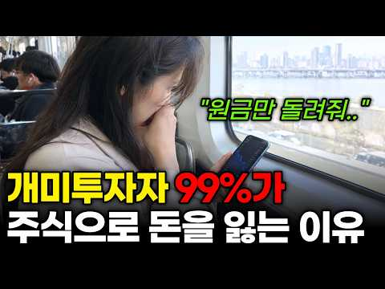
- 챕터: 0:00 하이닉스 꼭대기에서 산 사람들 · 0:43 노벨상 심리학자 대니얼 카너먼의 답 · 1:12 이유 1. 주식을 도박처럼 한다 – 최근 편향 · 2:45 이유 2. 욕심에 몰빵한다 – 레버리지, 신용융자, … · 4:34 이유 3. 잃는 걸 못 견딘다 – 손실 회피, 처분 … · 6:24 이유 4. 남들 따라 들어간다 – 포모(FOMO), … · 7:51 개인투자자가 주식으로 돈 버는 방법 · 8:08 공부 – PER, 사업보고서, 마음 공부 · 9:49 지수 ETF – 코스피200, S&P500 · 10:31 장기 투자 · 11:29 적립식 투자 · 12:37 정리
- 설명 앞부분: 하이닉스 290만 원, 삼성전자 37만 원 꼭대기에서 사신 분들 많으시죠? 왜 개인 투자자는 늘 꼭대기에서 사고 바닥에서 팔까요? 노벨 경제학상을 받은 심리학자 대니얼 카너먼의 연구로, 개미가 주식으로 돈을 못 버는 4가지 이유와 해결 방법을 정리했습니다. 💬 여러분은 이번 하락장에서 어떻게 대응하셨나요? 댓글로 남겨 주세요.
- 같은 채널 평소 대비 ×33.3 (채널 최근 롱폼 중앙값 18,170회) · 평소 영상: 1억 모으는 법, 이렇게 하면 금방 부자가 됩니다 (27,129회) / 코스피는 올해 35% 올랐는데 내 계좌는 왜 마이너스일까 ∣ 개인 투자자가 주식으로 돈을… (9,211회)
- 대본 없음 (설명) — 음성인식이 끝나면 도입부·흐름이 들어감
- 댓글 203/285: 좋은 점 — 영상 1 · 감사·응원 2 · 더 알고 싶은 것 1 · 아쉬운 점 — 영상 0 · 반박·불만 — 의견 다름 3 · 정치·사회 12 · 경험 공유 8 · 구독·다음 기대 0
  - 좋은 점 — 영상 👍0 “공감합니다😂주식투자는 10년 이상 적립식으로 꾸준이 모아가는 게 제일 무난한 투자방법이라고 믿어요~ ❤”
  - 감사·응원 👍1 “고맙습니다 ㅠㅠ”
  - 더 알고 싶은 것 👍2 “월요일에 하이닉스 120만원대에 올인해도 되나요? 250만원 되면 미련 없이 팔 생각인데...”
  - 반박·불만 — 의견 다름 👍3 “웃기는 소리 그만하고 k국장에서 주식하는 넘만 바보지. 절대 회사 믿지 마라 절대 오래 투자 한다고 수익 나지 않는다. 안하는게 정답이다”
  - 반박·불만 — 의견 다름 👍2 “교과서적인 이야기이네요..주식은 교과서대로 되는것이 아닙니다..노력을 하세요...차트공부도 하시고..단타로 가세요..국장은 장기투자 하는것아닙니다”
  - 정치·사회 👍6 “이재명이가 조작하는거지머”
  - 정치·사회 👍1 “'이재명'”
  - 경험 공유 👍20 “지금 안사만 나만 바보된다 말나오면 이렇게 해석해야합니다. " 지금 사면 나도 바보된다 !! "”
  - 경험 공유 👍5 “국장은 도박이 맞아..장기간 1%라도 우상향해야지 하루에도 10% 오르다가 내리다가 이게 신뢰가 가서 장투가 가능하겠냐... QQQ에 SPY는 아무리 적어도 10%는 꾸준히 상향하고 매일매일 1%씩 오르락 내리락한다. 장투에 대한 신뢰감도 있고 수급도 크고 조금씩 상…”

### 2. 60대부터 격차가 벌어진다｜부자동네 사람들의 남다른 생활습관 10가지 ∣ 명언/ 오디오북/ 라디오북/ 시니어/ 노후

- https://www.youtube.com/watch?v=6Hxcmse6F2c · 오늘도청춘 · 구독자 194 · 조회수 121,760 (×627.6, 하루 10,068.2) · 좋아요 521 (0.4%) · 21.8분 · 2026-10-16 · 주제 묶음 1. 재테크 일반·마인드 · 형식 오디오북·낭독 (명언·인생조언) · 폴더 `W_6Hxcmse6F2c` (웹 승인)
- 썸네일: 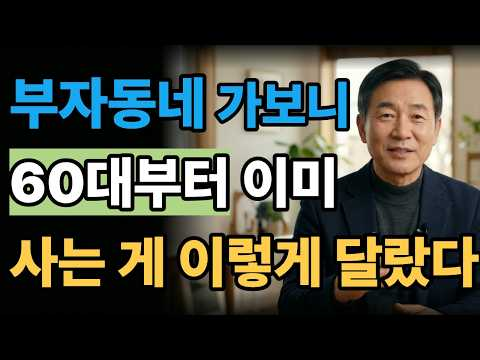
- 챕터: 0:00 부자동네 60대는 무엇이 다를까? · 1:31 첫 번째｜노후를 바꾸는 규칙적인 아침 습관 · 3:09 두 번째｜부자들이 절대 낭비하지 않는 소비 습관 · 5:26 세 번째｜노후자금보다 중요한 건강관리 · 7:05 네 번째｜60대 이후 인간관계를 정리하는 법 · 8:37 다섯 번째｜자녀에게 모든 재산을 주지 않는 이유 · 10:06 여섯 번째｜은퇴 후 노후자금을 지키는 투자 원칙 · 11:33 일곱 번째｜매일 외출하는 사람들의 노후생활 · 13:05 여덟 번째｜나이 들어도 배움을 멈추지 않는 이유 · 14:39 아홉 번째｜편안한 노후를 만드는 집 정리 습관 · 16:12 열 번째｜진짜 부자들이 돈보다 아끼는 것 · 17:54 부자동네 시니어들에게 배운 노후의 비밀 · 20:08 돈 걱정 없는 노후를 위한 마지막 조언
- 설명 앞부분: 부자동네 사람들은 왜 60대부터 사는 방식이 달라질까요? 이번 영상에서는 부유한 동네의 60대, 70대들을 보며 발견한 생활습관과 부자 습관의 차이를 정리했습니다. 돈을 쓰는 방식부터 건강관리, 인간관계, 노후자금 관리, 시간 사용법까지. 잘 사는 노후에는 분명 공통점이 있었습니다. 60대 이후 돈을 지키는 습관 부자동네 사람들의 생활방식 건강한 노년을 만드는 방법 노후자금과 은퇴생활 관리법 인간관계와 시간 사용의 차이 60대 이후 노후생활을 준비하고 있거나, 돈 걱정 없는 은퇴생활과 건강한 노년을 만들고 싶다면 끝까지 시청해 보…
- 같은 채널 평소 대비 ×154.6 (채널 최근 롱폼 중앙값 788회) · 평소 영상: 은퇴 후에도 억대 연봉 받는 60대의 비밀｜시니어 재취업 성공을 위한 10가지 철칙 ∣ … (952회) / 60대 이후 멋있어 보이는 사람들의 공통점｜젊어 보이는 시니어 스타일 10가지 ∣ 명언/… (974회)
- 대본 없음 (설명) — 음성인식이 끝나면 도입부·흐름이 들어감
- 댓글 16/30: 좋은 점 — 영상 1 · 감사·응원 2 · 더 알고 싶은 것 0 · 아쉬운 점 — 영상 1 · 반박·불만 — 의견 다름 0 · 정치·사회 0 · 경험 공유 1 · 구독·다음 기대 0
  - 좋은 점 — 영상 👍1 “우연히 뜬 영상인데. 좋은 이야기 잘 들었습니다. 공감가는 댓글도 있고 좋습니다. 일일이 답글 달아주시는 것이. 제가 보기에는 겸손도 하시고 매너가 좋으시네요. 감사합니다.”
  - 감사·응원 👍5 “잘들어서요알겟읍니다감사합니다없은사람이더화려해요감사합니다”
  - 감사·응원 👍1 “우연히 뜬 영상인데. 좋은 이야기 잘 들었습니다. 공감가는 댓글도 있고 좋습니다. 일일이 답글 달아주시는 것이. 제가 보기에는 겸손도 하시고 매너가 좋으시네요. 감사합니다.”
  - 아쉬운 점 — 영상 👍2 “AI로 만들어도 똑같이 제스처가 계속 반복되는 것은 보기 몹시 불편하네요 차라리 손 올리는 동작을 빼는것이 더 자연스러울 것 같아요”
  - 경험 공유 👍1 “우연히 뜬 영상인데. 좋은 이야기 잘 들었습니다. 공감가는 댓글도 있고 좋습니다. 일일이 답글 달아주시는 것이. 제가 보기에는 겸손도 하시고 매너가 좋으시네요. 감사합니다.”

### 3. 【이어령 교수의 조언】 늙어서 절대로 친구로 지내면 안되는 사람 '1위' 차라리 개를 키우세요! ∣ 오디오북 ∣ 노후준비 ∣ 인간관계 명언

- https://www.youtube.com/watch?v=Ar5CYDBUGBk · 노후의 원칙 · 구독자 757 · 조회수 422,627 (×558.3, 하루 38,298.0) · 좋아요 3,165 (0.8%) · 40.9분 · 2026-10-17 · 주제 묶음 4. 노후·연금 · 형식 오디오북·낭독 (명언·인생조언) · 폴더 `W_Ar5CYDBUGBk` (웹 승인)
- 썸네일: 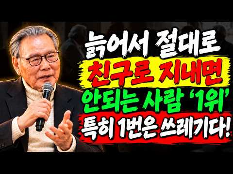
- 설명 앞부분: 사람을 만나고 돌아오는 길, 이유 없이 마음이 무겁고 기운이 빠진 적 있으신가요? 나이가 들어서 예민해진 것이 아닙니다. 어쩌면 오랫동안 참고, 맞추고, 이해하려 애쓴 관계가 여러분의 마음을 조금씩 지치게 만들었는지도 모릅니다. 김형석 교수의 삶의 철학은 늘 한 가지를 이야기합니다. "좋은 관계는 삶을 살리고, 잘못된 관계는 인생을 조금씩 소모시킨다." 이번 영상에서는 노후를 더욱 평안하게 보내기 위해 반드시 거리를 두어야 할 사람들의 공통된 특징과, 반대로 어떤 상황에서도 곁에 꼭 남겨야 할 소중한 사람에 대해 함께 이야기합니다…
- 대본 없음 (설명) — 음성인식이 끝나면 도입부·흐름이 들어감
- 댓글 133/205: 좋은 점 — 영상 8 · 감사·응원 14 · 더 알고 싶은 것 2 · 아쉬운 점 — 영상 0 · 반박·불만 — 의견 다름 1 · 정치·사회 1 · 경험 공유 12 · 구독·다음 기대 0
  - 좋은 점 — 영상 👍22 “어르신말씀 너무 도움이되네요 감사합니다”
  - 좋은 점 — 영상 👍14 “100 % 옳은 말씀 감사합니다.”
  - 감사·응원 👍22 “어르신말씀 너무 도움이되네요 감사합니다”
  - 감사·응원 👍14 “100 % 옳은 말씀 감사합니다.”
  - 더 알고 싶은 것 👍15 “정말 이런곳에 이런글 남기게 되어 정말 죄송합니다..부탁드리고싶어도 부모님도 계시지않고 지인도안계십니다..초등학교저학년 나이쯤에 지속되는 친부의 폭력과 학대로 아동보호센터를통해 고아원에버려졌습니다.. 고아원에서도 형들에게 구타를당하며 컸고누군가와 어울리지도못하고 그런…”
  - 더 알고 싶은 것 👍4 “이어령교수님 안녕하세요 반갑습니다 저는 교수님말씀을 늘 좋아했습니다 건강하게 오래오래 좋은 말씀 부탁드립니다”
  - 반박·불만 — 의견 다름 👍0 “늙어서 친구뭐구 요리조리 재고 만날 필요없고 스트래스받을 필요없다 그럴 나이도 아닙니다 이것저것 땨지도말고 깊이 만날 필요없고 멀리할 필요도없습니다 그날하루 얼굴보고 미련갖지마세요 요리조리 재지도 마서요 맞지않습니다”
  - 정치·사회 👍1 “선생님 공용 방송 하는것은 자유 입니다만 저가덜어본 선생님말슴은 옛날 양반 쌍놈하듯이 인생 살아가는 길 갈라칙하는좌파꾼들 갔은것갔습니다 첯번 찌 한분 말슴만드릴게요 한번두번 식사대커피대금 내다가 그다음부터 더많은 식사대금 몆번이닌 해피 하더니 나오시지 안는다고 하셧는…”
  - 경험 공유 👍21 “남들과 상관이 없이 내가 진실하게 살아가면 진실한 친구만 내겉에 남게 되요”
  - 경험 공유 👍13 “내가 많이 아팠을때 가까이 있고 친한 친구 믿지마세요 맘속에 그냥 친구로만 생각하세요”

### 4. 앞으로는 모두 혼자 산다… 준비한 사람만 노후에 살아남는다｜새로운 은퇴 생존법 ｜ 노후지혜

- https://www.youtube.com/watch?v=vash2ZD50Cs · 백년건강 지혜 · 구독자 180 · 조회수 29,703 (×165.0, 하루 7,148.6) · 좋아요 267 (0.9%) · 39.6분 · 2026-10-15 · 주제 묶음 4. 노후·연금 · 형식 오디오북·낭독 (명언·인생조언) · 폴더 `W_vash2ZD50Cs` (웹 승인)
- 썸네일: 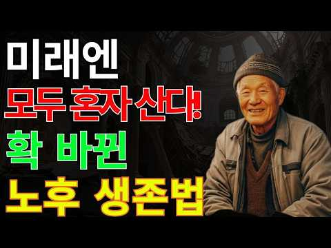
- 설명 앞부분: 나이가 들수록 더욱 중요해지는 건강 관리! 여러분은 매일 건강을 위해 어떤 노력을 하고 계신가요? 이번 영상에서는 중장년층과 어르신들이 꼭 알아두면 좋은 건강 관리 방법과 올바른 식습관, 일상에서 쉽게 실천할 수 있는 건강한 생활 습관을 자세히 살펴봅니다. 작은 습관 하나가 우리의 건강과 삶의 질을 바꿀 수 있습니다. 평소 무심코 지나쳤던 생활 습관을 점검하고, 더욱 활기차고 행복한 노후를 준비해 보세요. 오늘 소개해 드리는 정보가 여러분의 건강한 일상에 도움이 되기를 바랍니다.
- 같은 채널 평소 대비 ×84.3 (채널 최근 롱폼 중앙값 352회) · 평소 영상: 자녀가 당신을 무시할 때, ‘이 한마디’면 달라집니다｜부모라면 꼭 알아야 할 대화법 ｜ … (362회) / 현금 입금 시 절대 하면 안 되는 5가지 – 세무조사 피하는 실전 전략 ｜ 국세청 세무조… (343회)
- 대본 없음 (설명) — 음성인식이 끝나면 도입부·흐름이 들어감
- 댓글 10/10: 좋은 점 — 영상 0 · 감사·응원 3 · 더 알고 싶은 것 0 · 아쉬운 점 — 영상 0 · 반박·불만 — 의견 다름 0 · 정치·사회 0 · 경험 공유 0 · 구독·다음 기대 0
  - 감사·응원 👍3 “감사함니다 🎉”
  - 감사·응원 👍2 “잘들었습니다 감사합니다”

### 5. S&P500은 최고인데 내 ETF는 마이너스… 지금 환헤지로 갈아타면 늦는 진짜 이유

- https://www.youtube.com/watch?v=UcHK1WoTPtY · 뒤집는경제 · 구독자 275 · 조회수 101,252 (×368.2, 하루 8,699.5) · 좋아요 393 (0.4%) · 23.2분 · 2026-10-16 · 주제 묶음 3. 주식·ETF · 형식 정보·해설 (그 밖) · 폴더 `W_UcHK1WoTPtY` (웹 승인)
- 썸네일: 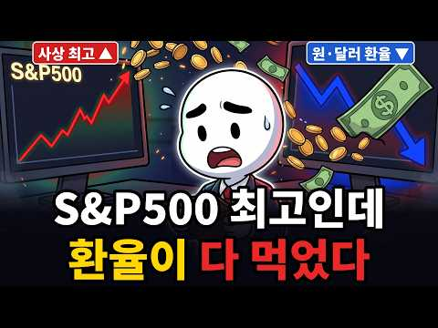
- 챕터: 0:00 S&P500 최고인데 내 ETF는 마이너스 · 1:47 수익을 만드는 두 개의 숫자 · 5:00 1,550원에서 1,331원까지, 넉 달의 반전 · 7:38 7개월 만에 뒤집힌 증권가 전망 · 11:00 환헤지는 공짜가 아니다 · 13:22 환노출형에 달린 공짜 에어백 · 15:20 버틴 사람 vs 갈아탄 사람, 숫자 맞대결 · 18:00 적립식 투자자에게 원화 강세란 · 19:25 흔들리지 않는 세 가지 기준
- 설명 앞부분: S&P500은 사상 최고치를 찍었는데, 증권 앱 속 내 S&P500 ETF는 파란색입니다. 같은 지수를 따라가는 ETF인데 최근 3개월 수익률이 마이너스 7%와 플러스 3%로 10%포인트 넘게 갈렸습니다. 그래서 다들 "지금이라도 환헤지(H)로 갈아탈까?"를 고민하고 계실 겁니다. 범인은 지수가 아니라 환율입니다. 원·달러 환율은 석 달 만에 1,554원에서 1,340원까지 13% 넘게 빠졌습니다. 그런데 7개월 전 증권가는 "환노출이 유리하다"고 했고, 지금은 "환헤지가 대세"라고 말합니다. 뉴스를 따라 갈아타면 늘 한 박자 늦…
- 같은 채널 평소 대비 ×6.2 (채널 최근 롱폼 중앙값 16,350회) · 평소 영상: S&P500 vs 나스닥100, 20년 뒤 결과가 뒤집히는 진짜 이유 (18,547회) / 코스피 일주일 -20%… 지금 적립식을 멈추면 손해 보는 진짜 이유 (14,153회)
- 대본 없음 (설명) — 음성인식이 끝나면 도입부·흐름이 들어감
- 댓글 25/61: 좋은 점 — 영상 0 · 감사·응원 0 · 더 알고 싶은 것 0 · 아쉬운 점 — 영상 0 · 반박·불만 — 의견 다름 0 · 정치·사회 3 · 경험 공유 0 · 구독·다음 기대 0
  - 정치·사회 👍10 “환율 처올린 이재명의 똥. 이게 다 이재명 때문이다.”
  - 정치·사회 👍1 “미 중간선거 민주당이 압승할 경우 약달러 확정이고 달러가 강하면 미채권 팔려고 할테고 그럼 달러 복사할테고 삼전닉스 달러 내년에는 더 벌어온다고 하고.. 환햇지로 가야할듯한데 에휴”

### 6. 50대 정년퇴직 후 현실｜퇴직을 앞둔 선배가 가장 걱정했던 것

- https://www.youtube.com/watch?v=0iduiNNIyRA · 따세 · 구독자 532 · 조회수 164,700 (×309.6, 하루 16,380.0) · 좋아요 551 (0.3%) · 10.2분 · 2026-10-18 · 주제 묶음 4. 노후·연금 · 형식 정보·해설 (그 밖) · 폴더 `W_0iduiNNIyRA` (웹 승인)
- 썸네일: 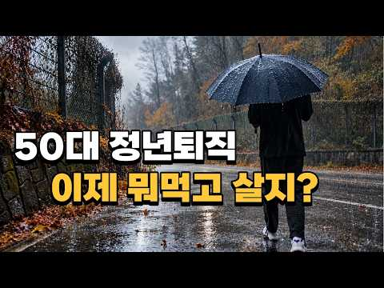
- 설명 앞부분: 50대 정년퇴직을 앞둔 직장 선배가 앞으로의 생활을 걱정하는 모습을 보며 많은 생각이 들었습니다. 비 오는 일요일, 빗소리를 들으며 퇴직 후 삶과 노후준비에 대한 이야기를 나눠봅니다. 30~40대부터 준비해야 할 노후자금과 제2의 직업, 퇴직금으로 자영업을 시작할 때의 위험까지. 퇴직 후에도 내가 원하는 삶을 살아가기 위해 무엇을 준비해야 할까요?
- 같은 채널 평소 대비 ×116.2 (채널 최근 롱폼 중앙값 1,418회) · 평소 영상: 40대가 되니 혼자 있는 시간이 좋아졌습니다 ∣ 나이가 들수록 달라지는 마음 (1,486회) / 퇴사 후 프랜차이즈 차렸다간 '이 사람들' 좋은 일만 시키고 망합니다 (1,349회)
- 대본 없음 (설명) — 음성인식이 끝나면 도입부·흐름이 들어감
- 댓글 30/98: 좋은 점 — 영상 1 · 감사·응원 0 · 더 알고 싶은 것 0 · 아쉬운 점 — 영상 1 · 반박·불만 — 의견 다름 0 · 정치·사회 2 · 경험 공유 1 · 구독·다음 기대 0
  - 좋은 점 — 영상 👍0 “목소리가 너무 듣기 좋아요.. 가볍고도 편안하게 들리네요.. 마치 나른한 오후에 리디오에서 흘러나오는듯한..”
  - 아쉬운 점 — 영상 👍0 “목소리가 너무 듣기 좋아요.. 가볍고도 편안하게 들리네요.. 마치 나른한 오후에 리디오에서 흘러나오는듯한..”
  - 정치·사회 👍0 “김건희... “난 안희정이 솔직히 불쌍하더만. 나랑 우리 아저씨(윤석열)는 되게 안희정 편”이라고 말했다. 그러면서 “보수들은 챙겨주는 건 확실하지. 그렇게 뭐 공짜로 부려 먹거나 이런 일은 없지. 그래서 미투가 별로 안 터지잖아, 여기는”이라며 “미투 터지는 게 다…”
  - 정치·사회 👍0 “딱 두가지만 있으면 됨 건강 돈 나머지는 어떻게든 적응해감 어떻게 보면 건강 돈이 안정적인 사람들의 배부른 소리임 은둔형 외톨이들 절대 밖으로 안나옴 집나가면 개고생 알고있음 더우면 에어컨 추우면 보일러 졸리면 처자고 배고프면 처먹고 심심하면 처보고 게임하고 지상 낙…”
  - 경험 공유 👍2 “연금 이랑 기본 생활 할 정도의 은퇴자금은 준비해 두었는데 가장 큰 걱정은 부모님 부양에 대한 거네요 건강하게 사시다가 가시면 가장 좋겠지만 그건 맘대로 되는게 아니라서 요양원 안보내고 끝까지 제가 모시고 싶은데 내 계획 대로 될까 그게 가장 큰 퇴직이후 걱정 이네요”

### 7. 연금 120만·200만·300만… 고교 동창 세 명, 5년 뒤 통장이 가장 먼저 바닥난 사람은? ∣ 노후준비 ∣ 오디오북

- https://www.youtube.com/watch?v=gYfSp6GXKLY · 은퇴 후 일자리 연구소 · 구독자 85 · 조회수 33,818 (×338.2, 하루 3,067.1) · 좋아요 289 (0.9%) · 23.6분 · 2026-10-17 · 주제 묶음 4. 노후·연금 · 형식 오디오북·낭독 (명언·인생조언) · 폴더 `W_gYfSp6GXKLY` (웹 승인)
- 썸네일: 
- 챕터: 0:00 누가 먼저 통장이 바닥났을까? · 0:54 같은 반, 다른 연금 · 2:38 먼저 웃은 두 사람 · 4:52 첫 월급과 첫 빈칸 · 10:26 차 한 대와 약속 하나 · 14:39 통장 뒷장의 나눗셈 · 18:08 5년 뒤, 세 개의 통장 · 21:41 새 통장의 첫 줄 · 22:41 연금보다 중요한 질문
- 설명 앞부분: 연금 120만·200만·300만 원을 받는 고교 동창 세 명, 5년 뒤 통장이 가장 먼저 바닥난 사람은 누구였을까요? 연금 액수보다 중요한 한 달 부족액 계산법, 일하면서도 받는 기초연금 기준, 고급차 4천만 원 탈락 기준, 노인일자리와 요양보호사의 현실까지 담았습니다. 은퇴를 앞두셨거나 부모님 노후가 걱정되신다면 꼭 끝까지 보세요. 참고 자료 (2026년 기준) 기초연금 선정기준액(단독 247만 원·부부 395만 2천 원), 직역연금 수급자 지급 제외 – 파이낸셜뉴스(2026.07.20) 기초연금 고급자동차 기준(차량가액 4천만…
- 같은 채널 평소 대비 ×5.2 (채널 최근 롱폼 중앙값 6,558회) · 평소 영상: 퇴직금 3억 믿고 쉰 동기 vs 다시 출근한 나… 3년 뒤 통장 차이 (6,558회) / 대기업 차장 29년, 퇴직 후 택시를 탔습니다… 하루 12시간 일하고 실제로 받은 월급 … (11,677회)
- 대본 없음 (설명) — 음성인식이 끝나면 도입부·흐름이 들어감
- 댓글 15/28: 좋은 점 — 영상 0 · 감사·응원 0 · 더 알고 싶은 것 1 · 아쉬운 점 — 영상 0 · 반박·불만 — 의견 다름 0 · 정치·사회 0 · 경험 공유 1 · 구독·다음 기대 0
  - 더 알고 싶은 것 👍1 “사회써비스 노인일자리는 어디서 알아봐야하나요?”

### 8. 노후에 가장 좋은 취미, 압도적 1위는 바로 이것입니다ㅣ걷기보다 좋은 이유가 있습니다

- https://www.youtube.com/watch?v=eUjV72DmU1g · 노후산책 · 구독자 91 · 조회수 12,754 (×127.5, 하루 3,034.1) · 좋아요 68 (0.5%) · 14.8분 · 2026-10-15 · 주제 묶음 4. 노후·연금 · 형식 오디오북·낭독 (명언·인생조언) · 폴더 `W_eUjV72DmU1g` (웹 승인)
- 썸네일: 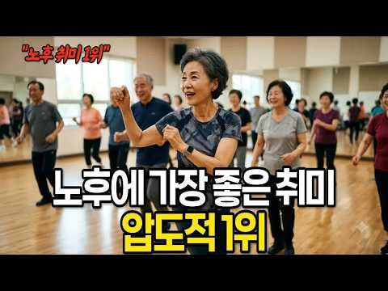
- 설명 앞부분: 왜 우리는 60세 이후에 친구들의 재정 상황에 그토록 신경을 쓰게 될까요? 60세 이전에는 전혀 신경 쓰지 않았던 일인데 말이죠. 젊었을 때는 재정적인 어려움이 문제가 되지 않았습니다. 함께 식사하고 술을 마시는 것도 자연스러웠고, 공과금을 내는 것도 큰 문제가 아니었습니다. 하지만 은퇴 후에는 돈의 의미가 달라집니다. 여행, 음식, 취미, 심지어 의료비까지 생활 방식의 차이가 점점 더 두드러지게 나타납니다. 이 영상에서는 다음 내용을 다룹니다. 60세 이후 친구들의 재정 상황이 더 중요해지는 이유, 친구들의 재정적 어려움을 볼 …
- 같은 채널 평소 대비 ×19.3 (채널 최근 롱폼 중앙값 661회) · 평소 영상: 요즘 시어머니들이 명절에 며느리를 안 부르는 진짜 이유 (682회) / 노후가 지루한 사람과 활기찬 사람의 결정적 차이 (640회)
- 대본 없음 (설명) — 음성인식이 끝나면 도입부·흐름이 들어감
- 댓글 1/1: 좋은 점 — 영상 0 · 감사·응원 0 · 더 알고 싶은 것 0 · 아쉬운 점 — 영상 0 · 반박·불만 — 의견 다름 0 · 정치·사회 0 · 경험 공유 0 · 구독·다음 기대 0

### 9. 돈 없는 노후는 얼마나 비참할까… 평생 성실하게 살아도 노후가 캄캄해지는 진짜 이유 ｜ 노후자금 사연 ｜ 오디오북 ｜ 노년의 지혜

- https://www.youtube.com/watch?v=gJ4ogy8mpO8 · 노년의 미래 · 구독자 125 · 조회수 26,318 (×210.5, 하루 3,643.6) · 좋아요 140 (0.5%) · 30.3분 · 2026-10-12 · 주제 묶음 4. 노후·연금 · 형식 사연·드라마 · 폴더 `W_gJ4ogy8mpO8` (웹 승인)
- 썸네일: 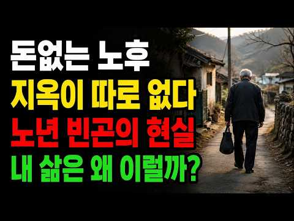
- 설명 앞부분: [미래의 노년]에 오신 것을 환영합니다. 이 채널은 50대, 60대, 70대 이상 중장년층을 위한 오디오북, 인생 조언, 은퇴 계획, 건강 관리, 그리고 따뜻하고 위로가 되는 이야기들을 제공합니다. 은퇴 후 인생의 두 번째 단계에 접어들면서, 어떻게 하면 평화롭고 자신감 넘치며 걱정 없는 삶을 살 수 있을까요? 매주, 돈과 재정적 독립, 자녀와의 관계, 건강, 외로움 극복, 후회 없는 삶 등 다양한 주제에 대한 실용적인 조언과 감동적인 이야기들을 전해드립니다. 바쁜 일상 속에서도 편안하게 들을 수 있는 고품질 오디오북과 인생 에세…
- 같은 채널 평소 대비 ×67.4 (채널 최근 롱폼 중앙값 390회) · 평소 영상: 70년 살고 깨달았습니다│나를 가장 힘들게 한 사람은 바로 나였습니다│노년의 지혜│수면 … (464회) / 나이 들수록 혼자가 되고, 나만의 삶을 즐겨야 하는 이유… 행복한 노후는 여기서 갈립니다… (478회)
- 대본 없음 (설명) — 음성인식이 끝나면 도입부·흐름이 들어감
- 댓글 5/5: 좋은 점 — 영상 0 · 감사·응원 0 · 더 알고 싶은 것 0 · 아쉬운 점 — 영상 0 · 반박·불만 — 의견 다름 1 · 정치·사회 0 · 경험 공유 0 · 구독·다음 기대 0
  - 반박·불만 — 의견 다름 👍6 “1억5천 ? 참 배터진소리하고 있네요? 지금 돈자랑합니까? 아니면 헛소리한번 해보는 것입니까?”

### 10. 사상 초유의 이틀 연속 서킷브레이커! 폭락장에서 투자자가 절대 해서는 안 될 행동 ∣ 존리 대표

- https://www.youtube.com/watch?v=un5SAQlJFcY · 증시직격 · 구독자 111 · 조회수 19,590 (×176.5, 하루 2,703.1) · 좋아요 324 (1.7%) · 23분 · 2026-10-12 · 주제 묶음 3. 주식·ETF · 형식 인터뷰·강연·대담 · 폴더 `W_un5SAQlJFcY` (웹 승인)
- 썸네일: 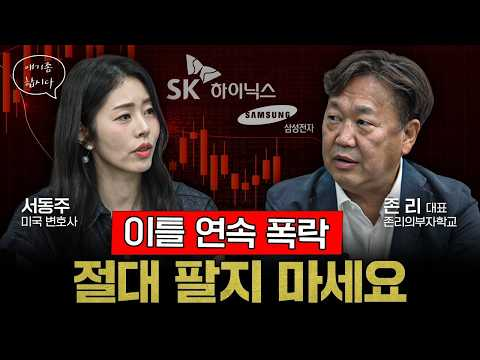
- 설명 앞부분: 증시가 이틀 연속 서킷브레이커를 기록하는 극심한 변동성에 빠진다면 투자자는 어떻게 대응해야 할까요? 시장이 급락할수록 공포에 휩쓸려 성급한 결정을 내리기 쉽지만, 이럴 때일수록 투자 원칙을 점검하는 것이 중요합니다. 이번 영상에서는 존리 대표와 함께 폭락장에서 개인 투자자들이 주의해야 할 행동과 시장 변동성에 대응하는 투자 자세를 살펴봅니다. 단기적인 주가 움직임에 흔들리지 않고 장기적인 관점에서 투자 전략을 세우는 방법과 위기 상황에서 점검해야 할 핵심 원칙을 알아봅니다. 급락장 속에서 소중한 투자 자산을 지키고 싶다면, 지금 …
- 같은 채널 평소 대비 ×1,632.5 (채널 최근 롱폼 중앙값 12회) · 평소 영상: 돈 버는 사람은 생각부터 다르다…복잡한 아이디어를 실제 수익으로 바꾸는 방법 ∣ 고명환 … (11회) / 역사 속에서 무너진 나라들, 놀라울 만큼 똑같은 몰락의 길을 걸었다…과거가 보내는 경고 … (11회)
- 대본 없음 (설명) — 음성인식이 끝나면 도입부·흐름이 들어감
- 댓글 17/17: 좋은 점 — 영상 0 · 감사·응원 0 · 더 알고 싶은 것 0 · 아쉬운 점 — 영상 0 · 반박·불만 — 의견 다름 0 · 정치·사회 1 · 경험 공유 0 · 구독·다음 기대 0
  - 정치·사회 👍1 “그건 한국시장에선 해당안됨 정상시장이아님 정부가 올려놈 장”

### 11. 70대가 되기전 돈보다 먼저 준비해야 할 5가지ㅣ인생조언ㅣ노후준비ㅣ삶의지혜ㅣ시니어ㅣ오디오북ㅣ

- https://www.youtube.com/watch?v=nVqsO9NQKH0 · 노년의 지혜 · 구독자 105 · 조회수 33,616 (×320.1, 하루 2,523.9) · 좋아요 202 (0.6%) · 56분 · 2026-10-15 · 주제 묶음 4. 노후·연금 · 형식 사연·드라마 · 폴더 `W_nVqsO9NQKH0` (웹 승인)
- 썸네일: 
- 설명 앞부분: 🌿 **노년의 지혜 – 인생의 깊이를 더하는 이야기 나이가 들수록 깊어지는 삶의 지혜, 살아갈수록 깨닫게 되는 인생의 진실. 노년의 지혜**는 인생의 경험과 지혜를 바탕으로 가족, 부부관계, 자녀 문제, 인간관계, 노후의 행복에 관한 이야기를 전하는 채널입니다. 살면서 누구나 한 번쯤 겪는 갈등과 후회, 배신과 감동, 그리고 마음을 울리는 인생의 반전까지. 때로는 위로를, 때로는 깊은 깨달음을 전하며 더 지혜롭고 행복한 삶을 살아가는 데 도움이 되는 이야기를 나눕니다. ✨ **노년의 지혜에서 만나는 이야기 🍀 나이 들수록 반드시 …
- 같은 채널 평소 대비 ×25.6 (채널 최근 롱폼 중앙값 1,311회) · 평소 영상: 중년의 ‘진짜 나’를 찾는 여정ㅣ인생조언ㅣ삶의지혜ㅣ오디오북ㅣ마음공부ㅣ시니어ㅣ (1,339회) / 가족에게 쉽게 화내는 진짜 이유ㅣ인생조언ㅣ노후ㅣ가족갈등ㅣ지혜ㅣ시니어ㅣ오디오북ㅣ (1,283회)
- 대본 없음 (설명) — 음성인식이 끝나면 도입부·흐름이 들어감
- 댓글 5/6: 좋은 점 — 영상 1 · 감사·응원 0 · 더 알고 싶은 것 0 · 아쉬운 점 — 영상 0 · 반박·불만 — 의견 다름 0 · 정치·사회 0 · 경험 공유 0 · 구독·다음 기대 0
  - 좋은 점 — 영상 👍2 “공감합니다.”

### 12. 내 노후 자금 지키는 법 [후회 없는 소비의 기준]

- https://www.youtube.com/watch?v=fUyrCZT0W4E · 지혜담은 · 구독자 309 · 조회수 102,485 (×331.7, 하루 6,262.1) · 좋아요 462 (0.4%) · 16.6분 · 2026-10-12 · 주제 묶음 2. 돈 모으기·저축 · 형식 오디오북·낭독 (명언·인생조언) · 폴더 `W_fUyrCZT0W4E` (웹 승인)
- 썸네일: 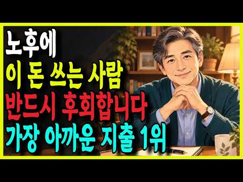
- 챕터: 0:00 마지막 적금을 깨러 온 노인 · 1:53 늙어서 아까운 지출 3위 · 5:11 늙어서 아까운 지출 2위 · 8:25 가장 후회하는 지출 1위 · 12:03 나이 들어 참 잘 쓴 돈 세 가지 · 14:37 지갑 열기 전 던질 두 가지 질문 · 15:00 오늘의 이야기 정리
- 설명 앞부분: 💸 30년 은행원과 노후 자금 상담사로 일하며 만난 수천 명의 공통된 후회가 있습니다. 늙어서 가장 아깝다고 눈물 흘리는 지출 1위는 따로 있었습니다. 지금 내 지갑에서 새어나가는 그 돈을 확인해 보세요. 이 영상에서 노후를 망치는 최악의 지출 3가지 늙어서 후회 없는 현명한 소비 기준 평생 든든한 내 몫의 노후 자금 지키는 법 📍 타임라인 📢 남들 시선 맞추느라 무리하는 소중한 지인에게 이 영상을 꼭 전해주세요. ⓒ 지혜담은 All Rights Reserved. produced by 지혜담은
- 같은 채널 평소 대비 ×539.4 (채널 최근 롱폼 중앙값 190회) · 평소 영상: '이 나이에 뭘'이라며 포기했던 옷들, 지금 당장 꺼내세요 (190회) / 법정스님이 말한 노년의 행복, 관계보다 중요한 것ㅣ삶의 지혜 ㅣ 인생명언 ㅣ 마음 다스리기 (231회)
- 대본 없음 (설명) — 음성인식이 끝나면 도입부·흐름이 들어감
- 댓글 9/9: 좋은 점 — 영상 0 · 감사·응원 2 · 더 알고 싶은 것 0 · 아쉬운 점 — 영상 0 · 반박·불만 — 의견 다름 0 · 정치·사회 0 · 경험 공유 0 · 구독·다음 기대 0
  - 감사·응원 👍2 “아려줘서 고맙습니다”
  - 감사·응원 👍2 “방송선교와.해외선교를할수있었음을감사합니다.이제는나이들어더이상못하고있읍니다.그래도할수있을때합니다.”

### 13. 국민연금 63세에 바로 받은 김 부장 vs 5년 미뤄 36% 더 받은 박 부장… 10년 뒤 통장에 더 많이 남은 사람은? ∣ 노후준비 ∣ 오디오북

- https://www.youtube.com/watch?v=VoVyS34lpec · 은퇴 후 일자리 연구소 · 구독자 85 · 조회수 25,721 (×257.2, 하루 1,974.3) · 좋아요 162 (0.6%) · 22.8분 · 2026-10-15 · 주제 묶음 4. 노후·연금 · 형식 오디오북·낭독 (명언·인생조언) · 폴더 `W_VoVyS34lpec` (웹 승인)
- 썸네일: 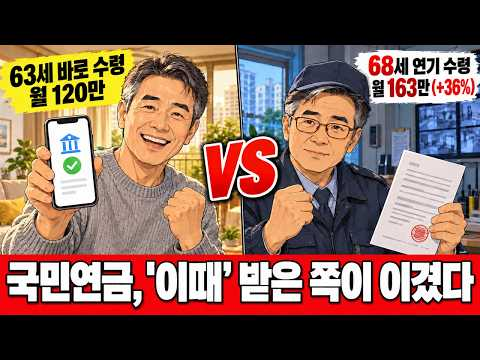
- 챕터: 0:00 연금을 미루면 정말 이득일까? · 0:57 같은 출발, 다른 연금 선택 · 2:44 먼저 웃은 사람 · 4:27 소득이 끊긴 3년의 공백 · 10:07 접수증을 다시 접은 날 · 14:07 종이 뒷면에서 찾은 손익분기점 · 17:28 10년 뒤 통장이 보여 준 진실 · 20:38 결정을 가르는 두 가지 질문 · 22:13 정답보다 중요한 선택의 대가
- 설명 앞부분: 국민연금 63세에 바로 받은 김 부장과 5년 미뤄 36% 더 받은 박 부장, 10년 뒤 통장에는 누가 더 남았을까요? 연기연금 손익분기 나이, 미루는 5년의 생활비 공백, 건강보험 피부양자 2,000만 원 기준, 일하면서 받아도 연금이 깎이지 않는 기준까지 담았습니다. 연금을 언제 받을지 고민 중이시라면 꼭 끝까지 보세요. 참고 자료 연기연금 월 0.6%·최대 36% 가산, 연 2,000만 원 초과 시 건강보험 피부양자 탈락(배우자 동반 탈락) – 매일신문 (2026.10.11) 출생연도별 수급 개시 연령, 부분 연기(50~90%…
- 같은 채널 평소 대비 ×3.9 (채널 최근 롱폼 중앙값 6,558회) · 평소 영상: 퇴직금 3억 믿고 쉰 동기 vs 다시 출근한 나… 3년 뒤 통장 차이 (6,558회) / 대기업 차장 29년, 퇴직 후 택시를 탔습니다… 하루 12시간 일하고 실제로 받은 월급 … (11,677회)
- 대본 없음 (설명) — 음성인식이 끝나면 도입부·흐름이 들어감
- 댓글 43/59: 좋은 점 — 영상 1 · 감사·응원 0 · 더 알고 싶은 것 0 · 아쉬운 점 — 영상 0 · 반박·불만 — 의견 다름 0 · 정치·사회 0 · 경험 공유 0 · 구독·다음 기대 0

### 14. 돈 생기면 제일 먼저 저금부터 하는 사람들, 사실 이런 사람들입니다 (인색함이 아닙니다)

- https://www.youtube.com/watch?v=puDreXlIFGU · 심리잔고 · 구독자 144 · 조회수 33,758 (×234.4, 하루 2,816.5) · 좋아요 177 (0.5%) · 15.7분 · 2026-10-16 · 주제 묶음 1. 재테크 일반·마인드 · 형식 정보·해설 (그 밖) · 폴더 `W_puDreXlIFGU` (웹 승인)
- 썸네일: 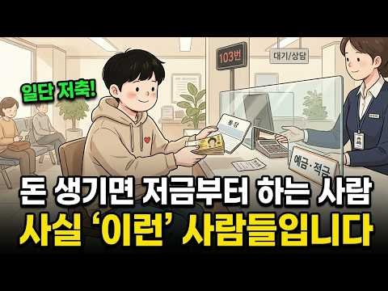
- 설명 앞부분: 돈이 들어오면, 왜 이 사람들은 쓰기도 전에 저금부터 할까요? 인색해서가 아닙니다. 오히려 돈이 진짜 모이는 순서를 정확히 아는 사람들이죠. 이 영상에서는 돈이 생기면 제일 먼저 저금부터 하는 사람들의 진짜 심리 10가지를 행동경제학과 함께 풀어봅니다. 당신도 이 중 하나라면, 당신은 이미 남들보다 단단한 돈 그릇을 가진 사람일지도 모릅니다. 끝까지 보시고, 당신은 몇 개나 해당되는지 댓글로 남겨주세요.
- 같은 채널 평소 대비 ×55.9 (채널 최근 롱폼 중앙값 604회) · 평소 영상: 집에 물건을 안 들이는 사람들, 사실 이런 사람들입니다 (궁상이 아닙니다) (651회) / 10년 넘게 같은 차 타는 사람들, 사실 이런 사람들입니다 (돈이 없어서가 아닙니다) (556회)
- 대본 없음 (설명) — 음성인식이 끝나면 도입부·흐름이 들어감
- 댓글 10/15: 좋은 점 — 영상 1 · 감사·응원 1 · 더 알고 싶은 것 0 · 아쉬운 점 — 영상 0 · 반박·불만 — 의견 다름 0 · 정치·사회 0 · 경험 공유 0 · 구독·다음 기대 0
  - 좋은 점 — 영상 👍2 “좋은 영상 감사합니다.”
  - 감사·응원 👍2 “좋은 영상 감사합니다.”

### 15. 삼성전자·하이닉스, AI 투자 끝나면 끝? 반도체 '뉴노멀' 온다는 이유

- https://www.youtube.com/watch?v=cPm1rukivao · 경제야! 놀자~ · 구독자 4,280 · 조회수 161,528 (×37.7, 하루 80,050.3) · 좋아요 938 (0.6%) · 11.5분 · 2026-10-17 · 주제 묶음 3. 주식·ETF · 형식 정보·해설 (그 밖) · 폴더 `W_cPm1rukivao` (웹 승인)
- 썸네일: 
- 챕터: 0:00 하이라이트 — "뉴노멀이 온다" · 0:21 [경제야놀자 해설] AI 투자, 곧 끝날까? · 0:38 AI 투자, 언젠가 끝나지 않나? · 1:21 세탁기와 양말 — 투자할수록 수요가 는다 · 3:26 [경제야놀자 해설] 세탁기와 양말, 제번스의 법칙 · 3:46 모든 것에 AI가 붙는다 — 10년, 20년의 흐름 · 5:25 [경제야놀자 해설] 모든 것에 AI가 붙는다 · 5:44 삼성전자 100조원 시대 · 휴머노이드 · 에이전트 … · 8:42 [경제야놀자 해설] 반도체 뉴노멀 · 9:03 에이전트는 언제? 중국은 이미 시작 · 9:17 내년 본격화, 확률 90% 이상 · 9:50 보안 표준 · 지금은 장기적으로 과소평가 · 10:45 [경제야놀자 해설] 오늘의 세 줄 정리
- 설명 앞부분: 이광수 대표가 꺼낸 양말 이야기에서 잠깐 멈칫했습니다. 어릴 땐 양말 한 켤레를 닷새씩 신었는데, 지금은 하루면 빤다는 것. 세탁기가 생기자 빨래가 오히려 늘었듯이 AI 투자도 하면 할수록 수요를 키운다는 게 이 대표의 생각이었어요. 7월 28일 12시에 만나요 열두시 사랑방. 박태웅 녹서포럼 의장은 그걸 "제번스의 법칙"이라고 짚었고, 삼성전자가 영업이익 100조원 시대를 열고 있다는 말에는 "뉴노멀이 온다"고 답했습니다. 휴머노이드 로봇, 자율주행차, 스마트 도로까지 안 들어가던 곳에 반도체가 들어가기 시작한다는 뜻이라고요. …
- 대본 없음 (설명) — 음성인식이 끝나면 도입부·흐름이 들어감
- 댓글 113/113: 좋은 점 — 영상 2 · 감사·응원 0 · 더 알고 싶은 것 0 · 아쉬운 점 — 영상 1 · 반박·불만 — 의견 다름 5 · 정치·사회 3 · 경험 공유 4 · 구독·다음 기대 0
  - 좋은 점 — 영상 👍3 “공감합니다 ~^^”
  - 좋은 점 — 영상 👍3 “부연설명을 좀 하자면, ai 자체는 사이클일 수없음. 이미 시작된 ai의 인간일 대체는 되돌리지 못하고 가속화할 것임. 이건 팩트임. 회의론자들은 그러나 ai는 진화하고 퍼진다 해도 그 ai가 돌아갈 데이터센터 건설수요는 한정적이고 다 지어지면 추가반도체 주문은 줄어…”
  - 아쉬운 점 — 영상 👍1 “갤럭시가 아이폰보다 더 많이 팔리기 시작됐다는 잘못된 정보를 가지고 있으니이 내용도 그다지 신뢰가 안 가네”
  - 반박·불만 — 의견 다름 👍54 “난 웃기는게 반도체가 사이클이라고 하는데 반도체가 사이클이면 AI자체가 사이클임”
  - 반박·불만 — 의견 다름 👍5 “남의 얘기 듣지마세요 ㅈ됩니다 삼전60갑니다 하이닉스400갑니다 하는 인간들 책임안져요...주식이 그래요...우리가 이미 다아는 호재는 호재가 아닙니다”
  - 정치·사회 👍2 “이재명은 집가진사람을 마귀로 몰아 집팔아서 주식하라고 개미 꼬셔놓고는 선거 끝나니 나몰라라..... 주식이야 반토막이나든말지 모른척 하지말라!!!!! 외국인,기관은 선물거래 당일 매수매도시 증거금이 필요없다며??? 그렇게 공매도도 기울어진 운동장으로 내버려두더니 제도…”
  - 정치·사회 👍1 “AI버블은없다. 단, 주주환원없는 삼전닉스로인해 국장은 폭락중이다.. 정부는 국장을 포기한것인가? 세금을 많이걷은만큼 주주환원정책을 만들라.”
  - 경험 공유 👍5 “ai 투자는 기본적으로 서버 증설 입니다. 문명의 디지털 전환과 같은 흐름속에 있는거죠. 끝날수가 없는거에요. 반도체도 그 흐름과 함께 계속 성장해왔고요. 이걸 부정하는 사람은 셀프 바보 인증하는겁니다. 문명의 흐름을 부정하는거니까요. 구분해야할 점은, 문명의 흐름과…”
  - 경험 공유 👍3 “저도 동감입니다 모든전자 부품에는 다 적용됩니다”

### 16. 안 팔릴수록 부자되는 '동네 금은방'의 소름돋는 수익구조

- https://www.youtube.com/watch?v=eFsT1K_mPjc · 새파란 경제 · 구독자 999 · 조회수 629,991 (×630.6, 하루 15,003.8) · 좋아요 1,513 (0.2%) · 17.6분 · 2026-09-16 · 주제 묶음 1. 재테크 일반·마인드 · 형식 정보·해설 (그 밖) · 폴더 `W_eFsT1K_mPjc` (웹 승인)
- 썸네일: 
- 챕터: 0:00 손님 없는 금은방이 버티는 이유 · 1:16 금은방이 보는 건 무게와 순도뿐 · 2:17 18K와 순금, 받는 돈이 갈리는 이유 · 3:56 금시세보다 낮은 금액을 부르는 까닭 · 5:00 가게마다 금매입 가격이 다른 이유 · 7:22 금 한 돈 사서 바로 팔면 11만 9000원 · 8:04 그 차액의 3분의 2는 부가세 · 9:57 팔린 돌반지가 녹으러 가는 길 · 13:06 금은방이 교환에서 버는 방식 · 13:48 수리와 재세공에서 생기는 공임 · 15:14 안 팔린 금을 녹일 수 있다는 말의 뜻
- 설명 앞부분: 진열장 앞은 비어 있는데 금은방은 문을 닫지 않습니다. 금시세가 오르는 동안 금값과 금매입 가격이 얼마나 벌어졌는지, 서랍 속 돌반지 하나가 금은방 안에서 몇 번 돈이 되는지 순서대로 따라가 봤습니다. 【 ⏱️ 타임코드 】 1. 한국금거래소 — 「2026년 9월 14일 귀금속 시세 고시」 (순금 한 돈 살 때 827,000원 · 팔 때 708,000원 · 차액 11만 9000원) 2. 한국표준금거래소 — 「2026년 9월 14일 귀금속 시세 고시」 (거래소 두 곳 매입가 차이 0.14% · 은 5.3% · 백금) 3. 농민신문 —…
- 같은 채널 평소 대비 ×632.5 (채널 최근 롱폼 중앙값 996회) · 평소 영상: 호르무즈 파병 준비 중인 한국, 프랑스는 왜 지금 이재명 대통령을 국빈으로 불렀나 ∣ 프… (996회) / "나라도 포기한 수군을 장사로 살렸다?" 미국이 반한 이순신의 숨은 능력 (895회)
- 대본 (음성인식(앞 5분), 5.5 음절/초) — 앞부분만, 흐름은 그 안까지 첫 20초: “동네 그문밤 아플 지날 때마다 이상하지 않으셨습니까? 진흘장에는 수천만 원어치 금이 가득한데 안에는 손님 한 명 보이지 않습니다 주변 식당과 옷 가게는 몇 년 사이 몇 번씩 바뀌는데 그문방은 10년이 지나도 그 자리에 그대로 있어요 손님도 없는데 어떻게 오랫동안 버치는 걸까요? 집 서랍이나 장면 깊숙한 곳에” — 도입부 유형: 질문으로 시작
- 첫 1분: “동네 그문밤 아플 지날 때마다 이상하지 않으셨습니까? 진흘장에는 수천만 원어치 금이 가득한데 안에는 손님 한 명 보이지 않습니다 주변 식당과 옷 가게는 몇 년 사이 몇 번씩 바뀌는데 그문방은 10년이 지나도 그 자리에 그대로 있어요 손님도 없는데 어떻게 오랫동안 버치는 걸까요? 집 서랍이나 장면 깊숙한 곳에 돌반지나 오래된 예물 하나쯤 있으시죠? 금값이 올랐다는 소식을 들으면 지금 팔면 얼마를 받을 수 있을지 궁금해집니다 실제로 지난해 우리나라 사람들이 보관하던 금을 대팔고 받은 돈은 약 6조 9천억 원으로 추정됩니다 그 많은 금은 어디로 갔을까요? 돌반지 하나를 들고 동네 그문방에 갔다고 해보겠습니다 주인은 반지를 받아 얼마를 줄지 정한 뒤 손님에게 돈을 건네죠 손님은 가게를 나갑니다 그런데 그문방의 장사”
- 흐름 (90초마다 첫 문장): 0:00 동네 그문밤 아플 지날 때마다 이상하지 않으셨습니까? → 1:30 어느 브랜드에서 샀는지 디자인이 얼마나 곱게 빠졌는지는 묻지 않아요 → 3:00 어머니에게 물려받은 반지가 생각보다 적은 금액으로 계산됐다면 → 4:32 마지막으로 가게가 남길 몫이 빠져요
- 댓글 139/163: 좋은 점 — 영상 1 · 감사·응원 3 · 더 알고 싶은 것 0 · 아쉬운 점 — 영상 2 · 반박·불만 — 의견 다름 2 · 정치·사회 0 · 경험 공유 2 · 구독·다음 기대 0
  - 좋은 점 — 영상 👍2 “금거래 방식을 잘 배우고 갑니다 감사합니다”
  - 감사·응원 👍2 “금거래 방식을 잘 배우고 갑니다 감사합니다”
  - 아쉬운 점 — 영상 👍0 “뻔한일을 뭔말하는거여”
  - 아쉬운 점 — 영상 👍0 “이렇게 지루하게 만들면 구독자 수가 안 늘어나”
  - 반박·불만 — 의견 다름 👍4 “스프레드 차이라고 하죠. 순금이 그나마 덜하고 나머진 특히 은은 말도 안되죠. 한놈만 걸려도 먹고 삼.”
  - 반박·불만 — 의견 다름 👍0 “마진차이를 봐야하는데..글쎄요.”

### 17. [노자] 이렇게 하면 바로 대접 받는다 ㅣ인생명언ㅣ행복한 노후ㅣ삶의지혜ㅣ인간관계

- https://www.youtube.com/watch?v=-dxUrozfhRQ · 고전명언 인생조언 · 구독자 3,020 · 조회수 678,092 (×224.5, 하루 41,684.3) · 좋아요 3,483 (0.5%) · 46분 · 2026-10-12 · 주제 묶음 4. 노후·연금 · 형식 오디오북·낭독 (명언·인생조언) · 폴더 `W_-dxUrozfhRQ` (웹 승인)
- 썸네일: 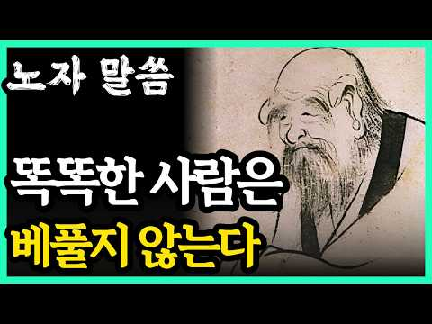
- 설명 앞부분: 십 년 동안 경로당 커피값을 내던 사람이 보름을 앓아눕자 전화는 한 통도 오지 않았습니다. 왜 가장 많이 베푼 손이 가장 쉽게 잊히는지, 노자의 도덕경에서 답을 찾았습니다. 손을 거두라는 말이 아닙니다. 베풂의 모양을 바꾸라는 말입니다. 어디까지 도울지 선을 긋는 법, 작은 부탁으로 사람을 끌어당기는 법, 허물을 덮는 침묵, 생색을 거두는 자리, 그리고 받은 사람이 부끄럽지 않게 하는 마지막 하나까지 일곱을 차례로 풀었습니다. 일곱 번째가 가장 어렵고 가장 높습니다. 오늘 당신에게 가장 어려웠던 하나를 댓글에 남겨 주세요. 따뜻한…
- 같은 채널 평소 대비 ×123.3 (채널 최근 롱폼 중앙값 5,498회) · 평소 영상: [맹자] 여자에게 돈이 있는지 없는지 얼굴 '이 세 곳'만 보면 한눈에 바로 알 수 있다… (6,486회) / [노자] 자식 결혼 후에는 이 3가지 무조건 끊어라 , 특히 1번은 최악 ㅣ인생명언ㅣ행복… (4,509회)
- 대본 없음 (설명) — 음성인식이 끝나면 도입부·흐름이 들어감
- 댓글 64/222: 좋은 점 — 영상 1 · 감사·응원 1 · 더 알고 싶은 것 0 · 아쉬운 점 — 영상 0 · 반박·불만 — 의견 다름 1 · 정치·사회 1 · 경험 공유 2 · 구독·다음 기대 0
  - 좋은 점 — 영상 👍6 “과공비례입니다 사회적배려자 급한도움이 필요한사람등 이외는 무조건베푸는것 사양”
  - 감사·응원 👍6 “베풀다가 ㅇㆍㄷ지랖이란 말듣고ᆢ어느순간 고맙다는 말을 안하더라ㅡ”
  - 반박·불만 — 의견 다름 👍1 “헛소리하네”
  - 정치·사회 👍4 “베풀고 살아야죠? 노자는 중국인~ 중국인들은 그럴까요? 한국 사람도 물론 다 똑같진 않겠지만 믿고싶어요”
  - 경험 공유 👍15 “선 악과 내가 내뱉은 말과 행동은 반드시 부메랑으로 돌아오죠”
  - 경험 공유 👍1 “어제 고시원 에서 라면 끓여 건더기는 내가 먹고 국물은 옆방 사람 밥말아 먹으라고 줬다”

### 18. S&P 500에 투자하면 노후 걱정 전혀 없습니다! 주식으로 부자 되는 가장 빠른 방법

- https://www.youtube.com/watch?v=_fnvM4hpX44 · 오피디의 머니노트 · 구독자 680 · 조회수 93,877 (×138.1, 하루 8,634.5) · 좋아요 362 (0.4%) · 16.4분 · 2026-10-17 · 주제 묶음 3. 주식·ETF · 형식 정보·해설 (그 밖) · 폴더 `W__fnvM4hpX44` (웹 승인)
- 썸네일: 
- 챕터: 0:00 인트로 · 0:59 버핏의 S&P 500 유언 · 2:13 S&P 500은 무엇인가 · 4:08 S&P 500의 과거 수익률 · 6:02 20년 전 S&P 500에 100만원 투자했다면 · 8:25 버핏은 왜 S&P 500을 골랐을까 · 9:45 지금 반도체에 물려 있다면 · 10:55 거치식 vs 적립식 · 13:41 S&P 500의 단점 · 15:23 마무리
- 설명 앞부분: 워런 버핏은 아내에게 남길 돈의 90%를 S&P 500 인덱스펀드에 넣으라고 했습니다. 20년 전 1,000만 원을 S&P 500에 넣었다면 지금 1억 1,600만 원, 코스피였다면 4,270만 원입니다. S&P 500이 무엇인지, 과거 수익률과 폭락 후 회복, 사상 최고치에서 사도 되는지, 거치식과 적립식 중 어떤 주식투자 방법이 나은지, VOO·SPY·IVV 차이와 환율·세금 같은 단점까지 실제 데이터로 정리했습니다.
- 같은 채널 평소 대비 ×5.2 (채널 최근 롱폼 중앙값 18,170회) · 평소 영상: 1억 모으는 법, 이렇게 하면 금방 부자가 됩니다 (27,129회) / 코스피는 올해 35% 올랐는데 내 계좌는 왜 마이너스일까 ∣ 개인 투자자가 주식으로 돈을… (9,211회)
- 대본 없음 (설명) — 음성인식이 끝나면 도입부·흐름이 들어감
- 댓글 45/79: 좋은 점 — 영상 0 · 감사·응원 2 · 더 알고 싶은 것 0 · 아쉬운 점 — 영상 0 · 반박·불만 — 의견 다름 1 · 정치·사회 0 · 경험 공유 8 · 구독·다음 기대 0
  - 감사·응원 👍3 “저는 한국주식도 좋지만 KODEX 미국S&P500에 매수할 예정입니다. ❤ 감사합니다.”
  - 경험 공유 👍7 “결론 = s&p500은 노후준비용으로 젊었을때부터 해라 은퇴시기에 들어갔다가 그게 고점이면 내가 죽을때쯤 복구될수도 있다”
  - 경험 공유 👍7 “올해까지 3년차 연금저축펀드 타이거 s&p500 풀매수 했습니다 😊진짜 너무 만족합니다 아닥 s&p500 ㅋㅋㅋㅋㅋㅋㅋ”

### 19. 산소에도 만기가 있습니다, 제사를 접은 집에서 선산 다툼이 먼저 생기는 이유

- https://www.youtube.com/watch?v=7rQLpg5TG-I · 경제참견 · 구독자 1,000 · 조회수 669,316 (×669.3, 하루 12,621.3) · 좋아요 2,923 (0.4%) · 9.6분 · 2026-09-05 · 주제 묶음 4. 노후·연금 · 형식 정보·해설 (그 밖) · 폴더 `W_7rQLpg5TG-I` (웹 승인)
- 썸네일: 
- 챕터: 0:00 벌초대행 비용은 느는데 제사는 왜 줄어들까요 · 0:38 성균관 차례상 표준안, 그만두자고 먼저 말한 쪽 · 1:31 제사 안 지내는 집, 끝낸 건 며느리가 아니었습니다 · 2:46 분묘 설치기간 15년, 산소에도 만기가 있습니다 · 3:03 봉안당 수목장 사용기간과 관리비 · 4:20 제사주재자 대법원 판결, 장남 우선이 깨졌습니다 · 5:36 종중 재산은 상속이 안 됩니다 · 7:01 제사가 대신 해주던 일 · 7:56 등기부등본, 이번 추석에 확인할 세 가지 · 9:03 접는 것과 비워두는 것은 다릅니다
- 설명 앞부분: 제사는 사라지는데 묘를 관리해달라는 사람만 늘고 있습니다. 마음이 없으면 안 하면 그만인데, 왜 돈까지 냅니까. 조상을 잊어서가 아닙니다. 그리고 제사를 접으면 집안이 편해질 것 같지만 실제로는 거꾸로예요. 시골 땅을 놓고 형제끼리 법정까지 가는 집들에는 공통점이 하나 있습니다. 제사를 그만둔 집이라는 겁니다. 산소에 법으로 정해진 만기가 있다는 것, 알고 계셨습니까. 장남이 제사를 지내니 땅도 장남이 맡는다던 오래된 합의가 대법원에서 어떻게 끝났는지, 그리고 애초에 상속조차 되지 않는 땅이 왜 우리 집 선산일 수 있는지 순서대로…
- 같은 채널 평소 대비 ×1,923.3 (채널 최근 롱폼 중앙값 348회) · 평소 영상: 가계빚 2,019조 원 사상 최대인데 부채 비율은 왜 6년 만에 최저로 내려갔을까 (348회) / 주유소 기름값이 16주째 내리는데, 국제유가는 오르고 있습니다 (346회)
- 대본 없음 (설명) — 음성인식이 끝나면 도입부·흐름이 들어감
- 댓글 489/489: 좋은 점 — 영상 5 · 감사·응원 9 · 더 알고 싶은 것 3 · 아쉬운 점 — 영상 0 · 반박·불만 — 의견 다름 11 · 정치·사회 6 · 경험 공유 31 · 구독·다음 기대 0
  - 좋은 점 — 영상 👍6 “맞는 말씀입니다”
  - 좋은 점 — 영상 👍1 “제사지내는게 졸라부러웟던 상놈이 대다수였던 민초들이 위선떨기 실증나서 내 팽개친걸 구구절절 말이많네.”
  - 감사·응원 👍2 “저는 저한테 물려질 때 4대 말고 할아버지 내외분과 아버지 제사와 명절제사. 친척들이 넘 고맙다며 챙겨주시는 돈이 높은 일당 수준이라..👍👍👍 넘 감사히 모든 준비, 친척들 챙기기까지! 게다가 남편도 고맙다 하고.. 세월이 이런게 감사한 1인입니다. 넘 괜찮은 아내,…”
  - 감사·응원 👍1 “감사”
  - 더 알고 싶은 것 👍0 “명절차례상표준안이라는 것 과 같이 개선안은 예부터 있어 왔다. 신 구의 유교적 대립이였는데 이제 아예 안 차리는 것이 대세이다. 늙은 노부모의 세대는 부모 모시고 자식에게 배반 당한 세대이며 중늙은이 세대는 장례나 제사는 언감생심이다. 세태가 급변하고 있다. 지금 4…”
  - 반박·불만 — 의견 다름 👍6 “장손으로 태어나서 제사 지내면서 사는게 당연한거라 생각했습니다. 아버지 돌아가시고 할머니께서 작은아버지에게 재산을 다 넘겼습니다. 생일 초대나 집안행사도 열외입니다. 쭉 우리 장손 하다가 .. 이게 현실입니다. 젊은 사람만 바뀐게 아니랍니다. 명절전주나 후에 조용히 …”
  - 반박·불만 — 의견 다름 👍2 “4형제중 맏이만 책이자 인데 이나라 소수가 제주 입니다 그러니까 다수가 아니 니까 제사 안차리는 사람 또 맏이가 어떤 형편으로 제사 안차리니 인구 수로 따지면 제사 차리는 사람이 훨씬 적은 인구 이네요 그렇게 자기집안 제사 안차린다고 모두가 안차리는것 아닙니다 종가집…”
  - 정치·사회 👍31 “제사를 지내는건 가족들을 모이게 해서 얼굴이라도 잃어버리지 않을려고 하는거 아닌가. 외국인보면 개인적으로 성인이되면 집 나가는 문화 그리고 인연 끝 으로 가는 삭람들이 이미 많다.”
  - 정치·사회 👍2 “제사 지내기 싦으면 안지내면 돼고 안지내면 설 연휴 추석연휴 다 없애는게 맞음 안지내면서 연휴쉬려는건 도둑놈 심보고 제사라도 있어야 그나마 부모형제 얼굴 힌번 보는거지 그거마져도 하기시르면 부모도 고등학교 이상 안가르켜도 아무상관없고 부모죽으면 형제자매도 사실상남남이…”
  - 경험 공유 👍53 “장동김씨 후손입니다. 저희도 종가가 아닌 댁에서는 수십년 전부터 지방, 축문을 없애고 무축단헌(無祝單獻)을 원칙으로 제사를 지내고 있습니다. 제관이 줄어드니 삼적을 쓰기 어려워 단적 또는 합적으로 바꾸고 단헌으로 줄였으며 기본으로 주과포를 올리고 있습니다. 한자를 모…”
  - 경험 공유 👍27 “불효자였던 제가 홀로 아버지 제사를 모시는 건, 음식 만드는 시간만이라도 웃으며 지난날 추억할 수 있어서입니다. 장보고 음식하고..힘들단 생각은 없고 그 시간이 좋더라구요. 형과 동생은 아내가 있는데도 제가 합니다. 사이좋던 우리가 점점 남이 되어 가네요. 계실 때 …”

### 20. 65세 이후 통장에 '이 금액' 있다면 돈 벌지 말고 그냥 인생을 즐겨라ㅣ명언ㅣ인생조언ㅣ오디오북

- https://www.youtube.com/watch?v=MJE-dsUuqIM · 인생의 고수 · 구독자 1,680 · 조회수 887,082 (×528.0, 하루 19,137.7) · 좋아요 3,323 (0.4%) · 34.8분 · 2026-09-12 · 주제 묶음 4. 노후·연금 · 형식 오디오북·낭독 (명언·인생조언) · 폴더 `W_MJE-dsUuqIM` (웹 승인)
- 썸네일: 
- 설명 앞부분: 요즘 저는 거의 매일 동네 복지관에 갑니다. 그곳에서 운동도 하고, 프로그램도 듣고, 또래 어르신들과 잡담도 하며 소소한 재미를 느끼고 있습니다. 그런데 어느 순간부터 이런 생각이 들기 시작했습니다. “이분들은 도대체 노후 자금이 얼마나 될까?” 화려한 삶을 사는 것도 아닌데, 매일 복지관에 오고 지역 모임에도 참여하고, 커피 한 잔 편하게 마실 수 있는 걸 보면 돈 걱정이 아주 심한 분들은 아닐 텐데…라는 의문 말입니다. 그리고 이 질문은 자연스럽게 제 자신의 노후를 떠올리게 했습니다. “나는 70대가 되었을 때, 통장에 얼마를…
- 같은 채널 평소 대비 ×383.2 (채널 최근 롱폼 중앙값 2,315회) · 평소 영상: "돈 안쓰고 평생 즐긴다" 노후에 최고로 좋은 취미 활동 압도적 '1위'ㅣ명언ㅣ인생조언ㅣ… (2,315회) / "60대 이후 '이런 모임' 절대 가지마세요" 나이들수록 혼자가 편한 진짜 이유ㅣ명언ㅣ인… (4,231회)
- 대본 (음성인식(앞 5분), 4.7 음절/초) — 앞부분만, 흐름은 그 안까지 첫 20초: “요즘 저는 거의 매일 동네 복지관에 갑니다. 그곳에서 운동도 하고 프로그램도 듣고 또래 어르신들과 잡담도 하며 소소한 재미를 느끼고 있죠. 그런데 어느 순간부터 이런 생각이 들기 시작했습니다. 이분들은 도대체 노후 자금이 얼마나 될까?” — 도입부 유형: 내 이야기·사연
- 첫 1분: “요즘 저는 거의 매일 동네 복지관에 갑니다. 그곳에서 운동도 하고 프로그램도 듣고 또래 어르신들과 잡담도 하며 소소한 재미를 느끼고 있죠. 그런데 어느 순간부터 이런 생각이 들기 시작했습니다. 이분들은 도대체 노후 자금이 얼마나 될까? 화려한 삶을 사는 것도 아닌데 매일 복지관에 오고 지역 모임에도 참여하고 카피 한 잔 편하게 마실 수 있는 걸 보면 동걱정이 아주 심한 분들은 아닐 텐데 라는 의문 말입니다. 그리고 이 질문은 자연스럽게 제 자신의 노후를 떠올리게 했습니다. 나는 70대가 되었을 때 통장에 얼마를 가지고 있을까? 이건 아마 제 만의 궁금증은 아닐 것입니다. 70대가 되면 대부분 경제 활동에서 완전히 물러납니다. 소득이 끊어지는 시기죠. 그리고 이때부터 인생의 두 갈래로 갈린다고 합니다. 철물”
- 흐름 (90초마다 첫 문장): 0:00 요즘 저는 거의 매일 동네 복지관에 갑니다. → 1:30 최근 발표된 자료들을 보면 우리나라 사람들의 자산구조는 → 3:02 집은 10억인데 통장은 200만 원이다. → 4:34 이 질문을 스스로에게 던져봐야 합니다.
- 댓글 196/202: 좋은 점 — 영상 11 · 감사·응원 12 · 더 알고 싶은 것 3 · 아쉬운 점 — 영상 3 · 반박·불만 — 의견 다름 1 · 정치·사회 3 · 경험 공유 8 · 구독·다음 기대 0
  - 좋은 점 — 영상 👍11 “좋은말씀 감사합니다 공감이여요❤❤❤”
  - 좋은 점 — 영상 👍6 “좋은말씀 감사합니다”
  - 감사·응원 👍16 “서로 배풀고 배려하는 사랑을 실천해야됨을 알려주심감사합니다❤❤❤”
  - 감사·응원 👍12 “마지막의 좋은글 멋진글 감사합니다.❤❤❤”
  - 더 알고 싶은 것 👍17 “은행빛없고 자식들에게 손벌릴 정도는 아닙니다 근데 정말 70대에 통장에 백만원 없는사람들이 있을까요? 믿기지가 않네요”
  - 더 알고 싶은 것 👍1 “얼마입니까? 얼마가있음 걱정없이쓸수있는지요?”
  - 아쉬운 점 — 영상 👍5 “목소리가 좀 느끼해서 불편해요. 자연스럽게 꾸밈 없는 목소리로 해주시며 더 진솔하게 와 닿을수 있을거 같아요.”
  - 반박·불만 — 의견 다름 👍17 “은행빛없고 자식들에게 손벌릴 정도는 아닙니다 근데 정말 70대에 통장에 백만원 없는사람들이 있을까요? 믿기지가 않네요”
  - 정치·사회 👍32 “머걱정이여 나라가멕여 살리는디 그냥막써 또나와 온갖지원금 나라가 망하는중”
  - 정치·사회 👍5 “정부가 먹여 살려요”
  - 경험 공유 👍50 “보험은 꼭 있어야 합니다 현금은 누가 써도 써 버립니다 실손과 간병인보험은 꼭 의무적으로 있어야 합니다 간병비 하루20만원 감당힘듭니다 이 보험 안들면 재산 지키기 힘듭니다. 보험은 내 자신과 가족들을 지키는 길이고 내가 아프면 비참해 지지 않는 길입니다”
  - 경험 공유 👍6 “노는것도 아무나못혀유 오직 돈버는재미로 사는사람도 주변에 제법많어유ㅡ 제가편한대로 살다가는거유 돈만벌다 가는사람 놀고먹다 가는사람 나눠먹자 좋아하는사람 내벌어 내먹자 좋아하는사람 지돈벌어 불우이웃돕기 좋아하는사람ㅡ”

### 21. 70대가 되어 뒤늦게 깨달았습니다｜은퇴 후 가장 잘한 일은 일이 아니라 잘 노는 것이었습니다｜노년지혜｜오디오북 노년의 지혜

- https://www.youtube.com/watch?v=SJEMyQEhJ10 · 노후의 돈관리 · 구독자 159 · 조회수 12,221 (×76.9, 하루 1,751.9) · 좋아요 45 (0.4%) · 34분 · 2026-10-12 · 주제 묶음 4. 노후·연금 · 형식 오디오북·낭독 (명언·인생조언) · 폴더 `W_SJEMyQEhJ10` (웹 승인)
- 썸네일: 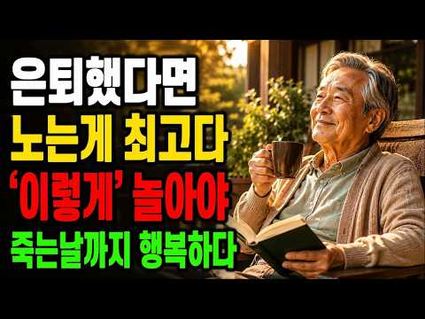
- 설명 앞부분: 70대가 되어 뒤늦게 깨달았습니다｜은퇴 후 가장 잘한 일은 일이 아니라 잘 노는 것이었습니다｜노년지혜｜오디오북 노년의 지혜 노후가 편안하려면 건강만큼 중요한 것이 돈 관리입니다. 노후의 돈관리에서는 은퇴 후 생활비, 소비 습관, 저축, 연금, 자산 관리 등 노후에 꼭 생각해봐야 할 현실적인 돈 이야기를 전합니다. 나이가 들수록 어떤 지출을 조심해야 하는지, 노후에 돈이 부족하지 않도록 무엇을 준비해야 하는지 쉽게 이해할 수 있도록 이야기합니다. 여러분의 안정적인 노후를 위해 오늘부터 하나씩 준비해보세요. ※ 본 채널은 일반적인 정…
- 같은 채널 평소 대비 ×18.2 (채널 최근 롱폼 중앙값 670회) · 평소 영상: [황혼재혼] 74세에 재혼했습니다｜그 선택을 평생 후회하게 될 줄은 몰랐습니다 노년의 지혜 (670회) / 73세가 되어서야 깨달았습니다… 자식에게 기대지 말아야 하는 이유 3가지 노후지혜 인생조… (699회)
- 대본 없음 (설명) — 음성인식이 끝나면 도입부·흐름이 들어감
- 댓글 0/0: 좋은 점 — 영상 0 · 감사·응원 0 · 더 알고 싶은 것 0 · 아쉬운 점 — 영상 0 · 반박·불만 — 의견 다름 0 · 정치·사회 0 · 경험 공유 0 · 구독·다음 기대 0

### 22. ISA·연금저축·IRP에서 평생 모아갈 국내상장 월배당 ETF 총정리 ∣ 9월 분배금 이만큼 나왔습니다 (ft. 커버드콜, 고배당 etf)

- https://www.youtube.com/watch?v=kZJEE6mtay4 · 퇴근후ETF · 구독자 172 · 조회수 27,618 (×160.6, 하루 1,731.1) · 좋아요 336 (1.2%) · 19.1분 · 2026-10-06 · 주제 묶음 4. 노후·연금 · 형식 인터뷰·강연·대담 · 폴더 `W_kZJEE6mtay4` (웹 승인)
- 썸네일: 
- 설명 앞부분: 같은 1억원인데 9월 분배금은 201만원과 44만원으로 갈렸습니다. 그런데 많이 받은 쪽이 재산도 더 불렸을까요? 26년 9월 말 공시를 기준으로 국내상장 월배당 ETF의 9월 분배금을 정리하고, 커버드콜과 고배당 ETF의 차이를 짚었습니다. 분배율은 그대로인데 분배금이 줄어드는 이유, 상승장과 하락장에서 갈린 성적, 일반계좌에선 비과세였던 분배금이 연금계좌에서 과세되는 구조까지 담았습니다. ISA·연금저축·IRP의 규칙과 연금 수령 연 1,500만원 기준을 바탕으로, 평생 모아가는 시기와 꺼내 쓰는 시기에 무엇을 봐야 하는지 정…
- 같은 채널 평소 대비 ×53.5 (채널 최근 롱폼 중앙값 516회) · 평소 영상: IRP 퇴직연금 안전자산 30%, 채권혼합 ETF만 담아도 될까?(ft. 퇴직연금, IR… (516회) / 커버드콜 ETF 30조 돌파, 원금 지키는 것 vs 깎아먹는 것 차이는? 월배당 대장은?… (476회)
- 대본 (음성인식(앞 5분), 5.1 음절/초) — 앞부분만, 흐름은 그 안까지 첫 20초: “1억 원을 투자했다고 가정하면 9월 분배금은 201만 원과 44만 원으로 갈립니다. 둘 다 국내 상장 월배당 ETF인데 한 달 분배금이 4배 넘게 벌어지는 겁니다. 커버드콜 ETF와 고배당 ETF의 9월 말 공시 분배율을 적용한 결과인데요. 은태우 생활비만 생각하면 굳이 고민할 이유가 없어 보이죠.” — 도입부 유형: 숫자로 시작
- 첫 1분: “1억 원을 투자했다고 가정하면 9월 분배금은 201만 원과 44만 원으로 갈립니다. 둘 다 국내 상장 월배당 ETF인데 한 달 분배금이 4배 넘게 벌어지는 겁니다. 커버드콜 ETF와 고배당 ETF의 9월 말 공시 분배율을 적용한 결과인데요. 은태우 생활비만 생각하면 굳이 고민할 이유가 없어 보이죠. 그런데 올해 상반기 상승장에서는 매달 분배금을 지급한 커버드콜 ETF가 코스피 200을 그대로 추종한 ETF보다 무려 24% 포인트 넘게 덜 벌었습니다. 여기서 끝이 아닙니다. 세금에서는 더 의외의 결과가 기다리고 있는데요. 절세하려고 연금계자에 담았는데 오히려 일반계자에서는 내지 않던 세금이 발생하는 ETF도 있습니다. 2026년 9월 말 공시를 기준으로 평생 가져갈 월배당 ETF는 어떤 계좌에 담아야 재산을”
- 흐름 (90초마다 첫 문장): 0:00 1억 원을 투자했다고 가정하면 9월 분배금은 201만 원과 44만 원으… → 1:36 플러스 200 커버드콜 액티브는 주당 152원 분배락 전날 종가 기준 … → 3:01 삼성 자산운용 공시를 따라가보면 3월 분배금은 주당 252원이었는데 → 4:32 같은 2%라도 기준이 다를 수 있습니다.
- 댓글 6/6: 좋은 점 — 영상 0 · 감사·응원 0 · 더 알고 싶은 것 0 · 아쉬운 점 — 영상 0 · 반박·불만 — 의견 다름 0 · 정치·사회 0 · 경험 공유 1 · 구독·다음 기대 0
  - 경험 공유 👍6 “ISA 계좌에서 손익통산에 대한 설명 좀 확인해 주세요. ISA에서 국내 ETF나 커버드콜 등 세금이 붙지 않는 것은 원래 손익통산의 대상이 아니라고 알고 있는데, 설명에는 이에 대한 설명이 정확하지 않았던 것같아요. 제가 잘 못 알고 있는지도 모르겠구요. 일반계좌:…”

### 23. 조용한 부자들이 절대 입에 담지 않는 7가지 — 돈 있는 사람의 진짜 습관 ㅣ시니어ㅣ오디오북ㅣ노후준비ㅣ심리학ㅣ

- https://www.youtube.com/watch?v=TKBAsjZgVWU · 가을빛 심리학 · 구독자 1,250 · 조회수 480,593 (×384.5, 하루 11,491.4) · 좋아요 1,757 (0.4%) · 21.7분 · 2026-09-16 · 주제 묶음 1. 재테크 일반·마인드 · 형식 오디오북·낭독 (명언·인생조언) · 폴더 `W_TKBAsjZgVWU` (웹 승인)
- 썸네일: 
- 설명 앞부분: 🔇 조용한 부자들은 왜 말을 안 할까? 모임에서 늘 구석에 앉고, 누가 물어봐도 "이것저것이요" 한마디로 끝내는 사람. 알고 보니 건물 두 채, 세 채를 가지고 있었습니다. 이 사람들에게는 절대 입 밖에 꺼내지 않는 공통된 습관이 있었어요. 자산 규모, 소비 기준, 성공 원인, 심지어 좋은 일을 하고도 말하지 않습니다. 왜 그런 걸까요? 심리학 연구와 실제 사례를 바탕으로, 조용한 부자들이 침묵하는 진짜 이유 7가지를 하나씩 풀어봤습니다. 💡 이런 분들에게 추천합니다 ✔️ 말을 아끼는 사람들의 심리가 궁금한 분 ✔️ 부자들의 실제…
- 같은 채널 평소 대비 ×589.0 (채널 최근 롱폼 중앙값 816회) · 평소 영상: 자리 일어날때 의자를 정리하는 사람의 특징 ㅣ오디오북ㅣ심리학ㅣ (816회) / 밥값 앞에서 사람의 본색이 드러나는 진짜 이유 ∣ 인간관계 심리 ㅣ오디오북ㅣ노후준비ㅣ심리학 (763회)
- 대본 (음성인식(앞 5분), 5.5 음절/초) — 앞부분만, 흐름은 그 안까지 첫 20초: “한 사람이 있었습니다. 제가 아는 모임에서 돈 얘기가 나올 때마다 그 사람은 딱 한 가지만 했어요. 고개를 끄덕이 한 거 누가 주식 얼마 벌었다. 부동산 어디가 올랐다. 목소리 높여가며 떠들 때 그 사람은 그냥 어 대단하다 한 마디 하고 술잔만 기울이고 있었습니다. 그래서 전 그 사람이 돈에 관심이 없는 줄 알았어요.”
- 첫 1분: “한 사람이 있었습니다. 제가 아는 모임에서 돈 얘기가 나올 때마다 그 사람은 딱 한 가지만 했어요. 고개를 끄덕이 한 거 누가 주식 얼마 벌었다. 부동산 어디가 올랐다. 목소리 높여가며 떠들 때 그 사람은 그냥 어 대단하다 한 마디 하고 술잔만 기울이고 있었습니다. 그래서 전 그 사람이 돈에 관심이 없는 줄 알았어요. 아니었습니다. 어느 날 우연히 알게 됐어요. 그 사람이 우리가 떠들고 있던 그 시간에 이미 건물 두 채의 월세를 받고 있었다는 걸 우리가 벌었다고 자랑하던 금액을 그 사람은 한 달에 그냥 통장으로 받고 있었던 겁니다. 그때든 감정이 모였는지 아세요. 부러움이 아니었어요. 놀라움도 아니었습니다. 창피함이었어요. 나는 그 사람 앞에서 몇 백 벌었다고 신나 했었고 그 사람은 아무 말 없이 그냥 들어”
- 흐름 (90초마다 첫 문장): 0:00 한 사람이 있었습니다. → 1:33 소비 습관. → 3:00 지금부터 그 7가지를 풀어보겠습니다. → 4:30 저도 이런 걸 느끼면서 변한 게 하나 있거든요.
- 댓글 100/106: 좋은 점 — 영상 0 · 감사·응원 2 · 더 알고 싶은 것 1 · 아쉬운 점 — 영상 0 · 반박·불만 — 의견 다름 0 · 정치·사회 1 · 경험 공유 6 · 구독·다음 기대 0
  - 감사·응원 👍7 “그게요 인간들 90%는 멍청해서 그래요 술을 1~2번 사면 넌 부자니까 ~ 니가 돈 더 내는 사람으로 변해버려서 정말 피곤해요 부자도 절약하고 사는 건 마찮가지거든요 부자라고 돈 펑펑 쓰면서 살지 않습니다 그래서 숨기려는 겁니다 술, 밥 사주면 고마워 하는게 아니고 …”
  - 더 알고 싶은 것 👍17 “쓸데없이 정보도 흘리기 싫고 상대방이 나와 자기를 비교하면 관계가 피곤해지기 때문에 말을 아낍니다. 자기 가진거 자랑하는건 잘 들어줘요. 그런데 자기와 나를 비교하면서 내가 얼마 가졌나 파고들며 묻는 사람들은 무조건 피합니다. 그렇게 묻는 이유는 두가지인데 자기가 나…”
  - 경험 공유 👍87 “나도 조금 벌면, 떠벌려서 커피값이든 술값이든 돈을 내게 됨.... 조용히 있어야 한다는 걸 아는데도 자꾸 말하게 됨.....50대가 코앞인데 아직 덜 성숙한 것 같다.”
  - 경험 공유 👍17 “쓸데없이 정보도 흘리기 싫고 상대방이 나와 자기를 비교하면 관계가 피곤해지기 때문에 말을 아낍니다. 자기 가진거 자랑하는건 잘 들어줘요. 그런데 자기와 나를 비교하면서 내가 얼마 가졌나 파고들며 묻는 사람들은 무조건 피합니다. 그렇게 묻는 이유는 두가지인데 자기가 나…”

### 24. 은퇴 후 연금만으로 살기 좋은 한국 최고의 섬마을

- https://www.youtube.com/watch?v=nksAlCVCgLo · 살이픽 · 구독자 913 · 조회수 157,614 (×172.6, 하루 7,447.8) · 좋아요 1,211 (0.8%) · 18.3분 · 2026-10-01 · 주제 묶음 4. 노후·연금 · 형식 정보·해설 (그 밖) · 폴더 `W_nksAlCVCgLo` (웹 승인)
- 썸네일: 
- 설명 앞부분: 은퇴 후 연금만으로도 비교적 여유롭게 살 수 있는 곳이 있을까요? 생활비는 낮추고 자연은 가까이 누리면서 조용한 노후를 보내고 싶다면, 한국의 섬마을도 하나의 선택지가 될 수 있습니다. 이번 영상에서는 은퇴 후 살기 좋은 한국의 섬마을을 살펴보고, 60대 이후 실제 정착을 고민할 때 반드시 확인해야 할 조건들을 함께 알아봅니다. 도시를 떠나 섬에서 생활하면 주거비와 일부 생활비를 줄일 가능성이 있지만, 단순히 경치가 좋다는 이유만으로 결정해서는 안 됩니다. 노후에는 특히 다음 조건이 중요합니다. ✓ 월평균 생활비는 얼마나 필요한지…
- 같은 채널 평소 대비 ×15.5 (채널 최근 롱폼 중앙값 10,170회) · 평소 영상: 연금 150만원, 어디서 가장 많이 남을까?｜은퇴도시 5곳 생활비 비교 (8,529회) / 섬인데 배를 안 탑니다｜연금으로 살아볼 만한 섬마을 5곳 (18,354회)
- 대본 (음성인식(앞 5분), 5.7 음절/초) — 앞부분만, 흐름은 그 안까지 첫 20초: “섬에서 연금만으로 산다니 배시간표 들여다보며 병원 단이라는 얘기냐고 하실 겁니다. 그런데 오늘 고른 섬 마을 5곳 가운데 4곳은 버스가 다리를 건너 들어갑니다. 이 영상이 끝나면 냉장고 문에 붙은 달력에 적어둘 섬 이름 하나와 그 섬에 한 달 장부가 남습니다. 섬이 하나 나올 때마다 여기라면 살겠다 싶으면 손가락 하나를 접어두세요.”
- 첫 1분: “섬에서 연금만으로 산다니 배시간표 들여다보며 병원 단이라는 얘기냐고 하실 겁니다. 그런데 오늘 고른 섬 마을 5곳 가운데 4곳은 버스가 다리를 건너 들어갑니다. 이 영상이 끝나면 냉장고 문에 붙은 달력에 적어둘 섬 이름 하나와 그 섬에 한 달 장부가 남습니다. 섬이 하나 나올 때마다 여기라면 살겠다 싶으면 손가락 하나를 접어두세요. 접은 손가락 수가 영상 끝에서 첫 걸음을 정해드립니다. 1위 섬은 서울에서 기차를 종점까지 타고 버스로 다리 하나를 건너면 닫습니다. 한겨울에도 그 섬에 맡은 팔았습니다. 이름은 마치셔도 그 섬에서 연금이 남는 진짜 이유까지 마치기는 어려우실 거예요. 5위는 인천의 강화도입니다. 물이 빠지면 회색깨버리 수평선까지 드러나고 폭오 시장에서는 세우전 냄새가 먼저 마중을 나와요. 서울”
- 흐름 (90초마다 첫 문장): 0:00 섬에서 연금만으로 산다니 배시간표 들여다보며 병원 단이라는 얘기냐고 하… → 1:32 도시 아파트 한체가 전부인 부부가 관리비로 한 달 22만 7천원을 내다가 → 3:04 보호구역 안에 집은 증축이나 용도 변경에 허가 더 까다로울 수 있으니 → 4:31 가령 태안이나 서산의 병원에 한 번 다녀올 때마다 기름값과 점심값으로 …
- 댓글 47/47: 좋은 점 — 영상 1 · 감사·응원 2 · 더 알고 싶은 것 0 · 아쉬운 점 — 영상 0 · 반박·불만 — 의견 다름 0 · 정치·사회 3 · 경험 공유 4 · 구독·다음 기대 0
  - 감사·응원 👍2 “와~우 영상 감사드립니다 은퇴후 살곳 고민했는데 도움 되었어요”
  - 정치·사회 👍9 “퇴직 후에 강화도에 정착하고자 하였으나, 강화도 일대는 북괴에서 무방비로 흘려보낸 핵폐수 방류로 방사능으로 오염되어 살 수가 없음. 그런데도 정부에서 쉬쉬하고 있음. 방사능 오염으로 강화도에 갈 수가 없음.”
  - 경험 공유 👍21 “강화도--->텃세 진짜 ㅜㅜㅜㅜ 경험해 본 1인.”
  - 경험 공유 👍4 “아니. 목포, 여수, 진안, 무주, 군산, 통영 같이 깨끗하고 집값 저렴하고 편리한 곳이 널렸는데 굳이 섬마을로 귀양가서 살다니...나이 들었다고 머리도 망가지나요? 나도 나이가 많지만 섬에서 사는건 바보짓입니다.”

### 25. 어쩌면 입시보다 더 중요한 투자 이야기

- https://www.youtube.com/watch?v=-3nc7FXlcBE · 김동욱 아카이브 · 구독자 1,870 · 조회수 152,171 (×81.4, 하루 14,768.4) · 좋아요 2,355 (1.6%) · 4.7분 · 2026-10-18 · 주제 묶음 3. 주식·ETF · 형식 정보·해설 (그 밖) · 폴더 `W_-3nc7FXlcBE` (웹 승인)
- 썸네일: 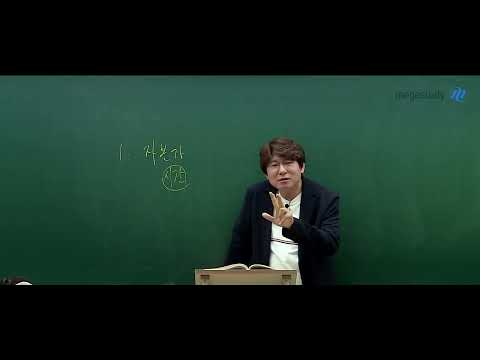
- 대본 없음 (없음) — 음성인식이 끝나면 도입부·흐름이 들어감
- 댓글 90/252: 좋은 점 — 영상 0 · 감사·응원 1 · 더 알고 싶은 것 1 · 아쉬운 점 — 영상 0 · 반박·불만 — 의견 다름 1 · 정치·사회 9 · 경험 공유 2 · 구독·다음 기대 0
  - 감사·응원 👍0 “감사합니다 선생님 군적금 학자금대출 신용 레버리지 몰빵으로 반도체에 투자하겠습니다 조언 감사합니다”
  - 더 알고 싶은 것 👍4 “이런거 더 올려주세요오”
  - 정치·사회 👍10 “쌤 좌파 아니였음?”

### 26. "둘이 연금 받으면 넉넉하겠지" 부부 연금 340만 원인데 노후 파산 직전까지 가는 진짜 이유

- https://www.youtube.com/watch?v=rrt18r_uOPc · 퀸즈리의  경제학 · 구독자 734 · 조회수 123,653 (×168.5, 하루 5,381.2) · 좋아요 459 (0.4%) · 18.6분 · 2026-10-05 · 주제 묶음 4. 노후·연금 · 형식 브이로그·직접 해본 이야기 · 폴더 `W_rrt18r_uOPc` (웹 승인)
- 썸네일: 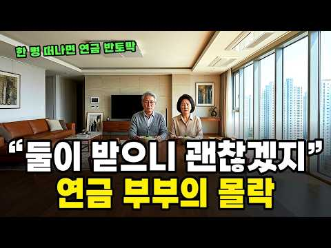
- 챕터: 0:00 둘이 합쳐 월 340만 원 · 0:44 박 선생님 부부의 장부 · 2:09 첫 번째 꺾임 — 건보 피부양자 동반 탈락 · 5:43 두 번째 꺾임 — 빚 없는 집이 가져가는 돈 · 8:45 세 번째 꺾임 — 한 명만 남은 날 · 13:19 집을 지킬까, 줄일까 · 15:21 60대가 파산 1위인 이유 · 16:18 세 번의 꺾임 정리 · 17:26 오늘 확인할 것 세 가지
- 설명 앞부분: 안녕하세요. '돈과 관계'의 지혜를 함께 찾아가는 [퀸즈리의 경제학}입니다 남편 공무원연금 280만 원에 아내 국민연금 60만 원, 대출 없는 아파트까지 있던 부부가 왜 퇴직 4년 만에 집을 내놓게 될까요. 연금을 둘이 받는 부부의 통장이 세 번 꺾이는 순간을 건보료·재산세·유족연금 제도대로 끝까지 계산했습니다. 이 영상에서 다루는 내용 부부 연금 340만 원 vs 부부 적정 노후생활비 월 298만 1천 원 첫 번째 꺾임: 한 사람 연금 때문에 부부가 같이 떨어지는 건보 피부양자 "동반 탈락" (11만 6,306명) 지역가입자 건…
- 같은 채널 평소 대비 ×127.1 (채널 최근 롱폼 중앙값 973회) · 평소 영상: "장비만 2천만 원이 됐습니다" 3만 원이면 시작한다던 낚시가 이렇게 된 진짜 이유 (973회) / "그 돈이면 일본 갑니다" 추석에도 텅 빈 국내 관광지 TOP 7, 무너진 진짜 이유 (1,037회)
- 대본 없음 (설명) — 음성인식이 끝나면 도입부·흐름이 들어감
- 댓글 24/36: 좋은 점 — 영상 1 · 감사·응원 0 · 더 알고 싶은 것 1 · 아쉬운 점 — 영상 0 · 반박·불만 — 의견 다름 0 · 정치·사회 1 · 경험 공유 0 · 구독·다음 기대 0
  - 좋은 점 — 영상 👍1 “남편이 먼저 떠나면 33%, 아내가 먼저 떠나면 7%가 줄어든다는 비교가 이 영상에서 제일 와닿았습니다. 하나 보태면 공무원연금·국민연금의 유족연금은 소득세 비과세 소득이라, 건보료 피부양자 소득 판정이나 지역보험료 산정에는 들어가지 않는 걸로 알고 있어요. 그렇다면…”
  - 더 알고 싶은 것 👍1 “남편이 먼저 떠나면 33%, 아내가 먼저 떠나면 7%가 줄어든다는 비교가 이 영상에서 제일 와닿았습니다. 하나 보태면 공무원연금·국민연금의 유족연금은 소득세 비과세 소득이라, 건보료 피부양자 소득 판정이나 지역보험료 산정에는 들어가지 않는 걸로 알고 있어요. 그렇다면…”
  - 정치·사회 👍21 “겨우 연금 받아 사는 노인들에게서 세금 뜯어 중국인 연금주고 의료보험 혜택주는 나라 호구도 이런 호구가 없다”

### 27. 부자들의 집에는 없고 가난한 집에는 넘쳐나는 '3가지'? 중년 풍수의 핵심은 비움입니다 ∣ 도올 김용옥 법문 ∣ 인생조언

- https://www.youtube.com/watch?v=h0M1n5EHJSQ · 평온한마음 · 구독자 415 · 조회수 41,217 (×99.3, 하루 2,820.9) · 좋아요 396 (1.0%) · 107.3분 · 2026-10-13 · 주제 묶음 1. 재테크 일반·마인드 · 형식 오디오북·낭독 (명언·인생조언) · 폴더 `W_h0M1n5EHJSQ` (웹 승인)
- 썸네일: 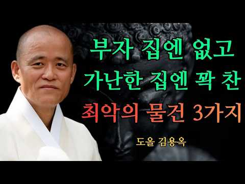
- 설명 앞부분: 부자들의 집에는 없고 가난한 집에는 넘쳐나는 '3가지'? 중년 풍수의 핵심은 비움입니다 ∣ 도올 김용옥 법문 ∣ 인생조언 어느 순간부터 삶이 무겁게 느껴지고, 집에서도 마음이 편치 않으신가요? 열심히 살고 있는데도 자꾸만 불안이 엄습한다면, 그것은 당신의 능력 문제가 아니라 당신이 머무는 '공간'이 보내는 위험 신호일 수 있습니다. 많은 이들이 40대, 50대에 접어들며 인생의 전환점을 맞이하지만, 정작 운명을 결정짓는 '집 안의 흐름'은 방치하곤 합니다. 이번 영상에서는 도올 김용옥 선생님의 깊은 통찰을 통해, 부자들은 절대 두…
- 같은 채널 평소 대비 ×27.3 (채널 최근 롱폼 중앙값 1,511회) · 평소 영상: 노후에는 자식이 필요 없습니다, 대신 반드시 갖춰야 할 3가지 ∣ 도올 김용옥 법문 ∣ … (1,814회) / 왜 현명한 사람은 가족 속사정을 끝까지 말하지 않을까? 도올 김용옥이 전한 침묵의 지혜 … (1,208회)
- 대본 없음 (설명) — 음성인식이 끝나면 도입부·흐름이 들어감
- 댓글 15/15: 좋은 점 — 영상 2 · 감사·응원 3 · 더 알고 싶은 것 0 · 아쉬운 점 — 영상 0 · 반박·불만 — 의견 다름 0 · 정치·사회 1 · 경험 공유 0 · 구독·다음 기대 0
  - 좋은 점 — 영상 👍10 “아주 좋은 말씀 감사합니다 ❤”
  - 좋은 점 — 영상 👍9 “귀한말씀 마음정화에큰도움이되었읍니다 깨닳음 을안고 새기며살겠읍니다 감사하고 존경합니다”
  - 감사·응원 👍10 “아주 좋은 말씀 감사합니다 ❤”
  - 감사·응원 👍9 “귀한말씀 마음정화에큰도움이되었읍니다 깨닳음 을안고 새기며살겠읍니다 감사하고 존경합니다”
  - 정치·사회 👍0 “당신부터 인간이 되시길 좌파된 원인 뭔지나 깨닳길~~”

### 28. 53살·49살, 평생 필요한 돈 준비가 끝났습니다. 다 버리고 다시 시작합니다 ∣ 마지막 미국 일상

- https://www.youtube.com/watch?v=9YTB1MfKGQ4 · 쭈쭈랑야옹이 · 구독자 1,810 · 조회수 115,255 (×63.7, 하루 11,765.9) · 좋아요 446 (0.4%) · 10.7분 · 2026-10-18 · 주제 묶음 3. 주식·ETF · 형식 브이로그·직접 해본 이야기 · 폴더 `W_9YTB1MfKGQ4` (웹 승인)
- 썸네일: 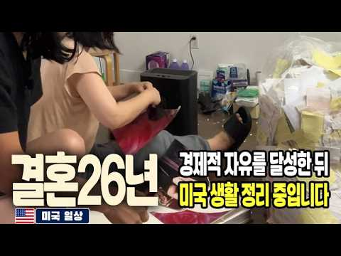
- 챕터: 0:00 10년 만에 경제적 자유, 부부가 함께 은퇴했습니다 · 0:46 28년 미국 생활의 흔적을 버리기 시작 · 1:29 일을 안 해도 되는 하루에 적응 중 · 1:58 부산 북항의 상어 ‘부캉이’ 이야기 · 3:08 아내가 세상에서 제일 싫어하는 염색 · 3:54 한국 가기 전 마지막 일들 · 4:18 은퇴 후 첫 사치? 블루보틀 커피잔 · 4:51 몇 년 만에 작업복을 벗었습니다 · 6:00 부부가 같이 은퇴하면 생기는 일 · 6:42 은퇴했어도 받을 돈은 받으러 갑니다 · 7:26 은퇴 부부의 현실적인 장보기 · 7:40 28년 미국 생활을 버리고 인생 리셋 · 8:50 미국 떠나기 전 장 보러 왔는데 술만... · 9:55 모든 와이프는 짜증을 낸다? · 10:07 이제 하루가 전부 우리 부부의 시간입니다
- 설명 앞부분: 10년 동안 준비했던 은퇴가 드디어 시작됐습니다. 10년 전 아내의 암 수술을 계기로 평생 필요한 돈을 계산했고, 그 돈을 만들기 위해 주 7일 하루도 쉬지 않고 일했습니다. 저는 직업이 3개였고, 아내는 암 수술 후에도 직장 생활을 계속했습니다. 그리고 며칠 전, 53살과 49살에 부부가 함께 돈 버는 일을 멈췄습니다. 하지만 은퇴하고 가장 먼저 시작한 건 여행도 휴식도 아니었습니다. 28년 동안 미국에서 쌓인 사진과 서류, 작업화와 물건들을 하나씩 버리고 있습니다. 12월 7일, 미국 생활을 완전히 정리하고 한국으로 돌아갑니다…
- 같은 채널 평소 대비 ×4.4 (채널 최근 롱폼 중앙값 26,398회) · 평소 영상: 19년 동안 주 7일 죽은 사람 만나러 다니며 돈 벌었습니다 ∣ 마지막 미국 일상 EP.1 (26,712회) / 3개월밖에 안 남았는데 마지막까지 악착같이 돈 벌고 있습니다 ∣ 마지막 미국 일상 EP.2 (26,083회)
- 대본 없음 (설명) — 음성인식이 끝나면 도입부·흐름이 들어감
- 댓글 63/147: 좋은 점 — 영상 0 · 감사·응원 2 · 더 알고 싶은 것 4 · 아쉬운 점 — 영상 0 · 반박·불만 — 의견 다름 0 · 정치·사회 1 · 경험 공유 4 · 구독·다음 기대 0
  - 감사·응원 👍3 “응원합니다”
  - 더 알고 싶은 것 👍9 “와 부럽 또 부산이라니 맘 여유있게 사시겠네요.직장 다닐일없음 굳이 서울에 안 살아도 되는거 같아요 어떻게 미국에 가시게 됐는지 자리를 잡으시고 오래 사셨는데 왜 은퇴는 한국으로 다시 오시는건지 그간 스토리도 궁금하네요!”
  - 더 알고 싶은 것 👍4 “저도 부산에서 태어나 간호사로 19년 근무 그리고 24 년차 미국에서 간호사로 근무하는 …내년 5월 67세로 은퇴계획중인 데… 경제적 자유는 생활하기에 따라 다르겠지만 얼마정도를 생각하시나요?”
  - 정치·사회 👍0 “한국으로 영구 역이민 하는 건가요? 그렇다면 아직은 복수국적 나이 제한이 65세 이상이라 두 분다 F4 비자로 입국했다 2-3년내에 F5 비자로 바꾸실 계획인가요? 한국 입국하시자 마자 거주지가 마련되면 거소증부터 신청하세요? 각자 대면 인터뷰를 해야 하기에, 지역마…”
  - 경험 공유 👍4 “저도 부산에서 태어나 간호사로 19년 근무 그리고 24 년차 미국에서 간호사로 근무하는 …내년 5월 67세로 은퇴계획중인 데… 경제적 자유는 생활하기에 따라 다르겠지만 얼마정도를 생각하시나요?”
  - 경험 공유 👍3 “안녕하세요 😂😂 지난번에 댓글에 끄적였던 사람입니다 😂 이제 귀국 5일차.. 아직 시차적응 실패로 매일 커피마시며 돌아다녀요 하하하 4일동안 일보러 다니면서 다른나라살다가 오셨죠?? 5번정도 들었어요 😂😂😂 표정이(?) 달라서 티가 나는거 같아요 😂😂 저도 짐정리 6…”

### 29. 삼성·SK하이닉스 폭락의 진짜 범인을 추적한다

- https://www.youtube.com/watch?v=mXFz6Exhrpo · Fact and Truth · 구독자 1,250 · 조회수 22,989 (×18.4, 하루 7,968.5) · 좋아요 200 (0.9%) · 13분 · 2026-10-16 · 주제 묶음 3. 주식·ETF · 형식 정보·해설 (그 밖) · 폴더 `W_mXFz6Exhrpo` (웹 승인)
- 썸네일: 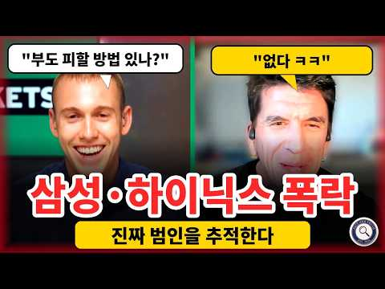
- 챕터: 0:00 오프닝 - 왜 한국만 무너졌나 · 0:26 "부도 피할 방법 있나?" "없습니다" · 0:58 스카이뉴스: 한국만 다른 그림 · 2:42 용의자 1 - 코어위브 · 5:00 왜 하필 한국인가 (GPU·HBM 연결고리) · 7:29 시간을 되감으면 - 코어위브는 방아쇠인가, 증폭기인가 · 8:08 거품 붕괴의 시작? IMF 경고·루치르 샤르마 · 10:27 개미의 비명 - 로이터가 만난 24살 대학생 · 11:20 지금 사야 하나 · 12:24 Fact and Truth 판단 - 지켜볼 숫자 3가지
- 설명 앞부분: 10월 15일, 삼성전자 -10.56%, SK하이닉스 -12.76%, 코스피 -7.57%와 서킷브레이커. 같은 날 미국 나스닥은 사상 최고치 근처였습니다. 왜 한국만 무너졌을까요? Prof G Markets, 스카이뉴스, 블룸버그, DW, 로이터 등 해외 방송 원문(한글 자막)으로 추적합니다. 지켜볼 숫자 ① 코어위브 채권 가격 ② 美 10년물 국채금리 ③ 신용융자 잔고 Prof G Markets · Sky News(Wilfred Frost) · Bloomberg Television · Bloomberg Originals · DW…
- 같은 채널 평소 대비 ×2.2 (채널 최근 롱폼 중앙값 10,508회) · 평소 영상: [본격검증] 같은 잣대로 쟀더니 결과는 예상과 달랐다 ∣ 이주완 vs 김동원, 삼성전자·… (12,715회) / [해외반응] 長鑫 매출 600% 폭증, 그런데 숨은 숫자 '1%'… 台灣 방송이 말하지 … (8,302회)
- 대본 없음 (설명) — 음성인식이 끝나면 도입부·흐름이 들어감
- 댓글 40/40: 좋은 점 — 영상 0 · 감사·응원 0 · 더 알고 싶은 것 0 · 아쉬운 점 — 영상 0 · 반박·불만 — 의견 다름 2 · 정치·사회 2 · 경험 공유 0 · 구독·다음 기대 0
  - 반박·불만 — 의견 다름 👍2 “말도 안되는 코어위브 핑게로 돌리지마라. 특별한 실적도없이 유동성유발시켜 한때 미국장 빌빌길때 국내증시 훨훨날고 증시상승률 세계1위 이였던것을 잊었는가?”
  - 반박·불만 — 의견 다름 👍0 “별내용아닌데 뺐네”
  - 정치·사회 👍14 “삼성닉스 추락 +증시폭락 범인은 한도늘려 연기금 끌어드리고 유동성 폭발시켜 버블키워 놓고,단일종목 ETF 선거에 이용하기 위해 선거일 코앞에 급히 허가한 이죄명+김용범 경제수석+금통위+금감원이 주범이다.”

### 30. 기초연금 개편 진짜였네? 결국 내가 받을 돈 '이렇게' 받는다 [대통령 긴급 발표] 61년생부터 주목

- https://www.youtube.com/watch?v=42N9nj2wWko · 연금노하우 · 구독자 1,280 · 조회수 412,575 (×322.3, 하루 7,657.6) · 좋아요 4,308 (1.0%) · 9.4분 · 2026-08-29 · 주제 묶음 4. 노후·연금 · 형식 정보·해설 (그 밖) · 폴더 `W_42N9nj2wWko` (웹 승인)
- 썸네일: 
- 설명 앞부분: "기초연금 개편 진짜였다" 여러분, 61년생부터 받는 기초연금이 12년만에 확 달라졌습니다. 대통령이 긴급 발표한 내용인데요. 이재명 대통령이 절대 그냥 주라고 하지는 않았다네요.. 그동안 똑같이 받던 연금, 이제 누구는 더 받고, 또 누구는 그대로 라는데요. 여러분의 부모님은 과연 어느 쪽일까요? 자세한 내용은 영상에서 확인하세요!
- 대본 (음성인식(앞 5분), 5.9 음절/초) — 앞부분만, 흐름은 그 안까지 첫 20초: “여러분 얼마 전이었죠. 청와대 업무 보고에서 정말 중요한 얘기가 나왔어요. 그동안 바뀐다 바뀐다 말만 많았던 기초 연금 이번엔 진짜 움직이기 시작했습니다. 보건복지부 장관이 직접 지금과는 완전히 다른 방식으로 개편하겠다고 밝혔는데요. 이 소식 하나로 부모님들 가슴이 철렁하셨을 겁니다. 매달 똑같이 봤던 기초 연금인데 이제는 상황에 따라 받는 금액이 갈릴 수도 있다는 거니까요.” — 도입부 유형: 시청자 부르기
- 첫 1분: “여러분 얼마 전이었죠. 청와대 업무 보고에서 정말 중요한 얘기가 나왔어요. 그동안 바뀐다 바뀐다 말만 많았던 기초 연금 이번엔 진짜 움직이기 시작했습니다. 보건복지부 장관이 직접 지금과는 완전히 다른 방식으로 개편하겠다고 밝혔는데요. 이 소식 하나로 부모님들 가슴이 철렁하셨을 겁니다. 매달 똑같이 봤던 기초 연금인데 이제는 상황에 따라 받는 금액이 갈릴 수도 있다는 거니까요. 그런데 정작 뭐가 어떻게 바뀌는 건지 내가 여기 해당되는 건지는 다들 모르고 계시더라고요. 지금 받는 돈은 정말 그대로일까요? 부분은 얼마나 달라질 수 있을까요? 하나씩 짚어드릴 테니까 끝까지 봐주세요. 먼저 가장 궁금하신 것부터 말씀드릴게요. 이번 소식으로 이제 연금 못 받는 건 아닌지 봤던 돈이 줄어드는 건 아닌지 걱정이 많으실 텐”
- 흐름 (90초마다 첫 문장): 0:00 여러분 얼마 전이었죠. 청와대 업무 보고에서 정말 중요한 얘기가 나왔어… → 1:32 이 소득 인정액이 2026년 기준으로 혼자 사시는 분은 월 247만원 … → 3:01 아래 사람에게는 후하게, 윗 사람에게는 박하게. → 4:32 혹시 부부가 함께 기초형금을 받으면 각자 얼마씩 깎이는지 알고 계셨나요?
- 댓글 349/349: 좋은 점 — 영상 4 · 감사·응원 11 · 더 알고 싶은 것 2 · 아쉬운 점 — 영상 1 · 반박·불만 — 의견 다름 3 · 정치·사회 118 · 경험 공유 8 · 구독·다음 기대 0
  - 좋은 점 — 영상 👍31 “최신정보를 잘 알려주셔서 감사합니다❤❤❤”
  - 좋은 점 — 영상 👍9 “유익한정보 감사드립니다.”
  - 감사·응원 👍194 “젊은 청년이 깨어있네. 고맙습니다.”
  - 감사·응원 👍31 “최신정보를 잘 알려주셔서 감사합니다❤❤❤”
  - 더 알고 싶은 것 👍1 “기초수급자는 기초연금준다고 수급비 에서 그대로 깍여서 수급 비 줬다뺐는 형식좀 다뤄주세요”
  - 더 알고 싶은 것 👍0 “질문요~~ 중고자동차 1대가격이 시세 약 1천만원 미만 자가용3대 보유 약 3천만원 하나는 본인이 타고 또 하나는 딸이 타고 나머지 한대는 아들이 탑니다 보험료 때문에 자식앞으로 못하고 이렇게 됫습니다 이 경우에도 기초연금 탈수 있나요? 다른 재산은 기초연금대상입니다…”
  - 아쉬운 점 — 영상 👍19 “최종 확정된거 없는데 꼭 있는것처럼 낚시질하니 나쁜놈”
  - 반박·불만 — 의견 다름 👍0 “국민연금 받는다고 15만원이나 깎고 주는게 맞는 얘기냐..!! 진짜 개웃기는 놈들이지..!!”
  - 정치·사회 👍527 “나라가 돈이 없는것이 아니다 도둑이 많을 뿐이다”
  - 정치·사회 👍432 “외국인에게 , 국민연금 .기초연금, 의료보험등등 국가의일체 지급을 중단하라!!”
  - 경험 공유 👍157 “문제는 국민연금이 왜 외국사람에게 지불하느냐 ??? 이다. 대한민국 국민인 나도 못 받는데”
  - 경험 공유 👍9 “3년째 대상에서 제외되는 사람은 애국자?”

### 31. [문남중 출연] "코스피 바닥, 7월29일에 이미 확인 끝! 전고점 회복 근거? '이것' 보시면 됩니다" #문남중 _261019

- https://www.youtube.com/watch?v=btSUFhvYPwk · 경제통마늘 · 구독자 13,100 · 조회수 321,609 (×24.6, 하루 76,950.8) · 좋아요 2,091 (0.7%) · 10.2분 · 2026-10-19 · 주제 묶음 3. 주식·ETF · 형식 오디오북·낭독 (명언·인생조언) · 폴더 `W_btSUFhvYPwk` (웹 승인)
- 썸네일: 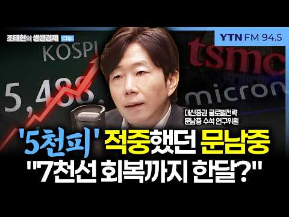
- 설명 앞부분: 전문가 "10월 대폭락은 과도..7천선 회복 한달내로도 가능할 것" '7만전자·20만닉스' 전망? 마이크론, TSMC 실적으로 설명하고파 TSMC, 4분기 매출 전분기 대비 +14%, 전년 동기 대비 +58% 삼전닉스 역시 예상치 상회하는 실적 흐름 예상 글로벌증시 방향성 결정하는 美 증시 반등하면, 코스피도 반등 미 9월 소비자물가 예상치 상회, 매파적 통화정책, 코어위브 회사채 급락 등 모든 문제는 미국에서 시작됐지만, 그럼에도 미 증시 '평온' 美 중간선거 이후, 3년차까지 S&P500지수 계속 올랐던 과거 경험상, 내년 증…
- 같은 채널 평소 대비 ×309.5 (채널 최근 롱폼 중앙값 1,039회) · 평소 영상: 닷컴 버블 회복 5년 걸렸는데…3천억 녹아내린 코스피, 반등 모멘텀은_261019 (1,091회) / [강정수 블루닷AI] "'비밀번호 90일 만료, 변경기간입니다'까지 알려준다" 에이전틱A… (987회)
- 대본 없음 (설명) — 음성인식이 끝나면 도입부·흐름이 들어감
- 댓글 145/228: 좋은 점 — 영상 2 · 감사·응원 7 · 더 알고 싶은 것 1 · 아쉬운 점 — 영상 0 · 반박·불만 — 의견 다름 4 · 정치·사회 7 · 경험 공유 9 · 구독·다음 기대 0
  - 좋은 점 — 영상 👍2 “시기가 조금씩 정확하게는 어렵지만 방향성을 항상 잘 맞았던거 같아요 그래서 너무 도움이 됩니다 삼성 sdi 말씀해 주셔서 작지만 수익 감사해요 오늘도 강하네요”
  - 좋은 점 — 영상 👍1 “삼성 하이닉스는 더이상 빨아먹을 꿀이 없다,,,,,,,,,,,,,오랜만에돈좀벌엇다시ㅍ은 노조개자식들이 다빼먹고,,,,,,,주주만 호구색이되는,,,,,,,,,도대체 삼성주식사서 주주한테 뭐가도움이되나????”
  - 감사·응원 👍5 “문남중 위원님 오늘말씀도 감사합니다 위원님 말씀찾아들으러왔습니다 차분히대응하겠습니다 정말 감사합니다~^^”
  - 감사·응원 👍5 “문위원님 인사이트 잘 들었습니다 감사합니다”
  - 더 알고 싶은 것 👍0 “그냥 바닥 좀 알려주세요. 줏어 먹게요.”
  - 반박·불만 — 의견 다름 👍12 “7월폭락맞춘거말고 다틀렸다니까 자꾸 띄워주냐 7월폭락도 제대로된 이유로 맞춘게아니라 얻어걸린느낌임”
  - 반박·불만 — 의견 다름 👍0 “오늘쯤 바닥일거는 왠만한 사람도 추측가능... 전문가라고 헛소리만 지껄임”
  - 정치·사회 👍34 “1400만 개미투자자를 기만하는 ‘무늬만’ 주주 보호법인 ‘의무공개매수제도’, ‘주가 누르기 방지법’의 전면 재검토 및 수정 입법 요청에 관한 청원 국회전자청원 참여 부탁드려요.”
  - 정치·사회 👍6 “외국인들 매수세 그리 강하지 않네요. ㅠㅠ”
  - 경험 공유 👍10 “이 사람 빨아주는 인간들 왜 이리 많냐. 내가 이 사람 5년 넘게 지켜 봤는데, 완전 반대방향으로 정말 턱도 없는 예측 한 경우도 여러번 봤다. 신도 모르는게 주식이다. 신의 영역에 도전을 하는 이런 류의 쓸데 없는 직업군 사람들 말 맹신하지 마라.”
  - 경험 공유 👍7 “나도 이분 좋아함 아 근데 걱정이 나스닥이 지금 꼭대기에있는게 너무나 무서움 ㅜㅜ”

### 32. 삼성전자 지금 팔아야 하나? 코스피 서킷브레이커 날, 버틸지 팔지 가를 기준 2가지

- https://www.youtube.com/watch?v=ICByZXkRrLg · 경제야! 놀자~ · 구독자 4,280 · 조회수 101,345 (×23.7, 하루 24,776.0) · 좋아요 582 (0.6%) · 13.5분 · 2026-10-15 · 주제 묶음 3. 주식·ETF · 형식 정보·해설 (그 밖) · 폴더 `W_ICByZXkRrLg` (웹 승인)
- 썸네일: 
- 챕터: 0:00 하이라이트 — 팔면 안 될 때, 팔아야 할 때 · 0:16 [경제야놀자 해설] 서킷브레이커, 팔아야 하나? · 0:36 사자고 했던 근거 ① 이익 증가 ② 저평가 · 1:45 근거 ③ 배당 30~40% 증가 · 자사주 소각 · 2:19 [경제야놀자 해설] 사자고 했던 근거 3가지 · 2:40 빠지는 이유 ① 금리 · 2:59 ② AI 투자 버블론 ③ 중동 · 물가 · 3:39 "훼손된 게 있나요?" — 아직은 없다 · 4:15 양대 시장 서킷브레이커 · 메모리 사이클 불신 · 5:28 [경제야놀자 해설] 서킷브레이커 · 메모리 사이클 · 5:53 박시동 — "3~4일에 20%씩 빠질 일이냐" · 7:13 성장통이냐, 희망고문이냐 · 8:53 판단 기준 두 갈래 · 비중 줄이기 · 10:05 [경제야놀자 해설] 성장통이냐 희망고문이냐 · 10:26 박시동 — 시가배당률 5%, 은행이자보다 많다 · 11:55 정리 — 지금 새로 사는 건 아니다 · 12:40 [경제야놀자 해설] 오늘의 세 줄 정리
- 설명 앞부분: [10월 15일 · 12시에 만나요] 코스닥에 이어 코스피까지 8% 넘게 빠지며 두 시장 모두 서킷브레이커가 걸린 날, 방송은 "지금 어떻게 해야 하나"를 붙들고 길게 이야기했다. 이광수 대표는 그동안 한국 주식을 사자고 했던 근거 세 가지 — 기업 이익 증가, 이익 대비 저평가, 배당과 자사주 소각으로 바뀌는 시장 — 를 다시 짚고, 아직 훼손된 것은 없다고 봤다. 권다영 앵커는 메모리 반도체가 사이클이라는 오랜 경험 때문에 시장이 "이번엔 다르다"를 믿지 못한다고 해석했다. 이 대표는 지금 하락이 오르는 길의 성장통인지, 저점…
- 대본 없음 (설명) — 음성인식이 끝나면 도입부·흐름이 들어감
- 댓글 296/296: 좋은 점 — 영상 0 · 감사·응원 0 · 더 알고 싶은 것 2 · 아쉬운 점 — 영상 0 · 반박·불만 — 의견 다름 8 · 정치·사회 19 · 경험 공유 8 · 구독·다음 기대 0
  - 더 알고 싶은 것 👍14 “오늘은 뭐라 하는지 궁금해서 들어 와봣더니.. 역시나..ㅠㅠㅠ”
  - 더 알고 싶은 것 👍2 “이주완 아날리스트의 삼전닉스 비관론에 대해서 합리적인 반론 좀 부탁드려요.”
  - 반박·불만 — 의견 다름 👍13 “대 전제가 틀렸다. 주식시장은 애초에 합리적인 분석대로 움직이는 장이 아니다. 이게 내 결론임.”
  - 반박·불만 — 의견 다름 👍11 “영국은 겨우 방직기 하나 개발해놓고 100년을 거품을 몰고 다녔습니다. 왜 한국만 지금 바보짓을 합니까? 좀 이 업계 모르는 분들은 입닫고 조용히 기업들이 하는일 지켜보세요. 기업들 바보 아닙니다. 겨우 중국발 기사 2줄에 검증되지 않은 내용으로 아무나 떠드는것에 신…”
  - 정치·사회 👍27 “정부는 아무 대책 없네~~ 미국이 이정도면 난리 났다 ~~종지가 9퍼가 빠진다는게 현실이냐 삼전이 1주일 만에 -30퍼가 말이 되나교 국민 거지 만들기 프로젝트 가종중이냐? 주식 시장은 아침 8시부터 저녁 8시까지 하라는 이야기냐?”
  - 정치·사회 👍8 “증권당국이 기업죽든말든 개인죽든말든 나라가죽든말든 증권사의무능수치다”
  - 경험 공유 👍15 “저분들 때문에 여러명 죽네 어제가. 바닥이라고 햇던거 같은데 저런 말은 나도 하겠네요”
  - 경험 공유 👍10 “귀에걸면 귀걸이 코에걸면 코걸이 나도하겠다.”

### 33. 혼자서도 외롭지 않고 풍요롭게 사는 사람의 비밀ㅣ귀티나는 노후를 위한 행복특강ㅣ황창연신부님최근강의ㅣ황창연신부님행복특강ㅣ인생 조언ㅣ오디오북ㅣ나눔철학∣ 황창연신부님…

- https://www.youtube.com/watch?v=Bi-HGrGtQrA · 수라이야 카라 · 구독자 205 · 조회수 16,211 (×79.1, 하루 1,183.8) · 좋아요 131 (0.8%) · 69.3분 · 2026-10-14 · 주제 묶음 4. 노후·연금 · 형식 오디오북·낭독 (명언·인생조언) · 폴더 `W_Bi-HGrGtQrA` (웹 승인)
- 썸네일: 
- 설명 앞부분: 혼자서도 외롭지 않고 풍요롭게 사는 사람의 비밀ㅣ귀티나는 노후를 위한 행복특강ㅣ황창연신부님최근강의ㅣ황창연신부님행복특강ㅣ인생 조언ㅣ오디오북ㅣ나눔철학∣ 황창연신부님최근강의
- 같은 채널 평소 대비 ×27.0 (채널 최근 롱폼 중앙값 601회) · 평소 영상: 60대이후, 행복을 찾다가 99 가 실수하는 행동 3가지ㅣ인생 조언ㅣ오디오북ㅣ노후 ∣ 황… (601회) / 결국 곁에 아무도 남지 않는 사람들의 3가지 특징ㅣ귀티나는 노후를 위한 행복특강ㅣ황창연신… (616회)
- 대본 없음 (설명) — 음성인식이 끝나면 도입부·흐름이 들어감
- 댓글 1/2: 좋은 점 — 영상 0 · 감사·응원 1 · 더 알고 싶은 것 0 · 아쉬운 점 — 영상 0 · 반박·불만 — 의견 다름 0 · 정치·사회 0 · 경험 공유 0 · 구독·다음 기대 0
  - 감사·응원 👍0 “아네스황창연신부님의지헤로운말씀감사합니다🎉은총과축복을많이받으소서🎉웃음꽃이피어나는신부님의강연🎉지헤로운말씀🎉감사합니다🎉건강하세요🎉”

### 34. 생생한 택배기사 최근 6개월치 월급 공개... 이게 '진짜 현실'입니다.

- https://www.youtube.com/watch?v=6QkzqMZYrVQ · 택부 - 택배기사 부자들 · 구독자 6,860 · 조회수 2,128,314 (×310.2, 하루 35,512.7) · 좋아요 6,863 (0.3%) · 8.6분 · 2026-08-24 · 주제 묶음 2. 돈 모으기·저축 · 형식 브이로그·직접 해본 이야기 · 폴더 `W_6QkzqMZYrVQ` (웹 승인)
- 썸네일: 
- 챕터: 0:00 인트로 · 0:16 택배기사 진짜 돈 많이 버나? · 0:39 택배기사 월급, 매출 계산하는 방법 · 1:32 택배기사 월급 공개 · 3:14 순수익 계산 방법 · 4:49 택배기사 현실 순수익 · 5:46 현 시점 택배가 돈이 되는 이유 · 6:34 근데도 내가 돈이 없는 이유 · 7:26 택배기사의 꿈
- 설명 앞부분: 택배 얼마 벌어? 이제 그만 물어보세요. 다 말씀드릴테니까 😉 택배로 돈 더 벌 수 있는 새로운 방법
- 같은 채널 평소 대비 ×48.2 (채널 최근 롱폼 중앙값 44,147회) · 평소 영상: 쿠팡택배해서 빚 2억, 4년 만에 갚아보겠습니다 (44,147회) / 아무도 알려주지 않았던 후회없이 택배차 고르는 방법 - 이 영상 하나로 끝! (51,289회)
- 대본 (음성인식(앞 5분), 6.7 음절/초) — 앞부분만, 흐름은 그 안까지 첫 20초: “실제로 제가 받은 월급 내역을 공개하도록 하겠습니다. 800, 800, 900, 900, 800, 600, 700 제가 최종적으로 좀 이뤄보자 하는 목표가 한 가지 있는데요. 내 몸뚱아리 하나로 성실하게 열심히 살아서 부자가 될 수 있는 그런 세상이다. 라는 걸 제가 제 몸으로 한번 증명해보고 싶습니다. 여러분 요즘 택배기사 하면 돈 많이 본다는 그런 얘기 많이 들어보지 않으셨나요?” — 도입부 유형: 내 이야기·사연
- 첫 1분: “실제로 제가 받은 월급 내역을 공개하도록 하겠습니다. 800, 800, 900, 900, 800, 600, 700 제가 최종적으로 좀 이뤄보자 하는 목표가 한 가지 있는데요. 내 몸뚱아리 하나로 성실하게 열심히 살아서 부자가 될 수 있는 그런 세상이다. 라는 걸 제가 제 몸으로 한번 증명해보고 싶습니다. 여러분 요즘 택배기사 하면 돈 많이 본다는 그런 얘기 많이 들어보지 않으셨나요? 한 달에 청문화식 본다던데 진짜 택배로 그 돈을 벌 수 있는 거야? 라는 생각을 다들 하실 거라고 저는 생각을 합니다. 그래서 오늘은 제가 택배 일을 3년 동안 해온 경험을 바탕으로 최근 6개월 동안 제가 받은 월급 내역을 공개하도록 하겠습니다. 5월에 내가 받는 돈이 얼마고 나가는 비용도 얼마고 그래서 진짜 남는 순수식은 얼마”
- 흐름 (90초마다 첫 문장): 0:00 실제로 제가 받은 월급 내역을 공개하도록 하겠습니다. → 1:30 최근 6개월 동안 제가 낸 매출에 대해서만 보여드리려고 합니다. → 3:00 그래서 바로 그 직전달에 퀵플렉스에서 → 4:31 연료비가 난 15만 원 정도 더 나간다 생각해야 되고
- 댓글 1,547/1,604: 좋은 점 — 영상 11 · 감사·응원 210 · 더 알고 싶은 것 34 · 아쉬운 점 — 영상 9 · 반박·불만 — 의견 다름 36 · 정치·사회 5 · 경험 공유 119 · 구독·다음 기대 6
  - 좋은 점 — 영상 👍15 “영상 잘봤습니다. 유익한 정보네요 다만 급여에 관한 내용을 말할때는 실 근무시간 근무시간대도 알려줘야 시청자들이 합리적으로 이해하지 않을까요? 😂”
  - 좋은 점 — 영상 👍2 “좋은 영상 잘보고 갑니다~”
  - 감사·응원 👍624 “노고에 비하면 적다고 생각합니다. 우리생활에 필수적인 서비스를 제공해주시는 택배기사님들께 늘감사드립니다. 화이팅입니다!!”
  - 감사·응원 👍152 “우리 아들 나이 또래인데 열심히 사셔서 이뿌네요. 힘든일 하시니 꼭 끼니 잘챙겨 먹으면서 일하세요~~~ 응원합니다.”
  - 더 알고 싶은 것 👍94 “진짜 문제는 대리점이죠 자신 스스로는 긍정적인 마인드로 일한다지만 대리점은 그걸 악용하는 사례가 많다 알고 있습니다 이런 부분도 추 후 알려주세요”
  - 더 알고 싶은 것 👍1 “이어랜턴 제품정보 알수있을까요? 야간에 유용해보여서 사용 괜찮나요?”
  - 아쉬운 점 — 영상 👍0 “가스차가 더나온다는건 잘못된정보입니다 1리터 990원에넣고있는데 더싼곳도 있구요 비싸진게 이거고 6개월 전에는 690원이였죠”
  - 아쉬운 점 — 영상 👍0 “LPG가 경유보다 유류비가 더 나온다는 얘기는 잘못된 정보라고 봅니다. 일단 단가부터 경유가 거의 두 배이고, 유가보조금도 비율로 보면 경유보다 더 높습니다. 2년 넘게 타고 있지만 유사한 조건에서 경유차보다 연료비를 더 쓴 적이 없어요. 비슷하거나 더 나오는 분들은…”
  - 반박·불만 — 의견 다름 👍11 “택배20년 했습니다. 돈은벌었지만 도가니가 내것이 아닙니다..^^”
  - 반박·불만 — 의견 다름 👍2 “지금이 제일 몸이 건강하여 허락하다만, 계속 몸은 망가집니다. 적당히 하시고 건강하세요. 건강망가지면 일확천금이 있다한들 내돈이 아닙니다. 몸은 소모품 입니다.”
  - 정치·사회 👍1 “2030 일안하는 사람들, 취직할곳 없다는 사람들, 진짜 이해할수가 없음, 그냥 편하게 앉아서 아무것도 안하고 돈만 벌고싶은 사람들임, 택배뿐만아니라 평택에도 일자리가 넘쳐난다. 사람이 부족할 정도, 평택은 노가다 아니냐?ㅋㅋㅋㅋ 20년전에도 10년전에도 화성평택건설…”
  - 정치·사회 👍1 “그런데 새벽배송 없에자는 이재명”
  - 경험 공유 👍28 “내가 저돈벌면 입에풀칠만 겨우하고 십원한푼못남긴다 애둘아빠가.. 정말 힘든세상임”
  - 경험 공유 👍15 “쿠팡초창기에 했었는데 돈 아무리줘도 2년이상 못할직업임.. 무릎에 물 ㅈㄴ차서 20대였는데도 고만두고나서 한달정도 병원다녔음”
  - 구독·다음 기대 👍1 “솔직한 직업생활과 따뜻한 인상이 마음에 들어 구독하고 갑니다. 건승하시기 바랍니다.”
  - 구독·다음 기대 👍0 “그동안 샨타님 구독했었던 구독자입니다. 더 이상 채널에서 뵐수 없다는게 안타까웠는데 여기서 뵙네요~ 힘내세요~!!!”

### 35. 노래방에서 거래처 여직원을 만났습니다ㅣ황혼사연ㅣ노후사연ㅣ오디오북

- https://www.youtube.com/watch?v=aJlrkBnvc9o · 지혜의온실 · 구독자 1,080 · 조회수 17,004 (×15.7, 하루 5,223.1) · 좋아요 326 (1.9%) · 68분 · 2026-10-16 · 주제 묶음 4. 노후·연금 · 형식 사연·드라마 · 폴더 `W_aJlrkBnvc9o` (웹 승인)
- 썸네일: 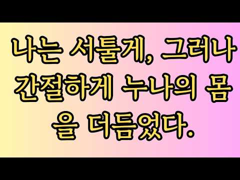
- 설명 앞부분: 누구에게나 찾아올 수 있는 사랑과 이별, 두 번째 인연, 가족과 인간관계의 깊은 이야기를 오디오북처럼 담담하면서도 드라마틱하게 전해드립니다. 그리고 소중한 사연 제보는 다음 이야기를 이어가는 큰 힘이 됩니다. ※본 영상은 시청자 사연을 바탕으로 인공지능(AI)의 도움을 받아 각색한 창작 콘텐츠입니다. 등장하는 인물, 지명 등은 모두 허구이며 실제와 무관함을 알려드립니다.
- 같은 채널 평소 대비 ×3.8 (채널 최근 롱폼 중앙값 4,533회) · 평소 영상: 아내보다 잘해주는50대 이혼녀와 하루 5번씩 (4,533회) / 무식하게 커서 45까지 숫총각인 알바생 위로해준 편의점 점장님ㅣ노후사연ㅣ황혼연애ㅣ시니어사… (4,691회)
- 대본 없음 (설명) — 음성인식이 끝나면 도입부·흐름이 들어감
- 댓글 1/1: 좋은 점 — 영상 0 · 감사·응원 0 · 더 알고 싶은 것 0 · 아쉬운 점 — 영상 0 · 반박·불만 — 의견 다름 0 · 정치·사회 0 · 경험 공유 0 · 구독·다음 기대 0

### 36. 저축만으로 3억! 이렇게 아꼈습니다.

- https://www.youtube.com/watch?v=9R7zyJcCrig · 베스타 vesta · 구독자 823 · 조회수 101,393 (×123.2, 하루 3,797.3) · 좋아요 815 (0.8%) · 10.9분 · 2026-10-01 · 주제 묶음 2. 돈 모으기·저축 · 형식 브이로그·직접 해본 이야기 · 폴더 `W_9R7zyJcCrig` (웹 승인)
- 썸네일: 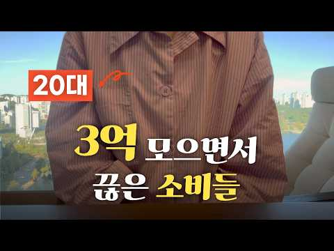
- 설명 앞부분: 투자 없이 저축만으로 달성한 3억⭐ 제게 짠테크는 선택이 아닌 필수였습니다. ⏰ 목차
- 같은 채널 평소 대비 ×25.1 (채널 최근 롱폼 중앙값 4,041회) · 평소 영상: 직장인 부업 시간 없다고? 돈 되는 짠테크 가져왔다 (딸깍) (6,302회) / 인생이 꼬여가는 시작점 (1,780회)
- 대본 없음 (설명) — 음성인식이 끝나면 도입부·흐름이 들어감
- 댓글 60/65: 좋은 점 — 영상 0 · 감사·응원 3 · 더 알고 싶은 것 0 · 아쉬운 점 — 영상 0 · 반박·불만 — 의견 다름 0 · 정치·사회 1 · 경험 공유 5 · 구독·다음 기대 1
  - 감사·응원 👍3 “정말 똑소리 나는 젊은이네요~ 영상 보는 내내 "맞죠~ 맞죠~"하며 미소지으며 봤어요~^^ 앞으로 월급은 점점 오를 거고 이 마인드로 계속 생활하시면 큰 모험없이도 평생 돈 걱정 안 하고 사실 거에요~ 응원해요~^^”
  - 감사·응원 👍1 “젊은 나이에 멋지십나다. 아주 좋은 생각을 갖고 사시고 계시네요. 금융재테크를 잘하셨는데 나마지 30대이후에는 사람관련 리스크 관리가 필요해 보입니다. 자기 혼자 아무리 잘해도 특히 배우자가 개판이면 순식간에 막장갑니다. 즐거운 하루되세요. 화이팅., (개인적인 의견…”
  - 정치·사회 👍0 “너무 재밌게 봤어요 저랑 비슷한 마인드라 남편과 웃으며 봤어요 저도 박지성도 됐다가 김연아도 됐다가 그래요 물론 잡스도 되구요 이미 하고 계시겠지만 1.양말은 무조건 똑같은 색으로 2. 일주일에 2~3회 삶의 재미를 위해 이벤트 참여 (무지출 챌린지 이벤트) 3. 양…”
  - 경험 공유 👍2 “나랑 비슷하네요 저도 저축으로만 5억 5천 벌음요 4인 가족”
  - 경험 공유 👍2 “대단하네요ㅋㅋ 이런여자 어디없냐 나도 땅바닦에 발바닥이 닿아야 그제서야 수선해서 또 신음 전 옷을 아예 안사요 신용카드 월 5만원 나옴”
  - 구독·다음 기대 👍1 “대단하시네요! 바로 구독눌렀습니다”

### 37. 부자들이 먼저 배운 돈의 원리, "열심히 벌어도 왜 안 모일까" 자본주의에 대해 알게되면 부자는 불가능한 일이 아니라 선택의 영역이 되실겁니다.

- https://www.youtube.com/watch?v=RGKX32DwzMI · 경제집현전 · 구독자 700 · 조회수 171,209 (×244.6, 하루 3,201.8) · 좋아요 1,160 (0.7%) · 24.2분 · 2026-08-30 · 주제 묶음 1. 재테크 일반·마인드 · 형식 정보·해설 (그 밖) · 폴더 `W_RGKX32DwzMI` (웹 승인)
- 썸네일: 
- 설명 앞부분: 한국은행이 실제로 찍어낸 돈은 309조 원입니다. 그런데 시중에 도는 돈은 4213조 원입니다. 나머지 92.7퍼센트는 종이가 아니라 은행 장부 위에 적힌 숫자, 그러니까 누군가의 빚입니다. 돈이 어떻게 태어나고 왜 매년 늙는지를 따라가면, 부자가 되는 일이 재능이 아니라 순서의 문제로 바뀝니다. 이 영상에서 다루는 내용 금융자산 10억 원 이상 부자는 47만 6천 명, 인구의 0.93퍼센트. 그런데 이들이 꼽은 자산관리 성공 비결 1위는 종목도 타이밍도 아닌 지속적인 학습이었습니다 부의 원천에서 상속과 증여는 18.3퍼센트. 가…
- 같은 채널 평소 대비 ×172.4 (채널 최근 롱폼 중앙값 993회) · 평소 영상: "영국 해군 배를 거제에서 짓습니다" 강대국들이 배와 발전소와 전차를 맡기기 시작한 진짜… (1,040회) / 대한민국 회사들이 만든 K뷰티 화장품 진짜 대박난 이유 (945회)
- 대본 (음성인식(앞 5분), 4.8 음절/초) — 앞부분만, 흐름은 그 안까지 첫 20초: “열심히 보는데 왜 안 모일까? 한 번쯤 품어보셨을 질문입니다. 그렇다면 이상한 사실이 하나 있습니다. 돈은 지금도 미친 듯이 불어나는 중입니다. 한국은행이 찍어낸 돈은 309조 원인데 시중에 돈은 돈은 4,213조 원입니다. 불어난다는 말은 사실이었습니다.” — 도입부 유형: 질문으로 시작
- 첫 1분: “열심히 보는데 왜 안 모일까? 한 번쯤 품어보셨을 질문입니다. 그렇다면 이상한 사실이 하나 있습니다. 돈은 지금도 미친 듯이 불어나는 중입니다. 한국은행이 찍어낸 돈은 309조 원인데 시중에 돈은 돈은 4,213조 원입니다. 불어난다는 말은 사실이었습니다. 내 통장이 아니었을 뿐입니다. 부자가 부럽다는 생각도 해보셨을 겁니다. 저도 그렇습니다. 그게 욕심일까요? 아닌 것 같습니다. 부자는 욕심이 아니라 선택의 영역이었습니다. 월급이 모자란 게 아니라 순서를 몰랐던 것 뿐입니다. 벼락부자 이야기는 아닙니다. 대신 저 돈이 어디서 태어나는지부터 순서대로 같이 가보겠습니다. 원리가 보이면 경제적 자요도 계산할 수 있는 목적지가 됩니다. 끝까지 보시면 자본주의와 부자가 되는 길이 보이실 겁니다. 구독과 좋아요는 큰”
- 흐름 (90초마다 첫 문장): 0:00 열심히 보는데 왜 안 모일까? → 1:32 내 자리도 설명이 됩니다. → 3:01 그 자리로 내려가 보겠습니다. → 4:31 맡긴 돈이 대출을 낳고
- 댓글 10/10: 좋은 점 — 영상 1 · 감사·응원 2 · 더 알고 싶은 것 0 · 아쉬운 점 — 영상 0 · 반박·불만 — 의견 다름 0 · 정치·사회 0 · 경험 공유 2 · 구독·다음 기대 0
  - 좋은 점 — 영상 👍3 “영상 마지막에 질문하신 '가장 오래된 물건값'에 답해봅니다. 어릴 적 동네에서 붕어빵을 1,000원에 10개씩 사 먹었던 기억이 선명한데, 요즘은 1,000원에 2개, 심지어 1개인 곳도 있더군요. 방금 전까지 그냥 '물가가 많이 올랐네'라고만 생각했는데, 영상을 보…”
  - 감사·응원 👍3 “영상 마지막에 질문하신 '가장 오래된 물건값'에 답해봅니다. 어릴 적 동네에서 붕어빵을 1,000원에 10개씩 사 먹었던 기억이 선명한데, 요즘은 1,000원에 2개, 심지어 1개인 곳도 있더군요. 방금 전까지 그냥 '물가가 많이 올랐네'라고만 생각했는데, 영상을 보…”
  - 감사·응원 👍2 “감사합니당.ㅡ😊”
  - 경험 공유 👍3 “영상 마지막에 질문하신 '가장 오래된 물건값'에 답해봅니다. 어릴 적 동네에서 붕어빵을 1,000원에 10개씩 사 먹었던 기억이 선명한데, 요즘은 1,000원에 2개, 심지어 1개인 곳도 있더군요. 방금 전까지 그냥 '물가가 많이 올랐네'라고만 생각했는데, 영상을 보…”
  - 경험 공유 👍0 “연금저축펀드 타이거 s&p500, isa 코덱스 나스닥100 두가지만 3년차 풀매수했습니다 그리고 올해 3월부터 irp 계좌만들어 코덱스 s&p500 추가했습니다 올해부터 투자금만 큰거1장이ㅜ넘어갔구요 수익률까지 중반조금 넘어섰습니다 이제부터 돈이 돈을 번다는걸 느끼…”

### 38. 50대 부부 현실 밥상,현실 토크∣택배 일∣장사 접고 알게 된 자영업 진짜 현실

- https://www.youtube.com/watch?v=PWYj6zg7clU · 볕든내일 · 구독자 2,420 · 조회수 138,923 (×57.4, 하루 10,663.5) · 좋아요 701 (0.5%) · 14.7분 · 2026-10-15 · 주제 묶음 4. 노후·연금 · 형식 브이로그·직접 해본 이야기 · 폴더 `W_PWYj6zg7clU` (웹 승인)
- 썸네일: 
- 설명 앞부분: 남편과 함께 소박한 밥상을 앞에 두고, 먹고사는 이야기부터 현실적인 고민들을 나누어 보았습니다.남편이 새롭게 시작한 택배 일 이야기부터, 한때 열심히 운영했던 고깃집 이야기까지.70세까지 일해야 하는 현실과 우리 부부의 솔직한 대화입니다. 맛있는 음식을 만들고 좋은 재료를 쓰면 잘될 줄 알았고, 열심히 일하면 그만큼 남을 줄 알았습니다. 하지만 장사는 생각처럼 쉽지 않았고, 열심히 사는 것만으로 모든 것이 해결되는 건 아니었습니다. 지나온 시간을 돌아보며 지금의 현실과 앞으로의 생활에 대해 이야기해 봅니다. 장사하던 시절의 추억과…
- 같은 채널 평소 대비 ×6.5 (채널 최근 롱폼 중앙값 21,238회) · 평소 영상: 50대 경단녀 유튜브에 가게를 차렸더니 벌어진 일 (21,238회) / 50대 브이로그∣경단녀의 도전∣희망은 우연히 오지 않는다 (15,488회)
- 대본 없음 (설명) — 음성인식이 끝나면 도입부·흐름이 들어감
- 댓글 79/138: 좋은 점 — 영상 1 · 감사·응원 2 · 더 알고 싶은 것 0 · 아쉬운 점 — 영상 0 · 반박·불만 — 의견 다름 0 · 정치·사회 0 · 경험 공유 12 · 구독·다음 기대 0
  - 좋은 점 — 영상 👍0 “자영업 너무 힘드네요. 저도 월세 알아보면서 택배일 알아보고 있습니다. 좋은 영상 잘 보고 갑니다. 구독, 좋아요 하고 가요~~”
  - 감사·응원 👍15 “ㅎㅎ 두분 대화하시는거보니 이미 성공하신거예요. 돈이 없지 나머진 다 있으신거같아요. 유튜브도 대박 나길 바래요... 돈있어도 불행한 님들 많아요. 영상 잘 챙겨보고 늘 응원할게요🎉😂😊❤”
  - 경험 공유 👍25 “우와~~댓글 첫번째^^ 남편분이 저희 남편 또래시고 공감가는 이야기네요 두분 서로 말 이쁘께 하시네요 저는 몇년동안 아프고 이제 회복되고 보니 50이 넘어있고 무능력한것 같아서 뭘해야하나 하고 있네요 제가 아프고 힘든 시간에 친구들은 다들 일을 시작했더라구요...남편…”
  - 경험 공유 👍13 “뭔가 딱 우리집 분위기네… 나이대도 비슷하고… 저는 사업이 부도 직전까지 갔다가 다행이 일이 잘 풀려서 이제 좀 살만해졌습니다. 인생은 정말 운칠기삼인것 같아요.. 이 글 보시는 분들에게도 운이 철석철석 붇길 바랍니다.”

### 39. 돈이 더 적은 사람들이 항상 당신보다 더 많은 것을 가지고 있는 이유

- https://www.youtube.com/watch?v=FJq7Cz3CSz8 · 투자 가이드 · 구독자 1,020 · 조회수 201,612 (×197.7, 하루 4,119.0) · 좋아요 1,119 (0.6%) · 31.1분 · 2026-09-09 · 주제 묶음 2. 돈 모으기·저축 · 형식 오디오북·낭독 (명언·인생조언) · 폴더 `W_FJq7Cz3CSz8` (웹 승인)
- 썸네일: 
- 설명 앞부분: "왜 소득이 더 적은 사람들이 결국 더 많은 저축액과 마음의 평화, 그리고 선택의 자유를 누리게 될까요? 이 영상에서는 고소득자가 왜 종종 빈털터리로 남는지, 그리고 재정적 안정과 급여 수준이 사실상 거의 무관한 이유를 밝혀드립니다. 매달 돈이 어디로 사라지는지 알 수 없거나, 자신보다 소득은 적지만 스트레스 없이 살아가는 사람을 알고 계신다면, 이 영상에서 그 숨겨진 이유를 확인해 보세요. 이 영상을 통해 '라이프스타일 크립(소득이 늘어남에 따라 소비 수준도 함께 높아지는 현상)'이 어떻게 소리 없이 부를 갉아먹는지, 소유한 물…
- 같은 채널 평소 대비 ×228.8 (채널 최근 롱폼 중앙값 881회) · 평소 영상: 치열한 경쟁 사회에서 조용히 벗어나는 사람들의 심리 (904회) / 1,400만 원을 모으면 모든 것이 어떻게 달라질까? (806회)
- 대본 (음성인식(앞 5분), 5.2 음절/초) — 앞부분만, 흐름은 그 안까지 첫 20초: “상상해 보십시오. 같은 동네, 같은 도시에 있는 월세도 비슷한 두 채의 아파트가 있습니다. 서울이든 부산이든 대구이든 상관없습니다. 어디에 있느냐는 중요하지 않습니다. 중요한 건 그 안에 무엇이 들어있느냐입니다. 첫 번째 아파트는 한 달에 500만 원을 버는 사람의 집입니다.”
- 첫 1분: “상상해 보십시오. 같은 동네, 같은 도시에 있는 월세도 비슷한 두 채의 아파트가 있습니다. 서울이든 부산이든 대구이든 상관없습니다. 어디에 있느냐는 중요하지 않습니다. 중요한 건 그 안에 무엇이 들어있느냐입니다. 첫 번째 아파트는 한 달에 500만 원을 버는 사람의 집입니다. 현관문을 열고 들어가면 거실의 75인치 텔레비전이 보입니다. 매장 직원이 절대 놓치면 안 된다고 장담했던 최신형 모델이죠. 주말에 드라마를 볼 때만 사용하는 200만 원짜리 전동 리클라이너 소파도 있습니다. 주방에는 에어프라이어, 이탈리아제, 에스프레소 머신, 수입산 푸드 프로세서, 전기밥솥, 그리고 도대체 왜 샀는지 아무도 모르는 초고속 블렌더가 있습니다. 모두 정상 작동하지만 세 번 이상 쓴 물건이 없습니다. 언젠가 찾아올 요리에”
- 흐름 (90초마다 첫 문장): 0:00 상상해 보십시오. 같은 동네, 같은 도시에 있는 월세도 비슷한 두 채의… → 1:35 한 달에 500만 원을 벌지만 객관적으로 봤을 때 이 사람은 파산 상태… → 3:00 오늘 저는 왜 소득이 적은 사람들이 결과적으로 더 많은 비상금, 더 많… → 4:36 즉 여유자금을 만들어냅니다.
- 댓글 15/16: 좋은 점 — 영상 1 · 감사·응원 5 · 더 알고 싶은 것 0 · 아쉬운 점 — 영상 0 · 반박·불만 — 의견 다름 1 · 정치·사회 0 · 경험 공유 1 · 구독·다음 기대 0
  - 좋은 점 — 영상 👍4 “정말로기막히게아주정확한엑기스만100%뽑아서팩트를집어주셨군요!감사합니다!이렇게유익한영상은처음접하는듯합니다.한국인의성인들이월소비하는고정비에서제일건강과재정을박살내고있는것이바로3가지.술과담배와자동차입니다.꼭알아두셔야합니다.”
  - 감사·응원 👍9 “감사합니다........”
  - 감사·응원 👍4 “정말로기막히게아주정확한엑기스만100%뽑아서팩트를집어주셨군요!감사합니다!이렇게유익한영상은처음접하는듯합니다.한국인의성인들이월소비하는고정비에서제일건강과재정을박살내고있는것이바로3가지.술과담배와자동차입니다.꼭알아두셔야합니다.”
  - 반박·불만 — 의견 다름 👍0 “말도 안되는 소리하고 있네 돈 적은 사람은 여유자금 모으기도 더 빡시다 개똥 철학을 가졌누”
  - 경험 공유 👍2 “현명하고 지혜롭네요 대부분 은 저도 그렇게 하고 있지만 한번 더 생각 하게됩니다.”

### 40. [풀영상] 월급 10%로 당장 시작하는 존리의 자산 증식 치트키

- https://www.youtube.com/watch?v=q1fYjAwma3s · 여의돈스트리트 · 구독자 1,380 · 조회수 225,004 (×163.1, 하루 5,562.9) · 좋아요 1,405 (0.6%) · 36분 · 2026-09-17 · 주제 묶음 2. 돈 모으기·저축 · 형식 인터뷰·강연·대담 · 폴더 `W_q1fYjAwma3s` (웹 승인)
- 썸네일: 
- 챕터: 0:00 인트로 · 0:50 ‘존리의 부자학교’, 어떤 곳인가요? · 1:09 우리나라 금융 수준, 정말 높아졌나요? · 2:39 빨리 부자가 되는 투자, 가능한가요? · 4:53 장기 투자, 어떤 ETF를 사야 할까요? · 6:53 평범한 사람은 어떻게 부자가 되나요? · 8:30 주식 투자에 전문가가 없다? · 10:24 레버리지 투자는 왜 위험한가요? · 11:31 한국주식, 지금도 투자할 만한가요? · 12:16 투자 뉴스는 어디까지 봐야 할까요? · 14:44 부동산 비중이 높으면 위험한가요? · 16:45 주식 투자의 진짜 목적은 무엇인가요? · 17:26 좋은 기업은 어떻게 고르나요? · 20:19 장기 투자 중 기업 상황이 나빠진다면? · 21:09 박스권에 갇힌 현재 증시 진단 · 22:23 AI 버블 우려 속 올바른 매수 시기 · 23:30 안전해 보이는 ‘원금 보장’ 상품의 함정 · 25:01 반도체·대형주 쏠림 계좌, 포트폴리오 개선 조언 · 27:15 시황 뉴스·차트·리포트의 올바른 활용법 · 29:35 직장인 월급 대비 적정 투자 비중 및 방법
- 설명 앞부분: 매일 오르내리는 주가, 금리 인상 뉴스... 언제 사고 언제 팔아야 할지 늘 스트레스받고 계시나요? 혹은 원금 손실이 두려워 아직도 투자를 망설이고 계신가요? 이번 풀영상에서는 '존리의 부자학교' 존리 대표님을 모시고 평범한 사람이 스트레스 없이 진짜 부자가 되는 투자의 본질부터 구체적인 실천 방법까지 모두 담았습니다. 단기간에 부자가 되려는 조급함과 마켓 타이밍을 재는 습관을 버리고, 내 자본이 스스로 일하게 만드는 진짜 투자법을 짚어봅니다. 또한, 인플레이션 시대에 돈을 예적금에만 두는 것이 왜 자산 가치를 갉아먹는 가장 위험…
- 같은 채널 평소 대비 ×200.2 (채널 최근 롱폼 중앙값 1,124회) · 평소 영상: 리딩방에서 추천받은 종목이 올랐다면? 이미 당신은 ‘먹잇감’입니다 [선생님 이건 건강한 … (1,124회) / 주식시장 100명중 90명은 무조건 손실 봅니다. 상위 10%만 아는 '진짜' 수익 내는… (1,180회)
- 대본 (음성인식(앞 5분), 6.0 음절/초) — 앞부분만, 흐름은 그 안까지 첫 20초: “좀 빠르게 내가 부자가 되고 싶다. 시간이 지날수록 나는 그 위스크로 줄어들고 시작한 지 지날수록 나는 부관들어나거든요. 또는 일을 안 하고 이불 속에서 안 나오는 거예요. 예금. 지금 만약에 1,000만 원이 20년 후에는 1,000만 원 아니라 한 300만 원으로 줄어들어있는 거예요. 90%의 정보는 필요 없는 정보예요. 정보가 하나도 중요하지 않죠.”
- 첫 1분: “좀 빠르게 내가 부자가 되고 싶다. 시간이 지날수록 나는 그 위스크로 줄어들고 시작한 지 지날수록 나는 부관들어나거든요. 또는 일을 안 하고 이불 속에서 안 나오는 거예요. 예금. 지금 만약에 1,000만 원이 20년 후에는 1,000만 원 아니라 한 300만 원으로 줄어들어있는 거예요. 90%의 정보는 필요 없는 정보예요. 정보가 하나도 중요하지 않죠. 충분해요. 두 개만 갖고도. 두 개만 갖고도 충분하다. 반응하는 많이 해라. 어떻게 젊으신 분들은. 안녕하세요. 여의돈스트리트 이광수입니다. 우리는 도대체 어떻게 투자해야 부자가 될 수 있을까요? 스트레스 받지 않고 투자하려면 또 어떻게 해야 될까요? 다녁컨대 이에 대한 해답을 알고 계시는 분. 어렵게 이 자리에 모셨습니다. 졸리의 부자학교의 졸리 대표님”
- 흐름 (90초마다 첫 문장): 0:00 좀 빠르게 내가 부자가 되고 싶다. → 1:31 실제로 대표님께서 현장에서 보시면 → 3:01 그렇게 해서 좀 빠르게 → 4:30 너무 힘듭니다 대표님.
- 댓글 112/120: 좋은 점 — 영상 3 · 감사·응원 14 · 더 알고 싶은 것 2 · 아쉬운 점 — 영상 0 · 반박·불만 — 의견 다름 4 · 정치·사회 1 · 경험 공유 13 · 구독·다음 기대 0
  - 좋은 점 — 영상 👍4 “이분하고 궁합이 잘맞음 참 좋은말씀”
  - 감사·응원 👍25 “존리 선생님 덕분에 3년전부터 노후준비를, 장기투자를 목표로 삼게 되었습니다. 좋은 투자철학을 가르쳐주셔서 감사합니다❤”
  - 감사·응원 👍19 “존리대표님 덕분에 투자를 시작했습니다 감사드립니다”
  - 더 알고 싶은 것 👍0 “에스엔피 500이 미장인지 국장인지 어떤걸해야하나요?”
  - 반박·불만 — 의견 다름 👍4 “이게 말이 쉽지 2002년 닷컴 버블 경험하고 이제 회복되나 싶었더니 2008년 금융위기 오고 투자 14년 차인데 투입원금보다도 계좌에 쌓인 돈이 없고 그러면 진짜 현타옵니다. 복리의 힘이라는게 말이 쉽지 일정금액 이상이 쌓이지 않으면 기별도 안 오고, 녹아내리는 계…”
  - 반박·불만 — 의견 다름 👍0 “개인적으로 무조건적이고 비판없는 의견을 따르실 필요는 없습니다. 모든 투자는 개인의 책임이니 신중하게 생각해보고 투자하시길 바랍니다. 그렇다고 존 리님이 무조건 좋다 나쁘다 이렇게 생각하는 게아니라 본인에게 맞는 투자를 하시라는 말씀 꼭 드리고 싶습니다. 장기투자라고…”
  - 정치·사회 👍0 “박정희 대통령이 나라의 문맹을 퇴지했는데 존리대표님은 금융문맹을 퇴치하러 열일 하신다”
  - 경험 공유 👍24 “연금저축+isa ETF 5년차 적립중인데 희망이 생겨서 든든합니다😊 더 빨리 깨우쳤어야 했는데 ㅠㅠ”
  - 경험 공유 👍4 “이게 말이 쉽지 2002년 닷컴 버블 경험하고 이제 회복되나 싶었더니 2008년 금융위기 오고 투자 14년 차인데 투입원금보다도 계좌에 쌓인 돈이 없고 그러면 진짜 현타옵니다. 복리의 힘이라는게 말이 쉽지 일정금액 이상이 쌓이지 않으면 기별도 안 오고, 녹아내리는 계…”

