# 재테크 — 성공 사례 분석: 사례별 자세히 #41–#80

`analysis.md` 의 9번 (같은 # 번호). 자동 생성 — `tools/success_analysis.py` v1.3 (2026-10-14 11:29 UTC). ※ 연구·교육용 — 투자 권유가 아님.

### 41. 주 4일 · 창고 알바 여성의 저축이 약 28만 7천 원 → 약 4,393만 원으로 늘었다, 싫어도 부자가 되어버리는 단 하나의 습관

- https://www.youtube.com/watch?v=qKJQ58SOsow · 노후 재테크 · 구독자 2,320 · 조회수 79,707 (×34.4, 하루 780.7) · 좋아요 1,294 (1.6%) · 31분 · 2026-07-04 · 주제 묶음 1. 재테크 일반·마인드 · 형식 정보·해설 (그 밖) · 폴더 `W_qKJQ58SOsow` (웹 승인)
- 썸네일: 
- 설명 앞부분: 쉰여덟 살 김은미 씨, 통장 잔고 2만 8470원으로 월급날마다 눈물 흘리던 그녀의 인생이 단 하나의 습관으로 극적으로 바뀌었습니다. 지출 노트 쓰기 시작한 후 2년 만에 3천만 원 정기예금! 매일 소비를 기록하며 충동구매를 막고, 생활비를 절반으로 줄인 현실적인 돈 모으기 비법을 공개합니다. 국민연금 수령자, 은퇴 준비, 저축 습관으로 인생 역전한 감동 실화. 돈이 부족한 중장년, 50대 60대 필수 시청! 지금 바로 시작하세요. 작은 노트 하나가 여러분의 노후를 바꿉니다.
- 같은 채널 평소 대비 ×179.9 (채널 최근 롱폼 중앙값 443회) · 평소 영상: 90세가 되어도 뇌가 젊은 사람들이 70대부터 꾸준히 실천한 초간단 5가지 습관｜지금 당… (462회) / 60세가 넘었다면 꼭 사용해야 손해 보지 않습니다! 인생이 두 배로 즐거워지는 ‘마법의 … (424회)
- 대본 (음성인식(앞 5분), 3.9 음절/초) — 앞부분만, 흐름은 그 안까지 첫 20초: “너무 잘하네 그날 밤 58살 김은미 씨는 편의점 현금 지극기 앞에 멍하니 서 있었습니다 화면에 표시된 잔액은 28,470원 월급날까지는 아직 3일이나 남았고 월 수입이 180만원이나 되는데도 왜인지 매달 돈이 부족했습니다” — 도입부 유형: 숫자로 시작
- 첫 1분: “너무 잘하네 그날 밤 58살 김은미 씨는 편의점 현금 지극기 앞에 멍하니 서 있었습니다 화면에 표시된 잔액은 28,470원 월급날까지는 아직 3일이나 남았고 월 수입이 180만원이나 되는데도 왜인지 매달 돈이 부족했습니다 냉장고에 있는 건 콩나물과 김칫뿐 통장장고는 딸에게 받은 32만원이 전부였습니다 나 대체 어떻게 되는 거지? 누가 좀 알려줘? 일은 하는데 저축은 할 수가 없어 나름대로 아끼며 산다고 생각하는데도 매달 빠듯한 내 모습이 너무 한심해서 쉿 여덟의 은미 씨는 누구에게도 털어놓지 못한 채 이대로 나이들어 일마저 못하게 되면 어쩌나 하는 불안감에 진룰릴 것만 같았습니다”
- 흐름 (90초마다 첫 문장): 0:00 너무 잘하네 그날 밤 58살 김은미 씨는 편의점 현금 지극기 앞에 멍하… → 1:30 여러분은 월급날 전날 지갑 속을 뒤적이며 진담을 흘려본 적 없으신가요? → 3:02 그러게 그래도 편하잖아 → 4:31 매아리 없는 질문만이 정막한 방안을 맴돌았습니다
- 댓글 79/79: 좋은 점 — 영상 4 · 감사·응원 12 · 더 알고 싶은 것 0 · 아쉬운 점 — 영상 1 · 반박·불만 — 의견 다름 0 · 정치·사회 0 · 경험 공유 12 · 구독·다음 기대 1
  - 좋은 점 — 영상 👍8 “정말 공감합니다. 은퇴 후에는 돈을 버는 것보다 지키는 게 훨씬 중요하다는 걸 뼈저리게 느낍니다. 좋은 영상 감사합니다”
  - 좋은 점 — 영상 👍1 “꼭 필요한때에 좋은 영상 감사합니다”
  - 감사·응원 👍41 “건강이재산 이네요 보여주는 삶은 피곤 하더라고요 정리하고 버리고 체크 하는것 필요 없는것 사지마세요^^꼭♡ 체크 합시다🎉❤🍀👈 감사합니다”
  - 감사·응원 👍29 “저는 2년 넘게 가계부를 쓰고 있지만 나아지는게 하나도 없었어요 오늘부터 다시한번 가겨부를 대해봐야겠어요 감사합니다 ~^^”
  - 아쉬운 점 — 영상 👍3 “자막 편집좀 해서 영상 올리세요 제발 짜증나서 못 보겠어요”
  - 경험 공유 👍22 “아내가 매일 쿠팡 지르고, 마트 지르고, 아울렛 지르고, 다이소 지르고, 넷플렉스 지르고, 딸래미 매일 간식 지르고, 나도 당근마켓 지르고 진짜 가난할수밖에 없다.”
  - 경험 공유 👍15 “저도 오늘부터 실천 해보겠습니다”
  - 구독·다음 기대 👍15 “구독해요❤”

### 42. 복리가 부를 만드는 진짜 시작점｜언제부터 돈이 스스로 일하기 시작할까

- https://www.youtube.com/watch?v=JExUQaROk40 · 돈의 통찰 · 구독자 3,930 · 조회수 131,681 (×33.5, 하루 1,566.0) · 좋아요 1,542 (1.2%) · 17.8분 · 2026-07-22 · 주제 묶음 3. 주식·ETF · 형식 정보·해설 (그 밖) · 폴더 `W_JExUQaROk40` (웹 승인)
- 썸네일: 
- 설명 앞부분: 복리는 단순히 이자를 더해주는 원리가 아닙니다. 대부분의 사람들은 복리의 힘이 나타나기 전에 포기합니다. 이 영상에서는 복리가 언제부터 눈에 보이는 자산 성장으로 이어지는지, 돈이 스스로 일하기 시작하는 진짜 전환점은 언제인지 실제 숫자와 사례를 통해 쉽게 설명합니다. 장기 투자, 경제적 자유, 자산 증식을 목표로 한다면 꼭 끝까지 시청해 보세요.
- 같은 채널 평소 대비 ×9.6 (채널 최근 롱폼 중앙값 13,666회) · 평소 영상: 돈이 있다고 말하는 순간, 거절의 대가가 커집니다｜자산을 공개하면 생기는 일 (13,983회) / 부자처럼 보이는 사람과 진짜 부자의 결정적 차이｜이 신호를 보세요 (13,348회)
- 대본 (음성인식(앞 5분), 5.4 음절/초) — 앞부분만, 흐름은 그 안까지 첫 20초: “이런 장면을 한번 떠올려오세요. 목요일 밤입니다. 침대에 누워 스마트폰을 등체 별 생각 없이 피드를 넘기고 있습니다. 그러다 해외 여행을 떠난 지인의 사진이 보입니다. 당신보다 더 많이 버는 사람도 아니라는 걸 알고 있는 그 사람입니다. 앱을 닫고 2년 전 파케스트를 듣고 진짜 투자를 시작해야겠다고”
- 첫 1분: “이런 장면을 한번 떠올려오세요. 목요일 밤입니다. 침대에 누워 스마트폰을 등체 별 생각 없이 피드를 넘기고 있습니다. 그러다 해외 여행을 떠난 지인의 사진이 보입니다. 당신보다 더 많이 버는 사람도 아니라는 걸 알고 있는 그 사람입니다. 앱을 닫고 2년 전 파케스트를 듣고 진짜 투자를 시작해야겠다고 마음 먹으며 설치했던 투자 앱을 무심코 열어봅니다. 화면에는 약 100만 원 정도의 투자 장고가 보입니다. 속으로 생각합니다. 많은 돈은 아니지만 그렇다고 없는 것도 아니야. 매달 꾸준히 투자하고 소비를 줄이고 불필요한 할부도 피했는데도 어두운 화면속 숫자를 바라보면 이상하게 실망감이 밀려옵니다. 혹시 내가 뭔가를 잘못하고 있는 건 아닐까 다른 사람들은 아는 비밀을 나만 모르는 건 아닐까 장기 투자는 남들에게는”
- 흐름 (90초마다 첫 문장): 0:00 이런 장면을 한번 떠올려오세요. → 1:33 자신의 경험을 신화처럼 전해온 이야기일 뿐이라고 생각한 적도 있었습니다. → 3:00 연 10% 수익률을 기록했다면 → 4:31 누군가는 단타 투자나
- 댓글 103/103: 좋은 점 — 영상 9 · 감사·응원 15 · 더 알고 싶은 것 1 · 아쉬운 점 — 영상 0 · 반박·불만 — 의견 다름 1 · 정치·사회 0 · 경험 공유 12 · 구독·다음 기대 1
  - 좋은 점 — 영상 👍15 “도움되는 영상!구독했어요.기억할께요.복리의 힘.주식시장 떠나지 말고 세월로 돈을 엉덩이로 깔고 않아서 건강만 챙기기.감사합니다.”
  - 좋은 점 — 영상 👍8 “좋은 영상 감사합니다”
  - 감사·응원 👍15 “도움되는 영상!구독했어요.기억할께요.복리의 힘.주식시장 떠나지 말고 세월로 돈을 엉덩이로 깔고 않아서 건강만 챙기기.감사합니다.”
  - 감사·응원 👍8 “좋은 영상 감사합니다”
  - 반박·불만 — 의견 다름 👍7 “늦으면 복리의 마법에 못올라타는게 아니다.. 예를들어 50만원씩 매월 납입을 했다고 가정하면 약 1년 8개월 정도면 1천만원을 달성한다.. 그럼 나는 딱 12개월뒤에 1천만원을 넣었다면? 복리가 답인것 같지만 실제는 원금의 규모다, 개별주로 자금을 불리는 사람도 있다…”
  - 경험 공유 👍96 “제가 4년전 2022년 1~2월달 무렵 그당시 요식업 식당 다니고 있을때 어렵게 모은 종잣돈 8천7백만원이 있었어요...그때 이 돈으로 장사해볼까 정말 고민의 고민을 했어요ㅠ실행 직전까지 갔는데 마지막에 내 자신도 컨트롤 못하는데 내가 요식업 차려서 직원을 잘 컨트롤…”
  - 경험 공유 👍32 “진짜 맞말입니다 이제 고작 3년차 연저펀 에쎈피500 하고있는데요 시간이...와ㅏㅏㅏㅏ 아주 맞는말 😊”
  - 구독·다음 기대 👍15 “도움되는 영상!구독했어요.기억할께요.복리의 힘.주식시장 떠나지 말고 세월로 돈을 엉덩이로 깔고 않아서 건강만 챙기기.감사합니다.”

### 43. 2026년 7월부터 기초연금 이렇게 바뀝니다 — 모르면 매달 33만원 손해

- https://www.youtube.com/watch?v=ddEat5zF-yU · 모두의딸 · 구독자 5,670 · 조회수 184,556 (×32.5, 하루 1,932.7) · 좋아요 4,406 (2.4%) · 11.6분 · 2026-07-10 · 주제 묶음 4. 노후·연금 · 형식 정보·해설 (그 밖) · 폴더 `W_ddEat5zF-yU` (웹 승인)
- 썸네일: 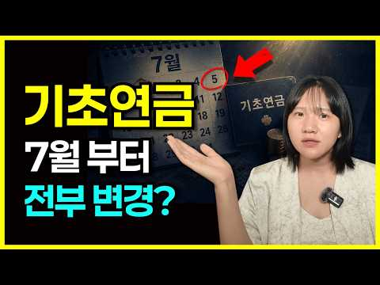
- 설명 앞부분: "2026년 7월부터 기초연금이 확 바뀝니다. 모르면 매달 33만원 손해 보세요." 기초연금 받고 계신가요? 앞으로 받으실 예정인가요? 2026년 7월부터 달라지는 게 딱 3가지 있어요. 이 영상에서 알려드릴 내용: 소득별로 기초연금 차등 지급 — 누구는 더 받고 누구는 그대로 배우자 감액 20%, 2027년부터 점차 사라집니다 일하는 어르신들, 월 519만원까지 벌어도 기초연금 그대로 받아요 2025년으로 소급 적용 — 이미 깎인 분들은 환급! "나는 해당되는가?" 헷갈리시죠? 영상 끝까지 보시면, 내 경우엔 얼마나 받는지, 언…
- 같은 채널 평소 대비 ×71.3 (채널 최근 롱폼 중앙값 2,589회) · 평소 영상: 산책만 하셔도 월 29만원! 2026 노인일자리 최대 90만원 받는 법 (신청방법 총정리) (2,589회) / 하루 2시간 노인일자리 3가지, 월 100만원 받는 시니어일자리 공개 (2,550회)
- 대본 (음성인식(앞 5분), 5.0 음절/초) — 앞부분만, 흐름은 그 안까지 첫 20초: “지금 기초연금 받고 계시다면 오늘 영상 무조건 집중해주세요. 7월부터 기초연금 지급 방식이 완전히 바뀔 수 있습니다. 지금 매달 34만 원씩 받고 계실 텐데요. 앞으로 어떤 분은 20만 원대로 줄여들고 또 어떤 분은 40만 원, 50만 원까지 더 받을 수 있는 방향으로 바뀌고 있거든요.” — 도입부 유형: 경고·단정
- 첫 1분: “지금 기초연금 받고 계시다면 오늘 영상 무조건 집중해주세요. 7월부터 기초연금 지급 방식이 완전히 바뀔 수 있습니다. 지금 매달 34만 원씩 받고 계실 텐데요. 앞으로 어떤 분은 20만 원대로 줄여들고 또 어떤 분은 40만 원, 50만 원까지 더 받을 수 있는 방향으로 바뀌고 있거든요. 솔직히 말씀드리면요, 저는 이런 소식을 전할 때마다 좀 답답합니다. 어머님, 아버님들이 평생 일하시고 세금 다 내셨는데 정작 노후에 받는 돈은 나라 사정에 따라서 이랬다, 저랬다 하잖아요. 그러니까 정확하게라도 알고 있으셔야 손해를 안 보십니다. 거기다 부부가 같이 받으면 20% 깎이던 부부 감액 그리고 이래서 돈 밟으면 국민 연금 깎이던 그 얄미운 제도까지 올해 크게 3가지가 움직이고 있습니다. 내가 어디에 해당되는지 딱”
- 흐름 (90초마다 첫 문장): 0:00 지금 기초연금 받고 계시다면 오늘 영상 무조건 집중해주세요. → 1:30 2배가 아니에요. → 3:03 그러다 보니까 올해 기초 연금 예산만 나라돈 지방 돈 합쳐서 → 4:34 40만 원, 50만 원 수준까지 올려드리고
- 댓글 267/267: 좋은 점 — 영상 7 · 감사·응원 19 · 더 알고 싶은 것 5 · 아쉬운 점 — 영상 1 · 반박·불만 — 의견 다름 8 · 정치·사회 25 · 경험 공유 2 · 구독·다음 기대 1
  - 좋은 점 — 영상 👍51 “모두의딸, 어르신 입장에서 아주 똑부러지게 군더더기 없이 정리를 잘 해주셔서 감사해요. 구독~!^^”
  - 좋은 점 — 영상 👍12 “좋은정보 감사합니다!”
  - 감사·응원 👍51 “모두의딸, 어르신 입장에서 아주 똑부러지게 군더더기 없이 정리를 잘 해주셔서 감사해요. 구독~!^^”
  - 감사·응원 👍12 “좋은정보 감사합니다!”
  - 더 알고 싶은 것 👍13 “국민연금 깍였던 사람 인데 몇년전까지 소급시켜줄까요?”
  - 더 알고 싶은 것 👍7 “공무원 유족연금받고있어요 170만원정도요 그래도 받을수있나요 무주택 재산없어요 알려주세요”
  - 아쉬운 점 — 영상 👍0 “똑 같은 기초연금 얘기 지겹다 낚시질 그만해라”
  - 반박·불만 — 의견 다름 👍12 “우리가모은국민연금인데왜그것과연관해서기초연금을깎는지이해가안가요그건말도안되요”
  - 반박·불만 — 의견 다름 👍5 “진짜 헛소리 7월23일 부터”
  - 정치·사회 👍39 “부부감액 이것도 나라에서 이혼을 부추기는거예요. 나라가 이혼을 부추긴다니까요”
  - 정치·사회 👍32 “차능지급하고70새부터기초연금을주도록해주시요 국회원수절반줄이시요 이러다큰이나요”
  - 경험 공유 👍26 “국개의원 월급 무료 해야 합니다 제가 정신차리세요”
  - 구독·다음 기대 👍1 “구독하고 갑니다~!”

### 44. 금값, 이제 시작입니다. 이것 때문에 금이 폭등합니다.

- https://www.youtube.com/watch?v=1eQJLsk4Fm8 · 지금 돈 공부 · 구독자 737 · 조회수 23,504 (×31.9, 하루 573.8) · 좋아요 394 (1.7%) · 18.8분 · 2026-09-03 · 주제 묶음 기타 · 형식 정보·해설 (그 밖) · 폴더 `W_1eQJLsk4Fm8` (웹 승인)
- 썸네일: 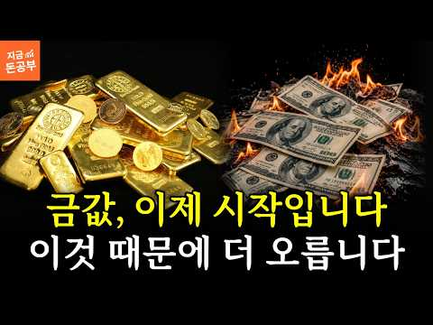
- 챕터: 0:00 끝난 줄 알았던 금, 다시 움직인다 · 0:59 ① 금리가 오르는데 금도 오른다? · 2:15 ② 미국 국채에 무슨 일이 생긴 걸까 · 3:58 ③ 중앙은행들은 왜 금을 사고 있을까 · 6:31 ④ 중국은 왜 이렇게까지 금을 모을까 · 8:48 ⑤ 중국이 걱정하는 건 금값이 아니라 달러 · 10:33 ⑥ 그렇다고 달러가 망한다는 얘기는 아니다 · 11:34 ⑦ 금은 다시 전고점을 뚫을까 · 13:29 ⑧ 금 38,000달러, 가능할까 · 15:02 ⑨ 그래서 개인투자자는 어떻게 해야 할까 · 16:49 마무리 — 가격보다 중요한 것
- 설명 앞부분: 금만 사면 위험합니다. 금은 '흔들림을 막는 한 칸'일 뿐, 나머지 3칸을 채워야 끝까지 버팁니다. 금값이 크게 빠졌다가 다시 반등하고 있습니다. 이번 반등이 잠깐 오르고 마는 희망고문일까요, 아니면 전고점을 뚫는 진짜 상승의 시작일까요? 지금 금 시장에서는 우리가 알던 공식이 깨지고 있습니다. 금리가 오르면 금은 떨어져야 하는데, 국채금리가 오르는데도 금이 같이 오르고요. 세계 중앙은행들은 금을 쓸어 담고 있고, 금에 무관심하던 한국은행마저 13년 만에 다시 금을 사기 시작했습니다. 이 흐름을 하나씩 따라가면 결국 한 곳에서 만…
- 같은 채널 평소 대비 ×56.6 (채널 최근 롱폼 중앙값 415회) · 평소 영상: 주식투자 실패한 99%의 한결같은 공통점 (415회) / 부자들의 삶은 지루하고 단순합니다. 단순하게 살아서 부자가 된 겁니다. (423회)
- 대본 (음성인식(앞 5분), 6.2 음절/초) — 앞부분만, 흐름은 그 안까지 첫 20초: “금값이 크게 빠졌다가 최근에 다시 반등하고 있습니다 이번 반등이 잠깐 올랐다가 다시 꺾이는 희망 고문으로 끝날까요? 아니면 정보점을 뚫고 올라가는 진짜 상승의 시작일까요? 지금 금시장에서는 우리가 알던 공식으로는 설명이 잘 안 되는 일들이 벌어지고 있어요 원래 같으면 금값이 떨어져야 하는 상황인데 오히려 오르고 있고요” — 도입부 유형: 질문으로 시작
- 첫 1분: “금값이 크게 빠졌다가 최근에 다시 반등하고 있습니다 이번 반등이 잠깐 올랐다가 다시 꺾이는 희망 고문으로 끝날까요? 아니면 정보점을 뚫고 올라가는 진짜 상승의 시작일까요? 지금 금시장에서는 우리가 알던 공식으로는 설명이 잘 안 되는 일들이 벌어지고 있어요 원래 같으면 금값이 떨어져야 하는 상황인데 오히려 오르고 있고요 세계 중앙은행들이 금 보위량을 크게 늘리고 있는데 그중에서도 중국의 움직임이 심상치 않습니다 그동안 금에 별로 관심이 없던 우리나라에서도 이제 금을 모아야 하는 거 아니냐 하는 이야기가 나오기 시작했고요 도대체 왜 다들 이렇게 금을 사려고 하는 걸까? 그랬더니 결국 한 곳에서 만나더라고요 바로 미국 국제와 달러입니다 그래서 오늘은 금이 전구점을 다시 넘어갈 수 있을지 지금 중앙은행과 중국이 왜”
- 흐름 (90초마다 첫 문장): 0:00 금값이 크게 빠졌다가 최근에 다시 반등하고 있습니다 → 1:30 반대로 금리가 떨어져서 국제를 사도 이자가 별로 없으면 → 3:00 사실 여기까지 왔다는 것 자체가 심상치 않은 신호예요 → 4:33 미국 국체가 약 22%인데
- 댓글 35/35: 좋은 점 — 영상 0 · 감사·응원 1 · 더 알고 싶은 것 1 · 아쉬운 점 — 영상 1 · 반박·불만 — 의견 다름 1 · 정치·사회 0 · 경험 공유 2 · 구독·다음 기대 0
  - 감사·응원 👍2 “감사합니다”
  - 더 알고 싶은 것 👍2 “언제 팔까요?수익20프로 봤어요. 팔까요?”
  - 반박·불만 — 의견 다름 👍2 “글쎄요!!!!!.... 어제,오늘.....계속 내려가는데...!!!!!!!!!!😢😢😢”
  - 경험 공유 👍1 “에헤! 금값못올라요. 내가90 만원돈당주고 엇그제샀는데요 40 만원에 샀던게 있어서 그중간값 알고. 쬐끔씩. 던져주고받고 계속하는데ㅡ 금 계속 떤어질거예요.”

### 45. 경제적 자유의 진실: 이 원리를 모르면 당신은 80살까지 평생 출근해야 합니다

- https://www.youtube.com/watch?v=2y3YphVxQaA · 김상훈의 재테크 · 구독자 2,930 · 조회수 92,404 (×31.5, 하루 694.9) · 좋아요 1,921 (2.1%) · 28.7분 · 2026-06-03 · 주제 묶음 1. 재테크 일반·마인드 · 형식 정보·해설 (그 밖) · 폴더 `W_2y3YphVxQaA` (웹 승인)
- 썸네일: 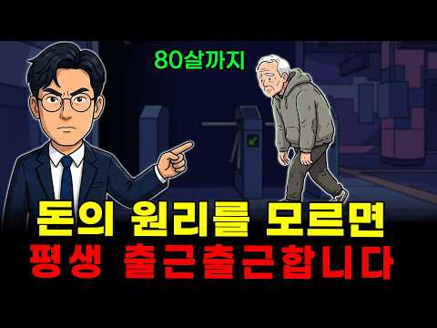
- 챕터: 0:00 오프닝: 성실함이라는 달콤한 최면에서 깨어나는 법 · 1:13 제일부: 빗물 젖은 양복과 일억 원의 빈곤 · 4:19 제이부: 물통을 드는 성실함이라는 저주 · 9:41 제삼부: 차가운 숫자가 말하는 생존의 시계 · 15:53 제사부: 물길을 만드는 설계자의 시선 · 20:40 제오부: 여든 살의 출근길을 지우는 법 · 25:34 마무리: 당신의 시간은 누구의 것입니까
- 설명 앞부분: 이 원리를 모르면 당신은 80살까지 평생 출근해야 합니다 매달 꼬박꼬박 나오는 월급에 안도하며 평생 성실하게 일하면 안정적인 노후준비와 경제적 자유가 보장될 거라 믿으셨나요? 오늘 옆집 김대리는 이 치명적인 자본주의의 착각을 깨부수고, 80살까지 평생 출근하는 노예의 사슬을 끊어낼 단 하나의 절대 원리를 공개합니다. 지금 아래 더 보기를 눌러 매일 반복되는 쳇바퀴에서 탈출하고 당신의 계좌를 진짜 자본가 시스템으로 바꿀 실전 생존 설계도를 확인하세요. 우리는 회사와 사회가 설계한 달콤한 안락함에 속아 내 소중한 인생의 시간을 돈과 …
- 같은 채널 평소 대비 ×140.9 (채널 최근 롱폼 중앙값 656회) · 평소 영상: '이것' 모르면 당신의 귀한 월급은 자본주의의 판돈이 됩니다 - 주식 할때 꼭 알아야 하… (656회) / 부자되는 법: 원화가치가 녹을때 돈을 버는 방법 (679회)
- 대본 (음성인식(앞 5분), 5.1 음절/초) — 앞부분만, 흐름은 그 안까지 첫 20초: “서울의 밤거리는 참 화려합니다. 하지만 그 빛나는 빌딩 숲 사이 퇴근길 지하철에 몸을 맡긴 당신의 어깨는 왜 일이 무겁기만 할까요? 연봉이 1억 원을 넘고 남들이 부러워하는 아파트에 살고 있지만 매달 통장을 스쳐 지나가는 월급은 당신의 불안을 조금 더 잠재워주지 못합니다.”
- 첫 1분: “서울의 밤거리는 참 화려합니다. 하지만 그 빛나는 빌딩 숲 사이 퇴근길 지하철에 몸을 맡긴 당신의 어깨는 왜 일이 무겁기만 할까요? 연봉이 1억 원을 넘고 남들이 부러워하는 아파트에 살고 있지만 매달 통장을 스쳐 지나가는 월급은 당신의 불안을 조금 더 잠재워주지 못합니다. 우리는 지금까지 성실한 만이 정답이라고 배웠습니다. 더 무거운 물통을 더 멀리 나르는 것이 부자가 되는 유일한 길이라고 믿어왔죠. 하지만 이제 냉정하게 계산해봅시다. 당신의 무릎이 꺾이는 순간 그 무거운 물통은 누가 대신 들어줄까요? 여든 살이 되어서도 차가운 지하철 손잡이의 의지에 출근하고 싶지 않다면 이제는 성실함이라는 최면에서 깨어나야 합니다. 물통을 나르는 근육 대신 물이 스스로 흐르는 길을 만드는 지혜가 필요합니다. 안녕하세요?”
- 흐름 (90초마다 첫 문장): 0:00 서울의 밤거리는 참 화려합니다. → 1:31 네 캔을 집어들려다 멈칫하는 자신의 손을 보며 → 3:00 그 물통 밑바닥에는 → 4:30 이 성실함은 때때로
- 댓글 135/135: 좋은 점 — 영상 0 · 감사·응원 5 · 더 알고 싶은 것 0 · 아쉬운 점 — 영상 0 · 반박·불만 — 의견 다름 2 · 정치·사회 8 · 경험 공유 5 · 구독·다음 기대 0
  - 감사·응원 👍27 “주식해서 폭망하라고요? 투자해서 쪽박차라고요? 거지될 확률을 알려주시나요? 직장 다닐때 감사하세요 투자해서 부자되는것이 쉬의면 세상사람절반이 부자됐겠다 허파에 바람만 쳐넣는구나”
  - 감사·응원 👍1 “체면세 그것만이라도 과감히 걷어내야겠어요, 감사합니다.그리고 투자한 돈이 내가 잠자는 동안에도 일을 할 수 있도록 해야합니다.”
  - 정치·사회 👍0 “북한식 유일 사상과 통제 사회를 만들려면, 아이들이 자유롭고 위대한 영적 존재로 자라나는 꼴을 절대 볼 수 없지. 교육을 하향 평준화하여 이재명 북한 세력이 통제하기 쉬운 '생각 없는 노예'로 길러내려 한 교육 거세 공작.”
  - 경험 공유 👍5 “여기서 엄청난 오류가 있어 이 사람이 연봉이 1억인데 대출 원리금이 나간다며 그 말은 자가 집이 있다는 거고 자가 집이 있으면 원리금이 뭐 그닥 아깝지가 않아 원금은 매월 강제저축이고이자내는 거 그거보다 집값 오르는게 훨씬 더 가파르게 오르거든 그러면이 사람이 600…”
  - 경험 공유 👍4 “당장 살기가 힘든거는 대부분 다 비슷합니다. 나라에서 장려하는 절세계좌를 잘 활용하여 매년 꾸준하게 투자금을 눌려가고 공부도 많이 하면서 투자금을 늘려가는것 시간이 흘러 은퇴시점이 다가오면 그동안 늘어난 원금으로 배당 ETF를 분할로 매수하여 월중.월말 배당을 나누어…”

### 46. 독일인은 부자인데 왜 가난하게 살까? ∣ 조용히 부자 되는 돈 습관 10가지

- https://www.youtube.com/watch?v=yfLp54zD9Gk · 돈나침반 · 구독자 2,350 · 조회수 73,180 (×31.1, 하루 794.9) · 좋아요 1,778 (2.4%) · 27.6분 · 2026-07-14 · 주제 묶음 1. 재테크 일반·마인드 · 형식 오디오북·낭독 (명언·인생조언) · 폴더 `W_yfLp54zD9Gk` (웹 승인)
- 썸네일: 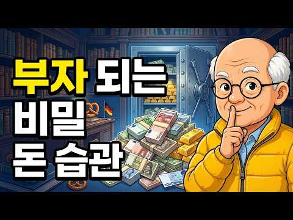
- 설명 앞부분: 세계에서 가장 부유한 나라 중 하나인 독일. 그런데 독일 백만장자는 20년 된 차를 몰고, 대기업 임원은 낡은 자전거로 출근합니다. 명품도, 외제차 경쟁도 없습니다. 왜일까요? 그들은 '부자처럼 보이는 것'과 '진짜 부자가 되는 것'이 완전히 다른 일이라는 걸 문화적으로 아는 사람들이기 때문입니다. 현금 지불, 빚을 죄악처럼 여기는 태도, 평생 쓰는 물건, 그리고 우리가 미덕이라 믿어온 것을 뒤집는 7번째 습관까지 — 조용히, 그러나 확실하게 부를 쌓는 독일인의 돈 습관 10가지를 공개합니다. 여러분이 오늘 시작해 보고 싶은 습관…
- 같은 채널 평소 대비 ×10.2 (채널 최근 롱폼 중앙값 7,194회) · 평소 영상: 70대가 되기 전에 반드시 정리해야 할 10가지 ∣ 늦으면 후회합니다 (7,438회) / 인도 상인들은 왜 대대로 부자일까? ∣ 돈에 휘둘리지 않는 돈 습관 10가지 (6,951회)
- 대본 (음성인식(앞 5분), 4.5 음절/초) — 앞부분만, 흐름은 그 안까지 첫 20초: “세계에서 가장 부유한 나라 중 하나 유럽 경제를 이끄는 나라 그런데 이상한 점이 있습니다 독일인들은 부자 나라에 살면서도 겉으로는 전혀 부자처럼 보이지 않습니다 명품으로 치장한 사람도 드물고 최신형 외제차 경쟁도 없습니다 100만 장자가 20년 된 자동차를 몰고”
- 첫 1분: “세계에서 가장 부유한 나라 중 하나 유럽 경제를 이끄는 나라 그런데 이상한 점이 있습니다 독일인들은 부자 나라에 살면서도 겉으로는 전혀 부자처럼 보이지 않습니다 명품으로 치장한 사람도 드물고 최신형 외제차 경쟁도 없습니다 100만 장자가 20년 된 자동차를 몰고 대기업 임원이 낡은 자전거로 출근합니다 처음 독일에 간 한국인들이 하나같이 놀라는 장면입니다 이 부자 나라 사람들이 왜 이렇게 안 꾸미지? 하고 말이죠 상점에서는 현금을 세는 사람들이 줄을 서 있고 카페에서는 물 한 잔을 시켜놓고 몇 시간씩 이야기합니다 화려함이라고는 찾아볼 수 없습니다 그런데 바로 그것이 비밀입니다 독일인들은 부자처럼 보이는 것과 부자가 되는 것이 완전히 다른 일이라는 걸 문화적으로 알고 있는 사람들입니다”
- 흐름 (90초마다 첫 문장): 0:00 세계에서 가장 부유한 나라 중 하나 → 1:30 그 소득을 대하는 태도인지도 모릅니다 → 3:02 그리고 이 고통이 → 4:31 독일어로 빚을 뜻하는 단어
- 댓글 109/109: 좋은 점 — 영상 6 · 감사·응원 9 · 더 알고 싶은 것 1 · 아쉬운 점 — 영상 0 · 반박·불만 — 의견 다름 1 · 정치·사회 1 · 경험 공유 8 · 구독·다음 기대 1
  - 좋은 점 — 영상 👍5 “현금으로쓰려고 합니다 유익한말씀 감사합니다~~^^”
  - 좋은 점 — 영상 👍3 “진작 들었드라면 지금 훨씬. 부자가 됬을텐데 너무 좋은 말씀 자식 손주들에게 꼭 듣게 하겠읍니다 고맙습니다”
  - 감사·응원 👍5 “현금으로쓰려고 합니다 유익한말씀 감사합니다~~^^”
  - 감사·응원 👍3 “진작 들었드라면 지금 훨씬. 부자가 됬을텐데 너무 좋은 말씀 자식 손주들에게 꼭 듣게 하겠읍니다 고맙습니다”
  - 반박·불만 — 의견 다름 👍3 “월 소득 300인 사림과 500인 사람 중 누가 부자가 될까요? 99%는 500인 사람이라 말할겁니다 아닙니다 부자 될 확율은 500인 사람이 높습니다 하지만 지출을 어찌 하느냐에 따라 달라집니다 예를 들어 300인 사람이 자가용이 없고 500인 사람이 제네시스 정도…”
  - 정치·사회 👍1 “우리나라는 열심히 일해서 돈을 모을수 있는나라가 못됩니다 소득이 높은데 돈을 안쓰면 세금으로 다 빼앗아갑니다 그래서 안쓰고싶어도 써야합니다 정말 짜증납니다”
  - 경험 공유 👍76 “현금을쓰면.확실히.지출이.감소합니다 빚으로.집사는것이.싫어서 퇴사하여.퇴직금받아서.집샀습니다.그리고직장을 옮겼습니다 자동차는.18년째 타고있구요 스마트폰은.9년8개월사용 시계는.35년착용하고.케스갈이 5만원으로.새것 만들어서.계속차고있습니다 저축은.소득의 30%지속적…”
  - 경험 공유 👍33 “저도 40년직장은퇴한 60대입니다. 40년전 첫직장부터 급여75% 저축했으며 결혼후에도 50% 저축하고 아파트 사고 난후 차량도 현금으로 구입했고 35세부터 60만원씩 개인연금저축으로 은퇴후 빚없이 연금으로 독서나 하면서 놀고 하고 싶은것 하고 삽니다”
  - 구독·다음 기대 👍1 “감사합니다 차분한 음색이 듣기 편했습니나 많이 배우고 구독합니다”

### 47. "연금 저축부터 채워라?" 연봉 따라 순서 뒤집히는 ISA·연금저축·IRP

- https://www.youtube.com/watch?v=m-ZkLW7xMvk · 머니랩 : 내 돈 지키는 투자법 · 구독자 380 · 조회수 11,446 (×30.1, 하루 132.9) · 좋아요 234 (2.0%) · 14.2분 · 2026-07-20 · 주제 묶음 4. 노후·연금 · 형식 정보·해설 (그 밖) · 폴더 `W_m-ZkLW7xMvk` (웹 승인)
- 썸네일: 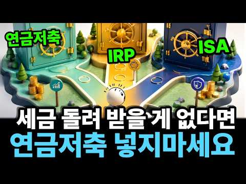
- 챕터: 0:00 다들 "연금저축부터"라는데, 진짜일까? · 0:42 이 순서, 누군가에겐 최악의 선택일 수도 있다 · 2:22 ISA·연금저축·IRP, 시소 하나로 정리 끝 · 6:10 진짜 기준은 '결정세액'입니다 · 9:45 내 결정세액 확인하고 실전 배분하기 · 12:39 결론: 순서는 사람마다 다릅니다
- 설명 앞부분: "연금저축부터 채우세요" — 저도 이렇게 추천합니다. 하지만? 이 순서가 어떤 분에게는 세금 한 푼 못 돌려받고 돈만 묶이는 선택이 될 수 있습니다. 내 연봉과 결정세액에 따라 채우는 순서가 왜 완전히 뒤집히는지 계산으로 보여드립니다. 이 영상에서 다루는 내용 "연금저축부터 채우세요" 공식, 정말 모두에게 맞는 정답일까 ISA·연금저축·IRP, 세금 혜택과 인출 자유의 '시소' 관계로 한 번에 정리 연금저축 세액공제율 16.5%/13.2%, 600만원 채우면 약 99만원 환급 IRP 합산 900만원까지 공제 확대, 약 148.5만…
- 같은 채널 평소 대비 ×27.4 (채널 최근 롱폼 중앙값 417회) · 평소 영상: 금리 인상 쇼크! 내 지갑에 직통으로 어떤 영향을 미치나 계산해보았습니다. (434회) / "반토막인데 14조가 더 몰렸다" 2030이 삼전닉스 레버리지에 빠진 진짜 이유 (400회)
- 대본 (음성인식(앞 5분), 4.5 음절/초) — 앞부분만, 흐름은 그 안까지 첫 20초: “연금저축부터 채우세요. 재택 끝 카페마다 이렇게 될 말하죠? 그런데 이 순서 어떤 분들한테는 세금 한 푼 못 돌려 갖고 돈만 묻기는 최악의 선택입니다. ISA 연금저축 IRP 요즘 절세계좌 3종 세트라고 다들 하나씩 만드시는데요. 뭐가 너무 많아서 무엇을 먼저 시작해야 하는지 고민입니다.”
- 첫 1분: “연금저축부터 채우세요. 재택 끝 카페마다 이렇게 될 말하죠? 그런데 이 순서 어떤 분들한테는 세금 한 푼 못 돌려 갖고 돈만 묻기는 최악의 선택입니다. ISA 연금저축 IRP 요즘 절세계좌 3종 세트라고 다들 하나씩 만드시는데요. 뭐가 너무 많아서 무엇을 먼저 시작해야 하는지 고민입니다. 그런데 이 정답이 놀랍게도 사람마다 다릅니다. 내 연봉과 연말정산 결과에 따라 순서가 완전히 뒤집히거든요. 오늘은 남들 순서 그대로 따라하기 전에 딱 하나만 확인하면 되는 그 기준을 저랑 같이 계산해 보겠습니다. 한 지인이 묻더라고요. 설명을 알기 어려우니 그냥 따라할 공식을 알려달라. 당장 정답을 달라는 거라면 일단 쉽게 이렇게 답했습니다. 어려워? 그러면 일단 연금저축의 월 50만 원을 먼저 채워. 그 다음은 IRP의”
- 흐름 (90초마다 첫 문장): 0:00 연금저축부터 채우세요. → 1:31 다들 입을 모아 연금저축부터 라고 하는데 → 3:00 먼저 연금저축입니다. → 4:32 시소에서 세금 혜택은 가장 크지만
- 댓글 17/17: 좋은 점 — 영상 2 · 감사·응원 2 · 더 알고 싶은 것 0 · 아쉬운 점 — 영상 0 · 반박·불만 — 의견 다름 0 · 정치·사회 0 · 경험 공유 0 · 구독·다음 기대 0
  - 좋은 점 — 영상 👍8 “연말정산 세액공제 받을일없는 가정주부지만 노후대비로 연금저축계좌에 매달 자동매수로 미국 s&p500etf를 적립하고 있습니다. 좋은 영상 감사합니다.”
  - 좋은 점 — 영상 👍2 “제일 알고 싶었던 내용을 꼭 찝어 알려주셨네요. 좋은 정보 감사합니다.”
  - 감사·응원 👍8 “연말정산 세액공제 받을일없는 가정주부지만 노후대비로 연금저축계좌에 매달 자동매수로 미국 s&p500etf를 적립하고 있습니다. 좋은 영상 감사합니다.”
  - 감사·응원 👍2 “제일 알고 싶었던 내용을 꼭 찝어 알려주셨네요. 좋은 정보 감사합니다.”

### 48. 한겨울 저수지 뚝방에 버려진 치매 엄마, 아들 차가 떠나자마자 보따리에서 꺼낸 이것은..ㅣ노후사연ㅣ감동사연ㅣ사연라디오ㅣ오디오북

- https://www.youtube.com/watch?v=Pnrbrya6urQ · 햇살 머문 인생 · 구독자 30,500 · 조회수 886,017 (×29.1, 하루 12,786.2) · 좋아요 19,185 (2.2%) · 137.6분 · 2026-08-06 · 주제 묶음 4. 노후·연금 · 형식 사연·드라마 · 폴더 `W_Pnrbrya6urQ` (웹 승인)
- 썸네일: 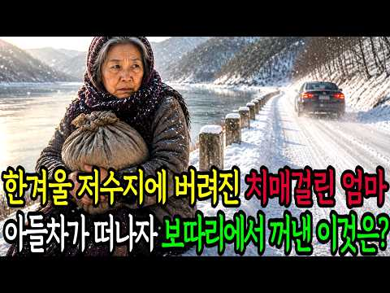
- 설명 앞부분: 본 영상은 창작자가 직접 기획·대본·연출한 100% 순수 창작 드라마(픽션)입니다. (영상 속 이미지와 음성은 일부 AI 기술 활용하여 생성) 이번 인생사연은 한겨울 저수지 둑방에 홀로 버려진 68세 치매 어머니의 이야기입니다. 효자로 소문난 큰아들이 어머니를 놓고 떠나자마자 멍하게 풀려 있던 어머니의 눈빛이 또렷하게 변하기 시작했습니다. 그런데 이 모든 비극의 시작은 석 달 전 아들이 병원에서 몰래 꺼내 든 인감도장에서 비롯되었습니다. 과연 어머니는 정말 치매였을까요? 도대체 그 효자 아들은 무슨 짓을 저지른 걸까요? ☀ 햇살머…
- 같은 채널 평소 대비 ×25.9 (채널 최근 롱폼 중앙값 34,215회) · 평소 영상: 폐지 줍는 할머니의 7살 손녀가 재벌여회장의 반지를 보고 "어? 할머니도 이거 있어요!"… (34,215회) / 이혼 후 3년, 아이 업고 시골 장터에서 백반 배달하는 전처가 재벌남편을 못 알아보고 건… (36,235회)
- 대본 (음성인식(앞 5분), 4.3 음절/초) — 앞부분만, 흐름은 그 안까지 첫 20초: “엄마, 여기 공기 좋으니까 잠깐만 앉아 계세요. 차에서 따뜻한 거 가져올게요. 그 한마디를 끝으로 아들은 어머니를 버리고 가버렸습니다. 한겨울 영하 10도 낭간도 없는 저수지 두 방 위에 혼자서 움직이지도 못하는 치매 걸린 어머니를 두고 말이죠.”
- 첫 1분: “엄마, 여기 공기 좋으니까 잠깐만 앉아 계세요. 차에서 따뜻한 거 가져올게요. 그 한마디를 끝으로 아들은 어머니를 버리고 가버렸습니다. 한겨울 영하 10도 낭간도 없는 저수지 두 방 위에 혼자서 움직이지도 못하는 치매 걸린 어머니를 두고 말이죠. 그런데 아들의 차가 사라지자마자 멍하게 풀렸던 어머니의 눈빛이 또렷하게 변하기 시작했습니다. 그리고 보탈이 안에서 꺼낸 꽁꽁 감춰두었던 전화기를 꺼내자 모든 것을 뒤집어 놓았습니다. 찾아주신 여러분 정말 감사합니다. 오늘도 좋은 하루 되시고요. 구독과 좋아요 한 번씩 눌러주세요. 감사합니다. 어디에서 듣고 계신지도 댓글로 알려주시면 행운 가득한 하루를 실어 보내드리겠습니다. 한겨울 해가 지기도 전에 기온이 뚝 떨어지던 날이었습니다.”
- 흐름 (90초마다 첫 문장): 0:00 엄마, 여기 공기 좋으니까 잠깐만 앉아 계세요. → 1:32 내린 사람은 40 초반의 남자 강준혁이었습니다. → 3:00 잠깐만 앉아 계세요. → 4:31 남은 것은 뚝방 벤치 위에
- 댓글 1,406/1,406: 좋은 점 — 영상 4 · 감사·응원 44 · 더 알고 싶은 것 5 · 아쉬운 점 — 영상 10 · 반박·불만 — 의견 다름 10 · 정치·사회 7 · 경험 공유 18 · 구독·다음 기대 1
  - 좋은 점 — 영상 👍8 “처음에는 제목만 보고 흔한 가족 갈등 이야기인가 했는데, 보다 보니 생각보다 훨씬 몰입감이 있네요. 한겨울 저수지 둑방에 어머니를 혼자 두고 떠나는 장면에서는 정말 마음이 먹먹했습니다. 아무리 사정이 있다고 해도 부모를 저렇게 두고 갈 수 있을까 싶어서 화도 나고, …”
  - 좋은 점 — 영상 👍6 “안양에서보고있습니다 좋은내용기대합니다”
  - 감사·응원 👍106 “나뿐 아들놈ᆢ천벌을 받으려고 발악을 하는구만~어머니 힘내세요.~❤”
  - 감사·응원 👍76 “변호사님경찰님.구급대원님고맞읍니다.감사합니다.😮😮😮😮😮😮”
  - 더 알고 싶은 것 👍55 “참 기가 막힙니다 어떻게자식이... 그래도 딸만은 효녀네요 감옥에서 깨달을수있을까요? 분당에서 듣습니다 감사합니다”
  - 더 알고 싶은 것 👍1 “정말 긍금하네 왜 니들은 어디서 듣고있는지 알고싶은데? 기분 더러워 공연히 왕짜증”
  - 아쉬운 점 — 영상 👍6 “슬프다. 자식으로부터 버림받은 엄마. 노년의 삶은 돈이 있어도 고달프고 힘들다. 어떻게 키워온 자식일진데 엄마를... 같은 길을 갈게 뻔한데...”
  - 아쉬운 점 — 영상 👍1 “너무. 지루해서. 듣다가. 나갑니다. 너무. 사설이. 길어요. 누가 끝까지. 들을까요???”
  - 반박·불만 — 의견 다름 👍6 “실화입니까말도안돼.저런아들도잇나요.천벌받을놈😢”
  - 반박·불만 — 의견 다름 👍6 “딸이 면회가 안된다는게 이해가 안되네요. 이런 애기는 만들어 내니까 더 세월이 어수선 하지 왜 없는 애기 만들어서 아들과 며느리 나쁜 사람 만드나 말도 안되는 소리”
  - 정치·사회 👍2 “이런 드라마는 이재명 같은 사기꾼놈이 들으면 어떨까?”
  - 정치·사회 👍0 “병원 시스템이 문제야 ! 퇴원후.요양병원으로 가게 만들어놔서! 정부는.잘못 한거다!!! 나랏 돈은 병 원에 혜택을 주고! 이상한 법을.만들어놨다!!! 거의강제던데!...싫다해도..수없이 강요하더만!..요양병원은 치료가 우선이 아니네!! 더..안좋게 만드는곳!!ㅠ ㅠ”
  - 경험 공유 👍46 “자식 믿는 사람 바보, 나는 내가 보살핀다, 병이든거 알게되면, 바로 마지막을 준비하라 !”
  - 경험 공유 👍33 “넘 ~ 슬프네요 낳아 길을때는 목습걸고 최선을다해 길러을텐데 어떻게 자식이 이래 소름돋고 맘이 넘 ~ 아프아프네요 할머니 아떻게든 건강 되찿아야 합니다 제가 할말이 없네요 인도네시아에서 듣고 있습니다”
  - 구독·다음 기대 👍6 “안양에서보고있습니다 좋은내용기대합니다”

### 49. "저축은 의미 없어집니다" 머스크의 미래 예측이 하나씩 현실이 되는 진짜 이유

- https://www.youtube.com/watch?v=o9wqKcVOwPI · 경제우체부 · 구독자 9,570 · 조회수 277,072 (×28.9, 하루 2,632.3) · 좋아요 3,424 (1.2%) · 23.2분 · 2026-07-01 · 주제 묶음 2. 돈 모으기·저축 · 형식 정보·해설 (그 밖) · 폴더 `W_o9wqKcVOwPI` (웹 승인)
- 썸네일: 
- 설명 앞부분: 평생 아껴가며 노후 자금 모으고 계시죠? 자식만큼은 의사나 전문직 시키려 뒷바라지하시고요. 그런데 머스크는, 그렇게 모은 저축도 그 자식의 길도 곧 의미가 없어진다고 말합니다. 허풍 같으시죠? 그런데 전기차도 로켓 재활용도 다 해낸 그 사람이, 지난 5년간 던진 예측 가운데 상당수가 이미 현실이 됐습니다. 남은 예측에는 지금 전 세계 큰손들의 돈이 몰리고 있고요. 이 영상에서는 어떤 직업이 가장 먼저 흔들리는지(놀랍게도 단순직이 아닙니다), 그 일을 대신할 로봇은 어디까지 왔는지, 우리가 평생 믿어온 저축과 돈의 의미가 어떻게 바…
- 같은 채널 평소 대비 ×477.7 (채널 최근 롱폼 중앙값 580회) · 평소 영상: 몽골 희토류, 중국 다음가는 자원 부국이 단 한 톨도 마음대로 못 파는 소름 돋는 이유 (580회) / 1인당 67달러였던 나라가 세계에서 유일하게 선진국이 된 과정, 대한민국의 70년 (598회)
- 대본 (음성인식(앞 5분), 5.2 음절/초) — 앞부분만, 흐름은 그 안까지 첫 20초: “노우자금 한 폰이라도 더 모으려고 아껴 쓰고 계시죠? 자식만큼은 의사나 전문직 시키려고 뒷바라지 하고 계시고요 그런데 머스크는 그렇게 모은 저축도 그렇게 닦아준 자식의 길도 곧 다 의미가 없어진다고 말합니다 허풍처럼 들리시죠? 그런데 이 사람 다들 안 될 거라 비였던 일을” — 도입부 유형: 질문으로 시작
- 첫 1분: “노우자금 한 폰이라도 더 모으려고 아껴 쓰고 계시죠? 자식만큼은 의사나 전문직 시키려고 뒷바라지 하고 계시고요 그런데 머스크는 그렇게 모은 저축도 그렇게 닦아준 자식의 길도 곧 다 의미가 없어진다고 말합니다 허풍처럼 들리시죠? 그런데 이 사람 다들 안 될 거라 비였던 일을 한두 번 흐낸 게 아니거든요 비우슴속에 전기차를 도로 위에 올렸고 한 번 쓰고 버리던 로켓을 회수해 다시 쏘아 올린 사람입니다 그 머스크가 지난 몇 년간 내놓은 예측들이 지금 하나 둘 현실이 되고 있고요 아직 이뤄지지 않은 예측들에는 전 세계 부자들이 돈을 쏟아붓고 있습니다 오늘은 그 예측이 왜 여러분의 통장과 자녀의 미래를 정조준하는지 끝까지 함께 짚어보겠습니다 자 여기서 많은 분들이 이런 생각부터 드실 겁니다 이 사람 또 허풍 떠는 거”
- 흐름 (90초마다 첫 문장): 0:00 노우자금 한 폰이라도 더 모으려고 아껴 쓰고 계시죠? → 1:32 그런데 머스크는 그걸 기어히 해냈어요 → 3:02 머스크는 이렇게 말합니다 → 4:31 현실은 그 반대로 가고 있습니다
- 댓글 166/166: 좋은 점 — 영상 3 · 감사·응원 2 · 더 알고 싶은 것 3 · 아쉬운 점 — 영상 2 · 반박·불만 — 의견 다름 1 · 정치·사회 23 · 경험 공유 4 · 구독·다음 기대 1
  - 좋은 점 — 영상 👍37 “맞는 말씀인데 선진국과 개도국 후진국은 어떻게 되나요. 평등할 것 같진 않은데요.”
  - 좋은 점 — 영상 👍5 “좋은내용 감사합니다... 그런데 마음과 관계면에 누구보다 잘 해내는게 ai인데요?? 마음이나 감정이 없다는 건 알지만 사람의 의도를 정확히 알고 이해해주고 위로해주고 어떻한 경우에서도 관계를 해칠 말을 하지 않는게 ai입니다.”
  - 감사·응원 👍5 “좋은내용 감사합니다... 그런데 마음과 관계면에 누구보다 잘 해내는게 ai인데요?? 마음이나 감정이 없다는 건 알지만 사람의 의도를 정확히 알고 이해해주고 위로해주고 어떻한 경우에서도 관계를 해칠 말을 하지 않는게 ai입니다.”
  - 감사·응원 👍0 “감동적인 시간이었습니다 감사합니다”
  - 더 알고 싶은 것 👍37 “아이들 자꾸 낳으라고 하면서 직업은 점점 줄어들고 AI 관련해서 새로운 직업이 창출된다 하더라도 지금까지 해왔던 직업군 보다 더 많아진다는 보장도 없는데 자꾸만 애를 낳으면 그 아이들은 무엇을 하고 살까요?”
  - 더 알고 싶은 것 👍4 “AI가 탑재된 로봇의 발전이 가속화하고 있지만 기후변화도 가속하고 있습 니다. 엊그제 뉴스에 프랑스에서 폭염으로 1000명이 사망했다고 하는데 AI의 발전이 이 문제를 해결할수 있을까요?”
  - 아쉬운 점 — 영상 👍0 “말은 뻔지르르 코인ㆍ주식만들어 짜집기 상장 개미털기 전문가”
  - 아쉬운 점 — 영상 👍0 “머스크 십세기 개소리는 꺼저라 어그로 끌지말고 다른영상만들어라 전기차나 로켓은 인정하지만 코인판이나 주식은 개씹자식임”
  - 반박·불만 — 의견 다름 👍0 “안녕하세요. 머스크의 미래 예측에 관한 영상을 잘 보았습니다. 다만, 영상에서 언급된 일론 머스크의 업적과 관련하여 사실관계가 다소 왜곡된 부분이 있어 바로잡고자 합니다. 첫째, 테슬라는 머스크가 합류하기 전부터 존재하던 회사입니다. 테슬라는 머스크가 CEO로 오기 …”
  - 정치·사회 👍204 “국회의원도 AI로 바꿔야합니다”
  - 정치·사회 👍70 “대한민국 국회의원부터 싹 갈자”
  - 경험 공유 👍3 “내가 예측하는 30년후 부와 가난이 없어진다.ㅡ 사유가 없어지고 공유화 된다.ㅡ 육식이 없고 채식문화가 된다.ㅡ 인간의 영성이 깨어난다ㅡ”
  - 경험 공유 👍0 “나도 교만함버린머스크를 믿는다.”
  - 구독·다음 기대 👍4 “생존을 위해 노동하지 않고 기본소득 보장되어 자기가 하고 싶은 일을 하면서 사는것이 가장 기대됩니다^^ 제발^^”

### 50. "큰 돈 안들이고 평생 즐긴다" 퇴직 후 비참한 노후를 피하는 취미 3가지 I 교수 정선용 (3부)

- https://www.youtube.com/watch?v=IQd8juHSTuw · 퇴평성대 · 구독자 24,300 · 조회수 695,761 (×28.6, 하루 16,145.7) · 좋아요 2,737 (0.4%) · 12.3분 · 2026-09-01 · 주제 묶음 4. 노후·연금 · 형식 인터뷰·강연·대담 · 폴더 `W_IQd8juHSTuw` (웹 승인)
- 썸네일: 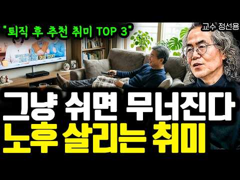
- 설명 앞부분: 🎁 달리고 읽고 쓰는 사람의 하이, 정선용 진솔하게 자신의 경험을 나눠주신 선생님께 감사의 말씀을 드립니다. 선생님의 경험과 지식이 많은 분들에게 도움이 되었으면 좋겠습니다.
- 같은 채널 평소 대비 ×82.5 (채널 최근 롱폼 중앙값 8,434회) · 평소 영상: "결국엔 이곳으로 다 돌아옵니다" 퇴직 후 서울 떠난 50대가 깨달은 노후 주거지의 비밀… (8,863회) / 60세 은퇴자 70%가 겪는 비참한 현실... 65세까지 무조건 일해야 하는 진짜 이유 … (8,004회)
- 대본 (음성인식(앞 5분), 5.9 음절/초) — 앞부분만, 흐름은 그 안까지 첫 20초: “왜냐하면 퇴직 후에 사람을 흔드는 건 돈뿐만이 아니었습니다. 퇴직 후에 가장 무서운 건 오늘과 내일이 똑같아지는 겁니다. 그래서 퇴직 후에 취미는 시간을 때우는 것이라고 생각하시면 안 됩니다. 내 삶을 무너지지 않게 해주는 붙잡아주는 취미가 바로 좋은 취미입니다.”
- 첫 1분: “왜냐하면 퇴직 후에 사람을 흔드는 건 돈뿐만이 아니었습니다. 퇴직 후에 가장 무서운 건 오늘과 내일이 똑같아지는 겁니다. 그래서 퇴직 후에 취미는 시간을 때우는 것이라고 생각하시면 안 됩니다. 내 삶을 무너지지 않게 해주는 붙잡아주는 취미가 바로 좋은 취미입니다. 오늘 퇴직 하실 분이라면 한 번쯤 꼭 고민해 보셨을 주제를 얘기해 보겠습니다. 그래서 퇴직 후에 제가 가장 추천한 취미 3가지입니다. 취미가 관련된 얘기만 많은 분들이 아마 툴 직전에 이렇게 생각합니다. 퇴직하면 시간이 많으니까 뭐든 하겠지. 그동안에 못 해본 것도 배우면 되지. 여다가 쉬면서 천천히 살면 되겠지. 그런데 막 툴 직하고 나서 보니까요. 취미가 생각보다 훨씬 더 중요하다는 것처럼 깨닫게 됐습니다. 왜냐하면 퇴직 후에 사람을 흔드는 건”
- 흐름 (90초마다 첫 문장): 0:00 왜냐하면 퇴직 후에 사람을 흔드는 건 돈뿐만이 아니었습니다. → 1:33 그리고 또 이렇게 심심하면서 또 그런 생각도 한두 가지가 뭐냐면 → 3:00 바깥활동을 하지도 않잖아요. → 4:30 세 번째는 노을을 버티는 가장 현실적인 기반이 되기 때문이기 때문입니다.
- 댓글 192/192: 좋은 점 — 영상 21 · 감사·응원 15 · 더 알고 싶은 것 3 · 아쉬운 점 — 영상 6 · 반박·불만 — 의견 다름 1 · 정치·사회 0 · 경험 공유 13 · 구독·다음 기대 0
  - 좋은 점 — 영상 👍66 “몸을 움직이야 한다는 말씀이 가장 가슴에 와닿네요”
  - 좋은 점 — 영상 👍16 “5년전 퇴직한 56세 남. 저는 매일아침 8시 수영으로 하루를 시작합니다. 수 금요일 테니스치고 골프는 해외로나가 여행겸 치고있습니다. 매일 같은시간에 일어나 배우자와 함께 수영하고 샤워하고 하루를 시작합니다. 하루 운동 루틴이 있다는게 건강이나 멘탈, 또 가벼운 동…”
  - 감사·응원 👍39 “왜 심심하죠!저는60인데 혼자 하루를 보내는데 하루가 너무 잘가요. 새벽에 기도하기. 오전에 수영갔다오기 매일 책 50페이지 이상 읽기. 집안일하기. 화초 키우기. 가끔 친구들 만나기. 공원둘레길 걷기. 숲속길 걸으면서 나의 하루에 감사하기.”
  - 감사·응원 👍16 “고마운 말씀 감사합니다 막막했는데 참고삼아 노력하겠습니다.. 다 된다면 1 2 3 다될수있음 좋겠습니다”
  - 더 알고 싶은 것 👍8 “뭐가 무섭나요? 오히려 평온한 일상이 더 좋던데요~ 단 돈이 있을때~ 친구도 만나서 술도 사고 / 식사도 같이 하고/ 백화점/ 마트/취미생활/ 운동등 할게 정말 많아요~”
  - 더 알고 싶은 것 👍6 “인생 최대의 업적이 결혼 잘 하신것 이니 언제 한번 결혼은 어떻게 해야 되나 로 강의해주세요”
  - 아쉬운 점 — 영상 👍11 “저는 아침저녁 동네공원 산책하면서 근육운동까지하고 5분거리 새로생긴 도서관가서 영자신문과 Time지 그리고 다양한 책을 매일 읽으며 지내는게 즐겁습니다,..퇴직한지 12년됬지만 지루한건 전혀 없습니다...집에서는 아령과 덤벨등 홈트운동을 합니다..이제는 사람속에서 더…”
  - 아쉬운 점 — 영상 👍5 “제 취미는 낚시올시다”
  - 반박·불만 — 의견 다름 👍0 “두번째 취미는 좋은게 아닙니다 개인성향 차이가있겠지만 난 혼자노는게 넘 좋아요 나이들수록 모임은정리하는게 좋습니다 모임은 의견차이 애경사 찿는거 피곤하고 시간 뺏겨요 친한친구2명이면 족해요 집주변에 숲길 공원이 많아 자주걸어요 여행가고 친구와맛집탐방하고 드라마 영화 …”
  - 경험 공유 👍35 “퇴직 후 삶은 본인하기 나름으로 믿고 직장생활에서 못해본거 찾아하고 있어요. 현재 퇴직 8년차로 꿈을 하나하나 이루어 가는 재미로 즐겁게 살고 있습니다. 특히 건강은 필수! 재력은 선택! 건강하면 뭐든 다할 수 있어요 ㅎㅎㅎ”
  - 경험 공유 👍9 “나는 작년에 중소기업 관리자 은퇴하고 자전거동호회에 가입해서 주말1회 씩 단체 라이딩을하는데 내 52세 신장 180, 얼굴이 호남형으로 좀 생겨서 그런지 주말 라이딩 나가면 여자들이 나에게 들이대서 피곤해요. 여자분들도 30대,40대, 50대 초반 다들 가정이 있는 …”

### 51. 삼성 전고체 배터리가 노리는 진짜 목표

- https://www.youtube.com/watch?v=imK95IyKW3Q · 돈공부 · 구독자 4,550 · 조회수 118,841 (×26.1, 하루 755.3) · 좋아요 1,163 (1.0%) · 13.1분 · 2026-05-10 · 주제 묶음 1. 재테크 일반·마인드 · 형식 정보·해설 (그 밖) · 폴더 `W_imK95IyKW3Q` (웹 승인)
- 썸네일: 
- 챕터: 0:00 삼성이 찾아간 곳은 전기차가 아니었다 · 1:00 한국 배터리 3사 위기의 실체 · 4:00 로봇이라는 블루오션 · 7:00 KAIST가 뚫은 새로운 길 · 9:00 삼성 30년 공정의 비밀 · 11:00 내 돈에 무슨 의미인가 · 14:00 정리 — 삼성의 진짜 전략
- 설명 앞부분: 삼성SDI가 전고체 배터리를 들고 가장 먼저 찾아간 곳은 전기차가 아니라 로봇이었습니다. 한국 배터리 3사 점유율이 25.5%로 추락한 지금, 삼성이 왜 가장 작은 시장부터 시작하는지 그 경제 논리를 추적합니다. KAIST의 특허 우회 전략부터 30년 MLCC 제조 노하우, 그리고 이 모든 것이 우리 돈에 어떤 의미인지까지. 타임라인 KAIST 지르코늄 기반 할라이드 전해질 연구 — Nature Communications, 헤럴드경제 2026.01.07 KAIST 산소 앵커링 후속 연구 — Advanced Energy Materi…
- 같은 채널 평소 대비 ×208.1 (채널 최근 롱폼 중앙값 571회) · 평소 영상: "며느라기, 기억나세요?" 명절에 울던 며느리가 아니라 그 부엌이 먼저 사라졌습니다 (571회) / "이따다키마쓰~" 편의점과 돈키호테가 한국인 지갑만 정확히 여는 이유 (568회)
- 대본 (음성인식(앞 5분), 4.5 음절/초) — 앞부분만, 흐름은 그 안까지 첫 20초: “삼성이 전고체 배터리를 들고 가장 먼저 찾아간 곳이 전기차 회사가 아니에요. 로봇공장이었어요. 전고체 배터리 하면 전기차, 다들 그렇게 생각하잖아요. 근데 삼성은 아무도 예상 못한 곳에 먼저 꽂았어요. 여기에는 숫자 3개로 설명되는 아주 영리한 계산이 숨어있어요.”
- 첫 1분: “삼성이 전고체 배터리를 들고 가장 먼저 찾아간 곳이 전기차 회사가 아니에요. 로봇공장이었어요. 전고체 배터리 하면 전기차, 다들 그렇게 생각하잖아요. 근데 삼성은 아무도 예상 못한 곳에 먼저 꽂았어요. 여기에는 숫자 3개로 설명되는 아주 영리한 계산이 숨어있어요. 도매 흐름을 따라가 보면 삼성이 왜 가장 작은 시장부터 시작하는지 그리고 그게 우리 돈의 어떤 의미인지 보이기 시작해요. 올해 1월 글로걸 전기차 배터리 시장 점유율이 발표됐어요. 한국 배터리 3, 4 LG SK 삼성 SDI 수치가 동시에 쏟아졌는데요. 비중국 시장에서 한국 3, 4 합산 점유율이 25.5% 1년 전보다 무려 10.4% 포인트가 빠진 거예요. 개별로 보면 더 심각해요. LG 에너지 솔로션이 전년 대비 16.2% 역성장 SKO는 21”
- 흐름 (90초마다 첫 문장): 0:00 삼성이 전고체 배터리를 들고 가장 먼저 찾아간 곳이 전기차 회사가 아니… → 1:33 쉽게 말하면 배터리를 만드는 재료 10개 중에 → 3:01 다른 걸 본 거예요. → 4:32 30년간 각형만 고집하던 삼성이
- 댓글 95/95: 좋은 점 — 영상 1 · 감사·응원 2 · 더 알고 싶은 것 1 · 아쉬운 점 — 영상 2 · 반박·불만 — 의견 다름 3 · 정치·사회 0 · 경험 공유 0 · 구독·다음 기대 0
  - 좋은 점 — 영상 👍0 “가만히 누워서 보기엔 넘 유익한 정보가 많네요.. 무료로 나눠주셔서 넘 감사하네요. 꼭 부자되세요.. 회사 연구를 정말 많이 하셔서 채널주인이 궁금하네요. 저 진짜 댓글 안다는 사람인데 ...”
  - 감사·응원 👍15 “전고체는 삼성과 LG가 최우선 파이팅!”
  - 감사·응원 👍0 “가만히 누워서 보기엔 넘 유익한 정보가 많네요.. 무료로 나눠주셔서 넘 감사하네요. 꼭 부자되세요.. 회사 연구를 정말 많이 하셔서 채널주인이 궁금하네요. 저 진짜 댓글 안다는 사람인데 ...”
  - 더 알고 싶은 것 👍0 “가만히 누워서 보기엔 넘 유익한 정보가 많네요.. 무료로 나눠주셔서 넘 감사하네요. 꼭 부자되세요.. 회사 연구를 정말 많이 하셔서 채널주인이 궁금하네요. 저 진짜 댓글 안다는 사람인데 ...”
  - 아쉬운 점 — 영상 👍2 “서론이 너무 길어 보다 나갑니다 핵심만 짚어주세”
  - 아쉬운 점 — 영상 👍1 “설명너무길어요 다알고들있을텐데”
  - 반박·불만 — 의견 다름 👍2 “글쎄다”
  - 반박·불만 — 의견 다름 👍0 “헛소리”

### 52. '5천피' 예언적중한 문남중 "코스피 저점? 5040 봅니다, 지금은 아무것도 하지 마세요" #문남중 _260730

- https://www.youtube.com/watch?v=SrwNTk6GT9U · 경제통마늘 · 구독자 11,300 · 조회수 295,016 (×26.1, 하루 3,864.4) · 좋아요 4,518 (1.5%) · 19.6분 · 2026-07-30 · 주제 묶음 3. 주식·ETF · 형식 정보·해설 (그 밖) · 폴더 `W_SrwNTk6GT9U` (웹 승인)
- 썸네일: 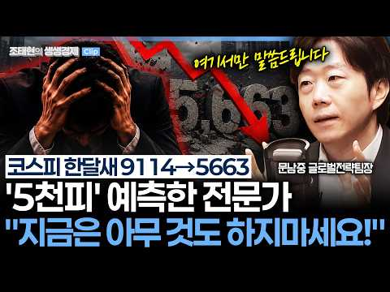
- 설명 앞부분: 여기서 더 떨어진다고? '5천피' 적중한 전문가 "지금 아무 것도 하지마라!" '5천피' 예언적중? 슬픈 예감은 틀린 적이 없어요 지금은 펀더멘털보다는 기술적 분석에 의존해야하는 시기 6월부터 부각된 물가, 금리불안, 이란전쟁 재확전, 美 관세부과로 인한 미 증시 하락 등 살펴야 낙폭 과대하지만, 코스피 '저점' 섣부른 예단 안돼..추가하락 염두해야 코스피 급락, 이번주가 '클라이막스' 증시 반등 시점? 4분기 예상..반도체 주가 급등할 것 펀더멘탈 훼손은 없어...문제는 '가치' 아닌 '이 것' (가격) 코스피 4일연속 음봉, …
- 같은 채널 평소 대비 ×347.1 (채널 최근 롱폼 중앙값 850회) · 평소 영상: "도대체 얼마나 올라야" 마진 87% 마이크론에 꽂힌 의심, 삼전닉스는?_261007 (850회) / [화이트 해커 인터뷰] "과거엔 포기했을 해킹, AI가 생산성 높이면서 '해킹 시도' 증… (426회)
- 대본 (음성인식(앞 5분), 5.4 음절/초) — 앞부분만, 흐름은 그 안까지 첫 20초: “네 요즘 주식 커뮤니티에선 사람들이 얼마나 손실을 받는지 인증 사례가 이어지고 있습니다. 어제 코스피어 코스픽 시장에서 두 거를 연속으로 동반 서킷 브레이커가 발동되는데요. 사상 초유의 일이었죠. 지금 주식시장 기본적인 상신으로는 이해할 수 없는 흐름을 계속해서 보이고 있는데요. 지난주에 저희 방송 이 자리에 출연해서 코스피 5000선까지는 여러 도여 한다고 하셨던 분을 이 자리 다시 모셨습니다.”
- 첫 1분: “네 요즘 주식 커뮤니티에선 사람들이 얼마나 손실을 받는지 인증 사례가 이어지고 있습니다. 어제 코스피어 코스픽 시장에서 두 거를 연속으로 동반 서킷 브레이커가 발동되는데요. 사상 초유의 일이었죠. 지금 주식시장 기본적인 상신으로는 이해할 수 없는 흐름을 계속해서 보이고 있는데요. 지난주에 저희 방송 이 자리에 출연해서 코스피 5000선까지는 여러 도여 한다고 하셨던 분을 이 자리 다시 모셨습니다. 지금 어떤 상황인 건지 앞으로 우리 투자자들은 어떻게 대응해야 할지 같이 이야기를 나눠보겠습니다. 문남 중 대신 증권 글로벌 전략팀장 나오셨습니다. 어서 오세요. 안녕하세요. 네. 요즘에 뭐 검은 화요일 검은 수요일 어디까지 검은 요일들이 이어질지 모르는 날들이 이어지고 있습니다. 어제 장 중에 5262까지 떨어진”
- 흐름 (90초마다 첫 문장): 0:00 네 요즘 주식 커뮤니티에선 사람들이 얼마나 손실을 받는지 인증 사례가 … → 1:32 물가가 올라가게 되면 금리름 불안해지고 또 이험선호심리는 약하되기 때문에 → 3:03 방금 뭐 말씀해 주신 그런 요소들 글로벌 통화 긴축이나 재학전 리스크를… → 4:30 항상 새로운 논리가 부각이 되거든요.
- 댓글 989/989: 좋은 점 — 영상 9 · 감사·응원 33 · 더 알고 싶은 것 8 · 아쉬운 점 — 영상 1 · 반박·불만 — 의견 다름 22 · 정치·사회 122 · 경험 공유 58 · 구독·다음 기대 0
  - 좋은 점 — 영상 👍6 “좋은말씀 감사드려요🎉😂❤”
  - 좋은 점 — 영상 👍2 “저는 2년전 전세놓구 투자를한 1인 입니다. 그래서 문위원님 방송 2년 내도록 잘..경청했구 많은 도움이 됐습니다. 특히 미국주식 5월이 고점이라고.. 5,6월에 걸쳐 정리하고 지금은 맘편히 관망중 입니다. 너무 감사드리고 더위 조심하시고 오래도록 방송해 주세요^^”
  - 감사·응원 👍166 “V자 반등은 바라지도 않아요 야금야금 이라도 오르면 고맙겠습니다”
  - 감사·응원 👍123 “평생 노동판 돌며 노후자금으로 모아둔. 2억. 무슨 욕심이생겨. 8000. 털리고 이제 제정신이들어 몇천 손해감수하고 빠져나갈려니 너무후회스럽고. 내욕심을. 내자신을. 미워합니다. 이글 보신모든분 힘내 건투를바랍니다”
  - 더 알고 싶은 것 👍2 “저는 2년전 전세놓구 투자를한 1인 입니다. 그래서 문위원님 방송 2년 내도록 잘..경청했구 많은 도움이 됐습니다. 특히 미국주식 5월이 고점이라고.. 5,6월에 걸쳐 정리하고 지금은 맘편히 관망중 입니다. 너무 감사드리고 더위 조심하시고 오래도록 방송해 주세요^^”
  - 더 알고 싶은 것 👍2 “이분 롱도 맞추나요? 오르면 조정과 숏만 외치는 상황인가요? 이번에 처음 알게된 전문가라서 궁금하네요”
  - 반박·불만 — 의견 다름 👍756 “이분이 이번에 맞췄다고 해서 다음에 또 맞추는건 아닙니다. 남의 말 듣지말고 자기 주관대로 해야 후회가 남지 않습니다”
  - 반박·불만 — 의견 다름 👍114 “돌이켜보니 이 사람 예측이 제일 정확했다...5000대 초반까지 떨어질 수 있다고 한 유일한 사람임...그 때는 말도 안되는 소리라 생각했는데 정확했음”
  - 정치·사회 👍192 “외국인 주식 놀이터 만들고 개미들 핏눈물 책임질 사람 아무도 없네ㅠㅠㅠ”
  - 정치·사회 👍169 “국민연금 리밸런싱 방치, 외국인 수백조 먹튀기회 제공~~~~~ 특검수사대상이다!!!!!!!”
  - 경험 공유 👍32 “잼데믹 김용범 레버리지 사이드카 서킷 브레이크가 일상이 된 국장 진짜 한번도 경험해 보지 못한 나라 꼬라지”
  - 경험 공유 👍12 “나도 5천피 예상했는데 적중했음…하지만 4천피까지 갈거라 다시 한번 예상함..우리나라 경제 등을 비춰볼때 3~4천피가 적정 수준임..그동안 정부 주도 주가 조작을 잘 보았다..”

### 53. 매일 아침 7시, 내 포트폴리오를 관리해주는 AI 주식 비서를 만들어봤습니다

- https://www.youtube.com/watch?v=ITzgH6CeZns · 스티브의 파도타기 | AI 시대 일하는 법 · 구독자 26,600 · 조회수 680,729 (×25.6, 하루 4,901.9) · 좋아요 16,162 (2.4%) · 14.8분 · 2026-05-28 · 주제 묶음 3. 주식·ETF · 형식 정보·해설 (그 밖) · 폴더 `W_ITzgH6CeZns` (웹 승인)
- 썸네일: 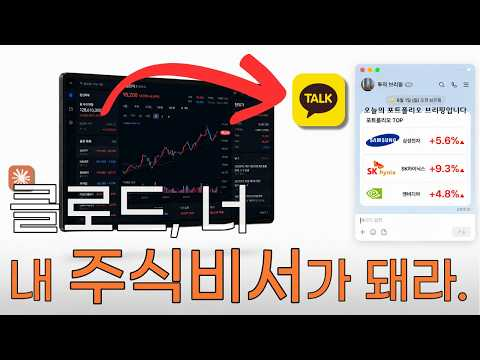
- 챕터: 0:00 Intro · 1:44 시작 전 꼭 알아야 할 것 · 2:37 1단계 - 주식 가격 정확하게 가져오기 · 3:40 2단계 - 관련 뉴스 가져오기 (날짜 문제 해결) · 6:20 3단계 - 브리핑으로 묶기 · 7:54 4단계 - 카카오톡으로 받기 (PlayMCP 연결) · 11:17 5단계 - 매일 아침 7시 자동 실행 (스케줄 등록) · 13:09 다음날 아침, 실제로 작동하는지 확인
- 설명 앞부분: Claude 하나로 매일 아침 7시, 코딩을 모르는 누구나 만들 수 있을만큼 쉽습니다. AI 자동화 콘텐츠가 넘쳐납니다. "주식 자동 매매", "포트폴리오 자동 운영" 같은 것들이요. 저는 개인적으로 추천드리지 않습니다. AI가 주식 판단을 대신할 수 있다면, AI 쓰는 사람들 모두 부자가 됐겠죠. AI는 미래를 알지 못합니다. 반복 노동은 AI에게 넘기고 진짜 중요한 판단은 내가 하는 것. 이게 제가 생각하는 AI 시대의 일하는 방식입니다. 타임라인 ○ 이렇게 AI를 활용하는 법을 직접 배우고 싶다면?
- 같은 채널 평소 대비 ×409.3 (채널 최근 롱폼 중앙값 1,663회) · 평소 영상: 아버지 회사에 AI를 만들어드렸습니다 ep.1 영업비서 (1,663회) / 신입사원이 아닌, AI에게 인수인계합니다 ∣ 업무를 회사에 남기는 법 (1,140회)
- 대본 (음성인식(앞 5분), 6.0 음절/초) — 앞부분만, 흐름은 그 안까지 첫 20초: “오늘 아침 7시 4분에 메시지가 와있습니다 어제 만들었던 대로 제포트폴리오의 가격과 핵심 뉴스를 요약해서 보내줬습니다 이제 매일 아침에 일어나서 어플 들어가서 가격 확인하고 네이버 뉴스나 인베스팅 같은 해외 사이트 들어가서 관련 뉴스들을 다 찾아볼 필요가 없어졌습니다 남한의 비서가 카톡을 열면 다 정리를 해줬거든요 그래서 여기에 드는 에너지와 시간이 압도적으로 줄게 됩니다” — 도입부 유형: 숫자로 시작
- 첫 1분: “오늘 아침 7시 4분에 메시지가 와있습니다 어제 만들었던 대로 제포트폴리오의 가격과 핵심 뉴스를 요약해서 보내줬습니다 이제 매일 아침에 일어나서 어플 들어가서 가격 확인하고 네이버 뉴스나 인베스팅 같은 해외 사이트 들어가서 관련 뉴스들을 다 찾아볼 필요가 없어졌습니다 남한의 비서가 카톡을 열면 다 정리를 해줬거든요 그래서 여기에 드는 에너지와 시간이 압도적으로 줄게 됩니다 주식하는 분들 아침마다 앱 켜서 가격 확인하고 뉴스 찾아보다가 영어 뉴스면 번역기 돌리고 계신가요? 이거 하다 보면 최소 10분은 걸리고 뉴스 찾느라 머리 아프지 않으세요? 혹시 모든 걸 누가 깔끔하게 정리해서 카톡으로 보내줬으면 좋겠다 라는 생각을 해보신 적 있다면 축하드립니다 이 영상을 끝까지 보시면 네포트폴리오의 가격 변동과 관련 뉴”
- 흐름 (90초마다 첫 문장): 0:00 오늘 아침 7시 4분에 메시지가 와있습니다 → 1:30 해외 뉴스를 쓸 수도 있겠죠 → 3:05 여기에 본인의 포트폴리오를 쓰시면 됩니다 → 4:30 그리고 날짜를 확인하면서 지금 확인하고 있는 게
- 댓글 387/388: 좋은 점 — 영상 23 · 감사·응원 34 · 더 알고 싶은 것 38 · 아쉬운 점 — 영상 2 · 반박·불만 — 의견 다름 0 · 정치·사회 1 · 경험 공유 12 · 구독·다음 기대 5
  - 좋은 점 — 영상 👍11 “클로드 코웤.... 대단한 기능이네요. 꼭 주식이 아니더라도 회사 업무 관련 시장 분석에도 활용해봐야겠습니다. 좋은 정보 감사합니다”
  - 좋은 점 — 영상 👍4 “좋은 정보 입니다 정말 감사드립니다”
  - 감사·응원 👍55 “주식 투자를 하는 사람으로서 정말 감사합니다. 혹시 텔레그램에 팔로우하는 채널들에 수많은 주식 정보가 있는데 그걸 요약해서 브리핑하는 것도 가능할까요? 검토 부탁드립니다.”
  - 감사·응원 👍11 “클로드 코웤.... 대단한 기능이네요. 꼭 주식이 아니더라도 회사 업무 관련 시장 분석에도 활용해봐야겠습니다. 좋은 정보 감사합니다”
  - 더 알고 싶은 것 👍55 “주식 투자를 하는 사람으로서 정말 감사합니다. 혹시 텔레그램에 팔로우하는 채널들에 수많은 주식 정보가 있는데 그걸 요약해서 브리핑하는 것도 가능할까요? 검토 부탁드립니다.”
  - 더 알고 싶은 것 👍4 “내용이 너무 좋아서 저도 해보고 싶은데, 컴퓨터가 켜져 있어야 한다는 부분이 가장 아쉬운 지점이네요... 근데 궁금한게 클로드는 기본적으로 서버에서 작동하는 거 아닌가요? 근데 왜 마치 로컬 프로그램인 것처럼 내 컴퓨터가 켜져 있어야 한다고 하는지 모르겠네요... 대…”
  - 아쉬운 점 — 영상 👍0 “실제로 투자에 사용하기에는 과거데이터를 참고 해서 주거나 잘못된 정보를 주기도 하니 잘 걸러 내야 합니다..”
  - 아쉬운 점 — 영상 👍0 “감사합니다. 주어진 자료 바탕으로 제가 이틀정도 더 씨름하면서 제 스타일로 변동하였습니다. 문제가 되었던 부분들과 제가 수정한 방안 모두 감사한 마음으로 정리해봅니다. 1. 먼저 큰 틀에서 이 영상대로 잘 따라하시면 됩니다 . 전 하루에 3번은 받았으면 해서 8시 1…”
  - 경험 공유 👍4 “컴맹인 제가 해냈어요 . 친절한 설명 감사드립니다.”
  - 경험 공유 👍4 “내용이 너무 좋아서 저도 해보고 싶은데, 컴퓨터가 켜져 있어야 한다는 부분이 가장 아쉬운 지점이네요... 근데 궁금한게 클로드는 기본적으로 서버에서 작동하는 거 아닌가요? 근데 왜 마치 로컬 프로그램인 것처럼 내 컴퓨터가 켜져 있어야 한다고 하는지 모르겠네요... 대…”
  - 구독·다음 기대 👍0 “오~구독했습니다~바로 공유하고~좋아요^^ 이런 유요한 꿀팁이 클로드 써보면서 이런정보가 있는지😅”
  - 구독·다음 기대 👍0 “너무 좋은 정보 감사합니다. 구독하고 갑니다.~”

### 54. 금융자산 10억 부자도 아직 공부합니다… 평생 돈이 안 모이는 사람은 ‘이 6가지’를 놓칩니다

- https://www.youtube.com/watch?v=i9Mj9VvL20o · 오십의 경제지도 · 구독자 677 · 조회수 17,188 (×25.4, 하루 835.5) · 좋아요 101 (0.6%) · 16.5분 · 2026-09-23 · 주제 묶음 1. 재테크 일반·마인드 · 형식 정보·해설 (그 밖) · 폴더 `W_i9Mj9VvL20o` (웹 승인)
- 썸네일: 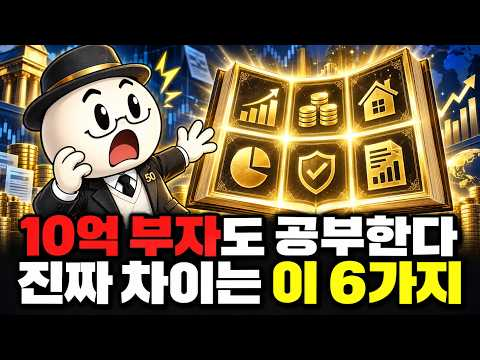
- 설명 앞부분: 금융자산 10억 원 이상 부자들이 왜 계속 금융지식을 공부하는지, 금리·세금·현금흐름·자산배분·시간·투자심리 여섯 가지로 정리합니다. 40대·50대 자산관리와 노후 준비에 필요한 돈 공부의 핵심을 확인해 보세요. 가장 자신 없는 과목도 댓글로 남겨주세요. 여섯 과목 중 지금 가장 자신 없는 것은 무엇인가요? 금리, 세금, 현금흐름, 자산배분, 시간, 나 자신 중 딱 하나만 골라 댓글로 남겨주세요. 가장 많이 나온 과목부터 다음 영상에서 깊게 다뤄보겠습니다.
- 같은 채널 평소 대비 ×0.9 (채널 최근 롱폼 중앙값 18,390회) · 평소 영상: 9억 집 가진 60세, 팔아야 할까? 주택연금 계산했더니 예상 밖의 결과 (22,297회) / 커피·외식 다 끊었는데 통장은 그대로… 50대가 놓친 ‘진짜 돈 구멍’ (14,484회)
- 대본 (음성인식(앞 5분), 4.9 음절/초) — 앞부분만, 흐름은 그 안까지 첫 20초: “통장에 1억원이 있는 사람과 10억원이 있는 사람 이 차이는 정말 누가 더 열심히 살았느냐에서만 갈릴까요? 2025년 한국 부자보고서에 따르면 금융자산 10억원 이상을 가진 사람은 약 47만 6000명으로 추정됩니다 그런데 이 사람들이 미래의 부자에게 전한 자산관리” — 도입부 유형: 질문으로 시작, 숫자로 시작
- 첫 1분: “통장에 1억원이 있는 사람과 10억원이 있는 사람 이 차이는 정말 누가 더 열심히 살았느냐에서만 갈릴까요? 2025년 한국 부자보고서에 따르면 금융자산 10억원 이상을 가진 사람은 약 47만 6000명으로 추정됩니다 그런데 이 사람들이 미래의 부자에게 전한 자산관리 지혜 1순위는 의외였습니다 강남 아파트도 아니었습니다 대박 종목도 아니었습니다 지속적으로 금융 지식을 쌓는 것이었습니다 이미 자산을 상당히 모은 사람들조차 여전히 공부를 1순위로 꼽았다는 사실이 눈에 띕니다 돈을 버는 제주와 돈을 지키는 제주는 서로 다른 근육이라는 뜻이기도 합니다 그렇다면 무엇을 공부해야 할까요? 주식 차트를 매일 봐야 할까요? 오히려 반대입니다 중년 이후 자산을 지키고 노후 현금으름을 만들고 싶다면 6과목이 필요합니다 금리,”
- 흐름 (90초마다 첫 문장): 0:00 통장에 1억원이 있는 사람과 10억원이 있는 사람 → 1:31 2026년 8월 27일 → 3:01 내 대출이자는 내 자산의 할인율은 내 현금의 기회 비용은 어떻게 변할까 → 4:31 IRP를 합하면 연 900만 원까지입니다
- 댓글 1/1: 좋은 점 — 영상 0 · 감사·응원 0 · 더 알고 싶은 것 0 · 아쉬운 점 — 영상 0 · 반박·불만 — 의견 다름 0 · 정치·사회 0 · 경험 공유 0 · 구독·다음 기대 0

### 55. 월배당 ETF 10억 투자하면 정말 배당금 얼마? ∣ 종합소득세·건강보험료 계산법 (은퇴 현금흐름 설계)

- https://www.youtube.com/watch?v=yRDpbgaZahc · 은퇴머니 - 은퇴 현금흐름 설계 · 구독자 30,000 · 조회수 748,689 (×25.0, 하루 5,521.2) · 좋아요 10,244 (1.4%) · 11.4분 · 2026-05-31 · 주제 묶음 6. 절세·제도 · 형식 정보·해설 (그 밖) · 폴더 `W_yRDpbgaZahc` (웹 승인)
- 썸네일: 
- 챕터: 0:00 평생 모은 10억으로 생활비를 만들어야 한다면 · 1:10 10억을 배당 ETF에 넣고 3년, 직접 따라가 봤습… · 2:00 첫 분배금, 그리고 먼저 떼이는 원천세 · 3:11 예상 못 한 종합소득세 · 4:36 매달 빠져나가는 건강보험료 · 6:25 분배금은 36개월, 세금은 58개월 · 7:04 시뮬레이터 + 커버드콜 ETF 3종 비교 · 8:39 결국 종목이 아니라, 본인의 다섯 변수
- 설명 앞부분: 은퇴 후 10억을 월배당 ETF(JEPQ)에 넣으면 매달 얼마가 들어오고, 세금은 언제 얼마가 빠질까. 2023~2025년 3년 치 통장을 한 화면에 펼쳐 직접 확인해 봤습니다. 타임라인 📑 영상 PPT 자료 영상 내용을 정리한 슬라이드를 웹에서 바로 보고, PDF로도 내려받을 수 있습니다. 🧮 직접 계산해 보기 영상의 사례를 내 조건으로 바꿔 계산할 수 있습니다. 📄 전자책 「은퇴 현금흐름 설계법」 💬 여러분의 은퇴 설계에서 가장 고민되는 부분은? (자산 규모 / 세금 / 건강보험) 댓글로 알려 주세요.
- 같은 채널 평소 대비 ×52.5 (채널 최근 롱폼 중앙값 14,254회) · 평소 영상: ETF 포트폴리오, 은퇴 전에 확인해야 할 또 하나의 기준 (14,254회) / 은퇴 포트폴리오가 사람마다 다른 이유 (12,898회)
- 대본 없음 (설명) — 음성인식이 끝나면 도입부·흐름이 들어감
- 댓글 965/965: 좋은 점 — 영상 33 · 감사·응원 53 · 더 알고 싶은 것 33 · 아쉬운 점 — 영상 2 · 반박·불만 — 의견 다름 16 · 정치·사회 33 · 경험 공유 47 · 구독·다음 기대 4
  - 좋은 점 — 영상 👍32 “제가 지금 비슷한 처지에 종소세 건보료 때문에 수많은 고민을 하고있읍니다 좋은자료 감사합니다”
  - 좋은 점 — 영상 👍17 “제가 꼭 알고 싶어했던 부분을 영상을 담아주셨습니다. 많은 도움이 되었습니다!! 감사합니다!”
  - 감사·응원 👍32 “제가 지금 비슷한 처지에 종소세 건보료 때문에 수많은 고민을 하고있읍니다 좋은자료 감사합니다”
  - 감사·응원 👍20 “꼭 필요한 내용이네요. 궁금했는데 정말 감사드려요~ 구독, 좋아요 누르고 갑니다.”
  - 더 알고 싶은 것 👍8 “3년후 제피큐에넣은 10억은 얼마가남았나요?”
  - 더 알고 싶은 것 👍6 “좋은 정보 고맙습니다. 능력자 이시네요~ 저도 은퇴후 제일 고민이 건보료입니다. 인별로 나누고 있고 연금저축 IRP ISA 모두 활용중입니다. 국내지수 커버드콜 비중도 점점 커집니다. 은퇴후 투자법인도 고려중입니다. 앞으로도 좋은 컨텐츠 부탁드립니다. 목소리 좋으시네…”
  - 반박·불만 — 의견 다름 👍817 “개인연금 시대에 종합소득 과세 2000은 말도 안되는 시대에 뒤떨어진 정책입니다 최소 4000은 되어야 함”
  - 정치·사회 👍43 “한국에 사는 한국 국민으로서는 당연한 세금과 의료보험료이고, 외국인보다는 훨씬 낫습니다. 처음 15% 원천 징수는 미국 증시에서 이익을 본거니 미국금융소득에 대한 연방세입니다. 캘리포니아 거주자는 추가로 주 소득세도 꽤 더 냅니다. 미국인의 경우에는 소득의 처분 시점…”
  - 정치·사회 👍42 “이래서 우리나라가 순자산 100만달러이상 보유한 사람들 유출되는게 전세계 4위인거임ㅋㅋ 부자들이 떠나는 나라...”
  - 경험 공유 👍497 “저도 은퇴 후 자산정리하고, 분배금으로 살고 있습니다. 님과는 다르게 ETF반 커버드콜반으로 운영중이고, 현재 커버드콜은 전부 국내만 운영중입니다. 커버드콜 자산은 조금더 많은것 같고, 결론적으로 올해 총 수익은 1.2억정도인데 과세기준소득은 약 1천만원, 올해 말은…”
  - 경험 공유 👍74 “건보료 150만원 내도 좋으니 ㅅㅂ 나도 월 분배금 900들어오면 소원이 없겠다😂😂😂😂😂”
  - 구독·다음 기대 👍32 “이제까지 봤던 은퇴관련 배당 컨텐츠중에서 가장 실용적이고 퀄리티높은 !!!! 구독합니다.”
  - 구독·다음 기대 👍19 “제피큐 모으고 있어서 궁금했던 내용인데 영상 잘 봤습니다 ㅎ 구독하고 갑니다”

### 56. 머스크가 던진 32개 예측 중 부자들이 베팅한 TOP 7 카운트다운 "이미 19개가 맞았습니다"

- https://www.youtube.com/watch?v=EomU4-CfZCw · 경제가머니 · 구독자 22,500 · 조회수 558,543 (×24.8, 하루 3,625.5) · 좋아요 10,625 (1.9%) · 27.2분 · 2026-05-13 · 주제 묶음 1. 재테크 일반·마인드 · 형식 정보·해설 (그 밖) · 폴더 `W_EomU4-CfZCw` (웹 승인)
- 썸네일: 
- 설명 앞부분: 머스크가 5년 동안 던진 미래 예측 32개 중 19개가 이미 현실이 됐습니다. 그럼 남은 13개는요? 부자들이 진짜 돈을 쏟아붓는 일곱 자리, 그리고 카운트다운에 적히지 않은 자리 하나가 더 있습니다. 오픈AI 5,000억 달러, xAI 2,300억 달러, 스페이스X 8,000억 달러. 부자들의 자본이 한 산업으로 빨려 들어가는 그림과, AI 시대의 새 석유·새 전기·새 노동력이 어디로 향하는지, 그리고 그 거대한 베팅 옆에 한국이 어떤 자리에 끼어 있는지 — 친근한 선생님 톤으로 한 번에 정리해드립니다. 노후 적금부터 자녀 진로…
- 같은 채널 평소 대비 ×989.4 (채널 최근 롱폼 중앙값 564회) · 평소 영상: "종목은 맞았는데 계좌는 왜 이래?" 개인이 고른 주식은 102% 올랐는데 12조가 떠난… (568회) / 한국 직장인 절반이 AI를 쓰고도 시간을 못 아끼는 진짜 이유 (561회)
- 대본 없음 (설명) — 음성인식이 끝나면 도입부·흐름이 들어감
- 댓글 484/484: 좋은 점 — 영상 6 · 감사·응원 11 · 더 알고 싶은 것 3 · 아쉬운 점 — 영상 4 · 반박·불만 — 의견 다름 6 · 정치·사회 8 · 경험 공유 7 · 구독·다음 기대 0
  - 좋은 점 — 영상 👍5 “좋은 내용 입니다. 감사 ~”
  - 좋은 점 — 영상 👍3 “서문이 길다고 많이 말씀 하시는데 저갈은 초보가 이해하는데는 도움이 많이 되었습니다 감사합니다❤🎉”
  - 감사·응원 👍48 “농지거래허가제를 폐지하여 도시민의 농업활동을 활성화하고, 농약공장을 폐지하고 미생물 농약공장으로 전환하여 식수와 식품의 안전을 국가가 책임지고, 기뻐하고 감사하며 사랑하는 영성산업으로 세계통일하여 기아,난민,전쟁을 종식하자.”
  - 감사·응원 👍7 “1분넘도록 본론 안돌아가고 이빨만 ㅈㄴ 털길래 지루해서 걍 ai요약 돌렸다 미안하고 고맙다”
  - 더 알고 싶은 것 👍0 “UBI가 대체 어디서 일어나고있죠???”
  - 더 알고 싶은 것 👍0 “AI로봇 종류 알려주세요”
  - 아쉬운 점 — 영상 👍7 “1분넘도록 본론 안돌아가고 이빨만 ㅈㄴ 털길래 지루해서 걍 ai요약 돌렸다 미안하고 고맙다”
  - 아쉬운 점 — 영상 👍0 “스트립트도 AI 작성, 나레이선도 AI음성. 어색하면 AI라는 것이 허들이요.”
  - 반박·불만 — 의견 다름 👍13 “와 상온상압초전도체 발견하면 진짜 어마무시할듯 전기 효율을 진짜 말도안되게 쓸수있을텐데”
  - 정치·사회 👍1 “이제 정부에서 뇌에 칩에 주민등록증 처럼 할텐데 이거 없으면 뭐 사거나 소유 불가능”
  - 정치·사회 👍1 “한국투자??? 나라 꼴 하는 짓보면 한국 투자는 아닐듯...지금 이 정부가 하는짓은 나라를 파괴하는짓만 하고 있는데 무슨....”
  - 경험 공유 👍2 “나도주식이란걸 사야되나 했는데,,투자라는이름으로삥뜯어가는거네”
  - 경험 공유 👍1 “없는사람은 더 암울하고 격차가 더 벌어진다는 얘기 그래서 지금 경기안좋아도 주식은난리 삼전 왜우리아빠 없어 찾을때만 샀어도 대박 취업하는아들과 너무오래살것같은 경제력이 걱정이더”

### 57. 주식 상위 2%만 아는 10가지 절대 생존 원칙 (돈의 원리)

- https://www.youtube.com/watch?v=fFURFeLTdAg · 준의 경제노트 (jun’s Note) · 구독자 12,600 · 조회수 305,667 (×24.3, 하루 2,434.8) · 좋아요 6,907 (2.3%) · 21.6분 · 2026-06-10 · 주제 묶음 3. 주식·ETF · 형식 오디오북·낭독 (명언·인생조언) · 폴더 `W_fFURFeLTdAg` (웹 승인)
- 썸네일: 
- 챕터: 0:00 주식 시장, 살아남는 자가 강하다 · 1:25 금융 천재 vs 평범한 경비원, 진짜 승자는? · 3:10 주식 투자는 지능이 아닌 '행동'의 영역 · 3:52 원칙 1. 예측하지 말고, 대응하라 · 5:22 원칙 2. 손실의 비대칭성을 이해하라 (바벨 전략) · 7:23 원칙 3. 승률이 아니라, 손익비로 계산하라 · 9:05 원칙 4. 좋은 회사가 아니라, 싼 주식을 사라 · 11:00 원칙 5. 현금은 쓰레기가 아니라, 무기다 · 12:56 원칙 6. 살 때는 신중하게, 팔 때는 과감하게 · 14:00 원칙 7. 공포에 사고, 환희에 팔아라 · 15:35 원칙 8. 좋은 종목만 사라 · 16:45 원칙 9. 본전 심리를 버려라 · 17:50 원칙 10. 감정과 싸우지 말고, 회피하라 · 19:25 실전 적용: 시장의 주인이 되는 법 · 20:20 마무리: 10년 생존을 위한 자가 진단
- 설명 앞부분: 주식 투자자 10명 중 9명은 왜 돈을 잃을까요?** 📉 예측에 의존하는 투자가 아닌, 진짜 부자들만 아는 '10가지 절대 생존 원칙'을 공개합니다. 평생 경비원으로 일하며 95억 원의 유산을 남긴 로널드 리드와, 화려한 경력에도 파산한 금융 천재의 결정적 차이는 무엇이었을까요? 이 영상에서 자산을 수십 배로 불리는 투자의 본질을 확실히 해부해 드립니다. 핵심 요약 주식 투자는 지능의 게임이 아니라 '행동'의 영역입니다. 10년, 20년 동안 시장에서 살아남아 끝까지 승리하는 상위 2%가 되고 싶다면, 영상에서 제시하는 생존 지도…
- 같은 채널 평소 대비 ×389.9 (채널 최근 롱폼 중앙값 784회) · 평소 영상: 1억을 20억, 30억으로 만드는 4가지 전략 ∣ 99%가 모르는 부자의 비밀 (784회) / 유통물량 5%로 나스닥100 편입까지? 스페이스X 일론 머스크가 그리는 우주 AI 제국의… (612회)
- 대본 없음 (설명) — 음성인식이 끝나면 도입부·흐름이 들어감
- 댓글 189/189: 좋은 점 — 영상 8 · 감사·응원 20 · 더 알고 싶은 것 2 · 아쉬운 점 — 영상 4 · 반박·불만 — 의견 다름 3 · 정치·사회 0 · 경험 공유 13 · 구독·다음 기대 0
  - 좋은 점 — 영상 👍20 “백배 공감합니다 꼭 간직하겠습니다. 감사합니다 ❤”
  - 좋은 점 — 영상 👍17 “정말 큰 도움이 되는 영상이였습니다 덕분에 주식으로 이백억을 벌것 같습니다”
  - 감사·응원 👍20 “백배 공감합니다 꼭 간직하겠습니다. 감사합니다 ❤”
  - 감사·응원 👍14 “항상 좋은정보 감사합니다. 투자를 하다보면은 지키기 어려운데 공감가네요.”
  - 더 알고 싶은 것 👍3 “평생마트주차장 관리인 , 경비원, 미련하게 악착같이 주식모아서 결국 어떻게 되었나요? .... 죽었습니다. 끝.”
  - 더 알고 싶은 것 👍1 “좋은 강의 감사합니다. 싼 주식의 기준은, 또는 평가는 무엇인지요? 저Per? 실적? 수주액? 부탁합니다.”
  - 아쉬운 점 — 영상 👍22 “나는 뻔한 예가 나오면 흐름이 끊겨서 거기까지만 듣고 나갑니다.”
  - 아쉬운 점 — 영상 👍4 “ai목소리 질려서 안보게되네요 다 똑같은 목소리라 채널구분도 안되구”
  - 반박·불만 — 의견 다름 👍6 “맞는말인듯😊전 샀다팔았다 하지 않으려고 연금저축펀드 에쎈피500!!!😊 감사합니다!! 그리고 딴분들이 웃기는겤ㅋㅋㅋㅋ아니 영상만들어 주신분한테 목소리가 어떻니 왜 그러심? 물림? ㅋㅋㅋㅋㅋㅋ 그런 댓글 작성할 시간에 영상 올려주신분께 감사하다고 좋아요 한번 눌러욬ㅋㅋ…”
  - 반박·불만 — 의견 다름 👍5 “모두 맞는 이야기 이지만 2번 손해안보는 안전한 자산에 85~90%를 넣어두고 나머지만 위험을 감수한 투자를 한다는 것은 틀렸네요. 현재 안전한 투자는 한국 단기채권은 3% 초반, 미국단기채권은 4% 초반으로 이자율이 나오는데 대한민국의 최근 10년간 연평균 화폐증가…”
  - 경험 공유 👍137 “120만원으로 시작해서 7년만에 1억 4천넘게 벌어보고 느낀점 버핏옹의 투자원칙 첫번째 원칙 돈을 지켜라 두번째 원칙 첫번째 원칙을 지켜라 이말은 진리고 내가 주식시장에서 돈을 벌 수 있던 말이다 저말을 뜻을 깨닫는다면 시장에서 돈을 벌수 있다 이걸 설명하기 어려운건…”
  - 경험 공유 👍4 “저는 초단타 14년차 1억으로 무한 3%”

### 58. 65세 이후 통장에 돈 이정도 들어있다면 돈 벌지 말고 그냥 돈 쓰면서 사세요ㅣ명언ㅣ인생조언ㅣ오디오북ㅣ라디오북ㅣ시니어ㅣ노후ㅣ노년

- https://www.youtube.com/watch?v=kXnYK2PiBDc · 철인의지혜 · 구독자 18,400 · 조회수 446,340 (×24.3, 하루 11,353.9) · 좋아요 1,820 (0.4%) · 26.9분 · 2026-09-05 · 주제 묶음 4. 노후·연금 · 형식 오디오북·낭독 (명언·인생조언) · 폴더 `W_kXnYK2PiBDc` (웹 승인)
- 썸네일: 
- 설명 앞부분: 65세 이후에는 더 많이 버는 것보다 지금까지 모은 돈을 현명하게 사용하는 일이 중요합니다. 평생 가족을 위해 아끼고 참고 살아왔지만, 건강과 시간은 돈처럼 통장에 쌓아둘 수 없습니다. 생활비와 의료비를 충분히 준비했다면, 이제는 무리해서 돈을 벌기보다 여행도 다니고 먹고 싶었던 음식도 즐기며 자신을 위해 살아야 합니다. 이번 영상에서는 65세 이후 일을 내려놓아도 되는 현실적인 예금 기준과 노후 자금을 안전하게 관리하고 사용하는 방법을 알아봅니다. 돈은 남기기 위해서만 모으는 것이 아닙니다. 건강하게 움직일 수 있는 지금, 여러…
- 같은 채널 평소 대비 ×38.0 (채널 최근 롱폼 중앙값 11,732회) · 평소 영상: 사는 건 원래 고통의 연속이다 그래서 이렇게 살아야 죽을때까지 편히 산다ㅣ명언ㅣ인생조언ㅣ… (11,732회) / 어차피 누구나 마지막은 혼자 떠난다 아파할 필요 없는 이유ㅣ명언ㅣ인생조언ㅣ오디오북ㅣ라디오… (11,456회)
- 대본 없음 (설명) — 음성인식이 끝나면 도입부·흐름이 들어감
- 댓글 130/130: 좋은 점 — 영상 7 · 감사·응원 6 · 더 알고 싶은 것 1 · 아쉬운 점 — 영상 1 · 반박·불만 — 의견 다름 4 · 정치·사회 0 · 경험 공유 5 · 구독·다음 기대 0
  - 좋은 점 — 영상 👍6 “공감합니다.그돈은모았읍니다.그런데도.돈을함부로못씁니다.아프면.얼맏ㄹ어갈지모르잔아요😂😂😂😂😂”
  - 좋은 점 — 영상 👍5 “좋은 내용 감사합니다. "65세이후에는 돈버는 것 보다 건강을 지키는 것이 더 큰 재테크 일수 있습니다"라는 말이 많이 와 닿네요. 1년후에는 36년간 근무한 회사에서 정년퇴직합니다. 퇴직이후는 일은 하지 않고 봉사활동, 취미생생활(악기연주,산책) 그리고 친구/지인들…”
  - 감사·응원 👍12 “자연인 귀촌 5년차구요 딱육십중반이네요.지금 감사한 마음으로 재미나게사는 저는 예방학으로사니 마음이 평안합니다 , 그날이와도 양노원에는 안갈 계획이고해서 그런가봅니다 . 멋지게 동적으로살다가 그날이오면 편안히가자 그런 계획이라서 넘좋아요 ~~~”
  - 감사·응원 👍5 “좋은 내용 감사합니다. "65세이후에는 돈버는 것 보다 건강을 지키는 것이 더 큰 재테크 일수 있습니다"라는 말이 많이 와 닿네요. 1년후에는 36년간 근무한 회사에서 정년퇴직합니다. 퇴직이후는 일은 하지 않고 봉사활동, 취미생생활(악기연주,산책) 그리고 친구/지인들…”
  - 더 알고 싶은 것 👍9 “내 친구 주식, 투자성 관심 없고 순수하게 은행예금 이자와 연금 150만 원으로 윌생활 비 400만 원 만들고 외국으로 돌아다니면서 인생 즐겁게 사는 친구가 있어요 궁금해서 슬쩍 물어보니 현금 12억 있고 지금처럼 이렇게 평생 쓰고도 원금은 그대로 유지된다네요 나중에…”
  - 아쉬운 점 — 영상 👍1 “남자들은 시간이 너무 길어요”
  - 반박·불만 — 의견 다름 👍46 “돈이란 아등바등 해서 버는 것이 아닙니다. 적정한 곳에 굴러가도록 내버려 두면 불어나는 것입니다.”
  - 반박·불만 — 의견 다름 👍4 “일할수 있으면 일하세요. 꼭돈을 벌기위해서가 아닙니다. 돈있어 편안하다고 일 안하고 놀면 병이 듭니다”
  - 경험 공유 👍12 “자연인 귀촌 5년차구요 딱육십중반이네요.지금 감사한 마음으로 재미나게사는 저는 예방학으로사니 마음이 평안합니다 , 그날이와도 양노원에는 안갈 계획이고해서 그런가봅니다 . 멋지게 동적으로살다가 그날이오면 편안히가자 그런 계획이라서 넘좋아요 ~~~”
  - 경험 공유 👍6 “자산이 17억이신데 아파트 일산등 서울외곽에 32평 5~6억 구매하시고 자녀 1.5억씩 3억 증여하시고 나머지 8~9억중 3억 코덱스200타겟위클리커버드콜 거의 비과세 커버드콜에 투자하시면 월300이상 현금흐름 생깁니다. 2억정도는 비상금으로 꽁꽁 묶어두시고 나머지2…”

### 59. 주식 AI 비서 4명 만들었더니 공부가 쉬워졌어요 (제미나이 활용법)

- https://www.youtube.com/watch?v=02hqxRMURPs · 공부하는 주린이 · 구독자 1,310 · 조회수 31,158 (×23.8, 하루 199.6) · 좋아요 1,002 (3.2%) · 7.1분 · 2026-05-11 · 주제 묶음 3. 주식·ETF · 형식 인터뷰·강연·대담 · 폴더 `W_02hqxRMURPs` (웹 승인)
- 썸네일: 
- 챕터: 0:00 예고 · 0:11 영끌 실패한 썰 · 0:25 AI 비서 4인방 공개 · 1:02 AI에게 역할 부여하기 · 1:30 AI 비서1. 단어 의미 설명가 / AI 비서 만드는… · 3:26 AI 비서2. 20년 경력의 수석 애널리스트 · 5:05 AI 비서 3,4 및 고정하기 · 5:58 마무리 · 6:24 주린이 투자 한 주 브리핑
- 설명 앞부분: 타임라인 템플릿 공유해 드립니다 :) 비서1은 "세컨드브레인연구소", 나머지 2,3,4는 "제미나이 주식투자"의 템플릿을 참고하여, 주린이의 필요에 맞게 변형해 사용했습니다. ㅡAI 비서1ㅡ 이름 : 단어 의미 설명가 설명 : 너는 복잡한 개념을 가장 쉽고 명쾌하게 설명하는 '지식 큐레이터'이자 '비유의 대가'이다. 생소한 용어나 최신 기술 단어를 해부하고, 뇌에 박히는 비유를 통해 완벽한 이해를 돕는 역할을 수행한다. 요청 사항 내가 단어를 제시하면 [사전적 정의/등장 배경/직관적 비유/주식 시장과의 연관성]을 포함한 '개념 요…
- 같은 채널 평소 대비 ×32.2 (채널 최근 롱폼 중앙값 969회) · 평소 영상: 다들 ETF부터 사라길래... 2천 넣으려다 쫄보라 결국 1천만 샀어요 (986회) / 시드 1억으로 늘렸는데... 이제 주식이 무서워졌어요 (952회)
- 대본 없음 (설명) — 음성인식이 끝나면 도입부·흐름이 들어감
- 댓글 36/36: 좋은 점 — 영상 3 · 감사·응원 8 · 더 알고 싶은 것 1 · 아쉬운 점 — 영상 0 · 반박·불만 — 의견 다름 0 · 정치·사회 0 · 경험 공유 5 · 구독·다음 기대 0
  - 좋은 점 — 영상 👍3 “저도 재작년부터 AI를 활용해서 주식을 하는데 1번 단어 설명해주는 AI를 저도 만들어서 사용했어요 정확히는 주식에서 쓰는 용어를 하루에 3단어씩 골라서 설명 해 달라는 식으로 자동 메크로를 달았었는데 이게 도움이 많이 되었네용 지금은 안쓰기는 합니다 그래도 지금 경…”
  - 좋은 점 — 영상 👍2 “좋은정보 감사합니다 올해 주식을 시작했는데 공부를 해야할것 같은데 이런 좋은정보가 있다니... 빨리 집에가서 따라해봐야겠네요”
  - 감사·응원 👍2 “정말 필요한 정보 였는데.. 더 보기란에 템플릿까지.. 너무 감사합니다^^”
  - 감사·응원 👍2 “좋은정보 감사합니다 올해 주식을 시작했는데 공부를 해야할것 같은데 이런 좋은정보가 있다니... 빨리 집에가서 따라해봐야겠네요”
  - 더 알고 싶은 것 👍0 “Ai오프라인 강의는 어디서 어떻게 듣나요?”
  - 경험 공유 👍3 “저도 재작년부터 AI를 활용해서 주식을 하는데 1번 단어 설명해주는 AI를 저도 만들어서 사용했어요 정확히는 주식에서 쓰는 용어를 하루에 3단어씩 골라서 설명 해 달라는 식으로 자동 메크로를 달았었는데 이게 도움이 많이 되었네용 지금은 안쓰기는 합니다 그래도 지금 경…”
  - 경험 공유 👍2 “나도 따라해볼께요~”

### 60. "돈 버는 규칙은 따로 있어요." 1300억 부자가 추천하는 단 한권의 책/인생책/레버리지 몰아보기

- https://www.youtube.com/watch?v=vD6oAnU4ZPo · 달콤하게성장 · 구독자 8,040 · 조회수 181,711 (×22.6, 하루 8,431.6) · 좋아요 1,290 (0.7%) · 34.7분 · 2026-09-22 · 주제 묶음 1. 재테크 일반·마인드 · 형식 정보·해설 (그 밖) · 폴더 `W_vD6oAnU4ZPo` (웹 승인)
- 썸네일: 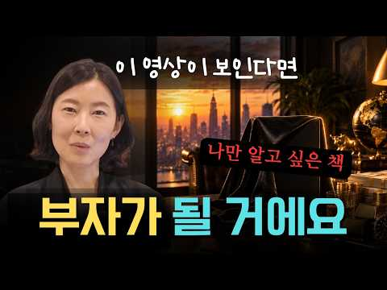
- 챕터: 0:00 열심히만 살면 부자가 될까? · 2:47 레버리지란 무엇인가 · 5:20 내가 아니어도 되는 일은 위임하라 · 7:45 절약보다 투자 · 10:23 시간 관리보다 감정 관리 · 13:24 아끼고 열심히 살아도 부자가 되지 않는 이유 · 16:59 작은 돈보다 시간과 에너지를 아껴라 · 21:05 가격 비교에 시간 쓰지 마라 · 25:10 건강에는 아끼지 마라 · 29:13 책과 배움에 투자하라 · 31:25 돈보다 시간·건강·교육에 투자하라
- 설명 앞부분: 레버리지는 무조건 열심히 사는 것이 아니라 적은 노력으로 더 큰 성과를 만드는 방법입니다. 열심히 살고 악착같이 아끼는데도 왜 생각만큼 부자가 되지 못할까요? 부자되는 법을 알고 싶다면 돈보다 먼저 나의 시간과 에너지를 어디에 쓰고 있는지 살펴봐야 합니다. 진짜 돈 관리는 무조건 아끼고 저축하는 것만을 의미하지 않습니다. 몇백 원, 몇천 원을 아끼기 위해 소중한 시간과 에너지를 낭비하고 있지는 않은지 생각해 봐야 합니다. 레버리지를 이해하면 돈을 써서 시간을 사고, 그 시간을 더 가치 있는 일에 사용하는 방법을 고민하게 됩니다. …
- 같은 채널 평소 대비 ×5.0 (채널 최근 롱폼 중앙값 36,272회) · 평소 영상: "평범했던 인생을 이렇게 바꿨어요" 하루라도 빨리 해야 할 두 가지 (36,272회) / "행복해지고 싶다면 반드시 보세요." 삶을 행복하게 만드는 법 (49,744회)
- 대본 없음 (설명) — 음성인식이 끝나면 도입부·흐름이 들어감
- 댓글 95/95: 좋은 점 — 영상 3 · 감사·응원 14 · 더 알고 싶은 것 3 · 아쉬운 점 — 영상 0 · 반박·불만 — 의견 다름 0 · 정치·사회 0 · 경험 공유 6 · 구독·다음 기대 0
  - 좋은 점 — 영상 👍21 “맞는 말씀 이고 대단하십니다, 돈 있는 사람들이 돈을 쫒지 말라 합니다, 돈이 있을때 하는 애기죠, 시간, 에너지 낭비도 다 같은 소리라 봅니다, 다른 대안이 없는데 어떻게 아끼않고 노동을 안합니까 ? 열심벌고 아껴서 돈을 모와서 그런 사고 와 방식으로 나아가야 한다…”
  - 좋은 점 — 영상 👍3 “좋은 영상입니다.”
  - 감사·응원 👍48 “독서,쓰기,운동,잘자기,잘먹기 그리고 명상하고 일하고 투자하며 사람과 세상에 감사하는 마음 퍼내기”
  - 감사·응원 👍10 “제 인생 큰 울림을 감사합니다. 우리 인생사! 돈과 사람 그리고 나 자신!”
  - 더 알고 싶은 것 👍2 “작은 돈을 아끼려고. 시간과 정신 에너지를 소비하지 말라 소중한 지혜 감사합니다 질문)배우는데. 투자하라 하셨는데 근데 저는 남 강의 듣기보다는 직접 책을 보는타입인데 혹시 강의를 꼭 들어야 하나요? 책에 다 있는데 왜 강의를 들어야하는지 전 이게 궁금합니다 답변 주…”
  - 더 알고 싶은 것 👍1 “롭무어의 레버리지 책이 맞나요?”
  - 경험 공유 👍55 “공감 100% 입니다 내가 돈 쓰지 않는 곳 - 시계, 자동차 시간 쓰지 않는 곳 - 쇼핑, 논쟁 멀리하는 사람 - 위에 두가지에서 나랑 방향이 반대인 사람”
  - 경험 공유 👍11 “저도 자칭 자기계발충으로서~ 자신있게 말씀드립니다. 현재.과거.미래의 씨크릿등영성서적포함 모든 자기계발서 다 똑같은 내용입니다. 돌고돌아. 이 세상은 열심히 안하면 돌아오는것이 없는 시스템입니다.단 어떻게 열심히 하냐의 차이가 있을뿐이죠. 위 유튜버분도 책도 쓰시고 …”

### 61. 1억 모았으면 지금 당장 이것부터 하세요. 10억 가는 사람은 여기서 갈립니다.

- https://www.youtube.com/watch?v=USUzkksspmg · 지금 돈 공부 · 구독자 737 · 조회수 16,603 (×22.5, 하루 132.9) · 좋아요 452 (2.7%) · 13.6분 · 2026-06-11 · 주제 묶음 2. 돈 모으기·저축 · 형식 정보·해설 (그 밖) · 폴더 `W_USUzkksspmg` (웹 승인)
- 썸네일: 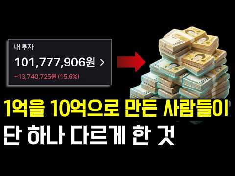
- 챕터: 0:00 1억에서 10억으로 가기 위해 꼭 알아야 할 것 · 0:32 1억 모은 사람이 절대 하면 안 되는 실수 ① (소비… · 2:09 실수 ② (예적금의 덫) · 3:36 실수 ③ (무리한 투자와 레버리지) · 6:11 돈이 불어나는 무너지지 않는 구조란? · 7:26 방법 1: S&P500 적립식 장기투자 (부부가 20… · 9:38 방법 2: 마음 편한 자산배분, '투자 4분법' (홍… · 11:46 요약 및 마무리 (지금 당장 해야 할 딱 한 가지)
- 설명 앞부분: 1억을 모았다면, 이제는 '안 잃고 꾸준히 불리는 구조'에서 갈립니다. "열심히 일해서 드디어 1억을 모았는데... 이제 어떻게 굴려야 할까?" 1억을 모은 순간, 누구나 깊은 고민에 빠지게 됩니다. 참았던 보상 심리에 소비를 늘리거나, 원금을 지키겠다고 예적금에만 묶어두거나, 조급해져 실력에 맞지 않는 무리한 투자(빚투)를 하다가 오히려 원금을 잃곤 합니다. 1억에서 10억으로 넘어가는 구간에서 중요한 것은 '얼마나 빨리 벌까'가 아니라, '어떻게 돈이 불어나는 무너지지 않는 구조를 만들까'입니다. 평범한 직장인 부부도 20년 …
- 같은 채널 평소 대비 ×40.0 (채널 최근 롱폼 중앙값 415회) · 평소 영상: 주식투자 실패한 99%의 한결같은 공통점 (415회) / 부자들의 삶은 지루하고 단순합니다. 단순하게 살아서 부자가 된 겁니다. (423회)
- 대본 없음 (설명) — 음성인식이 끝나면 도입부·흐름이 들어감
- 댓글 9/9: 좋은 점 — 영상 1 · 감사·응원 1 · 더 알고 싶은 것 0 · 아쉬운 점 — 영상 0 · 반박·불만 — 의견 다름 0 · 정치·사회 0 · 경험 공유 0 · 구독·다음 기대 0
  - 좋은 점 — 영상 👍2 “실질적인 도움이 되네요. 감사합니다.”
  - 감사·응원 👍2 “실질적인 도움이 되네요. 감사합니다.”

### 62. 【김형석 교수】 자식에게 통장을 맡기지 마십시오｜노후 자금이 가장 안전한 세 곳

- https://www.youtube.com/watch?v=Gd_EdTezZBw · 영혼의 철학 · 구독자 4,860 · 조회수 108,084 (×22.2, 하루 1,419.6) · 좋아요 1,574 (1.5%) · 52.5분 · 2026-07-30 · 주제 묶음 4. 노후·연금 · 형식 오디오북·낭독 (명언·인생조언) · 폴더 `W_Gd_EdTezZBw` (웹 승인)
- 썸네일: 
- 같은 채널 평소 대비 ×121.3 (채널 최근 롱폼 중앙값 891회) · 평소 영상: 왜 자다가 종아리에 쥐가 날까요? ∣ 뇌졸중보다 먼저 오는 혈관의 경고 — 70대가 꼭 … (891회) / 2027년 한국에 닥칠 경고? 신디 제이콥스 예언과 우리가 반드시 준비해야 할 것 ∣ 인… (894회)
- 대본 없음 (없음) — 음성인식이 끝나면 도입부·흐름이 들어감
- 댓글 24/24: 좋은 점 — 영상 1 · 감사·응원 13 · 더 알고 싶은 것 0 · 아쉬운 점 — 영상 0 · 반박·불만 — 의견 다름 0 · 정치·사회 0 · 경험 공유 0 · 구독·다음 기대 0
  - 좋은 점 — 영상 👍6 “좋은 강의 감사합니다”
  - 감사·응원 👍39 “영상 잘 보았습니다. 교수님의 귀한 말씀 명심 하겠습니다.! 감사 합니다.! 만수무강 하십시오.!😊❤🎉”
  - 감사·응원 👍13 “장시간. 감사했습니다~^^♡”

### 63. 노후 걱정 끝, 커버드콜로 평생 월급받는 법 ∣ 커버드콜 ETF ∣ 조재영 웰스에듀 부사장

- https://www.youtube.com/watch?v=IePgz3kEuNk · 투자360 · 구독자 15,800 · 조회수 350,615 (×22.2, 하루 2,099.0) · 좋아요 6,213 (1.8%) · 22.8분 · 2026-04-30 · 주제 묶음 3. 주식·ETF · 형식 인터뷰·강연·대담 · 폴더 `W_IePgz3kEuNk` (웹 승인)
- 썸네일: 
- 챕터: 0:00 🔥하이라이트 · 0:25 커버드콜 etf 한 번에 이해하기 · 2:08 언제 돈 버는 전략인가요 · 4:52 커버드콜의 세부 종류 · 8:04 금융소득세와 건보료 · 14:42 커버드콜ETF가 은퇴 후 유리한 진짜 이유 · 17:50 일반계좌? ISA계좌? · 20:13 원하는 ETF 찾는 사이트
- 설명 앞부분: 배당을 많이 준다는 커버드콜 ETF 그런데 왜 이렇게 많이 줄 수 있을까요? 이 영상에서는 그 구조를 먼저 짚어봅니다. 은퇴자와 고소득자가 몰리는 이유 단순히 ‘고배당’ 때문만은 아닙니다. 사실 커버드콜의 핵심 수익인 옵션 프리미엄은 과세 구조가 달라 건강보험료나 금융소득종합과세 부담을 줄일 수 있다는 점도 중요한 포인트입니다. 커버드콜의 구조부터 옵션 프리미엄 그리고 세금까지 핵심만 짧고 명확하게 정리해드립니다. [ 타임라인 ]
- 같은 채널 평소 대비 ×10.5 (채널 최근 롱폼 중앙값 33,443회) · 평소 영상: “지금까지 금투자 방법 다 틀렸습니다” 금 투자, 개미는 ‘이렇게’ 사야 돈 법니다 ∣ … (33,443회) / 환율 내린 지금이 기회! 삼전닉스 팔아서 현금 '여기로' 옮기세요 #부자탐사대 #효라클 … (38,360회)
- 대본 없음 (설명) — 음성인식이 끝나면 도입부·흐름이 들어감
- 댓글 237/237: 좋은 점 — 영상 33 · 감사·응원 49 · 더 알고 싶은 것 14 · 아쉬운 점 — 영상 0 · 반박·불만 — 의견 다름 6 · 정치·사회 2 · 경험 공유 7 · 구독·다음 기대 5
  - 좋은 점 — 영상 👍43 “이렇게 잘 정리해 주시는 분은 처음입니다. 구독을 누르게 하시는 분이네요. 좋은 정보 고맙습니다.”
  - 좋은 점 — 영상 👍8 “진짜 강의 잘하시네요 최고입니다!!! 알아듣기 쉽고 유익한 너무너무 훌륭한 명강의였습니다”
  - 감사·응원 👍74 “지금까지 월배당 커버드콜 강의중에 최고였습니다 감사합니다~^^”
  - 감사·응원 👍51 “제가 본 etf, 커버드콜 강의중에 최고였습니다 감사합니다~^^🎉”
  - 더 알고 싶은 것 👍6 “와우 정말 훌륭하신 교수님이시네요 어려운걸 아주쉽게 풀어서 귀에 쏙쏙들어오게 설명을 너무 잘 해주시는게 교수님 중에 최고이십니다 구독 좋아요 누르고 다른영상도 찾아서보겠습니다 감사합니다 좋은 영상 많이많이 올려주세요 끝까지 응원하겠습니다”
  - 더 알고 싶은 것 👍6 “저는 56세 자영업자입니다. 36년을 음식업을 했습니다. 3년뒤 지방 은퇴를 준비중입니다. 4~5억정도를 생활비 투자를 생각중 인데 로드맵 부탁드려도 될까요? 고맙습니다”
  - 반박·불만 — 의견 다름 👍1 “AI에게 사실일까 라고 질문해 보니 짧게 말하면 👉 “노후 걱정 끝, 평생 월급”은 사실이 아닙니다. 과장된 표현이에요. 📌 커버드콜 ETF가 뭐냐면 대표적으로 QYLD, JEPI 같은 상품이 있습니다. 이 ETF들은 👉 주식 + 옵션(콜옵션 매도)을 섞어서 👉 배당…”
  - 반박·불만 — 의견 다름 👍0 “상방 막히고 하방 열린 상품을 포장하면 안되여 운영이 100%오픈 된 상품 자체가 아닌데 ㅋㅋㅋ칠판 필요 없으실듯”
  - 정치·사회 👍0 “주식 관런 서적 1권 유투브 유투버 무식 1타 강사하시고 그 능력으로 다음 대통령 하세요. 금 모으기 대장동 위례 성남 지 원 금? 부동산 능력 없고 공인 중개사가 몆만? 대장동식으로. 중개인들을 인해 전술 노조 파업하듯 .ㅈㅈ”
  - 경험 공유 👍51 “제가 본 etf, 커버드콜 강의중에 최고였습니다 감사합니다~^^🎉”
  - 경험 공유 👍6 “현재 어머니는 피부양자 자격, 국민연금 월 87만원 수령 중이며 spyi, qqqi 투자하여 분배금을 세전 1천만원 미만 받게끔 조정 중 올해말 기초연금 신청 예정입니다. 여기서 궁금한 점이 있는데 1.피부양자 자격 유지하려면 현재처럼 국민연금 + 커버드콜 분배금을 …”
  - 구독·다음 기대 👍7 “은퇴자인데 정말 유익한 정보에 진심으로 감사드립니다 구독합니다 😊😊😊”
  - 구독·다음 기대 👍4 “구독하고 좋아요 ❤ 방송잘들었습니다”

### 64. 내 주변에 주식으로 돈 번 사람이 '진짜' 단 1명도 없는 소름 돋는 이유 ∣ 교수 정선용 (통합본)

- https://www.youtube.com/watch?v=SwW4n0ERlS8 · 너와 나의 경제학교 · 구독자 30,200 · 조회수 613,828 (×20.3, 하루 10,047.4) · 좋아요 11,581 (1.9%) · 52.7분 · 2026-08-14 · 주제 묶음 3. 주식·ETF · 형식 인터뷰·강연·대담 · 폴더 `W_SwW4n0ERlS8` (웹 승인)
- 썸네일: 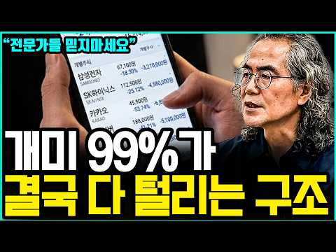
- 설명 앞부분: 정선용, 달리고 읽고 쓰는 사람의 하이
- 같은 채널 평소 대비 ×23.5 (채널 최근 롱폼 중앙값 26,110회) · 평소 영상: '이 3가지 신호'가 나오면 무조건 주식 싹 다 파세요 ∣ 교수 정선용 (통합본) (27,328회) / 30여년 직장생활하면서 수천명 만나보고 깨달은 평생 '월급 노예'로 끝나는 사람 vs 수… (24,892회)
- 대본 없음 (설명) — 음성인식이 끝나면 도입부·흐름이 들어감
- 댓글 1,622/1,622: 좋은 점 — 영상 54 · 감사·응원 77 · 더 알고 싶은 것 15 · 아쉬운 점 — 영상 15 · 반박·불만 — 의견 다름 53 · 정치·사회 45 · 경험 공유 131 · 구독·다음 기대 3
  - 좋은 점 — 영상 👍332 “이분이 최고의 주식 전문가 입니다 인정합니다 허황된 꿈을 부추기지 않고 현실적인 필요하고 도움되는 얘기만 하시네요”
  - 좋은 점 — 영상 👍195 “구구절절 맞는말입니다 사람 좋아 보이는거랑 그들의 속마음은 다르다는걸 알았습니다”
  - 감사·응원 👍242 “귀한말씀 너무 늦게 들어서 안타까울 따름입니다 삼전 65만 하닉 400간다고 하면서 정작 자신들은 팔고 있었다는것을 나중에 알게됐습니다. 그렇게 보고서를 낸 증권사나 그걸 유튜브에서 전파한 사람들은 앞으로 다신 보지않을것입니다 귀한말씀 다시한번 감사드립니다”
  - 감사·응원 👍220 “안그래도 느꼈어요 요즘은 증권방송 보기도 싷더라구요 소위 주식 전문가들 증권사 직원들 에널리스트들 전부 자기밥그릇 챙기느라 혈안ᆢ 한통속 이예요 ᆢ 그들의 만행을 속시원히 알려주니 감사하네요 ᆢ”
  - 더 알고 싶은 것 👍3 “어떻게 사셨길래 99%가 잃는 주변인만 뒀나요? 교수님 과장도 적당히 하셔요”
  - 더 알고 싶은 것 👍3 “때가어느때인데유투버보고피같은돈을투자할까요?”
  - 아쉬운 점 — 영상 👍6 “어머니 돈을 불려 주겠다고 600만원을 받아서 투자를 하는데 많이 버는것 보다 잃으면 절대 안되겠다 생각이 먼저 들었습니다. 종목을 결정하는데 얼마나 벌지 모르지만 안 잃을거 같은 종목만 매수 해서 시장의 관심을 받으면 매도하고 다시 반복해서 현재 연복리65% 수익에…”
  - 아쉬운 점 — 영상 👍3 “이 사람도 결국에는 공포 마케팅으로 구독자 어그로 끄는 거임”
  - 반박·불만 — 의견 다름 👍30 “누구 믿고 투자한다는 인간들은 절대 투자하지 말아야 될 사람이에요. 결국 그 의존성 때문에 손실납니다. 그냥 저축하는 편이 안 망하는 길입니다. 주식은 원금 지키며 쌓는 저축이 아닙니다. 손실 볼 수 있는 투자에요.”
  - 반박·불만 — 의견 다름 👍23 “대가들의 책만 몇권 읽어봐도 알게됩니다. 전문가,교수,애널리스트들은 당신들의 편이 아닙니다. 그들은 당신들을 이용해서 돈을 버는것이지, 당신들을 부자로 만들어즐 이유가 1도 없어요.”
  - 정치·사회 👍189 “개미들 돈 누가 다 먹었을까요? 다 외국인 기관들한테 갔습니다 증권사는 수수료로 돈 잔치 했겠죠. 그동안 주식해서 번돈 다시 재투자하면서 이제 원금입니다 ㅠ 그나마 다행이지요. ㅠㅠ 그동안 무료 봉사 했어요 주식에~~~~”
  - 정치·사회 👍87 “딱 맞아요... 애널리스트 증권회사 삐끼들입니다. 개미들은 털리게 돼 있어요. 주식은 전문가가 없어요. 나스닥 하세요. 코스피는 증권회사 외국인들 땜에 절대 돈 벌기 힘든 구조예요. 어느정도 이익오면 우선 반은 빼고 시작하세요”
  - 경험 공유 👍314 “진짜 맞습니다 이번에 처음으로 주식하는 분들 많이 당했을꺼에요 저도 그중 한명이네요 ~~~”
  - 경험 공유 👍302 “피같은 돈 주식으로 다 날리고 몇년째 투잡하고 있습니다... 주식으로 3억잃으니 인생이 골로 가는 듯 합니다 무주식이 상팔자입니다”
  - 구독·다음 기대 👍29 “매일매일 듣고 보고 있습니다교수님 감사해요”
  - 구독·다음 기대 👍12 “미국Etf투자 6년째 평균 70프로. 이익중. 노후자금으로 기대됩니다”

### 65. 🇨🇦 아무도 알려주지 않았던 '은퇴의 잔인한 현실' 8가지! ∣ 브랜든 캐나다

- https://www.youtube.com/watch?v=XWjW3xiUKxw · 브랜든 캐나다 투자전략 · 구독자 3,240 · 조회수 65,369 (×20.2, 하루 842.3) · 좋아요 1,342 (2.1%) · 18.1분 · 2026-07-28 · 주제 묶음 4. 노후·연금 · 형식 인터뷰·강연·대담 · 폴더 `W_XWjW3xiUKxw` (웹 승인)
- 썸네일: 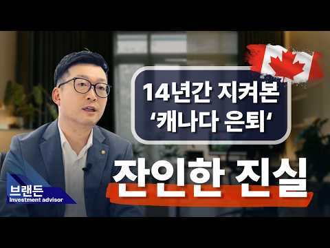
- 설명 앞부분: 📍 상담 안내 상담 가능 지역: BC, ON, AB (공식 금융 라이센스 보유) 브랜든 유 (Branden Yu), CIM®, Investment Advisor 🏛️ Harbourfront Wealth Management 🏦 National Bank Independent Network (NBIN) Custodian 🇨🇦 전략적 투자플랜/ 프라이빗 자산관리/ 은퇴 및 상속플랜 📩 Contact 604-616-0192 (BC), 647-982-0192 (ON) 문자 메세지 캐나다에서의 은퇴는 단순한 자산 축적이 아닌, 철저한 세금 통…
- 같은 채널 평소 대비 ×6.3 (채널 최근 롱폼 중앙값 10,295회) · 평소 영상: 🇨🇦 지금 은퇴해도 좋다는 5가지 신호!? ∣ 브랜든 캐나다 (10,295회) / 🇨🇦 "캐나다, 남겨진 배우자는 이제 연금을 어떻게 받게 될까요?" ∣ 브랜든 캐나다 (8,886회)
- 대본 없음 (설명) — 음성인식이 끝나면 도입부·흐름이 들어감
- 댓글 78/78: 좋은 점 — 영상 17 · 감사·응원 16 · 더 알고 싶은 것 1 · 아쉬운 점 — 영상 2 · 반박·불만 — 의견 다름 0 · 정치·사회 1 · 경험 공유 6 · 구독·다음 기대 0
  - 좋은 점 — 영상 👍18 “40살에 이민 온 저도, 은퇴 준비를 조금 더 한다고 69세 2개월 전 인 2027년 12월까지 일 하려고 합니다. Wealth management 관련 사항에 익숙하지 않아 은퇴할 날짜는 정했지만 불안한 마음입니다. 유익한 내용을 공유해 주셔서 감사합니다!!”
  - 좋은 점 — 영상 👍11 “좋은 내용 감사합니다.”
  - 감사·응원 👍18 “40살에 이민 온 저도, 은퇴 준비를 조금 더 한다고 69세 2개월 전 인 2027년 12월까지 일 하려고 합니다. Wealth management 관련 사항에 익숙하지 않아 은퇴할 날짜는 정했지만 불안한 마음입니다. 유익한 내용을 공유해 주셔서 감사합니다!!”
  - 감사·응원 👍11 “좋은 내용 감사합니다.”
  - 더 알고 싶은 것 👍6 “55세 은퇴 하고 싶은데 매달 현금 6천불 쓰려면 얼마를 모아 둬야 하나요? 현금 20억 ?”
  - 아쉬운 점 — 영상 👍9 “은퇴후에는 그냥 지루하고 재미없게 보내는게 최고입니다...그냥 걸어다니세요...아무생각없이...”
  - 아쉬운 점 — 영상 👍7 “은퇴후에 배와 비행기만 안탈수있다면 더이상바랄께 없습니다... 어렵게 사는건 견딜수있지만 배타는것과 비행기타는건 정말싫어요... 젊은시절 수출업에 종사하다보니까 세계 안가본곳이 없는데...언제나 어딜가나 다 그게그거고 다똑같습니다..별 재미나 흥분되는장면이 없어요..…”
  - 정치·사회 👍0 “미안한 얘기지만, 혹시나 했더니 역시나군요. 브랜드이 말하는 은퇴, 노후 설계는 캐나다 주류 사회 상식과는 거리가 한참 먼 한국적 사고 방식입니다. 수자 수익률이 중요하지 않다? 4% 법칙? 우선 RRSP는 71세에 RRIF로 전환되는 것도 있고, 65세후에 LIF로…”
  - 경험 공유 👍18 “40살에 이민 온 저도, 은퇴 준비를 조금 더 한다고 69세 2개월 전 인 2027년 12월까지 일 하려고 합니다. Wealth management 관련 사항에 익숙하지 않아 은퇴할 날짜는 정했지만 불안한 마음입니다. 유익한 내용을 공유해 주셔서 감사합니다!!”
  - 경험 공유 👍15 “캐나디에서 OAS든 CPP든 적으면 적은대로 보조금 GIC가 나오기 때문에 자세히 따져보면 거기서 거깁니다. 오히려 올드에이지나 시피피가 적은 사람이 유리 할 수 있다는 사실도 알아야 합니다. 아무 연금도 받을 수 없는 즉 아무것도 내지 않고 경제 생활을 전혀 안 한…”

### 66. "삼성전자 SK하이닉스 2배 레버리지 ETF" 5월 22일 상장 확정인데 증권사 CEO 열 명 중 아홉 명이 올해 최대 폭탄이라고 경고했다

- https://www.youtube.com/watch?v=aTh--_DtGNU · 이코노메이션 · 구독자 14,400 · 조회수 274,426 (×19.1, 하루 1,724.5) · 좋아요 5,239 (1.9%) · 25.6분 · 2026-05-08 · 주제 묶음 3. 주식·ETF · 형식 브이로그·직접 해본 이야기 · 폴더 `W_aTh--_DtGNU` (웹 승인)
- 썸네일: 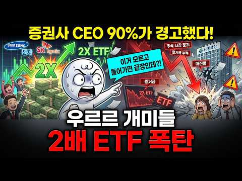
- 설명 앞부분: 5월 22일 삼성전자와 SK하이닉스 주가를 두 배로 추종하는 단일종목 레버리지 ETF가 국내 최초로 상장됩니다. 사전교육에만 만 이천 명이 몰렸고 최대 오조 삼천억원이 유입될 것으로 추정되지만, 증권사 CEO 열 명 중 아홉 명은 이 상품을 올해 국내 증시 최대 리스크로 꼽았습니다. 음의 복리 효과와 강제청산 구조, 장 마감 전 리밸런싱 폭탄까지. 알고 들어가는 것과 모르고 들어가는 것은 완전히 다릅니다. 🎨 본 영상의 시각 자료는 Stable Diffusion 등 생성형 AI 기술을 활용하여 제작되었으며, 경제 지식 전달을 위한…
- 같은 채널 평소 대비 ×167.6 (채널 최근 롱폼 중앙값 1,638회) · 평소 영상: SK하이닉스가 돈을 안 쓰자 월가가 움직였다, 100조 환원설까지 나온 이유 (1,732회) / 삼성 D램 기술 유출 뒤 CXMT 700조…10년을 건너뛴 방법 (1,543회)
- 대본 없음 (설명) — 음성인식이 끝나면 도입부·흐름이 들어감
- 댓글 808/808: 좋은 점 — 영상 14 · 감사·응원 29 · 더 알고 싶은 것 6 · 아쉬운 점 — 영상 2 · 반박·불만 — 의견 다름 6 · 정치·사회 22 · 경험 공유 11 · 구독·다음 기대 1
  - 좋은 점 — 영상 👍23 “많이배웠네요”
  - 좋은 점 — 영상 👍19 “아주 좋은 정보 도박판을 만들고있습니다.”
  - 감사·응원 👍23 “어젯밤에 상장 소식을 접하고는 크게 동요되었었는데.. 마음을 추스르게 해주셔서 감사요.”
  - 감사·응원 👍10 “이해하기좋게 설명해줘서. 감사합니다 Etf 나오면 나도 해봐야지 했는데 큰일 날 뻔했네요 빨리 일반 들이 많이 알았으면 하네요.”
  - 더 알고 싶은 것 👍3 “최고.최고. 잘 보고 있습니다. 댁의 이력이 궁금합니다. ❤❤❤”
  - 더 알고 싶은 것 👍2 “하한가 비유하면서 하루 60프로 손실은 좀 억지스럽네요 삼성 닉스가 상하한가 칠일이 있을까요?”
  - 아쉬운 점 — 영상 👍3 “얘는 맨날 삼전 까더라 삼전 못들어가서 열 받나?? ai목소리 듣기 싫어 나갈란다”
  - 반박·불만 — 의견 다름 👍1 “그런데..영상 잘보고 있지만 왜? 숫자얘기? 나올때 발음이 영 아닌데.틀리고? 당신 ai???”
  - 반박·불만 — 의견 다름 👍0 “부족힐 영상 아닙니다 쉽게 풀어서 귀에 쏙쏙 들어오게 하니까요~~^^ ~~ㅇㆍㄴ”
  - 정치·사회 👍71 “투자를 가장한 도박이지! 나라가 적절히 제재를 해야지. 이건 마음에 안든다”
  - 정치·사회 👍13 “정부에서 이런걸 왜 허가해주나요?국민은 도박판에 밀어 넣는거 아닌가요?잘못되면 정권이 흔들리겠네요”
  - 경험 공유 👍88 “내가 작년 11월 부터 미장 개별주 2배 래버러지 1주로 시작해서 떨어질때마다 물타고 또타고 또타고...타다타다 -60프로까지 떨어져 마지막 최저점에서 마지막 현금 올인해서 -30프로까지 만들고나서부터 반등 시작 70프로익절로 마감 했지만 스트레스 장난아님..초보자는…”
  - 경험 공유 👍10 “이해하기좋게 설명해줘서. 감사합니다 Etf 나오면 나도 해봐야지 했는데 큰일 날 뻔했네요 빨리 일반 들이 많이 알았으면 하네요.”
  - 구독·다음 기대 👍1 “5월22일이 기대됩니다!!!!!! 장 시작과 동시에 몰빵 하고 털고 나오면 됩니다!!”

### 67. 1억이 우스우세요 사실 여기서부터가 진짜 시작입니다

- https://www.youtube.com/watch?v=-O-ROZCAU_4 · 송차장기록 · 구독자 8,440 · 조회수 160,569 (×19.0, 하루 1,556.8) · 좋아요 1,913 (1.2%) · 15.4분 · 2026-07-03 · 주제 묶음 2. 돈 모으기·저축 · 형식 브이로그·직접 해본 이야기 · 폴더 `W_-O-ROZCAU_4` (웹 승인)
- 썸네일: 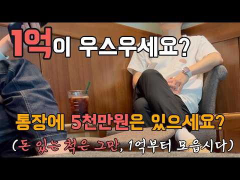
- 챕터: 0:00 통장에 1억, 아니 5천은 있으세요? · 4:00 "요즘 1억이 돈이에요?" 후배의 한마디 · 8:30 주식으로 1억 넘게 가진 사람, 몇 명이나 될까 · 12:30 1억이 우스운 게 아니라, 여기서부터가 시작인 이유
- 설명 앞부분: 오늘은 무더운 여름날, 평범한 40대 직장인의 점심 한 끼에서 시작된 이야기입니다. 후배와 슬로우캘리에서 먹은 연어 샐러드, 후배가 사준 스타벅스 커피, 그리고 퇴근 전 잠깐 걸은 공원 산책. 후배가 그러더라고요. "형, 솔직히 요즘 1억이 돈이에요?" 유튜브만 켜면 몇 억씩 벌었다는 얘기뿐이니, 1억쯤은 우습게 느껴질 만도 하죠. 근데 마흔 넘으면서 알게 됐어요. 남들 억대 얘기에 눈 맞추다 보면, 정작 내 발밑의 첫 1억은 우스워 보인다는 걸. 근데 그 1억, 절대 우스운 돈이 아니더라고요. 그리고 그건 끝이 아니라 시작이었습…
- 같은 채널 평소 대비 ×10.2 (채널 최근 롱폼 중앙값 15,809회) · 평소 영상: 4050 번아웃, 다 놓고 싶은 그 마음의 정체 열에 일곱이 겪습니다 (15,809회) / 코스피 10% 폭락한 그날 밤, 잠 못 잔 우리 4050에게 (7천 날린 선배가 웃은 이… (15,630회)
- 대본 없음 (설명) — 음성인식이 끝나면 도입부·흐름이 들어감
- 댓글 595/595: 좋은 점 — 영상 7 · 감사·응원 19 · 더 알고 싶은 것 3 · 아쉬운 점 — 영상 1 · 반박·불만 — 의견 다름 17 · 정치·사회 4 · 경험 공유 31 · 구독·다음 기대 1
  - 좋은 점 — 영상 👍1 “이해가 쉽게 차분하게 설명을 잘 하시네요 좋은 말씀 감사히 잘 들었습니다”
  - 좋은 점 — 영상 👍1 “공감합니다”
  - 감사·응원 👍15 “29살에 청년 도약계좌 합쳐서 이제 순 자산 천만원 모았습니다... 왜 그거밖에 못 모았냐고 욕 하실수도 있지만 주변소리 다 무시하고 적은 월급이지만 열심히 모아볼게요 감사합니다”
  - 감사·응원 👍15 “화이팅 하세요 커피 한잔의 행복이 1억의 값어치 일 수도 있습니다.”
  - 더 알고 싶은 것 👍6 “누구에겐 1 억이 아무것도 아니지만 다른 이에겐 평생 만질 수 없는 큰 돈이죠. 돈이란 그렇게 상대적인 것 같습니다. 하지만 소액이라도 소중하게 생각하지 않으면 어느새 빠져나가고 없을 겁니다. 없으면 사람 구실 하기 힘들고 잘못 사용하면 그렇게 추할 수가 없는 이 물…”
  - 더 알고 싶은 것 👍4 “송차장님은 공감능력은 매우매우 뛰어나고 감성적이고 정말 사람좋아보이고 남에게 싫은소리 못하는분이고 심성도 아주 좋은분같음 그런데 투자에는 이게 아주 좋지않은 성격입니다 인간본능은 인종 문화불문 주변친구 돈벌면 배아프고 시기하고 질투나고 그럽니다 그걸 굳이 티내진 않아…”
  - 아쉬운 점 — 영상 👍1 “근데 주식,금융투자 같은걸 안하면 1억모아도 돈이 뭘 물어다 주지는 않음... 걍 그돈을 통장에 넣어둔다하면 그런 바보는 이 세상에 없겟지만.... 그냥 1억모으는 과정을 무한반복하는 고통이라고 보시면 될듯. 절대 주식,투자없이 돈을 못불림”
  - 반박·불만 — 의견 다름 👍58 “1억은 결코 작은돈이 아니죠😂 누구나 종자돈 일백, 일천에서 시작합니다 백원한닢도 소중한겁니다”
  - 반박·불만 — 의견 다름 👍18 “아파트값이 말도 안되게 뛸 때.. 무주택자로 만원도 고민고민하며 저축하는 기쁨으로 8년에 5억 정도를 모았어요.. 저희는 빌라를 샀는데 비록 이제 통장에는 돈이 없지만 그래도 뿌듯합니다.. 그리고 다시 저축하면 된다는 걸 아니까 두렵지 않습니다..”
  - 정치·사회 👍4 “정부가 돈을 푸니깐 진짜 돈가치가 없게 느껴집니다. 저도 1억이 예전 1천 느낌밖에 안나요. 물가폭등 수준이라..”
  - 정치·사회 👍0 “어차피, 한국에서 연금은 개쓰레기 영포티뻐킹파티련들 빼고, 높은 확률로 결국 유사현금성 쿠폰(베네수엘라,쿠바,빨갱이국가 특)으로 지급 될 확률이 크다. 따라서, 나는 모든것을 한국과 끊어버렸지. 한국돈1억도 중요하지만, 무엇보다 한국과 상관없이 삶을 살아갈 수 있는 …”
  - 경험 공유 👍26 “저도 이제 오십을 바라보는 나이가 되었고 서울 자가에 대기업 부장이상 직급이지만 여전히 완전한 경제적 자유는 이루지 못했네요. 저는 개인적인 경험이지만 초기 1억은 그리 어렵지 않았어요. 무에서 시작하다보니 지출통제가 쉬웠거든요. 오히려 1억에서 3억 구간이 너무 힘…”
  - 경험 공유 👍18 “아파트값이 말도 안되게 뛸 때.. 무주택자로 만원도 고민고민하며 저축하는 기쁨으로 8년에 5억 정도를 모았어요.. 저희는 빌라를 샀는데 비록 이제 통장에는 돈이 없지만 그래도 뿌듯합니다.. 그리고 다시 저축하면 된다는 걸 아니까 두렵지 않습니다..”
  - 구독·다음 기대 👍0 “1억은 정말 큰돈이지요... 지금 가계빚이 2000조가량 된다고 해요. 그걸 빚진 가구주가 대략 1천만명이라고 가정하면 평균 빚이 2억이라는 계산이 나옵니다. 문제는 그 부채의 대부분이 살고있는 집하나를 담보로 받은 주택담보대출인거고 그주택은 그냥 소비재에 불과한, …”

### 68. 1억, 5억, 10억, 30억 자산 구간별 나타나는 인생 변화. (부자들이 돈 버는 법)

- https://www.youtube.com/watch?v=hA5g5pbTFUo · 신현욱의 경영백서 · 구독자 8,410 · 조회수 155,355 (×18.5, 하루 1,270.6) · 좋아요 1,796 (1.2%) · 26.2분 · 2026-06-14 · 주제 묶음 1. 재테크 일반·마인드 · 형식 오디오북·낭독 (명언·인생조언) · 폴더 `W_hA5g5pbTFUo` (웹 승인)
- 썸네일: 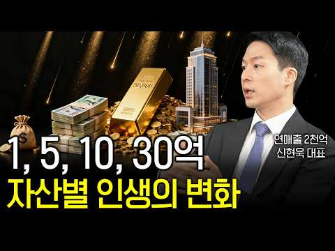
- 설명 앞부분: 나의 상황에 맞는 1 - 5 - 10 - 30억 자산 형성 로드맵을 얻고 싶다면? 1억은 태도의 변화, 5억은 생존으로의 안정감을 주는 레버리지의 수단, 10억은 경제적 자유가 아닌 자산/소비의 변화 30억은 자산이 자산을 형성하는 막강한 동력으로서 큰 의미를 가지고 있다고 영상을 통해 말씀 드렸습니다. 여러분들은 오늘 이야기 중 어떤 부분이 가장 인상 깊거나 공감 되셨나요? 댓글에 편하게 남겨주시면 함께 소통하겠습니다.
- 같은 채널 평소 대비 ×49.1 (채널 최근 롱폼 중앙값 3,167회) · 평소 영상: 사업을 무일푼 바닥부터 다시 시작해야 한다면? (2,000억 매출 더휴식, 신현욱 대표) (3,878회) / 우버, 배민 모회사 인수 합의…3천만 원으로 시작해 몸값 8조가 된 배민의 성장 비결 (2,456회)
- 대본 없음 (설명) — 음성인식이 끝나면 도입부·흐름이 들어감
- 댓글 423/423: 좋은 점 — 영상 7 · 감사·응원 14 · 더 알고 싶은 것 5 · 아쉬운 점 — 영상 2 · 반박·불만 — 의견 다름 3 · 정치·사회 4 · 경험 공유 31 · 구독·다음 기대 0
  - 좋은 점 — 영상 👍25 “영상보고 당혹스러워서 글 남깁니다. 50대고 지방 흙수저 출신에 작은 사업해서 자산 100억 모았습니다. 근데 이 영상에서 얘기하는 것처럼 삶이 드라마틱하게 바뀌는 거 없습니다. 제 고향친구들이랑 비교해도 뭐 대단히 고급스러운 삶을 살고 그런거 없습니다. 그냥 먹는거…”
  - 좋은 점 — 영상 👍10 “좋은내용 감사합니다. 50만원 100만원 소수인원들을 위한 멤버쉽 계획은 없으신가요?”
  - 감사·응원 👍10 “좋은내용 감사합니다. 50만원 100만원 소수인원들을 위한 멤버쉽 계획은 없으신가요?”
  - 감사·응원 👍2 “패기가 넘치시는 좋은 말씀입니다 다만 운이 얼마나 중요한지도 아시고 주위에 감사하는 마음 안타까워하는 마음도 가지셨으면 합니다 제 인생에서 가장 열심히 가장 아끼면서 사는 동안 가장 힘들더군요”
  - 더 알고 싶은 것 👍0 “이분이 그 유명한 인간지표 갓인구 센세 맞나요?”
  - 더 알고 싶은 것 👍0 “솔직하게얘기해야되나요? 아니요”
  - 아쉬운 점 — 영상 👍3 “ㅋㅋㄱㅋㅋㅋㄲㅋㄱ너무 뻔한소리의 저퀄영상..”
  - 반박·불만 — 의견 다름 👍2 “부는 운입니다. 부자들은 '그저 난 운이 좋았다'라고 말합니다. 자책하지 마세요 여러분 탓이 아닙니다. 그저 계속 그 일을 하다보면 그 동안 받지 못했던 보상이 주어집니다. -오정세-”
  - 정치·사회 👍1 “뜬금없지만 대표님 국힘당 김기현 닮았네요”
  - 경험 공유 👍32 “그냥 하고 싶은것 하고 사세요 아끼다 똥됩니다 개처럼 벌다가 작년에 1미터 높이에서 뒤로 떨어졌는데 암튼 밑에 날카로운 돌이 있어서 중환자실서 3일만에 깨어남 생각이 바뀜 하고 픈것 다해도 생각보다 자산이 줄지 않음 오히려 조금씩 더 늘어남 결국엔 어느정도 가지게 되…”
  - 경험 공유 👍25 “영상보고 당혹스러워서 글 남깁니다. 50대고 지방 흙수저 출신에 작은 사업해서 자산 100억 모았습니다. 근데 이 영상에서 얘기하는 것처럼 삶이 드라마틱하게 바뀌는 거 없습니다. 제 고향친구들이랑 비교해도 뭐 대단히 고급스러운 삶을 살고 그런거 없습니다. 그냥 먹는거…”

### 69. 주식으로 돈 잃는 사람들이 겪는 4가지 함정 (ft. 조영구, 장성규) ∣ 뇌과학과 데이터로 분석한 상위 5% 투자법

- https://www.youtube.com/watch?v=AeK-KvdyI-k · 준의 경제노트 (jun’s Note) · 구독자 12,600 · 조회수 228,391 (×18.1, 하루 1,537.6) · 좋아요 4,361 (1.9%) · 14.9분 · 2026-05-18 · 주제 묶음 3. 주식·ETF · 형식 인터뷰·강연·대담 · 폴더 `W_AeK-KvdyI-k` (웹 승인)
- 썸네일: 
- 챕터: 0:00 오프닝: 똑똑한 그들이 주식 앞에서 무너진 이유 · 1:12 데이터로 보는 개인투자자 90%가 실패하는 구조 · 2:15 [함정 1] 열심히 할수록, 자주 볼수록 더 잃는다 … · 4:20 상위 5%의 전략: '아무것도 안 하는 것'도 전략이다 · 5:35 [함정 2] 뉴스 보고 샀더니 이미 늦은 이유 (스마… · 7:12 오늘 기사 보고 오늘 사지 않는 실전 습관 · 8:22 [함정 3] "본전만 오면 판다" 이 생각이 저주인 … · 9:45 내 계좌가 마이너스 종목만 남은 '박물관 계좌'가 된… · 10:50 물타기라는 착각: 가라앉는 배에 짐을 더 싣는 행위 · 11:32 [함정 4] 종목이 많으면 안전하다? '가짜 분산투자… · 12:40 진짜 분산투자의 3가지 기준 (자산군, 지역, 섹터) · 13:42 결론: 감정을 브레이크 잡는 매수 전 '3줄 습관' · 14:25 아웃트로: 실수를 데이터로 바꾸는 사람만 살아남는다
- 설명 앞부분: [ 영상 타임라인 안내 ] 안녕하세요! 평생의 노후를 축제로 만드는 경제 가이드, '준 투자'입니다. 우리 채널은 뇌과학과 데이터를 기반으로 가장 효율적인 돈 공부 방법을 나눕니다.
- 같은 채널 평소 대비 ×291.3 (채널 최근 롱폼 중앙값 784회) · 평소 영상: 1억을 20억, 30억으로 만드는 4가지 전략 ∣ 99%가 모르는 부자의 비밀 (784회) / 유통물량 5%로 나스닥100 편입까지? 스페이스X 일론 머스크가 그리는 우주 AI 제국의… (612회)
- 대본 없음 (설명) — 음성인식이 끝나면 도입부·흐름이 들어감
- 댓글 319/319: 좋은 점 — 영상 11 · 감사·응원 23 · 더 알고 싶은 것 0 · 아쉬운 점 — 영상 2 · 반박·불만 — 의견 다름 4 · 정치·사회 1 · 경험 공유 10 · 구독·다음 기대 1
  - 좋은 점 — 영상 👍27 “공감이 가는 내용입니다. ^^ 투자하면서 이런일이 나오는거 같아요.”
  - 좋은 점 — 영상 👍12 “내가 알고 매수할정도면 모든 주주님들은 수익보고 나가는 상태임 상승장에 사고 하락장에 매도하는 전형적 개미 영상 보고 수익으로 바꿔보겠읍니다 좋은 정보 감사합니다”
  - 감사·응원 👍12 “내가 알고 매수할정도면 모든 주주님들은 수익보고 나가는 상태임 상승장에 사고 하락장에 매도하는 전형적 개미 영상 보고 수익으로 바꿔보겠읍니다 좋은 정보 감사합니다”
  - 감사·응원 👍10 “ㅎㅎㅎ 저도 똑 같은 행동을 했네요~ 그러나 각종 유튜브 전문가들의 도움으로 이 만큼 온 것에 감사합니다~***”
  - 아쉬운 점 — 영상 👍1 “감사합니다. AI 목소리 인가요? 귀에 쏙쏙 박히네요.”
  - 아쉬운 점 — 영상 👍1 “다 헛소리...유튜버가 12000원이하에 사라고 해서 사고 팔았던게 이수페타시스..지금? 하화에어로스페이스 몇만원때 ..지금? 뉴스나고 엄청 오르드만..뉴스 나기전 지루한 박스 참지 못마고 팔았더니만..뭐 지금도 잘나가잖아.”
  - 반박·불만 — 의견 다름 👍7 “그 말이 다 맞는거는 아니죠 꼭지까지 오른 주식을 안팔고 보유하다가 좆된경우도 많아요 또 어떤경우는 장기간 옆으로 횡보하다가 어느날 상한가 찍었는데 흘러내려서 결국 윗꼬리 달린 장대 음봉으로 끝나고 이후로 지하로 내려간 경우도 있어요 주로 코스닥에 많죠 또 유명한 회…”
  - 반박·불만 — 의견 다름 👍6 “수수료 0.5% 아닙니다. 0.005입니다”
  - 정치·사회 👍1 “조영구는 벌때는 소리없이엎드려있다가 잃면 온나라가 떠들썩하더라.🤣”
  - 경험 공유 👍23 “남이 수익나면 박수🎉처주고 기다리면. 나도 수익납니다 마음이 중용을. 실천”
  - 경험 공유 👍12 “내가 알고 매수할정도면 모든 주주님들은 수익보고 나가는 상태임 상승장에 사고 하락장에 매도하는 전형적 개미 영상 보고 수익으로 바꿔보겠읍니다 좋은 정보 감사합니다”

### 70. 기준 금리 요동치는 지금, 내 계좌 살리는 분산 포트 비율 (홍춘욱 박사)

- https://www.youtube.com/watch?v=RfFgJJomevo · 오늘의 경제노트 · 구독자 1,160 · 조회수 20,924 (×18.0, 하루 828.0) · 좋아요 83 (0.4%) · 17.6분 · 2026-09-19 · 주제 묶음 3. 주식·ETF · 형식 인터뷰·강연·대담 · 폴더 `W_RfFgJJomevo` (웹 승인)
- 썸네일: 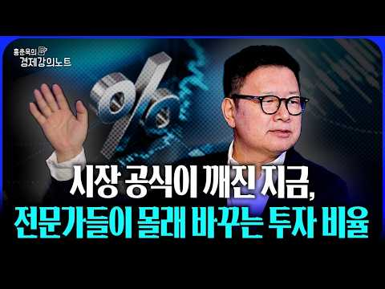
- 설명 앞부분: 기준금리가 크게 움직이는 지금, 내 자산은 안전하게 분산되어 있을까요? 금리 변화가 이어지는 시기에는 주식과 채권, 현금 등 자산별 움직임도 달라질 수 있습니다. 그렇다면 변동성이 커진 시장에서 계좌를 지키기 위해 어떤 방식으로 포트폴리오를 구성해야 할까요? 이번 영상에서는 홍춘욱 박사가 금리 변화에 따른 시장의 흐름을 살펴보고, 분산투자의 중요성과 자산별 비중을 어떻게 바라봐야 하는지 자세히 설명합니다. 주식에만 집중하는 것이 부담스럽거나 시장 변동성에 대비하고 싶다면, 지금 내 포트폴리오에서 무엇을 점검해야 하는지 함께 확인해…
- 같은 채널 평소 대비 ×343.0 (채널 최근 롱폼 중앙값 61회) · 평소 영상: 5년 뒤 금값 충격적 전망 가진 금 절대 팔지 마세요(금남일 대표 풀버전) (61회) / “팔릴 집은 다 팔렸어요” 5월 9일까지 한달...실제 현장 분위기 이렇습니다 (망고쌤 … (56회)
- 대본 없음 (설명) — 음성인식이 끝나면 도입부·흐름이 들어감
- 댓글 4/4: 좋은 점 — 영상 1 · 감사·응원 1 · 더 알고 싶은 것 1 · 아쉬운 점 — 영상 1 · 반박·불만 — 의견 다름 0 · 정치·사회 0 · 경험 공유 0 · 구독·다음 기대 0
  - 좋은 점 — 영상 👍0 “어 편집이 왜..이렇죠. 좋은 내용에 그렇지 못한 편집. 그래도 응원합니다”
  - 감사·응원 👍0 “어 편집이 왜..이렇죠. 좋은 내용에 그렇지 못한 편집. 그래도 응원합니다”
  - 더 알고 싶은 것 👍4 “박사님만 자료와 함께 나오는게 훨씬 집중도가 좋습니다. 피디님이 굳이 화면에 보여야 하는 이유를 모르겠습니다. 그리고 왜 눈내리는 저건 무슨 의도인지…궁금하네요 정신사나워요”
  - 아쉬운 점 — 영상 👍0 “어 편집이 왜..이렇죠. 좋은 내용에 그렇지 못한 편집. 그래도 응원합니다”

### 71. 손 하나 까딱 않는 며느리에게 가게를 맡겼더니, 한달 뒤 놀라운 일이 벌어지는데... ㅣ노후사연ㅣ감동사연ㅣ사연라디오ㅣ오디오북

- https://www.youtube.com/watch?v=9h3kmvUNlB0 · 마음나날 · 구독자 14,900 · 조회수 264,874 (×17.8, 하루 3,211.0) · 좋아요 8,729 (3.3%) · 110.1분 · 2026-07-23 · 주제 묶음 4. 노후·연금 · 형식 사연·드라마 · 폴더 `W_9h3kmvUNlB0` (웹 승인)
- 썸네일: 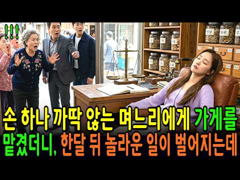
- 설명 앞부분: 시집온 지 사흘, 손 하나 까딱 않는 며느리에게 시어머니가 가게 열쇠를 통째로 맡겼습니다. 시장 사람들은 노망이 났다며 손가락질했지요. 그런데 한 달 뒤, 그 며느리가 입을 열었습니다. "이상한 날은 일곱 번이었습니다." 사십 년을 지켜온 가게에서, 십오 년 동안 아무도 몰랐던 일이 그날 처음 드러났습니다. 걷지 못해 종일 앉아만 있던 사람이, 그 자리에서 모든 것을 보고 있었던 것입니다. 끝까지 들으시면, 아무 말 없이 내 편에 서 주었던 그 사람이 떠오르실 겁니다. ☕ 따뜻한 차 한 잔 준비하시고, 편안히 이야기 속으로 들어오…
- 대본 없음 (설명) — 음성인식이 끝나면 도입부·흐름이 들어감
- 댓글 387/387: 좋은 점 — 영상 3 · 감사·응원 19 · 더 알고 싶은 것 0 · 아쉬운 점 — 영상 3 · 반박·불만 — 의견 다름 2 · 정치·사회 1 · 경험 공유 3 · 구독·다음 기대 0
  - 좋은 점 — 영상 👍5 “경남거제시에서 듣고있습니다 좋은말씀 감사합니다”
  - 좋은 점 — 영상 👍2 “시모님정말감사하고. 고맙습니다 이사연 너무감동적이고 내가슴이뭉클하네요 이렇게 고맙고. 친모님 하고오래오래 가슴뭉클한사연 너무감사합니다 은수씨. 고생많았어요 시모님 며느리가 않이고 딸로평생. 안아주세요 시모님 항상행복하시고 행복한. 나. 날되십시요 좋은영상감사합니다”
  - 감사·응원 👍7 “미국 칼리포니아 감사합니다.”
  - 감사·응원 👍6 “강원도 원주시에서 듣고있습니다 감사합니다”
  - 아쉬운 점 — 영상 👍3 “뭘 나중에 안다 그런식으로 전개합니까 자꾸 그러니까 답답하고 지루합니다”
  - 아쉬운 점 — 영상 👍0 “반복되는 말들 너무 심하네요 ㅜ”
  - 반박·불만 — 의견 다름 👍3 “작가님! 자식이 잘 못하면, 부모가 회초리을 드는 것은 옮은 일입니다! 바늘 도둑이, 소 도둑이 된다는 옛 말이 있지요! 것도 남의 인생을 망치는 사람은 인간이 아닙니다! 수원시 원천동에서~🤗”
  - 반박·불만 — 의견 다름 👍0 “공주. 앉아 있는것 보통 힘든 일이 아닌데..”
  - 정치·사회 👍0 “꼭 부정선거 보는 느낌.”
  - 경험 공유 👍2 “시모님정말감사하고. 고맙습니다 이사연 너무감동적이고 내가슴이뭉클하네요 이렇게 고맙고. 친모님 하고오래오래 가슴뭉클한사연 너무감사합니다 은수씨. 고생많았어요 시모님 며느리가 않이고 딸로평생. 안아주세요 시모님 항상행복하시고 행복한. 나. 날되십시요 좋은영상감사합니다”
  - 경험 공유 👍1 “저도 허리 통증으로 오랫동안 고생해봐서 그런지 이 글이 정말 마음에 와닿네요. 아파서 제대로 걷지도 못하고 누워 지내는 시간이 얼마나 힘든지 조금은 알 것 같습니다. 그래도 포기하지 않고 조금씩 관리하면서 다시 일상을 되찾으셨다니 정말 다행이고 대단하세요. 🙏❤ 허리…”

### 72. 매달 배당 받으면서 세금도 아끼는 구조 ∣ IRP 황금 포트폴리오-당신의 IRP, 지금 일하고 있나요?

- https://www.youtube.com/watch?v=g2en6jgo9Aw · 투게더경제학 · 구독자 806 · 조회수 14,248 (×17.7, 하루 95.5) · 좋아요 275 (1.9%) · 18.3분 · 2026-05-18 · 주제 묶음 3. 주식·ETF · 형식 정보·해설 (그 밖) · 폴더 `W_g2en6jgo9Aw` (웹 승인)
- 썸네일: 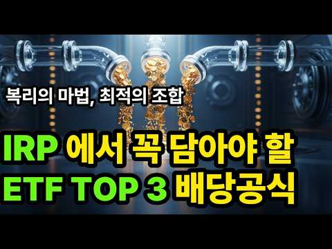
- 챕터: 0:00 IRP에 2% 예금 넣고 있다면 당장 보세요! · 0:45 IRP, 세액공제만 받는 계좌가 아닙니다 (최대 14… · 2:10 2026년 IRP 계좌 활용법: 배당 ETF 3가지가… · 3:05 IRP 계좌에 ETF 담을 때 규칙 (위험자산 70%… · 3:40 첫 번째 배당 ETF: ACE 미국배당다우존스 (장기… · 7:20 두 번째 배당 ETF: TIGER 미국배당다우존스 (… · 9:30 세 번째 배당 ETF: KODEX 미국배당커버드콜액티… · 13:50 IRP 안에서 3가지 ETF, 어떻게 배합해야 할까요… · 15:30 상황별 IRP 투자 전략: 금리 인하 vs 인플레이션… · 18:00 지금 당장 확인해야 할 IRP 체크리스트 5가지 · 20:30 오늘 영상 3줄 요약 (IRP 핵심 정리) · 21:20 중요한 투자 유의사항 (면책 조항)
- 설명 앞부분: IRP 계좌에 2% 예금만 넣어두셨나요? 10년 뒤 당신의 노후 자산이 150만원 더 벌 기회를 놓치고 있다면 이 영상을 꼭 보세요! 세액공제 혜택과 월배당 ETF 3가지로 노후를 완벽하게 준비하는 방법을 공개합니다. 안녕하세요, 투게더경제학입니다. 혹시 IRP 계좌를 단순한 절세 통장으로만 생각하고 계신가요? 2026년 현재, 많은 분들이 IRP의 진정한 잠재력을 놓치고 있습니다. 원금보장 예금이나 방치된 펀드 대신, 세액공제 최대 900만원(연봉 5,500만원 이하 시 16.5% 공제율로 최대 148.5만원 환급) 혜택 위에 …
- 같은 채널 평소 대비 ×10.4 (채널 최근 롱폼 중앙값 1,368회) · 평소 영상: 지폐가 사라지는 세상, 디지털화폐 CBDC 시대- 당신이 반드시 알아야 할 생존전략 5가… (1,510회) / 상속세 완전개편의 모든것 , 당신의 자산은 안전한가! 우리가 몰랐던 진실 . (1,227회)
- 대본 없음 (설명) — 음성인식이 끝나면 도입부·흐름이 들어감
- 댓글 2/2: 좋은 점 — 영상 0 · 감사·응원 0 · 더 알고 싶은 것 0 · 아쉬운 점 — 영상 0 · 반박·불만 — 의견 다름 0 · 정치·사회 0 · 경험 공유 0 · 구독·다음 기대 0

### 73. 평생 모은 돈, 노후에는 이 3가지에 먼저 쓰세요

- https://www.youtube.com/watch?v=_H2oRoXuF-Q · 인생다시쓰기 · 구독자 8,060 · 조회수 140,789 (×17.5, 하루 6,833.3) · 좋아요 500 (0.4%) · 16.4분 · 2026-09-23 · 주제 묶음 4. 노후·연금 · 형식 오디오북·낭독 (명언·인생조언) · 폴더 `W__H2oRoXuF-Q` (웹 승인)
- 썸네일: 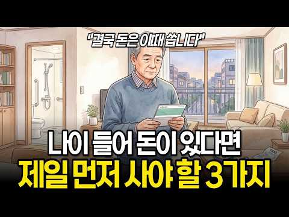
- 챕터: 0:00 돈이 있어도 가난해지는 노후 · 1:16 첫 번째, 80세에도 혼자 살 수 있는 집 · 4:34 두 번째, 귀가 멀어지면 사람도 멀어진다 · 7:44 세 번째, 자동차보다 중요한 이동의 자유 · 10:31 돈을 아끼면 자식이 시간을 쓰게 됩니다 · 14:36 노후에 돈으로 정말 사야 하는 것
- 설명 앞부분: 나이 들어 돈이 있어도 가난하게 느껴지는 노후가 있습니다. 돈보다 중요한 독립적인 노후 준비를 위해 지금 당장 시작해야 할 3가지를 정리했습니다. 영상에서는 단순히 재산의 많고 적음을 떠나, 실제로 어떻게 살아가느냐에 따라 갈리는 삶의 풍경을 다룹니다. 통장에 돈이 있어도 활동 반경이 좁아지면 결국 가난한 노후 생활을 보내게 되기 때문입니다. 반대로 적은 돈으로도 시장에 가고 친구를 만나며 활기차게 지내는 분들도 있습니다. 결국 중요한 것은 돈을 어떻게 쓰느냐입니다. 건강하게 움직이고 사람들과 어울릴 수 있는 환경을 만드는 것이야…
- 같은 채널 평소 대비 ×9.7 (채널 최근 롱폼 중앙값 14,526회) · 평소 영상: 60대부터는 남에게 베풀지 마세요, 나부터 챙겨야 하는 진짜 이유 (14,526회) / 왜 나이 들수록 배우자에게 더 함부로 하게 될까? (14,657회)
- 대본 없음 (설명) — 음성인식이 끝나면 도입부·흐름이 들어감
- 댓글 12/12: 좋은 점 — 영상 2 · 감사·응원 1 · 더 알고 싶은 것 0 · 아쉬운 점 — 영상 0 · 반박·불만 — 의견 다름 0 · 정치·사회 0 · 경험 공유 1 · 구독·다음 기대 0
  - 좋은 점 — 영상 👍6 “맞는말씀이세요! 공감합니다! 안전손잡이 화장실 미끄럼방지매트 중요합니다. 좋은영상감사합니다! 좋아요 누르고 성우님 읽어주셔서 잘듣고갑니다! 인생다시쓰기 채널님 감사합니다!”
  - 좋은 점 — 영상 👍0 “귀가 잘 안 들리면 대화가 힘든데 진짜 공감되네요.”
  - 감사·응원 👍6 “맞는말씀이세요! 공감합니다! 안전손잡이 화장실 미끄럼방지매트 중요합니다. 좋은영상감사합니다! 좋아요 누르고 성우님 읽어주셔서 잘듣고갑니다! 인생다시쓰기 채널님 감사합니다!”
  - 경험 공유 👍8 “건강을 잘 지켜서 5년만 버티면 내가 운전할 필요없이 차가 알아서 가는 세상이 되지 않을까요”

### 74. 돈 이야기가 아닙니다. 노후에 ‘남편이 있는 집’과 ‘남편이 없는 집’의 너무나 잔혹한 결정적 차이

- https://www.youtube.com/watch?v=A9MWoLgYDnQ · 마음을 안아주는 이야기-hkt · 구독자 14,700 · 조회수 248,782 (×16.9, 하루 4,119.2) · 좋아요 4,334 (1.7%) · 40.7분 · 2026-08-15 · 주제 묶음 4. 노후·연금 · 형식 브이로그·직접 해본 이야기 · 폴더 `W_A9MWoLgYDnQ` (웹 승인)
- 썸네일: 
- 설명 앞부분: 노후의 삶에서 가장 큰 차이는 단순히 돈이나 재산의 많고 적음에서 결정되지 않습니다. 오랜 세월 함께 살아온 남편이 곁에 있는 집과 남편이 없는 집은 일상, 감정, 건강, 인간관계에서 생각보다 훨씬 큰 차이를 만들어냅니다. 이번 영상에서는 노후, 남편이 있는 집, 남편이 없는 집에서 실제로 나타날 수 있는 결정적인 차이를 현실적인 시선으로 살펴봅니다. 경제적인 문제만이 아니라 외로움, 정서적 안정, 생활 습관, 가족과의 관계, 사회적 연결까지 노후의 삶에 영향을 미치는 중요한 요소들을 이야기합니다. 특히 평소에는 당연하게 생각했던…
- 같은 채널 평소 대비 ×217.1 (채널 최근 롱폼 중앙값 1,146회) · 평소 영상: 【90%가 무의식적으로】자녀와 멀어지는 부모가 계속해서 하고 있는 5가지 습관【자녀 양육… (1,146회) / 【앞으로의 삶】60~65세는 인생에서 가장 힘든 5년｜왜 90%의 사람들이 갑자기 쇠약해… (1,170회)
- 대본 없음 (설명) — 음성인식이 끝나면 도입부·흐름이 들어감
- 댓글 335/335: 좋은 점 — 영상 14 · 감사·응원 10 · 더 알고 싶은 것 3 · 아쉬운 점 — 영상 1 · 반박·불만 — 의견 다름 9 · 정치·사회 1 · 경험 공유 37 · 구독·다음 기대 0
  - 좋은 점 — 영상 👍9 “아래쪽 나오는 자막이 맞춤법이 틀 리는게 많아 보는게 아주 거북하군요 내용은 아주 쓸모있고 유익합니다”
  - 좋은 점 — 영상 👍6 “남편도 아내도 다 사람나름이긴 하지만 60대인 저도 애들 각자 독립해서 나가고 나니 남편이 더 소중하게 느껴지더군요 산책도같이하고 맛난걸 먹으러갈때도 혼자보단 둘이 좋구요 여행을 가도 서로 뭘 먹을지 어디서 잘지 신경쓰지 않고 쟈연스럽게 결정하게 되더라구요 친구나 지…”
  - 감사·응원 👍45 “따뜻한물에 몸을 담구고ㆍ그다음 넘행복 너무 감사 ᆢ이런말이 나올줄알았는데ᆢㅋㅋ 긍정적으로 생각하면 온통 감사할거리로 바뀔수있구요 ᆢ어차피 둘살다 한명 먼저가요 혼자왔다 혼자갑니다 ᆢ부부둘이 같이 사기당하는일도 심심찮게많아요 인생사는것도 계속배우고ᆢ그과정에서 많이 지혜…”
  - 감사·응원 👍13 “고맙습니다 도음이 됐습니다”
  - 더 알고 싶은 것 👍29 “남편 있는지 없는지 누구에게 굳이 알릴필요가 있을까요? 수리하시는분들도 아무 관심없어요”
  - 더 알고 싶은 것 👍0 “노후에 부부중 한쪽이 없는 확률이 높은데?그리고 요즘은 결혼안하고 혼자 사는 사람들이 더 많고 😢부모,형제없는 사람들은 어떻게 살까요?이런 극단적인 얘기로 사람들 불안조성 콘텐츠는 좀 그렇네요 그리고 남편 ,부인 오래 살게하는 방법을 먼저 알려주던가?😅너무 극단적이네…”
  - 아쉬운 점 — 영상 👍9 “아래쪽 나오는 자막이 맞춤법이 틀 리는게 많아 보는게 아주 거북하군요 내용은 아주 쓸모있고 유익합니다”
  - 반박·불만 — 의견 다름 👍2 “무슨 말도 안되는 x소리 인생은 각자 도생”
  - 반박·불만 — 의견 다름 👍1 “지금이 어떤 세상인데 이따위 유튜브를. 요즘 남편없다고 이런 취급을 받는다고요? 다 검색해보고 AI에게 물어보고 비교 검토해보고 하지, 남편없다고 바가지 씌우는 업자가 어딨어요? 진짜 말도 안되는 우스꽝스러운 소릴하네ㅠ”
  - 경험 공유 👍172 “우리집 관리, 수리는 다 내가, 남편은 아무것도 몰라.”
  - 경험 공유 👍124 “업자들이 남편없다고 깔봐서 그런게 아님 업자들 각자 생긴 양심임 . 남편있어도 그래요 울집은 여자인 내가 다 알아서 함. 단골없이 뭔일 생기면 여러군데 견적 물어봐서 그 중에 젤 싼면서도 잘 고쳐줄거 같은 업자한테 맡기는데...단골할 정도의 양심업자 아직 한군데도 없…”

### 75. 노년에 이성이 접근한다면, 목적은 딱 4가지입니다… 돈이 있든 없든 반드시 보세요【노후의 진실】

- https://www.youtube.com/watch?v=RRnTh3k1Fls · 노후의 진실 · 구독자 20,100 · 조회수 333,845 (×16.6, 하루 3,335.0) · 좋아요 7,505 (2.2%) · 29.1분 · 2026-07-06 · 주제 묶음 4. 노후·연금 · 형식 정보·해설 (그 밖) · 폴더 `W_RRnTh3k1Fls` (웹 승인)
- 썸네일: 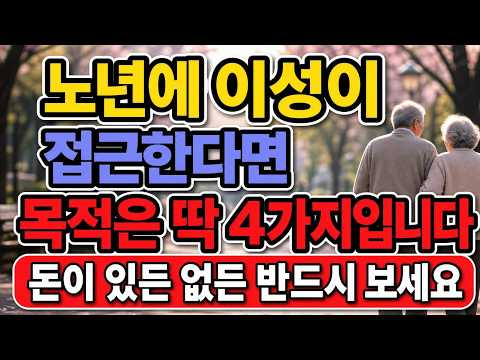
- 설명 앞부분: 노년에 이성이 접근한다면, 목적은 딱 4가지입니다… 돈이 있든 없든 반드시 보세요【노후의 진실】
- 같은 채널 평소 대비 ×6.0 (채널 최근 롱폼 중앙값 55,722회) · 평소 영상: 70세 이후 절대 돈을 두면 안 되는 '이곳', 노인 99%가 모르고 있습니다 (57,591회) / 돈 이야기가 아닙니다. 노후에 '남편이 있는 집'과 '남편이 없는 집'의 너무나 잔혹한 … (53,853회)
- 대본 없음 (설명) — 음성인식이 끝나면 도입부·흐름이 들어감
- 댓글 469/469: 좋은 점 — 영상 11 · 감사·응원 13 · 더 알고 싶은 것 1 · 아쉬운 점 — 영상 1 · 반박·불만 — 의견 다름 8 · 정치·사회 0 · 경험 공유 16 · 구독·다음 기대 1
  - 좋은 점 — 영상 👍65 “노후에 대한 여러가지 채널을 봤는데 다들 뻔한 얘기들이였어요 여기가 제대로네요”
  - 좋은 점 — 영상 👍31 “내용이 아주 유익하네요. 결정적인것은 노년에만 해당하는 얘기는 아닐 듯 합니다.”
  - 감사·응원 👍78 “좀 다른말이긴 한데, 베트남 여자덜 조심하세요. 고맙다는말 절대 안하고, 뭔 가족들까지 허구헌날 아프고... 연금 나오는거 쪼개서라도 송금하라 하고 본인과 그친척은 맨날 아프고 내가 아픈건 별관심 없음. 😂”
  - 감사·응원 👍56 “7대 장손 맏며느리로 살며 평생 고맙다 소리 들어본 적 없소 시할아버지 시아버지 시어머니 차례로 가시고 40년 같이 산 남편도 해빙기때 가셨소 모든 짐 훌훌 벗어버리고 혼자 자유를 만끽하며 살고 있소 아주 편하고 좋소 아들이고 딸이고 손주고 보고싶소 하면 얼굴한번 보…”
  - 아쉬운 점 — 영상 👍36 “걷기 수영하기 자전거타기 낚시하기 등산하기 음악듣기 책보기 부산의 남포동국제시장 부평시장 쇼핑맛집 탐방하기 둘랫길걷기 진짜최고입니다 나이66세 남 ㅡㅡㅡㅡㅡ”
  - 반박·불만 — 의견 다름 👍6 “노년에만 해당되는 얘기가 아닙니다.”
  - 반박·불만 — 의견 다름 👍2 “다~그런건아닌데요”
  - 경험 공유 👍78 “좀 다른말이긴 한데, 베트남 여자덜 조심하세요. 고맙다는말 절대 안하고, 뭔 가족들까지 허구헌날 아프고... 연금 나오는거 쪼개서라도 송금하라 하고 본인과 그친척은 맨날 아프고 내가 아픈건 별관심 없음. 😂”
  - 경험 공유 👍27 “인생에서 노년은 생각보다 깁니다 그만살고 죽고싶다 죽어지지 않아요 하루하루 살아내야지요 인간은 원래 이기적인겁니다 우선은 건강해야되니 운동은 해야합니다 몸이 굳어가니까 아파오니까 음식도 잘 챙겨먹고 내가 하고픈걸 조금씩 하고 혼자 즐길줄 알아야합니다 노래도 가볍게 흥…”
  - 구독·다음 기대 👍2 “잘들었습니다. 구독합니다~”

### 76. 《정약용 명언》 부자가 되는 여성이 즐겨 입는 옷 색깔 5가지. 이 색만 입어도 평생 재물이 따릅니다

- https://www.youtube.com/watch?v=BTpNqy7XqJE · 다산의 서재 · 구독자 22,200 · 조회수 363,948 (×16.4, 하루 5,736.8) · 좋아요 11,916 (3.3%) · 36.9분 · 2026-08-12 · 주제 묶음 1. 재테크 일반·마인드 · 형식 오디오북·낭독 (명언·인생조언) · 폴더 `W_BTpNqy7XqJE` (웹 승인)
- 썸네일: 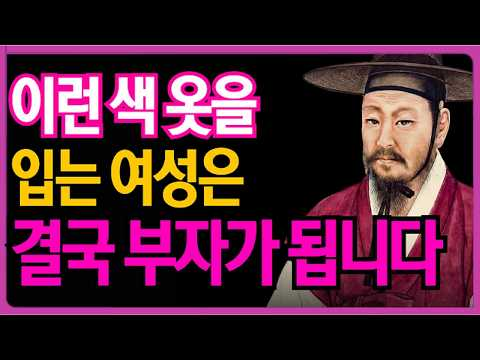
- 챕터: 0:00 당신의 옷장이 자신도 모르는 사이에 행운을 쫓아내고 … · 3:42 현인 정약용은 복장과 인품에 관해 무엇을 가르쳤습니까? · 8:18 결단력의 색이자 신뢰의 색, 이는 부유한 여성들이 결… · 13:21 "대지의 색과 지성의 색—자산의 유출을 막아주는 두 … · 18:57 "위엄 있는 품격의 색 — 자연스럽게 타인의 시선을 … · 24:30 "대가들은 공허한 이론을 가르치지 않습니다 — 오늘 … · 30:33 색을 이해하는 여성은 자신의 운명을 이해하는 여성입니…
- 설명 앞부분: 정약용 선생의 가르침에 따르면, 사람의 옷차림은 단순한 외모가 아니라 마음의 태도와 운의 흐름을 나타냅니다. 특히 여성이 즐겨 입는 옷의 색깔은 그 사람의 내면 에너지, 자존감, 그리고 재물을 끌어당기는 기운을 그대로 반영합니다. 부자가 되는 여성들은 결코 우연히 부를 얻은 것이 아닙니다. 그들은 자신도 모르게 특정 색깔의 옷을 선택하며, 그 색이 마음의 품격을 세우고 주변의 존중을 자연스럽게 불러옵니다. 오늘 이 영상에서는 정약용 선생이 남긴 지혜를 통해, 평생 재물이 따르는 여성들이 사랑하는 5가지 옷 색깔의 비밀을 함께 나눕…
- 같은 채널 평소 대비 ×32.7 (채널 최근 롱폼 중앙값 11,132회) · 평소 영상: 《정약용 명언》 맞춰줄수록 인연은 떠난다. 얼굴에 '이 4가지'가 있는 여자에게 귀인이 … (11,132회) / 《정약용 명언》 부자가 되는 여자일수록 매일 챙겨 먹는 '이 음식' 5가지, 반드시 따라… (10,925회)
- 대본 없음 (설명) — 음성인식이 끝나면 도입부·흐름이 들어감
- 댓글 1,619/1,619: 좋은 점 — 영상 27 · 감사·응원 215 · 더 알고 싶은 것 3 · 아쉬운 점 — 영상 9 · 반박·불만 — 의견 다름 5 · 정치·사회 1 · 경험 공유 31 · 구독·다음 기대 0
  - 좋은 점 — 영상 👍138 “나는 오늘부터 색갈잇는옷을 입을것입니다 좋은말씀 잘들었습니다 감사합니다”
  - 좋은 점 — 영상 👍42 “나는언제나품격있는여성입니다.늘좋은말씀감사합니ㅡ다❤❤❤❤🎉🎉”
  - 감사·응원 👍248 “나는 언제나 이세상에 제일 귀한 사람이라고 생각 하며 살고있어요 나없는 이세상 아무것도 없다는 마음으로 아침에 새로운 부활에 감사하며 살아갑니다~❤😅❤”
  - 감사·응원 👍175 “감사합니다^^ 나는 귀부인처럼 귀하게 품격 있게 살겠습니다 ^^”
  - 더 알고 싶은 것 👍4 “다선까지글을 올려주세요. 말만지나니또있어버림”
  - 더 알고 싶은 것 👍3 “예전에 없는 사람이 어떻게 색깔 옷을 입었을까요? 양반과 부자만 ..”
  - 아쉬운 점 — 영상 👍8 “서론이너무길어요 짜증 나네요”
  - 아쉬운 점 — 영상 👍3 “너무길어서...”
  - 반박·불만 — 의견 다름 👍1 “색깔 내게 어울려야 입지요 환한색이 좋다고 무조건 입으면 촌스러워 영아닙니다 개인적으로 저는 파스텔 톤이 어울려서 주로 같우색을 입지요”
  - 반박·불만 — 의견 다름 👍1 “나는 못생기고 맘 착하고 공부 잘하는 사람입니다 ㅎ 못생겨서 남자한테나 여자한테나 관심을 못 받습니다 근데 결혼후 대출 받아본 적이 없습니다 재물은 항상 넘쳣죠 남편도 똑똑한 사람은 아닌데 인복이 많아 항상 누가 도와줘요 옷 색깔은 모르겟어요😁”
  - 정치·사회 👍26 “나는 내가 13살 소녀때 부터 나를 귀하고 아주 특별한 사람이라 믿었고 옷에도 매우 신경 썼습니다 또 하나님을 믿게된후 20세가 넘어서는 더육 더 주님의 자녀답게 존귀한 여자로써 어디에 있든지 스스로 한국인 다운 외국인들 앞에서는 빛나도록 옷을 입는 페션과 칼러 그리…”
  - 경험 공유 👍26 “나는 내가 13살 소녀때 부터 나를 귀하고 아주 특별한 사람이라 믿었고 옷에도 매우 신경 썼습니다 또 하나님을 믿게된후 20세가 넘어서는 더육 더 주님의 자녀답게 존귀한 여자로써 어디에 있든지 스스로 한국인 다운 외국인들 앞에서는 빛나도록 옷을 입는 페션과 칼러 그리…”
  - 경험 공유 👍9 “내가 나를 존중해야 한다.😂”

### 77. 62세 은퇴후 아내마저 떠났다. 68세에 월 80만원으로 살아가는 노인의 독백 "삼십 년을 살았는데, 아내 하루가 어떻게 흘러가는지 한 번도 몰랐습니다"

- https://www.youtube.com/watch?v=ObUr9qiawmo · 황금노후 · 구독자 12,400 · 조회수 194,163 (×15.7, 하루 1,264.4) · 좋아요 2,890 (1.5%) · 13.7분 · 2026-05-13 · 주제 묶음 4. 노후·연금 · 형식 사연·드라마 · 폴더 `W_ObUr9qiawmo` (웹 승인)
- 썸네일: 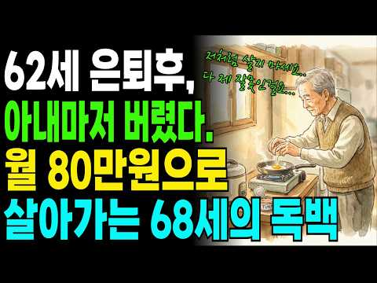
- 설명 앞부분: 황혼이혼, 독거노인, 노후준비, 은퇴 후 삶, 부부관계, 노년 외로움, 정년퇴직 현실 누구도 말하지 않았던 그 이야기를 68세 노인이 직접 전합니다. 삼십 년을 함께 살았던 아내와의 이혼, 연락이 끊긴 자녀들, 월세 35만원 원룸에서 국민연금 80만원으로 살아가는 하루. 이것은 먼 이야기가 아닙니다. 중견기업 부장까지 올라가 성실하게 삼십 년을 일했습니다. 퇴직금도 받았고, 연금도 나왔습니다. 돈은 준비했다고 생각했습니다. 하지만 아무도 알려주지 않았습니다. 마음의 준비, 관계의 준비가 더 중요하다는 것을. 지금 이 영상을 보고 …
- 같은 채널 평소 대비 ×625.3 (채널 최근 롱폼 중앙값 310회) · 평소 영상: 밥 먹을 때 그 사람의 진짜 인격이 보입니다 ∣ 식사 자리에서 드러나는 인간관계의 비밀 … (313회) / 나이들수록 외모를 꾸며야 어디서든 제대로 대접받는다. ｜다산정약용의 네가지 아침습관｜인생… (308회)
- 대본 없음 (설명) — 음성인식이 끝나면 도입부·흐름이 들어감
- 댓글 610/610: 좋은 점 — 영상 5 · 감사·응원 23 · 더 알고 싶은 것 3 · 아쉬운 점 — 영상 4 · 반박·불만 — 의견 다름 6 · 정치·사회 5 · 경험 공유 30 · 구독·다음 기대 0
  - 좋은 점 — 영상 👍7 “동영상을 듣고보니 공통적으로 공감합니다 어째 내 생활하고 비슷하지만 한두가지가 내가 더갖고 있는듯 싶네요.돈. 운동 취미생활. 정신적으로 대박이 진돗개를 키웁니다.많은 정을 느끼고 느끼는 감정이 비슷합니다 .”
  - 좋은 점 — 영상 👍2 “60대인데 일할수있는데 돈번다기보다 세상에 썩인다는개념으로 일을나가세요 노인일자리는 새로운통로가 될수있지요 대화할사람들도 있구요 병원혼자가는게 뭐가 괴로워요 저는 수술할때도 보호자싸인 제가함니다 자식들안와도 아무렇지도 않슴니다 자기연민에 빠지는건 사는데 별도움이 안됨…”
  - 감사·응원 👍15 “우리네. 인생은. 늙고. 병들면. 고독하고. 외롭고. 허무해집니다. 그러나. 나의. 현실을. 인정하면서. 모든. 과정을. 철학적인. 관점에서. 보면은. 결코. 살아있음에. 감사하고. 이세상이. 즐거운. 날. 소풍이였다고. 너무. 슬퍼하거나. 착망하지. 말아야합니다 끝…”
  - 감사·응원 👍10 “아름다운 마음으로 행복을 전해주시는 영상에 감사드립니다.”
  - 더 알고 싶은 것 👍22 “지하철 무료고 공원도 무료입니다. 혼자 사니 도시락 직접 싸든가,깁밥 2줄이면 7,000원 하고 막걸리 2통 사서 산에 가면 체력단련 할수 있고요. 나이먹어 연애는 못해도 건강한 말동무 친구도 만날 기회 있네요. 우리나이 67세 촌로의 생각입니다. 30년 열심히 사신…”
  - 더 알고 싶은 것 👍4 “저는 70대인데 궁금해서 들어와 봤더니 낚시 당한 기분입니다. 실화가 아니고 참 참 . . .”
  - 아쉬운 점 — 영상 👍8 “사람마다 생각이 천차 만별 이네요.저는 평생 주변인에게 배풀기만 했어요. 그런 형편도 늘 감사해 하였지요. 60이 들어설때 저는 아내와 저를 위해 남은 시간을 쓰기로 하고 친구들을 다 끊었었습니다. 아내와 일요일 마다 같이 다니고. 그동안 시간 없어서 못했던 일과 배…”
  - 아쉬운 점 — 영상 👍4 “저는 70대인데 궁금해서 들어와 봤더니 낚시 당한 기분입니다. 실화가 아니고 참 참 . . .”
  - 반박·불만 — 의견 다름 👍3 “아내, 아들, 딸, 다 문제네요. 68세는 그리 노인 아닙니다.. 젊게 사시고 즐겁게 사세요..”
  - 반박·불만 — 의견 다름 👍2 “아내 인생 허무한거 왜 남편에게 원망해. 남편도 ㅊ시선을 다해 살은건데. 또다른 인생의 허무함인데. 남편탓리 아닌데.”
  - 정치·사회 👍3 “내용은 청승이고.. 음성은 외국인ai쓰고 구독구걸하면서 배울점은 하낫또 없고 대체 왜 이런 영상을 만드는지...”
  - 정치·사회 👍2 “국힘이 만든//국힘을 찍은 1빠들..ㅊㅋ합니다.^^”
  - 경험 공유 👍81 “의미 없는 이러한 삶을 계속 살아야 하는가 하는 생각이 듭니다. .나도 몸이 많이 아프고 매일 하는 것이 집 근처 공원에 나가서 시간을 보냅니다. .아무 의미도 없는. 이러한 삶을 왜 이렇게 계속 살아야 하는지 참으로 안타깝습니다”
  - 경험 공유 👍71 “저희들키운다고아빠는평생을바쳤는데.부인도.남편이헛짓하며살지않았는데가족남보다못한사이.잘못한거없습니다.고생하셨습니다”

### 78. 50대 자산 7억이 거지라고 진짜 평균은 따로 있습니다

- https://www.youtube.com/watch?v=TK4FK8lH1Qs · 송차장기록 · 구독자 8,440 · 조회수 131,445 (×15.6, 하루 881.4) · 좋아요 1,514 (1.1%) · 17.6분 · 2026-05-18 · 주제 묶음 기타 · 형식 브이로그·직접 해본 이야기 · 폴더 `W_TK4FK8lH1Qs` (웹 승인)
- 썸네일: 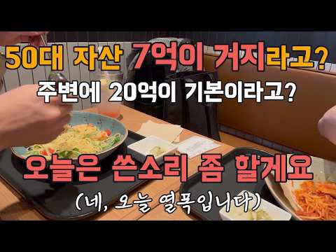
- 챕터: 0:00 회사 선배가 며칠째 잠을 못 이루는 이유 · 3:30 "50대 7억은 폐지 주워라"… 진짜 그런가 · 9:00 100가구 중 88가구는 10억이 없습니다 · 13:40 댓글창의 거짓말, 영화 「리플리」처럼
- 설명 앞부분: 어제 회사 선배랑 저녁 한 끼 먹었습니다. 술 못 드시는 선배라 커피 한 잔에 두 시간을 앉아 있었는데, 며칠 전 블라인드에서 본 글 하나가 머리에서 안 떠나신다고 하시더라고요. 50대 가장이 부부 합산 7억으로 노후 준비를 묻는 글에, 폐지 주우라는 댓글이 줄줄이 달렸다는 이야기. 30년 가까이 한 회사에서 새벽에 일어나 출근해 온 사람의 자존심이 한 줄짜리 댓글에 깎이는 걸 본 거지요. 집에 와서 자료를 찾아봤습니다. 댓글창 풍경은 우리나라 평균이 아니더라고요. 자산 많은 분들 목소리만 모이는 자리지, 보통 사람의 자리가 아니…
- 같은 채널 평소 대비 ×8.2 (채널 최근 롱폼 중앙값 15,949회) · 평소 영상: 은퇴하고 혼자 남는 남편들, 이유가 있었습니다 황혼이혼 역대 최다 (16,089회) / 4050 번아웃, 다 놓고 싶은 그 마음의 정체 열에 일곱이 겪습니다 (15,809회)
- 대본 없음 (설명) — 음성인식이 끝나면 도입부·흐름이 들어감
- 댓글 689/689: 좋은 점 — 영상 7 · 감사·응원 14 · 더 알고 싶은 것 12 · 아쉬운 점 — 영상 2 · 반박·불만 — 의견 다름 20 · 정치·사회 10 · 경험 공유 47 · 구독·다음 기대 1
  - 좋은 점 — 영상 👍7 “제가 서른초반에 강남 꼬마빌딩 사서 속칭 건물주 소리듣고 이사했었는데요. 동네서 제일 어렸었고 건물주 친목회하면 다 제 아버지 연세 위 셨어요. 눈 많이 오면 제일 먼저 나가 새벽부터 눈치우면 다 같이 나와 온 동네 치우고 슈퍼 앞에서 막걸리 한 병씩 마시고 슈퍼사장…”
  - 좋은 점 — 영상 👍4 “위례 전세 살고 있는 53세 젊은 아찌입니다 요즘 송차장님 영상 참 즐겁게 보고 있네여 내용 너무 좋구여 현실적인 애기에 공감합니다 앞으로도 꾸준한 영상 부탁드립니다”
  - 감사·응원 👍145 “50대 중반인 저로서도 신경이 쓰이는 내용이네요. 댓글이 맞고 틀리고를 떠나서 예의가 없는 댓글이네요. 제가 아는 부자들은 대부분은 예의 바르고 성실한 분들입니다. 저런 말을 아무렇지도 않게 사람이라면 부자가 아닐 확률이 매우 높고 혹여 갑작스레 졸부가 되었더라도 얼…”
  - 감사·응원 👍32 “50대 중반을 지나면서 지금이 제일 만족스런 이유. 1.집 포함해서 4억인 재산. 아무리 생각해도 돈 버는 재주는 별로 없구나 싶지만 빚 없슴에 만족하고 행복함. 2.두 자녀 중 큰 애는 대학 졸업 후 취업 2년차 독립. 막내도 대학 4학년 대단히 나를 행복하게 만듦…”
  - 더 알고 싶은 것 👍4 “위례 전세 살고 있는 53세 젊은 아찌입니다 요즘 송차장님 영상 참 즐겁게 보고 있네여 내용 너무 좋구여 현실적인 애기에 공감합니다 앞으로도 꾸준한 영상 부탁드립니다”
  - 더 알고 싶은 것 👍3 “첫화면 문래동 영문초등학교앞 맞나요?? 좋은얘기 잘 들었습니다~^^;;”
  - 아쉬운 점 — 영상 👍1 “그냥 어그로 댓글을 뭘그리 진지하게…. 이번 소재는 좀 억지네요 ㅎㅎ”
  - 반박·불만 — 의견 다름 👍73 “어이없어서 웃었네요. 7억이 얼마나 큰 재산인데…”
  - 반박·불만 — 의견 다름 👍2 “남과의 비교는 의미가 없는거 같습니다.. 제가 조금더 나이가 많은거 같은데.. 행복은 자기 스스로 찾는거 같습니다.. 저도 자산 많지만 그게 행복은 아닙니다..나이가 들수록 인생 목표는 계속 바뀌는거 같습니다”
  - 정치·사회 👍0 “쓰레기 같은 댓글에 반응하지 마세요. 그런 댓글 쓰는 사람들은 그만큼의 자산도 없어서 배가 아파 빈정거리는 족속들이니까요. 화내면, 낚이는 겁니다. 무시와 무반응이 그놈들을 이기는 겁니다. 그놈들은 종북좌파 빨갱이일 수 있고, 중국 댓글부대일 수도 있으니까요.”
  - 정치·사회 👍0 “부동산을 작살 내야 나라가 삽니다”
  - 경험 공유 👍145 “50대 중반인 저로서도 신경이 쓰이는 내용이네요. 댓글이 맞고 틀리고를 떠나서 예의가 없는 댓글이네요. 제가 아는 부자들은 대부분은 예의 바르고 성실한 분들입니다. 저런 말을 아무렇지도 않게 사람이라면 부자가 아닐 확률이 매우 높고 혹여 갑작스레 졸부가 되었더라도 얼…”
  - 경험 공유 👍107 “허언증 말기인 모지리들임 ㅋ 순자산 천억이라 ㅆㅣ부리면 내가 천억자산가인가?”
  - 구독·다음 기대 👍2 “구독하고갑니다”

### 79. "이건 저희 부모님도 가능해요" 외국인한테 한국어 읽어주고 달러 버는 역대급 부업

- https://www.youtube.com/watch?v=lHj-_pcQSX4 · 뉴머니 · 구독자 27,800 · 조회수 405,639 (×14.6, 하루 4,822.5) · 좋아요 8,170 (2.0%) · 16.1분 · 2026-07-22 · 주제 묶음 8. 부업·소득 · 형식 정보·해설 (그 밖) · 폴더 `W_lHj-_pcQSX4` (웹 승인)
- 썸네일: 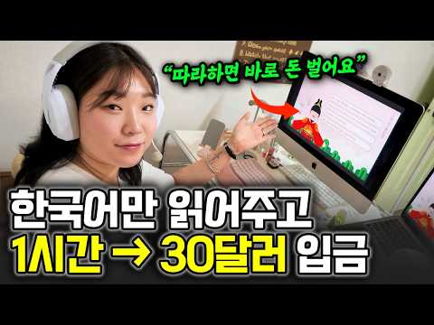
- 설명 앞부분: ⏰ 무료라이브 날짜는 신청하시면 단톡방에서 공지드립니다 ⚠️현재 신청 폭주!!! 곧 단톡방 마감됩니다⚠ 필수! 단톡방 입장하면 필살기 무료선물 드립니다 🚨선착순 한정 한국어만 읽어주고 달러를 번다고?🫢 오늘 출연하신 한글언니님은 영어를 유창하게 하지 않아도 외국인들에게 한국어를 가르치며 매달 꾸준히 달러 수익을 만들고 계십니다. “이런 거 하는 사람 많아서 이미 레드오션 아닌가요?” 그렇게 생각하실 수도 있는데요. 놀랍게도 한국어 강사는 영어 강사보다 훨씬 적은 반면 배우려는 학생은 200만명이 넘는다는 사실...🫢 이번 영상에서…
- 같은 채널 평소 대비 ×34.1 (채널 최근 롱폼 중앙값 11,898회) · 평소 영상: "뻔한 쇼핑쇼츠 그만하세요" 비밀공식 하나로 월 8,000만원 찍었던 방법 전부 공개합니… (12,028회) / "쉬운데 모르는 사람 많아요" 과일 사진 올려주고 4개월만에 17억 번 역대급 부업 (11,768회)
- 대본 없음 (설명) — 음성인식이 끝나면 도입부·흐름이 들어감
- 댓글 990/990: 좋은 점 — 영상 42 · 감사·응원 87 · 더 알고 싶은 것 54 · 아쉬운 점 — 영상 5 · 반박·불만 — 의견 다름 0 · 정치·사회 36 · 경험 공유 232 · 구독·다음 기대 11
  - 좋은 점 — 영상 👍8 “전 세아이의 엄마인데 경력단절로 코로나때 일그만두고 52세가 되었는데 저도 신청 가능한가요? 좋은 영상 감사합니다 ~몇년 쉬다가 일하고는 싶은데 ~막내가 초6, 고등학생 둘까지 아직 손이 가는 부분이 있어 뭔가 일을 하려는게 두렵고 그렇습니다~ 저도 신청가능할까요?”
  - 좋은 점 — 영상 👍6 “다른 영상들은 봐도 신뢰가 가지않았는데 대표님이 올리신글들 영상에서 하시는 말들에 아 진짜 제대로 배워볼수있겠다는 생각이 들었어요. 그리고 이런것들을 좋은 영상으로 만들어주셔서 감사합니다! 신청하겠습니다 :)”
  - 감사·응원 👍233 “안녕하세요, 한글언니입니다! 🥰 저도 광고를 보고 시작한 사람인만큼 많은 무료 부업 강의들을 시청했습니다 여러분이 느끼셨던 기분, 저도 느껴봤어요 🫥 제 시급 4만원을 기준으로 강의는 두시간가량 진행 예정이니 여러분이 내어주시는 시간을 돈으로 환산하면 10만원이 되겠…”
  - 감사·응원 👍21 “호주에 거주하면서 문화의 힘을 많이 체감하는 중입니다🇦🇺 한국어를 배우고 싶어하는 외국인들 정말 많아요 😮 한글을 널리 알리는데 더 적극적으로 나서보고 싶어서 신청합니다 😊 좋은 영상 감사해요🦘🧡”
  - 더 알고 싶은 것 👍54 “무료 강의후에 강의 신청하라고 하죠? 강의비 대략 얼마인가요?😅😊❤”
  - 더 알고 싶은 것 👍47 “저는70살 LA거주 할머니 입니다 영어도 가능하고 한글 학교 선생으로 7년 이상 경력이 있습니다 신청할 수 있을까요?”
  - 아쉬운 점 — 영상 👍233 “안녕하세요, 한글언니입니다! 🥰 저도 광고를 보고 시작한 사람인만큼 많은 무료 부업 강의들을 시청했습니다 여러분이 느끼셨던 기분, 저도 느껴봤어요 🫥 제 시급 4만원을 기준으로 강의는 두시간가량 진행 예정이니 여러분이 내어주시는 시간을 돈으로 환산하면 10만원이 되겠…”
  - 아쉬운 점 — 영상 👍7 “무료신청 ㅡ낚시 입니다ㆍ”
  - 정치·사회 👍46 “호주 25년째 거주하고있습니다. 한글 배우고 싶어하는 외국인들에게 많은 도움이 되고 싶습니다. 제 주위에도 엄청 많습니다! 이렇게 좋은 기회가 있는줄 몰랐습니다. 저도 특강 신청하겠습니다!”
  - 정치·사회 👍21 “호주에 거주하면서 문화의 힘을 많이 체감하는 중입니다🇦🇺 한국어를 배우고 싶어하는 외국인들 정말 많아요 😮 한글을 널리 알리는데 더 적극적으로 나서보고 싶어서 신청합니다 😊 좋은 영상 감사해요🦘🧡”
  - 경험 공유 👍238 “전에 한번 해봤는데, 돈 받고 떠든다고 생각하니까.. 부담감이 장난아니더라구요. 잘나가시는 분은 커리큘럼도 있어야하고, 교재도 만들어서 사용허시요”
  - 경험 공유 👍233 “안녕하세요, 한글언니입니다! 🥰 저도 광고를 보고 시작한 사람인만큼 많은 무료 부업 강의들을 시청했습니다 여러분이 느끼셨던 기분, 저도 느껴봤어요 🫥 제 시급 4만원을 기준으로 강의는 두시간가량 진행 예정이니 여러분이 내어주시는 시간을 돈으로 환산하면 10만원이 되겠…”
  - 구독·다음 기대 👍8 “달러를 벌고 싶어서 부업알아보는데 알고리즘이 데려다줬어요 기대됩니다. 신청합니다”
  - 구독·다음 기대 👍5 “우연한 기회에 유튜브를 찍게 되었는데 발음이 정확하고 자연스럽다는 것을 알게되어 저의 장점을 살릴 수 있는 일인것 같아 너무 배우고 싶습니다. 매달 제로에서 시작해야하는 영업 프리랜서로 일하고 있습니다. 대출로 인한 가계 지출이 많은 저로서는 안정적인 수익창출이 절실…”

### 80. 저는 1년 동안 매달 5만 원을 모아봤습니다. 그리고 돈에 대한 생각이 달라졌습니다

- https://www.youtube.com/watch?v=IBAvE_dF0L4 · 돈의 통찰 · 구독자 3,930 · 조회수 56,958 (×14.5, 하루 919.0) · 좋아요 777 (1.4%) · 41.6분 · 2026-08-13 · 주제 묶음 기타 · 형식 브이로그·직접 해본 이야기 · 폴더 `W_IBAvE_dF0L4` (웹 승인)
- 썸네일: 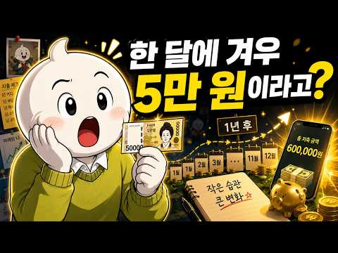
- 설명 앞부분: 매달 5만 원. 처음에는 너무 작은 금액처럼 보였습니다. 하지만 1년 동안 꾸준히 모아보니, 단순히 통장 잔액만 달라진 것이 아니었습니다. 이 영상에서는 **매달 부담 없이 저축할 수 있는 작은 금액을 정하고, 자동으로 분리해 쌓아가는 방법**을 이야기합니다. 월급의 20%를 무조건 저축해야 한다는 말이 부담스러웠던 분들, 몇 번이나 저축을 시작했다가 예상치 못한 지출 때문에 포기했던 분들이라면 이 방법이 도움이 될 수 있습니다. 💰 매달 5만 원을 꾸준히 모으는 방법 🏦 생활비와 저축금을 분리하는 이유 🧠 작은 목표가 저축 습관…
- 같은 채널 평소 대비 ×4.2 (채널 최근 롱폼 중앙값 13,666회) · 평소 영상: 돈이 있다고 말하는 순간, 거절의 대가가 커집니다｜자산을 공개하면 생기는 일 (13,983회) / 부자처럼 보이는 사람과 진짜 부자의 결정적 차이｜이 신호를 보세요 (13,348회)
- 대본 없음 (설명) — 음성인식이 끝나면 도입부·흐름이 들어감
- 댓글 40/40: 좋은 점 — 영상 3 · 감사·응원 4 · 더 알고 싶은 것 0 · 아쉬운 점 — 영상 2 · 반박·불만 — 의견 다름 0 · 정치·사회 0 · 경험 공유 5 · 구독·다음 기대 0
  - 좋은 점 — 영상 👍8 “영상 너무 유익해요!”
  - 좋은 점 — 영상 👍6 “영상보고 많이 배웠 어요 감사 합니다”
  - 감사·응원 👍6 “영상보고 많이 배웠 어요 감사 합니다”
  - 감사·응원 👍3 “저도 이렇게 하고 있습니다. 무리하지 않고 지속할 수 있는 가장 현실적인 방법입니다. 좋은 영상 감사합니다.”
  - 아쉬운 점 — 영상 👍15 “너무길어요 요점만”
  - 아쉬운 점 — 영상 👍6 “지루하네요”
  - 경험 공유 👍12 “항상기준에 못미쳐서 내가 못하는거구나 그랬는데 위로를 받았네요”
  - 경험 공유 👍8 “맞아요 위로를 받았어요 항상기준에 못미쳐서 내가 못하는거구나 그랬는데 위로를 받았네요”

