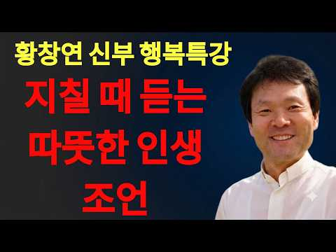
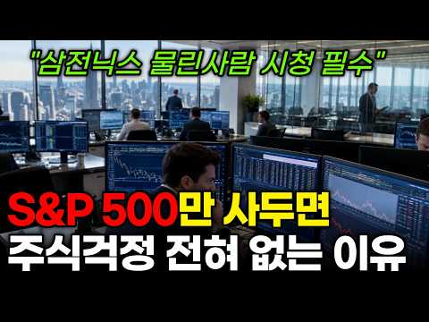
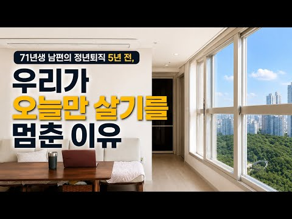
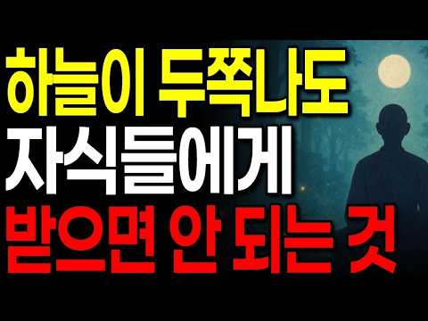
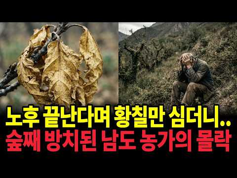
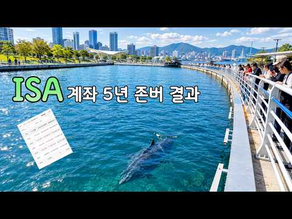
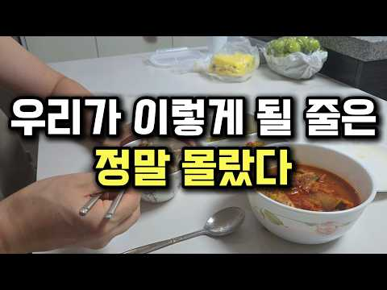
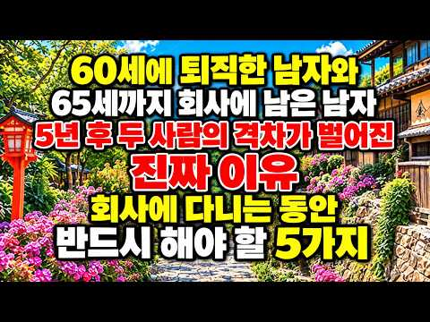
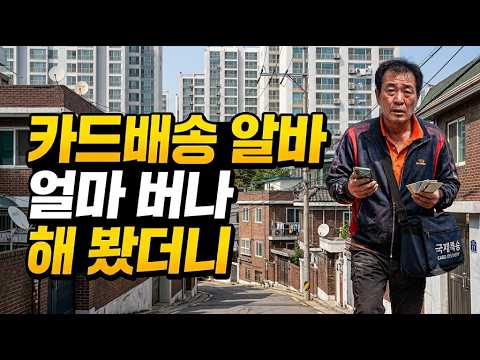

# 재테크 — 성공 사례 분석: 사례별 자세히 #41–#80

`analysis.md` 의 9번 (같은 # 번호). 자동 생성 — `tools/success_analysis.py` v1.5.1 (2026-10-22 07:33 UTC). ※ 연구·교육용 — 투자 권유가 아님.

### 41. 50대 옥탑방 부부, "그 나이에 왜 주식을..."

- https://www.youtube.com/watch?v=FRzyTNO9mNI · 반백살, 옥탑방 이야기 · 구독자 602 · 조회수 42,933 (×71.3, 하루 2,281.9) · 좋아요 419 (1.0%) · 6.3분 · 2026-10-03 · 주제 묶음 3. 주식·ETF · 형식 정보·해설 (그 밖) · 폴더 `W_FRzyTNO9mNI` (웹 승인)
- 썸네일: 
- 설명 앞부분: 지난 영상 이후, 50대 옥탑방 부부인 저희의 주식 도전에 많은 분들이 걱정과 조언을 남겨주셨습니다. 진심으로 감사드립니다. "그 나이에 왜 위험하게 주식을 하느냐"는 물음에 오늘 제 진솔한 속마음을 전합니다. 사기와 빚을 겪으며 깨달은 금융 무지의 서러움, 그리고 평생 일할 수 없다는 현실 앞에 저희에게 파이어족은 노후를 위한 '마지막 생존 전략"입니다. 지치지 않고 끝까지 걸어갈 수 있도록 많은 응원과 격려 부탁드립니다. 오늘도 시청해 주셔서 감사합니다.
- 같은 채널 평소 대비 ×13.3 (채널 최근 롱폼 중앙값 3,222회) · 평소 영상: 8월 폭염 속, 침침해진 눈으로 배달을 나섭니다. (3,342회) / "여보 제발 나가지 마!" 돈 없는데 비 온다고 일 안 못나가는 이유 (3,103회)
- 대본 (음성인식(앞 5분), 4.2 음절/초) — 앞부분만, 흐름은 그 안까지 첫 20초: “안녕하세요 구독자 여러분 50대 옥탑방 아내입니다. 어느 덧 바람 끝이 제법 선선해진 가을이 왔네요. 하늘도 높아지고 날씨가 참 좋습니다. 우리 구독자분들도 오늘 하루 기분 좋게 잘 보내고 계신가요? 옥탑방에서 바라보는 하늘은 계절이 바뀔 때마다 괜히 마음을 몽글몽글하게 만드는 것 같아요.” — 도입부 유형: 숫자로 시작, 시청자 부르기
- 첫 1분: “안녕하세요 구독자 여러분 50대 옥탑방 아내입니다. 어느 덧 바람 끝이 제법 선선해진 가을이 왔네요. 하늘도 높아지고 날씨가 참 좋습니다. 우리 구독자분들도 오늘 하루 기분 좋게 잘 보내고 계신가요? 옥탑방에서 바라보는 하늘은 계절이 바뀔 때마다 괜히 마음을 몽글몽글하게 만드는 것 같아요. 오늘 이렇게 영상을 제작하는 것은 지난 영상 이후에 정말 많은 분들이 남겨주신 댓글에 마음 깊이 감사하다는 말씀을 전하고 싶어서 입니다. 제가 주식공부에 보겠다고 말씀드린 이후로 걱정 어린 마음으로 따뜻한 조언과 충고를 남겨주신 분들이 정말 많았어요. 주식은 위험하다 잘못하면 큰일 난다 하며 자기 일처럼 걱정해주시는 마음 하나하나 읽으면서 얼마나 감사했는지 모릅니다.”
- 흐름 (90초마다 첫 문장): 0:00 안녕하세요 구독자 여러분 50대 옥탑방 아내입니다. → 1:36 나이가 한 살 한 살 들수록 느끼는 게 있어요. → 3:06 그 분야에 제대로 뛰어들려면 정말 피나는 공부와 노력이 필요하다는 것을… → 4:36 지금은 남편과 제가 노동소득으로 벌고 있지만 저라도 자본소득을 공부하고…
- 댓글 187/187: 좋은 점 — 영상 6 · 감사·응원 27 · 더 알고 싶은 것 3 · 아쉬운 점 — 영상 1 · 반박·불만 — 의견 다름 3 · 정치·사회 2 · 경험 공유 20 · 구독·다음 기대 0
  - 좋은 점 — 영상 👍10 “목소리가 좋으시네요 편안하고 듣기에 좋아요 비슷한 나이인데 주식을 해 보고 있어요 손절하여서 손해도 보았지만 그러면서 배우고 있어요 같은 생각으로 하며 접근하고 있어요 성투하시길 바래요🎉”
  - 좋은 점 — 영상 👍4 “목소리가 차분하고 편안해서 듣기 좋습니다~~ 힘내시고 파이팅 하세요~~”
  - 감사·응원 👍17 “목소리 좋으시네요 아무것도 안하면 아무것도 될 수 없을 껍니다 화이팅 하시길요”
  - 감사·응원 👍16 “저도 주식하면 패가 망신한다는 부모님 말씀을 금과옥조로 여기며 살다가, 50세가 넘은 나이에, 금기의 영역으로 생각했던 주식을 시작했어요. 개별주는 하나도 안하고, 미국지수, 국내지수만 투자하는데...진작 시작할걸 싶네요. 3년전부터 했는데 5년전, 10년전 시작할걸…”
  - 더 알고 싶은 것 👍2 “영상 자주 올려주세요❤ 주식공부도 열심히 하시고 화이팅입니다 ❤”
  - 더 알고 싶은 것 👍2 “뭐하나 물어볼게요..주식하셔서 얼마나 버셔서 만족 하실가요? 그냥 전 풍차돌리기 예금이나 적금 추천드리고...인생 한방 절대 없습니다. 소수의 행운이 나에게 올 확률이 정말 힘들다는거 다시 한번 이 나이에 잊지 마시길 부탁드립니다.”
  - 아쉬운 점 — 영상 👍1 “위 제목 아래에 AI라고 써있는데요 목소리는 ai같지않고 영상도 ai같지않은데..어느것이 Ai 인가요?”
  - 반박·불만 — 의견 다름 👍2 “하지마시고 한국 미국 반반 지수 장기투자하세요. 몇달한다고 되는게 아닙니다.”
  - 반박·불만 — 의견 다름 👍0 “안녕하세요 52인데요^^ 너무 공감합니다. ISA계좌 연금저축계좌 먼저만드세여 ISA계좌는 한해2천만원해서5년1억가능합니다.연금계좌는 1800까지가능합니다. 우리가족모두 만들어서 하고있네여. 종목추천은아닙니다 제가하는겁니다. ISA계좌에서 하시면 배당세금없이 재투자 …”
  - 정치·사회 👍1 “대통령이 하라해서 ㅡㅡㅡㅡ. 돈번것들은 재용 태원이ㅡㅡㅡㅡ”
  - 정치·사회 👍0 “제 경험을 말씀드려 볼게요. 현재 54살 노총각입니다. 24년 하반기부터 10년 이상 다니던 직장이 경기가 안좋아지면서 해고 위기가 느껴졌습니다. 당시까지 모아둔 돈이라곤 현금 3억 조금 넘게 가지고 있었고 집은 월세 45만원 오피스텔에 살고 있었죠. 당장 짤리면 4…”
  - 경험 공유 👍25 “목소리가 참 좋으시네요😊 저도 50대 중반이고 주식으로 노후자금 준비를 하고있어요 이제는 근로소득만 가지고 자산을 늘리는 시대는 끝났다고 봅니다 부동산은 목돈이 들어가니 서민들은 주식이 접근하기 쉽죠 저도 처음에 주식.금융공부 많이 하고 시작했는데요, 결국 공부보다 …”
  - 경험 공유 👍16 “저도 주식하면 패가 망신한다는 부모님 말씀을 금과옥조로 여기며 살다가, 50세가 넘은 나이에, 금기의 영역으로 생각했던 주식을 시작했어요. 개별주는 하나도 안하고, 미국지수, 국내지수만 투자하는데...진작 시작할걸 싶네요. 3년전부터 했는데 5년전, 10년전 시작할걸…”

### 42. 아무리 돈이 많아도 없는 척하세요, 재산이 알려지면 생기는 일

- https://www.youtube.com/watch?v=FrSslE4xeBA · 인생다시쓰기 · 구독자 8,100 · 조회수 518,105 (×64.0, 하루 9,023.3) · 좋아요 1,911 (0.4%) · 17.3분 · 2026-08-25 · 주제 묶음 1. 재테크 일반·마인드 · 형식 오디오북·낭독 (명언·인생조언) · 폴더 `W_FrSslE4xeBA` (웹 승인)
- 썸네일: 
- 챕터: 0:00 돈이 알려지는 순간 생기는 일 · 2:47 돈 많은 사람의 200만 원은 왜 작아 보일까 · 4:15 부모의 노후자금을 자식은 다르게 봅니다 · 7:15 내 재산을 말하면 부탁의 기준도 달라집니다 · 8:55 10억짜리 집이 있어도 현금 부자는 아닙니다 · 9:55 돈 있는 사람이 표적이 되는 순간 · 11:13 돈이 많을수록 지켜야 하는 진짜 자유 · 15:17 돈이 많아도 굳이 말하지 않아야 하는 이유
- 설명 앞부분: 돈의 가치는 자산 규모에 따라 완전히 달라집니다. 재산의 크기가 당신의 경제적 판단에 어떤 영향을 미치는지 구체적인 사례를 통해 확인해보세요. 이 영상은 현재 나의 자산 상황에 따라 10만 원이나 1억 원이라는 돈의 가치가 어떻게 다르게 느껴지는지 분석합니다. 10억 원의 자산을 가진 사람에게는 사소한 금액이라도, 당장 급전이 필요한 사람에게는 생존과 직결된 문제일 수 있습니다. 경제적 상황에 따른 돈의 가치를 이해하는 것은 올바른 자산 관리를 위한 첫걸음입니다.
- 같은 채널 평소 대비 ×45.7 (채널 최근 롱폼 중앙값 11,342회) · 평소 영상: 60대가 되면 적어도 통장에 이 금액 이상 있어야 노후가 편안합니다 (11,342회) / 나이 들수록 사람이 추해 보이는 진짜 이유, 주름 때문이 아닙니다 (10,756회)
- 대본 (음성인식(앞 5분), 4.7 음절/초) — 앞부분만, 흐름은 그 안까지 첫 20초: “재산이 10억 원 있다는 사실을 친구가 아는 순간 같은 10만 원의 의미가 달라집니다. 어제까지 10만 원짜리 바깥은 그냥 10만 원이었습니다. 그런데 오늘부터는 너 정도면 살 수 있는 돈이 됩니다. 누군가 1천만 원이 급하다고 해도 비슷합니다.” — 도입부 유형: 숫자로 시작
- 첫 1분: “재산이 10억 원 있다는 사실을 친구가 아는 순간 같은 10만 원의 의미가 달라집니다. 어제까지 10만 원짜리 바깥은 그냥 10만 원이었습니다. 그런데 오늘부터는 너 정도면 살 수 있는 돈이 됩니다. 누군가 1천만 원이 급하다고 해도 비슷합니다. 상대 형편을 잘 모를 때는 1천만 원이 꽤 큰 돈이라고 생각합니다. 그런데 내가 집도 있고 예금도 좀 있다는 사실을 알고 나면 사람 마음에는 이런 생각이 슬쩍 끼어듭니다. 너한테 1천만 원이 그렇게 큰 돈은 아니잖아. 돈은 그대로입니다. 달라진 건 상대가 그 돈을 보는 기준입니다. 그래서 재산이 알려졌을 때 가장 먼저 생기는 문제는 꼭 질투가 아닙니다. 내 돈이 다른 사람의 계산 속으로 들어가기 시작한다는 것입니다. 아직 빌려준 것도 아니고 주겠다고 약속한 것도 아”
- 흐름 (90초마다 첫 문장): 0:00 재산이 10억 원 있다는 사실을 친구가 아는 순간 같은 10만 원의 의… → 1:32 돈이 있으면서 일부러 남에게 얻어 먹으라는 뜻도 아닙니다. → 3:00 그런데 20억 가진 사람의 200만 원이라고 생각하는 순간 느낌이 달라… → 4:30 자녀들도 부모 재산을 대략 알고 있습니다.
- 댓글 250/255: 좋은 점 — 영상 4 · 감사·응원 3 · 더 알고 싶은 것 4 · 아쉬운 점 — 영상 3 · 반박·불만 — 의견 다름 3 · 정치·사회 1 · 경험 공유 22 · 구독·다음 기대 0
  - 좋은 점 — 영상 👍70 “돈은 빌려주는거 아니라고 배웠다 빌려주는순간 인간관계는 안좋게 끝나는 경우가 대다수임”
  - 좋은 점 — 영상 👍5 “좋은 영상입니다. 근데 내가 자영업업 풀야근하며 남들 놀때 휴가 한번 안가고 노력해서 이룬 성과 꼭 돈을 자랑 한다기 보다 저의 노력을 자랑하고 싶은데 제일 효과 적인게 그로인해 얻은 자산인데 다른 더좋은 방법이 있을까요?”
  - 감사·응원 👍14 “동서가 대출안된대서 빌려달라길래 아들집얻어주고없다고했음. 있어도안빌려줄거임. 빌린그순간 고맙지만 갚을려면 생돈갚는거같아서 갚기가싫어지는게인간심리”
  - 감사·응원 👍13 “하도 무시해서 돈자랑 했더니 돈좀 빌려달라고 하길래 자초지종 들어보고 안빌려 주었더니 윈망 하더니만 1년뒤 그 장사 했으면 망할 뻔했다고 안빌려 줘서 고맙다고ㅋㅋ”
  - 더 알고 싶은 것 👍5 “좋은 영상입니다. 근데 내가 자영업업 풀야근하며 남들 놀때 휴가 한번 안가고 노력해서 이룬 성과 꼭 돈을 자랑 한다기 보다 저의 노력을 자랑하고 싶은데 제일 효과 적인게 그로인해 얻은 자산인데 다른 더좋은 방법이 있을까요?”
  - 아쉬운 점 — 영상 👍3 “등산모임에서 동갑친구가 뒷풀이 비용을 전부 내줍니다...돈이 많은것도 아니지요..반복되다보니, 그친구 있을때는 뒷풀이 안가요..그냥 부담없이 나누어 내고, 나이가 있으니, 찬조금을 조금 낸다면 몰라도,”
  - 아쉬운 점 — 영상 👍2 “같은 내용의 반복... 너무 길다.”
  - 정치·사회 👍0 “더 황당한 케이스는 그렇게 돈 없어서 고생 엄청 했다는 친구가 알고보니 그렇게 가난하지도 않음. 자신이 돈이 없는거지 집안도 왠만큼 살더라. 젊을때 밥을 자주 사주고 차도 태워주고 했는데 나중에 자신이 성공해서도 돌아오는건 타인에 대한 질투와 시기. 십수년된 인연이라…”
  - 경험 공유 👍140 “내가 삼전 주식을 보유 하고 있다는 사실이 우연히 알려지면서 형제부터.주변인까지 나를 괴롭히기 시작하고 돈을 안쓰면 나보고 쫌생이 구두쇠라고 함.. 1인가구인 내 노후 자금인데.. 주식 팔아서 돈을 빌려줄수는 없잖아.”
  - 경험 공유 👍102 “내가 돈많다고 너희가 내재산 불려줬냐?”

### 43. 5060 노후 준비, 1000만원으로 매월 배당금 받는 가장 현실적인 방법

- https://www.youtube.com/watch?v=xQnFTZLNzOM · 맛스토리 · 구독자 3,000 · 조회수 189,638 (×63.2, 하루 1,083.9) · 좋아요 2,404 (1.3%) · 17.6분 · 2026-04-30 · 주제 묶음 3. 주식·ETF · 형식 정보·해설 (그 밖) · 폴더 `W_xQnFTZLNzOM` (웹 승인)
- 썸네일: 
- 챕터: 0:00 1000만원으로 노후를 바꿀 마지막 기회 · 1:40 은행 예금은 왜 내 자산을 갉아먹는 독인가? · 3:08 60대 박 선생님이 매달 스벅 20잔을 마시게 된 비결 · 4:22 2026년 시니어 투자 황금비율 : '4:3:3 법칙' · 6:10 내 돈 노리는 '독버섯' 사기꾼 완벽하게 거르는 법 · 7:35 배당금 꽂히는 데이터센터/헬스케어 리츠의 비밀 · 8:45 금리 하락기, 내 계좌를 지켜주는 무적의 '채권 투자' · 9:50 세상의 변화에 올라타는 '글로벌 성장주' 30% · 11:20 자산을 기하급수적으로 불리는 '복리'의 마법과 멘탈 … · 13:10 당장 오늘부터 실천해야 할 3가지 액션 플랜
- 설명 앞부분: 아직도 소중한 1000만원을 이자도 안 붙는 은행 예금에만 넣어두고 계신가요? 매년 내 돈을 갉아먹는 예금을 탈출해 '평생 마르지 않는 월급 기계'를 만드는 4:3:3 황금 비율 투자법을 공개합니다. [본문 요약] 2026년 고물가 시대, "원금 보장이 최고다"라는 고정관념은 여러분을 가난하게 만듭니다. 이번 영상에서는 은퇴를 앞두거나 이미 은퇴하신 5060 시니어분들을 위해, 가장 안전하면서도 확실한 '1000만원 분산 투자 가이드'를 준비했습니다. 건물주가 되는 '데이터센터/헬스케어 리츠(40%)', 내 계좌의 든든한 방패 '…
- 같은 채널 평소 대비 ×259.6 (채널 최근 롱폼 중앙값 730회) · 평소 영상: 2026년 노후 자산관리 완벽 가이드: 국민연금 수령시기와 배당주 투자법 (821회) / 2026년 삼성전자 SK하이닉스 주가 전망: 100만원으로 시작하는 반도체 투자법 (640회)
- 대본 (음성인식(앞 5분), 5.9 음절/초) — 앞부분만, 흐름은 그 안까지 첫 20초: “2021년 현재 여러분의 지갑이나 통장에 들어있는 그 소중한 천만원 이 돈을 어떻게 써야 할지 고민하며 이 영상을 클릭하셨을 겁니다 누군가는 겨우 천만원으로 뭘 해? 라고 말하겠지만 많은 자산시장을 지켜본 제 눈에는 이 돈이 여러분의 노후를 결정지을 마지막 기회이자 가장 강력한 마중물로 보입니다” — 도입부 유형: 질문으로 시작, 숫자로 시작, 시청자 부르기
- 첫 1분: “2021년 현재 여러분의 지갑이나 통장에 들어있는 그 소중한 천만원 이 돈을 어떻게 써야 할지 고민하며 이 영상을 클릭하셨을 겁니다 누군가는 겨우 천만원으로 뭘 해? 라고 말하겠지만 많은 자산시장을 지켜본 제 눈에는 이 돈이 여러분의 노후를 결정지을 마지막 기회이자 가장 강력한 마중물로 보입니다 지금 밖으로 한번 보세요 2021년의 물가는 우리가 2년에서 3년 전 상상했던 것보다 훨씬 가혹합니다 마트에서 사과 몇 알 집어들면 몇 만 원이 훌쩍 넘고 식당에서 한 끼 해결하는 것도 이제는 큰 맘을 먹어야 하는 시대가 됐어요 우리가 평생 믿어왔던 안전한 예금은 사실상 매년 여러분의 자산을 갈가 먹는 독이 되고 있습니다 물가 상승률이 은행이자를 추월해 버린 이 냉혹한 현실 속에서 아무것도 하지 않는 것은 가장 위험”
- 흐름 (90초마다 첫 문장): 0:00 2021년 현재 여러분의 지갑이나 통장에 들어있는 그 소중한 천만원 → 1:31 지금 우리가 처한 상황은 한마디로 중금리 중물가의 장기화라고 부를 수 … → 3:00 자 여러분 제가 사례를 하나 말씀드려볼게요 → 4:30 통신비나 관리비 정도는 충분히 해결할 수 있는 구조가 나옵니다
- 댓글 44/44: 좋은 점 — 영상 3 · 감사·응원 6 · 더 알고 싶은 것 2 · 아쉬운 점 — 영상 0 · 반박·불만 — 의견 다름 0 · 정치·사회 1 · 경험 공유 3 · 구독·다음 기대 0
  - 좋은 점 — 영상 👍49 “1. KODEX 코리아밸류업 ETF(국내주식과 반도체2종류등) 2. SOL AI반도체TOP2플러스ETF (성장주 반도체들) 3. 나머지 채권 ETF추천 그리고 3개 나눠서 투자해 보세요 도움이 되셨으면 좋겠어요....”
  - 좋은 점 — 영상 👍8 “설들력있게 자세히 설명해 주셔서 대단히 감사합니다~.”
  - 감사·응원 👍14 “나라에서 나오는 것이 많아아요 수급비 주고 어르신들은 노령연금 주고 집도 주고 쌀도주고 명절에 재수용품일체도 주고 한번씩 간식으로 빵도 ㅍㄹㅂ으로 챙겨주고 병원비 몇십만원 들어가도 2~3만 나오고 가스 전기 얼마 안나오고 저는 부럽더라구요 도민지원금도 몇배가 되고 고…”
  - 감사·응원 👍8 “설들력있게 자세히 설명해 주셔서 대단히 감사합니다~.”
  - 더 알고 싶은 것 👍11 “종목 알려주세요”
  - 더 알고 싶은 것 👍0 “채권etf는 검색해보니 안나오는데 추천해주세요”
  - 정치·사회 👍21 “난 안한다 없는게 낮다 기초생활 수급자 될란다, 정부에서 쌀주고 김치주고 겨울엔 연탄주고 여름엔 전기 할인해주고 뭐주고 뭐주고 엄청 준다 생활연금주고 전화비 할인되고 뭐든지 할인 된다”
  - 경험 공유 👍26 “제 지인분이 70세에 미장 시작하셔서 7년째 수익률 평균 130~150%대 그분의 사례를 보고 저도 60초반에 시작 지금 6년째 들어셌네요~ 평단가는 가격 상관없이 계속 투자하니까 높아졌어도 필반나 수익이 엄청납니다 물론 snp500도 테크탑10도 요즘 장은 좋습니다…”
  - 경험 공유 👍19 “퇴직연금에 4천안되게 있는데 몇년째 정기예금에만 있었네요ㅠ. etf 같은거 해볼려고 해도 뭔지 모르겠어서 그냥 잘나가고 안정적인거 아반테 쏘나타 그렌져 같이 대표적인거 뭐가 있을까요. 무식한 질문같지만 안하는것보다 시작부터 해보면 좋아지않을까 햬서 여쭙니다.”

### 44. [100만 조회수] 대기업 30년 다니고 은퇴했지만, 78세에 고시원에서 혼자 사는 이유

- https://www.youtube.com/watch?v=8_rq_vVFDTg · 아니모 인생기록관 · 구독자 22,000 · 조회수 1,371,558 (×62.3, 하루 11,122.4) · 좋아요 14,360 (1.1%) · 14.5분 · 2026-06-21 · 주제 묶음 4. 노후·연금 · 형식 인터뷰·강연·대담 · 폴더 `W_8_rq_vVFDTg` (웹 승인)
- 썸네일: 
- 설명 앞부분: 대기업 30년 현장소장에서 고시원 생활까지... 석촌호수에 만난 78세 어르신이 졸혼 후 노후에 마주한 현실을 솔직하게 들려드립니다. 아니모 채널에서는 시니어분들의 삶을 기록합니다. 지나온 시간, 지금의 고민 그리고 앞으로의 하루를 묻습니다. 많은 시청 부탁드립니다.
- 같은 채널 평소 대비 ×24.7 (채널 최근 롱폼 중앙값 55,504회) · 평소 영상: 50억 돈도 잃고 가정도 돈도 다 잃었습니다. 현재는 기초생활수급자가 된 이야기 (56,088회) / “IMF 때 깨달았습니다… 빚을 내서라도 연금을 넣었던 이유 ∣ 72세 전 의류제조업 대… (54,921회)
- 대본 (음성인식(앞 5분), 4.2 음절/초) — 앞부분만, 흐름은 그 안까지 첫 20초: “한남대학교 공식공학과 이렇게 해가지고 연더건더라도 한 20년, 30년 하다가 꽤 전에 IMF가 와가지고 거기에서 비둬도 정상하고 그러다 보니까 저를 혼노랬어요, 저를 혼노. 이유는 안 나고 같이 살지 않고 별공한 지가 40년이 되겠죠.” — 도입부 유형: 숫자로 시작
- 첫 1분: “한남대학교 공식공학과 이렇게 해가지고 연더건더라도 한 20년, 30년 하다가 꽤 전에 IMF가 와가지고 거기에서 비둬도 정상하고 그러다 보니까 저를 혼노랬어요, 저를 혼노. 이유는 안 나고 같이 살지 않고 별공한 지가 40년이 되겠죠. 만약에 어르신 아프시면 누가 병원에 갑자기 데려가줘야 하거나 이런 경우가 있을 수 있잖아요. 자기가 이제 임종은의 처해수 쪽에 주변에 바로 옆에 사람이 없으면은 고독사잖아. 우리 신문에 나이는 거 보면은 고독사를 당한 건지 죽었는데도 발견을 못한 거고 안에서 냄더가 나고 뭐 이렇다고 그러잖아. 그런 건 문제가 되지. 본 프로그램은 아니모의 제작 지원으로 만들어졌습니다. 좋은 이야기가 계속 이어질 수 있도록 구독과 좋아요로 함께해 주세요. 자기소개 한 번만 부탁드립니다.”
- 흐름 (90초마다 첫 문장): 0:00 한남대학교 공식공학과 이렇게 해가지고 → 1:31 그렇게 살아. → 3:00 경영하는 사람이 있고 → 4:30 저를 헌해가지고 따로 사는 거야.
- 댓글 1,690/1,693: 좋은 점 — 영상 38 · 감사·응원 69 · 더 알고 싶은 것 3 · 아쉬운 점 — 영상 15 · 반박·불만 — 의견 다름 21 · 정치·사회 16 · 경험 공유 103 · 구독·다음 기대 2
  - 좋은 점 — 영상 👍426 “저도 70이 되고보니 건강 돈 에 대해 절절히 와닿네요.학교 선배님이시기도 한데 남은 생이 더욱 알차시길요.건강하세요.”
  - 좋은 점 — 영상 👍160 “스킵하나도 안하고 집중해서 봤네요, 좋은말씀 감사해요 어르신.”
  - 감사·응원 👍1,988 “열심히 사신 분이시다. 경의를 표합니다. 그리고 대한민국을 성장시켜 주셔서 감사드립니다.”
  - 감사·응원 👍582 “이래서 귀티는 안 없어지는구나 역시 사람은 배워야한다고 느껴지네요 진솔한 인터뷰 감사합니다👏”
  - 더 알고 싶은 것 👍1 “그런데 그동안 버신돈들은 어떻게 된 걸까요?ㅜ”
  - 더 알고 싶은 것 👍0 “그냥 지방 소도시가면 5000이하에 20평대 아파트 구매가능한데요 왜 다들 연세도 있으신데, 서울을 고집하시는지 궁금해서 여쭙습니다”
  - 아쉬운 점 — 영상 👍18 “말씀은 확실히 잘 하시고 맞는 말씀만 하시네요~~ 그런데 마지막 아니모 선물이 넘 별로네요~ 연세드신 분 선물로는 다른 걸 준비하시면 좋겠네요~~ 많이 아쉽네요^^”
  - 아쉬운 점 — 영상 👍5 “고시원 사업을 두군데나 하셨던 분을...지금도 원해서, 그게 편해서 고시원사시는데. 나이들어 극도로 가난해서 홀로 고시원에 산다고 이렇게 제목낚시를 하시면 안되죠. 너무 낚였네요.”
  - 반박·불만 — 의견 다름 👍983 “고독사는 실패한 죽음이 아닙니다. 비싼 병원에서 가족과 간병인의 보호 아래 눈 감는다 한들 화려하고 행복한 죽음이란 있을 수 없어요.”
  - 반박·불만 — 의견 다름 👍16 “대학교 공대 선배님이시네요... 좀 더있고 덜 있고가 별것 아닌데요 뭐... 졸혼이 마음 아픕니다. 건강하세요...”
  - 정치·사회 👍39 “잘 들었습니다. 의정부에서 잘 들었습니다. 그래도 그 어려운시대에 잘 배우신 분이라 말씀도 부드러우십니다. 꼰대 같지 않으시고 현명하신 말씀 귀담아 갑니다. 건강하세요. 감사합니다”
  - 정치·사회 👍11 “응원합니다. 늘 건강하시고 행복하세요. 한국 발전의 견인차 역할을 하신 건축 엘리트셨네요. 메이저 건설사 현장소장 20,30년 하신분들, 멋진 분이시네요. 10여년전 군 생활관 개선 공사할때, 현장소장님이 생각나네요. 노가다라고 하지만, 참 책임감, 시공력, 매너, …”
  - 경험 공유 👍1,258 “그동안 본 은퇴자 인터뷰 중에서 가장 마음에 와 닿고 솔직한 인터뷰입니다. 어르신 학력좋고 일도 열심히 하셨는데 친구들과 자산 격차가 벌어진 사실을 담담히 말씀하시네요. 좋은 대학 나와 30년 넘게 일했는데 노후는 편치 않아보여요. 저도 생각이 많아지네요 ㅠ”
  - 경험 공유 👍551 “대화에서 가식없고 성실하게 사신 진솔함이 느껴지네요 가족의 의미에 대해 여러가지 생각이 듭니다 저도 60대 중반에 접어드니 더욱 홀로서기와 죽을때까지 건강과 여러 분야의 학습을 통해 시간 보내기를 잘하고 사흘 정도만 아프고 먼곳으로 가고 싶네요”
  - 구독·다음 기대 👍5 “정주행 .. 쭈욱 고견 많이 들었습니다. 건강하시구요. 고맙습니다..”
  - 구독·다음 기대 👍0 “와, 아저씨 세대차이를 못 느끼겠네요 민간인 토크를 이렇게 정주행 해 본적이 있었나 싶네요 문장 단어 선정 하나하나가 Chat GPT 돌린듯이 맥락들이 귀에 파고들 정도로 깔끔합니다 대기업 클라스는 나이 먹어도 이렇게 티가 나는거네요 세상을 또 이렇게 배웠네요 알고리…”

### 45. 60대부터라도 싫어도 부자가 된다. TV에서 소개된 ‘5가지 마법의 습관’이 너무 대단했다

- https://www.youtube.com/watch?v=t94bcrWeee0 · 인간 인사이트 · 구독자 956 · 조회수 57,493 (×60.1, 하루 475.6) · 좋아요 1,418 (2.5%) · 30.4분 · 2026-06-23 · 주제 묶음 1. 재테크 일반·마인드 · 형식 브이로그·직접 해본 이야기 · 폴더 `W_t94bcrWeee0` (웹 승인)
- 썸네일: 
- 설명 앞부분: 매달 통장 잔고를 보며 한숨 쉬는 노후 불안, 이제 끝내세요. 연금 130만원으로도 여유롭게 사는 68세 이정인 씨의 실화입니다. 돈이 먼저 다가오는 다섯 가지 마법의 습관을 공개합니다. 봉투 나누기 게임, 집을 호텔 라운지로 만드는 법, 만원 버스 여행, 일주일 보류 법칙, 감사의 가계부까지! 아끼는 게 아니라 즐기며 돈이 쌓이는 방법. 체면, 충동구매, 허세에서 벗어나 진짜 부자로 사는 법을 알려드립니다. 오늘부터 작은 변화로 풍요로운 노후를 시작하세요.
- 같은 채널 평소 대비 ×555.5 (채널 최근 롱폼 중앙값 104회) · 평소 영상: 노후 자금 아끼려다 '내 인생'을 잃어버린 60대 여성의 뼈저린 깨달음... 걷지 못하기… (104회) / [황혼이혼 직전] 남편의 "카레면 돼"에 한계. 좋은 아내를 그만두자 부부 사이가 격변한… (103회)
- 대본 (음성인식(앞 5분), 5.1 음절/초) — 앞부분만, 흐름은 그 안까지 첫 20초: “매달 통장 잔고를 들여다보며 남몰레 깊은 한숨을 내쉬고 계시지는 않나요? 연금이 적은이 어쩔 수 없다고 나름대로 아끼고 졸라멘다고 생각하는데도 어찌 된 일인지 돈은 모래할처럼 손가락 사이로 빠져나갑니다. 이러다 정말 노후의 길거리에 나앉게 되는 건 아닐까?” — 도입부 유형: 질문으로 시작
- 첫 1분: “매달 통장 잔고를 들여다보며 남몰레 깊은 한숨을 내쉬고 계시지는 않나요? 연금이 적은이 어쩔 수 없다고 나름대로 아끼고 졸라멘다고 생각하는데도 어찌 된 일인지 돈은 모래할처럼 손가락 사이로 빠져나갑니다. 이러다 정말 노후의 길거리에 나앉게 되는 건 아닐까? 만약 당신이 이런 막연하고도 실인 불안감을 가슴 한편에 품은 채 습관처럼 돈이 없어라는 말을 내뱉고 계신다면 오늘 잠시 걸음을 멈추고 제 이야기에 귀를 기울여주시길 바랍니다. 어쩌면 당신이 무심코 내뱉는 그 말과 무의식적인 행동들이 당신의 삶의 가난의 그림자를 끌어들이고 있는 것인지도 모릅니다. 세상에는 젊은 시절처럼 매달 큰 돈이 들어오지 않아도 쫓기는 일 없이 고요하고 평온하게 그리고 경제적으로도 여유를 누리며 살아가는 신이어들이 참 많습니다. 그분들”
- 흐름 (90초마다 첫 문장): 0:00 매달 통장 잔고를 들여다보며 남몰레 깊은 한숨을 내쉬고 계시지는 않나요? → 1:33 그리고 당신의 막막했던 노후가 → 3:02 그리고 오랜 친구들 앞에서의 알량한 체면이었습니다. → 4:31 억지로 마련한 돈이었으니까요.
- 댓글 40/41: 좋은 점 — 영상 5 · 감사·응원 9 · 더 알고 싶은 것 0 · 아쉬운 점 — 영상 0 · 반박·불만 — 의견 다름 0 · 정치·사회 0 · 경험 공유 3 · 구독·다음 기대 1
  - 좋은 점 — 영상 👍14 “많이 배웠습니다.저도 실천 하겠습니다.감사합니다.❤❤❤성장하세요.구독했어요.”
  - 좋은 점 — 영상 👍13 “오~ 좋은 내용 감사합니다. 충동구매를 많이 했는데 반성하고 실천해 보겠습니다.😊”
  - 감사·응원 👍14 “많이 배웠습니다.저도 실천 하겠습니다.감사합니다.❤❤❤성장하세요.구독했어요.”
  - 감사·응원 👍13 “오~ 좋은 내용 감사합니다. 충동구매를 많이 했는데 반성하고 실천해 보겠습니다.😊”
  - 경험 공유 👍14 “많이 배웠습니다.저도 실천 하겠습니다.감사합니다.❤❤❤성장하세요.구독했어요.”
  - 경험 공유 👍12 “말씀 고맙습니다 저도 실천에 옮기겠습니다”
  - 구독·다음 기대 👍14 “많이 배웠습니다.저도 실천 하겠습니다.감사합니다.❤❤❤성장하세요.구독했어요.”

### 46. 혼자서도 외롭지 않고 풍요롭게 사는 사람의 비밀ㅣ귀티나는 노후를 위한 행복특강ㅣ황창연신부님최근강의ㅣ황창연신부님행복특강ㅣ인생 조언ㅣ오디오북ㅣ나눔철학∣ 황창연신부님…

- https://www.youtube.com/watch?v=Bi-HGrGtQrA · 수라이야 카라 · 구독자 205 · 조회수 12,185 (×59.4, 하루 1,602.0) · 좋아요 69 (0.6%) · 69.3분 · 2026-10-14 · 주제 묶음 4. 노후·연금 · 형식 오디오북·낭독 (명언·인생조언) · 폴더 `W_Bi-HGrGtQrA` (웹 승인)
- 썸네일: 
- 설명 앞부분: 혼자서도 외롭지 않고 풍요롭게 사는 사람의 비밀ㅣ귀티나는 노후를 위한 행복특강ㅣ황창연신부님최근강의ㅣ황창연신부님행복특강ㅣ인생 조언ㅣ오디오북ㅣ나눔철학∣ 황창연신부님최근강의
- 같은 채널 평소 대비 ×32.2 (채널 최근 롱폼 중앙값 378회) · 평소 영상: 누구를 만나던 대답하면 안되는 4가지 질문ㅣ황창연 신부 최신 강의ㅣ황창연 신부 행복 특강… (384회) / 나이들어 화 안내는 사람들의 특강 l 화 안내는 노인들의 공통 습관 l 황창연신부님최근강… (372회)
- 대본 없음 (설명) — 음성인식이 끝나면 도입부·흐름이 들어감
- 댓글 1/1: 좋은 점 — 영상 0 · 감사·응원 1 · 더 알고 싶은 것 0 · 아쉬운 점 — 영상 0 · 반박·불만 — 의견 다름 0 · 정치·사회 0 · 경험 공유 0 · 구독·다음 기대 0
  - 감사·응원 👍0 “아네스황창연신부님의지헤로운말씀감사합니다🎉은총과축복을많이받으소서🎉웃음꽃이피어나는신부님의강연🎉지헤로운말씀🎉감사합니다🎉건강하세요🎉”

### 47. "와, 이렇게 돈 버는 여자 처음 봤습니다" 마트 사진 찍어 올려 월 3천만원 버는 98년생의 비밀부업추천

- https://www.youtube.com/watch?v=N0gXuYAjgwk · 머니종결자 · 구독자 8,140 · 조회수 455,613 (×56.0, 하루 11,681.8) · 좋아요 0 (0.0%) · 17.4분 · 2026-09-13 · 주제 묶음 8. 부업·소득 · 형식 인터뷰·강연·대담 · 폴더 `W_N0gXuYAjgwk` (웹 승인)
- 썸네일: 
- 설명 앞부분: 👇 무료 전자책, 이렇게 받아가세요 👇 1. ”무료강의 신청완료” 댓글 달기 3. 무료강의 시청하고 무료 전자책 받기 📲 휴대폰 하나로 월 순수익 2천만 원 버는 미친 부업 사진 3장 찍어서 → 실제 수익으로 연결하는 과정을 무료 강의에서 공개합니다 🔥 🎁 무료강의 신청자 한정 혜택 🔥 무료강의 정원 곧 마감!!! 딱 하루만 진행합니다 ❌ 다시보기 없음 ❌ 📢 저희 머니종결자 채널은 돈 되는 부업, 창업, 재테크 정보들을 소개합니다.
- 같은 채널 평소 대비 ×25.2 (채널 최근 롱폼 중앙값 18,069회) · 평소 영상: “한국인이면 누구나 할 수 있어요” 외국인과 한국어로 수다 떨며 1억 번 평범한 40대 … (18,069회) / "이렇게 돈 버는 거 처음 봤습니다 진짜" 듣도보도 못한 방법으로 14억 번 26살 대학… (16,386회)
- 대본 (음성인식(앞 5분), 6.3 음절/초) — 앞부분만, 흐름은 그 안까지 첫 20초: “장담하는데 이 부업이 대한민국에서 제일 쉬우면서도 가장 돈 많이 버는 부업이라고 당당합니다. 순식으로 3,000만원씩 버는 거 있어요. 순식이요? 순식이요. 98년생이네요. 맞아요. 와, 100일이면 이거 혼자 사시는 거예요? 네, 같이 하고 있어요. 우와, 핸트업스 아니에요? 올리브영, 이마트, 이마트법이 옆에 다이소.”
- 첫 1분: “장담하는데 이 부업이 대한민국에서 제일 쉬우면서도 가장 돈 많이 버는 부업이라고 당당합니다. 순식으로 3,000만원씩 버는 거 있어요. 순식이요? 순식이요. 98년생이네요. 맞아요. 와, 100일이면 이거 혼자 사시는 거예요? 네, 같이 하고 있어요. 우와, 핸트업스 아니에요? 올리브영, 이마트, 이마트법이 옆에 다이소. 그건 세 군대가 제일 저예요. 근데 여기가 진짜 딱 아니다. 예를 들면 여기가 200만원. 여기가 300만원. 이 부분이 400만원. 13,000원인데요? 아니다. 이거는 13,000원이지만 마음 때는 사진을 찍게 되어야 돼요. 400만원의 자체가 있더라고요. 그럼 끝난 거 보이시죠? 대단 끝. 이걸로 시크한 방법도 보여드릴게요. 취업하게 가고 고생한 껴도 한 거 나와서 전 벌겠다고 진짜로”
- 흐름 (90초마다 첫 문장): 0:00 장담하는데 이 부업이 대한민국에서 제일 쉬우면서도 가장 돈 많이 버는 … → 1:32 아무도 모르는 방법으로 월 3,000만 원이요? → 3:03 올리브영, 다이소 막 이런 게 너무너무 우리한테 익숙하잖아요. → 4:30 인건비 들어가고
- 댓글 3,562/3,585: 좋은 점 — 영상 19 · 감사·응원 51 · 더 알고 싶은 것 40 · 아쉬운 점 — 영상 0 · 반박·불만 — 의견 다름 0 · 정치·사회 0 · 경험 공유 46 · 구독·다음 기대 8
  - 좋은 점 — 영상 👍2 “무료강의 신청합니다 꼭 배우고 싶습니다 좋은 정보 나눔해 주셔서 감사합니다”
  - 좋은 점 — 영상 👍1 “신청했어요! 좋은정보 감사해요~”
  - 감사·응원 👍13 “저는 해외에서 살고 있고 쿠팡 웹사이트 로그인 할 수 없고 오랫동안 그 어카운트 사용을 안해서 사용 할 수 없기에 해외 연락처로 가능할까요? 알려 주세요. 감사합니다”
  - 감사·응원 👍2 “무료강의 신청합니다 꼭 배우고 싶습니다 좋은 정보 나눔해 주셔서 감사합니다”
  - 더 알고 싶은 것 👍13 “저는 해외에서 살고 있고 쿠팡 웹사이트 로그인 할 수 없고 오랫동안 그 어카운트 사용을 안해서 사용 할 수 없기에 해외 연락처로 가능할까요? 알려 주세요. 감사합니다”
  - 더 알고 싶은 것 👍2 “인스타그램에 사진 올려도 과일이나 채소 사진을 보는 사람들이 있을까요? 로켓프레시 상위랭킹은 쿠팡에서 검색해서 구매하는 목록일거고.. 음.. 마트에서 찍은 사진이 인스타그램에 피드로써 매력이 있는지가 궁금해서요.. 음.. 이런 내용도 무료강의에 있나요?”
  - 경험 공유 👍63 “추척60분 고수익 강의 보고 무료강의 취소했습니다 저희 남편도 전에 다른 무료강의로 부업하려고 들었다가 강의료 500만원 달하는 금액을 결제했어요 유튜브에 추적60분 고수익의 환상을 심어주는 강사들이라는 제목으로 들어보세요 똑같은 루트입니다 속지 마세요!!”
  - 경험 공유 👍2 “대단하시네요. 저도 꼭 배우고 싶네요 저도 무료강의 신청 합니다.^^】”
  - 구독·다음 기대 👍1 “좋아요 구독했어요 다음에만나요^^”
  - 구독·다음 기대 👍0 “신청완료요!! 기대됩니다!!”

### 48. 5월 나스닥 폭락설? 아무도 안 알려준 돈의 이동설

- https://www.youtube.com/watch?v=DsUbusxqaL8 · 한알경제 · 구독자 1,590 · 조회수 88,509 (×55.7, 하루 500.4) · 좋아요 825 (0.9%) · 8.5분 · 2026-04-28 · 주제 묶음 3. 주식·ETF · 형식 정보·해설 (그 밖) · 폴더 `W_DsUbusxqaL8` (웹 승인)
- 썸네일: 
- 챕터: 0:00 5월 나스닥 위기, 진짜 범인은 일론 머스크? · 0:23 나스닥을 흔드는 거대한 '다이아몬드 알'의 정체 · 0:46 삼성전자 12개 체급, SpaceX 상장 소식 · 1:15 스타링크: 머스크의 진짜 돈 버는 엔진 · 1:58 SpaceX와 xAI의 결합, 엔비디아가 긴장하는 이유 · 2:37 역대급 몸값, 왜 고작 75억 달러만 조달할까? · 3:18 5월 텍사스, 스타쉽 12차 발사가 중요한 이유 · 3:52 머스크가 일반인에게 주식 30%를 주는 진짜 의도 · 4:24 나스닥 대이동: 우량주 폭락이 기회인 이유 · 5:10 반드시 알아야 할 SpaceX 투자 리스크 3가지 · 6:14 머스크의 독단적 결정권과 '도지코인' 변수 · 7:15 한국에서 SpaceX 주식 청약하는 방법 (미래에셋) · 7:42 결론: 광풍 속에서 진짜 '황금 알'을 줍는 법
- 설명 앞부분: 5월, 나스닥이 흔들리는 진짜 이유. 폭락이 아니라 돈의 이동입니다. 일론 머스크, 테슬라, SpaceX, AI 흐름까지 지금 시장 구조를 한 번에 정리했습니다. 왜 삼성전자 같은 대형주까지 영향을 받는지, 지금 구간이 기회인지 위험인지 기준을 잡아드립니다. 지금은 하락장이 아니라 판이 바뀌는 구간입니다. [투자 면책] 타임테이블
- 같은 채널 평소 대비 ×699.7 (채널 최근 롱폼 중앙값 126회) · 평소 영상: 금값 올랐다는데 왜 팔면 손해일까? 장롱 속 금반지 지금 팔아야 할까 (139회) / ISA 계좌 만들었다면 꼭 보세요, 이렇게 쓰면 최악의 운용법입니다 (114회)
- 대본 없음 (설명) — 음성인식이 끝나면 도입부·흐름이 들어감
- 댓글 100/100: 좋은 점 — 영상 2 · 감사·응원 4 · 더 알고 싶은 것 1 · 아쉬운 점 — 영상 0 · 반박·불만 — 의견 다름 0 · 정치·사회 1 · 경험 공유 1 · 구독·다음 기대 0
  - 좋은 점 — 영상 👍1 “좋은 이야기입니다. 주가가 오르겠네요.”
  - 감사·응원 👍0 “영상 감사합니다.😊”
  - 감사·응원 👍0 “감사합니다”
  - 더 알고 싶은 것 👍0 “영상 잘 봤습니다 앞으로 전력공급이 수요를 못 따라가는건 당연해 보이는데 그렇다면 그리드위즈(Gridwiz)사업은 필수 아닐까 싶은데 어떻게 보시나요? 사업내용 요약 전력 효율을 높이고 에너지 비용을 줄이기 위한 에너지 IT 솔루션 기업입니다. 쉽게 말해, “전기를 …”
  - 정치·사회 👍2 “트럼프는 지금도 개판이지만 선거가 다가오기전 지지율 반전모색을 위하여 막판 뒤집기 뻘짓하고도 남을 것 같네요~~~”
  - 경험 공유 👍2 “제발 대공황식으로 대폭락이 와야 내가 돈을 번다 ㅋㅋㅋ 미국이 완전망해야한다”

### 49. AI로 주식 자동 매매하면 어떻게 될까?

- https://www.youtube.com/watch?v=9E9OrcoMCjk · 이영배 · 구독자 19,000 · 조회수 1,049,911 (×55.3, 하루 8,477.0) · 좋아요 5,447 (0.5%) · 11.3분 · 2026-06-20 · 주제 묶음 3. 주식·ETF · 형식 정보·해설 (그 밖) · 폴더 `W_9E9OrcoMCjk` (웹 승인)
- 썸네일: 
- 같은 채널 평소 대비 ×9.1 (채널 최근 롱폼 중앙값 115,920회) · 평소 영상: AI에게 유튜브 채널을 운영시키면 구독자를 몇 명 모을까? (68,462회) / AI에게 인스타그램 운영을 시키면 팔로워를 몇 명 모을까? (222,627회)
- 대본 (음성인식(앞 5분), 6.8 음절/초) — 앞부분만, 흐름은 그 안까지 첫 20초: “지금부터 AI 두 개로 주식거래 대결 시켜볼 겁니다 누가 더 돈을 많이 벌어올까요? 제가 직접 한번 해보겠습니다 저는 제돈 천만 원을 AI 두 개에게 맡겨봤습니다 하나는 클로드의 오프스 4.8 다른 하나는 오픈 AI의 GPT 5.5인데요 둘 다 현재 최고의 성능을 자랑하는 각 회사의 최신 모델입니다 규칙은 간단합니다 실제 돈 500만 원을 받고 2주, 공일 제외 9 거래일 동안 최대 수익을 내면 됩니다” — 도입부 유형: 질문으로 시작
- 첫 1분: “지금부터 AI 두 개로 주식거래 대결 시켜볼 겁니다 누가 더 돈을 많이 벌어올까요? 제가 직접 한번 해보겠습니다 저는 제돈 천만 원을 AI 두 개에게 맡겨봤습니다 하나는 클로드의 오프스 4.8 다른 하나는 오픈 AI의 GPT 5.5인데요 둘 다 현재 최고의 성능을 자랑하는 각 회사의 최신 모델입니다 규칙은 간단합니다 실제 돈 500만 원을 받고 2주, 공일 제외 9 거래일 동안 최대 수익을 내면 됩니다 가장 먼저 클로드 코드로 거래를 할 수 있는 프로그램을 뚝딱 만들어냈고요 상태를 확인할 수 있는 데시보드도 구현해놨습니다 그래도 2주 동안 함께 하는 녀석들 아닙니까? 그래서 제가 이름도 한번 붙여봤는데 클로드가 짱이냐, 체치 PT가 짱이냐 이걸 정하는 거니까 휠짱이, 체짱이 이렇게 하겠습니다 그렇게 휠짱이와”
- 흐름 (90초마다 첫 문장): 0:00 지금부터 AI 두 개로 주식거래 대결 시켜볼 겁니다 → 1:30 일단 시장을 쭉 관망을 해요 → 3:01 삼성전자를 잇절해서 14만 원을 벌었다고 전 보고를 했단 말이죠 → 4:31 아니 왜 제가 시작하니까 갑자기 이런 일이 생기는 거죠?
- 댓글 576/584: 좋은 점 — 영상 5 · 감사·응원 16 · 더 알고 싶은 것 34 · 아쉬운 점 — 영상 3 · 반박·불만 — 의견 다름 8 · 정치·사회 7 · 경험 공유 34 · 구독·다음 기대 20
  - 좋은 점 — 영상 👍4 “딕션도 좋고 설명이 좋아요 컨텐츠만 좋으면 크게 되실분이다!!화이팅!!”
  - 좋은 점 — 영상 👍2 “영상 잘봤습니다. 앞으로 쭉쭉 좋은 영상 만들어주세요! 응원할게요”
  - 감사·응원 👍4 “딕션도 좋고 설명이 좋아요 컨텐츠만 좋으면 크게 되실분이다!!화이팅!!”
  - 감사·응원 👍3 “형들 마지막에 유튜버분 말들엇지? 현업코딩전문개발자들이 ai사용해서 장기적으로 수익이안나..이말은 전문지식으로 완벽하다 할만큼 만드는데도 지랄발광하면서 디버깅터지고 마이너스맞는거야.. 괜히 난 아이디어가 특별해 하면서 부여잡지마 현업개발자들이 아직 깡깡멀엇다함 미토스…”
  - 더 알고 싶은 것 👍3 “422번째 구독자입니다 올해안에 10만 가실 듯 앞으로도 재밌는 영상부탁드려요!”
  - 더 알고 싶은 것 👍2 “영상 잘봤습니다. 앞으로 쭉쭉 좋은 영상 만들어주세요! 응원할게요”
  - 아쉬운 점 — 영상 👍8 “영상 잘 봤습니다. 우연히 알고리즘 추천에 떠서 봤습니다. 편집이나 말씀 하시는 것도 되게 깔끔하고 보기 좋았습니다.”
  - 아쉬운 점 — 영상 👍4 “영상편집이나 진행. 딕션까지. 우연히 알고리즘에 떠서 봤는데 잼있네요. 구독하고가요”
  - 반박·불만 — 의견 다름 👍200 “재밌어요. 구독자 68명 퀄이아닌데요 머지”
  - 반박·불만 — 의견 다름 👍1 “영상 재밌게 봤습니다. 저도 개인 자동매매 시스템을 직접 개발해서 운영 중인데, 이 영상 보면서 왜 이런 결과가 나왔는지 조금 다른 각도에서 짚어보고 싶어요. **1. "가격을 임의로 예측해서 넣은" 그 버그가 핵심입니다** 영상에서 매도가를 못 불러와서 봇이 알아서…”
  - 정치·사회 👍0 “6월4일이면 선거 끝나고네 선가 전에 주가 올리고 선거끝나고 주가빠지고”
  - 정치·사회 👍0 “대한 외국인이네 딛,ㄹ 곱게 자란 인간들”
  - 경험 공유 👍142 “저도 직접 자동매매 시스템 만들어서 실제 운용 중인데, 느낀 점이 AI한테 판단을 맡기는 게 아니라 내 철학을 코드로 번역하는 게 핵심이더라고요. 언제 사고 언제 파느냐를 AI가 즉흥으로 결정하게 두면 결국 감정매매랑 다를 게 없어요. 시스템이 일관성을 갖추려면 철학…”
  - 경험 공유 👍13 “저도 ai로 코딩하여 자동매매 돌리는중인데 결국은 ai는 프로그램 만드는 툴로만 써야하고 전략은 내가짜야됨..”
  - 구독·다음 기대 👍16 “영상주기만 빨라지만 훨씬 대형채널이 될거같네요 저점매수 구독하고갑니다”
  - 구독·다음 기대 👍9 “이야 ㅋㅋㅋㅋ 주제 ㅅㅌㅊ 돈 잃었으니 바아로 구독합니다”

### 50. 10억이 되면 생기는 일(누구도 알려주지 않는 진짜 현실)

- https://www.youtube.com/watch?v=MhOAsuYjJkg · 탐구하는 변호사 송현영 · 구독자 9,680 · 조회수 508,433 (×52.5, 하루 2,874.2) · 좋아요 9,556 (1.9%) · 14분 · 2026-04-28 · 주제 묶음 1. 재테크 일반·마인드 · 형식 정보·해설 (그 밖) · 폴더 `W_MhOAsuYjJkg` (웹 승인)
- 썸네일: 
- 챕터: 0:00 10억 원, 생각보다 작은 돈일까? · 0:36 순자산 vs 금융자산, 10억의 진짜 위치 · 2:31 왜 10억이 작게 느껴지는가 · 4:02 10억이 되면 생기는 인생의 변화 · 8:48 부자들이 자산을 키우는 실제 경로 · 12:35 10억을 만드는 과정에서 절대 놓치면 안 되는 것
- 설명 앞부분: 여러분의 통장에 10억 원이 있다고 상상해보세요. 연 4%만 굴려도 1년에 4천만 원, 매달 333만 원이 들어옵니다. 우리나라 4인 가구 평균 생활비를 거의 다 감당하는 돈이에요. 그래서 많은 사람들이 10억 만들기를 하나의 목표처럼 말합니다. 그런데 요즘에는 10억이 조금 작게 느껴지기도 하는 것 같습니다. 오늘은 10억 만들기라는 목표가 정확히 어디쯤에 있는지, 10억이 되면 어떤 일이 생기는지, 그리고 여러분이 10억 만들기를 해나가는 동안 절대 놓쳐서는 안 될 한 가지에 대해 이야기해보겠습니다.
- 같은 채널 평소 대비 ×52.8 (채널 최근 롱폼 중앙값 9,622회) · 평소 영상: 10억에 도달하는 속도, 이 3가지 함정만 피해도 10년 빨라집니다｜10억 만들기 (18,490회) / 순자산 1억·5억·10억, 나는 대한민국에서 몇 층일까｜대한민국 자산계급표 9단계 (72,954회)
- 대본 없음 (설명) — 음성인식이 끝나면 도입부·흐름이 들어감
- 댓글 1,146/1,146: 좋은 점 — 영상 61 · 감사·응원 77 · 더 알고 싶은 것 19 · 아쉬운 점 — 영상 8 · 반박·불만 — 의견 다름 22 · 정치·사회 16 · 경험 공유 78 · 구독·다음 기대 7
  - 좋은 점 — 영상 👍67 “정말 좋은 말씀이네요~~ 특히 10억을 모으는 과정의 경험을 축적하는 것이 가장 중요하다고 생각합니다~”
  - 좋은 점 — 영상 👍54 “72년생 남성으로 건설현장에서 근무중입니다, 임대보증금까지합쳐 순자산 10억5천입니다, 대출0이구여, 참,지난한시간들의 연속이었지만, 마음의 여유가 생겨, 지금은 하루하루가 행복합니다, 유익한 영상 잘 보고갑니다^^”
  - 감사·응원 👍129 “작년 정년퇴직한 평범한 61세 남성 입니다. 제 자신이 개인적으로 대한민국 상위 1% 라니 믿겨지지 않네요. 워낙 어릴적 가난의 고통을 몸소 경험한 아픈 기억으로 절약, 절약을 외치며 몸부림 치며 살아온 그간의 세월에 묵직한 회한이 남네요. 몸에 베어있는 탓인지 모르…”
  - 감사·응원 👍71 “51세 나이에 이제 금융 자산이 1억되었네요. 제가 잘나서라기 보다는 시기를 잘 탄 것 같습니다. 이제는 뭐 하나를 살려고 하다가도 주식 한 주 더 사는게 좋겠다라는 생각으로 바뀌더라구요. 말씀하신 내용이 다른 영상보다 정말 쏙쏙 들어오네요. 감사합니다.”
  - 더 알고 싶은 것 👍4 “10억 겨우 넘는데 오늘 하남 스타필드 1층에 가서 빵 사는데 종류 상관없이 맛있어 보이는 거 담았다. 별 부담 없이. 난 이 정도 차이를 느끼고 산다. 30억 정도 되면 어떨지 궁금하다.”
  - 더 알고 싶은 것 👍2 “근데 영상보고 한국에 있는 1금융권 예금이자율 찾아봤는데 도대체 어디서 4프로를 주나요? 이자빼면 거의 2프로가 수두룩한데요”
  - 아쉬운 점 — 영상 👍3 “50대증반까지 살아오면서 이후 천천히 부자되는 습관을 키우려합니다.리스크위험보다 지루함의 성장과 복리”
  - 아쉬운 점 — 영상 👍1 “이번에 주식으로 큰돈을 얻었다가(레버지리로) 레버리지도 다시 본전이 오니 정신적으로 많이 피폐해 지더라구요. 과거의 수익에 취해 더 무리하게 되고 더 많은 레버리지를 쓰게 되고 조급해지고 그러다 보니 잠도 안오고... 마지막 멘트가 확 와닿습니다. 가장 빨리 부자가 …”
  - 반박·불만 — 의견 다름 👍5 “좀 더릅니다 훨씬 넘어도 직장 잘다녀야되고요 부당한지시? 돈있다고 거절 어쩌고 잘안됩니다 여러가지 요인대문에 안되지요 10억은 막상커보여도 여러가지 생각하면 큰돈은 아닙니다 세금의 비중이 커지는건 사실입니다 세무사하고는 하루가 멀다하고 통화합니다 그러나 절세방법은 어…”
  - 반박·불만 — 의견 다름 👍1 “어구야. 님 순자산 10억 넘고 이런거 만드는겨? 다 틀렸어. 상상하지말아주세요.”
  - 정치·사회 👍14 “돈있으면 나라가 개같이 뜯어가는 드러운 세상. 범죄인 취급. 지원금은 티는 지들이 내고 돈은 우리한테 뜯어가고. 에라이.”
  - 정치·사회 👍4 “금융자산 십억이면 정부가 빨대꽂고 쪽쪽 빨아대는 신세계가 기다린다”
  - 경험 공유 👍377 “드딛어 저도 해냈어요 축하좀 해주세요”
  - 경험 공유 👍71 “51세 나이에 이제 금융 자산이 1억되었네요. 제가 잘나서라기 보다는 시기를 잘 탄 것 같습니다. 이제는 뭐 하나를 살려고 하다가도 주식 한 주 더 사는게 좋겠다라는 생각으로 바뀌더라구요. 말씀하신 내용이 다른 영상보다 정말 쏙쏙 들어오네요. 감사합니다.”
  - 구독·다음 기대 👍30 “목소리 참듣기 좋구요 내용전달도 야무지게 해주시네요. . 구독합니다”
  - 구독·다음 기대 👍8 “금융자산 10억원에 곧 도달하는 40대입니다. 내 개인적인 역량을 더 개발시키고 있는 단계입니다. 공학 기술자로서 최고단계의 자격증을 준비하고있고 1차 합격 2차 준비중입니다. 연봉은 곧 1억원을 향하고 있고 주식계좌에 약 7억원 정도가 있습니다. 무대출로 지방에 신…”

### 51. S&P 500에 투자하면 노후 걱정 전혀 없습니다! 주식으로 부자 되는 가장 빠른 방법

- https://www.youtube.com/watch?v=_fnvM4hpX44 · 오피디의 머니노트 · 구독자 680 · 조회수 34,310 (×50.5, 하루 7,171.1) · 좋아요 204 (0.6%) · 16.4분 · 2026-10-17 · 주제 묶음 3. 주식·ETF · 형식 정보·해설 (그 밖) · 폴더 `W__fnvM4hpX44` (웹 승인)
- 썸네일: 
- 챕터: 0:00 인트로 · 0:59 버핏의 S&P 500 유언 · 2:13 S&P 500은 무엇인가 · 4:08 S&P 500의 과거 수익률 · 6:02 20년 전 S&P 500에 100만원 투자했다면 · 8:25 버핏은 왜 S&P 500을 골랐을까 · 9:45 지금 반도체에 물려 있다면 · 10:55 거치식 vs 적립식 · 13:41 S&P 500의 단점 · 15:23 마무리
- 설명 앞부분: 워런 버핏은 아내에게 남길 돈의 90%를 S&P 500 인덱스펀드에 넣으라고 했습니다. 20년 전 1,000만 원을 S&P 500에 넣었다면 지금 1억 1,600만 원, 코스피였다면 4,270만 원입니다. S&P 500이 무엇인지, 과거 수익률과 폭락 후 회복, 사상 최고치에서 사도 되는지, 거치식과 적립식 중 어떤 주식투자 방법이 나은지, VOO·SPY·IVV 차이와 환율·세금 같은 단점까지 실제 데이터로 정리했습니다.
- 대본 없음 (설명) — 음성인식이 끝나면 도입부·흐름이 들어감
- 댓글 45/45: 좋은 점 — 영상 0 · 감사·응원 2 · 더 알고 싶은 것 0 · 아쉬운 점 — 영상 0 · 반박·불만 — 의견 다름 1 · 정치·사회 0 · 경험 공유 8 · 구독·다음 기대 0
  - 감사·응원 👍3 “저는 한국주식도 좋지만 KODEX 미국S&P500에 매수할 예정입니다. ❤ 감사합니다.”
  - 경험 공유 👍7 “결론 = s&p500은 노후준비용으로 젊었을때부터 해라 은퇴시기에 들어갔다가 그게 고점이면 내가 죽을때쯤 복구될수도 있다”
  - 경험 공유 👍7 “올해까지 3년차 연금저축펀드 타이거 s&p500 풀매수 했습니다 😊진짜 너무 만족합니다 아닥 s&p500 ㅋㅋㅋㅋㅋㅋㅋ”

### 52. 은퇴 5년전,우리는 이렇게 살기로 했다.

- https://www.youtube.com/watch?v=HL1r9P3dHV4 · 안여사네 작은집 · 구독자 1,960 · 조회수 96,972 (×49.5, 하루 730.3) · 좋아요 477 (0.5%) · 8.9분 · 2026-06-11 · 주제 묶음 4. 노후·연금 · 형식 정보·해설 (그 밖) · 폴더 `W_HL1r9P3dHV4` (웹 승인)
- 썸네일: 
- 설명 앞부분: 남편은 71년생. 정년퇴직까지 이제 5년 남았습니다. 그동안 우리는 오늘을 즐기며 살았습니다. 여행도 다니고, 사고 싶은 것도 사고, 아들에게도 해주고 싶은 건 아낌없이 해주며 살았죠. 그런데 어느 순간, 다가올 퇴직과 우리의 노후를 생각하게 되었습니다. 많이 가진 삶보다 오래 지속할 수 있는 삶이 더 중요하다는 것을 조금씩 배우고 있습니다. 요즘 우리 가족은 집밥을 더 자주 먹고, 불필요한 소비를 줄이고, 작은 즐거움을 찾아가며 살고 있습니다. 퇴직 준비는 거창한 재테크보다 삶의 방식을 바꾸는 일인지도 모르겠습니다. 오늘 영상은…
- 같은 채널 평소 대비 ×12.1 (채널 최근 롱폼 중앙값 7,987회) · 평소 영상: 상품권 모아 비상금처럼 쓰는 50대 주부의 살림 노하우 (8,484회) / 마음대로 살다가 결과로 현타맞음 ∣ 다시 시작인데 도돌이표 (7,490회)
- 대본 없음 (설명) — 음성인식이 끝나면 도입부·흐름이 들어감
- 댓글 68/68: 좋은 점 — 영상 2 · 감사·응원 3 · 더 알고 싶은 것 5 · 아쉬운 점 — 영상 0 · 반박·불만 — 의견 다름 0 · 정치·사회 0 · 경험 공유 5 · 구독·다음 기대 0
  - 좋은 점 — 영상 👍7 “훌륭하신분이시네요. 배워갑니다.”
  - 좋은 점 — 영상 👍5 “재미있게 봤어요. 저희랑 연령대도 비슷하시고 고민도 비슷해서 공감이 가네요.”
  - 감사·응원 👍3 “우연하게 보게되었는데 살림을 너무 잘하세요~^^ 힐링 영상입니다 ~ 감사합니다❤”
  - 더 알고 싶은 것 👍3 “안녕하세요 깔끔하게 정돈된 집이 너무 보기좋고 닮고 싶습니다 혹시 양념병에 설탕 소금 외에 어떤게 담겨져 있나요? 실온에 보관해도 되는 것들이 어떤게 있나 궁금해서 여쭤봅니다 ^^”
  - 더 알고 싶은 것 👍2 “토마토쥬스 뭐 드시나요? 추천해 주세요”
  - 경험 공유 👍10 “저희는 남편은퇴몇년앞두고 서울의아파트 평수를줄여 경기도아파트로 이사와서 관리비와 냉난방비를 많이줄였어요. 아이들독립하니 반찬도 조금씩해도 2주는 충분히먹더라구요. 사실 남편은퇴하면 지겨운 주방에서 벗어날줄알았는데....그건또 아니더라구요. 요즘 무섭게오르는 물가에 집…”
  - 경험 공유 👍6 “저도 50대인데 너무 부럽네요 애들땜에 돈이 너무 많이 들어가서 일을 안할수가 없네요 ㅠㅠ 이 나이먹도록 집도 없고 인생이 우울해요 ㅠㅠ”

### 53. "모르면 노후에 후회한다" 국민연금 65세 말고 무조건 '이때' 받으세요 ∣ 김현우 소장 ∣ 연금받는형

- https://www.youtube.com/watch?v=q3Pig5W6QaI · 연금 받는 형 · 구독자 21,600 · 조회수 1,049,484 (×48.6, 하루 16,435.1) · 좋아요 5,858 (0.6%) · 22.9분 · 2026-08-19 · 주제 묶음 4. 노후·연금 · 형식 인터뷰·강연·대담 · 폴더 `W_q3Pig5W6QaI` (웹 승인)
- 썸네일: 
- 설명 앞부분: 많은 분들이 국민연금은 오래 납부하면 정해진 금액을 국가에서 알아서 지급해주는 제도라고 생각합니다. 하지만 같은 기간, 같은 보험료를 납부해도 연금을 언제부터 받느냐에 따라 누군가는 월 130만 원을 받고, 누군가는 월 220만 원을 받을 수도 있습니다. 조기수령과 연기수령 중 무엇이 유리한지, 임의계속가입과 추후납부는 어떻게 활용해야 하는지, 국민연금에 세금이 붙는 기준은 무엇인지에 따라 실제 노후에 받게 되는 금액은 크게 달라질 수 있습니다. 또한 연금 수령액만 늘리는 데 집중하다 보면 건강보험 피부양자 자격이나 세금, 노후에…
- 같은 채널 평소 대비 ×20.3 (채널 최근 롱폼 중앙값 51,580회) · 평소 영상: 정부가 밀어주는 재테크, 안 하면 손해? 무조건 좋은 건 아닙니다 ∣ 김현우 소장 ∣ 연… (52,118회) / 노후 자금 1억 원으로 돈 걱정 없는 노후를 준비하고 싶다면 이렇게 하세요 ∣ 강영선 박… (51,043회)
- 대본 (음성인식(앞 5분), 6.7 음절/초) — 앞부분만, 흐름은 그 안까지 첫 20초: “누구는 130만 원을 받고 누구는 220만 원을 받는다 이 차이를 보면 누군가는 빨리 당겨봤고 누군가는 밀어받은 이런 경우라고 볼 수 있습니다 4달 받게 되는 그 연금의 자체를 많이 받고 싶다라고 한다면 늦게 받는 선택을 하셨을 경우 가장 최대치의 연금을 받으실 수도 있기는 합니다 그런데 이게 반드시 유리하다고 라고 볼 수는 없어요” — 도입부 유형: 숫자로 시작
- 첫 1분: “누구는 130만 원을 받고 누구는 220만 원을 받는다 이 차이를 보면 누군가는 빨리 당겨봤고 누군가는 밀어받은 이런 경우라고 볼 수 있습니다 4달 받게 되는 그 연금의 자체를 많이 받고 싶다라고 한다면 늦게 받는 선택을 하셨을 경우 가장 최대치의 연금을 받으실 수도 있기는 합니다 그런데 이게 반드시 유리하다고 라고 볼 수는 없어요 저는 무조건 당겨받을 겁니다 저는 연금 준비하지 말라고 말씀드려요 여기 연금 와서 연금 준비 하지 말라고 이거 소리야 그게 무슨 뜻이냐면 김연우 소장님 먼저 자기 소개에 간단하게 부탁드립니다 네 안녕하세요 행복자산관리연구소 김연우 소장이라고 합니다 제가 하는 일은 여러분들이 갖고 계신 돈에 대한 궁금증 걱정거리 고민 이런 거 대신 들어서 해결해 드리는 사람이다 라고 생각하시면 될”
- 흐름 (90초마다 첫 문장): 0:00 누구는 130만 원을 받고 누구는 220만 원을 받는다 이 차이를 보면 → 1:31 국민연금은 올해만 내면 국가에서 알아서 평생 준다 이렇게 알고 있는데 → 3:00 이 금액을 60대까지 낸다는 가정 하이에 → 4:30 채우게끔 만들어주는 취지로 만들어진 제도이기는 하지만
- 댓글 481/487: 좋은 점 — 영상 6 · 감사·응원 2 · 더 알고 싶은 것 12 · 아쉬운 점 — 영상 20 · 반박·불만 — 의견 다름 20 · 정치·사회 11 · 경험 공유 48 · 구독·다음 기대 0
  - 좋은 점 — 영상 👍15 “와~ 여기서 만나니까 더 반갑네요! 쉽게 설명해주는데는 최고!”
  - 좋은 점 — 영상 👍1 “유투브로 배웠노?”
  - 감사·응원 👍15 “소장님 안녕하세요. 이렇게 같이 고민해주시니 감사합니다. ^^”
  - 더 알고 싶은 것 👍2 “안살아보고 안받아보고 어떻게 그렇게 확신하나요?”
  - 더 알고 싶은 것 👍1 “부부 연금 예상액이 100만원 250만원 입니다 조기 수령 해야할지 사망시 받을 수 있는 연금이 변동되는데 어떻게 되는건지 자녀에게 상속등에 대해서도 궁금하네요~~^^;;;”
  - 아쉬운 점 — 영상 👍35 “국민연금 현재 보험료를 60세가지 냈을때가 수령액인듯한데 잘못 설명한듯합니다 정확한 정보를 주세요.”
  - 아쉬운 점 — 영상 👍30 “국민연금 설명이 틀린 부분이 있네요. 잘 모르면서 이런 영상 당당하게 찍는것도,,,”
  - 반박·불만 — 의견 다름 👍14 “뭔 개소리냐 지금 연금 생활자이고 만약 내가 연금 없다면 끔찍하다 싶은데?? 이상한 헛소리로 사람들 착각하게 하지마라!!! 살아보니 연금이 든든한 효자더랏”
  - 반박·불만 — 의견 다름 👍3 “* 만약 내가 65세에 국민연금을 100만원을 받는 경우.... 1. 5년 당겨 받아서 매년 6%씩 삭감해서 70만원을 받는 경우. 2. 5년 늦춰 받아서 매년 7.2%씩 증가해서 136만원을 받는 경우. ---------5년 당겨 받아도 매년 물가 증가되는 부분이 …”
  - 정치·사회 👍15 “세금도 그렇고 열심히 사는게 의미 없고 적당히 즐기고 사는게 남는듯 다 일장일단은 있는데 계속 나라가 잘 될지는 모르겠음”
  - 정치·사회 👍8 “추납제도를 악용해 중국인이 한달 일하고도 국민연금 수령해간다는데 안그래도 적자인 국민연금 조기수령 해야할까봐요. 중국인들이 다 빼먹게 생겼어요.”
  - 경험 공유 👍14 “뭔 개소리냐 지금 연금 생활자이고 만약 내가 연금 없다면 끔찍하다 싶은데?? 이상한 헛소리로 사람들 착각하게 하지마라!!! 살아보니 연금이 든든한 효자더랏”
  - 경험 공유 👍11 “60세 넘으면 50대때 생각했던 것보다 건강이 많이 나빠집니다. 저도 50대 후반까지는 70세까지 몸쓰는일 해야지 생각했었는데 그게 안되더라고요 62세에 좀 힘든거 하다가 허리가 안좋아져서 지금은 집안일만 합니다. 그리고 바로 조기연금 신청해서 잘 쓰고 있습니다.”

### 54. 나스닥은 버티는데 아이온큐가 일주일 새 20% 빠진 건 망해서가 아닙니다 — 가트너가 말한 퇴출 명단은 따로 있습니다 #미국주식 #아이온큐 #리게티 #경제노트

- https://www.youtube.com/watch?v=IbkLrISwBiU · 경제전략노트 · 구독자 725 · 조회수 34,791 (×48.0, 하루 4,524.4) · 좋아요 193 (0.5%) · 14.4분 · 2026-10-14 · 주제 묶음 3. 주식·ETF · 형식 정보·해설 (그 밖) · 폴더 `W_IbkLrISwBiU` (웹 승인)
- 썸네일: 
- 설명 앞부분: 10월 6일부터 13일까지 5거래일 동안 아이온큐(IONQ)는 19.8% 빠졌고, 나스닥 100은 2.1% 내리는 데 그쳤습니다. 가트너는 올해 전 세계 양자컴퓨팅 매출을 8억 6,990만 달러, 내년을 약 11억 달러로 전망했습니다. 보도에 따르면 가트너는 매출이 모자란 양자 스타트업 절반 이상이 2030년까지 문을 닫을 것으로 봤습니다. 아이온큐의 올해 매출 전망 2억 8천만~2억 9천만 달러는 그 시장의 약 3분의 1입니다(집계 기준 차이 가능). 리게티(RGTI)는 2분기 매출 510만 달러, 빚 없이 현금 5억 4,130…
- 같은 채널 평소 대비 ×36.2 (채널 최근 롱폼 중앙값 961회) · 평소 영상: 템퍼스가 하루 11% 오른 건 AI 때문이 아닙니다 — 같은 검사의 가격표가 바뀝니다, … (961회) / 템퍼스AI 첫 흑자는 검사로 번 돈이 아닙니다 — 주당 3달러에 받아둔 퍼스널리스 주식 … (992회)
- 대본 없음 (설명) — 음성인식이 끝나면 도입부·흐름이 들어감
- 댓글 10/10: 좋은 점 — 영상 0 · 감사·응원 1 · 더 알고 싶은 것 0 · 아쉬운 점 — 영상 0 · 반박·불만 — 의견 다름 0 · 정치·사회 0 · 경험 공유 0 · 구독·다음 기대 0
  - 감사·응원 👍0 “빠른정보 감사합니다”

### 55. “은퇴자금 아끼려고 당근에 물건 하나 올렸다가…60대 노후가 무너졌습니다”ㅣ 은퇴자금 ㅣ노후사연 ㅣ오디오

- https://www.youtube.com/watch?v=YydZ774lKfI · 노을서사 · 구독자 1,820 · 조회수 83,193 (×45.7, 하루 3,352.6) · 좋아요 1,219 (1.5%) · 73.1분 · 2026-09-27 · 주제 묶음 4. 노후·연금 · 형식 사연·드라마 · 폴더 `W_YydZ774lKfI` (웹 승인)
- 썸네일: 
- 설명 앞부분: 인생의 속도가 조금 느려진 뒤에야 비로소 보이는 것들이 있습니다. 노을서사는 50대, 60대, 70대 이후의 삶을 살아가는 분들과 함께 은퇴 이후의 현실, 노후의 선택, 가족 관계, 건강한 일상, 그리고 지나온 세월에서 얻은 인생의 지혜를 나누는 채널입니다. 오랜 시간 가족과 일을 위해 달려온 뒤 맞이하는 퇴직과 은퇴는 끝이 아니라 새로운 삶의 시작입니다. 달라진 하루의 리듬, 인간관계의 변화, 노후 자금과 연금에 대한 고민, 자녀와 배우자 사이의 갈등, 앞으로 어떻게 살아가야 할지에 대한 현실적인 이야기를 따뜻한 시선으로 풀어냅…
- 같은 채널 평소 대비 ×693.3 (채널 최근 롱폼 중앙값 120회) · 평소 영상: 절대 '노래방' 하지 마세요... 퇴직금 2억 5천 날리고 '전과자'까지 된 60대 가장… (120회) / "은퇴하고 택시나 할까?" 제발 멈추세요. 월 250만 원에 속아 노후 자금 날리고 골병… (114회)
- 대본 (음성인식(앞 5분), 4.0 음절/초) — 앞부분만, 흐름은 그 안까지 첫 20초: “여보 내가 우리 전재산 사먹을 날렸어 보! 믿기시나요? 저는 그냥 남들처럼 당근 마켓에 중고 물건 하나 올렸을 뿐이었습니다. 500만원 더 받아보겠다는 작은 욕심이었어요. 그 한 번에 클릭이 우리 가족의 삶을 송두리째 빼아사갔습니다.”
- 첫 1분: “여보 내가 우리 전재산 사먹을 날렸어 보! 믿기시나요? 저는 그냥 남들처럼 당근 마켓에 중고 물건 하나 올렸을 뿐이었습니다. 500만원 더 받아보겠다는 작은 욕심이었어요. 그 한 번에 클릭이 우리 가족의 삶을 송두리째 빼아사갔습니다. 30년 동안 모은 전재산, 남편 퇴직금, 아들 전세 자금까지 그 모든 게 단 10분만에 사라졌습니다. 저는 10년 동안 요양보호사로 일해온 나름 꼼꼼한 사람이었습니다. 나는 절대 안소가 진짜 그렇게 믿었어요. 그런데 그게 함정이었습니다. 이 이야기를 꺼내는 것조차 제치부를 드러내는 일 같아 망설였습니다. 하지만 저 같은 사람이 또 나오지 않길 바라는 마음에 용기를 냅니다. 단돈 500만원 때문에 사먹을 잃은 제 기막힌 이야기 지금부터 시작하겠습니다.”
- 흐름 (90초마다 첫 문장): 0:00 여보 내가 우리 전재산 사먹을 날렸어 보! → 1:33 요양보호사 10년 차였지만 이렇게까지 아픈 건 처음이었어요. → 3:01 그 순간 장롱 깊숙이 숨겨둔 것들이 떠올랐습니다. → 4:32 핸드폰에서 알림음이 울리기 시작했습니다.
- 댓글 94/94: 좋은 점 — 영상 0 · 감사·응원 1 · 더 알고 싶은 것 1 · 아쉬운 점 — 영상 0 · 반박·불만 — 의견 다름 4 · 정치·사회 0 · 경험 공유 6 · 구독·다음 기대 0
  - 감사·응원 👍1 “실화인가요? 너무 쉽게 속았네요! 누구나 병신짓 합니다! 힘내세요! 저도 병신짓해서 빚갚고있어요!”
  - 더 알고 싶은 것 👍3 “소설같은 내용인듯하지만 , 현실에서 정말로 일어나고 있는 실화 맞아요 . 이 수법. 국제 사기 조직단이 전세계 넷 악이용해서 벌이고 있어요 . 제가 여기 내용을 끝까지 듣고 있으니 .지난날 . 저의 언니한테서 갑자기 저에게 돈 ,3천만원을 갑자기 빌려 달라는 내용으로…”
  - 반박·불만 — 의견 다름 👍2 “남편한테 물어보고 의논하고 모든일을해야지 귀에 딱지가 생기도록들은 검찰청 금감원 아니 돈부치라고 할때 남편하고 의논해야지 미친거 아냐 검사는 무슨검사 개뿔 사기 보이스피씽이지 아고참 어리석다 전재산 날리는법도 여러가지네 허구헌날 듣는보이스피씽 무슨 검사 의사 무슨 사…”
  - 반박·불만 — 의견 다름 👍1 “말도안된다”
  - 경험 공유 👍53 “보이시피싱 당할때는 자신도모르게 당하게됨니니다 저도 나름 똑똑한사람인데 무심코 받은 전화한통에 일사천리로 끌려드가서 은행에서 이체 직전 은행직원이 경찰을불러 덕분에 보이시피싱이라는것을 알고난뒤 내가 그놈들 농간에 놀아난것에 울화통이 나 한달동안 휴유증과 내가 이런바보…”
  - 경험 공유 👍3 “소설같은 내용인듯하지만 , 현실에서 정말로 일어나고 있는 실화 맞아요 . 이 수법. 국제 사기 조직단이 전세계 넷 악이용해서 벌이고 있어요 . 제가 여기 내용을 끝까지 듣고 있으니 .지난날 . 저의 언니한테서 갑자기 저에게 돈 ,3천만원을 갑자기 빌려 달라는 내용으로…”

### 56. (긴급)매달 나오던 기초연금 7월부터 바뀝니다!! 받던 분도 꼭 확인하세요

- https://www.youtube.com/watch?v=TozHpX9DmQU · 경상도이서방 · 구독자 5,530 · 조회수 250,433 (×45.3, 하루 1,752.7) · 좋아요 2,902 (1.2%) · 9.2분 · 2026-06-01 · 주제 묶음 4. 노후·연금 · 형식 정보·해설 (그 밖) · 폴더 `W_TozHpX9DmQU` (웹 승인)
- 썸네일: 
- 챕터: 0:00 기초연금 기준 달라집니다 · 0:40 기초연금 폐지되는 건 아닙니다 · 1:20 7월부터 달라지는 제도 · 2:10 신청 안 해도 재검토되는 경우 · 3:10 찾아가는 복지 방향 · 4:00 재산·소득 심사 강화 가능성 · 5:00 차등 지급 논의 · 6:10 통장·보험·자동차 주의 · 7:20 부부 감액제도 개선 가능성 · 8:10 노인 기준 연령 상향 논의 · 9:00 기초연금 준비 방법 · 10:00 핵심 정리 · 10:40 마무리
- 설명 앞부분: 매달 받던 기초연금 기준이 앞으로 달라질 수 있습니다. 7월부터는 예전에 기초연금을 신청했다가 탈락한 분들도 정부가 다시 소득과 재산 자료를 확인해 수급 가능성을 검토하는 방식이 시작됩니다. 하지만 반대로 통장 예금, 보험 만기금, 자동차, 부동산, 금융재산 등 재산 심사는 더 꼼꼼해질 가능성이 큽니다. 이번 영상에서는 기초연금 자동 재검토 제도, 차등 지급 논의, 부부 감액 완화 가능성, 재산 심사 강화 방향, 그리고 어르신들이 미리 준비해야 할 핵심 사항까지 쉽게 정리해드립니다. 기초연금은 신청하지 않으면 받을 수 없습니다. …
- 같은 채널 평소 대비 ×206.5 (채널 최근 롱폼 중앙값 1,213회) · 평소 영상: 라벨 있고 없고 이런이유가! 무라벨 구매시 이것 꼭 확인하세요! (1,230회) / 2027년 노인일자리 면접 이것만 준비하면 무조건 합격! (1,196회)
- 대본 (음성인식(앞 5분), 5.0 음절/초) — 앞부분만, 흐름은 그 안까지 첫 20초: “매달 따박따박 들어오던 기초연금 앞으로는 같은 35만원이라도 누구는 더 받고 누구는 줄어들 가능성이 나오고 있습니다 심지어 신청 안 해도 정부가 먼저 수급 가능성을 확인하는 제도까지 시작됩니다 하지만 반대로 재산 기준 심사는 더 깐깐해질 전망입니다” — 도입부 유형: 숫자로 시작
- 첫 1분: “매달 따박따박 들어오던 기초연금 앞으로는 같은 35만원이라도 누구는 더 받고 누구는 줄어들 가능성이 나오고 있습니다 심지어 신청 안 해도 정부가 먼저 수급 가능성을 확인하는 제도까지 시작됩니다 하지만 반대로 재산 기준 심사는 더 깐깐해질 전망입니다 지금부터 딱 10분만 집중하시면 앞으로 우리 어르신들의 기초연금이 어떻게 바뀔지 정확히 감잡으실 수 있습니다 요즘 어르신들께서 정말 많이 물어보십니다 기초연금 이제 없어지는지 자동차 한 대 샀다가 탈락하는지 앞으로는 신청 안 해도 자동으로 나오는 게 사실인지 결론부터 말씀드리겠습니다 기초연금은 당장 폐지되는 건 아닙니다 하지만 정부가 제도를 선보기 시작한 건 맞습니다 이미 국무회의에서 의결된 내용도 있고 앞으로 논의가 본격화되는 부분도 있습니다 오늘 영상에서는 7”
- 흐름 (90초마다 첫 문장): 0:00 매달 따박따박 들어오던 기초연금 앞으로는 같은 35만원이라도 → 1:33 복지 체계를 바꾸겠다는 방향이 발표되었습니다 → 3:00 바꾸겠다는 방향과도 연결되어 있습니다 → 4:32 반대로 재산이나 금융자산이 어느 정도 있는 분들은
- 댓글 163/163: 좋은 점 — 영상 3 · 감사·응원 6 · 더 알고 싶은 것 1 · 아쉬운 점 — 영상 2 · 반박·불만 — 의견 다름 0 · 정치·사회 16 · 경험 공유 2 · 구독·다음 기대 0
  - 좋은 점 — 영상 👍4 “좋은말씀감사합니다”
  - 좋은 점 — 영상 👍1 “좋은 정보설명 감사 합니다 지금 설명하는 제도 처음부터 그렇게 해야 햇죠? 재산 수억. 있는사람 1억도 없는 사람 똑같이 기초년금 34만원을 주었는지~”
  - 감사·응원 👍12 “올려주시면감사”
  - 감사·응원 👍9 “차등 지급이 정답입니다 감사합니다”
  - 더 알고 싶은 것 👍12 “올려주시면감사”
  - 아쉬운 점 — 영상 👍1 “뻔할뻔한 애기그먼 해라 노친네들에게 도움않된다”
  - 정치·사회 👍8 “나라가 새배돈 주나? 엿장수 맘대로 누군 주고 누군 안 주고 혈세가 자기들 쌈지돈인가?”
  - 정치·사회 👍5 “이재명대통령의 보편적복지를 지지하고 있는데 왜 방향이 달라지는지... 기초수급자들 놀면서 돈받으니 맨날 낮부터 술만 먹고 있더라 공공근로 시키고 돈줘라”
  - 경험 공유 👍9 “우리 세대가 이 나라를 만들었는데 뭐라 일마 니는 대장동 도둑질 한 것이 많으니 걱정이 없지만 적은 돈도 내가 이 나라세웠고 이것을 바꾼다고 야 임마 감옥 갈 준비나 해라 버르지보다 못한 인간아”

### 57. 은퇴 후 경비직에 사람들이 몰리는 진짜 이유

- https://www.youtube.com/watch?v=7kHfB06S2NM · 은퇴갓생 · 구독자 6,790 · 조회수 298,680 (×44.0, 하루 3,390.4) · 좋아요 2,574 (0.9%) · 15.7분 · 2026-07-26 · 주제 묶음 4. 노후·연금 · 형식 정보·해설 (그 밖) · 폴더 `W_7kHfB06S2NM` (웹 승인)
- 썸네일: 
- 챕터: 0:00 취업 센터의 기이한 풍경 · 1:28 5가지 경비직의 현실 · 4:50 기술이 없는 은퇴자 · 6:03 나이가 무기가 되는 곳 · 7:13 매달 찌히는 통장의 의미 · 8:52 10년을 계속하는 진짜 이유 · 10:58 누군가에게 필요한 존재 · 12:13 시작 전 반드시 따져볼 5가지 · 13:31 화려함 뒤에 숨은 진짜 가치
- 설명 앞부분: "평생 열심히 일했는데 결국 경비직인가 자존심이 상했습니다. 하지만 시니어 취업 센터에 가서야 비로소 깨달았습니다." 안녕하십니까, 은퇴갓생입니다. 20~30년간 대기업, 공무원, 교사, 은행원, 자영업 사장님으로 사회를 이끌어오셨던 분들이 은퇴 후 취업 센터에 오셔서 가장 먼저 찾는 일자리가 무엇인지 아십니까? 바로 '경비직'입니다. 고용24 채용 정보의 90%를 차지할 정도로 많은 은퇴자들이 몰리는 곳입니다. 처음에는 "잠깐만 하겠다"던 분들이 3년, 5년, 길게는 10년 넘게 경비 일자리를 지키는 진짜 이유는 무엇일까요? 단…
- 같은 채널 평소 대비 ×68.4 (채널 최근 롱폼 중앙값 4,364회) · 평소 영상: 은퇴 후 재취업, 면접을 자꾸 포기하는 진짜 이유 (4,753회) / 남녀 사이에 친구가 될 수 없는 이유 (남사친, 여사친) (3,974회)
- 대본 (음성인식(앞 5분), 5.3 음절/초) — 앞부분만, 흐름은 그 안까지 첫 20초: “안녕하십니까. 은퇴각성 인사드립니다. 여러분 혹시 이런 생각 해보신 적이 있으신지요. 20여 년에서 30여 년간 열심히 일했는데 은퇴하고 나니까 결국 경비 자리를 알아보고 있네. 처음에는 조금 자존심이 상하기도 하죠. 내가 평소에 이런 일을 하려고 살아왔나. 하지만 막상 취업센터를 가보면 놀라운 감경을 보게 됩니다. 대기업 출신, 공무원 출신, 은행원, 교사, 군인,”
- 첫 1분: “안녕하십니까. 은퇴각성 인사드립니다. 여러분 혹시 이런 생각 해보신 적이 있으신지요. 20여 년에서 30여 년간 열심히 일했는데 은퇴하고 나니까 결국 경비 자리를 알아보고 있네. 처음에는 조금 자존심이 상하기도 하죠. 내가 평소에 이런 일을 하려고 살아왔나. 하지만 막상 취업센터를 가보면 놀라운 감경을 보게 됩니다. 대기업 출신, 공무원 출신, 은행원, 교사, 군인, 공기업 직원이나 자영업을 하셨던 사장님까지 정말 다양한 경력을 가진 분들이 한 가지 직업에 몰립니다. 바로 경비직입니다. 제가 신이요 취업센터에서 근무하면서 가장 많이 들었던 말도 이것이었습니다. 경비자리 하나 없습니까? 업무를 하기 위해서 고용 24사이트의 채용 정보를 떠올려두면 90% 정도가 거의 경비 채용이라고 해도 과언이 아닙니다. 그런”
- 흐름 (90초마다 첫 문장): 0:00 안녕하십니까. 은퇴각성 인사드립니다. 여러분 혹시 이런 생각 해보신 적… → 1:34 많은 분들이 가장 먼저 떠올린 일자리입니다. 업무는 생각보다 다양해요.… → 3:01 조용한 환경을 좋아하는 분들에게는 괜찮죠. 다만 야간 근무가 많은 것도… → 4:31 그래서 아주 침착하게 대체하는 것이 가장 중요합니다.
- 댓글 350/356: 좋은 점 — 영상 10 · 감사·응원 8 · 더 알고 싶은 것 5 · 아쉬운 점 — 영상 3 · 반박·불만 — 의견 다름 8 · 정치·사회 2 · 경험 공유 36 · 구독·다음 기대 0
  - 좋은 점 — 영상 👍20 “선생님 좋은정보 감사합니다 65세 이하는 아파트경비 65세 이상은 빌딩경비가 좋을것 같습니다 제경험을 이야기합니다 참고바랍니다 ❤❤❤”
  - 좋은 점 — 영상 👍2 “정말로돈때문만아니고내가할이있어행복합니다 맞는말만하시내요 지금현역9년차 내적성에맞으면 볼일다볼수있고노년에 해볼만한일입니다 좋은말씀감사합니다”
  - 감사·응원 👍20 “선생님 좋은정보 감사합니다 65세 이하는 아파트경비 65세 이상은 빌딩경비가 좋을것 같습니다 제경험을 이야기합니다 참고바랍니다 ❤❤❤”
  - 감사·응원 👍16 “30대 시설관리자입니다 정년보장되는곳이라 70세까지다닐생각입니다 감사합니다”
  - 더 알고 싶은 것 👍3 “홀로 사는 사람이 경비직 일을할 때 애로사항을 알려 주세요. 특히 식사는 어떻게 하는지요?”
  - 더 알고 싶은 것 👍0 “70세취업하면언제까지가능한가요?”
  - 아쉬운 점 — 영상 👍6 “아침에 일어나면 갈곳이없다 아니오 봄 여름 가을 겨울 눈을뜨면 갈곳이 세상에 널렸다 취미를 많이 가져라 아침에 달리기 수영 아침밥을 먹고 어르신 카드 들고 세상 구경하러 나선다 배고프면 국수 도 먹고 빵도 먹고 먹고 싶은것 다 먹는다 매일 똑같은 패턴은 안한다 낚시 …”
  - 아쉬운 점 — 영상 👍0 “은퇴하고 구형아파트 경비일 시작한지 딱 100일째 된 초보입니다 저는 급여가 쬠 작아서(세후 215 정도) 그렇지 재미 있습니다 입주민들,관리소장님,팀.반장님 모두 친절히 대해주십니다 대부분 70넘으신 분들이지만 규칙적인 생활을 해서 그런지 연세에 비해서 정정하십니다”
  - 반박·불만 — 의견 다름 👍90 “근데 경비 2교대하는 주변인들 보니 얼굴이 금방 삭고 건강이 말이 아닙니다. 몇 년 지나니 폭삭 늙었더라구요. 돈 있다면 굳이 할게 못됩니다.”
  - 반박·불만 — 의견 다름 👍0 “택배는 경비업무가 아닙니다! 글구 층간소음 문제는 경비가 끼어들 일이없고 끼어들어도 안됩니다!경찰에 신고가 최선입니다!”
  - 정치·사회 👍0 “잘생각해보셔들 이딴식으로가면 정권넘어간다 나 민주당 안찍어요 이딴식이면... 보수로 정권넘어가서..민주당 싹 재판받고 빵에가는걸 보고말거다...”
  - 경험 공유 👍75 “30년 넘게 프로그래밍 개발일을 했습니다. 코로나 여파로 회사가 거의 폐업위기일때 사직을 했는데, 처음엔 실업급여받으며 좀 쉬고싶어서 취업될까봐 일부러 이력서 안내고 교육만 받았습니다. 구직필수 기간이됐을때부터 이력서를 냈는데 웬걸.. 연락이 하나도 안옵니다. 결국 …”
  - 경험 공유 👍49 “나는 은퇴후에 갈곳이 있어서 좋다 보다도 저는 내 시간을 자유로이 내마음대로 취미를 갖고 시간에 억메이지않고 자유로운 시간이 너무좋다 얼마남지 안는인생 내가 하고 싶은데로 하는게최고다”

### 58. 자식에게서 이 3가지는 절대 받지 마세요! 노후가 불행해질 수 있습니다 ㅣ노후지혜ㅣ인생명언ㅣ오디오북

- https://www.youtube.com/watch?v=3aVf1x2D1Z8 · 가족온기 · 구독자 392 · 조회수 16,967 (×43.3, 하루 1,716.4) · 좋아요 321 (1.9%) · 54.5분 · 2026-10-12 · 주제 묶음 4. 노후·연금 · 형식 오디오북·낭독 (명언·인생조언) · 폴더 `W_3aVf1x2D1Z8` (웹 승인)
- 썸네일: 
- 설명 앞부분: 가족 대화법, 부모 교육, 자녀와의 거리 좁히기, 반찬 부담, 며느리와 소통, 고부 갈등, 부모자식관계 회복, 좋은 부모 되는 법, 자녀 존중법, 공감하는 부모, 가족 심리학, 결혼한 자녀 소통, 중년의 인간관계 지혜, 가족 상담, 심리적 거리감 🧡 부모님이 먼저 바뀌면, 자식은 언젠가 마음을 엽니다. 다음 이야기도 함께 걸어가요.
- 같은 채널 평소 대비 ×109.8 (채널 최근 롱폼 중앙값 154회) · 평소 영상: 자녀에게 이 3가지만 물려주세요, 부모는 절대 후회하지 않습니다 (177회) / 딱 3초만 바꿔보세요, 자녀와의 거리가 놀랍게 가까워집니다 ∣ 부모의 대화법5 (132회)
- 대본 없음 (설명) — 음성인식이 끝나면 도입부·흐름이 들어감
- 댓글 4/4: 좋은 점 — 영상 0 · 감사·응원 0 · 더 알고 싶은 것 0 · 아쉬운 점 — 영상 0 · 반박·불만 — 의견 다름 0 · 정치·사회 0 · 경험 공유 0 · 구독·다음 기대 0

### 59. 배당주 20년 vs S&P500 20년, 3억 원이 만든 충격적인 자산과 삶의 격차 [ 재테크/미국주식/ETF/배당주/노후준비 ]

- https://www.youtube.com/watch?v=cqgVNBbMYew · 박대리와 황과장의 경제이야기 · 구독자 1,930 · 조회수 81,058 (×42.0, 하루 965.2) · 좋아요 1,135 (1.4%) · 20.5분 · 2026-07-30 · 주제 묶음 1. 재테크 일반·마인드 · 형식 정보·해설 (그 밖) · 폴더 `W_cqgVNBbMYew` (웹 승인)
- 썸네일: 
- 설명 앞부분: 같은 3억 원으로 시작해 20년 동안 완전히 다른 길을 걸어간 두 사람. 미국 배당 성장주에 투자해 매달 현금흐름을 굴린 박 대리와, S&P 500 지수 전체에 투자해 자본의 성장을 노린 황 과장. 20년이라는 긴 세월이 흐른 뒤, 두 사람의 계좌에 찍힌 숫자는 어떻게 달라졌을까요? 그리고 더 중요한 것, 은퇴 후 두 사람의 '진짜 삶의 모습'은 어떻게 갈렸을까요? 단순히 "어느 쪽이 더 많이 벌었나"를 넘어, 자산 형성기에서 은퇴기까지 우리가 투자를 바라보는 관점 자체를 바꿔줄 20년의 실측 데이터 서사를 확인해 보세요. [영상…
- 같은 채널 평소 대비 ×14.8 (채널 최근 롱폼 중앙값 5,468회) · 평소 영상: 같은 1억으로 시작한 두 사람, 한 명은 자꾸 다시 쓰고 한 명은 그냥 뒀더니 (10년 … (5,551회) / 박대리는 1억에서 멈췄고 황과장은 계속 굴렸다 ∣ 10년 뒤 계좌가 2배로 벌어진 진짜 … (5,384회)
- 대본 (음성인식(앞 5분), 4.9 음절/초) — 앞부분만, 흐름은 그 안까지 첫 20초: “배당주와 지수 주식, 이 두 가지 자산은 같은 주식시장 안에서 가장 오랜 기간 라이벌 관계로 불려왔습니다. 시장이 폭발적인 성장을 온 몸으로 받아내며 지수의 팽창을 누릴 것인가, 새 된 챈 챈 누릴 것인가. 아니면 기업이 만들어내는 당장의 현금 흐름을 매달 꼬박꼬박 재투자하여 복리의 눈덩이를 굴릴 것인가.”
- 첫 1분: “배당주와 지수 주식, 이 두 가지 자산은 같은 주식시장 안에서 가장 오랜 기간 라이벌 관계로 불려왔습니다. 시장이 폭발적인 성장을 온 몸으로 받아내며 지수의 팽창을 누릴 것인가, 새 된 챈 챈 누릴 것인가. 아니면 기업이 만들어내는 당장의 현금 흐름을 매달 꼬박꼬박 재투자하여 복리의 눈덩이를 굴릴 것인가. 오늘 다룰 이야기는 바로 이 질문에서 출발합니다. 출발서는 똑같았습니다. 두 사람에게는 20년 전 각자 핏땀 흘려 모은 종자똥 3억 원이 손에 쥐어져 있었습니다. 대기업 직장인으로 오랜 기간 함께 근무하며 같은 월급을 받고, 같은 점심을 먹고, 같은 퇴근길을 걸었던 박 대리와 황 과장, 두 사람은 어느 날 점심을 먹고 회사 근처 공원 벤치에 앉아 서로의 통장을 열어보았습니다. 각자의 계좌에는 약속이라도 한”
- 흐름 (90초마다 첫 문장): 0:00 배당주와 지수 주식, 이 두 가지 자산은 같은 주식시장 안에서 가장 오… → 1:32 박 대리가 선택한 것은 미국 시장을 대표하는 배당 성장 자산이었습니다. → 3:07 황 과장은 배당에 목매지 않았습니다. → 4:35 S&P 500 역시 연 1.5% 안팎에 소소한 배당을 지급했지만 황과장…
- 댓글 162/163: 좋은 점 — 영상 3 · 감사·응원 4 · 더 알고 싶은 것 3 · 아쉬운 점 — 영상 1 · 반박·불만 — 의견 다름 3 · 정치·사회 5 · 경험 공유 9 · 구독·다음 기대 0
  - 좋은 점 — 영상 👍4 “좋은정보 감사드립니다”
  - 좋은 점 — 영상 👍1 “오 좋은내용감사합니다”
  - 감사·응원 👍4 “좋은정보 감사드립니다”
  - 감사·응원 👍1 “정말 궁금했는데 감사합니당”
  - 더 알고 싶은 것 👍3 “18:07 더이상 근로소득을 기대할수 없는 시점인데 어떻게 생활비로 한푼도 안쓰고 배당 재투자를 할수가 잇을까요?”
  - 더 알고 싶은 것 👍0 “3억 20년 넣고 기다릴 사람이 얼마나될까요? 시드 금액이 넘 큼..1억이면 몰라도.”
  - 아쉬운 점 — 영상 👍0 “지수 팔아서 배당 사면 되는데 결론이 많이 아쉽네요.”
  - 반박·불만 — 의견 다름 👍0 “주식투자에서 가장중요한게 투자기법 심리? 아닙니다 그냥 가만히 있는겁니다 대부분 폭락장에서 90%가 공포에 다던지죠.ㅋㅋ 인간이 가장 힘들어 하는게 가~만히 있는거죠”
  - 반박·불만 — 의견 다름 👍0 “말도 안되는 소리를 하네. 은퇴싯점에 S&P를 팔아서 배당주로 옮기면 되지. 물론, 22%의 양도소득세를 내야 하는데, 그걸 감안해도 황과장이 무조건 이겼구만.”
  - 정치·사회 👍47 “한국 정부는 개인의 노후도 보장 안해주면서, 세계에서 유일하게 세금을 안내는 사람이 세금을 내는 사람보다 혜택이 더욱 많고, 은퇴하면 세금이 더 늘어나고, 중국인을 위해 한국국민이 세금을 더 내게 만든 유일한 나라…”
  - 정치·사회 👍6 “빚내서 그냥 레버타라 정부에서 빚 탕감해준다”
  - 경험 공유 👍5 “운용하기 나름인듯 다만 지수는 손이좀 가고 배당은 손이 조금 덜간다는 차이가 있을뿐. 그리고 배당을 받는경우는 세금문제도 생각해야하고. 수입이 안끊어졌다는 전제로 하락장때 추매를 하면 안되는거였나? 아니면 3억을 한번에 몰아넣지 말고 적립식으로 했었다면?? 지수에 넣…”
  - 경험 공유 👍0 “저는 모든 수익의 절반을 투자 및 재투자하는 방식을 하고 있습니다. 배당주 위주로 하고 있고요. 월급의 절반도 투자, 배당금의 절반도 재투자. 내가 쓸 수 있는 현금도 매년 늘어나고, 배당금도 재투자가 계속 이루어져서 매년 늘어나는 구조죠. 배당금이 2천만원 넘어가면…”

### 60. 예비 며느리 시험하려 청소부로 변장한 재벌회장, 일부러 커피 쏟았는데 그녀의 행동에 말문이 막혔습니다 ∣ 인생사연 ∣ 노후사연 ∣ 감동사연 ∣ 시니어사연 ∣

- https://www.youtube.com/watch?v=PX-qc9FOViA · 인생유랑 · 구독자 21,200 · 조회수 876,500 (×41.3, 하루 13,114.8) · 좋아요 10,221 (1.2%) · 96.3분 · 2026-08-16 · 주제 묶음 4. 노후·연금 · 형식 사연·드라마 · 폴더 `W_PX-qc9FOViA` (웹 승인)
- 썸네일: 
- 설명 앞부분: 예비며느리를 시험하려고 청소부로 변장한 회장님은 오히려 그녀의 인품에 완전히 반해버리는데...ㅣ노후사연ㅣ인생사연ㅣ감동사연ㅣ시니어사연ㅣ오디오북 ☕ 아들이 선택한 사람은 화려한 배경도, 대단한 학벌도 없는 고졸 계약직 직원이었습니다. 못마땅했던 재벌회장은 직접 청소부로 변장해 그녀의 진짜 모습을 확인하기로 합니다. 그리고 일부러 벌어진 작은 사고 하나. 그런데 예상과 전혀 다른 그녀의 행동에 회장은 순간 아무 말도 하지 못하는데… 😳 사람의 진짜 가치는 어디에서 드러나는 걸까요?
- 같은 채널 평소 대비 ×164.3 (채널 최근 롱폼 중앙값 5,336회) · 평소 영상: 잃어버린 지갑을 찾으려 경찰서로 간 재벌회장, 그곳에서 지갑을 주어 준 가난한 미혼모와 … (5,362회) / 27년 전 딸을 내쫓은 재벌 회장, 보육원 출신 운전기사가 꺼낸 목걸이 반쪽을 보고 오열… (5,309회)
- 대본 (음성인식(앞 5분), 4.5 음절/초) — 앞부분만, 흐름은 그 안까지 첫 20초: “미안해요 젊으니 내가 눈이 어두워서 괜찮아요 어르신 제 옷은 빨면 돼요 일단 이것부터 대고 계세요 찬물 묻힌 휴지예요 방금 내린 커피가 흰 블라우스를 적시는 순간에도 계약직 사원 지수는 늙은 청소부의 손부터 걱정했습니다”
- 첫 1분: “미안해요 젊으니 내가 눈이 어두워서 괜찮아요 어르신 제 옷은 빨면 돼요 일단 이것부터 대고 계세요 찬물 묻힌 휴지예요 방금 내린 커피가 흰 블라우스를 적시는 순간에도 계약직 사원 지수는 늙은 청소부의 손부터 걱정했습니다 그녀는 꿈에도 몰랐을 겁니다 이 초라한 청소부가 사실은 자신이 다니고 있는 회사의 회장이라는 것도 장차 제 시아버지가 될 사람이라는 것도 그리고 지금 이 순간이 자신의 인생을 뒤흔들 시험이라는 사실조차요 만약 이 모든 사실을 알았다면 그녀의 행동이 달라졌을까요? 사연 시작 전에 구독과 좋아요 눌러주시고 댓글로 오늘 마음 날씨를 들려주세요 지수에게 커피를 쏘는 건 우연이 아니었죠 그녀를 시험하고 싶었습니다 왜냐고요? 바로 이틀 전에 일입니다”
- 흐름 (90초마다 첫 문장): 0:01 미안해요 젊으니 내가 눈이 어두워서 → 1:30 대선그룹 후계자의 입에서 나올 이름이 → 3:04 다음 주 월요일 아침이었습니다 → 4:31 저는 커다란 청소 카트를 양손으로 밀며 뒤를 따랐습니다
- 댓글 294/305: 좋은 점 — 영상 5 · 감사·응원 39 · 더 알고 싶은 것 2 · 아쉬운 점 — 영상 4 · 반박·불만 — 의견 다름 2 · 정치·사회 0 · 경험 공유 2 · 구독·다음 기대 1
  - 좋은 점 — 영상 👍27 “감사합니다 .좋은이야기 잘들었습니다”
  - 좋은 점 — 영상 👍20 “너무좋은내용 감사합니다”
  - 감사·응원 👍32 “감동입니다 지금 살아가는것이 바다위에서. 조각배타고 폭퐁우를 헤치고 가는것 처럼 끔찍하지만 멋진 해가 뜰것을 믿고 이겨 나가겠습니다 감사합니다”
  - 감사·응원 👍31 “회사에서 듣고 있습니다 감사합니다~❤❤❤”
  - 더 알고 싶은 것 👍4 “좋은 글을 올려 주셔서 정말 감사합니다 앞으로도 유익한 글 많이 올려주세요 감사합니다”
  - 더 알고 싶은 것 👍0 “첫째 도준이는 은영이와 연인이었고 사고때 배속 아이사진 있었는데 은영이와 아이 소식은 어떻게 되나요? 준우 인줄 알았는데 7년전이고 나이도 같고”
  - 아쉬운 점 — 영상 👍3 “감동이네요. 근데 내용이 너무길어요 ㆍ암튼 잘보았습니다”
  - 아쉬운 점 — 영상 👍2 “너무길어요 얘기듣고있는대 너무길어서 지루하내요 간단하게 짦게 해야지 ㅡㅡ”
  - 반박·불만 — 의견 다름 👍4 “여자든ㆍ남자든 초등학교만 졸업해도 됩니다. 한글 쓰고 읽는것만, 하면됩니다. 그리고, 사칙연산 만으로도 충분 합니다. 물론, 해외 유학파도 좋지만, 집안 사정이 어려워서 공부를 접은 사람들도 있어요. 그런 사람들은 멍청해서 대학 진학을 못한것이 아닙니다. 못 배워도 …”
  - 반박·불만 — 의견 다름 👍0 “뜨거운 커피갸 아니까요 웃기는짜뽕이네”
  - 경험 공유 👍1 “경상남도 진주시 지수면 우리 집 에서 보고있어요 😂😂😂😂😂😂😂😂❤❤❤❤🎉🎉🎉🎉”
  - 경험 공유 👍0 “듣고 되는 그 의식의 이해에는 실은 아무것도 없어요.교육을 가득 받았다해봤자 정부의 방정식에 꽉 찝혀서 전혀 다르게 생활하죠.그만합시다 이거 차이니즈나 지어내는 이야기.송씨 손씨 두놈새끼”
  - 구독·다음 기대 👍1 “너무 감동입니다. 다 엮어낸 이야기지만 너무 감동입니다. 구독했습니다. 늘 발전을 기원드립니다.”

### 61. "원금 안 깎여요" 진화형 커버드콜 ETF 황금 포트폴리오 공개

- https://www.youtube.com/watch?v=yGuybuoroRI · 투자360 · 구독자 15,900 · 조회수 645,500 (×40.6, 하루 5,766.5) · 좋아요 6,253 (1.0%) · 22.2분 · 2026-07-02 · 주제 묶음 3. 주식·ETF · 형식 브이로그·직접 해본 이야기 · 폴더 `W_yGuybuoroRI` (웹 승인)
- 썸네일: 
- 설명 앞부분: 커버드콜 ETF는 정말 원금을 깎아먹는 상품일까요? 한국투자신탁운용 염정인 부장과 함께 커버드콜 ETF의 오해와 진실, 활용법까지 알아봤습니다. 국내 주식형 커버드콜이 절세에 유리한 이유는 무엇인지, 미국 주식형 커버드콜은 왜 연금저축·IRP 계좌에서 활용하는 것이 좋은지도 함께 짚어봅니다. 또한 국내 커버드콜, 해외 커버드콜, 파킹형 ETF 또는 채권형 ETF으로 구성하는 포트폴리오 전략과 계좌별 인출 순서까지 정리했습니다. 노후자금을 지키면서 매달 현금흐름을 만들고 싶은 분들이라면 끝까지 시청해 주세요. 핵심만 골라보기
- 같은 채널 평소 대비 ×17.8 (채널 최근 롱폼 중앙값 36,213회) · 평소 영상: 환율 내린 지금이 기회! 삼전닉스 팔아서 현금 '여기로' 옮기세요 #부자탐사대 #효라클 … (38,407회) / “지금까지 금투자 방법 다 틀렸습니다” 금 투자, 개미는 ‘이렇게’ 사야 돈 법니다 ∣ … (33,649회)
- 대본 (음성인식(앞 5분), 5.7 음절/초) — 앞부분만, 흐름은 그 안까지 첫 20초: “그러니까 한마디로 원금 깎아 먹지 않고 오히려 원금을 늘려가면서 꾸준한 분배율도 제공하고 있다 예를 들어 산 5억원 정도 은퇴자금이 있고 여기서 매달 300만 원씩 꺼냈으면 이제 20년이 최안되는 사이에 원금이 다 없어지거든요 제가 보통 추천을 드리는 거는 40, 40, 20씩 이제 말씀을 드려요 커버드 콜 매달 높은 배당금을 준다고 하니” — 도입부 유형: 숫자로 시작
- 첫 1분: “그러니까 한마디로 원금 깎아 먹지 않고 오히려 원금을 늘려가면서 꾸준한 분배율도 제공하고 있다 예를 들어 산 5억원 정도 은퇴자금이 있고 여기서 매달 300만 원씩 꺼냈으면 이제 20년이 최안되는 사이에 원금이 다 없어지거든요 제가 보통 추천을 드리는 거는 40, 40, 20씩 이제 말씀을 드려요 커버드 콜 매달 높은 배당금을 준다고 하니 눈길이 가지만 이러다 이거 결국 내 원금 까먹으면서 쓴 돈 아닌가 하는 생각도 듭니다 오늘은 한국 투자신탁 운용 염정인 부장님과 함께 커버드 콜의 오해와 진실을 명쾌하게 풀어드리고 또 소득 공백기 동안 원금 손실 없이 안전하게 월급을 꺼냈을 수 있는 실전 연금 세팅법까지 상세하게 알아보겠습니다 부장님 안녕하세요 안녕하세요 반갑습니다 부장님과 함께 저희가 이제 소중한 노후”
- 흐름 (90초마다 첫 문장): 0:00 그러니까 한마디로 원금 깎아 먹지 않고 → 1:33 내가 운 좋게 정년까지 갔다 하더라도 → 3:03 커버드콜 말은 좀 어렵지만 → 4:32 나는 그냥 배당만 받고
- 댓글 574/578: 좋은 점 — 영상 4 · 감사·응원 19 · 더 알고 싶은 것 29 · 아쉬운 점 — 영상 8 · 반박·불만 — 의견 다름 7 · 정치·사회 1 · 경험 공유 23 · 구독·다음 기대 0
  - 좋은 점 — 영상 👍10 “그렇게 노다지 좋으면 혼자만 알고있지 왜 동네방네 소문 내고 다니는지 이해가 잘 안가네요..”
  - 감사·응원 👍41 “3:37 거위가 어느 정도 이상으로 홀쭉해지고 나면, 다시는 이전 상태만큼 살이 오르지 "않을지도 모른다는" 위험성을 알려주시는게 맞지 않을까요? 4:40 옛날 커버드콜 상품들은 그러했지만, 최근 출시된 상품들은 이제 그러한 문제점을 개선했다 라고 주장하기엔, 닷컴버…”
  - 감사·응원 👍35 “댓글로도 배웁니다 감사합니다 😊”
  - 더 알고 싶은 것 👍7 “상품을 예시로 설명해주셨으면 좋을거같은데요”
  - 더 알고 싶은 것 👍6 “커버드콜 상품은 기본적으로 주가가올라도 상승에 제한이 있는상품입니다. 지금은 주가 상승기이니 커버콜 상품이 판을치는듯 합니다. 하락시기에는 어떨까요? 판단은 개인몫 2022년 같은 장기 하락기에도 커버콜 상품 권하는분 있을까요? 약장사들 많습니다. 차라리 S&P500…”
  - 아쉬운 점 — 영상 👍1 “본주가 하락하먼 원금도 떨어지는데 제목 어그로가 좀 있네요. 정확히는 배당 준다고 원금 까먹지 않은 커버드콜이 있는거겠지요.”
  - 아쉬운 점 — 영상 👍0 “커버드콜은 누가 돈을 법니까? 옵션장사로 수익내서 분배하는것이기 때문에 옵션장사를 하는 증권사가 수수료를 가져갑니다. 주식이나 주식100% ETF는요? 수수료 경쟁때문에 증권사 수수료가 거의 없다시피 합니다. 누가 돈을버는지 핵심만 이해하면 뭘 해야하는지 뭘 안해야하…”
  - 반박·불만 — 의견 다름 👍28 “지금 시장이 상승하고 있으니까 원금 보장 된다고 떠드는데 하락장 들어가면 바로 원금 박살나고 원금에서 배당 나간다. 위험없이 연15% 배당 나오는 상품이 있는데 세계적인 투자자들이 멍청해서 투자 안하고 있을거라 생각하는지 정말 웃기는 인생들 많구나...ㅉㅉㅉ”
  - 반박·불만 — 의견 다름 👍12 “원금 깎이는게 나쁜게 아닙니다. 세금전략 짤때 배당과 양도, 종합소득 사이의 간격 맞출때 사용함 그리고 사회초년생이면 배당주는 사지마세요 가장 비싼 시간가치를 배당이란 헐값에 파는거임”
  - 경험 공유 👍30 “커버드콜 3년째 하고 있는데ᆢ 좋습니다 ^^ 하락장이오든ᆢ 상승장이 오든 신경끄고 있을수 있어서ᆢ 짱입니다^^”
  - 경험 공유 👍5 “커버드콜 2년째 하고 있는데 개별주보다 훨씬 좋습니다 당연히 분산투자가 되어야 하고 국내지수, 미국지수, 반도체, 미배당, 금 etf 등등 성장도 하고 하락장에는 어느정도 방어되는 섹터도 있어야 되는겁니다 커버드콜의 최고의 매력은 하락장에도 꾸준히 나오는 분배금으로 …”

### 62. 노후자금사연 월 450만원 연금 받는 전직 은행원 60대 부부도 무너지는 충격적인 현상황!

- https://www.youtube.com/watch?v=pMZmS_k_s0U · 삶의시나리오 · 구독자 2,940 · 조회수 117,250 (×39.9, 하루 3,328.8) · 좋아요 1,352 (1.1%) · 110.8분 · 2026-09-17 · 주제 묶음 4. 노후·연금 · 형식 사연·드라마 · 폴더 `W_pMZmS_k_s0U` (웹 승인)
- 썸네일: 
- 설명 앞부분: 본 채널의 모든 영상은 실제 사례와 사회적 이슈를 바탕으로 재구성한 감동 스토리 콘텐츠입니다. 등장인물과 일부 상황은 이해를 돕기 위해 각색되거나 창작될 수 있으며, 특정 개인이나 단체를 지칭하는 의도는 없습니다. 영상은 삶의 교훈과 공감, 그리고 올바른 가치관을 나누기 위한 목적으로 제작되었습니다. 재산, 상속, 법률, 의료, 투자 등 중요한 문제는 반드시 전문가와 상담하시기 바랍니다. 여러분의 소중한 의견은 댓글을 통해 자유롭게 남겨주세요. 시청해 주셔서 진심으로 감사합니다.
- 같은 채널 평소 대비 ×761.4 (채널 최근 롱폼 중앙값 154회) · 평소 영상: 금은 지금이 고점？ 금값 사상최고가 50만원에 평생 모은 100돈 팔고 디지털 금 올인 … (154회) / 노후 빈곤의 지독한 현실？ 은퇴 후 기초연금 34만원으로 버텨 온 70세 아버지나 내린 … (152회)
- 대본 (음성인식(앞 5분), 4.5 음절/초) — 앞부분만, 흐름은 그 안까지 첫 20초: “여보, 우리 앞으로 어떻게 살아야 해요? 월 450만원 연금과 빚 없는 12억짜리 아파트, 퇴직금 사업 저는 제 노후가 남부러울 것 없는 견고한 요새인 줄 알았습니다. 하지만 그 요새가 모래성처럼” — 도입부 유형: 질문으로 시작
- 첫 1분: “여보, 우리 앞으로 어떻게 살아야 해요? 월 450만원 연금과 빚 없는 12억짜리 아파트, 퇴직금 사업 저는 제 노후가 남부러울 것 없는 견고한 요새인 줄 알았습니다. 하지만 그 요새가 모래성처럼 무너지는 데는 단 4년이면 충분했습니다. 지금 저는 전세를 살며 아파트 경비로 일하고 있습니다. 무엇이 잘못된 걸까요? 평생을 바쳐 쌓아 올린 성벽을 단 한 번에 잘못된 선택이 송두리째 무너뜨렸습니다. 사랑이라는 이름으로 저질은 그 치명적인 실수가 어떻게 제 노후를 통째로 집어 삼켰는지 그 비참한 진실을 말씀드리겠습니다. 오늘 제 고백이 여러분의 노후를 지키는 마지막 방패가 되길 바랍니다. 사연 시작하기 전에 구독과 좋아요 버튼 한 번 눌러주세요.”
- 흐름 (90초마다 첫 문장): 0:01 여보, 우리 앞으로 어떻게 살아야 해요? → 1:30 자유인이 된 겁니다. → 3:01 저는 어깨가 으스케졌습니다. → 4:30 아버지가 은행 부지점장 출신 인데
- 댓글 104/104: 좋은 점 — 영상 3 · 감사·응원 4 · 더 알고 싶은 것 0 · 아쉬운 점 — 영상 1 · 반박·불만 — 의견 다름 9 · 정치·사회 0 · 경험 공유 2 · 구독·다음 기대 0
  - 좋은 점 — 영상 👍6 “😂남의일 같지않아서 끝까지 경청하고 많이 깨닫고 맘으로 새기고, 이글을 보는 많은 이들의 도움이 될 것입니다, 특히 완전히 황혼의 우리네에겐 완전 최면 자존심 버려야 하을 절실히 느끼게 하는 교훈입니다! 감사합니다 🎉”
  - 좋은 점 — 영상 👍4 “연금 겨우 450십 만원 가지고 자식 앞에세 그렇게 있는척을 했으니 자식이 뭘 배웠겠어요? 자업자득 입니다”
  - 감사·응원 👍6 “😂남의일 같지않아서 끝까지 경청하고 많이 깨닫고 맘으로 새기고, 이글을 보는 많은 이들의 도움이 될 것입니다, 특히 완전히 황혼의 우리네에겐 완전 최면 자존심 버려야 하을 절실히 느끼게 하는 교훈입니다! 감사합니다 🎉”
  - 감사·응원 👍4 “참 좋은 충고네요 감사하네요”
  - 아쉬운 점 — 영상 👍0 “후후 초반 30초 보다 접습니다. 본인이 부지점장 했다는게 무슨 벼슬인 모양 툭하면 검소하게 하겠다는 아들에게 체면 세우느라 돈을 쓰넣고는 나중에 돈 준것도 본인이겠지. 그러고나서 신세 타령? 뻔한 레파토리네요. 찌질한 한국인들 속물근성.. 나이만 들었지 남의 인생만…”
  - 반박·불만 — 의견 다름 👍12 “지금잘되면 니돈어로 해라고해라 헛소리하지말고”
  - 반박·불만 — 의견 다름 👍9 “잘못된게 아닙니다. 돈자랑 돈잔치 잘하고 잘됐네요 서민의 입장에서볼땐 돈으로갑질하네요 돈잔치하고 인생잔치잘하시네요 분노가앞서네요”
  - 경험 공유 👍0 “정보 하나에 몇백이 왔다 갔다 하네요. 저도 몇 년째 하고 있는데 매년이 고비네요. 저도 알아보다가 헷갈려서 항목별로 따로 정리해뒀습니다.”

### 63. "한 그루만 심어도 노후 대비 끝난다더니.." 남도 산비탈마다 황칠나무 꽂았다가 판로 막혀 숲째 방치된 황칠 농가의 처참한 몰락

- https://www.youtube.com/watch?v=oxMq0Cg7-6k · 일파만파tv · 구독자 1,530 · 조회수 59,520 (×38.9, 하루 10,020.7) · 좋아요 315 (0.5%) · 21분 · 2026-10-16 · 주제 묶음 4. 노후·연금 · 형식 정보·해설 (그 밖) · 폴더 `W_oxMq0Cg7-6k` (웹 승인)
- 썸네일: 
- 설명 앞부분: 남도 산비탈마다 한 그루만 심어도 노후가 보장된다던 황칠나무가 대대적으로 심어졌습니다. 수많은 농가가 전 재산을 투자해 나무를 가꿨지만, 판로가 완전히 막혀버리면서 정성 들인 숲이 통째로 방치되는 처참한 몰락이 이어지고 있습니다. 부푼 꿈을 안고 뛰어든 황금 작물이 어떻게 농가를 무너뜨리는 빚더미로 변했는지 냉정하게 짚어봐야 합니다. 일파만파tv에서는 황칠나무 열풍의 허망한 실태와 함께 우리가 귀농 현장에서 반드시 경계해야 할 이면의 진실이 무엇인지 영상에서 낱낱이 공개합니다.
- 같은 채널 평소 대비 ×12.3 (채널 최근 롱폼 중앙값 4,844회) · 평소 영상: "집집마다 끓여 마시던 둥굴레차가 어쩌다.." 중국산 헐값 뿌리에 밀려 캐지도 못하고 밭… (4,993회) / "작년 값만 믿고 밭마다 양파 심었는데.." 재배면적 폭증에 값 반토막 나자 다 키운 밭… (4,695회)
- 대본 없음 (설명) — 음성인식이 끝나면 도입부·흐름이 들어감
- 댓글 43/43: 좋은 점 — 영상 0 · 감사·응원 0 · 더 알고 싶은 것 1 · 아쉬운 점 — 영상 0 · 반박·불만 — 의견 다름 1 · 정치·사회 2 · 경험 공유 1 · 구독·다음 기대 0
  - 더 알고 싶은 것 👍2 “옻이 몸에 좋다고 하는데, 물어 봅시다. 무슨 성분이 어떤 작용을 하나요 ? 근거도 명확하지 못한 상태에서 그냥 " 옛날부터 좋은 것" 이라는 ... 그저 전통 전통 하는데, 약용으로 사용하는 곳이 있나요 ? 그리고 도료로 진액을 채취해야 하는데, 그거 채취 하려면 …”
  - 반박·불만 — 의견 다름 👍11 “선동과 날조가 아니면 살 수 없는 동네인가요? 뭐만 하면 개떼처럼 몰려가서 같이 망함?”
  - 정치·사회 👍15 “그 사기꾼 잘먹고 잘 살았지. 국회의원도 하고. 전북 사람들 참 허술해.”
  - 정치·사회 👍2 “정부가 나서면 잘 되든 일도 그릇친다.”
  - 경험 공유 👍4 “세상이치. 지나침은 부족함만 못하다. 황칠 저도 매일 음용합니다.기능성 미네랄 소금 이름이 황칠 소금입니다. 하루에 한번 물에 타서 마시죠 . 용량은 1000 cc 한병에 1 그램 정도니 미미한 정도입니다.”

### 64. 삼성전자·하이닉스, AI 투자 끝나면 끝? 반도체 '뉴노멀' 온다는 이유

- https://www.youtube.com/watch?v=cPm1rukivao · 경제야! 놀자~ · 구독자 4,280 · 조회수 161,528 (×37.7, 하루 32,290.1) · 좋아요 938 (0.6%) · 11.5분 · 2026-10-17 · 주제 묶음 3. 주식·ETF · 형식 정보·해설 (그 밖) · 폴더 `W_cPm1rukivao` (웹 승인)
- 썸네일: 
- 챕터: 0:00 하이라이트 — "뉴노멀이 온다" · 0:21 [경제야놀자 해설] AI 투자, 곧 끝날까? · 0:38 AI 투자, 언젠가 끝나지 않나? · 1:21 세탁기와 양말 — 투자할수록 수요가 는다 · 3:26 [경제야놀자 해설] 세탁기와 양말, 제번스의 법칙 · 3:46 모든 것에 AI가 붙는다 — 10년, 20년의 흐름 · 5:25 [경제야놀자 해설] 모든 것에 AI가 붙는다 · 5:44 삼성전자 100조원 시대 · 휴머노이드 · 에이전트 … · 8:42 [경제야놀자 해설] 반도체 뉴노멀 · 9:03 에이전트는 언제? 중국은 이미 시작 · 9:17 내년 본격화, 확률 90% 이상 · 9:50 보안 표준 · 지금은 장기적으로 과소평가 · 10:45 [경제야놀자 해설] 오늘의 세 줄 정리
- 설명 앞부분: 이광수 대표가 꺼낸 양말 이야기에서 잠깐 멈칫했습니다. 어릴 땐 양말 한 켤레를 닷새씩 신었는데, 지금은 하루면 빤다는 것. 세탁기가 생기자 빨래가 오히려 늘었듯이 AI 투자도 하면 할수록 수요를 키운다는 게 이 대표의 생각이었어요. 7월 28일 12시에 만나요 열두시 사랑방. 박태웅 녹서포럼 의장은 그걸 "제번스의 법칙"이라고 짚었고, 삼성전자가 영업이익 100조원 시대를 열고 있다는 말에는 "뉴노멀이 온다"고 답했습니다. 휴머노이드 로봇, 자율주행차, 스마트 도로까지 안 들어가던 곳에 반도체가 들어가기 시작한다는 뜻이라고요. …
- 대본 없음 (설명) — 음성인식이 끝나면 도입부·흐름이 들어감
- 댓글 113/113: 좋은 점 — 영상 2 · 감사·응원 0 · 더 알고 싶은 것 0 · 아쉬운 점 — 영상 1 · 반박·불만 — 의견 다름 5 · 정치·사회 3 · 경험 공유 4 · 구독·다음 기대 0
  - 좋은 점 — 영상 👍3 “공감합니다 ~^^”
  - 좋은 점 — 영상 👍3 “부연설명을 좀 하자면, ai 자체는 사이클일 수없음. 이미 시작된 ai의 인간일 대체는 되돌리지 못하고 가속화할 것임. 이건 팩트임. 회의론자들은 그러나 ai는 진화하고 퍼진다 해도 그 ai가 돌아갈 데이터센터 건설수요는 한정적이고 다 지어지면 추가반도체 주문은 줄어…”
  - 아쉬운 점 — 영상 👍1 “갤럭시가 아이폰보다 더 많이 팔리기 시작됐다는 잘못된 정보를 가지고 있으니이 내용도 그다지 신뢰가 안 가네”
  - 반박·불만 — 의견 다름 👍54 “난 웃기는게 반도체가 사이클이라고 하는데 반도체가 사이클이면 AI자체가 사이클임”
  - 반박·불만 — 의견 다름 👍5 “남의 얘기 듣지마세요 ㅈ됩니다 삼전60갑니다 하이닉스400갑니다 하는 인간들 책임안져요...주식이 그래요...우리가 이미 다아는 호재는 호재가 아닙니다”
  - 정치·사회 👍2 “이재명은 집가진사람을 마귀로 몰아 집팔아서 주식하라고 개미 꼬셔놓고는 선거 끝나니 나몰라라..... 주식이야 반토막이나든말지 모른척 하지말라!!!!! 외국인,기관은 선물거래 당일 매수매도시 증거금이 필요없다며??? 그렇게 공매도도 기울어진 운동장으로 내버려두더니 제도…”
  - 정치·사회 👍1 “AI버블은없다. 단, 주주환원없는 삼전닉스로인해 국장은 폭락중이다.. 정부는 국장을 포기한것인가? 세금을 많이걷은만큼 주주환원정책을 만들라.”
  - 경험 공유 👍5 “ai 투자는 기본적으로 서버 증설 입니다. 문명의 디지털 전환과 같은 흐름속에 있는거죠. 끝날수가 없는거에요. 반도체도 그 흐름과 함께 계속 성장해왔고요. 이걸 부정하는 사람은 셀프 바보 인증하는겁니다. 문명의 흐름을 부정하는거니까요. 구분해야할 점은, 문명의 흐름과…”
  - 경험 공유 👍3 “저도 동감입니다 모든전자 부품에는 다 적용됩니다”

### 65. 연금 310만 원을 말한 뒤 40년 계모임이 깨졌습니다… 노후에 말하면 안 되는 4가지

- https://www.youtube.com/watch?v=vU5PWT2zLDs · 노년의 마음소리 · 구독자 33,700 · 조회수 1,264,871 (×37.5, 하루 25,845.5) · 좋아요 8,935 (0.7%) · 29분 · 2026-09-03 · 주제 묶음 4. 노후·연금 · 형식 정보·해설 (그 밖) · 폴더 `W_vU5PWT2zLDs` (웹 승인)
- 썸네일: 
- 설명 앞부분: 친한 사이일수록 절대 입 밖으로 꺼내지 마세요… 73세 노인이 뼈저리게 후회한 4가지
- 같은 채널 평소 대비 ×10.2 (채널 최근 롱폼 중앙값 123,745회) · 평소 영상: 60대 남자가 여자에게 원하는 건 '잠자리'가 아니었습니다... 놀라운 4가지 진심 (123,745회) / 통장에 돈이 많아도 평생 '가난한 척' 해야 합니다｜79세 노인의 7가지 이유 (107,249회)
- 대본 (음성인식(앞 5분), 5.2 음절/초) — 앞부분만, 흐름은 그 안까지 첫 20초: “김장김치 두통을 싸들고 50년 지기 명자네 아파트에 갔습니다. 그런데 문을 연건 처음 보는 젊은 여자였습니다. 명자네는 3년 전에 이사를 갔다더군요. 3년입니다. 저만 몰랐던거죠. 그 주움 목요일 하첨벤치에서 따져물었습니다. 어떻게 나한테까지 숨기니? 명자가 한참 만에 입을 열었습니다.” — 도입부 유형: 숫자로 시작
- 첫 1분: “김장김치 두통을 싸들고 50년 지기 명자네 아파트에 갔습니다. 그런데 문을 연건 처음 보는 젊은 여자였습니다. 명자네는 3년 전에 이사를 갔다더군요. 3년입니다. 저만 몰랐던거죠. 그 주움 목요일 하첨벤치에서 따져물었습니다. 어떻게 나한테까지 숨기니? 명자가 한참 만에 입을 열었습니다. 정수가 너한테까지 말했으면 나는 어디서 웃니? 저는 그 말을 못 알아들었습니다. 알아듣는데 꼬박한 계절이 걸렸죠. 저는 올해 73땐 이정숙이라고 합니다. 경기도의 한 소도시에서 시장 반창 가게를 하다가 접은 지 8년됐습니다. 오늘은 제가 입을 잘못 놀려서 잃은 건 내 타고 명자가 입을 다물어서 지켜낸 것 하나 그렇게 5가지 이야기를 하려고 합니다. 내 째 것은 제 흉이라 지금도 입이 잘 안 떨어집니다만 도망 안 가고 꺼내놓겠”
- 흐름 (90초마다 첫 문장): 0:00 김장김치 두통을 싸들고 50년 지기 명자네 아파트에 갔습니다. → 1:30 아들 진우대학까지 보냈으니 → 3:01 아침마당에 나온 의사 얘기 시식걸렁한 얘기만 골라하는데도 → 4:31 그리고 그 뒤로 아주 여러 번 보게 됐죠.
- 댓글 771/791: 좋은 점 — 영상 38 · 감사·응원 41 · 더 알고 싶은 것 4 · 아쉬운 점 — 영상 4 · 반박·불만 — 의견 다름 31 · 정치·사회 0 · 경험 공유 82 · 구독·다음 기대 0
  - 좋은 점 — 영상 👍105 “그 명자라는 친구분 같은 사람이 그냥 평범히 잘 살아야 하는데.. 참으로 인생이 그렇네요.. ㅉㅉㅉ 나도 많이 배웠습니다. 고맙습니다.”
  - 좋은 점 — 영상 👍101 “좋은말씀 감사합니다 돈 이야기는 말안하는게 답인것 같습니다 친한 사람일수록 더그러합니다 그리고 말조심 입조심 잘 챙겨야 할것 같네요”
  - 감사·응원 👍172 “많은 생각을 하게 하는 글이 고맙습니다! 많이 반성하고 배우겠습니다.”
  - 감사·응원 👍105 “그 명자라는 친구분 같은 사람이 그냥 평범히 잘 살아야 하는데.. 참으로 인생이 그렇네요.. ㅉㅉㅉ 나도 많이 배웠습니다. 고맙습니다.”
  - 더 알고 싶은 것 👍1 “공감 가는 부분도 있고 안가는 부분도 있네요. 전 사실 또래에 비해 제테크를 잘해서 노후 준비도 다 되어있고 현재 삶도 여유 있는 50대 중반 부부입니다. 친구 사이에 이런저런 얘기 다 거르면 언제 맘 터놓는 가까운 사이가 될까요? 명자랑분은 좋은 분이지만 제 가까운…”
  - 더 알고 싶은 것 👍0 “그럼 친구들이나 모임에선 어떤말을해야할까요?”
  - 아쉬운 점 — 영상 👍0 “나이50만 넘어도 자식 건강 재산 왜그리도 질투시기가 강한지..희망이 없는나이다 보니 이해는하지만 20년가까이 알던사람들의 속좁은 본성을 본것같아 실망스럽더라 나도 자랑거리 하나없지만 어쩌다 한번 자랑하는사람은 축하해줍니다 꼬는것없이 그래야 같이 복이 들어올것같아”
  - 아쉬운 점 — 영상 👍0 “왜 자막이 두개나와 짜증나 못보겠네요”
  - 반박·불만 — 의견 다름 👍164 “아무 말도 안할거면 친구를 왜만나나 서로 흠도 나누고 자랑도 나눠야 친구지”
  - 반박·불만 — 의견 다름 👍89 “난 이영상 공감할수읍어. 누군가에게 뭘 물었을때 먹고살만해. 그저그래. 두리뭉실 대답할때 난 무시당한다는 기분들었어.그래서 난 누가 물으면 구체적은 아니어도 성심껏 대답해. 나라면 연금 310에서 깍아서 120정도 받는다고 차라리 얘기했을거야. 그리고 자기신랑 파킨슨…”
  - 경험 공유 👍826 “친구가 부자 됐다고 그 친구에게 내가 거리 느끼고 시기하고 질투하면 나는 그 사람 친구될 자격 없는겁니다.”
  - 경험 공유 👍216 “연금 액수보다 더 무서운 건, 가까운 사람들 사이에서 돈 이야기가 관계를 바꿔버리는 순간인 것 같습니다. 노후에는 무엇을 말하고 무엇을 숨겨야 하는지 정말 신중해야겠네요. 영상 보면서 저도 많이 생각하게 됐습니다.”

### 66. 5년간 유지해온 ISA계좌 수익률 공개 (feat.부캉이)

- https://www.youtube.com/watch?v=RBhIQUhBnOY · 철이형님 · 구독자 303 · 조회수 11,085 (×36.6, 하루 1,271.5) · 좋아요 23 (0.2%) · 5.7분 · 2026-10-13 · 주제 묶음 6. 절세·제도 · 형식 인터뷰·강연·대담 · 폴더 `W_RBhIQUhBnOY` (웹 승인)
- 썸네일: 
- 설명 앞부분: 5년동안 년2천 총1억 한도 채워서 유지해온 ISA계좌 수익률 공개합니다 그리고 ISA계좌 어떻게 사용하면 좋은지와 장단점도 말해볼께요
- 대본 없음 (설명) — 음성인식이 끝나면 도입부·흐름이 들어감
- 댓글 14/14: 좋은 점 — 영상 1 · 감사·응원 2 · 더 알고 싶은 것 2 · 아쉬운 점 — 영상 0 · 반박·불만 — 의견 다름 0 · 정치·사회 0 · 경험 공유 2 · 구독·다음 기대 0
  - 감사·응원 👍1 “감사합니다”
  - 더 알고 싶은 것 👍2 “영상 잘보았습니다. 저도 이렇게 투자해보고싶은데요. Qld는 어떤걸사야하는지 아는데 단기 채권은 어떤걸 사야할지 몰라서 질문드려요. 단기채권은 어떤걸로 매수하고 계신가요?”
  - 더 알고 싶은 것 👍1 “S&P500 나스닥 100 투자 하시다가 전환하신건 언제부터 전환하셨나요? 저도 현재 슨피랑 나스닥 구매중인데 전환시점이 궁금하네요”
  - 경험 공유 👍2 “영상 잘보았습니다. 저도 이렇게 투자해보고싶은데요. Qld는 어떤걸사야하는지 아는데 단기 채권은 어떤걸 사야할지 몰라서 질문드려요. 단기채권은 어떤걸로 매수하고 계신가요?”
  - 경험 공유 👍1 “S&P500 나스닥 100 투자 하시다가 전환하신건 언제부터 전환하셨나요? 저도 현재 슨피랑 나스닥 구매중인데 전환시점이 궁금하네요”

### 67. 50대 이후, 인생이 술술 풀리는 여성들의 3가지 비밀 ∣ 심리학 ∣ 뇌과학 ∣ 행복한노후 ∣

- https://www.youtube.com/watch?v=mopoYlkCYC4 · 브라보 인생후반전 · 구독자 7,720 · 조회수 277,152 (×35.9, 하루 1,753.8) · 좋아요 3,778 (1.4%) · 21.9분 · 2026-05-17 · 주제 묶음 4. 노후·연금 · 형식 오디오북·낭독 (명언·인생조언) · 폴더 `W_mopoYlkCYC4` (웹 승인)
- 썸네일: 
- 챕터: 0:00 오프닝 — 당신의 인생 후반전은 어떻습니까? · 1:20 기(起) — 왜 50대 이후 삶의 분위기가 달라질까? · 5:42 첫 번째 비밀 — '누구의 인생'이 아니라 '내 인생… · 9:26 두 번째 비밀 — 삶을 가볍게 만드는 '관계 정리'의… · 14:28 세 번째 비밀 — 몸을 미워하지 않고, 호기심을 잃지… · 17:40 결(結) — 결국 인생을 바꾸는 건 '작은 태도'입니다 · 20:48 아웃트로 — 오늘부터, 당신의 후반전이 시작됩니다
- 설명 앞부분: 50대 이후, 어떤 여성은 나이가 들수록 더 우아해지고 삶이 오히려 편안해지는 이유가 무엇일까요? 돈도, 특별한 환경도 아닙니다. 심리학과 뇌과학이 밝혀낸 '작은 태도의 차이'가 인생 후반전을 완전히 바꿉니다. 오늘 영상에서는 나이 들수록 빛나는 여성들이 공통적으로 가진 3가지 비밀**을 함께 이야기해봅니다. ⏱ 타임라인 💡브라보인생후반전만의 차별점 본 채널은 전문 심리상담사가 직접 콘텐츠를 기획하고 분석합니다. 수십 년의 삶의 경험과 심리학적 전문성을 결합하여, 시니어 여러분께 가장 현실적이고 과학적인 마음 관리법을 전해드립니다…
- 같은 채널 평소 대비 ×378.4 (채널 최근 롱폼 중앙값 732회) · 평소 영상: 60세에 열어본 어머니의 낡은 수첩, 결국 오열했습니다 ∣ 심리학 ∣ 은퇴 후 삶 ∣ 마… (789회) / 착한 사람이 어느 순간 차가워지는 이유, 사실 그전에 이미 끝났습니다 ∣ 심리학 ∣ 인간… (676회)
- 대본 (음성인식(앞 5분), 5.4 음절/초) — 앞부분만, 흐름은 그 안까지 첫 20초: “이런 순간 있으셨습니까? 분명 큰 잘못을 한 것도 아닌데 어느 날부터 마음이 자꾸 허전해지고 가족을 위해 평생을 바쳤는데도 정작 내 인생을 사라진 것처럼 허무하게 느껴지는 순간 말입니다 그런데 이상한 건요 똑같이 50대를 지나도 어떤 분은 날이 바짝 선 가시처럼 점점 지치고 예민해지는데” — 도입부 유형: 질문으로 시작
- 첫 1분: “이런 순간 있으셨습니까? 분명 큰 잘못을 한 것도 아닌데 어느 날부터 마음이 자꾸 허전해지고 가족을 위해 평생을 바쳤는데도 정작 내 인생을 사라진 것처럼 허무하게 느껴지는 순간 말입니다 그런데 이상한 건요 똑같이 50대를 지나도 어떤 분은 날이 바짝 선 가시처럼 점점 지치고 예민해지는데 어떤 분은 나이가 들수록 가을 호수처럼 우아하고 여유로워지며 삶이 오히려 더 잘 풀리기 시작한다는 겁니다 돈이 많아서도 아닙니다 특별히 젊어서도 아닙니다 심리학에서는 이것을 인생 후반전에 방향 전환이라고 말합니다 특히 50대 이후 여성의 행복은 환경보다도 어떤 마음으로 자신을 대하느냐에 따라 완전히 달라집니다 놀라운 건 후반전이 행복한 여성들에게는 반드시 공통적으로 나타나는 세 가지 태도가 있다는 사실입니다 그리고 이 차이는”
- 흐름 (90초마다 첫 문장): 0:00 이런 순간 있으셨습니까? → 1:31 남편과의 관계도 어느 순간 가족은 남았지만 → 3:00 이 질문이 머릿속에 자꾸 떠오른다면 → 4:33 쉽게 말씀드리면 이렇습니다
- 댓글 214/214: 좋은 점 — 영상 10 · 감사·응원 25 · 더 알고 싶은 것 4 · 아쉬운 점 — 영상 1 · 반박·불만 — 의견 다름 1 · 정치·사회 3 · 경험 공유 19 · 구독·다음 기대 1
  - 좋은 점 — 영상 👍10 “와닿았습니다”
  - 좋은 점 — 영상 👍9 “구독 좋아요 좋은 말씀 감사합니다. 딱 50대 지금이 너무 좋아요. 공감되는 말씀 너무 감사합니다”
  - 감사·응원 👍121 “나이가 들어가니 목적과 목표를 세우고 살아가는 것 보다 그날 그날 무사무탈함에 감사할 따름 입니다 살림도 인간관계도 미니멀 하지만 오히려 단조로움에 깊어가는 내 삶과 마음에서 평온함을 느껴가고 있습니다. 많은걸 공감하고 갑니다 감사합니다”
  - 감사·응원 👍118 “제나이 52인데 국가고시 시험 도전중입니다 너무 기대되고 두렵고 설레입니다 지금 오늘이 너무 감사하고 행복합니다”
  - 더 알고 싶은 것 👍21 “소모 되는 관계가 시누이라면 .. 연락을 안하는게 나을까요?”
  - 더 알고 싶은 것 👍1 “55세 아줌마인데요. 대상포진으로 한달반을 고생하고 있네요. 급격히 건강함이 훅 떨어지고 .. 모든게 제 얘기 같네요~ 50대 자격증들 따셨다는 댓글들이 있는데 어떤 공부와 자격증을 따시고 계신가요? 찾아봐도 딱히 설렘으로 다가오는게 없다보니 궁금함에 여쭈어 봅니다~”
  - 아쉬운 점 — 영상 👍4 “광고가 거슬려요 못끄나요? 집중이 안되요”
  - 반박·불만 — 의견 다름 👍1 “29살 딸과 남자친구 문제로 엄청 싸우고 한달동안 말도 안했어요~~ 제가 딸 생각에 제 생각을 너무 강요 했더군요~ 그래서 얼른 미안하다고 사과하고 딸 생활에 너무 많이 관여하지 않기로 했습니다.”
  - 경험 공유 👍11 “아들의 아버지 하나님 나의 하나님 아버지 우리를 도와주세요 이제는 기도가 이렇게 나오네요 맞는말이지요 나이드니 눈물도 많이나고 마이클도 그립고 젊을때는 흑인이라 조금좋아했었는데 지금은 그렇게 죽어서 불쌍하고 노래도 좋네요 쓸때없이 과거 사람들이 생각나네요 인생짧아 나…”
  - 경험 공유 👍5 “저도 50때 아이돌봄 자격증 취득후 새로운일에 도전합니다.”

### 68. 주 4일 · 창고 알바 여성의 저축이 약 28만 7천 원 → 약 4,393만 원으로 늘었다, 싫어도 부자가 되어버리는 단 하나의 습관

- https://www.youtube.com/watch?v=qKJQ58SOsow · 노후 재테크 · 구독자 2,350 · 조회수 81,303 (×34.6, 하루 739.5) · 좋아요 1,316 (1.6%) · 31분 · 2026-07-04 · 주제 묶음 1. 재테크 일반·마인드 · 형식 정보·해설 (그 밖) · 폴더 `W_qKJQ58SOsow` (웹 승인)
- 썸네일: 
- 설명 앞부분: 쉰여덟 살 김은미 씨, 통장 잔고 2만 8470원으로 월급날마다 눈물 흘리던 그녀의 인생이 단 하나의 습관으로 극적으로 바뀌었습니다. 지출 노트 쓰기 시작한 후 2년 만에 3천만 원 정기예금! 매일 소비를 기록하며 충동구매를 막고, 생활비를 절반으로 줄인 현실적인 돈 모으기 비법을 공개합니다. 국민연금 수령자, 은퇴 준비, 저축 습관으로 인생 역전한 감동 실화. 돈이 부족한 중장년, 50대 60대 필수 시청! 지금 바로 시작하세요. 작은 노트 하나가 여러분의 노후를 바꿉니다.
- 같은 채널 평소 대비 ×178.5 (채널 최근 롱폼 중앙값 456회) · 평소 영상: 90세가 되어도 뇌가 젊은 사람들이 70대부터 꾸준히 실천한 초간단 5가지 습관｜지금 당… (462회) / 60세가 넘었다면 꼭 사용해야 손해 보지 않습니다! 인생이 두 배로 즐거워지는 ‘마법의 … (449회)
- 대본 (음성인식(앞 5분), 3.9 음절/초) — 앞부분만, 흐름은 그 안까지 첫 20초: “너무 잘하네 그날 밤 58살 김은미 씨는 편의점 현금 지극기 앞에 멍하니 서 있었습니다 화면에 표시된 잔액은 28,470원 월급날까지는 아직 3일이나 남았고 월 수입이 180만원이나 되는데도 왜인지 매달 돈이 부족했습니다” — 도입부 유형: 숫자로 시작
- 첫 1분: “너무 잘하네 그날 밤 58살 김은미 씨는 편의점 현금 지극기 앞에 멍하니 서 있었습니다 화면에 표시된 잔액은 28,470원 월급날까지는 아직 3일이나 남았고 월 수입이 180만원이나 되는데도 왜인지 매달 돈이 부족했습니다 냉장고에 있는 건 콩나물과 김칫뿐 통장장고는 딸에게 받은 32만원이 전부였습니다 나 대체 어떻게 되는 거지? 누가 좀 알려줘? 일은 하는데 저축은 할 수가 없어 나름대로 아끼며 산다고 생각하는데도 매달 빠듯한 내 모습이 너무 한심해서 쉿 여덟의 은미 씨는 누구에게도 털어놓지 못한 채 이대로 나이들어 일마저 못하게 되면 어쩌나 하는 불안감에 진룰릴 것만 같았습니다”
- 흐름 (90초마다 첫 문장): 0:00 너무 잘하네 그날 밤 58살 김은미 씨는 편의점 현금 지극기 앞에 멍하… → 1:30 여러분은 월급날 전날 지갑 속을 뒤적이며 진담을 흘려본 적 없으신가요? → 3:02 그러게 그래도 편하잖아 → 4:31 매아리 없는 질문만이 정막한 방안을 맴돌았습니다
- 댓글 79/83: 좋은 점 — 영상 4 · 감사·응원 12 · 더 알고 싶은 것 0 · 아쉬운 점 — 영상 1 · 반박·불만 — 의견 다름 0 · 정치·사회 0 · 경험 공유 12 · 구독·다음 기대 1
  - 좋은 점 — 영상 👍8 “정말 공감합니다. 은퇴 후에는 돈을 버는 것보다 지키는 게 훨씬 중요하다는 걸 뼈저리게 느낍니다. 좋은 영상 감사합니다”
  - 좋은 점 — 영상 👍1 “꼭 필요한때에 좋은 영상 감사합니다”
  - 감사·응원 👍41 “건강이재산 이네요 보여주는 삶은 피곤 하더라고요 정리하고 버리고 체크 하는것 필요 없는것 사지마세요^^꼭♡ 체크 합시다🎉❤🍀👈 감사합니다”
  - 감사·응원 👍29 “저는 2년 넘게 가계부를 쓰고 있지만 나아지는게 하나도 없었어요 오늘부터 다시한번 가겨부를 대해봐야겠어요 감사합니다 ~^^”
  - 아쉬운 점 — 영상 👍3 “자막 편집좀 해서 영상 올리세요 제발 짜증나서 못 보겠어요”
  - 경험 공유 👍22 “아내가 매일 쿠팡 지르고, 마트 지르고, 아울렛 지르고, 다이소 지르고, 넷플렉스 지르고, 딸래미 매일 간식 지르고, 나도 당근마켓 지르고 진짜 가난할수밖에 없다.”
  - 경험 공유 👍15 “저도 오늘부터 실천 해보겠습니다”
  - 구독·다음 기대 👍15 “구독해요❤”

### 69. 국민연금 빈칸 메우는 한국 ETF 3개 — 월 200만 원 평생 월급 만들기

- https://www.youtube.com/watch?v=7rtO_hfLvF8 · 술술 경제학 · 구독자 17,600 · 조회수 608,761 (×34.6, 하루 3,461.1) · 좋아요 9,030 (1.5%) · 16.8분 · 2026-04-29 · 주제 묶음 3. 주식·ETF · 형식 정보·해설 (그 밖) · 폴더 `W_7rtO_hfLvF8` (웹 승인)
- 썸네일: 
- 설명 앞부분: 국민연금만 믿고 노후를 준비하고 계신가요? 부부 합산 노령연금이 약 220만 원이라 해도, 적정 생활비 298만 원에 비하면 매달 80만 원이라는 '구조적 결손'이 발생합니다. 이 빈칸을 방치하면 노후 내내 통장에 구멍이 뚫린 채 살아가야 합니다. 하지만 2026년부터 완전히 답이 달라졌습니다. 한국 세법이 두 가지(고배당 분리과세, 자사주 소각 의무화)나 바뀌면서, 미국 주식이 아닌 한국 ETF만으로도 이 구멍을 완벽하게 메울 수 있는 길이 열렸기 때문입니다. 오늘 영상에서는 13년 동안 배당이 깎인 적 없는 기둥 같은 ETF부…
- 같은 채널 평소 대비 ×100.6 (채널 최근 롱폼 중앙값 6,050회) · 평소 영상: 10억 모아도 매달 세금 폭탄 맞습니다! 합법적으로 다 피해 가는 4가지 절세 전략 (배… (6,050회) / S&P500 ETF 절세 3대장 2026 ∣ 같은 종목인데 1600만원 차이? (연금·I… (6,319회)
- 대본 (음성인식(앞 5분), 4.4 음절/초) — 앞부분만, 흐름은 그 안까지 첫 20초: “국민 연금반 믿고 노후 가시면 어떻게 될까요? 부부 통장의 매달 80만 원짜리 구멍이 평생 뚫려 있어요. 이걸 미국 주식, 부동산, 연금보험으로 매우라는 얘기 너무 많이 들으셨잖아요. 근데, 올해부터 답이 완전히 달라졌어요. 2026년에 한국세법이 두 개나 한꺼번에 바뀌면서” — 도입부 유형: 질문으로 시작
- 첫 1분: “국민 연금반 믿고 노후 가시면 어떻게 될까요? 부부 통장의 매달 80만 원짜리 구멍이 평생 뚫려 있어요. 이걸 미국 주식, 부동산, 연금보험으로 매우라는 얘기 너무 많이 들으셨잖아요. 근데, 올해부터 답이 완전히 달라졌어요. 2026년에 한국세법이 두 개나 한꺼번에 바뀌면서 미국이 아니라 한국 ETF 딱 3개로 이 빈칸을 자동으로 매우는 길이 새로 열렸거든요. 끝까지 보시면 어느 계좌에 얼마씩 담아야 매달 통장이 두 번 울리는지 10년 뒤엔 그 통장에 월 200만 원이 어떻게 자동으로 꽂히는지 정확한 숫자로 한 번 풀어드릴게요. 자, 국민 연금 얘기부터 차분히 해볼게요. 많은 분들이 막연하게 국민 연금만으로는 부족하대라고 하시는데 이게 얼마나 부족한 건지 자기 가계단위 숫자로 계산해보신 분은 의외로 많지 않”
- 흐름 (90초마다 첫 문장): 0:00 국민 연금반 믿고 노후 가시면 어떻게 될까요? → 1:35 1인 가구는 더 아픕니다. → 3:03 쉽게 풀어보면요, 배당을 많이 주는 기업의 배당금은 → 4:32 그런데 이 두 정책이 그 격차를 빠르게 좁히는 동력이 됐다는 거죠.
- 댓글 284/284: 좋은 점 — 영상 19 · 감사·응원 47 · 더 알고 싶은 것 22 · 아쉬운 점 — 영상 1 · 반박·불만 — 의견 다름 3 · 정치·사회 3 · 경험 공유 9 · 구독·다음 기대 2
  - 좋은 점 — 영상 👍28 “좋은 정보 감사합니다. 구독, 좋아요 누르고 보고 있습니다.”
  - 좋은 점 — 영상 👍22 “ETF 3종 좋은 정보 감사합니다”
  - 감사·응원 👍227 “67세 입니다 지난달부터 isa계좌(3년)만들어 200넣어 매수매도로 공부하는 초보(빌딩 미화원)입니다 저에게는 꼭 필요 정보이기에 감사함 느끼면 주식교실로 입학합니다😂😂😂”
  - 감사·응원 👍28 “좋은 정보 감사합니다. 구독, 좋아요 누르고 보고 있습니다.”
  - 더 알고 싶은 것 👍14 “어디서 어텋게 가입하는지도 가르쳐주셔요”
  - 더 알고 싶은 것 👍14 “제발 대표님 저에게도 꼭 좀 알려 주세요 손주한명 대리고 살기가 넘 힘들어요 부탁드립니다 .”
  - 반박·불만 — 의견 다름 👍1 “10년뒤 20년뒤를 목표로 한다면 배당투자말고 성장주 투자하는게 맞고요. 당장 은퇴해서 현금흐름을 만들려면 3세대 커버드콜 하는게 맞습니다. 물론 커버드콜 투자하려면 현금비중 항상 채워두시고 리벨런싱 하셔야 하고요. 결론은 이러나 저러나 일반 배당주투자는 글쎄요..”
  - 반박·불만 — 의견 다름 👍1 “국민연금 직장생활4년포함 작년까지 총20년 꾸준히 넣었는데도 지금 조회해 봐도 겨우 56만원 받는다고 나옴.... 110만원 아닙니다! 기본가입금이 작년까지는 9만원이였는데 이게 9%인데, 올해 1월부터 갑자기 9만 5천원으로 올랐고 & 그게 끝이 아니라 매년 0.5…”
  - 정치·사회 👍22 “내란 정권 교체되면 생각해 볼 수 있겠으나,현 갈취 정권하엔 국장 투자할 생각 없음.”
  - 경험 공유 👍11 “45세 젊다면 젊은 나이. 많다면 많은 나이에 이런걸 알게 되어 조금씩 손대고 있습니다. 15년뒤 60세에는 우리 집사람 사모님 소리 듣게 해 주겠다고 했는데 결혼전엔 잠자는 숲속의 공주처럼 모시겠다는 약속도 못 지킨 지금 15년뒤 그 약속을 지킬수 있을까요? 아니 …”
  - 경험 공유 👍9 “주식은 변동성이 있어도 제자리로 반드시 돌아옵니다 단 우량주라야겠지요 부정적으로 하락할때만 생각한다면 은행 적금만해야겠지요 주린이 4년차인데 꾸준히 적립매수하고 이제는 연봉만큼 제 자본이 일을하고 있읍니다”
  - 구독·다음 기대 👍8 “오늘 처음 보는데 구독했습니다.”
  - 구독·다음 기대 👍1 “좋은정보 감사합니다.......!! 구독하고 갑니다........자주 방문할께요.....꾸벅...!!”

### 70. 수녀님과 신부님의 노후 생활 생각보다 쉽지 않을 수 있다고? ∣ 천주교상시 ∣ 성직자노후 ∣ 가톨릭이야기

- https://www.youtube.com/watch?v=GCbd8J_BDYc · 신앙의 쉼터 · 구독자 10,800 · 조회수 372,305 (×34.5, 하루 11,521.2) · 좋아요 6,629 (1.8%) · 20분 · 2026-09-20 · 주제 묶음 4. 노후·연금 · 형식 정보·해설 (그 밖) · 폴더 `W_GCbd8J_BDYc` (웹 승인)
- 썸네일: 
- 설명 앞부분: 평생을 세상의 부귀영화를 뒤로하고 하느님과 이웃을 위해 봉사해 온 신부님과 수녀님! 하지만 이분들도 세월이 흐르면 나이가 들고 일선 사목에서 물러나게 됩니다. 그렇다면 성직자분들은 은퇴 후 어디서 살고, 생활비나 병원비는 어떻게 해결하실까요? "신부님과 수녀님도 일반인처럼 국민연금을 받을까?"라는 단순한 궁금증에서 시작해, 한국 천주교 성직자들의 현실적인 노후 생활과 복지 시스템의 모든 것을 자세히 파헤쳐 봅니다. 성직자와 국민연금: 교구와 수도회가 '특수사업장'으로 등록되어 직장가입자로 연금을 납부하는 행정·제도적 구조 원로사목…
- 같은 채널 평소 대비 ×13.2 (채널 최근 롱폼 중앙값 28,240회) · 평소 영상: 신부님과 수녀님이 결혼 하지 않는 이유가 다르다고? 천주교상식 ∣ 가톨릭교리 (29,260회) / 끊어진 묵주, 깨진 성모상 어떻게 처리해야 할까요? ∣ 가톨릭상식 ∣ 천주교교리 ∣ 성모… (27,220회)
- 대본 (자막, 4.8 음절/초) 첫 20초: “어느 해 초 교구 인사발령 명단이 발표됩니다. 본당 주임, 보좌, 특수사목 이름들이 쭉 이어지다가 어떤 신부님 이름 옆에는 이렇게 적혀 있습니다. 원로사목자 만 70세. 수십년 동안 새벽 미사를 드리고 한밤”
- 첫 1분: “어느 해 초 교구 인사발령 명단이 발표됩니다. 본당 주임, 보좌, 특수사목 이름들이 쭉 이어지다가 어떤 신부님 이름 옆에는 이렇게 적혀 있습니다. 원로사목자 만 70세. 수십년 동안 새벽 미사를 드리고 한밤 중에도 병자 성사를 다니고 신자들의 세례와 혼인과 장례를 함께해 온 신부님이 [음악] 그날부로 본당을 떠나게 됩니다. 그럼 이분은 이제 어디로 가실까요? 집은 있으실까요? 통장에는 얼마가 있을까요? 배우자도 자녀도 없는 이분의 노후는 누가 책임질까요?이 이 질문을 주변에 던져보면 대답이 보통 두 가지로 나닙니다. 교회가 다 알아서 해 주겠지 아니면 신자들 헌금으로 사시겠지. 그런데 오늘 영상을 끝까지 보시면 아시겠지만 [음악] 두 대답 모두 반은 맞고 반은 틀립니다. 본론에 들어가기 전에 제가”
- 흐름 (90초마다 첫 문장): 0:00 어느 해 초 교구 인사발령 명단이 → 1:32 셋째, 그런데 지금 한국 교구신부 → 3:01 많고 규정이 제각각입니다. 공개되지 → 4:31 식사도 직장에 딸려 [음악] 있다는 → 6:01 있습니다. → 7:30 [음악] 일하면 사학연금, 군종장교로 → 9:02 은퇴하면 그 집을 후임에게 내줘야 → 10:31 얼마일까요? → 12:03 이제 수녀님들 이야기입니다. → 13:31 기초연금은 어떨까요? → 15:02 수녀님들이 많아서 [음악] 이분들이 → 16:31 여력이 없는 작은 교회 목회자는 → 18:03 지금 일하는 사람들이 은퇴한 사람들을 → 19:32 고령화의 시간을 [음악] 지나고
- 댓글 316/324: 좋은 점 — 영상 68 · 감사·응원 50 · 더 알고 싶은 것 3 · 아쉬운 점 — 영상 3 · 반박·불만 — 의견 다름 3 · 정치·사회 6 · 경험 공유 9 · 구독·다음 기대 1
  - 좋은 점 — 영상 👍73 “저는 개신교도인데, 정말 유익한 정보입니다. 신부님 수녀님 평생 옷도 검정 아니면 회색만 입고 너무 고생 많으셨네요. 여러가지로 풍요로운 노후 보내셨으면 좋겠습니다.”
  - 좋은 점 — 영상 👍43 “궁금했던 부분을 알게되어 많은 도움이 되었습니다❤”
  - 감사·응원 👍69 “평소에 궁금 하였은데 알게되어 감사합니다 신부님 과 수녀님 그분들의 노후가 편안하기를 바랍니다⁸”
  - 감사·응원 👍41 “가톨릭은 6.25 전쟁 이후 나라의 큰 공을 세우신 신부님.수녀님.이 계십니다 나라를 위해 병원.학교. 평민들의 다락방 교육 사회 큰 공을 세우신 분들입니다 하늘 나라 가시는길 조금도 부족함 없이 베플어 주시면 감사 하겠습니다 . 천주교 종교 단체에만 미루지 마시고 …”
  - 더 알고 싶은 것 👍9 “도움되었고 앞으로 다른 부분도 알려주세요”
  - 더 알고 싶은 것 👍2 “성공회도 알려주세요”
  - 아쉬운 점 — 영상 👍26 “요새 신부 수녀들이 너무 정치색에 빠져있고 정작 신앙생활과 성직자라는 개념에서 점점 멀어져가고 있는모습이 보여요. 저도 몇년전까지는 신부님, 수녀님들보면 평생을 주님만 섬기며 살아가시는 모습에 정말이지 존경과 거룩함이 들었지만 갈수록 강론때마다 정치색의 강론에다가 점…”
  - 반박·불만 — 의견 다름 👍13 “생활비는 본당에서 지급한게 아닙니다 한달 일반인은 월급 신부님들은 생활비 생활비에 식비가 포함되어 있습니다 본당에서 신부님 식비는 따로 안줍니다 교구마다 차이가 있는가는 모르겠지만 저희 교구는 따로 생활 안챙겨줍니다 바로 알고 말하기를”
  - 반박·불만 — 의견 다름 👍5 “남일 걱정할때가 아닙니다.한국 노인들중엔 연금도 못받아 허리가 굽었어도 폐지 주으며 사는 노인들 많습니다. 우리나라 노인 빈곤율이 OECD최고라 나와 있는데요. 퇴직후 연금을 받아도 택도 없이 부족해 허드렛일이라도 할려는 노인들이 꽤 많습니다”
  - 정치·사회 👍42 “중국사람들은 3년만살면 선거권도주고 국민연금도 얼마간 가입하면 중국으로가서 식구모두 가입할수있다 하고 의료보험도 중국인들 가입되는데 왜? 우리위해 봉사하는 신부 ㆍ수도자들은 가입이 열악하나요? 세상이 요지경 입니다”
  - 정치·사회 👍1 “정부 연금을 사제 수녀에게 지급되어서는 안된다 정권편에 서게 돼 예수님의 진리를 정권뒤에 두기에 예수님이 권력의 밑에 있게 돼 결국 진리가 무너지는 것이 된다”
  - 경험 공유 👍26 “요새 신부 수녀들이 너무 정치색에 빠져있고 정작 신앙생활과 성직자라는 개념에서 점점 멀어져가고 있는모습이 보여요. 저도 몇년전까지는 신부님, 수녀님들보면 평생을 주님만 섬기며 살아가시는 모습에 정말이지 존경과 거룩함이 들었지만 갈수록 강론때마다 정치색의 강론에다가 점…”
  - 경험 공유 👍13 “생활비는 본당에서 지급한게 아닙니다 한달 일반인은 월급 신부님들은 생활비 생활비에 식비가 포함되어 있습니다 본당에서 신부님 식비는 따로 안줍니다 교구마다 차이가 있는가는 모르겠지만 저희 교구는 따로 생활 안챙겨줍니다 바로 알고 말하기를”
  - 구독·다음 기대 👍8 “세례를 앞두고 있는 예비신자입니다.궁금한게 많아도 여쭙기가 망설여지거나 대상이 없는데 찬찬히 다양한 정보주셔서 구독하고 있어요.감사합니다 힘내세요❤”

### 71. 복리가 부를 만드는 진짜 시작점｜언제부터 돈이 스스로 일하기 시작할까

- https://www.youtube.com/watch?v=JExUQaROk40 · 돈의 통찰 · 구독자 3,920 · 조회수 133,184 (×34.0, 하루 1,448.8) · 좋아요 1,544 (1.2%) · 17.8분 · 2026-07-22 · 주제 묶음 3. 주식·ETF · 형식 정보·해설 (그 밖) · 폴더 `W_JExUQaROk40` (웹 승인)
- 썸네일: 
- 설명 앞부분: 복리는 단순히 이자를 더해주는 원리가 아닙니다. 대부분의 사람들은 복리의 힘이 나타나기 전에 포기합니다. 이 영상에서는 복리가 언제부터 눈에 보이는 자산 성장으로 이어지는지, 돈이 스스로 일하기 시작하는 진짜 전환점은 언제인지 실제 숫자와 사례를 통해 쉽게 설명합니다. 장기 투자, 경제적 자유, 자산 증식을 목표로 한다면 꼭 끝까지 시청해 보세요.
- 같은 채널 평소 대비 ×9.3 (채널 최근 롱폼 중앙값 14,309회) · 평소 영상: 부유한 은퇴자들이 돈이 있어도 절대 사지 않는 10가지 물건. (14,354회) / 나이에 비해 가진 게 없다면… 당신은 정말 뒤처진 걸까? (14,264회)
- 대본 (음성인식(앞 5분), 5.4 음절/초) — 앞부분만, 흐름은 그 안까지 첫 20초: “이런 장면을 한번 떠올려오세요. 목요일 밤입니다. 침대에 누워 스마트폰을 등체 별 생각 없이 피드를 넘기고 있습니다. 그러다 해외 여행을 떠난 지인의 사진이 보입니다. 당신보다 더 많이 버는 사람도 아니라는 걸 알고 있는 그 사람입니다. 앱을 닫고 2년 전 파케스트를 듣고 진짜 투자를 시작해야겠다고”
- 첫 1분: “이런 장면을 한번 떠올려오세요. 목요일 밤입니다. 침대에 누워 스마트폰을 등체 별 생각 없이 피드를 넘기고 있습니다. 그러다 해외 여행을 떠난 지인의 사진이 보입니다. 당신보다 더 많이 버는 사람도 아니라는 걸 알고 있는 그 사람입니다. 앱을 닫고 2년 전 파케스트를 듣고 진짜 투자를 시작해야겠다고 마음 먹으며 설치했던 투자 앱을 무심코 열어봅니다. 화면에는 약 100만 원 정도의 투자 장고가 보입니다. 속으로 생각합니다. 많은 돈은 아니지만 그렇다고 없는 것도 아니야. 매달 꾸준히 투자하고 소비를 줄이고 불필요한 할부도 피했는데도 어두운 화면속 숫자를 바라보면 이상하게 실망감이 밀려옵니다. 혹시 내가 뭔가를 잘못하고 있는 건 아닐까 다른 사람들은 아는 비밀을 나만 모르는 건 아닐까 장기 투자는 남들에게는”
- 흐름 (90초마다 첫 문장): 0:00 이런 장면을 한번 떠올려오세요. → 1:33 자신의 경험을 신화처럼 전해온 이야기일 뿐이라고 생각한 적도 있었습니다. → 3:00 연 10% 수익률을 기록했다면 → 4:31 누군가는 단타 투자나
- 댓글 103/103: 좋은 점 — 영상 9 · 감사·응원 15 · 더 알고 싶은 것 1 · 아쉬운 점 — 영상 0 · 반박·불만 — 의견 다름 1 · 정치·사회 0 · 경험 공유 12 · 구독·다음 기대 1
  - 좋은 점 — 영상 👍15 “도움되는 영상!구독했어요.기억할께요.복리의 힘.주식시장 떠나지 말고 세월로 돈을 엉덩이로 깔고 않아서 건강만 챙기기.감사합니다.”
  - 좋은 점 — 영상 👍8 “좋은 영상 감사합니다”
  - 감사·응원 👍15 “도움되는 영상!구독했어요.기억할께요.복리의 힘.주식시장 떠나지 말고 세월로 돈을 엉덩이로 깔고 않아서 건강만 챙기기.감사합니다.”
  - 감사·응원 👍8 “좋은 영상 감사합니다”
  - 반박·불만 — 의견 다름 👍7 “늦으면 복리의 마법에 못올라타는게 아니다.. 예를들어 50만원씩 매월 납입을 했다고 가정하면 약 1년 8개월 정도면 1천만원을 달성한다.. 그럼 나는 딱 12개월뒤에 1천만원을 넣었다면? 복리가 답인것 같지만 실제는 원금의 규모다, 개별주로 자금을 불리는 사람도 있다…”
  - 경험 공유 👍96 “제가 4년전 2022년 1~2월달 무렵 그당시 요식업 식당 다니고 있을때 어렵게 모은 종잣돈 8천7백만원이 있었어요...그때 이 돈으로 장사해볼까 정말 고민의 고민을 했어요ㅠ실행 직전까지 갔는데 마지막에 내 자신도 컨트롤 못하는데 내가 요식업 차려서 직원을 잘 컨트롤…”
  - 경험 공유 👍32 “진짜 맞말입니다 이제 고작 3년차 연저펀 에쎈피500 하고있는데요 시간이...와ㅏㅏㅏㅏ 아주 맞는말 😊”
  - 구독·다음 기대 👍15 “도움되는 영상!구독했어요.기억할께요.복리의 힘.주식시장 떠나지 말고 세월로 돈을 엉덩이로 깔고 않아서 건강만 챙기기.감사합니다.”

### 72. 2026년 7월부터 기초연금 이렇게 바뀝니다 — 모르면 매달 33만원 손해

- https://www.youtube.com/watch?v=ddEat5zF-yU · 모두의딸 · 구독자 5,680 · 조회수 184,817 (×32.5, 하루 1,788.6) · 좋아요 4,409 (2.4%) · 11.6분 · 2026-07-10 · 주제 묶음 4. 노후·연금 · 형식 정보·해설 (그 밖) · 폴더 `W_ddEat5zF-yU` (웹 승인)
- 썸네일: 
- 설명 앞부분: "2026년 7월부터 기초연금이 확 바뀝니다. 모르면 매달 33만원 손해 보세요." 기초연금 받고 계신가요? 앞으로 받으실 예정인가요? 2026년 7월부터 달라지는 게 딱 3가지 있어요. 이 영상에서 알려드릴 내용: 소득별로 기초연금 차등 지급 — 누구는 더 받고 누구는 그대로 배우자 감액 20%, 2027년부터 점차 사라집니다 일하는 어르신들, 월 519만원까지 벌어도 기초연금 그대로 받아요 2025년으로 소급 적용 — 이미 깎인 분들은 환급! "나는 해당되는가?" 헷갈리시죠? 영상 끝까지 보시면, 내 경우엔 얼마나 받는지, 언…
- 같은 채널 평소 대비 ×71.4 (채널 최근 롱폼 중앙값 2,590회) · 평소 영상: 산책만 하셔도 월 29만원! 2026 노인일자리 최대 90만원 받는 법 (신청방법 총정리) (2,590회) / 하루 2시간 노인일자리 3가지, 월 100만원 받는 시니어일자리 공개 (2,550회)
- 대본 (음성인식(앞 5분), 5.0 음절/초) — 앞부분만, 흐름은 그 안까지 첫 20초: “지금 기초연금 받고 계시다면 오늘 영상 무조건 집중해주세요. 7월부터 기초연금 지급 방식이 완전히 바뀔 수 있습니다. 지금 매달 34만 원씩 받고 계실 텐데요. 앞으로 어떤 분은 20만 원대로 줄여들고 또 어떤 분은 40만 원, 50만 원까지 더 받을 수 있는 방향으로 바뀌고 있거든요.” — 도입부 유형: 경고·단정
- 첫 1분: “지금 기초연금 받고 계시다면 오늘 영상 무조건 집중해주세요. 7월부터 기초연금 지급 방식이 완전히 바뀔 수 있습니다. 지금 매달 34만 원씩 받고 계실 텐데요. 앞으로 어떤 분은 20만 원대로 줄여들고 또 어떤 분은 40만 원, 50만 원까지 더 받을 수 있는 방향으로 바뀌고 있거든요. 솔직히 말씀드리면요, 저는 이런 소식을 전할 때마다 좀 답답합니다. 어머님, 아버님들이 평생 일하시고 세금 다 내셨는데 정작 노후에 받는 돈은 나라 사정에 따라서 이랬다, 저랬다 하잖아요. 그러니까 정확하게라도 알고 있으셔야 손해를 안 보십니다. 거기다 부부가 같이 받으면 20% 깎이던 부부 감액 그리고 이래서 돈 밟으면 국민 연금 깎이던 그 얄미운 제도까지 올해 크게 3가지가 움직이고 있습니다. 내가 어디에 해당되는지 딱”
- 흐름 (90초마다 첫 문장): 0:00 지금 기초연금 받고 계시다면 오늘 영상 무조건 집중해주세요. → 1:30 2배가 아니에요. → 3:03 그러다 보니까 올해 기초 연금 예산만 나라돈 지방 돈 합쳐서 → 4:34 40만 원, 50만 원 수준까지 올려드리고
- 댓글 267/267: 좋은 점 — 영상 7 · 감사·응원 19 · 더 알고 싶은 것 5 · 아쉬운 점 — 영상 1 · 반박·불만 — 의견 다름 8 · 정치·사회 25 · 경험 공유 2 · 구독·다음 기대 1
  - 좋은 점 — 영상 👍51 “모두의딸, 어르신 입장에서 아주 똑부러지게 군더더기 없이 정리를 잘 해주셔서 감사해요. 구독~!^^”
  - 좋은 점 — 영상 👍12 “좋은정보 감사합니다!”
  - 감사·응원 👍51 “모두의딸, 어르신 입장에서 아주 똑부러지게 군더더기 없이 정리를 잘 해주셔서 감사해요. 구독~!^^”
  - 감사·응원 👍12 “좋은정보 감사합니다!”
  - 더 알고 싶은 것 👍13 “국민연금 깍였던 사람 인데 몇년전까지 소급시켜줄까요?”
  - 더 알고 싶은 것 👍7 “공무원 유족연금받고있어요 170만원정도요 그래도 받을수있나요 무주택 재산없어요 알려주세요”
  - 아쉬운 점 — 영상 👍0 “똑 같은 기초연금 얘기 지겹다 낚시질 그만해라”
  - 반박·불만 — 의견 다름 👍12 “우리가모은국민연금인데왜그것과연관해서기초연금을깎는지이해가안가요그건말도안되요”
  - 반박·불만 — 의견 다름 👍5 “진짜 헛소리 7월23일 부터”
  - 정치·사회 👍39 “부부감액 이것도 나라에서 이혼을 부추기는거예요. 나라가 이혼을 부추긴다니까요”
  - 정치·사회 👍32 “차능지급하고70새부터기초연금을주도록해주시요 국회원수절반줄이시요 이러다큰이나요”
  - 경험 공유 👍26 “국개의원 월급 무료 해야 합니다 제가 정신차리세요”
  - 구독·다음 기대 👍1 “구독하고 갑니다~!”

### 73. 50대 부부 현실 밥상,현실 토크∣택배 일∣장사 접고 알게 된 자영업 진짜 현실

- https://www.youtube.com/watch?v=PWYj6zg7clU · 볕든내일 · 구독자 2,420 · 조회수 77,986 (×32.2, 하루 11,237.3) · 좋아요 441 (0.6%) · 14.7분 · 2026-10-15 · 주제 묶음 4. 노후·연금 · 형식 브이로그·직접 해본 이야기 · 폴더 `W_PWYj6zg7clU` (웹 승인)
- 썸네일: 
- 설명 앞부분: 남편과 함께 소박한 밥상을 앞에 두고, 먹고사는 이야기부터 현실적인 고민들을 나누어 보았습니다.남편이 새롭게 시작한 택배 일 이야기부터, 한때 열심히 운영했던 고깃집 이야기까지.70세까지 일해야 하는 현실과 우리 부부의 솔직한 대화입니다. 맛있는 음식을 만들고 좋은 재료를 쓰면 잘될 줄 알았고, 열심히 일하면 그만큼 남을 줄 알았습니다. 하지만 장사는 생각처럼 쉽지 않았고, 열심히 사는 것만으로 모든 것이 해결되는 건 아니었습니다. 지나온 시간을 돌아보며 지금의 현실과 앞으로의 생활에 대해 이야기해 봅니다. 장사하던 시절의 추억과…
- 같은 채널 평소 대비 ×3.9 (채널 최근 롱폼 중앙값 19,985회) · 평소 영상: 50대 경단녀 유튜브에 가게를 차렸더니 벌어진 일 (19,985회) / 50대 브이로그∣경단녀의 도전∣희망은 우연히 오지 않는다 (14,448회)
- 대본 없음 (설명) — 음성인식이 끝나면 도입부·흐름이 들어감
- 댓글 79/79: 좋은 점 — 영상 1 · 감사·응원 2 · 더 알고 싶은 것 0 · 아쉬운 점 — 영상 0 · 반박·불만 — 의견 다름 0 · 정치·사회 0 · 경험 공유 12 · 구독·다음 기대 0
  - 좋은 점 — 영상 👍0 “자영업 너무 힘드네요. 저도 월세 알아보면서 택배일 알아보고 있습니다. 좋은 영상 잘 보고 갑니다. 구독, 좋아요 하고 가요~~”
  - 감사·응원 👍15 “ㅎㅎ 두분 대화하시는거보니 이미 성공하신거예요. 돈이 없지 나머진 다 있으신거같아요. 유튜브도 대박 나길 바래요... 돈있어도 불행한 님들 많아요. 영상 잘 챙겨보고 늘 응원할게요🎉😂😊❤”
  - 경험 공유 👍25 “우와~~댓글 첫번째^^ 남편분이 저희 남편 또래시고 공감가는 이야기네요 두분 서로 말 이쁘께 하시네요 저는 몇년동안 아프고 이제 회복되고 보니 50이 넘어있고 무능력한것 같아서 뭘해야하나 하고 있네요 제가 아프고 힘든 시간에 친구들은 다들 일을 시작했더라구요...남편…”
  - 경험 공유 👍13 “뭔가 딱 우리집 분위기네… 나이대도 비슷하고… 저는 사업이 부도 직전까지 갔다가 다행이 일이 잘 풀려서 이제 좀 살만해졌습니다. 인생은 정말 운칠기삼인것 같아요.. 이 글 보시는 분들에게도 운이 철석철석 붇길 바랍니다.”

### 74. 금값, 이제 시작입니다. 이것 때문에 금이 폭등합니다.

- https://www.youtube.com/watch?v=1eQJLsk4Fm8 · 지금 돈 공부 · 구독자 738 · 조회수 23,772 (×32.2, 하루 487.2) · 좋아요 398 (1.7%) · 18.8분 · 2026-09-03 · 주제 묶음 기타 · 형식 정보·해설 (그 밖) · 폴더 `W_1eQJLsk4Fm8` (웹 승인)
- 썸네일: 
- 챕터: 0:00 끝난 줄 알았던 금, 다시 움직인다 · 0:59 ① 금리가 오르는데 금도 오른다? · 2:15 ② 미국 국채에 무슨 일이 생긴 걸까 · 3:58 ③ 중앙은행들은 왜 금을 사고 있을까 · 6:31 ④ 중국은 왜 이렇게까지 금을 모을까 · 8:48 ⑤ 중국이 걱정하는 건 금값이 아니라 달러 · 10:33 ⑥ 그렇다고 달러가 망한다는 얘기는 아니다 · 11:34 ⑦ 금은 다시 전고점을 뚫을까 · 13:29 ⑧ 금 38,000달러, 가능할까 · 15:02 ⑨ 그래서 개인투자자는 어떻게 해야 할까 · 16:49 마무리 — 가격보다 중요한 것
- 설명 앞부분: 금만 사면 위험합니다. 금은 '흔들림을 막는 한 칸'일 뿐, 나머지 3칸을 채워야 끝까지 버팁니다. 금값이 크게 빠졌다가 다시 반등하고 있습니다. 이번 반등이 잠깐 오르고 마는 희망고문일까요, 아니면 전고점을 뚫는 진짜 상승의 시작일까요? 지금 금 시장에서는 우리가 알던 공식이 깨지고 있습니다. 금리가 오르면 금은 떨어져야 하는데, 국채금리가 오르는데도 금이 같이 오르고요. 세계 중앙은행들은 금을 쓸어 담고 있고, 금에 무관심하던 한국은행마저 13년 만에 다시 금을 사기 시작했습니다. 이 흐름을 하나씩 따라가면 결국 한 곳에서 만…
- 같은 채널 평소 대비 ×56.7 (채널 최근 롱폼 중앙값 419회) · 평소 영상: 부자들의 삶은 지루하고 단순합니다. 단순하게 살아서 부자가 된 겁니다. (423회) / 주식투자 실패한 99%의 한결같은 공통점 (415회)
- 대본 (음성인식(앞 5분), 6.2 음절/초) — 앞부분만, 흐름은 그 안까지 첫 20초: “금값이 크게 빠졌다가 최근에 다시 반등하고 있습니다 이번 반등이 잠깐 올랐다가 다시 꺾이는 희망 고문으로 끝날까요? 아니면 정보점을 뚫고 올라가는 진짜 상승의 시작일까요? 지금 금시장에서는 우리가 알던 공식으로는 설명이 잘 안 되는 일들이 벌어지고 있어요 원래 같으면 금값이 떨어져야 하는 상황인데 오히려 오르고 있고요” — 도입부 유형: 질문으로 시작
- 첫 1분: “금값이 크게 빠졌다가 최근에 다시 반등하고 있습니다 이번 반등이 잠깐 올랐다가 다시 꺾이는 희망 고문으로 끝날까요? 아니면 정보점을 뚫고 올라가는 진짜 상승의 시작일까요? 지금 금시장에서는 우리가 알던 공식으로는 설명이 잘 안 되는 일들이 벌어지고 있어요 원래 같으면 금값이 떨어져야 하는 상황인데 오히려 오르고 있고요 세계 중앙은행들이 금 보위량을 크게 늘리고 있는데 그중에서도 중국의 움직임이 심상치 않습니다 그동안 금에 별로 관심이 없던 우리나라에서도 이제 금을 모아야 하는 거 아니냐 하는 이야기가 나오기 시작했고요 도대체 왜 다들 이렇게 금을 사려고 하는 걸까? 그랬더니 결국 한 곳에서 만나더라고요 바로 미국 국제와 달러입니다 그래서 오늘은 금이 전구점을 다시 넘어갈 수 있을지 지금 중앙은행과 중국이 왜”
- 흐름 (90초마다 첫 문장): 0:00 금값이 크게 빠졌다가 최근에 다시 반등하고 있습니다 → 1:30 반대로 금리가 떨어져서 국제를 사도 이자가 별로 없으면 → 3:00 사실 여기까지 왔다는 것 자체가 심상치 않은 신호예요 → 4:33 미국 국체가 약 22%인데
- 댓글 35/35: 좋은 점 — 영상 0 · 감사·응원 1 · 더 알고 싶은 것 1 · 아쉬운 점 — 영상 1 · 반박·불만 — 의견 다름 1 · 정치·사회 0 · 경험 공유 2 · 구독·다음 기대 0
  - 감사·응원 👍2 “감사합니다”
  - 더 알고 싶은 것 👍2 “언제 팔까요?수익20프로 봤어요. 팔까요?”
  - 반박·불만 — 의견 다름 👍2 “글쎄요!!!!!.... 어제,오늘.....계속 내려가는데...!!!!!!!!!!😢😢😢”
  - 경험 공유 👍1 “에헤! 금값못올라요. 내가90 만원돈당주고 엇그제샀는데요 40 만원에 샀던게 있어서 그중간값 알고. 쬐끔씩. 던져주고받고 계속하는데ㅡ 금 계속 떤어질거예요.”

### 75. 경제적 자유의 진실: 이 원리를 모르면 당신은 80살까지 평생 출근해야 합니다

- https://www.youtube.com/watch?v=2y3YphVxQaA · 김상훈의 재테크 · 구독자 2,930 · 조회수 92,504 (×31.6, 하루 656.9) · 좋아요 1,921 (2.1%) · 28.7분 · 2026-06-03 · 주제 묶음 1. 재테크 일반·마인드 · 형식 정보·해설 (그 밖) · 폴더 `W_2y3YphVxQaA` (웹 승인)
- 썸네일: 
- 챕터: 0:00 오프닝: 성실함이라는 달콤한 최면에서 깨어나는 법 · 1:13 제일부: 빗물 젖은 양복과 일억 원의 빈곤 · 4:19 제이부: 물통을 드는 성실함이라는 저주 · 9:41 제삼부: 차가운 숫자가 말하는 생존의 시계 · 15:53 제사부: 물길을 만드는 설계자의 시선 · 20:40 제오부: 여든 살의 출근길을 지우는 법 · 25:34 마무리: 당신의 시간은 누구의 것입니까
- 설명 앞부분: 이 원리를 모르면 당신은 80살까지 평생 출근해야 합니다 매달 꼬박꼬박 나오는 월급에 안도하며 평생 성실하게 일하면 안정적인 노후준비와 경제적 자유가 보장될 거라 믿으셨나요? 오늘 옆집 김대리는 이 치명적인 자본주의의 착각을 깨부수고, 80살까지 평생 출근하는 노예의 사슬을 끊어낼 단 하나의 절대 원리를 공개합니다. 지금 아래 더 보기를 눌러 매일 반복되는 쳇바퀴에서 탈출하고 당신의 계좌를 진짜 자본가 시스템으로 바꿀 실전 생존 설계도를 확인하세요. 우리는 회사와 사회가 설계한 달콤한 안락함에 속아 내 소중한 인생의 시간을 돈과 …
- 같은 채널 평소 대비 ×181.0 (채널 최근 롱폼 중앙값 511회) · 평소 영상: 단순하게 살아서 부자가 된 겁니다: 당신이 반대로 알고 있던 자산 증식의 순서 (511회) / 주식투자 비밀: 상위 1%만 아는 10가지 절대 생존 원칙 (돈의 원리) (508회)
- 대본 (음성인식(앞 5분), 5.1 음절/초) — 앞부분만, 흐름은 그 안까지 첫 20초: “서울의 밤거리는 참 화려합니다. 하지만 그 빛나는 빌딩 숲 사이 퇴근길 지하철에 몸을 맡긴 당신의 어깨는 왜 일이 무겁기만 할까요? 연봉이 1억 원을 넘고 남들이 부러워하는 아파트에 살고 있지만 매달 통장을 스쳐 지나가는 월급은 당신의 불안을 조금 더 잠재워주지 못합니다.”
- 첫 1분: “서울의 밤거리는 참 화려합니다. 하지만 그 빛나는 빌딩 숲 사이 퇴근길 지하철에 몸을 맡긴 당신의 어깨는 왜 일이 무겁기만 할까요? 연봉이 1억 원을 넘고 남들이 부러워하는 아파트에 살고 있지만 매달 통장을 스쳐 지나가는 월급은 당신의 불안을 조금 더 잠재워주지 못합니다. 우리는 지금까지 성실한 만이 정답이라고 배웠습니다. 더 무거운 물통을 더 멀리 나르는 것이 부자가 되는 유일한 길이라고 믿어왔죠. 하지만 이제 냉정하게 계산해봅시다. 당신의 무릎이 꺾이는 순간 그 무거운 물통은 누가 대신 들어줄까요? 여든 살이 되어서도 차가운 지하철 손잡이의 의지에 출근하고 싶지 않다면 이제는 성실함이라는 최면에서 깨어나야 합니다. 물통을 나르는 근육 대신 물이 스스로 흐르는 길을 만드는 지혜가 필요합니다. 안녕하세요?”
- 흐름 (90초마다 첫 문장): 0:00 서울의 밤거리는 참 화려합니다. → 1:31 네 캔을 집어들려다 멈칫하는 자신의 손을 보며 → 3:00 그 물통 밑바닥에는 → 4:30 이 성실함은 때때로
- 댓글 135/135: 좋은 점 — 영상 0 · 감사·응원 5 · 더 알고 싶은 것 0 · 아쉬운 점 — 영상 0 · 반박·불만 — 의견 다름 2 · 정치·사회 8 · 경험 공유 5 · 구독·다음 기대 0
  - 감사·응원 👍27 “주식해서 폭망하라고요? 투자해서 쪽박차라고요? 거지될 확률을 알려주시나요? 직장 다닐때 감사하세요 투자해서 부자되는것이 쉬의면 세상사람절반이 부자됐겠다 허파에 바람만 쳐넣는구나”
  - 감사·응원 👍1 “체면세 그것만이라도 과감히 걷어내야겠어요, 감사합니다.그리고 투자한 돈이 내가 잠자는 동안에도 일을 할 수 있도록 해야합니다.”
  - 정치·사회 👍0 “북한식 유일 사상과 통제 사회를 만들려면, 아이들이 자유롭고 위대한 영적 존재로 자라나는 꼴을 절대 볼 수 없지. 교육을 하향 평준화하여 이재명 북한 세력이 통제하기 쉬운 '생각 없는 노예'로 길러내려 한 교육 거세 공작.”
  - 경험 공유 👍5 “여기서 엄청난 오류가 있어 이 사람이 연봉이 1억인데 대출 원리금이 나간다며 그 말은 자가 집이 있다는 거고 자가 집이 있으면 원리금이 뭐 그닥 아깝지가 않아 원금은 매월 강제저축이고이자내는 거 그거보다 집값 오르는게 훨씬 더 가파르게 오르거든 그러면이 사람이 600…”
  - 경험 공유 👍4 “당장 살기가 힘든거는 대부분 다 비슷합니다. 나라에서 장려하는 절세계좌를 잘 활용하여 매년 꾸준하게 투자금을 눌려가고 공부도 많이 하면서 투자금을 늘려가는것 시간이 흘러 은퇴시점이 다가오면 그동안 늘어난 원금으로 배당 ETF를 분할로 매수하여 월중.월말 배당을 나누어…”

### 76. "큰 돈 안들이고 평생 즐긴다" 퇴직 후 비참한 노후를 피하는 취미 3가지 I 교수 정선용 (3부)

- https://www.youtube.com/watch?v=IQd8juHSTuw · 퇴평성대 · 구독자 24,300 · 조회수 765,421 (×31.5, 하루 15,029.1) · 좋아요 2,965 (0.4%) · 12.3분 · 2026-09-01 · 주제 묶음 4. 노후·연금 · 형식 인터뷰·강연·대담 · 폴더 `W_IQd8juHSTuw` (웹 승인)
- 썸네일: 
- 설명 앞부분: 🎁 달리고 읽고 쓰는 사람의 하이, 정선용 진솔하게 자신의 경험을 나눠주신 선생님께 감사의 말씀을 드립니다. 선생님의 경험과 지식이 많은 분들에게 도움이 되었으면 좋겠습니다.
- 같은 채널 평소 대비 ×115.2 (채널 최근 롱폼 중앙값 6,646회) · 평소 영상: 60세 은퇴자 70%가 겪는 비참한 현실... 65세까지 무조건 일해야 하는 진짜 이유 … (8,005회) / 퇴직 후 동창회 갈까 말까? 다녀와서 마음이 불편하다면 당장 손절하세요 I 최환규 (8부) (5,288회)
- 대본 (음성인식(앞 5분), 5.9 음절/초) — 앞부분만, 흐름은 그 안까지 첫 20초: “왜냐하면 퇴직 후에 사람을 흔드는 건 돈뿐만이 아니었습니다. 퇴직 후에 가장 무서운 건 오늘과 내일이 똑같아지는 겁니다. 그래서 퇴직 후에 취미는 시간을 때우는 것이라고 생각하시면 안 됩니다. 내 삶을 무너지지 않게 해주는 붙잡아주는 취미가 바로 좋은 취미입니다.”
- 첫 1분: “왜냐하면 퇴직 후에 사람을 흔드는 건 돈뿐만이 아니었습니다. 퇴직 후에 가장 무서운 건 오늘과 내일이 똑같아지는 겁니다. 그래서 퇴직 후에 취미는 시간을 때우는 것이라고 생각하시면 안 됩니다. 내 삶을 무너지지 않게 해주는 붙잡아주는 취미가 바로 좋은 취미입니다. 오늘 퇴직 하실 분이라면 한 번쯤 꼭 고민해 보셨을 주제를 얘기해 보겠습니다. 그래서 퇴직 후에 제가 가장 추천한 취미 3가지입니다. 취미가 관련된 얘기만 많은 분들이 아마 툴 직전에 이렇게 생각합니다. 퇴직하면 시간이 많으니까 뭐든 하겠지. 그동안에 못 해본 것도 배우면 되지. 여다가 쉬면서 천천히 살면 되겠지. 그런데 막 툴 직하고 나서 보니까요. 취미가 생각보다 훨씬 더 중요하다는 것처럼 깨닫게 됐습니다. 왜냐하면 퇴직 후에 사람을 흔드는 건”
- 흐름 (90초마다 첫 문장): 0:00 왜냐하면 퇴직 후에 사람을 흔드는 건 돈뿐만이 아니었습니다. → 1:33 그리고 또 이렇게 심심하면서 또 그런 생각도 한두 가지가 뭐냐면 → 3:00 바깥활동을 하지도 않잖아요. → 4:30 세 번째는 노을을 버티는 가장 현실적인 기반이 되기 때문이기 때문입니다.
- 댓글 192/207: 좋은 점 — 영상 21 · 감사·응원 15 · 더 알고 싶은 것 3 · 아쉬운 점 — 영상 6 · 반박·불만 — 의견 다름 1 · 정치·사회 0 · 경험 공유 13 · 구독·다음 기대 0
  - 좋은 점 — 영상 👍66 “몸을 움직이야 한다는 말씀이 가장 가슴에 와닿네요”
  - 좋은 점 — 영상 👍16 “5년전 퇴직한 56세 남. 저는 매일아침 8시 수영으로 하루를 시작합니다. 수 금요일 테니스치고 골프는 해외로나가 여행겸 치고있습니다. 매일 같은시간에 일어나 배우자와 함께 수영하고 샤워하고 하루를 시작합니다. 하루 운동 루틴이 있다는게 건강이나 멘탈, 또 가벼운 동…”
  - 감사·응원 👍39 “왜 심심하죠!저는60인데 혼자 하루를 보내는데 하루가 너무 잘가요. 새벽에 기도하기. 오전에 수영갔다오기 매일 책 50페이지 이상 읽기. 집안일하기. 화초 키우기. 가끔 친구들 만나기. 공원둘레길 걷기. 숲속길 걸으면서 나의 하루에 감사하기.”
  - 감사·응원 👍16 “고마운 말씀 감사합니다 막막했는데 참고삼아 노력하겠습니다.. 다 된다면 1 2 3 다될수있음 좋겠습니다”
  - 더 알고 싶은 것 👍8 “뭐가 무섭나요? 오히려 평온한 일상이 더 좋던데요~ 단 돈이 있을때~ 친구도 만나서 술도 사고 / 식사도 같이 하고/ 백화점/ 마트/취미생활/ 운동등 할게 정말 많아요~”
  - 더 알고 싶은 것 👍6 “인생 최대의 업적이 결혼 잘 하신것 이니 언제 한번 결혼은 어떻게 해야 되나 로 강의해주세요”
  - 아쉬운 점 — 영상 👍11 “저는 아침저녁 동네공원 산책하면서 근육운동까지하고 5분거리 새로생긴 도서관가서 영자신문과 Time지 그리고 다양한 책을 매일 읽으며 지내는게 즐겁습니다,..퇴직한지 12년됬지만 지루한건 전혀 없습니다...집에서는 아령과 덤벨등 홈트운동을 합니다..이제는 사람속에서 더…”
  - 아쉬운 점 — 영상 👍5 “제 취미는 낚시올시다”
  - 반박·불만 — 의견 다름 👍0 “두번째 취미는 좋은게 아닙니다 개인성향 차이가있겠지만 난 혼자노는게 넘 좋아요 나이들수록 모임은정리하는게 좋습니다 모임은 의견차이 애경사 찿는거 피곤하고 시간 뺏겨요 친한친구2명이면 족해요 집주변에 숲길 공원이 많아 자주걸어요 여행가고 친구와맛집탐방하고 드라마 영화 …”
  - 경험 공유 👍35 “퇴직 후 삶은 본인하기 나름으로 믿고 직장생활에서 못해본거 찾아하고 있어요. 현재 퇴직 8년차로 꿈을 하나하나 이루어 가는 재미로 즐겁게 살고 있습니다. 특히 건강은 필수! 재력은 선택! 건강하면 뭐든 다할 수 있어요 ㅎㅎㅎ”
  - 경험 공유 👍9 “나는 작년에 중소기업 관리자 은퇴하고 자전거동호회에 가입해서 주말1회 씩 단체 라이딩을하는데 내 52세 신장 180, 얼굴이 호남형으로 좀 생겨서 그런지 주말 라이딩 나가면 여자들이 나에게 들이대서 피곤해요. 여자분들도 30대,40대, 50대 초반 다들 가정이 있는 …”

### 77. 60세에 퇴직한 남자와 65세까지 회사에 남은 남자. 5년 후 두 사람의 격차가 벌어진 진짜 이유와 ‘회사에 다니는 동안 반드시 해야 할 5가지’

- https://www.youtube.com/watch?v=l8ZRtzLLMfE · 노년 인사이트 · 구독자 588 · 조회수 18,363 (×31.2, 하루 2,062.2) · 좋아요 17 (0.1%) · 33.8분 · 2026-10-13 · 주제 묶음 4. 노후·연금 · 형식 정보·해설 (그 밖) · 폴더 `W_l8ZRtzLLMfE` (웹 승인)
- 썸네일: 
- 설명 앞부분: 60세에 퇴직한 남자와 65세까지 회사에 남은 남자, 5년 후 두 사람의 인생에는 어떤 차이가 생겼을까요? 🤔 단순히 5년 더 일했기 때문일까요, 아니면 은퇴를 준비하는 방법과 삶을 바라보는 태도가 달랐기 때문일까요? 이번 영상에서는 **60세 퇴직과 65세 퇴직의 차이**, 그리고 5년 후 두 사람의 격차가 벌어진 진짜 이유를 흥미로운 이야기로 살펴봅니다. 퇴직 후 경제적 안정, 연금 준비, 건강 관리, 인간관계, 새로운 일자리 등 노후 생활에 큰 영향을 미치는 현실적인 문제들을 함께 알아봅니다. 특히 직장에 다니는 동안 반드시…
- 같은 채널 평소 대비 ×50.2 (채널 최근 롱폼 중앙값 366회) · 평소 영상: 통장에 5억이 있어도 불행했던 78세 노인... 65세 이후 '이것' 하나 때문에 인생이… (366회) / 【만화】65세에도 내 집에서 계속 살아간 부부와 집을 팔고 임대를 선택한 부부. 10년 … (401회)
- 대본 없음 (설명) — 음성인식이 끝나면 도입부·흐름이 들어감
- 댓글 2/2: 좋은 점 — 영상 0 · 감사·응원 0 · 더 알고 싶은 것 0 · 아쉬운 점 — 영상 0 · 반박·불만 — 의견 다름 0 · 정치·사회 0 · 경험 공유 0 · 구독·다음 기대 0

### 78. 독일인은 부자인데 왜 가난하게 살까? ∣ 조용히 부자 되는 돈 습관 10가지

- https://www.youtube.com/watch?v=yfLp54zD9Gk · 돈나침반 · 구독자 2,360 · 조회수 73,280 (×31.1, 하루 733.5) · 좋아요 1,778 (2.4%) · 27.6분 · 2026-07-14 · 주제 묶음 1. 재테크 일반·마인드 · 형식 오디오북·낭독 (명언·인생조언) · 폴더 `W_yfLp54zD9Gk` (웹 승인)
- 썸네일: 
- 설명 앞부분: 세계에서 가장 부유한 나라 중 하나인 독일. 그런데 독일 백만장자는 20년 된 차를 몰고, 대기업 임원은 낡은 자전거로 출근합니다. 명품도, 외제차 경쟁도 없습니다. 왜일까요? 그들은 '부자처럼 보이는 것'과 '진짜 부자가 되는 것'이 완전히 다른 일이라는 걸 문화적으로 아는 사람들이기 때문입니다. 현금 지불, 빚을 죄악처럼 여기는 태도, 평생 쓰는 물건, 그리고 우리가 미덕이라 믿어온 것을 뒤집는 7번째 습관까지 — 조용히, 그러나 확실하게 부를 쌓는 독일인의 돈 습관 10가지를 공개합니다. 여러분이 오늘 시작해 보고 싶은 습관…
- 같은 채널 평소 대비 ×12.5 (채널 최근 롱폼 중앙값 5,884회) · 평소 영상: 핀란드 사람들은 왜 행복하면서도 부자일까? ∣ 조용히 부를 쌓는 돈 습관 10가지 (5,913회) / 돈이 따라오는 사람들은 이렇게 말합니다 (말버릇 10가지) (5,855회)
- 대본 (음성인식(앞 5분), 4.5 음절/초) — 앞부분만, 흐름은 그 안까지 첫 20초: “세계에서 가장 부유한 나라 중 하나 유럽 경제를 이끄는 나라 그런데 이상한 점이 있습니다 독일인들은 부자 나라에 살면서도 겉으로는 전혀 부자처럼 보이지 않습니다 명품으로 치장한 사람도 드물고 최신형 외제차 경쟁도 없습니다 100만 장자가 20년 된 자동차를 몰고”
- 첫 1분: “세계에서 가장 부유한 나라 중 하나 유럽 경제를 이끄는 나라 그런데 이상한 점이 있습니다 독일인들은 부자 나라에 살면서도 겉으로는 전혀 부자처럼 보이지 않습니다 명품으로 치장한 사람도 드물고 최신형 외제차 경쟁도 없습니다 100만 장자가 20년 된 자동차를 몰고 대기업 임원이 낡은 자전거로 출근합니다 처음 독일에 간 한국인들이 하나같이 놀라는 장면입니다 이 부자 나라 사람들이 왜 이렇게 안 꾸미지? 하고 말이죠 상점에서는 현금을 세는 사람들이 줄을 서 있고 카페에서는 물 한 잔을 시켜놓고 몇 시간씩 이야기합니다 화려함이라고는 찾아볼 수 없습니다 그런데 바로 그것이 비밀입니다 독일인들은 부자처럼 보이는 것과 부자가 되는 것이 완전히 다른 일이라는 걸 문화적으로 알고 있는 사람들입니다”
- 흐름 (90초마다 첫 문장): 0:00 세계에서 가장 부유한 나라 중 하나 → 1:30 그 소득을 대하는 태도인지도 모릅니다 → 3:02 그리고 이 고통이 → 4:31 독일어로 빚을 뜻하는 단어
- 댓글 109/109: 좋은 점 — 영상 6 · 감사·응원 9 · 더 알고 싶은 것 1 · 아쉬운 점 — 영상 0 · 반박·불만 — 의견 다름 1 · 정치·사회 1 · 경험 공유 8 · 구독·다음 기대 1
  - 좋은 점 — 영상 👍5 “현금으로쓰려고 합니다 유익한말씀 감사합니다~~^^”
  - 좋은 점 — 영상 👍3 “진작 들었드라면 지금 훨씬. 부자가 됬을텐데 너무 좋은 말씀 자식 손주들에게 꼭 듣게 하겠읍니다 고맙습니다”
  - 감사·응원 👍5 “현금으로쓰려고 합니다 유익한말씀 감사합니다~~^^”
  - 감사·응원 👍3 “진작 들었드라면 지금 훨씬. 부자가 됬을텐데 너무 좋은 말씀 자식 손주들에게 꼭 듣게 하겠읍니다 고맙습니다”
  - 반박·불만 — 의견 다름 👍3 “월 소득 300인 사림과 500인 사람 중 누가 부자가 될까요? 99%는 500인 사람이라 말할겁니다 아닙니다 부자 될 확율은 500인 사람이 높습니다 하지만 지출을 어찌 하느냐에 따라 달라집니다 예를 들어 300인 사람이 자가용이 없고 500인 사람이 제네시스 정도…”
  - 정치·사회 👍1 “우리나라는 열심히 일해서 돈을 모을수 있는나라가 못됩니다 소득이 높은데 돈을 안쓰면 세금으로 다 빼앗아갑니다 그래서 안쓰고싶어도 써야합니다 정말 짜증납니다”
  - 경험 공유 👍76 “현금을쓰면.확실히.지출이.감소합니다 빚으로.집사는것이.싫어서 퇴사하여.퇴직금받아서.집샀습니다.그리고직장을 옮겼습니다 자동차는.18년째 타고있구요 스마트폰은.9년8개월사용 시계는.35년착용하고.케스갈이 5만원으로.새것 만들어서.계속차고있습니다 저축은.소득의 30%지속적…”
  - 경험 공유 👍33 “저도 40년직장은퇴한 60대입니다. 40년전 첫직장부터 급여75% 저축했으며 결혼후에도 50% 저축하고 아파트 사고 난후 차량도 현금으로 구입했고 35세부터 60만원씩 개인연금저축으로 은퇴후 빚없이 연금으로 독서나 하면서 놀고 하고 싶은것 하고 삽니다”
  - 구독·다음 기대 👍1 “감사합니다 차분한 음색이 듣기 편했습니나 많이 배우고 구독합니다”

### 79. 카드배송 알바, 차 없이 절대 하면 안된다 ∣ 노후이야기, 노후생활, 노인일자리

- https://www.youtube.com/watch?v=tEmSSBF3dmI · 세월금방가 · 구독자 6,180 · 조회수 191,729 (×31.0, 하루 20,968.9) · 좋아요 1,275 (0.7%) · 14분 · 2026-10-13 · 주제 묶음 4. 노후·연금 · 형식 정보·해설 (그 밖) · 폴더 `W_tEmSSBF3dmI` (웹 승인)
- 썸네일: 
- 설명 앞부분: 차 없이 걸어서 카드배송 알바를 한 이야기. 땀 흘리며 깨달은 카드배송 실제 수입과 현실을 공개합니다.
- 같은 채널 평소 대비 ×1,179.9 (채널 최근 롱폼 중앙값 162회) · 평소 영상: 어르신들이 눈물 머금고 경로당을 탈출한 진짜 이유 (163회) / "여자들이 좋아하는 60대 남자는 어떤 스타일인가?" ∣ 시니어 노후생활 (162회)
- 대본 없음 (설명) — 음성인식이 끝나면 도입부·흐름이 들어감
- 댓글 192/192: 좋은 점 — 영상 3 · 감사·응원 8 · 더 알고 싶은 것 3 · 아쉬운 점 — 영상 1 · 반박·불만 — 의견 다름 6 · 정치·사회 2 · 경험 공유 12 · 구독·다음 기대 0
  - 좋은 점 — 영상 👍19 “선생님 좋은 정보 겸허히 잘받았습니다 고맙습니다”
  - 좋은 점 — 영상 👍2 “자동차 있어도 기름값 들어가고 주차하기 불편하고 좋은 영상 잘보았씁니다. 맞습니다 비라도 오고 춥거나 덥거나 하면 힘든일인데 겨우 몇천원.... 카드사 직원들 보고 하라고 하세요.”
  - 감사·응원 👍19 “선생님 좋은 정보 겸허히 잘받았습니다 고맙습니다”
  - 감사·응원 👍14 “마음이 아프네요. 고생하셨습니다. 감사합니다.”
  - 더 알고 싶은 것 👍1 “저 지금 구월동에서 카드배송 하는대 어디가 1509-3500을 줘요? 장당 1천원 어니에요??? 여기는 장당 1천원 주는대. ...무조건 1천원인대. 어디가 그렇게 줘요?? 답글 부탁드립니다. 본사가 마그넷 맞죠?”
  - 더 알고 싶은 것 👍0 “어느 배송 업체인가요? 그렇게 많이주면 음식배달 할필요가 없네요. 음식배달도 2000~3500원에 프로모션 있어야 더 받는데... 업체 소개좀 시켜주세요”
  - 아쉬운 점 — 영상 👍0 “다들 생각을 바꿔야합니다. 만약 당신이 서울수도권이나 광역도시 일반서민이라면 약3-4억 2억짜 아파트 산다면 노후에 돈 벌 때도 없다면 ,....65~90세이하 이면 맘 비우고 그냥파세요. 다들 자기가 사는곳이 평생 살아야 한다는 고정관념 타지역가서 산다는것을 두려워…”
  - 반박·불만 — 의견 다름 👍77 “단가가 말도안되게 약하네요 노동력 착취입니다 10년전에도 저정도라고 들었는데 지금도 1800원? 공정위나 노동부는 뭘하는지 저런 악질들 처벌안하고?”
  - 반박·불만 — 의견 다름 👍2 “이분 세상 사는게 좀 서투네 처음 이니 좀 숙달 될때 까지. 시간이 좀 걸니고 지도를. 못보는건 좀 심각한 문제 네이버든 카카오 지도든 이걸 이용은 할줄 아셔야지 그건 본인이 노력 하야지 누가 도와 줄수 있는건 아니쟌아요 그리고 배송 하실때 최적 경로들은 미리 보시고…”
  - 정치·사회 👍11 “나이먹고 할수있는 가장 꿀빠는일은 국회의원이다”
  - 정치·사회 👍2 “지하철 택배 해보니 60~70 정도 그것도 정부에서 10만 얼마 보조 해줘서 ... 와 졸라 무거운거 특히 경동 시장 ..인산 이런거 한박스 30KG 정도 2개 ... 이런것도 배달”
  - 경험 공유 👍8 “저는 소형책자들 배송 해봤었는데...건당1500원에 오후 출발하여 하루에 약40건정도 했습니다만,너무 힘들더군요. 나중엔 아~사람이 죽을때 이렇게 죽는구나 라는 생각까지 들었습니다. 임금조차도 한달치는 keep했다가 나중에 준다더군요...하아 갑갑하더군요. 그만뒀습니…”
  - 경험 공유 👍6 “카드 배송 힘든 일이군요.나도 카드배송하는 분께서 전화가 오면 우편함에 넣고 가시라고 합니다.세상에는 쉬운일이 하나도 없고 공짜는 없어요.”

### 80. 나이 들수록 현명한 여자는 절대 돈 쓰지 않는 5가지｜노후자금을 지키는 소비 습관

- https://www.youtube.com/watch?v=i8xF9SYztIY · 하나둘 심리학 · 구독자 367 · 조회수 11,204 (×30.5, 하루 1,118.7) · 좋아요 33 (0.3%) · 12.9분 · 2026-10-12 · 주제 묶음 2. 돈 모으기·저축 · 형식 오디오북·낭독 (명언·인생조언) · 폴더 `W_i8xF9SYztIY` (웹 승인)
- 썸네일: 
- 설명 앞부분: “언니는 참 사람이 좋아. 그래서 내가 좋아하잖아.” 밥값을 계산하고 돌아오는 버스 안, 칭찬을 들었는데도 왜 마음 한구석이 씁쓸하고 답답할까요? 젊은 날에는 좋은 사람으로 보이고 싶어 지갑을 열었고, 자식에게 부족하지 않은 부모가 되고 싶어 내 주머니 사정보다 가족을 먼저 챙겼습니다. 하지만 50대, 60대가 넘어서 지금 돌아보면, 정작 내 아픈 몸과 쓸쓸한 노후를 지켜줄 자금은 턱없이 부족하게 느껴지곤 합니다. 나이 들수록 무서운 것은 돈을 벌지 못하는 것이 아니라, 거절하지 못해 내 소중한 노후자금이 야금야금 새어 나가는 것…
- 같은 채널 평소 대비 ×7.9 (채널 최근 롱폼 중앙값 1,412회) · 평소 영상: 60대부터 혼자서도 행복한 사람들의 7가지 습관｜외로움을 인생의 즐거움으로 바꾸는 법 (1,412회) / 60대 이후 돈 때문에 친구가 멀어지는 진짜 이유｜형편이 달라도 인간관계를 오래 지키는 … (1,533회)
- 대본 없음 (설명) — 음성인식이 끝나면 도입부·흐름이 들어감
- 댓글 2/2: 좋은 점 — 영상 0 · 감사·응원 0 · 더 알고 싶은 것 0 · 아쉬운 점 — 영상 0 · 반박·불만 — 의견 다름 0 · 정치·사회 0 · 경험 공유 0 · 구독·다음 기대 0

