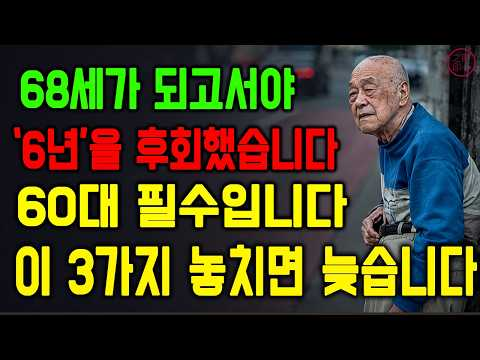
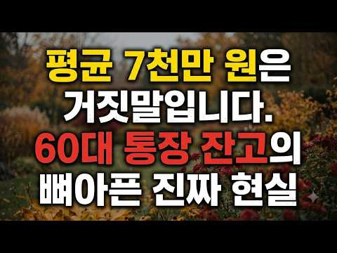
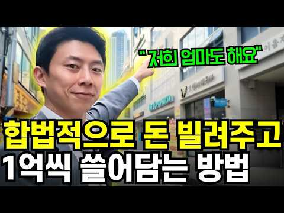
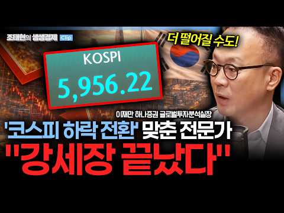

# 재테크 — 성공 사례 분석: 사례별 자세히 #41–#80

`analysis.md` 의 9번 (같은 # 번호). 자동 생성 — `tools/success_analysis.py` v1.6 (2026-10-28 10:11 UTC). ※ 연구·교육용 — 투자 권유가 아님.

### 41. 본인도 모르는 사이에 남몰래 부자가 되고 있다는 5가지 신호

- https://www.youtube.com/watch?v=5kBEU3V3ZXY · 투자 가이드 · 구독자 1,020 · 조회수 146,801 (×143.9, 하루 4,095.1) · 좋아요 880 (0.6%) · 20분 · 2026-09-17 · 주제 묶음 1. 재테크 일반·마인드 · 형식 정보·해설 (그 밖) · 폴더 `W_5kBEU3V3ZXY` (웹 승인)
- 썸네일: 
- 설명 앞부분: "자신도 모르게 부자가 되어가고 있다는 5가지 신호 대부분의 사람들은 부자가 되기 시작하면 그 변화를 즉시 느낄 수 있을 것이라 생각합니다. 예를 들어, 감탄이 나올 만한 통장 잔고, 늘 꿈꿔왔던 삶의 모습, 혹은 그간의 노력이 헛되지 않았음을 증명해 주는 계좌 속 숫자 같은 확실한 신호가 있을 것이라고 말이죠. 하지만 진정한 부는 요란하게 그 시작을 알리지 않습니다. 부는 조용히 쌓여갑니다. 사소해 보이는 결정들과 소셜 미디어에는 드러나지 않는 습관들을 통해서 말이죠. 그렇기에 수많은 사람들이 자신도 모르는 사이에 부자가 되어가…
- 같은 채널 평소 대비 ×166.6 (채널 최근 롱폼 중앙값 881회) · 평소 영상: 치열한 경쟁 사회에서 조용히 벗어나는 사람들의 심리 (904회) / 1,400만 원을 모으면 모든 것이 어떻게 달라질까? (806회)
- 대본 (음성인식, 5.3 음절/초) 첫 20초: “대부분의 사람들은 자신이 언제부터 부자가 되기 시작할지 정확히 알 수 있을 거라고 믿습니다. 어떤 분명한 순간, 특정한 날짜, 혹은 어느 날 아침에 눈을 떴을 때, 그동안의 노력이 마침내 결실을 맺었다는 것을 확인시켜주는 색다른 기분이 들 거라고 말이죠. 정말 감탄이 나오는 은행 잔고, 가슴 한 구석에 답답함 없이 원하는 것을 마음껏 살 수 있는 자유,”
- 첫 1분: “대부분의 사람들은 자신이 언제부터 부자가 되기 시작할지 정확히 알 수 있을 거라고 믿습니다. 어떤 분명한 순간, 특정한 날짜, 혹은 어느 날 아침에 눈을 떴을 때, 그동안의 노력이 마침내 결실을 맺었다는 것을 확인시켜주는 색다른 기분이 들 거라고 말이죠. 정말 감탄이 나오는 은행 잔고, 가슴 한 구석에 답답함 없이 원하는 것을 마음껏 살 수 있는 자유, 마침내 당신이 늘 상상해오던 그런 산말입니다. 하지만 이 모든 것들 이전에 존재하는 침묵에 대해서는 아무도 이야기해 주지 않습니다. 진짜 부자가 되는 과정에는 극적인 순간이 없습니다. 예고도 없이 찾아오고 알림으로 뜨지도 않으며 하루의 색깔을 갑자기 바꿔놓지도 않습니다. 그것은 평범한 월요일처럼 다가옵니다. 조용하고 밋밋하며 밖에서 보는 사람은 물론이고, 심”
- 흐름 (90초마다 첫 문장): 0:00 대부분의 사람들은 자신이 언제부터 부자가 되기 시작할지 정확히 알 수 … → 1:32 인스타그램에 보이는 모습이 아닌 불을 축적하는 진짜 현실을 이해하고 싶… → 3:03 하지만 누구나 그 경주에 참여하고 있다고 느낍니다. → 4:32 다른 사람들이 무엇을 사고, 어디로 여행 가고 무엇을 자랑하는지에 점점… → 6:03 이제 막 출시된 최신 스마트폰일 수도 있습니다. → 7:35 더 많은 선택권, 더 많은 자유, 그리고 어떻게 살고 싶은지 선택할 수… → 9:04 당신은 문제들을 생존을 위협하는 비상사태가 아니라 그저 문제로 다루고 … → 10:33 당신은 취약함에서 벗어나 튼튼한 기반을 다지고 있는 것입니다. → 12:02 이런 일이 벌어지면 버는 돈과 모우는 돈 사이의 격차는 절대 커지지 않… → 13:32 이것은 모든 신호 중 가장 심호하며 진짜 불을 쌓고 있는 사람과 단순히… → 15:01 로 바뀝니다. → 16:31 멈춘 적이 있다면 투자할 때마다 미래의 자유를 사는 것이라고 느껴본 → 18:05 사고 싶고 살 능력도 되는 물건에 아니오라고 거절했다면 → 19:32 댓글로 오늘 소개한 5가지 신호 중 현재 여러분의 삶에서 이미 나타나고…
- 댓글 12/13: 좋은 점 — 영상 2 · 감사·응원 2 · 더 알고 싶은 것 1 · 아쉬운 점 — 영상 0 · 반박·불만 — 의견 다름 0 · 정치·사회 0 · 경험 공유 3 · 구독·다음 기대 0
  - 좋은 점 — 영상 👍7 “5가지 다 해당돼요. 좋은 영상 감사합니다.”
  - 좋은 점 — 영상 👍6 “바쁜 세상에 좀 짧게. 결국 공감하느냐에 문제니까 구구절절 설명 필요없어요. 7분이내로. 보다가 지쳐서 댓글보고 나갑니다.”
  - 감사·응원 👍7 “5가지 다 해당돼요. 좋은 영상 감사합니다.”
  - 감사·응원 👍1 “영상 잘 봤습니다 감사합니다 ❤❤❤”
  - 더 알고 싶은 것 👍9 “사람들에게 보여주기 위한 삶이 아닌 내가 하고 싶은거 내가 꿈꾸는게 미디어에 노출된 것을 보고 동경하는것이 아닌지 의문이 들때가 있습니다.진짜 나의 삶이란 것이 살아오면서 누군가가 행동하는 보습을 보고 동경하는것이 꿈이라고 이야기하는것이 아닐지 의문을 가집니다.진짜 …”
  - 경험 공유 👍9 “사람들에게 보여주기 위한 삶이 아닌 내가 하고 싶은거 내가 꿈꾸는게 미디어에 노출된 것을 보고 동경하는것이 아닌지 의문이 들때가 있습니다.진짜 나의 삶이란 것이 살아오면서 누군가가 행동하는 보습을 보고 동경하는것이 꿈이라고 이야기하는것이 아닐지 의문을 가집니다.진짜 …”

### 42. "한 그루만 심어도 노후 대비 끝난다더니.." 남도 산비탈마다 황칠나무 꽂았다가 판로 막혀 숲째 방치된 황칠 농가의 처참한 몰락

- https://www.youtube.com/watch?v=oxMq0Cg7-6k · 일파만파tv · 구독자 1,530 · 조회수 72,562 (×47.4, 하루 6,032.9) · 좋아요 346 (0.5%) · 21분 · 2026-10-16 · 주제 묶음 4. 노후·연금 · 형식 정보·해설 (그 밖) · 폴더 `W_oxMq0Cg7-6k` (웹 승인)
- 썸네일: 
- 설명 앞부분: 남도 산비탈마다 한 그루만 심어도 노후가 보장된다던 황칠나무가 대대적으로 심어졌습니다. 수많은 농가가 전 재산을 투자해 나무를 가꿨지만, 판로가 완전히 막혀버리면서 정성 들인 숲이 통째로 방치되는 처참한 몰락이 이어지고 있습니다. 부푼 꿈을 안고 뛰어든 황금 작물이 어떻게 농가를 무너뜨리는 빚더미로 변했는지 냉정하게 짚어봐야 합니다. 일파만파tv에서는 황칠나무 열풍의 허망한 실태와 함께 우리가 귀농 현장에서 반드시 경계해야 할 이면의 진실이 무엇인지 영상에서 낱낱이 공개합니다.
- 같은 채널 평소 대비 ×27.4 (채널 최근 롱폼 중앙값 2,645회) · 평소 영상: 금마늘 소리 듣던 시절만 믿고 앞다퉈 재배면적 늘리더니.. 역대급 물량 폭탄에 정부 수매… (2,645회) / "당뇨·혈압 다 잡는 만병통치 나무라더니.." 귀농 1순위라며 산자락마다 꾸지뽕 심었다가… (2,602회)
- 대본 없음 (설명) — 음성인식이 끝나면 도입부·흐름이 들어감
- 댓글 43/55: 좋은 점 — 영상 0 · 감사·응원 0 · 더 알고 싶은 것 1 · 아쉬운 점 — 영상 0 · 반박·불만 — 의견 다름 1 · 정치·사회 2 · 경험 공유 1 · 구독·다음 기대 0
  - 더 알고 싶은 것 👍2 “옻이 몸에 좋다고 하는데, 물어 봅시다. 무슨 성분이 어떤 작용을 하나요 ? 근거도 명확하지 못한 상태에서 그냥 " 옛날부터 좋은 것" 이라는 ... 그저 전통 전통 하는데, 약용으로 사용하는 곳이 있나요 ? 그리고 도료로 진액을 채취해야 하는데, 그거 채취 하려면 …”
  - 반박·불만 — 의견 다름 👍11 “선동과 날조가 아니면 살 수 없는 동네인가요? 뭐만 하면 개떼처럼 몰려가서 같이 망함?”
  - 정치·사회 👍15 “그 사기꾼 잘먹고 잘 살았지. 국회의원도 하고. 전북 사람들 참 허술해.”
  - 정치·사회 👍2 “정부가 나서면 잘 되든 일도 그릇친다.”
  - 경험 공유 👍4 “세상이치. 지나침은 부족함만 못하다. 황칠 저도 매일 음용합니다.기능성 미네랄 소금 이름이 황칠 소금입니다. 하루에 한번 물에 타서 마시죠 . 용량은 1000 cc 한병에 1 그램 정도니 미미한 정도입니다.”

### 43. 카드배송 알바, 차 없이 절대 하면 안된다 ∣ 노후이야기, 노후생활, 노인일자리

- https://www.youtube.com/watch?v=tEmSSBF3dmI · 세월금방가 · 구독자 6,180 · 조회수 370,499 (×60.0, 하루 24,324.4) · 좋아요 1,915 (0.5%) · 14분 · 2026-10-13 · 주제 묶음 4. 노후·연금 · 형식 정보·해설 (그 밖) · 폴더 `W_tEmSSBF3dmI` (웹 승인)
- 썸네일: 
- 설명 앞부분: 차 없이 걸어서 카드배송 알바를 한 이야기. 땀 흘리며 깨달은 카드배송 실제 수입과 현실을 공개합니다.
- 같은 채널 평소 대비 ×1,684.1 (채널 최근 롱폼 중앙값 220회) · 평소 영상: 어르신들이 눈물 머금고 경로당을 탈출한 진짜 이유 (220회) / 서울에서 24시간 노숙자가 되어 살아보니 충격적이었다 ∣ 노숙인 이야기 (198회)
- 대본 없음 (설명) — 음성인식이 끝나면 도입부·흐름이 들어감
- 댓글 192/298: 좋은 점 — 영상 3 · 감사·응원 8 · 더 알고 싶은 것 3 · 아쉬운 점 — 영상 1 · 반박·불만 — 의견 다름 6 · 정치·사회 2 · 경험 공유 12 · 구독·다음 기대 0
  - 좋은 점 — 영상 👍19 “선생님 좋은 정보 겸허히 잘받았습니다 고맙습니다”
  - 좋은 점 — 영상 👍2 “자동차 있어도 기름값 들어가고 주차하기 불편하고 좋은 영상 잘보았씁니다. 맞습니다 비라도 오고 춥거나 덥거나 하면 힘든일인데 겨우 몇천원.... 카드사 직원들 보고 하라고 하세요.”
  - 감사·응원 👍19 “선생님 좋은 정보 겸허히 잘받았습니다 고맙습니다”
  - 감사·응원 👍14 “마음이 아프네요. 고생하셨습니다. 감사합니다.”
  - 더 알고 싶은 것 👍1 “저 지금 구월동에서 카드배송 하는대 어디가 1509-3500을 줘요? 장당 1천원 어니에요??? 여기는 장당 1천원 주는대. ...무조건 1천원인대. 어디가 그렇게 줘요?? 답글 부탁드립니다. 본사가 마그넷 맞죠?”
  - 더 알고 싶은 것 👍0 “어느 배송 업체인가요? 그렇게 많이주면 음식배달 할필요가 없네요. 음식배달도 2000~3500원에 프로모션 있어야 더 받는데... 업체 소개좀 시켜주세요”
  - 아쉬운 점 — 영상 👍0 “다들 생각을 바꿔야합니다. 만약 당신이 서울수도권이나 광역도시 일반서민이라면 약3-4억 2억짜 아파트 산다면 노후에 돈 벌 때도 없다면 ,....65~90세이하 이면 맘 비우고 그냥파세요. 다들 자기가 사는곳이 평생 살아야 한다는 고정관념 타지역가서 산다는것을 두려워…”
  - 반박·불만 — 의견 다름 👍77 “단가가 말도안되게 약하네요 노동력 착취입니다 10년전에도 저정도라고 들었는데 지금도 1800원? 공정위나 노동부는 뭘하는지 저런 악질들 처벌안하고?”
  - 반박·불만 — 의견 다름 👍2 “이분 세상 사는게 좀 서투네 처음 이니 좀 숙달 될때 까지. 시간이 좀 걸니고 지도를. 못보는건 좀 심각한 문제 네이버든 카카오 지도든 이걸 이용은 할줄 아셔야지 그건 본인이 노력 하야지 누가 도와 줄수 있는건 아니쟌아요 그리고 배송 하실때 최적 경로들은 미리 보시고…”
  - 정치·사회 👍11 “나이먹고 할수있는 가장 꿀빠는일은 국회의원이다”
  - 정치·사회 👍2 “지하철 택배 해보니 60~70 정도 그것도 정부에서 10만 얼마 보조 해줘서 ... 와 졸라 무거운거 특히 경동 시장 ..인산 이런거 한박스 30KG 정도 2개 ... 이런것도 배달”
  - 경험 공유 👍8 “저는 소형책자들 배송 해봤었는데...건당1500원에 오후 출발하여 하루에 약40건정도 했습니다만,너무 힘들더군요. 나중엔 아~사람이 죽을때 이렇게 죽는구나 라는 생각까지 들었습니다. 임금조차도 한달치는 keep했다가 나중에 준다더군요...하아 갑갑하더군요. 그만뒀습니…”
  - 경험 공유 👍6 “카드 배송 힘든 일이군요.나도 카드배송하는 분께서 전화가 오면 우편함에 넣고 가시라고 합니다.세상에는 쉬운일이 하나도 없고 공짜는 없어요.”

### 44. 금 투자 시작하는 방법, 금 투자방법 금테크 총정리

- https://www.youtube.com/watch?v=0lPGxbxD4Tc · 부자공식, 파이프라인 만들기 · 구독자 9,460 · 조회수 955,787 (×101.0, 하루 36,659.1) · 좋아요 57 (0.0%) · 8.5분 · 2026-10-02 · 주제 묶음 3. 주식·ETF · 형식 정보·해설 (그 밖) · 폴더 `W_0lPGxbxD4Tc` (웹 승인)
- 썸네일: 
- 챕터: 0:00 그냥 금투자하면 손해라고? · 0:36 많은 사람들이 금투자 하는 이유 · 1:56 금 투자하는 방법 3종류 비교 (실물 금투자 / 금통… · 4:15 스위치원 금투자 장점은? · 5:57 '31일 금모으기 챌린지' 이벤트 소개 · 7:29 구독자혜택 (금 0.2g 추첨)
- 설명 앞부분: 💰️ '31일 금모으기 챌린지' 스위치원 이벤트 (9/30~11/10) 이벤트 기간 : 9/30~11/10 이벤트 혜택 : 연 10% 리워드, 매일 선물박스, 매도 수수료 지원금 참여 방식 : 스위치원 앱에서 31일 동안 매일 금 모으면 끝! (매일 2천원으로 참여가능) 👇 스위치원 앱 다운로드 역사상 꾸준하게 가치가 올랐던 금을 안전자산이나 인플레이션 헤지 수단으로 모아가시는 분들이 많은데요, 금투자 할때 실물 금을 사거나 은행 금통장을 활용해 투자하셨다면 손해보고 계실 수 있습니다. 금투자방법은 크게 3가지 방법 (실물 금투자…
- 같은 채널 평소 대비 ×910.3 (채널 최근 롱폼 중앙값 1,050회) · 평소 영상: '아직도 예적금 하시나요?' 예적금 보다 2배 더 버는 현실적인 방법 (천만원 굴리기) (1,050회) / ISA계좌 200% 활용법 공개, ISA계좌 개설 이후 무조건 확인하세요 (1,245회)
- 대본 없음 (설명) — 음성인식이 끝나면 도입부·흐름이 들어감
- 댓글 59/61: 좋은 점 — 영상 4 · 감사·응원 6 · 더 알고 싶은 것 0 · 아쉬운 점 — 영상 0 · 반박·불만 — 의견 다름 0 · 정치·사회 0 · 경험 공유 2 · 구독·다음 기대 0
  - 좋은 점 — 영상 👍1 “오늘부터 금 모으기 시작 항상 좋은 정보 감사합니다^^”
  - 좋은 점 — 영상 👍1 “오늘부터 금 투자 시작! 좋은 정보 굿굿이에요~”
  - 감사·응원 👍2 “오늘부터 금모으기 시작!!! 유용한정보 감사합니다. 다시한번 더 듣고 실 천해 보겠습니다 _(())_”
  - 감사·응원 👍2 “"오늘부터 금 모으기 시작* 증권사에서 할까 했는데 아주 좋은 방법이 있었네요 감사합니다~^^”
  - 경험 공유 👍1 “저도 오늘부터 금 모으기 시작했습니당😎”
  - 경험 공유 👍0 “"오늘부터 금 투자 시작" 설명을 아주 명쾌하고 매력있게 하시네요. 귀에 쏙 들어와서 나도 금 투자 해야겠네요”

### 45. 나스닥은 버티는데 아이온큐가 일주일 새 20% 빠진 건 망해서가 아닙니다 — 가트너가 말한 퇴출 명단은 따로 있습니다 #미국주식 #아이온큐 #리게티 #경제노트

- https://www.youtube.com/watch?v=IbkLrISwBiU · 경제전략노트 · 구독자 725 · 조회수 37,794 (×52.1, 하루 2,743.1) · 좋아요 203 (0.5%) · 14.4분 · 2026-10-14 · 주제 묶음 3. 주식·ETF · 형식 정보·해설 (그 밖) · 폴더 `W_IbkLrISwBiU` (웹 승인)
- 썸네일: 
- 설명 앞부분: 10월 6일부터 13일까지 5거래일 동안 아이온큐(IONQ)는 19.8% 빠졌고, 나스닥 100은 2.1% 내리는 데 그쳤습니다. 가트너는 올해 전 세계 양자컴퓨팅 매출을 8억 6,990만 달러, 내년을 약 11억 달러로 전망했습니다. 보도에 따르면 가트너는 매출이 모자란 양자 스타트업 절반 이상이 2030년까지 문을 닫을 것으로 봤습니다. 아이온큐의 올해 매출 전망 2억 8천만~2억 9천만 달러는 그 시장의 약 3분의 1입니다(집계 기준 차이 가능). 리게티(RGTI)는 2분기 매출 510만 달러, 빚 없이 현금 5억 4,130…
- 같은 채널 평소 대비 ×34.8 (채널 최근 롱폼 중앙값 1,085회) · 평소 영상: 템퍼스AI 첫 흑자는 검사로 번 돈이 아닙니다 — 주당 3달러에 받아둔 퍼스널리스 주식 … (1,085회) / 오클로·뉴스케일이 한 달 사이 연 발행 창구 17억 5천만 달러 — 9월 공시를 전부 열… (1,078회)
- 대본 없음 (설명) — 음성인식이 끝나면 도입부·흐름이 들어감
- 댓글 10/11: 좋은 점 — 영상 0 · 감사·응원 1 · 더 알고 싶은 것 0 · 아쉬운 점 — 영상 0 · 반박·불만 — 의견 다름 0 · 정치·사회 0 · 경험 공유 0 · 구독·다음 기대 0
  - 감사·응원 👍0 “빠른정보 감사합니다”

### 46. 일흔이 넘으면 ‘이 다섯 곳’에는 절대 가지 마세요｜노후 자금을 지키는 지혜｜노년의 마음소리

- https://www.youtube.com/watch?v=oyiEl0p35BY · 은퇴후인생수업 · 구독자 408 · 조회수 90,478 (×221.8, 하루 1,460.5) · 좋아요 751 (0.8%) · 32분 · 2026-08-27 · 주제 묶음 4. 노후·연금 · 형식 오디오북·낭독 (명언·인생조언) · 폴더 `W_oyiEl0p35BY` (웹 승인)
- 썸네일: 
- 챕터: 0:00 노후를 위협하는 다섯 곳, 우리가 피해야 할 이유 · 1:34 국민연금과 노후 생활비의 현실 · 3:06 매달 조금씩 새는 노후 자금의 비밀 · 5:17 돈을 버는 것보다 지키는 지혜 · 6:05 건강식품 홍보관의 달콤한 상술 · 10:00 무료 건강 강좌 뒤에 숨은 함정 · 12:49 노름이 노년의 삶을 무너뜨리는 이유 · 15:14 손주 사랑과 불필요한 지출 줄이기 · 20:50 체면 때문에 늘어나는 노후 지출 · 23:26 노후 자금을 지키는 실천법과 마지막 조언
- 설명 앞부분: 일흔이 넘으면 ‘이 다섯 곳’에는 절대 가지 마세요｜노후 자금을 지키는 지혜｜노년의 마음소리 노년의 마음소리와 함께 노후에 무심코 돈이 새어나가는 다섯 곳을 짚어봅니다. 💰 건강식품 홍보관과 무료 건강 강좌에서 시작되는 소비의 함정, 노름과 과도한 손주 선물, 체면 때문에 늘어나는 지출까지 노년의 마음소리로 차분히 살펴봅니다. 🧓 노년의 마음소리는 단순히 돈을 아끼라는 이야기가 아니라, 외로움과 두려움에 흔들리지 않고 내 삶과 노후 자금을 지키는 방법을 전합니다. 🌱 작은 지출도 10년이 지나면 큰돈이 될 수 있습니다. 노년의 마…
- 같은 채널 평소 대비 ×790.2 (채널 최근 롱폼 중앙값 114회) · 평소 영상: 50년 우정에서 끝까지 지켜야 할 것들｜노년의 마음소리 (116회) / 혼자 사는 노인, ‘매일 연락할 한 사람’을 정하세요｜늦은 발견을 막는 노후의 지혜 ∣ … (113회)
- 대본 (음성인식(앞 5분), 4.8 음절/초) — 앞부분만, 흐름은 그 안까지 첫 20초: “이른이 넘으면 절대 발을 들이면 안 되는 곳이 있습니다. 어제도 누군가는 그 문을 웃으며 들어섰습니다. 그리고 10년 뒤 그 사람의 통장에서 300만 원이 소리 없이 사라졌습니다. 도둑을 맞은 것도 아닙니다. 한 번에 큰 돈을 쓴 적도 없습니다. 그저 매주 무리세듯 조금씩 빠져나갔을 뿐입니다.” — 도입부 유형: 경고·단정
- 첫 1분: “이른이 넘으면 절대 발을 들이면 안 되는 곳이 있습니다. 어제도 누군가는 그 문을 웃으며 들어섰습니다. 그리고 10년 뒤 그 사람의 통장에서 300만 원이 소리 없이 사라졌습니다. 도둑을 맞은 것도 아닙니다. 한 번에 큰 돈을 쓴 적도 없습니다. 그저 매주 무리세듯 조금씩 빠져나갔을 뿐입니다. 돌이켜보면 그 문은 언제나 가장 다정한 얼굴로 열려 있었습니다. 이상한 것은 같은 곳에 드나들어도 끝떡없는 사람이 있다는 겁니다. 반대로 순식간에 무너지는 사람도 있습니다. 그 차이가 어디서 오는지 저는 아주 늦게 알았습니다. 오늘 그 다섯 곳을 이야기하려 합니다. 그 중 세 번째 장소에서 저는 제 가장 부끄러운 모습을 보았습니다. 그 이야기는 마지막에 꼭 들려드리겠습니다. 저는 아흔을 넘긴 나이 많은 사람입니다. 이”
- 흐름 (90초마다 첫 문장): 0:00 이른이 넘으면 절대 발을 들이면 안 되는 곳이 있습니다. → 1:33 놀라지 마십시오. → 3:01 바로 이 지점에서 오늘의 이야기가 시작됩니다. → 4:32 그 여유는 대체 어디서 오는가
- 댓글 17/18: 좋은 점 — 영상 1 · 감사·응원 3 · 더 알고 싶은 것 0 · 아쉬운 점 — 영상 0 · 반박·불만 — 의견 다름 0 · 정치·사회 0 · 경험 공유 1 · 구독·다음 기대 0
  - 좋은 점 — 영상 👍2 “참, 사람의 마음을 교묘하게 움직이게 만드는 것들이 많습니다. 어떤 것은 어쩔 수 없는 것도 있습니다. 고맙습니다. 새롭게 정리해 주심을 감사 드립니다”
  - 감사·응원 👍2 “참, 사람의 마음을 교묘하게 움직이게 만드는 것들이 많습니다. 어떤 것은 어쩔 수 없는 것도 있습니다. 고맙습니다. 새롭게 정리해 주심을 감사 드립니다”
  - 감사·응원 👍1 “감사합니다.”
  - 경험 공유 👍2 “정신차려야겠다 내가낭비가 좀 있는데 절제해야겠네 ❤❤❤😢😢”

### 47. 올해 68세입니다. 62살에 이 3가지를 시작할걸, 지금은 매일 밤 후회하고 있습니다

- https://www.youtube.com/watch?v=nOMrypGAQP8 ·  돈과 사람 · 구독자 1,410 · 조회수 367,698 (×260.8, 하루 4,780.4) · 좋아요 2,280 (0.6%) · 22.1분 · 2026-08-12 · 주제 묶음 4. 노후·연금 · 형식 오디오북·낭독 (명언·인생조언) · 폴더 `W_nOMrypGAQP8` (웹 승인)
- 썸네일: 
- 설명 앞부분: 은퇴 후 연금과 모아둔 돈만 있으면 노후가 편안할 거라고 생각하는 분들이 많습니다. 하지만 예순여덟 살이 된 한 남자는 퇴직 후 보낸 6년을 돌아보며 노후에 정말 중요한 것은 돈만이 아니었다고 말합니다. 이 영상에서는 35년 직장생활을 마친 뒤 그가 뒤늦게 깨달은 노후의 세 가지를 이야기합니다. 내 힘으로 일어설 수 있는 두 다리, 매주 나를 기다리는 사람이 있는 갈 곳, 그리고 나이가 들어서도 내가 누군가에게 필요한 사람이라고 느끼게 해주는 할 일입니다. 박 어르신, 윤 어르신, 최 어르신의 삶을 통해 노년의 건강 관리, 인간관…
- 같은 채널 평소 대비 ×1,513.2 (채널 최근 롱폼 중앙값 243회) · 평소 영상: 오십 넘어 비참해지고 싶지 않다면 당장 시작하세요 (243회) / "아끼느라 10년을 날렸습니다"… 75세 남성이 뒤늦게 배운 돈 쓰는 법 ‘5가지' ∣ … (259회)
- 대본 없음 (설명) — 음성인식이 끝나면 도입부·흐름이 들어감
- 댓글 170/178: 좋은 점 — 영상 5 · 감사·응원 11 · 더 알고 싶은 것 1 · 아쉬운 점 — 영상 0 · 반박·불만 — 의견 다름 2 · 정치·사회 1 · 경험 공유 8 · 구독·다음 기대 0
  - 좋은 점 — 영상 👍12 “54입니다. 노년의 지혜 잘 들었습니다. 다리건강 정말 공감합니다. 그래서 몇달전부터 다리운동 열심히 하고 있습니다. 좋은 내용 감사합니다!”
  - 좋은 점 — 영상 👍5 “좋은 말씀들... 감사합니다.^^”
  - 감사·응원 👍19 “66년생여자에요 오늘부터 감사3가지적어볼거에요”
  - 감사·응원 👍12 “정말 공감가는 말씀🎉 감사합니다😂”
  - 더 알고 싶은 것 👍8 “59년생 68세입니다 잘살고 잇는지 댓글 부탁해요 일주일 4일 운동. 영어. 스마트폰 배우러다니고 일요일 교회 다녀옵니다 그런데 특별히 따로 걷기는 안하고 그냥 배우러 다니고 가서 운동가고 마트가는걸로 대체합니다 대신 일주일에 3-4번정도는 스트레칭과 근력운동을 섞어…”
  - 반박·불만 — 의견 다름 👍7 “60년생 66세입니다. 35년 직장 정년퇴직 연금은 400만원 조금 않됩니다. 제2의 직장인 아파트관리사무소 기전직원으로 다니고 있습니다 친구들 모두 직장 다니는데 나혼자 할것이 없어 소방안전관리자. 전기기능사 자격증따서 지금의 직장에 다니고 있습니다. 직장에나가면 …”
  - 반박·불만 — 의견 다름 👍1 “음 저는60년생 입니다 ~ 아직 총각이라서 마음만 청춘이라 조금은 철이 없기도 합니다 제가 혼자 살다보니 여자는 필요 없다고 생각하지만 어떨때는 엄청 외로울때가 있더군요 그래서 우울증도 10년 동안 고생했습니다 그리고 이것이 나의 제2의 인생의 전환점의 동기가 되었죠…”
  - 정치·사회 👍5 “나는75세인데 매일 역기들기와 댄스로 건강유지한다.남들보다10년은젊어보인다.혈관나이도 그렇게나온다..그런데댄스는 가정불화를 야기하므로 정부에서 강력히 홍보하지못한다..”
  - 경험 공유 👍35 “내가 68세입니다. 59년 돼지띠. 잘 들었습니다. 일기를 쓰고, 후회와 고마움을 기록합니다. 제 2, 제 3의 인생을 시작한지 5년, 그분야에 보템이되는 자격증 공부를 하며 짜임세 있게 노후를 준비중 입니다. 주위에서 부럽게 보고 있으며, 거기에 고무되어 쉬지못하고…”
  - 경험 공유 👍12 “65살 을 바라봅니다. 소아마비 증후군으로 매우 부자연 스러워도 억지도 움직입니다. 거식증도 생겼지만 과일 야채먹고 내 몸의 변화 마음의 변화를 글로 기록하고 그날 내가 한 일들은 빨래 하고 접는 일도 기록해 둡니다.”

### 48. 자식에게서 이 3가지는 절대 받지 마세요! 노후가 불행해질 수 있습니다 ㅣ노후지혜ㅣ인생명언ㅣ오디오북

- https://www.youtube.com/watch?v=3aVf1x2D1Z8 · 가족온기 · 구독자 392 · 조회수 17,743 (×45.3, 하루 1,110.8) · 좋아요 335 (1.9%) · 54.5분 · 2026-10-12 · 주제 묶음 4. 노후·연금 · 형식 오디오북·낭독 (명언·인생조언) · 폴더 `W_3aVf1x2D1Z8` (웹 승인)
- 썸네일: 
- 설명 앞부분: 가족 대화법, 부모 교육, 자녀와의 거리 좁히기, 반찬 부담, 며느리와 소통, 고부 갈등, 부모자식관계 회복, 좋은 부모 되는 법, 자녀 존중법, 공감하는 부모, 가족 심리학, 결혼한 자녀 소통, 중년의 인간관계 지혜, 가족 상담, 심리적 거리감 🧡 부모님이 먼저 바뀌면, 자식은 언젠가 마음을 엽니다. 다음 이야기도 함께 걸어가요.
- 같은 채널 평소 대비 ×36.1 (채널 최근 롱폼 중앙값 492회) · 평소 영상: 자식에게도 절대 말하지 마세요! 부모가 숨겨야 할 비밀 3가지 I 노후 지혜 (492회) / 부모가 자녀에게 지켜야 할 비밀 3가지, 오래 사랑받는 관계의 비결 (511회)
- 대본 없음 (설명) — 음성인식이 끝나면 도입부·흐름이 들어감
- 댓글 4/5: 좋은 점 — 영상 0 · 감사·응원 0 · 더 알고 싶은 것 0 · 아쉬운 점 — 영상 0 · 반박·불만 — 의견 다름 0 · 정치·사회 0 · 경험 공유 0 · 구독·다음 기대 0

### 49. 50대에 조기퇴직하면 어떤 삶을 살게 될까? 51세에 경제적 자유와 조기은퇴(FIRE)를 이룬 사람의 실제 이야기…

- https://www.youtube.com/watch?v=6LShuUa4Zt0 · 누군가의 인생 · 구독자 3,110 · 조회수 301,382 (×96.9, 하루 8,135.5) · 좋아요 767 (0.2%) · 18.8분 · 2026-09-21 · 주제 묶음 4. 노후·연금 · 형식 정보·해설 (그 밖) · 폴더 `W_6LShuUa4Zt0` (웹 승인)
- 썸네일: 
- 설명 앞부분: 50대에 조기퇴직하면 어떤 삶을 살게 될까? 51세에 경제적 자유와 조기은퇴(FIRE)를 이룬 사람의 실제 이야기… 51세에 경제적 자유를 이루고, 29년 동안 다니던 회사를 떠난 한 남성. 출근도 없고, 상사의 눈치도 없고, 이제부터 매일이 자유로울 거라 생각했습니다. 충분한 자산도 있었고 오랫동안 꿈꿔 온 자전거 여행도 시작했습니다. 하지만 조기퇴직 후 몇 달이 지나자 예상하지 못했던 현실이 찾아왔습니다. 돈은 준비했지만 하루를 어떻게 보낼지는 준비하지 못했습니다. 사람들과의 관계가 줄어들고, 생활 리듬이 무너지면서 그토록 바…
- 같은 채널 평소 대비 ×9.0 (채널 최근 롱폼 중앙값 33,604회) · 평소 영상: 48세에 회사를 그만두면 무슨 일이 벌어질까? 재취업하지 못한 48세 경리과장의 현실적인… (36,212회) / 65세에 은퇴한 사람과 주 3일 일한 사람. 5년 후, 두 사람의 삶의 차이는... (30,997회)
- 대본 (음성인식(앞 5분), 5.6 음절/초) — 앞부분만, 흐름은 그 안까지 첫 20초: “평일 아침 9시 세탁물을 베란다에 넓고 거실로 돌아왔습니다. 벽에 걸린 달력에는 오늘도 아무 일정이 없었습니다. 누군가를 만날 약속도 없었고 반드시 해야 할 일도 없었습니다. 시계를 보니 하루는 이제 막 시작되고 있었습니다. 제 이름은 김정호입니다. 올해 쉰 한 살이고 29회 다닌 식품 회사를 그만두고 조금 일찍 은퇴했습니다.” — 도입부 유형: 숫자로 시작
- 첫 1분: “평일 아침 9시 세탁물을 베란다에 넓고 거실로 돌아왔습니다. 벽에 걸린 달력에는 오늘도 아무 일정이 없었습니다. 누군가를 만날 약속도 없었고 반드시 해야 할 일도 없었습니다. 시계를 보니 하루는 이제 막 시작되고 있었습니다. 제 이름은 김정호입니다. 올해 쉰 한 살이고 29회 다닌 식품 회사를 그만두고 조금 일찍 은퇴했습니다. 요즘 말로 하면 경제적 자유를 준비해 직장을 떠나는 파이어를 선택한 셈입니다. 오랫동안 꿈꾸던 삶이었습니다. 현관 한쪽에는 전국 자전거 여행을 하겠다며 큰만 먹고 산 자전거가 있습니다. 하지만 몇 달 동안 거의 움직이지 않았습니다. 퇴직하던 날만 해도 저는 앞으로 매일이 일요일이라고 생각했습니다. 출근도 회의도 실적도 없는 삶이 시작됐다고 믿었습니다. 그런데 지금의 저는 그 길어진 일”
- 흐름 (90초마다 첫 문장): 0:00 평일 아침 9시 세탁물을 베란다에 넓고 거실로 돌아왔습니다. → 1:30 도대체 언제까지 이렇게 살아야 하나 → 3:00 그래도 여러 조건을 받고 계산해본 결과 → 4:30 은퇴 후에는 월급이라는 안전 장치가 더 이상 없었기 때문입니다.
- 댓글 177/195: 좋은 점 — 영상 2 · 감사·응원 2 · 더 알고 싶은 것 2 · 아쉬운 점 — 영상 4 · 반박·불만 — 의견 다름 5 · 정치·사회 1 · 경험 공유 19 · 구독·다음 기대 0
  - 좋은 점 — 영상 👍17 “저는 21년 회사생활 후 50세에 희퇴함..지금 약 1년 8개월이 지나가고 있는데 마음을 내려 놓고 불안한 마음을 갖지 않으려는 노력은 필요함..꼭 주변 지인들에게 뭔가를 보여주기식이라도 해야한다는 강박관념에서 벗어나 자기만의 루틴을 만들고 하루하루를 소박하게 살려는…”
  - 좋은 점 — 영상 👍0 “설명이 어렵지 않아서 좋았어요. 이해가 쏙 됩니다. 저도 예전엔 남 얘기라고만 생각했어요. 저도 당해보고 나서야 알게 된 것들이라 잊어버리기 전에 제 채널에 적어뒀어요.”
  - 감사·응원 👍0 “돈보다 시간을 보내는 계획을 준비하라는 멋지 교훈 감사합니다❤”
  - 더 알고 싶은 것 👍1 “너무 잘 보고 갑니다. 혹시 목소리는 어떤 AI 쓰시는지 여쭈어 봐도 될까요?”
  - 더 알고 싶은 것 👍0 “나이가 맞나요? 51세? 대학졸업후 29년 일했다고요?”
  - 아쉬운 점 — 영상 👍7 “돈만 있으면 지루할 틈이 없다 돈이 부족해서 지루한거지 ㅋ”
  - 아쉬운 점 — 영상 👍1 “그리고 ai영상 특 결론이 뻔한데 질질끔”
  - 반박·불만 — 의견 다름 👍52 “2023년 정년 6년을 남겨 놓고 명예퇴직했습니다. 평생 회사를 위해 가족을 위해 한 몸 갈아 넣고도 막상 시간이 주어졌을 때 그 시간을 온전히 자신을 위해 쓰지 못하는 분이 많더군요, 저는 퇴직 후에 평소 읽고 싶었던 책 마음껏 읽고, 보고 싶은 영화 마음껏 보고,…”
  - 반박·불만 — 의견 다름 👍13 “말도 안되는 20년전 이야기...... 솔직히 요즘은 백수가 젤 바쁜세상인데 시대에 맞는 영상좀 만들지”
  - 정치·사회 👍1 “찌질이 소한잡국에서 FIRE 지르니까 그런것이지. 조기은퇴란 적어도 토론토, 뉴욕, 시카고 등 북미 동부 대도시에서 해야 제맛인법. 여기선 아무것도 안하고 그냥 살기만 해도 일상 자체가 해외 관광느낌이 나지. 장보러 밖에만 나가도 흑백 동양인등 외국인들이 버글버글. …”
  - 경험 공유 👍19 “어차피 나중에 다들 겪을거 미리 겪었다고 생각하면 됩니다. 조기퇴직이든 뭐든 누구나 예외없이 거쳐갑니다”
  - 경험 공유 👍7 “경제적 그리고 건강하대면 세상은 내가 만들어 갈수 있어요. 노는것이 아니라 하고 싶은 것들을 하며 사는건 은퇴후 축복이예요. 타인의 시선은 내려 놓고 자신과의 시간을 보내보면 어떨까요. 내가 하고 싶은 것을 하며 바쁜 하루를 ...”

### 50. 1,200만 원 농막을 노후의 집으로 생각한 61세 남자… 첫겨울 뒤 계산한 실제 총투입액

- https://www.youtube.com/watch?v=xPFp2hZ6TDw · 타인의 삶 · 구독자 1,280 · 조회수 42,507 (×33.2, 하루 3,262.8) · 좋아요 180 (0.4%) · 17분 · 2026-10-15 · 주제 묶음 4. 노후·연금 · 형식 정보·해설 (그 밖) · 폴더 `W_xPFp2hZ6TDw` (웹 승인)
- 썸네일: 
- 설명 앞부분: 1,200만 원짜리 중고 농막이라면 노후의 작은 집이 될 수 있을까요? 61세 퇴직자 오경태 씨는 홍천의 농지와 18㎡ 농막을 마련해 주말마다 머물기 시작합니다. 처음에는 조용한 밭과 작은 공간이면 충분해 보였습니다. 그러나 땅, 운반, 전기, 물, 정화조와 겨울 보강 비용을 더하자 총투입액은 6,440만 원이 되었습니다. 첫겨울에는 결로와 동파, 난방비 문제가 이어졌습니다. 군청 상담을 통해서는 농막이 농작업과 일시 휴식을 위한 시설이며 주거 목적으로 사용할 수 없다는 사실, 그리고 2025년부터 시행된 농촌체류형 쉼터 역시 일…
- 같은 채널 평소 대비 ×2.3 (채널 최근 롱폼 중앙값 18,676회) · 평소 영상: 퇴직 후 건강보험료가 두 배로 뛴 57세 남자… 3년 뒤를 먼저 걱정한 이유 (19,904회) / 퇴직금 4,860만 원으로 무인 아이스크림 가게를 연 53세 여성… 월매출 1,420만 … (20,219회)
- 대본 없음 (설명) — 음성인식이 끝나면 도입부·흐름이 들어감
- 댓글 6/9: 좋은 점 — 영상 1 · 감사·응원 1 · 더 알고 싶은 것 0 · 아쉬운 점 — 영상 0 · 반박·불만 — 의견 다름 0 · 정치·사회 0 · 경험 공유 0 · 구독·다음 기대 0
  - 좋은 점 — 영상 👍3 “좋은 정보상식 감사합니다”
  - 감사·응원 👍3 “좋은 정보상식 감사합니다”

### 51. 50대 옥탑방 부부, "그 나이에 왜 주식을..."

- https://www.youtube.com/watch?v=FRzyTNO9mNI · 반백살, 옥탑방 이야기 · 구독자 688 · 조회수 43,366 (×63.0, 하루 1,741.2) · 좋아요 424 (1.0%) · 6.3분 · 2026-10-03 · 주제 묶음 3. 주식·ETF · 형식 정보·해설 (그 밖) · 폴더 `W_FRzyTNO9mNI` (웹 승인)
- 썸네일: 
- 설명 앞부분: 지난 영상 이후, 50대 옥탑방 부부인 저희의 주식 도전에 많은 분들이 걱정과 조언을 남겨주셨습니다. 진심으로 감사드립니다. "그 나이에 왜 위험하게 주식을 하느냐"는 물음에 오늘 제 진솔한 속마음을 전합니다. 사기와 빚을 겪으며 깨달은 금융 무지의 서러움, 그리고 평생 일할 수 없다는 현실 앞에 저희에게 파이어족은 노후를 위한 '마지막 생존 전략"입니다. 지치지 않고 끝까지 걸어갈 수 있도록 많은 응원과 격려 부탁드립니다. 오늘도 시청해 주셔서 감사합니다.
- 같은 채널 평소 대비 ×9.3 (채널 최근 롱폼 중앙값 4,668회) · 평소 영상: 50대 옥탑방 부부, 아프다는 말도 없던 남편이... (5,835회) / 8월 폭염 속, 침침해진 눈으로 배달을 나섭니다. (3,502회)
- 대본 (음성인식(앞 5분), 4.2 음절/초) — 앞부분만, 흐름은 그 안까지 첫 20초: “안녕하세요 구독자 여러분 50대 옥탑방 아내입니다. 어느 덧 바람 끝이 제법 선선해진 가을이 왔네요. 하늘도 높아지고 날씨가 참 좋습니다. 우리 구독자분들도 오늘 하루 기분 좋게 잘 보내고 계신가요? 옥탑방에서 바라보는 하늘은 계절이 바뀔 때마다 괜히 마음을 몽글몽글하게 만드는 것 같아요.” — 도입부 유형: 숫자로 시작, 시청자 부르기
- 첫 1분: “안녕하세요 구독자 여러분 50대 옥탑방 아내입니다. 어느 덧 바람 끝이 제법 선선해진 가을이 왔네요. 하늘도 높아지고 날씨가 참 좋습니다. 우리 구독자분들도 오늘 하루 기분 좋게 잘 보내고 계신가요? 옥탑방에서 바라보는 하늘은 계절이 바뀔 때마다 괜히 마음을 몽글몽글하게 만드는 것 같아요. 오늘 이렇게 영상을 제작하는 것은 지난 영상 이후에 정말 많은 분들이 남겨주신 댓글에 마음 깊이 감사하다는 말씀을 전하고 싶어서 입니다. 제가 주식공부에 보겠다고 말씀드린 이후로 걱정 어린 마음으로 따뜻한 조언과 충고를 남겨주신 분들이 정말 많았어요. 주식은 위험하다 잘못하면 큰일 난다 하며 자기 일처럼 걱정해주시는 마음 하나하나 읽으면서 얼마나 감사했는지 모릅니다.”
- 흐름 (90초마다 첫 문장): 0:00 안녕하세요 구독자 여러분 50대 옥탑방 아내입니다. → 1:36 나이가 한 살 한 살 들수록 느끼는 게 있어요. → 3:06 그 분야에 제대로 뛰어들려면 정말 피나는 공부와 노력이 필요하다는 것을… → 4:36 지금은 남편과 제가 노동소득으로 벌고 있지만 저라도 자본소득을 공부하고…
- 댓글 187/187: 좋은 점 — 영상 6 · 감사·응원 27 · 더 알고 싶은 것 3 · 아쉬운 점 — 영상 1 · 반박·불만 — 의견 다름 3 · 정치·사회 2 · 경험 공유 20 · 구독·다음 기대 0
  - 좋은 점 — 영상 👍10 “목소리가 좋으시네요 편안하고 듣기에 좋아요 비슷한 나이인데 주식을 해 보고 있어요 손절하여서 손해도 보았지만 그러면서 배우고 있어요 같은 생각으로 하며 접근하고 있어요 성투하시길 바래요🎉”
  - 좋은 점 — 영상 👍4 “목소리가 차분하고 편안해서 듣기 좋습니다~~ 힘내시고 파이팅 하세요~~”
  - 감사·응원 👍17 “목소리 좋으시네요 아무것도 안하면 아무것도 될 수 없을 껍니다 화이팅 하시길요”
  - 감사·응원 👍16 “저도 주식하면 패가 망신한다는 부모님 말씀을 금과옥조로 여기며 살다가, 50세가 넘은 나이에, 금기의 영역으로 생각했던 주식을 시작했어요. 개별주는 하나도 안하고, 미국지수, 국내지수만 투자하는데...진작 시작할걸 싶네요. 3년전부터 했는데 5년전, 10년전 시작할걸…”
  - 더 알고 싶은 것 👍2 “영상 자주 올려주세요❤ 주식공부도 열심히 하시고 화이팅입니다 ❤”
  - 더 알고 싶은 것 👍2 “뭐하나 물어볼게요..주식하셔서 얼마나 버셔서 만족 하실가요? 그냥 전 풍차돌리기 예금이나 적금 추천드리고...인생 한방 절대 없습니다. 소수의 행운이 나에게 올 확률이 정말 힘들다는거 다시 한번 이 나이에 잊지 마시길 부탁드립니다.”
  - 아쉬운 점 — 영상 👍1 “위 제목 아래에 AI라고 써있는데요 목소리는 ai같지않고 영상도 ai같지않은데..어느것이 Ai 인가요?”
  - 반박·불만 — 의견 다름 👍2 “하지마시고 한국 미국 반반 지수 장기투자하세요. 몇달한다고 되는게 아닙니다.”
  - 반박·불만 — 의견 다름 👍0 “안녕하세요 52인데요^^ 너무 공감합니다. ISA계좌 연금저축계좌 먼저만드세여 ISA계좌는 한해2천만원해서5년1억가능합니다.연금계좌는 1800까지가능합니다. 우리가족모두 만들어서 하고있네여. 종목추천은아닙니다 제가하는겁니다. ISA계좌에서 하시면 배당세금없이 재투자 …”
  - 정치·사회 👍1 “대통령이 하라해서 ㅡㅡㅡㅡ. 돈번것들은 재용 태원이ㅡㅡㅡㅡ”
  - 정치·사회 👍0 “제 경험을 말씀드려 볼게요. 현재 54살 노총각입니다. 24년 하반기부터 10년 이상 다니던 직장이 경기가 안좋아지면서 해고 위기가 느껴졌습니다. 당시까지 모아둔 돈이라곤 현금 3억 조금 넘게 가지고 있었고 집은 월세 45만원 오피스텔에 살고 있었죠. 당장 짤리면 4…”
  - 경험 공유 👍25 “목소리가 참 좋으시네요😊 저도 50대 중반이고 주식으로 노후자금 준비를 하고있어요 이제는 근로소득만 가지고 자산을 늘리는 시대는 끝났다고 봅니다 부동산은 목돈이 들어가니 서민들은 주식이 접근하기 쉽죠 저도 처음에 주식.금융공부 많이 하고 시작했는데요, 결국 공부보다 …”
  - 경험 공유 👍16 “저도 주식하면 패가 망신한다는 부모님 말씀을 금과옥조로 여기며 살다가, 50세가 넘은 나이에, 금기의 영역으로 생각했던 주식을 시작했어요. 개별주는 하나도 안하고, 미국지수, 국내지수만 투자하는데...진작 시작할걸 싶네요. 3년전부터 했는데 5년전, 10년전 시작할걸…”

### 52. 5년간 유지해온 ISA계좌 수익률 공개 (feat.부캉이)

- https://www.youtube.com/watch?v=RBhIQUhBnOY · 철이형님 · 구독자 303 · 조회수 11,117 (×36.7, 하루 750.8) · 좋아요 23 (0.2%) · 5.7분 · 2026-10-13 · 주제 묶음 6. 절세·제도 · 형식 인터뷰·강연·대담 · 폴더 `W_RBhIQUhBnOY` (웹 승인)
- 썸네일: 
- 설명 앞부분: 5년동안 년2천 총1억 한도 채워서 유지해온 ISA계좌 수익률 공개합니다 그리고 ISA계좌 어떻게 사용하면 좋은지와 장단점도 말해볼께요
- 대본 없음 (설명) — 음성인식이 끝나면 도입부·흐름이 들어감
- 댓글 14/16: 좋은 점 — 영상 1 · 감사·응원 2 · 더 알고 싶은 것 2 · 아쉬운 점 — 영상 0 · 반박·불만 — 의견 다름 0 · 정치·사회 0 · 경험 공유 2 · 구독·다음 기대 0
  - 감사·응원 👍1 “감사합니다”
  - 더 알고 싶은 것 👍2 “영상 잘보았습니다. 저도 이렇게 투자해보고싶은데요. Qld는 어떤걸사야하는지 아는데 단기 채권은 어떤걸 사야할지 몰라서 질문드려요. 단기채권은 어떤걸로 매수하고 계신가요?”
  - 더 알고 싶은 것 👍1 “S&P500 나스닥 100 투자 하시다가 전환하신건 언제부터 전환하셨나요? 저도 현재 슨피랑 나스닥 구매중인데 전환시점이 궁금하네요”
  - 경험 공유 👍2 “영상 잘보았습니다. 저도 이렇게 투자해보고싶은데요. Qld는 어떤걸사야하는지 아는데 단기 채권은 어떤걸 사야할지 몰라서 질문드려요. 단기채권은 어떤걸로 매수하고 계신가요?”
  - 경험 공유 👍1 “S&P500 나스닥 100 투자 하시다가 전환하신건 언제부터 전환하셨나요? 저도 현재 슨피랑 나스닥 구매중인데 전환시점이 궁금하네요”

### 53. 평균 7천만 원은 거짓말입니다. 60대 통장 잔고의 뼈아픈 진짜 현실

- https://www.youtube.com/watch?v=UiSDpyl-fxU · 인생 2막 · 구독자 780 · 조회수 98,340 (×126.1, 하루 1,848.3) · 좋아요 879 (0.9%) · 24분 · 2026-09-05 · 주제 묶음 1. 재테크 일반·마인드 · 형식 오디오북·낭독 (명언·인생조언) · 폴더 `W_UiSDpyl-fxU` (웹 승인)
- 썸네일: 
- 챕터: 0:00 평균 7천만 원이라는 잔인한 거짓말과 60대의 진짜 … · 2:30 [1장] 샌드위치 세대의 청구서: 평생 일했는데 내 … · 10:30 [2장] 2천만 원의 현실과 선술집에서 터져 나온 친… · 17:30 [3장] 60대 이후 인생 재설계: 돈의 쳇바퀴에서 … · 22:00 우리 세대에게 바치는 헌사: 당신의 굳은살 박인 손이…
- 설명 앞부분: 텔레비전이나 뉴스에서는 60대 가구의 평균 금융 자산이 5천만 원에서 7천만 원이라고 말합니다. 하지만 내 통장 잔고를 보면 한숨만 나오지 않으신가요? 남들은 다 여유롭게 노후를 즐기는 것 같은데, 왜 나만 이렇게 쪼들리며 살고 있는지 자괴감이 드시나요? 오늘 영상에서는 아무도 쉽게 꺼내지 못하는 60대 은퇴자들의 진짜 통장 잔고 이야기와 그 속에 숨겨진 우리 샌드위치 세대의 눈물겨운 희생에 대해 솔직하게 이야기해 보려 합니다. 자식 교육비, 부모님 병원비로 모든 것을 내어주고 빈껍데기만 남은 우리 세대. 하지만 통장 잔고 2천만…
- 같은 채널 평소 대비 ×327.8 (채널 최근 롱폼 중앙값 300회) · 평소 영상: 딸의 통장으로 매달 55만 원을 받던 70대 아버지가 갑자기 집을 팔아버린 진짜 이유 (308회) / 62세 인쇄소 사장, 노후 자금 3억을 반토막 내고 깨달은 단 한 가지 (267회)
- 대본 없음 (설명) — 음성인식이 끝나면 도입부·흐름이 들어감
- 댓글 68/69: 좋은 점 — 영상 2 · 감사·응원 5 · 더 알고 싶은 것 0 · 아쉬운 점 — 영상 1 · 반박·불만 — 의견 다름 2 · 정치·사회 1 · 경험 공유 4 · 구독·다음 기대 0
  - 좋은 점 — 영상 👍6 “모두 맞는 말씀입니다. 가족의 건강과 화목이 최고입니다. 주변 친구들 봐도 비슷하네요. 물론 재산이 많은 사람도 있지만 거의 비슷한 수준입니다. 자신의 상황에 맞게 사는 거지요”
  - 좋은 점 — 영상 👍2 “45세입니다 큰형님 뻘 들의 연세를 가진 60대 형님들 고생많으셨어요 힘내세요 요즘 20대젊은이들 부터 초등생까지 가정교육을 제대로 안받고 오구오구 내세끼 오냐오냐키워서 윗세대 존경도 없고 싸기지도 없으나 대부분은 헌신한거 알고있으니깐요 불자로서 한마디 더 힘내라고 …”
  - 감사·응원 👍9 “맞아요나역시그렇게살아요감사합니다”
  - 감사·응원 👍8 “글쓴이 자신의 목소리입니까? 정말 마음에 와 닿습니다. 감사합니다.”
  - 아쉬운 점 — 영상 👍8 “목소리가 너무 좋아요. 60대 중후반 위로가 됩니다.”
  - 반박·불만 — 의견 다름 👍37 “내 돈을 내가 안 빌려줘도, 삐져서 1년간 말도 안 하는 친척도 있더군요. 나도 인간같잖아서 상대를 안 합니다. 내가 돈을 빌려서 안 갚은것도 아닌데, 왜 눈총을 받습니까?”
  - 경험 공유 👍37 “내 돈을 내가 안 빌려줘도, 삐져서 1년간 말도 안 하는 친척도 있더군요. 나도 인간같잖아서 상대를 안 합니다. 내가 돈을 빌려서 안 갚은것도 아닌데, 왜 눈총을 받습니까?”
  - 경험 공유 👍16 “여기저기 취업 다 실패하고 기술직으로 입문해서 8년정도 전기공사업체에 소속되어 현장에서 노가다 하면서 전기기사를 취득하고 현재는 1600세대 아파트 전기과장으로 3년째 근무중인 40세 입니다. 간혹가다가 시설주임(당직기사) 퇴사시 면접을 보고 충원을 하기도 하는데요 …”

### 54. 노후에 등산가면 접근하는 꽃뱀의 수법, 하필 32년 강력계 형사한테 걸렸다 ∣ 사이다 복수극 ∣ 노후사연 ∣ AI드라마

- https://www.youtube.com/watch?v=ksCSvgpQvg8 · 수채화 인생 이야기 · 구독자 4,180 · 조회수 506,553 (×121.2, 하루 9,726.3) · 좋아요 2,263 (0.4%) · 8.6분 · 2026-09-06 · 주제 묶음 4. 노후·연금 · 형식 사연·드라마 · 폴더 `W_ksCSvgpQvg8` (웹 승인)
- 썸네일: 
- 설명 앞부분: "혼인신고까지 세 달. 건물 팔아서 넘기는 데 두 달. 이번이 마지막이야." 등산 모임에서 손수건 한 장 주워준 어수룩한 홀아비. 상가 세 채에 자식들은 다 분가. 꽃뱀은 완벽한 먹잇감을 골랐다고 믿었습니다. 그런데 그 영감, 32년 강력계 형사였습니다. 처음 만난 것도 등산 모임이 아니라 15년 전 조사실이었습니다. 결과는 어떻게 될까요? ⚠️ 본 영상의 모든 인물, 배경, 음성, 음악은 AI로 생성된 가상의 콘텐츠입니다. 등장하는 인물·기업·사건은 실존하지 않으며 실제와 무관합니다. [법적 고지 및 면책조항] 창작물 안내 : …
- 같은 채널 평소 대비 ×1,978.7 (채널 최근 롱폼 중앙값 256회) · 평소 영상: 세상에서 가장 독한 시어머니가 된 이유, 그리고 며느리의 충격 고백 (305회) / 30년 동네 백반집 폐업 날, 매일 온 미스터리 단골의 진짜 정체는? (207회)
- 대본 (음성인식(앞 5분), 3.5 음절/초) — 앞부분만, 흐름은 그 안까지 첫 20초: “응, 확인했어. 상가 건물 세차. 마누라 죽은 지 5년, 자식들은 다 풍가. 순진에 등산모임에서 손수간장 주어줬더니 얼굴이 빨개지더라, 영감이. 누나 이번엔 얼마나 잡고 가? 혼인 신고까지 세 달. 건물 팔아서 넘기는데 두 달.”
- 첫 1분: “응, 확인했어. 상가 건물 세차. 마누라 죽은 지 5년, 자식들은 다 풍가. 순진에 등산모임에서 손수간장 주어줬더니 얼굴이 빨개지더라, 영감이. 누나 이번엔 얼마나 잡고 가? 혼인 신고까지 세 달. 건물 팔아서 넘기는데 두 달. 이번이 마지막이야. 크게 먹고 뜬다. 저번 영감처럼 버티면? 버티면 뭐. 요양병원이 괜히 있니? 선배님 예상대로입니다. 정명. 혼인 빙자 사기 전과 입험. 피해노인이 확인된 것만 셋. 마지막 피해자는 전체산 12억 날리고 고시원에 삽습니다. 그런데 왜 못 잡아 넣었어? 전부 합의된 증여로 포장했더라고요. 서류가 완벽해서 다 빠져나갔습니다. 이번에도 접근 단계에선 잡을 게 없습니다.”
- 흐름 (90초마다 첫 문장): 0:00 응, 확인했어. 상가 건물 세차. → 1:32 고시원 그 영감님 돈 돌려드려야지. → 3:01 여보 미안해요. → 4:30 어르신은 피해자고 그 여자가 범인입니다.
- 댓글 158/162: 좋은 점 — 영상 3 · 감사·응원 3 · 더 알고 싶은 것 0 · 아쉬운 점 — 영상 3 · 반박·불만 — 의견 다름 0 · 정치·사회 3 · 경험 공유 1 · 구독·다음 기대 1
  - 좋은 점 — 영상 👍7 “아주 좋은 내용입니다. 피해”
  - 좋은 점 — 영상 👍2 “재미있게 봤고 너무 좋은 내용입니다. 경찰분들, 많이 힘내시고 부디 얻어가시는것 많길 바랍니다. 우리 모두 자랑스러운 대한민국 국민입니다.”
  - 감사·응원 👍2 “우리 대한민국에... 위와 같이 정의로운 분들, 서민들의 고충을 해결해주시는 분들이 계시기에, 우리 대한민국이 지탱되는 것 같습니다... 정의로운 형사님들, 경찰들, 소방관님들... 그리고 정의로운 공무원님들... 감사합니다... 🇰🇷🇰🇷🇰🇷”
  - 감사·응원 👍2 “재미있게 봤고 너무 좋은 내용입니다. 경찰분들, 많이 힘내시고 부디 얻어가시는것 많길 바랍니다. 우리 모두 자랑스러운 대한민국 국민입니다.”
  - 아쉬운 점 — 영상 👍7 “와.진짜좋은시나리오네요.올라오는게 매일뻔한얘긴데.최고요”
  - 아쉬운 점 — 영상 👍1 “할배들요 ! 🌶 절대로 넣을려고 용 쓰지 마세요 나이들어 기운 빠지는데 안 서는 🌶 약먹고 세워도 두번 하기도 힘드는데 정신차리고 적당한 suv 하나 샀어 바다나 민물낚시 다니세요 또 골프는 젋은시절에 맞고 나이들면 거리줄고 관절 부상 올수 있으니 자제 하시고요 은퇴…”
  - 정치·사회 👍1 “그러면 뭐하나 요즘판사가 풀어주는데 요즘 법무자들 개판이여 대통령도 봐주는세상이잖여”
  - 정치·사회 👍1 “지금은 정부가 꽃뱀 노릇하려고 하고 있음. 노인이 사망하면 그 재산을 국가가 관리한다고 지랄하고 있음”
  - 경험 공유 👍2 “저는 소년기에 집이 워낙 가난해서 생을 포기해야할 어려움을 겪었읍니다. 그래서 악착같이 돈을 모았읍니다. 직업상 전세계을 누비며 살았는데...천상에서나 볼 법한 아름다운 여자들이 저를 유혹했고 돈도 여러번 뜯길 뻔했읍니다. 지갑까지는 빼 들어도 차마 그 돈을 줄수가 …”
  - 구독·다음 기대 👍13 “깜짝 놀래서 구독합니다^^ 우째 이런재미난 이야기를 만드셨는지 신기합니다.”

### 55. 섬인데 배를 안 탑니다｜연금으로 살아볼 만한 섬마을 5곳

- https://www.youtube.com/watch?v=3H1zw3f8zAQ · 살이픽 · 구독자 913 · 조회수 18,354 (×20.1, 하루 1,990.1) · 좋아요 137 (0.8%) · 19.2분 · 2026-10-14 · 주제 묶음 4. 노후·연금 · 형식 정보·해설 (그 밖) · 폴더 `W_3H1zw3f8zAQ` (웹 승인)
- 썸네일: 
- 설명 앞부분: 섬인데 배를 타지 않고 자동차로 오갈 수 있는 곳이 있습니다. 이번 영상에서는 다리로 육지와 연결돼 연금생활을 검토해볼 만한 섬마을 5곳을 살펴봅니다. 은퇴 후 섬생활에서 중요한 것은 풍경만이 아닙니다. 집값과 월세, 병원, 마트, 교통, 난방비까지 확인해야 실제 노후생활비를 알 수 있습니다. 특히 다리로 연결된 섬은 배 시간에 맞출 필요 없이 병원이나 장보기를 위해 육지로 이동하기 쉽다는 장점이 있습니다. 🌊 연금으로 살기 좋은 섬인지 판단하려면 주거비 + 의료 접근성 + 자동차 유지비 + 생활 인프라를 함께 비교해야 합니다. …
- 같은 채널 평소 대비 ×1.8 (채널 최근 롱폼 중앙값 10,170회) · 평소 영상: 연금 150만원, 어디서 가장 많이 남을까?｜은퇴도시 5곳 생활비 비교 (8,529회) / 돈 받으면서 시골 살아보기, 진짜 됩니다 (4,858회)
- 대본 없음 (설명) — 음성인식이 끝나면 도입부·흐름이 들어감
- 댓글 3/3: 좋은 점 — 영상 0 · 감사·응원 0 · 더 알고 싶은 것 0 · 아쉬운 점 — 영상 0 · 반박·불만 — 의견 다름 0 · 정치·사회 0 · 경험 공유 0 · 구독·다음 기대 0

### 56. 코스피 7% 폭락, 외인 30분만에 1조 순매도, 무언가 수상합니다

- https://www.youtube.com/watch?v=hjIgX9ppDe4 · 경제한잔 · 구독자 6,910 · 조회수 179,802 (×26.0, 하루 15,053.4) · 좋아요 886 (0.5%) · 14분 · 2026-10-16 · 주제 묶음 3. 주식·ETF · 형식 정보·해설 (그 밖) · 폴더 `W_hjIgX9ppDe4` (웹 승인)
- 썸네일: 
- 챕터: 0:00 코스피 폭락 7퍼센트, 외국인 순매도 30분 1조의 … · 0:49 외국인 순매도 하루치를 30분에 쏟아낸 비정상 신호 · 1:20 삼성전자 하이닉스 과매도가 코스피 지수를 꺾은 이유 · 2:11 이 물량 누가 왜 던졌나 진짜 질문의 시작 · 2:19 실적은 범인이 아니다 반도체주 사상 최고 실적 · 2:55 코스피 폭락 설명할 결정타 뉴스가 없다 · 3:21 글로벌 동반 하락만으로 설명 안 되는 괴리 · 3:56 쉬운 답 세 개가 전부 지워진 수상한 지점 · 4:11 프로그램 매매 선물 공매도 다섯 용의자 공개 · 4:48 전부 사람 손이 아니다 기계적 매도의 공통점 · 5:17 선물 현물 베이시스로 보는 30분 1조 메커니즘 · 6:03 반대매매 눈사태 하락이 하락을 부르는 구조 · 6:36 왜 기업 가치보다 더 깊게 과매도됐나 · 7:15 기계가 던졌는데 왜 하필 한국인가 · 7:26 위험자산 회피 달러 강세 매크로 흐름 · 7:56 외국인에게 한국 증시는 현금인출기 ATM · 8:34 반도체 사이클 선반영 외국인 순매도 습관 · 9:13 공포가 아니라 계산된 포지션 조정일 가능성 · 9:28 현물 팔고 선물 사는 움직임이 말해주는 것 · 10:10 가격이 가치에서 떨어져 나간 과매도의 본질
- 설명 앞부분: 📉 오늘 코스피가 7% 넘게 폭락했습니다. 삼성전자 7%, SK하이닉스 9% 급락, 그리고 외국인이 단 30분 만에 1조 원을 순매도했죠. 화면이 온통 파란색으로 물들면, 누구나 똑같은 생각을 합니다. "외국인이 다 던지고 도망간다, 한국 증시 끝난 거 아니야?" 🥵 혹시 오늘 계좌를 보면서 가슴이 철렁 내려앉았다면, 이 영상을 끝까지 꼭 봐주세요. 오늘의 폭락은 단순한 공포가 아니라, 그 안에 아주 수상한 구조가 숨어 있습니다. 🔍 이 영상에서 다루는 핵심 요약 외국인이 하루 종일 파는 금액은 보통 많아야 몇천억, 세게 던져도 …
- 같은 채널 평소 대비 ×129.4 (채널 최근 롱폼 중앙값 1,390회) · 평소 영상: 삼성전자 역대급 실적에도 증시 급락… 외국인은 왜 매도 폭탄을 쏟아냈나? (1,717회) / 금리 급등에 과매도… 불안한 증시, 반등을 준비 중? / 지금 너무 싸진 ‘2가지 주식 (1,062회)
- 대본 없음 (설명) — 음성인식이 끝나면 도입부·흐름이 들어감
- 댓글 50/71: 좋은 점 — 영상 2 · 감사·응원 5 · 더 알고 싶은 것 0 · 아쉬운 점 — 영상 0 · 반박·불만 — 의견 다름 0 · 정치·사회 11 · 경험 공유 0 · 구독·다음 기대 5
  - 좋은 점 — 영상 👍1 “구독했어요!!!너무 유익해요!!감사합니다”
  - 좋은 점 — 영상 👍1 “이해하기쉽게 화면을 구성하셨네요 구독했습니다”
  - 감사·응원 👍5 “영상 감사합니다!”
  - 감사·응원 👍2 “감사합니다 버터야 됩니다”
  - 정치·사회 👍16 “최고의 명강의였습니다. 멍청한 이재명 정부의 관료들때문에 개인투자자들은 피눈물을 흘리네요.”
  - 정치·사회 👍12 “한국주식은. 투명유리. 외국인만 조은일 시키는 어리석은 정부”
  - 구독·다음 기대 👍12 “작금의 사태를 명확하게 분석해 주었습니다. 구독합니다.”
  - 구독·다음 기대 👍7 “난 주식설명 다욕하는데 이채널은 논리적이고 최근 선물가격 때매 현물이 안올라가는 현상을 본 것까지 맞음 그래서 우선 구독박고감”

### 57. 통장에 돈이 없으면 정말 미친다... 비참 그 자체... 40이 되어보니 극 공감...

- https://www.youtube.com/watch?v=G-W92zK_kXk · 하루 · 구독자 1,540 · 조회수 32,828 (×21.3, 하루 3,334.1) · 좋아요 152 (0.5%) · 10.4분 · 2026-10-18 · 주제 묶음 2. 돈 모으기·저축 · 형식 정보·해설 (그 밖) · 폴더 `W_G-W92zK_kXk` (웹 승인)
- 썸네일: 
- 설명 앞부분: 안녕하세요 쓰리잡 뛰며 하루하루 살아가고 있는 85년생 42살 노총각 하루입니다
- 같은 채널 평소 대비 ×9.9 (채널 최근 롱폼 중앙값 3,324회) · 평소 영상: 나는 아직 끝나지 않았다... 그저 하루를 계속 살아갈뿐... (3,165회) / 꾸준한 남자??? 잘난거는 하나도 없지만... // 알바하며 살아가고 있는 42살 노총각… (3,631회)
- 대본 없음 (설명) — 음성인식이 끝나면 도입부·흐름이 들어감
- 댓글 22/44: 좋은 점 — 영상 0 · 감사·응원 2 · 더 알고 싶은 것 1 · 아쉬운 점 — 영상 0 · 반박·불만 — 의견 다름 0 · 정치·사회 0 · 경험 공유 1 · 구독·다음 기대 0
  - 감사·응원 👍2 “멋진마인드 응원합니다😂”
  - 감사·응원 👍1 “화이팅”
  - 더 알고 싶은 것 👍4 “존경스럽습니다! 실례지만 갭투자하신 지방 아파트4채여도 투자시드가 최소 1억씩 투자되었을것같은데 순자산은 어느정도이실까요? 4억정도 되시는건가요?”
  - 경험 공유 👍1 “ㅋㅋㅋ 쿠팡은 이제 너무 않가셔서.... 초반 멘트? (평일엔 공장에서 알바하고...) 에서 뺴신건가요?~ ㅎㅎ 쿠팡은 그냥 하시지 마세요.... 저도 현직 쿠팡배송기사이지만.... 쿠팡알바는 노동력에 비해서 가성비가 안좋아요 ㅋㅋ 근데 통장에 100만원 없다는 말씀…”

### 58. 60세에 퇴직한 남자와 65세까지 회사에 남은 남자. 5년 후 두 사람의 격차가 벌어진 진짜 이유와 ‘회사에 다니는 동안 반드시 해야 할 5가지’

- https://www.youtube.com/watch?v=l8ZRtzLLMfE · 노년 인사이트 · 구독자 588 · 조회수 18,813 (×32.0, 하루 1,254.8) · 좋아요 17 (0.1%) · 33.8분 · 2026-10-13 · 주제 묶음 4. 노후·연금 · 형식 정보·해설 (그 밖) · 폴더 `W_l8ZRtzLLMfE` (웹 승인)
- 썸네일: 
- 설명 앞부분: 60세에 퇴직한 남자와 65세까지 회사에 남은 남자, 5년 후 두 사람의 인생에는 어떤 차이가 생겼을까요? 🤔 단순히 5년 더 일했기 때문일까요, 아니면 은퇴를 준비하는 방법과 삶을 바라보는 태도가 달랐기 때문일까요? 이번 영상에서는 **60세 퇴직과 65세 퇴직의 차이**, 그리고 5년 후 두 사람의 격차가 벌어진 진짜 이유를 흥미로운 이야기로 살펴봅니다. 퇴직 후 경제적 안정, 연금 준비, 건강 관리, 인간관계, 새로운 일자리 등 노후 생활에 큰 영향을 미치는 현실적인 문제들을 함께 알아봅니다. 특히 직장에 다니는 동안 반드시…
- 같은 채널 평소 대비 ×59.2 (채널 최근 롱폼 중앙값 318회) · 평소 영상: 통장에 5억이 있어도 불행했던 78세 노인... 65세 이후 '이것' 하나 때문에 인생이… (366회) / 【만화】은퇴 후 한집에 살면서도 남처럼 지내게 된 중년 부부… ‘졸혼’을 선택하면 더 행… (270회)
- 대본 없음 (설명) — 음성인식이 끝나면 도입부·흐름이 들어감
- 댓글 2/2: 좋은 점 — 영상 0 · 감사·응원 0 · 더 알고 싶은 것 0 · 아쉬운 점 — 영상 0 · 반박·불만 — 의견 다름 0 · 정치·사회 0 · 경험 공유 0 · 구독·다음 기대 0

### 59. 나스닥은 최고가, 반도체만 반 토막. 지금과 똑같았던 1995년으로 앞으로의 흐름을 찾아봤습니다.

- https://www.youtube.com/watch?v=7hjl_w2aWtA · 테스프레소 · 구독자 2,030 · 조회수 60,801 (×29.9, 하루 4,276.9) · 좋아요 463 (0.8%) · 9.9분 · 2026-10-14 · 주제 묶음 3. 주식·ETF · 형식 정보·해설 (그 밖) · 폴더 `W_7hjl_w2aWtA` (웹 승인)
- 썸네일: 
- 설명 앞부분: 나스닥100은 10월 6일 사상 최고치를 찍었는데 SOXL,삼성전자,하이닉스는 6월 고점에서 57% 내려와 있습니다. 30년 전인 1995년에도 나스닥은 최고가를 쓰는데 반도체만 반 토막이 났었고 지금과 똑같은 사건의 순서대로 주가가 반응했습니다. 그때 무슨 일이 있었고 반도체가 언제 반등했는지, 지금과 무엇이 같고 무엇이 다른지 정리했습니다.
- 같은 채널 평소 대비 ×23.7 (채널 최근 롱폼 중앙값 2,566회) · 평소 영상: 금리 인상하면 나스닥이 정말 빠질까? 미국 인상,인하역사 전수 조사. (2,714회) / 떨어져도 사야 할 때는 따로 있습니다. (SPY·QQQ·TQQQ) (2,417회)
- 대본 없음 (설명) — 음성인식이 끝나면 도입부·흐름이 들어감
- 댓글 25/31: 좋은 점 — 영상 0 · 감사·응원 0 · 더 알고 싶은 것 1 · 아쉬운 점 — 영상 0 · 반박·불만 — 의견 다름 0 · 정치·사회 0 · 경험 공유 0 · 구독·다음 기대 0
  - 더 알고 싶은 것 👍15 “중국산은 시제품 성능이 검증된 게 없잖아요. 그리고 장기 계약분과 향후 로봇에 대한 D램 수요는 아직 잡히지도 않았다고 하는데 과연 어떻게 돌아갈지 궁금하네요.”

### 60. 60대 이후 내 형편을 자세히 말하면 안 되는 6가지 이유ㅣ인생조언ㅣ노후준비ㅣ처세술ㅣ인간관계ㅣ삶의지혜ㅣ시니어ㅣ오디오북ㅣ

- https://www.youtube.com/watch?v=RsreeiZhYw0 · 마음 안부 · 구독자 3,880 · 조회수 120,683 (×31.1, 하루 7,997.3) · 좋아요 497 (0.4%) · 28.2분 · 2026-10-13 · 주제 묶음 4. 노후·연금 · 형식 오디오북·낭독 (명언·인생조언) · 폴더 `W_RsreeiZhYw0` (웹 승인)
- 썸네일: 
- 설명 앞부분: 60대 이후에는 왜 내 형편과 통장 사정을 함부로 털어놓으면 안 될까요? 🤫 가까운 이웃이나 친척, 심지어 자식에게조차 내 사정을 자세히 밝히는 순간 생각지도 못한 시기와 오해, 그리고 금전적인 어려움이 찾아오곤 합니다. 💔 오늘 마음안부에서는 내 삶과 평온을 지키는 '침묵의 지혜 6가지'를 담담하게 전해드립니다. 🌿 💬내 형편이나 통장 사정을 주변에 털어놓았다가 속상했거나 아쉬웠던 경험이 있으신가요? 여러분은 나이 들수록 내 사정을 어디까지 밝히는 게 좋다고 생각하시나요? 여러분의 소중한 경험과 생각을 댓글로 편하게 나눠주세요!…
- 같은 채널 평소 대비 ×6.0 (채널 최근 롱폼 중앙값 20,004회) · 평소 영상: 60대 이후 한 통장에 돈 다 넣어두면 안 되는 이유 (현금과 통장 이렇게 나누세요)ㅣ인… (22,105회) / 노년부부도 각자 살아야 행복한 6가지 이유ㅣ인생조언ㅣ시니어ㅣ노후ㅣ오디오북ㅣ명언ㅣ (17,903회)
- 대본 없음 (설명) — 음성인식이 끝나면 도입부·흐름이 들어감
- 댓글 24/29: 좋은 점 — 영상 1 · 감사·응원 1 · 더 알고 싶은 것 0 · 아쉬운 점 — 영상 0 · 반박·불만 — 의견 다름 0 · 정치·사회 0 · 경험 공유 1 · 구독·다음 기대 0
  - 좋은 점 — 영상 👍5 “들어도 지겹지가 않고 공감이 가네요 오늘도 많이 배우고 갑니다”
  - 감사·응원 👍5 “엄마도 못가르쳐주는 이런 정보 감사합니다 😊”
  - 경험 공유 👍5 “많이 가진거 부러울뿐이죠. 그렇다고. 질투할 꺼까지있나요. 없는친구보단. 더 낮습 니다. 적어도. 내가 자주 밥값 안내잖아요. 식구도 마찬가지. 없는 형제들 맨날 돈꼬달라 지긋지긋”

### 61. 지금 바로 지원 가능한 노인일자리 24만 개 TOP5, 연말 모집 안 기다려도 됩니다! ∣ #노인일자리 #노인일자리정보 #중장년일자리 #퇴직후생활 #은퇴 #은퇴…

- https://www.youtube.com/watch?v=ZcDVI5t76xc · 육공청춘 · 구독자 2,430 · 조회수 50,498 (×20.8, 하루 4,973.7) · 좋아요 172 (0.3%) · 9.7분 · 2026-10-18 · 주제 묶음 4. 노후·연금 · 형식 정보·해설 (그 밖) · 폴더 `W_ZcDVI5t76xc` (웹 승인)
- 썸네일: 
- 설명 앞부분: 미리 들어두면 좋은 케어아카데미 무료 과정 노인 일자리는 11월 말에 한 번 뽑는 줄 아시는 분이 많은데, 115만 2천 개 중 24만 6천 개는 일 년 내내 뽑습니다. 보건복지부 자료와 운영 안내, 시니어클럽 추가모집 공고에서 확인한 대로 지금 넣을 수 있는 자리 다섯을 정리했습니다. 이 자리들은 활동비가 아니라 최저임금 이상 월급입니다. ▪ 활동비 자리와 월급 자리가 어떻게 다른지 ▪ 복지관 취업 창구에 이름 올려 두는 자리 ▪ 도급 계약이 되는 운송 자리 둘 ▪ 8월 추가모집 공고에 적힌 실버카페 근무 조건 ▪ 60세 이상 …
- 같은 채널 평소 대비 ×7.5 (채널 최근 롱폼 중앙값 6,708회) · 평소 영상: 이제부터 요양보호사 말고 '이 일' 하세요. 지금 그대로 경력이 되고 교육도 무료입니다 … (6,318회) / 경비·택시만 있는 게 아닙니다. 50대가 실제로 가는 다섯 곳과 공고 검색어 #50대일자… (5,702회)
- 대본 없음 (설명) — 음성인식이 끝나면 도입부·흐름이 들어감
- 댓글 5/12: 좋은 점 — 영상 0 · 감사·응원 0 · 더 알고 싶은 것 0 · 아쉬운 점 — 영상 0 · 반박·불만 — 의견 다름 0 · 정치·사회 0 · 경험 공유 0 · 구독·다음 기대 0

### 62. 박카스 집안 부자 갈등, 그 뒤 두 아들 모두 실형… 동아제약 경영권 분쟁의 전말

- https://www.youtube.com/watch?v=PC10zRnT7E4 · 경제꽈배기 · 구독자 5,170 · 조회수 100,838 (×19.5, 하루 10,055.6) · 좋아요 729 (0.7%) · 15분 · 2026-10-18 · 주제 묶음 1. 재테크 일반·마인드 · 형식 정보·해설 (그 밖) · 폴더 `W_PC10zRnT7E4` (웹 승인)
- 썸네일: 
- 챕터: 0:00 박카스, 돈의 강물 · 2:14 네 아들 · 3:12 노란 병의 습격 · 비타500 · 4:43 부자의 충돌과 대표 교체 · 6:52 2007 경영권 분쟁 · 9:17 강문석의 몰락 · 10:47 동생의 리베이트 사건 · 13:34 박카스 병이 남긴 질문
- 설명 앞부분: 박카스 하나로 수십 년 동안 제약업계 정상을 지켜 온 동아제약. 그 뒤편에서는 후계 구도를 둘러싼 아버지와 아들의 경영권 분쟁이 이어졌습니다. 2004년 차남 강문석 사장이 대표이사에서 물러났고, 2007년 지분 다툼은 주총 직전 화해로 봉합됐다가 그해 가을 다시 불거졌습니다. 이후 강문석 전 부회장은 디지털오션 자금 횡령·배임 혐의로 2012년 1심에서 징역 2년 6개월을 선고받았고(이후 확정 여부는 보도로 확인되지 않습니다), 회사를 이어받은 4남 강정석 회장은 리베이트 사건으로 2019년 징역 2년 6개월이 확정됐습니다. 이…
- 같은 채널 평소 대비 ×6.4 (채널 최근 롱폼 중앙값 15,671회) · 평소 영상: 음원 1위 찍었는데 회사는 56억 적자였습니다… 리센느와 K-팝 정산의 잔혹한 비밀 (15,671회) / 8년 넘게 치킨 1위였는데 순식간에 추락했습니다… 교촌치킨 몰락의 전말 (15,732회)
- 대본 없음 (설명) — 음성인식이 끝나면 도입부·흐름이 들어감
- 댓글 19/40: 좋은 점 — 영상 1 · 감사·응원 0 · 더 알고 싶은 것 0 · 아쉬운 점 — 영상 0 · 반박·불만 — 의견 다름 1 · 정치·사회 0 · 경험 공유 0 · 구독·다음 기대 0
  - 좋은 점 — 영상 👍3 “좋은내용 임에도 구독이 적은 이유ㅡ 그넘의 배경음때문에 듣기 불편”

### 63. 65세 노후 성적표… 통장과 연금을 합쳐 이 선을 넘었는데도 아직 불안하다면, 당신은 이미 충분합니다. 같은 나이 한국인들과 비교해 보면 바로 보입니다

- https://www.youtube.com/watch?v=AMzRvtaPZbE · 지혜로운 노후 · 구독자 494 · 조회수 11,676 (×23.6, 하루 951.2) · 좋아요 13 (0.1%) · 29.2분 · 2026-10-16 · 주제 묶음 4. 노후·연금 · 형식 오디오북·낭독 (명언·인생조언) · 폴더 `W_AMzRvtaPZbE` (웹 승인)
- 썸네일: 
- 설명 앞부분: 서른 해 노후 성적표를 매긴 국민연금 상담사가, 남편 성적표 뒷장에서 숫자 하나를 발견했습니다. 65세 노후 성적표, 통장과 연금을 합치면 나는 상위 몇 %일까요? 국민연금 평균과 중위값, 통장 환산법으로 만든 노후 준비 기준표 다섯 줄을 공개합니다. 오늘 밤, 힘들 때 전화할 수 있는 사람이 몇 명인지 댓글에 숫자 하나로 꼭 남겨 주세요.
- 같은 채널 평소 대비 ×12.7 (채널 최근 롱폼 중앙값 917회) · 평소 영상: 자식이 결혼하는 순간, 현명한 부모는 통장에서 딱 끊습니다… 끊지 못한 부모의 노후를 무… (928회) / 저축이 없어도 괜찮습니다… 연금 월 70만 원으로 여유롭게 사는 사람들의 '5가지 습관'… (906회)
- 대본 없음 (설명) — 음성인식이 끝나면 도입부·흐름이 들어감
- 댓글 2/2: 좋은 점 — 영상 0 · 감사·응원 0 · 더 알고 싶은 것 0 · 아쉬운 점 — 영상 0 · 반박·불만 — 의견 다름 0 · 정치·사회 0 · 경험 공유 0 · 구독·다음 기대 0

### 64. 10억 원이 자녀 통장에 그대로? 강남 부자들의 해외 자녀 증여법

- https://www.youtube.com/watch?v=csLaVJ0tuTg · 스마트세무사 · 구독자 4,960 · 조회수 142,316 (×28.7, 하루 9,470.3) · 좋아요 658 (0.5%) · 10.7분 · 2026-10-13 · 주제 묶음 1. 재테크 일반·마인드 · 형식 정보·해설 (그 밖) · 폴더 `W_csLaVJ0tuTg` (웹 승인)
- 썸네일: 
- 챕터: 0:00 시작 · 0:52 10억 증여 시나리오: 국내거주 vs 해외거주 · 2:27 부자들의 자녀가 해외로 가는 이유 · 4:21 거주지에 따라 세금이 달라지는 이유 · 5:22 비거주자 증여의 장점 · 8:54 비거주자 증여 절차 · 9:04 자본거래 신고와 증여세 신고 차이점 · 9:35 스마트팁! 국내 거주자 증여세 절감 방법
- 설명 앞부분: 투자를 더 잘하는 세무사, 스마트입니다! 이인규 세무사 (스마트) 현) 세무법인 H.K.L (태평양) 부동산 본부 대표 전) 한국자산관리공사 (캠코 / 부동산 공·경매) 전) 00금융회사 종합자산관리센터 (PB / WM) 전) 강남, 역삼, 삼성세무서 납세자문위원 등 본인이 직접 투자해서 솔루션을 전달하는 실전 투자자 + 세무사 주거용, 수익형 부동산 및 다양한 형태의 부동산 직접 투자 경험 청담동 빌딩 신축 / 삼성동 스마트빌딩 사옥 건축 등 상속&증여를 대비한 사전 자산관리 프로세스 구축 벤처등록, 신보자금 활용, 정책자금 활…
- 같은 채널 평소 대비 ×68.2 (채널 최근 롱폼 중앙값 2,088회) · 평소 영상: 1년에 5,000만원 아끼는 법인카드 제대로 쓰는 법! (80개 법인을 직접 운영하며 알… (1,372회) / 대출규제 뚫어버린 신종 매매법 "집주인대출" 총정리 (949회)
- 대본 없음 (설명) — 음성인식이 끝나면 도입부·흐름이 들어감
- 댓글 61/81: 좋은 점 — 영상 0 · 감사·응원 1 · 더 알고 싶은 것 0 · 아쉬운 점 — 영상 0 · 반박·불만 — 의견 다름 0 · 정치·사회 4 · 경험 공유 4 · 구독·다음 기대 0
  - 감사·응원 👍3 “감사합니다.”
  - 정치·사회 👍0 “국회야 이런 것 좀 정리해”
  - 경험 공유 👍13 “내가 열심히 일하는게 왜인가? 내가 잘먹고 살고 싶고, 내 자녀에게 좋은 것을 주고 싶기 때문 아닌가?”
  - 경험 공유 👍2 “1:20 있는 집 자식 뿐 아니라 없는 집 자녀의 기회를 박탈하는걸 막아야합니다. 학폭피해자인 저희 아이 중1과 그동생 초등 4학년 동생을 형 공부 잘하냐? 동생 공부 잘하냐? 주택 사냐? 아파트 사냐? 이런 서류로 묶고 큰 아이를 중1부터 평준화지역에서 안좋은 고등…”

### 65. 나이 들수록 현명한 여자는 절대 돈 쓰지 않는 5가지｜노후자금을 지키는 소비 습관

- https://www.youtube.com/watch?v=i8xF9SYztIY · 하나둘 심리학 · 구독자 367 · 조회수 11,274 (×30.7, 하루 700.1) · 좋아요 33 (0.3%) · 12.9분 · 2026-10-12 · 주제 묶음 2. 돈 모으기·저축 · 형식 오디오북·낭독 (명언·인생조언) · 폴더 `W_i8xF9SYztIY` (웹 승인)
- 썸네일: 
- 설명 앞부분: “언니는 참 사람이 좋아. 그래서 내가 좋아하잖아.” 밥값을 계산하고 돌아오는 버스 안, 칭찬을 들었는데도 왜 마음 한구석이 씁쓸하고 답답할까요? 젊은 날에는 좋은 사람으로 보이고 싶어 지갑을 열었고, 자식에게 부족하지 않은 부모가 되고 싶어 내 주머니 사정보다 가족을 먼저 챙겼습니다. 하지만 50대, 60대가 넘어서 지금 돌아보면, 정작 내 아픈 몸과 쓸쓸한 노후를 지켜줄 자금은 턱없이 부족하게 느껴지곤 합니다. 나이 들수록 무서운 것은 돈을 벌지 못하는 것이 아니라, 거절하지 못해 내 소중한 노후자금이 야금야금 새어 나가는 것…
- 같은 채널 평소 대비 ×7.3 (채널 최근 롱폼 중앙값 1,536회) · 평소 영상: 60대 이후 돈 때문에 친구가 멀어지는 진짜 이유｜형편이 달라도 인간관계를 오래 지키는 … (1,536회) / 60대부터 혼자서도 행복한 사람들의 7가지 습관｜외로움을 인생의 즐거움으로 바꾸는 법 (1,444회)
- 대본 없음 (설명) — 음성인식이 끝나면 도입부·흐름이 들어감
- 댓글 2/2: 좋은 점 — 영상 0 · 감사·응원 0 · 더 알고 싶은 것 0 · 아쉬운 점 — 영상 0 · 반박·불만 — 의견 다름 0 · 정치·사회 0 · 경험 공유 0 · 구독·다음 기대 0

### 66. “은퇴자금 아끼려고 당근에 물건 하나 올렸다가…60대 노후가 무너졌습니다”ㅣ 은퇴자금 ㅣ노후사연 ㅣ오디오

- https://www.youtube.com/watch?v=YydZ774lKfI · 노을서사 · 구독자 1,820 · 조회수 83,193 (×45.7, 하루 3,353.5) · 좋아요 1,219 (1.5%) · 73.1분 · 2026-09-27 · 주제 묶음 4. 노후·연금 · 형식 사연·드라마 · 폴더 `W_YydZ774lKfI` (웹 승인)
- 썸네일: 
- 설명 앞부분: 인생의 속도가 조금 느려진 뒤에야 비로소 보이는 것들이 있습니다. 노을서사는 50대, 60대, 70대 이후의 삶을 살아가는 분들과 함께 은퇴 이후의 현실, 노후의 선택, 가족 관계, 건강한 일상, 그리고 지나온 세월에서 얻은 인생의 지혜를 나누는 채널입니다. 오랜 시간 가족과 일을 위해 달려온 뒤 맞이하는 퇴직과 은퇴는 끝이 아니라 새로운 삶의 시작입니다. 달라진 하루의 리듬, 인간관계의 변화, 노후 자금과 연금에 대한 고민, 자녀와 배우자 사이의 갈등, 앞으로 어떻게 살아가야 할지에 대한 현실적인 이야기를 따뜻한 시선으로 풀어냅…
- 같은 채널 평소 대비 ×1,155.5 (채널 최근 롱폼 중앙값 72회) · 평소 영상: 상견례에서 기가막힌 요구를 하는 예비 며느리 파혼 시켜 아들 인생 구한 현명한 어머니의 … (73회) / 자다가 타 죽을 뻔습니다... 은퇴 로망 캠핑카 7개월 만 반값에 갖다버린 이유 ∣ 노후… (71회)
- 대본 (음성인식(앞 5분), 4.0 음절/초) — 앞부분만, 흐름은 그 안까지 첫 20초: “여보 내가 우리 전재산 사먹을 날렸어 보! 믿기시나요? 저는 그냥 남들처럼 당근 마켓에 중고 물건 하나 올렸을 뿐이었습니다. 500만원 더 받아보겠다는 작은 욕심이었어요. 그 한 번에 클릭이 우리 가족의 삶을 송두리째 빼아사갔습니다.”
- 첫 1분: “여보 내가 우리 전재산 사먹을 날렸어 보! 믿기시나요? 저는 그냥 남들처럼 당근 마켓에 중고 물건 하나 올렸을 뿐이었습니다. 500만원 더 받아보겠다는 작은 욕심이었어요. 그 한 번에 클릭이 우리 가족의 삶을 송두리째 빼아사갔습니다. 30년 동안 모은 전재산, 남편 퇴직금, 아들 전세 자금까지 그 모든 게 단 10분만에 사라졌습니다. 저는 10년 동안 요양보호사로 일해온 나름 꼼꼼한 사람이었습니다. 나는 절대 안소가 진짜 그렇게 믿었어요. 그런데 그게 함정이었습니다. 이 이야기를 꺼내는 것조차 제치부를 드러내는 일 같아 망설였습니다. 하지만 저 같은 사람이 또 나오지 않길 바라는 마음에 용기를 냅니다. 단돈 500만원 때문에 사먹을 잃은 제 기막힌 이야기 지금부터 시작하겠습니다.”
- 흐름 (90초마다 첫 문장): 0:00 여보 내가 우리 전재산 사먹을 날렸어 보! → 1:33 요양보호사 10년 차였지만 이렇게까지 아픈 건 처음이었어요. → 3:01 그 순간 장롱 깊숙이 숨겨둔 것들이 떠올랐습니다. → 4:32 핸드폰에서 알림음이 울리기 시작했습니다.
- 댓글 94/94: 좋은 점 — 영상 0 · 감사·응원 1 · 더 알고 싶은 것 1 · 아쉬운 점 — 영상 0 · 반박·불만 — 의견 다름 4 · 정치·사회 0 · 경험 공유 6 · 구독·다음 기대 0
  - 감사·응원 👍1 “실화인가요? 너무 쉽게 속았네요! 누구나 병신짓 합니다! 힘내세요! 저도 병신짓해서 빚갚고있어요!”
  - 더 알고 싶은 것 👍3 “소설같은 내용인듯하지만 , 현실에서 정말로 일어나고 있는 실화 맞아요 . 이 수법. 국제 사기 조직단이 전세계 넷 악이용해서 벌이고 있어요 . 제가 여기 내용을 끝까지 듣고 있으니 .지난날 . 저의 언니한테서 갑자기 저에게 돈 ,3천만원을 갑자기 빌려 달라는 내용으로…”
  - 반박·불만 — 의견 다름 👍2 “남편한테 물어보고 의논하고 모든일을해야지 귀에 딱지가 생기도록들은 검찰청 금감원 아니 돈부치라고 할때 남편하고 의논해야지 미친거 아냐 검사는 무슨검사 개뿔 사기 보이스피씽이지 아고참 어리석다 전재산 날리는법도 여러가지네 허구헌날 듣는보이스피씽 무슨 검사 의사 무슨 사…”
  - 반박·불만 — 의견 다름 👍1 “말도안된다”
  - 경험 공유 👍53 “보이시피싱 당할때는 자신도모르게 당하게됨니니다 저도 나름 똑똑한사람인데 무심코 받은 전화한통에 일사천리로 끌려드가서 은행에서 이체 직전 은행직원이 경찰을불러 덕분에 보이시피싱이라는것을 알고난뒤 내가 그놈들 농간에 놀아난것에 울화통이 나 한달동안 휴유증과 내가 이런바보…”
  - 경험 공유 👍3 “소설같은 내용인듯하지만 , 현실에서 정말로 일어나고 있는 실화 맞아요 . 이 수법. 국제 사기 조직단이 전세계 넷 악이용해서 벌이고 있어요 . 제가 여기 내용을 끝까지 듣고 있으니 .지난날 . 저의 언니한테서 갑자기 저에게 돈 ,3천만원을 갑자기 빌려 달라는 내용으로…”

### 67. 집은 팔았고, 주식은 물렸고

- https://www.youtube.com/watch?v=SbEfHnF8DdY · 로텐션 LOWTENSIONS · 구독자 6,640 · 조회수 128,683 (×19.4, 하루 11,889.8) · 좋아요 847 (0.7%) · 16.3분 · 2026-10-17 · 주제 묶음 3. 주식·ETF · 형식 브이로그·직접 해본 이야기 · 폴더 `W_SbEfHnF8DdY` (웹 승인)
- 썸네일: 
- 설명 앞부분: 집을 팔고 이사까지 마치니 이제 조금은 마음 편히 지낼 수 있을 줄 알았는데, 인생은 늘 예상과 다르게 흘러가네요. 집을 팔고 주식을 샀습니다. 집은 잘 팔았는데, 주식은 잘못 산 걸까요. 그래도 일상은 계속됩니다. 출근도 하고, 밥도 먹고, 이번 영상에는 그렇게 흘러가는 저희 부부의 평범한 일상을 담았습니다. 오늘도 함께해 주셔서 감사합니다. 제이 & 윤 [Video Source Support] Youtube channel "freeticon" : / freeticon
- 같은 채널 평소 대비 ×16.0 (채널 최근 롱폼 중앙값 8,032회) · 평소 영상: 집밥 해 먹는 이유 40대 부부 현실적인 한 달 식비 정산 외식 배달 이대로 괜찮은가? … (8,905회) / 요즘 환율 불안한데 대만은 아직 여행하기 괜찮은 이유 타이중 부부 여행 브이로그 (7,159회)
- 대본 없음 (설명) — 음성인식이 끝나면 도입부·흐름이 들어감
- 댓글 126/185: 좋은 점 — 영상 1 · 감사·응원 14 · 더 알고 싶은 것 1 · 아쉬운 점 — 영상 1 · 반박·불만 — 의견 다름 2 · 정치·사회 7 · 경험 공유 19 · 구독·다음 기대 3
  - 좋은 점 — 영상 👍10 “주식을 오래하고 꾸준한 수익을 원한다면 외부의 귀을 닫고 나만의 방법이 필요한데 화려하지도 않고 큰 기술이 필요하지도 않습니다. 단순합니다. 욕심부리지 않고 돈을 차갑고 신중히 한번 더 생각하고 다루어라!! 고점에서 떨어지는 종목은 쳐다 보지도 말아라 미련을 버려라 …”
  - 감사·응원 👍22 “저도 주식 너무 팔고 싶네요😂 상승장 언능타고 제이님 입맛 돌아오시길 바랄께요! 우리 모두 화이팅해요!”
  - 감사·응원 👍13 “어떤 인내심보다 주식을 하면서 진짜 인내심을 배우고 있습니다. ㅎㅎ 제 이야기 하시는줄 알았어요. 오늘도 소중한 영상 고맙습니다. ^^ 항상 건강 및 행복하세요!! 응원해요!!”
  - 더 알고 싶은 것 👍21 “악~~! 이렇게 금방 올라오다니 선물같고 너무 좋네요. 로텐션 영상 너무 제 취향입니다. 오늘도 여러편 또 보고.. 앞으로도 빠른 업데이트 많은 영상 부탁드립니다~😊”
  - 아쉬운 점 — 영상 👍7 “60대고 2천~3천 정도로 주식하는데 사팔사팔 하면서 하루를 보내니 지루하지 않네요. 마이너스도 있지만 기다리면 오겠죠. 이러고 세월 보냅니다.”
  - 반박·불만 — 의견 다름 👍0 “그렇게 사팔사팔하는건 투기지 투자가 아닙니다. 투자는 펀더멘탈 좋은 코스피 우량주 사서 가다리는거여ㅣ요. 부동산도 하루하루 보는게아니듯 주식도 그래요. 그리고 그때그때 뷰가 바뀌면 방향도 수정해야해요. 단기간 승부를 보려는건 위험해요. 되도록 코스닥으 하지말고 시총이…”
  - 정치·사회 👍8 “어머나, 이리 빨리 영상이 올라오면 구독자는 너무 좋잖아요❤ 하얀색 바탕에 때가 타면 정말 참을 수 없는데😂 어서 빨리 매직블럭 찾으셨으면 좋겠어요! 제이님이 타 주시는 커피엔 비할 수 없겠지만, 커피 내리기 귀찮으실 땐 루카스나인 카페라떼도 추천드려요☕️ 주식은 정…”
  - 정치·사회 👍8 “이재명이 해냈구나 집팔아 주식하라 니덜 인생 조진거 같다”
  - 경험 공유 👍22 “저도 주식 너무 팔고 싶네요😂 상승장 언능타고 제이님 입맛 돌아오시길 바랄께요! 우리 모두 화이팅해요!”
  - 경험 공유 👍12 “부러우면 지는 거라던데, 남이 해준 아침밥 언제 먹어봤는지 기억이 안나네요.😢 저도 백수 5개월차 전업투자 합니다. 종목거래는 수수료가 많아 ETF로 차트 봐가며 스캘핑. 저한테는 그게 딱 맞더라구요, 큰 하락도 피할수 있고. 처음 보는 채널인데 뭔가 공감도 되고 두…”
  - 구독·다음 기대 👍12 “부러우면 지는 거라던데, 남이 해준 아침밥 언제 먹어봤는지 기억이 안나네요.😢 저도 백수 5개월차 전업투자 합니다. 종목거래는 수수료가 많아 ETF로 차트 봐가며 스캘핑. 저한테는 그게 딱 맞더라구요, 큰 하락도 피할수 있고. 처음 보는 채널인데 뭔가 공감도 되고 두…”
  - 구독·다음 기대 👍6 “오늘 처음 알고리즘타서 잼나게 보고 구독합니다~^^ 50대 후반이데 1억 5천 정도를 한계좌에 물을 타지 않고 물리면 다른 계좌 터서 사기를 10여개가 넘는다는..ㅋ 계좌마다 시체들이 그득 그득하지만 삼성전자니까 하고 물린계좌 끌어안고 기다립니다ㅋ 일상적이지만 우리들…”

### 68. 50대 억대연봉 임원이 퇴사 1년 후 깨달은 현실

- https://www.youtube.com/watch?v=mLyNB42Hhgg · 50대 새로운 인생 준비하기 · 구독자 2,900 · 조회수 332,000 (×114.5, 하루 4,902.6) · 좋아요 1,699 (0.5%) · 8.9분 · 2026-08-21 · 주제 묶음 기타 · 형식 정보·해설 (그 밖) · 폴더 `W_mLyNB42Hhgg` (웹 승인)
- 썸네일: 
- 챕터: 0:00 인트로: 50대 퇴사, 인생 후반전의 시작 · 0:10 퇴사 후 가장 먼저 맞닥뜨린 현실, '돈' · 0:43 직함이 사라진 뒤 찾아온 정체성 고민 · 2:08 50대 퇴사자들의 실제 사례와 공통점 · 3:22 회사 밖에서 겪는 인간관계의 변화 · 4:47 퇴직 전, 현실적인 자금 계획 세우기 · 5:22 준비 없는 재취업이 오래가지 못하는 이유 · 6:29 회사 밖에서도 나를 지탱해 줄 관계 만들기 · 7:08 퇴직 전, 지금 바로 점검해야 할 4가지
- 설명 앞부분: 49살, 25년간 직장생활을 한 뒤 저는 결국 퇴사를 선택했습니다. 대기업, 중견기업, 스타트업을 거치며 40대 중반에는 임원까지 올라갔지만, 회사의 자금 문제와 경영권 문제를 겪으며 결국 멘탈이 무너졌고 더 이상 버티기 어렵다는 판단을 내렸습니다. 퇴사를 결심한 뒤 가장 먼저 한 것은 “돈을 벌지 않아도 나는 얼마나 버틸 수 있을까?”를 계산하는 일이었습니다. 하지만 막상 회사를 나오고 보니 돈만큼이나 어려운 문제가 있었습니다. “회사라는 이름을 떼고 나면 나는 누구인가?” 25년 동안 해왔던 일을 내려놓고 나니 내가 무엇을 좋…
- 같은 채널 평소 대비 ×152.2 (채널 최근 롱폼 중앙값 2,182회) · 평소 영상: 억대연봉 임원이 퇴사 후 깨달은 것 (3,501회) / 49살 퇴사 후 깨달은 것 : 나는 나를 몰랐다 ∣ 취향 찾기 EP.1 (863회)
- 대본 (음성인식(앞 5분), 5.9 음절/초) — 앞부분만, 흐름은 그 안까지 첫 20초: “25년간 사업개발 커리어를 싸워왔고 지금은 퇴사 후 인생 후반전을 재정비하고 있는 알렉스입니다. 저는 49살에 퇴사를 했어요. 퇴사를 결심하고 가장 먼저 한 일은 돈 계산이었어요. 당장 돈을 벌지 않아도 내가 얼마나 버틸 수 있는지 계산해 봤습니다. 물론 지금 생각해 보면 그 계산도 정확하지 않았어요.” — 도입부 유형: 숫자로 시작
- 첫 1분: “25년간 사업개발 커리어를 싸워왔고 지금은 퇴사 후 인생 후반전을 재정비하고 있는 알렉스입니다. 저는 49살에 퇴사를 했어요. 퇴사를 결심하고 가장 먼저 한 일은 돈 계산이었어요. 당장 돈을 벌지 않아도 내가 얼마나 버틸 수 있는지 계산해 봤습니다. 물론 지금 생각해 보면 그 계산도 정확하지 않았어요. 퇴사하고 1년 정도 지나니까 생각보다 돈이 훨씬 빨리 줄어들더라고요. 그래도 당시에는 크게 걱정하지 않았어요. 회사를 그만두면 금방 다른 회사를 구했으니까요. 이번에도 조금 쉬다가 취업하면 되겠지 그렇게 아니라고 생각했어요. 그런데 막상 회사를 나오고 나니까 가장 먼저 찾아온 건 돈 문제가 아니었습니다. 회사라는 이름을 떼고 나니까 나는 도대체 누구지 이런 생각이 들더라고요. 뭘 해야 할지도 모르겠고 내가 뭘”
- 흐름 (90초마다 첫 문장): 0:00 25년간 사업개발 커리어를 싸워왔고 지금은 퇴사 후 인생 후반전을 재정… → 1:33 이렇게 25년을 일했고 40대 중반에는 임원도 달았어요. → 3:01 그런데 석 달째부터 일학서를 넣기 시작했는데 → 4:31 그런데 막상 퇴직하고 보니까
- 댓글 219/224: 좋은 점 — 영상 6 · 감사·응원 16 · 더 알고 싶은 것 8 · 아쉬운 점 — 영상 4 · 반박·불만 — 의견 다름 4 · 정치·사회 3 · 경험 공유 29 · 구독·다음 기대 1
  - 좋은 점 — 영상 👍14 “미국 명문대 석사, 글로벌 엔지니어링 회사 생활 및 미국 전문 자격증 2개. 그래도 그 비싼 대도시 물가에 외벌이로 애 둘 감당 안 돼 30대 중반에 귀국. 막막했지만 아는 지인 소개로 대한민국 인원 5명 규모는 작지만 성장하는 회사에서 막내로 열심히 함. 그러다가 …”
  - 좋은 점 — 영상 👍1 “내가 볼 때는 어떻게 느끼느냐는 그 사람 성격인 것 같다. 원래 인간관계, 사회관계에서 자아를 확인하는 타입은 (그런 사람이 대부분이긴 함) 회사 나오면 자아가 흔들리는 거고, 애초에 그것과 자아를 구분해서 자아를 인식하는 타입의 사람은 회사 나와도 그리 흔들리지 않…”
  - 감사·응원 👍50 “저도 하이닉스 엔지니어로 근무하다가 스타트업 PL로 옮기고 일하다보니... 심장 벌렁벌렁.. 공항 장애 오고 바로 퇴사. 잘 쉬다가 지금은 외국계로 옮기고, 급여는 반토막이하 수준. 50대에 요정도 수입과 일의 레벨, 60세까지 정년보장 정도에 만족하면서 잘 다니고 …”
  - 감사·응원 👍36 “4년전 30년 2개월 근무한 회사를 퇴직 후 잘 버텨내고 있는 57세 남성 입니다 퇴직 후 1년정도 재취업해서 일하다가 현제는 쉬고있음. 잘 버티고 있는 이유 딱 한 가지를 말씀 드리자면 퇴직 6년전 부터 가계부를 꾸준하게 써 왔다는게 제일 큰 힘이였죠~ 그 결과로 …”
  - 더 알고 싶은 것 👍4 “45세에 퇴사할거 같은데 할 수있는 전문직은 뭐가 있을까요?”
  - 더 알고 싶은 것 👍0 “돈은 충분히 있고 건강이 나뻐져서 몸관리하면서 천천히 다음 목표를 생각중이긴한데 전 회사에 연락해서 가끔 볼 사람은 있고 뭐 그런 상태인데 다른분들은 어떤가 궁금해서 알고리즘이 여기로 왔나봐요”
  - 아쉬운 점 — 영상 👍57 “뭐지 이 뻔한말 대잔치 무한반복은..”
  - 아쉬운 점 — 영상 👍2 “짤린걸 가지고 맨닐 뻔한 소리들..”
  - 반박·불만 — 의견 다름 👍66 “퇴사를 하니 나라는 사람이 없다는건 회사에서 자아실현를 해온 거죠. 자아는 회사 안에서 찾으면 안됩니다. 그건 모래성과 같아요. 파도가 한번 휩쓸고 가면 무너져서 흔적만 남죠. 대기업이건 중소기업이건 쿠팡이건 공장이건. 회사는 돈벌이 수단일뿐 내 자아를 실현하는 곳이…”
  - 반박·불만 — 의견 다름 👍52 “대기업 / 외국계기업 20년 이상 다니며 이사/상무 달면 내가 이일을 잘한다 생각하지만 그저 이일을 오래 해왔던 사람이지 그 이상도 이하도 아닙니다 직장생활 30년을 바라보지만 내 자신을 깨달은지 오래됐습니다”
  - 정치·사회 👍3 “50대부터는 노후준비가 안 된 경우, 본인의 이전 경력은 깔끔하게 잊고, 기회주는 일은 뭐든 해야 합니다. 기존 경력을 살릴 수 있다면 좋겠지만, 찬밥 더운밥 가릴 처지가 아니니까요. 매달 월급이든 뭐든 현금흐름을 만들어야 합니다. 창업은 더 빨리 망하고 싶은 경우만…”
  - 정치·사회 👍0 “요즘은 정말 살기 좋은 나라 세상이 되었다...욕심만 버리면 정말 더할 나위 없이 행복한 나라....진짜 요즘은 쓰잘데기 없는곳에 돈쓰면서 힘들다고 하는 이상한 나라가 되었다...”
  - 경험 공유 👍191 “50대 초반 대기업 시니어 부장에서 퇴직하고 거짓말 안 보태고 이력서만 100곳 이상 썼습니다. 그리고 천신만고 끝에 조그만 중소기업에 재취업을 했는데, 공황장애가 오더군요. 이번엔 살려고 퇴사했습니다. 그리고 결국 다 내려놓고, 자격증을 땄습니다. 70 넘어서도 일…”
  - 경험 공유 👍52 “대기업 / 외국계기업 20년 이상 다니며 이사/상무 달면 내가 이일을 잘한다 생각하지만 그저 이일을 오래 해왔던 사람이지 그 이상도 이하도 아닙니다 직장생활 30년을 바라보지만 내 자신을 깨달은지 오래됐습니다”
  - 구독·다음 기대 👍3 “연금 배당금 등 퇴사후 인컴을 만들어놓지 않았다면 100프로 후회한다. 자아실현? 그딴건 배안고플때 찾는거고. 대부분 사람은 회사의 시스템 속 톱니바퀴에 지나지 않기때문에 회사를 나오면 아무것도 아니다. 그리고 인맥 아무리 챙겨봐야 소용없다. 스스로 혼자 가치를 창출…”

### 69. "100억 부자들은 이렇게 사요" 상위 1% 부업으로 1억씩 쓸어담는 돈버는법

- https://www.youtube.com/watch?v=4IDGOKXL6h4 · 돈버는시간 · 구독자 1,480 · 조회수 37,586 (×25.4, 하루 2,501.1) · 좋아요 0 (0.0%) · 15.4분 · 2026-10-13 · 주제 묶음 8. 부업·소득 · 형식 인터뷰·강연·대담 · 폴더 `W_4IDGOKXL6h4` (웹 승인)
- 썸네일: 
- 설명 앞부분: 🎁 NPL 무료자료 · 무료특강 신청 경매보다 더 싸게 부동산을 사는 방법이 있다? 🏢 주식으로 전 재산을 잃고, NPL에서 해답을 찾았습니다! 은행이 눈물을 머금고 싸게 넘기는 '돈 받을 권리', NPL(부실채권) 부자들끼리만 하던 시장을 소액으로 시작하는 구조부터 부업으로 돈버는법이 궁금했던 분들을 위해 무료 강의를 준비했습니다. 이번 영상에서는 NPL(부실채권)을 활용해 소액으로 시작하는 부동산 부업 사례를 소개합니다. 직장인 부업, 주부 부업 추천이 필요한 분들을 위해! NPL 구조부터 경매보다 싸게 사는 돈버는법까지, 출…
- 같은 채널 평소 대비 ×18.8 (채널 최근 롱폼 중앙값 1,997회) · 평소 영상: "빚 7억 다 갚았어요"이젠 오션뷰 보면서 하루 10분 일하는 남자 (2,275회) / "젊어진 것 같아요"16초 짜리 영상 만들고 인생이 달라진 60대 양띠 아줌마 (1,719회)
- 대본 없음 (설명) — 음성인식이 끝나면 도입부·흐름이 들어감
- 댓글 211/526: 좋은 점 — 영상 3 · 감사·응원 12 · 더 알고 싶은 것 20 · 아쉬운 점 — 영상 0 · 반박·불만 — 의견 다름 0 · 정치·사회 0 · 경험 공유 9 · 구독·다음 기대 9
  - 좋은 점 — 영상 👍0 “좋은정보감사요”
  - 좋은 점 — 영상 👍0 “좋은 정보 감사해요”
  - 감사·응원 👍1 “유트버 보는도중 요다쎔 NPL 무료강의 한다고해서 몇일전 신청했어요 NPL 댗충 알고 있었는데 ~ 배우고싶었는데 무료강의 해주신다니 너무감사 합니다 꼭 배워서 암흑 같은 불황을 벗어나고 싶네요~ 간절합니다~”
  - 감사·응원 👍0 “좋은정보감사요”
  - 더 알고 싶은 것 👍1 “전자책 부탁드려요”
  - 더 알고 싶은 것 👍1 “여러분 여러분은 쉽게 돈방법 핀한 동료에게 잘 알려주세요? 세상에 그런거 없는거 아시죠. 인상부터가 . 학교댕길때 부터 존경할만한 인성 ㅍㅎㅎㅎㅎ ㅅㅂ ㄴㅎ”
  - 경험 공유 👍0 “영상 잘보고 저도 NPL 배우고싶어서 댓글남깁니다!”
  - 경험 공유 👍0 “안녕하세요 영상 잘보고 저도 NPL 배우고싶어서 댓글남깁니다!”
  - 구독·다음 기대 👍0 “요다쌤 구독했습니다.”
  - 구독·다음 기대 👍0 “요다쌤 구독했습니다 NPL에대해 공부하고싶습니다”

### 70. 재고가 쌓일수록 부자가 되는 유일한 장사, 금은방의 기막힌 구조

- https://www.youtube.com/watch?v=DeXKTULwhEI · 수익구조 연구소 · 구독자 6,540 · 조회수 547,345 (×83.7, 하루 10,849.8) · 좋아요 1,432 (0.3%) · 15.4분 · 2026-09-07 · 주제 묶음 1. 재테크 일반·마인드 · 형식 정보·해설 (그 밖) · 폴더 `W_DeXKTULwhEI` (웹 승인)
- 썸네일: 
- 설명 앞부분: 금은방 벽에는 오늘의 시세가 두 줄로 붙어 있습니다. 살 때 값과 팔 때 값입니다. 그 두 값 사이가 한 돈에 13만 원 넘게 벌어져 있습니다. 사서 그 자리에서 도로 팔면 그만큼이 사라집니다. 그 돈은 누가 가져갈까요. 이 영상은 금은방이 돈을 버는 길을 하나씩 엽니다. 순금을 팔아 남기는 몫, 14K·18K 완제품에서 남기는 몫, 손님 금을 녹여 주고 받는 분석료와 공임, 줄 하나 이어 주고 받는 수리비, 그리고 안 팔린 채 진열장에 놓여 있는 금이 오르는 몫까지입니다. 한국금거래소 공식 고시가(2026-09-02) — 순금 …
- 같은 채널 평소 대비 ×41.6 (채널 최근 롱폼 중앙값 13,142회) · 평소 영상: 세계 1위는 한 명뿐, 프로게이머는 얼마를 벌까? (13,142회) / 월 천만 원 번다던 무인 스터디카페, 실제로 얼마 남을까? (13,037회)
- 대본 (음성인식(앞 5분), 5.9 음절/초) — 앞부분만, 흐름은 그 안까지 첫 20초: “동네에 금은빵 하나씩 있잖아요 그 안에 손님이 있는 거 마지막으로 언제 보셨어요? 불은 켜져 있고 사장님도 앉아 계신데 손님만 없죠 저는 솔직히 기억이 안 나는데 그 가게는 몇 년째 그대로 있습니다 금이 안 팔리는 것도 아니에요 작년에 우리나라가 사들인 금이 11조 원어친데 외환이기 때보다 많습니다” — 도입부 유형: 질문으로 시작
- 첫 1분: “동네에 금은빵 하나씩 있잖아요 그 안에 손님이 있는 거 마지막으로 언제 보셨어요? 불은 켜져 있고 사장님도 앉아 계신데 손님만 없죠 저는 솔직히 기억이 안 나는데 그 가게는 몇 년째 그대로 있습니다 금이 안 팔리는 것도 아니에요 작년에 우리나라가 사들인 금이 11조 원어친데 외환이기 때보다 많습니다 조폐공사 골드밤에 출은 역대 최대 를 찍었고요 그럼 그 금은 다 어디로 간 걸까요? 적어도 동네 금은빵 아픈 아닌 것 같은데 말이죠 그 가게 유리문 옆에 정광판 하나 붙어있잖아요 오늘의 금 시세이라고 써 있는데 거기 값이 두 개 적혀 있어요 내가 살 때 내는 값하고 내가 팔 때 받는 값이요 오늘 기준으로 순금 한 돈을 사려면 84만 원을 내야 합니다 그런데 그 한 돈을 그 자리에서 도로 팔면 71만 원을 줘요 1”
- 흐름 (90초마다 첫 문장): 0:00 동네에 금은빵 하나씩 있잖아요 → 1:33 힌트는 엉뚱한데서 나왔어요 → 3:02 이도는 금은빵 몫이 아니고 그대로 날아로 가는데 → 4:32 2-3% 정도라고 답했어요
- 댓글 115/120: 좋은 점 — 영상 0 · 감사·응원 0 · 더 알고 싶은 것 1 · 아쉬운 점 — 영상 0 · 반박·불만 — 의견 다름 4 · 정치·사회 0 · 경험 공유 6 · 구독·다음 기대 1
  - 더 알고 싶은 것 👍1 “구독하고갑니다 아정당같은 정수기,인터넷 지원금주는곳 수익구조 궁금합니다”
  - 반박·불만 — 의견 다름 👍5 “금은방에 있는 한돈 돌반지입니다. 헛소리입니다. 팔지를 않고 시세만 올랐으면 그 오를때까지 들어간 비용은 계산 안한다면 비슷합니다”
  - 반박·불만 — 의견 다름 👍1 “먼헛소리대도않는헛소리사람마다다 다르지니가뭔할일없는소리하냐.”
  - 경험 공유 👍2 “난 오히려 노래방이신기함.우리동네에 노래방이 깉은자리에 20년30년 정도된노래방이있는데 내가 거의 안가서그런가 저거 장사가되나?싶음.근데 안망하고 계속있는거보면 사람들이 계속가나보다싶기도하고...암튼그렇게 오랫동안안망하고유지하는게신기...”
  - 경험 공유 👍0 “이분말은 종로 기준이네 종로는 비싸긴 함 그래서 서울서 구경하고 대구,부산에 문의 하는 경우도 많아요~~ 저희도 물건은 진짜 이쁘게 잘만드는 종로껄 쓰기에... 대충..서울은 모르겠고 5~7퍼 정도 남겨요”
  - 구독·다음 기대 👍1 “구독하고갑니다 아정당같은 정수기,인터넷 지원금주는곳 수익구조 궁금합니다”

### 71. "순서대로 무너집니다" 금리 7% 시대, 한국 중산층 자산이 흔들리는 진짜 순서 4단계

- https://www.youtube.com/watch?v=5wYVYUrG4Ds · 월급쟁이경제학 · 구독자 3,030 · 조회수 323,562 (×106.8, 하루 4,816.1) · 좋아요 4,977 (1.5%) · 27.8분 · 2026-08-22 · 주제 묶음 1. 재테크 일반·마인드 · 형식 브이로그·직접 해본 이야기 · 폴더 `W_5wYVYUrG4Ds` (웹 승인)
- 썸네일: 
- 설명 앞부분: 경제 위기는 한꺼번에 오지 않습니다. 가장 약한 고리부터 도미노처럼 순서대로 옵니다. 가계부채 2,000조 시대, 위기가 자영업에서 서민 예금으로, 영끌 아파트에서 노후 연금으로 번지는 순서를 2026년 한국의 실제 데이터로 따라갑니다. 이 영상에서 다루는 내용 첫 번째 도미노 — 취약 자영업자 연체율 12.24%, 4년 만에 3배가 된 이유 재작년 폐업 사업자 사상 첫 100만 명 돌파, 절반이 '사업부진' 두 번째 도미노 — 새마을금고·신협 등 상호금융 예금, 33년 만에 처음 줄어든 27조 8,200억 원의 행방 같은 기간 …
- 같은 채널 평소 대비 ×32.1 (채널 최근 롱폼 중앙값 10,096회) · 평소 영상: 27년 만의 최저, 술은 안 팔리는데 이익은 늘었다? 소주 회사가 돈을 남긴 비밀 (12,145회) / 환율 179원 폭락에도 마트 가격이 안 내리는 진짜 이유 ∣ 기름값은 14주째 내렸는데 … (8,046회)
- 대본 (음성인식(앞 5분), 5.0 음절/초) — 앞부분만, 흐름은 그 안까지 첫 20초: “경제가 무너질 때는 모든 게 한꺼번에 무너지지 않습니다. 순서대로 무너집니다. 그리고 첫 번째 도미노는 이미 쓰러졌습니다. 취약자용업자의 대출 연체유리 12%를 넘었습니다. 12년 만에 최고치입니다. 재작년 한 해 폐업한 사업자는 사상 처음 100만 명을 넘었죠.” — 도입부 유형: 내 이야기·사연
- 첫 1분: “경제가 무너질 때는 모든 게 한꺼번에 무너지지 않습니다. 순서대로 무너집니다. 그리고 첫 번째 도미노는 이미 쓰러졌습니다. 취약자용업자의 대출 연체유리 12%를 넘었습니다. 12년 만에 최고치입니다. 재작년 한 해 폐업한 사업자는 사상 처음 100만 명을 넘었죠. 이건 뉴스 속 남의 일이 아니라 도미노의 시작점입니다. 문제는 이 도미노가 어디로 향하느냐 입니다. 서민들의 예금에서 영 끌한 아파트에서 그리고 우리의 노후 연금까지. 오늘은 이 도미노가 쓰러지는 순서를 하나씩 따라가 보겠습니다. 끝까지 보시면 내 자산이 몇 번째에 서 있는지 보이실 겁니다. 겨울에 호수가 얼면 사람들은 얼음이를 걷기 시작합니다. 그런데 얼음이 깨질 때는 아무 데서나 깨지지 않습니다. 가장 얇게 언급부터 깨집니다. 두껍게 한 가운데”
- 흐름 (90초마다 첫 문장): 0:00 경제가 무너질 때는 모든 게 한꺼번에 무너지지 않습니다. → 1:32 소득은 낮고 신용도 낮은 자영업자들의 대출 연체유리 올해 1분기 12.… → 3:01 절반에 가까운 48.9%가 사업 부진입니다. → 4:31 동네 차원에서도 마찬가지입니다.
- 댓글 388/401: 좋은 점 — 영상 1 · 감사·응원 3 · 더 알고 싶은 것 3 · 아쉬운 점 — 영상 3 · 반박·불만 — 의견 다름 6 · 정치·사회 68 · 경험 공유 8 · 구독·다음 기대 0
  - 좋은 점 — 영상 👍16 “집값 부동산 정말 거품 넘 심하네 언론과 건설사 내려가고 있는거 진실보도 않하고 자꾸 거짓보도하면 경제가 더 꼬여 어려워진다 부동산 그만 거짓말하고 거품빠지게 훼방놓지마라 넘어질넘 넘어져야 경제가 정리된다”
  - 감사·응원 👍3 “감사합니다 ..ㅎ”
  - 감사·응원 👍0 “부모들이 대출에 빚으로 부를 유지한 가정은 자식들도 영끌에 빚투로 인생조지는거지. 보고 배운게 그거니까. 우리부모님이 많은부를 남겨주지 못했어도 빚 안남겨 주신것만도 감사.”
  - 정치·사회 👍130 “남의 돈 무서운줄 아셔야 합니다 무리 하지 마시고 모두 분수에 맞게 사셔요 무리 하게 자영업 하지 마시고 중소 기업 일자리 있읍니다 현장 가면 외국인 대다수”
  - 정치·사회 👍77 “부정선거 재선거 당일투표 수개표!!!! 가짜국회 해산하고 가짜대통령 감옥가라”
  - 경험 공유 👍45 “집이 있는데 수입이 잆다고 빈곤하게 산다고~? 그럼 집을 팔고 싼대로 이사가서 차액으로 살던가... 주택연금으로 살던가 하면되지 이 무슨 배부른 소리~? 자식들에게 집 남겨주려다 내가 죽게 생겼는데 무슨~~ 집없고 수익이 없는 경우가 걱정되는거지....”
  - 경험 공유 👍22 “공산당과 일명 보수우파(정말 보수인지는 모르겠음! 내가 아는 보수는 국익을 위하는 건데, 지금까지 보수라고 떠들었던 사람들이 진짜 보수인지는 모르겠으나)의 공통점. 권력자인 자신의 배만 채우면 된다는거..”

### 72. '코스피 하락 전환' 맞춘 전문가 "강세장 종료"…'5천'도 깨지나 #이재만 _261013

- https://www.youtube.com/watch?v=v3lby9QzpS0 · 경제통마늘 · 구독자 13,100 · 조회수 125,130 (×9.6, 하루 20,059.1) · 좋아요 355 (0.3%) · 16.3분 · 2026-10-13 · 주제 묶음 3. 주식·ETF · 형식 오디오북·낭독 (명언·인생조언) · 폴더 `W_v3lby9QzpS0` (웹 승인)
- 썸네일: 
- 설명 앞부분: '코스피 하락 전환' 맞춘 전문가 "강세장 종료"…'5천'도 깨지나 4%대 하락, 예상 넘어선 급락이지만 강세장은 사실상 종료 단기 반등 가능성은 있어, PBR 등 밸류에이션 지표가 단기 저점 부근 한국 증시가 미국·대만보다 부진한 이유 "반도체 쏠림과 이익 증가율 둔화" 반도체 이익 증가율, 올해가 정점…내년에도 높은 증가율은 유지할 것 다만, 내년 삼전닉스 이익증가율 둔화 나타나면?…한국 반도체주 하락 폭, 다른 국가보다 더 클 수 있어 SK하이닉스는 업황 악화 때 적자 기록…TSMC는 업황 나빠도 영업이익률 30~40%대, …
- 같은 채널 평소 대비 ×114.7 (채널 최근 롱폼 중앙값 1,091회) · 평소 영상: 닷컴 버블 회복 5년 걸렸는데…3천억 녹아내린 코스피, 반등 모멘텀은_261019 (1,091회) / [강정수 블루닷AI] "'비밀번호 90일 만료, 변경기간입니다'까지 알려준다" 에이전틱A… (987회)
- 대본 없음 (설명) — 음성인식이 끝나면 도입부·흐름이 들어감
- 댓글 104/104: 좋은 점 — 영상 0 · 감사·응원 1 · 더 알고 싶은 것 0 · 아쉬운 점 — 영상 3 · 반박·불만 — 의견 다름 3 · 정치·사회 3 · 경험 공유 5 · 구독·다음 기대 0
  - 감사·응원 👍0 “감사합니다. 😀”
  - 아쉬운 점 — 영상 👍8 “다른건 몰라도 그래도 ytn 경제 코너가 제목 이딴식으로 달아도 됩니까 썸네일하고 제목 자극적으로 달아서 조회수 올리는 유튜버랑 다른게 뭔가요 이런말 듣기는 합니까 아니면 애초에 원조 유튜버라 그래요?”
  - 아쉬운 점 — 영상 👍0 “오른다 오른다 내린다 내린다 반복만 하다보면 언젠간 맞음 그럼 전문가 인척 내말 맞지? 하면 됨”
  - 반박·불만 — 의견 다름 👍87 “아이고 주식에 전문가가 어디 있어요? 그냥 20년 짬밥으로 전문용어 써가며 전문가인 듯 보이는 억양과 말투를 쓰는 거죠. 주식에 전문가는 없어요. 지난 7월 대폭락때 다들 봤잖아요. 오른다오른다 분위기만 방방띄우고.... 했던 놈들.... 어자피 책임질것도 아닌데...”
  - 반박·불만 — 의견 다름 👍7 “헛소리.ai혁명의 위력을 전혀 모르고 과거시장에 얽매여 사장을 호도하네”
  - 정치·사회 👍1 “민주당이 주식가지고놀고 쇼했었네 국민연금하고 복지부장관하고”
  - 정치·사회 👍1 “(삼성전자 전세계 영업이익 1등을 달성하며) 이재명은 합니다 코스피 5000 ! ??”
  - 경험 공유 👍11 “나는 상승장이 오리라 예언한다! 언제일지는 나도 몰라~~~ㅋㅋ 오르면 내리고, 내리면 오르는 것을 예언한 것이 대단한 일임??”
  - 경험 공유 👍2 “오르면 앞으로 전망 좋다고해 떨아지면 이제 상승장은 끝났다고 해 야 그런 분석이라면 나도 하겠다 암튼 기상청이랑 주식 전문가라는 사람들이랑 예측 못하는건 똑같음”

### 73. 은퇴 후 행복한 삶을 누리는 노년층의 4가지 특징 60세 이후 최고의 삶을 누리는 비결은 바로 '이것'을 실천하는 사람들에게 있다 !

- https://www.youtube.com/watch?v=mJbPirgzeu0 · 삶의 깊은 이야기 · 구독자 1,600 · 조회수 428,077 (×267.6, 하루 2,428.7) · 좋아요 4,880 (1.1%) · 21.1분 · 2026-05-05 · 주제 묶음 4. 노후·연금 · 형식 사연·드라마 · 폴더 `W_mJbPirgzeu0` (웹 승인)
- 썸네일: 
- 설명 앞부분: 다음 영상은 노년의 외로움과 삶의 의미를 다시 찾는 과정을 담은 깊이 있는 이야기입니다. 전라북도 전주에 사는 임명자 어르신의 실제 경험을 바탕으로, 남편을 떠나보낸 이후 느낀 공허함과 그 속에서 발견한 작은 변화들을 차분히 풀어냅니다. 특히 오래된 가계부 속 기록을 통해 사랑의 의미를 깨닫고, 일기 쓰기와 이웃을 돌보는 행동으로 삶의 방향을 바꿔가는 과정이 인상적으로 그려집니다. 또한 빅토르 프랑클의 ‘의미 치료’ 개념을 통해 왜 인간에게 ‘의미 있는 삶’이 중요한지 쉽게 이해할 수 있도록 설명합니다. 이 영상을 통해 시청자는 …
- 같은 채널 평소 대비 ×3,567.3 (채널 최근 롱폼 중앙값 120회) · 평소 영상: 노년층의 탐욕과 무지는 화병(분노병)을 유발합니다 - 놓치지 마세요! (120회) / 은퇴자금계좌만 있으면 저축 계좌가 필요 없다고 하셨는데, 그렇다면 해결책은 무엇인가요? (122회)
- 대본 (음성인식(앞 5분), 6.4 음절/초) — 앞부분만, 흐름은 그 안까지 첫 20초: “솔직히 말씀드리겠습니다. 저도 한때는 친구가 많은 사람이 잘 사는 줄 알았습니다. 연락처에 이름이 빼곡히 차 있고 명절마다 안부 문자가 쏟아지면 그게 행복인 줄 알았습니다. 그런데 이른이 넘고 보니 그게 전부 다 헛것이었다는 걸 알게 됐습니다. 오늘 한 어르신의 이야기를 들려드리려 합니다. 끝까지 들어주시면 감사하겠습니다. 2025년 통계청이 발표한 자료를 보고 한참을 멍하니 앉아 있었습니다.”
- 첫 1분: “솔직히 말씀드리겠습니다. 저도 한때는 친구가 많은 사람이 잘 사는 줄 알았습니다. 연락처에 이름이 빼곡히 차 있고 명절마다 안부 문자가 쏟아지면 그게 행복인 줄 알았습니다. 그런데 이른이 넘고 보니 그게 전부 다 헛것이었다는 걸 알게 됐습니다. 오늘 한 어르신의 이야기를 들려드리려 합니다. 끝까지 들어주시면 감사하겠습니다. 2025년 통계청이 발표한 자료를 보고 한참을 멍하니 앉아 있었습니다. 우리나라 65세 이상 어르신들 중에서 현재 삶에 만족한다고 답한 분은 35.5% 뿐이었습니다. 10명 중에 7명 가까이가 지금 자기 삶에 만족하지 못한다는 뜻입니다. 더 놀라운 건 그 이유가 가난도 아니고 병도 아니었다는 점입니다. 연금이 넉넉해도 매일 한숨 쉬는 분이 있고 빠듯하게 살아도 매일 웃는 분이 있습니다.”
- 흐름 (90초마다 첫 문장): 0:00 솔직히 말씀드리겠습니다. → 1:33 인명자 어르신 대기 있습니다. → 3:04 그러던 어느 가을 오후 안방장롱 깊숙한 곳에서 작은 공책 한 권이 나왔… → 4:30 어르시는 동네 문구점에서 작은 노트 한 권을 사오셨습니다.
- 댓글 482/484: 좋은 점 — 영상 32 · 감사·응원 112 · 더 알고 싶은 것 3 · 아쉬운 점 — 영상 3 · 반박·불만 — 의견 다름 3 · 정치·사회 3 · 경험 공유 11 · 구독·다음 기대 0
  - 좋은 점 — 영상 👍24 “많은 도움이 되었습니다. 감사합니다.”
  - 좋은 점 — 영상 👍21 “곁에 있는 사람에게 감사한 마음을 표현하는 사람은 행복한 날을 보낼수 있다.....좋은 영상 감사합니다”
  - 감사·응원 👍85 “전 암을 치료중입니다 가족들덕에 더 행복한하루를 보내고있어요 아픈저를 너무아껴준다는걸 알았을때 전 행복을알게되었답니다 감사하며 남은 여생살거에요”
  - 감사·응원 👍42 “네 좋은 동영상 감사합니다. 모처럼 소소한 이야기지만 저에게 따뜻함을 느끼게 해주네요! 저도 이제 60이 되서 어떻게 노년을 보내야 하나 걱정이 많았는데 하루 중 느꼈던 작은 일들을 생각하게 하고 이제는 그것을 동영상에서 처럼 글을 남기려 합니다. 저에게 조용한 미소…”
  - 더 알고 싶은 것 👍2 “이런 콘텐츠 너무 좋아요 자주 올려주세요!”
  - 더 알고 싶은 것 👍2 “은퇴 후에도 행복한 삶을 살아가는 사람들에겐 공통된 습관이 있었습니다. 여러분은 지금 어떤 삶을 준비하고 계신가요? 댓글로 함께 이야기 나눠주세요.”
  - 아쉬운 점 — 영상 👍5 “지루하지 않게 잘 ~설명해 주시는군요. 고맙습니다 .노년엔 혼자 잘 사는법을 터득해야해요.....❤”
  - 아쉬운 점 — 영상 👍0 “제발 육성을 듣고 싶다 AI 목소리는 지겹다”
  - 반박·불만 — 의견 다름 👍102 “노년 혼자 됐을때 무슨일이든 자기에게 맞는일을 찾아서 하면 됩니다. 여기서 나오는 한두개의 얘기가 절대 답이 아닙니다. 착각하면 안됩니다. 수십개 아니 수백개의 일이 있습니다. 취미생활, 운동, 봉사 활동, 종교 생활, 공부등 수도 없이 많습니다. 자기에게 맞는것을 …”
  - 반박·불만 — 의견 다름 👍4 “저는 67세의 여성입니다 들어 보니 저는 행복하다는 결론에 이릅니다 돈이 많아서도 아닙니다 성경말씀을 매일 묵상하니 저절로 평안이 찾아옵니다 늘 감사하는 마음 으로 사니 하늘에서 주는 행복감입니다 고맙습니다”
  - 정치·사회 👍0 “재벌 그릅 회장. 한테 물어봐라. 행복 하너 냐고 전부. 불행하다 그건. 눈높이 가 다르기 때문에 그렇타 승님 한테 물어면 행복하다. 한다 모든것을 내려, 놓았기 때문에. 마음이. 행복하다 옛날 현대 그룹정주영이가 그래서. 대통령 출마를 했다. 정치인 한테 시달리는것…”
  - 정치·사회 👍0 “미쳤군. 일을 해야만 생활할수있는 노인들이 대부분인데. 정부는 뭐하나 돈안주고.”
  - 경험 공유 👍68 “우리 부모님 세대는 평생 가족을 위해 살아오셨는데, 은퇴 후에는 본인의 삶의 의미도 꼭 찾으셨으면 좋겠습니다.”
  - 경험 공유 👍53 “사람 만나는거 자체가 스트레스인 직업이여서 9년 일찍 은퇴하고 5년째... 만나고 싶은 사람만 보고 운동과 주식이 일상인데 인생에 있어 지금이 제일 만족하는 삶입니다.”

### 74. "공무원 연금 받아도 빠듯해" 대기업·선생님·군인·자영업자, 70대 노후가 가장 든든한 친구는 누구일까?

- https://www.youtube.com/watch?v=HT1qghQXwiI · 실전머니토크 · 구독자 1,790 · 조회수 30,694 (×17.1, 하루 2,598.6) · 좋아요 321 (1.1%) · 34분 · 2026-10-16 · 주제 묶음 4. 노후·연금 · 형식 정보·해설 (그 밖) · 폴더 `W_HT1qghQXwiI` (웹 승인)
- 썸네일: 
- 설명 앞부분: 같은 해에 태어난 70대 친구 넷, 대기업 부장과 선생님, 직업군인, 식당 사장이 술자리에서 같은 질문에 답합니다. 매달 연금은 공무원연금을 받는 선생님이 가장 많은데 왜 "빠듯하다"고 할까요. 건보료 피부양자 기준, 퇴직수당과 퇴직금, 기초연금, 요양원 비용까지 2026년 기준 숫자로 정리했습니다. 이 영상에서 다루는 내용 공무원연금 평균 월 280만 원, 군인연금 277만 원, 국민연금 20년 이상 116만 원대와 전체 평균 70만 원 평균끼리 비교하면 생기는 착시, 가입 기간을 20년으로 맞추면 격차는 2~2.6배 연금이 월…
- 같은 채널 평소 대비 ×13.0 (채널 최근 롱폼 중앙값 2,354회) · 평소 영상: 슈퍼 ISA, 기존 ISA와 무엇이 다른가 (2,485회) / 한국 철도 기술이 일본 시장에 진입한 과정 (2,222회)
- 대본 없음 (설명) — 음성인식이 끝나면 도입부·흐름이 들어감
- 댓글 18/43: 좋은 점 — 영상 0 · 감사·응원 0 · 더 알고 싶은 것 0 · 아쉬운 점 — 영상 0 · 반박·불만 — 의견 다름 0 · 정치·사회 1 · 경험 공유 0 · 구독·다음 기대 0

### 75. "혼자 다 벌면 되잖아요?" 무자본으로 월 4,000만원 버는 04년생이 돈 버는 법을 공개한 이유

- https://www.youtube.com/watch?v=1JXdyc7_WrE · 돈많쥐 · 구독자 854 · 조회수 17,904 (×21.0, 하루 1,194.7) · 좋아요 0 (0.0%) · 15.1분 · 2026-10-13 · 주제 묶음 1. 재테크 일반·마인드 · 형식 인터뷰·강연·대담 · 폴더 `W_1JXdyc7_WrE` (웹 승인)
- 썸네일: 
- 설명 앞부분: 🤖 김건대표의 AI 숏폼대행 0원 무료특강 신청하기 “그래서 나는 뭘 먼저 하면 되나요?” 영상 보면서 이 생각이 들었다면, 여기까지 받아가세요. 혼자 검색하며 헤매지 않도록 김건대표의 실전 노하우와 온라인 부업 시작에 필요한 자료를 준비했습니다. ② 댓글창에 '무료강의 신청완료' 작성하기 ③접속된 페이지에서 신청 후 단톡방 입장하기 📦 빈손으로 시작하지 마세요. ① [무조건 주문이 들어오는 견적서 템플릿] ② [업종별 콘텐츠 기획안 템플릿 10종] ③ [1인 자동화 전자책PDF] 무료특강에서는 여기까지 다룹니다. 막연한 수익 이…
- 대본 없음 (설명) — 음성인식이 끝나면 도입부·흐름이 들어감
- 댓글 80/89: 좋은 점 — 영상 3 · 감사·응원 5 · 더 알고 싶은 것 3 · 아쉬운 점 — 영상 0 · 반박·불만 — 의견 다름 1 · 정치·사회 0 · 경험 공유 3 · 구독·다음 기대 0
  - 좋은 점 — 영상 👍2 “좋은 정보 정말박수보냅니다”
  - 좋은 점 — 영상 👍1 “좋은 정보 고맙습니다 오래 가능한 사업이네요 나이있어도 할수있겠군요 신청합니다”
  - 감사·응원 👍2 “무료강의 신청완료. 감사합니다.”
  - 감사·응원 👍2 “무료강의 부탁드려요. 감사합니다”
  - 더 알고 싶은 것 👍2 “무료강의 부탁드려요. 감사합니다”
  - 더 알고 싶은 것 👍1 “무료강의 신청했습니다 자료 부탁드립니다”
  - 반박·불만 — 의견 다름 👍1 “무료 강의 신청 완료, 카카오톡 닉네임이 제 성함이 아닌데(숫자), 웹사이트에서 카카오톡으로 로그인 했더니, 성함창에 제 닉네임이 대신 적혀 있는 상태로 신청 완료 되었는데, 괜찮을까요..?”
  - 경험 공유 👍3 “대표남 영상 지난달부터 많이 봐왓습니다. 무료강의도 신청해서 들엇구여,, 한가지 궁금한게 있습니다. 숨고에서 대표님 소개란에 핸폰번호를 공개하셧는데. 제가 아무리해봣자 아에 숫자가 입력이 다체가 안되네여.. ai가 전문가와 고객 다이렉트 연결안하는취지인거 같은데여? …”
  - 경험 공유 👍1 “❤ 와...저도 할 수 있을까요? 꼭 해보고 싶어요”

### 76. 상위 1 부자들만 남몰래 실천하고 있는 4가지 소름 돋는 습관

- https://www.youtube.com/watch?v=xmL_DjpA5hY · 부자의습관 · 구독자 3,890 · 조회수 37,030 (×9.5, 하루 5,169.0) · 좋아요 322 (0.9%) · 39.5분 · 2026-10-12 · 주제 묶음 1. 재테크 일반·마인드 · 형식 오디오북·낭독 (명언·인생조언) · 폴더 `W_xmL_DjpA5hY` (웹 승인)
- 썸네일: 
- 설명 앞부분: 왜 어떤 부자가 되는 데에 이번 영상에서는 일상에서 쉽게 실천할 수 있는 부자의습관, 돈 관리 방법, 저축 습관, 소비 습관과 재테크에 도움이 되는 경제 상식을 알기 쉽게 이야기합니다. 돈을 많이 버는 것만큼 중요한 것은 돈을 어떻게 관리하고 사용하는가입니다. 평소 무심코 반복하는 행동이 자산을 만드는 습관이 될 수도 있고, 반대로 돈이 새어나가는 원인이 될 수도 있습니다. 이 채널에서는 부자들의 사고방식과 생활 습관, 현명한 소비와 저축, 자산 관리, 노후 준비 등 우리의 경제생활에 도움이 되는 다양한 이야기를 꾸준히 전해드립니…
- 대본 없음 (설명) — 음성인식이 끝나면 도입부·흐름이 들어감
- 댓글 9/9: 좋은 점 — 영상 0 · 감사·응원 0 · 더 알고 싶은 것 0 · 아쉬운 점 — 영상 0 · 반박·불만 — 의견 다름 0 · 정치·사회 0 · 경험 공유 0 · 구독·다음 기대 0

### 77. 노후자금사연 월 450만원 연금 받는 전직 은행원 60대 부부도 무너지는 충격적인 현상황!

- https://www.youtube.com/watch?v=pMZmS_k_s0U · 삶의시나리오 · 구독자 2,940 · 조회수 117,250 (×39.9, 하루 3,881.0) · 좋아요 1,352 (1.1%) · 110.8분 · 2026-09-17 · 주제 묶음 4. 노후·연금 · 형식 사연·드라마 · 폴더 `W_pMZmS_k_s0U` (웹 승인)
- 썸네일: 
- 설명 앞부분: 본 채널의 모든 영상은 실제 사례와 사회적 이슈를 바탕으로 재구성한 감동 스토리 콘텐츠입니다. 등장인물과 일부 상황은 이해를 돕기 위해 각색되거나 창작될 수 있으며, 특정 개인이나 단체를 지칭하는 의도는 없습니다. 영상은 삶의 교훈과 공감, 그리고 올바른 가치관을 나누기 위한 목적으로 제작되었습니다. 재산, 상속, 법률, 의료, 투자 등 중요한 문제는 반드시 전문가와 상담하시기 바랍니다. 여러분의 소중한 의견은 댓글을 통해 자유롭게 남겨주세요. 시청해 주셔서 진심으로 감사합니다.
- 같은 채널 평소 대비 ×761.4 (채널 최근 롱폼 중앙값 154회) · 평소 영상: 금은 지금이 고점？ 금값 사상최고가 50만원에 평생 모은 100돈 팔고 디지털 금 올인 … (154회) / 노후 빈곤의 지독한 현실？ 은퇴 후 기초연금 34만원으로 버텨 온 70세 아버지나 내린 … (152회)
- 대본 (음성인식(앞 5분), 4.5 음절/초) — 앞부분만, 흐름은 그 안까지 첫 20초: “여보, 우리 앞으로 어떻게 살아야 해요? 월 450만원 연금과 빚 없는 12억짜리 아파트, 퇴직금 사업 저는 제 노후가 남부러울 것 없는 견고한 요새인 줄 알았습니다. 하지만 그 요새가 모래성처럼” — 도입부 유형: 질문으로 시작
- 첫 1분: “여보, 우리 앞으로 어떻게 살아야 해요? 월 450만원 연금과 빚 없는 12억짜리 아파트, 퇴직금 사업 저는 제 노후가 남부러울 것 없는 견고한 요새인 줄 알았습니다. 하지만 그 요새가 모래성처럼 무너지는 데는 단 4년이면 충분했습니다. 지금 저는 전세를 살며 아파트 경비로 일하고 있습니다. 무엇이 잘못된 걸까요? 평생을 바쳐 쌓아 올린 성벽을 단 한 번에 잘못된 선택이 송두리째 무너뜨렸습니다. 사랑이라는 이름으로 저질은 그 치명적인 실수가 어떻게 제 노후를 통째로 집어 삼켰는지 그 비참한 진실을 말씀드리겠습니다. 오늘 제 고백이 여러분의 노후를 지키는 마지막 방패가 되길 바랍니다. 사연 시작하기 전에 구독과 좋아요 버튼 한 번 눌러주세요.”
- 흐름 (90초마다 첫 문장): 0:01 여보, 우리 앞으로 어떻게 살아야 해요? → 1:30 자유인이 된 겁니다. → 3:01 저는 어깨가 으스케졌습니다. → 4:30 아버지가 은행 부지점장 출신 인데
- 댓글 104/104: 좋은 점 — 영상 3 · 감사·응원 4 · 더 알고 싶은 것 0 · 아쉬운 점 — 영상 1 · 반박·불만 — 의견 다름 9 · 정치·사회 0 · 경험 공유 2 · 구독·다음 기대 0
  - 좋은 점 — 영상 👍6 “😂남의일 같지않아서 끝까지 경청하고 많이 깨닫고 맘으로 새기고, 이글을 보는 많은 이들의 도움이 될 것입니다, 특히 완전히 황혼의 우리네에겐 완전 최면 자존심 버려야 하을 절실히 느끼게 하는 교훈입니다! 감사합니다 🎉”
  - 좋은 점 — 영상 👍4 “연금 겨우 450십 만원 가지고 자식 앞에세 그렇게 있는척을 했으니 자식이 뭘 배웠겠어요? 자업자득 입니다”
  - 감사·응원 👍6 “😂남의일 같지않아서 끝까지 경청하고 많이 깨닫고 맘으로 새기고, 이글을 보는 많은 이들의 도움이 될 것입니다, 특히 완전히 황혼의 우리네에겐 완전 최면 자존심 버려야 하을 절실히 느끼게 하는 교훈입니다! 감사합니다 🎉”
  - 감사·응원 👍4 “참 좋은 충고네요 감사하네요”
  - 아쉬운 점 — 영상 👍0 “후후 초반 30초 보다 접습니다. 본인이 부지점장 했다는게 무슨 벼슬인 모양 툭하면 검소하게 하겠다는 아들에게 체면 세우느라 돈을 쓰넣고는 나중에 돈 준것도 본인이겠지. 그러고나서 신세 타령? 뻔한 레파토리네요. 찌질한 한국인들 속물근성.. 나이만 들었지 남의 인생만…”
  - 반박·불만 — 의견 다름 👍12 “지금잘되면 니돈어로 해라고해라 헛소리하지말고”
  - 반박·불만 — 의견 다름 👍9 “잘못된게 아닙니다. 돈자랑 돈잔치 잘하고 잘됐네요 서민의 입장에서볼땐 돈으로갑질하네요 돈잔치하고 인생잔치잘하시네요 분노가앞서네요”
  - 경험 공유 👍0 “정보 하나에 몇백이 왔다 갔다 하네요. 저도 몇 년째 하고 있는데 매년이 고비네요. 저도 알아보다가 헷갈려서 항목별로 따로 정리해뒀습니다.”

### 78. 45살에 시작한 사이드잡 부업으로 월 순수익 1억 벌고 인생역전한 48살 아저씨

- https://www.youtube.com/watch?v=XX8QV3-5rAM · 실전부업클럽 · 구독자 26,100 · 조회수 502,246 (×19.2, 하루 33,461.8) · 좋아요 0 (0.0%) · 29.6분 · 2026-10-13 · 주제 묶음 2. 돈 모으기·저축 · 형식 정보·해설 (그 밖) · 폴더 `W_XX8QV3-5rAM` (웹 승인)
- 썸네일: 
- 설명 앞부분: 🎁 건기식 사이드잡으로 월 2억을 달성하며 인생 역전을 이뤄낸 48살 '최대표' 님의 '쿠팡 건기식 수익화 자료 3종'을 100% 무료로 드립니다. 📂 무료 제공 콘텐츠 (소수 인원에게만 한정 공개) 1️⃣ 무료 라이브 공개! 최대표만의 쿠팡 상위 노출 시크릿 전자책 초보 셀러도 쿠팡 알고리즘을 정복하고 첫 페이지 노출을 노리는 핵심 돈버는법 가이드! 2️⃣ 구매 전환율을 폭발시키는 상세페이지 & 썸네일 제작 전자책 디자이너 없이도 클릭을 부르는 썸네일과 구매를 유도하는 상세페이지 제작 기법 완전 정리! 3️⃣ 실패 없는 수익을 …
- 같은 채널 평소 대비 ×19.2 (채널 최근 롱폼 중앙값 26,207회) · 평소 영상: 잔고 3만원에서 AI로 콘텐츠 만들어 총 47억 번 30대 애둘 워킹맘 [통합본] (32,065회) / "중졸 캐디 출신인 저도 해요" 부업으로 연 순수익 15억 번 40대 엄마 (20,349회)
- 대본 없음 (설명) — 음성인식이 끝나면 도입부·흐름이 들어감
- 댓글 230/1,868: 좋은 점 — 영상 3 · 감사·응원 23 · 더 알고 싶은 것 39 · 아쉬운 점 — 영상 0 · 반박·불만 — 의견 다름 0 · 정치·사회 0 · 경험 공유 13 · 구독·다음 기대 0
  - 좋은 점 — 영상 👍0 “좋은영상감사함니다.신청완료했습니다”
  - 좋은 점 — 영상 👍0 “도움이 절실합니다. 자료부탁드립니다”
  - 감사·응원 👍1 “자료신청완료 감사합니다.”
  - 감사·응원 👍1 “전자책 감사합니다~^^”
  - 더 알고 싶은 것 👍1 “전자책 기대해요 부탁드립니다 월 생활비만 벌수 있으면 바랄게 없겠습니다”
  - 더 알고 싶은 것 👍0 “좋은기회 나눔에 감사드립니다 또 다른 기회에 또 다른 나눔이 이어지길 바라겠습니다~ 신청완료! 전자책도 부탁드립니다~”
  - 경험 공유 👍1 “많이 힘이듭니다.. 저도 좋은일이 생겼으면 좋겠습니다~~!!”
  - 경험 공유 👍0 “진정성이 느껴져요 저도 배워보고 싶습니다 전자책 신청합니다.”

### 79. "와, 이렇게 돈 버는 여자 처음 봤습니다" 마트 사진 찍어 올려 월 3천만원 버는 98년생의 비밀부업추천

- https://www.youtube.com/watch?v=N0gXuYAjgwk · 머니종결자 · 구독자 8,450 · 조회수 457,683 (×54.2, 하루 10,149.8) · 좋아요 0 (0.0%) · 17.4분 · 2026-09-13 · 주제 묶음 8. 부업·소득 · 형식 인터뷰·강연·대담 · 폴더 `W_N0gXuYAjgwk` (웹 승인)
- 썸네일: 
- 설명 앞부분: 👇 무료 전자책, 이렇게 받아가세요 👇 1. ”무료강의 신청완료” 댓글 달기 3. 무료강의 시청하고 무료 전자책 받기 📲 휴대폰 하나로 월 순수익 2천만 원 버는 미친 부업 사진 3장 찍어서 → 실제 수익으로 연결하는 과정을 무료 강의에서 공개합니다 🔥 🎁 무료강의 신청자 한정 혜택 🔥 무료강의 정원 곧 마감!!! 딱 하루만 진행합니다 ❌ 다시보기 없음 ❌ 📢 저희 머니종결자 채널은 돈 되는 부업, 창업, 재테크 정보들을 소개합니다.
- 같은 채널 평소 대비 ×34.6 (채널 최근 롱폼 중앙값 13,246회) · 평소 영상: "돈 되는 아이템은 집에서도 찾을 수 있어요" 아이 둘 키우며 월 매출 1억 만든 평범한… (14,255회) / “영상 촬영도 편집도 필요 없습니다” 사람들이 끝까지 보게 만드는 방법으로 월 3천만원 … (12,237회)
- 대본 (음성인식(앞 5분), 6.3 음절/초) — 앞부분만, 흐름은 그 안까지 첫 20초: “장담하는데 이 부업이 대한민국에서 제일 쉬우면서도 가장 돈 많이 버는 부업이라고 당당합니다. 순식으로 3,000만원씩 버는 거 있어요. 순식이요? 순식이요. 98년생이네요. 맞아요. 와, 100일이면 이거 혼자 사시는 거예요? 네, 같이 하고 있어요. 우와, 핸트업스 아니에요? 올리브영, 이마트, 이마트법이 옆에 다이소.”
- 첫 1분: “장담하는데 이 부업이 대한민국에서 제일 쉬우면서도 가장 돈 많이 버는 부업이라고 당당합니다. 순식으로 3,000만원씩 버는 거 있어요. 순식이요? 순식이요. 98년생이네요. 맞아요. 와, 100일이면 이거 혼자 사시는 거예요? 네, 같이 하고 있어요. 우와, 핸트업스 아니에요? 올리브영, 이마트, 이마트법이 옆에 다이소. 그건 세 군대가 제일 저예요. 근데 여기가 진짜 딱 아니다. 예를 들면 여기가 200만원. 여기가 300만원. 이 부분이 400만원. 13,000원인데요? 아니다. 이거는 13,000원이지만 마음 때는 사진을 찍게 되어야 돼요. 400만원의 자체가 있더라고요. 그럼 끝난 거 보이시죠? 대단 끝. 이걸로 시크한 방법도 보여드릴게요. 취업하게 가고 고생한 껴도 한 거 나와서 전 벌겠다고 진짜로”
- 흐름 (90초마다 첫 문장): 0:00 장담하는데 이 부업이 대한민국에서 제일 쉬우면서도 가장 돈 많이 버는 … → 1:32 아무도 모르는 방법으로 월 3,000만 원이요? → 3:03 올리브영, 다이소 막 이런 게 너무너무 우리한테 익숙하잖아요. → 4:30 인건비 들어가고
- 댓글 3,562/3,574: 좋은 점 — 영상 19 · 감사·응원 51 · 더 알고 싶은 것 40 · 아쉬운 점 — 영상 0 · 반박·불만 — 의견 다름 0 · 정치·사회 0 · 경험 공유 46 · 구독·다음 기대 8
  - 좋은 점 — 영상 👍2 “무료강의 신청합니다 꼭 배우고 싶습니다 좋은 정보 나눔해 주셔서 감사합니다”
  - 좋은 점 — 영상 👍1 “신청했어요! 좋은정보 감사해요~”
  - 감사·응원 👍13 “저는 해외에서 살고 있고 쿠팡 웹사이트 로그인 할 수 없고 오랫동안 그 어카운트 사용을 안해서 사용 할 수 없기에 해외 연락처로 가능할까요? 알려 주세요. 감사합니다”
  - 감사·응원 👍2 “무료강의 신청합니다 꼭 배우고 싶습니다 좋은 정보 나눔해 주셔서 감사합니다”
  - 더 알고 싶은 것 👍13 “저는 해외에서 살고 있고 쿠팡 웹사이트 로그인 할 수 없고 오랫동안 그 어카운트 사용을 안해서 사용 할 수 없기에 해외 연락처로 가능할까요? 알려 주세요. 감사합니다”
  - 더 알고 싶은 것 👍2 “인스타그램에 사진 올려도 과일이나 채소 사진을 보는 사람들이 있을까요? 로켓프레시 상위랭킹은 쿠팡에서 검색해서 구매하는 목록일거고.. 음.. 마트에서 찍은 사진이 인스타그램에 피드로써 매력이 있는지가 궁금해서요.. 음.. 이런 내용도 무료강의에 있나요?”
  - 경험 공유 👍63 “추척60분 고수익 강의 보고 무료강의 취소했습니다 저희 남편도 전에 다른 무료강의로 부업하려고 들었다가 강의료 500만원 달하는 금액을 결제했어요 유튜브에 추적60분 고수익의 환상을 심어주는 강사들이라는 제목으로 들어보세요 똑같은 루트입니다 속지 마세요!!”
  - 경험 공유 👍2 “대단하시네요. 저도 꼭 배우고 싶네요 저도 무료강의 신청 합니다.^^】”
  - 구독·다음 기대 👍1 “좋아요 구독했어요 다음에만나요^^”
  - 구독·다음 기대 👍0 “신청완료요!! 기대됩니다!!”

### 80. "70대도 월 500버는 국내 1등 부업" 그냥 연결만 해주면 끝이에요. 개꿀 구조를 만든게 제 노하우에요.

- https://www.youtube.com/watch?v=9cCthhPwpaI · 부업취조대 · 구독자 957 · 조회수 14,633 (×15.3, 하루 1,116.4) · 좋아요 0 (0.0%) · 13.3분 · 2026-10-15 · 주제 묶음 8. 부업·소득 · 형식 인터뷰·강연·대담 · 폴더 `W_9cCthhPwpaI` (웹 승인)
- 썸네일: 
- 설명 앞부분: 🤖 김건대표의 AI 숏폼대행 0원 무료특강 신청하기 “그래서 나는 뭘 먼저 하면 되나요?” 영상 보면서 이 생각이 들었다면, 여기까지 받아가세요. 혼자 검색하며 헤매지 않도록 김건대표의 실전 노하우와 온라인 부업 시작에 필요한 자료를 준비했습니다. ② 댓글창에 '무료강의 신청완료' 작성하기 ③접속된 페이지에서 신청 후 단톡방 입장하기 📦 빈손으로 시작하지 마세요. ① [무조건 주문이 들어오는 견적서 템플릿] ② [업종별 콘텐츠 기획안 템플릿 10종] ③ [1인 자동화 전자책PDF] 무료특강에서는 여기까지 다룹니다. 막연한 수익 이…
- 대본 없음 (설명) — 음성인식이 끝나면 도입부·흐름이 들어감
- 댓글 232/280: 좋은 점 — 영상 3 · 감사·응원 4 · 더 알고 싶은 것 11 · 아쉬운 점 — 영상 0 · 반박·불만 — 의견 다름 0 · 정치·사회 0 · 경험 공유 24 · 구독·다음 기대 1
  - 좋은 점 — 영상 👍1 “좋은영상이네요 신청합니다”
  - 좋은 점 — 영상 👍0 “대단하시다,,저도 쉽게 알려주세요”
  - 감사·응원 👍2 “신청합니다. 감사합니다.”
  - 감사·응원 👍1 “연결만으로 수익을 만들 수 있다니 정말 신기하네요! 😊 흥미로운 부업 정보 감사합니다!”
  - 더 알고 싶은 것 👍2 “단순히 연결만으로 수익을 낼 수 있다니 어떤 구조인지 궁금하네요!”
  - 더 알고 싶은 것 👍2 “저도 50대인데 너무 하고 싶습니다 신청했습니다 자료 부탁드립니다 열심히 하겠습니다 🎉”
  - 경험 공유 👍2 “훌륭한 시스템부업이네요. 저도 이번에 잘 배워서 부업으로 해보려 합니다. 교육신청 할게요.”
  - 경험 공유 👍2 “저도 주세요!”
  - 구독·다음 기대 👍0 “상식만 있으면 바로 가능한 부업 오 좋네요 채널 구독하고 좋은소식 받아봐야겠어요”

