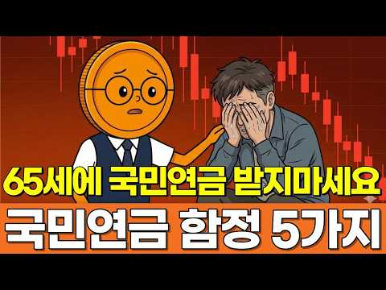

# 재테크 — 성공 사례 분석: 사례별 자세히 #81–#120

`analysis.md` 의 9번 (같은 # 번호). 자동 생성 — `tools/success_analysis.py` v1.4.1 (2026-10-19 07:21 UTC). ※ 연구·교육용 — 투자 권유가 아님.

### 81. 노년에 이성이 접근한다면, 목적은 딱 4가지입니다… 돈이 있든 없든 반드시 보세요【노후의 진실】

- https://www.youtube.com/watch?v=RRnTh3k1Fls · 노후의 진실 · 구독자 20,200 · 조회수 334,387 (×16.6, 하루 3,186.7) · 좋아요 7,515 (2.2%) · 29.1분 · 2026-07-06 · 주제 묶음 4. 노후·연금 · 형식 정보·해설 (그 밖) · 폴더 `W_RRnTh3k1Fls` (웹 승인)
- 썸네일: 
- 설명 앞부분: 노년에 이성이 접근한다면, 목적은 딱 4가지입니다… 돈이 있든 없든 반드시 보세요【노후의 진실】
- 같은 채널 평소 대비 ×6.0 (채널 최근 롱폼 중앙값 55,300회) · 평소 영상: 노후 자금에도 '쓸 수 있는 기한'이 있습니다… 74세가 되어서야 깨달은 4가지 진실 (55,300회) / 돈 이야기가 아닙니다. 노후에 '남편이 있는 집'과 '남편이 없는 집'의 너무나 잔혹한 … (54,021회)
- 대본 (음성인식(앞 5분), 4.7 음절/초) — 앞부분만, 흐름은 그 안까지 첫 20초: “밤 9시가 넘은 시간에 미용실문을 두드린 사람은 이른한 살 먹은 제 친구 수님이었습니다. 그 애가 거울 앞에 안 떠니 이러는 겁니다. 정호가 나 내일 아침에 혼인 심고 하러 간다. 머리 좀 곱게 말아다오고 저는 가위를 든 채로 한참을 아무 말도 못했습니다.” — 도입부 유형: 숫자로 시작
- 첫 1분: “밤 9시가 넘은 시간에 미용실문을 두드린 사람은 이른한 살 먹은 제 친구 수님이었습니다. 그 애가 거울 앞에 안 떠니 이러는 겁니다. 정호가 나 내일 아침에 혼인 심고 하러 간다. 머리 좀 곱게 말아다오고 저는 가위를 든 채로 한참을 아무 말도 못했습니다. 오늘은 노년에 다가오는 이성의 목적 4가지를 전부 말씀드리겠습니다. 앞에 셋은 이야기 중간에 짚어드리고 제가 제일 오래 망설인 네 번째는 맨 뒤에 있습니다. 돈이 있으신 분도 없으신 분도 그 네 번째 때문에 끝까지 들으셔야 합니다. 다 들으시면 사람을 가려내는 시험지 넉장이 손에 남을 겁니다. 저는 수도권 외곽 낡은 상가에서 30년 넘게 미용실을 하는 예순 여덟 한정옥입니다. 미용실 의자라는 게 참 요상한 자리라서 목에 보자기 하나 둘러들이면 며느리 얘기”
- 흐름 (90초마다 첫 문장): 0:00 밤 9시가 넘은 시간에 미용실문을 두드린 사람은 이른한 살 먹은 제 친… → 1:32 남편 보내고 여섯 해 동안 화장품 한 개를 안 사던 애가요? → 3:04 다음 주에 만나면 지난번에 왼쪽 무릎이 냈지요. → 4:33 아이고 지갑을 차에 두고 왔네.
- 댓글 469/471: 좋은 점 — 영상 11 · 감사·응원 13 · 더 알고 싶은 것 1 · 아쉬운 점 — 영상 1 · 반박·불만 — 의견 다름 8 · 정치·사회 0 · 경험 공유 16 · 구독·다음 기대 1
  - 좋은 점 — 영상 👍65 “노후에 대한 여러가지 채널을 봤는데 다들 뻔한 얘기들이였어요 여기가 제대로네요”
  - 좋은 점 — 영상 👍31 “내용이 아주 유익하네요. 결정적인것은 노년에만 해당하는 얘기는 아닐 듯 합니다.”
  - 감사·응원 👍78 “좀 다른말이긴 한데, 베트남 여자덜 조심하세요. 고맙다는말 절대 안하고, 뭔 가족들까지 허구헌날 아프고... 연금 나오는거 쪼개서라도 송금하라 하고 본인과 그친척은 맨날 아프고 내가 아픈건 별관심 없음. 😂”
  - 감사·응원 👍56 “7대 장손 맏며느리로 살며 평생 고맙다 소리 들어본 적 없소 시할아버지 시아버지 시어머니 차례로 가시고 40년 같이 산 남편도 해빙기때 가셨소 모든 짐 훌훌 벗어버리고 혼자 자유를 만끽하며 살고 있소 아주 편하고 좋소 아들이고 딸이고 손주고 보고싶소 하면 얼굴한번 보…”
  - 아쉬운 점 — 영상 👍36 “걷기 수영하기 자전거타기 낚시하기 등산하기 음악듣기 책보기 부산의 남포동국제시장 부평시장 쇼핑맛집 탐방하기 둘랫길걷기 진짜최고입니다 나이66세 남 ㅡㅡㅡㅡㅡ”
  - 반박·불만 — 의견 다름 👍6 “노년에만 해당되는 얘기가 아닙니다.”
  - 반박·불만 — 의견 다름 👍2 “다~그런건아닌데요”
  - 경험 공유 👍78 “좀 다른말이긴 한데, 베트남 여자덜 조심하세요. 고맙다는말 절대 안하고, 뭔 가족들까지 허구헌날 아프고... 연금 나오는거 쪼개서라도 송금하라 하고 본인과 그친척은 맨날 아프고 내가 아픈건 별관심 없음. 😂”
  - 경험 공유 👍27 “인생에서 노년은 생각보다 깁니다 그만살고 죽고싶다 죽어지지 않아요 하루하루 살아내야지요 인간은 원래 이기적인겁니다 우선은 건강해야되니 운동은 해야합니다 몸이 굳어가니까 아파오니까 음식도 잘 챙겨먹고 내가 하고픈걸 조금씩 하고 혼자 즐길줄 알아야합니다 노래도 가볍게 흥…”
  - 구독·다음 기대 👍2 “잘들었습니다. 구독합니다~”

### 82. 《정약용 명언》 부자가 되는 여성이 즐겨 입는 옷 색깔 5가지. 이 색만 입어도 평생 재물이 따릅니다

- https://www.youtube.com/watch?v=BTpNqy7XqJE · 다산의 서재 · 구독자 22,400 · 조회수 366,508 (×16.4, 하루 5,368.6) · 좋아요 11,967 (3.3%) · 36.9분 · 2026-08-12 · 주제 묶음 1. 재테크 일반·마인드 · 형식 오디오북·낭독 (명언·인생조언) · 폴더 `W_BTpNqy7XqJE` (웹 승인)
- 썸네일: 
- 챕터: 0:00 당신의 옷장이 자신도 모르는 사이에 행운을 쫓아내고 … · 3:42 현인 정약용은 복장과 인품에 관해 무엇을 가르쳤습니까? · 8:18 결단력의 색이자 신뢰의 색, 이는 부유한 여성들이 결… · 13:21 "대지의 색과 지성의 색—자산의 유출을 막아주는 두 … · 18:57 "위엄 있는 품격의 색 — 자연스럽게 타인의 시선을 … · 24:30 "대가들은 공허한 이론을 가르치지 않습니다 — 오늘 … · 30:33 색을 이해하는 여성은 자신의 운명을 이해하는 여성입니…
- 설명 앞부분: 정약용 선생의 가르침에 따르면, 사람의 옷차림은 단순한 외모가 아니라 마음의 태도와 운의 흐름을 나타냅니다. 특히 여성이 즐겨 입는 옷의 색깔은 그 사람의 내면 에너지, 자존감, 그리고 재물을 끌어당기는 기운을 그대로 반영합니다. 부자가 되는 여성들은 결코 우연히 부를 얻은 것이 아닙니다. 그들은 자신도 모르게 특정 색깔의 옷을 선택하며, 그 색이 마음의 품격을 세우고 주변의 존중을 자연스럽게 불러옵니다. 오늘 이 영상에서는 정약용 선생이 남긴 지혜를 통해, 평생 재물이 따르는 여성들이 사랑하는 5가지 옷 색깔의 비밀을 함께 나눕…
- 같은 채널 평소 대비 ×32.0 (채널 최근 롱폼 중앙값 11,458회) · 평소 영상: 《정약용 명언》 무슨 일이 있어도 여자라면 외모를 끝까지 가꿔라, 결국 부자가 된다 (11,775회) / 《정약용 명언》 맞춰줄수록 인연은 떠난다. 얼굴에 '이 4가지'가 있는 여자에게 귀인이 … (11,140회)
- 대본 (음성인식(앞 5분), 5.1 음절/초) — 앞부분만, 흐름은 그 안까지 첫 20초: “당신의 옷장이 지금 이 순간에도 재물을 밀어내고 있다는 사실을 알고 계십니까? 저는 수천명의 삶을 지켜보았습니다. 부지런하고 착하며 새벽부터 밤 늦게까지 가족을 위해 헌신한 여성들이 왜 끝내 풍요로움을 누리지 못하는지 왜 주변 사람들에게 늘 가볍게 여겨지는지 저는 오랫동안 그 이유를 찾아 헤맸습니다.” — 도입부 유형: 질문으로 시작, 시청자 부르기
- 첫 1분: “당신의 옷장이 지금 이 순간에도 재물을 밀어내고 있다는 사실을 알고 계십니까? 저는 수천명의 삶을 지켜보았습니다. 부지런하고 착하며 새벽부터 밤 늦게까지 가족을 위해 헌신한 여성들이 왜 끝내 풍요로움을 누리지 못하는지 왜 주변 사람들에게 늘 가볍게 여겨지는지 저는 오랫동안 그 이유를 찾아 헤맸습니다. 그리고 마침내 깨달았습니다. 그 답은 그녀들의 노력에 잊지 않았습니다. 그 답은 그녀들이 매일 아침 몸에 걸치는 것 바로 색깔에 있었습니다. 저는 지금 당신에게 아주 불편한 진실 하나를 말씀드리려 합니다. 오늘 당신이 입고 있는 옷의 색깔이 당신을 향해 오려던 재물을 되돌려 보내고 있을지도 모릅니다. 이것은 미신이 아닙니다. 이것은 수백년의 지혜가 쌓인 삶의 법칙입니다. 같은 마을에 두 여인이 있었습니다. 둘”
- 흐름 (90초마다 첫 문장): 0:00 당신의 옷장이 지금 이 순간에도 재물을 밀어내고 있다는 사실을 알고 → 1:31 그녀는 자신이 입는 색깔 하나하나의 의미를 담았고 그 의미가 그녀의 → 3:05 이 색들은 당신의 품격을 세우고 주변 사람들이 당신을 함부로 → 4:32 떠나셨 습니다.
- 댓글 1,619/1,637: 좋은 점 — 영상 27 · 감사·응원 215 · 더 알고 싶은 것 3 · 아쉬운 점 — 영상 9 · 반박·불만 — 의견 다름 5 · 정치·사회 1 · 경험 공유 31 · 구독·다음 기대 0
  - 좋은 점 — 영상 👍138 “나는 오늘부터 색갈잇는옷을 입을것입니다 좋은말씀 잘들었습니다 감사합니다”
  - 좋은 점 — 영상 👍42 “나는언제나품격있는여성입니다.늘좋은말씀감사합니ㅡ다❤❤❤❤🎉🎉”
  - 감사·응원 👍248 “나는 언제나 이세상에 제일 귀한 사람이라고 생각 하며 살고있어요 나없는 이세상 아무것도 없다는 마음으로 아침에 새로운 부활에 감사하며 살아갑니다~❤😅❤”
  - 감사·응원 👍175 “감사합니다^^ 나는 귀부인처럼 귀하게 품격 있게 살겠습니다 ^^”
  - 더 알고 싶은 것 👍4 “다선까지글을 올려주세요. 말만지나니또있어버림”
  - 더 알고 싶은 것 👍3 “예전에 없는 사람이 어떻게 색깔 옷을 입었을까요? 양반과 부자만 ..”
  - 아쉬운 점 — 영상 👍8 “서론이너무길어요 짜증 나네요”
  - 아쉬운 점 — 영상 👍3 “너무길어서...”
  - 반박·불만 — 의견 다름 👍1 “색깔 내게 어울려야 입지요 환한색이 좋다고 무조건 입으면 촌스러워 영아닙니다 개인적으로 저는 파스텔 톤이 어울려서 주로 같우색을 입지요”
  - 반박·불만 — 의견 다름 👍1 “나는 못생기고 맘 착하고 공부 잘하는 사람입니다 ㅎ 못생겨서 남자한테나 여자한테나 관심을 못 받습니다 근데 결혼후 대출 받아본 적이 없습니다 재물은 항상 넘쳣죠 남편도 똑똑한 사람은 아닌데 인복이 많아 항상 누가 도와줘요 옷 색깔은 모르겟어요😁”
  - 정치·사회 👍26 “나는 내가 13살 소녀때 부터 나를 귀하고 아주 특별한 사람이라 믿었고 옷에도 매우 신경 썼습니다 또 하나님을 믿게된후 20세가 넘어서는 더육 더 주님의 자녀답게 존귀한 여자로써 어디에 있든지 스스로 한국인 다운 외국인들 앞에서는 빛나도록 옷을 입는 페션과 칼러 그리…”
  - 경험 공유 👍26 “나는 내가 13살 소녀때 부터 나를 귀하고 아주 특별한 사람이라 믿었고 옷에도 매우 신경 썼습니다 또 하나님을 믿게된후 20세가 넘어서는 더육 더 주님의 자녀답게 존귀한 여자로써 어디에 있든지 스스로 한국인 다운 외국인들 앞에서는 빛나도록 옷을 입는 페션과 칼러 그리…”
  - 경험 공유 👍9 “내가 나를 존중해야 한다.😂”

### 83. 62세 은퇴후 아내마저 떠났다. 68세에 월 80만원으로 살아가는 노인의 독백 "삼십 년을 살았는데, 아내 하루가 어떻게 흘러가는지 한 번도 몰랐습니다"

- https://www.youtube.com/watch?v=ObUr9qiawmo · 황금노후 · 구독자 12,500 · 조회수 195,099 (×15.6, 하루 1,231.8) · 좋아요 2,894 (1.5%) · 13.7분 · 2026-05-13 · 주제 묶음 4. 노후·연금 · 형식 사연·드라마 · 폴더 `W_ObUr9qiawmo` (웹 승인)
- 썸네일: 
- 설명 앞부분: 황혼이혼, 독거노인, 노후준비, 은퇴 후 삶, 부부관계, 노년 외로움, 정년퇴직 현실 누구도 말하지 않았던 그 이야기를 68세 노인이 직접 전합니다. 삼십 년을 함께 살았던 아내와의 이혼, 연락이 끊긴 자녀들, 월세 35만원 원룸에서 국민연금 80만원으로 살아가는 하루. 이것은 먼 이야기가 아닙니다. 중견기업 부장까지 올라가 성실하게 삼십 년을 일했습니다. 퇴직금도 받았고, 연금도 나왔습니다. 돈은 준비했다고 생각했습니다. 하지만 아무도 알려주지 않았습니다. 마음의 준비, 관계의 준비가 더 중요하다는 것을. 지금 이 영상을 보고 …
- 같은 채널 평소 대비 ×621.3 (채널 최근 롱폼 중앙값 314회) · 평소 영상: 50대 60대로 나이들면서 사는 게 천국인 사람들, '이유' 따로 있더라. ∣ 표정이 편… (315회) / 나이들수록 외모를 꾸며야 어디서든 제대로 대접받는다. ｜다산정약용의 네가지 아침습관｜인생… (313회)
- 대본 (음성인식(앞 5분), 4.2 음절/초) — 앞부분만, 흐름은 그 안까지 첫 20초: “저는 올해 68일입니다. 서울 외곽의 작은 원룸에서 혼자 삽니다. 보증금 500만원에 월세 35만원짜리 방입니다. 5평 창문 하나 작은 냉장고 하나 TV 한 아침에 눈을 뜨면 7시쯤입니다.” — 도입부 유형: 숫자로 시작, 내 이야기·사연
- 첫 1분: “저는 올해 68일입니다. 서울 외곽의 작은 원룸에서 혼자 삽니다. 보증금 500만원에 월세 35만원짜리 방입니다. 5평 창문 하나 작은 냉장고 하나 TV 한 아침에 눈을 뜨면 7시쯤입니다. 평생 그 시간에 일어났더니 발람 없어도 눈이 그냥 떠집니다. 일어나서 제일 먼저 하는 게 TV를 켜는 겁니다. 처음엔 뉴스 보려고 켰는데 이제는 뉴스가 아니어도 됩니다. 그냥 소리가 필요한 거예요. 사람 목소리가 들려야 이 방이 덜 조용하니까 세수하고 물 한 컵 마시고 9시쯤 집 근처 공원으로 나갑니다. 공원에 가면 비슷한 나의 어르신들이 계세요. 거기서 날씨 얘기도 하고 허리 아프다는 얘기도 하고 요즘 최소가 비싸다는 얘기도 합니다. 결국 아닌 얘기인데”
- 흐름 (90초마다 첫 문장): 0:00 저는 올해 68일입니다. → 1:31 거기 에어컨도 나오고 → 3:02 부부가 아키면 → 4:32 왜?
- 댓글 610/610: 좋은 점 — 영상 5 · 감사·응원 23 · 더 알고 싶은 것 3 · 아쉬운 점 — 영상 4 · 반박·불만 — 의견 다름 6 · 정치·사회 5 · 경험 공유 30 · 구독·다음 기대 0
  - 좋은 점 — 영상 👍7 “동영상을 듣고보니 공통적으로 공감합니다 어째 내 생활하고 비슷하지만 한두가지가 내가 더갖고 있는듯 싶네요.돈. 운동 취미생활. 정신적으로 대박이 진돗개를 키웁니다.많은 정을 느끼고 느끼는 감정이 비슷합니다 .”
  - 좋은 점 — 영상 👍2 “60대인데 일할수있는데 돈번다기보다 세상에 썩인다는개념으로 일을나가세요 노인일자리는 새로운통로가 될수있지요 대화할사람들도 있구요 병원혼자가는게 뭐가 괴로워요 저는 수술할때도 보호자싸인 제가함니다 자식들안와도 아무렇지도 않슴니다 자기연민에 빠지는건 사는데 별도움이 안됨…”
  - 감사·응원 👍15 “우리네. 인생은. 늙고. 병들면. 고독하고. 외롭고. 허무해집니다. 그러나. 나의. 현실을. 인정하면서. 모든. 과정을. 철학적인. 관점에서. 보면은. 결코. 살아있음에. 감사하고. 이세상이. 즐거운. 날. 소풍이였다고. 너무. 슬퍼하거나. 착망하지. 말아야합니다 끝…”
  - 감사·응원 👍10 “아름다운 마음으로 행복을 전해주시는 영상에 감사드립니다.”
  - 더 알고 싶은 것 👍22 “지하철 무료고 공원도 무료입니다. 혼자 사니 도시락 직접 싸든가,깁밥 2줄이면 7,000원 하고 막걸리 2통 사서 산에 가면 체력단련 할수 있고요. 나이먹어 연애는 못해도 건강한 말동무 친구도 만날 기회 있네요. 우리나이 67세 촌로의 생각입니다. 30년 열심히 사신…”
  - 더 알고 싶은 것 👍4 “저는 70대인데 궁금해서 들어와 봤더니 낚시 당한 기분입니다. 실화가 아니고 참 참 . . .”
  - 아쉬운 점 — 영상 👍8 “사람마다 생각이 천차 만별 이네요.저는 평생 주변인에게 배풀기만 했어요. 그런 형편도 늘 감사해 하였지요. 60이 들어설때 저는 아내와 저를 위해 남은 시간을 쓰기로 하고 친구들을 다 끊었었습니다. 아내와 일요일 마다 같이 다니고. 그동안 시간 없어서 못했던 일과 배…”
  - 아쉬운 점 — 영상 👍4 “저는 70대인데 궁금해서 들어와 봤더니 낚시 당한 기분입니다. 실화가 아니고 참 참 . . .”
  - 반박·불만 — 의견 다름 👍3 “아내, 아들, 딸, 다 문제네요. 68세는 그리 노인 아닙니다.. 젊게 사시고 즐겁게 사세요..”
  - 반박·불만 — 의견 다름 👍2 “아내 인생 허무한거 왜 남편에게 원망해. 남편도 ㅊ시선을 다해 살은건데. 또다른 인생의 허무함인데. 남편탓리 아닌데.”
  - 정치·사회 👍3 “내용은 청승이고.. 음성은 외국인ai쓰고 구독구걸하면서 배울점은 하낫또 없고 대체 왜 이런 영상을 만드는지...”
  - 정치·사회 👍2 “국힘이 만든//국힘을 찍은 1빠들..ㅊㅋ합니다.^^”
  - 경험 공유 👍81 “의미 없는 이러한 삶을 계속 살아야 하는가 하는 생각이 듭니다. .나도 몸이 많이 아프고 매일 하는 것이 집 근처 공원에 나가서 시간을 보냅니다. .아무 의미도 없는. 이러한 삶을 왜 이렇게 계속 살아야 하는지 참으로 안타깝습니다”
  - 경험 공유 👍71 “저희들키운다고아빠는평생을바쳤는데.부인도.남편이헛짓하며살지않았는데가족남보다못한사이.잘못한거없습니다.고생하셨습니다”

### 84. 저는 1년 동안 매달 5만 원을 모아봤습니다. 그리고 돈에 대한 생각이 달라졌습니다

- https://www.youtube.com/watch?v=IBAvE_dF0L4 · 돈의 통찰 · 구독자 3,920 · 조회수 57,256 (×14.6, 하루 857.0) · 좋아요 780 (1.4%) · 41.6분 · 2026-08-13 · 주제 묶음 기타 · 형식 브이로그·직접 해본 이야기 · 폴더 `W_IBAvE_dF0L4` (웹 승인)
- 썸네일: 
- 설명 앞부분: 매달 5만 원. 처음에는 너무 작은 금액처럼 보였습니다. 하지만 1년 동안 꾸준히 모아보니, 단순히 통장 잔액만 달라진 것이 아니었습니다. 이 영상에서는 **매달 부담 없이 저축할 수 있는 작은 금액을 정하고, 자동으로 분리해 쌓아가는 방법**을 이야기합니다. 월급의 20%를 무조건 저축해야 한다는 말이 부담스러웠던 분들, 몇 번이나 저축을 시작했다가 예상치 못한 지출 때문에 포기했던 분들이라면 이 방법이 도움이 될 수 있습니다. 💰 매달 5만 원을 꾸준히 모으는 방법 🏦 생활비와 저축금을 분리하는 이유 🧠 작은 목표가 저축 습관…
- 같은 채널 평소 대비 ×4.0 (채널 최근 롱폼 중앙값 14,309회) · 평소 영상: 부유한 은퇴자들이 돈이 있어도 절대 사지 않는 10가지 물건. (14,354회) / 나이에 비해 가진 게 없다면… 당신은 정말 뒤처진 걸까? (14,264회)
- 대본 (음성인식(앞 5분), 5.4 음절/초) — 앞부분만, 흐름은 그 안까지 첫 20초: “아침 6시 41분 경기도 외곽의 작은 원룸 주방입니다. 커피 머신에서는 아직 커피가 천천히 떨어지고 있습니다. 창밖 거리에는 가끔 지나가는 차 소리만 들리고 건물 안 사람들은 아직 잠들어 있습니다. 그리고 커피 한 모금을 마시기도 전에 김지우는 휴대폰 앱을 열고 누군가 볼까 주변을 살핀 뒤” — 도입부 유형: 숫자로 시작
- 첫 1분: “아침 6시 41분 경기도 외곽의 작은 원룸 주방입니다. 커피 머신에서는 아직 커피가 천천히 떨어지고 있습니다. 창밖 거리에는 가끔 지나가는 차 소리만 들리고 건물 안 사람들은 아직 잠들어 있습니다. 그리고 커피 한 모금을 마시기도 전에 김지우는 휴대폰 앱을 열고 누군가 볼까 주변을 살핀 뒤 계좌에서 다른 계좌로 5만원을 이체합니다. 4만 5천원이 아닙니다. 월급에서 생활비를 모두 내고 남은 돈도 아닙니다. 정확히 5만원, 월급 날마다 빠짐없이 같은 금액을 넣은지 어느새 1년이 됐습니다. 김지우는 동네 마트 계산원으로 일하며 한 달에 약 230만원을 벌고 있습니다. 대부분의 경제 전문가들이 말하는 기준으로 보면 여유 있게 저축하기에는 결코 높은 월급이 아닙니다. 그런데도 그는 같은 월급으로 이미 한 달치 월세”
- 흐름 (90초마다 첫 문장): 0:00 아침 6시 41분 경기도 외곽의 작은 원룸 주방입니다. → 1:31 차이는 단 하나의 원칙에 있었습니다. → 3:01 돈을 모으려고 노력했지만 → 4:32 왜냐하면 그가 겪은 일은 특별한 경우가 아니라
- 댓글 40/40: 좋은 점 — 영상 3 · 감사·응원 4 · 더 알고 싶은 것 0 · 아쉬운 점 — 영상 2 · 반박·불만 — 의견 다름 0 · 정치·사회 0 · 경험 공유 5 · 구독·다음 기대 0
  - 좋은 점 — 영상 👍8 “영상 너무 유익해요!”
  - 좋은 점 — 영상 👍6 “영상보고 많이 배웠 어요 감사 합니다”
  - 감사·응원 👍6 “영상보고 많이 배웠 어요 감사 합니다”
  - 감사·응원 👍3 “저도 이렇게 하고 있습니다. 무리하지 않고 지속할 수 있는 가장 현실적인 방법입니다. 좋은 영상 감사합니다.”
  - 아쉬운 점 — 영상 👍15 “너무길어요 요점만”
  - 아쉬운 점 — 영상 👍6 “지루하네요”
  - 경험 공유 👍12 “항상기준에 못미쳐서 내가 못하는거구나 그랬는데 위로를 받았네요”
  - 경험 공유 👍8 “맞아요 위로를 받았어요 항상기준에 못미쳐서 내가 못하는거구나 그랬는데 위로를 받았네요”

### 85. "이건 저희 부모님도 가능해요" 외국인한테 한국어 읽어주고 달러 버는 역대급 부업

- https://www.youtube.com/watch?v=lHj-_pcQSX4 · 뉴머니 · 구독자 28,100 · 조회수 407,664 (×14.5, 하루 4,583.5) · 좋아요 8,184 (2.0%) · 16.1분 · 2026-07-22 · 주제 묶음 8. 부업·소득 · 형식 정보·해설 (그 밖) · 폴더 `W_lHj-_pcQSX4` (웹 승인)
- 썸네일: 
- 설명 앞부분: ⏰ 무료라이브 날짜는 신청하시면 단톡방에서 공지드립니다 ⚠️현재 신청 폭주!!! 곧 단톡방 마감됩니다⚠ 필수! 단톡방 입장하면 필살기 무료선물 드립니다 🚨선착순 한정 한국어만 읽어주고 달러를 번다고?🫢 오늘 출연하신 한글언니님은 영어를 유창하게 하지 않아도 외국인들에게 한국어를 가르치며 매달 꾸준히 달러 수익을 만들고 계십니다. “이런 거 하는 사람 많아서 이미 레드오션 아닌가요?” 그렇게 생각하실 수도 있는데요. 놀랍게도 한국어 강사는 영어 강사보다 훨씬 적은 반면 배우려는 학생은 200만명이 넘는다는 사실...🫢 이번 영상에서…
- 같은 채널 평소 대비 ×33.3 (채널 최근 롱폼 중앙값 12,237회) · 평소 영상: "뻔한 쇼핑쇼츠 그만하세요" 비밀공식 하나로 월 8,000만원 찍었던 방법 전부 공개합니… (12,237회) / 이게 '진짜' 자동화입니다. 원클릭으로 쇼츠 뽑아서 월 수천만원 버는 미친 방법 (뻔한 … (12,182회)
- 대본 (음성인식(앞 5분), 5.5 음절/초) — 앞부분만, 흐름은 그 안까지 첫 20초: “외국인들을 대상으로 한국어를 가르치고 있어요. 즐겁게 같이 공부해요. 자격증 없어도 괜찮아요. 저도 자격증이 없고 제가 가지고 있는 노트북 한 대로 시작을 했어요. 외국어를 못 한다고 하셔도 할 수 없는 일은 아니에요. 편하게 얘기하고 다리 레그 좋아요. 계속 계속 수업을 장기적으로 듣는 거예요.”
- 첫 1분: “외국인들을 대상으로 한국어를 가르치고 있어요. 즐겁게 같이 공부해요. 자격증 없어도 괜찮아요. 저도 자격증이 없고 제가 가지고 있는 노트북 한 대로 시작을 했어요. 외국어를 못 한다고 하셔도 할 수 없는 일은 아니에요. 편하게 얘기하고 다리 레그 좋아요. 계속 계속 수업을 장기적으로 듣는 거예요. 지금 시간당 30달러를 받고 있어요. 44,445원 수요에 비해서 공급이 현저에 부족한 상태인 거예요. 신예어분들도 드시고 시작하기 전에 다 닦아 놓고 저처럼 한 다음에 수육 내실 수 있죠. 안녕하세요. 안녕하세요. 먼저 간단하게 자기소개 부탁드려도 될까요? 31살이고 한글 언니라고 합니다. 남편분이 외국인 분이셨구나. 주민 씨 사람이에요. 한글 언니 남편이에요. 저는 외국인들을 대상으로 한국어를 가르치고 있어요.”
- 흐름 (90초마다 첫 문장): 0:00 외국인들을 대상으로 한국어를 가르치고 있어요. → 1:31 44,445원 → 3:00 보여주실 수 있을까요? → 4:30 아까 제 화면을 보셨겠지만
- 댓글 990/992: 좋은 점 — 영상 42 · 감사·응원 87 · 더 알고 싶은 것 54 · 아쉬운 점 — 영상 5 · 반박·불만 — 의견 다름 0 · 정치·사회 36 · 경험 공유 232 · 구독·다음 기대 11
  - 좋은 점 — 영상 👍8 “전 세아이의 엄마인데 경력단절로 코로나때 일그만두고 52세가 되었는데 저도 신청 가능한가요? 좋은 영상 감사합니다 ~몇년 쉬다가 일하고는 싶은데 ~막내가 초6, 고등학생 둘까지 아직 손이 가는 부분이 있어 뭔가 일을 하려는게 두렵고 그렇습니다~ 저도 신청가능할까요?”
  - 좋은 점 — 영상 👍6 “다른 영상들은 봐도 신뢰가 가지않았는데 대표님이 올리신글들 영상에서 하시는 말들에 아 진짜 제대로 배워볼수있겠다는 생각이 들었어요. 그리고 이런것들을 좋은 영상으로 만들어주셔서 감사합니다! 신청하겠습니다 :)”
  - 감사·응원 👍233 “안녕하세요, 한글언니입니다! 🥰 저도 광고를 보고 시작한 사람인만큼 많은 무료 부업 강의들을 시청했습니다 여러분이 느끼셨던 기분, 저도 느껴봤어요 🫥 제 시급 4만원을 기준으로 강의는 두시간가량 진행 예정이니 여러분이 내어주시는 시간을 돈으로 환산하면 10만원이 되겠…”
  - 감사·응원 👍21 “호주에 거주하면서 문화의 힘을 많이 체감하는 중입니다🇦🇺 한국어를 배우고 싶어하는 외국인들 정말 많아요 😮 한글을 널리 알리는데 더 적극적으로 나서보고 싶어서 신청합니다 😊 좋은 영상 감사해요🦘🧡”
  - 더 알고 싶은 것 👍54 “무료 강의후에 강의 신청하라고 하죠? 강의비 대략 얼마인가요?😅😊❤”
  - 더 알고 싶은 것 👍47 “저는70살 LA거주 할머니 입니다 영어도 가능하고 한글 학교 선생으로 7년 이상 경력이 있습니다 신청할 수 있을까요?”
  - 아쉬운 점 — 영상 👍233 “안녕하세요, 한글언니입니다! 🥰 저도 광고를 보고 시작한 사람인만큼 많은 무료 부업 강의들을 시청했습니다 여러분이 느끼셨던 기분, 저도 느껴봤어요 🫥 제 시급 4만원을 기준으로 강의는 두시간가량 진행 예정이니 여러분이 내어주시는 시간을 돈으로 환산하면 10만원이 되겠…”
  - 아쉬운 점 — 영상 👍7 “무료신청 ㅡ낚시 입니다ㆍ”
  - 정치·사회 👍46 “호주 25년째 거주하고있습니다. 한글 배우고 싶어하는 외국인들에게 많은 도움이 되고 싶습니다. 제 주위에도 엄청 많습니다! 이렇게 좋은 기회가 있는줄 몰랐습니다. 저도 특강 신청하겠습니다!”
  - 정치·사회 👍21 “호주에 거주하면서 문화의 힘을 많이 체감하는 중입니다🇦🇺 한국어를 배우고 싶어하는 외국인들 정말 많아요 😮 한글을 널리 알리는데 더 적극적으로 나서보고 싶어서 신청합니다 😊 좋은 영상 감사해요🦘🧡”
  - 경험 공유 👍238 “전에 한번 해봤는데, 돈 받고 떠든다고 생각하니까.. 부담감이 장난아니더라구요. 잘나가시는 분은 커리큘럼도 있어야하고, 교재도 만들어서 사용허시요”
  - 경험 공유 👍233 “안녕하세요, 한글언니입니다! 🥰 저도 광고를 보고 시작한 사람인만큼 많은 무료 부업 강의들을 시청했습니다 여러분이 느끼셨던 기분, 저도 느껴봤어요 🫥 제 시급 4만원을 기준으로 강의는 두시간가량 진행 예정이니 여러분이 내어주시는 시간을 돈으로 환산하면 10만원이 되겠…”
  - 구독·다음 기대 👍8 “달러를 벌고 싶어서 부업알아보는데 알고리즘이 데려다줬어요 기대됩니다. 신청합니다”
  - 구독·다음 기대 👍5 “우연한 기회에 유튜브를 찍게 되었는데 발음이 정확하고 자연스럽다는 것을 알게되어 저의 장점을 살릴 수 있는 일인것 같아 너무 배우고 싶습니다. 매달 제로에서 시작해야하는 영업 프리랜서로 일하고 있습니다. 대출로 인한 가계 지출이 많은 저로서는 안정적인 수익창출이 절실…”

### 86. 현대차 반토막에 숨겨진 진실… 엔비디아 합작 발표 전 무조건 모아야 할 이유 [이권희 대표]

- https://www.youtube.com/watch?v=m3ZRHahRGHU · 경제시그널 · 구독자 27,800 · 조회수 399,952 (×14.4, 하루 31,079.0) · 좋아요 1,828 (0.5%) · 33분 · 2026-10-06 · 주제 묶음 기타 · 형식 인터뷰·강연·대담 · 폴더 `W_m3ZRHahRGHU` (웹 승인)
- 썸네일: 
- 챕터: 0:00 오프닝 · 0:15 요즘 주식시장 · 13:25 삼성전자 3분기 잠정실적 · 15:40 수급으로 인한 리스크는? · 20:10 반도체 소부장 접근법 · 22:30 전력기기·전선주 투자 포인트 · 24:25 현대차 언제 전고점가나? · 28:45 3분기 어닝시즌 진입... 투자 전략은?
- 설명 앞부분: 🔎올초 피지컬 AI와 로봇 기대감으로 치솟았던 현대차 주가 고점 대비 반토막 난 상황! 새만금 데이터센터 건립과 복정동 연구센터에 '엔비디아' 엔지니어들이 들어온다? 연내 발표될 엔비디아와의 합작법인 모멘텀부터 2035년까지 이어질 메모리·로봇 대폭발 사이클까지! 지금 현대차를 팔면 안 되는 이유와 반등 타이밍을 공개합니다. 뿐만 아니라 삼성전자 3분기 실적발표를 앞두고 반도체 소부장주 급등랠리 중입니다. 50개가 넘는 소부장 종목 속에서 가장 스마트하게 수익률을 챙기는 전략도 전격 공개합니다. 🕥 타임스탬프 🕥 녹화일: 2026…
- 같은 채널 평소 대비 ×36.0 (채널 최근 롱폼 중앙값 11,104회) · 평소 영상: 이번 주 FOMC 시장 분기점! 금리인상 시 안도랠리 펼쳐질 역발상 섹터전략 [이권희 대… (19,857회) / 기대감 0%? 고생했던 주주들 필독! 2차전지 제약바이오 왜 반등하는지 알려드립니다 [민… (32,666회)
- 대본 없음 (설명) — 음성인식이 끝나면 도입부·흐름이 들어감
- 댓글 206/208: 좋은 점 — 영상 1 · 감사·응원 3 · 더 알고 싶은 것 1 · 아쉬운 점 — 영상 0 · 반박·불만 — 의견 다름 5 · 정치·사회 7 · 경험 공유 8 · 구독·다음 기대 0
  - 좋은 점 — 영상 👍6 “갓권희대표님~ 좋은 말씀 감사합니다~ 👍👍👍”
  - 감사·응원 👍6 “갓권희대표님~ 좋은 말씀 감사합니다~ 👍👍👍”
  - 감사·응원 👍0 “감사해요. 절대 주식하면 안되는다는 진실을 몸소 배우고 있어요. ㅎㅎㅎㅎㅎ”
  - 더 알고 싶은 것 👍4 “현대차 Ai에 물어 보니까 33만에 50프로 물타고 30만원 깨지면 나머지 다 사라던대 어떤걸 믿을까요?”
  - 반박·불만 — 의견 다름 👍1 “저,*때문에(100만원간다고) 신세ㅗ진사람 천지..왜방송에 나와 헛소리하고 저런8을 방송에서 ,,,”
  - 반박·불만 — 의견 다름 👍0 “이권희만 좋다고 한거 아닙니다. 다른분들도 다좋다고 했고 본인판단인거죠..저도 2천물렸습니다. 속은쓰리지만 회사를 믿고 배당받고 기다리다보면 또 기회가 오지않을까요?”
  - 정치·사회 👍4 “미국 중간선거 끝나면 난리난다”
  - 정치·사회 👍2 “● 삼성전자: 3분기 서프라이즈 실적 발표(D-2): 선매수 유리 영업이익 110조원: 전년대비 802% 폭증 ○ 자사주 15조원 매수중 주주환원 110조원 발표 ● 싱가폴 국부펀드 테마섹 : 삼성전자 51조원 매수 시작 : 외국인+기관 최근 3000만주 대량 매수 …”
  - 경험 공유 👍32 “냉정하게 보면 저 사람이 현대차 주가를 떨어트린것도 아니고 왜 저사람에게 화풀이지? 올랐으면 저사람에게 수익의 반은 줄건가?? 나도 현대차 물려있지만 선택은 개인이 한것이니 개인이 감내해야한다고 본다.”
  - 경험 공유 👍4 “내가 "밧데리아저씨2" 가 될상인가”

### 87. 월 300 직장인ㅣ알바하면서 3억 모으기ㅣ고물가시대 집밥으로 60% 저축ㅣ사실상 걍생 브이로그

- https://www.youtube.com/watch?v=_o4FbnwxGrw · 테라 · 구독자 9,420 · 조회수 135,431 (×14.4, 하루 962.7) · 좋아요 1,307 (1.0%) · 7.8분 · 2026-05-31 · 주제 묶음 2. 돈 모으기·저축 · 형식 브이로그·직접 해본 이야기 · 폴더 `W__o4FbnwxGrw` (웹 승인)
- 썸네일: 
- 설명 앞부분: 6월도 잘 부탁혀요 (하트. 브금대통령 🎵트랙 : 왜저래 - • [웃긴 음악] 왜저래 (숏폼 / 개그 / 재미있는 상황 브금) 🎵트랙 : 아니요 - • [귀엽고도 코믹한음악] 아니야 ☝🏻
- 같은 채널 평소 대비 ×23.2 (채널 최근 롱폼 중앙값 5,831회) · 평소 영상: 코스피 7,980시대ㅣ70% 저축 브이로그ㅣ쌀 10kg 소분ㅣ자취 집밥, 식비 절약ㅣ점진… (5,831회) / 2억 2천ㅣ직장다니면서 1억. 모을 수 있었던 부업ㅣ필라테스 아님ㅣ진로 고민ㅣ집들이ㅣ꽃집… (5,861회)
- 대본 없음 (설명) — 음성인식이 끝나면 도입부·흐름이 들어감
- 댓글 312/313: 좋은 점 — 영상 0 · 감사·응원 17 · 더 알고 싶은 것 11 · 아쉬운 점 — 영상 0 · 반박·불만 — 의견 다름 2 · 정치·사회 0 · 경험 공유 20 · 구독·다음 기대 1
  - 감사·응원 👍25 “여기 죄다 돈많은 20대~ 30대들 밖에 없네..35살인데 모아둔 돈 없는데..1억은 커녕 겨우 천 되나.. 이런거 보면 동기부여가 되야하는데 오히려 현타만 얻고 안바뀌는 내삶 참 뭣같네요 화이팅입니다”
  - 감사·응원 👍19 “93년생 2023년 8월 결혼할때 부부합쳐 1.3억 들고 시작했어요. 구두쇠처럼 살면서 기회 찾아 영끌로 서울에 집사고, 주식사고 해서 순자산으로 7억 달성했네요. 요새 해이해졌는데 자극 많이 받고 갑니다. 검소하게 살면서 정부 움직임 잘 보고 움직이면 기회는 항상 …”
  - 더 알고 싶은 것 👍3 “Etf 뭐 넣으세요? 궁금해요!”
  - 더 알고 싶은 것 👍1 “열심히 사시는게 멋져요!! 제가 취업한 후라면 퇴근 후 힘들어서 쉬고 싶을텐데, 대단하세요. 한편으로는 다른 취미는 없는지 궁금하네요”
  - 반박·불만 — 의견 다름 👍0 “우앙 개념녀 쵝오임!! 좋은하루되세요!! 아 볶음밥 저도 잘먹을수 있는데!! 아 이상한 사람아닙니다 ㅠㅠ 행복하셍ㅇㅅㅁ!!”
  - 반박·불만 — 의견 다름 👍0 “님처럼 깨작깨작해서 저축해서 모아가는 그런 사주가 아닙니다.저는 한방에 포클레인으류 돈을 쓸어담는 사주입니다. !! 말년에 돈이 마르지 않는 사주란 뜻입니다요 !! 부자의 으뜸 사주 !! 넘버1 사주 신왕재왕 사주을 갖고 태어났습니다.!!”
  - 경험 공유 👍44 “제가 살면서 느낀건데 확실히 j형 사람들이 돈도 잘벌고 모으는것 같아요! 32 35 37 벌써 인생계획 및 부동산 공부하시는거보고 놀랐오요...ㅠㅠ 전 그나이대에 뭐하면서 살았는지ㅠㅠ 저도 테라님처럼 지금부터라도 더더 계획적으로 부지런히 살아봐야겠숩니다! 잘보구가여~”
  - 경험 공유 👍20 “29살인데 3억까지 쉽지 않은데 대단하십니다.. 저도 본받아서 돈 모을거에요 !!”
  - 구독·다음 기대 👍0 “다음 영상도 기대할게요. 앞으로도 멋진 영상 만들어 주세요♪ 저는 일본에서 무료 BGM을 만들고 있어요. 영상에 음악이 필요할 때 편하게 사용해 주세요♪”

### 88. 중개형 ISA 계좌 만기해지 안 하는 이유

- https://www.youtube.com/watch?v=AbpqDkCFTT0 · 청년개미 · 구독자 15,800 · 조회수 225,896 (×14.3, 하루 1,327.2) · 좋아요 2,562 (1.1%) · 5.2분 · 2026-05-02 · 주제 묶음 6. 절세·제도 · 형식 정보·해설 (그 밖) · 폴더 `W_AbpqDkCFTT0` (웹 승인)
- 썸네일: 
- 챕터: 0:00 인트로 · 0:19 ISA 1억 초과 · 0:50 만기해지 안하는 이유 1 · 2:29 만기해지 안하는 이유 2 · 3:56 연금 계좌로 이전 안하는 이유 · 4:23 정리하면..
- 설명 앞부분: ISA 계좌 잔고가 1억 5천만 원을 넘었지만, 저는 아직 만기 해지를 하지 않고 있습니다. 🚩청년개미와 함께 노후준비하기
- 같은 채널 평소 대비 ×51.4 (채널 최근 롱폼 중앙값 4,393회) · 평소 영상: QQQ, QQQM 갈아타야 하나? 최저보수 QNDX ETF 등장 (4,393회) / 1억을 빠르게 모은 사람들의 공통점 3가지 (4,395회)
- 대본 없음 (설명) — 음성인식이 끝나면 도입부·흐름이 들어감
- 댓글 537/537: 좋은 점 — 영상 22 · 감사·응원 37 · 더 알고 싶은 것 27 · 아쉬운 점 — 영상 8 · 반박·불만 — 의견 다름 17 · 정치·사회 3 · 경험 공유 87 · 구독·다음 기대 0
  - 좋은 점 — 영상 👍4 “참 유익한 영상입니다”
  - 좋은 점 — 영상 👍3 “똑부러지는 영상 감사합니다~ 저는 경제 유튜버님들 보면 너무신기합니다 어떻게 저렇게 설명을 잘하시는지... 저랑은 종족이 다른것 같아요ㅋ 당장의 1억도 부럽지만 이렇게 설명하시는 능력도 부럽습니다ㅠㅠ”
  - 감사·응원 👍19 “으아 내가 원한게 이거였는데요 감사합니다”
  - 감사·응원 👍14 “잘하시고 계시는거 같아요 전 45세라서 없는셈치고 2회차 isa 1억 넣고 2-30년후에 찾을거 같습니다 ㅎㅎ 1회차 돌린 isa는 연금저축으로.. 그다음에 새로 국내 isa 1.2~2억정도 돌리고 또 연금저축으로 다 보냅니다 큰틀은 슈드 :나스닥액티브 = 7.5 :…”
  - 더 알고 싶은 것 👍2 “Isa계좌로 국내상장 미국 나스닥100etf 사고 3년지나면 세금 9.9%만 내면 되는건가요?? 국내상장 미국주식은 비과세 안된다고 들어서요 궁금합니다??”
  - 더 알고 싶은 것 👍1 “20대 자녀는 어떻게 해야할까요?”
  - 반박·불만 — 의견 다름 👍589 “소액만 하고 목돈 안모아본 사람들 댓글이 대부분이네요 ㅋㅋㅋ 저도 1억 채웠는데 해지 안합니다. 해지하지마세요. 경험들도 안해봤으면서 돈 모이면 연금저축으로 이전해라 얼마빼고 일부 돈 뺼수잇다 이러는데 전혀 아닙니다. 연말정산 자기들이 직접 하는게 아니라 회사서 일괄…”
  - 반박·불만 — 의견 다름 👍30 “ISA 만기 후 연금저축 계좌로 3천만원 이전하면 3백만원이 세액공제대상이고, 연말정산하면 대략 40만원 정도의 세금이 감면됩니다. ISA 계좌 1억원 이상 굴려보면 하루에 오르락 내리락 하는 금액도 커서, 비과세 혜택 200만원이나 연말정산 혜택은 크게 고려할만한 …”
  - 정치·사회 👍41 “절대 해지하지마시고요 나중에 배당주같은거 좀 담으셔서 배당금 필요하시면 그거 빼드시던지 아니면 급하면 일반주식 팔아서 빼드셔도됩니다. 본인이 납입한 만큼 빼먹을수있습니다 그러다가 기어이 돈을 못빼는 순간이 옵니다. 이러면 이제 이 ISA는 무한으로 뿔리시던지 아니면 …”
  - 경험 공유 👍589 “소액만 하고 목돈 안모아본 사람들 댓글이 대부분이네요 ㅋㅋㅋ 저도 1억 채웠는데 해지 안합니다. 해지하지마세요. 경험들도 안해봤으면서 돈 모이면 연금저축으로 이전해라 얼마빼고 일부 돈 뺼수잇다 이러는데 전혀 아닙니다. 연말정산 자기들이 직접 하는게 아니라 회사서 일괄…”
  - 경험 공유 👍56 “ISA계좌 7년 차이고 잔고는 2억9천입니다. 연금계좌도 함께 운영중인데 연금계좌 수익율이 ISA에 한참 못 미칩니다. 개별주 투자 가능 여부 때문으로 보입니다. 세제해택보다 수익율 때문에 ISA를 그냥 유지하고 있어요”

### 89. 퇴직 공무원들의 연금과 생활비는 어떨까｜고위공무원·별정직·군인·구청공무원에게 직접 물었습니다

- https://www.youtube.com/watch?v=WOiX6ELngak · 아니모 인생기록관 · 구독자 22,000 · 조회수 312,060 (×14.2, 하루 2,908.7) · 좋아요 3,398 (1.1%) · 34.2분 · 2026-07-04 · 주제 묶음 4. 노후·연금 · 형식 인터뷰·강연·대담 · 폴더 `W_WOiX6ELngak` (웹 승인)
- 썸네일: 
- 설명 앞부분: 퇴직한 공무원들은 연금과 생활비는 어떻게 될까? 전직 고위공무원, 군인, 별정직, 구청공무원에게 직접 여쭤봤습니다. 퇴직한 공무원들의 진솔한 노후 생활 이야기를 들려드립니다 아니모 채널에서는 시니어분들의 삶을 기록합니다. 지나온 시간, 지금의 고민 그리고 앞으로의 하루를 묻습니다. 많은 시청 부탁드립니다.
- 같은 채널 평소 대비 ×5.6 (채널 최근 롱폼 중앙값 56,088회) · 평소 영상: 50억 돈도 잃고 가정도 돈도 다 잃었습니다. 현재는 기초생활수급자가 된 이야기 (56,088회) / “IMF 때 깨달았습니다… 빚을 내서라도 연금을 넣었던 이유 ∣ 72세 전 의류제조업 대… (54,921회)
- 대본 없음 (설명) — 음성인식이 끝나면 도입부·흐름이 들어감
- 댓글 607/608: 좋은 점 — 영상 5 · 감사·응원 8 · 더 알고 싶은 것 5 · 아쉬운 점 — 영상 2 · 반박·불만 — 의견 다름 17 · 정치·사회 37 · 경험 공유 17 · 구독·다음 기대 0
  - 좋은 점 — 영상 👍26 “저런 패세적인 생각을 가진 분이 재정부 국장을 했다니 그 밑에 직원들의 애로가 심히 느껴진다 기업과 국가를 구분 짓는 고루한 사고로 국가재정을 담당했다는 것은 나라에도 전혀 도움이 되지 않는 전형적인 무능의 소치깉아 심히 안타깝다 기업의 부가 곧 국가의 부가 아닐까?…”
  - 좋은 점 — 영상 👍1 “첫번째분 훌륭하시다고 인정하는데 보고 또 배웁니다 나이들면 말을 하지 않는 연습을 하자... 두번째분 보고 한수 배웁니다 겸손함과 퇴직후에도 힘이 닿으면 일하자... 세번째 분 보고 퇴직후 주식도 하며 힘내보고 친구만남시 대처법 등 배웠습니다...”
  - 감사·응원 👍2 “서울대를수석졸업하신선생님 자족하시며, 청렴하신삶을유지하신태도가 정말존경스럽습니다 수립하신경제정책때문에 이나라경제안정의선봉에서주셔서 정말감사드립니다 수고하셨습니다 저희들도많이감사드립니다 선생님~ 삼성에서도 러브콜을할만큼유능한분이셨지요 우리나라대기업을위해서도 바른정책으로…”
  - 감사·응원 👍2 “인생살이 엊그제가 청년이었으나, 벌써 초로를 넘겨 칠순 팔순 으로 福傘을 쓰고 산다. 오만하고 시건방진 눍은이 소리를 들어 선 안된다. 못 배우고 없이 살아도 받는 연금 액수가 비록 적드래도, 내외가 몸 건강하고 맘 편하게 살 수만 있다면, 고령화 사회 에 '액티브 …”
  - 더 알고 싶은 것 👍65 “저 영감님 나랏일을 얼마나 잘했는지 몰라도 삼성이 무슨 나라 들어먹었나요? 국가 발전에 이바지 했다고 봅니다 영감님 심성이 고약하게 느껴집니다 연금 많이 타서 좋겠시다 나랏돈 많이 타 먹으면 그 돈은 어디서 나왔나요? 기업에서 낸 세금입니다”
  - 더 알고 싶은 것 👍5 “잘보았습니다.앞으로 많은분들 인터뷰해서 올려주세요 40년근무정년퇴직자 지방자치단체근무”
  - 아쉬운 점 — 영상 👍5 “여기저기 짜깁기만 하지 말아요.”
  - 아쉬운 점 — 영상 👍1 “중간선전너무길고자주~”
  - 반박·불만 — 의견 다름 👍103 “아무래도 이건 믿기가 힘들다. 기획자 정부 국장까지 한 사람이 이런데 나와서 지 자랑을 해? 스스로 서울대학교를 수석으로 졸업 했다고 그러고 말도 안되는 소리를 참.아무리 봐도 그런 그릇이 안 되는 거 같은 데.”
  - 반박·불만 — 의견 다름 👍37 “개헛소리. 지가 다했다 고뻥은 최고😢”
  - 정치·사회 👍148 “똑똑한척 하지마라. 기업이 잘되면 국가도 발전한다. 너 때문에 나라가 망하고있다.”
  - 정치·사회 👍8 “첫번째분이 정확한 국가관을 가지고 계신분입니다. 이런 공직자가 있음으로 국가 위기를 벗어날수가 있는겁니다. 삼성에서 그걸 알기에 픽업할려고 한것이고요. 사법고시, 행정고시 출신들은 퇴직하고 기업체에 가면 안됩니다. 카르텔이 형성이 되어 사회가 부패하게 됩니다. 요즘 …”
  - 경험 공유 👍14 “내가 이병근이 기재부 선배인데 뭐그렇게 일 잘 하지도 않았고”
  - 경험 공유 👍11 “국민연금 당초 제도 설계가 잘못되었네 국민연금 평균 67만원 낸돈도 적고 회사가 지원해준 돈도 적고, 그나마 지역가입자는 온전히 두배의 돈을 혼자서 내고 공무원 군인연금 처럼 내가 낸 돈도 크고 국가에서도 큰 돈을 지원해줘서 거금을 마련해줘야 진정한 노후 대비 연금이…”

### 90. 순자산 5억은 대한민국에서 정확히 어디쯤인걸까

- https://www.youtube.com/watch?v=abPHpPAuZmw · 탐구하는 변호사 송현영 · 구독자 9,680 · 조회수 136,051 (×14.1, 하루 3,599.2) · 좋아요 1,178 (0.9%) · 14.7분 · 2026-09-11 · 주제 묶음 1. 재테크 일반·마인드 · 형식 정보·해설 (그 밖) · 폴더 `W_abPHpPAuZmw` (웹 승인)
- 썸네일: 
- 설명 앞부분: 순자산 5억이면 대한민국에서 어느 정도일까요? 요즘 집값을 보면 5억이 큰돈 같지도 않다고도 느껴집니다, 하지만 막상 모으려면 엄청 큰돈이죠. 대한민국 전체 가구를 줄 세워보면 생각보다 꽤 앞에 있습니다. 하지만 문제는, 똑같이 5억을 가지고 있어도 어떤 형태냐에 따라 완전히 다르게 살아간다는 것입니다. 그리고 5억부터는 단순히 얼마를 더 모으느냐보다, 그 돈을 어디에 두고 어떻게 굴리느냐가 더 중요해지기도 합니다. 오늘은 순자산 5억의 실제 위치와, 같은 5억이 왜 전혀 다른 삶을 만드는지 이야기해보겠습니다.
- 같은 채널 평소 대비 ×180.4 (채널 최근 롱폼 중앙값 754회) · 평소 영상: 사건 1,000건 하고 깨달은, 부자들은 절대 사지 않는 3가지 (754회) / 30대 연봉 1억 진짜 현실 (727회)
- 대본 없음 (설명) — 음성인식이 끝나면 도입부·흐름이 들어감
- 댓글 194/200: 좋은 점 — 영상 6 · 감사·응원 9 · 더 알고 싶은 것 2 · 아쉬운 점 — 영상 0 · 반박·불만 — 의견 다름 3 · 정치·사회 6 · 경험 공유 6 · 구독·다음 기대 1
  - 좋은 점 — 영상 👍5 “데이타 통계가 재미있고 유익하여 구독 했어요 감사합니다”
  - 좋은 점 — 영상 👍5 “좋은 영상이네요 정리가 깔끔해요”
  - 감사·응원 👍15 “자산이 5억이든 50억이든 내가 가지고갈수있는건 아무것도없어요. 행복은 돈에 있는게 아니라 내 마음 속에 있는겁니다. 남과 비교하지말고 스트레스받지마세요. 내가 지금 누리고 있는 당연한 것들에대해 감사하세요.”
  - 감사·응원 👍7 “잘 보고 있어요. 감사합니다!”
  - 더 알고 싶은 것 👍34 “솔직히 집과 현금등을 빼고 주식 자산만도 5억이 넘고 빚도 없지만 . . 차가 코란도 스포츠인데... 아파트를 보면 차들이 너무 좋던데 신기하군요.. 쓸거다쓰고 무슨 수로 돈에서 자유로울수 있을까요?”
  - 더 알고 싶은 것 👍0 “순 자산이 몇살 기준인가요?”
  - 반박·불만 — 의견 다름 👍2 “가구..즉 세대당입니다. 지금 20대중반의 사회초년생이 원룸얻고 주소지분리시키면 세대주가 되는겁니다. 이런 사회생활 막 시작한지 하루된 세대들포함이라 어쩌면 저돈은 큰돈도 아니죠. 사회생활을 40년한 사람까지포함인데”
  - 반박·불만 — 의견 다름 👍2 “통계는 다 틀렸습니다. 5억이면 그냥 거지 입니다. 근데도 난 5억의 반도 못벌었네요.”
  - 정치·사회 👍18 “갈수록 험악해지는 k자 생태계. 부익부빈익빈의 가속화. 순자산4.7억ㆍ 2.38억이 왜 강남 아파트ㆍ종부세ㆍ부자 걱정을 하는지.. 지도자 잘 뽑아야 함.이해가 안됨. 국회의원도 150놈으로 줄이고 도의원ㆍ시의원 없애야 됨.”
  - 정치·사회 👍7 “우리나라가 왜 국민들이 자산이 작으냐하면 세금으로 다 뜯어 가기 때문. 건강보험료도 얼마나 높은지, 그리고 물가. 5억? 이건 보통 사람 월급으로 달성할 수 있는 수준이 아니다. 평생 못 모으는 사람이 태반. 정부가 돈을 벌거나 돈이 모이거나 돈이 움직일때마다 세금으…”
  - 경험 공유 👍15 “자산이 5억이든 50억이든 내가 가지고갈수있는건 아무것도없어요. 행복은 돈에 있는게 아니라 내 마음 속에 있는겁니다. 남과 비교하지말고 스트레스받지마세요. 내가 지금 누리고 있는 당연한 것들에대해 감사하세요.”
  - 경험 공유 👍6 “내가 상위 30%라니 허허 기분나쁘진않네 열심히 살긴살았지”
  - 구독·다음 기대 👍2 “좋은 영상 감사합니다 구독했습니다”

### 91. 얼마 있어야 대한민국 평균일까? ∣ 2026 대한민국 자산 계급도 완전 분석

- https://www.youtube.com/watch?v=FddFrDSLQDU · 경제만담 · 구독자 1,790 · 조회수 24,802 (×13.9, 하루 155.1) · 좋아요 390 (1.6%) · 18.5분 · 2026-05-12 · 주제 묶음 4. 노후·연금 · 형식 정보·해설 (그 밖) · 폴더 `W_FddFrDSLQDU` (웹 승인)
- 썸네일: 
- 챕터: 0:00 나는 상위 몇 퍼센트일까 · 0:44 평균이라는 단어가 우리를 속이고 있다 · 3:21 숟가락 계급도의 실제지도 · 6:56 집 한 채가 전부인 나라 · 10:45 국민연금과 노후 생활비의 간극 · 14:46 진짜 안전한 노후 구조 3가지
- 설명 앞부분: 순자산 얼마면 대한민국 평균일까요? 그리고 평균보다 많으면, 노후는 안전할까요? 이 영상에서는 2025년 가계금융복지조사 최신 데이터를 기반으로 대한민국 순자산 계급도를 구간별로 정확하게 짚어드립니다. 그런데 오늘 영상의 핵심은 숫자가 아닙니다. 순자산 상위 10%도 은퇴 후 빈곤층이 될 수 있는 이유, 집 한 채 있는 중산층이 왜 가장 먼저 무너지는지, 그리고 진짜 노후 안정을 만드는 현금흐름 구조까지 한 번에 다룹니다. 나는 상위 몇 %인가 — 구간별 커트라인 완전 정리 평균 4억 7천만 원의 함정 — 중앙값과 평균의 차이 부…
- 같은 채널 평소 대비 ×51.1 (채널 최근 롱폼 중앙값 485회) · 평소 영상: 2030년까지 공장에서 사람을 뺀다 ∣ 삼성 노조의 45조 성과급 요구가 불러온 예상치 … (485회) / 결국 돈은 '이곳'으로 몰립니다. 코스피 상승장이 무서운 진짜 이유(당신의 자산은 어디로… (469회)
- 대본 없음 (설명) — 음성인식이 끝나면 도입부·흐름이 들어감
- 댓글 47/47: 좋은 점 — 영상 0 · 감사·응원 0 · 더 알고 싶은 것 0 · 아쉬운 점 — 영상 1 · 반박·불만 — 의견 다름 0 · 정치·사회 0 · 경험 공유 3 · 구독·다음 기대 0
  - 아쉬운 점 — 영상 👍3 “말많다 핵심만 말해라.”
  - 경험 공유 👍3 “방송 잘 들었어요. 저는 나이 70을 넘긴 외국에서 35년 넘게 살고 있어요, 요새 인터넷을 보고 생각하는 건 방송 내용보다 훨씬 더 부자들 이라고 생각합니다. 인터넷에서 흔히들 사람들이 말하길 돈백만원은 별 가치도 없는 35년 전 5천원 정도도 안되는 것 처럼, 대…”
  - 경험 공유 👍0 “내가 몇프로든 뭐가 중요할까? 내가 잘못이지. 한번 봤더만 똑같은영상이 수십번씩 뜨네..”

### 92. 20대에 1억 모으기 가능할까?

- https://www.youtube.com/watch?v=yQfFHr8xZi8 · 토스뱅크 오리지널 · 구독자 5,310 · 조회수 71,907 (×13.5, 하루 620.3) · 좋아요 20 (0.0%) · 10.3분 · 2026-06-25 · 주제 묶음 2. 돈 모으기·저축 · 형식 정보·해설 (그 밖) · 폴더 `W_yQfFHr8xZi8` (웹 승인)
- 썸네일: 
- 설명 앞부분: 20대에 1억 모으기, 진짜 가능할까요? 이제 막 사회생활을 시작하거나 취업을 준비 중인 분들에게는 너무 큰 금액처럼 보일텐데요🤑 전문가들은 1억이 부자가 되는 금액이 아니라 근로소득만으로 도달할 수 있는 현실적 최대치이자 복리 효과를 체감하는 시작점이라고 말합니다💰 그럼 진짜 1억을 모으려면 대체 어떻게 해야할까요? 💸내 삶을 더 풍요롭게 하는 돈에 대한 모든 이야기💸 ABOUT MONEY는 토스뱅크 오리지널 채널에서 계속됩니다. Original Content by Toss Bank
- 같은 채널 평소 대비 ×1.3 (채널 최근 롱폼 중앙값 56,117회) · 평소 영상: 결혼식이 부담스러운 이유 (56,117회) / 기름값은 왜 주유소마다 다른 걸까? (56,408회)
- 대본 없음 (설명) — 음성인식이 끝나면 도입부·흐름이 들어감
- 댓글 4/4: 좋은 점 — 영상 1 · 감사·응원 3 · 더 알고 싶은 것 0 · 아쉬운 점 — 영상 0 · 반박·불만 — 의견 다름 0 · 정치·사회 0 · 경험 공유 2 · 구독·다음 기대 0
  - 좋은 점 — 영상 👍5 “와우~ 대단하네요. 좋은 정보 감사”
  - 감사·응원 👍9 “이번 영상에 출연하게 된 곽지현입니다🤭🍀 제가 좋아하는 절약과 돈 모으는 이야기를 누군가에게 맘것 할 수 있어 너무 재미있고 행복한 시간이었습니다💜 모두 1억 화이팅해요💸💰”
  - 감사·응원 👍5 “와우~ 대단하네요. 좋은 정보 감사”
  - 경험 공유 👍9 “이번 영상에 출연하게 된 곽지현입니다🤭🍀 제가 좋아하는 절약과 돈 모으는 이야기를 누군가에게 맘것 할 수 있어 너무 재미있고 행복한 시간이었습니다💜 모두 1억 화이팅해요💸💰”

### 93. 1천만원으로 시작한다면 ‘분산 공식’부터 버리세요 — 소액 투자 자산배분 4원칙

- https://www.youtube.com/watch?v=UqaJYS7vQfE · 경제포커스 · 구독자 1,300 · 조회수 17,068 (×13.1, 하루 433.8) · 좋아요 143 (0.8%) · 18.7분 · 2026-09-09 · 주제 묶음 3. 주식·ETF · 형식 정보·해설 (그 밖) · 폴더 `W_UqaJYS7vQfE` (웹 승인)
- 썸네일: 
- 설명 앞부분: "계란을 한 바구니에 담지 마라"는 말만 믿고 10개 종목으로 쪼갰는데, 왜 계좌는 1년 내내 제자리일까요? 정작 늘어난 건 수익이 아니라, 야금야금 새어 나간 매매 수수료와 세금뿐이었습니다. 분산 투자는 원래 '큰돈을 지키기 위한 기술'이지, '작은 돈을 빠르게 불리는 기술'이 아닙니다. 종목 개수만 늘리는 헛수고를 멈추고, 소액일수록 반드시 지켜야 할 자산배분 4원칙과 내 계좌 점검 체크리스트를 공개합니다. 💬 여러분의 계좌는 지금 '지키는 계좌'인가요, 아니면 '불리는 계좌'인가요? 댓글로 자유롭게 남겨주세요!
- 같은 채널 평소 대비 ×1.7 (채널 최근 롱폼 중앙값 10,236회) · 평소 영상: 서학개미가 SOXL로 돈 녹인 진짜 이유 (3배 레버리지 ETF의 함정) (10,395회) / "나스닥100이 더 벌었다"는 말의 함정 (S&P500과 둘 다 사도 소용없는 이유) (10,077회)
- 대본 없음 (설명) — 음성인식이 끝나면 도입부·흐름이 들어감
- 댓글 0/0: 좋은 점 — 영상 0 · 감사·응원 0 · 더 알고 싶은 것 0 · 아쉬운 점 — 영상 0 · 반박·불만 — 의견 다름 0 · 정치·사회 0 · 경험 공유 0 · 구독·다음 기대 0

### 94. ETF 2개 + 절세 계좌 3개, 이 순서대로 채우면 매달 100만 원이 들어옵니다!

- https://www.youtube.com/watch?v=PzWL53BrkcQ · 술술 경제학 · 구독자 17,600 · 조회수 230,593 (×13.1, 하루 1,538.5) · 좋아요 3,903 (1.7%) · 18분 · 2026-05-22 · 주제 묶음 3. 주식·ETF · 형식 정보·해설 (그 밖) · 폴더 `W_PzWL53BrkcQ` (웹 승인)
- 썸네일: 
- 설명 앞부분: 국민연금만 믿고 노후를 준비하고 계신가요? 전체 수급자 평균 월 70만 원, 20년 이상 성실하게 납부한 분들도 평균 116만 원입니다. 부부 최소 생활비 248만 원에 비하면 매달 130만 원이라는 '구조적 결손'이 발생합니다. 이 빈칸을 방치하면 노후 내내 통장에 구멍이 뚫린 채 살아가야 합니다. 하지만 답은 생각보다 단순합니다. ETF 수백 개를 비교할 필요 없이 딱 2개만 사면 되고, 진짜 중요한 건 어떤 ETF를 사느냐가 아니라 어느 계좌에 담느냐입니다. 같은 ETF, 같은 수익인데 계좌 하나 차이로 세금이 매년 120만…
- 같은 채널 평소 대비 ×38.1 (채널 최근 롱폼 중앙값 6,050회) · 평소 영상: 10억 모아도 매달 세금 폭탄 맞습니다! 합법적으로 다 피해 가는 4가지 절세 전략 (배… (6,050회) / S&P500 ETF 절세 3대장 2026 ∣ 같은 종목인데 1600만원 차이? (연금·I… (6,319회)
- 대본 없음 (설명) — 음성인식이 끝나면 도입부·흐름이 들어감
- 댓글 262/262: 좋은 점 — 영상 5 · 감사·응원 27 · 더 알고 싶은 것 29 · 아쉬운 점 — 영상 4 · 반박·불만 — 의견 다름 2 · 정치·사회 3 · 경험 공유 19 · 구독·다음 기대 1
  - 좋은 점 — 영상 👍5 “연금저축에서 snp500,나스닥100 이렇게 2 개 isa에서 미국초단기국채3개월 1개 넣고 있어요 단기국채를 그대로 해도 괜찮은지? SCHD미국배당다우존슨 ㅡ 이것도 괜찮을듯한데, 연금저축과 isa 둘 중 어디에 넣는게 좋을까요? 좋은 정보 감사합니다 답변도 기다리…”
  - 좋은 점 — 영상 👍3 “좋은정보 알려주셔서 고맙습니다”
  - 감사·응원 👍12 “선생님~저의 취침asmr입니다. 잠도잘오고 잠들기전까지 공부도 되고 넘 좋아요 늘.감사합니다🙂‍↕️🫶🏻❤️”
  - 감사·응원 👍5 “연금저축에서 snp500,나스닥100 이렇게 2 개 isa에서 미국초단기국채3개월 1개 넣고 있어요 단기국채를 그대로 해도 괜찮은지? SCHD미국배당다우존슨 ㅡ 이것도 괜찮을듯한데, 연금저축과 isa 둘 중 어디에 넣는게 좋을까요? 좋은 정보 감사합니다 답변도 기다리…”
  - 더 알고 싶은 것 👍8 “60~70대에 할수있는거 올려주세요 30~40대위주라서”
  - 더 알고 싶은 것 👍7 “연금저축계좌는 어디가서 만드나요?? Isa계좌는 키움에서 만들었어요 연금저축계좌도 키움에서 만들어야하나요? 아니면 미래에셋에서 만들어도되나요?? IRP계좌도 어디서만드나요?”
  - 아쉬운 점 — 영상 👍3 “마지막이나 중간에 요약 좀 해주세요 넘 어려워!”
  - 아쉬운 점 — 영상 👍1 “광고가 너무길어서 짜증”
  - 반박·불만 — 의견 다름 👍0 “ISA는 비과세가 아닌데요? 9.9% 이연과세 아닌가요?”
  - 경험 공유 👍5 “20년간 넣을 돈이라도 있으면 좋겠네요. 경험상 연금저축, IRP, ISA 변화가 오지않을까 싶어요. 가난한 노후를 원하는게 정부에요. 세금노예를 양성하려면 튼튼하다고 생각되는 구조를 무너뜨리기 위한 움직임을 보이기 시작할거에요.”
  - 경험 공유 👍1 “배당 ETF 는 성장률이 낮지 않나요? 목돈넣고 결국은 배당으로 조금씩 쪼개서 받는원리가 아닌지, 제가 잘못이해하면 교정해주세요”

### 95. 48살이 되어서야 돈보다 중요한 걸 배웠습니다 l 돈 공부를 시작했더니 제 인생이 달라졌습니다

- https://www.youtube.com/watch?v=y4ZUoXoQuXA · 안녕, 오후 · 구독자 4,390 · 조회수 55,734 (×12.7, 하루 597.1) · 좋아요 893 (1.6%) · 7.4분 · 2026-07-17 · 주제 묶음 1. 재테크 일반·마인드 · 형식 브이로그·직접 해본 이야기 · 폴더 `W_y4ZUoXoQuXA` (웹 승인)
- 썸네일: 
- 설명 앞부분: 45살. 300만 원이 없어 동생에게 돈을 빌렸던 날. 처음으로 돈 공부를 시작했습니다. 그런데 돈보다 먼저 바뀐 건 제 생활이었습니다. 배달을 줄이고, 냉장고를 정리하고, 돈을 대하는 태도가 달라졌습니다. 저는 의지가 강한 사람이 아닙니다. 그래서 꾸준히 할 수 있는 환경을 만들었습니다. 오늘 영상이 누군가의 작은 시작이 되었으면 좋겠습니다. 오늘도 함께해 주셔서 감사합니다. 우리 인생은 아직 오후니까요. 😊
- 같은 채널 평소 대비 ×4.8 (채널 최근 롱폼 중앙값 11,545회) · 평소 영상: 일을 세 개 하면서 오히려 포기하게 된 것들 (12,227회) / 잘되고 있는데, 왜 이렇게 답답할까요? ∣ 요즘 제 마음을 들여다봤습니다 (10,863회)
- 대본 없음 (설명) — 음성인식이 끝나면 도입부·흐름이 들어감
- 댓글 96/96: 좋은 점 — 영상 2 · 감사·응원 17 · 더 알고 싶은 것 1 · 아쉬운 점 — 영상 1 · 반박·불만 — 의견 다름 0 · 정치·사회 0 · 경험 공유 6 · 구독·다음 기대 3
  - 좋은 점 — 영상 👍3 “영상보면서 공감합니다. 돈도 돈이지만, 뭔가 부족해지고 삶에서 어떤 신호를 주는데, 그걸 못 알아차리고, 사는것 같습니다. 쌓여버린 식재료!, 높은 혈당, 혈당스파이크 이후에 졸린 내몸 등이 보여주는것은 너 지금 건강상태가 문제가 있어 라는 신호, 인간 관계가 안좋다…”
  - 좋은 점 — 영상 👍2 “영상 보면서 너무너무 공감돼 좋아요 누르고 갑니다!!! 의지박약이지만 그래도 열심히 해보아요 우리~~”
  - 감사·응원 👍24 “저는 44살인데 너무 늦은 건 아닌가 이번생은 망했나 싶었는데 선배님 보고 열심히 따라가보렵니다. 영상 감사해요✨️”
  - 감사·응원 👍18 “나이 50에 미혼 아재입니다 하루 종일 회사에서 일하고 오면,,,,,, 집에서 무슨 공부할 힘조차 없습니다 하지만 이 영상을 보며 다시 용기를 얻습니다 감사합니다!!!!!^^”
  - 더 알고 싶은 것 👍3 “저는 부린인데 주식창 보는방법 어디서 배우나요?”
  - 아쉬운 점 — 영상 👍1 “저렇게 월요일은 무슨 요리하고 화요일은 무슨 요리하고 다 적어 놔도 막상 그날 되면 갑자기 당기는 게 다르고 그 음식들이 안 당겨서 안 하게 되더라고요. ㅜㅡ 저도 오후 님과 비슷한 타입인데요 냉장고에 먹겠다고 하면서 사다 놓은 소스나 식재료들이 다 버려지고 있거든요…”
  - 경험 공유 👍7 “안녕하세요~~ 저도 안녕님과 비슷한 나이에 비슷한 처지로 영상 보면서 바로 구독버튼 눌렀습니다 이 영상을 계기로 배우는 바가 많습니다 종종 놀러올께요!! 우리 모두 행복 가득하고 걱정없는 미래로 가득한 날로 이어지기를 바래 봅니다. 영상 잘봤습니다😊❤”
  - 경험 공유 👍5 “같은나이 친구분이네요~~ 저도 의지가 약한사람인데 ,,, 저와 관심사도 같고 생각하는것도 비슷해서 구독하고 가요^^”
  - 구독·다음 기대 👍5 “같은나이 친구분이네요~~ 저도 의지가 약한사람인데 ,,, 저와 관심사도 같고 생각하는것도 비슷해서 구독하고 가요^^”
  - 구독·다음 기대 👍2 “안녕하세요^^ 영상 보며 공감이 많이 되고 좋아서 구독합니다. 우리 인생은 아직 오후라는 말이 제겐 힘이 되어주네요^^”

### 96. 노후자금 2억 태양광에 넣은 50대, 1년 만에 벌어진 일ㅣ태양광발전사업 리스크 정리

- https://www.youtube.com/watch?v=keim9Fw6NwE · 짐컴퍼니ㅣ태양광의 모든 것 · 구독자 3,810 · 조회수 47,896 (×12.6, 하루 665.9) · 좋아요 238 (0.5%) · 7.9분 · 2026-08-08 · 주제 묶음 4. 노후·연금 · 형식 사연·드라마 · 폴더 `W_keim9Fw6NwE` (웹 승인)
- 썸네일: 
- 챕터: 0:00 "큰돈 벌 생각이면 주식하세요" — 태양광발전사업의 … · 0:22 노후자금 2억 태양광에 넣었다가 빚만 남은 사연 · 0:39 실패 원인 ① 태양광 보험을 제대로 알아보지 않았다 · 0:46 시드 8천 + 대출 1.5억, 100kW 발전소의 구조 · 1:06 실패 원인 ② 현물시장 vs 고정가격계약, 뭐가 달랐나 · 1:30 "매달 200만원 나옵니다"를 그대로 믿으면 안 되는… · 1:53 태양광 발전량은 계절마다 다릅니다 (겨울 100만 ↔… · 2:11 SMP·REC 변동 리스크를 알고도 현물시장에 들어간… · 2:32 사업주의 잘못 vs 영업자·시공사의 설명 의무 · 2:40 실패 원인 ③ 태풍 피해 3천만원, 보험은 얼마 나왔나 · 2:47 태양광 종합보험 자기부담금 구조 (2%면 1천, 4%… · 3:20 이분도 결국 노후자금 때문에 시작한 겁니다 · 3:27 상담 전화의 대부분이 "돈 많이 벌려고"입니다 · 3:54 노후에 필요한 월 300만원, 어떻게 만드나 · 4:02 국민연금으로 월 100만원 받으려면 (월급 500만원… · 4:24 개인연금 1억 3,500만원 넣어야 월 100만원 · 4:33 주택연금 5억 주택이면 월 75만원, 대신 집은 은행에 · 4:50 지붕 태양광 100kW 1억 7천 → 20년 고정 월… · 5:19 국민연금 100만 + 태양광 180만 = 노후 월 3… · 5:26 목돈 1억 5천이 없다면? 40% 분양 프로모션 구조
- 설명 앞부분: 노후자금으로 태양광발전사업을 고민 중이시라면 이 영상 먼저 보세요. 2억 넣고 1년 만에 빚만 남은 사례부터, 국민연금·개인연금·주택연금과 지붕 태양광 수익을 나란히 계산해 노후 월 300만원 만드는 법까지 정리했습니다. 태양광 발전소, 20년을 보고 시작하는 분들이 꼭 확인해야 할 기준을 실제 상담 사례로 풀었습니다. ⏱ 타임스탬프 이 영상에서 다루는 내용 태양광발전사업을 "큰돈 버는 사업"으로 접근하면 왜 실패하는지 노후자금 2억을 태양광에 넣었다가 빚만 남은 실제 사례의 3가지 원인 (보험 미확인 / 현물시장 리스크 / 계절…
- 같은 채널 평소 대비 ×2.3 (채널 최근 롱폼 중앙값 20,671회) · 평소 영상: 태양광발전사업 147원인데, 공장이 사는 전기는 200원ㅣ이제 한전에 팔지 않는 이유 (… (20,671회) / RPS 폐지, 현물시장은 29년에 끝납니다ㅣ에너지공단 간담회 실무 초안 정리 (26년 허… (21,290회)
- 대본 없음 (설명) — 음성인식이 끝나면 도입부·흐름이 들어감
- 댓글 36/36: 좋은 점 — 영상 0 · 감사·응원 0 · 더 알고 싶은 것 2 · 아쉬운 점 — 영상 0 · 반박·불만 — 의견 다름 1 · 정치·사회 0 · 경험 공유 1 · 구독·다음 기대 0
  - 더 알고 싶은 것 👍0 “400키로 발전되는데 총비용과 자기자본은 어느정도있어야되는지요?”
  - 반박·불만 — 의견 다름 👍0 “태양광요?말도 안된소리 까다롭고 특별한곳 아니면 할수가 없어요.아무렇게나 얘기하시는데 절대 쉽게 안됩니다~ 안됩니다~장관님이나 윗분들은 ㅎᆢ”

### 97. 내 주변에 주식으로 돈 번 사람이 '진짜' 단 한 명도 없는 소름 돋는 이유 ∣ 교수 정선용 (3부)

- https://www.youtube.com/watch?v=k9be9TSs41s · 너와 나의 경제학교 · 구독자 30,700 · 조회수 371,100 (×12.1, 하루 4,586.0) · 좋아요 5,569 (1.5%) · 11.9분 · 2026-07-30 · 주제 묶음 3. 주식·ETF · 형식 인터뷰·강연·대담 · 폴더 `W_k9be9TSs41s` (웹 승인)
- 썸네일: 
- 설명 앞부분: 정선용, 달리고 읽고 쓰는 사람의 하이
- 같은 채널 평소 대비 ×16.1 (채널 최근 롱폼 중앙값 23,091회) · 평소 영상: 남들 다 돈 버는 상승장에 '내 계좌만' 반토막 나는 소름 돋는 이유 3가지 ∣ 교수 정… (23,091회) / "우량주 사서 수면제 먹고 푹 자라고요?" 개미들 퇴직금 다 녹아내리는 소름 돋는 이유 … (23,029회)
- 대본 없음 (설명) — 음성인식이 끝나면 도입부·흐름이 들어감
- 댓글 1,286/1,286: 좋은 점 — 영상 17 · 감사·응원 24 · 더 알고 싶은 것 9 · 아쉬운 점 — 영상 8 · 반박·불만 — 의견 다름 19 · 정치·사회 42 · 경험 공유 106 · 구독·다음 기대 0
  - 좋은 점 — 영상 👍10 “오늘 같은 폭락장에 멘탈 유지에 도움이 됐습니다 와이프랑 즐겨 봅니다! 항상 좋은 강의 너무 감사드립니다!”
  - 좋은 점 — 영상 👍8 “주식 처음 올해 1월부터 시작해서 닥 7개월 했는데 교수님 말씀하신 내용 100프로 공감합니다. 운이좋아서 7000~9000포인트에 12% 수익났지만 결국 하락장에 마음 쫄려서 마이너스 21%로 던지고 남은 현금 보존했네요. 지금 반등장에 아쉬움도 있지만 지금 주말 …”
  - 감사·응원 👍17 “여지것 이런 사실 실화같은 이야기를 한 사람이 있었던가 진정진심 돈의 무서움을 알수가 있다 사이버 머니의 무서움 지갑속에 백만원가 사이버머니의 천만원의 비율같은 이야기 감사 합니다”
  - 감사·응원 👍10 “오늘 같은 폭락장에 멘탈 유지에 도움이 됐습니다 와이프랑 즐겨 봅니다! 항상 좋은 강의 너무 감사드립니다!”
  - 더 알고 싶은 것 👍3 “주식으로 번 것은 떠벌리면 날아가요! 그리고 깡통찼다는 사람들 보면 그럴만하다싶어요 너무나 욕심만 따르고 귀동냥으로 매매하고 즉흥적이고 몰빵하고 빚투하고 등등등 그러니 깡통차고도 남죠 저는 주식 5년했지만 한번도 깡통찬적 없어요 그리고 은행이자보다 낫다싶어 하고 있어…”
  - 더 알고 싶은 것 👍1 “주식 안해보신 분 같아요 어떻게 20프로 연간 수익을 계속 안전적으로 내나요? 떼부자 되겠어요”
  - 아쉬운 점 — 영상 👍8 “주식 처음 올해 1월부터 시작해서 닥 7개월 했는데 교수님 말씀하신 내용 100프로 공감합니다. 운이좋아서 7000~9000포인트에 12% 수익났지만 결국 하락장에 마음 쫄려서 마이너스 21%로 던지고 남은 현금 보존했네요. 지금 반등장에 아쉬움도 있지만 지금 주말 …”
  - 아쉬운 점 — 영상 👍2 “나도 삼성 오르기전에 사놓은 것이 올랐지. 그뒤에 정리하고 지금은 많이 떨어진 국내주 위주로 사모았는데 이건 아니올리다. 지금 손해만 보고 있다. 그런데 그냥 낚시질 하듯 기다린다. 어짜피 어디로 가든 지금처럼 주식으로 쉽게 돈 못벌기 때문이다. 주식은 그냥 강태공이…”
  - 반박·불만 — 의견 다름 👍2 “왜 동영상 시청하면서 비교우위로 사람을 재단하는가? 그냥 즐겁게 보면 되는데 말이다 각자에게 원하는 답을 안해준다고 당신은 틀렸어 하네 그냥 즐겁게 보세요”
  - 반박·불만 — 의견 다름 👍1 “돈벌면잔짜부자는말도안합니다”
  - 정치·사회 👍32 “기관과 외국인 장난으로 절대로 못 번다. 정부야 조사해 줘라”
  - 정치·사회 👍5 “상승장의 마법은 외국인 세력들의 작전이죠”
  - 경험 공유 👍167 “AI한테 물어봤더니 요즘 대한민국 장은 그냥 세력들의 장난이 너무 심함으로 들어가지말라고 하데,, 내가 기어코 들어가겠다고 하니까 그럼 차라리 카지노에 가서 게임하는게 더 공평하대 ㅎㅎ똑같은 조건에서 오픈하니까 ,”
  - 경험 공유 👍42 “돈 번 사람도 있어요 단 가족에게도 말을 안할뿐이지 내가 그런경우 삼전 몇년전에 5만원에 사서 아직 들고 있음 지금 팔아도 꽤 큰돈임 근데 아무에게도 말 안함 여기는 나를 모르니까 말한거고 그러니 가만보면 다들 손해보고 잃은것만 떠벌리고 번 건 입 다물고 있음”

### 98. 60세 이후 통장에 딱 이정도 있으면 더 벌지말고 여행다니면서 즐기세요

- https://www.youtube.com/watch?v=qT9JE1LTSjU · 철인의지혜 · 구독자 18,600 · 조회수 220,539 (×11.9, 하루 4,078.5) · 좋아요 1,161 (0.5%) · 27.1분 · 2026-08-26 · 주제 묶음 4. 노후·연금 · 형식 오디오북·낭독 (명언·인생조언) · 폴더 `W_qT9JE1LTSjU` (웹 승인)
- 썸네일: 
- 설명 앞부분: 60세가 넘어가면 돈을 얼마나 더 벌어야 하는지보다 지금 가진 돈으로 어떻게 살아갈지가 더 중요해집니다. 평생 가족을 위해 일하고 자식을 위해 아끼며 정작 자신을 위해서는 제대로 써보지도 못한 채 어느새 여행 한 번도 부담스러운 나이가 되기도 합니다. 하지만 돈은 남겨두기 위해서만 모으는 것이 아닙니다. 내가 건강할 때 맛있는 것을 먹고 좋은 곳을 구경하고 사랑하는 사람과 추억을 만들기 위해서도 필요합니다. 이번 영상에서는 60세 이후 통장에 3억 정도가 있다면 무조건 더 벌어야 한다는 생각에서 조금은 벗어나 남은 인생을 어떻게 …
- 같은 채널 평소 대비 ×21.4 (채널 최근 롱폼 중앙값 10,294회) · 평소 영상: 늙어서 진짜 행복하게 사는 사람들은 이 6가지를 버렸다ㅣ명언ㅣ인생조언ㅣ오디오북ㅣ라디오북ㅣ… (10,959회) / 우리네 인생은 모래알갱이일 뿐, 성내지말고 이렇게 살아라ㅣ명언ㅣ인생조언ㅣ오디오북ㅣ라디오북… (9,629회)
- 대본 없음 (설명) — 음성인식이 끝나면 도입부·흐름이 들어감
- 댓글 88/88: 좋은 점 — 영상 1 · 감사·응원 1 · 더 알고 싶은 것 1 · 아쉬운 점 — 영상 0 · 반박·불만 — 의견 다름 2 · 정치·사회 0 · 경험 공유 6 · 구독·다음 기대 0
  - 좋은 점 — 영상 👍6 “공감이가는 말씀 잘들었습니다 여행이고 뭣이든 돈을 쓸 려고 노력을 합니다. 좋은말씀 감사합니다.”
  - 감사·응원 👍6 “공감이가는 말씀 잘들었습니다 여행이고 뭣이든 돈을 쓸 려고 노력을 합니다. 좋은말씀 감사합니다.”
  - 더 알고 싶은 것 👍19 “이걸 준비가 되었있는분들이 얼마나될까요?현실에?”
  - 반박·불만 — 의견 다름 👍2 “노인들돈없어요 대부분 헛소리야”
  - 경험 공유 👍8 “저희는 큰 목돈은 없지만 매달 들어오는 연금이 충분. 그게 최고인듯.”
  - 경험 공유 👍3 “지금 제가 처한 상황같습니다 그리 살려고 살아내고 있습니다 마음 편합니다”

### 99. 현명한 부모는 결혼한 자식에게 '이 3가지' 당장 끊어낸다 ∣ 정약용 명언 ∣ 인간관계 조언 ∣ 오디오북 ∣ 인생조언 ∣ 노후준비

- https://www.youtube.com/watch?v=TkBt14Q2mnQ · 현인의등불 · 구독자 36,700 · 조회수 432,188 (×11.8, 하루 3,099.2) · 좋아요 6,627 (1.5%) · 28.4분 · 2026-06-01 · 주제 묶음 4. 노후·연금 · 형식 오디오북·낭독 (명언·인생조언) · 폴더 `W_TkBt14Q2mnQ` (웹 승인)
- 썸네일: 
- 설명 앞부분: [현명한 부모는 결혼한 자식에게 '이 3가지' 당장 끊어냅니다] 🌿품 안의 자식을 온전히 독립시키고 평온한 노후를 맞이하는 지혜 자식이 새 가정을 꾸리고, 어느덧 갓난아이를 안고 새로운 부모의 길을 걷기 시작하는 모습을 보면 애틋한 마음에 자꾸만 간섭하고 무엇이든 더 챙겨주고 싶은 것이 부모의 솔직한 심정일 것입니다. 하지만 부모의 과도한 애정과 개입은 오히려 자식의 새 가정을 흔들고, 끈끈했던 부모 자식 간의 정마저 멀어지게 만드는 독이 될 수 있습니다. 오늘 '현인의 등불'에서는 자식 부부의 평안한 독립을 돕고, 동시에 내 5…
- 같은 채널 평소 대비 ×32.8 (채널 최근 롱폼 중앙값 13,160회) · 평소 영상: 60세 이후엔 돈이 있어도 가난한 척 하라, 평생 인연이 보인다 – 없는 척해야 진짜 내… (13,249회) / 섭섭한 마음 들 때 '이렇게'해라 안 그러면 하루아침에 원수 된다 ∣ 다산 정약용 명언 … (13,070회)
- 대본 없음 (설명) — 음성인식이 끝나면 도입부·흐름이 들어감
- 댓글 504/504: 좋은 점 — 영상 13 · 감사·응원 15 · 더 알고 싶은 것 1 · 아쉬운 점 — 영상 0 · 반박·불만 — 의견 다름 4 · 정치·사회 1 · 경험 공유 20 · 구독·다음 기대 1
  - 좋은 점 — 영상 👍12 “공감이가네요 애써보려고요”
  - 좋은 점 — 영상 👍11 “좋은 영상 감사합니다. 우리 시니어들이 깊이 생각할 이야기 들입니다. 내 품에서 떠나면 남이라는 말이 실감나네요.”
  - 감사·응원 👍11 “좋은 영상 감사합니다. 우리 시니어들이 깊이 생각할 이야기 들입니다. 내 품에서 떠나면 남이라는 말이 실감나네요.”
  - 감사·응원 👍8 “감사히 잘보고 있습니다 감사합니다 ❤”
  - 더 알고 싶은 것 👍15 “보고싶고 궁금해도 전화 먼저 하지 마세요 자녀들이 궁금해서 전화 할때까지요”
  - 반박·불만 — 의견 다름 👍103 “나는 자식이 원해도 가까이 안살아요. 손자들이 보고 싶어도 일년에 두번 정도 가서 봅니다. 나는 이미 식구가 아닙니다. 다만 엄마 그리고 할머니 입니다.”
  - 반박·불만 — 의견 다름 👍61 “부모라고 다 똑같은 부모아니고 자식이라고 다 똑같은 자식이 아닙니다. 세상 모두가 그런듯이 이러는것은 아니지요... 부모자식간에 두터운 사랑으로 사는 가정들 많고도 많습니다.”
  - 정치·사회 👍15 “불법을 저지르고 부정선거가 아니다. 변호사 맞아?”
  - 경험 공유 👍228 “자식은 결혼하면 지들끼리살게 냅두세요 쓸대없이건들지 마세요 연락도 내가먼저 하지마ㅛ”
  - 경험 공유 👍26 “울아들 결혼한지10년이 지났지만3~4번 간것 같아요 전화도 하지않고 그랬더니 울아들 하는말 엄마는 왜 우리집에 안오려고 하느냐고 묻길레 자주 안봐야 잔소리 같은것도 안하게 된다고 했더니 애들이 한달에 한두번 와서 밥먹고 하루 이틀 정도 자고 갑니다”

### 100. 나이가 들면, 저축은 어디에 두어야합니까? 75세가 있는 여성의 방법이 절묘하면 화제에. 이것은 모든 사람들이 배우고 기억해야 할 이야기입니다. #노후 생활 #…

- https://www.youtube.com/watch?v=MDxxdf11In8 · 마음의 빛이 영혼을 비춘다 · 구독자 5,080 · 조회수 59,138 (×11.6, 하루 518.9) · 좋아요 1,833 (3.1%) · 31.8분 · 2026-06-27 · 주제 묶음 2. 돈 모으기·저축 · 형식 정보·해설 (그 밖) · 폴더 `W_MDxxdf11In8` (웹 승인)
- 썸네일: 
- 설명 앞부분: 나이가 들어 은퇴 이후 자산을 어디에 보관해야 할까요? 75세 여성의 특별한 저축 관리 방법이 화제가 되고 있습니다. 이 영상은 노후 저축, 은퇴 자금 관리, 시니어 라이프 전략을 통해 안정적인 노후 생활을 준비하는 방법을 소개합니다. 단순한 금융 이야기가 아니라 인간관계와 삶의 지혜까지 담긴 이야기로, 모든 세대가 꼭 참고해야 할 내용입니다. 특히 노후자산배분, 연금관리, 안전한 저축방법에 대한 실질적인 힌트를 제공합니다. 은퇴 후 경제적 자유와 장기적인 재정 계획을 세우는 방법도 함께 다룹니다. 영상은 노년의 삶의 질을 높이는…
- 같은 채널 평소 대비 ×270.7 (채널 최근 롱폼 중앙값 218회) · 평소 영상: 결혼하자마자 남편은 내 혼수로 마련한 집의 방 4개를 자기 가족들에게 마음대로 나눠줬다.… (241회) / 대기업 총괄사장인 남편이 옛사랑과 3일 밤낮을 함께 보낸 뒤 집으로 돌아왔다. 문을 두드… (196회)
- 대본 없음 (설명) — 음성인식이 끝나면 도입부·흐름이 들어감
- 댓글 100/100: 좋은 점 — 영상 3 · 감사·응원 6 · 더 알고 싶은 것 0 · 아쉬운 점 — 영상 1 · 반박·불만 — 의견 다름 0 · 정치·사회 0 · 경험 공유 7 · 구독·다음 기대 0
  - 좋은 점 — 영상 👍8 “좋은 말씀 잘 들었습니다. 인간이 살아 가는데 돈이란 존재는 없어서는 안될 물건이지요. 님의 글에서 한가지 생각을 더 한다면 노후에 병환이 왔을 때 그 비용이 만만치 않다고들 합니다. 저는 그것을 걱정하고 있습니다. 고통 받지않고 갈 수있는 방법이 없을까 하구요. 걸…”
  - 좋은 점 — 영상 👍0 “공감합니다”
  - 감사·응원 👍20 “현명하게 노후를 대처하시고 질하고 계십니다 저도 52년생이기에 공감하고 응원 합니다”
  - 감사·응원 👍9 “감사합니다 대단한 결정을 하시고 그 계획대로 실천해 가시는 샘이 부럽습니다 본받고 싶습니다”
  - 아쉬운 점 — 영상 👍7 “아버지가 돌아가셨을 때 엄마 혼자 다 상속받을 수 없어요 자식들도 법적인 상속지분이 있습니다 기본적인 몫은 자식들에게 나눠주고 자기몫을 자유롭게 쓰셔야죠 뭐 그다지 지혜로운 것처럼 보이지도 않네요 뭐든지 결정을 할 때는 상식적으로 과하지 않게 해야만 불평불만이 없고 …”
  - 경험 공유 👍20 “현명하게 노후를 대처하시고 질하고 계십니다 저도 52년생이기에 공감하고 응원 합니다”
  - 경험 공유 👍13 “64세 아직은 지키는 시기죠? 나도 나중에 좋은곳에 쓰고 싶네요”

### 101. ISA 계좌, S&P500 하나로 3년 굴리면 얼마 벌까? (ft. 향후 계획 포함)

- https://www.youtube.com/watch?v=3mIsnHTgylg · 원원 - 파이어 준비생 · 구독자 16,900 · 조회수 196,196 (×11.6, 하루 1,327.1) · 좋아요 2,998 (1.5%) · 15.6분 · 2026-05-24 · 주제 묶음 3. 주식·ETF · 형식 오디오북·낭독 (명언·인생조언) · 폴더 `W_3mIsnHTgylg` (웹 승인)
- 썸네일: 
- 설명 앞부분: 💫 :: won spirit 적립식 ETF 투자 관리 플랫폼 & 커뮤니티 안녕하세요! 금융권 직장인으로서 파이어(FIRE: Financial Independence, Retire Early)를 준비하며, 미국 S&P500 ETF, 단 하나로 목표를 이루는 여정을 기록하고 있습니다. S&P500을 현재 2.4억 정도 투자중이며, 매월 투명한 투자 내역 공개를 하고 그 밖에 투자 마인드, 투자 공부, 그리고 직장인의 삶을 공유합니다. 특히, 단순하면서도 누구나 실천 가능한 투자 전략으로 재정 독립을 목표로 하고 있습니다.💡 ➡️ 이번…
- 같은 채널 평소 대비 ×39.1 (채널 최근 롱폼 중앙값 5,022회) · 평소 영상: [1월결산] S&P500 투자자가 코스피 5,000 돌파를 바라보며! (4,850회) / 직장인이 부자 되려면 반드시 거쳐야 할 단계들! (4,849회)
- 대본 없음 (설명) — 음성인식이 끝나면 도입부·흐름이 들어감
- 댓글 672/677: 좋은 점 — 영상 9 · 감사·응원 38 · 더 알고 싶은 것 54 · 아쉬운 점 — 영상 3 · 반박·불만 — 의견 다름 2 · 정치·사회 6 · 경험 공유 54 · 구독·다음 기대 5
  - 좋은 점 — 영상 👍11 “유익한 영상 감사합니다. 계좌운용에 많은 도움이 됩니다 성투하십시요!”
  - 좋은 점 — 영상 👍10 “잘 배우고갑니다. 저는 Isa에는 수익률이 200만원만 되면 된다고 생각햇는데 이번 영상을 보니 또 생각이 달라지네요”
  - 감사·응원 👍22 “S&P500에 대해 진짜 궁금했던 결과 영상 입니다. 감사합니다!!!”
  - 감사·응원 👍17 “저는 50이 넘어서 이번 상승장에서 주식을 시작습니다. 대부분 반도체, AI 위주 주식과 etf 투자로 큰 수익을 얻고 있었는데. 지난 주 큰 하락장에 충격을 받았습니다. 일상이 무너지더군요! 연금과 isa계좌 모두 미국 지수 etf로 변경했어요! 이제서야 매일 증권…”
  - 더 알고 싶은 것 👍7 “전 내년 5월이 ISA 만기입니다. ISA만기를 목전에 둔 원원님 축하드려요. 제게도 내년이 오겠죠? ISA 만기를 목전에 둔 원원님의 앞으로의 행보가 많은 도움을 주리라 생각합니다. 잘 부탁드려여. . . ^^;;;;”
  - 더 알고 싶은 것 👍6 “5년을 기다리지 않는 이유가 궁금합니다! 5년 1억까지 가능한걸로 알고 있어서요!”
  - 아쉬운 점 — 영상 👍1 “저랑 완전 비슷하시네요 저도 연금저축 2개(세액공제용/비세액공제용), IRP, ISA 모두 최대 납입한도로 매월 접립식으로 납입, S&P500 몰빵 운용중입니다.(전 TIGER) ISA 만기시 3년 만기 후 연금으로 전환할 예정입니다(저도 그동안 사모은걸 모두 현금화…”
  - 정치·사회 👍15 “다들 고유가지원금 신청하셨나요~~ 독재민주당은 오로지 지방선거 의식해서 고유가지원금 뿌리고 표 얻을 생각인 것 같네요.. “국가채무 1400조 넘어서… 선거 의식 재정 남용” 나라가 망할 기세...”
  - 정치·사회 👍3 “건보료국민연금 뜯어가는거 보면 진짜 나라가 업자구나 싶다.”
  - 경험 공유 👍12 “좋은 컨텐츠입니다. 저도 ISA에서 국내상장 S&P500, 나스닥100, 미국배당다우존스 투자하고 있고 3년 기간동안 8천까지 넣고 해지하면 개인연금과 IRP로 이전하고 또 ISA개설해서 매 3년간 풍차돌리기 목돈 적립으로 노후를 준비하는 계획으로 실행하고 있습니다.”
  - 경험 공유 👍11 “항상 영상잘보고있습니다. 원원님!! 저도 내년2월이면 3년 만기인데요 저역시 복리의힘을 믿어서 일단 5년차 1억까지 채워보고 계속 냅둘 생각이에요 물론 세금은 더 높아지겠지만 ㅜㅜ 복리의힘 한번느껴볼려구요 더 벌면 더 내면 된다는 생각으로요! 미국주식 지수투자가 역시…”
  - 구독·다음 기대 👍15 “오늘 영상도 감사합니다 ! 다음 영상도 기다리고 있겠습니다 ! 편안한 밤 되세요 😊”
  - 구독·다음 기대 👍7 “구독하고 가요.. 꾸준함이 큰 힘이 되죠..”

### 102. 연금자산! 주식형 ETF 팔고, 자산배분 포트폴리오로 리밸런싱하세요.

- https://www.youtube.com/watch?v=_YjqNIK-ONY · 은퇴할수있을까 · 구독자 2,150 · 조회수 23,450 (×10.9, 하루 158.7) · 좋아요 617 (2.6%) · 11.3분 · 2026-05-24 · 주제 묶음 3. 주식·ETF · 형식 정보·해설 (그 밖) · 폴더 `W__YjqNIK-ONY` (웹 승인)
- 썸네일: 
- 챕터: 0:00 뜨거운 증시, 투자에 대한 생각 · 2:56 2008년 글로벌 금융위기의 경험 · 5:02 투자와 위험에 대한 깨달음 · 7:20 자산배분의 중요성 · 8:19 은퇴자에게 손실 관리가 더 중요한 이유 · 9:43 은퇴 플래닝 안내
- 설명 앞부분: 🔥 주식시장이 뜨거울수록, 은퇴자금은 더 차갑게 관리해야 합니다. 은퇴를 앞두고 있거나 이미 은퇴하신 분이라면, 투자의 목표를 다시 생각해 보셔야 합니다. 2008년 글로벌 금융위기 당시 제가 자산관리 현장에서 직접 경험했던 이야기를 바탕으로, 은퇴자금을 왜 자산배분 포트폴리오로 운용해야 하는지 솔직하게 나눠보았습니다. 이 영상에서 다루는 내용 은퇴자금 계산해보기 은퇴상담 신청하기 📚 7월 출간 예정 『은퇴, 할 수 있을까』도 많은 관심 부탁드립니다. 여러분의 자유롭고 안정적인 은퇴생활을 응원합니다.
- 같은 채널 평소 대비 ×26.1 (채널 최근 롱폼 중앙값 900회) · 평소 영상: 연금자산, OOOO으로 투자하세요! (985회) / 행복한 은퇴생활을 위해서는 무엇이 가장 중요할까? (815회)
- 대본 없음 (설명) — 음성인식이 끝나면 도입부·흐름이 들어감
- 댓글 37/37: 좋은 점 — 영상 4 · 감사·응원 6 · 더 알고 싶은 것 5 · 아쉬운 점 — 영상 0 · 반박·불만 — 의견 다름 1 · 정치·사회 0 · 경험 공유 3 · 구독·다음 기대 0
  - 좋은 점 — 영상 👍1 “와 좋은영상이네요 😊”
  - 좋은 점 — 영상 👍1 “좋은 영상 감사합니다”
  - 감사·응원 👍1 “좋은 영상 감사합니다”
  - 감사·응원 👍1 “자산배분 투자시 리벨런싱의 시기와 기준을 알고 싶습니다^^ 유익한 영상 감사합니다”
  - 더 알고 싶은 것 👍1 “자산배분 투자시 리벨런싱의 시기와 기준을 알고 싶습니다^^ 유익한 영상 감사합니다”
  - 더 알고 싶은 것 👍1 “선생님 국민연금 월150나오는 70다되가는 부부 노후자금6억을 k올웨더로 관리하면서 4%씩 빼쓰려는데 중립형을 추천하시나요? 김성일 작가님처럼 달마다 리밸런싱해야 할까요? 실제 은퇴자들 인출법도 궁금해요 월배당주 셋팅과 고민했지만 은퇴자 기준 정답은 자산배분같네요”
  - 경험 공유 👍3 “사무실이 저희 건물 바로 옆이네요. 한번 더 반갑습니다. 저는 근처 맥도날드 건물에 직장이 있어요. ㅎㅎ 3-5년뒤에 자발적 은퇴를 계확하고 있습니다. 올려주시는 영상 잘 보고있고, 기회가 된다면 은퇴상담도 받아보도록 하겠습니다.”
  - 경험 공유 👍1 “알고리즘에 떠서 보게 되었는데 뒷 배경에 저희집이 보이네요 😊 저도 시행착오를 거쳐서 포트는 레이달리오 올웨더 기반으로 사이클은 코스톨라니 달걀이론에 바탕을 두고 제가 감내할 수 있는 MDD를 시뮬레이션해서 비중을 가져갑니다 어떨때는 주식이 너무 잘 가니 조급한 마음…”

### 103. [원가공개] 100만 유튜버, 한달에 얼마 벌까?

- https://www.youtube.com/watch?v=HSAB2xHXtiQ · 원가 공개 경제학 · 구독자 40,800 · 조회수 426,746 (×10.5, 하루 3,985.4) · 좋아요 6,763 (1.6%) · 26.1분 · 2026-07-04 · 주제 묶음 기타 · 형식 정보·해설 (그 밖) · 폴더 `W_HSAB2xHXtiQ` (웹 승인)
- 썸네일: 
- 챕터: 0:00 인트로 — 구독자 100만이 통장에 찍히는 진짜 숫자… · 0:58 유튜버 수익의 6가지 파이프 — 수수료율이 전부 다르다 · 6:24 CPM vs RPM — 왜 항상 RPM이 더 낮은가 · 7:06 RPM 실감 계산 — 금융 채널 기준 100만 뷰 =… · 8:10 시청자 국가의 함정 — 미국 1명 = 인도네시아 6명 · 9:17 포브스코리아 1위 채널이 돈 버는 방식 · 10:09 노란딱지의 구조 — AI 봇이 수익을 막는 이유 · 10:50 쇼츠의 민낯 — 115만 구독자 채널의 쇼츠 수익이 … · 12:19 세금 두 단계 — 미국 원천세 + 국내 종합소득세 · 15:01 고정비 해부 — 혼자 vs 팀, 월 200만 원 vs… · 16:50 PPL 단가 공개 — 단순 노출 750만 원, 브랜디… · 18:59 케이스 1 · 2 · 3 실계산 — 같은 100만 구… · 26:04 플랫폼 비교 — 유튜브 vs SOOP vs 치지직 수… · 27:52 유튜브 수익 집중의 진짜 구조 — 상위 1%가 52배… · 29:49 마무리 — 조회수는 명함, PPL이 월급, 세금이 현실
- 설명 앞부분: [타임라인] [연관 검색어] 유튜버 수익 구조 실제로 얼마나 버는지 유튜브 수수료 크리에이터 수익 배분 비율 유튜버 고정비 스튜디오 직원 운영비 현실 유튜브 미국 원천세 종합소득세 신고 방법 유튜버 개인사업자 법인 전환 세금 절세 비교 쇼츠 수익 롱폼 비교 실제 얼마나 차이나는지 유튜버 수익 불평등 상위 1% 수입 격차 얼마 [해시태그]
- 같은 채널 평소 대비 ×32.4 (채널 최근 롱폼 중앙값 13,165회) · 평소 영상: [원가공개] 대부업체는 1년에 얼마나 버나? 대부업체는 고리대금으로 떼돈 번다? (11,941회) / [원가공개] 우리동네 새마을금고 이사장은 얼마 받나? (19,448회)
- 대본 없음 (설명) — 음성인식이 끝나면 도입부·흐름이 들어감
- 댓글 125/125: 좋은 점 — 영상 1 · 감사·응원 2 · 더 알고 싶은 것 5 · 아쉬운 점 — 영상 5 · 반박·불만 — 의견 다름 3 · 정치·사회 3 · 경험 공유 3 · 구독·다음 기대 0
  - 좋은 점 — 영상 👍0 “유투버 수입 관련 잘 배우고 갑니다. 구독과 좋아요 눌렀구요. 저는 이제 유튭 시작한 햇병아리 입니다. 오늘 홍콩 식당의 변검쇼 공연 업로드 했어요. 선배님들도 놀러 오셈 😂”
  - 감사·응원 👍13 “감사합니다.”
  - 감사·응원 👍11 “자세한. 내용. 감사합니다”
  - 더 알고 싶은 것 👍14 “정말🍀궁금해요🍀”
  - 더 알고 싶은 것 👍4 “1.25배속 시청이 딱 좋네요 시청 배속별로 수익이 다른가 궁금합니다”
  - 아쉬운 점 — 영상 👍3 “이 AI목소리는 여기나 저기나 좀 싫증난다.”
  - 아쉬운 점 — 영상 👍1 “왜 이렇게 길어 핵심만 말해 ...숏츠도 긴데 .....”
  - 반박·불만 — 의견 다름 👍0 “좀 틀린게 있는데요. 언어없는 해외시청자 기반으로 하는 채널들은 한국보다 단가가 낮을수밖에 없습니다. 조금 낮은게 아니라 5분의1 10분의1 수준입니다. 해외채널하면서 기대하는바는 캐나다, 미국, 호주 등 단가가 높은 나라에 시청이지만 사실상 시청자 비율이 동남아, …”
  - 반박·불만 — 의견 다름 👍0 “다른 수치는 그런가보다 하고 봐야겠는데 한가지는 말도 안되는 오류로 보이는군요. 115만 유튜버가 공개했다는 내용 중에 '250평 짜리 전용 스튜디오'.....ㅎ”
  - 정치·사회 👍0 “1. 유튜버의 6가지 수익 파이프라인과 유튜브 수수료 구조 [01:07] 6가지 수익원 개요 유튜버의 수익원은 단순히 조회수 광고 하나가 아니라 총 6개로 쪼개지며, 각 파이프라인마다 유튜브가 가져가는 수수료율이 다릅니다. [01:20] ① 롱폼 영상 조회수 광고 수…”
  - 경험 공유 👍7 “유트브해봤자 돈못번다”
  - 경험 공유 👍3 “내가 알기로는 구독자수보다 조회수가 더 중요한걸로 알고잇음 물론 머 몃십만 몃백만대면 그외 방송출연 이런걸로 돈을 더버는 사람들도만음 노래 채널은 거의 못번다고 하던댕 저작권료로 다 가져가서 암튼 구독자수 만으면 나쁜건 업지 구독자수 만으면 사람들이.알아주고 그만큼 …”

### 104. # "같은 ETF도 통장 잘못 고르면 손해" 직장인 배당 ETF TOP 3 + 1 통장 매칭 가이드, 배당금 TOP3 골라드립니다

- https://www.youtube.com/watch?v=LHUIFXJ3eAs · 머니톡 마니업 · 구독자 1,080 · 조회수 10,993 (×10.2, 하루 68.6) · 좋아요 199 (1.8%) · 15.1분 · 2026-05-11 · 주제 묶음 3. 주식·ETF · 형식 정보·해설 (그 밖) · 폴더 `W_LHUIFXJ3eAs` (웹 승인)
- 썸네일: 
- 설명 앞부분: "같은 ETF도 통장 잘못 고르면 손해" 직장인 배당 ETF TOP 3 + 1 통장 매칭 가이드 ETF 잘 골라도, 통장 잘못 고르면 결국 세금에서 손해 봅니다. 같은 종목인데, 어느 통장에 담느냐에 따라 1년에 100만원대가 살아남기도 사라지기도 해요. 종목 추천만 받고 통장은 그냥 둔다면, 사실 절반만 받은 셈입니다. 이 영상은 한국 직장인이 진짜 받아야 할 배당 ETF TOP 3에 보너스 한 종목까지, 각각 어느 통장에 담아야 정답인지를 매칭표로 풀어드립니다. 일반계좌, ISA, 연금저축이나 IRP, 미국 직투 계좌 — 네 …
- 같은 채널 평소 대비 ×20.3 (채널 최근 롱폼 중앙값 542회) · 평소 영상: "5천만 원이 첫 열매입니다" 통장에 5천이 찍히는 순간 보이는 세계가 달라지는 다섯 가… (542회) / 5천만원으로 진짜 은퇴가능한가요 (509회)
- 대본 없음 (설명) — 음성인식이 끝나면 도입부·흐름이 들어감
- 댓글 10/10: 좋은 점 — 영상 0 · 감사·응원 2 · 더 알고 싶은 것 0 · 아쉬운 점 — 영상 1 · 반박·불만 — 의견 다름 0 · 정치·사회 0 · 경험 공유 0 · 구독·다음 기대 0
  - 아쉬운 점 — 영상 👍0 “유튜브에 올리는 목소리는 AI겠지만 자료 조사는 하고 올리는 것일텐데 자료 조사도 제대로 해보지 않고 옛날 자료 그대로 복사+붙여넣기 하시는거 같아서 실망스럽습니다 07:50 TIGER plus미국배당7퍼센트프리미엄다우존스 종목코드 458760 ETF에 이름이 TIG…”

### 105. "우리나라 현 정부 얼마 안남았어" 명문대 엘리트 코스 33년차 교수는 연금을 얼마나 받을까?

- https://www.youtube.com/watch?v=IAFVinxTAbQ · 할티비 · 구독자 40,000 · 조회수 392,483 (×9.8, 하루 10,627.5) · 좋아요 6,920 (1.8%) · 11.9분 · 2026-09-12 · 주제 묶음 4. 노후·연금 · 형식 정보·해설 (그 밖) · 폴더 `W_IAFVinxTAbQ` (웹 승인)
- 썸네일: 
- 설명 앞부분: 🦭 노르웨이 자연산 하프물범 오메가3 (셀올예) 나이 들수록 신경 쓰이는 혈행·뼈 건강, 미리 챙기세요. 노르웨이에서 35년간 만들어 온 씰오일 오메가3입니다. 안녕하세요, 여러분의 현실적인 노후 준비를 돕는 [할티비]입니다. 🎤 연세대학 출신 33년차 교수는 연금을 얼마나 받을까? 대한민국 시니어들이 직접 겪고 있는 생생하고도 충격적인 노후 현실을 영상을 통해 직접 확인해 보세요! 오늘 영상이 노후 준비에 대해 다시 한번 생각해보는 계기가 되셨다면, 여러분의 연금 준비 상황이나 노후에 대한 생각도 댓글로 자유롭게 남겨주세요. 언…
- 같은 채널 평소 대비 ×26.0 (채널 최근 롱폼 중앙값 15,112회) · 평소 영상: "한국 병원, 이게 말이 돼?" 연금 받아도 세금으로 다 나가니까 병원비도 모자란 대한민… (15,112회) / "광주 사람인데 전라도가 싫어" 5.18 민주화 운동 겪은 국립대학 출신 어르신은 연금을… (17,295회)
- 대본 없음 (설명) — 음성인식이 끝나면 도입부·흐름이 들어감
- 댓글 1,047/1,067: 좋은 점 — 영상 87 · 감사·응원 71 · 더 알고 싶은 것 5 · 아쉬운 점 — 영상 4 · 반박·불만 — 의견 다름 11 · 정치·사회 266 · 경험 공유 40 · 구독·다음 기대 0
  - 좋은 점 — 영상 👍261 “구구절절 맞는 말씀 감사합니다 모든 세대가 정신 똑바로 차려야 합니다 대한민국 지켜야지요.. 어떻게 일군 나라인데... ㅠㅠ”
  - 좋은 점 — 영상 👍229 “구구절절 옳은말씀 틀린게 하나도 없네요”
  - 감사·응원 👍261 “구구절절 맞는 말씀 감사합니다 모든 세대가 정신 똑바로 차려야 합니다 대한민국 지켜야지요.. 어떻게 일군 나라인데... ㅠㅠ”
  - 감사·응원 👍240 “맞습니다. 훌륭하세요. 진짜 깨어있는 의견 감사합니다😊”
  - 더 알고 싶은 것 👍6 “선관위가 투표하고 따로 지들 마음대로 투표자수 지들 마음대로 기입하는 나라인데 그 실제 표는 어떻게 맞출었을까요? 빠빳한 그 표일까요? 그럼 그 기표는 지들 마음대로 1번을 하든지 2번을 하든지 국민들의 실제 투표행위와 지들이 기입하는 것하고 씽크 일치가 안 되는데 …”
  - 더 알고 싶은 것 👍1 “교수님말씀 100%동감합니다 체력이따라준다면 지금이라도강단에서 후대를위하여강의를해주시면감사하겠습니다”
  - 아쉬운 점 — 영상 👍4 “한국에서 후진국부터 겪어오신 인생 선배는 보는 눈이 다르지, 예전에 일제를 겪은 어느 분은 자신들을 아사 상태에서 보리밥이라도 먹을 수 있게 구해준 일본에게 고맙다고 해서 그때는 이해를 못했는데, 바다낚시를 하다가 풍랑으로 무인도에 고립되어 사흘을 굶어보고 나니 그 …”
  - 아쉬운 점 — 영상 👍0 “넋빠진 사람... 박정희가 한국을 근대화 하는 자금의 출처가 가장 중요하다. 미국의 기획하에 식민지배 받고 수탈당한 보상금 1965년 한일수교로 현금1억달러 물자보상2억달러 .. 그 돈으로 경부고속도로, 포항제철 , 새마을사업 등을 산업인프라 조성하였음을 알지 못하고…”
  - 반박·불만 — 의견 다름 👍136 “그때는 옳고 현재는 틀렸다. 역사가 어떻게 증명할지 기대 됩니다. 그때는 내주머니에 돈채워주던때 지금은 내주머니 돈 뺏어가던때”
  - 반박·불만 — 의견 다름 👍1 “유럽권의 교사들은 항상 " 내 말을 그대로 믿지마라"는 말을 습관적으로 한다. 즉, 유럽권은 비판의식을 매우 중요하게 생각한다. 소크라테스의 " 너 자신을 알라, 데카르트의 나는 생각한다. 고로 존재한다. 등은 모두 비판적 사고를 강조하는 말들이다. 50세대는 주입식…”
  - 정치·사회 👍273 “이렇게 공감이 가고 속 시원한 영상 정말 간만에 봅니다. 어렵게 만든 이나라를 망치는 이재명 같은 놈은 내쳐야지요.”
  - 정치·사회 👍85 “재명이는 자기 변호해준 놈들 다 앉혀놨지 그러니 나라가 제대로 들아가겠어”
  - 경험 공유 👍350 “제가 생각하고 말하고 알고있는 것과 100%일치합니다.”
  - 경험 공유 👍146 “제가하고 싶은말을 전부 다해주셔서 넘 감사합니다”

### 106. 노후에 자녀와 같이 살면 안 되는 이유｜데이터가 보여준 부모와 자녀의 적정 거리

- https://www.youtube.com/watch?v=Zor4Zw2SyYI · 김지호의 공간문해력 · 구독자 18,400 · 조회수 180,411 (×9.8, 하루 2,907.2) · 좋아요 2,628 (1.5%) · 15.7분 · 2026-08-18 · 주제 묶음 4. 노후·연금 · 형식 정보·해설 (그 밖) · 폴더 `W_Zor4Zw2SyYI` (웹 승인)
- 썸네일: 
- 설명 앞부분: 노후에 자녀와 같이 사는 것이 정말 행복한 선택일까요? 자녀와 가까이 지내면 외롭지 않고 서로 의지할 수 있을 것 같지만, 실제로는 부모와 자녀 모두에게 적절한 거리와 독립성이 필요할 수 있습니다. 이번 영상에서는 노후 생활과 부모 자식 관계, 그리고 ​자녀와 함께 살 때 생길 수 있는 현실적인 문제를 데이터와 여러 연구 내용을 바탕으로 살펴봅니다. 나이가 들수록 자녀에게 의지하고 싶은 마음이 커질 수 있습니다. 하지만 지나치게 가까운 관계는 오히려 서로에게 부담이 되고, 작은 생활 방식의 차이가 갈등으로 이어지기도 합니다. 그렇…
- 같은 채널 평소 대비 ×1.9 (채널 최근 롱폼 중앙값 96,140회) · 평소 영상: "이게 대한민국 현실입니다" 평생 집 한채 마련했는데 갈 곳 없는 노후의 현실 (105,956회) / 노년에 '이 집' 선택했다가 평생 후회합니다.｜김지호의 공간문해력 (87,088회)
- 대본 없음 (설명) — 음성인식이 끝나면 도입부·흐름이 들어감
- 댓글 241/242: 좋은 점 — 영상 6 · 감사·응원 13 · 더 알고 싶은 것 2 · 아쉬운 점 — 영상 1 · 반박·불만 — 의견 다름 1 · 정치·사회 0 · 경험 공유 27 · 구독·다음 기대 0
  - 좋은 점 — 영상 👍32 “공감이 가네요 아버지가 20여년전 돌아가시고 자식들은 모두 객지에 흩어져 살았습니다 저는 혼자 계신 엄마와 가까이 사는게 좋을듯 해서 제가 사는 지역으로 오시길 몇번 권유했었죠 엄마는 매번 싫다하셨어요 그렇게 20년이 흘렀고요 요즘 드는 생각은 엄마와 감정적으로 많이…”
  - 좋은 점 — 영상 👍28 “몸이 성할때,국이 식지않을 거리, 너무나 공감됩니다. 저는 친정어머니(94세)를 모시고 있지만 자식들과는 멀리 떨어져있답니다. 더 나이가 들고 부부중 한명마저 떠나고 나면 국이 식지않을 거리에 살고 싶을것 같아요. 경제력이 있어도 노후엔 사람이 그리워질테니까요. 좋은…”
  - 감사·응원 👍140 “따로 살땐 내 친정부모에게 감사함과 가족애가 느껴졋다 같이산이후로 애정과 고마움이 사라졌다 살면 살수록.....”
  - 감사·응원 👍66 “국이 식지 않는 거리라는 말이 마음에 와 닿네요 지나가다가도 들릴수있고 함께 약속없이 식사를 할수있고 .... 지금 활동이 가능한 나이에 미리 생각해봐야겠네요 함께 생각해봐야할 중요한주제고 많은정보 주셔서 감사드립니다.”
  - 아쉬운 점 — 영상 👍27 “대가족 문화가 살아나야 한다. 인간은 개인화 하면 망가질 수 밖에 없어. 나이 쳐먹고 이상한 인간들 많아지고 뻔뻔한 늙은이들 많은 이유가 주변에 가까운 가족이 없기 때문이야. 가족이 모여살면 배우자를 아무나 들이지 않고 위계와 예의가 있을 수 밖에 없다. 떨어져 사니…”
  - 경험 공유 👍169 “부모님이 갈곳이 없어서 같이 살다가 삼십분거리에 살곳 얻어드렸는데 저는 숨통이 트여요. 부모님은 매일 불평하십니다. 저와 연결 할 수 있는 방법을 십년간 매일같이 알려드렸는데 본인이 관심이 없어서 못배워요. 저도 할만큼 했다 생각이 드네요.”
  - 경험 공유 👍55 “전 모시고 살아요. 아니 제가 빌붙어 살아요. 엄마한테 죄송해요. 늘 절 도와주셔서 감사합니다”

### 107. 65세에 국민연금 받지 마세요 ∣ 조기수령,연기수령 뭐가 맞는지 알려드립니다 ∣평생 월 수십만원 손해 보는 5가지 함정

- https://www.youtube.com/watch?v=cEMVaxiW9X8 · 만약에 머니 · 구독자 33,900 · 조회수 328,922 (×9.7, 하루 1,838.7) · 좋아요 4,353 (1.3%) · 23.8분 · 2026-04-23 · 주제 묶음 4. 노후·연금 · 형식 정보·해설 (그 밖) · 폴더 `W_cEMVaxiW9X8` (웹 승인)
- 썸네일: 
- 챕터: 0:00 65세 수령이 정답이 아닌 이유 · 1:22 100만 명 vs 15만 명, 숫자가 말하는 잔혹한 … · 2:45 조기수령 시 발생하는 '눈덩이 손실'의 원리 · 4:10 [필독] 내 수령 시점을 결정하는 5가지 질문 · 6:55 2026년 국민연금 개혁, 반드시 알아야 할 4가지 … · 8:32 건강보험료 아끼려다 연금 날리는 '최악의 실수' · 10:15 오늘 저녁, 전화 한 통으로 수령액 확인하는 법
- 설명 앞부분: 65세 되면 당연히 국민연금 신청해야 한다고 생각하셨나요? 지금 당장 멈추셔야 합니다. 2026년부터 바뀐 개혁안을 모른 채 신청했다가 평생 월 수십만 원을 손해 보는 분들이 속출하고 있습니다. 반갑습니다. 어른들의 돈공부 파트너 '만약에 머니'입니다. 대한민국 은퇴자들의 최대 고민, "국민연금 언제 받아야 가장 유리한가?"에 대한 답을 드리기 위해 오늘 영상을 준비했습니다. 단순히 일찍 받느냐 늦게 받느냐의 문제가 아닙니다. 2026년 법 개정으로 인해 우리가 알던 상식이 완전히 뒤바뀌었기 때문입니다. 오늘 영상에서는 여러분의 …
- 같은 채널 평소 대비 ×52.7 (채널 최근 롱폼 중앙값 6,244회) · 평소 영상: 순자산 5억도 평범한 나라. 대한민국 자산 계급 8단계, 여러분은 지금 몇 층에 서 계세… (7,668회) / 2026년 국민연금 개혁안 총정리. 조기수령후 건보료 폭탄 피하고 S&P 500 ETF으… (4,819회)
- 대본 없음 (설명) — 음성인식이 끝나면 도입부·흐름이 들어감
- 댓글 519/519: 좋은 점 — 영상 2 · 감사·응원 5 · 더 알고 싶은 것 6 · 아쉬운 점 — 영상 3 · 반박·불만 — 의견 다름 11 · 정치·사회 15 · 경험 공유 32 · 구독·다음 기대 0
  - 좋은 점 — 영상 👍2 “좋은 정보 입니다.”
  - 감사·응원 👍3 “1빠요 - 1빠 전문 205 특공대 - 정보 감사합니다 😊”
  - 감사·응원 👍0 “감사합니다.”
  - 더 알고 싶은 것 👍2 “짐 75세로 늘린다는데 자세한 방송 알려주세요”
  - 더 알고 싶은 것 👍2 “추납은 수령전이면 언제든지 가능한가요????”
  - 아쉬운 점 — 영상 👍2 “챗지피티 응답 영상 제목처럼 “65세에 바로 받지 마세요”, “조기수령은 무조건 손해”, “연기수령이 답” 같은 말은 절반만 맞는 경우가 많습니다. 국민연금은 얼마나 오래 사는지, 다른 소득이 있는지, 건강 상태, 세금·건보료 영향에 따라 최적 선택이 달라집니다. 핵…”
  - 아쉬운 점 — 영상 👍0 “아버지 89세 돌아가시고 심지어 매일 짐빔 반병씩 마심.. 어머니 89세 아직 아주 정정 아마도 나는 90은 갈 것 같은데”
  - 반박·불만 — 의견 다름 👍30 “연금자 바보아닙니다 본인 계산하고 형편상어쩔수없어 받는사람 이지 뭐 계산할줄몰라 미리받는거아닙니다”
  - 반박·불만 — 의견 다름 👍5 “빨리빨리 받아 처분하는게 한국정치상황에 올바른 선택입니다... 지금은 공산사회직전입니다.. 한가하게 자본주의.자유민주주의.법치국가에서나 있을 자본배분상황아닙니다”
  - 정치·사회 👍23 “연기수령 해서 68세부터 받는다 2년뒤 70세 사망. 2년동안 좋았는데 이후 공단,정부가 꿀꺽”
  - 정치·사회 👍2 “나라가 언제 바닥칠지 모른다 그때되면 못받을지 모르는데 나라에서 주는돈과 내가 받아야할돈은 빨리받는게 정답이다”
  - 경험 공유 👍14 “내가 언제 죽을지 아무도 모른다 조기신청 해야하는 이유다 ~~~~”
  - 경험 공유 👍7 “국민연금 절대 늦게 받지마라. 이자와 인플레를 감안하면 일찍 받는거랑 늦게 받는거랑 똑같이 주도록 설계됐다. 그래서 일찍 받는게 낫다. 왜냐면 물가, 기회비용 고려하면, 같은 화폐 가치의 금액을 받는다면 하루라도 일찍 받는게 낫다. 왜냐면 내수명이 언제 어디서 끝날지…”

### 108. 은퇴 후 노후 걱정? 이렇게만 하면 월 300만 원도 가능합니다!ㅣ은퇴레시피

- https://www.youtube.com/watch?v=0vnE5QONVtk · 건강IN으로 · 구독자 17,000 · 조회수 163,523 (×9.6, 하루 1,142.6) · 좋아요 2,035 (1.2%) · 18.9분 · 2026-05-29 · 주제 묶음 4. 노후·연금 · 형식 정보·해설 (그 밖) · 폴더 `W_0vnE5QONVtk` (웹 승인)
- 썸네일: 
- 설명 앞부분: 120만 금융 투자 유튜버 [박곰희TV]의 박곰희가 말하는 퇴직금 굴리기! 영상 속 박곰희 공식 확인하고 은퇴 전 5년만 이렇게 해보세요!
- 같은 채널 평소 대비 ×237.0 (채널 최근 롱폼 중앙값 690회) · 평소 영상: 물만 먹어도 살 쪘는데…우리 몸의 ‘이것’ 바꾸면 다이어트 성공?! (이재동 교수) (690회) / 보톡스 아무 데나 맞지 마세요🚨 국산 vs 수입산부터 부작용·내성까지, 보톡스 제대로 맞… (562회)
- 대본 없음 (설명) — 음성인식이 끝나면 도입부·흐름이 들어감
- 댓글 90/90: 좋은 점 — 영상 3 · 감사·응원 16 · 더 알고 싶은 것 7 · 아쉬운 점 — 영상 1 · 반박·불만 — 의견 다름 0 · 정치·사회 0 · 경험 공유 5 · 구독·다음 기대 2
  - 좋은 점 — 영상 👍20 “곰희님 팬이에요. 늘 우리나라 국민들 개인연금에 애쓰고계셔서 넘 감사해요. 노후 55세은퇴 기준 5년전 50세에는 수입이 극대화될수있을지라도 지출도 극대화됩니다. 금융교육이 늦어 준비되지못한 우리나라의 실제적 50-55세분들이 ISA와 연저를 저렇게 할수있는분은 상위…”
  - 좋은 점 — 영상 👍1 “유익한 내용이네요. 내 사정에 맞게 최대한 노력해 보려고 합니다. 박곰희쌤 감사합니다”
  - 감사·응원 👍20 “곰희님 팬이에요. 늘 우리나라 국민들 개인연금에 애쓰고계셔서 넘 감사해요. 노후 55세은퇴 기준 5년전 50세에는 수입이 극대화될수있을지라도 지출도 극대화됩니다. 금융교육이 늦어 준비되지못한 우리나라의 실제적 50-55세분들이 ISA와 연저를 저렇게 할수있는분은 상위…”
  - 감사·응원 👍17 “책 사서 읽어보고 감동했습니다. 제 나이 46세에 아무 준비도 되어 있지 않아서 연금저축이랑 isa도 이제야 가입했네요.. 감사합니다..”
  - 더 알고 싶은 것 👍23 “너무 예시가 대기업 정년 풀로 다녔을때 기준으로만 얘기하시는듯... 현실적인 중소기업 다니는 버전으로도 부탁합니다... 나이 45만 넘어도 회사에서 짤릴 수 있습니다😂”
  - 더 알고 싶은 것 👍20 “곰희님 팬이에요. 늘 우리나라 국민들 개인연금에 애쓰고계셔서 넘 감사해요. 노후 55세은퇴 기준 5년전 50세에는 수입이 극대화될수있을지라도 지출도 극대화됩니다. 금융교육이 늦어 준비되지못한 우리나라의 실제적 50-55세분들이 ISA와 연저를 저렇게 할수있는분은 상위…”
  - 아쉬운 점 — 영상 👍1 “사회자님과 곰희샘 목소리가 너무 환상적이에요😊”
  - 경험 공유 👍3 “뭔소리지..퇴사직전이란게 정년퇴직 직전 말하는건가요? 연봉최대치일때?그래서3800만원을 매년 투입할수있단얘길 하시는건가요?...이런 교육은 저도하겠네요..세상에”
  - 경험 공유 👍0 “처음으로 글남깁니다! 자기전에 모든영상 돌려놓고 잠드는 46세 자영업자입니다! 6년전부터 꾸준히 보고있습니다! 깻잎님이랑 캐미 재미있어요~~^^ 현제의 자산도 보여주면서 방법제시해줘서 너무 도움됩니다! 서론이 길었군요. 저는 이제 막 isa 3년 만기되서 600/30…”
  - 구독·다음 기대 👍20 “곰희님 팬이에요. 늘 우리나라 국민들 개인연금에 애쓰고계셔서 넘 감사해요. 노후 55세은퇴 기준 5년전 50세에는 수입이 극대화될수있을지라도 지출도 극대화됩니다. 금융교육이 늦어 준비되지못한 우리나라의 실제적 50-55세분들이 ISA와 연저를 저렇게 할수있는분은 상위…”
  - 구독·다음 기대 👍7 “선생님! 여기서 뵙네요^^ 작년부터 박곰희 쌤 책 읽고, 박곰희TV 유튜브 여러번 보면서 노후 준비 시작했습니다. 가지고 있던 예금 연금저축계좌,ISA로 옮기면서 시기가 좋아서 수익도 좀 봤고요. 꾸준히 적립식으로 주식에 투자하고 있어요. 예금만 있을때는 너무 오래 …”

### 109. 45살에 시작한 사이드잡 부업으로 월 순수익 1억 벌고 인생역전한 48살 아저씨

- https://www.youtube.com/watch?v=XX8QV3-5rAM · 실전부업클럽 · 구독자 24,500 · 조회수 235,542 (×9.6, 하루 39,853.7) · 좋아요 0 (0.0%) · 29.6분 · 2026-10-13 · 주제 묶음 2. 돈 모으기·저축 · 형식 정보·해설 (그 밖) · 폴더 `W_XX8QV3-5rAM` (웹 승인)
- 썸네일: 
- 설명 앞부분: 🎁 건기식 사이드잡으로 월 2억을 달성하며 인생 역전을 이뤄낸 48살 '최대표' 님의 '쿠팡 건기식 수익화 자료 3종'을 100% 무료로 드립니다. 📂 무료 제공 콘텐츠 (소수 인원에게만 한정 공개) 1️⃣ 무료 라이브 공개! 최대표만의 쿠팡 상위 노출 시크릿 전자책 초보 셀러도 쿠팡 알고리즘을 정복하고 첫 페이지 노출을 노리는 핵심 돈버는법 가이드! 2️⃣ 구매 전환율을 폭발시키는 상세페이지 & 썸네일 제작 전자책 디자이너 없이도 클릭을 부르는 썸네일과 구매를 유도하는 상세페이지 제작 기법 완전 정리! 3️⃣ 실패 없는 수익을 …
- 같은 채널 평소 대비 ×11.7 (채널 최근 롱폼 중앙값 20,203회) · 평소 영상: "중졸 캐디 출신인 저도 해요" 부업으로 연 순수익 15억 번 40대 엄마 (20,203회) / 잔고 3만원에서 AI로 콘텐츠 만들어 총 47억 번 30대 애둘 워킹맘 [통합본] (29,705회)
- 대본 없음 (설명) — 음성인식이 끝나면 도입부·흐름이 들어감
- 댓글 230/564: 좋은 점 — 영상 3 · 감사·응원 23 · 더 알고 싶은 것 39 · 아쉬운 점 — 영상 0 · 반박·불만 — 의견 다름 0 · 정치·사회 0 · 경험 공유 13 · 구독·다음 기대 0
  - 좋은 점 — 영상 👍0 “좋은영상감사함니다.신청완료했습니다”
  - 좋은 점 — 영상 👍0 “도움이 절실합니다. 자료부탁드립니다”
  - 감사·응원 👍1 “자료신청완료 감사합니다.”
  - 감사·응원 👍1 “전자책 감사합니다~^^”
  - 더 알고 싶은 것 👍1 “전자책 기대해요 부탁드립니다 월 생활비만 벌수 있으면 바랄게 없겠습니다”
  - 더 알고 싶은 것 👍0 “좋은기회 나눔에 감사드립니다 또 다른 기회에 또 다른 나눔이 이어지길 바라겠습니다~ 신청완료! 전자책도 부탁드립니다~”
  - 경험 공유 👍1 “많이 힘이듭니다.. 저도 좋은일이 생겼으면 좋겠습니다~~!!”
  - 경험 공유 👍0 “진정성이 느껴져요 저도 배워보고 싶습니다 전자책 신청합니다.”

### 110. 퇴직금 반토막 나고 깨달은 '상위 2%'의 주식투자자 생존법 6가지! ∣ 노후자금사연 ∣ 오디오북

- https://www.youtube.com/watch?v=r-tcC-ZmMBE · 은빛시나리오 · 구독자 29,300 · 조회수 281,061 (×9.6, 하루 1,763.4) · 좋아요 11,927 (4.2%) · 52.8분 · 2026-05-12 · 주제 묶음 3. 주식·ETF · 형식 사연·드라마 · 폴더 `W_r-tcC-ZmMBE` (웹 승인)
- 썸네일: 
- 챕터: 0:00 인트로 · 1:20 Chapter 1. 1억이 사라진 날, 나는 안전화 … · 8:40 Chapter 2. 일기예보와 낡은 우산 (예측 대신… · 16:10 Chapter 3. 추락은 1초, 복구는 3년의 가시… · 23:30 Chapter 4. 잔챙이는 놔주고 대물만 기다렸습니… · 31:00 Chapter 5. 15만 원짜리 패딩과 4만 원짜리… · 38:20 Chapter 6. 남겨둔 현금이 진짜 무기가 된 날… · 45:50 Chapter 7. 냉장고 문에 자물쇠를 채운 날 (… · 53:10 Chapter 8. 10년의 인내가 선물한 노후의 평온
- 설명 앞부분: 여러분은 퇴직 후 노후 자금, 어떻게 지키고 계신가요? 퇴직금 2억 중 1억을 주식으로 날렸습니다. 채 1년도 걸리지 않았습니다.가족들 볼 면목이 없어 예순을 앞둔 나이에 건설 현장 막노동을 나갔습니다. 하루 13만 원짜리 일당으로 버티면서 남은 1억을 지키기 위한 원칙을 하나씩 세워나갔습니다.그렇게 10년이 지났습니다. 제 계좌에는 지금 10억이 넘는 돈이 있습니다.대단한 천재라서가 아닙니다. 운이 좋아서도 아닙니다. 현장에서 땀을 흘리는 동안 단 한 번도 어기지 않은 원칙 6가지를 지켜냈기 때문입니다. 오늘 그 원칙을 남김없이…
- 같은 채널 평소 대비 ×9.0 (채널 최근 롱폼 중앙값 31,255회) · 평소 영상: 60대 이상 노후 파산자 45%? 그 숫자가 제가 될 줄 몰랐습니다. 가난한 노년의 공포! (31,255회) / 코스피 7천의 거대한 배신! 삼전닉스 안 사면 바보인가요? 70대 주식 투자자가 증권앱을… (33,672회)
- 대본 없음 (설명) — 음성인식이 끝나면 도입부·흐름이 들어감
- 댓글 424/460: 좋은 점 — 영상 29 · 감사·응원 45 · 더 알고 싶은 것 4 · 아쉬운 점 — 영상 2 · 반박·불만 — 의견 다름 3 · 정치·사회 0 · 경험 공유 26 · 구독·다음 기대 1
  - 좋은 점 — 영상 👍32 “정말 잘들었습니다. 공감도 되고 감동적입니다. 좋은 내용 감사합니다 😊”
  - 좋은 점 — 영상 👍20 “자극적인내용만 보다 담백한내용 도움이많이 됐습니다 감사합니다”
  - 감사·응원 👍51 “깊은 울림을 주는 글~~~ 고맙습니다. 행복한 날들만 가득하시기 바랍니다.”
  - 감사·응원 👍38 “이방송은 진심으로 주식초보자들은 꼭 반드시봐야합니다 다시한번 공부했습니다 감사합니다”
  - 더 알고 싶은 것 👍11 “1년에 3-4번 오는 폭락장만 노리면 되는데 현실에 저는 아직 초보네요. 많은 도움 많은 생각을 해봅니다. 좋은 영상 꾸준히 올려주세요.”
  - 더 알고 싶은 것 👍3 “영상 잘보았습니다.. 현제 제나이70세 가진돈.. 2.000만원인데.. 희망은 있을까요?..”
  - 아쉬운 점 — 영상 👍1 “소설을 넘 미사어귀가 많아 듣기 지루하고 짜증나게 하네요. 인내심이 있어야 듣지 못듣겠네.”
  - 아쉬운 점 — 영상 👍0 “동영상 보려다 길어서 포기. 좀 짧게 만들어주세요”
  - 반박·불만 — 의견 다름 👍2 “그러니 도박하지말고 장투하세요 별 기술이 필요한게 아닙니다”
  - 반박·불만 — 의견 다름 👍0 “계산이 틀렸네요 원금 1백만원으로 10%씩 일곱번 연속 손절치면 첫번째 손절 10만원 잔고 90만원 두번째 손절 9만원 잔고 81만원 세번째 손절 8.1만원 잔고 72만9천원 계속 ~~~~ 일곱번 연속 손절후 세번연속 30%수익이면 겨우 본전보다 많다~~”
  - 경험 공유 👍52 “실전매매 경험담 많은 도움받았습니다. 그리고 역경을 딛고 이겨낸 승리담. 전쟁터에서 살아남아 사모님께 드린 감동의 드라마~~ 저도 따라 해볼랍니다^^”
  - 경험 공유 👍20 “참인상깊게 읽고 갑니다 저도 처음하는 주식 매일아침 부푼가슴으로 앱여는 65세 오늘도 하팅해봅니다~~”
  - 구독·다음 기대 👍0 “너무 감동입니다 ! 고생하셨고 ~ 정말 대단하시네요! 저도 원칙을 지켜 목표를 꼭 이루고 싶습니다 구독하고 갑니다”

### 111. 미국 주식 10억 투자 직접해보니 믿기 힘든 결과가 생깁니다

- https://www.youtube.com/watch?v=-PrN9w6Fu0Y · 억빌더 | 순자산 10억 평범한 월급쟁이 · 구독자 6,500 · 조회수 61,332 (×9.4, 하루 489.1) · 좋아요 1,398 (2.3%) · 10.6분 · 2026-06-15 · 주제 묶음 3. 주식·ETF · 형식 브이로그·직접 해본 이야기 · 폴더 `W_-PrN9w6Fu0Y` (웹 승인)
- 썸네일: 
- 챕터: 0:00 10억 모았는데 월배당은 쳐다보지도 않은 이유 · 0:45 "그래서 대체 뭘 샀는데?" 미국 주식 10억 자산가… · 2:24 마이너스 40% 폭락을 3번 겪고도 10억 자산가가 … · 4:21 월배당이 좋냐 나쁘냐를 묻지 마세요, 종목이 아니라 … · 7:03 첫 1억은 4년 걸렸는데, 10억까지는 순식간이었습니다 · 9:29 10년 뒤의 내가 오늘의 나에게 평생 고마워하게 만드…
- 설명 앞부분: 본 영상에서 제공하는 모든 정보는 투자 참고 자료일 뿐이며, 투자자 본인에게 있습니다 미국 주식에 10억을 넣고 단 한 주도 팔지 않은 결과, 가만히 놔두기만 했는데도 자산이 1년에 몇억씩 불어나는 복리의 마법을 직접 경험했습니다. 잦은 단타로 계좌를 녹였던 과거를 지나 '내 아이를 보내고 싶은 우량 기업과 미국 대표 지수'라는 확실한 기준을 잡으면서 하락장도 세일 기회로 즐기는 투자 멘탈을 얻게 되었습니다. 이익이 나도 매도하지 않으니 세금과 수수료로 새는 돈 없이 자산이라는 눈덩이가 통째로 굴러갔고, 첫 1억까지는 4년이 걸렸…
- 같은 채널 평소 대비 ×19.4 (채널 최근 롱폼 중앙값 3,166회) · 평소 영상: 월급 250만 원 받던 제가 '이것' 하나 바꾸고 순자산 10억 찍었습니다 (3,166회) / 악착같이 모은 순자산 ‘1억’, 99%가 망하는 이유 (3,189회)
- 대본 없음 (설명) — 음성인식이 끝나면 도입부·흐름이 들어감
- 댓글 86/86: 좋은 점 — 영상 10 · 감사·응원 8 · 더 알고 싶은 것 4 · 아쉬운 점 — 영상 2 · 반박·불만 — 의견 다름 1 · 정치·사회 0 · 경험 공유 15 · 구독·다음 기대 0
  - 좋은 점 — 영상 👍45 “많이 공감합니다 올바른 주식투자😅 저도1억이 5년만에 6억입니다”
  - 좋은 점 — 영상 👍35 “공감합니다. 사놓고 아무짓도 않하는게답.”
  - 감사·응원 👍15 “와....이분 진짜 한번 뵙고 딥토킹하고 싶은 분입니다 맘만 있고 실행하지 않고 있었는데 오늘 영상으로 딱!!오늘 바로 해보겠습니다 네네 감사합니다”
  - 감사·응원 👍8 “많이 배우고 갑니다. 저 자신이 많이 부끄럽습니다. 저도 지난 과오를 돌아보고 넘어진 자리에서 다시 일어나보겠습니다. 감사합니다.”
  - 더 알고 싶은 것 👍2 “책사고싶은데 어떻게 사야되죠?”
  - 더 알고 싶은 것 👍2 “완전동의합니다. 그래도 어느 지수추종을 사야하는지요? S&P500이나 나스닥100이면 되나요?”
  - 아쉬운 점 — 영상 👍4 “와 당연한 얘기같은데도 잘 모르고 있었는데 정말 핵심만 간결하게 잘 설명해주셔서 많이 배워갑니다!!!! 저도 십억이십억 쭉쭉 벌게요!!!”
  - 아쉬운 점 — 영상 👍2 “그런데 다른영상들도다보고있는데 영상마다 목소리와 말씀하시는빠르기가달라서한분이아닌가?~싶으네요 다른건ai목소리인가요? 이영상이실제목소리라면 이목소리가가장좋네요~ 처음듣는영상인데 신뢰감이느껴집니다 구독합ㄴ다~”
  - 반박·불만 — 의견 다름 👍12 “인생을 살아보니,참 쉬운 말인데도 실천하기는 보통 어려운게 아닙니다 주위의 유혹에 흔들리지 않는 마음가짐이 제일 중요합니다”
  - 경험 공유 👍45 “많이 공감합니다 올바른 주식투자😅 저도1억이 5년만에 6억입니다”
  - 경험 공유 👍9 “저랑 같은 마인드시네요. 저도 지수투자에 5억 달성 코앞이네요. 한 달에 억씩 느는데 복리 효과 느끼고 있습니다.”

### 112. 50대 이상에게만 20년 추적조사한 순자산과 생활비 공개합니다 (ft. 국민연금공단)

- https://www.youtube.com/watch?v=a9yrlucKxoQ · 나는 복순 · 구독자 16,800 · 조회수 158,302 (×9.4, 하루 897.9) · 좋아요 2,188 (1.4%) · 15.3분 · 2026-04-26 · 주제 묶음 4. 노후·연금 · 형식 인터뷰·강연·대담 · 폴더 `W_a9yrlucKxoQ` (웹 승인)
- 썸네일: 
- 설명 앞부분: 얼마 전 국민연금공단에서 발표한 우리나라 50세 이상의 순자산과 월 적정 생활비 조사 결과 입니다. 저희 복순네 2025년 월평균 생활비와도 비교해보니 써야 될 곳과 아껴야 될 곳 등이 보이더군요. 전략을 업으로 삼던 복돌씨가 공부하면서 만들었습니다. 보시는 분들에게 도움 되었으면 합니다. 이번 한 주도, 고생 많으셨습니다. 🎵Music provided by 브금대통령
- 같은 채널 평소 대비 ×5.6 (채널 최근 롱폼 중앙값 28,351회) · 평소 영상: 은퇴 후 재취업 ∣ 학교일자리 27곳 지원, 전부탈락 ∣ 이사 후 집정리 (28,351회) / 은퇴후라 대출 안 나오면 어쩌지? 걱정 많이 했어요 (27,620회)
- 대본 없음 (설명) — 음성인식이 끝나면 도입부·흐름이 들어감
- 댓글 214/214: 좋은 점 — 영상 21 · 감사·응원 22 · 더 알고 싶은 것 7 · 아쉬운 점 — 영상 3 · 반박·불만 — 의견 다름 2 · 정치·사회 0 · 경험 공유 16 · 구독·다음 기대 2
  - 좋은 점 — 영상 👍76 “복돌씨 PT 정말 잘하시네요. 차분한 목소리가 더해져서, 귀에 쏙쏙 들어와요. 👍”
  - 좋은 점 — 영상 👍34 “조기은퇴를 꿈꾸는 40대후반입니다 1억이 시간이 들어간 돈이기때문에 큰돈이다 말씀하실때 굉장히 위로를 받았습니다 재테크를 통한 자산불리기엔 신경못쓰고 커리어관리와 노동소득이 노후 버팀목이 될줄 알고 이 악물고 버텨왔는데 결국 나이앞엔 경력도 쓸모없고 일만 죽도록한 가…”
  - 감사·응원 👍34 “조기은퇴를 꿈꾸는 40대후반입니다 1억이 시간이 들어간 돈이기때문에 큰돈이다 말씀하실때 굉장히 위로를 받았습니다 재테크를 통한 자산불리기엔 신경못쓰고 커리어관리와 노동소득이 노후 버팀목이 될줄 알고 이 악물고 버텨왔는데 결국 나이앞엔 경력도 쓸모없고 일만 죽도록한 가…”
  - 감사·응원 👍20 “감사합니다. 참 편안하게 말씀하시는 복돌씨 자료설명 잘 들었습니다. 은근하게 매력있는 두 분👍”
  - 더 알고 싶은 것 👍16 “복돌님 너무 감사하게 잘 들었습니다.~ 저도 50대인데 은퇴 자산배분 포트폴리오에 관심이 많습니다. 복돌님과 복순님의 포트폴리오도 궁금하네요.ㅎ”
  - 더 알고 싶은 것 👍12 “복돌님 앞으로도 좋은 정보 올려주세요 귀에 쏙쏙~^^”
  - 아쉬운 점 — 영상 👍2 “기다리던 일요일 복순님네 유튜브^^ 오늘꺼 참 유익하고 잘봤어요 두분 뭐 드시는 모습이 없어서 그게 좀 사알짝 아쉬웠지만ㅋㅋ 좋은 내용 너무 감사히 잘봤고 담주 일요일도 기다릴께요ㅋㅋㅋ”
  - 아쉬운 점 — 영상 👍1 “저의 부부 평소 관심주제와 비슷하여 정말 잘 보았습니다. 그래서 블로거에도 기록중이구요. 이제 막 50되는 자영업자인데 아직 대학생 2명이 있어 미루고만 있는데 오늘 영상 도움이 많이 되었습니다. 바깥 사장님. 목소리가 너무 부럽십니더. 저는 경상도라예 ㅎㅎㅎㅎㅎ”
  - 반박·불만 — 의견 다름 👍4 “ㅋ 걷는건 운동이 아닙니다. 안하는것보다 낫지만… 심박수가 늘지 않는 것은 운동이 아닙니다. 단, 뚱뚱하고 체중이 많이 나가는 사람은 걷는것도 운동이 될 수 있습니다. 걷는것 만으로도 그 분들은 심박수가 올라가니까요.”
  - 반박·불만 — 의견 다름 👍2 “은퇴하고 나니 뭔지 모를 불인감에 짜증을 내면 남편은 과한 사치를 하는것도 아닌데 하고싶은건 하고 살아돼 라고 할때 마다 갖은게 없다고 생각했는데 이통계를 보니 뭔가 위로가 되는거 같습니다 영상 잘보고 갑니다”
  - 경험 공유 👍16 “복돌님 너무 감사하게 잘 들었습니다.~ 저도 50대인데 은퇴 자산배분 포트폴리오에 관심이 많습니다. 복돌님과 복순님의 포트폴리오도 궁금하네요.ㅎ”
  - 경험 공유 👍10 “첫 댓글입니다!!^^* 복돌님의 자료분석과 강의 정말 잘 들었습니다. 대면강의는 아니더라도 준비한 시간과 열정 그리고 들어주는 저희 같은 사람들 있다면 그 어떤 것보다 멋진 온라인 강의지요~~ 세종으로의 이주를 꿈꾸는 부부가 오늘도 잘 시청하고 갑니다. 감사합니다.^^”
  - 구독·다음 기대 👍1 “복돌씨 너무 멋집니다 이런 콘텐츠 다음에도 기대됩니다~~~굿!!!!!”
  - 구독·다음 기대 👍1 “평소 관심사항이라 바로 구독했어요”

### 113. 월 100만원 ETF 투자하면, 60대에 "진짜 부자"가 됩니다

- https://www.youtube.com/watch?v=WGkQ7wwHHlQ · 농부의 경제학 · 구독자 8,250 · 조회수 76,945 (×9.3, 하루 1,115.2) · 좋아요 1,370 (1.8%) · 13.4분 · 2026-08-11 · 주제 묶음 3. 주식·ETF · 형식 정보·해설 (그 밖) · 폴더 `W_WGkQ7wwHHlQ` (웹 승인)
- 썸네일: 
- 설명 앞부분: 50세 노후 준비, 결코 늦지 않았습니다. 주변에서 스무 살부터 시작해야 복리가 붙는다고 말하지만, 50세부터 매달 100만 원씩 15년 동안 미국 ETF에 투자하면 65세 은퇴 후 세금을 떼고도 매달 236만 원의 마르지 않는 현금흐름을 만들 수 있습니다. 오늘 영상에서는 미국 대표 ETF인 SCHD(40%), SPYM(40%), QQQM(20%) 포트폴리오를 통해 배당 수익과 자산 성장을 동시에 챙기는 가장 현실적인 노후 자금 설계법을 상세히 풀어드립니다. 은퇴 후 원금을 깎아 먹지 않고 죽을 때까지 통장 잔고가 늘어나는 미국…
- 같은 채널 평소 대비 ×8.9 (채널 최근 롱폼 중앙값 8,648회) · 평소 영상: 상위 1% 투자자들이 주식 창 끄고 매일 하는 '… (8,678회) / 내가 사면 떨어지고 팔면 오르는 '진짜 이유' (8,619회)
- 대본 없음 (설명) — 음성인식이 끝나면 도입부·흐름이 들어감
- 댓글 82/82: 좋은 점 — 영상 4 · 감사·응원 7 · 더 알고 싶은 것 5 · 아쉬운 점 — 영상 1 · 반박·불만 — 의견 다름 0 · 정치·사회 1 · 경험 공유 5 · 구독·다음 기대 0
  - 좋은 점 — 영상 👍15 “개꿀팁!!이렇게 해볼게요”
  - 좋은 점 — 영상 👍4 “어렵네요. PDF로 정리해 주시면 감사하겠습니다”
  - 감사·응원 👍15 “비슷한 관련된 영상 정말 많이 봤는데, 이 영상이 제일 잘 정리가 되어 있고, 이해 하기가 쉬운 것 같아요. 주변에 많이 공유 하겠습니다. 영상 감사드려요.👍”
  - 감사·응원 👍4 “어렵네요. PDF로 정리해 주시면 감사하겠습니다”
  - 더 알고 싶은 것 👍7 “은퇴후(10년후예상)현금흐름이 있어서 하락장 방어 가능하다면 슨피 500, 나스닥 100을 5:5로 가져가도 괜찮을까요?”
  - 더 알고 싶은 것 👍4 “어렵네요. PDF로 정리해 주시면 감사하겠습니다”
  - 아쉬운 점 — 영상 👍6 “Schd가 월배당 이었으면 좋을텐데, 아쉽습니다”
  - 경험 공유 👍10 “51세, 배당적립식 투자 3년차 입니다 약 월50만원 배당금 받습니다 (가족 1인당 65세전 월100목표로) 월 150만원 적립식으로 모아갑니다 미래를 알수는 없으나 긍정론자라서ㆍㆍㆍ”
  - 경험 공유 👍2 “뻥이다ETF엔터테이먼트4년째 마이너스53%부추기지마라 이ㅅ 본전안올것같음”

### 114. 노년에 무조건 주식 투자를 해야하는 이유 ∣ 이 영상이 당신의 ’은퇴 후 30년 설계‘의 시작입니다

- https://www.youtube.com/watch?v=qRxB_45NLys · 농부의 경제학 · 구독자 8,250 · 조회수 74,915 (×9.1, 하루 445.9) · 좋아요 1,249 (1.7%) · 11.8분 · 2026-05-04 · 주제 묶음 1. 재테크 일반·마인드 · 형식 정보·해설 (그 밖) · 폴더 `W_qRxB_45NLys` (웹 승인)
- 썸네일: 
- 같은 채널 평소 대비 ×8.6 (채널 최근 롱폼 중앙값 8,678회) · 평소 영상: 상위 1% 투자자들이 주식 창 끄고 매일 하는 '… (8,678회) / 내가 사면 떨어지고 팔면 오르는 '진짜 이유' (8,619회)
- 대본 없음 (없음) — 음성인식이 끝나면 도입부·흐름이 들어감
- 댓글 77/77: 좋은 점 — 영상 2 · 감사·응원 3 · 더 알고 싶은 것 1 · 아쉬운 점 — 영상 2 · 반박·불만 — 의견 다름 1 · 정치·사회 0 · 경험 공유 8 · 구독·다음 기대 0
  - 좋은 점 — 영상 👍3 “좋은 영상에 감사 드립니다. ~🎉🎉🎉”
  - 감사·응원 👍3 “좋은 영상에 감사 드립니다. ~🎉🎉🎉”
  - 아쉬운 점 — 영상 👍6 “너무 길어요 좀 요약하세요”
  - 아쉬운 점 — 영상 👍1 “아따 서론이 진짜 너무 길어 못듣겠네 ㅜㅜㅜ”
  - 반박·불만 — 의견 다름 👍8 “선동 하지마라. 나이든 사람이 주식을 해서 원금 잃으면 누가 메꿔주냐.3억 있으면 잘쓰면 노후을 지킬수 있다 날고기는전문가도 못버는것을 노인들에게 하라고...”
  - 경험 공유 👍22 “노년에 주식 한다고... 나도 35년 주식 했지만 지금은 나름대로 자리잡았지만 초보 노인들에게는 망조든다 하지마라 이자 받아먹는게 더 안전하다...”
  - 경험 공유 👍5 “직장43년근무하다64세퇴직주식1억정도투자한지6년째 주식은매도가힘드네매도만잘햇씀2억이상수익인데현재4천만정도수익”

### 115. 스트레스 없이 돈 모으는 미니멀 소비습관 3가지 ㅣ 미니멀라이프

- https://www.youtube.com/watch?v=bk5ingu3Eb0 · 비채홈 · 구독자 12,600 · 조회수 112,047 (×8.9, 하루 942.6) · 좋아요 1,334 (1.2%) · 12분 · 2026-06-22 · 주제 묶음 2. 돈 모으기·저축 · 형식 브이로그·직접 해본 이야기 · 폴더 `W_bk5ingu3Eb0` (웹 승인)
- 썸네일: 
- 설명 앞부분: 저는 집밥, 가계부를 통해 소비충동을 억제하게 되면서 자연스럽게 소비도 미니멀하게 변했는데요. 오늘은 제가 미니멀라이프하면서 바뀐 소비습관 3가지를 이야기하면서 여러분들과 생각을 공유하려 합니다. ⭐️ 자주묻는 제품, 식단표 정보 ⭐
- 같은 채널 평소 대비 ×6.1 (채널 최근 롱폼 중앙값 18,382회) · 평소 영상: 생활비 줄이는 간단한 방법ㅣ 미니멀라이프 ㅣ살림브이로그 (18,382회) / 워킹맘이 6년간 절약하며 재테크하는 이유 ㅣ 미니멀라이프 ㅣ 가계부 (18,002회)
- 대본 없음 (설명) — 음성인식이 끝나면 도입부·흐름이 들어감
- 댓글 126/128: 좋은 점 — 영상 6 · 감사·응원 6 · 더 알고 싶은 것 15 · 아쉬운 점 — 영상 1 · 반박·불만 — 의견 다름 0 · 정치·사회 0 · 경험 공유 13 · 구독·다음 기대 1
  - 좋은 점 — 영상 👍84 “매달 줄일게 식비밖에 없다는 말 정말 너무너무 공감이에요 ㅋㅋㅋ 사실 저도 여행같은건 주변에서 너무 많이 가기도 하고, 제주도나 해외도 꽤 많이 가서 혹~~ 하는 마음이 있기는 하지만 ㅎㅎ 그래도 다행히 제 성향 자체가 집순이라 그런지 집 주변만 애들이랑 다녀도 행복…”
  - 좋은 점 — 영상 👍8 “8:30“많은 사람들에게 도움이 될 수 있는 공감 가는 주제네요 ✨ 돈을 모으는 과정이 꼭 힘들고 참기만 하는 일이 아니라, 미니멀한 소비 습관을 통해 스트레스를 줄이면서도 자연스럽게 저축할 수 있다는 점이 인상적이에요. 불필요한 소비를 줄이고 정말 필요한 것에 집중…”
  - 감사·응원 👍7 “좋은 영상 감사합니다”
  - 감사·응원 👍3 “영상 감사합니다 ~!!!”
  - 더 알고 싶은 것 👍3 “나중에 스테인리스 냄비 등도 어느제품인지 소개해주세요! 집밥 해먹으려고 갖추어 놓고 싶은데 어느것먼저 구비해야하는지 모르겟어요~”
  - 더 알고 싶은 것 👍3 “4인가족 20만원이 식비라 하셨는데요.. 과일만 사도 20.30만원인데 어떻게 가능한지 궁금해요.”
  - 아쉬운 점 — 영상 👍55 “제가 결혼하고 몇년 집대출금 갚으려고 아꼈거든요 지금은 집 대출금은 다 갚고 작은 땅도 사고 했는데요 4기암 걸리고 나니 그렇게 아낀거 부질 없더라구요 오히려 일 쉬고 있는 요즘은 여행도 다니고 외식도 하고 사고 싶은 옷도 사고해요 죽을때 가져가는 것도 아니구요 일상…”
  - 경험 공유 👍84 “매달 줄일게 식비밖에 없다는 말 정말 너무너무 공감이에요 ㅋㅋㅋ 사실 저도 여행같은건 주변에서 너무 많이 가기도 하고, 제주도나 해외도 꽤 많이 가서 혹~~ 하는 마음이 있기는 하지만 ㅎㅎ 그래도 다행히 제 성향 자체가 집순이라 그런지 집 주변만 애들이랑 다녀도 행복…”
  - 경험 공유 👍55 “제가 결혼하고 몇년 집대출금 갚으려고 아꼈거든요 지금은 집 대출금은 다 갚고 작은 땅도 사고 했는데요 4기암 걸리고 나니 그렇게 아낀거 부질 없더라구요 오히려 일 쉬고 있는 요즘은 여행도 다니고 외식도 하고 사고 싶은 옷도 사고해요 죽을때 가져가는 것도 아니구요 일상…”
  - 구독·다음 기대 👍4 “처음엔 잘되지 않았는데, 꾸준히 가계부 쓰셨다는 말씀에 저도 당장 제 변화가 눈에 보이지 않아도 습관이 될때까지 끝까지 해보겠습니다😊영상 도움이 많이 되서 처음 봤는데, 구독하고 갑니다.”

### 116. 99%가 모르는 부자의 비밀 습관 ∣ 인문학 서적 7가지로 부의 본질을 읽는 법

- https://www.youtube.com/watch?v=2nDXlFjGSzQ · 위대한 비밀 · 구독자 24,300 · 조회수 209,556 (×8.6, 하루 3,531.6) · 좋아요 2,100 (1.0%) · 43.7분 · 2026-08-20 · 주제 묶음 1. 재테크 일반·마인드 · 형식 오디오북·낭독 (명언·인생조언) · 폴더 `W_2nDXlFjGSzQ` (웹 승인)
- 썸네일: 
- 설명 앞부분: 부자가 되기 위해 읽어야 할 인문학 서적 7가지 ∣ 차트 공부는 그만, 이제 고전을 읽어라 차트만 보다 망한 사람들의 공통점 ∣ 부자들이 주식책 대신 읽는 인문학 7권 99%가 모르는 부자의 비밀 습관 ∣ 인문학 서적 7가지로 부의 본질을 읽는 법 단 7권으로 투자 철학 완성 ∣ 군주론부터 죽음의 수용소까지, 부자들의 필독서 왜 부자들은 역사책을 읽을까? ∣ 차트 대신 인문학으로 돈의 흐름을 읽는 법 억대 부자들의 서재에 꽂힌 7권 ∣ 주식 기술서가 아닌 고전이 부를 만든다 투자 실패자가 몰랐던 진실 ∣ 인문학 서적 7가지가 알려…
- 같은 채널 평소 대비 ×28.9 (채널 최근 롱폼 중앙값 7,246회) · 평소 영상: 주식 투자를 위해 알아야 할 차트 상식 10가지 ∣ 부자의 습관이 된 비밀 (7,246회) / 월급쟁이 탈출! 부자가 되기 위해 반드시 만들어야 할 수입 파이프라인 7가지 비밀 습관 (7,617회)
- 대본 (음성인식, 4.7 음절/초) 첫 20초: “매일 아침 눈을 뜨자마자 미국 증시부터 확인하고 출근길 치아철에서는 빨갛고 파란 차트를 들여다보느라 바쁘시죠? 이동 평균선이 어쩌고, RSI 지표가 저쪽고 유튜브가 추천해주는 급등주 영상도 꼬박꼬박 챙겨봅니다 그런데 이상하게 우리 계좌는 늘 그 자리입니다” — 도입부 유형: 질문으로 시작
- 첫 1분: “매일 아침 눈을 뜨자마자 미국 증시부터 확인하고 출근길 치아철에서는 빨갛고 파란 차트를 들여다보느라 바쁘시죠? 이동 평균선이 어쩌고, RSI 지표가 저쪽고 유튜브가 추천해주는 급등주 영상도 꼬박꼬박 챙겨봅니다 그런데 이상하게 우리 계좌는 늘 그 자리입니다 아니 뒷걸음질 치지 않으면 다행이죠 퇴근 후 피곤한 눈을 비벼가며 열심히 투자 공부를 하는데 도대체 왜 내돈은 불어나지 않는 걸까요? 우리가 차트의 보조지표 하나에 1위 일비할 때 진짜 돈의 흐름을 쥐고 흔드는 부자들은 전혀 다른 곳을 봅니다 혹시 이 사람들의 비밀서재에 가본 적 있으신가요? 당연히 실전 주식 비법 같은 책이 빼곡할 것 같죠 그런데 막상 문을 열어보면 전혀 예상치 못한 풍경이 펼쳐집니다 최신 투자 기술소가 아니거든요 가장 손대 묻은 황금 열”
- 흐름 (90초마다 첫 문장): 0:00 매일 아침 눈을 뜨자마자 미국 증시부터 확인하고 → 1:31 꽉 막힌 강남 한복판에서 → 3:01 그래서 그들은 주식책을 덮고 역사책을 펼치는 겁니다 → 4:33 바로 가면을 벗은 인간의 진짜 민낯 → 6:02 정글 한복판에서 저 사자는 방금 밥을 먹었으니 → 7:30 마키아 베리가 말한 군주의 냉혹함은 남을 악의적으로 집밟고 사기를 칠하… → 9:07 바로 싸우지 않고 적을 굴복시키는 것이 최고의 경지다라는 문장이죠 → 10:35 선자병법이 어떻게 싸울 것인가를 알려줬다면 유발 하라리의 사피엔스는 한… → 12:07 개미들은 눈앞의 재무제표 숫자와 이동 평균선의 꺾임에 목숨을 겁니다 → 13:35 손자병법의 질약과 사피엔스의 통찰을 결합한 상위 0.1%의 진짜 무기인… → 15:04 우리가 투자에서 겪는 가장 치명적인 실패는 사실 지식이 부족해서가 아닙… → 16:30 이렇게 말이죠 → 18:00 여러분의 멘탈은 바로 그 키입니다 → 19:30 내면에 닫힐 내리지 않으면 → 21:00 어느새 내 삶의 1분 1초가 온통 돈의 노예가 된 겁니다 → 22:30 사실은 집에 소유당하고 있다는 선을 한 통찰이죠 → 24:01 내 인생의 시간을 온전히 내 맘대로 쓸 수 있는 사람만이 → 25:33 자 이제 스스로에게 한 번 물어보시죠 → 27:01 우리가 저녁식사를 기대할 수 있는 건 → 28:31 여러분이 그저 성실하게 일하고 착실하게 소비만 하는 역할에 머문다면 결…
- 댓글 125/125: 좋은 점 — 영상 8 · 감사·응원 16 · 더 알고 싶은 것 3 · 아쉬운 점 — 영상 2 · 반박·불만 — 의견 다름 0 · 정치·사회 0 · 경험 공유 2 · 구독·다음 기대 1
  - 좋은 점 — 영상 👍41 “지금껏 유투버강의중에 최고의강의였습니다 눈이번쩍터졌습니다 저장해놓고 10번 20번 흔들릴때마다 반복또반복해서듣겠습니다 고맙습니다 누구나알기쉽게 설명을잘해주시네요”
  - 좋은 점 — 영상 👍14 “중요한 것은 지금 이 영상을 보며 고개를 끄덕일만큼의 자신에 대한 성장인 것 같다 보이지 않고 들리지 않으면 어떠한 가치로운 것도 무가치하니까 이 영상을 가치롭게 볼 수 있는 이 순간에 감사합니다 좋은 영상 감사합니다”
  - 감사·응원 👍41 “지금껏 유투버강의중에 최고의강의였습니다 눈이번쩍터졌습니다 저장해놓고 10번 20번 흔들릴때마다 반복또반복해서듣겠습니다 고맙습니다 누구나알기쉽게 설명을잘해주시네요”
  - 감사·응원 👍14 “중요한 것은 지금 이 영상을 보며 고개를 끄덕일만큼의 자신에 대한 성장인 것 같다 보이지 않고 들리지 않으면 어떠한 가치로운 것도 무가치하니까 이 영상을 가치롭게 볼 수 있는 이 순간에 감사합니다 좋은 영상 감사합니다”
  - 더 알고 싶은 것 👍5 “유익한 영상 감사합니다 매번잘보고있습니다 앞으로도 좋은영상 만들어주세요~^^”
  - 더 알고 싶은 것 👍5 “이런비법을 공짜로 알려주시면어쩝니까😅 많이배웁니다. 이렇게 다알려줘도 알아듣는사람은 소수겠죠. 그래도 좋은일하시는겁니다. 이걸듣고 부자가되는사람이 한명이라도있다면 성공입니다.”
  - 아쉬운 점 — 영상 👍41 “지금껏 유투버강의중에 최고의강의였습니다 눈이번쩍터졌습니다 저장해놓고 10번 20번 흔들릴때마다 반복또반복해서듣겠습니다 고맙습니다 누구나알기쉽게 설명을잘해주시네요”
  - 아쉬운 점 — 영상 👍6 “영상 쓸데 없이 너무 길어서 나갑니다. 영상이 길다고 좋은 방송 아니거든요. 10여분으로 줄여보세요. 가입자 많이 늘겁니다”
  - 경험 공유 👍14 “100억도달후 집:5억짜리사고 바로연금으로 돈을 넣어서 다음달부터 내가 움직이지 않아도 매달 2천만원씩 또박또박 들어 오게 만든다~물론 모든 부채도 없애고 할부도 없애고..온깆보험다가입해서 보험혜택누리고~~오로지 2천만원으로 취미와 가치있는 삶으로 살아가기....(구…”
  - 구독·다음 기대 👍1 “영상 하나 듣고 많은 깨달음 얻고 갑니다. 다음 내용도 기대합니다”

### 117. "미국 주식 배당금 세금 0원 만드는 법: ISA, 연금저축, IRP 완벽 비교 가이드"

- https://www.youtube.com/watch?v=qeJz6DUm3DI · 맛스토리 · 구독자 3,000 · 조회수 25,554 (×8.5, 하루 150.9) · 좋아요 576 (2.2%) · 20.2분 · 2026-05-02 · 주제 묶음 4. 노후·연금 · 형식 정보·해설 (그 밖) · 폴더 `W_qeJz6DUm3DI` (웹 승인)
- 썸네일: 
- 챕터: 0:00 월 300만 원 배당 투자의 숨겨진 함정 (세금 폭탄) · 1:31 배당성장(SCHD) vs 커버드콜(JEPI) 완벽 비교 · 3:52 고배당의 유혹, 내 원금이 녹아내리는 이유 (ROC) · 5:15 무조건 만들어야 할 '절세 3대장' (ISA, 연금저… · 8:24 자산가들의 비밀, 월 300만 원 세팅 '바벨 전략' · 10:49 배당 투자자가 절대 하면 안 되는 치명적 실수 3가지
- 설명 앞부분: 매월 300만 원씩 통장에 꽂히는 배당 파이프라인, 남들처럼 일반 계좌에서 하시면 세금 폭탄 맞습니다. 15.4% 세금을 0원으로 만들고 복리 효과를 극대화하는 '절세 3대장'과 배당 ETF 바벨 전략을 지금 바로 확인하세요. 단순히 배당률이 높다고 무작정 투자하면 원금이 녹아내리는 '제 살 깎아먹기'에 당할 수 있습니다. 본 영상에서는 국민 배당주 SCHD와 고배당 커버드콜 JEPI의 장단점을 명확히 비교하고, ISA, 연금저축펀드, IRP를 활용해 세금 한 푼 내지 않고 은퇴 자금을 굴리는 구체적인 액션 플랜을 제시합니다. (…
- 같은 채널 평소 대비 ×35.0 (채널 최근 롱폼 중앙값 730회) · 평소 영상: 2026년 노후 자산관리 완벽 가이드: 국민연금 수령시기와 배당주 투자법 (821회) / 2026년 삼성전자 SK하이닉스 주가 전망: 100만원으로 시작하는 반도체 투자법 (640회)
- 대본 없음 (설명) — 음성인식이 끝나면 도입부·흐름이 들어감
- 댓글 17/17: 좋은 점 — 영상 2 · 감사·응원 0 · 더 알고 싶은 것 1 · 아쉬운 점 — 영상 2 · 반박·불만 — 의견 다름 0 · 정치·사회 0 · 경험 공유 2 · 구독·다음 기대 0
  - 좋은 점 — 영상 👍1 “5,60대 금융문맹에게는 쇠귀에 경읽기 입니다. 내주변 사람들, 심지어 형제들 까지..설득이 안됩니다. 정년을 한 사람들은 더 힘들어요! 좀더 쉽게 알려주세요!”
  - 더 알고 싶은 것 👍1 “5,60대 금융문맹에게는 쇠귀에 경읽기 입니다. 내주변 사람들, 심지어 형제들 까지..설득이 안됩니다. 정년을 한 사람들은 더 힘들어요! 좀더 쉽게 알려주세요!”
  - 아쉬운 점 — 영상 👍3 “전체화면으로 보면 광고가 뜨는데 그거때문에 자막가리는데 없애는 방법없나요?”
  - 경험 공유 👍0 “연금계좌에서 Schd.Jepq,는 매수가 안되는걸로 아는데 내가 잘못 아는건가요.”

### 118. 부자 되고 싶으면 공부하라 ∣ 핵심 이유 7가지 완벽 정리 #부자되는법

- https://www.youtube.com/watch?v=XyfHR8H2JI0 · 위대한 비밀 · 구독자 24,300 · 조회수 205,155 (×8.4, 하루 2,998.9) · 좋아요 2,209 (1.1%) · 46.9분 · 2026-08-11 · 주제 묶음 1. 재테크 일반·마인드 · 형식 정보·해설 (그 밖) · 폴더 `W_XyfHR8H2JI0` (웹 승인)
- 썸네일: 
- 설명 앞부분: 부자가 되기 위해 공부를 잘 해야 하는 7가지 이유 ∣ 빌게이츠도 숨긴 진실 공부 안 하면 평생 가난? 부자들이 절대 말 안 하는 비밀 7가지 대공개 왜 부자는 책을 읽을까? 공부의 힘 7가지 진실 전격 공개 공부 잘하면 부자 된다! 아무도 안 알려준 충격적인 이유 7개 부자의 습관은 공부였다 ∣ 반드시 알아야 할 7가지 핵심 원리 공부가 부를 만드는 원리 ∣ 충격적인 이유 7가지 과학적 분석 부자 되고 싶으면 공부하라 ∣ 핵심 이유 7가지 완벽 정리 공부를 멈추면 가난해진다 ∣ 부자의 비밀 습관 7개 최초 공개 억대 연봉의 비밀…
- 같은 채널 평소 대비 ×28.3 (채널 최근 롱폼 중앙값 7,246회) · 평소 영상: 주식 투자를 위해 알아야 할 차트 상식 10가지 ∣ 부자의 습관이 된 비밀 (7,246회) / 월급쟁이 탈출! 부자가 되기 위해 반드시 만들어야 할 수입 파이프라인 7가지 비밀 습관 (7,617회)
- 대본 없음 (설명) — 음성인식이 끝나면 도입부·흐름이 들어감
- 댓글 58/60: 좋은 점 — 영상 2 · 감사·응원 4 · 더 알고 싶은 것 0 · 아쉬운 점 — 영상 0 · 반박·불만 — 의견 다름 0 · 정치·사회 0 · 경험 공유 1 · 구독·다음 기대 0
  - 좋은 점 — 영상 👍7 “좋은 영상 올려주셔서 정말 감사드립니다”
  - 좋은 점 — 영상 👍0 “7번째 이유에서 미적분을 배우는 이유 1. 미적분을 이해하는 과정에서 배우는 논리적 사고 (영상에서 설명) 2. 실제로 미적분을 사용하는 분야는 많이 있습니다 예를 들면, 반도체 검사 장비의 검사 프로그램은 대부분 수학을 기초로 하고 미적분을 활용합니다. 또 하나 예…”
  - 감사·응원 👍7 “좋은 영상 올려주셔서 정말 감사드립니다”
  - 감사·응원 👍7 “항상 잘 보고 있습니다 감사합니다 🎉🎉🎉❤❤❤”
  - 경험 공유 👍1 “많이 알아야 합니다. 넓고 깊게. 우선 내가 뭘 알고 뭘 모르는지를 알아야 하죠”

### 119. 레이 달리오 경고: 앞으로 18개월, 반드시 지켜야 할 4가지 투자 자산 ∣ 투자 전략 ∣ 부자 마인드 ∣ 자산 방어

- https://www.youtube.com/watch?v=xsKZGlTvrhw · 투자 전략 · 구독자 6,040 · 조회수 50,531 (×8.4, 하루 290.4) · 좋아요 1,443 (2.9%) · 62.7분 · 2026-04-28 · 주제 묶음 1. 재테크 일반·마인드 · 형식 정보·해설 (그 밖) · 폴더 `W_xsKZGlTvrhw` (웹 승인)
- 썸네일: 
- 설명 앞부분: 앞으로 18개월, 준비된 사람과 준비되지 않은 사람의 자산 격차는 완전히 달라질 수 있습니다. 이번 영상에서는 장기 부채 사이클의 마지막 국면에서 왜 전통적인 60/40 포트폴리오가 더 이상 안전하지 않을 수 있는지, 그리고 거대한 경제 충격 속에서도 살아남을 가능성이 높은 단 4가지 핵심 자산이 무엇인지 깊이 있게 다룹니다. 이 영상은 단순한 공포 자극이 아니라, 부채 폭증·인플레이션·화폐 가치 훼손·금리 전환이라는 거대한 흐름 속에서 개인 투자자가 어떤 투자 전략을 세워야 하는지 논리적으로 짚어보는 콘텐츠입니다. 특히 레이 달…
- 같은 채널 평소 대비 ×15.1 (채널 최근 롱폼 중앙값 3,342회) · 평소 영상: 레이 달리오의 이번 주 새로운 경고: 7조 달러 지출, 5조 달러 수익, 남은 시간은 1… (3,370회) / 주식 폭락 전조일까? 시장에 곧 벌어질 상상 이상의 일 ∣ 투자 전략 ∣ 부자 마인드 ∣… (3,314회)
- 대본 없음 (설명) — 음성인식이 끝나면 도입부·흐름이 들어감
- 댓글 42/42: 좋은 점 — 영상 1 · 감사·응원 3 · 더 알고 싶은 것 0 · 아쉬운 점 — 영상 1 · 반박·불만 — 의견 다름 0 · 정치·사회 0 · 경험 공유 0 · 구독·다음 기대 0
  - 좋은 점 — 영상 👍15 “좋은설명감사합니다 우리모두들 대응을잘합시다 앞으로 18 개월뒤을 미리미리🙏🙏🙏”
  - 감사·응원 👍15 “좋은설명감사합니다 우리모두들 대응을잘합시다 앞으로 18 개월뒤을 미리미리🙏🙏🙏”
  - 감사·응원 👍11 “감사합니다 투자전략을 잘생각하여 님께서 말씀하신 내옹을 참고하겠습니다”
  - 아쉬운 점 — 영상 👍0 “열라 느리게 설명해야 15분이면 될이야기를 무지하게 늘려서 ... 지루하네요”

### 120. 자산 1억, 3억, 5억, 10억, 20억, 30억 자산 구간마다 나타나는 인생의 변화들 [ 재테크/미국주식/배당주식/슈드 ]

- https://www.youtube.com/watch?v=cQY_kOU_Rhs · 경제기상도 · 구독자 4,320 · 조회수 35,972 (×8.3, 하루 297.4) · 좋아요 425 (1.2%) · 14분 · 2026-06-20 · 주제 묶음 1. 재테크 일반·마인드 · 형식 인터뷰·강연·대담 · 폴더 `W_cQY_kOU_Rhs` (웹 승인)
- 썸네일: 
- 설명 앞부분: 통장에 1억이 처음 찍히는 순간부터 30억에 도달하는 순간까지, 자산 구간이 바뀔 때마다 우리의 심리와 삶은 어떻게 달라질까요? 모두가 꿈꾸는 10억의 충격적인 진실부터, 30억 부자가 한결같이 말하는 의외의 고백까지. 이 영상 하나면 지금 당신이 어느 지점에 서 있든, 다음에 무엇을 준비해야 할지 선명하게 보입니다. 이런 분께 추천합니다 첫 번째 1억 앞에서 막막함을 느끼고 계신 분 분명 자산은 늘었는데 마음은 더 가난해지는 박탈감을 겪고 계신 분 경제적 자유의 실제 기준이 궁금하신 분 돈을 모으는 과정에서 길을 잃지 않을 나침…
- 같은 채널 평소 대비 ×4.8 (채널 최근 롱폼 중앙값 7,436회) · 평소 영상: 12억 모았는데 월 230만원? 월 배당 300만원 계산이 틀리는 이유 [ 재테크/미국주… (7,436회) / JEPI 배당은 줄고 JEPQ 배당은 최고치… '배당률 골짜기'의 정체 [ 재테크/미국주… (7,227회)
- 대본 없음 (설명) — 음성인식이 끝나면 도입부·흐름이 들어감
- 댓글 37/37: 좋은 점 — 영상 2 · 감사·응원 0 · 더 알고 싶은 것 2 · 아쉬운 점 — 영상 0 · 반박·불만 — 의견 다름 2 · 정치·사회 1 · 경험 공유 3 · 구독·다음 기대 0
  - 좋은 점 — 영상 👍2 “마지막 남의말 듣지말라는게 엄청 와닿네요....ㅠ”
  - 좋은 점 — 영상 👍1 “맞는 말씀입니다”
  - 더 알고 싶은 것 👍3 “내용이 잘못되었다고 생각하진 않지만 너무 비약이 심하시네요. 대기업 부장이 1.5장 이상인데 대체 어떻게 보수적으로 굴리면 20억으로 7.5% 이상 수익을 남김??? 일반적으로 보수적 투자자 벤치마킹을 미국채 수익률로 잡는데 지금 장기국채도 5% 내외고 그마저도 넘으…”
  - 반박·불만 — 의견 다름 👍12 “정말 10억 후반이 되면 20억 가깝고 20억 되면 한달 늘어는가 금액이 정말 월급은 아마것도 아닙니다. 그런돈은 그냥 저축만 해도 돼요. 그대신 주식이든, 금융 상품에 투자는 해야되네요. 사는거는 뭐 똑같아요. 아껴 살고 모았기 때문에 있으나 없을때나 사는건 같습니…”
  - 반박·불만 — 의견 다름 👍3 “내용이 잘못되었다고 생각하진 않지만 너무 비약이 심하시네요. 대기업 부장이 1.5장 이상인데 대체 어떻게 보수적으로 굴리면 20억으로 7.5% 이상 수익을 남김??? 일반적으로 보수적 투자자 벤치마킹을 미국채 수익률로 잡는데 지금 장기국채도 5% 내외고 그마저도 넘으…”
  - 정치·사회 👍2 “돈으로 부터 자유로운 수준이 중요한거 같아요. 아플때 병원가고, 먹고싶을때 먹을수있고, 하고싶지 않은 일을 안할수있는 결정권을 내가 결정할수 있는 수준까지요. 내삶이 오로지 내 선택대로 할수 있다는 자유 이게진짜 부의 단계같아요 여기 댓글 다시는 분들은 남들 놀고 먹…”
  - 경험 공유 👍3 “내용이 잘못되었다고 생각하진 않지만 너무 비약이 심하시네요. 대기업 부장이 1.5장 이상인데 대체 어떻게 보수적으로 굴리면 20억으로 7.5% 이상 수익을 남김??? 일반적으로 보수적 투자자 벤치마킹을 미국채 수익률로 잡는데 지금 장기국채도 5% 내외고 그마저도 넘으…”
  - 경험 공유 👍2 “돈으로 부터 자유로운 수준이 중요한거 같아요. 아플때 병원가고, 먹고싶을때 먹을수있고, 하고싶지 않은 일을 안할수있는 결정권을 내가 결정할수 있는 수준까지요. 내삶이 오로지 내 선택대로 할수 있다는 자유 이게진짜 부의 단계같아요 여기 댓글 다시는 분들은 남들 놀고 먹…”

