# 재테크 — 성공 사례 분석: 사례별 자세히 #81–#120

`analysis.md` 의 9번 (같은 # 번호). 자동 생성 — `tools/success_analysis.py` v1.6 (2026-10-28 10:11 UTC). ※ 연구·교육용 — 투자 권유가 아님.

### 81. 69세인 저는 5,500만 원의 예금을 들고 아들 집에 노후를 보내러 갔습니다. 손주에게 밥을 먹여주던 순간, 무심코 그만…

- https://www.youtube.com/watch?v=O-IYU1H6J4I · 시어머니와 며느리 · 구독자 18,900 · 조회수 1,486,808 (×78.7, 하루 21,854.6) · 좋아요 15,339 (1.0%) · 119.3분 · 2026-08-21 · 주제 묶음 2. 돈 모으기·저축 · 형식 사연·드라마 · 폴더 `W_O-IYU1H6J4I` (웹 승인)
- 썸네일: 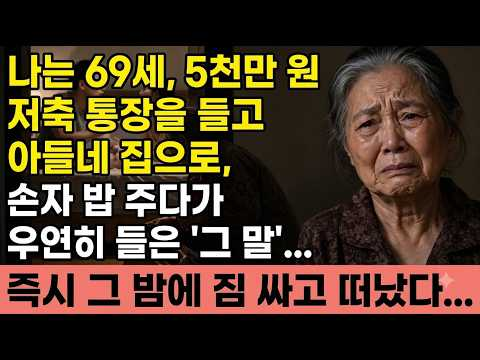
- 설명 앞부분: 예순아홉 김순자 할머니가 아들 박재훈과 며느리 최수정의 충격적인 음모를 손자 아이패드로 알게 된 실화입니다. 온천수 나는 1헥타르 땅과 5421만 원 통장을 노리고 치매 약과 수면제를 먹이며 요양원으로 보내려던 불효 계획. 손자의 말 한마디로 밝혀진 배신과 유언장으로 재산을 지킨 이야기. 부모라면 반드시 들어야 할 경고입니다. 시어머니 며느리 갈등, 불효자식 처벌, 유언장 상속 실화 지금 확인하세요. 시어머니며느리,불효자식실화,유언장상속,온천수땅,치매약음모,요양원보내기,손자아이패드,시어머니복수,며느리배신,노후재산지키기
- 같은 채널 평소 대비 ×8,619.2 (채널 최근 롱폼 중앙값 172회) · 평소 영상: 며느리가 저를 속여 1억 7천만 원 대출 보증서에 서명하게 했습니다. 사채업자들이 집을 … (175회) / 나는 병원에 입원했고, 아들은 정성껏 나를 돌봐주었지만 딸은 한 번도 찾아오지 않았다. … (170회)
- 대본 없음 (설명) — 음성인식이 끝나면 도입부·흐름이 들어감
- 댓글 1,369/1,383: 좋은 점 — 영상 16 · 감사·응원 64 · 더 알고 싶은 것 7 · 아쉬운 점 — 영상 8 · 반박·불만 — 의견 다름 18 · 정치·사회 8 · 경험 공유 42 · 구독·다음 기대 0
  - 좋은 점 — 영상 👍228 “저는 직장암3기로 수술한지 1년됐습니다. 수술하다가 암이 터져서 척추와 골반으로 흘러내리고 그걸건들이면 사지마비된다고 항암으로 하자하셔서 깨끗이 수술못하고 영구장루달고 나왓습니다 결국 후유증으로 디스크까지 터져서 허리통증으로 2개월 동안 병원에 누워 있었어요. 당시에…”
  - 좋은 점 — 영상 👍39 “1시간 넘게 들으면서 많은 것을 배웠읍니다 너무 훌륭한 분이십니다”
  - 감사·응원 👍228 “저는 직장암3기로 수술한지 1년됐습니다. 수술하다가 암이 터져서 척추와 골반으로 흘러내리고 그걸건들이면 사지마비된다고 항암으로 하자하셔서 깨끗이 수술못하고 영구장루달고 나왓습니다 결국 후유증으로 디스크까지 터져서 허리통증으로 2개월 동안 병원에 누워 있었어요. 당시에…”
  - 감사·응원 👍175 “어머니 아주 똑똑하고 대단합니다 손자하고 행복하세요 응원하게요”
  - 더 알고 싶은 것 👍0 “자식들은 결혼하면 남입니다 궁금하다고 전화도 하지 마세요 자식이 전화 올때는 아쉬운 소리 를 할때 일것입니다”
  - 더 알고 싶은 것 👍0 “아무리부모가재산이많아두 자식들이부모와함게사는것실어합니다잘해줄때는자식조아하구조금아파서누워있음표정부터달라지는것이자식 절대자식과합가하지마시길부탁합니다염치없는것이자식 망가지면없는부모찾아와서염치없이달라붙는자식이다”
  - 아쉬운 점 — 영상 👍6 “자막이 왜 없어”
  - 아쉬운 점 — 영상 👍0 “내용좀 짧게 간단하게 너무길어서 늦게 말하고 다듣기 힘듬”
  - 반박·불만 — 의견 다름 👍57 “유치원교사까지한. 엄마가 글도 모르는 노인이라고 하는거보고 완전. 웃기는 내용이라 생각함ㅋㅋ”
  - 반박·불만 — 의견 다름 👍11 “품안에 자식이다는 말이 실감납니다결혼하면 내 자식아닙니다 그냥 오면보고 안와도 서운해하지 말고 남이다하고 사세요 눈울도 훔치지 마세요”
  - 정치·사회 👍7 “웃기네 이웃나라가이냐요 바루대한국현실이네요우리이웃이야기입니다”
  - 정치·사회 👍3 “69세면 한동안 더 사십니다 ,, 정부에서 제공하는 임대 아파트 작은 것을 얻어서 정부 에서주는 기초 연금으로도 혼자서 충분히 살수있고요 ,, 누구라도 부부가 함께 죽을 수는 없는일 마음 굳게 먹고 다아 잊으 십시요 ,”
  - 경험 공유 👍158 “저도 아들 하나 인데 아들을 위해 평생을 바쳐 형편 안되는데 s대 대학원을 거쳐 유럽에 서 7년 넘게 공부하고 박사학위 받고 귀국 하여 대학에 있습니다 귀국한 아들 가족은 아무것도 남지 않은 나를 며느리가 무시하기 시작하고 손녀 .하는말에 나타났습니다 엄마는 똑똑하고…”
  - 경험 공유 👍124 “저도 혼자 아들과 살고 있는데 참교육 잘받았습니다”

### 82. 노령연금만 75만원, 60대 부부 일 안하고 어떻게 '기적처럼' 버틸 수 있을까?

- https://www.youtube.com/watch?v=aeGZ8be-ASU · 겨울 사랑 · 구독자 1,150 · 조회수 18,055 (×15.7, 하루 1,294.8) · 좋아요 377 (2.1%) · 77.1분 · 2026-10-14 · 주제 묶음 4. 노후·연금 · 형식 사연·드라마 · 폴더 `W_aeGZ8be-ASU` (웹 승인)
- 썸네일: 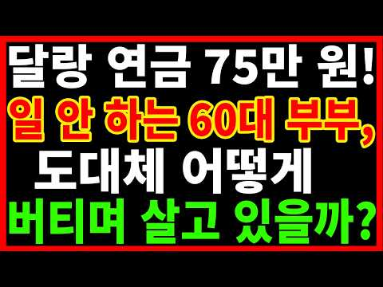
- 설명 앞부분: 안녕하세요, "부부 둘이 합쳐 매달 나오는 노령연금 75만 원이 전부인데, 이 나이에 몸 부서져라 일하지 않으면 당장 길거리로 쫓겨나는 것 아닐까"라며 매일 밤 공포 속에 잠 못 이루던 60대 부부가 어째서 고된 노동 없이도 웃음을 찾고 기적처럼 평온한 일상을 누리게 되었는지, 그 희망찬 반전의 비결을 전하는 노후사연입니다. "은퇴 후 저희 부부의 손에 쥐어진 것은 국민연금도 아닌, 국가에서 나오는 기초노령연금 합산 약 75만 원이 전부였습니다. 주변에서는 '그 돈으로는 혼자서 호구지책하기도 힘들다, 60대면 어디 가서 식당 일이…
- 같은 채널 평소 대비 ×2.6 (채널 최근 롱폼 중앙값 6,968회) · 평소 영상: 60대가 되면 연금 없는 친구가 '유독' 무서워지는 이유 ! (8,145회) / 생활비 200만원이면 충분하다던 노후, 왜 60대 부부는 '비참하게' 무너졌을까? (8,190회)
- 대본 없음 (설명) — 음성인식이 끝나면 도입부·흐름이 들어감
- 댓글 24/30: 좋은 점 — 영상 1 · 감사·응원 1 · 더 알고 싶은 것 0 · 아쉬운 점 — 영상 0 · 반박·불만 — 의견 다름 0 · 정치·사회 1 · 경험 공유 3 · 구독·다음 기대 0
  - 좋은 점 — 영상 👍8 “저도 기초연금 신청하러 가는데 챙피해서 망설였읍니다~ 그러나받고나니 생활에 도움됐읍니다~ 정작 어려울땐 교회보다 국가입니다~ 십일조보다는 세금을 부지런히 내고 절대 대기업과 부자를 비난 말아야 합니다! 우리가받는 돈은 다 여기서 나옵니다”
  - 감사·응원 👍2 “좋은 소식 감사합니다~”
  - 정치·사회 👍1 “담 세대 좀 살수있는 환경을 어른들이 만들어 줍시다. 국회 얼간이들 중국 인들 한테 외국인들 한테 담 세대 먹걸이좀 퍼주지 말길. 울화통 터짐.”
  - 경험 공유 👍8 “저도 기초연금 신청하러 가는데 챙피해서 망설였읍니다~ 그러나받고나니 생활에 도움됐읍니다~ 정작 어려울땐 교회보다 국가입니다~ 십일조보다는 세금을 부지런히 내고 절대 대기업과 부자를 비난 말아야 합니다! 우리가받는 돈은 다 여기서 나옵니다”
  - 경험 공유 👍4 “60~70대 일해서 먹고살아요. 노령층이 세계 1. 2위를 다투고있는데 담음세대 는 어떻게 살아요.ㅠ 저도 연금 예상 액 몇푼 못 받아요.급여가 쥐꼬리 만해서요 아프지만 않으면 움직일수 있을때 까지 일 하려고요.”

### 83. 부자가 되기 위해 꼭 해봐야 할 단 3가지 게임 — 마키아벨리의 잔혹한 전략

- https://www.youtube.com/watch?v=JRZMlFWy3vc · 부의 파워 코드 · 구독자 1,630 · 조회수 26,618 (×16.3, 하루 1,781.1) · 좋아요 382 (1.4%) · 29.3분 · 2026-10-13 · 주제 묶음 1. 재테크 일반·마인드 · 형식 오디오북·낭독 (명언·인생조언) · 폴더 `W_JRZMlFWy3vc` (웹 승인)
- 썸네일: 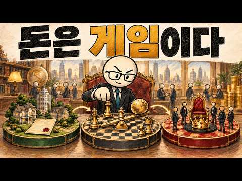
- 챕터: 0:00 '열심히 일하면 된다'는 거짓말 · 1:43 게임 1: 소유권 대 노동 · 6:58 게임 2: 레버리지 대 저축 · 15:47 게임 3: 구조적 우위 대 공정성 · 22:06 이중 생활 전략 · 25:23 최종 단계: 완전한 경제적 주권"
- 설명 앞부분: 냉혹한 진실을 깨닫는 순간이 옵니다. 부유한 사람들은 단지 더 열심히 일해서 부자가 된 것이 아닙니다. 그들은 완전히 다른 게임을 하고 있습니다. 이 영상에서는 부의 심리학과, 노동자 계급에서 벗어나 완전한 경제적 주권을 쟁취하기 위해 반드시 마스터해야 할 3가지 냉혹한 금융 게임을 분석합니다. 니콜로 마키아벨리와 로버트 그린의 전략적 사고, 그리고 역사상 가장 강력한 기업가 및 투자자들의 실제 성공 패턴에서 영감을 얻어 제작되었습니다. 소유권이 어떻게 자유를 만드는지, 레버리지가 어떻게 성과를 증폭시키는지, 그리고 왜 노력보다 …
- 같은 채널 평소 대비 ×1.4 (채널 최근 롱폼 중앙값 19,141회) · 평소 영상: 부자가 되는 가장 빠른 방법 — 마키아벨리의 무자비한 부의 전략 (20,004회) / 무일푼에서 진짜로 부자가 되는 법 - 마키아벨리의 7단계 프레임워크 (18,278회)
- 대본 없음 (설명) — 음성인식이 끝나면 도입부·흐름이 들어감
- 댓글 7/7: 좋은 점 — 영상 0 · 감사·응원 2 · 더 알고 싶은 것 0 · 아쉬운 점 — 영상 1 · 반박·불만 — 의견 다름 0 · 정치·사회 0 · 경험 공유 0 · 구독·다음 기대 0
  - 감사·응원 👍1 “감사합니다.”
  - 감사·응원 👍0 “감사합니다”
  - 아쉬운 점 — 영상 👍1 “광고가 넘 많아서 안보겠다”

### 84. 월 70만 원으로 자산을 쌓은 사람의 3가지 원칙

- https://www.youtube.com/watch?v=axzUYMuirTs · 부자의습관 · 구독자 3,890 · 조회수 13,005 (×3.3, 하루 4,102.0) · 좋아요 29 (0.2%) · 43.7분 · 2026-10-16 · 주제 묶음 1. 재테크 일반·마인드 · 형식 오디오북·낭독 (명언·인생조언) · 폴더 `W_axzUYMuirTs` (웹 승인)
- 썸네일: 
- 설명 앞부분: 왜 어떤 부자가 되는 데에 이번 영상에서는 일상에서 쉽게 실천할 수 있는 부자의습관, 돈 관리 방법, 저축 습관, 소비 습관과 재테크에 도움이 되는 경제 상식을 알기 쉽게 이야기합니다. 돈을 많이 버는 것만큼 중요한 것은 돈을 어떻게 관리하고 사용하는가입니다. 평소 무심코 반복하는 행동이 자산을 만드는 습관이 될 수도 있고, 반대로 돈이 새어나가는 원인이 될 수도 있습니다. 이 채널에서는 부자들의 사고방식과 생활 습관, 현명한 소비와 저축, 자산 관리, 노후 준비 등 우리의 경제생활에 도움이 되는 다양한 이야기를 꾸준히 전해드립니…
- 대본 없음 (설명) — 음성인식이 끝나면 도입부·흐름이 들어감
- 댓글 2/2: 좋은 점 — 영상 0 · 감사·응원 0 · 더 알고 싶은 것 0 · 아쉬운 점 — 영상 0 · 반박·불만 — 의견 다름 0 · 정치·사회 0 · 경험 공유 0 · 구독·다음 기대 0

### 85. '단타'로 돈 버는 '볼린저밴드 세팅법' 완벽정리

- https://www.youtube.com/watch?v=wfcP-pTUItY · 코선사 - 코인선물사관학교 · 구독자 1,530 · 조회수 20,725 (×13.6, 하루 1,596.8) · 좋아요 427 (2.1%) · 25.9분 · 2026-10-15 · 주제 묶음 기타 · 형식 정보·해설 (그 밖) · 폴더 `W_wfcP-pTUItY` (웹 승인)
- 썸네일: 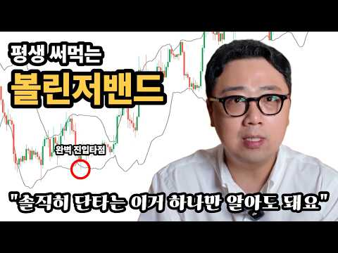
- 설명 앞부분: 코인선물사관학교입니다. 차트분석 어려우시죠? 사실 차트 분석은 복잡하게 접근할 수록 어려워 집니다. 코선사에서는 차트를 몰라도 2-3시간만 배우면 할 수있는 승률 높은 단타 매매법 교육을 진행하고 있는데요. 기본교육은 무료로 진행되며 기본교육 만으로도 충분히 많은 것을 얻어가실 수 있습니다. 010-3450-3060 저장 후 ※교육은 경기도 의정부시에서 진행됩니다. 영상에서 다루는 내용. 1. 볼린저 밴드 매매가 자꾸 틀리는 이유 2. 볼린저 밴드의 정확한 이해 3. 기존 기본 매매법의 두 가지 형태 4. 솔루션: 더블 볼린저 밴…
- 같은 채널 평소 대비 ×4.2 (채널 최근 롱폼 중앙값 4,989회) · 평소 영상: 리플(XRP) 5년 만에 다시 산 이유 l 리플에 투자 중이시면 이거 두개만 체크하세요. (5,801회) / [ 실전 삼각수렴 ] 쉽게 수익내는 두 가지 방법 l 진입 타점은 이걸로 끝 (4,177회)
- 대본 없음 (설명) — 음성인식이 끝나면 도입부·흐름이 들어감
- 댓글 59/75: 좋은 점 — 영상 7 · 감사·응원 10 · 더 알고 싶은 것 8 · 아쉬운 점 — 영상 1 · 반박·불만 — 의견 다름 0 · 정치·사회 0 · 경험 공유 0 · 구독·다음 기대 2
  - 좋은 점 — 영상 👍2 “진짜 좋은 정보 감사합니다”
  - 좋은 점 — 영상 👍1 “좋은정보 감사합니다. 너무 좋아요!”
  - 감사·응원 👍2 “진짜 좋은 정보 감사합니다”
  - 감사·응원 👍1 “설명을 조근조근 확실하게 해주시네요. 신뢰성이 자연스럽게 올라갑나다. 여러번 반복해서 듣고 싶네요. 감사합니다.”
  - 더 알고 싶은 것 👍1 “다음영상올려주세요~”
  - 더 알고 싶은 것 👍1 “한번 들어갈때 비중은 시드의 어느정도를 추천하나요?”
  - 아쉬운 점 — 영상 👍1 “설명을 조근조근 확실하게 해주시네요. 신뢰성이 자연스럽게 올라갑나다. 여러번 반복해서 듣고 싶네요. 감사합니다.”
  - 구독·다음 기대 👍0 “다음강의도 정말기대됩니다❤❤”
  - 구독·다음 기대 👍0 “구독했습니다. 설명 잘해주시네요”

### 86. "꼬부랑 할머니 될 때까지 할거예요" 시니어 왕초보도 집에서 폰 하나로 돈 버는 법

- https://www.youtube.com/watch?v=eTrwhY7RcdU · 돈잘버는법 · 구독자 891 · 조회수 12,783 (×14.3, 하루 909.9) · 좋아요 0 (0.0%) · 18.9분 · 2026-10-14 · 주제 묶음 8. 부업·소득 · 형식 인터뷰·강연·대담 · 폴더 `W_eTrwhY7RcdU` (웹 승인)
- 썸네일: 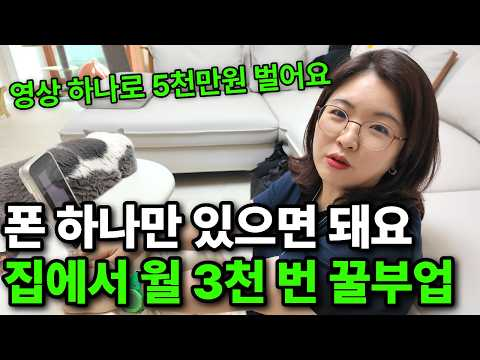
- 설명 앞부분: 단톡방 정원 초과 시 신청이 조기 마감될 수 있습니다 💵애니한님의 돈잘버는법 1. 아이 셋 키우는 주부도 월 3천만원 버는 쇼핑 쇼츠! 2. 50대도 월 300버는 팔리는 컨텐츠의 비밀! 4. 어려운 촬영 X 편집까지 한 번에 AI로 끝! 5. 무료특강 참여시 프로그램 이용권부터 100만 유튜버들의 돈되는 비밀정보까지 공개 예정! 무료라이브 신청방법 성과는 개인마다 차이가 있을 수 있습니다 돈잘법 채널 제작진은 모든 영상의 원본 콘텐츠의 제작자임을 명시합니다
- 같은 채널 평소 대비 ×3.7 (채널 최근 롱폼 중앙값 3,417회) · 평소 영상: "온동네 아줌마들 다 해요" 집에서 신문기사 복붙해서 돈 버는 틈새시장 부업 (3,417회) / "중고거래만 하면 바보에요" 당근 신박하게 활용해서 건물주 된 30살 (5,587회)
- 대본 없음 (설명) — 음성인식이 끝나면 도입부·흐름이 들어감
- 댓글 4/4: 좋은 점 — 영상 0 · 감사·응원 0 · 더 알고 싶은 것 1 · 아쉬운 점 — 영상 0 · 반박·불만 — 의견 다름 0 · 정치·사회 0 · 경험 공유 0 · 구독·다음 기대 0
  - 더 알고 싶은 것 👍0 “안녕하세요 책자 받아볼수있나요?알려주세요 부탁드려요”

### 87. 매달 빚이 750만원씩 불어나요… 12억 모텔이 6억으로 반토막ㅣ60대 은퇴부부의 눈물 노후건강 노후자금 노후사연 오디오북 퇴직금 깨달음의노후

- https://www.youtube.com/watch?v=PmhYy3u9jxk · 인생바라봄 · 구독자 892 · 조회수 13,370 (×15.0, 하루 882.3) · 좋아요 56 (0.4%) · 43.9분 · 2026-10-13 · 주제 묶음 1. 재테크 일반·마인드 · 형식 사연·드라마 · 폴더 `W_PmhYy3u9jxk` (웹 승인)
- 썸네일: 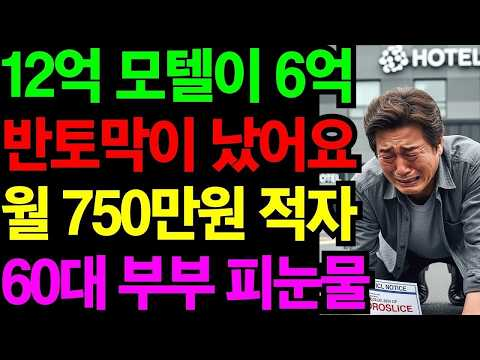
- 설명 앞부분: 인생의 후반전에는 돈보다 더 중요한 것이 있습니다. 바로 지나온 선택을 돌아보고, 앞으로의 삶을 더 현명하게 준비하는 힘입니다. 인생바라봄**은 은퇴 이후 마주할 수 있는 다양한 현실적인 고민과 인생 이야기를 전하는 시니어 사연 채널입니다. 퇴직 후 달라진 일상, 퇴직금과 노후자금 관리, 투자 실패와 재정적 어려움, 뜻하지 않은 사기 피해, 가족과의 갈등까지 누구에게나 일어날 수 있는 노후의 문제를 이야기 속에 담아 함께 바라봅니다. 한 사람의 실패는 다른 누군가에게 소중한 교훈이 될 수 있습니다. 인생바라봄은 실제 삶에서 영감을…
- 같은 채널 평소 대비 ×4.0 (채널 최근 롱폼 중앙값 3,330회) · 평소 영상: 노후 대비로 산 10억짜리 원룸 건물, 3년 만에 반토막으로… 62세 가장의 눈물∣ 노후… (4,313회) / 60대 부부 크루즈여행으로 퇴직금 전 재산 날렸습니다 ｜ 노후건강 ｜ 노후자금 ｜ 노후사… (4,853회)
- 대본 없음 (설명) — 음성인식이 끝나면 도입부·흐름이 들어감
- 댓글 2/2: 좋은 점 — 영상 0 · 감사·응원 1 · 더 알고 싶은 것 0 · 아쉬운 점 — 영상 0 · 반박·불만 — 의견 다름 0 · 정치·사회 0 · 경험 공유 0 · 구독·다음 기대 0
  - 감사·응원 👍1 “앞날을 응원합니다 ~”

### 88. 아무리 돈이 많아도 없는 척하세요, 재산이 알려지면 생기는 일

- https://www.youtube.com/watch?v=FrSslE4xeBA · 인생다시쓰기 · 구독자 8,400 · 조회수 526,153 (×62.6, 하루 8,284.6) · 좋아요 1,925 (0.4%) · 17.3분 · 2026-08-25 · 주제 묶음 1. 재테크 일반·마인드 · 형식 오디오북·낭독 (명언·인생조언) · 폴더 `W_FrSslE4xeBA` (웹 승인)
- 썸네일: 
- 챕터: 0:00 돈이 알려지는 순간 생기는 일 · 2:47 돈 많은 사람의 200만 원은 왜 작아 보일까 · 4:15 부모의 노후자금을 자식은 다르게 봅니다 · 7:15 내 재산을 말하면 부탁의 기준도 달라집니다 · 8:55 10억짜리 집이 있어도 현금 부자는 아닙니다 · 9:55 돈 있는 사람이 표적이 되는 순간 · 11:13 돈이 많을수록 지켜야 하는 진짜 자유 · 15:17 돈이 많아도 굳이 말하지 않아야 하는 이유
- 설명 앞부분: 돈의 가치는 자산 규모에 따라 완전히 달라집니다. 재산의 크기가 당신의 경제적 판단에 어떤 영향을 미치는지 구체적인 사례를 통해 확인해보세요. 이 영상은 현재 나의 자산 상황에 따라 10만 원이나 1억 원이라는 돈의 가치가 어떻게 다르게 느껴지는지 분석합니다. 10억 원의 자산을 가진 사람에게는 사소한 금액이라도, 당장 급전이 필요한 사람에게는 생존과 직결된 문제일 수 있습니다. 경제적 상황에 따른 돈의 가치를 이해하는 것은 올바른 자산 관리를 위한 첫걸음입니다.
- 같은 채널 평소 대비 ×45.1 (채널 최근 롱폼 중앙값 11,668회) · 평소 영상: 60부터는 친구가 없어도 괜찮습니다｜노후엔 인간관계에 너무 애쓰지 마세요 (12,317회) / 한 살이라도 어릴 때 알았으면 좋았을 것들, 60대가 되어서야 보였습니다 (11,020회)
- 대본 (음성인식(앞 5분), 4.7 음절/초) — 앞부분만, 흐름은 그 안까지 첫 20초: “재산이 10억 원 있다는 사실을 친구가 아는 순간 같은 10만 원의 의미가 달라집니다. 어제까지 10만 원짜리 바깥은 그냥 10만 원이었습니다. 그런데 오늘부터는 너 정도면 살 수 있는 돈이 됩니다. 누군가 1천만 원이 급하다고 해도 비슷합니다.” — 도입부 유형: 숫자로 시작
- 첫 1분: “재산이 10억 원 있다는 사실을 친구가 아는 순간 같은 10만 원의 의미가 달라집니다. 어제까지 10만 원짜리 바깥은 그냥 10만 원이었습니다. 그런데 오늘부터는 너 정도면 살 수 있는 돈이 됩니다. 누군가 1천만 원이 급하다고 해도 비슷합니다. 상대 형편을 잘 모를 때는 1천만 원이 꽤 큰 돈이라고 생각합니다. 그런데 내가 집도 있고 예금도 좀 있다는 사실을 알고 나면 사람 마음에는 이런 생각이 슬쩍 끼어듭니다. 너한테 1천만 원이 그렇게 큰 돈은 아니잖아. 돈은 그대로입니다. 달라진 건 상대가 그 돈을 보는 기준입니다. 그래서 재산이 알려졌을 때 가장 먼저 생기는 문제는 꼭 질투가 아닙니다. 내 돈이 다른 사람의 계산 속으로 들어가기 시작한다는 것입니다. 아직 빌려준 것도 아니고 주겠다고 약속한 것도 아”
- 흐름 (90초마다 첫 문장): 0:00 재산이 10억 원 있다는 사실을 친구가 아는 순간 같은 10만 원의 의… → 1:32 돈이 있으면서 일부러 남에게 얻어 먹으라는 뜻도 아닙니다. → 3:00 그런데 20억 가진 사람의 200만 원이라고 생각하는 순간 느낌이 달라… → 4:30 자녀들도 부모 재산을 대략 알고 있습니다.
- 댓글 250/259: 좋은 점 — 영상 4 · 감사·응원 3 · 더 알고 싶은 것 4 · 아쉬운 점 — 영상 3 · 반박·불만 — 의견 다름 3 · 정치·사회 1 · 경험 공유 22 · 구독·다음 기대 0
  - 좋은 점 — 영상 👍70 “돈은 빌려주는거 아니라고 배웠다 빌려주는순간 인간관계는 안좋게 끝나는 경우가 대다수임”
  - 좋은 점 — 영상 👍5 “좋은 영상입니다. 근데 내가 자영업업 풀야근하며 남들 놀때 휴가 한번 안가고 노력해서 이룬 성과 꼭 돈을 자랑 한다기 보다 저의 노력을 자랑하고 싶은데 제일 효과 적인게 그로인해 얻은 자산인데 다른 더좋은 방법이 있을까요?”
  - 감사·응원 👍14 “동서가 대출안된대서 빌려달라길래 아들집얻어주고없다고했음. 있어도안빌려줄거임. 빌린그순간 고맙지만 갚을려면 생돈갚는거같아서 갚기가싫어지는게인간심리”
  - 감사·응원 👍13 “하도 무시해서 돈자랑 했더니 돈좀 빌려달라고 하길래 자초지종 들어보고 안빌려 주었더니 윈망 하더니만 1년뒤 그 장사 했으면 망할 뻔했다고 안빌려 줘서 고맙다고ㅋㅋ”
  - 더 알고 싶은 것 👍5 “좋은 영상입니다. 근데 내가 자영업업 풀야근하며 남들 놀때 휴가 한번 안가고 노력해서 이룬 성과 꼭 돈을 자랑 한다기 보다 저의 노력을 자랑하고 싶은데 제일 효과 적인게 그로인해 얻은 자산인데 다른 더좋은 방법이 있을까요?”
  - 아쉬운 점 — 영상 👍3 “등산모임에서 동갑친구가 뒷풀이 비용을 전부 내줍니다...돈이 많은것도 아니지요..반복되다보니, 그친구 있을때는 뒷풀이 안가요..그냥 부담없이 나누어 내고, 나이가 있으니, 찬조금을 조금 낸다면 몰라도,”
  - 아쉬운 점 — 영상 👍2 “같은 내용의 반복... 너무 길다.”
  - 정치·사회 👍0 “더 황당한 케이스는 그렇게 돈 없어서 고생 엄청 했다는 친구가 알고보니 그렇게 가난하지도 않음. 자신이 돈이 없는거지 집안도 왠만큼 살더라. 젊을때 밥을 자주 사주고 차도 태워주고 했는데 나중에 자신이 성공해서도 돌아오는건 타인에 대한 질투와 시기. 십수년된 인연이라…”
  - 경험 공유 👍140 “내가 삼전 주식을 보유 하고 있다는 사실이 우연히 알려지면서 형제부터.주변인까지 나를 괴롭히기 시작하고 돈을 안쓰면 나보고 쫌생이 구두쇠라고 함.. 1인가구인 내 노후 자금인데.. 주식 팔아서 돈을 빌려줄수는 없잖아.”
  - 경험 공유 👍102 “내가 돈많다고 너희가 내재산 불려줬냐?”

### 89. 객실 팔아서 돈 버는 게 아니라고? 우리가 몰랐던 호텔이 진짜 돈을 버는 방법

- https://www.youtube.com/watch?v=RuWOYsSZl_E · 머니파이 · 구독자 9,260 · 조회수 968,969 (×104.6, 하루 8,982.4) · 좋아요 5,994 (0.6%) · 17.6분 · 2026-07-12 · 주제 묶음 기타 · 형식 정보·해설 (그 밖) · 폴더 `W_RuWOYsSZl_E` (웹 승인)
- 썸네일: 
- 설명 앞부분: 하룻밤 자는데 수십만 원, 건물 하나 짓는 데는 무려 1조 원이 넘게 드는 글로벌 럭셔리 호텔들! 힐튼, 메리어트, 하얏트 같은 세계적인 호텔 체인들은 과연 객실 요금으로만 이 엄청난 건축비와 유지비를 감당하고 있을까요? 🎵Music provided by 브금대통령 🎵Track : 쳇바퀴 인생
- 같은 채널 평소 대비 ×236.2 (채널 최근 롱폼 중앙값 4,102회) · 평소 영상: 30년째 성장 못한 일본은 왜 아직도 무너지지 않았을까? (4,102회) / 불타는 파리, 혼돈의 프랑스 경제! 프랑스는 어쩌다 국가부도 위기까지 몰렸을까? (3,980회)
- 대본 (음성인식(앞 5분), 5.5 음절/초) — 앞부분만, 흐름은 그 안까지 첫 20초: “건물 한 채 없이 남의 호텔에 브랜드 이름만 빌려주는데 오히려 돈을 쓸어 담는 회사들이 있습니다 힐튼과 메리어트 같은 세계에서 제일 큰 호텔 회사들 얘기인데 이들은 요즘 호텔을 짓지도 소유하지도 않아요 갖고 있던 건물까지 내답하고 있죠 그런데 웃긴 건 건물을 다 팔아치운 이 회사들의 매출이”
- 첫 1분: “건물 한 채 없이 남의 호텔에 브랜드 이름만 빌려주는데 오히려 돈을 쓸어 담는 회사들이 있습니다 힐튼과 메리어트 같은 세계에서 제일 큰 호텔 회사들 얘기인데 이들은 요즘 호텔을 짓지도 소유하지도 않아요 갖고 있던 건물까지 내답하고 있죠 그런데 웃긴 건 건물을 다 팔아치운 이 회사들의 매출이 오히려 역대 최고라는 겁니다 호텔을 안 가진 호텔 회사가 어떻게 더 부자가 됐을까요? 오늘은 호텔 산업이 어떻게 완전히 뒤집혔는지 그 숨겨진 이야기를 해보겠습니다 먼저 옛날 호텔 사업이 어떤 모습이었는지 붙어봐야 이 반전이 얼마나 큰 사건인지 감이 옵니다 20세기 초반 호텔왕이라 불리던 사람들의 성공 방정식은 딱 하나였는데 좋은 목의 땅을 사고 그 위에 근사한 건물을 올린 다음 직접 굴리는 거였죠 콜레드 힐트는 텍사스의”
- 흐름 (90초마다 첫 문장): 0:00 건물 한 채 없이 남의 호텔에 브랜드 이름만 빌려주는데 → 1:30 청소팀과 프런트 직원 얼급은 나가야 하며 → 3:00 검색 결과 맨 위에 올라가려면 또 돈을 내야 했거든요 → 4:30 지금 호텔 산업은 세 종류의 선수가 역할을 나눠 맡고 있거든요
- 댓글 280/291: 좋은 점 — 영상 5 · 감사·응원 3 · 더 알고 싶은 것 3 · 아쉬운 점 — 영상 1 · 반박·불만 — 의견 다름 2 · 정치·사회 11 · 경험 공유 5 · 구독·다음 기대 3
  - 좋은 점 — 영상 👍13 “좋은 정보 잘 보고 갑니다🤩”
  - 좋은 점 — 영상 👍6 “내용이 너무 좋네요 구독박고 좋은 자료 기대합니다”
  - 감사·응원 👍66 “감사합니다. 브랜드의 이름만 빌려주는건 이번에 처음 알았습니다. 치킨집에 비유해 설명해줘서 편하게 이해가 됐네요. 다만 개인(각 호텔)의 특성을 살리기는 커녕, 그런것들을 무서워?(귀찮아, 굳이?)의 이유로 특색이 사라지는 것처럼 보여 슬프네요”
  - 감사·응원 👍16 “영상 감사합니다. 힐튼에 한해에 두번에 걸쳐 2주 정도 묵었었는데 맞습니다 2017년도? 2018년도쯤 될때부터는 호텔이름이 바뀌더니 음식이 영 아니었습니다. 뷔폐가 다양해서 갔었는데 ... ... 이전에는 아침 저녁식사 다 호텔에서 먹었는데 지금은 아침만 먹고 일주…”
  - 더 알고 싶은 것 👍0 “그럼 건물주 입장에서는 손해보는 장사아닌가요? 건물주 입장을 알고싶네요”
  - 아쉬운 점 — 영상 👍2 “지루함”
  - 정치·사회 👍7 “뭐야 정부에서 알려준 호텔경제학으로 돈을버는거 아니였네?”
  - 정치·사회 👍3 “이재명의 호텔경제학을보면 알수있는걸 길게도설명하네”
  - 경험 공유 👍23 “내가 가장 좋아하는 구조, 시스템에 대한 이야기다. 바로 구독”
  - 경험 공유 👍2 “지금 호텔에 일하고 있는 분들은 지옥을 겪고 있음 인력감축 그러인한 업무증가 낮은 연봉”
  - 구독·다음 기대 👍43 “좋은 방향으로 사건과 사물을 보고, 해석을 하시는 것이 좋은 채널로 성장하실 것 같습니다. 이렇게 작은 채널엔 처음 구독 신청했는데, 계속 좋은 관점과 분석 기대합니다.~~”
  - 구독·다음 기대 👍7 “영상 잘보고갑니다!!! 다양한 관점들이 다각도로 녹여져있고, 한순간도 스킵하지 않을 정도로 내용도 알차네요. 구독하고갑니다 :)”

### 90. 60세 이후, 계속 일하는 사람 vs 쉬는 사람 5년 후 놀라운 차이 치매 위험 35% 낮추는 비밀!

- https://www.youtube.com/watch?v=qOdjXbl2g6Y · 쉽게 이해하는 경제 · 구독자 2,190 · 조회수 373,399 (×170.5, 하루 2,082.9) · 좋아요 4,882 (1.3%) · 11.8분 · 2026-05-02 · 주제 묶음 4. 노후·연금 · 형식 정보·해설 (그 밖) · 폴더 `W_qOdjXbl2g6Y` (웹 승인)
- 썸네일: 
- 설명 앞부분: 이 영상은 은퇴 이후 전혀 다른 삶을 살아가는 네 명의 사례를 통해 노후의 선택이 얼마나 중요한지 보여줍니다. 강원도 춘천의 변영호 어르신, 청주의 함정숙 여사, 진주의 노만석 어르신, 군산의 추기영 어르신까지, 비슷한 조건에서 시작했지만 5년 후 완전히 달라진 삶을 비교 분석합니다. 단순한 휴식이 아닌 ‘의미 있는 활동’이 건강, 우울감, 삶의 만족도에 어떤 영향을 주는지 실제 사례와 통계를 통해 설명합니다. 특히 노후 준비, 소득 공백, 사회적 관계, 정신 건강 문제까지 현실적인 관점에서 다루며, 시청자에게 자신의 노후를 다시…
- 같은 채널 평소 대비 ×1,328.8 (채널 최근 롱폼 중앙값 281회) · 평소 영상: 자식 때문에 상처받는 노년층이 늘어나는 이유｜부모 자녀 관계 심리 완전정리 ! (282회) / 60세가 되면 해야 할 일들: 꼭 봐야 할 영상! (280회)
- 대본 (음성인식(앞 5분), 6.0 음절/초) — 앞부분만, 흐름은 그 안까지 첫 20초: “아침 10시 같은 시간 다른 풍경입니다. 한분은 강원도 춘천의 작은 빌라에서 아직 침대에 누워 계셨습니다. TV 리모컨이 손에 들려 있었지만 화면은 보고 있지 않았습니다. 같은 시간 충북 청주의 어느 동네 빵집에서는 밀가루 묻은 앞치마를 입은 한분이 혓 손님을 맡고 있었습니다. 왔어? 오늘은 단파티 잘 나왔어. 같은 해에 황갑을 맞으셨습니다.” — 도입부 유형: 숫자로 시작
- 첫 1분: “아침 10시 같은 시간 다른 풍경입니다. 한분은 강원도 춘천의 작은 빌라에서 아직 침대에 누워 계셨습니다. TV 리모컨이 손에 들려 있었지만 화면은 보고 있지 않았습니다. 같은 시간 충북 청주의 어느 동네 빵집에서는 밀가루 묻은 앞치마를 입은 한분이 혓 손님을 맡고 있었습니다. 왔어? 오늘은 단파티 잘 나왔어. 같은 해에 황갑을 맞으셨습니다. 같은 해에 일을 놓으셨고요. 홍장 장고도 건강도 비슷하셨습니다. 그런데 5년이 지난 지금 두 분의 아침은 이렇게 달라져 있었습니다. 오늘은 그 이야기를 천천히 풀어보려고 합니다. 정답을 드리려는 게 아닙니다. 다만 끝까지 보시고 나면 내일 아침이 조금은 다르게 느껴지실지 모릅니다. 2020년 가을이었습니다. 제가 처음 이 4분을 배웠던 게요. 첫 번째 분 변형호 어르신”
- 흐름 (90초마다 첫 문장): 0:00 아침 10시 같은 시간 다른 풍경입니다. → 1:30 평생 누구 엄마 누구 와이프였지. → 3:00 어느 순간부터 또가 귀찮아가 되어버렸다고요. → 4:30 힘들지 않으시냐고요.
- 댓글 590/590: 좋은 점 — 영상 7 · 감사·응원 10 · 더 알고 싶은 것 5 · 아쉬운 점 — 영상 10 · 반박·불만 — 의견 다름 8 · 정치·사회 3 · 경험 공유 30 · 구독·다음 기대 1
  - 좋은 점 — 영상 👍4 “좋은말씀잘들었습니다.참좋습니다.응원합니다.즐겁고행복한시간되세요.”
  - 좋은 점 — 영상 👍1 “일할때는 이유가 있고 쉴때는 이유가 있어요 누가 뭐라고해도 본인들이 잘알거예요 좋은 정보 필요하신분들 참조하라고 올려주셨네요”
  - 감사·응원 👍37 “64세입니다 새벽등산2시간 바이얼린 주1회레슨 연습 하루 2시간 수영 주5회 독서1시간 텃받 농사 일 조금합니다 30년을 일하다기 61세부터 하고싶었던거 열심히 하고있습니다 덕분에 살도8키로빠지고 배우는기쁭이 큽니다 감사합니다~^^”
  - 감사·응원 👍9 “봄이 지난 후에야 봄이 온줄 알았네 ~~~ "꽃잎 떨어져 바람인가 했더니 세월이더라 눈물 떨어져 슬픔인가 했더니 세월이더라 달리는 세월이더라 흐르는 강물처럼 흐르는 구름처럼 흘러야 세월이냐 구름아 멈추어라 봄이 온줄 알았네 봄이 지난 후에야 봄이 온줄 알았네" ~~~…”
  - 더 알고 싶은 것 👍2 “60대는 일해야죠. 70대늩 어떻게 해야 하나요?”
  - 더 알고 싶은 것 👍1 “미국에 20년전에 이민와서 열심히 일하고 딸이 둘이 있는데 이제 그만 고생하라고 하네요.자기들이 여생 책임 지겠다고.이제 60인데 평생 일만하고 살았는데 일없이 살수 있을까요?”
  - 아쉬운 점 — 영상 👍2 “경제력만 갖춘다면 노는게 좋다고 생각합니다. 그래서 50부터는 노는 기술을 터득해야 하고 실행해야 합니다. 노는 것도 쉽지 않습니다. 돈도 들고 시간도 써야 하고... 올해 62인데 내년말에 은퇴 예정입니다. 50부터 정기적으로 노는 연습 했습니다. 낚시, 당구, 가…”
  - 아쉬운 점 — 영상 👍1 “밑에 나오는 자막이 걸리네요. 그저 소리나는대로 적혀있네요. 한 번 확인하고 올리셨으면 좋을 뻔 했습니다.”
  - 반박·불만 — 의견 다름 👍3 “단순히 일한다는것과 쉬는것으로 2분법적으로 구분하지말고 잘쉬고 잘노는것이 중요합니다 그냥 가만히 있는 것은 쉬는것도 노는것도 아닙니다 제대로 놀고 쉴줄을 안다면 일하는 것보다도 더많은 것을 즐기면서 일하는 것처럼 놀기도하고 쉬기도 하는거지요 심신의 활력을 주는 건전한…”
  - 반박·불만 — 의견 다름 👍3 “169만5000원이라고 표기하고 말은 69만 5.000원이라고 왜 이렇게 틀렸네요”
  - 정치·사회 👍2 “오타좀 잡아주세요. 외국인도아니고 설마 외국인?”
  - 정치·사회 👍1 “이거 그림이 우리나라가 아닌데”
  - 경험 공유 👍48 “벼랑끝 아니면 쉬세요 쉬어보면 그동안 쌓였던 보이지 않은 정신적, 육체적 독소들이 올라옵니다. 한국인은 잘 쉬는법, 노는법에 익숙하지 않습니다. 잘 쉬는건 이제부터 내 몸과 마음을 회복하라는 것. 잘 자고 잘 먹고 잘 운동하는 지속일상루틴을 만들어 가다보면 그동안 내…”
  - 경험 공유 👍45 “뇌피셜로 쓴글. 젊은시절 미국에 와서 남은세월 돈걱정은 안할거같아 58세에 뒤도 안돌아보고 은퇴하고 지금 68세됐네요. 결론은 일할때보다 더 바쁜 세월을 보냈습니다. 그 바쁜것도 다 내가 하고싶은 것만 하면서요. 계절마다 가고 싶은 곳이 얼마나 많은지 그렇게 돌아다녀…”
  - 구독·다음 기대 👍45 “뇌피셜로 쓴글. 젊은시절 미국에 와서 남은세월 돈걱정은 안할거같아 58세에 뒤도 안돌아보고 은퇴하고 지금 68세됐네요. 결론은 일할때보다 더 바쁜 세월을 보냈습니다. 그 바쁜것도 다 내가 하고싶은 것만 하면서요. 계절마다 가고 싶은 곳이 얼마나 많은지 그렇게 돌아다녀…”

### 91. 우리 돈 이렇게 쓰고 있어요 💦 ∣ 30대에 돈 공부 시작한 사람들의 소비·투자 고백💸🫶🏻

- https://www.youtube.com/watch?v=34hswtlGpU4 · 조.진 토크 · 구독자 1,440 · 조회수 17,407 (×12.1, 하루 1,327.6) · 좋아요 112 (0.6%) · 20.8분 · 2026-10-15 · 주제 묶음 2. 돈 모으기·저축 · 형식 정보·해설 (그 밖) · 폴더 `W_34hswtlGpU4` (웹 승인)
- 썸네일: 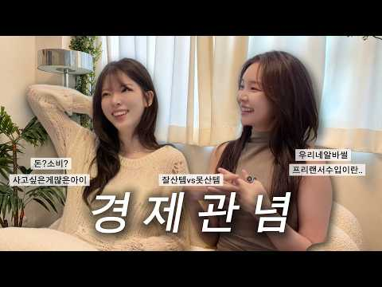
- 챕터: 0:00 돈 얘기 한번 해볼까요? 💸 · 0:35 2026 잘산템 vs 못산템 공개 · 4:40 20대엔 돈을 어떻게 벌었을까? · 6:46 큰 돈을 벌고 싶었던 묘진이? · 9:59 손님이 남긴 치킨을 싸간 알바생 · 11:16 30대 이후 경제관이 바뀐 은나래 (코로나 생존기) · 12:53 소비에 대하여! 명품이면 다야? · 14:17 20대엔 돈을 아끼는 게 정답일까? · 15:12 배달 음식 줄이기 · 17:08 은나래와 묘진의 "상폐부터 NFT 폭망"까지 📉 · 19:51 [구인] 달나라 파티원 모집 (feat.일론머스크)
- 설명 앞부분: 안녕하세요! 조은나래 김묘진의 조진토크입니다 이번에는 돈에 대해 이야기했어요! 20대 때 남이 먹다 남긴 치킨을 싸가던 시절부터 배민 도보 배달, 동대문 보세 공구, 각종 알바 돈 벌기 위해 안 해본 게 없는 여자들의 생존기를 그려보았고요! 소비와 투자에 대해서도 이야기 나누었습니다 💸 명품에 돈 쓰던 시절, 테무·알리 쇼핑 실패담, 세뱃돈으로 산 주식은 상장폐지되고 3,000달러에 산 NFT는 500달러가 되어버린 슬픈 이야기까지… 📉 그런데 말이에요 😗 돈은 무조건 아끼고 모으는 게 정답일까요? 20대엔 돈을 모으는 것보다 다…
- 대본 없음 (설명) — 음성인식이 끝나면 도입부·흐름이 들어감
- 댓글 18/26: 좋은 점 — 영상 0 · 감사·응원 1 · 더 알고 싶은 것 1 · 아쉬운 점 — 영상 0 · 반박·불만 — 의견 다름 0 · 정치·사회 0 · 경험 공유 1 · 구독·다음 기대 0
  - 더 알고 싶은 것 👍2 “묘진언니 니트 정보도 궁금해요 예쁘당”
  - 경험 공유 👍3 “저도 돈 방석 앉고 싶습니댜🤣🥹🩷”

### 92. 하이닉스 주주들만 호구인가?… 결국 6천피 찍은 코스피 폭락장

- https://www.youtube.com/watch?v=O8ZlEWiJ0yI · 잘되라대한민국 · 구독자 6,010 · 조회수 82,620 (×13.8, 하루 5,499.3) · 좋아요 435 (0.5%) · 15.2분 · 2026-10-13 · 주제 묶음 3. 주식·ETF · 형식 정보·해설 (그 밖) · 폴더 `W_O8ZlEWiJ0yI` (웹 승인)
- 썸네일: 
- 챕터: 0:00 오프닝 및 5단 지배구조로 평가받지 못하는 SK하이닉스 · 7:00 전 종목 무차별 폭락장과 꼬일 대로 꼬인 수급의 악순환 · 9:00 주식은 신뢰 자산인데, 가짜 정보와 떴다방이 판치는 … · 11:00 SK하이닉스 '솔리다임' 나스닥 상장 추진 논란과 쪼… · 13:30 "주주 돈으로 버텨놓고 이제 와서?" 5단 구조와 이… · 14:15 "여러분의 탓이 아닙니다" 폭락에 지친 투자자들을 위…
- 설명 앞부분: [겸공_12시에만나요 261013] 험한 세월 주주들의 돈으로 버텨내고 적자를 이겨냈더니, 알짜배기 자회사는 해외에서 따로 상장하겠다고요? SK하이닉스의 5단 지배구조 속에 숨겨진 쪼개기 상장 논란과, 주주들의 뒤통수를 치는 이율배반적인 현실을 파헤칩니다. 연이은 폭락장 속에서 내 탓이 아님에도 고통받고 있는 주주들을 위한 위로와, 언론이 숨기고 있는 불편한 진실을 지금 확인해 보세요. 타임라인
- 같은 채널 평소 대비 ×2.6 (채널 최근 롱폼 중앙값 32,065회) · 평소 영상: 삼성전자, 어디까지 빠질까? ‘이 가격’이면 무조건 매수시그널 (32,065회) / 엔비디아, 자사주 매입 200조 한도↑ 삼성전기 반도체 기판 증설 선수금 비중 大 (31,252회)
- 대본 없음 (설명) — 음성인식이 끝나면 도입부·흐름이 들어감
- 댓글 123/123: 좋은 점 — 영상 1 · 감사·응원 2 · 더 알고 싶은 것 0 · 아쉬운 점 — 영상 0 · 반박·불만 — 의견 다름 2 · 정치·사회 20 · 경험 공유 4 · 구독·다음 기대 0
  - 좋은 점 — 영상 👍0 “광수쌤 말이 맞아요.. 오늘 좋은 말씀 많이 하셨네요..”
  - 감사·응원 👍2 “감사합니당.ㅡ😊”
  - 감사·응원 👍0 “감사합니다”
  - 반박·불만 — 의견 다름 👍10 “핵심은 그게 아닌데 솔라다임 탓 분석하네. 심각하네.”
  - 반박·불만 — 의견 다름 👍0 “야 개쌔들아 헛소리 고만해”
  - 정치·사회 👍28 “정부는 왜 가만있나 ? 어쩌면 사기성 쬐개기 상장 ~”
  - 정치·사회 👍24 “정부가 사기치고 지주가 장난질 치고 투자 주주를 호구로 아는 양아치 경영, 분노 치떨린다”
  - 경험 공유 👍1 “내가보기엔 sk상장 쪼개기보다 오늘외인 4조5천억 매도 때문인데 왜팩트 얘기안하고 하이닉스 솔리다임 까네 ㅋ 전문가 맞나? 물론 솔리다임때문에 문제는 있지만 팩트는 외인매도 4조5천억 누가 받아주냐? 전국민 합심해서 올린건데 국민들 이제는 돈이 없다 낼또 2조 이상팔…”
  - 경험 공유 👍0 “중복상장문제점 알텐데 왜 정부관계자들은 입 꾹 닫고 있을까요? 상법만 개정함 뭐하나? 구멍이 있고 여전히 주주가치훼손하려는 일이 벌어지려하는데 ㅡㅡ. 심지어 5단상장이다. 이게 뭔가? ㅜㅜ 진짜 국장한 내가 죄인이다.”

### 93. 평범한 내가 부자들 사이에서 느낀 것들

- https://www.youtube.com/watch?v=SF1SLHOlcC0 · 30대 우영이의 일기 · 구독자 4,690 · 조회수 43,652 (×9.3, 하루 4,268.8) · 좋아요 269 (0.6%) · 12.3분 · 2026-10-18 · 주제 묶음 1. 재테크 일반·마인드 · 형식 정보·해설 (그 밖) · 폴더 `W_SF1SLHOlcC0` (웹 승인)
- 썸네일: 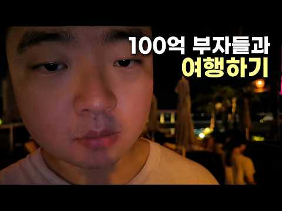
- 챕터: 0:00 평범한 투자자가 100억 부자들과 여행하면 · 0:49 요트 파티 가는 버스에서 벌어진 일 · 1:42 알고 있는 것과 실제로 하는 것의 차이 · 2:16 부자들 사이에서 느낀 복잡한 감정 · 3:31 돈타쿠는 지금 뭘 하고 있을까? · 3:47 바이비트 요트 파티 · 4:52 돈타쿠와 새벽까지 나눈 이야기 · 5:01 돈타쿠가 인생을 즐기는 방식 · 6:30 내가 앞으로 하고 싶은 일 · 7:09 계획 없이 살아온 투자자의 이야기 · 8:35 남들의 시선에서 자유로워지는 법 · 9:37 다음 날 아침, 5km 러닝 · 11:27 나는 정말 어떤 삶을 살고 싶은 걸까?
- 같은 채널 평소 대비 ×10.8 (채널 최근 롱폼 중앙값 4,046회) · 평소 영상: 몰입의 순간이 불안을 이기는 이유 (4,070회) / 죽을 각오로 싸워도 질 수 있다 ∣ 『Win the Inside Game』 (4,021회)
- 대본 없음 (없음) — 음성인식이 끝나면 도입부·흐름이 들어감
- 댓글 52/59: 좋은 점 — 영상 1 · 감사·응원 3 · 더 알고 싶은 것 0 · 아쉬운 점 — 영상 0 · 반박·불만 — 의견 다름 3 · 정치·사회 0 · 경험 공유 7 · 구독·다음 기대 1
  - 감사·응원 👍1 “저도 한 2년전부터 100억대를 가지고 있는 사람인데 우영이님이 느꼈던 그 감정을 오랬동안 느꼈던 사람으로서 이 영상이 굉장히 공감되기도 하고 한편으로는 저의 옛날 모습이 생각나서 정말 다양한 감정이 느껴지네요 우영님에 대해서 저는 오늘 처음 알게 됐지만 팬이 됐습니…”
  - 감사·응원 👍0 “언제나 응원합니다”
  - 반박·불만 — 의견 다름 👍6 “자산시장, 그것도 코인시장, 그것도 알트위주로 건드리던사람은 일확천금을 노리고 들어왔다는거고 일확천금을 얻은자와 못얻은자의 차이 아닐까요 못얻었다고 뭘 잘못한건 아닌데 마음 한구석엔 나도 저게목표였는데 하는 생각도들거고”
  - 경험 공유 👍6 “자산시장, 그것도 코인시장, 그것도 알트위주로 건드리던사람은 일확천금을 노리고 들어왔다는거고 일확천금을 얻은자와 못얻은자의 차이 아닐까요 못얻었다고 뭘 잘못한건 아닌데 마음 한구석엔 나도 저게목표였는데 하는 생각도들거고”
  - 경험 공유 👍3 “각자 재능이 다른데 겉으로 보면 똑같은 사람이라고 생각하니 내가 부족하다고 느껴지는 것 같습니다. 운의 영향도 무시할수 없구요. 전세계 사람들에게 가위바위보를 시켜도 우승하는 사람은 반드시 나오는 것 처럼요”
  - 구독·다음 기대 👍1 “저도 한 2년전부터 100억대를 가지고 있는 사람인데 우영이님이 느꼈던 그 감정을 오랬동안 느꼈던 사람으로서 이 영상이 굉장히 공감되기도 하고 한편으로는 저의 옛날 모습이 생각나서 정말 다양한 감정이 느껴지네요 우영님에 대해서 저는 오늘 처음 알게 됐지만 팬이 됐습니…”

### 94. 수녀님과 신부님의 노후 생활 생각보다 쉽지 않을 수 있다고? ∣ 천주교상시 ∣ 성직자노후 ∣ 가톨릭이야기

- https://www.youtube.com/watch?v=GCbd8J_BDYc · 신앙의 쉼터 · 구독자 12,500 · 조회수 430,334 (×34.4, 하루 11,204.9) · 좋아요 7,449 (1.7%) · 20분 · 2026-09-20 · 주제 묶음 4. 노후·연금 · 형식 정보·해설 (그 밖) · 폴더 `W_GCbd8J_BDYc` (웹 승인)
- 썸네일: 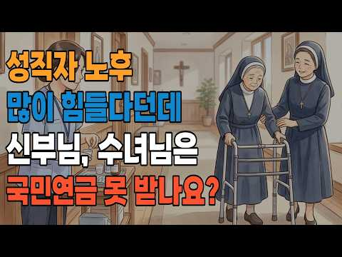
- 설명 앞부분: 평생을 세상의 부귀영화를 뒤로하고 하느님과 이웃을 위해 봉사해 온 신부님과 수녀님! 하지만 이분들도 세월이 흐르면 나이가 들고 일선 사목에서 물러나게 됩니다. 그렇다면 성직자분들은 은퇴 후 어디서 살고, 생활비나 병원비는 어떻게 해결하실까요? "신부님과 수녀님도 일반인처럼 국민연금을 받을까?"라는 단순한 궁금증에서 시작해, 한국 천주교 성직자들의 현실적인 노후 생활과 복지 시스템의 모든 것을 자세히 파헤쳐 봅니다. 성직자와 국민연금: 교구와 수도회가 '특수사업장'으로 등록되어 직장가입자로 연금을 납부하는 행정·제도적 구조 원로사목…
- 같은 채널 평소 대비 ×12.5 (채널 최근 롱폼 중앙값 34,422회) · 평소 영상: 사람이 싫어서 다른 성당 계속 가면 죄가 될까요? ∣ 성당미사 ∣ 성당교적 ∣ 가톨릭상식 (38,317회) / 신부님과 수녀님이 결혼 하지 않는 이유가 다르다고? 천주교상식 ∣ 가톨릭교리 (30,527회)
- 대본 (자막, 4.8 음절/초) 첫 20초: “어느 해 초 교구 인사발령 명단이 발표됩니다. 본당 주임, 보좌, 특수사목 이름들이 쭉 이어지다가 어떤 신부님 이름 옆에는 이렇게 적혀 있습니다. 원로사목자 만 70세. 수십년 동안 새벽 미사를 드리고 한밤”
- 첫 1분: “어느 해 초 교구 인사발령 명단이 발표됩니다. 본당 주임, 보좌, 특수사목 이름들이 쭉 이어지다가 어떤 신부님 이름 옆에는 이렇게 적혀 있습니다. 원로사목자 만 70세. 수십년 동안 새벽 미사를 드리고 한밤 중에도 병자 성사를 다니고 신자들의 세례와 혼인과 장례를 함께해 온 신부님이 [음악] 그날부로 본당을 떠나게 됩니다. 그럼 이분은 이제 어디로 가실까요? 집은 있으실까요? 통장에는 얼마가 있을까요? 배우자도 자녀도 없는 이분의 노후는 누가 책임질까요?이 이 질문을 주변에 던져보면 대답이 보통 두 가지로 나닙니다. 교회가 다 알아서 해 주겠지 아니면 신자들 헌금으로 사시겠지. 그런데 오늘 영상을 끝까지 보시면 아시겠지만 [음악] 두 대답 모두 반은 맞고 반은 틀립니다. 본론에 들어가기 전에 제가”
- 흐름 (90초마다 첫 문장): 0:00 어느 해 초 교구 인사발령 명단이 → 1:32 셋째, 그런데 지금 한국 교구신부 → 3:01 많고 규정이 제각각입니다. 공개되지 → 4:31 식사도 직장에 딸려 [음악] 있다는 → 6:01 있습니다. → 7:30 [음악] 일하면 사학연금, 군종장교로 → 9:02 은퇴하면 그 집을 후임에게 내줘야 → 10:31 얼마일까요? → 12:03 이제 수녀님들 이야기입니다. → 13:31 기초연금은 어떨까요? → 15:02 수녀님들이 많아서 [음악] 이분들이 → 16:31 여력이 없는 작은 교회 목회자는 → 18:03 지금 일하는 사람들이 은퇴한 사람들을 → 19:32 고령화의 시간을 [음악] 지나고
- 댓글 316/373: 좋은 점 — 영상 68 · 감사·응원 50 · 더 알고 싶은 것 3 · 아쉬운 점 — 영상 3 · 반박·불만 — 의견 다름 3 · 정치·사회 6 · 경험 공유 9 · 구독·다음 기대 1
  - 좋은 점 — 영상 👍73 “저는 개신교도인데, 정말 유익한 정보입니다. 신부님 수녀님 평생 옷도 검정 아니면 회색만 입고 너무 고생 많으셨네요. 여러가지로 풍요로운 노후 보내셨으면 좋겠습니다.”
  - 좋은 점 — 영상 👍43 “궁금했던 부분을 알게되어 많은 도움이 되었습니다❤”
  - 감사·응원 👍69 “평소에 궁금 하였은데 알게되어 감사합니다 신부님 과 수녀님 그분들의 노후가 편안하기를 바랍니다⁸”
  - 감사·응원 👍41 “가톨릭은 6.25 전쟁 이후 나라의 큰 공을 세우신 신부님.수녀님.이 계십니다 나라를 위해 병원.학교. 평민들의 다락방 교육 사회 큰 공을 세우신 분들입니다 하늘 나라 가시는길 조금도 부족함 없이 베플어 주시면 감사 하겠습니다 . 천주교 종교 단체에만 미루지 마시고 …”
  - 더 알고 싶은 것 👍9 “도움되었고 앞으로 다른 부분도 알려주세요”
  - 더 알고 싶은 것 👍2 “성공회도 알려주세요”
  - 아쉬운 점 — 영상 👍26 “요새 신부 수녀들이 너무 정치색에 빠져있고 정작 신앙생활과 성직자라는 개념에서 점점 멀어져가고 있는모습이 보여요. 저도 몇년전까지는 신부님, 수녀님들보면 평생을 주님만 섬기며 살아가시는 모습에 정말이지 존경과 거룩함이 들었지만 갈수록 강론때마다 정치색의 강론에다가 점…”
  - 반박·불만 — 의견 다름 👍13 “생활비는 본당에서 지급한게 아닙니다 한달 일반인은 월급 신부님들은 생활비 생활비에 식비가 포함되어 있습니다 본당에서 신부님 식비는 따로 안줍니다 교구마다 차이가 있는가는 모르겠지만 저희 교구는 따로 생활 안챙겨줍니다 바로 알고 말하기를”
  - 반박·불만 — 의견 다름 👍5 “남일 걱정할때가 아닙니다.한국 노인들중엔 연금도 못받아 허리가 굽었어도 폐지 주으며 사는 노인들 많습니다. 우리나라 노인 빈곤율이 OECD최고라 나와 있는데요. 퇴직후 연금을 받아도 택도 없이 부족해 허드렛일이라도 할려는 노인들이 꽤 많습니다”
  - 정치·사회 👍42 “중국사람들은 3년만살면 선거권도주고 국민연금도 얼마간 가입하면 중국으로가서 식구모두 가입할수있다 하고 의료보험도 중국인들 가입되는데 왜? 우리위해 봉사하는 신부 ㆍ수도자들은 가입이 열악하나요? 세상이 요지경 입니다”
  - 정치·사회 👍1 “정부 연금을 사제 수녀에게 지급되어서는 안된다 정권편에 서게 돼 예수님의 진리를 정권뒤에 두기에 예수님이 권력의 밑에 있게 돼 결국 진리가 무너지는 것이 된다”
  - 경험 공유 👍26 “요새 신부 수녀들이 너무 정치색에 빠져있고 정작 신앙생활과 성직자라는 개념에서 점점 멀어져가고 있는모습이 보여요. 저도 몇년전까지는 신부님, 수녀님들보면 평생을 주님만 섬기며 살아가시는 모습에 정말이지 존경과 거룩함이 들었지만 갈수록 강론때마다 정치색의 강론에다가 점…”
  - 경험 공유 👍13 “생활비는 본당에서 지급한게 아닙니다 한달 일반인은 월급 신부님들은 생활비 생활비에 식비가 포함되어 있습니다 본당에서 신부님 식비는 따로 안줍니다 교구마다 차이가 있는가는 모르겠지만 저희 교구는 따로 생활 안챙겨줍니다 바로 알고 말하기를”
  - 구독·다음 기대 👍8 “세례를 앞두고 있는 예비신자입니다.궁금한게 많아도 여쭙기가 망설여지거나 대상이 없는데 찬찬히 다양한 정보주셔서 구독하고 있어요.감사합니다 힘내세요❤”

### 95. 현대차 반토막에 숨겨진 진실… 엔비디아 합작 발표 전 무조건 모아야 할 이유 [이권희 대표]

- https://www.youtube.com/watch?v=m3ZRHahRGHU · 경제시그널 · 구독자 28,000 · 조회수 403,304 (×14.4, 하루 23,907.5) · 좋아요 1,833 (0.4%) · 33분 · 2026-10-06 · 주제 묶음 기타 · 형식 인터뷰·강연·대담 · 폴더 `W_m3ZRHahRGHU` (웹 승인)
- 썸네일: 
- 챕터: 0:00 오프닝 · 0:15 요즘 주식시장 · 13:25 삼성전자 3분기 잠정실적 · 15:40 수급으로 인한 리스크는? · 20:10 반도체 소부장 접근법 · 22:30 전력기기·전선주 투자 포인트 · 24:25 현대차 언제 전고점가나? · 28:45 3분기 어닝시즌 진입... 투자 전략은?
- 설명 앞부분: 🔎올초 피지컬 AI와 로봇 기대감으로 치솟았던 현대차 주가 고점 대비 반토막 난 상황! 새만금 데이터센터 건립과 복정동 연구센터에 '엔비디아' 엔지니어들이 들어온다? 연내 발표될 엔비디아와의 합작법인 모멘텀부터 2035년까지 이어질 메모리·로봇 대폭발 사이클까지! 지금 현대차를 팔면 안 되는 이유와 반등 타이밍을 공개합니다. 뿐만 아니라 삼성전자 3분기 실적발표를 앞두고 반도체 소부장주 급등랠리 중입니다. 50개가 넘는 소부장 종목 속에서 가장 스마트하게 수익률을 챙기는 전략도 전격 공개합니다. 🕥 타임스탬프 🕥 녹화일: 2026…
- 같은 채널 평소 대비 ×22.7 (채널 최근 롱폼 중앙값 17,794회) · 평소 영상: 기대감 0%? 고생했던 주주들 필독! 2차전지 제약바이오 왜 반등하는지 알려드립니다 [민… (33,200회) / 3분기 실적시즌! 삼전닉스 절반, 나머지 절반은 '이 섹터'를 담으시죠 [노근창 대표] (41,187회)
- 대본 없음 (설명) — 음성인식이 끝나면 도입부·흐름이 들어감
- 댓글 206/211: 좋은 점 — 영상 1 · 감사·응원 3 · 더 알고 싶은 것 1 · 아쉬운 점 — 영상 0 · 반박·불만 — 의견 다름 5 · 정치·사회 7 · 경험 공유 8 · 구독·다음 기대 0
  - 좋은 점 — 영상 👍6 “갓권희대표님~ 좋은 말씀 감사합니다~ 👍👍👍”
  - 감사·응원 👍6 “갓권희대표님~ 좋은 말씀 감사합니다~ 👍👍👍”
  - 감사·응원 👍0 “감사해요. 절대 주식하면 안되는다는 진실을 몸소 배우고 있어요. ㅎㅎㅎㅎㅎ”
  - 더 알고 싶은 것 👍4 “현대차 Ai에 물어 보니까 33만에 50프로 물타고 30만원 깨지면 나머지 다 사라던대 어떤걸 믿을까요?”
  - 반박·불만 — 의견 다름 👍1 “저,*때문에(100만원간다고) 신세ㅗ진사람 천지..왜방송에 나와 헛소리하고 저런8을 방송에서 ,,,”
  - 반박·불만 — 의견 다름 👍0 “이권희만 좋다고 한거 아닙니다. 다른분들도 다좋다고 했고 본인판단인거죠..저도 2천물렸습니다. 속은쓰리지만 회사를 믿고 배당받고 기다리다보면 또 기회가 오지않을까요?”
  - 정치·사회 👍4 “미국 중간선거 끝나면 난리난다”
  - 정치·사회 👍2 “● 삼성전자: 3분기 서프라이즈 실적 발표(D-2): 선매수 유리 영업이익 110조원: 전년대비 802% 폭증 ○ 자사주 15조원 매수중 주주환원 110조원 발표 ● 싱가폴 국부펀드 테마섹 : 삼성전자 51조원 매수 시작 : 외국인+기관 최근 3000만주 대량 매수 …”
  - 경험 공유 👍32 “냉정하게 보면 저 사람이 현대차 주가를 떨어트린것도 아니고 왜 저사람에게 화풀이지? 올랐으면 저사람에게 수익의 반은 줄건가?? 나도 현대차 물려있지만 선택은 개인이 한것이니 개인이 감내해야한다고 본다.”
  - 경험 공유 👍4 “내가 "밧데리아저씨2" 가 될상인가”

### 96. 【성철스님】 부자가 되려면 절대 이 색깔 옷은 입지 마세요! 재물운이 달아납니다 ㅣ돈복 부르는 옷 색깔 ㅣ재물운 상승 풍수 ㅣ돈복 들어오는 색깔 ㅣ부자 되는 풍…

- https://www.youtube.com/watch?v=Ld78QoSYFrk · 행복한 노후연구소 · 구독자 11,200 · 조회수 140,184 (×12.5, 하루 8,611.8) · 좋아요 1,498 (1.1%) · 56.1분 · 2026-10-12 · 주제 묶음 1. 재테크 일반·마인드 · 형식 정보·해설 (그 밖) · 폴더 `W_Ld78QoSYFrk` (웹 승인)
- 썸네일: 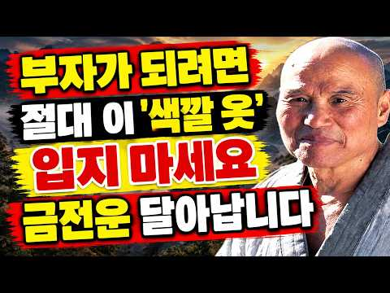
- 설명 앞부분: 【성철스님】 부자가 되려면 절대 입지 말아야 할 옷 색깔이 있을까요? 재물운이 달아난다고 전해지는 색깔부터 돈복을 부르는 색깔까지, 오늘은 전통 풍수에서 바라보는 옷 색깔의 의미와 부자 되는 풍수 비법을 함께 알아봅니다. 평소 아무 생각 없이 선택했던 옷 색깔에도 전통문화 속에서는 다양한 상징과 의미가 담겨 있다고 합니다. 그렇다면 돈복 들어오는 색깔은 무엇이며, 재물운 상승과 관련해 어떤 풍수 이야기가 전해져 왔을까요? 이번 영상에서는 돈복 부르는 옷 색깔, 재물운 상승 풍수, 행운의 색깔, 부자 되는 풍수 비법을 주제로 전통적…
- 같은 채널 평소 대비 ×6.5 (채널 최근 롱폼 중앙값 21,483회) · 평소 영상: 【성철스님】 9월 24일까지! '이것' 절대 먹지도 주지도 가지도 마세요, 남은 금전운 … (21,483회) / 【성철스님】 입던 옷 버릴때 '이것' 모르고 버리면 큰일납니다! 잘못 버렸다간 금전운 달… (19,129회)
- 대본 없음 (설명) — 음성인식이 끝나면 도입부·흐름이 들어감
- 댓글 366/453: 좋은 점 — 영상 0 · 감사·응원 73 · 더 알고 싶은 것 2 · 아쉬운 점 — 영상 0 · 반박·불만 — 의견 다름 0 · 정치·사회 0 · 경험 공유 2 · 구독·다음 기대 0
  - 감사·응원 👍6 “금전운 받아갑니다 감사합니다😂😂😂”
  - 감사·응원 👍6 “재물복 받아갑니. 감사힙니다.”
  - 더 알고 싶은 것 👍0 “많은 재물복 받아갑니다 하루의 일용한 양식을 부탁합니다😂😂😂😂😂”
  - 더 알고 싶은 것 👍0 “허연 스님은 왜 회색 옷을 입는건지 심이 궁금합니다”
  - 경험 공유 👍0 “저도건강운주세요”

### 97. "5천까지는 나라가 지켜 준다길래" 저축은행에 노후자금 넣은 사람들이 아직 돈을 못 찾는 이유

- https://www.youtube.com/watch?v=NkJAvLHzj3Q · 경제콜라주 · 구독자 1,730 · 조회수 16,072 (×9.3, 하루 1,300.2) · 좋아요 81 (0.5%) · 16.2분 · 2026-10-16 · 주제 묶음 2. 돈 모으기·저축 · 형식 정보·해설 (그 밖) · 폴더 `W_NkJAvLHzj3Q` (웹 승인)
- 썸네일: 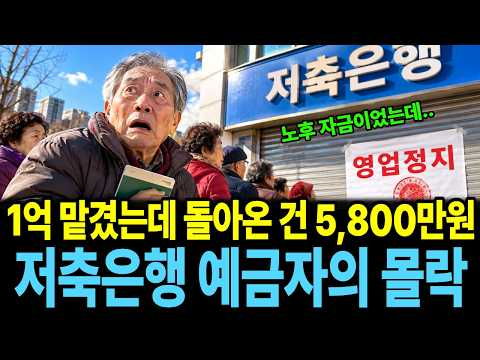
- 챕터: 0:00 예금자보호 1억, 이제 안심일까 · 0:41 2011년 2월 17일 부산저축은행 앞의 줄 · 1:17 이자 1%포인트 더 주던 저축은행 · 3:02 내 1억은 공사판과 캄코시티로 · 4:36 영업정지 전날 먼저 빠진 85억 원 · 6:08 5천만 원 위의 돈, 1억이 5,800만 원이 된 계산 · 8:17 15년째 끝나지 않은 파산 정리 · 10:34 100%에서 55%, 그리고 0 — 멈춘 특별법 · 12:04 이자 1%포인트를 고른 게 잘못일까 · 13:12 지금 저축은행과 은행의 금리 차이 · 14:06 1억 시대, 내 통장에서 확인할 세 가지 · 15:11 다시 2011년 2월 17일, 그 창구
- 설명 앞부분: 예금자보호가 1억 원으로 오른 지금, 2011년 저축은행 사태 때 5천만 원 넘게 넣었던 사람들은 왜 아직도 돈을 다 찾지 못했을까요? 부산저축은행 예금자들의 결말로 1억 시대 내 예금을 다시 봅니다. 이 영상에서 다루는 내용 2011년 저축은행 금리 5.16% vs 은행 3.67%, 1억이면 1년 이자 150만 원 가까이 차이 부산저축은행 계열 대출의 70%가 공사판으로, 캄보디아 캄코시티에만 2,840억 원 영업정지 전날 VIP 고객과 직원이 먼저 뺀 85억 원 5천만 원 넘는 돈이 「빚 받을 순서」로 밀린 이유와 1억 → 5…
- 같은 채널 평소 대비 ×6.1 (채널 최근 롱폼 중앙값 2,620회) · 평소 영상: "잘못한 사람이 없었습니다" 자식에게 보태준 돈에 십 년 뒤 고지서가 날아온 진짜 이유 (3,035회) / 정주영 몰래 금액을 고친 직원, 그 6천만 달러가 3년 뒤 회사를 살린 이유 (4,898회)
- 대본 없음 (설명) — 음성인식이 끝나면 도입부·흐름이 들어감
- 댓글 6/6: 좋은 점 — 영상 0 · 감사·응원 0 · 더 알고 싶은 것 0 · 아쉬운 점 — 영상 0 · 반박·불만 — 의견 다름 0 · 정치·사회 0 · 경험 공유 0 · 구독·다음 기대 0

### 98. 부자가 되기 위해 반드시 거쳐야 할 3단계 – 마키아벨리의 부의 청사진

- https://www.youtube.com/watch?v=VDrLyc9skjk · 부의 파워 코드 · 구독자 1,630 · 조회수 15,654 (×9.6, 하루 1,209.3) · 좋아요 253 (1.6%) · 45.1분 · 2026-10-15 · 주제 묶음 1. 재테크 일반·마인드 · 형식 오디오북·낭독 (명언·인생조언) · 폴더 `W_VDrLyc9skjk` (웹 승인)
- 썸네일: 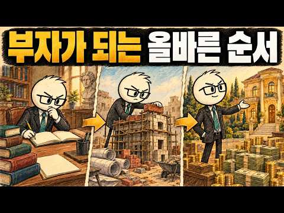
- 챕터: 0:00 소개: 4,800만 달러의 실수 · 2:43 1단계: 학습 단계 (떠나기 전에 시스템을 익히세요) · 3:59 당신의 직업이 당신에게 실제로 가르쳐주는 4가지 · 8:20 1단계의 두 가지 함정 · 11:21 2단계: 전환 - 기술을 소유권으로 바꾸기 · 12:32 2단계의 어두운 면 (4,800만 달러를 잃은 방법) · 19:51 2단계의 두 가지 함정 · 24:07 3단계: 실행 - 증식 게임 · 27:16 실행 vs. 투기 (자산 보호) · 33:04 궁극적인 마키아벨리적 목표: 지속과 유산
- 설명 앞부분: 성공했다고 여겨지는 한 사람이 단 하루 만에 4,800만 달러를 잃었습니다. 잘못된 투자 때문이 아니라, 옳은 결정을 너무 일찍 내린 탓입니다. 이 영상에서는 부를 창출하는 3단계의 냉혹한 과정을 분석하고, 순서를 이해하는 것이 왜 마키아벨리적 전략의 핵심인지 알아봅니다. 대부분의 사람들은 규율이나 재능이 부족해서가 아니라, 옳은 일을 잘못된 순서로 하기 때문에 실패합니다. 니콜로 마키아벨리의 『군주론』과 『담론』의 전략적 틀에서 영감을 받은 이 심층 분석은 진정한 재정적 힘의 숨겨진 구조를 드러냅니다. 여러분의 급여가 업계를 내…
- 같은 채널 평소 대비 ×0.8 (채널 최근 롱폼 중앙값 20,432회) · 평소 영상: 부자가 되는 가장 빠른 방법 — 마키아벨리의 무자비한 부의 전략 (20,860회) / 부자가 되는 가장 빠른 방법 — 마키아벨리의 무자비한 부의 전략 (20,004회)
- 대본 없음 (설명) — 음성인식이 끝나면 도입부·흐름이 들어감
- 댓글 7/9: 좋은 점 — 영상 0 · 감사·응원 1 · 더 알고 싶은 것 0 · 아쉬운 점 — 영상 0 · 반박·불만 — 의견 다름 0 · 정치·사회 0 · 경험 공유 0 · 구독·다음 기대 0
  - 감사·응원 👍0 “감사합니다”

### 99. 금융자산 10억 부자도 아직 공부합니다… 평생 돈이 안 모이는 사람은 ‘이 6가지’를 놓칩니다

- https://www.youtube.com/watch?v=i9Mj9VvL20o · 오십의 경제지도 · 구독자 719 · 조회수 18,377 (×25.6, 하루 532.7) · 좋아요 108 (0.6%) · 16.5분 · 2026-09-23 · 주제 묶음 1. 재테크 일반·마인드 · 형식 정보·해설 (그 밖) · 폴더 `W_i9Mj9VvL20o` (웹 승인)
- 썸네일: 
- 설명 앞부분: 금융자산 10억 원 이상 부자들이 왜 계속 금융지식을 공부하는지, 금리·세금·현금흐름·자산배분·시간·투자심리 여섯 가지로 정리합니다. 40대·50대 자산관리와 노후 준비에 필요한 돈 공부의 핵심을 확인해 보세요. 가장 자신 없는 과목도 댓글로 남겨주세요. 여섯 과목 중 지금 가장 자신 없는 것은 무엇인가요? 금리, 세금, 현금흐름, 자산배분, 시간, 나 자신 중 딱 하나만 골라 댓글로 남겨주세요. 가장 많이 나온 과목부터 다음 영상에서 깊게 다뤄보겠습니다.
- 같은 채널 평소 대비 ×1.2 (채널 최근 롱폼 중앙값 14,859회) · 평소 영상: 커피·외식 다 끊었는데 통장은 그대로… 50대가 놓친 ‘진짜 돈 구멍’ (14,859회) / 55세 이후 아무 일이나 하지 마세요! 월급 100만원보다 무서운 '건보료 함정'과 일자… (14,986회)
- 대본 (음성인식(앞 5분), 4.9 음절/초) — 앞부분만, 흐름은 그 안까지 첫 20초: “통장에 1억원이 있는 사람과 10억원이 있는 사람 이 차이는 정말 누가 더 열심히 살았느냐에서만 갈릴까요? 2025년 한국 부자보고서에 따르면 금융자산 10억원 이상을 가진 사람은 약 47만 6000명으로 추정됩니다 그런데 이 사람들이 미래의 부자에게 전한 자산관리” — 도입부 유형: 질문으로 시작, 숫자로 시작
- 첫 1분: “통장에 1억원이 있는 사람과 10억원이 있는 사람 이 차이는 정말 누가 더 열심히 살았느냐에서만 갈릴까요? 2025년 한국 부자보고서에 따르면 금융자산 10억원 이상을 가진 사람은 약 47만 6000명으로 추정됩니다 그런데 이 사람들이 미래의 부자에게 전한 자산관리 지혜 1순위는 의외였습니다 강남 아파트도 아니었습니다 대박 종목도 아니었습니다 지속적으로 금융 지식을 쌓는 것이었습니다 이미 자산을 상당히 모은 사람들조차 여전히 공부를 1순위로 꼽았다는 사실이 눈에 띕니다 돈을 버는 제주와 돈을 지키는 제주는 서로 다른 근육이라는 뜻이기도 합니다 그렇다면 무엇을 공부해야 할까요? 주식 차트를 매일 봐야 할까요? 오히려 반대입니다 중년 이후 자산을 지키고 노후 현금으름을 만들고 싶다면 6과목이 필요합니다 금리,”
- 흐름 (90초마다 첫 문장): 0:00 통장에 1억원이 있는 사람과 10억원이 있는 사람 → 1:31 2026년 8월 27일 → 3:01 내 대출이자는 내 자산의 할인율은 내 현금의 기회 비용은 어떻게 변할까 → 4:31 IRP를 합하면 연 900만 원까지입니다
- 댓글 1/1: 좋은 점 — 영상 0 · 감사·응원 0 · 더 알고 싶은 것 0 · 아쉬운 점 — 영상 0 · 반박·불만 — 의견 다름 0 · 정치·사회 0 · 경험 공유 0 · 구독·다음 기대 0

### 100. 나이들수록 '이것' 챙기면 노후가 바뀌고 행복해집니다ㅣ귀티나는 노후를 위한 행복특강ㅣ황창연신부님최근강의ㅣ황창연신부님행복특강ㅣ인생 조언ㅣ오디오북ㅣ나눔철학 srt

- https://www.youtube.com/watch?v=cn8b0mMUR3Q · 포강쇼 · 구독자 5,160 · 조회수 520,507 (×100.9, 하루 3,719.3) · 좋아요 8,501 (1.6%) · 179.8분 · 2026-06-10 · 주제 묶음 4. 노후·연금 · 형식 오디오북·낭독 (명언·인생조언) · 폴더 `W_cn8b0mMUR3Q` (웹 승인)
- 썸네일: 
- 설명 앞부분: 🎉 웃음과 재미가 가득한 포강쇼에 오신 것을 환영합니다! 🎉 포강쇼는 매일 새로운 웃음과 즐거움을 전하는 엔터테인먼트 채널입니다. 😄 재미있는 챌린지, 리액션, 유머 영상, 브이로그, 그리고 최신 트렌드까지! 지루할 틈 없이 누구나 함께 즐길 수 있는 콘텐츠를 제공합니다. 🚀 매일 업로드되는 다양한 영상으로 여러분의 하루를 더 즐겁게 만들어 드립니다. 함께 웃고 함께 즐기는 공간, 지금 바로 포강쇼와 함께하세요! 🎬✨ 새로운 영상 매일 업로드! 재미와 감동이 가득한 채널!
- 같은 채널 평소 대비 ×1,526.4 (채널 최근 롱폼 중앙값 341회) · 평소 영상: 나이들어서 갖고 있는 돈을 잃지 않아야 하는 이유 3가지ㅣ귀티나는 노인들의 공통 습관ㅣ황… (361회) / 나이들수록 느끼지 못했던 행복들이 눈에 보이는 이유ㅣ황창연신부님행복특강ㅣ인생 조언ㅣ오디오… (321회)
- 대본 (음성인식(앞 5분), 4.5 음절/초) — 앞부분만, 흐름은 그 안까지 첫 20초: “우리나라는 태풍이 자주 오는 편이야 안 오는 편이에요? 거의 안 오는 편이에요 왜? 이 태풍이 발생하면 다 어디 가서 쏟아봐요? 일본에 가서 다 쏟아봐요 일본이 우리 거 다 막아줘요” — 도입부 유형: 질문으로 시작
- 첫 1분: “우리나라는 태풍이 자주 오는 편이야 안 오는 편이에요? 거의 안 오는 편이에요 왜? 이 태풍이 발생하면 다 어디 가서 쏟아봐요? 일본에 가서 다 쏟아봐요 일본이 우리 거 다 막아줘요 일본한테 고마워야 돼요 일본 가라앉으면 안 돼요 거기 있어줘야 돼 그다음에 또 누가 다 막아줘요? 필리핀하고 중국이 다 막아줘요 그래서 우리나라는 1년에 하나 많이 오면 2개 어떤 애는 안 옵니다 굉장히 고마운 거죠 우리가 이렇게 자연재해를 굉장히 안 받는 나라예요 일본은 여러분들 지진 1년에 몇 번 일어나요? 5천번 일어나요 5천번 근데 우리나라는 지진 거의 없잖아요 얼마나 고마워요 그래서 제가 대한민국 살기 좋다고 늘 말하는 거예요 세계에서 제일 살기 좋은 나라 어느 나라예요? 대한민국 대한민국”
- 흐름 (90초마다 첫 문장): 0:08 우리나라는 태풍이 자주 오는 편이야 안 오는 편이에요? → 1:31 태풍도 안 오지 지진도 없지 → 3:01 이 뚝이 200개가 터졌어요 → 4:30 태풍은 소형 태풍, 중형 태풍, 대형 태풍
- 댓글 160/173: 좋은 점 — 영상 10 · 감사·응원 25 · 더 알고 싶은 것 0 · 아쉬운 점 — 영상 0 · 반박·불만 — 의견 다름 0 · 정치·사회 36 · 경험 공유 4 · 구독·다음 기대 0
  - 좋은 점 — 영상 👍25 “너무나도 옳은 말씀 감사합니다 지혜롭고 지식이 많으신 신부님 사랑하고 존경합니다”
  - 좋은 점 — 영상 👍23 “좋은말씀입니다 국민들 신부님 말씀들고 감사 감사 배우네요”
  - 감사·응원 👍30 “황장연시부님 감사합니다 이밤도시부님강의듣고 잠을청하고있답니다 신부님강외정말감동받고있답니다 신부님 고맙고 감사합니다 늘 건강하고우리겉에합께하여주시옵기을기원합니다 감사합니다 황창연시부님 부뒤건강하시옵소셔 🎉🎉🎉”
  - 감사·응원 👍25 “너무나도 옳은 말씀 감사합니다 지혜롭고 지식이 많으신 신부님 사랑하고 존경합니다”
  - 정치·사회 👍28 “그래유 우리나라가제일좋았유❤❤”
  - 정치·사회 👍16 “창연씨 앞으로 연설 할때 박정희 정권이 잘한게 많지만 특히 잘한게 녹화 산업이다. 이렇게 말 하라.”
  - 경험 공유 👍0 “예수 없는 기독교. 그러면 난 마음이 편하고 양떼들과 함께 할 수 있다. 예수는 허구가 많다. 기독교도는 진실 앞에 예수를 떨치고 진실로 하나님 앞에 경배하라 신부님 목사님들과 진솔한 대화를 통해서 스스로 예수에 갇혀서 진싫 앞에 멈칫하는 안타까운 때가 많았다. 예수…”
  - 경험 공유 👍0 “황창연 신부님 ! 저는 신부님. 제가 정말. 존경하고 사랑하는 분입니다. 후원자 이기도 합니다. 얼마전 신부님 유투브를 보면서 이재명 대통령이 잘하고 계신다고 하시던데. 실망 이었습니다 왜~저는 사람이라면 아무리 화가나도 할말이 있고 안해야 될말이 있습니다. 형님에게…”

### 101. "돈 버는 규칙은 따로 있어요." 1300억 부자가 추천하는 단 한권의 책/인생책/레버리지 몰아보기

- https://www.youtube.com/watch?v=vD6oAnU4ZPo · 달콤하게성장 · 구독자 8,380 · 조회수 182,768 (×21.8, 하루 6,016.2) · 좋아요 1,311 (0.7%) · 34.7분 · 2026-09-22 · 주제 묶음 1. 재테크 일반·마인드 · 형식 정보·해설 (그 밖) · 폴더 `W_vD6oAnU4ZPo` (웹 승인)
- 썸네일: 
- 챕터: 0:00 열심히만 살면 부자가 될까? · 2:47 레버리지란 무엇인가 · 5:20 내가 아니어도 되는 일은 위임하라 · 7:45 절약보다 투자 · 10:23 시간 관리보다 감정 관리 · 13:24 아끼고 열심히 살아도 부자가 되지 않는 이유 · 16:59 작은 돈보다 시간과 에너지를 아껴라 · 21:05 가격 비교에 시간 쓰지 마라 · 25:10 건강에는 아끼지 마라 · 29:13 책과 배움에 투자하라 · 31:25 돈보다 시간·건강·교육에 투자하라
- 설명 앞부분: 레버리지는 무조건 열심히 사는 것이 아니라 적은 노력으로 더 큰 성과를 만드는 방법입니다. 열심히 살고 악착같이 아끼는데도 왜 생각만큼 부자가 되지 못할까요? 부자되는 법을 알고 싶다면 돈보다 먼저 나의 시간과 에너지를 어디에 쓰고 있는지 살펴봐야 합니다. 진짜 돈 관리는 무조건 아끼고 저축하는 것만을 의미하지 않습니다. 몇백 원, 몇천 원을 아끼기 위해 소중한 시간과 에너지를 낭비하고 있지는 않은지 생각해 봐야 합니다. 레버리지를 이해하면 돈을 써서 시간을 사고, 그 시간을 더 가치 있는 일에 사용하는 방법을 고민하게 됩니다. …
- 같은 채널 평소 대비 ×3.7 (채널 최근 롱폼 중앙값 49,966회) · 평소 영상: 누구나 가능합니다. 다 알려드릴게요. (타이탄의 도구들) (49,966회) / "행복해지고 싶다면 반드시 보세요." 삶을 행복하게 만드는 법 (50,082회)
- 대본 (음성인식(앞 5분), 4.4 음절/초) — 앞부분만, 흐름은 그 안까지 첫 20초: “근데 대부분의 사람들은 저도 마찬가지로 이 책을 읽기 전까지는 그냥 열심히 살면 부자가 되고 잘 살게 될 줄 알았어요. 그냥 열심히 살고, 성실하게 살고, 쉬지 않고 열심히. 아니거든요. 그 방법이 아니거든. 그거는? 안녕하세요. 달콤하게 성장하는 달성입니다. 여러분, 여러분 열심히 사시죠.”
- 첫 1분: “근데 대부분의 사람들은 저도 마찬가지로 이 책을 읽기 전까지는 그냥 열심히 살면 부자가 되고 잘 살게 될 줄 알았어요. 그냥 열심히 살고, 성실하게 살고, 쉬지 않고 열심히. 아니거든요. 그 방법이 아니거든. 그거는? 안녕하세요. 달콤하게 성장하는 달성입니다. 여러분, 여러분 열심히 사시죠. 그래서 보자되었나요? 새벽에 일찍 일어나고 회사에 가서 야근까지 하고 뭐 알바까지 하고 몸을 갈아 넣고 시간을 갈아 넣고 그렇게 열심히 살면 부자가 될까요? 그런데 다 알고 있지 않나요? 그렇게 사는 사람들이 부자가 아니라는 사실을? 그들은 부자로서의 삶을 살는 것이 아니라 자기 시간과 노동력을 부자들에게 갖다 바치는 거예요. 저는 그것을 이 한곤의 책을 읽고 알게 되었습니다. 처음 이 책을 만났을 때가”
- 흐름 (90초마다 첫 문장): 0:00 근데 대부분의 사람들은 저도 마찬가지로 이 책을 읽기 전까지는 → 1:30 우리는 모두 저축하고 아끼고 열심히 살아야 된다고 → 3:00 레버리지는 최소 노력의 법칙이에요. → 4:31 도덕적으로 좀 잘못된 거 아니야?
- 댓글 95/95: 좋은 점 — 영상 3 · 감사·응원 14 · 더 알고 싶은 것 3 · 아쉬운 점 — 영상 0 · 반박·불만 — 의견 다름 0 · 정치·사회 0 · 경험 공유 6 · 구독·다음 기대 0
  - 좋은 점 — 영상 👍21 “맞는 말씀 이고 대단하십니다, 돈 있는 사람들이 돈을 쫒지 말라 합니다, 돈이 있을때 하는 애기죠, 시간, 에너지 낭비도 다 같은 소리라 봅니다, 다른 대안이 없는데 어떻게 아끼않고 노동을 안합니까 ? 열심벌고 아껴서 돈을 모와서 그런 사고 와 방식으로 나아가야 한다…”
  - 좋은 점 — 영상 👍3 “좋은 영상입니다.”
  - 감사·응원 👍48 “독서,쓰기,운동,잘자기,잘먹기 그리고 명상하고 일하고 투자하며 사람과 세상에 감사하는 마음 퍼내기”
  - 감사·응원 👍10 “제 인생 큰 울림을 감사합니다. 우리 인생사! 돈과 사람 그리고 나 자신!”
  - 더 알고 싶은 것 👍2 “작은 돈을 아끼려고. 시간과 정신 에너지를 소비하지 말라 소중한 지혜 감사합니다 질문)배우는데. 투자하라 하셨는데 근데 저는 남 강의 듣기보다는 직접 책을 보는타입인데 혹시 강의를 꼭 들어야 하나요? 책에 다 있는데 왜 강의를 들어야하는지 전 이게 궁금합니다 답변 주…”
  - 더 알고 싶은 것 👍1 “롭무어의 레버리지 책이 맞나요?”
  - 경험 공유 👍55 “공감 100% 입니다 내가 돈 쓰지 않는 곳 - 시계, 자동차 시간 쓰지 않는 곳 - 쇼핑, 논쟁 멀리하는 사람 - 위에 두가지에서 나랑 방향이 반대인 사람”
  - 경험 공유 👍11 “저도 자칭 자기계발충으로서~ 자신있게 말씀드립니다. 현재.과거.미래의 씨크릿등영성서적포함 모든 자기계발서 다 똑같은 내용입니다. 돌고돌아. 이 세상은 열심히 안하면 돌아오는것이 없는 시스템입니다.단 어떻게 열심히 하냐의 차이가 있을뿐이죠. 위 유튜버분도 책도 쓰시고 …”

### 102. AI 투자 "매년 5000조 못 벌면 본전도 못 찾는다" 한국에선 아무도 모르는 진짜 계산서

- https://www.youtube.com/watch?v=xe6nMxngK7A · 김열매TV · 구독자 12,200 · 조회수 121,262 (×9.9, 하루 8,631.5) · 좋아요 2,676 (2.2%) · 41.7분 · 2026-10-14 · 주제 묶음 3. 주식·ETF · 형식 정보·해설 (그 밖) · 폴더 `W_xe6nMxngK7A` (웹 승인)
- 썸네일: 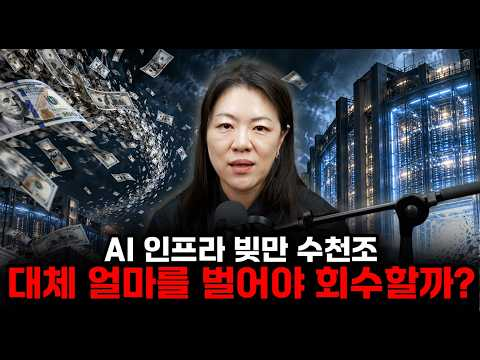
- 설명 앞부분: AI가 본전을 뽑으려면 2032년부터 '매년 3.7조 달러(약 5000조 원)'를 벌어야 합니다. 지금 오픈AI·앤트로픽 매출의 37배, 미국인 식비(GDP 9%)와 맞먹는 돈입니다. 미국 AI 데이터센터에 2032년까지 10조 달러가 넘는 돈이 들어갑니다. 그중 절반은 빌린 돈이고, 빅테크가 약속한 3조 달러는 장부에 5분의 1만 잡혀 있습니다. 김열매가 논문 숫자를 직접 해부해 'AI 버블이냐 아니냐'를 스스로 판단할 수 있는 기준을 드립니다. 그리고 지금 반드시 지켜봐야 할 '5가지 숫자'를 정리했습니다.
- 같은 채널 평소 대비 ×6.2 (채널 최근 롱폼 중앙값 19,687회) · 평소 영상: SK하이닉스 하한가 단 1주에 800억대 청산, AI가 이 틈을 노린다면? (15,382회) / 담보가 된 GPU, 젠슨황은 웃고 있다. AI 데이터센터로 몰려가는 글로벌 자본, 지금 … (14,113회)
- 대본 없음 (설명) — 음성인식이 끝나면 도입부·흐름이 들어감
- 댓글 406/420: 좋은 점 — 영상 33 · 감사·응원 69 · 더 알고 싶은 것 14 · 아쉬운 점 — 영상 3 · 반박·불만 — 의견 다름 10 · 정치·사회 5 · 경험 공유 16 · 구독·다음 기대 8
  - 좋은 점 — 영상 👍16 “좋은 영상 잘 보고 갑니다.”
  - 좋은 점 — 영상 👍11 “거의 못알아들었지만 엄청 좋은 내용인거 같습니다. 감사드립니다.”
  - 감사·응원 👍40 “도기마을출신답게 무조건 좋아요 먼저 누르고 시청하지요 😊감사합니다”
  - 감사·응원 👍19 “열매님 감사합니다😊”
  - 더 알고 싶은 것 👍9 “너무 좋은 컨텐츠였습니다. 앞으로도 계속 올려 주세요. 몇 조 달러 이런 거 말씀하실 때 항상 원으로 얼만지. 함께 말씀해 주시면 더욱 직권적이게 이해할 것 같습니다. 그리고 그 정도 돈이 어느 정도의 가치가 있는 돈인지도 함께 말씀해 주시면 더 좋을 것 같습니다. …”
  - 더 알고 싶은 것 👍3 “인사이트 가득한 내용 감사합니다. 앞으로도 많은 부탁드려요~~”
  - 아쉬운 점 — 영상 👍4 “첫 화면에 논문 제목과 출처를 자세하게 적어주셔서 챗GPT와 해당 논문에 대해서 많은 대화를 했어요 영상도 도움 많이 되었습니다. 감사합니다.”
  - 아쉬운 점 — 영상 👍1 “솔직히 못알아 들었어요 ㅜㅜ 그런데 좋은 내용이건 같아요 반복해서 들을께요^^”
  - 반박·불만 — 의견 다름 👍11 “전세계에 인간이 미국인만 있는것도 아닌데 몬의미,,”
  - 반박·불만 — 의견 다름 👍7 “원래 교수들의 미래 예측은 듣는 게 아닙니다ㅋㅋ”
  - 정치·사회 👍0 “삼전닉스 입장에서 이 영상을 보면 아주 긍정적이네요. 신용위기 터질 거 같으면 연준과 정부가 즉각 개입할 것입니다. 실리콘벨리은행에서 봤죠.”
  - 정치·사회 👍0 “돈이 문제가 아니여., 결국 나라가 관리 할껀데..뭐”
  - 경험 공유 👍6 “나도 늘 이게 궁금햇음,, 제일 중요한것 아닌가? 그런데 그걸 이야기 해준 사람이 없더라구요”
  - 경험 공유 👍5 “3월에 사모펀드문제가 불거졌을때 다 우려했었던 내용이고 거기서 뭐가 달라진게 있나요... 잘모르겠습니다. 열매님도 당시에 프로에 나오셔서 이 문제를 언급해주셨죠.”
  - 구독·다음 기대 👍4 “열매님 오늘 구독했습니다 😅”
  - 구독·다음 기대 👍3 “깊이 있는 내용을 잘 설명해 주시네요 오늘부터 구독합니다”

### 103. 긴급진단📢 '검은 목요일' 생존법은? 급락장 '줍줍' 기회일까? [염승환 이사]

- https://www.youtube.com/watch?v=lXqkrXt2uNs · 경제시그널 · 구독자 28,000 · 조회수 140,897 (×5.0, 하루 19,762.0) · 좋아요 1,012 (0.7%) · 16.5분 · 2026-10-15 · 주제 묶음 기타 · 형식 인터뷰·강연·대담 · 폴더 `W_lXqkrXt2uNs` (웹 승인)
- 썸네일: 
- 설명 앞부분: 📉 코스피·코스닥 매도 사이드카에 서킷브레이커까지 발동된 '검은 목요일'. 증시는 왜 급락했을까요? 염승환 이사와 함께 외국인 매도 배경부터 AI 투자 축소 우려, 창신메모리의 위협까지 짚어봤습니다. 삼성전자·SK하이닉스, 지금이 저가 매수 기회일까요? 아니면 조금 더 기다려야 할까요? 급락장 속 투자 전략을 함께 확인해 보겠습니다. 경제를 깊이 있게, 경제시그널 토크, 익스플레인 컨텐츠를 제작하는 경제시그널 콘텐츠 제작 역량을 바탕으로 기업·브랜드의 스토리를 디지털 콘텐츠에 맞는 방식으로 기획합니다. [브랜드가 찾는 콘텐츠 파트…
- 같은 채널 평소 대비 ×7.9 (채널 최근 롱폼 중앙값 17,794회) · 평소 영상: 기대감 0%? 고생했던 주주들 필독! 2차전지 제약바이오 왜 반등하는지 알려드립니다 [민… (33,200회) / 3분기 실적시즌! 삼전닉스 절반, 나머지 절반은 '이 섹터'를 담으시죠 [노근창 대표] (41,187회)
- 대본 없음 (설명) — 음성인식이 끝나면 도입부·흐름이 들어감
- 댓글 128/128: 좋은 점 — 영상 0 · 감사·응원 3 · 더 알고 싶은 것 0 · 아쉬운 점 — 영상 0 · 반박·불만 — 의견 다름 3 · 정치·사회 5 · 경험 공유 2 · 구독·다음 기대 0
  - 감사·응원 👍1 “염이사님감사합니다 ~”
  - 감사·응원 👍0 “염이사님 감사합니다🎉🎉🎉”
  - 반박·불만 — 의견 다름 👍32 “이 사람 말 믿고 매수했다가 수년 고생했습니다 자신만 믿고 해야지 전문가들이 전문가가 아닙니다 아무도 주식 떨어질 때는 못 믿습니다”
  - 반박·불만 — 의견 다름 👍2 “국민들 선동하는 염이사 그만하세요”
  - 정치·사회 👍9 “이 모든게 이정권의 주식시장 개입으로 인한 국민연금과 레버리지etf 의 정책 실패임. 외국인들만 좋은일 시키고 개인들과 국민연금은 어마어마한 손실을 기록할 듯.... 다신 볼 수 없는 코스피 9000...”
  - 정치·사회 👍1 “국장은 정치판 63선거위한 🚀 로켓!!! 28년 총선때 무조건 upup!!!😅😅😅😅”
  - 경험 공유 👍1 “증권사 전문가는 없음.,,,,,,,오직 이들은 매수 부추키는, 자기들 장사에 기여하기 위해, 매수 부추기는 사기꾼들임.....개인들은 스스로의 생각과 등락과 외국인따라, 그들이 사면 나도 사고, 그들이 팔면 나도 팔고....이렇게만 해야함.......증권사 전문가들은…”
  - 경험 공유 👍0 “비온후에 비가왜왔는지 나도안다 개지랄 그만해라”

### 104. "모르면 노후에 후회한다" 국민연금 65세 말고 무조건 '이때' 받으세요 ∣ 김현우 소장 ∣ 연금받는형

- https://www.youtube.com/watch?v=q3Pig5W6QaI · 연금 받는 형 · 구독자 21,900 · 조회수 1,077,735 (×49.2, 하루 15,407.8) · 좋아요 5,953 (0.5%) · 22.9분 · 2026-08-19 · 주제 묶음 4. 노후·연금 · 형식 인터뷰·강연·대담 · 폴더 `W_q3Pig5W6QaI` (웹 승인)
- 썸네일: 
- 설명 앞부분: 많은 분들이 국민연금은 오래 납부하면 정해진 금액을 국가에서 알아서 지급해주는 제도라고 생각합니다. 하지만 같은 기간, 같은 보험료를 납부해도 연금을 언제부터 받느냐에 따라 누군가는 월 130만 원을 받고, 누군가는 월 220만 원을 받을 수도 있습니다. 조기수령과 연기수령 중 무엇이 유리한지, 임의계속가입과 추후납부는 어떻게 활용해야 하는지, 국민연금에 세금이 붙는 기준은 무엇인지에 따라 실제 노후에 받게 되는 금액은 크게 달라질 수 있습니다. 또한 연금 수령액만 늘리는 데 집중하다 보면 건강보험 피부양자 자격이나 세금, 노후에…
- 같은 채널 평소 대비 ×28.3 (채널 최근 롱폼 중앙값 38,046회) · 평소 영상: 국민연금 추납, 많이 내면 무조건 좋을까? 납부액보다 먼저 따져볼 것 ∣ 김용택 대표 ∣… (40,170회) / 수익률에 속지 마세요 월배당, 이거 모르면 망합니다 ∣ 김수한 연금컨설턴트 ∣ 연금받는형 (35,923회)
- 대본 (음성인식(앞 5분), 6.7 음절/초) — 앞부분만, 흐름은 그 안까지 첫 20초: “누구는 130만 원을 받고 누구는 220만 원을 받는다 이 차이를 보면 누군가는 빨리 당겨봤고 누군가는 밀어받은 이런 경우라고 볼 수 있습니다 4달 받게 되는 그 연금의 자체를 많이 받고 싶다라고 한다면 늦게 받는 선택을 하셨을 경우 가장 최대치의 연금을 받으실 수도 있기는 합니다 그런데 이게 반드시 유리하다고 라고 볼 수는 없어요” — 도입부 유형: 숫자로 시작
- 첫 1분: “누구는 130만 원을 받고 누구는 220만 원을 받는다 이 차이를 보면 누군가는 빨리 당겨봤고 누군가는 밀어받은 이런 경우라고 볼 수 있습니다 4달 받게 되는 그 연금의 자체를 많이 받고 싶다라고 한다면 늦게 받는 선택을 하셨을 경우 가장 최대치의 연금을 받으실 수도 있기는 합니다 그런데 이게 반드시 유리하다고 라고 볼 수는 없어요 저는 무조건 당겨받을 겁니다 저는 연금 준비하지 말라고 말씀드려요 여기 연금 와서 연금 준비 하지 말라고 이거 소리야 그게 무슨 뜻이냐면 김연우 소장님 먼저 자기 소개에 간단하게 부탁드립니다 네 안녕하세요 행복자산관리연구소 김연우 소장이라고 합니다 제가 하는 일은 여러분들이 갖고 계신 돈에 대한 궁금증 걱정거리 고민 이런 거 대신 들어서 해결해 드리는 사람이다 라고 생각하시면 될”
- 흐름 (90초마다 첫 문장): 0:00 누구는 130만 원을 받고 누구는 220만 원을 받는다 이 차이를 보면 → 1:31 국민연금은 올해만 내면 국가에서 알아서 평생 준다 이렇게 알고 있는데 → 3:00 이 금액을 60대까지 낸다는 가정 하이에 → 4:30 채우게끔 만들어주는 취지로 만들어진 제도이기는 하지만
- 댓글 481/497: 좋은 점 — 영상 6 · 감사·응원 2 · 더 알고 싶은 것 12 · 아쉬운 점 — 영상 20 · 반박·불만 — 의견 다름 20 · 정치·사회 11 · 경험 공유 48 · 구독·다음 기대 0
  - 좋은 점 — 영상 👍15 “와~ 여기서 만나니까 더 반갑네요! 쉽게 설명해주는데는 최고!”
  - 좋은 점 — 영상 👍1 “유투브로 배웠노?”
  - 감사·응원 👍15 “소장님 안녕하세요. 이렇게 같이 고민해주시니 감사합니다. ^^”
  - 더 알고 싶은 것 👍2 “안살아보고 안받아보고 어떻게 그렇게 확신하나요?”
  - 더 알고 싶은 것 👍1 “부부 연금 예상액이 100만원 250만원 입니다 조기 수령 해야할지 사망시 받을 수 있는 연금이 변동되는데 어떻게 되는건지 자녀에게 상속등에 대해서도 궁금하네요~~^^;;;”
  - 아쉬운 점 — 영상 👍35 “국민연금 현재 보험료를 60세가지 냈을때가 수령액인듯한데 잘못 설명한듯합니다 정확한 정보를 주세요.”
  - 아쉬운 점 — 영상 👍30 “국민연금 설명이 틀린 부분이 있네요. 잘 모르면서 이런 영상 당당하게 찍는것도,,,”
  - 반박·불만 — 의견 다름 👍14 “뭔 개소리냐 지금 연금 생활자이고 만약 내가 연금 없다면 끔찍하다 싶은데?? 이상한 헛소리로 사람들 착각하게 하지마라!!! 살아보니 연금이 든든한 효자더랏”
  - 반박·불만 — 의견 다름 👍3 “* 만약 내가 65세에 국민연금을 100만원을 받는 경우.... 1. 5년 당겨 받아서 매년 6%씩 삭감해서 70만원을 받는 경우. 2. 5년 늦춰 받아서 매년 7.2%씩 증가해서 136만원을 받는 경우. ---------5년 당겨 받아도 매년 물가 증가되는 부분이 …”
  - 정치·사회 👍15 “세금도 그렇고 열심히 사는게 의미 없고 적당히 즐기고 사는게 남는듯 다 일장일단은 있는데 계속 나라가 잘 될지는 모르겠음”
  - 정치·사회 👍8 “추납제도를 악용해 중국인이 한달 일하고도 국민연금 수령해간다는데 안그래도 적자인 국민연금 조기수령 해야할까봐요. 중국인들이 다 빼먹게 생겼어요.”
  - 경험 공유 👍14 “뭔 개소리냐 지금 연금 생활자이고 만약 내가 연금 없다면 끔찍하다 싶은데?? 이상한 헛소리로 사람들 착각하게 하지마라!!! 살아보니 연금이 든든한 효자더랏”
  - 경험 공유 👍11 “60세 넘으면 50대때 생각했던 것보다 건강이 많이 나빠집니다. 저도 50대 후반까지는 70세까지 몸쓰는일 해야지 생각했었는데 그게 안되더라고요 62세에 좀 힘든거 하다가 허리가 안좋아져서 지금은 집안일만 합니다. 그리고 바로 조기연금 신청해서 잘 쓰고 있습니다.”

### 105. 누적 매출 100억!! 택배상하차 알바하던 내가 릴스로 이만큼 번 이야기 궁금하지 않으세요? 저는 릴스 부업 하나로 마포에 있는 건물을 살수 있는 이유 대공개!!

- https://www.youtube.com/watch?v=T3aa35YuYFg · 머니클립 · 구독자 3,000 · 조회수 25,774 (×8.6, 하루 2,106.3) · 좋아요 0 (0.0%) · 20.8분 · 2026-10-16 · 주제 묶음 8. 부업·소득 · 형식 인터뷰·강연·대담 · 폴더 `W_T3aa35YuYFg` (웹 승인)
- 썸네일: 
- 설명 앞부분: 📢 최고수준 무료특강 신청방법 댓글에 "닉네임+신청" 필수 작성! 🚫 단톡방 미입장 시 신청 불가 🚫 ⚠ 현재 신청 폭주!!! 곧 단톡방 마감됩니다 ⚠ 🔥 주제만 정하면 콘텐츠는 AI가 알아서 만들어줘서 쉽고! 🔥 하루 딱 30분! 직장·육아 병행하면서도 가능! 🔥 얼굴 공개도, 촬영도, 큰 자본도 필요 없어요! ➡ 클로드로 자동 완성되는 → AI 카드뉴스 제작법 ➡ 나에게 맞는 → 1:1 주제·수익화 벤치마킹 🎁 라이브 현장 전자책 이벤트 🎁 채팅 3번 이상 참여하시면 강의 종료 5분 전 추첨합니다 💬 최고수준은 뭐가 달라요??…
- 대본 없음 (설명) — 음성인식이 끝나면 도입부·흐름이 들어감
- 댓글 16/28: 좋은 점 — 영상 0 · 감사·응원 0 · 더 알고 싶은 것 1 · 아쉬운 점 — 영상 0 · 반박·불만 — 의견 다름 0 · 정치·사회 0 · 경험 공유 0 · 구독·다음 기대 0
  - 더 알고 싶은 것 👍1 “좋은 사업이네요 . . . 전자책 부탁합니다”

### 106. "진짜 부자는 티를 안 낸다" 허세 부리는 사람과 조용히 부자가 된 사람의 결정적 차이 4가지

- https://www.youtube.com/watch?v=2JSu61-Eh2o · 존버리즘 · 구독자 20,000 · 조회수 153,127 (×7.7, 하루 13,884.9) · 좋아요 656 (0.4%) · 39.5분 · 2026-10-17 · 주제 묶음 1. 재테크 일반·마인드 · 형식 정보·해설 (그 밖) · 폴더 `W_2JSu61-Eh2o` (웹 승인)
- 썸네일: 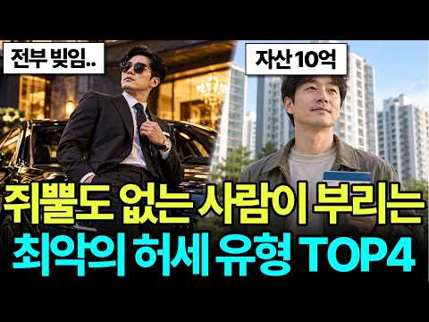
- 챕터: 0:00 차는 남자 얼굴이야, 3년 뒤 걸려 온 전화 · 0:43 첫 번째, 보이는 것부터 할부로 사는 사람 · 2:23 집들이에서 나온 한마디, 은행에 월세 내는 거랑 똑같… · 3:14 휠, 블랙박스, 범퍼 수리비까지 카드로 · 5:27 유예할부 만기, 3천5백이 최선입니다 · 6:15 3백만 빌려줄 수 있냐 · 7:09 팀장이 탄 13년 된 쏘나타 · 9:01 두 번째, 얼마 벌었는지 꼭 말하는 사람 · 11:41 따라 산 주식, 천만 원이 6백이 되기까지 · 15:16 왜 나만 빼고 만나? · 17:24 칼국수집에서 들린 소문, 그 친구가 제일 여유 있었다 · 18:35 석 달 만에 올라온 새 골프채 사진 · 19:07 세 번째, 남의 집 돈 사정을 캐묻는 사람 · 20:52 옆집 학원비가 우리 집 마이너스통장이 되기까지 · 23:05 남편 휴대폰에 뜬 은행 문자 · 26:15 경차 타던 전세 집의 반전 · 28:28 은정 씨네 새집 집들이 · 29:21 네 번째, 체면 때문에 지갑부터 여는 사람 · 33:50 아들 학원비 결제가 안 된 날, 우리가 먼저야 · 35:07 각자 내자는 말에 비어 버린 2차
- 설명 앞부분: 돈 없는 사람만 하는 최악의 행동 4가지, 네 사람의 이야기로 정리했습니다. 7천만 원짜리 수입 SUV를 할부로 뽑고 13년 된 쏘나타를 놀리던 남자는, 3년 뒤 그 친구에게 3백만 원을 빌려 달라고 전화했습니다. 얼마 벌었는지 꼭 말하던 친구, 남의 집 평수부터 캐묻던 엄마, 후배들 술값을 늘 혼자 내던 부장. 그리고 그 옆에서 아무 말 없이 살던 사람들이 실제로 어떻게 살고 있었는지까지 담았습니다. ⏱ 타임라인
- 같은 채널 평소 대비 ×1.8 (채널 최근 롱폼 중앙값 86,469회) · 평소 영상: “앞자리가 바뀌자 달라졌다” 40대 미혼 여자들이 뒤늦게 깨달은 충격적인 현실들 (86,469회) / “먹기 전에 찍어야지” 인스타에 중독된여자를 걸러야 하는 진짜 이유 (87,829회)
- 대본 없음 (설명) — 음성인식이 끝나면 도입부·흐름이 들어감
- 댓글 54/93: 좋은 점 — 영상 1 · 감사·응원 1 · 더 알고 싶은 것 0 · 아쉬운 점 — 영상 0 · 반박·불만 — 의견 다름 1 · 정치·사회 0 · 경험 공유 4 · 구독·다음 기대 0
  - 좋은 점 — 영상 👍0 “좋은 말씀 입니다 제 주위에 4번 해당하는 주인공이 있네요 서글픈 인생을 견디고있어요🎉”
  - 감사·응원 👍4 “차라리 내주고 싶으면 점심먹고 저가커피정도 사주고 시간쓰지않게하면 서로 부담도없고 충분히 감사하더군요.”
  - 반박·불만 — 의견 다름 👍0 “글세효 부동산 자산 있고 해서 부자아닙니다 소비도하고 남들에게 베풀줄 알아야 부자죠 여기는 그냥 서민중에 대기업 다니는 정도 부자구만.. 가만히 있어도 돈이 들어오고 그래서 돈도 남에게 돈을 쓸줄 사람이 부자에요..”
  - 경험 공유 👍3 “쥐뿔도 없다는말 참 내가 좋아하는말임 허세부리고 입가볍고 남 함부로 내려치면서 무시하고, 쓸데없이 다른사람의 재산 집 생활까지 캐묻는 사람까지 등등 공통적으로 하고싶은말이 쥐뿔도 없이 나댄다는거 돈잘벌고 여가생활 일 열씸히 하는 사람들은 티도 내지않고 조용히 잘지냅니다”
  - 경험 공유 👍1 “내가 본 부자 1위는 중국에서 봤는데 후진타오 옆에 앉아서 인민대표대회하고 같이 식사할때 왕푸징 한 복판에 나라에서 받은 기사있는 아우디 A8 세워도 아무도 뭐라 안하고 밥 먹을때 옆에 무도학원 출신 첩이 있는데 진짜 세상에서 본 사람 중 제일 예뻤음 그 분 당시 회…”

### 107. 연금 310만 원을 말한 뒤 40년 계모임이 깨졌습니다… 노후에 말하면 안 되는 4가지

- https://www.youtube.com/watch?v=vU5PWT2zLDs · 노년의 마음소리 · 구독자 34,200 · 조회수 1,272,985 (×37.2, 하루 23,132.4) · 좋아요 8,997 (0.7%) · 29분 · 2026-09-03 · 주제 묶음 4. 노후·연금 · 형식 정보·해설 (그 밖) · 폴더 `W_vU5PWT2zLDs` (웹 승인)
- 썸네일: 
- 설명 앞부분: 친한 사이일수록 절대 입 밖으로 꺼내지 마세요… 73세 노인이 뼈저리게 후회한 4가지
- 같은 채널 평소 대비 ×12.4 (채널 최근 롱폼 중앙값 102,852회) · 평소 영상: 통장에 돈이 많아도 평생 '가난한 척' 해야 합니다｜79세 노인의 7가지 이유 (110,073회) / 72세에 45년 친구에게 잘린 뒤 알았습니다｜노년에 곁에 둘 사람은 3가지만 보면 됩니다 (95,630회)
- 대본 (음성인식(앞 5분), 5.2 음절/초) — 앞부분만, 흐름은 그 안까지 첫 20초: “김장김치 두통을 싸들고 50년 지기 명자네 아파트에 갔습니다. 그런데 문을 연건 처음 보는 젊은 여자였습니다. 명자네는 3년 전에 이사를 갔다더군요. 3년입니다. 저만 몰랐던거죠. 그 주움 목요일 하첨벤치에서 따져물었습니다. 어떻게 나한테까지 숨기니? 명자가 한참 만에 입을 열었습니다.” — 도입부 유형: 숫자로 시작
- 첫 1분: “김장김치 두통을 싸들고 50년 지기 명자네 아파트에 갔습니다. 그런데 문을 연건 처음 보는 젊은 여자였습니다. 명자네는 3년 전에 이사를 갔다더군요. 3년입니다. 저만 몰랐던거죠. 그 주움 목요일 하첨벤치에서 따져물었습니다. 어떻게 나한테까지 숨기니? 명자가 한참 만에 입을 열었습니다. 정수가 너한테까지 말했으면 나는 어디서 웃니? 저는 그 말을 못 알아들었습니다. 알아듣는데 꼬박한 계절이 걸렸죠. 저는 올해 73땐 이정숙이라고 합니다. 경기도의 한 소도시에서 시장 반창 가게를 하다가 접은 지 8년됐습니다. 오늘은 제가 입을 잘못 놀려서 잃은 건 내 타고 명자가 입을 다물어서 지켜낸 것 하나 그렇게 5가지 이야기를 하려고 합니다. 내 째 것은 제 흉이라 지금도 입이 잘 안 떨어집니다만 도망 안 가고 꺼내놓겠”
- 흐름 (90초마다 첫 문장): 0:00 김장김치 두통을 싸들고 50년 지기 명자네 아파트에 갔습니다. → 1:30 아들 진우대학까지 보냈으니 → 3:01 아침마당에 나온 의사 얘기 시식걸렁한 얘기만 골라하는데도 → 4:31 그리고 그 뒤로 아주 여러 번 보게 됐죠.
- 댓글 771/792: 좋은 점 — 영상 38 · 감사·응원 41 · 더 알고 싶은 것 4 · 아쉬운 점 — 영상 4 · 반박·불만 — 의견 다름 31 · 정치·사회 0 · 경험 공유 82 · 구독·다음 기대 0
  - 좋은 점 — 영상 👍105 “그 명자라는 친구분 같은 사람이 그냥 평범히 잘 살아야 하는데.. 참으로 인생이 그렇네요.. ㅉㅉㅉ 나도 많이 배웠습니다. 고맙습니다.”
  - 좋은 점 — 영상 👍101 “좋은말씀 감사합니다 돈 이야기는 말안하는게 답인것 같습니다 친한 사람일수록 더그러합니다 그리고 말조심 입조심 잘 챙겨야 할것 같네요”
  - 감사·응원 👍172 “많은 생각을 하게 하는 글이 고맙습니다! 많이 반성하고 배우겠습니다.”
  - 감사·응원 👍105 “그 명자라는 친구분 같은 사람이 그냥 평범히 잘 살아야 하는데.. 참으로 인생이 그렇네요.. ㅉㅉㅉ 나도 많이 배웠습니다. 고맙습니다.”
  - 더 알고 싶은 것 👍1 “공감 가는 부분도 있고 안가는 부분도 있네요. 전 사실 또래에 비해 제테크를 잘해서 노후 준비도 다 되어있고 현재 삶도 여유 있는 50대 중반 부부입니다. 친구 사이에 이런저런 얘기 다 거르면 언제 맘 터놓는 가까운 사이가 될까요? 명자랑분은 좋은 분이지만 제 가까운…”
  - 더 알고 싶은 것 👍0 “그럼 친구들이나 모임에선 어떤말을해야할까요?”
  - 아쉬운 점 — 영상 👍0 “나이50만 넘어도 자식 건강 재산 왜그리도 질투시기가 강한지..희망이 없는나이다 보니 이해는하지만 20년가까이 알던사람들의 속좁은 본성을 본것같아 실망스럽더라 나도 자랑거리 하나없지만 어쩌다 한번 자랑하는사람은 축하해줍니다 꼬는것없이 그래야 같이 복이 들어올것같아”
  - 아쉬운 점 — 영상 👍0 “왜 자막이 두개나와 짜증나 못보겠네요”
  - 반박·불만 — 의견 다름 👍164 “아무 말도 안할거면 친구를 왜만나나 서로 흠도 나누고 자랑도 나눠야 친구지”
  - 반박·불만 — 의견 다름 👍89 “난 이영상 공감할수읍어. 누군가에게 뭘 물었을때 먹고살만해. 그저그래. 두리뭉실 대답할때 난 무시당한다는 기분들었어.그래서 난 누가 물으면 구체적은 아니어도 성심껏 대답해. 나라면 연금 310에서 깍아서 120정도 받는다고 차라리 얘기했을거야. 그리고 자기신랑 파킨슨…”
  - 경험 공유 👍826 “친구가 부자 됐다고 그 친구에게 내가 거리 느끼고 시기하고 질투하면 나는 그 사람 친구될 자격 없는겁니다.”
  - 경험 공유 👍216 “연금 액수보다 더 무서운 건, 가까운 사람들 사이에서 돈 이야기가 관계를 바꿔버리는 순간인 것 같습니다. 노후에는 무엇을 말하고 무엇을 숨겨야 하는지 정말 신중해야겠네요. 영상 보면서 저도 많이 생각하게 됐습니다.”

### 108. 예비 며느리 시험하려 청소부로 변장한 재벌회장, 일부러 커피 쏟았는데 그녀의 행동에 말문이 막혔습니다 ∣ 인생사연 ∣ 노후사연 ∣ 감동사연 ∣ 시니어사연 ∣

- https://www.youtube.com/watch?v=PX-qc9FOViA · 인생유랑 · 구독자 21,200 · 조회수 964,624 (×45.5, 하루 14,222.4) · 좋아요 11,899 (1.2%) · 96.3분 · 2026-08-16 · 주제 묶음 4. 노후·연금 · 형식 사연·드라마 · 폴더 `W_PX-qc9FOViA` (웹 승인)
- 썸네일: 
- 설명 앞부분: 예비며느리를 시험하려고 청소부로 변장한 회장님은 오히려 그녀의 인품에 완전히 반해버리는데...ㅣ노후사연ㅣ인생사연ㅣ감동사연ㅣ시니어사연ㅣ오디오북 ☕ 아들이 선택한 사람은 화려한 배경도, 대단한 학벌도 없는 고졸 계약직 직원이었습니다. 못마땅했던 재벌회장은 직접 청소부로 변장해 그녀의 진짜 모습을 확인하기로 합니다. 그리고 일부러 벌어진 작은 사고 하나. 그런데 예상과 전혀 다른 그녀의 행동에 회장은 순간 아무 말도 하지 못하는데… 😳 사람의 진짜 가치는 어디에서 드러나는 걸까요?
- 같은 채널 평소 대비 ×177.0 (채널 최근 롱폼 중앙값 5,450회) · 평소 영상: 상견례에서 이혼한 친정엄마를 대놓고 무시한 예비시모, 잠시 뒤 엄마의 한마디에 표정이 굳… (5,523회) / 잃어버린 지갑을 찾으려 경찰서로 간 재벌회장, 그곳에서 지갑을 주어 준 가난한 미혼모와 … (5,378회)
- 대본 (음성인식(앞 5분), 4.5 음절/초) — 앞부분만, 흐름은 그 안까지 첫 20초: “미안해요 젊으니 내가 눈이 어두워서 괜찮아요 어르신 제 옷은 빨면 돼요 일단 이것부터 대고 계세요 찬물 묻힌 휴지예요 방금 내린 커피가 흰 블라우스를 적시는 순간에도 계약직 사원 지수는 늙은 청소부의 손부터 걱정했습니다”
- 첫 1분: “미안해요 젊으니 내가 눈이 어두워서 괜찮아요 어르신 제 옷은 빨면 돼요 일단 이것부터 대고 계세요 찬물 묻힌 휴지예요 방금 내린 커피가 흰 블라우스를 적시는 순간에도 계약직 사원 지수는 늙은 청소부의 손부터 걱정했습니다 그녀는 꿈에도 몰랐을 겁니다 이 초라한 청소부가 사실은 자신이 다니고 있는 회사의 회장이라는 것도 장차 제 시아버지가 될 사람이라는 것도 그리고 지금 이 순간이 자신의 인생을 뒤흔들 시험이라는 사실조차요 만약 이 모든 사실을 알았다면 그녀의 행동이 달라졌을까요? 사연 시작 전에 구독과 좋아요 눌러주시고 댓글로 오늘 마음 날씨를 들려주세요 지수에게 커피를 쏘는 건 우연이 아니었죠 그녀를 시험하고 싶었습니다 왜냐고요? 바로 이틀 전에 일입니다”
- 흐름 (90초마다 첫 문장): 0:01 미안해요 젊으니 내가 눈이 어두워서 → 1:30 대선그룹 후계자의 입에서 나올 이름이 → 3:04 다음 주 월요일 아침이었습니다 → 4:31 저는 커다란 청소 카트를 양손으로 밀며 뒤를 따랐습니다
- 댓글 294/365: 좋은 점 — 영상 5 · 감사·응원 39 · 더 알고 싶은 것 2 · 아쉬운 점 — 영상 4 · 반박·불만 — 의견 다름 2 · 정치·사회 0 · 경험 공유 2 · 구독·다음 기대 1
  - 좋은 점 — 영상 👍27 “감사합니다 .좋은이야기 잘들었습니다”
  - 좋은 점 — 영상 👍20 “너무좋은내용 감사합니다”
  - 감사·응원 👍32 “감동입니다 지금 살아가는것이 바다위에서. 조각배타고 폭퐁우를 헤치고 가는것 처럼 끔찍하지만 멋진 해가 뜰것을 믿고 이겨 나가겠습니다 감사합니다”
  - 감사·응원 👍31 “회사에서 듣고 있습니다 감사합니다~❤❤❤”
  - 더 알고 싶은 것 👍4 “좋은 글을 올려 주셔서 정말 감사합니다 앞으로도 유익한 글 많이 올려주세요 감사합니다”
  - 더 알고 싶은 것 👍0 “첫째 도준이는 은영이와 연인이었고 사고때 배속 아이사진 있었는데 은영이와 아이 소식은 어떻게 되나요? 준우 인줄 알았는데 7년전이고 나이도 같고”
  - 아쉬운 점 — 영상 👍3 “감동이네요. 근데 내용이 너무길어요 ㆍ암튼 잘보았습니다”
  - 아쉬운 점 — 영상 👍2 “너무길어요 얘기듣고있는대 너무길어서 지루하내요 간단하게 짦게 해야지 ㅡㅡ”
  - 반박·불만 — 의견 다름 👍4 “여자든ㆍ남자든 초등학교만 졸업해도 됩니다. 한글 쓰고 읽는것만, 하면됩니다. 그리고, 사칙연산 만으로도 충분 합니다. 물론, 해외 유학파도 좋지만, 집안 사정이 어려워서 공부를 접은 사람들도 있어요. 그런 사람들은 멍청해서 대학 진학을 못한것이 아닙니다. 못 배워도 …”
  - 반박·불만 — 의견 다름 👍0 “뜨거운 커피갸 아니까요 웃기는짜뽕이네”
  - 경험 공유 👍1 “경상남도 진주시 지수면 우리 집 에서 보고있어요 😂😂😂😂😂😂😂😂❤❤❤❤🎉🎉🎉🎉”
  - 경험 공유 👍0 “듣고 되는 그 의식의 이해에는 실은 아무것도 없어요.교육을 가득 받았다해봤자 정부의 방정식에 꽉 찝혀서 전혀 다르게 생활하죠.그만합시다 이거 차이니즈나 지어내는 이야기.송씨 손씨 두놈새끼”
  - 구독·다음 기대 👍1 “너무 감동입니다. 다 엮어낸 이야기지만 너무 감동입니다. 구독했습니다. 늘 발전을 기원드립니다.”

### 109. 팩트 체크 ! 연금, 금융소득 있을 때 진짜 받는 돈, 현실 총정리!

- https://www.youtube.com/watch?v=Lk0CkUkrevY · 리클래스 · 구독자 3,710 · 조회수 38,677 (×10.4, 하루 2,397.0) · 좋아요 101 (0.3%) · 11.6분 · 2026-10-12 · 주제 묶음 4. 노후·연금 · 형식 정보·해설 (그 밖) · 폴더 `W_Lk0CkUkrevY` (웹 승인)
- 썸네일: 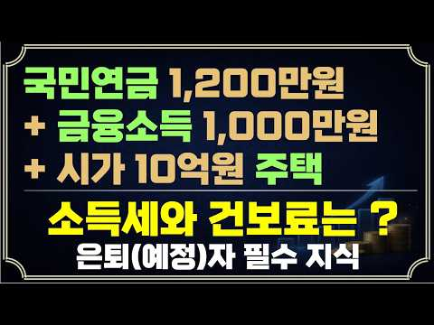
- 설명 앞부분: 행복한 은퇴를 꿈꾸지만, 은퇴 후 날아올 세금과 건강보험료 고지서 때문에 걱정이 많으시죠? "은퇴하고 내 집 한 채 있으면 건보료 폭탄 맞는다", "연금 받으면 소득세 많이 낸다" 등 카더라 소문은 많지만 도대체 내가 정확히 얼마를 내야 하는지 답답하셨을 겁니다. 은퇴 후 연금소득(국민연금, 공무원연금 등)과 금융소득(이자, 배당금)이 있을 때 소득세와 건강보험료는 과연 얼마나 나올까요? 집을 보유하고 있다면 정말 폭탄 수준일까요? 그 궁금증을 오늘 영상으로 깔끔하게 풀어드립니다! 공적연금소득과 금융소득, 그리고 보유 주택(재산)…
- 같은 채널 평소 대비 ×15.4 (채널 최근 롱폼 중앙값 2,518회) · 평소 영상: 은퇴하면 건강보험료 폭탄? 팩트체크부터 건보료 줄이는 절감 꿀팁까지 총정리! (3,000회) / 절세 3총사 계좌(연금저축, IRP, ISA), 아직도 아무 ETF나 담고 계신가요? (2,035회)
- 대본 없음 (설명) — 음성인식이 끝나면 도입부·흐름이 들어감
- 댓글 11/11: 좋은 점 — 영상 0 · 감사·응원 3 · 더 알고 싶은 것 2 · 아쉬운 점 — 영상 0 · 반박·불만 — 의견 다름 0 · 정치·사회 0 · 경험 공유 2 · 구독·다음 기대 0
  - 감사·응원 👍1 “동영상 감사히 잘보고있습니다.. 다주택(3주택)일 경우 건보료 계산하는 예시도 볼수있을까요? 은퇴가 몇달후라서요 ㅠ”
  - 더 알고 싶은 것 👍1 “동영상 감사히 잘보고있습니다.. 다주택(3주택)일 경우 건보료 계산하는 예시도 볼수있을까요? 은퇴가 몇달후라서요 ㅠ”
  - 더 알고 싶은 것 👍0 “안녕하세요 매번 잘 챙겨보는 구독자 입니다 저는 소득세를 대략 얼마나 내게 될까요 궁금해서 여쭈어 봅니다 연금 소득 3600 근로 소득 2640 임대 소득 2600 이 있습니다 대략적인것만부탁드리고 대략알고 이후 표ㅡ구입하여 하겠습니다 저도 아직 퇴직 전이라 그렇습니…”
  - 경험 공유 👍1 “지역가입자는 금융소득 1천만 원 넘는 순간 전체가 건보료에 잡힌다니, 저도 배당 받을 때 그 선부터 봐야겠어요.”
  - 경험 공유 👍0 “안녕하세요 매번 잘 챙겨보는 구독자 입니다 저는 소득세를 대략 얼마나 내게 될까요 궁금해서 여쭈어 봅니다 연금 소득 3600 근로 소득 2640 임대 소득 2600 이 있습니다 대략적인것만부탁드리고 대략알고 이후 표ㅡ구입하여 하겠습니다 저도 아직 퇴직 전이라 그렇습니…”

### 110. "중장기 투자? 삼전닉스 말고 스페이스X 모으세요” (정의훈 선임연구원)

- https://www.youtube.com/watch?v=bMR3jvlYDgo · 투자360 · 구독자 16,200 · 조회수 104,223 (×6.4, 하루 10,428.8) · 좋아요 531 (0.5%) · 16분 · 2026-10-13 · 주제 묶음 3. 주식·ETF · 형식 정보·해설 (그 밖) · 폴더 `W_bMR3jvlYDgo` (웹 승인)
- 썸네일: 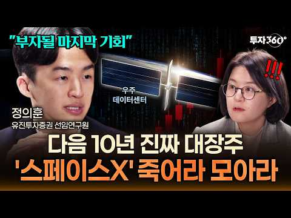
- 챕터: 0:00 🔥 하이라이트 · 0:58 🚀 스페이스X 70% 급등, 무슨 일이 있었나 · 3:52 ⚠️ 삼성전자·하이닉스 중장기 투자를 반대하는 이유! · 4:29 💰 70% 오른 스페이스X 개별주 살까? ETF 살까? · 5:59 💰 🌌 우주 데이터센터, 드디어 돈이 되나? · 8:29 📊 스페이스X, 꼭 봐야 할 4가지 지표 · 11:17 🚨 어떤 신호가 나오면 투자를 멈춰야 하나 · 12:55 🔥 스타십·스타링크·AI, 다음 성장동력은? · 14:15 🎯 지금 주가는 고점? “아직 다 반영 안 됐다”
- 설명 앞부분: "삼전닉스 장투 추천 안 합니다. 잘 모르겠으면 스페이스X 사세요” 저점 대비 약 70% 반등한 스페이스X. 지금 들어가기엔 이미 늦은 걸까요? 정의훈 유진투자증권 연구원과 최근 주가 급등 이유부터 특히 현재 주가에 향후 성장 기대가 얼마나 반영됐는지, 어떤 신호가 나오면 투자를 다시 점검해야 하는지도 확인합니다. 🎥촬영일: 2026년 10월 6일 ⏱️ 골라 보는 핵심 투자 포인트
- 같은 채널 평소 대비 ×3.0 (채널 최근 롱폼 중앙값 34,198회) · 평소 영상: “지금까지 금투자 방법 다 틀렸습니다” 금 투자, 개미는 ‘이렇게’ 사야 돈 법니다 ∣ … (34,198회) / 환율 내린 지금이 기회! 삼전닉스 팔아서 현금 '여기로' 옮기세요 #부자탐사대 #효라클 … (38,452회)
- 대본 없음 (설명) — 음성인식이 끝나면 도입부·흐름이 들어감
- 댓글 59/64: 좋은 점 — 영상 0 · 감사·응원 0 · 더 알고 싶은 것 0 · 아쉬운 점 — 영상 0 · 반박·불만 — 의견 다름 1 · 정치·사회 4 · 경험 공유 0 · 구독·다음 기대 0
  - 반박·불만 — 의견 다름 👍3 “헛소리말고 지수투자나 해라...”
  - 정치·사회 👍4 “공화당이 중간선거 이기면 스페이스x대상승각이다”
  - 정치·사회 👍4 “스페이스X는 중간선거 이후 사는 게 맞지 않나요? 질문 한번 해주세요~”

### 111. 남들이 걱정하는 삶을 선택했습니다 #배당투자 #배당은퇴 #경제적자유 #파이어족 #월배당 #고배당주 #주식투자 #재테크#노후준비#배당금생활 #SCHD #JEPI …

- https://www.youtube.com/watch?v=SiE0NjI7Fu0 · ttobaedang또배당 · 구독자 6,950 · 조회수 59,955 (×8.6, 하루 4,260.6) · 좋아요 473 (0.8%) · 9.1분 · 2026-10-14 · 주제 묶음 1. 재테크 일반·마인드 · 형식 정보·해설 (그 밖) · 폴더 `W_SiE0NjI7Fu0` (웹 승인)
- 썸네일: 
- 같은 채널 평소 대비 ×6.1 (채널 최근 롱폼 중앙값 9,808회) · 평소 영상: 백수가 9000 증발에도 일하지 않는이유 #배당투자 #배당은퇴 #경제적자유 #파이어족 #… (10,820회) / 5000만원 증발 월급없이도 행복한이유 #배당투자 #배당은퇴 #경제적자유 #파이어족 #월… (8,796회)
- 대본 없음 (없음) — 음성인식이 끝나면 도입부·흐름이 들어감
- 댓글 155/186: 좋은 점 — 영상 3 · 감사·응원 18 · 더 알고 싶은 것 5 · 아쉬운 점 — 영상 0 · 반박·불만 — 의견 다름 0 · 정치·사회 0 · 경험 공유 9 · 구독·다음 기대 2
  - 좋은 점 — 영상 👍4 “진정성이 느껴지고 서민형이라 와닿는 영상이라 보면서 위로를 받게 되네요. 좋은 영상 자주 올려주세요. 😊❤”
  - 좋은 점 — 영상 👍1 “울림이 있는 story, 공감이 되고 배우고 갑니다~”
  - 감사·응원 👍21 “당신의 직업은 투자자, 유튜버^^ 늘 응원하겠습니다”
  - 감사·응원 👍6 “현대는 직업이 필요가 없어졌습니다. 단지 생활비를 충당할 수 있는 근원지 배당금, 이자, 월세소득 등 원천을 만드는 것이 중요하죠. 또배당금님은 현재 잘 하고 계신거예요. 직장이 없어도 배당금으로 자유롭게 생활하실 수 있는것이 얼마나 대단한것인지 높이 평가해요. 질투…”
  - 더 알고 싶은 것 👍4 “진정성이 느껴지고 서민형이라 와닿는 영상이라 보면서 위로를 받게 되네요. 좋은 영상 자주 올려주세요. 😊❤”
  - 더 알고 싶은 것 👍3 “안녕하십니까 또배당님! 금일 영상은 원고가 매우 훌륭하고 좋습니다 감동적입니다 자신의선택과 책임을 말씀하는 철학은 울림이 있습니다, 다음에 기회가되면 제가 운영하고 있는 다음카페에 칼럼기고를 부탁드려도 될까요”
  - 경험 공유 👍8 “나도 도배당아저씨처럼 할수있다는 희망으로 삽니다”
  - 경험 공유 👍6 “세상을 보는 안목과 생각이 깊고 넓으시군요. 저도 공감되는 말씀입니다.”
  - 구독·다음 기대 👍1 “호동대표님 유튜브보고 구독하러왔어요 자주영상 올려주세요😊 세미파이어족 화이팅!!”

### 112. 평생 모은 돈, 노후에는 이 3가지에 먼저 쓰세요

- https://www.youtube.com/watch?v=_H2oRoXuF-Q · 인생다시쓰기 · 구독자 8,400 · 조회수 145,529 (×17.3, 하루 5,118.3) · 좋아요 514 (0.4%) · 16.4분 · 2026-09-23 · 주제 묶음 4. 노후·연금 · 형식 오디오북·낭독 (명언·인생조언) · 폴더 `W__H2oRoXuF-Q` (웹 승인)
- 썸네일: 
- 챕터: 0:00 돈이 있어도 가난해지는 노후 · 1:16 첫 번째, 80세에도 혼자 살 수 있는 집 · 4:34 두 번째, 귀가 멀어지면 사람도 멀어진다 · 7:44 세 번째, 자동차보다 중요한 이동의 자유 · 10:31 돈을 아끼면 자식이 시간을 쓰게 됩니다 · 14:36 노후에 돈으로 정말 사야 하는 것
- 설명 앞부분: 나이 들어 돈이 있어도 가난하게 느껴지는 노후가 있습니다. 돈보다 중요한 독립적인 노후 준비를 위해 지금 당장 시작해야 할 3가지를 정리했습니다. 영상에서는 단순히 재산의 많고 적음을 떠나, 실제로 어떻게 살아가느냐에 따라 갈리는 삶의 풍경을 다룹니다. 통장에 돈이 있어도 활동 반경이 좁아지면 결국 가난한 노후 생활을 보내게 되기 때문입니다. 반대로 적은 돈으로도 시장에 가고 친구를 만나며 활기차게 지내는 분들도 있습니다. 결국 중요한 것은 돈을 어떻게 쓰느냐입니다. 건강하게 움직이고 사람들과 어울릴 수 있는 환경을 만드는 것이야…
- 같은 채널 평소 대비 ×13.2 (채널 최근 롱폼 중앙값 11,020회) · 평소 영상: 한 살이라도 어릴 때 알았으면 좋았을 것들, 60대가 되어서야 보였습니다 (11,020회) / 나이 들수록 사람이 추해 보이는 진짜 이유, 주름 때문이 아닙니다 (10,780회)
- 대본 (음성인식(앞 5분), 4.9 음절/초) — 앞부분만, 흐름은 그 안까지 첫 20초: “노후에는 돈이 있어도 가난하게 살 수 있습니다. 통장에는 돈이 있고 집도 있는데 갈 수 있는 곳은 줄어들고 사람들과 나누는 대화는 점점 어려워지고 집 안에서도 조심해야 할 것이 하나씩 늘어납니다. 분명 재산은 그대로인데 생활은 점점 좁아지는 겁니다.”
- 첫 1분: “노후에는 돈이 있어도 가난하게 살 수 있습니다. 통장에는 돈이 있고 집도 있는데 갈 수 있는 곳은 줄어들고 사람들과 나누는 대화는 점점 어려워지고 집 안에서도 조심해야 할 것이 하나씩 늘어납니다. 분명 재산은 그대로인데 생활은 점점 좁아지는 겁니다. 반대로 큰 부자는 아닌데도 70대, 80대까지 혼자 병원에 가고 장을 보고 친구를 만나고 자기 집에서 자기 방식대로 살아가는 사람도 있습니다. 무엇이 다른 걸까요? 단순히 돈의 액수만으로는 설명되지 않습니다. 오히려 돈을 어디에 먼저 썼느냐에서 차이가 벌어질 수 있습니다. 젊을 때는 걸어 다니는 것도 사람의 말을 듣는 것도 혼자 씻는 것도 당연했습니다. 이런 일에 돈이 든다고 생각하지 않았습니다. 하지만 나이가 들면 그 당연했던 능력들의 하나씩 가격표가 푹기 시”
- 흐름 (90초마다 첫 문장): 0:01 노후에는 돈이 있어도 가난하게 살 수 있습니다. → 1:30 그동안 집값도 많이 올랐습니다. → 3:02 욕실에 들어가는 것이 겁나고 계단을 피하게 되고 혼자 외출하는 것도 부… → 4:32 이 질문이 더 중요해집니다.
- 댓글 12/12: 좋은 점 — 영상 2 · 감사·응원 1 · 더 알고 싶은 것 0 · 아쉬운 점 — 영상 0 · 반박·불만 — 의견 다름 0 · 정치·사회 0 · 경험 공유 1 · 구독·다음 기대 0
  - 좋은 점 — 영상 👍6 “맞는말씀이세요! 공감합니다! 안전손잡이 화장실 미끄럼방지매트 중요합니다. 좋은영상감사합니다! 좋아요 누르고 성우님 읽어주셔서 잘듣고갑니다! 인생다시쓰기 채널님 감사합니다!”
  - 좋은 점 — 영상 👍0 “귀가 잘 안 들리면 대화가 힘든데 진짜 공감되네요.”
  - 감사·응원 👍6 “맞는말씀이세요! 공감합니다! 안전손잡이 화장실 미끄럼방지매트 중요합니다. 좋은영상감사합니다! 좋아요 누르고 성우님 읽어주셔서 잘듣고갑니다! 인생다시쓰기 채널님 감사합니다!”
  - 경험 공유 👍8 “건강을 잘 지켜서 5년만 버티면 내가 운전할 필요없이 차가 알아서 가는 세상이 되지 않을까요”

### 113. 금값, 이제 시작입니다. 이것 때문에 금이 폭등합니다.

- https://www.youtube.com/watch?v=1eQJLsk4Fm8 · 지금 돈 공부 · 구독자 739 · 조회수 23,844 (×32.3, 하루 434.4) · 좋아요 397 (1.7%) · 18.8분 · 2026-09-03 · 주제 묶음 기타 · 형식 정보·해설 (그 밖) · 폴더 `W_1eQJLsk4Fm8` (웹 승인)
- 썸네일: 
- 챕터: 0:00 끝난 줄 알았던 금, 다시 움직인다 · 0:59 ① 금리가 오르는데 금도 오른다? · 2:15 ② 미국 국채에 무슨 일이 생긴 걸까 · 3:58 ③ 중앙은행들은 왜 금을 사고 있을까 · 6:31 ④ 중국은 왜 이렇게까지 금을 모을까 · 8:48 ⑤ 중국이 걱정하는 건 금값이 아니라 달러 · 10:33 ⑥ 그렇다고 달러가 망한다는 얘기는 아니다 · 11:34 ⑦ 금은 다시 전고점을 뚫을까 · 13:29 ⑧ 금 38,000달러, 가능할까 · 15:02 ⑨ 그래서 개인투자자는 어떻게 해야 할까 · 16:49 마무리 — 가격보다 중요한 것
- 설명 앞부분: 금만 사면 위험합니다. 금은 '흔들림을 막는 한 칸'일 뿐, 나머지 3칸을 채워야 끝까지 버팁니다. 금값이 크게 빠졌다가 다시 반등하고 있습니다. 이번 반등이 잠깐 오르고 마는 희망고문일까요, 아니면 전고점을 뚫는 진짜 상승의 시작일까요? 지금 금 시장에서는 우리가 알던 공식이 깨지고 있습니다. 금리가 오르면 금은 떨어져야 하는데, 국채금리가 오르는데도 금이 같이 오르고요. 세계 중앙은행들은 금을 쓸어 담고 있고, 금에 무관심하던 한국은행마저 13년 만에 다시 금을 사기 시작했습니다. 이 흐름을 하나씩 따라가면 결국 한 곳에서 만…
- 같은 채널 평소 대비 ×56.4 (채널 최근 롱폼 중앙값 423회) · 평소 영상: 부자들의 삶은 지루하고 단순합니다. 단순하게 살아서 부자가 된 겁니다. (423회) / 주식투자 실패한 99%의 한결같은 공통점 (415회)
- 대본 (음성인식(앞 5분), 6.2 음절/초) — 앞부분만, 흐름은 그 안까지 첫 20초: “금값이 크게 빠졌다가 최근에 다시 반등하고 있습니다 이번 반등이 잠깐 올랐다가 다시 꺾이는 희망 고문으로 끝날까요? 아니면 정보점을 뚫고 올라가는 진짜 상승의 시작일까요? 지금 금시장에서는 우리가 알던 공식으로는 설명이 잘 안 되는 일들이 벌어지고 있어요 원래 같으면 금값이 떨어져야 하는 상황인데 오히려 오르고 있고요” — 도입부 유형: 질문으로 시작
- 첫 1분: “금값이 크게 빠졌다가 최근에 다시 반등하고 있습니다 이번 반등이 잠깐 올랐다가 다시 꺾이는 희망 고문으로 끝날까요? 아니면 정보점을 뚫고 올라가는 진짜 상승의 시작일까요? 지금 금시장에서는 우리가 알던 공식으로는 설명이 잘 안 되는 일들이 벌어지고 있어요 원래 같으면 금값이 떨어져야 하는 상황인데 오히려 오르고 있고요 세계 중앙은행들이 금 보위량을 크게 늘리고 있는데 그중에서도 중국의 움직임이 심상치 않습니다 그동안 금에 별로 관심이 없던 우리나라에서도 이제 금을 모아야 하는 거 아니냐 하는 이야기가 나오기 시작했고요 도대체 왜 다들 이렇게 금을 사려고 하는 걸까? 그랬더니 결국 한 곳에서 만나더라고요 바로 미국 국제와 달러입니다 그래서 오늘은 금이 전구점을 다시 넘어갈 수 있을지 지금 중앙은행과 중국이 왜”
- 흐름 (90초마다 첫 문장): 0:00 금값이 크게 빠졌다가 최근에 다시 반등하고 있습니다 → 1:30 반대로 금리가 떨어져서 국제를 사도 이자가 별로 없으면 → 3:00 사실 여기까지 왔다는 것 자체가 심상치 않은 신호예요 → 4:33 미국 국체가 약 22%인데
- 댓글 35/35: 좋은 점 — 영상 0 · 감사·응원 1 · 더 알고 싶은 것 1 · 아쉬운 점 — 영상 1 · 반박·불만 — 의견 다름 1 · 정치·사회 0 · 경험 공유 2 · 구독·다음 기대 0
  - 감사·응원 👍2 “감사합니다”
  - 더 알고 싶은 것 👍2 “언제 팔까요?수익20프로 봤어요. 팔까요?”
  - 반박·불만 — 의견 다름 👍2 “글쎄요!!!!!.... 어제,오늘.....계속 내려가는데...!!!!!!!!!!😢😢😢”
  - 경험 공유 👍1 “에헤! 금값못올라요. 내가90 만원돈당주고 엇그제샀는데요 40 만원에 샀던게 있어서 그중간값 알고. 쬐끔씩. 던져주고받고 계속하는데ㅡ 금 계속 떤어질거예요.”

### 114. "큰 돈 안들이고 평생 즐긴다" 퇴직 후 비참한 노후를 피하는 취미 3가지 I 교수 정선용 (3부)

- https://www.youtube.com/watch?v=IQd8juHSTuw · 퇴평성대 · 구독자 24,800 · 조회수 830,784 (×33.5, 하루 14,570.1) · 좋아요 3,269 (0.4%) · 12.3분 · 2026-09-01 · 주제 묶음 4. 노후·연금 · 형식 인터뷰·강연·대담 · 폴더 `W_IQd8juHSTuw` (웹 승인)
- 썸네일: 
- 설명 앞부분: 🎁 달리고 읽고 쓰는 사람의 하이, 정선용 진솔하게 자신의 경험을 나눠주신 선생님께 감사의 말씀을 드립니다. 선생님의 경험과 지식이 많은 분들에게 도움이 되었으면 좋겠습니다.
- 같은 채널 평소 대비 ×91.4 (채널 최근 롱폼 중앙값 9,090회) · 평소 영상: 대기업 임원 출신도 100% 후회하는 '퇴직 후 최악의 행동' 3가지 I 교수 정선용 (… (9,299회) / "결국엔 이곳으로 다 돌아옵니다" 퇴직 후 서울 떠난 50대가 깨달은 노후 주거지의 비밀… (8,880회)
- 대본 (음성인식(앞 5분), 5.9 음절/초) — 앞부분만, 흐름은 그 안까지 첫 20초: “왜냐하면 퇴직 후에 사람을 흔드는 건 돈뿐만이 아니었습니다. 퇴직 후에 가장 무서운 건 오늘과 내일이 똑같아지는 겁니다. 그래서 퇴직 후에 취미는 시간을 때우는 것이라고 생각하시면 안 됩니다. 내 삶을 무너지지 않게 해주는 붙잡아주는 취미가 바로 좋은 취미입니다.”
- 첫 1분: “왜냐하면 퇴직 후에 사람을 흔드는 건 돈뿐만이 아니었습니다. 퇴직 후에 가장 무서운 건 오늘과 내일이 똑같아지는 겁니다. 그래서 퇴직 후에 취미는 시간을 때우는 것이라고 생각하시면 안 됩니다. 내 삶을 무너지지 않게 해주는 붙잡아주는 취미가 바로 좋은 취미입니다. 오늘 퇴직 하실 분이라면 한 번쯤 꼭 고민해 보셨을 주제를 얘기해 보겠습니다. 그래서 퇴직 후에 제가 가장 추천한 취미 3가지입니다. 취미가 관련된 얘기만 많은 분들이 아마 툴 직전에 이렇게 생각합니다. 퇴직하면 시간이 많으니까 뭐든 하겠지. 그동안에 못 해본 것도 배우면 되지. 여다가 쉬면서 천천히 살면 되겠지. 그런데 막 툴 직하고 나서 보니까요. 취미가 생각보다 훨씬 더 중요하다는 것처럼 깨닫게 됐습니다. 왜냐하면 퇴직 후에 사람을 흔드는 건”
- 흐름 (90초마다 첫 문장): 0:00 왜냐하면 퇴직 후에 사람을 흔드는 건 돈뿐만이 아니었습니다. → 1:33 그리고 또 이렇게 심심하면서 또 그런 생각도 한두 가지가 뭐냐면 → 3:00 바깥활동을 하지도 않잖아요. → 4:30 세 번째는 노을을 버티는 가장 현실적인 기반이 되기 때문이기 때문입니다.
- 댓글 192/230: 좋은 점 — 영상 21 · 감사·응원 15 · 더 알고 싶은 것 3 · 아쉬운 점 — 영상 6 · 반박·불만 — 의견 다름 1 · 정치·사회 0 · 경험 공유 13 · 구독·다음 기대 0
  - 좋은 점 — 영상 👍66 “몸을 움직이야 한다는 말씀이 가장 가슴에 와닿네요”
  - 좋은 점 — 영상 👍16 “5년전 퇴직한 56세 남. 저는 매일아침 8시 수영으로 하루를 시작합니다. 수 금요일 테니스치고 골프는 해외로나가 여행겸 치고있습니다. 매일 같은시간에 일어나 배우자와 함께 수영하고 샤워하고 하루를 시작합니다. 하루 운동 루틴이 있다는게 건강이나 멘탈, 또 가벼운 동…”
  - 감사·응원 👍39 “왜 심심하죠!저는60인데 혼자 하루를 보내는데 하루가 너무 잘가요. 새벽에 기도하기. 오전에 수영갔다오기 매일 책 50페이지 이상 읽기. 집안일하기. 화초 키우기. 가끔 친구들 만나기. 공원둘레길 걷기. 숲속길 걸으면서 나의 하루에 감사하기.”
  - 감사·응원 👍16 “고마운 말씀 감사합니다 막막했는데 참고삼아 노력하겠습니다.. 다 된다면 1 2 3 다될수있음 좋겠습니다”
  - 더 알고 싶은 것 👍8 “뭐가 무섭나요? 오히려 평온한 일상이 더 좋던데요~ 단 돈이 있을때~ 친구도 만나서 술도 사고 / 식사도 같이 하고/ 백화점/ 마트/취미생활/ 운동등 할게 정말 많아요~”
  - 더 알고 싶은 것 👍6 “인생 최대의 업적이 결혼 잘 하신것 이니 언제 한번 결혼은 어떻게 해야 되나 로 강의해주세요”
  - 아쉬운 점 — 영상 👍11 “저는 아침저녁 동네공원 산책하면서 근육운동까지하고 5분거리 새로생긴 도서관가서 영자신문과 Time지 그리고 다양한 책을 매일 읽으며 지내는게 즐겁습니다,..퇴직한지 12년됬지만 지루한건 전혀 없습니다...집에서는 아령과 덤벨등 홈트운동을 합니다..이제는 사람속에서 더…”
  - 아쉬운 점 — 영상 👍5 “제 취미는 낚시올시다”
  - 반박·불만 — 의견 다름 👍0 “두번째 취미는 좋은게 아닙니다 개인성향 차이가있겠지만 난 혼자노는게 넘 좋아요 나이들수록 모임은정리하는게 좋습니다 모임은 의견차이 애경사 찿는거 피곤하고 시간 뺏겨요 친한친구2명이면 족해요 집주변에 숲길 공원이 많아 자주걸어요 여행가고 친구와맛집탐방하고 드라마 영화 …”
  - 경험 공유 👍35 “퇴직 후 삶은 본인하기 나름으로 믿고 직장생활에서 못해본거 찾아하고 있어요. 현재 퇴직 8년차로 꿈을 하나하나 이루어 가는 재미로 즐겁게 살고 있습니다. 특히 건강은 필수! 재력은 선택! 건강하면 뭐든 다할 수 있어요 ㅎㅎㅎ”
  - 경험 공유 👍9 “나는 작년에 중소기업 관리자 은퇴하고 자전거동호회에 가입해서 주말1회 씩 단체 라이딩을하는데 내 52세 신장 180, 얼굴이 호남형으로 좀 생겨서 그런지 주말 라이딩 나가면 여자들이 나에게 들이대서 피곤해요. 여자분들도 30대,40대, 50대 초반 다들 가정이 있는 …”

### 115. 인생 별거 없다. 70대 부터는 이렇게 사는게 최고 행복합니다. ｜ 노후에 인생이 편해지는 이유 딱 6가지 ｜ 요즘 70대들의 행복하게 사는 비결 ｜ 노후전문가…

- https://www.youtube.com/watch?v=TKZDD14eVAs · 눈물로 쓴 인생 · 구독자 1,640 · 조회수 12,581 (×7.7, 하루 950.0) · 좋아요 92 (0.7%) · 51.8분 · 2026-10-15 · 주제 묶음 4. 노후·연금 · 형식 오디오북·낭독 (명언·인생조언) · 폴더 `W_TKZDD14eVAs` (웹 승인)
- 썸네일: 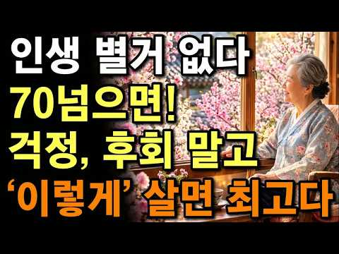
- 같은 채널 평소 대비 ×13.4 (채널 최근 롱폼 중앙값 936회) · 평소 영상: 70~75세는 인생의 황금기입니다｜70세 이후 ‘이렇게’ 살면 평생 마음 편하고, 세상 … (939회) / 진짜 인생은 70부터다! 70넘어서 상팔자 1위는 ‘이런‘ 사람입니다. ｜ 노년에 팔자 … (932회)
- 대본 없음 (없음) — 음성인식이 끝나면 도입부·흐름이 들어감
- 댓글 1/1: 좋은 점 — 영상 0 · 감사·응원 0 · 더 알고 싶은 것 0 · 아쉬운 점 — 영상 0 · 반박·불만 — 의견 다름 0 · 정치·사회 0 · 경험 공유 0 · 구독·다음 기대 0

### 116. 노후자금사연 태국 푸켓으로 떠났다가 3억 전재산 날리고 고시원 신세 된 65세 부부의 눈물 사연 노후자금 노후의지혜 시니어사연 오디오북

- https://www.youtube.com/watch?v=QhY-znsxiBk · 冬の話題コーナー · 구독자 1,350 · 조회수 11,885 (×8.8, 하루 769.7) · 좋아요 79 (0.7%) · 62.5분 · 2026-10-12 · 주제 묶음 1. 재테크 일반·마인드 · 형식 사연·드라마 · 폴더 `W_QhY-znsxiBk` (웹 승인)
- 썸네일: 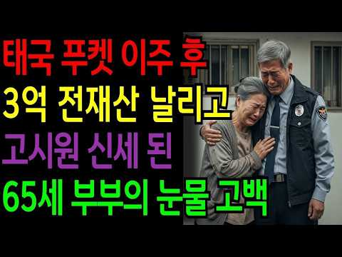
- 설명 앞부분: 당신의 삶에도 이야기가 있습니다. 유튜브 채널 [우리네 인생사연]은 노년의 진짜 목소리를 전합니다. "한 달 80만 원이면 된다"는 말을 믿고 태국 푸켓으로 떠난 65세 박진수 씨 부부. 유튜브와 온라인 커뮤니티의 달콤한 정보만 믿고 결심한 해외 이주. 3억 원의 은퇴 자금으로 시작한 푸켓 생활은 어떻게 되었을까요? 쓸쓸함과 후회, 그리고 뼈저린 교훈이 담긴 노후 파산 사연. 차분한 음성으로 들려드리는 진짜 이야기 속에서 해외 은퇴 이주의 숨겨진 리스크와 현실을 만나보세요. 누군가의 삶의 고백이 또 다른 누군가에겐 인생의 지혜와 …
- 같은 채널 평소 대비 ×1.8 (채널 최근 롱폼 중앙값 6,646회) · 평소 영상: 노후자금사연 내부정보야 100% 확실해 친구 말만 믿고 주식 투자했다가 퇴직금 4억 날려… (6,646회) / 연금 100만 원으로 70대 부부가 한 달을 버틸 수 있을까 (6,607회)
- 대본 없음 (설명) — 음성인식이 끝나면 도입부·흐름이 들어감
- 댓글 2/3: 좋은 점 — 영상 0 · 감사·응원 0 · 더 알고 싶은 것 0 · 아쉬운 점 — 영상 0 · 반박·불만 — 의견 다름 1 · 정치·사회 0 · 경험 공유 1 · 구독·다음 기대 0
  - 반박·불만 — 의견 다름 👍0 “푸켓에 15년째 살고 있지만....월세 이야기 나올때부터..말도 안되는....ㅎ”
  - 경험 공유 👍0 “푸켓에 15년째 살고 있지만....월세 이야기 나올때부터..말도 안되는....ㅎ”

### 117. 반드시 봐야 할 뼈 때리는 노후 인생조언 3가지ㅣ명언ㅣ인생조언ㅣ오디오북ㅣ라디오북ㅣ시니어ㅣ노후

- https://www.youtube.com/watch?v=d-mIsUP1Yzs · Ritmos del Corazón · 구독자 1,460 · 조회수 11,621 (×8.0, 하루 802.5) · 좋아요 102 (0.9%) · 25.9분 · 2026-10-13 · 주제 묶음 4. 노후·연금 · 형식 오디오북·낭독 (명언·인생조언) · 폴더 `W_d-mIsUP1Yzs` (웹 승인)
- 썸네일: 
- 설명 앞부분: 나이가 들수록 인생은 점점 더 단순해지지만, 그 안에 담긴 진실은 오히려 더 선명하게 보이기 시작합니다. 젊을 때는 몰랐던 것들, 세월이 흘러서야 비로소 깨닫게 되는 인생의 중요한 교훈들이 있습니다. 이 영상에서는 노후를 살아가는 많은 사람들이 공감할 수 있는 현실적인 인생조언 3가지를 전해드립니다. 때로는 듣기 불편할 수도 있지만, 반드시 알아야 할 이야기들입니다. 건강, 돈, 인간관계 그리고 후회 없는 삶을 위해 무엇을 준비해야 하는지 함께 생각해 보는 시간이 되길 바랍니다. 인생은 생각보다 빠르게 지나갑니다. 지금 당장은 괜…
- 같은 채널 평소 대비 ×12.0 (채널 최근 롱폼 중앙값 972회) · 평소 영상: 예금 이만큼 있다고 말한 뒤 50년지기모임이 파토났습니다 노년에 친구에게 절대 말하면 안… (972회) / 나이들수록 마음속에 반드시 새겨야 할 명언ㅣ명언ㅣ인생조언ㅣ오디오북ㅣ라디오북ㅣ시니어ㅣ노후 (905회)
- 대본 없음 (설명) — 음성인식이 끝나면 도입부·흐름이 들어감
- 댓글 0/0: 좋은 점 — 영상 0 · 감사·응원 0 · 더 알고 싶은 것 0 · 아쉬운 점 — 영상 0 · 반박·불만 — 의견 다름 0 · 정치·사회 0 · 경험 공유 0 · 구독·다음 기대 0

### 118. 45살에 시작한 재택부업으로 매달 순수익 1억, 인생역전한 48살 대표님

- https://www.youtube.com/watch?v=yoaOIMkMTVE · 두 번째 직업 : 부업으로 돈 버는 사람들 · 구독자 3,050 · 조회수 21,671 (×7.1, 하루 1,674.1) · 좋아요 0 (0.0%) · 25분 · 2026-10-15 · 주제 묶음 2. 돈 모으기·저축 · 형식 정보·해설 (그 밖) · 폴더 `W_yoaOIMkMTVE` (웹 승인)
- 썸네일: 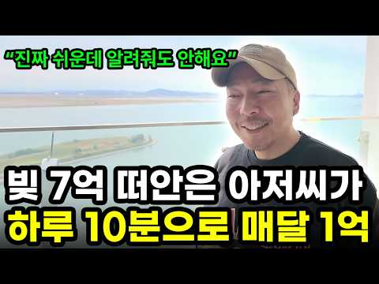
- 챕터: 0:00 7억 빚에서 월 순이익 1억까지 · 1:05 오션뷰 집 공개 · 2:28 한 달에 얼마 벌까 · 2:41 자기소개 · 2:50 TV 보면서 돈을 번다? · 3:53 매출 공개 · 4:45 나이가 많아도 할 수 있을까 · 5:36 대기업보다 싸게 팔 수 있는 이유 · 6:20 하루 10분이 거짓말인 이유 · 6:54 배송은 어떻게 할까 · 7:44 대표님이 하는 일 · 8:03 데이터 분석 과정 공개 · 8:30 제조는 어떻게 할까 · 9:29 시작 비용 · 9:32 사업을 시작하게 된 계기 · 10:27 팔 상품 찾는 법 · 13:52 마진 계산하는 법 · 14:25 수강생 사례 · 15:27 60대도 쿠팡 등록이 가능할까 · 16:26 경쟁자가 늘어나도 괜찮을까
- 설명 앞부분: 📅 무료 세미나 : 10월 28일(수) 저녁 7시 30분 최대표님 무료 세미나 & 영상 속 자료 선물 신청 방법 🎁 무료 세미나 신청자에게 드리는 선물 쿠팡에 상품 쉽게 등록하는 법 전자책 건강식품 판매 자격(사업자·영업신고) 준비 전자책 AI로 상세페이지 만드는 프롬프트 헬스장 세 곳을 운영하던 최대표님은 코로나로 7억이 넘는 빚을 지고, 2년 동안 아내에게도 말하지 못했다고 합니다. 그런데 지금은 직원 한 명 없이 온라인부업으로 월 순이익 1억을 벌고 있다고 해요. "하루 10분도 일 안 한다"는 재택부업이 정말 가능한지, 바…
- 같은 채널 평소 대비 ×10.7 (채널 최근 롱폼 중앙값 2,028회) · 평소 영상: "카톡만 몇번 주고 받으면 끝" 이 부업으로 회사 때려치고 방구석에서 3000만 원 버는… (2,083회) / "진짜 초등학생도 가능한 부업이에요" 암 투병 중에도 따박따박 연금 받는 부업 (1,972회)
- 대본 없음 (설명) — 음성인식이 끝나면 도입부·흐름이 들어감
- 댓글 129/170: 좋은 점 — 영상 3 · 감사·응원 8 · 더 알고 싶은 것 6 · 아쉬운 점 — 영상 0 · 반박·불만 — 의견 다름 1 · 정치·사회 0 · 경험 공유 21 · 구독·다음 기대 1
  - 좋은 점 — 영상 👍0 “대표님의 진정성이 와닿네요. 저도 많은 과정이 있었는데 도전해보고 싶습니다.”
  - 감사·응원 👍1 “부유가 아니라 여유가 진심 부럽네요 부의 정점은 나눔이란걸 아시는분 멋지신분 꼭 배우고 싶네요 무료강의 신청합니다. ♡전자책♡ 감사합니다”
  - 감사·응원 👍0 “대단해요 자세히 설명을 해주셔서 너무 감사드립니다 신청합니다 꼭 배우고 싶어요”
  - 더 알고 싶은 것 👍0 “전자책 부탁해요”
  - 더 알고 싶은 것 👍0 “전자책 부탁드려요”
  - 반박·불만 — 의견 다름 👍1 “우리 집사람도 하루종일 홈쇼핑 틀어놓고 사는데 이게 돈이 되는거였네요 ㅎㅎ 저도 60 넘었지만 늦은거 아니죠? 28일 꼭 듣겠습니다”
  - 경험 공유 👍2 “저도 홈쇼핑 자주 보는데 이런 방법이 있는줄은 몰랐네요. 나이 먹어서 할수있을까 싶었는데 67세분도 하셨다니 용기가 납니다. 28일 세미나 꼭 들어가볼게요”
  - 경험 공유 👍1 “우리 집사람도 하루종일 홈쇼핑 틀어놓고 사는데 이게 돈이 되는거였네요 ㅎㅎ 저도 60 넘었지만 늦은거 아니죠? 28일 꼭 듣겠습니다”
  - 구독·다음 기대 👍0 “구독했습니다~~”

### 119. 39살 애 엄마가 노트북 한대로 수다 떨면서 월 4백만 원 버는 부업

- https://www.youtube.com/watch?v=86r1uUvk2-A · 배워서벌자 · 구독자 1,710 · 조회수 14,365 (×8.4, 하루 900.9) · 좋아요 0 (0.0%) · 24.1분 · 2026-10-12 · 주제 묶음 8. 부업·소득 · 형식 인터뷰·강연·대담 · 폴더 `W_86r1uUvk2-A` (웹 승인)
- 썸네일: 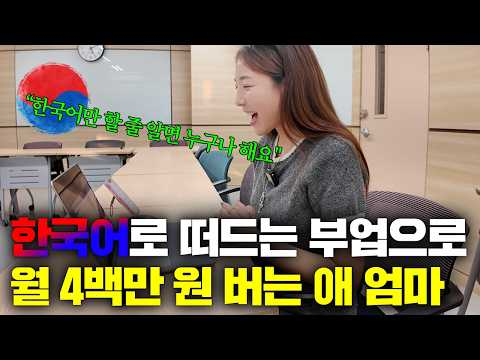
- 설명 앞부분: 말쌤의 무료 강의 신청 방법 선착순으로 마감될 예정이며, 이후에는 참여가 불가능합니다! 🗓️무료강의 일정: 10월 27일(화) 오후 7시 30분 🏻 말쌤만의 부업 전략 1. 자격증·학위 없이 한국말 하나로 외국인 선생님이 되는 과정 2. 아이 대하듯 쉽게, 일상 대화 하나로 50분 수업을 채우는 법 3. 맛보기 수업 한 번을 매주 정기 수업으로 이어가는 법 주부 부업, 재택부업으로 뭘 해야 할지 고민이셨다면 이 영상부터 보세요. 15년차 방송인이자 5살 딸 엄마인 말쌤이 아이 등원 후 노트북 하나로 하는 온라인부업, 한국말로 미국…
- 대본 없음 (설명) — 음성인식이 끝나면 도입부·흐름이 들어감
- 댓글 7/7: 좋은 점 — 영상 0 · 감사·응원 0 · 더 알고 싶은 것 0 · 아쉬운 점 — 영상 0 · 반박·불만 — 의견 다름 0 · 정치·사회 0 · 경험 공유 3 · 구독·다음 기대 0
  - 경험 공유 👍1 “좋아요 저도 배우고 싶어요”
  - 경험 공유 👍1 “책은 어디서 구입하는지 찾아도 못찾아서 선물받고 싶네요. 제가 생각했던 딱 그 아이템인데 미리 선점하여 실행하고 계신 노하우 전수받고 싶습니다. 무료강의도 신청했어요~ 저에게도 사업튜터가 되어주세요~”

### 120. 나스닥 투자하기 전에 이 영상 꼭 보세요 ∣ QLD만 모아가는 이유

- https://www.youtube.com/watch?v=g10Y6ZA7rng · 올레버 · 구독자 1,580 · 조회수 118,471 (×75.0, 하루 800.0) · 좋아요 1,638 (1.4%) · 5.7분 · 2026-06-02 · 주제 묶음 3. 주식·ETF · 형식 정보·해설 (그 밖) · 폴더 `W_g10Y6ZA7rng` (웹 승인)
- 썸네일: 
- 챕터: 0:00 도입 — QLD를 추천하는 이유 · 0:12 레버리지의 음의 복리(Volatility Decay)… · 1:31 나스닥에서 음의 복리가 반은 틀린 이유 · 2:02 QQQ / QLD / TQQQ 수익률 비교 (2010… · 3:05 왜 TQQQ보다 QLD인가 — 최적 레버리지 배율 · 4:01 2021년 차트로 보는 변동성 비교 · 4:29 장기 투자자에게 QLD가 적합한 이유 · 4:52 개인 목표 (10년 순자산 30억) 기준으로 본 QLD · 5:18 리스크 안내 및 마무리
- 설명 앞부분: 나스닥 ETF, 어떤 걸 사야 할까요? QQQ, QLD, TQQQ. 다들 나스닥 기반인데 뭐가 다른지, 그리고 왜 저는 QLD를 선택했는지 오늘 얘기해볼게요. 이런 분들께 추천드려요 나스닥 ETF 투자를 고민 중인 분 QQQ, QLD, TQQQ 차이가 궁금한 분 레버리지 ETF가 위험하다고 들었는데 궁금한 분 📊 영상에서 다루는 내용 QQQ / QLD / TQQQ 각각 뭐가 다른가 레버리지는 장기 보유하면 녹는다? 진실은 나스닥 각 배율별 10년 수익률 비교 10년 뒤 30억을 위해 필요한 수익률 🎯 목표 : 순자산 30억 파이어…
- 같은 채널 평소 대비 ×164.8 (채널 최근 롱폼 중앙값 719회) · 평소 영상: 배달 뛰다가 워렌버핏의 말을 이해했습니다 ∣ 투자관을 바꾸게 된 계기 (719회) / 이제 저축 안 늘립니다. 30억 파이어족 계획 (562회)
- 대본 (음성인식(앞 5분), 4.2 음절/초) — 앞부분만, 흐름은 그 안까지 첫 20초: “QQQ, QLD, TQQQ 세 가지 중 고민하는 분들이 많은데 저는 그 중 QLD를 적극 추천드리고 있습니다. 그 이후 바로 설명드리겠습니다. 많은 분들이 QLD, TQQQ에 앞서서 우선 레버리지에 대해 부정적인 시각은 가진 분들이 많아요. 그 중 가장 많이 언급되는 게 레버리지는 장기 보유할수록 녹는다 즉 음의 복리인데요.” — 도입부 유형: 내 이야기·사연
- 첫 1분: “QQQ, QLD, TQQQ 세 가지 중 고민하는 분들이 많은데 저는 그 중 QLD를 적극 추천드리고 있습니다. 그 이후 바로 설명드리겠습니다. 많은 분들이 QLD, TQQQ에 앞서서 우선 레버리지에 대해 부정적인 시각은 가진 분들이 많아요. 그 중 가장 많이 언급되는 게 레버리지는 장기 보유할수록 녹는다 즉 음의 복리인데요. 레버리지 상품 자체가 장기적으로 묻어드는 수단이 아니라고 관계자들도 언급을 하고 있고 그리고 실제로 음의 복리가 발생하는 상품이 맞습니다. 두 배 세 배라고 해서 그래프처럼 정확하게 배율대로 가지 않는데요. 이는 1일 변동폭을 추정하고 있기 때문입니다. 쉽게 얘기해서 여기 이 차트를 보시면 1만에서 나스닥이 시작했을 때 1일차에 나스닥이 20% 빠지면 8천이 되고 QLD는 그의 두 배인”
- 흐름 (90초마다 첫 문장): 0:00 QQQ, QLD, TQQQ 세 가지 중 고민하는 분들이 많은데 저는 그… → 1:30 하지만 나스닥에는 반은 맞고 반은 틀렸습니다. → 3:02 유의미한 성장율을 보이고 있다는 거죠. → 4:33 앞으로 몇 번의 폭등과 폭락장이 있을지 모르는 장기 투자를 저희는 해야…
- 댓글 347/347: 좋은 점 — 영상 4 · 감사·응원 18 · 더 알고 싶은 것 24 · 아쉬운 점 — 영상 1 · 반박·불만 — 의견 다름 5 · 정치·사회 0 · 경험 공유 17 · 구독·다음 기대 2
  - 좋은 점 — 영상 👍7 “구독 눌렀어요 좋은정보 앞으로도 부탁드려요😂”
  - 좋은 점 — 영상 👍7 “10~25 년까지는 초저금리 기반 빅테크 대상승장이었죠. 닷컴버블 직후(00~10년)처럼 10년 동안 박스권 횡보장세였다면 진정한 음의 복리 마법을 맛봤을 겁니다.. 그리고 큰 MDD 낙폭은 실제로 겪지 않으면 그게 어떤 느낌인지 피부로 안 와닿아요. 내 투자자산이 …”
  - 감사·응원 👍12 “1.닷컴버블 폭락 기간: 약 2년 6개월 (31개월) 회복 기간: 약 4년 5개월 (53개월) 내 돈이 묶인 총 기간: 약 7년 1개월 2. 리먼 브라더스 사태 폭락 기간: 약 1년 5개월 (17개월) 회복 기간: 약 4년 (48개월) 내 돈이 묶인 총 기간: 약 5…”
  - 감사·응원 👍3 “저도 맘 편해서 QLD 매달 100 좀 넘게 모아갑니다. 최근 하락시 좀 더 사서 모으고 ㅎㅎ 앞으로도 파이팅입니다~😊”
  - 더 알고 싶은 것 👍8 “도움 많이 되었네요! 근데 4:44초에 저런 비교 데이터는 어디에서 볼 수 있을까요?!”
  - 더 알고 싶은 것 👍7 “구독 눌렀어요 좋은정보 앞으로도 부탁드려요😂”
  - 아쉬운 점 — 영상 👍0 “연저펀에 못담는게 아쉽네요.”
  - 반박·불만 — 의견 다름 👍41 “QLD 6년차, 만5년 매도 없이 모아가는 중입니다. 여러분, 레버리지는 하락장 횡보장에 다 녹는 다는 말에 너무 매몰 되지 마세요. 하락후 반드시 찾아오게 되는 긴 상승장에서의 양의 복리는 퍼포먼스가 두배가 아닙니다. 속된말로 존나 오릅니다. 횡보, 하락장에서 추종…”
  - 반박·불만 — 의견 다름 👍13 “하락장 자신없는분은 건드리지도 마세요. 좋다좋다그래도 레버리지는 막 하는거 아닙니다”
  - 경험 공유 👍41 “QLD 6년차, 만5년 매도 없이 모아가는 중입니다. 여러분, 레버리지는 하락장 횡보장에 다 녹는 다는 말에 너무 매몰 되지 마세요. 하락후 반드시 찾아오게 되는 긴 상승장에서의 양의 복리는 퍼포먼스가 두배가 아닙니다. 속된말로 존나 오릅니다. 횡보, 하락장에서 추종…”
  - 경험 공유 👍19 “폭락을 경험해보지도 않은 이런 핏덩이들이 레버리지 좋다고 주절 대는게 너무 귀엽네 ㅋㅋ”
  - 구독·다음 기대 👍3 “구독했습니다~~ 혹시 경상도 이신가요? ㅎㅎ”

