# 재테크 — 성공 사례 분석: 사례별 자세히 #121–#160

`analysis.md` 의 9번 (같은 # 번호). 자동 생성 — `tools/success_analysis.py` v1.3 (2026-10-14 09:14 UTC). ※ 연구·교육용 — 투자 권유가 아님.

### 121. 연금고수들이 연금저축계좌 반드시 담는 ETF 3가지

- https://www.youtube.com/watch?v=iMkvDXx86dE · 경제나침반 · 구독자 14,000 · 조회수 105,108 (×7.5, 하루 1,344.4) · 좋아요 2,048 (1.9%) · 25.2분 · 2026-07-28 · 주제 묶음 4. 노후·연금 · 형식 정보·해설 (그 밖) · 폴더 `W_iMkvDXx86dE` (웹 승인)
- 썸네일: 
- 설명 앞부분: 📈 오늘 시장에서 꼭 알아야 할 경제와 투자 인사이트를 쉽고 명확하게 정리해드립니다. 💡 주식, ETF, 미국주식, 경제 전망, 금리, AI, 반도체, 부동산까지 투자자가 반드시 알아야 할 핵심 정보를 함께 살펴보세요. 이번 영상에서는 최신 경제 뉴스와 금융시장 흐름을 바탕으로 투자에 도움이 되는 핵심 내용을 쉽고 이해하기 편하게 설명해드립니다. 경제나침반은 경제공부, 주식투자, ETF 투자, 미국주식, 한국 증시, 경제 전망, 재테크, 자산관리, 금리와 환율, AI 및 반도체 산업 등 다양한 주제를 객관적인 자료와 시장 흐름을 …
- 같은 채널 평소 대비 ×1,617.0 (채널 최근 롱폼 중앙값 65회) · 평소 영상: 매일 노력해도 늘 제자리걸음이라면 출발선을 통째로 바꿔보세요 (66회) / 1억 모으고 이 실수 하면 5년 모은 돈 순식간에 날아갑니다 (66회)
- 대본 없음 (설명) — 음성인식이 끝나면 도입부·흐름이 들어감
- 댓글 67/67: 좋은 점 — 영상 3 · 감사·응원 5 · 더 알고 싶은 것 2 · 아쉬운 점 — 영상 1 · 반박·불만 — 의견 다름 1 · 정치·사회 0 · 경험 공유 3 · 구독·다음 기대 0
  - 좋은 점 — 영상 👍3 “좋은 정보 감사합니다~^^ 나스닥과 S&P500, 미국배당다우존스, 미국 10년국채랑 단기채권, 국내 고배당, 금, 국내외 리츠 ETF 갖고 있네요. IRP에서 안전자산 30%는 나스닥미국채혼합이랑 미국배당미국채혼합으로 채우고 있고요~”
  - 감사·응원 👍3 “감사합니다”
  - 감사·응원 👍3 “좋은 정보 감사합니다~^^ 나스닥과 S&P500, 미국배당다우존스, 미국 10년국채랑 단기채권, 국내 고배당, 금, 국내외 리츠 ETF 갖고 있네요. IRP에서 안전자산 30%는 나스닥미국채혼합이랑 미국배당미국채혼합으로 채우고 있고요~”
  - 더 알고 싶은 것 👍4 “56세 인데 절세계좌만 만들고 아직 아무것도 못담았어요 일반주식계좌에는 다행히 반도채, 원전쪽 수익률 좋아 100프로 넘다가 지금은 50프로 아래로 내려가는 중이고요.' 각설하고 제 나이때는 연금저축 시작해봐야 늦을까요 아직 안 늦었다면 절세계죄로 담을 종목과 최대한…”
  - 더 알고 싶은 것 👍4 “isa / 퇴직연금 / irp / 주식계좌 etf 뭐 담아야 할지? 궁금합니다.”
  - 아쉬운 점 — 영상 👍1 “화질구지다”
  - 반박·불만 — 의견 다름 👍0 “액티브 국내형 ETF면 손해가 아닙니다.”
  - 경험 공유 👍25 “일단 본인이 주식에 돈을 쓸 여윳돈이 얼마나 되느냐에따라 다름 돈이 많아서 세액공제 받고 또 투자 여력이 있다면 일반계좌에 국내주식 담아도 됨. 그런데 세액공제 받을만큼만 여력이 된다? 세금 신경쓰지말고 국내주식 담아도 됨. 코스피 2500에서 9000 갈때까지 세금…”
  - 경험 공유 👍7 “연금 저축 공부좀 해봤는데 여기 정보가 진짜 정확하고 알차고 핵샘을 다 담고 있네요”

### 122. ETF 이 '2가지'만 사두면 됩니다. '나머지는 필요없어요' 100억 자산 관리자의 꿀팁(백승호 단장 풀버전) #ETF #배당주 #주식 #백승호

- https://www.youtube.com/watch?v=1qlywudP2oY · 자람들 - 자립하는사람들 · 구독자 33,400 · 조회수 248,645 (×7.4, 하루 8,233.7) · 좋아요 2,054 (0.8%) · 69.7분 · 2026-09-14 · 주제 묶음 3. 주식·ETF · 형식 인터뷰·강연·대담 · 폴더 `W_1qlywudP2oY` (웹 승인)
- 썸네일: 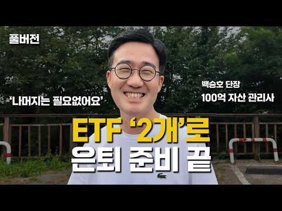
- 설명 앞부분: 👤 오늘의 게스트: 백승호 단장 개인 재무 컨설팅 전문가 & 유튜버·작가로도 활동 20년간 몇백 명의 고객 자산을 관리해온 재무 컨설턴트입니다. 현재 관리하는 총 자산만 100억원이 넘지만, 폭락장에도 노트북에 손 하나 대지 않을 만큼 평온한 태도로 유명합니다. 비결은 단 하나, "투자해도 되는 돈"과 "투자하면 안 되는 돈"을 철저히 구분하는 원칙입니다. 시드머니 없이 매주 조금씩 사 모으는 전략, 차트나 재무제표 대신 "내 지갑"을 믿고 애플·넷플릭스·구글 같은 주식을 고르는 방법, 그리고 레버리지·인버스 상품에 대한 강한 경…
- 같은 채널 평소 대비 ×10.3 (채널 최근 롱폼 중앙값 24,025회) · 평소 영상: 월 500만원 배당 노하우, 시드 5천 '이렇게' 구성하세요. 평범한 직장인이 파이어한 … (24,852회) / 800만원 은값이 반토막 났다. 금, 골드바 지금 사도 괜찮을까요?(G1 김봉준 대표 2… (23,198회)
- 대본 없음 (설명) — 음성인식이 끝나면 도입부·흐름이 들어감
- 댓글 69/69: 좋은 점 — 영상 6 · 감사·응원 11 · 더 알고 싶은 것 2 · 아쉬운 점 — 영상 4 · 반박·불만 — 의견 다름 1 · 정치·사회 1 · 경험 공유 1 · 구독·다음 기대 1
  - 좋은 점 — 영상 👍6 “많이 배웠습니다. 감사합니다.”
  - 좋은 점 — 영상 👍5 “많이 배웠습니다 변액연금은 정말 몰랐네요”
  - 감사·응원 👍7 “와..이분 이 영상에서 처음 뵀는데 인상도 정말 좋으시고, 말씀도 편안하고 겸손하신데 무엇보다 내용이 명확하고 깔끔하시네요! 구독과 좋아요 누르고 갑니다. 귀한 영상 감사히 잘 봤습니다^^”
  - 감사·응원 👍7 “영상 감사드립니다🎉 Kodex200커버드콜 같은 것을 지금 사도 될 지 모르갰어오..우리나라가 갑자기 넘 오른 거 같아서요😅”
  - 더 알고 싶은 것 👍2 “오늘 선생님 유튜브 처음 들었는데 저와 투자 철학이 맞네요 좋아요.구독 눌렀습니다. 유선으로 통화하고 싶은데 어떻게 하면 되나요???”
  - 더 알고 싶은 것 👍2 “여기서 추천하는 "2 etf"는 어떤것인가요?”
  - 아쉬운 점 — 영상 👍84 “너무 길어요... AI에 요약을 요청~ 심플이즈 베스트: 일반 투자자에게는 S&P500과 나스닥100 ETF 두 가지만 꾸준히 사 모으는 것을 0순위로 추천합니다 (30:38). 결국 이 2개...ㅋ”
  - 아쉬운 점 — 영상 👍20 “13년전에 별생각없이 가입한 변액연금보험 10년납입 끝나고 2년정도 놔뒀는데 지금 수익률이 250퍼센트 넘어요. 조금더 많이 넣을껄하는 아쉬움이...”
  - 정치·사회 👍7 “영상 감사드립니다🎉 Kodex200커버드콜 같은 것을 지금 사도 될 지 모르갰어오..우리나라가 갑자기 넘 오른 거 같아서요😅”
  - 구독·다음 기대 👍2 “찐 투자의 길라잡이네요. 빽담화TV 구독과 알림 설정 들어갑니다.^^”

### 123. "2026년 상반기 연금 순위" 은퇴한 내 친구들의 연금은 상위 몇%일까? 연금 수령액 TOP 10

- https://www.youtube.com/watch?v=QEgZrrQEQfA · 할티비 · 구독자 39,500 · 조회수 289,996 (×7.3, 하루 2,564.8) · 좋아요 950 (0.3%) · 15분 · 2026-06-23 · 주제 묶음 4. 노후·연금 · 형식 인터뷰·강연·대담 · 폴더 `W_QEgZrrQEQfA` (웹 승인)
- 썸네일: 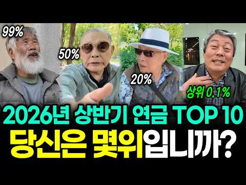
- 설명 앞부분: 안녕하세요, 여러분의 현실적인 노후 준비를 돕는 [할티비]입니다. 🎤 당신의 연금은 상위 몇프로입니까? "연금 얼마 받으세요?"라는 질문에 어르신들께서 들려주신 대답은 우리의 예상보다 훨씬 더 현실적이고, 조금은 충격적이기도 했습니다. 대한민국 시니어들이 직접 겪고 있는 생생하고도 충격적인 노후 현실을 영상을 통해 직접 확인해 보세요! 오늘 영상이 노후 준비에 대해 다시 한번 생각해보는 계기가 되셨다면, 여러분의 연금 준비 상황이나 노후에 대한 생각도 댓글로 자유롭게 남겨주세요. 언제나 큰 힘이 됩니다! 🙇‍♂️🙇‍♀
- 같은 채널 평소 대비 ×29.8 (채널 최근 롱폼 중앙값 9,736회) · 평소 영상: "기독교, 불교가 못하는 걸 해" 사이비 종교 40년 차 교직자는 연금 없이 행복한 진짜… (8,365회) / "한국 병원, 이게 말이 돼?" 연금 받아도 세금으로 다 나가니까 병원비도 모자란 대한민… (14,429회)
- 대본 없음 (설명) — 음성인식이 끝나면 도입부·흐름이 들어감
- 댓글 188/188: 좋은 점 — 영상 1 · 감사·응원 3 · 더 알고 싶은 것 1 · 아쉬운 점 — 영상 2 · 반박·불만 — 의견 다름 1 · 정치·사회 23 · 경험 공유 8 · 구독·다음 기대 1
  - 좋은 점 — 영상 👍4 “내일 연금 신청하러가는데 기분이 묘하다 공무원아니고 일반으로 30년 부었어도 노후의 삶에 도움이 될거 같다 연금은 부부가 각자 넣고 둘이 타야 합해서 그런데로 살아갈거같다 성실하게 일하며 살아낸 내 지난 삶들에 잘 살아왔다고 박수를 보내고 싶다”
  - 감사·응원 👍11 “기초연금을 받는걸 당연하게 생각하고 적다고 하네... 기초연금돈이 나라에서 주는게 아니라 성실히 일하며 살아가는 사람들의 피와 땀방울인데 조금도 미안하고 감사하는 마음이 전혀없네 그런 마음으로 살아온 젊은시절은 훤히 보이네”
  - 더 알고 싶은 것 👍0 “연세가 어떻게 되시는지요? 돌아가실때까지 이렇게 질문해라 무식한 사회자야”
  - 아쉬운 점 — 영상 👍6 “이것 저젓 짜집기했네.”
  - 아쉬운 점 — 영상 👍0 “돈을 얼마씩 넣었기에 한달 350을 받냐? 믿을수가 없네 시청자들에게 귀죽이자는 거야 아니면 뻔뻔한 거짓말을 하는거야!”
  - 반박·불만 — 의견 다름 👍17 “기초연금은 국가가 65세 이상 노인들 중 하위 70프로 세금으로 지급하는 노후보조금이며 노령연금은 개인이 납입한 금액과 기간에 따라 지급하는 국민연금을 이렇게 부릅니다. 노령연금은 기초연금이 아닙니다.”
  - 정치·사회 👍40 “나라 망조 가 들었구나 난 죽어라 직장다녔어도 100만원 기초수급자 거의 100만원 젊어서 노세노세 정부가 다 살려주는구나.”
  - 정치·사회 👍14 “지금 젊은이들 무조건 국민연금 많이 들으세요..자영업은 형편되면 최대한 큰 금액으로...제 자식들보고 국민연금이 최고다 항상 말합니다..나라가 망하지 않는한 국민연금 못주는거 없습니다.”
  - 경험 공유 👍9 “평생 일했는데 2년뒤 국민연금 88만원 나온다고한다. 물론,. 굴곡많은 인생에 직장 옮겨 다니느라 중간에 사학연금 가입기간 7년 가량 있고, 군인연금 가입기간 4년이 있다. 두개 다 10년도 안되고 20년도 안되어서 아무런 혜택이 없기 때문이다. 근데 기초노령연금 대…”
  - 경험 공유 👍0 “나이들면 한 두 가지 약간의 건강이 문제 되지만 건강에 큰 문제가 없는 가정 하에서 이야기 합니다!!노인의 기준을 100세로 정하고 그 전까지는 열심히 일하며 벌어야 살 수 있다!! 모두 열심히~~~ 연금 100~800만원 별 쓸것 없다!! 연금으로 여유로운 생활은 …”
  - 구독·다음 기대 👍15 “영상 아주 재밌게 봤 읍니다 ....연금과 관련됀 질문 유튜브 중 최고로 재밌게 봤 읍니다 어떤 유튜브는 .. 1사람 가지고 12분 ..어떤 유튜브는 2사람 질문에 15분 ...어떤유튜브는 연금소득 300만원 ..건물 월세 300만원 이상 받는 .고소득자들만 .보여주…”

### 124. S&P500 하나로 채운 ISA 3년 투자 총정리 ∣ 5년 연장 대신 지금 해지한 이유 ∣ 직접 경험한 이전 절차 포함

- https://www.youtube.com/watch?v=WGCZYnwacuo · 원원 - 파이어 준비생 · 구독자 16,900 · 조회수 120,100 (×7.1, 하루 1,381.8) · 좋아요 2,860 (2.4%) · 22.5분 · 2026-07-19 · 주제 묶음 3. 주식·ETF · 형식 오디오북·낭독 (명언·인생조언) · 폴더 `W_WGCZYnwacuo` (웹 승인)
- 썸네일: 
- 설명 앞부분: 💫 :: won spirit 적립식 ETF 투자 관리 플랫폼 & 커뮤니티 안녕하세요! 금융권 직장인으로서 파이어(FIRE: Financial Independence, Retire Early)를 준비하며, 미국 S&P500 ETF, 단 하나로 목표를 이루는 여정을 기록하고 있습니다. S&P500을 현재 2.4억 정도 투자중이며, 매월 투명한 투자 내역 공개를 하고 그 밖에 투자 마인드, 투자 공부, 그리고 직장인의 삶을 공유합니다. 특히, 단순하면서도 누구나 실천 가능한 투자 전략으로 재정 독립을 목표로 하고 있습니다.💡 ➡️ 이번…
- 같은 채널 평소 대비 ×24.3 (채널 최근 롱폼 중앙값 4,933회) · 평소 영상: [1월결산] S&P500 투자자가 코스피 5,000 돌파를 바라보며! (4,849회) / 직장인이 부자 되려면 반드시 거쳐야 할 단계들! (4,848회)
- 대본 없음 (설명) — 음성인식이 끝나면 도입부·흐름이 들어감
- 댓글 542/542: 좋은 점 — 영상 31 · 감사·응원 66 · 더 알고 싶은 것 49 · 아쉬운 점 — 영상 2 · 반박·불만 — 의견 다름 2 · 정치·사회 0 · 경험 공유 50 · 구독·다음 기대 4
  - 좋은 점 — 영상 👍15 “ISA 계좌 저도 내년 5월이면 3년 만기입니다. 무척 유익한 내용이었습니다. 궁금한 점도 많이 해소 되었구요. 원원님 혹시 노후에 생활비로 연금계좌 운영은 어떤 방식으로 하실런지요. . . ? 이 내용을 주제로 영상을 한번 찍어 주시던지 아니면 간단한 답변이라도 부…”
  - 좋은 점 — 영상 👍14 “3:05 꿀팁이네요 목소리 듣기 좋아요 이런 어렵고 복잡한거 듣기 딱좋음”
  - 감사·응원 👍17 “제가 찾던 영상이에요. 구독하고 저장해서 계속 봐야겠어요. 40대후반 처음 isa와 연금저축계좌를 열고 s&p 500조금씩 사고 있어요. 큰 도움 되었습니당. 감사합니다^^”
  - 감사·응원 👍15 “ISA 계좌 저도 내년 5월이면 3년 만기입니다. 무척 유익한 내용이었습니다. 궁금한 점도 많이 해소 되었구요. 원원님 혹시 노후에 생활비로 연금계좌 운영은 어떤 방식으로 하실런지요. . . ? 이 내용을 주제로 영상을 한번 찍어 주시던지 아니면 간단한 답변이라도 부…”
  - 더 알고 싶은 것 👍15 “ISA 계좌 저도 내년 5월이면 3년 만기입니다. 무척 유익한 내용이었습니다. 궁금한 점도 많이 해소 되었구요. 원원님 혹시 노후에 생활비로 연금계좌 운영은 어떤 방식으로 하실런지요. . . ? 이 내용을 주제로 영상을 한번 찍어 주시던지 아니면 간단한 답변이라도 부…”
  - 더 알고 싶은 것 👍3 “저도 isa가 이번 년도 10월에 만기라서 이전할 예정인데 완전 유익한 정보 감사합니다.. 그리고 절세계좌 운영계획이 저랑 거의 90%이상 똑같네요... ㅎㅎㅎ 원원님의 계획과 달성 내용들을 보면서 참고를 많이 해야겠습니다. 좋은 정보 많이 많이 부탁드립니다. 감사합…”
  - 아쉬운 점 — 영상 👍1 “어쩜. 저랑 생각이 똑같으실가요. 저도 노후준비자금을 단일종목 에센피500에 연금계좌,ISA에 풀매수할려구요 함께 가겠습니다 원원님함께라면 지루한 장기투자 흔들림없이 쭉~갈수 있을 것 같아요 멘토링해주셔서 마음이 든든합니다😊 여직껏 제가 본 중 영상 중에 가장 심플하…”
  - 경험 공유 👍17 “제가 찾던 영상이에요. 구독하고 저장해서 계속 봐야겠어요. 40대후반 처음 isa와 연금저축계좌를 열고 s&p 500조금씩 사고 있어요. 큰 도움 되었습니당. 감사합니다^^”
  - 경험 공유 👍15 “ISA 계좌 저도 내년 5월이면 3년 만기입니다. 무척 유익한 내용이었습니다. 궁금한 점도 많이 해소 되었구요. 원원님 혹시 노후에 생활비로 연금계좌 운영은 어떤 방식으로 하실런지요. . . ? 이 내용을 주제로 영상을 한번 찍어 주시던지 아니면 간단한 답변이라도 부…”
  - 구독·다음 기대 👍17 “제가 찾던 영상이에요. 구독하고 저장해서 계속 봐야겠어요. 40대후반 처음 isa와 연금저축계좌를 열고 s&p 500조금씩 사고 있어요. 큰 도움 되었습니당. 감사합니다^^”
  - 구독·다음 기대 👍3 “나중에 챙겨볼께요!!”

### 125. 젠슨 황이 한국에 온 진짜 이유, 소름 돋는 반전

- https://www.youtube.com/watch?v=SgL_q0Ybdvc · 돈공부 · 구독자 4,550 · 조회수 32,264 (×7.1, 하루 253.5) · 좋아요 384 (1.2%) · 18.1분 · 2026-06-09 · 주제 묶음 1. 재테크 일반·마인드 · 형식 사연·드라마 · 폴더 `W_SgL_q0Ybdvc` (웹 승인)
- 썸네일: 
- 챕터: 0:00 젠슨 황이 한국에 왔어요 · 0:35 삼겹살집에서 만난 총수들 · 4:30 유일한 부품 공장 — 왜 한국인가 · 9:30 입국일에 터진 폭탄 — 왜 폭락했나 · 14:30 내 계좌에 남는 것 — 기회인가 위기인가 · 18:00 마무리
- 설명 앞부분: 세계 시가총액 1위 CEO가 왜 삼겹살집에서 한국 재벌 총수들을 불러 모았을까요? 표면적으로는 친선 방문이었지만, 돈의 흐름을 따라가보면 전혀 다른 그림이 보입니다. 엔비디아가 한국을 선택한 구조적 이유, 입국일에 코스피가 5.54% 폭락한 진짜 원인, 그리고 이 모든 것이 우리 일상과 투자에 어떤 의미인지 정리했습니다. 타임라인 골드만삭스 한국 증시 보고서 — Goldman Sachs, 2026.06.03 SK텔레콤-엔비디아 AI팩토리 협력 발표 — 파이낸셜뉴스, 2026.06.08 현대차-엔비디아 자율주행 협력 — 이데일리, …
- 같은 채널 평소 대비 ×56.5 (채널 최근 롱폼 중앙값 571회) · 평소 영상: "며느라기, 기억나세요?" 명절에 울던 며느리가 아니라 그 부엌이 먼저 사라졌습니다 (571회) / "이따다키마쓰~" 편의점과 돈키호테가 한국인 지갑만 정확히 여는 이유 (568회)
- 대본 없음 (설명) — 음성인식이 끝나면 도입부·흐름이 들어감
- 댓글 59/59: 좋은 점 — 영상 0 · 감사·응원 2 · 더 알고 싶은 것 1 · 아쉬운 점 — 영상 0 · 반박·불만 — 의견 다름 0 · 정치·사회 1 · 경험 공유 0 · 구독·다음 기대 0
  - 감사·응원 👍18 “삼성은 가장 애국자 기업입니다. 이 시간까지 나랏일에 발벗도 도움주고 인재양성도 꼭 대한민국 청년들만 채용합니다. 그동안 대통령이나 정치인들 하자는 대로 따랐던 삼성. 어느한곳 버릴게 없는기업 우리모두 응원이 필요 합니다!”
  - 감사·응원 👍15 “삼성가는 기본이 튼튼한 기업이죠. 할아버지 이병철 선대기업총수. 아버님 이건희 배짱좋고 분명한 회장님을 모신 이재용 보고배운 그 대로 기술을 피나는 노력으로 연마해서 드디어 작년 25년 후반부터 찬란한 빛을 발하고 있지요. 대한민국에 이런 단단한 기업이 있다는것에 감…”
  - 더 알고 싶은 것 👍8 “네이버,LG 다시 오를 수 있을까요?😂”
  - 정치·사회 👍18 “삼성은 가장 애국자 기업입니다. 이 시간까지 나랏일에 발벗도 도움주고 인재양성도 꼭 대한민국 청년들만 채용합니다. 그동안 대통령이나 정치인들 하자는 대로 따랐던 삼성. 어느한곳 버릴게 없는기업 우리모두 응원이 필요 합니다!”

### 126. 은퇴 후 최대 걱정 '건보료 폭탄' 피하려면? "이것만은 꼭 알아두세요!" ∣ 신승식 ∣ 김경록 ∣ 연금받는형

- https://www.youtube.com/watch?v=TrpDxPeBbbY · 연금 받는 형 · 구독자 21,500 · 조회수 146,252 (×6.8, 하루 1,393.8) · 좋아요 1,434 (1.0%) · 27.8분 · 2026-07-01 · 주제 묶음 4. 노후·연금 · 형식 정보·해설 (그 밖) · 폴더 `W_TrpDxPeBbbY` (웹 승인)
- 썸네일: 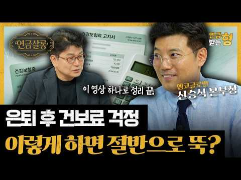
- 설명 앞부분: 많은 분들이 은퇴를 준비하면서 국민연금 수령액만 신경 쓰고, 정작 더 큰 변수인 건강보험료는 놓치고 있습니다. 하지만 피부양자 자격을 잃거나, 퇴직 후 지역가입자로 전환되면 생각보다 큰 건강보험료를 부담할 수도 있습니다. 특히 부동산 보유 여부, 공적연금 수령액, IRP·연금저축 활용, 재취업 여부에 따라 건강보험료는 크게 달라질 수 있습니다. 👇 은퇴 후 수백만 원의 건보료 차이를 만드는 핵심 포인트를 영상에서 꼭 확인해 보세요. 🕒 타임라인별로 보기 📅 촬영일: 2026.06.10
- 같은 채널 평소 대비 ×3.0 (채널 최근 롱폼 중앙값 48,556회) · 평소 영상: 노후 자금 1억 원으로 돈 걱정 없는 노후를 준비하고 싶다면 이렇게 하세요 ∣ 강영선 박… (50,065회) / 퇴직연금 1억, 30년 동안 끊기지 않게 받는 법 ∣ 강영선 박사 ∣ 연금받는형 (47,046회)
- 대본 없음 (설명) — 음성인식이 끝나면 도입부·흐름이 들어감
- 댓글 128/128: 좋은 점 — 영상 2 · 감사·응원 0 · 더 알고 싶은 것 2 · 아쉬운 점 — 영상 4 · 반박·불만 — 의견 다름 7 · 정치·사회 6 · 경험 공유 6 · 구독·다음 기대 0
  - 좋은 점 — 영상 👍3 “건보료 어려운데… 이해가 쏙쏙 됩니다…”
  - 좋은 점 — 영상 👍1 “임의계속가입 시 건강보험료는 본인 부담분만 포함되는데 설명을 잘 못 하신 것 같습니다.”
  - 더 알고 싶은 것 👍3 “임의계속 신청시 퇴직전 납부액의 2배가 되는 건 아니라고 챗지피티 조회 하니 나오는데 어떤 게 맞나요?”
  - 아쉬운 점 — 영상 👍0 “틀린 부분 1. 퇴직 후 임의 3년동안 내는 건보료는 근로자부담 50%만 해당 2. 자식이 사업자등록이 되어있고 소득이 0원이라면 피부양자 지위 유지됨 - 매년 11월 정기조사 시 검증됨”
  - 반박·불만 — 의견 다름 👍32 “17:02 건강보험료 임의계속가입은 퇴직 전 직장에서 내던 본인부담(50%)에 해당되는 금액을 최대 3년동안 유지할 수 있도록 지원하는 제도 입니다. (회사에서 지원해주던 50%를 합하여 100%를 내는 것이 아닙니다.)”
  - 반박·불만 — 의견 다름 👍31 “집한채 없어도 국민연금 좀 받으면 건보료 많이냅니다 이건 아니죠 국민연금은 좀 빼라 기초연금에도 연계시키지말고”
  - 정치·사회 👍64 “외국인들 건보료혜택 폐지하라.”
  - 정치·사회 👍48 “국가나 정부 라면 기업을 활성화토록 해 세수를 확보하고 매년 일반국민의 세부담을 줄여주는 쪽으로 해야 하는 거 아닌가요 국세청이 정권에 따라 매년 세수확보한 답시고 기존의 제도까지 없애가며 국민세부담을 늘리는 게 맞는가요 물가 감안하고 환율 감안하면 2026년에 개인…”
  - 경험 공유 👍0 “금융소득 높으면 직장가입자도 건보료 따로 내던데요?? 제가 잘못 들은 걸까요?”

### 127. 국민연금 추납, 1,850만원 내고 월 15만원 더 받으면 이득일까?

- https://www.youtube.com/watch?v=acPLoAXYROM · 김성일 TV · 구독자 28,700 · 조회수 194,385 (×6.8, 하루 3,882.5) · 좋아요 623 (0.3%) · 14.2분 · 2026-08-25 · 주제 묶음 4. 노후·연금 · 형식 정보·해설 (그 밖) · 폴더 `W_acPLoAXYROM` (웹 승인)
- 썸네일: 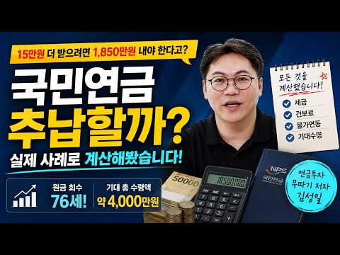
- 챕터: 0:00 카페에 올라온 질문 — 추납할까 말까 · 1:07 추납 제도 정리 (조건·한도 119개월·보험료 계산식) · 2:27 공단 안내 확인 — 월 97.7만 원 → 113만 원 · 3:54 빠진 것 두 가지: 세금·건보료, 물가연동 · 5:17 세후 실수령과 원금 회수 시점 · 5:42 얼마나 오래 사느냐 — 사망 시점별 실질수익률 · 7:44 소득공제까지 넣은 실질 순투입 · 8:19 연금저축과 비교하면 몇 %를 넘겨야 하나 · 11:47 주의 — 고소득 사업장 가입자 · 12:21 실행 팁 세 가지
- 설명 앞부분: 국민연금 추납, 52개월에 1,850만 원을 넣으면 65세부터 월 15만 3천 원을 더 받습니다. "10년이면 원금 회수"라는 계산이 실제로 맞는지, 세금·건강보험료·물가연동을 모두 넣어 다시 계산했습니다. 사례는 만 34세, 공무원으로 근무하다 이직해 현재 국민연금 가입 중인 분입니다. ■ 다룬 내용 ■ 더 궁금한 점은 글 남겨주시면 확인해서 영상으로 답변드립니다.
- 같은 채널 평소 대비 ×53.1 (채널 최근 롱폼 중앙값 3,658회) · 평소 영상: [긴급] 기존 ISA 가입자 분들, '이것' 안 하면 무조건 손해입니다! (2026 세제… (3,705회) / [2025년 12월말] 김성일 작가: 절세4총사 계좌인증 : IRP , 연금저축, DC,… (3,612회)
- 대본 없음 (설명) — 음성인식이 끝나면 도입부·흐름이 들어감
- 댓글 107/107: 좋은 점 — 영상 0 · 감사·응원 4 · 더 알고 싶은 것 2 · 아쉬운 점 — 영상 1 · 반박·불만 — 의견 다름 1 · 정치·사회 4 · 경험 공유 9 · 구독·다음 기대 0
  - 감사·응원 👍3 “기가맥히는 계산 감사합니다 추납보험료가 꽤 높아서고민이었는데 투자하는게 훨씬 낫겠네요”
  - 더 알고 싶은 것 👍4 “저는 66년 12월생으로 올 연말까지 국민연금을 의무 납부합니다. 현재 주20시간 근무라 매월 납부금액이 최저 수준인 95,000원. 2031년 1월부터 매월 64만원을 수령하는데 중간에 쉬었던 기간을 추납할 수 있어요. 119개월 치 11,146,730원을 추납하면…”
  - 더 알고 싶은 것 👍0 “저는 93년 3월 가입해서 몇개월 납입후 군대를가서 93년7월부터 95년 9월까지..26개월 추납이 가능하다고합니다. 현재 매달 매월 납입금이 대강 62만원인데 26개월 * 62만원시 1610만원 추납가능하다고해요. 그러면 현재 세후로 65세때 181만원인데 전액추납…”
  - 정치·사회 👍39 “외국인 우리나라 국민연금 왜 퍼주는건지”
  - 정치·사회 👍3 “국민연금은 좋은제도. 1. 자국민 65세이상 국민연금 60프로 받는다. - 수급자 평균 약70만원(40%는 0원) 2. 외국인도 국민연금 준다. 중국인 위해 자국민도 못 받는 국민연금을. 중국 홈쇼핑에 나올꺼야 3. 선진국 연금 구조 : 한국이 최고수준(세계호구) -…”
  - 경험 공유 👍9 “제가 봤을때는 계산으로야 정리하신게 맞을겁니다.하지만 1.안전한 투자면서 물가연동을 선택할것인지, 불확실하지만 기대수익이 높은것을 선택할지에 대한것이 가장 크다고 보구요 2.심리적으로 봤을때 지금 천만원을 추납 안하면 과연 그 돈을 제대로 투자할까 싶습니다. 잘해봐야…”
  - 경험 공유 👍8 “추납무조건유리합니다.꼭다들하세요.A값 계속 상승하고 물가상승률반영 재평가율 상승. 내가 운영안해도 죽을때까지 국가에서 줍니다. 추납하고 잊어버리세요.”

### 128. 나스닥100 1배수, 2배수, 3배수 20년 어떤 성과 보여주나(거치식, 적립식, 리벨런싱) ㅣ QQQ, QLD, TQQQ,

- https://www.youtube.com/watch?v=dQdACzI6nKE · 레버리지 하는 미국회계사 장기투자 여정 · 구독자 13,100 · 조회수 84,907 (×6.5, 하루 731.2) · 좋아요 2,109 (2.5%) · 16.3분 · 2026-06-20 · 주제 묶음 3. 주식·ETF · 형식 정보·해설 (그 밖) · 폴더 `W_dQdACzI6nKE` (웹 승인)
- 썸네일: 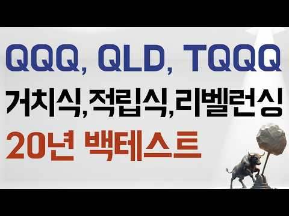
- 챕터: 0:00 나스닥100 1배수, 2배수, 3배수 백테스트 시작 · 1:56 QQQ, QLD, TQQQ백테스트 조건 공개 (20년… · 2:48 QQQ, QLD, TQQQ 거치식 결과 — 2천만원,… · 7:46 QQQ, QLD, TQQQ 적립식 매수 결과 · 9:42 QQQ, QLD, TQQQ 리밸런싱 전략 결과 · 14:46 QQQ, QLD, TQQQ 3가지 투자방식 결론
- 설명 앞부분: QQQ, QLD, TQQQ — 20년 백테스트로 다 보여드립니다 1배, 2배, 3배 중에 도대체 뭘 모아야 하냐는 질문, 정말 많이 받았어요. 어떤 영상은 "1배가 국밥이다", 어떤 영상은 "3배 아니면 의미 없다" — 의견만 난무하고 진짜 데이터는 본 적이 없으실 거예요. 그래서 이번엔 20년치 실제 데이터로 끝까지 파봤습니다. 저는 미국 공인회계사이자 전직 펀드매니저입니다. 법인 계좌로 QLD를 메인으로 매일 매수하고 있고, 2022년 TQQQ -80% 폭락을 직접 겪고 2025년에 2~3배 수익으로 전량 매도한 경험이 있어요…
- 같은 채널 평소 대비 ×5.8 (채널 최근 롱폼 중앙값 14,613회) · 평소 영상: QLD 매일 매월 매수? 타이밍 보다 더 중요한 건 '언제 사서 언제 파느냐'다(QQQ,… (14,613회) / QLD랑 가장 잘 어울리는 배당주는 무엇인가 I SCHD, VYM, DGRO, VIG, … (14,301회)
- 대본 없음 (설명) — 음성인식이 끝나면 도입부·흐름이 들어감
- 댓글 390/390: 좋은 점 — 영상 21 · 감사·응원 51 · 더 알고 싶은 것 43 · 아쉬운 점 — 영상 0 · 반박·불만 — 의견 다름 4 · 정치·사회 1 · 경험 공유 25 · 구독·다음 기대 3
  - 좋은 점 — 영상 👍70 “저도 22년에 tqqq -80% 뚜드려맞아보고 qld를 매월 무지성적립식으로 하고있습니다. 그리고 200일 이평선 아래로 tqqq가 떨어지면 트리거로 생각해서 tqqq도 분할매수하고 있습니다. 좋은 영상 감사합니다.”
  - 좋은 점 — 영상 👍19 “와 많은 유튜버들이 하는 백테스트는 비슷했는데 이렇게하는건 유일하네요 질좋은 영상입니다”
  - 감사·응원 👍70 “저도 22년에 tqqq -80% 뚜드려맞아보고 qld를 매월 무지성적립식으로 하고있습니다. 그리고 200일 이평선 아래로 tqqq가 떨어지면 트리거로 생각해서 tqqq도 분할매수하고 있습니다. 좋은 영상 감사합니다.”
  - 감사·응원 👍29 “저는 얼마전부터 모아오던 QQQ를 QLD로 전환 매수했고 매달 월급날에 추매하는 장기 투자를 목표하고 있구요. 나스닥의 우상향을 믿지만 2배수라서 약간의 두려움도 있었는데 이 방송을 보고 나니 QLD가 더욱 든든해보입니다. 이렇게 좋은 방송을 공유해주셔서 진심으로 감…”
  - 더 알고 싶은 것 👍8 “백데이터는 환율이 상승했던 20년간인데요. 만약 현재 1500원대 환율이 900원대로 20년간 하락할 시의 시뮬레이션도 부탁드려봅니다. 모든 가정은 열어두어야 하니깐요. 앞으로도 환율이 고정 내지는 계속 상승할지는 알 수 없다고 생각해요. 수식을 잘 사용하시는 회계사…”
  - 더 알고 싶은 것 👍4 “추천 및 구독 하였습니다 Tqqq, qld, qqq 매월 적립식이 수익이 좋은데 만약 10년, 15년, 20년 매달 매수시 어느 계좌에 사야하나요? 그리고 미장에 직투 해야하나요? 국내 상장 나스닥을 해야하나요?”
  - 반박·불만 — 의견 다름 👍0 “영상 너무나 감사히 잘 보았습니다. 혹시 어느 일정부분 목표수익률이 났을때 매도 하고 기다렸다가 매도후 일정부분이 빠졌을때 다시 매수하고를 반복하면 어떤 결과가 나오는지도 궁금하네요^^ 22%로 세금등 때문에 말도 안돼는 설정일까요? 주린이라 ^^”
  - 정치·사회 👍2 “이게 맞는게 미국 우상향을 믿는다면 가능함 ㅋ 지금 버블이니 뭐니 하는데 실적도 따라오고 무엇보다 기준 금리가 이미 3.25%임 금리를 올린다해도 선반영이고 11월 트럼프 중간선거 이전이라 주식 부양해야됨 ㅋ 그래서 부랴부랴 이란 이스라엘 협력해라하는데 미국 쪽도 못…”
  - 경험 공유 👍70 “저도 22년에 tqqq -80% 뚜드려맞아보고 qld를 매월 무지성적립식으로 하고있습니다. 그리고 200일 이평선 아래로 tqqq가 떨어지면 트리거로 생각해서 tqqq도 분할매수하고 있습니다. 좋은 영상 감사합니다.”
  - 경험 공유 👍29 “저는 얼마전부터 모아오던 QQQ를 QLD로 전환 매수했고 매달 월급날에 추매하는 장기 투자를 목표하고 있구요. 나스닥의 우상향을 믿지만 2배수라서 약간의 두려움도 있었는데 이 방송을 보고 나니 QLD가 더욱 든든해보입니다. 이렇게 좋은 방송을 공유해주셔서 진심으로 감…”
  - 구독·다음 기대 👍29 “저는 얼마전부터 모아오던 QQQ를 QLD로 전환 매수했고 매달 월급날에 추매하는 장기 투자를 목표하고 있구요. 나스닥의 우상향을 믿지만 2배수라서 약간의 두려움도 있었는데 이 방송을 보고 나니 QLD가 더욱 든든해보입니다. 이렇게 좋은 방송을 공유해주셔서 진심으로 감…”
  - 구독·다음 기대 👍1 “(제가 숫자를 다시 수정하였어요. 예를들지 않고 영상속 나온 돈으로 그대로 계산했을경우로요. 답변 꼭 부탁드리겠습니다. 정말 감사드립니다) 제가 채널을 뒤늦게 알고, 영상 정주행하며 열공중입니다. 정말 절 10번 드리고싶어요. 너무 궁금한 부분을 속시원하게 검증해주시…”

### 129. 50대 이후, 이런 집에 살면 노후가 무너집니다

- https://www.youtube.com/watch?v=NGLEPdYvQdQ · 김지호의 공간문해력 · 구독자 18,300 · 조회수 114,720 (×6.3, 하루 1,080.5) · 좋아요 2,380 (2.1%) · 18.2분 · 2026-06-30 · 주제 묶음 4. 노후·연금 · 형식 인터뷰·강연·대담 · 폴더 `W_NGLEPdYvQdQ` (웹 승인)
- 썸네일: 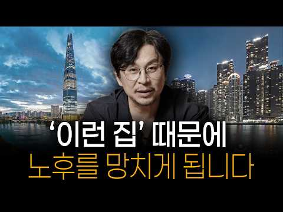
- 설명 앞부분: 노후에는 집의 크기나 가격보다 더 중요한 것이 있습니다. 젊을 때는 좋아 보였던 고층 아파트, 넓은 집, 관리비가 많이 드는 집이 나이가 들수록 오히려 생활을 불편하게 만들고 노후 자금을 빠르게 줄어들게 만들 수 있습니다. 이번 영상에서는 50대 이후부터 조심해야 할 집의 특징과 노후에 편안하게 살기 위해 어떤 집을 선택해야 하는지 이야기해봅니다. 지금 살고 있는 집이 정말 내 노후에 맞는 집인지 한 번 점검해보시기 바랍니다.
- 같은 채널 평소 대비 ×1.2 (채널 최근 롱폼 중앙값 95,790회) · 평소 영상: "이게 대한민국 현실입니다" 평생 집 한채 마련했는데 갈 곳 없는 노후의 현실 (105,414회) / 노년에 '이 집' 선택했다가 평생 후회합니다.｜김지호의 공간문해력 (86,352회)
- 대본 없음 (설명) — 음성인식이 끝나면 도입부·흐름이 들어감
- 댓글 207/207: 좋은 점 — 영상 15 · 감사·응원 9 · 더 알고 싶은 것 0 · 아쉬운 점 — 영상 0 · 반박·불만 — 의견 다름 2 · 정치·사회 0 · 경험 공유 27 · 구독·다음 기대 0
  - 좋은 점 — 영상 👍43 “참으로 좋은 영상입니다. 도움이 많이 됩니다.👍”
  - 좋은 점 — 영상 👍19 “맞는 말씀이네요 나이 들수록 고층은 피하는게 답임”
  - 감사·응원 👍48 “아파트삶에 대해 알고 싶어 들어왔어요. 50대 입니다. 정보차원의 말을 주의깊게 가만히 듣다보니 문학작품을 읽는것 같았습니다. 울림이 있는 내용과 글 감사합니다.”
  - 감사·응원 👍8 “유익했습니다. 감사합니다.^^”
  - 반박·불만 — 의견 다름 👍10 “채광까재 동일하면 선생님 말씀이 맞습니다. 그치만 저층과 고층이 일조향까지 같은 경우는 거의 없다고 봐야죠, 뷰 역시 마찬가지입니다. 층슈는 단순한 물리적 위치가아닙니다. 일조권과 조망권의 가치죠”
  - 반박·불만 — 의견 다름 👍1 “그게 아닌데 소음 하고 ,벌레 모기 올라오는게 다름 ,물론 15층 이상은 영향 없음”
  - 경험 공유 👍55 “저도 10층이상에서 살다가 지금은 2층에서 살고 있는데 너무 만족합니다. 휴양림에 놀려온거 같아요”
  - 경험 공유 👍47 “7층 살때 제일 좋았어요 숲도 보이고 하늘도 보이고 채광도 바람도 너무 좋았던 2006년식 아파트 그집에서 제일 돈도 많이 벌고 건강했고 행복했었죠.”

### 130. 주식 ETF 자산 17억 구독자님의 포트폴리오 분석, 세금 건보료 절세 위한 추가 전략

- https://www.youtube.com/watch?v=x26AhOtaVsg · 배당으로 부자되기 · 구독자 8,560 · 조회수 53,030 (×6.2, 하루 351.4) · 좋아요 943 (1.8%) · 15.2분 · 2026-05-16 · 주제 묶음 3. 주식·ETF · 형식 정보·해설 (그 밖) · 폴더 `W_x26AhOtaVsg` (웹 승인)
- 썸네일: 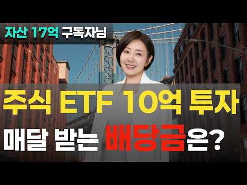
- 챕터: 0:00 10억 ETF 투자 시 매달 들어오는 배당금 규모 · 1:05 17억 자산가 구독자님의 현실적인 스펙 및 자산 현황 · 1:46 1만 주 매집으로 12억 수익을 올린 킬러 콘텐츠 분석 · 2:32 은퇴 후 자산을 지키는 '분배와 방어' 리밸런싱의 시작 · 3:18 월 1,000만 원 현금흐름을 만드는 2가지 핵심 커… · 4:26 실제 수령액 1,000만 원 이상, 그러나 정부가 잡… · 6:02 실제 소득을 1/3로 줄여주는 국내 커버드콜 ETF의… · 6:59 직장 가입자 자격 유지를 통한 건강보험료 추가 부담 … · 10:45 세후 수익률을 극대화하는 감액 배당주 투자
- 설명 앞부분: 은퇴 후 진짜 수익률을 결정하는 것은 주가 상승률이 아니라 세금 구조와 건강보험료입니다. 국내 지수형 커버드콜 ETF의 비과세 옵션 프리미엄 구조를 활용하면, 실제 월 1,030만 원을 수령하더라도 과세 대상 소득은 337만 원 수준으로 대폭 낮출 수 있습니다. 은퇴 후 자산을 불리는 '축적'의 단계에서 안정적으로 지키고 꺼내 쓰는 '분배와 방어'의 단계로 전환하기 위한 명확한 포트폴리오 리밸런싱 전략이 필요합니다. 이 채널 ‘배당으로 부자되기’는 실제 계좌 수익, 배당금, 리밸런싱 데이터를 기반으로 파이어족을 위한 현실적인 배당…
- 같은 채널 평소 대비 ×4.2 (채널 최근 롱폼 중앙값 12,727회) · 평소 영상: 목돈으로 배당 세팅하는 순서 6단계 — 연 1,000만 원까지는 그냥 배당주로 받으세요 (13,043회) / 배당 연 2천만 원 넘게 받으면서 건보료 부담 안 생기려면 (제 실제 원천징수 내역 공개) (12,411회)
- 대본 없음 (설명) — 음성인식이 끝나면 도입부·흐름이 들어감
- 댓글 78/78: 좋은 점 — 영상 3 · 감사·응원 8 · 더 알고 싶은 것 3 · 아쉬운 점 — 영상 1 · 반박·불만 — 의견 다름 1 · 정치·사회 0 · 경험 공유 3 · 구독·다음 기대 0
  - 좋은 점 — 영상 👍1 “퇴직후18억정도 자산 분배 고민중에 좋은 정보감사합니다.”
  - 좋은 점 — 영상 👍1 “좋은 정보 감사하겠습니다 😊”
  - 감사·응원 👍5 “영상 잘 보고 있습니다. 퇴직금 2억정도 있는데 월배당 ETF에 투자하고 싶습니다. 어떤 종목이 좋은지 콕 찝어서 주시면 감사하겠습니다.”
  - 감사·응원 👍4 “넘 좋을 몰랐던 배움 주셨으니 더 사유해보겠습니다 감사드립니다”
  - 더 알고 싶은 것 👍2 “잘 보고 갑니다 실제 포트 폴리오를 그래픽으로 올려 주시면 조금 더 이해다 쉬울 텐데 조금 아쉽네요”
  - 더 알고 싶은 것 👍0 “오늘도 많은 도움이 되었어요. 조금씩 지식을 쌓아가고 있습니다. 다른 사람들의 사례를 들어 설명해 주시는 부부도 도움됩니다. 앞으로도 계속해서 알려주세요. 감사합니다.”
  - 아쉬운 점 — 영상 👍2 “잘 보고 갑니다 실제 포트 폴리오를 그래픽으로 올려 주시면 조금 더 이해다 쉬울 텐데 조금 아쉽네요”
  - 반박·불만 — 의견 다름 👍0 “Tiger ,kodex 커브드콜 세금기준 배당금 4000만원 아닙니다 저랑비슷한 규모 같은데 년 1600이하 입니다 새로계산해보세요”
  - 경험 공유 👍1 “저도 폭락장 기다리는1인입니다 티큐 평단 20 브럽네용”
  - 경험 공유 👍0 “저도 같은 케이스인데 상담을 좀 받을 수 있을까요.. ? 미장 위주로 하다보니 33억이 넘었어요… 배당주로 좀 돌리면서 세금을 최소화 하고 싶은데 ㅠ”

### 131. QLD 직투 vs ISA, 잘 못 선택하면 10년 뒤 수천만 원 손해 봅니다.

- https://www.youtube.com/watch?v=vU5AK1FfCqQ · 돈재이 DONJAY · 구독자 19,700 · 조회수 121,030 (×6.1, 하루 999.5) · 좋아요 2,520 (2.1%) · 20.3분 · 2026-06-15 · 주제 묶음 6. 절세·제도 · 형식 오디오북·낭독 (명언·인생조언) · 폴더 `W_vU5AK1FfCqQ` (웹 승인)
- 썸네일: 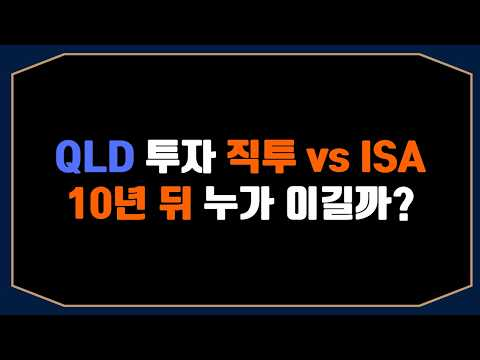
- 설명 앞부분: ⭐안녕하세요, 본 채널은 저의 개인적인 투자 여정과 장기 투자 철학을 기록하는 공간입니다. 제가 겪은 시행착오와 시장을 바라보는 관점이 여러분의 투자 공부에 작은 참고가 되기를 희망합니다. 다만, 채널의 모든 콘텐츠는 정보 전달을 목적으로 제작되었습니다. 여러분의 성공적인 투자 여정을 응원합니다.
- 같은 채널 평소 대비 ×6.8 (채널 최근 롱폼 중앙값 17,786회) · 평소 영상: 수익률 200%차이? 적립식 투자 수익률 어떤 것이 더 높을까? 매일 사기 vs 매주 사… (17,786회) / 환율 계속 떨어지는데 QLD 투자해도 될까? 제 결론입니다 (17,646회)
- 대본 없음 (설명) — 음성인식이 끝나면 도입부·흐름이 들어감
- 댓글 465/465: 좋은 점 — 영상 11 · 감사·응원 35 · 더 알고 싶은 것 44 · 아쉬운 점 — 영상 5 · 반박·불만 — 의견 다름 3 · 정치·사회 3 · 경험 공유 15 · 구독·다음 기대 3
  - 좋은 점 — 영상 👍9 “아주 좋은 정보네요”
  - 좋은 점 — 영상 👍7 “좋은 정보 감사합니다. 앞으로 원화 하락 계속 될테니 국내 상장 ETF로 나스닥 상승과 환율에서 2배로 먹겠습니다.”
  - 감사·응원 👍23 “감사합니다. 환차손까지 레버리지가 되는지 전혀 생각 못 했습니다.”
  - 감사·응원 👍18 “ISA투자 계속 지피티한테 물어봤는데도 답이 안나왔는데 이영상하나로 머리속이 깔끔해졌습니다 타이거로 가겠습니다 감사합니다”
  - 더 알고 싶은 것 👍5 “안녕하세요. 다름아니라 삼성증권 해외주식 팀에 전화로 문의했을때, tiger미국나스닥100레버리지 종목은 환율 2배 추종이 아닌, 1배 추종이라고 분명히 답변 받았었거든요. 나스닥 지수는 2배 추종이 맞지만, 환율은 1배를 따라간다라고 들었는데 무엇이 사실일까요? 환…”
  - 더 알고 싶은 것 👍4 “도움이 많이 되었습니다. 궁금한 점을 깔끔하게 설명해주시네요^^ ISA 올해 계좌한도가 다 차서 못하고 일단 이번 달부터 직투로 QLD 조금씩 매수 중입니다.^^ 내년에는 ISA 직투 반반씩 적립해 나가야 겠네요^^ 오픈채팉방이 다 찼네요 ㅠ 추가개설 부탁드립니다.”
  - 아쉬운 점 — 영상 👍9 “ISA는 소수점 안되는게 아쉽네요”
  - 아쉬운 점 — 영상 👍5 “장기로보고isa3년마다 해외직투계좌로 옮기고 해지후재가입 최대금액넣고 반복이 베스트라고봅니다 어느정도 지나 덩치가 커지면 현금흐름용 커버드콜을 isa 활용하면 건보료 상승없이 또 qld적립매수가능하구요”
  - 반박·불만 — 의견 다름 👍0 “(타이거 나스닥100 레버리지) h가 붙는건 노출이아닌데 왜? 붙은걸헷지라해?”
  - 정치·사회 👍7 “직투에서 달러 확보 얘기하는 사람은 진짜 나라가 붕괴해서 복구 불능 상태로 간다는 가정으로 하는거임 환 노출 모르는게 아니라”
  - 정치·사회 👍3 “ISA 단점 원금을 1억까지 밖에 못 넣는다. 언제가는 계좌 해지해야 하기때문에 복리가 깨진다. 직투 계좌 직접 매도 하기전까지는 무한정 매수가 가능하다 복리가 계속 불어난다. 결론 양도세 22퍼 내더라도 장기 투자시 수익율이 ISA 보다 직투가 높다 끝 ISA에서 …”
  - 경험 공유 👍47 “사람들이 잘 이해를 못하네... Isa 먼저 년 2천만원 채우고 남으면 직투로 qld하면 됨. 저도 같이 하는데 너무 좋은거 같아요. 빨리 5년에 1억 한국판qld채우는게 목표입니다”
  - 경험 공유 👍5 “신박한 주제라 신규유입(?)이 많아서 그런지 요상한 댓글이 많이 보이네요😂 저도 isa한도 다 채워지고 남으면 직투에 넣어요ㅎㅎ”
  - 구독·다음 기대 👍2 “잘봤어요 감사합니다! 구독했어요😊”
  - 구독·다음 기대 👍1 “구독했습니다 3번방 부탁드립니다”

### 132. "S&P500 ETF, 종목보다 '계좌'가 20년 뒤를 바꾸는 진짜 이유 (연금·ISA)"

- https://www.youtube.com/watch?v=fmQLRfIm28Y · 야무진 경제학 · 구독자 22,500 · 조회수 137,168 (×6.1, 하루 1,393.0) · 좋아요 3,515 (2.6%) · 28.4분 · 2026-07-07 · 주제 묶음 3. 주식·ETF · 형식 정보·해설 (그 밖) · 폴더 `W_fmQLRfIm28Y` (웹 승인)
- 썸네일: 
- 챕터: 0:00 종목은 담았는데 왜 내 계좌만 이 모양일까 · 2:19 원칙 ① 짐을 줄여라 — 종목이 많을수록 위험한 이유 · 5:02 원칙 ② 오래 메고 걸어라 — 매달 30만원 20년의… · 8:26 40세 시작 vs 50세 시작, 10년이 만든 격차 · 10:03 목돈 한 번에? 나눠서? 리밸런싱은 언제 · 10:44 우리가 가장 많이 하는 두 가지 오해 · 11:49 달콤한 함정 — 월배당·커버드콜의 진실 (금감원 경보) · 15:25 반전 — 짐이 아니라 '배낭'을 바꾸는 고수들 · 16:42 방수 배낭 ① 연금저축·IRP, 148만원 돌려받는 법 · 19:25 방수 배낭 ② ISA, 3년 유연 + 비과세 · 20:59 같은 상품 김 씨 vs 박 씨, 10년 뒤 잔고 차이 · 22:38 ISA를 연금으로 갈아타 혜택 두 번 챙기는 기술 · 24:04 꼭 알아야 할 주의점 — 중도해지 벌금 & ISA 한… · 25:47 오늘 걸어온 길 정리 — 짐이 아니라 배낭이 결과를 …
- 설명 앞부분: S&P500 ETF, 좋다는 종목만 열심히 담았는데 왜 내 계좌만 안 불어날까요? 문제는 '무엇을 담느냐'가 아니라 '어떤 계좌에 담느냐'입니다. 오늘은 ETF 투자를 배낭여행에 빗대, 20년 뒤 통장을 바꾸는 절세계좌(연금저축·IRP·ISA) 활용법을 한 번에 정리했습니다. 똑같은 미국 지수 ETF를 일반계좌(비닐봉지)에 담은 사람과 절세계좌(방수 배낭)에 담은 사람의 결과가 왜 갈리는지, 그리고 요즘 인기인 월배당·커버드콜의 숨은 함정(금융감독원 소비자경보)까지 짚습니다. 종목 압축, 복리의 시간, 절세계좌라는 세 가지 뼈대만…
- 같은 채널 평소 대비 ×12.9 (채널 최근 롱폼 중앙값 10,609회) · 평소 영상: "50대라면 월 75만원 이렇게 넣어두세요, 65세부터 매달 들어옵니다" (10,609회) / "50대 노후 준비 10년째 못 하는 진짜 이유, 놓친 4가지" (11,156회)
- 대본 없음 (설명) — 음성인식이 끝나면 도입부·흐름이 들어감
- 댓글 115/115: 좋은 점 — 영상 6 · 감사·응원 9 · 더 알고 싶은 것 11 · 아쉬운 점 — 영상 2 · 반박·불만 — 의견 다름 0 · 정치·사회 0 · 경험 공유 4 · 구독·다음 기대 1
  - 좋은 점 — 영상 👍2 “노인초보자가 보기에 아주 핵심적이고 유익해서 구독 했어요❤😅😅 목소리도 좋아요”
  - 좋은 점 — 영상 👍2 “감사합니다 이해가 잘 되네요~~~”
  - 감사·응원 👍9 “감사드립니다 저두 5~6개 담고 있는데 정리하겠습니다”
  - 감사·응원 👍4 “감사합니다”
  - 더 알고 싶은 것 👍9 “연금계좌는 1년에 얼마까지입금(투자)가능한가요?”
  - 더 알고 싶은 것 👍4 “종합과세 때문에 isa 개설이 안되요..ㅜㅜ 비닐봉지에라도 담아야 할까요? 3년뒤 isa개설 가능해지면 그때 담는게 나을까요?”
  - 아쉬운 점 — 영상 👍5 “영상이 깔끔하고 편집이 잘 되어 있어서 보기 편하네요.”
  - 아쉬운 점 — 영상 👍2 “말을 너무 길게 늘림”
  - 경험 공유 👍3 “자식공부시키고 집산다고 그간 세월 다 보낸 60중반인 저희들은 어떻게해야하나요? 😢”
  - 경험 공유 👍1 “내가 들어보니 커버드콜 한번도 투자해 본적없고 주식투자경력10년도 안되었네...좃도 모르네...”
  - 구독·다음 기대 👍2 “구독, 좋아요 ,알림설정 다 눌렀습니다.서운해 하지 마세요~😅”

### 133. 호주 한국 반반 살기 '이것' 모르면 은퇴 자금 거덜 납니다 건강보험 & 세금 폭탄의 진실

- https://www.youtube.com/watch?v=WS4hFxgz01Y · Jungestate · 구독자 3,370 · 조회수 19,864 (×5.9, 하루 152.7) · 좋아요 632 (3.2%) · 15.9분 · 2026-06-06 · 주제 묶음 6. 절세·제도 · 형식 브이로그·직접 해본 이야기 · 폴더 `W_WS4hFxgz01Y` (웹 승인)
- 썸네일: 
- 챕터: 0:00 완벽했던 노후 계획이 악몽으로 변한 순간 · 1:22 역이민을 선택하는 진짜 이유 (철저한 가성비 계산) · 2:32 비자 시스템의 함정: 2026년 F-4 비자와 복수 … · 4:23 가장 치명적인 함정: 건강보험 30일 상실 & 6개월… · 5:31 완벽한 방어막: F-5 영주권 혜택 3가지와 까다로운… · 7:06 보이지 않는 세금 레이저망: 183일 거주자 판정과 … · 8:03 세금 방어 실전 팁: 5년 비과세 특례와 핀테크/해외… · 9:21 연금 퍼즐 맞추기: 호주 연금과 한국 국민연금의 영리… · 10:46 40년 만에 돌아온 한국, 180도 달라진 문화 충격 · 11:50 지방 귀농의 리스크와 현지인이 바라보는 '체리피커' … · 13:35 결론: 실패 없는 역이민을 위한 '테스트 드라이브' …
- 설명 앞부분: 호주에서 수십 년 뼈 빠지게 일하고 선택한 한국 역이민, 과연 장밋빛일까요? 낭만적인 브이로그 뒤에 숨겨진 차가운 현실을 분석했습니다. 시드니 자녀 집에 딱 한 달 다녀왔을 뿐인데 건강보험이 날아가고 6개월을 기다려야 하는 현실, 그리고 이삿짐을 푸는 순간 시작되는 한국 국세청의 '183일 세금 레이저망'까지. 은퇴 자금을 지키고 완벽한 노후를 완성하기 위한 'F-5 영주권' 활용법과 '테스트 드라이브 전략'을 지금 바로 확인하세요. 호주 집을 섣불리 팔기 전에 반드시 이 영상을 끝까지 보셔야 합니다! ⏱️ 타임라인 (Timest…
- 같은 채널 평소 대비 ×2.9 (채널 최근 롱폼 중앙값 6,857회) · 평소 영상: 호주 상속세 0원? 🇦🇺 유언장 써도 내 재산 32% 뺏기는 숨겨진 세금 함정 (10,244회) / 내 수퍼, 진짜 '내 돈' 맞나요? 💸4 5조 달러를 둘러싼 호주 정부의 의도 (3,686회)
- 대본 없음 (설명) — 음성인식이 끝나면 도입부·흐름이 들어감
- 댓글 91/91: 좋은 점 — 영상 10 · 감사·응원 13 · 더 알고 싶은 것 4 · 아쉬운 점 — 영상 3 · 반박·불만 — 의견 다름 0 · 정치·사회 2 · 경험 공유 5 · 구독·다음 기대 0
  - 좋은 점 — 영상 👍6 “마지막에 겸손 언급하신거 급 공감합니다. 이민오시던 시절의 한국이 아니예요. 해외에서 살다왓다고 조금이라도 꺼드럭 거리는거 많이 거슬리지요.”
  - 좋은 점 — 영상 👍4 “은퇴하고 한국에 살려고 했는데......유익한 정보 너무 감사합니다.늘 응원합니다.”
  - 감사·응원 👍4 “은퇴하고 한국에 살려고 했는데......유익한 정보 너무 감사합니다.늘 응원합니다.”
  - 감사·응원 👍4 “유용한 정보 감사합니다! 10년후 역이민을 목표로 달리고 있습니다!”
  - 더 알고 싶은 것 👍2 “정말 설명 똑 부러지게 잘하십니다. 시각적으로, 청각적으로. AI목소리인가요? 목소리 톤도 너무 듣기 좋구요. 저는 1년 뒤 은퇴하는데, 노인연금은 수혜대상이 될 수없어서 수퍼펀드로 만 은퇴 설계를 해야하는 관계로 혹 저와 같은 입장인 많은 은퇴자를 위해 은퇴후의 수…”
  - 더 알고 싶은 것 👍1 “정말 유익한 정보 감사드립니다. 영상을 보다가 궁금한 것들이 생각이 들어 질문드립니다. 호주국적자가한국에 조그마한 아파트를 투자 및 향후 사용 계획으로 구매하는 것에 대해 어떻게 생각하시는지 그리고 미리 염두해 두어야 할 것이 무엇이 있을까요? 주택을 취득하게 되면 …”
  - 아쉬운 점 — 영상 👍6 “틀린 내용이 많아 바로 잡습니다. 호주 영주권자 인경우 암치료 RNSH 같은 삼성병원 보다 시설 좋은곳에서 더 좋은 약,수술등 공짜 치료됩니다.또한 한국에서 보험이 안되는 비싼약도 DSP 경우 거의 공짜 입니다. 불과 몇십불이면 됩니다.아울러 환자에 대한 배려도 정말…”
  - 아쉬운 점 — 영상 👍2 “정말 설명 똑 부러지게 잘하십니다. 시각적으로, 청각적으로. AI목소리인가요? 목소리 톤도 너무 듣기 좋구요. 저는 1년 뒤 은퇴하는데, 노인연금은 수혜대상이 될 수없어서 수퍼펀드로 만 은퇴 설계를 해야하는 관계로 혹 저와 같은 입장인 많은 은퇴자를 위해 은퇴후의 수…”
  - 정치·사회 👍18 “한국은 더 이상 내 나라가 아니라 내가 태어나서 어린 시절을 보낸 말통하는 나라일뿐입니다. 성인이 된 후 나의 성인 인생을 통틀어 보낸곳이 내 나라 입니다. 영주권으로 사시는 분은 특별한 이유가 있으시겠지만. 자식도 친구도 다 이곳에 있고, 한국에 있는 내 옛친구는 …”
  - 정치·사회 👍0 “영주권자의 경우 한국가도 F4-5 비자가 필요없잖아요? 근데 만약 호주도 반년이상 해외살면 투자용 수입에서 세금이 외국인으로 분류되어 호주거주자보다 많이 내야하는거 맞나요? 지금설명은 시민권으로 바꾸신분의 케이스 같은데… 영주권자의 경우 호주에 투자수입있을시 궁금해뇨”
  - 경험 공유 👍18 “한국은 더 이상 내 나라가 아니라 내가 태어나서 어린 시절을 보낸 말통하는 나라일뿐입니다. 성인이 된 후 나의 성인 인생을 통틀어 보낸곳이 내 나라 입니다. 영주권으로 사시는 분은 특별한 이유가 있으시겠지만. 자식도 친구도 다 이곳에 있고, 한국에 있는 내 옛친구는 …”
  - 경험 공유 👍0 “역 이민은 또다른 외국 경험이라 생각한다. 난 우리집이 편안하고, 사회속에서 내가 그안에 공존을 하니 이사 간 집에서 마지막도 보낼생각이다. 한국방문시 뇌졸증 생겨 일주일 입원 경미 이유로 재활 거부. 바로 안정된 3개월 후 집으로 돌아와 응급실 통해 재활 전문 종합…”

### 134. 삼성전자 투자자분들 주목하셔야합니다 실적은 사상 최대인데 주가는 왜 못 따라갈까? 목표가 48만원·150조 주주환원 총정리했습니다! #삼성전자 #삼성전자주가

- https://www.youtube.com/watch?v=0ftjA5wsqtQ · 코스피 읽는 개미 · 구독자 2,190 · 조회수 12,659 (×5.8, 하루 109.9) · 좋아요 357 (2.8%) · 18.6분 · 2026-06-21 · 주제 묶음 3. 주식·ETF · 형식 정보·해설 (그 밖) · 폴더 `W_0ftjA5wsqtQ` (웹 승인)
- 썸네일: 
- 설명 앞부분: [영상 요약] 하나증권이 삼성전자 목표주가를 48만 원으로 상향했습니다. 그 이유는 AI 반도체 수요 확대에 따른 D램·LPDDR 가격 강세, 그리고 예상보다 강한 실적 개선 때문입니다. 특히 올해 2분기 영업이익은 시장 기대를 크게 웃도는 수준으로 전망되고 있습니다. 또한 삼성전자의 막대한 현금 창출력을 바탕으로 최대 150조 원 규모의 주주환원(배당·자사주 매입) 가능성이 제기되면서 투자자들의 관심이 집중되고 있습니다. 목표주가 48만 원 상향 배경 AI 메모리 시장 성장과 HBM 전망 150조 원 주주환원의 의미 삼성전자 주…
- 같은 채널 평소 대비 ×29.3 (채널 최근 롱폼 중앙값 432회) · 평소 영상: [ 삼성전자 ] 대폭발 시작되나? 반도체 수출 150% 급증…주가 대반전 "신호" 떴다! (451회) / 삼성전자 지금 불장 놓치면 정말 후회합니다...외국인이 돌아오고 있는 "이유" (414회)
- 대본 없음 (설명) — 음성인식이 끝나면 도입부·흐름이 들어감
- 댓글 17/17: 좋은 점 — 영상 0 · 감사·응원 0 · 더 알고 싶은 것 0 · 아쉬운 점 — 영상 0 · 반박·불만 — 의견 다름 1 · 정치·사회 0 · 경험 공유 0 · 구독·다음 기대 2
  - 반박·불만 — 의견 다름 👍3 “무슨 헛소리를? 세계 증권사에서 4.3프로 주주환원의 현금배당을 한 적이나 있나요? 연구개발비랑 투자비는 어찌하고 무슨 주주환원이라고 삼성에서는 하지도 않은 말을 자기들 멋대로 헛소리를 하는지 참”
  - 구독·다음 기대 👍2 “구독완료”
  - 구독·다음 기대 👍0 “구독완료”

### 135. 평생 모은 노후자금 뜯긴 노인들... 조폭 소굴 쳐들어간 아줌마의 100대 참교육 [박여사 6화]

- https://www.youtube.com/watch?v=cc4uBxFSiiY · 아직 늦지 않았습니다 · 구독자 30,800 · 조회수 176,854 (×5.7, 하루 3,504.3) · 좋아요 998 (0.6%) · 9.2분 · 2026-08-24 · 주제 묶음 4. 노후·연금 · 형식 사연·드라마 · 폴더 `W_cc4uBxFSiiY` (웹 승인)
- 썸네일: 
- 설명 앞부분: 평생 모은 노후자금을 노리는 주식 리딩방 사기 조직. 길바닥에 나뒹구는 노인을 보고 박여사의 분노가 폭발한다. "어르신, 제가 꼭 그 돈 찾아올게요." 조폭 소굴로 정면 돌파한 박여사와 전트. 그리고 5화에서 처음으로 패배를 안겼던 그 남자, 왕도일과의 재대결. "열 번 찍어 안 넘어가면 백 번, 백 번 찍어 안 넘어가면 천 번을 찍어." 과연 박여사는 왕도일을 무릎 꿇릴 수 있을까? 이 채널은 AI로 제작됩니다. 중년이 주인공인 이야기를 만듭니다. 평범한 아줌마, 평범한 아저씨. 그런데 건드리면 안 되는 사람들. 본 영상은 AI…
- 대본 없음 (설명) — 음성인식이 끝나면 도입부·흐름이 들어감
- 댓글 36/36: 좋은 점 — 영상 0 · 감사·응원 2 · 더 알고 싶은 것 2 · 아쉬운 점 — 영상 0 · 반박·불만 — 의견 다름 0 · 정치·사회 0 · 경험 공유 0 · 구독·다음 기대 0
  - 감사·응원 👍3 “❤와우 너무 잼나게 보아요 ❤ 박여사님. 뉴욕에서 응원합니다 화이팅 ❤❤”
  - 더 알고 싶은 것 👍2 “빨리 다음화 영상 올려 주세요.”

### 136. 신혼부부가 돈 못 모으는 이유...결혼 후 돈 관리 이렇게 하세요(김경필 머니트레이너)ㅣ보라언니동생 EP.04

- https://www.youtube.com/watch?v=vmjGJVCfwhk · STUDIO OMG · 구독자 31,100 · 조회수 171,556 (×5.5, 하루 7,779.8) · 좋아요 585 (0.3%) · 18.2분 · 2026-09-22 · 주제 묶음 1. 재테크 일반·마인드 · 형식 인터뷰·강연·대담 · 폴더 `W_vmjGJVCfwhk` (웹 승인)
- 썸네일: 
- 설명 앞부분: 오늘은 김경필 머니트레이너 님을 모시고 내 돈 관리법 수업을 듣고 왔어요!💸 곧 결혼을 앞둔 PD동생도, 결혼 2년차인 저도 돈 관리에 고민이 정말 많았는데요! 주식부터 월급 관리, 내집마련까지 2030세대가 필수시청해야 할 자산관리 꿀팁 쏙쏙 뽑아왔으니까 영상 정주행해주세요~! 🎁보라언니동생 4화 댓글 이벤트🎁 참여방법 1. "영상 소감" or “재테크 고민”을 댓글로 남겨주세요 2. 아래 구글 폼에 정보 제출하면 끝! 📚 이벤트 상품 돈쭐남 김경필 쌤의 친필사인 도서 [딱 1억만 모읍시다] 증정! (10명) 🎉 당첨자 발표 개…
- 대본 없음 (설명) — 음성인식이 끝나면 도입부·흐름이 들어감
- 댓글 62/62: 좋은 점 — 영상 8 · 감사·응원 6 · 더 알고 싶은 것 14 · 아쉬운 점 — 영상 1 · 반박·불만 — 의견 다름 0 · 정치·사회 0 · 경험 공유 8 · 구독·다음 기대 1
  - 좋은 점 — 영상 👍6 “우연히 보라님이 떠서 봤는데 필쌤 명강의 너무 잘 봤어요 역시 뭘 해야 하고 하지 않아야 하는지를 명쾌하게 속시원히 풀어주셔서 너무나 감사해요😊”
  - 좋은 점 — 영상 👍5 “최근 재테크에 관심이 많이 생겼는데 뼈 때리는 선생님 말씀 항상 기억해야겠네요, 앞으로도 좋은 영상 부탁드려요!”
  - 감사·응원 👍6 “우연히 보라님이 떠서 봤는데 필쌤 명강의 너무 잘 봤어요 역시 뭘 해야 하고 하지 않아야 하는지를 명쾌하게 속시원히 풀어주셔서 너무나 감사해요😊”
  - 감사·응원 👍4 “유익한 영상 감사합니다. 이제 신혼 1년 채워가는 중인데, 내집 마련의 꿈 한걸음 다가가고싶네요.”
  - 더 알고 싶은 것 👍33 “기존에 혼자살때 돈을 분배하고 저축하고 주식하고 잘 분배했던거 같은데, 부부가 되고나서 소득을 합치고 나니 용돈이 적어서인지 계속 빵꾸나네요ㅠㅠ 혼자 살땐 신용카드도 잘 안썼거든요... 근데 결혼 관련한 명목으로 신용카드 사용량도 늘다보니 감도 안오는 상태로 긁고 있…”
  - 더 알고 싶은 것 👍24 “진짜죄송한데 선생님 강의 풀버전 내주시면안되나요?”
  - 아쉬운 점 — 영상 👍0 “댓글달고 이벤트 참여하려고했는데 사진 첨부가 안되네요 ㅜㅜ 사진 올리는데 계속 거부돼요ㅠㅠ사진이 첨부가 안돼서 양식제출이 불가하다고뜨고 ㅠㅠ 이벤트 참여 꼭 하고싶은데 넘 아쉬워요”
  - 경험 공유 👍10 “출산한지 한달도 안된 구독자입니다🙌🏻 가족이 늘어나니 몸은 힘들지만 매일 행복한 하루를 보내고 있는데요, 문제는 육아휴직으로 소득절벽이 되면서 앞으로 우리가정의 지출은 어떻게 줄이고 저축을 어떻게해야할지 현실적으로 좀 막막한 마음입니다🥲 선생님의 뼈때리는 조언을 영상…”
  - 경험 공유 👍2 “강사님 교육이 T스럽게 딱 딱 현실만 짚어주셔서 넘 좋아요 ㅋㅋㅋ 저도 2030세대로 공감되는 부분이라 집중해서 봤어요 이런 영상 많이 만들어주세요!!😂 부동산, 아파트 매매 이런 쪽도 궁금해졌어요”
  - 구독·다음 기대 👍1 “예전 국민영수증때부터 즐겨듣던 팬입니다! 40대 미혼으로 살아갈 사람들의 재테크도 알려주시면 감사하겠습니다! 내집 마련 이후의 재테크요”

### 137. 돈 없는 58세 재혼녀가 젊은 애들보다 더 약아 빠져도 되는 이유

- https://www.youtube.com/watch?v=QnnwzV8yHpU · 내 누군지 아나? · 구독자 6,190 · 조회수 33,695 (×5.4, 하루 481.3) · 좋아요 706 (2.1%) · 29분 · 2026-08-05 · 주제 묶음 기타 · 형식 정보·해설 (그 밖) · 폴더 `W_QnnwzV8yHpU` (웹 승인)
- 썸네일: 
- 챕터: 0:00 그 사람이 연금을 물었을 때 · 1:03 새벽 6시 괴안동, 쉰여덟의 하루 · 6:04 연금 창구에서 들은 세 문장 · 10:26 사랑은 반반이어도 목소리는 반반이 아니다 · 14:35 제도가 결혼하지 말라고 말한다 · 18:34 그럼 나는 뭘 받고 저 집에 들어가지 · 22:27 순서를 바꾸는 세 가지 · 27:38 공책에 적은 세 줄
- 설명 앞부분: 💬 소개받은 사람 앞에서 그 사람 집이 누구 명의인지, 연금은 얼마나 나오는지 속으로 세어본 적 있으세요? 🌱 그리고 그런 자신이 싫어서 아무에게도 말 못 하셨죠. 오늘은 그 부끄러움을 정면으로 열어봅니다. ✨ 쉰여덟 아나의 재혼 이야기예요. 계산한 게 잘못이 아니라, 계산을 숨긴 채 사랑이라고 부른 게 잘못이었어요. 이 영상에서 다루는 내용 💸 이혼 6년 차, 통장 잔액 0원인 쉰여덟이 밤마다 63세·68세·75세를 세는 이유 🏦 국민연금공단 창구에서 들은 세 문장 — 분할연금 요건(혼인 5년·50%), 출생연도별 지급개시연령(…
- 같은 채널 평소 대비 ×13.7 (채널 최근 롱폼 중앙값 2,461회) · 평소 영상: 자식이 부모를 끊게 만드는 말 3가지, 세 번째에서 관계가 끝납니다 (2,461회) / 다 버렸는데 또 그대로였어요, 58세 아나가 서랍을 못 비운 진짜 마음 (2,477회)
- 대본 없음 (설명) — 음성인식이 끝나면 도입부·흐름이 들어감
- 댓글 106/106: 좋은 점 — 영상 0 · 감사·응원 2 · 더 알고 싶은 것 0 · 아쉬운 점 — 영상 0 · 반박·불만 — 의견 다름 4 · 정치·사회 0 · 경험 공유 5 · 구독·다음 기대 0
  - 감사·응원 👍13 “영상감사합니다 ~^^”
  - 반박·불만 — 의견 다름 👍106 “함께 이룬 재산도 아닌데 재혼하면서 왜 그걸 자기랑 공유해야한다고 생각하는지...”
  - 반박·불만 — 의견 다름 👍41 “너머돈. 먹는게. 쉬운게. 아닙니다”
  - 경험 공유 👍54 “아버지는 제가 열네 살이 되던 해, 너무 일찍 세상을 떠나셨습니다. 그날 이후 어머니는 아버지의 빈자리까지 홀로 감당하며 두 형제를 키우고 공부시키셨습니다. 살다 보면 문득 이런 생각이 듭니다. 평생 자식들만 바라보며 살아온 어머니에게도 이제는 곁에서 손을 잡아 주고…”
  - 경험 공유 👍6 “재혼도 솔직히 남자는 돈이 있어야 하고 여자는 돈있는사람 찾고있는것 같다 아님분도 있다 하지만 솔직히 내가 돈있는 여자라면 재혼하기싫다”

### 138. 1억을 모았다면 20억까지 절대 꿈의 숫자가 아닙니다 (돈의 물리학)

- https://www.youtube.com/watch?v=gPYpuRW8UOk · 경제기상도 · 구독자 4,310 · 조회수 22,754 (×5.3, 하루 144.9) · 좋아요 486 (2.1%) · 16.9분 · 2026-05-10 · 주제 묶음 2. 돈 모으기·저축 · 형식 정보·해설 (그 밖) · 폴더 `W_gPYpuRW8UOk` (웹 승인)
- 썸네일: 
- 설명 앞부분: 1억을 모았다면 이미 20억까지 '30%'는 끝난 겁니다 (돈의 물리학) 왜 첫 1억이 20억의 5%가 아니라 30%인가? (부의 임계점) 0원에서 1억까지가 가장 고통스러운 과학적 이유
- 같은 채널 평소 대비 ×2.6 (채널 최근 롱폼 중앙값 8,922회) · 평소 영상: JEPI vs JEPQ, 같은 회사·같은 전략인데 10년 뒤 통장이 갈린 이유 [ 재테크… (8,922회) / 매달 50만원으로 월 배당 70만원, 저축은 51년 투자는 20년 (SCHD 시뮬레이션)… (9,963회)
- 대본 없음 (설명) — 음성인식이 끝나면 도입부·흐름이 들어감
- 댓글 43/43: 좋은 점 — 영상 0 · 감사·응원 0 · 더 알고 싶은 것 0 · 아쉬운 점 — 영상 1 · 반박·불만 — 의견 다름 0 · 정치·사회 0 · 경험 공유 4 · 구독·다음 기대 0
  - 아쉬운 점 — 영상 👍0 “나으경우, 대1,중1 수도권 4인가족 50세남 1억 모으면 무슨 돈이 뭐라고~?? 하는 후배님들을 위해 나으경우, 최초1억은 10년소요 모았고 평수넓히기 해서 아파트가 두채가 되었고 두채에서 5년만에 2채에서 4억5천이 올랐다가 조정받아서 합이 3억이 올랐네요 그5년…”
  - 경험 공유 👍8 “부모님 집에 살면서 저축만 하니까 1억 모으는데 대략 6년 걸렸음. 결혼하고 집사고 지금 3년차인데 자산 얼마있는지 마이데이터 뽑아보면 재산-대출 = 대략 2억8천정도 됐음. 전에는 저축만 했는데 독립하니까 숨만쉬어도 돈이 나가는데도 투자하니까 돈이 금방 불어나는듯.…”
  - 경험 공유 👍0 “나으경우, 대1,중1 수도권 4인가족 50세남 1억 모으면 무슨 돈이 뭐라고~?? 하는 후배님들을 위해 나으경우, 최초1억은 10년소요 모았고 평수넓히기 해서 아파트가 두채가 되었고 두채에서 5년만에 2채에서 4억5천이 올랐다가 조정받아서 합이 3억이 올랐네요 그5년…”

### 139. 주식계좌에 1억 있으면, 대한민국 상위 몇 % 일까요?

- https://www.youtube.com/watch?v=-gcRoQnRARY · 억빌더 | 순자산 10억 평범한 월급쟁이 · 구독자 6,490 · 조회수 33,299 (×5.1, 하루 293.5) · 좋아요 604 (1.8%) · 8.6분 · 2026-06-22 · 주제 묶음 2. 돈 모으기·저축 · 형식 정보·해설 (그 밖) · 폴더 `W_-gcRoQnRARY` (웹 승인)
- 썸네일: 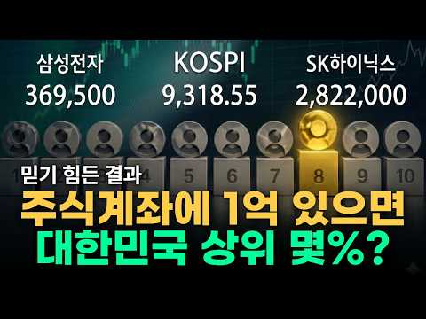
- 챕터: 0:00 주식 계좌에 딱 1억, 대한민국 상위 몇 %일까? (… · 0:57 주식 1억이 생각보다 훨씬 드문 이유 · 2:52 "지금 고점 아닌가요?" 무서워서 미국 주식 시작도 … · 5:16 초봉 3천만 원 월급쟁이가 주식 계좌에만 10억을 굴… · 6:20 주식 10억은 대한민국 상위 0.35%, 1000명 … · 7:36 "월급의 10%부터 똑같이 작동합니다" 평범한 직장인…
- 설명 앞부분: 본 영상에서 제공하는 모든 정보는 투자 참고 자료일 뿐이며, 투자자 본인에게 있습니다 일반 금융자산과 달리 '주식으로만 딱 1억'을 가진 사람은 대한민국 투자자 중 상위 7.7%에 불과할 정도로 생각보다 훨씬 드뭅니다. 많은 사람이 고점의 공포와 폭락의 두려움 때문에 진입하지 못하지만, 장기적으로 우상향할 기업이라는 믿음이 있다면 지금 가격도 가장 싼 가격일 수 있습니다. 저 역시 초봉 3천만 원의 평범한 직장인으로 시작해 코로나와 전쟁 등 수많은 폭락장을 겪으면서도 이 원칙 하나로 주식 계좌 10억(상위 0.35%)을 달성했습니…
- 같은 채널 평소 대비 ×10.8 (채널 최근 롱폼 중앙값 3,083회) · 평소 영상: 월급 250만 원 받던 제가 '이것' 하나 바꾸고 순자산 10억 찍었습니다 (3,163회) / 큰 돈 쓰지도 않는데 왜 내 통장은 돈이 없을까? (3,003회)
- 대본 없음 (설명) — 음성인식이 끝나면 도입부·흐름이 들어감
- 댓글 156/156: 좋은 점 — 영상 1 · 감사·응원 11 · 더 알고 싶은 것 3 · 아쉬운 점 — 영상 1 · 반박·불만 — 의견 다름 2 · 정치·사회 0 · 경험 공유 7 · 구독·다음 기대 0
  - 좋은 점 — 영상 👍4 “구독신청 좋은영상 감사드립니다”
  - 감사·응원 👍100 “댓글보고 기죽어서 ㅠㅠ 글 안남길려다가~~~~오늘기준 주식계좌에 8천9백만원 있습니다~!!1천만원으로 시작했거든요~6년걸림 ㅋ ~그래도 행복합니다~!! 조금씩 늘어나네요~~1억목표~ㅎ~본업은 열심히 하는중이에요~~이글을 보시는 모든분들 성투하세요~화이팅~!!”
  - 감사·응원 👍13 “부동산 투자 실패로 5년전에 1억 날리고, 죽자사자 월급 모아서 원금 8000만원이고 주식계좌에 1억3천있습니다. 힘내서 빨리 직장 그만두고 싶어요... 왜 이렇게 사람들과 부딪히는게 힘든지 모르겠어요.”
  - 더 알고 싶은 것 👍0 “수익금 포함 말씀하시는게 맞으실까요?? 저는 누가 주식 얼마 투자했냐고 물으면 원금으로 말해야 하는지 수익금 포함인지....다른사람들은 어떻게 생각하는지 궁금해요 ㅎㅎ”
  - 아쉬운 점 — 영상 👍5 “이 영상을 보는 주린이들이 많을거라 예상됩니다. 주식은 우량한 주식을 장기투자하면 손실은 면하고 수익을 기대할 수 있습니다. 여기까지 많이들 들어봤을 이야기 입니다. 하지만 장투라는게 어렵고 지루하기도 하죠 그런면에선 커버드콜 및 배당주로 처음에 시작했으면 좋겠슴니다…”
  - 반박·불만 — 의견 다름 👍5 “증권 계좌 나눠서 하는 사람 많아서 글쎄요”
  - 경험 공유 👍5 “이분 말씀이 진리네요 저는 퇴직자로 금융권에 있었지만 미국시장, 국내시장, ETF 등에 무지했었어요 그냥 매일매일 현업에서 하루하루를 최선을 다하는 평범한 직장인 이었는데 퇴직후 미국시장, 국내시장, ETF 등에 관심을 가지고 24년도부터 꾸준히 모아가고 있습니다 총…”
  - 경험 공유 👍4 “저도 꾸준히 모아가겠습니다 감사합니다”

### 140. 라오어님의 TQQQ, SOXL 무한매수법 정말 좋아합니다(QQQ, QLD, TQQQ, SOXL)

- https://www.youtube.com/watch?v=QTrCmMxmAdg · 레버리지 하는 미국회계사 장기투자 여정 · 구독자 13,100 · 조회수 66,746 (×5.1, 하루 635.2) · 좋아요 1,033 (1.6%) · 5.2분 · 2026-07-01 · 주제 묶음 3. 주식·ETF · 형식 정보·해설 (그 밖) · 폴더 `W_QTrCmMxmAdg` (웹 승인)
- 썸네일: 
- 챕터: 0:00 라오어 무한매수법이란? 하게 된 계기 · 1:34 무한매수법 실제 운용 현황 (법인 계좌 TQQQ, S… · 2:08 무한매수법 핵심 — 변동성에 투자한다는 것 · 3:23 무한매수법 수익률 30%, 충분한건가? · 3:54 라오어님의 증여 이야기 · 4:34 무한매수법 세금, 법인 통한 절세
- 설명 앞부분: 저는 라오어님의 무한매수법을 5년 넘게 해오고 있고, 지금은 법인 계좌로 TQQQ와 SOXL 40분할 사이클을 운영하면서 절세까지 하고 있습니다. 회계사로 일하면서 오히려 레버리지 상품을 불신했던 제가 어떻게 생각이 바뀌었는지, 지금 실전에서 어떤 구조로 운영하고 있는지 빠르게 정리해드립니다. 🎯 이 영상에서 다루는 내용 라오어 무한매수법이란 무엇인가 회계사인 제가 레버리지를 불신하다가 시작하게 된 계기 지금 법인 계좌 2개로 운영 중인 SOXL 40분할 구조와 최근 수익률 무매를 계속하는 이유 — 변동성에 투자한다는 것 연 30…
- 같은 채널 평소 대비 ×4.6 (채널 최근 롱폼 중앙값 14,613회) · 평소 영상: QLD 매일 매월 매수? 타이밍 보다 더 중요한 건 '언제 사서 언제 파느냐'다(QQQ,… (14,613회) / QLD랑 가장 잘 어울리는 배당주는 무엇인가 I SCHD, VYM, DGRO, VIG, … (14,301회)
- 대본 없음 (설명) — 음성인식이 끝나면 도입부·흐름이 들어감
- 댓글 199/199: 좋은 점 — 영상 4 · 감사·응원 21 · 더 알고 싶은 것 29 · 아쉬운 점 — 영상 0 · 반박·불만 — 의견 다름 2 · 정치·사회 0 · 경험 공유 20 · 구독·다음 기대 1
  - 좋은 점 — 영상 👍1 “회계사님 영상 잘봤습니다! 무한매수법 책은 읽은상태인데 머리가 좋은편이 아니라 큰 흐름만 이해한 상태네요 ㅠㅠ 엑셀이나 무매무매, 파이어게이트 어플로 가이드 방향으로 그냥 하는 방법도있던데 회계사님께서 하는 방법도 이해하기 쉽게 영상으로 제작 좀 부탁드려도될까요??ㅠ…”
  - 좋은 점 — 영상 👍0 “멋집니다. 영상도 깔끔하고 듣기 편하네요.”
  - 감사·응원 👍20 “SPYM 8개월 수익과 TQQQ 5일차 수익이 똑같아서 TQQQ 분할매수중입니다 저도 저의 도파민입니다 꾸준히 매수누릅니다 -10% -20% -30% 트리거오면 현금 이빠이 넣으려고요 열심히 살겠습니다 감사합니다!”
  - 감사·응원 👍6 “저도 무매법 몇달전에 시작했습니다. 미국에서 살고 있기에 실시간으로 가격변동을 보기에 투자금의 20% 까지는 빠질 때마다 공격적으로 매수합니다, 20% 이후 부터는 원칙대로 하죠. 무매법 수익률만 6월달에 투자금액의 20% 넘었습니다. 변동성이 무지 심한달이어서 그랬…”
  - 더 알고 싶은 것 👍9 “영상 잘보고 있습니다. 문득 궁금증이 들어서요 1. 라오어 tqqq vr(밸류리밸런싱, 장투법)도 알고 계실 듯한데 이거 대신 qld장투로 가져가는 이유를 알 수 있을까요? 2. 추측건대 라오어님은 vr이 qld장투의 상위호환전략이라고 생각하시기 때문에 vr로 장투하…”
  - 더 알고 싶은 것 👍4 “저도 무한매수법 배우고싶은데요 자세히 하는방법 다루어주시기를 부탁드립니다 저는그냐 사서 가지고가고있습니다”
  - 경험 공유 👍20 “SPYM 8개월 수익과 TQQQ 5일차 수익이 똑같아서 TQQQ 분할매수중입니다 저도 저의 도파민입니다 꾸준히 매수누릅니다 -10% -20% -30% 트리거오면 현금 이빠이 넣으려고요 열심히 살겠습니다 감사합니다!”
  - 경험 공유 👍9 “영상 잘보고 있습니다. 문득 궁금증이 들어서요 1. 라오어 tqqq vr(밸류리밸런싱, 장투법)도 알고 계실 듯한데 이거 대신 qld장투로 가져가는 이유를 알 수 있을까요? 2. 추측건대 라오어님은 vr이 qld장투의 상위호환전략이라고 생각하시기 때문에 vr로 장투하…”
  - 구독·다음 기대 👍0 “세상에나...고퀄 영상 감사합니다. 정주행하고 있는데 이해력이 낮아 답답할 뿐입니다. 51살 아줌마고요 63세까지는 일할 수 있을 것 같습니다. qld나 tqqq 하기에는 좀 애매한 나이일까요? 그냥 qqq를 해야할까요? 현재 isa계좌에 맥쿼리인프라 8000만원어치…”

### 141. "68세도 돈버는 부업" 월급70만원 요양사 관두고 집에서 노트북 하나로 순수익 월250만원 버는 68살

- https://www.youtube.com/watch?v=pZ7fCdoOvCI · 록터뷰 · 구독자 35,600 · 조회수 170,591 (×4.8, 하루 1,686.8) · 좋아요 3,384 (2.0%) · 7.8분 · 2026-07-05 · 주제 묶음 8. 부업·소득 · 형식 인터뷰·강연·대담 · 폴더 `W_pZ7fCdoOvCI` (웹 승인)
- 썸네일: 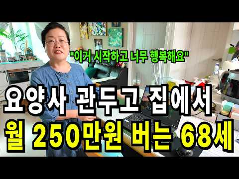
- 설명 앞부분: 신청하시고 댓글 달아주시는 모든 분들께 제공드립니다! 나이도, 경험도 상관없습니다. 재고 없이, 초기 자본 없이 시작하는 온라인 판매 노하우를 무료 라이브에서 공개합니다. 💬 "온라인 판매는 한 번도 안 해봤는데 괜찮을까요?" 💬 "어떻게 진행하면 될까요?" 💬 "아무것도 몰라도 수익낼 수 있을까요?" 이런 고민이 있으셨다면 이번 무료 라이브에서 모두 알려드립니다. 🎁 무료 라이브 신청만 해도 전원 제공! 📕 사업 시작하는 방법 처음부터 끝까지 📕 집에서 10분이면 끝나는 판매 준비법 📕 돈 버는 온라인 판매 세팅 방법 📘 재고 …
- 같은 채널 평소 대비 ×63.1 (채널 최근 롱폼 중앙값 2,705회) · 평소 영상: "정말 너무 쉬워요" 백화점 판매원 하면서 휴대폰 하나로 부업하고 월급 받는 65세 어머님 (2,705회) / "이거 못하면 다른 부업 아무것도 못해요" 아이 둘 키우며 노트북 하나로 하루 2시간 일… (2,817회)
- 대본 없음 (설명) — 음성인식이 끝나면 도입부·흐름이 들어감
- 댓글 1,602/1,603: 좋은 점 — 영상 36 · 감사·응원 104 · 더 알고 싶은 것 75 · 아쉬운 점 — 영상 1 · 반박·불만 — 의견 다름 2 · 정치·사회 1 · 경험 공유 311 · 구독·다음 기대 18
  - 좋은 점 — 영상 👍9 “구독합니다. 저도 신청할게요. 오랜 경력단절로 무기력하고 자존감도 떨어졌는데.. 좋은 정보 얻었어요.”
  - 좋은 점 — 영상 👍1 “좋은정보 감사드립니다 저도 하고싶습니다”
  - 감사·응원 👍10 “신청합니다❤감사합니다!”
  - 감사·응원 👍8 “구독합니다. 저도 참여하고 싶습니다 정보 감사합니다🎉🎉😢”
  - 더 알고 싶은 것 👍6 “안녕하세요 배워 보고 싶어요 책자 부탁드립니다 감사합니다”
  - 더 알고 싶은 것 👍2 “구독.좋아요 했습니다. ㅎㅎ 무료자료와 링크 부탁드려요”
  - 아쉬운 점 — 영상 👍0 “안녕하세요 저도 요양사 근무하다 동료의 부주의 로 손가락 끝 닷쳐 산재처리 했다는 이유로 원장님의 부당한 차별 근무표로 그만 두게되었어요 현재는 학교 근무하는데 옛날 학교여서 너무 커서 근무 동선 길어서 무릅에 무리가 와서 힘든데 그래도 놓지못하고 하고있었어요 저도 …”
  - 반박·불만 — 의견 다름 👍2 “아무나 하는것 아닙니다 어려워요-”
  - 반박·불만 — 의견 다름 👍1 “바다님입니다~방송보고책을구입햇는데요~~제가원하는내용아닙니다”
  - 정치·사회 👍0 “요양보호사는 가정부다 가정부는 어른신모욕은안하는데.가정부보다 더러운직업이다 사람잘못만나면”
  - 경험 공유 👍21 “안녕하세요 신청합니다 현재 저도 요양사 자격증을 따서 시어머님을 모시는 가족요양사로 일하고 있는 며느리입니다 우연찮게 영상 보게되어 운이 좋다고 생각하고 배워보고 싶어 댓글 남깁니다 기회를 주시면 열심히 해보겠습니다”
  - 경험 공유 👍9 “구독합니다. 저도 신청할게요. 오랜 경력단절로 무기력하고 자존감도 떨어졌는데.. 좋은 정보 얻었어요.”
  - 구독·다음 기대 👍9 “구독합니다. 저도 신청할게요. 오랜 경력단절로 무기력하고 자존감도 떨어졌는데.. 좋은 정보 얻었어요.”
  - 구독·다음 기대 👍8 “구독합니다. 저도 참여하고 싶습니다 정보 감사합니다🎉🎉😢”

### 142. 경제공부 시작하는 법 ∣ 하루 10분이면 됩니다! (해야하는 이유) 🗞️ 📊 💸

- https://www.youtube.com/watch?v=z7fHe2Og-zE · 찌니ZZINI · 구독자 30,500 · 조회수 143,670 (×4.7, 하루 874.8) · 좋아요 0 (0.0%) · 17.5분 · 2026-05-03 · 주제 묶음 1. 재테크 일반·마인드 · 형식 정보·해설 (그 밖) · 폴더 `W_z7fHe2Og-zE` (웹 승인)
- 썸네일: 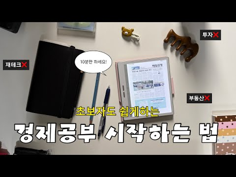
- 챕터: 0:00 영상시작 · 0:12 경제공부 하는 이유? · 2:56 어피니 머니레터 · 5:24 매일경제신문 · 13:42 유튜브/팟캐스트 · 14:18 경제책 · 16:10 디그 · 16:44 마무리
- 설명 앞부분: 다이어리는 meeplus에서 제공받아 촬영되었습니다. 🔻다이어리 + 속지 어느덧 매일경제신문을 읽은지 1년이 다되어가네요 ! 꾸준히 10분씩만 하자였는데 1년을 하게 되었어요 경제공부를 해야하는 이유 투자, 부동산매매가 아니더라도 제가 느낀 이유가 있었어요. 하루 10분만 투자하기 초보자도 누구나 가능 ! 누구나 쉽게 할수있게 제가 정리를 했어요. 영상으로 만들었으니 재미있게 봐주세요 🙂
- 같은 채널 평소 대비 ×9.4 (채널 최근 롱폼 중앙값 15,232회) · 평소 영상: 📓 요즘 내가 좋아하는 다이어리, 모텀 ∣ 프로퍼빌롱잉즈 단테 1달 써봤다! (15,798회) / Vlog ∣ 다이어리 그만좀 사 ∣ 한정선 맛있나..❓∣ 모닝페이지, 경제공부 ∣ 양귀자… (14,667회)
- 대본 없음 (설명) — 음성인식이 끝나면 도입부·흐름이 들어감
- 댓글 147/147: 좋은 점 — 영상 11 · 감사·응원 22 · 더 알고 싶은 것 14 · 아쉬운 점 — 영상 1 · 반박·불만 — 의견 다름 0 · 정치·사회 1 · 경험 공유 6 · 구독·다음 기대 3
  - 좋은 점 — 영상 👍311 “신문사에서 가장 중요하게 생각하는 페이지의 순서는 1> 3면이라고 합니다. 그래서 1면의 심층기사가 3면에 계속되는게 보통이라고 들었습니다. 저는 1,3,world,market 섹션은 꼭 읽고 나머지는 시간이 되면 읽는 편입니다. 못읽는날도 스트레스 없이 그냥 넘기고…”
  - 좋은 점 — 영상 👍111 “안녕하세요 늘 영상 잘 보고 있습니다^^ 하나 꿀팁 드리면 press reader 앱 사용하면 매일경제신문 무료로 읽는거 가능합니다 다른 신문도 볼 수 있어요 저는 제가 졸업한 대학교 이메일 계정으로 이용 중이에요^^ 저도 경제공부 열심히 해봐야겠어요 큰 도움 되는 …”
  - 감사·응원 👍111 “안녕하세요 늘 영상 잘 보고 있습니다^^ 하나 꿀팁 드리면 press reader 앱 사용하면 매일경제신문 무료로 읽는거 가능합니다 다른 신문도 볼 수 있어요 저는 제가 졸업한 대학교 이메일 계정으로 이용 중이에요^^ 저도 경제공부 열심히 해봐야겠어요 큰 도움 되는 …”
  - 감사·응원 👍69 “경제 공부 시작하려고 했는데 이렇게 좋은 타이밍에 좋은 영상을 발견했네요! 귀한 정보 알려주셔서 너무 감사하고 참고해서 열심히 공부해보겠습니다!!”
  - 더 알고 싶은 것 👍5 “정말 세세하네요 신문 보기 시작하는데 어떻게 봐야하는지 몰라서 매번 중간 포기했는데 너무 좋은거같아요! 궁금한점은 하루 몇시간 투자해서 공부하시나요? 저는 아침에유튜브로 한경을 보고 머니레터만 보고있는데 확 공부가 된다는 느낌이 없네요😢”
  - 더 알고 싶은 것 👍3 “저는 해외에 살아서 추천해주신 신문들은 못봐서 여기신문으로 시작할려고 하는데 질문있어요. 모르는 경제용어같은건 어떤식으로 배우시나요? 경제에 대해서 1도 몰라서 처음에는 가볍게 시작하고 싶은데 처음부터 너무 깊이 들어갈까하는 고민이있어요. 그리고 읽어도 뉴스의 흐름을…”
  - 아쉬운 점 — 영상 👍311 “신문사에서 가장 중요하게 생각하는 페이지의 순서는 1> 3면이라고 합니다. 그래서 1면의 심층기사가 3면에 계속되는게 보통이라고 들었습니다. 저는 1,3,world,market 섹션은 꼭 읽고 나머지는 시간이 되면 읽는 편입니다. 못읽는날도 스트레스 없이 그냥 넘기고…”
  - 경험 공유 👍311 “신문사에서 가장 중요하게 생각하는 페이지의 순서는 1> 3면이라고 합니다. 그래서 1면의 심층기사가 3면에 계속되는게 보통이라고 들었습니다. 저는 1,3,world,market 섹션은 꼭 읽고 나머지는 시간이 되면 읽는 편입니다. 못읽는날도 스트레스 없이 그냥 넘기고…”
  - 경험 공유 👍111 “안녕하세요 늘 영상 잘 보고 있습니다^^ 하나 꿀팁 드리면 press reader 앱 사용하면 매일경제신문 무료로 읽는거 가능합니다 다른 신문도 볼 수 있어요 저는 제가 졸업한 대학교 이메일 계정으로 이용 중이에요^^ 저도 경제공부 열심히 해봐야겠어요 큰 도움 되는 …”
  - 구독·다음 기대 👍2 “경제 공부 시작하는 법이라니 어떻게 해야 하는지 궁금하네요 입술에 피어싱을 하셧다니...놀랍네요 주변에 입술 피어싱 한분을 한분도 못봤다 보니 더 신기하고 놀라워요 경제 공부를 시작하신 이유가 더 현실적으로 와 닿네요 내 월급은 조금뿐이 안 올렸는데 계란값만 3배라니…”
  - 구독·다음 기대 👍1 “이 영상으로 처음 뵙는데 구독하고 갈게요! 이북리더기 탐나네요,ㅎㅎㅋㅋㅋ 원래 쓰던게 고장나서 새로 사야하나싶었는데,,,, 어디꺼쓰시나요?! 이뻐서 따라사고싶어용 ㅎㅎ”

### 143. 우리 부모님 유산 탐내다 노후 자금 탈탈 털린 시어머니, 전과자에 신용불량자까지 세트로 만들어드림

- https://www.youtube.com/watch?v=5c7V1i5q_xc · 리얼톡툰 · 구독자 15,400 · 조회수 70,535 (×4.6, 하루 506.5) · 좋아요 470 (0.7%) · 9.8분 · 2026-05-28 · 주제 묶음 4. 노후·연금 · 형식 사연·드라마 · 폴더 `W_5c7V1i5q_xc` (웹 승인)
- 썸네일: 
- 설명 앞부분: 우리 부모님 유산 탐내다 노후 자금 탈탈 털린 시어머니, 전과자에 신용불량자까지 세트로 만들어드림 ★리얼톡툰의 영상의 소재들은 인터넷속 '실화'를 각색하거나 '창작'으로 제작 됩니다. 본채널의 동의 없이 영상을 불법다운로드, 복제, 재편집, 재배포 하는 행위는 금지하며, 민형사상의 법적 조치를 취하고 있음을 알려드립니다.
- 같은 채널 평소 대비 ×1.5 (채널 최근 롱폼 중앙값 47,848회) · 평소 영상: 우리집 베이비시터가 남편의 전여친이었다... (47,848회) / 길에서 내 폰 빌려가더니 날 스토킹범으로 몰아가던 여자, 결국 철컹철컹 앤딩봄 (48,337회)
- 대본 없음 (설명) — 음성인식이 끝나면 도입부·흐름이 들어감
- 댓글 19/19: 좋은 점 — 영상 0 · 감사·응원 0 · 더 알고 싶은 것 0 · 아쉬운 점 — 영상 0 · 반박·불만 — 의견 다름 1 · 정치·사회 0 · 경험 공유 0 · 구독·다음 기대 0
  - 반박·불만 — 의견 다름 👍0 “사돈집 재산을 왜 탐을 낸다요 말도 안되짓을 하네요”

### 144. 1.3억 커버드콜로 은퇴했어요 #배당투자 #배당은퇴 #경제적자유 #파이어족 #월배당 #고배당주 #주식투자 #재테크#노후준비#배당금생활 #SCHD #JEPI #J…

- https://www.youtube.com/watch?v=BqDfJt2vAHY · ttobaedang또배당 · 구독자 6,330 · 조회수 28,523 (×4.5, 하루 678.3) · 좋아요 532 (1.9%) · 7.9분 · 2026-09-02 · 주제 묶음 1. 재테크 일반·마인드 · 형식 정보·해설 (그 밖) · 폴더 `W_BqDfJt2vAHY` (웹 승인)
- 썸네일: 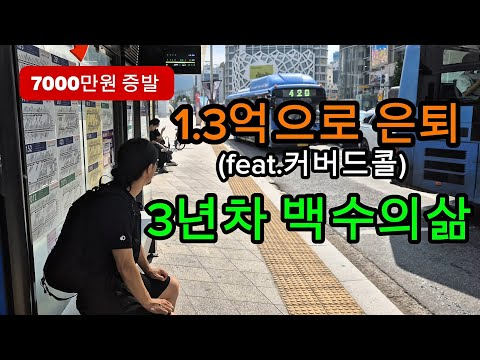
- 같은 채널 평소 대비 ×5.2 (채널 최근 롱폼 중앙값 5,535회) · 평소 영상: 8500만원 증발 그래도 행복한이유 #배당투자 #배당은퇴 #경제적자유 #파이어족 #월배당… (5,535회) / 이번달 1960957원 배당 받는다 3억은퇴 #배당투자 #배당은퇴 #경제적자유 #파이어족… (4,154회)
- 대본 없음 (없음) — 음성인식이 끝나면 도입부·흐름이 들어감
- 댓글 153/153: 좋은 점 — 영상 5 · 감사·응원 20 · 더 알고 싶은 것 11 · 아쉬운 점 — 영상 1 · 반박·불만 — 의견 다름 0 · 정치·사회 0 · 경험 공유 13 · 구독·다음 기대 2
  - 좋은 점 — 영상 👍13 “시간의 간절함 정말 공감해요. 이 시간이라는게 젊음이기도 하니까요. 100세 시대가 온다고 젊은 시절의 육체로 100년 사는게 아니고 한 해 한 해 체력이 예전같지 않는 걸 느끼며 자산 뿐만 아니고 내 남은 수명과의 밸런스의 중요하단 생각이 드네요. 앞으로도 좋은 영…”
  - 좋은 점 — 영상 👍5 “기다리던 영상. 잘보고가요 많이 배우고. 유익합니다^^”
  - 감사·응원 👍8 “화이팅❤”
  - 감사·응원 👍7 “오늘처럼 주가 폭락했을때 의기소침 하고 있는데 또배당님 영상을 보며 위로를 받습니다.감사합니다..”
  - 더 알고 싶은 것 👍13 “시간의 간절함 정말 공감해요. 이 시간이라는게 젊음이기도 하니까요. 100세 시대가 온다고 젊은 시절의 육체로 100년 사는게 아니고 한 해 한 해 체력이 예전같지 않는 걸 느끼며 자산 뿐만 아니고 내 남은 수명과의 밸런스의 중요하단 생각이 드네요. 앞으로도 좋은 영…”
  - 더 알고 싶은 것 👍9 “형님 전 직장생활이 너무 힘든 12년차 직장인입니다 이제 막 3억을 바라보고있는데 형님 영상보면서 나도 할수있구나 하고 자신감 얻어갑니다 나중에라도 팬들이랑 가볍게 밥한끼 했으면 하네요 솔직하고 용기있는 모습 너무 멋있습니다 나중에 세금 건보료 관련해서 영상도 부탁드…”
  - 아쉬운 점 — 영상 👍0 “1.3억으로 낚시 ㅡㅡㅅㅂ”
  - 경험 공유 👍9 “형님 전 직장생활이 너무 힘든 12년차 직장인입니다 이제 막 3억을 바라보고있는데 형님 영상보면서 나도 할수있구나 하고 자신감 얻어갑니다 나중에라도 팬들이랑 가볍게 밥한끼 했으면 하네요 솔직하고 용기있는 모습 너무 멋있습니다 나중에 세금 건보료 관련해서 영상도 부탁드…”
  - 경험 공유 👍7 “저랑 비슷한 생각을 하고 계셔서 조금 놀랐어요 ㅎㅎ 100프로 공감해요 투자은 역시 시간이더라구요 그 시간 동안 버틸수 있는 힘은 커버드콜이란 걸 저도 느껴요 그래서 저도 요즘 나만의 원칙을 만들려고 노력하고 있어요❤”
  - 구독·다음 기대 👍5 “싱글파이어 보고 왔어요. 구독했습니다.”
  - 구독·다음 기대 👍1 “오늘 구독했습니다 정주행하러갑니다 ❤ ISA 계좌부터 만들어야겠군요? 토스에선 안보이네요?”

### 145. ETF는 이 '2개'로 충분합니다. 돈 있으면 무조건 여기부터 넣습니다. 노후 준비 끝납니다 (백승호 단장 3부) #백승호 #ETF #배당금 #커버드콜

- https://www.youtube.com/watch?v=YdmZDxBcYKE · 자람들 - 자립하는사람들 · 구독자 33,400 · 조회수 143,569 (×4.3, 하루 3,896.3) · 좋아요 1,061 (0.7%) · 19.7분 · 2026-09-07 · 주제 묶음 3. 주식·ETF · 형식 인터뷰·강연·대담 · 폴더 `W_YdmZDxBcYKE` (웹 승인)
- 썸네일: 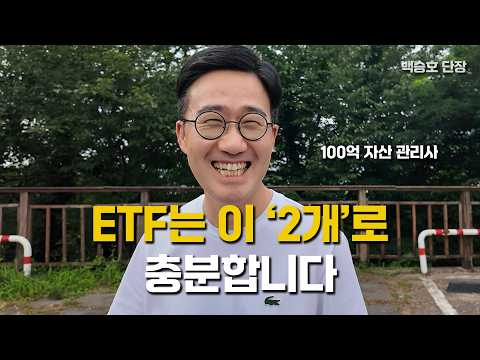
- 설명 앞부분: 👤 오늘의 게스트: 백승호 단장 (3부) 개인 재무 컨설팅 전문가 & 유튜버·작가로도 활동 100억원대 자산을 20년간 관리해온 재무 컨설턴트가 이번엔 계좌별 자산 배치 전략, 나이대별 포트폴리오 구성법, 그리고 투자 철학의 핵심을 정리했습니다. 절세 계좌(ISA·연금)에 국내 주식을 넣으면 오히려 손해라는 아이러니한 사실부터, 조기축구회에 비유한 20대·40대·60대별 맞춤 포트폴리오, 저평가된 중국 ETF와 생소한 유럽 명품 ETF 추천까지 다뤘습니다. 마지막은 "투자는 버티는 것"이라는 한마디로 마무리됩니다. 절세계좌에국내주…
- 같은 채널 평소 대비 ×6.0 (채널 최근 롱폼 중앙값 24,025회) · 평소 영상: 월 500만원 배당 노하우, 시드 5천 '이렇게' 구성하세요. 평범한 직장인이 파이어한 … (24,852회) / 800만원 은값이 반토막 났다. 금, 골드바 지금 사도 괜찮을까요?(G1 김봉준 대표 2… (23,198회)
- 대본 없음 (설명) — 음성인식이 끝나면 도입부·흐름이 들어감
- 댓글 61/61: 좋은 점 — 영상 2 · 감사·응원 4 · 더 알고 싶은 것 2 · 아쉬운 점 — 영상 1 · 반박·불만 — 의견 다름 0 · 정치·사회 0 · 경험 공유 2 · 구독·다음 기대 0
  - 좋은 점 — 영상 👍8 “강의 내용이 매우 퀄리티 있고 구구절절 공감가는 내용인데 주변 소음이 너무 아쉽네요.”
  - 좋은 점 — 영상 👍1 “이분 말씀 진짜 와닿네요. 한번 뵙고 싶네요.”
  - 감사·응원 👍3 “리밸런싱의 중요함을 다시한번 깨우치네요~ 감사^^”
  - 감사·응원 👍1 “투자자에게 너무 소중한 정보들입니다. 알고도 실천하지 않은분들이 대부분입니다. 주옥같은 내용들, 꼭 실천해 보도록 하겠습니다. 감사합니다^^”
  - 더 알고 싶은 것 👍0 “채권은잘모르겠어요 어떤걸사야되는지?”
  - 아쉬운 점 — 영상 👍8 “강의 내용이 매우 퀄리티 있고 구구절절 공감가는 내용인데 주변 소음이 너무 아쉽네요.”

### 146. 경제신문 무료로 보는법 📰 (경제공부 초보 읽는 방법 👀)

- https://www.youtube.com/watch?v=PIiGnsoTl7I · 찌니ZZINI · 구독자 30,500 · 조회수 130,846 (×4.3, 하루 831.8) · 좋아요 0 (0.0%) · 10.2분 · 2026-05-10 · 주제 묶음 2. 돈 모으기·저축 · 형식 정보·해설 (그 밖) · 폴더 `W_PIiGnsoTl7I` (웹 승인)
- 썸네일: 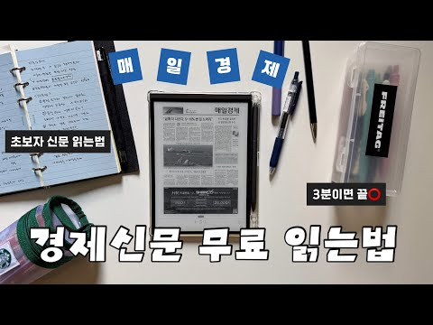
- 챕터: 0:00 영상시작 · 0:19 첫주식투자 도전 · 1:22 경제신문 무료 방법 · 5:10 경제공부방법 질문 · 9:36 책추천 · 10:00 마무리
- 설명 앞부분: 🔻아래 사이트로 들어가서 국립중앙도서관과 연동하기 오늘은 경제신문 무료로 보는법을 가지고 왔어요 ! 어느덧 1년이 지났더라구요 🙂 연락을 주셨을때 내심 뿌듯하기도 하고 1년전 저의 모습이 보이더라구요 ✨ 많은 분들이 도움 되셨음 좋겠습니다! ⏰ 타임라인
- 같은 채널 평소 대비 ×8.6 (채널 최근 롱폼 중앙값 15,232회) · 평소 영상: 📓 요즘 내가 좋아하는 다이어리, 모텀 ∣ 프로퍼빌롱잉즈 단테 1달 써봤다! (15,798회) / Vlog ∣ 다이어리 그만좀 사 ∣ 한정선 맛있나..❓∣ 모닝페이지, 경제공부 ∣ 양귀자… (14,667회)
- 대본 없음 (설명) — 음성인식이 끝나면 도입부·흐름이 들어감
- 댓글 334/334: 좋은 점 — 영상 37 · 감사·응원 86 · 더 알고 싶은 것 14 · 아쉬운 점 — 영상 1 · 반박·불만 — 의견 다름 0 · 정치·사회 2 · 경험 공유 10 · 구독·다음 기대 2
  - 좋은 점 — 영상 👍26 “경제신문을 굳이 돈 주고 볼 필요는 없다고 생각하는 편입니다. 다만 솔직히 말씀드리면, 복잡한 절차를 거쳐 무료로 보는 방식은 오래 유지하기 쉽지 않더라고요. 물론 잘 활용하시는 분들도 계시겠지만 때마다 로그인하고 도서관 연동하고 매번 들어가는 과정 자체가 생각보다 …”
  - 좋은 점 — 영상 👍17 “와... 경제지 뿐만 아니라 여러나라의 신문도 한번 쯤 보고 싶었는데.. 이런 서비스가 있었는 지 몰랐네요. 정말 감사합니다. 큰 도움이 되었습니다.”
  - 감사·응원 👍74 “헐 이렇게 쉽게 성공하다니..!! 예전에 저도 국립중앙도서관으로 하면 프레스리더로 무료 읽기 된다구 해서 시도했다가 실패했었는데 알려주신대로 시도했더니 바로 인증됐어요ㅠㅠ 정말 감사해요~~!!”
  - 감사·응원 👍17 “와... 경제지 뿐만 아니라 여러나라의 신문도 한번 쯤 보고 싶었는데.. 이런 서비스가 있었는 지 몰랐네요. 정말 감사합니다. 큰 도움이 되었습니다.”
  - 더 알고 싶은 것 👍4 “이런 정보 몰랐다면 덜컥 돈 주고 구독했을 것 같은데… 너무 감사해요!! 🥹 그리고 혹시 1:22 이 기기는 이름이 뭔지 알 수 있을까요?”
  - 더 알고 싶은 것 👍3 “몇일이 지난후에는 무료로 안되네요 로그아웃하고 다시 로긴해도 프리미엄 가입 안내가 나오면서 볼수 없게 되네요 맞나요?”
  - 정치·사회 👍1 “매일경제 경향신문 한겨레 다 좌파 성향 신문이네요ㅠ 그건 좀 아쉽 좌파 우파 둘 다 보고싶은데”
  - 정치·사회 👍0 “나라가 넘어가도 ㅈㅍ언론사 신문을 읽네”
  - 경험 공유 👍74 “헐 이렇게 쉽게 성공하다니..!! 예전에 저도 국립중앙도서관으로 하면 프레스리더로 무료 읽기 된다구 해서 시도했다가 실패했었는데 알려주신대로 시도했더니 바로 인증됐어요ㅠㅠ 정말 감사해요~~!!”
  - 경험 공유 👍26 “경제신문을 굳이 돈 주고 볼 필요는 없다고 생각하는 편입니다. 다만 솔직히 말씀드리면, 복잡한 절차를 거쳐 무료로 보는 방식은 오래 유지하기 쉽지 않더라고요. 물론 잘 활용하시는 분들도 계시겠지만 때마다 로그인하고 도서관 연동하고 매번 들어가는 과정 자체가 생각보다 …”
  - 구독·다음 기대 👍4 “이런 정보 몰랐다면 덜컥 돈 주고 구독했을 것 같은데… 너무 감사해요!! 🥹 그리고 혹시 1:22 이 기기는 이름이 뭔지 알 수 있을까요?”
  - 구독·다음 기대 👍1 “우와 좋은 정보 감사해요 ! 만드시는 컨텐츠 결이 제 관심사랑 맞아서 쭉 보고 싶어지네요 ㅎㅎ 다음 영상도 기다릴게욤💚”

### 147. 반도체 주식 열풍에 예순 살 부부의 은퇴자금 2억이 단 한 달만에 반토막 나기까지!

- https://www.youtube.com/watch?v=Uwfjww9_yKk · 은빛시나리오 · 구독자 29,200 · 조회수 124,612 (×4.3, 하루 1,820.0) · 좋아요 2,213 (1.8%) · 39.6분 · 2026-08-06 · 주제 묶음 1. 재테크 일반·마인드 · 형식 사연·드라마 · 폴더 `W_Uwfjww9_yKk` (웹 승인)
- 썸네일: 
- 설명 앞부분: 삼십 년을 뙤약볕 아래 택배 상자를 나르며 부부가 한 푼 두 푼 모아온 전 재산 2억 7천만 원. 딱 3천만 원만 더 채우면 완성되는 5억 원의 꿈이었습니다. 고향 거제도로 내려가 아내 손에 더 이상 물집 잡히지 않게 해주고 싶었던 소박한 바람이었죠. 하지만 반도체 열풍이 불던 2026년 여름, 그 조급함 하나가 모든 걸 바꿔놓았습니다. 2억 원을 반도체 대장주에 밀어 넣은 지 한 달 만에, 계좌는 반토막이 났습니다. 📢 안내 및 유의사항 본 영상은 여러 사례를 바탕으로 재구성된 드라마 형식의 시나리오 콘텐츠입니다. 본 영상의 이…
- 같은 채널 평소 대비 ×4.3 (채널 최근 롱폼 중앙값 28,676회) · 평소 영상: 60대 빚투의 끝…포모에 눈 멀어 반대매매로 노후를 날린 은퇴자의 고백! ∣ 노후자금사연… (27,079회) / 60대 이상 노후 파산자 45%? 그 숫자가 제가 될 줄 몰랐습니다. 가난한 노년의 공포! (31,205회)
- 대본 없음 (설명) — 음성인식이 끝나면 도입부·흐름이 들어감
- 댓글 535/535: 좋은 점 — 영상 3 · 감사·응원 17 · 더 알고 싶은 것 3 · 아쉬운 점 — 영상 3 · 반박·불만 — 의견 다름 10 · 정치·사회 44 · 경험 공유 19 · 구독·다음 기대 1
  - 좋은 점 — 영상 👍8 “공감합니다 처음에는 300으로 시작해서 일년에 4000벌었다 그래서 남편몰래 현금써비스 보험해약한것 월급 1억 5000원 넣었다 그러다가 마이너스 6500이 넘었다 내가 팔면 오르고 사면 내린다 젠쟝”
  - 좋은 점 — 영상 👍0 “여윳돈으로 우량주를 장투! 많은것 배우고 갑니다.~🎉”
  - 감사·응원 👍24 “응원합니다 항상 행복하세요.”
  - 감사·응원 👍10 “살다보면 그럴때도 있어요 힘내시요”
  - 더 알고 싶은 것 👍6 “사람이계획대로되나요? 흐름을읽어야지요. 나이들었다면서요”
  - 더 알고 싶은 것 👍0 “개미 투자자 여러분! 김거니 주가조작범 등 악마범죄자들을 어떻게 처벌해야 할까요? 과연 사기꾼들이 판치는 대한민국 주식시장 신뢰도가 어느정도나요 나의 평생 땀 흘려 모은 피같은 돈을 뭘 믿고 그런 거금을 개미지옥에 집어 넣는단 말인가! 돈 잃고 인생 지옥으로 떨어지는…”
  - 아쉬운 점 — 영상 👍57 “모든일에 숨죽여 그 댓가를 치르리라. 등허리에 땀흘려 모으는게 힘들고 지루해도 이게 진리임!”
  - 아쉬운 점 — 영상 👍0 “가상의 시나리오인줄 알면서도 지루하지않게 들었습니다.”
  - 반박·불만 — 의견 다름 👍10 “글쎄요 ᆢ2억 7000이면 이자만 600이 넘 어요 ᆢ 요새는 훨씬 많고요 ᆢ갑자기. 무슨 욕심 이 생기셔서. ᆢ주식에 손을 대셨을까 ᆢ”
  - 반박·불만 — 의견 다름 👍3 “끝난게 아닌데 통곡은 무슨.”
  - 정치·사회 👍37 “주식하십니까..?절대하면패망합니다.기관.외국인들도1년예3.5프록이익뿐입니다.개미는95프로폭망합니다.”
  - 정치·사회 👍18 “참 그러내요 ᆢ투자의 최종 책임 은 본인들의 결정 이나 ᆢ1년동 안.대통령 부터 주식하라고 부추키고 ᆢ몇달전 까지 ᆢ할머니 할아버지도 ᆢ래버리지를 대화의 주제로 하는 ᆢ너무한다 싶었는데 ᆢ두세달 만에 ᆢ이꼴이 나서 ᆢ정부 책임도 커요 ᆢ분위기 몰아간 죄 ᆢ”
  - 경험 공유 👍27 “그나마 다행 7천이라도남았으니...많은이들이 비슷한경험했을겁니다”
  - 경험 공유 👍16 “나는 좌파인가요? 우파인가요? 내가 대통령 투표에서 지지한 순서 김영삼, 이회창, 이회창, 이명박, 문재인, 문재인, 이재명, 이재명 이순서로 투표 하였는데 지금은 나를 좌파로 주위에서 이야기 하네요 이잼은 정말 열심히 일하는데 부동산 정책은 넘 못하는 것 같습니다.…”
  - 구독·다음 기대 👍0 “주식은 절대사고 팔지마시길 케이티앤지 5년기다리니원금보다 높아졌어요 지금도매도하지않고 믿음직스러운 ETF소수점으로 날마다 사고있어요 희망이있을거라기대합니다”

### 148. 성공한 인생인 줄 알았습니다... 은퇴 후 찾아온 잔인한 현실

- https://www.youtube.com/watch?v=27QUCjtiMVg · 인생의에필로그 · 구독자 9,590 · 조회수 39,773 (×4.2, 하루 405.5) · 좋아요 463 (1.2%) · 19.3분 · 2026-07-08 · 주제 묶음 4. 노후·연금 · 형식 사연·드라마 · 폴더 `W_27QUCjtiMVg` (웹 승인)
- 썸네일: 
- 챕터: 0:00 인트로 · 0:33 1장. 오랜만의 모임 · 2:41 2장. 같은 자리에서 시작했는데 · 3:46 3장. 좋았던 시절 · 5:02 4장. 조금씩 어긋나기 시작했다 · 11:45 5장. 처음으로 따져본 노후 · 12:52 6장. 빛바랜 사진 앞에서 · 14:15 7장. 내밀어준 손 · 16:24 8장. 뒤늦게 알게 된 것 · 18:21 9장. 제작자인사
- 설명 앞부분: 평생 자기 가게 하나로 성공한 삶을 살았다 믿었던 60대 가장. 은퇴 후 오랜만에 만난 친구들 앞에서 처음으로 자신의 노후를 계산기에 두드려본 날의 이야기입니다. 크게 벌었는데도 손에 남은 게 없었던 이유, 매달의 작은 안정을 우습게 봤던 대가는 무엇이었을까요. 노후자금과 은퇴 후 삶을 돌아보게 하는 오늘의 사연, 끝까지 들어주세요. ⏱ 타임스탬프 본 영상은 공개된 자료와 실제 사건을 참고하여 제작자가 직접 기획·각본한 스토리텔링 콘텐츠입니다. 일부 표현과 장면은 이해를 돕기 위한 창작적 각색이 포함되어 있습니다. 본 콘텐츠는 다…
- 같은 채널 평소 대비 ×22.5 (채널 최근 롱폼 중앙값 1,769회) · 평소 영상: 친구따라 장사 시작했다가… 62세에 개인회생 신청할 줄은 몰랐습니다 (1,922회) / 35년 바쳤는데… 은퇴 날 이혼 서류 받은 67세 가장의 눈물 (1,616회)
- 대본 없음 (설명) — 음성인식이 끝나면 도입부·흐름이 들어감
- 댓글 40/40: 좋은 점 — 영상 0 · 감사·응원 0 · 더 알고 싶은 것 1 · 아쉬운 점 — 영상 1 · 반박·불만 — 의견 다름 0 · 정치·사회 0 · 경험 공유 2 · 구독·다음 기대 0
  - 더 알고 싶은 것 👍0 “실손보험 들었눈데 가입3개월전에 병원기록있러서 해약 되려하는대 방법있을까요?”
  - 아쉬운 점 — 영상 👍0 “핵심없는 이야기 너무 길게 하신거 아닌가요,,,,,,,,,,,,핵심이 없어요, 왜 들어야 하죠?”
  - 경험 공유 👍7 “명퇴 12년차 60대인데, 퇴직후 빚없이 아파트1채 소유하며, 부부 공적연금 300만원+ 목돈4억원이면, 월360만원 이상의 금융소득으로 노부부 돈 신경 안쓰고 삽니다. 단 부부가 큰병없이 건강하고, 출가한 자식들과 돈거래가 전혀없고, 보이스피싱 등 사기만 안 당하면…”

### 149. 배당 ETF 10억 투자하면 진짜 배당금 얼마? ∣ 공식분배금·실수령 차이 (무료 전자책 제공)

- https://www.youtube.com/watch?v=KGOC_mfphu4 · 은퇴머니 - 은퇴 현금흐름 설계 · 구독자 30,000 · 조회수 123,678 (×4.1, 하루 777.6) · 좋아요 2,065 (1.7%) · 18.8분 · 2026-05-08 · 주제 묶음 3. 주식·ETF · 형식 정보·해설 (그 밖) · 폴더 `W_KGOC_mfphu4` (웹 승인)
- 썸네일: 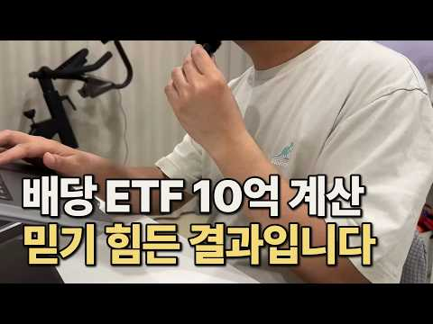
- 챕터: 0:00 도입 — 10억 ETF에 넣으면 매달 얼마? · 4:25 시뮬레이터 — 공식 분배금에서 실수령까지 · 13:40 마무리 — 빠져나가는 돈을 줄이는 조합
- 설명 앞부분: 10억을 한 ETF에 통째로 넣으면 — 공식 분배금의 65%만 실수령. 배당소득세·종합소득세·건강보험료, 세 단계에서 빠져나가는 돈을 시뮬레이터로 확인합니다. PDF 요약본 안내: 고정 댓글 확인 📑 영상 PPT 자료 영상 내용을 정리한 슬라이드를 웹에서 바로 보고, PDF로도 내려받을 수 있습니다. 🧮 직접 계산해 보기 영상의 사례를 내 조건으로 바꿔 계산할 수 있습니다.
- 같은 채널 평소 대비 ×8.7 (채널 최근 롱폼 중앙값 14,254회) · 평소 영상: ETF 포트폴리오, 은퇴 전에 확인해야 할 또 하나의 기준 (14,254회) / 은퇴 포트폴리오가 사람마다 다른 이유 (12,898회)
- 대본 없음 (설명) — 음성인식이 끝나면 도입부·흐름이 들어감
- 댓글 261/261: 좋은 점 — 영상 16 · 감사·응원 23 · 더 알고 싶은 것 18 · 아쉬운 점 — 영상 6 · 반박·불만 — 의견 다름 2 · 정치·사회 3 · 경험 공유 14 · 구독·다음 기대 6
  - 좋은 점 — 영상 👍7 “구독했습니다. 좋은 내용 감사합니다 ~~”
  - 좋은 점 — 영상 👍6 “계산에 약간 오류가 있네요, 미국 지수 추종 한국 상장 ETF의 분배금은 15.4%가 아니라 15% 원천징수입니다. ^^ 좋은 영상 감사합니다.”
  - 감사·응원 👍9 “연금저축계좌나 isa에서는 얼마나 절세되는지 비교분석해 주시면 감사하겠습니다”
  - 감사·응원 👍7 “구독했습니다. 좋은 내용 감사합니다 ~~”
  - 더 알고 싶은 것 👍9 “연금저축계좌나 isa에서는 얼마나 절세되는지 비교분석해 주시면 감사하겠습니다”
  - 더 알고 싶은 것 👍6 “원금이 어쩧개 되는지도 알려주세요”
  - 아쉬운 점 — 영상 👍0 “너무 길어서 그래서 얼마 받는지 알수가 없네...”
  - 반박·불만 — 의견 다름 👍9 “국내 커버드콜로 하면 실제 수령액에서 옵션 수익분은 다 빼야 해요. 그냥 전부 합하면 위처럼 말도 안되는 건강보험료, 원천차감금액이 나와요. 따라서 커버드콜을 미국지수나 주식에 연동되는 것으로 하면 손해가 수천 만원씩 나와요.”
  - 정치·사회 👍0 “평생 근로자로 살다 집한채 들고 은퇴하려고 봤더니 세금 천지에 보유세에 상속세 건강보험료까지 어러다 노후 파산해서 노숙자로 전락할까 걱정입니다 이 정권이 주식에 부동산까지 다 망가트리고 세금만 잔뜩 부과해서 사적 재산까지 탈탈 털어가기 전에 차라리 이민을 준비해야하나…”
  - 경험 공유 👍1 “10억으로 빠질거 빠지고 월 600이상이면 노후는 될거 같은데..저도 qqqi 10000주 목표로 매수하고있는데.. 이제 1200 주지만..”
  - 경험 공유 👍1 “멋집니다 저도 받고 싶어요 자료~!!”
  - 구독·다음 기대 👍7 “구독했습니다. 좋은 내용 감사합니다 ~~”
  - 구독·다음 기대 👍4 “구독완료~~~ Isa계좌 커버드콜만 운용하는데 비교 부탁드립니다 그리고 배당금은 어느정도를 받아야 세금을 합리적으로 내는지도 궁금합니다”

### 150. 배당 10%를 주면서 동시에 주가도 20% 오른 단 6개의 ETF [1,099개 ETF 모두 뒤져봤습니다.]

- https://www.youtube.com/watch?v=4Gy4lBNuebE · 우아한짠테크 TV · 구독자 37,200 · 조회수 150,656 (×4.0, 하루 994.9) · 좋아요 4,478 (3.0%) · 12.7분 · 2026-05-15 · 주제 묶음 3. 주식·ETF · 형식 정보·해설 (그 밖) · 폴더 `W_4Gy4lBNuebE` (웹 승인)
- 썸네일: 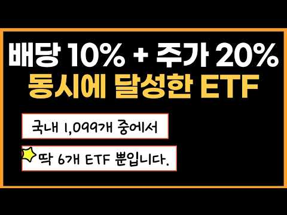
- 설명 앞부분: 안녕하세요, 우아한짠테크 '우짠'입니다! "배당 많이 받으면 주가는 안 오른다?" 이 상식을 완벽하게 깨부쉈습니다. 국내 상장 ETF 1,099개를 일일이 전수조사해 [배당 10% + 주가 상승 20% + 순자산 3,000억 이상]이라는 미친 조건을 통과한 ETF만 걸러냈습니다. 심지어 이 중에는 수익률 무려 103%를 찍어버린 전설적인 종목도 숨어있는데요! 월배당 투자자라면 무조건 계좌에 담아야 할 상위 0.55%의 기적 같은 ETF, 오늘 영상에서 확인하세요!
- 같은 채널 평소 대비 ×13.8 (채널 최근 롱폼 중앙값 10,925회) · 평소 영상: 매월 100만원으로 시작해 '월 배당 300만원' 연금처럼 받으세요. (11,104회) / ISA, 연금계좌 S&P500만 샀다고요? 10년 뒤 땅을 치고 후회합니다. (10,746회)
- 대본 없음 (설명) — 음성인식이 끝나면 도입부·흐름이 들어감
- 댓글 316/316: 좋은 점 — 영상 22 · 감사·응원 61 · 더 알고 싶은 것 16 · 아쉬운 점 — 영상 1 · 반박·불만 — 의견 다름 0 · 정치·사회 1 · 경험 공유 10 · 구독·다음 기대 3
  - 좋은 점 — 영상 👍7 “도움이 됩니다.감사합니다.”
  - 좋은 점 — 영상 👍7 “은퇴한지 오래된 주린이. 고정구독자입니다. 아직은 고정현금 흐름이 있기에, 절세계좌 (isa,연금저축, 비과세종합저축계좌) 에서 , 성장주와 고배당주에 투자중입니다. 항상 커버드콜에 관심이 있었는데, 커버드콜에 대한 공부가 아직은 확실히 덜되어 있었는데, 오늘 영상이…”
  - 감사·응원 👍14 “깔끔한 정리 감사합니다.”
  - 감사·응원 👍7 “도움이 됩니다.감사합니다.”
  - 더 알고 싶은 것 👍3 “저기 중에서 1-2개는 담아가야 겠어요:) 없어서 아쉬웠는데! 이렇게 분석해주셔서 감사합니다. 우짠님 어찌 생각하시나요?~ 요즘 장신없어 자주 못왔는데! 우짠님 현재 포트폴리오도 궁금하네요~~~”
  - 더 알고 싶은 것 👍3 “비교분석 감사합니다. 반은 있고 반은 없네요.^^ 다행히 아직까진 수익률도 빨간블이고~ 최근 상장한 ETF들 국내 몇개 있던데요. 비교.예측 부탁드립다. 구독.❤하고 갑니다.”
  - 아쉬운 점 — 영상 👍3 “저기 중에서 1-2개는 담아가야 겠어요:) 없어서 아쉬웠는데! 이렇게 분석해주셔서 감사합니다. 우짠님 어찌 생각하시나요?~ 요즘 장신없어 자주 못왔는데! 우짠님 현재 포트폴리오도 궁금하네요~~~”
  - 경험 공유 👍66 “분석 하시느라 수고 많으셨습니다 언급 하신 여섯개 종목 중에 저희 포트폴리오 안에는 총 4개 종목이 포함되어 있네요 그래서인지 현재 손실 중인 종목은 단 한개도 없고 전체 계좌 총 수익률은 어제 기준 16% 입니다”
  - 경험 공유 👍6 “감사합니다. 제가 기존에 갖고있던 3가지 etf 와 이 6개 모두 총 9가지 etf만 매수해야겠습니다. 유익한 정보 정말 감사드립니다 ~~~~!”
  - 구독·다음 기대 👍12 “깔끔한 정리 아주 좋네요~~ 구독갑니다”
  - 구독·다음 기대 👍2 “왕왕 주린이인대 너무 잘봤어요 매일봐도 모르겟었는데 도움받고가요 근데 커버드콜도 장투하는 개념인지 안전한지 궁금합니다 감사합니다”

### 151. "골드만삭스가 전주에 무릎 꿇었습니다" 국민연금 1,458조, 세계 1위 수익률의 비밀

- https://www.youtube.com/watch?v=3Hw87oNMlHI · 경제초고수 · 구독자 39,400 · 조회수 149,400 (×3.8, 하루 927.4) · 좋아요 4,089 (2.7%) · 14.7분 · 2026-05-06 · 주제 묶음 4. 노후·연금 · 형식 인터뷰·강연·대담 · 폴더 `W_3Hw87oNMlHI` (웹 승인)
- 썸네일: 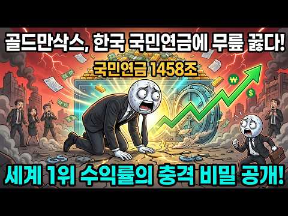
- 챕터: 0:00 231조 수익, 삼성전자 반 개를 벌어왔다 (Hook) · 0:25 골드만삭스가 전주에 사무소를 열었다 · 0:50 블랙록, 알리안츠까지 전주에 모이는 이유 · 1:10 오늘 영상 로드맵 선언 · 1:30 적립금 1,458조, 세계 3위 연기금 · 1:50 1년 예산 680조의 두 배 · 2:10 해외주식 508조, 해외투자 합계 607조 (44%) · 2:30 대체투자 214조: 공항, 도로, 데이터센터, 오피스 · 3:00 대체투자가 왜 중요한가 (폭락장 쿠션) · 3:30 과거 채권 53% 시대의 교훈 · 3:50 수익률 4.2% vs 캐나다 10.7% (7년 전 꼴… · 4:20 복리 차이: 5년이면 수백 조 · 4:40 왜 채권에 묶어뒀나 (정치적 안전 논리) · 5:00 대전환 시작: 해외 37%, 대체 17% · 5:20 한국 주식 시장 비중 2%, 98%를 놓치고 있었다 · 5:40 장기 목표 해외투자 60% · 6:00 김성주 이사장: 사상 첫 재임 · 6:20 자산 배분 철학: 비율이 수익 90% 결정 · 6:50 정치 압력과 관성을 돌파한 팀 · 7:10 세계 비교: 한국 18.82% 압도적 1위
- 설명 앞부분: 2025년 국민연금 수익률 18.82%. 역대 최고. 1년 수익금만 231.6조 원. 삼성전자 시가총액의 절반을 1년 만에 벌어왔습니다. 근데 진짜 소름 돋는 건 따로 있어요. 골드만삭스가 전주에 사무소를 열었습니다. 배우러 온 거예요. 이 영상에서 다루는 내용: 국민연금 적립금 1,458조 원, 세계 3위 연기금의 규모 해외투자 607조 원 (44%), 대체투자 214조 원의 정체 과거 채권 53% 시대 수익률 4.2%에서 현재 18.82%로의 대전환 자산 배분 전략: 종목이 아니라 비율이 수익의 90%를 결정한다 세계 연기금 …
- 같은 채널 평소 대비 ×34.8 (채널 최근 롱폼 중앙값 4,298회) · 평소 영상: 같은 돈 남기고도 삼 년 뒤가 갈리는 이유 ∣ 사회초년생 월급의 순서 (4,514회) / 캐나다안산거 우리가 살게 사우디가 장보고3를 원하는이유 (4,081회)
- 대본 없음 (설명) — 음성인식이 끝나면 도입부·흐름이 들어감
- 댓글 415/415: 좋은 점 — 영상 1 · 감사·응원 10 · 더 알고 싶은 것 2 · 아쉬운 점 — 영상 0 · 반박·불만 — 의견 다름 14 · 정치·사회 52 · 경험 공유 5 · 구독·다음 기대 0
  - 좋은 점 — 영상 👍35 “골드만삭스와 공동연구? 이거는 국부에 도움이 안될것 같은데요.. 저들의 의도는 한국 주식시장 망가뜨릴것 같아요.”
  - 감사·응원 👍206 “지금시점으론 1700조라던데.. 5000조 만들어서 연금좀 많이줘라.. 부탁하고 응원한다..”
  - 감사·응원 👍116 “극민연금 현재의 직원들 잘 운영해주어 고맙고 수고 많습니다”
  - 더 알고 싶은 것 👍0 “삼성전자 시총 400조 언제적 얘기 하시는지?”
  - 반박·불만 — 의견 다름 👍1 “국민 연금을 그렇게 욕 먹으면서 개혁을 하니 이런 좋은 일도 생겨서 더이상 국민 연금 고갈 되어서 못 받는 다는 헛소리 안 나오게 되어 미래 세대가 세금 폭탄을 드디어 벗어 나게 되어 새로운 세상에 대한 희망이 생기게 되었다..”
  - 반박·불만 — 의견 다름 👍1 “헛소리 하지마. 꼴깝 더네.”
  - 정치·사회 👍74 “우리연금제도를 보고 많은 나라가 부러워할 것 같습니다. 참 말이 많았죠. 최근 주식 때문이기도 하지만 다행입니다. 주변에 연금 받는 사람들 보면 생활을 완전히 보장은 못해도 상당한 도움이 됩니다. 안심하시고 연금을 꾸준히 납입하세요.”
  - 정치·사회 👍71 “이재명 대통령이 국민연금고갈 문제를 1년만에 다 해결했네. 대단하다 정말.”
  - 경험 공유 👍22 “국민연금 투자결정했었던 사람들에게 인센티브를 줘야합니다. 그것도 생각했던 것 보다 많이... 반도체 공장에 근무만해도 내년에 10억이상 받는데... 이런 투자결정을 했었던 사람들이 받아야지 ... 자 ~ 박수 짝짝짝~♡”
  - 경험 공유 👍4 “나도 껴주라”

### 152. 서울대 의대생이었던 내가 돈을 모으기 시작한 이유ㅣ반지하에서 반포자가까지(feat. 절약, 저축)

- https://www.youtube.com/watch?v=qP7PI42yX6g · 닥터나솔 · 구독자 48,900 · 조회수 181,738 (×3.7, 하루 2,930.8) · 좋아요 2,426 (1.3%) · 15.8분 · 2026-08-13 · 주제 묶음 2. 돈 모으기·저축 · 형식 인터뷰·강연·대담 · 폴더 `W_qP7PI42yX6g` (웹 승인)
- 썸네일: 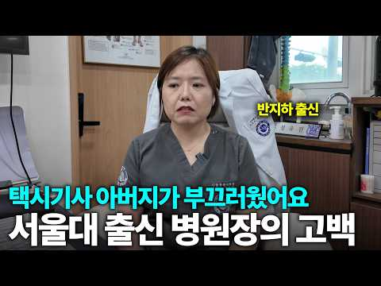
- 같은 채널 평소 대비 ×1.7 (채널 최근 롱폼 중앙값 104,918회) · 평소 영상: '이걸 너무 늦게 알았어요' 47세에 돌아보니 나에게 맞는 인생을 사는 법 (105,044회) / “두려웠어요…” 혼자 호텔로 도망쳐보니 알게 된 것 ∣ 혼자 사는 40대 병원장의 연휴 (104,792회)
- 대본 없음 (없음) — 음성인식이 끝나면 도입부·흐름이 들어감
- 댓글 280/280: 좋은 점 — 영상 2 · 감사·응원 34 · 더 알고 싶은 것 0 · 아쉬운 점 — 영상 1 · 반박·불만 — 의견 다름 2 · 정치·사회 2 · 경험 공유 28 · 구독·다음 기대 5
  - 좋은 점 — 영상 👍10 “많이 배웁니다 제가 많이 부족함을 느낍니다. 인생을 다시 잘 살아야겠다고 생각이 드는 영상입니다. 이런걸 알려주셔서 감사합니다”
  - 좋은 점 — 영상 👍0 “좋은 말씀 감사합니다.”
  - 감사·응원 👍364 “학교다닐때 95학번입니다.저희 고등학교에서 넘사벽 전교 1등 저는 10등권 이었습니다. 진짜 서울의대는 넘사벽이었죠.장세권 이름도 안잊어 먹을 정도로 수재여서 그친구도 평범한 집. 그런 끈기와 머리는 부모님께 받은 선물입니다. 노력만으로도 안되지요. 저는 수유시장 앞…”
  - 감사·응원 👍273 “부모님께서 좋은 머리를 물려주셨어요...넘 감사할 일이죠...”
  - 아쉬운 점 — 영상 👍3 “저 좋은 유전자를 후대에 못전한게 아쉽네요”
  - 정치·사회 👍10 “저도 아버지께서 최근에 하늘나라가셔서 요즘따라 많이 그립네요.ㅎ 어머니도 잘모시도록 하겠습니다.”
  - 정치·사회 👍0 “제 개인적 이야기 입니다. 고등학교 3년 입학 성적이 좋아 입학장학금을 저도 쌍둥이라서 가정 생계가 힘들었지만 부모님 가르침으로 그 친구에게 장학금을 양보 했습니다. 그 친구가 의대에 진학하고 제 쌍둥이 동생에게 82년 1억이란 돈을 대출해주어 자영업을 하게 도와주었…”
  - 경험 공유 👍364 “학교다닐때 95학번입니다.저희 고등학교에서 넘사벽 전교 1등 저는 10등권 이었습니다. 진짜 서울의대는 넘사벽이었죠.장세권 이름도 안잊어 먹을 정도로 수재여서 그친구도 평범한 집. 그런 끈기와 머리는 부모님께 받은 선물입니다. 노력만으로도 안되지요. 저는 수유시장 앞…”
  - 경험 공유 👍78 “94년도 중3때 도덕담당이던 아줌씨 담임 내가 교실을 깨끗히 청소 잘 한다며 일요일 본인 집 이삿날 새벽일찍부터 날 불러 청소시키더라. 순진했던 난 왁스로 손이 벗겨져라 화장실 청소까지 말끔하게 했는데 본인 가족 끼리만 짜장면 먹으러가고 나한텐 뻥튀기 과자 한봉다리 …”
  - 구독·다음 기대 👍22 “저도 지금 경제 상황이 좋지 않은 대학생인데 보면서 희망을 얻고 구독하고 갑니다. 멋있으세요!”
  - 구독·다음 기대 👍16 “아~~~쌤. 저 반성하게 되요. 팬입니다. ㅎㅎ”

### 153. 돈 버는 방식은 정해져 있다, 수익 모델 15종 다이제스트

- https://www.youtube.com/watch?v=wr4nCMUy1dk · 사다리게임 · 구독자 36,100 · 조회수 133,654 (×3.7, 하루 962.2) · 좋아요 9,026 (6.8%) · 18분 · 2026-05-28 · 주제 묶음 기타 · 형식 정보·해설 (그 밖) · 폴더 `W_wr4nCMUy1dk` (웹 승인)
- 썸네일: 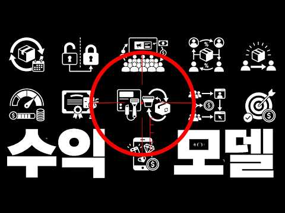
- 설명 앞부분: 수익 모델의 유형은 이미 정해져 있습니다. 세상에 아무리 새로운 서비스가 나와도, 돈을 버는 구조는 결국 기존 패턴의 선택이거나 조합이에요. 15가지 수익 모델을 하나씩 빠르게 훑을 건데요, 이 중에서 여러분의 사업에 맞는 걸 찾아 보세요.
- 같은 채널 평소 대비 ×7.3 (채널 최근 롱폼 중앙값 18,270회) · 평소 영상: 2027년 사업 성공을 위해 알아야 할 메가 트렌드 8 (18,999회) / 대기업 잔치에 끼어들 수 있는 아이템이 있습니다 (신사업 원정대) (17,541회)
- 대본 없음 (설명) — 음성인식이 끝나면 도입부·흐름이 들어감
- 댓글 77/77: 좋은 점 — 영상 7 · 감사·응원 9 · 더 알고 싶은 것 2 · 아쉬운 점 — 영상 0 · 반박·불만 — 의견 다름 0 · 정치·사회 0 · 경험 공유 1 · 구독·다음 기대 2
  - 좋은 점 — 영상 👍5 “좋은 영상 감사합니다.”
  - 좋은 점 — 영상 👍3 “좋은 영상 감사합니다!”
  - 감사·응원 👍34 “뭐지 이 개 똑똑한 영상이 내게 뜨다니.... 감사합니다.”
  - 감사·응원 👍10 “우연히 보게되었는데 내용이 간결하게 핵심이 잘 정리되어서 너무 좋았습니다 감사합니다 😊”
  - 더 알고 싶은 것 👍16 “당연한 얘기들이지만 실천하기가 참 어려운😂 각각의 초기자금과 난이도도 붙여서 심화버전도 만들어주시면 좋겠네요!”
  - 더 알고 싶은 것 👍2 “각각 매출 발생 방법별 디테일한 성과 지표알려주세요”
  - 경험 공유 👍3 “제가 봤으니까 이제 영상 내려주세요”
  - 구독·다음 기대 👍3 “구독하고 갑니다. 감사합니다.”
  - 구독·다음 기대 👍2 “구독합니다”

### 154. 45살에 시작한 사이드잡 부업으로 월 순수익 1억 벌고 인생역전한 48살 아저씨

- https://www.youtube.com/watch?v=XX8QV3-5rAM · 실전부업클럽 · 구독자 23,400 · 조회수 81,154 (×3.5, 하루 81,154.0) · 좋아요 0 (0.0%) · 29.6분 · 2026-10-13 · 주제 묶음 2. 돈 모으기·저축 · 형식 정보·해설 (그 밖) · 폴더 `W_XX8QV3-5rAM` (웹 승인)
- 썸네일: 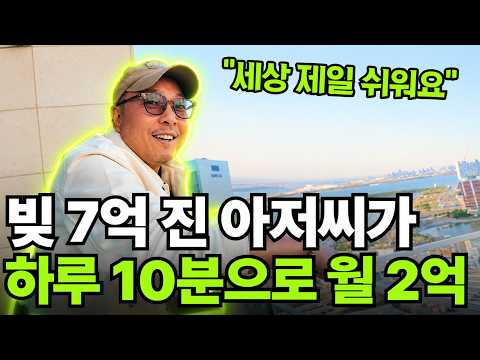
- 설명 앞부분: 🎁 건기식 사이드잡으로 월 2억을 달성하며 인생 역전을 이뤄낸 48살 '최대표' 님의 '쿠팡 건기식 수익화 자료 3종'을 100% 무료로 드립니다. 📂 무료 제공 콘텐츠 (소수 인원에게만 한정 공개) 1️⃣ 무료 라이브 공개! 최대표만의 쿠팡 상위 노출 시크릿 전자책 초보 셀러도 쿠팡 알고리즘을 정복하고 첫 페이지 노출을 노리는 핵심 돈버는법 가이드! 2️⃣ 구매 전환율을 폭발시키는 상세페이지 & 썸네일 제작 전자책 디자이너 없이도 클릭을 부르는 썸네일과 구매를 유도하는 상세페이지 제작 기법 완전 정리! 3️⃣ 실패 없는 수익을 …
- 같은 채널 평소 대비 ×3.3 (채널 최근 롱폼 중앙값 24,690회) · 평소 영상: 잔고 3만원에서 AI로 콘텐츠 만들어 총 47억 번 30대 애둘 워킹맘 [통합본] (29,230회) / "중졸 캐디 출신인 저도 해요" 부업으로 연 순수익 15억 번 40대 엄마 (20,150회)
- 대본 없음 (설명) — 음성인식이 끝나면 도입부·흐름이 들어감
- 댓글 230/228: 좋은 점 — 영상 3 · 감사·응원 23 · 더 알고 싶은 것 39 · 아쉬운 점 — 영상 0 · 반박·불만 — 의견 다름 0 · 정치·사회 0 · 경험 공유 13 · 구독·다음 기대 0
  - 좋은 점 — 영상 👍0 “좋은영상감사함니다.신청완료했습니다”
  - 좋은 점 — 영상 👍0 “도움이 절실합니다. 자료부탁드립니다”
  - 감사·응원 👍1 “자료신청완료 감사합니다.”
  - 감사·응원 👍1 “전자책 감사합니다~^^”
  - 더 알고 싶은 것 👍1 “전자책 기대해요 부탁드립니다 월 생활비만 벌수 있으면 바랄게 없겠습니다”
  - 더 알고 싶은 것 👍0 “좋은기회 나눔에 감사드립니다 또 다른 기회에 또 다른 나눔이 이어지길 바라겠습니다~ 신청완료! 전자책도 부탁드립니다~”
  - 경험 공유 👍1 “많이 힘이듭니다.. 저도 좋은일이 생겼으면 좋겠습니다~~!!”
  - 경험 공유 👍0 “진정성이 느껴져요 저도 배워보고 싶습니다 전자책 신청합니다.”

### 155. 월 100만 원으로 QLD 적립식 투자하면 10억 은퇴자금 가능할까?

- https://www.youtube.com/watch?v=hSorn4W4RsI · 돈재이 DONJAY · 구독자 19,700 · 조회수 67,682 (×3.4, 하루 460.1) · 좋아요 1,359 (2.0%) · 19.2분 · 2026-05-20 · 주제 묶음 3. 주식·ETF · 형식 오디오북·낭독 (명언·인생조언) · 폴더 `W_hSorn4W4RsI` (웹 승인)
- 썸네일: 
- 설명 앞부분: ⭐안녕하세요, 본 채널은 저의 개인적인 투자 여정과 장기 투자 철학을 기록하는 공간입니다. 제가 겪은 시행착오와 시장을 바라보는 관점이 여러분의 투자 공부에 작은 참고가 되기를 희망합니다. 다만, 채널의 모든 콘텐츠는 정보 전달을 목적으로 제작되었습니다. 여러분의 성공적인 투자 여정을 응원합니다.
- 같은 채널 평소 대비 ×3.7 (채널 최근 롱폼 중앙값 18,222회) · 평소 영상: 매달 500만 원 QLD·SCHD 투자, 제 계좌는 이렇게 됐습니다 (18,658회) / 수익률 200%차이? 적립식 투자 수익률 어떤 것이 더 높을까? 매일 사기 vs 매주 사… (17,786회)
- 대본 없음 (설명) — 음성인식이 끝나면 도입부·흐름이 들어감
- 댓글 342/342: 좋은 점 — 영상 6 · 감사·응원 34 · 더 알고 싶은 것 34 · 아쉬운 점 — 영상 0 · 반박·불만 — 의견 다름 0 · 정치·사회 0 · 경험 공유 27 · 구독·다음 기대 1
  - 좋은 점 — 영상 👍3 “재밌게 잘 봤습니다👍앞으로도 계속해서 좋은 정보 많이 올려주세용👍 멋집니다”
  - 좋은 점 — 영상 👍3 “돈재이님 영상 너무 잘봤습니다 ~! 세금관련 영상도 쉽게 이해할수있는 영상도 제작 부탁드립니다!”
  - 감사·응원 👍16 “10년후에 저도 같이 밥 먹어요^^ 투자메이트가 생기니 투자가 더 재밌네요~~ 10년동안 사라지기 없기!!!! 돈재이님의 삶을 응원합니다!!!”
  - 감사·응원 👍7 “헐 지금 내가 딱 궁금한 딱!!!! 슈드 큐엘디 갈까 고민하는 상황에서 뜨네 와 감사합니다”
  - 더 알고 싶은 것 👍5 “10억으로 하면 100억도 되나요?”
  - 더 알고 싶은 것 👍3 “돈재이님 영상 너무 잘봤습니다 ~! 세금관련 영상도 쉽게 이해할수있는 영상도 제작 부탁드립니다!”
  - 경험 공유 👍26 “제가 실제로 1억 5천 정도 미국 개별주식 들고있던 상태에서 21년 7월 부터 매일 QLD를 사모았거든요. 어제까지 총 3억 정도 분할 매수해서 원금은 4억 5천 살짝 안되고 계좌는 딱 13억 찍혀있어요. 시장을 떠나지 않고 꾸준히 적립식 분할 매수한다면 10년안에 …”
  - 경험 공유 👍21 “제가 주식 금융순자산 만드는데 8년 8개월 걸렸는데 정말 1배짜리로는 힘들고 적절한 하락장때 적절한 레버리지 섞어야 가능하더라구요. 하락장마다 직장신용대출받아서 추가로 들어가니 가능하더군요.”
  - 구독·다음 기대 👍2 “매달 사는날이 정해져 있나요? 좋은방법인것 같아요 오늘 구독하고 갑니다.”

### 156. -5억, 주식에 노후자금 몰빵🔥내 미래는 쪽빵ㅜㅜ

- https://www.youtube.com/watch?v=IthWsvdt6q4 · 권감각의 유기주식테라피  · 구독자 20,300 · 조회수 68,927 (×3.4, 하루 1,767.1) · 좋아요 571 (0.8%) · 11.1분 · 2026-09-05 · 주제 묶음 3. 주식·ETF · 형식 사연·드라마 · 폴더 `W_IthWsvdt6q4` (웹 승인)
- 썸네일: 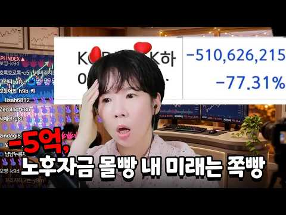
- 설명 앞부분: 당첨자 정보 입력하기 : 사연을 보내주실 때는 주식 매수 동기와 화면 캡처본(개인정보 가림 처리)을 함께 첨부해 주세요! 🎶 엔딩송 풀버전
- 같은 채널 평소 대비 ×1.5 (채널 최근 롱폼 중앙값 44,757회) · 평소 영상: 결혼 전 1억 있다고 했는데🔥주식으로 5천 날렸습니다 (48,211회) / 공포에 사라길래 샀더니 -6천… 주식장이 귀신의 집이냐 (41,303회)
- 대본 없음 (설명) — 음성인식이 끝나면 도입부·흐름이 들어감
- 댓글 81/81: 좋은 점 — 영상 0 · 감사·응원 2 · 더 알고 싶은 것 1 · 아쉬운 점 — 영상 1 · 반박·불만 — 의견 다름 1 · 정치·사회 0 · 경험 공유 5 · 구독·다음 기대 0
  - 감사·응원 👍4 “어우 5억 끔찍...나도 6월까지 -7억 이었다가 최근 -4억정도로 회복했는데.... 화이팅 합시다~!!!”
  - 감사·응원 👍0 “다들 힘내세요 언니 5억 빚있다는데 저는 공무원인데 영끌해서 부동산 3억 넘게 날리고 주식도 3억손실 미친듯이 안쓰고 빚 갚고있어요 영상 보고 서로 위로의 마음이에요ㅜㅜ 그래도 10년 지나면 나아지겠지하며 살고있어요 눈깔이 돌때가 있더라구요 ㅠㅠ”
  - 아쉬운 점 — 영상 👍4 “편집자님 갈수록 편집이 맛깔나네요 정성이 느껴집니다. 권감각님이 돈복은 지금은 몰라도 인복은 상한가네요”
  - 반박·불만 — 의견 다름 👍4 “평생 주식 할 생각이라지만 우리의 생명이 영원한 것이 아닌데 말이죠~😅 이러다 이 별에서 떠나는 날까지도 돈이 묶여 있을까 싶어 걱정입니다. 제 얘기예요~😂”
  - 경험 공유 👍16 “몰빵….주식3년차인데 단한번도 몰빵해본적이없다요… 쫄보라서그런가 무조건 분매수분매도실천함”
  - 경험 공유 👍4 “어우 5억 끔찍...나도 6월까지 -7억 이었다가 최근 -4억정도로 회복했는데.... 화이팅 합시다~!!!”

### 157. 반드시 부자되는 신혼부부의 3가지 공통점 (부자되는 방법)

- https://www.youtube.com/watch?v=t6NrbgrRE_k · 해쏘현_신혼부부 재테크 · 구독자 26,400 · 조회수 89,264 (×3.4, 하루 1,717.7) · 좋아요 723 (0.8%) · 11.9분 · 2026-08-23 · 주제 묶음 1. 재테크 일반·마인드 · 형식 정보·해설 (그 밖) · 폴더 `W_t6NrbgrRE_k` (웹 승인)
- 썸네일: 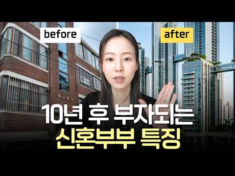
- 챕터: 0:00 인트로 · 0:50 부부가 한 방향으로 돈을 굴린다 · 3:30 오를 곳을 고르는 방법 · 6:53 남들이 망설일 때 실행한다 · 8:54 클로징 · 11:15 요즘 근황
- 설명 앞부분: 🙋‍♀️ 여전히 내집마련이 어렵다면 고민 상담하기 ‼️내집마련 고민상담 대기 신청하기
- 같은 채널 평소 대비 ×12.5 (채널 최근 롱폼 중앙값 7,169회) · 평소 영상: 주식 증여 vs 현금 증여, 뭐가 유리할까? (세무사 상담 후 바꾼 이유) (6,197회) / 자녀에게 주식 증여하는 방법 (집에서 홈택스 신고까지 A to Z) (8,720회)
- 대본 없음 (설명) — 음성인식이 끝나면 도입부·흐름이 들어감
- 댓글 100/100: 좋은 점 — 영상 4 · 감사·응원 4 · 더 알고 싶은 것 3 · 아쉬운 점 — 영상 2 · 반박·불만 — 의견 다름 1 · 정치·사회 2 · 경험 공유 9 · 구독·다음 기대 0
  - 좋은 점 — 영상 👍4 “맞는 말씀임. 아껴쓰고, 투잡이든 내 몸값을 늘리든 소득 올리고 공부해서 종잣돈으로 투자도 하고. 그럼 모이는 것 같아요! 모든 자산을 부동산에 때려박는 것 보다, 부동산보다 수익을 다른 방향으로 더 올릴 수 있다면 그것도 시도하는게 필요한 것 같아요! 찐 부자들은 …”
  - 좋은 점 — 영상 👍2 “알고리즘에 떠서 보게 되었는데 좋은 내용이네요! 전달력이 굉장히 좋으시네요! 감사합니다!”
  - 감사·응원 👍2 “알고리즘에 떠서 보게 되었는데 좋은 내용이네요! 전달력이 굉장히 좋으시네요! 감사합니다!”
  - 감사·응원 👍1 “항상 좋은 영상 감사해요~ 내집마련을 최우선으로 하여 달려가겠습니다! 책 집필도 화이팅이에요!”
  - 더 알고 싶은 것 👍12 “요즘 부동산 입장권이라는말이 있던데 , 둘이합쳐 1억뿐인데도 바로 매수하는게 맞을까요.. 예를들어 5억대 매매해서 1억 오를때 상급지는 몇억씩 뛸것같아서 6억 미만 사는게 리스크가 있을것같아서요.. 부부합산 연봉 9천인데, 2년동안 1억을 모아서 시드 2억일때 아파트…”
  - 더 알고 싶은 것 👍3 “책 궁금해요! 나오면 사서 읽어볼게요~!!”
  - 아쉬운 점 — 영상 👍15 “그걸 누가 모르나? 다들 돈이 모자르고 대출 받기도 힘드니 오피스텔이나 빌라라도 생각하는거다 뭐? 리센츠, 헬리오? 그거 살 돈 있는 사람들이 이런거 보겠냐? 다들 작은 시드로 시작하니 이런거라도 보면서 방법을 찾을려고 하는거다 누구나 다 알고 있는 뻔한 내용들만 얘…”
  - 아쉬운 점 — 영상 👍2 “자막이 황금성 오타가 있네요~”
  - 정치·사회 👍155 “문재인 만나기전에 결혼하신 분들은 3배가 안되면 이상한겁니다!”
  - 경험 공유 👍6 “18년에 결혼해서 저도 순자산 5배가 늘었는데요 각자 상황에 따라 다릅니다. 잘 판단하고 결정하세요.”
  - 경험 공유 👍2 “공주시 같은 소도시는여???? 현 대장 아파트가 300세대 ( 3년차 ) 거의 5억입니다.”

### 158. 부자 되기 바로 전, 삶에 나타나는 이상한 변화 7가지 (놓치면 평생 후회합니다)

- https://www.youtube.com/watch?v=GxGvoXZQbZ0 · 누구나 겪는 돈 이야기 · 구독자 4,490 · 조회수 14,314 (×3.2, 하루 93.6) · 좋아요 356 (2.5%) · 17.2분 · 2026-05-14 · 주제 묶음 1. 재테크 일반·마인드 · 형식 정보·해설 (그 밖) · 폴더 `W_GxGvoXZQbZ0` (웹 승인)
- 썸네일: 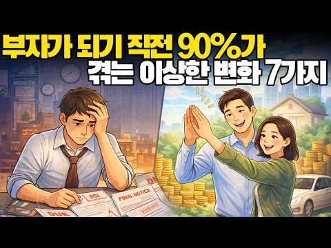
- 챕터: 0:00 도입: 최근 느껴지는 낯선 감각 · 1:45 신호 1: 기존 인간관계에서의 소외감 · 3:30 신호 2: 예전의 취미가 무의미하게 느껴짐 · 5:15 신호 3: 직관의 필터가 바뀌기 시작함 · 7:00 신호 4: 논쟁을 멈추고 실행에 집중 · 9:15 신호 5: 하나의 목표에 대한 강한 집중 · 11:30 신호 6: 극한의 피로에 도달 · 13:45 신호 7: 현재 수입 구조에 대한 의문 · 15:30 정리: 폭발을 위한 에너지가 축적되는 과정 · 16:45 당신에게 전하는 메시지: 멈추지 마세요
- 설명 앞부분: 7가지 이상한 신호: 당신의 인생이 곧 완전히 바뀐다 ∣ 성공의 전환점 최근 들어 주변의 모든 것이 낯설게 느껴지나요? 친구들과의 즐거운 시간조차 공허하게 느껴지고, 예전에는 좋아하던 것들이 더 이상 흥미롭지 않거나, 심지어 모든 것에 대해 피로감과 의문을 느끼고 있나요? 너무 걱정하지 마세요. 이것이 단순한 하락의 신호일 거라고 생각할 필요는 없습니다. 사실 이런 불편하고 혼란스러운 감정은 무너짐이 아니라, 당신이 완전히 새로운 단계로 나아가기 직전이라는 신호일 수 있습니다. 대부분의 성공한 사람들은 인생이 크게 바뀌기 직전에 …
- 같은 채널 평소 대비 ×2.1 (채널 최근 롱폼 중앙값 6,876회) · 평소 영상: 이 7가지 모르면 10억은 절대 못 갑니다 (1억부터 시작) (7,025회) / 왜 가난한 사람들끼리 모이면 더 가난해질까? 숨겨진 충격적 메커니즘 (경제학·심리학·사회… (6,728회)
- 대본 없음 (설명) — 음성인식이 끝나면 도입부·흐름이 들어감
- 댓글 14/14: 좋은 점 — 영상 2 · 감사·응원 3 · 더 알고 싶은 것 0 · 아쉬운 점 — 영상 0 · 반박·불만 — 의견 다름 0 · 정치·사회 0 · 경험 공유 2 · 구독·다음 기대 0
  - 좋은 점 — 영상 👍1 “좋은 영상 올려주셔서 정말 감사드립니다”
  - 좋은 점 — 영상 👍0 “좋은 영상입니다~ 저영상이 진짜로 이루어지면 좋겠습니다”
  - 감사·응원 👍4 “나는 백프로왔어요.감사합니다.고맙습니다.”
  - 감사·응원 👍1 “좋은 영상 올려주셔서 정말 감사드립니다”
  - 경험 공유 👍4 “나도나도 이런느낌. 부자될 상이로군요.. 아니라도 이영상. 자신감 뿜뿜 되네요~~”

### 159. 친구? 없어요. 혼자 재테크 경제 세미나 다니는 30대 미혼 여자 직장인 vlog 💸 ∣ 자산 폭등기 대처법, 돈 공부, 서울머니쇼 후기, 강남 조용한 북카페 …

- https://www.youtube.com/watch?v=jHm2LpwKQRg · 일어나안나 · 구독자 42,200 · 조회수 128,570 (×3.0, 하루 819.1) · 좋아요 2,264 (1.8%) · 6.5분 · 2026-05-10 · 주제 묶음 1. 재테크 일반·마인드 · 형식 브이로그·직접 해본 이야기 · 폴더 `W_jHm2LpwKQRg` (웹 승인)
- 썸네일: 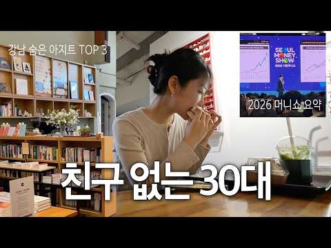
- 설명 앞부분: 혼자 경제 세미나와 북카페들 다녀온 30대 직장인 재테크 브이로그예요.💸 2026 서울머니쇼 후기와 자산 폭등기 대처법, 그리고 강남의 조용한 북카페 3곳(북쌔즈, 최인아책방, 북앤레스트)을 담았습니다. 직접 다녀와보니 너무 좋았는데요. 혼자 집중해서 공부하거나 책 읽을 곳 찾는 분들은 영상 끝까지 시청해 주세요! ✨ 감사합니다.🤍 ▪by 일어나안나
- 같은 채널 평소 대비 ×5.7 (채널 최근 롱폼 중앙값 22,470회) · 평소 영상: 지출 스트레스 없이 혼자 0원 문화생활 하는 싱글 여성의 24시간 vlog (서울무료전시… (23,027회) / 나도 모르게 돈 버리고 있는 소비습관 3가지 (21,811회)
- 대본 없음 (설명) — 음성인식이 끝나면 도입부·흐름이 들어감
- 댓글 188/188: 좋은 점 — 영상 2 · 감사·응원 9 · 더 알고 싶은 것 11 · 아쉬운 점 — 영상 0 · 반박·불만 — 의견 다름 0 · 정치·사회 0 · 경험 공유 26 · 구독·다음 기대 3
  - 좋은 점 — 영상 👍1 “덕분에 가보고싶은 북카페가 생겼습니다😊 좋은영상 감사합니다”
  - 좋은 점 — 영상 👍0 “유익한 경제세미나 서치하는 방법도 궁금해요!🤭”
  - 감사·응원 👍204 “인스타나 sns 보면 다 친구많고 잘노는것 같지만 사실 대부분은 열심히 돈모으고 일하고 쉬고 어쩌다 몇몇 소수의 친구와 편한 만남.. 다 비슷해요 화이팅!!”
  - 감사·응원 👍161 “친구는 어차피 없어집니다. 적어도 돈은 배신은 안하죠. 재테크 힘내세요.”
  - 더 알고 싶은 것 👍1 “저도 비슷한 나이대 구독자에요... ㅎㅎ 몇년생이신지 궁금해요!”
  - 더 알고 싶은 것 👍0 “유익한 경제세미나 서치하는 방법도 궁금해요!🤭”
  - 경험 공유 👍60 “저는 32살 일반 직장인인데요 저도 딱 이래요.. 친구도 만나는것도 뭔가 의미없게 느껴지고 일하고 부업하고 매일 월급날만 기다리면서 계산기만 두드리는데 가끔 보면 너무 현생을 희생하면서 사는게 아닌지 잘살고있는건지 의문이 들더라구요..”
  - 경험 공유 👍51 “부자,자산가들 특징이 친구가 거의 없어요 방해되거든요 돈 벌려하면 만나서 놀고 술 마시고 시간 낭비죠 저도 계모임이 3개고 총 50여명 모임에 속해있다가 2개는 정리하고 나머지 1개도 곧 정리합니다 대화가 이제 안됩니다 자산가로 들어서고나니 혼자가 더 마음편하고 판단…”
  - 구독·다음 기대 👍5 “친구 없어서 구독합니다..”
  - 구독·다음 기대 👍0 “구독합니다”

### 160. [전문가 초대] 인플레 고착화 시대...내 포트폴리오에 담을 자산은? (오건영 단장)

- https://www.youtube.com/watch?v=6tQaMqgqoxA · 돈에안기자(TV조선경제채널) · 구독자 26,500 · 조회수 80,561 (×3.0, 하루 634.9) · 좋아요 951 (1.2%) · 44.2분 · 2026-06-09 · 주제 묶음 3. 주식·ETF · 형식 인터뷰·강연·대담 · 폴더 `W_6tQaMqgqoxA` (웹 승인)
- 썸네일: 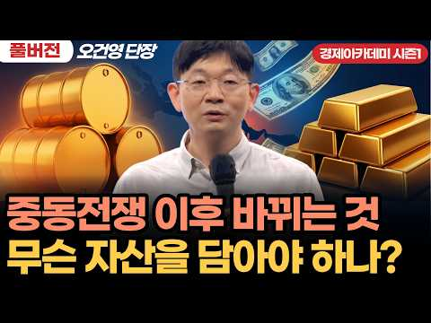
- 설명 앞부분: 🚨2026 경제아카데미 시즌1 - 오건영 단장 풀버전 안내 말씀 본 영상은 지난 5월 16일 진행된 오프라인 증시 강연 녹화본입니다. (시청에 참고하시기 바랍니다.) 현장에 직접 참석해 주신 분들을 배려하고자 부득이하게 업로드에 시차를 두게 되었습니다. 촬영일과 차이는 있지만, 현재 시장 상황에서도 투자에 큰 도움이 되는 유효한 인사이트를 담고 있으니 시청자 여러분의 너른 양해와 관심 부탁드립니다. 💹 美 CPI 9.1%→3.0% 급락 후 정체, 금리 인하 지연 가능성 🛢️ 중동분쟁 장기화로 글로벌 에너지·안보 패러다임 재편 💰 …
- 같은 채널 평소 대비 ×8.5 (채널 최근 롱폼 중앙값 9,532회) · 평소 영상: 이재명 “보고받았지만 결정 안했다”...사실상 김용범 지목 (4,030회) / [전문가 초대]시스코 주가 회복에 26년 걸렸다...삼전닉스도 전철 밟을까? -이선엽 대표 (32,622회)
- 대본 없음 (설명) — 음성인식이 끝나면 도입부·흐름이 들어감
- 댓글 42/42: 좋은 점 — 영상 2 · 감사·응원 7 · 더 알고 싶은 것 0 · 아쉬운 점 — 영상 0 · 반박·불만 — 의견 다름 0 · 정치·사회 2 · 경험 공유 1 · 구독·다음 기대 0
  - 좋은 점 — 영상 👍7 “너무좋은강의다진짜 무료로보는게 죄송할정도네”
  - 좋은 점 — 영상 👍2 “강의 큰 도움되었습니다 경제를 좀 더 크고 길게 봐야겠다는 생각이 드네요”
  - 감사·응원 👍3 “귀한 강의 감사합니다.”
  - 감사·응원 👍1 “굿~~~ 잛봤어요 감사합니다😊”
  - 정치·사회 👍13 “본질은 부정선거”
  - 정치·사회 👍2 “아~~mb자원외교...선구안이었는데 문재인이 다 망침!!”
  - 경험 공유 👍1 “차트만 봐도 유가나, 금리는 이미 추세가 상방으로 돌려졌음. 지금은 잠시 눌리면서 힘을 모으는 단계죠. 과거 금리는 충분히 누를 수 있던 시기가 분명히 있었지만, 안 했죠. 오히려 몇년간 금리 인하 소리만 죽도록 나왔는데, 감자기 올해는 금리 인상..? 아무리 내가 …”

