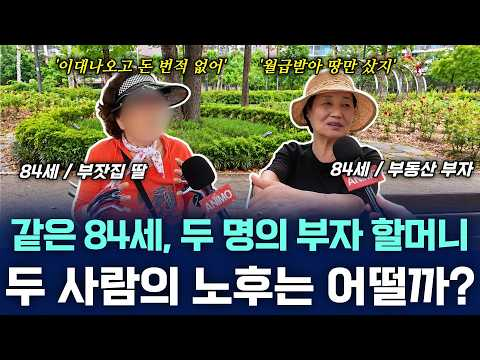
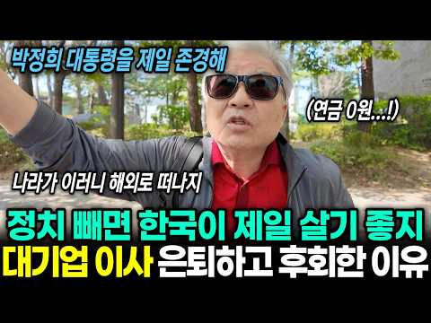

# 재테크 — 성공 사례 분석: 사례별 자세히 #121–#160

`analysis.md` 의 9번 (같은 # 번호). 자동 생성 — `tools/success_analysis.py` v1.6 (2026-10-28 10:11 UTC). ※ 연구·교육용 — 투자 권유가 아님.

### 121. "1시간만 해보세요" 퇴근 후 아무도 모르는 사이드잡으로 월 2천만원 버는 28살 여자

- https://www.youtube.com/watch?v=6yurUbmQWu0 · 실전부업클럽 · 구독자 26,100 · 조회수 113,604 (×4.3, 하루 12,809.0) · 좋아요 0 (0.0%) · 27.5분 · 2026-10-14 · 주제 묶음 1. 재테크 일반·마인드 · 형식 정보·해설 (그 밖) · 폴더 `W_6yurUbmQWu0` (웹 승인)
- 썸네일: 
- 설명 앞부분: 📂 무료 제공 콘텐츠 (소수 인원에게만 한정 공개) 2️⃣ 5분 만에 뚝뚝 만드는 카드뉴스 AI 프롬프트 모음 기획과 제작 시간을 획기적으로 줄여주는 감자 강사님만의 시크릿 카드뉴스 AI 명령어 템플릿! 📩 초간단 자료 신청 및 수령 방법 3️⃣ 신청 후 안내에 따라 [전용 비밀 채팅방]에 입장합니다. 4️⃣ 채팅방 공지사항에서 자료를 즉시 다운로드하고 추가 온라인부업 & 무료 라이브 세미나 안내를 확인하세요! (※ 채팅방을 퇴장하실 경우 자료 재수령이 어려울 수 있으니 주의해 주세요!) ⚠ 필독 및 주의사항 본 자료는 한정 기간…
- 같은 채널 평소 대비 ×4.3 (채널 최근 롱폼 중앙값 26,207회) · 평소 영상: 잔고 3만원에서 AI로 콘텐츠 만들어 총 47억 번 30대 애둘 워킹맘 [통합본] (32,065회) / "중졸 캐디 출신인 저도 해요" 부업으로 연 순수익 15억 번 40대 엄마 (20,349회)
- 대본 없음 (설명) — 음성인식이 끝나면 도입부·흐름이 들어감
- 댓글 295/329: 좋은 점 — 영상 3 · 감사·응원 14 · 더 알고 싶은 것 23 · 아쉬운 점 — 영상 0 · 반박·불만 — 의견 다름 0 · 정치·사회 0 · 경험 공유 5 · 구독·다음 기대 2
  - 좋은 점 — 영상 👍0 “좋은 내용이에요, 신청합니다.”
  - 좋은 점 — 영상 👍0 “자료신청완료 좋은정보 감사합니다!”
  - 감사·응원 👍1 “감명깊게 봤습니다 어려운 여건을 이겨낸 대표님의 화이팅 넘치는 에너지를 배우고 싶습니다”
  - 감사·응원 👍0 “자료 신청 완료! 치트키 받고 강의까지 연결되길 간절히 바래요. 꼭 해보고싶습니다 감사합니자”
  - 더 알고 싶은 것 👍0 “영상시청,구독,채팅방 가입했습니다 프롬프트 부탁드립니다”
  - 더 알고 싶은 것 👍0 “최대표. 저도 식자재납품하다 코로나19때문에 최대표님 과거랑 비슷한 상황이라 너무힘들어 꼭 배워서 와이프한테 기쁨 주고 싶네요! 부탁드립니다”
  - 경험 공유 👍15 “나도 이거 하는데, 이게 이벤트 기간에만 주는 수익이라... 당장 다음달에 종료되어도 이상하지 않은..”
  - 경험 공유 👍0 “최대표. 저도 식자재납품하다 코로나19때문에 최대표님 과거랑 비슷한 상황이라 너무힘들어 꼭 배워서 와이프한테 기쁨 주고 싶네요! 부탁드립니다”
  - 구독·다음 기대 👍0 “구독완료”
  - 구독·다음 기대 👍0 “자료신청합니다. 구독했어요”

### 122. 은퇴 후 경비직에 사람들이 몰리는 진짜 이유

- https://www.youtube.com/watch?v=7kHfB06S2NM · 은퇴갓생 · 구독자 6,830 · 조회수 313,115 (×45.8, 하루 3,324.4) · 좋아요 2,613 (0.8%) · 15.7분 · 2026-07-26 · 주제 묶음 4. 노후·연금 · 형식 정보·해설 (그 밖) · 폴더 `W_7kHfB06S2NM` (웹 승인)
- 썸네일: 
- 챕터: 0:00 취업 센터의 기이한 풍경 · 1:28 5가지 경비직의 현실 · 4:50 기술이 없는 은퇴자 · 6:03 나이가 무기가 되는 곳 · 7:13 매달 찌히는 통장의 의미 · 8:52 10년을 계속하는 진짜 이유 · 10:58 누군가에게 필요한 존재 · 12:13 시작 전 반드시 따져볼 5가지 · 13:31 화려함 뒤에 숨은 진짜 가치
- 설명 앞부분: "평생 열심히 일했는데 결국 경비직인가 자존심이 상했습니다. 하지만 시니어 취업 센터에 가서야 비로소 깨달았습니다." 안녕하십니까, 은퇴갓생입니다. 20~30년간 대기업, 공무원, 교사, 은행원, 자영업 사장님으로 사회를 이끌어오셨던 분들이 은퇴 후 취업 센터에 오셔서 가장 먼저 찾는 일자리가 무엇인지 아십니까? 바로 '경비직'입니다. 고용24 채용 정보의 90%를 차지할 정도로 많은 은퇴자들이 몰리는 곳입니다. 처음에는 "잠깐만 하겠다"던 분들이 3년, 5년, 길게는 10년 넘게 경비 일자리를 지키는 진짜 이유는 무엇일까요? 단…
- 같은 채널 평소 대비 ×67.4 (채널 최근 롱폼 중앙값 4,646회) · 평소 영상: '솔직히 이런분들 그냥 쉬세요' 취업 못하는 사람들의 무의식적 특징 3가지 (5,009회) / 은퇴 후 재취업, 면접을 자꾸 포기하는 진짜 이유 (5,031회)
- 대본 (음성인식(앞 5분), 5.3 음절/초) — 앞부분만, 흐름은 그 안까지 첫 20초: “안녕하십니까. 은퇴각성 인사드립니다. 여러분 혹시 이런 생각 해보신 적이 있으신지요. 20여 년에서 30여 년간 열심히 일했는데 은퇴하고 나니까 결국 경비 자리를 알아보고 있네. 처음에는 조금 자존심이 상하기도 하죠. 내가 평소에 이런 일을 하려고 살아왔나. 하지만 막상 취업센터를 가보면 놀라운 감경을 보게 됩니다. 대기업 출신, 공무원 출신, 은행원, 교사, 군인,”
- 첫 1분: “안녕하십니까. 은퇴각성 인사드립니다. 여러분 혹시 이런 생각 해보신 적이 있으신지요. 20여 년에서 30여 년간 열심히 일했는데 은퇴하고 나니까 결국 경비 자리를 알아보고 있네. 처음에는 조금 자존심이 상하기도 하죠. 내가 평소에 이런 일을 하려고 살아왔나. 하지만 막상 취업센터를 가보면 놀라운 감경을 보게 됩니다. 대기업 출신, 공무원 출신, 은행원, 교사, 군인, 공기업 직원이나 자영업을 하셨던 사장님까지 정말 다양한 경력을 가진 분들이 한 가지 직업에 몰립니다. 바로 경비직입니다. 제가 신이요 취업센터에서 근무하면서 가장 많이 들었던 말도 이것이었습니다. 경비자리 하나 없습니까? 업무를 하기 위해서 고용 24사이트의 채용 정보를 떠올려두면 90% 정도가 거의 경비 채용이라고 해도 과언이 아닙니다. 그런”
- 흐름 (90초마다 첫 문장): 0:00 안녕하십니까. 은퇴각성 인사드립니다. 여러분 혹시 이런 생각 해보신 적… → 1:34 많은 분들이 가장 먼저 떠올린 일자리입니다. 업무는 생각보다 다양해요.… → 3:01 조용한 환경을 좋아하는 분들에게는 괜찮죠. 다만 야간 근무가 많은 것도… → 4:31 그래서 아주 침착하게 대체하는 것이 가장 중요합니다.
- 댓글 350/360: 좋은 점 — 영상 10 · 감사·응원 8 · 더 알고 싶은 것 5 · 아쉬운 점 — 영상 3 · 반박·불만 — 의견 다름 8 · 정치·사회 2 · 경험 공유 36 · 구독·다음 기대 0
  - 좋은 점 — 영상 👍20 “선생님 좋은정보 감사합니다 65세 이하는 아파트경비 65세 이상은 빌딩경비가 좋을것 같습니다 제경험을 이야기합니다 참고바랍니다 ❤❤❤”
  - 좋은 점 — 영상 👍2 “정말로돈때문만아니고내가할이있어행복합니다 맞는말만하시내요 지금현역9년차 내적성에맞으면 볼일다볼수있고노년에 해볼만한일입니다 좋은말씀감사합니다”
  - 감사·응원 👍20 “선생님 좋은정보 감사합니다 65세 이하는 아파트경비 65세 이상은 빌딩경비가 좋을것 같습니다 제경험을 이야기합니다 참고바랍니다 ❤❤❤”
  - 감사·응원 👍16 “30대 시설관리자입니다 정년보장되는곳이라 70세까지다닐생각입니다 감사합니다”
  - 더 알고 싶은 것 👍3 “홀로 사는 사람이 경비직 일을할 때 애로사항을 알려 주세요. 특히 식사는 어떻게 하는지요?”
  - 더 알고 싶은 것 👍0 “70세취업하면언제까지가능한가요?”
  - 아쉬운 점 — 영상 👍6 “아침에 일어나면 갈곳이없다 아니오 봄 여름 가을 겨울 눈을뜨면 갈곳이 세상에 널렸다 취미를 많이 가져라 아침에 달리기 수영 아침밥을 먹고 어르신 카드 들고 세상 구경하러 나선다 배고프면 국수 도 먹고 빵도 먹고 먹고 싶은것 다 먹는다 매일 똑같은 패턴은 안한다 낚시 …”
  - 아쉬운 점 — 영상 👍0 “은퇴하고 구형아파트 경비일 시작한지 딱 100일째 된 초보입니다 저는 급여가 쬠 작아서(세후 215 정도) 그렇지 재미 있습니다 입주민들,관리소장님,팀.반장님 모두 친절히 대해주십니다 대부분 70넘으신 분들이지만 규칙적인 생활을 해서 그런지 연세에 비해서 정정하십니다”
  - 반박·불만 — 의견 다름 👍90 “근데 경비 2교대하는 주변인들 보니 얼굴이 금방 삭고 건강이 말이 아닙니다. 몇 년 지나니 폭삭 늙었더라구요. 돈 있다면 굳이 할게 못됩니다.”
  - 반박·불만 — 의견 다름 👍0 “택배는 경비업무가 아닙니다! 글구 층간소음 문제는 경비가 끼어들 일이없고 끼어들어도 안됩니다!경찰에 신고가 최선입니다!”
  - 정치·사회 👍0 “잘생각해보셔들 이딴식으로가면 정권넘어간다 나 민주당 안찍어요 이딴식이면... 보수로 정권넘어가서..민주당 싹 재판받고 빵에가는걸 보고말거다...”
  - 경험 공유 👍75 “30년 넘게 프로그래밍 개발일을 했습니다. 코로나 여파로 회사가 거의 폐업위기일때 사직을 했는데, 처음엔 실업급여받으며 좀 쉬고싶어서 취업될까봐 일부러 이력서 안내고 교육만 받았습니다. 구직필수 기간이됐을때부터 이력서를 냈는데 웬걸.. 연락이 하나도 안옵니다. 결국 …”
  - 경험 공유 👍49 “나는 은퇴후에 갈곳이 있어서 좋다 보다도 저는 내 시간을 자유로이 내마음대로 취미를 갖고 시간에 억메이지않고 자유로운 시간이 너무좋다 얼마남지 안는인생 내가 하고 싶은데로 하는게최고다”

### 123. [100만 조회수] 대기업 30년 다니고 은퇴했지만, 78세에 고시원에서 혼자 사는 이유

- https://www.youtube.com/watch?v=8_rq_vVFDTg · 아니모 인생기록관 · 구독자 22,900 · 조회수 1,430,978 (×62.5, 하루 11,058.1) · 좋아요 14,536 (1.0%) · 14.5분 · 2026-06-21 · 주제 묶음 4. 노후·연금 · 형식 인터뷰·강연·대담 · 폴더 `W_8_rq_vVFDTg` (웹 승인)
- 썸네일: 
- 설명 앞부분: 대기업 30년 현장소장에서 고시원 생활까지... 석촌호수에 만난 78세 어르신이 졸혼 후 노후에 마주한 현실을 솔직하게 들려드립니다. 아니모 채널에서는 시니어분들의 삶을 기록합니다. 지나온 시간, 지금의 고민 그리고 앞으로의 하루를 묻습니다. 많은 시청 부탁드립니다.
- 같은 채널 평소 대비 ×25.2 (채널 최근 롱폼 중앙값 56,676회) · 평소 영상: 50억 돈도 잃고 가정도 돈도 다 잃었습니다. 현재는 기초생활수급자가 된 이야기 (57,967회) / 정말 최소한만 쓰고 삽니다. 먹고 싶은거 참고, 입고 싶은거 안입습니다. 노후 걱정 (55,385회)
- 대본 (음성인식(앞 5분), 4.2 음절/초) — 앞부분만, 흐름은 그 안까지 첫 20초: “한남대학교 공식공학과 이렇게 해가지고 연더건더라도 한 20년, 30년 하다가 꽤 전에 IMF가 와가지고 거기에서 비둬도 정상하고 그러다 보니까 저를 혼노랬어요, 저를 혼노. 이유는 안 나고 같이 살지 않고 별공한 지가 40년이 되겠죠.” — 도입부 유형: 숫자로 시작
- 첫 1분: “한남대학교 공식공학과 이렇게 해가지고 연더건더라도 한 20년, 30년 하다가 꽤 전에 IMF가 와가지고 거기에서 비둬도 정상하고 그러다 보니까 저를 혼노랬어요, 저를 혼노. 이유는 안 나고 같이 살지 않고 별공한 지가 40년이 되겠죠. 만약에 어르신 아프시면 누가 병원에 갑자기 데려가줘야 하거나 이런 경우가 있을 수 있잖아요. 자기가 이제 임종은의 처해수 쪽에 주변에 바로 옆에 사람이 없으면은 고독사잖아. 우리 신문에 나이는 거 보면은 고독사를 당한 건지 죽었는데도 발견을 못한 거고 안에서 냄더가 나고 뭐 이렇다고 그러잖아. 그런 건 문제가 되지. 본 프로그램은 아니모의 제작 지원으로 만들어졌습니다. 좋은 이야기가 계속 이어질 수 있도록 구독과 좋아요로 함께해 주세요. 자기소개 한 번만 부탁드립니다.”
- 흐름 (90초마다 첫 문장): 0:00 한남대학교 공식공학과 이렇게 해가지고 → 1:31 그렇게 살아. → 3:00 경영하는 사람이 있고 → 4:30 저를 헌해가지고 따로 사는 거야.
- 댓글 1,690/1,715: 좋은 점 — 영상 38 · 감사·응원 69 · 더 알고 싶은 것 3 · 아쉬운 점 — 영상 15 · 반박·불만 — 의견 다름 21 · 정치·사회 16 · 경험 공유 103 · 구독·다음 기대 2
  - 좋은 점 — 영상 👍426 “저도 70이 되고보니 건강 돈 에 대해 절절히 와닿네요.학교 선배님이시기도 한데 남은 생이 더욱 알차시길요.건강하세요.”
  - 좋은 점 — 영상 👍160 “스킵하나도 안하고 집중해서 봤네요, 좋은말씀 감사해요 어르신.”
  - 감사·응원 👍1,988 “열심히 사신 분이시다. 경의를 표합니다. 그리고 대한민국을 성장시켜 주셔서 감사드립니다.”
  - 감사·응원 👍582 “이래서 귀티는 안 없어지는구나 역시 사람은 배워야한다고 느껴지네요 진솔한 인터뷰 감사합니다👏”
  - 더 알고 싶은 것 👍1 “그런데 그동안 버신돈들은 어떻게 된 걸까요?ㅜ”
  - 더 알고 싶은 것 👍0 “그냥 지방 소도시가면 5000이하에 20평대 아파트 구매가능한데요 왜 다들 연세도 있으신데, 서울을 고집하시는지 궁금해서 여쭙습니다”
  - 아쉬운 점 — 영상 👍18 “말씀은 확실히 잘 하시고 맞는 말씀만 하시네요~~ 그런데 마지막 아니모 선물이 넘 별로네요~ 연세드신 분 선물로는 다른 걸 준비하시면 좋겠네요~~ 많이 아쉽네요^^”
  - 아쉬운 점 — 영상 👍5 “고시원 사업을 두군데나 하셨던 분을...지금도 원해서, 그게 편해서 고시원사시는데. 나이들어 극도로 가난해서 홀로 고시원에 산다고 이렇게 제목낚시를 하시면 안되죠. 너무 낚였네요.”
  - 반박·불만 — 의견 다름 👍983 “고독사는 실패한 죽음이 아닙니다. 비싼 병원에서 가족과 간병인의 보호 아래 눈 감는다 한들 화려하고 행복한 죽음이란 있을 수 없어요.”
  - 반박·불만 — 의견 다름 👍16 “대학교 공대 선배님이시네요... 좀 더있고 덜 있고가 별것 아닌데요 뭐... 졸혼이 마음 아픕니다. 건강하세요...”
  - 정치·사회 👍39 “잘 들었습니다. 의정부에서 잘 들었습니다. 그래도 그 어려운시대에 잘 배우신 분이라 말씀도 부드러우십니다. 꼰대 같지 않으시고 현명하신 말씀 귀담아 갑니다. 건강하세요. 감사합니다”
  - 정치·사회 👍11 “응원합니다. 늘 건강하시고 행복하세요. 한국 발전의 견인차 역할을 하신 건축 엘리트셨네요. 메이저 건설사 현장소장 20,30년 하신분들, 멋진 분이시네요. 10여년전 군 생활관 개선 공사할때, 현장소장님이 생각나네요. 노가다라고 하지만, 참 책임감, 시공력, 매너, …”
  - 경험 공유 👍1,258 “그동안 본 은퇴자 인터뷰 중에서 가장 마음에 와 닿고 솔직한 인터뷰입니다. 어르신 학력좋고 일도 열심히 하셨는데 친구들과 자산 격차가 벌어진 사실을 담담히 말씀하시네요. 좋은 대학 나와 30년 넘게 일했는데 노후는 편치 않아보여요. 저도 생각이 많아지네요 ㅠ”
  - 경험 공유 👍551 “대화에서 가식없고 성실하게 사신 진솔함이 느껴지네요 가족의 의미에 대해 여러가지 생각이 듭니다 저도 60대 중반에 접어드니 더욱 홀로서기와 죽을때까지 건강과 여러 분야의 학습을 통해 시간 보내기를 잘하고 사흘 정도만 아프고 먼곳으로 가고 싶네요”
  - 구독·다음 기대 👍5 “정주행 .. 쭈욱 고견 많이 들었습니다. 건강하시구요. 고맙습니다..”
  - 구독·다음 기대 👍0 “와, 아저씨 세대차이를 못 느끼겠네요 민간인 토크를 이렇게 정주행 해 본적이 있었나 싶네요 문장 단어 선정 하나하나가 Chat GPT 돌린듯이 맥락들이 귀에 파고들 정도로 깔끔합니다 대기업 클라스는 나이 먹어도 이렇게 티가 나는거네요 세상을 또 이렇게 배웠네요 알고리…”

### 124. 57세 이후 통장에 이정도 예금 있다면 더 이상 일하지 말고 인생 즐기면서 사세요ㅣ명언ㅣ인생조언ㅣ오디오북ㅣ라디오북ㅣ시니어ㅣ노후ㅣ노년

- https://www.youtube.com/watch?v=AJFlT07d2uo · 노후생활설계실 · 구독자 3,010 · 조회수 20,283 (×6.7, 하루 1,432.8) · 좋아요 48 (0.2%) · 64.7분 · 2026-10-14 · 주제 묶음 2. 돈 모으기·저축 · 형식 사연·드라마 · 폴더 `W_AJFlT07d2uo` (웹 승인)
- 썸네일: 
- 설명 앞부분: 노후의 삶, 가족, 돈, 관계와 인생의 이야기를 따뜻하게 전해드립니다. 실제 삶에서 얻은 지혜와 감동을 통해 더 행복한 인생 후반전을 함께 생각해 봅니다. ※ 일부 이야기는 이해를 돕기 위해 구성된 허구이며, 실제 사례를 바탕으로 각색될 수 있습니다.
- 같은 채널 평소 대비 ×5.2 (채널 최근 롱폼 중앙값 3,878회) · 평소 영상: 60대 이후 팔자 좋은 사람들의 공통점, 돈이 아니었습니다 (3,878회) / 6억 4천만 원으로 조기은퇴한 50대 부부… 14개월 뒤 아내만 다시 출근한 진짜 이유 (3,862회)
- 대본 없음 (설명) — 음성인식이 끝나면 도입부·흐름이 들어감
- 댓글 0/0: 좋은 점 — 영상 0 · 감사·응원 0 · 더 알고 싶은 것 0 · 아쉬운 점 — 영상 0 · 반박·불만 — 의견 다름 0 · 정치·사회 0 · 경험 공유 0 · 구독·다음 기대 0

### 125. 배당주 20년 vs S&P500 20년, 3억 원이 만든 충격적인 자산과 삶의 격차 [ 재테크/미국주식/ETF/배당주/노후준비 ]

- https://www.youtube.com/watch?v=cqgVNBbMYew · 박대리와 황과장의 경제이야기 · 구독자 1,970 · 조회수 82,995 (×42.1, 하루 921.4) · 좋아요 1,152 (1.4%) · 20.5분 · 2026-07-30 · 주제 묶음 1. 재테크 일반·마인드 · 형식 정보·해설 (그 밖) · 폴더 `W_cqgVNBbMYew` (웹 승인)
- 썸네일: 
- 설명 앞부분: 같은 3억 원으로 시작해 20년 동안 완전히 다른 길을 걸어간 두 사람. 미국 배당 성장주에 투자해 매달 현금흐름을 굴린 박 대리와, S&P 500 지수 전체에 투자해 자본의 성장을 노린 황 과장. 20년이라는 긴 세월이 흐른 뒤, 두 사람의 계좌에 찍힌 숫자는 어떻게 달라졌을까요? 그리고 더 중요한 것, 은퇴 후 두 사람의 '진짜 삶의 모습'은 어떻게 갈렸을까요? 단순히 "어느 쪽이 더 많이 벌었나"를 넘어, 자산 형성기에서 은퇴기까지 우리가 투자를 바라보는 관점 자체를 바꿔줄 20년의 실측 데이터 서사를 확인해 보세요. [영상…
- 같은 채널 평소 대비 ×34.9 (채널 최근 롱폼 중앙값 2,379회) · 평소 영상: 배당주 vs 지수 같은 20년, 폭락 3번 중 배당주가 심장을 지켜준 건 단 한 번이었다… (2,379회) / 같은 S&P500을 10년 샀는데 한 명만 1억을 만들었다, 차이는 단 한 가지 [ 재테… (2,315회)
- 대본 (음성인식(앞 5분), 4.9 음절/초) — 앞부분만, 흐름은 그 안까지 첫 20초: “배당주와 지수 주식, 이 두 가지 자산은 같은 주식시장 안에서 가장 오랜 기간 라이벌 관계로 불려왔습니다. 시장이 폭발적인 성장을 온 몸으로 받아내며 지수의 팽창을 누릴 것인가, 새 된 챈 챈 누릴 것인가. 아니면 기업이 만들어내는 당장의 현금 흐름을 매달 꼬박꼬박 재투자하여 복리의 눈덩이를 굴릴 것인가.”
- 첫 1분: “배당주와 지수 주식, 이 두 가지 자산은 같은 주식시장 안에서 가장 오랜 기간 라이벌 관계로 불려왔습니다. 시장이 폭발적인 성장을 온 몸으로 받아내며 지수의 팽창을 누릴 것인가, 새 된 챈 챈 누릴 것인가. 아니면 기업이 만들어내는 당장의 현금 흐름을 매달 꼬박꼬박 재투자하여 복리의 눈덩이를 굴릴 것인가. 오늘 다룰 이야기는 바로 이 질문에서 출발합니다. 출발서는 똑같았습니다. 두 사람에게는 20년 전 각자 핏땀 흘려 모은 종자똥 3억 원이 손에 쥐어져 있었습니다. 대기업 직장인으로 오랜 기간 함께 근무하며 같은 월급을 받고, 같은 점심을 먹고, 같은 퇴근길을 걸었던 박 대리와 황 과장, 두 사람은 어느 날 점심을 먹고 회사 근처 공원 벤치에 앉아 서로의 통장을 열어보았습니다. 각자의 계좌에는 약속이라도 한”
- 흐름 (90초마다 첫 문장): 0:00 배당주와 지수 주식, 이 두 가지 자산은 같은 주식시장 안에서 가장 오… → 1:32 박 대리가 선택한 것은 미국 시장을 대표하는 배당 성장 자산이었습니다. → 3:07 황 과장은 배당에 목매지 않았습니다. → 4:35 S&P 500 역시 연 1.5% 안팎에 소소한 배당을 지급했지만 황과장…
- 댓글 162/166: 좋은 점 — 영상 3 · 감사·응원 4 · 더 알고 싶은 것 3 · 아쉬운 점 — 영상 1 · 반박·불만 — 의견 다름 3 · 정치·사회 5 · 경험 공유 9 · 구독·다음 기대 0
  - 좋은 점 — 영상 👍4 “좋은정보 감사드립니다”
  - 좋은 점 — 영상 👍1 “오 좋은내용감사합니다”
  - 감사·응원 👍4 “좋은정보 감사드립니다”
  - 감사·응원 👍1 “정말 궁금했는데 감사합니당”
  - 더 알고 싶은 것 👍3 “18:07 더이상 근로소득을 기대할수 없는 시점인데 어떻게 생활비로 한푼도 안쓰고 배당 재투자를 할수가 잇을까요?”
  - 더 알고 싶은 것 👍0 “3억 20년 넣고 기다릴 사람이 얼마나될까요? 시드 금액이 넘 큼..1억이면 몰라도.”
  - 아쉬운 점 — 영상 👍0 “지수 팔아서 배당 사면 되는데 결론이 많이 아쉽네요.”
  - 반박·불만 — 의견 다름 👍0 “주식투자에서 가장중요한게 투자기법 심리? 아닙니다 그냥 가만히 있는겁니다 대부분 폭락장에서 90%가 공포에 다던지죠.ㅋㅋ 인간이 가장 힘들어 하는게 가~만히 있는거죠”
  - 반박·불만 — 의견 다름 👍0 “말도 안되는 소리를 하네. 은퇴싯점에 S&P를 팔아서 배당주로 옮기면 되지. 물론, 22%의 양도소득세를 내야 하는데, 그걸 감안해도 황과장이 무조건 이겼구만.”
  - 정치·사회 👍47 “한국 정부는 개인의 노후도 보장 안해주면서, 세계에서 유일하게 세금을 안내는 사람이 세금을 내는 사람보다 혜택이 더욱 많고, 은퇴하면 세금이 더 늘어나고, 중국인을 위해 한국국민이 세금을 더 내게 만든 유일한 나라…”
  - 정치·사회 👍6 “빚내서 그냥 레버타라 정부에서 빚 탕감해준다”
  - 경험 공유 👍5 “운용하기 나름인듯 다만 지수는 손이좀 가고 배당은 손이 조금 덜간다는 차이가 있을뿐. 그리고 배당을 받는경우는 세금문제도 생각해야하고. 수입이 안끊어졌다는 전제로 하락장때 추매를 하면 안되는거였나? 아니면 3억을 한번에 몰아넣지 말고 적립식으로 했었다면?? 지수에 넣…”
  - 경험 공유 👍0 “저는 모든 수익의 절반을 투자 및 재투자하는 방식을 하고 있습니다. 배당주 위주로 하고 있고요. 월급의 절반도 투자, 배당금의 절반도 재투자. 내가 쓸 수 있는 현금도 매년 늘어나고, 배당금도 재투자가 계속 이루어져서 매년 늘어나는 구조죠. 배당금이 2천만원 넘어가면…”

### 126. 60대부터라도 싫어도 부자가 된다. TV에서 소개된 ‘5가지 마법의 습관’이 너무 대단했다

- https://www.youtube.com/watch?v=t94bcrWeee0 · 인간 인사이트 · 구독자 983 · 조회수 57,963 (×59.0, 하루 456.5) · 좋아요 1,419 (2.5%) · 30.4분 · 2026-06-23 · 주제 묶음 1. 재테크 일반·마인드 · 형식 브이로그·직접 해본 이야기 · 폴더 `W_t94bcrWeee0` (웹 승인)
- 썸네일: 
- 설명 앞부분: 매달 통장 잔고를 보며 한숨 쉬는 노후 불안, 이제 끝내세요. 연금 130만원으로도 여유롭게 사는 68세 이정인 씨의 실화입니다. 돈이 먼저 다가오는 다섯 가지 마법의 습관을 공개합니다. 봉투 나누기 게임, 집을 호텔 라운지로 만드는 법, 만원 버스 여행, 일주일 보류 법칙, 감사의 가계부까지! 아끼는 게 아니라 즐기며 돈이 쌓이는 방법. 체면, 충동구매, 허세에서 벗어나 진짜 부자로 사는 법을 알려드립니다. 오늘부터 작은 변화로 풍요로운 노후를 시작하세요.
- 같은 채널 평소 대비 ×715.6 (채널 최근 롱폼 중앙값 81회) · 평소 영상: 30년 만의 동창회에서 '어디 청소부시죠?'라며 깔보는 동창. 그녀가 자랑하는 남편이 내… (81회) / 【60대 주의】 근육을 지키는 최고의 단백질 식품 7가지. 1위는 "고기는 비싸다"며 피… (83회)
- 대본 (음성인식(앞 5분), 5.1 음절/초) — 앞부분만, 흐름은 그 안까지 첫 20초: “매달 통장 잔고를 들여다보며 남몰레 깊은 한숨을 내쉬고 계시지는 않나요? 연금이 적은이 어쩔 수 없다고 나름대로 아끼고 졸라멘다고 생각하는데도 어찌 된 일인지 돈은 모래할처럼 손가락 사이로 빠져나갑니다. 이러다 정말 노후의 길거리에 나앉게 되는 건 아닐까?” — 도입부 유형: 질문으로 시작
- 첫 1분: “매달 통장 잔고를 들여다보며 남몰레 깊은 한숨을 내쉬고 계시지는 않나요? 연금이 적은이 어쩔 수 없다고 나름대로 아끼고 졸라멘다고 생각하는데도 어찌 된 일인지 돈은 모래할처럼 손가락 사이로 빠져나갑니다. 이러다 정말 노후의 길거리에 나앉게 되는 건 아닐까? 만약 당신이 이런 막연하고도 실인 불안감을 가슴 한편에 품은 채 습관처럼 돈이 없어라는 말을 내뱉고 계신다면 오늘 잠시 걸음을 멈추고 제 이야기에 귀를 기울여주시길 바랍니다. 어쩌면 당신이 무심코 내뱉는 그 말과 무의식적인 행동들이 당신의 삶의 가난의 그림자를 끌어들이고 있는 것인지도 모릅니다. 세상에는 젊은 시절처럼 매달 큰 돈이 들어오지 않아도 쫓기는 일 없이 고요하고 평온하게 그리고 경제적으로도 여유를 누리며 살아가는 신이어들이 참 많습니다. 그분들”
- 흐름 (90초마다 첫 문장): 0:00 매달 통장 잔고를 들여다보며 남몰레 깊은 한숨을 내쉬고 계시지는 않나요? → 1:33 그리고 당신의 막막했던 노후가 → 3:02 그리고 오랜 친구들 앞에서의 알량한 체면이었습니다. → 4:31 억지로 마련한 돈이었으니까요.
- 댓글 40/41: 좋은 점 — 영상 5 · 감사·응원 9 · 더 알고 싶은 것 0 · 아쉬운 점 — 영상 0 · 반박·불만 — 의견 다름 0 · 정치·사회 0 · 경험 공유 3 · 구독·다음 기대 1
  - 좋은 점 — 영상 👍14 “많이 배웠습니다.저도 실천 하겠습니다.감사합니다.❤❤❤성장하세요.구독했어요.”
  - 좋은 점 — 영상 👍13 “오~ 좋은 내용 감사합니다. 충동구매를 많이 했는데 반성하고 실천해 보겠습니다.😊”
  - 감사·응원 👍14 “많이 배웠습니다.저도 실천 하겠습니다.감사합니다.❤❤❤성장하세요.구독했어요.”
  - 감사·응원 👍13 “오~ 좋은 내용 감사합니다. 충동구매를 많이 했는데 반성하고 실천해 보겠습니다.😊”
  - 경험 공유 👍14 “많이 배웠습니다.저도 실천 하겠습니다.감사합니다.❤❤❤성장하세요.구독했어요.”
  - 경험 공유 👍12 “말씀 고맙습니다 저도 실천에 옮기겠습니다”
  - 구독·다음 기대 👍14 “많이 배웠습니다.저도 실천 하겠습니다.감사합니다.❤❤❤성장하세요.구독했어요.”

### 127. 기준 금리 요동치는 지금, 내 계좌 살리는 분산 포트 비율 (홍춘욱 박사)

- https://www.youtube.com/watch?v=RfFgJJomevo · 오늘의 경제노트 · 구독자 1,160 · 조회수 20,927 (×18.0, 하루 533.9) · 좋아요 83 (0.4%) · 17.6분 · 2026-09-19 · 주제 묶음 3. 주식·ETF · 형식 인터뷰·강연·대담 · 폴더 `W_RfFgJJomevo` (웹 승인)
- 썸네일: 
- 설명 앞부분: 기준금리가 크게 움직이는 지금, 내 자산은 안전하게 분산되어 있을까요? 금리 변화가 이어지는 시기에는 주식과 채권, 현금 등 자산별 움직임도 달라질 수 있습니다. 그렇다면 변동성이 커진 시장에서 계좌를 지키기 위해 어떤 방식으로 포트폴리오를 구성해야 할까요? 이번 영상에서는 홍춘욱 박사가 금리 변화에 따른 시장의 흐름을 살펴보고, 분산투자의 중요성과 자산별 비중을 어떻게 바라봐야 하는지 자세히 설명합니다. 주식에만 집중하는 것이 부담스럽거나 시장 변동성에 대비하고 싶다면, 지금 내 포트폴리오에서 무엇을 점검해야 하는지 함께 확인해…
- 같은 채널 평소 대비 ×747.4 (채널 최근 롱폼 중앙값 28회) · 평소 영상: 2026년 서울 재개발 판도 바뀐다… 투자금액별 주목할 지역은? (김예림 변호사 3부) (29회) / S&P500, 나스닥 아닙니다. 이 ETF 무식하게 담으세요 (존리 대표 2부) (30회)
- 대본 (음성인식(앞 5분), 5.5 음절/초) — 앞부분만, 흐름은 그 안까지 첫 20초: “우리 투자자들이 옛날보다 훨씬 어려운데 어? 미국장 가네? 그러면 뭐 장애 추세도 길고 미국시장은 한번 추세를 잡으면 오래가 이렇게 있었다라면 지금은 시장을 흔드는 요인이 하나 더 생기거든 옛날에 주식시장 내에서 해즈펀드들이 망한의 사내 그런 거였다면 채권시장은 맞아 이렇게 굉장히 높은 변동성들을 지니고 있는 상황에서 시장의 어떤 투자의 어려움들은 높아지는 거고” — 도입부 유형: 질문으로 시작
- 첫 1분: “우리 투자자들이 옛날보다 훨씬 어려운데 어? 미국장 가네? 그러면 뭐 장애 추세도 길고 미국시장은 한번 추세를 잡으면 오래가 이렇게 있었다라면 지금은 시장을 흔드는 요인이 하나 더 생기거든 옛날에 주식시장 내에서 해즈펀드들이 망한의 사내 그런 거였다면 채권시장은 맞아 이렇게 굉장히 높은 변동성들을 지니고 있는 상황에서 시장의 어떤 투자의 어려움들은 높아지는 거고 채권군이 변동성이 커지는 때가 채권에서 손실을 할 텐데 주식도 손실이 났잖아요 그러면 주식이랑 채권 이 둘만 그냥 갖고 있으면 되는 만편한 포트폴리오로는 이 시장의 변화를 이겨낼 수 없는 흔히들 이야기하는 이제 6대사 채권 주식 포트폴리오 그런 거 들어보셨죠? 이래서 버틸 수 있겠는가? 안녕하세요. 세계리코노미스톡 추넁입니다 오늘은 세계경제 그리고”
- 흐름 (90초마다 첫 문장): 0:00 우리 투자자들이 옛날보다 훨씬 어려운데 → 1:32 그런 생각을 하게 되는데요 → 3:00 어떤 구조가 만들어졌냐면 → 4:30 네 펀드들입니다
- 댓글 4/4: 좋은 점 — 영상 1 · 감사·응원 1 · 더 알고 싶은 것 1 · 아쉬운 점 — 영상 1 · 반박·불만 — 의견 다름 0 · 정치·사회 0 · 경험 공유 0 · 구독·다음 기대 0
  - 좋은 점 — 영상 👍0 “어 편집이 왜..이렇죠. 좋은 내용에 그렇지 못한 편집. 그래도 응원합니다”
  - 감사·응원 👍0 “어 편집이 왜..이렇죠. 좋은 내용에 그렇지 못한 편집. 그래도 응원합니다”
  - 더 알고 싶은 것 👍4 “박사님만 자료와 함께 나오는게 훨씬 집중도가 좋습니다. 피디님이 굳이 화면에 보여야 하는 이유를 모르겠습니다. 그리고 왜 눈내리는 저건 무슨 의도인지…궁금하네요 정신사나워요”
  - 아쉬운 점 — 영상 👍0 “어 편집이 왜..이렇죠. 좋은 내용에 그렇지 못한 편집. 그래도 응원합니다”

### 128. 65세 이후 통장에 돈 이정도 들어있다면 돈 벌지 말고 그냥 돈 쓰면서 사세요ㅣ명언ㅣ인생조언ㅣ오디오북ㅣ라디오북ㅣ시니어ㅣ노후ㅣ노년

- https://www.youtube.com/watch?v=kXnYK2PiBDc · 철인의지혜 · 구독자 19,400 · 조회수 464,429 (×23.9, 하루 8,723.5) · 좋아요 1,858 (0.4%) · 26.9분 · 2026-09-05 · 주제 묶음 4. 노후·연금 · 형식 오디오북·낭독 (명언·인생조언) · 폴더 `W_kXnYK2PiBDc` (웹 승인)
- 썸네일: 
- 설명 앞부분: 65세 이후에는 더 많이 버는 것보다 지금까지 모은 돈을 현명하게 사용하는 일이 중요합니다. 평생 가족을 위해 아끼고 참고 살아왔지만, 건강과 시간은 돈처럼 통장에 쌓아둘 수 없습니다. 생활비와 의료비를 충분히 준비했다면, 이제는 무리해서 돈을 벌기보다 여행도 다니고 먹고 싶었던 음식도 즐기며 자신을 위해 살아야 합니다. 이번 영상에서는 65세 이후 일을 내려놓아도 되는 현실적인 예금 기준과 노후 자금을 안전하게 관리하고 사용하는 방법을 알아봅니다. 돈은 남기기 위해서만 모으는 것이 아닙니다. 건강하게 움직일 수 있는 지금, 여러…
- 같은 채널 평소 대비 ×67.8 (채널 최근 롱폼 중앙값 6,854회) · 평소 영상: 인생에서 60대가 가장 고되고 힘든 시간이 되는 이유ㅣ명언ㅣ인생조언ㅣ오디오북ㅣ시니어ㅣ노후… (7,072회) / 은퇴후 사람들이 가장 후회하는 압도적 1위ㅣ명언ㅣ인생조언ㅣ오디오북ㅣ라디오북ㅣ시니어ㅣ노후ㅣ… (6,636회)
- 대본 (음성인식(앞 5분), 4.0 음절/초) — 앞부분만, 흐름은 그 안까지 첫 20초: “여러분, 통장에 얼마가 있어야 이제 그만 벌어도 된다고 생각하십니까? 혹시 65시 넘었는데도 돈이 부족할까 봐 계속 일하고 계십니까? 조금만 더 모으면 마음 놓고 쉬겠다고 생각하며 몇 년을 보내셨습니까?” — 도입부 유형: 질문으로 시작, 시청자 부르기
- 첫 1분: “여러분, 통장에 얼마가 있어야 이제 그만 벌어도 된다고 생각하십니까? 혹시 65시 넘었는데도 돈이 부족할까 봐 계속 일하고 계십니까? 조금만 더 모으면 마음 놓고 쉬겠다고 생각하며 몇 년을 보내셨습니까? 그런데 참 이상합니다. 돈은 조금씩 늘어나는데 마음은 편해지지 않습니다. 1억을 모으면 2억이 필요할 것 같고 2억이 생기면 더 있어야 안심됩니다. 그러는 동안 통장 잔고는 늘어나지만 우리에게 남은 시간은 줄어듭니다. 65세는 갈 수 있었던 여행을 75세는 못 갈 수도 있습니다. 오늘은 맛있게 먹을 수 있는 음식도 훗날에는 그림의 떡이 될 수 있습니다.”
- 흐름 (90초마다 첫 문장): 0:04 여러분, 통장에 얼마가 있어야 이제 그만 벌어도 된다고 생각하십니까? → 1:30 사고 싶은 것도 참았고 가고 싶은 것도 다음으로 미루며 살아왔습니다. → 3:03 반대로 집이 있고 큰 빚이 없으며 연금까지 꾸준히 들어온다면 → 4:33 주거비 부담이 작고 생활비가 많지 않은 사람이라면 더 그렇습니다.
- 댓글 130/130: 좋은 점 — 영상 7 · 감사·응원 6 · 더 알고 싶은 것 1 · 아쉬운 점 — 영상 1 · 반박·불만 — 의견 다름 4 · 정치·사회 0 · 경험 공유 5 · 구독·다음 기대 0
  - 좋은 점 — 영상 👍6 “공감합니다.그돈은모았읍니다.그런데도.돈을함부로못씁니다.아프면.얼맏ㄹ어갈지모르잔아요😂😂😂😂😂”
  - 좋은 점 — 영상 👍5 “좋은 내용 감사합니다. "65세이후에는 돈버는 것 보다 건강을 지키는 것이 더 큰 재테크 일수 있습니다"라는 말이 많이 와 닿네요. 1년후에는 36년간 근무한 회사에서 정년퇴직합니다. 퇴직이후는 일은 하지 않고 봉사활동, 취미생생활(악기연주,산책) 그리고 친구/지인들…”
  - 감사·응원 👍12 “자연인 귀촌 5년차구요 딱육십중반이네요.지금 감사한 마음으로 재미나게사는 저는 예방학으로사니 마음이 평안합니다 , 그날이와도 양노원에는 안갈 계획이고해서 그런가봅니다 . 멋지게 동적으로살다가 그날이오면 편안히가자 그런 계획이라서 넘좋아요 ~~~”
  - 감사·응원 👍5 “좋은 내용 감사합니다. "65세이후에는 돈버는 것 보다 건강을 지키는 것이 더 큰 재테크 일수 있습니다"라는 말이 많이 와 닿네요. 1년후에는 36년간 근무한 회사에서 정년퇴직합니다. 퇴직이후는 일은 하지 않고 봉사활동, 취미생생활(악기연주,산책) 그리고 친구/지인들…”
  - 더 알고 싶은 것 👍9 “내 친구 주식, 투자성 관심 없고 순수하게 은행예금 이자와 연금 150만 원으로 윌생활 비 400만 원 만들고 외국으로 돌아다니면서 인생 즐겁게 사는 친구가 있어요 궁금해서 슬쩍 물어보니 현금 12억 있고 지금처럼 이렇게 평생 쓰고도 원금은 그대로 유지된다네요 나중에…”
  - 아쉬운 점 — 영상 👍1 “남자들은 시간이 너무 길어요”
  - 반박·불만 — 의견 다름 👍46 “돈이란 아등바등 해서 버는 것이 아닙니다. 적정한 곳에 굴러가도록 내버려 두면 불어나는 것입니다.”
  - 반박·불만 — 의견 다름 👍4 “일할수 있으면 일하세요. 꼭돈을 벌기위해서가 아닙니다. 돈있어 편안하다고 일 안하고 놀면 병이 듭니다”
  - 경험 공유 👍12 “자연인 귀촌 5년차구요 딱육십중반이네요.지금 감사한 마음으로 재미나게사는 저는 예방학으로사니 마음이 평안합니다 , 그날이와도 양노원에는 안갈 계획이고해서 그런가봅니다 . 멋지게 동적으로살다가 그날이오면 편안히가자 그런 계획이라서 넘좋아요 ~~~”
  - 경험 공유 👍6 “자산이 17억이신데 아파트 일산등 서울외곽에 32평 5~6억 구매하시고 자녀 1.5억씩 3억 증여하시고 나머지 8~9억중 3억 코덱스200타겟위클리커버드콜 거의 비과세 커버드콜에 투자하시면 월300이상 현금흐름 생깁니다. 2억정도는 비상금으로 꽁꽁 묶어두시고 나머지2…”

### 129. AI로 주식 자동 매매하면 어떻게 될까?

- https://www.youtube.com/watch?v=9E9OrcoMCjk · 이영배 · 구독자 20,000 · 조회수 1,106,017 (×55.3, 하루 8,511.5) · 좋아요 5,537 (0.5%) · 11.3분 · 2026-06-20 · 주제 묶음 3. 주식·ETF · 형식 정보·해설 (그 밖) · 폴더 `W_9E9OrcoMCjk` (웹 승인)
- 썸네일: 
- 같은 채널 평소 대비 ×7.6 (채널 최근 롱폼 중앙값 144,827회) · 평소 영상: AI에게 유튜브 채널을 운영시키면 구독자를 몇 명 모을까? (124,739회) / AI에게 인스타그램 운영을 시키면 팔로워를 몇 명 모을까? (238,100회)
- 대본 (음성인식(앞 5분), 6.8 음절/초) — 앞부분만, 흐름은 그 안까지 첫 20초: “지금부터 AI 두 개로 주식거래 대결 시켜볼 겁니다 누가 더 돈을 많이 벌어올까요? 제가 직접 한번 해보겠습니다 저는 제돈 천만 원을 AI 두 개에게 맡겨봤습니다 하나는 클로드의 오프스 4.8 다른 하나는 오픈 AI의 GPT 5.5인데요 둘 다 현재 최고의 성능을 자랑하는 각 회사의 최신 모델입니다 규칙은 간단합니다 실제 돈 500만 원을 받고 2주, 공일 제외 9 거래일 동안 최대 수익을 내면 됩니다” — 도입부 유형: 질문으로 시작
- 첫 1분: “지금부터 AI 두 개로 주식거래 대결 시켜볼 겁니다 누가 더 돈을 많이 벌어올까요? 제가 직접 한번 해보겠습니다 저는 제돈 천만 원을 AI 두 개에게 맡겨봤습니다 하나는 클로드의 오프스 4.8 다른 하나는 오픈 AI의 GPT 5.5인데요 둘 다 현재 최고의 성능을 자랑하는 각 회사의 최신 모델입니다 규칙은 간단합니다 실제 돈 500만 원을 받고 2주, 공일 제외 9 거래일 동안 최대 수익을 내면 됩니다 가장 먼저 클로드 코드로 거래를 할 수 있는 프로그램을 뚝딱 만들어냈고요 상태를 확인할 수 있는 데시보드도 구현해놨습니다 그래도 2주 동안 함께 하는 녀석들 아닙니까? 그래서 제가 이름도 한번 붙여봤는데 클로드가 짱이냐, 체치 PT가 짱이냐 이걸 정하는 거니까 휠짱이, 체짱이 이렇게 하겠습니다 그렇게 휠짱이와”
- 흐름 (90초마다 첫 문장): 0:00 지금부터 AI 두 개로 주식거래 대결 시켜볼 겁니다 → 1:30 일단 시장을 쭉 관망을 해요 → 3:01 삼성전자를 잇절해서 14만 원을 벌었다고 전 보고를 했단 말이죠 → 4:31 아니 왜 제가 시작하니까 갑자기 이런 일이 생기는 거죠?
- 댓글 576/588: 좋은 점 — 영상 5 · 감사·응원 16 · 더 알고 싶은 것 34 · 아쉬운 점 — 영상 3 · 반박·불만 — 의견 다름 8 · 정치·사회 7 · 경험 공유 34 · 구독·다음 기대 20
  - 좋은 점 — 영상 👍4 “딕션도 좋고 설명이 좋아요 컨텐츠만 좋으면 크게 되실분이다!!화이팅!!”
  - 좋은 점 — 영상 👍2 “영상 잘봤습니다. 앞으로 쭉쭉 좋은 영상 만들어주세요! 응원할게요”
  - 감사·응원 👍4 “딕션도 좋고 설명이 좋아요 컨텐츠만 좋으면 크게 되실분이다!!화이팅!!”
  - 감사·응원 👍3 “형들 마지막에 유튜버분 말들엇지? 현업코딩전문개발자들이 ai사용해서 장기적으로 수익이안나..이말은 전문지식으로 완벽하다 할만큼 만드는데도 지랄발광하면서 디버깅터지고 마이너스맞는거야.. 괜히 난 아이디어가 특별해 하면서 부여잡지마 현업개발자들이 아직 깡깡멀엇다함 미토스…”
  - 더 알고 싶은 것 👍3 “422번째 구독자입니다 올해안에 10만 가실 듯 앞으로도 재밌는 영상부탁드려요!”
  - 더 알고 싶은 것 👍2 “영상 잘봤습니다. 앞으로 쭉쭉 좋은 영상 만들어주세요! 응원할게요”
  - 아쉬운 점 — 영상 👍8 “영상 잘 봤습니다. 우연히 알고리즘 추천에 떠서 봤습니다. 편집이나 말씀 하시는 것도 되게 깔끔하고 보기 좋았습니다.”
  - 아쉬운 점 — 영상 👍4 “영상편집이나 진행. 딕션까지. 우연히 알고리즘에 떠서 봤는데 잼있네요. 구독하고가요”
  - 반박·불만 — 의견 다름 👍200 “재밌어요. 구독자 68명 퀄이아닌데요 머지”
  - 반박·불만 — 의견 다름 👍1 “영상 재밌게 봤습니다. 저도 개인 자동매매 시스템을 직접 개발해서 운영 중인데, 이 영상 보면서 왜 이런 결과가 나왔는지 조금 다른 각도에서 짚어보고 싶어요. **1. "가격을 임의로 예측해서 넣은" 그 버그가 핵심입니다** 영상에서 매도가를 못 불러와서 봇이 알아서…”
  - 정치·사회 👍0 “6월4일이면 선거 끝나고네 선가 전에 주가 올리고 선거끝나고 주가빠지고”
  - 정치·사회 👍0 “대한 외국인이네 딛,ㄹ 곱게 자란 인간들”
  - 경험 공유 👍142 “저도 직접 자동매매 시스템 만들어서 실제 운용 중인데, 느낀 점이 AI한테 판단을 맡기는 게 아니라 내 철학을 코드로 번역하는 게 핵심이더라고요. 언제 사고 언제 파느냐를 AI가 즉흥으로 결정하게 두면 결국 감정매매랑 다를 게 없어요. 시스템이 일관성을 갖추려면 철학…”
  - 경험 공유 👍13 “저도 ai로 코딩하여 자동매매 돌리는중인데 결국은 ai는 프로그램 만드는 툴로만 써야하고 전략은 내가짜야됨..”
  - 구독·다음 기대 👍16 “영상주기만 빨라지만 훨씬 대형채널이 될거같네요 저점매수 구독하고갑니다”
  - 구독·다음 기대 👍9 “이야 ㅋㅋㅋㅋ 주제 ㅅㅌㅊ 돈 잃었으니 바아로 구독합니다”

### 130. 나이 들수록 착하게만 살면 안 되는 이유｜만만하게 보이지 않는 6가지 방법ㅣ인생조언ㅣ노후준비ㅣ처세술ㅣ인간관계ㅣ삶의지혜ㅣ시니어ㅣ오디오북ㅣ

- https://www.youtube.com/watch?v=DJHfVSc-DvE · 마음 안부 · 구독자 3,880 · 조회수 25,131 (×6.5, 하루 1,559.9) · 좋아요 149 (0.6%) · 30.1분 · 2026-10-12 · 주제 묶음 4. 노후·연금 · 형식 오디오북·낭독 (명언·인생조언) · 폴더 `W_DJHfVSc-DvE` (웹 승인)
- 썸네일: 
- 설명 앞부분: 평생 남을 배려하며 착하게 살았지만 당연시 여기는 태도와 상처만 남으셨나요? 나이가 들수록 만만하게 보이지 않고, 내 삶의 주도권과 존엄을 단단하게 지키는 6가지 인간관계 지혜를 알아봅니다. 남에게 휘둘리지 않고 내 마음의 평온을 되찾는 법, 영상에서 확인해보세요. 이런 분들께 추천합니다 착하게 살았지만 돌아온 것은 허탈함과 무시뿐이신 분 거절이 어려워 타인의 부탁이나 요구에 쉽게 흔들리는 분 인간관계에서 상처받지 않고 나를 지키는 경계선이 필요하신 분 💬 "평생 착하게 살기만 해서 억울했던 적, 혹시 있으신가요? 🥺 오늘 이야기…
- 같은 채널 평소 대비 ×1.3 (채널 최근 롱폼 중앙값 20,004회) · 평소 영상: 60대 이후 한 통장에 돈 다 넣어두면 안 되는 이유 (현금과 통장 이렇게 나누세요)ㅣ인… (22,105회) / 노년부부도 각자 살아야 행복한 6가지 이유ㅣ인생조언ㅣ시니어ㅣ노후ㅣ오디오북ㅣ명언ㅣ (17,903회)
- 대본 없음 (설명) — 음성인식이 끝나면 도입부·흐름이 들어감
- 댓글 1/1: 좋은 점 — 영상 0 · 감사·응원 0 · 더 알고 싶은 것 0 · 아쉬운 점 — 영상 0 · 반박·불만 — 의견 다름 0 · 정치·사회 0 · 경험 공유 0 · 구독·다음 기대 0

### 131. 한겨울 저수지 뚝방에 버려진 치매 엄마, 아들 차가 떠나자마자 보따리에서 꺼낸 이것은..ㅣ노후사연ㅣ감동사연ㅣ사연라디오ㅣ오디오북

- https://www.youtube.com/watch?v=Pnrbrya6urQ · 햇살 머문 인생 · 구독자 30,600 · 조회수 928,921 (×30.4, 하루 11,890.5) · 좋아요 19,739 (2.1%) · 137.6분 · 2026-08-06 · 주제 묶음 4. 노후·연금 · 형식 사연·드라마 · 폴더 `W_Pnrbrya6urQ` (웹 승인)
- 썸네일: 
- 설명 앞부분: 본 영상은 창작자가 직접 기획·대본·연출한 100% 순수 창작 드라마(픽션)입니다. (영상 속 이미지와 음성은 일부 AI 기술 활용하여 생성) 이번 인생사연은 한겨울 저수지 둑방에 홀로 버려진 68세 치매 어머니의 이야기입니다. 효자로 소문난 큰아들이 어머니를 놓고 떠나자마자 멍하게 풀려 있던 어머니의 눈빛이 또렷하게 변하기 시작했습니다. 그런데 이 모든 비극의 시작은 석 달 전 아들이 병원에서 몰래 꺼내 든 인감도장에서 비롯되었습니다. 과연 어머니는 정말 치매였을까요? 도대체 그 효자 아들은 무슨 짓을 저지른 걸까요? ☀ 햇살머…
- 같은 채널 평소 대비 ×27.0 (채널 최근 롱폼 중앙값 34,364회) · 평소 영상: 폐지 줍는 할머니의 7살 손녀가 재벌여회장의 반지를 보고 "어? 할머니도 이거 있어요!"… (34,364회) / 이혼 후 3년, 아이 업고 시골 장터에서 백반 배달하는 전처가 재벌남편을 못 알아보고 건… (36,325회)
- 대본 (음성인식(앞 5분), 4.3 음절/초) — 앞부분만, 흐름은 그 안까지 첫 20초: “엄마, 여기 공기 좋으니까 잠깐만 앉아 계세요. 차에서 따뜻한 거 가져올게요. 그 한마디를 끝으로 아들은 어머니를 버리고 가버렸습니다. 한겨울 영하 10도 낭간도 없는 저수지 두 방 위에 혼자서 움직이지도 못하는 치매 걸린 어머니를 두고 말이죠.”
- 첫 1분: “엄마, 여기 공기 좋으니까 잠깐만 앉아 계세요. 차에서 따뜻한 거 가져올게요. 그 한마디를 끝으로 아들은 어머니를 버리고 가버렸습니다. 한겨울 영하 10도 낭간도 없는 저수지 두 방 위에 혼자서 움직이지도 못하는 치매 걸린 어머니를 두고 말이죠. 그런데 아들의 차가 사라지자마자 멍하게 풀렸던 어머니의 눈빛이 또렷하게 변하기 시작했습니다. 그리고 보탈이 안에서 꺼낸 꽁꽁 감춰두었던 전화기를 꺼내자 모든 것을 뒤집어 놓았습니다. 찾아주신 여러분 정말 감사합니다. 오늘도 좋은 하루 되시고요. 구독과 좋아요 한 번씩 눌러주세요. 감사합니다. 어디에서 듣고 계신지도 댓글로 알려주시면 행운 가득한 하루를 실어 보내드리겠습니다. 한겨울 해가 지기도 전에 기온이 뚝 떨어지던 날이었습니다.”
- 흐름 (90초마다 첫 문장): 0:00 엄마, 여기 공기 좋으니까 잠깐만 앉아 계세요. → 1:32 내린 사람은 40 초반의 남자 강준혁이었습니다. → 3:00 잠깐만 앉아 계세요. → 4:31 남은 것은 뚝방 벤치 위에
- 댓글 1,406/1,434: 좋은 점 — 영상 4 · 감사·응원 44 · 더 알고 싶은 것 5 · 아쉬운 점 — 영상 10 · 반박·불만 — 의견 다름 10 · 정치·사회 7 · 경험 공유 18 · 구독·다음 기대 1
  - 좋은 점 — 영상 👍8 “처음에는 제목만 보고 흔한 가족 갈등 이야기인가 했는데, 보다 보니 생각보다 훨씬 몰입감이 있네요. 한겨울 저수지 둑방에 어머니를 혼자 두고 떠나는 장면에서는 정말 마음이 먹먹했습니다. 아무리 사정이 있다고 해도 부모를 저렇게 두고 갈 수 있을까 싶어서 화도 나고, …”
  - 좋은 점 — 영상 👍6 “안양에서보고있습니다 좋은내용기대합니다”
  - 감사·응원 👍106 “나뿐 아들놈ᆢ천벌을 받으려고 발악을 하는구만~어머니 힘내세요.~❤”
  - 감사·응원 👍76 “변호사님경찰님.구급대원님고맞읍니다.감사합니다.😮😮😮😮😮😮”
  - 더 알고 싶은 것 👍55 “참 기가 막힙니다 어떻게자식이... 그래도 딸만은 효녀네요 감옥에서 깨달을수있을까요? 분당에서 듣습니다 감사합니다”
  - 더 알고 싶은 것 👍1 “정말 긍금하네 왜 니들은 어디서 듣고있는지 알고싶은데? 기분 더러워 공연히 왕짜증”
  - 아쉬운 점 — 영상 👍6 “슬프다. 자식으로부터 버림받은 엄마. 노년의 삶은 돈이 있어도 고달프고 힘들다. 어떻게 키워온 자식일진데 엄마를... 같은 길을 갈게 뻔한데...”
  - 아쉬운 점 — 영상 👍1 “너무. 지루해서. 듣다가. 나갑니다. 너무. 사설이. 길어요. 누가 끝까지. 들을까요???”
  - 반박·불만 — 의견 다름 👍6 “실화입니까말도안돼.저런아들도잇나요.천벌받을놈😢”
  - 반박·불만 — 의견 다름 👍6 “딸이 면회가 안된다는게 이해가 안되네요. 이런 애기는 만들어 내니까 더 세월이 어수선 하지 왜 없는 애기 만들어서 아들과 며느리 나쁜 사람 만드나 말도 안되는 소리”
  - 정치·사회 👍2 “이런 드라마는 이재명 같은 사기꾼놈이 들으면 어떨까?”
  - 정치·사회 👍0 “병원 시스템이 문제야 ! 퇴원후.요양병원으로 가게 만들어놔서! 정부는.잘못 한거다!!! 나랏 돈은 병 원에 혜택을 주고! 이상한 법을.만들어놨다!!! 거의강제던데!...싫다해도..수없이 강요하더만!..요양병원은 치료가 우선이 아니네!! 더..안좋게 만드는곳!!ㅠ ㅠ”
  - 경험 공유 👍46 “자식 믿는 사람 바보, 나는 내가 보살핀다, 병이든거 알게되면, 바로 마지막을 준비하라 !”
  - 경험 공유 👍33 “넘 ~ 슬프네요 낳아 길을때는 목습걸고 최선을다해 길러을텐데 어떻게 자식이 이래 소름돋고 맘이 넘 ~ 아프아프네요 할머니 아떻게든 건강 되찿아야 합니다 제가 할말이 없네요 인도네시아에서 듣고 있습니다”
  - 구독·다음 기대 👍6 “안양에서보고있습니다 좋은내용기대합니다”

### 132. 부잣집 딸과 월급 모아 땅 산 주부, 84세 두 할머니가 말하는 돈,가족,노후 #노후준비 #시니어건강 #시니어 #노후생활

- https://www.youtube.com/watch?v=WrKfma__H7s · 아니모 인생기록관 · 구독자 22,900 · 조회수 302,809 (×13.2, 하루 8,806.5) · 좋아요 1,430 (0.5%) · 18.9분 · 2026-09-24 · 주제 묶음 2. 돈 모으기·저축 · 형식 인터뷰·강연·대담 · 폴더 `W_WrKfma__H7s` (웹 승인)
- 썸네일: 
- 설명 앞부분: 같은 84세, 같은 시대를 살아왔지만 두 어르신이 걸어온 인생의 길은 달랐습니다. 유복한 집안에서 자라 이대를 졸업한 뒤 가정을 꾸렸지만, 남편과 일찍 사별한 후 두 자녀를 홀로 키워온 어르신. 그리고 남편의 월급을 차곡차곡 모아 땅을 사고, 세 자녀를 키우며 스스로 자산을 일궈온 어르신. 살아온 과정은 달랐지만 어느덧 나란히 84세가 된 두 분. 지금 돌아보면 두 분에게 지난 인생은 어떤 시간이었을까요? 돈과 가족, 자식 그리고 노후에 대한 84세 동갑내기 두 어르신의 이야기를 들어봤습니다. 아니모 채널에서는 시니어분들의 삶을 …
- 같은 채널 평소 대비 ×5.5 (채널 최근 롱폼 중앙값 55,385회) · 평소 영상: 정말 최소한만 쓰고 삽니다. 먹고 싶은거 참고, 입고 싶은거 안입습니다. 노후 걱정 (55,385회) / 50억 돈도 잃고 가정도 돈도 다 잃었습니다. 현재는 기초생활수급자가 된 이야기 (57,967회)
- 대본 없음 (설명) — 음성인식이 끝나면 도입부·흐름이 들어감
- 댓글 113/120: 좋은 점 — 영상 1 · 감사·응원 1 · 더 알고 싶은 것 0 · 아쉬운 점 — 영상 1 · 반박·불만 — 의견 다름 3 · 정치·사회 5 · 경험 공유 5 · 구독·다음 기대 0
  - 좋은 점 — 영상 👍11 “잘들었습니다. 노후준비에 큰 도움이되어요”
  - 감사·응원 👍6 “두분말씀 남은 생에 도움될거같아요 감사한 딥인터뷰네요.”
  - 반박·불만 — 의견 다름 👍31 “할머니 고운말 좀 쓰세요 가방끈 길면 뭐하나? 저런 시엄마면 며느리 시집살이 엄청시켰겠네? 누구던 요양원 가고싶어 가는게 아님. 당신이 선택하는게 아닙니다. 아들 며느리한테 잘해야지 말 곱게안하고 욕심만 가득하면 가족이 그냥 요양원 보내요~ ㅠ”
  - 반박·불만 — 의견 다름 👍27 “요양병원누가 가고싶겠어요 긴병에효자없다고 누워서똥싸면 어쩔수없는거에요 늙어서요양원가고싶은사람 하나도없어요 요양원안가려면 기어서라도화장실은 가야합니다 남에애기가아닙니다 누구한테나올수있는 현실입니다”
  - 정치·사회 👍7 “확실히. 박정희정권때공무원들은. 잘살았음”
  - 정치·사회 👍0 “땅도ㅡ국유화ㅡ공산당ㅡ된다ㅡ 이죄맹ㅡ부정선거ㅡ탄핵감ㅡ😮”
  - 경험 공유 👍3 “우리집은 175평이였는데... 80평은 얼마 안돼”
  - 경험 공유 👍0 “괜히 남 얘기 같지가 않아서 끝까지 봤습니다. 나이 들수록 이런 게 더 크게 다가오더라고요. 저도 같은 일을 겪고 나서 따로 정리해둔 게 있습니다.”

### 133. 은퇴 5년전,우리는 이렇게 살기로 했다.

- https://www.youtube.com/watch?v=HL1r9P3dHV4 · 안여사네 작은집 · 구독자 1,960 · 조회수 96,972 (×49.5, 하루 730.4) · 좋아요 477 (0.5%) · 8.9분 · 2026-06-11 · 주제 묶음 4. 노후·연금 · 형식 정보·해설 (그 밖) · 폴더 `W_HL1r9P3dHV4` (웹 승인)
- 썸네일: 
- 설명 앞부분: 남편은 71년생. 정년퇴직까지 이제 5년 남았습니다. 그동안 우리는 오늘을 즐기며 살았습니다. 여행도 다니고, 사고 싶은 것도 사고, 아들에게도 해주고 싶은 건 아낌없이 해주며 살았죠. 그런데 어느 순간, 다가올 퇴직과 우리의 노후를 생각하게 되었습니다. 많이 가진 삶보다 오래 지속할 수 있는 삶이 더 중요하다는 것을 조금씩 배우고 있습니다. 요즘 우리 가족은 집밥을 더 자주 먹고, 불필요한 소비를 줄이고, 작은 즐거움을 찾아가며 살고 있습니다. 퇴직 준비는 거창한 재테크보다 삶의 방식을 바꾸는 일인지도 모르겠습니다. 오늘 영상은…
- 같은 채널 평소 대비 ×11.2 (채널 최근 롱폼 중앙값 8,682회) · 평소 영상: 상품권 모아 비상금처럼 쓰는 50대 주부의 살림 노하우 (8,682회) / 비웠더니 허전해서, 이번엔 하나를 들였습니다 (9,198회)
- 대본 없음 (설명) — 음성인식이 끝나면 도입부·흐름이 들어감
- 댓글 68/68: 좋은 점 — 영상 2 · 감사·응원 3 · 더 알고 싶은 것 5 · 아쉬운 점 — 영상 0 · 반박·불만 — 의견 다름 0 · 정치·사회 0 · 경험 공유 5 · 구독·다음 기대 0
  - 좋은 점 — 영상 👍7 “훌륭하신분이시네요. 배워갑니다.”
  - 좋은 점 — 영상 👍5 “재미있게 봤어요. 저희랑 연령대도 비슷하시고 고민도 비슷해서 공감이 가네요.”
  - 감사·응원 👍3 “우연하게 보게되었는데 살림을 너무 잘하세요~^^ 힐링 영상입니다 ~ 감사합니다❤”
  - 더 알고 싶은 것 👍3 “안녕하세요 깔끔하게 정돈된 집이 너무 보기좋고 닮고 싶습니다 혹시 양념병에 설탕 소금 외에 어떤게 담겨져 있나요? 실온에 보관해도 되는 것들이 어떤게 있나 궁금해서 여쭤봅니다 ^^”
  - 더 알고 싶은 것 👍2 “토마토쥬스 뭐 드시나요? 추천해 주세요”
  - 경험 공유 👍10 “저희는 남편은퇴몇년앞두고 서울의아파트 평수를줄여 경기도아파트로 이사와서 관리비와 냉난방비를 많이줄였어요. 아이들독립하니 반찬도 조금씩해도 2주는 충분히먹더라구요. 사실 남편은퇴하면 지겨운 주방에서 벗어날줄알았는데....그건또 아니더라구요. 요즘 무섭게오르는 물가에 집…”
  - 경험 공유 👍6 “저도 50대인데 너무 부럽네요 애들땜에 돈이 너무 많이 들어가서 일을 안할수가 없네요 ㅠㅠ 이 나이먹도록 집도 없고 인생이 우울해요 ㅠㅠ”

### 134. "정치인들 때매 한국 떠나고 싶어!" 연금 0원 받는 대기업 이사 출신이 은퇴하고 후회하는 진짜 이유

- https://www.youtube.com/watch?v=RpFlsPlN0gU · 할티비 · 구독자 41,800 · 조회수 230,606 (×5.5, 하루 15,342.6) · 좋아요 3,639 (1.6%) · 12.9분 · 2026-10-13 · 주제 묶음 4. 노후·연금 · 형식 인터뷰·강연·대담 · 폴더 `W_RpFlsPlN0gU` (웹 승인)
- 썸네일: 
- 설명 앞부분: 안녕하세요, 여러분의 현실적인 노후 준비를 돕는 [할티비]입니다. 🎤 당신의 연금으로 생활이 가능하신가요? 대한민국 시니어들이 직접 겪고 있는 생생하고도 충격적인 노후 현실을 영상을 통해 직접 확인해 보세요! 오늘 영상이 노후 준비에 대해 다시 한번 생각해보는 계기가 되셨다면, 여러분의 연금 준비 상황이나 노후에 대한 생각도 댓글로 자유롭게 남겨주세요. 언제나 큰 힘이 됩니다! 🙇‍♂️🙇‍♀
- 같은 채널 평소 대비 ×10.5 (채널 최근 롱폼 중앙값 21,905회) · 평소 영상: "광주 사람인데 전라도가 싫어" 5.18 민주화 운동 겪은 국립대학 출신 어르신은 연금을… (18,947회) / "은퇴하고 연금 받으면 생활이 안돼" 79살 어르신이 기능사 시험 준비하면서 재취업 원하… (15,662회)
- 대본 없음 (설명) — 음성인식이 끝나면 도입부·흐름이 들어감
- 댓글 440/581: 좋은 점 — 영상 58 · 감사·응원 23 · 더 알고 싶은 것 0 · 아쉬운 점 — 영상 2 · 반박·불만 — 의견 다름 3 · 정치·사회 106 · 경험 공유 15 · 구독·다음 기대 0
  - 좋은 점 — 영상 👍182 “어르신 건강하시고 오래오래 좋은말씀 해주세요 ~꾸벅❤”
  - 좋은 점 — 영상 👍150 “구구절절이 맞는 말씀입니다...”
  - 감사·응원 👍150 “후진국에서 선진국의ㅈ발판 마련하신 박대통령. 깊이 감사드립니다”
  - 감사·응원 👍149 “어쩌면 이렇게 옳으신 말씀을 해주시는지, 어르신 고맙고 감사합니다”
  - 아쉬운 점 — 영상 👍49 “국민이 정신차려야...아쉽네요”
  - 아쉬운 점 — 영상 👍32 “옳으신 말씀만 골라서. 쏙쏙. 핵심만”
  - 반박·불만 — 의견 다름 👍5 “대한민국 전체가 선전 선동으로 국민들 정치인들 미쳐돌아갑니다”
  - 반박·불만 — 의견 다름 👍0 “헛소리하지 마라”
  - 정치·사회 👍150 “후진국에서 선진국의ㅈ발판 마련하신 박대통령. 깊이 감사드립니다”
  - 정치·사회 👍47 “박정희 대통령님 감사합니다!!! 어르신 건강 잘 챙기십시오.”
  - 경험 공유 👍78 “퇴직했는데 저도 그렇게 생각합니다 정치판이 개판 오분전이라고 할까...”
  - 경험 공유 👍44 “보약같은 말씀을 해주시네요 이러한 국민이 계셔서 대한민국정치판은 완전 썩었지만 그나마 대한민국이 유지되는것 같습니다.... 근데 대한민국 사회에 각종 성인병 누구나 나이먹으면 질병이 없는 분이 없지만 당뇨환자가 넘 많은것 같습니다 저도 이제 만60인데 당뇨환자입니다.…”

### 135. 돈 모으기 힘든 의사부부의 현실적인 재테크 이야기

- https://www.youtube.com/watch?v=VI9RFlefx5w · 솔직하지영 · 구독자 9,810 · 조회수 50,077 (×5.1, 하루 3,600.3) · 좋아요 257 (0.5%) · 11.9분 · 2026-10-14 · 주제 묶음 1. 재테크 일반·마인드 · 형식 정보·해설 (그 밖) · 폴더 `W_VI9RFlefx5w` (웹 승인)
- 썸네일: 
- 설명 앞부분: 등산 후라 많이 찌들어 있었는데요ㅎㅎ 이번 영상에서는 요즘 MZ들의 소비 습관부터 저희 부부가 평소 어떤 식으로 돈 관리를 하는지까지 솔직하게 담아봤습니다. 영상 후반에는 PD님들과 막걸리 한잔 걸치면서 강 원장과 이런저런 이야기도 나눴는데요. 편하게 웃으면서 재밌게 봐주세요
- 같은 채널 평소 대비 ×2.7 (채널 최근 롱폼 중앙값 18,538회) · 평소 영상: 결혼 15년차 의사부부가 메이드카페에 가면 생기는 일 (18,538회) / 청담동 의사가 디시 피부갤러리 들어가면 생기는 일 (20,066회)
- 대본 없음 (설명) — 음성인식이 끝나면 도입부·흐름이 들어감
- 댓글 9/11: 좋은 점 — 영상 0 · 감사·응원 0 · 더 알고 싶은 것 0 · 아쉬운 점 — 영상 0 · 반박·불만 — 의견 다름 0 · 정치·사회 0 · 경험 공유 0 · 구독·다음 기대 0

### 136. 복리가 부를 만드는 진짜 시작점｜언제부터 돈이 스스로 일하기 시작할까

- https://www.youtube.com/watch?v=JExUQaROk40 · 돈의 통찰 · 구독자 3,920 · 조회수 134,287 (×34.3, 하루 1,370.0) · 좋아요 1,547 (1.1%) · 17.8분 · 2026-07-22 · 주제 묶음 3. 주식·ETF · 형식 정보·해설 (그 밖) · 폴더 `W_JExUQaROk40` (웹 승인)
- 썸네일: 
- 설명 앞부분: 복리는 단순히 이자를 더해주는 원리가 아닙니다. 대부분의 사람들은 복리의 힘이 나타나기 전에 포기합니다. 이 영상에서는 복리가 언제부터 눈에 보이는 자산 성장으로 이어지는지, 돈이 스스로 일하기 시작하는 진짜 전환점은 언제인지 실제 숫자와 사례를 통해 쉽게 설명합니다. 장기 투자, 경제적 자유, 자산 증식을 목표로 한다면 꼭 끝까지 시청해 보세요.
- 같은 채널 평소 대비 ×9.4 (채널 최근 롱폼 중앙값 14,276회) · 평소 영상: 나이에 비해 가진 게 없다면… 당신은 정말 뒤처진 걸까? (14,276회) / 부유한 은퇴자들이 돈이 있어도 절대 사지 않는 10가지 물건. (14,364회)
- 대본 (음성인식(앞 5분), 5.4 음절/초) — 앞부분만, 흐름은 그 안까지 첫 20초: “이런 장면을 한번 떠올려오세요. 목요일 밤입니다. 침대에 누워 스마트폰을 등체 별 생각 없이 피드를 넘기고 있습니다. 그러다 해외 여행을 떠난 지인의 사진이 보입니다. 당신보다 더 많이 버는 사람도 아니라는 걸 알고 있는 그 사람입니다. 앱을 닫고 2년 전 파케스트를 듣고 진짜 투자를 시작해야겠다고”
- 첫 1분: “이런 장면을 한번 떠올려오세요. 목요일 밤입니다. 침대에 누워 스마트폰을 등체 별 생각 없이 피드를 넘기고 있습니다. 그러다 해외 여행을 떠난 지인의 사진이 보입니다. 당신보다 더 많이 버는 사람도 아니라는 걸 알고 있는 그 사람입니다. 앱을 닫고 2년 전 파케스트를 듣고 진짜 투자를 시작해야겠다고 마음 먹으며 설치했던 투자 앱을 무심코 열어봅니다. 화면에는 약 100만 원 정도의 투자 장고가 보입니다. 속으로 생각합니다. 많은 돈은 아니지만 그렇다고 없는 것도 아니야. 매달 꾸준히 투자하고 소비를 줄이고 불필요한 할부도 피했는데도 어두운 화면속 숫자를 바라보면 이상하게 실망감이 밀려옵니다. 혹시 내가 뭔가를 잘못하고 있는 건 아닐까 다른 사람들은 아는 비밀을 나만 모르는 건 아닐까 장기 투자는 남들에게는”
- 흐름 (90초마다 첫 문장): 0:00 이런 장면을 한번 떠올려오세요. → 1:33 자신의 경험을 신화처럼 전해온 이야기일 뿐이라고 생각한 적도 있었습니다. → 3:00 연 10% 수익률을 기록했다면 → 4:31 누군가는 단타 투자나
- 댓글 103/104: 좋은 점 — 영상 9 · 감사·응원 15 · 더 알고 싶은 것 1 · 아쉬운 점 — 영상 0 · 반박·불만 — 의견 다름 1 · 정치·사회 0 · 경험 공유 12 · 구독·다음 기대 1
  - 좋은 점 — 영상 👍15 “도움되는 영상!구독했어요.기억할께요.복리의 힘.주식시장 떠나지 말고 세월로 돈을 엉덩이로 깔고 않아서 건강만 챙기기.감사합니다.”
  - 좋은 점 — 영상 👍8 “좋은 영상 감사합니다”
  - 감사·응원 👍15 “도움되는 영상!구독했어요.기억할께요.복리의 힘.주식시장 떠나지 말고 세월로 돈을 엉덩이로 깔고 않아서 건강만 챙기기.감사합니다.”
  - 감사·응원 👍8 “좋은 영상 감사합니다”
  - 반박·불만 — 의견 다름 👍7 “늦으면 복리의 마법에 못올라타는게 아니다.. 예를들어 50만원씩 매월 납입을 했다고 가정하면 약 1년 8개월 정도면 1천만원을 달성한다.. 그럼 나는 딱 12개월뒤에 1천만원을 넣었다면? 복리가 답인것 같지만 실제는 원금의 규모다, 개별주로 자금을 불리는 사람도 있다…”
  - 경험 공유 👍96 “제가 4년전 2022년 1~2월달 무렵 그당시 요식업 식당 다니고 있을때 어렵게 모은 종잣돈 8천7백만원이 있었어요...그때 이 돈으로 장사해볼까 정말 고민의 고민을 했어요ㅠ실행 직전까지 갔는데 마지막에 내 자신도 컨트롤 못하는데 내가 요식업 차려서 직원을 잘 컨트롤…”
  - 경험 공유 👍32 “진짜 맞말입니다 이제 고작 3년차 연저펀 에쎈피500 하고있는데요 시간이...와ㅏㅏㅏㅏ 아주 맞는말 😊”
  - 구독·다음 기대 👍15 “도움되는 영상!구독했어요.기억할께요.복리의 힘.주식시장 떠나지 말고 세월로 돈을 엉덩이로 깔고 않아서 건강만 챙기기.감사합니다.”

### 137. 지난 폭락과는 완전히 다릅니다…코스피가 진짜 위험한 이유 (Feat. 박병창 MP파트너스 대표) [딥플 Deep-ple]

- https://www.youtube.com/watch?v=y_mvodyrXhQ · 핀플 - Finple · 구독자 47,000 · 조회수 195,359 (×4.2, 하루 16,355.2) · 좋아요 2,910 (1.5%) · 60분 · 2026-10-16 · 주제 묶음 3. 주식·ETF · 형식 인터뷰·강연·대담 · 폴더 `W_y_mvodyrXhQ` (웹 승인)
- 썸네일: 
- 설명 앞부분: 딥플 클릭 보기 순서 1Q 코스닥150채권혼합50액티브 ETF (0186S0) 1️⃣ “코스닥 활성화 정책 기대감” 2025.12.19, 금융위원회 ‘코스닥 신뢰+혁신 제고 방안’ 발표 2️⃣ “주식 비중을 높인 2세대 채권혼합형” ‘코스닥150 지수’ 약 50% + ‘단기국공채 지수’ 약 50% 2023.11.16, 퇴직연금감독규정에 따라 주식 편입한도 40% 이내 → 50% 미만으로 상향 성장성과 안정성 둘 다 잡은 ETF 투자도 하나(Hana)면 됩니다. 1Q K반도체TOP2 시리즈 ETF 1Q K반도체TOP2+ ETF (0…
- 같은 채널 평소 대비 ×40.7 (채널 최근 롱폼 중앙값 4,805회) · 평소 영상: 외국인이 던지면 속수무책? 전문가가 짚은 국장 폭락의 원인 [더 파이널 콜 핵심 정리] (4,805회) / 삼성전자·SK하이닉스 실적은 좋은데 주가는 폭락? 시장이 놓치고 있는 변수 [더 파이널 … (3,871회)
- 대본 없음 (설명) — 음성인식이 끝나면 도입부·흐름이 들어감
- 댓글 357/357: 좋은 점 — 영상 16 · 감사·응원 26 · 더 알고 싶은 것 1 · 아쉬운 점 — 영상 2 · 반박·불만 — 의견 다름 7 · 정치·사회 28 · 경험 공유 21 · 구독·다음 기대 1
  - 좋은 점 — 영상 👍27 “박병창님의 강의 넘 유익했습니다. 3프로에서 믿을맨중 하나죠”
  - 좋은 점 — 영상 👍20 “와~박병찬 대표님! 제가 가려웠던 부분을 잘 알려주셔서 감사해요~~ 민준님도 핵심을 잘 짚어 질문해주시네요😊”
  - 감사·응원 👍20 “와~박병찬 대표님! 제가 가려웠던 부분을 잘 알려주셔서 감사해요~~ 민준님도 핵심을 잘 짚어 질문해주시네요😊”
  - 감사·응원 👍18 “우연이 시청하게 되었는데 풍부한 경험과 지식으로 현싯점을 명확하게 분석한 최고의 전문가 이십니다 대단히 감사합니다 최고의 차원이 다른 전문가 이십니다”
  - 더 알고 싶은 것 👍0 “직전에 잘나간주식 장비 두산테스나나 이차전지원통형 신흥 이런거 사면 되나요?”
  - 아쉬운 점 — 영상 👍3 “다시 반복해서 들어봐야겠어요 좋네요”
  - 아쉬운 점 — 영상 👍0 “그러니까 요약좀 해줘요 ㅋ”
  - 반박·불만 — 의견 다름 👍376 “반도체 업계 종사자입니다 중국 반도체 신기술(특히 창신메모리 CXMT의 차세대 D램 '4F²' 연내 출시 발표 등) 정치적·시장적 과장(선동에 가까운 쇼맨십)이 99%, 무시 못 할 기술적 우회 시도가 0.1%' 정도로 보시는 것이 가장 냉정한 팩트입니다. 단순히 '…”
  - 반박·불만 — 의견 다름 👍4 “헛소리를 겁나게 길게하네 말 맨날 바뀌면서ㅋㅋㅋㅋㅋ”
  - 정치·사회 👍16 “내년의 실적을 의심하는 것이 아니라 질적에 관계없이 난 팔겠다는 외국인이 무서운거지 수급”
  - 정치·사회 👍13 “확실히 이번 하락은 좀 다른듯 월요일 쌍바닥도 깨질거같은데 전쟁끝나거나 선거끝날떄까지 관망해야하는 장세인듯”
  - 경험 공유 👍20 “와~박병찬 대표님! 제가 가려웠던 부분을 잘 알려주셔서 감사해요~~ 민준님도 핵심을 잘 짚어 질문해주시네요😊”
  - 경험 공유 👍14 “아저씨 갑자기 이러니까. 세상에 해안이 있는 것처럼 떠들지 마 당신도 언젠가 평탄한 길이 있었을 때 이럴 땐 매수해야 된다고 말했던 사람이잖아. 정답은 없지. 그러나 지금 정답이 있는 것처럼 내가 마치 예언가인 것처럼. 이야기하는 건 너무 창피하지 않아?”
  - 구독·다음 기대 👍0 “이런 채널이 있는줄 물랐는데 박대표님 들으러 들어왔습니다. 일단 구독했습니다.”

### 138. 순자산 5억은 대한민국에서 정확히 어디쯤인걸까

- https://www.youtube.com/watch?v=abPHpPAuZmw · 탐구하는 변호사 송현영 · 구독자 9,700 · 조회수 137,186 (×14.1, 하루 3,362.2) · 좋아요 1,178 (0.9%) · 14.7분 · 2026-09-11 · 주제 묶음 1. 재테크 일반·마인드 · 형식 정보·해설 (그 밖) · 폴더 `W_abPHpPAuZmw` (웹 승인)
- 썸네일: 
- 설명 앞부분: 순자산 5억이면 대한민국에서 어느 정도일까요? 요즘 집값을 보면 5억이 큰돈 같지도 않다고도 느껴집니다, 하지만 막상 모으려면 엄청 큰돈이죠. 대한민국 전체 가구를 줄 세워보면 생각보다 꽤 앞에 있습니다. 하지만 문제는, 똑같이 5억을 가지고 있어도 어떤 형태냐에 따라 완전히 다르게 살아간다는 것입니다. 그리고 5억부터는 단순히 얼마를 더 모으느냐보다, 그 돈을 어디에 두고 어떻게 굴리느냐가 더 중요해지기도 합니다. 오늘은 순자산 5억의 실제 위치와, 같은 5억이 왜 전혀 다른 삶을 만드는지 이야기해보겠습니다.
- 같은 채널 평소 대비 ×176.3 (채널 최근 롱폼 중앙값 778회) · 평소 영상: 30대 연봉 1억 진짜 현실 (778회) / 사건 1,000건 하고 깨달은, 부자들은 절대 사지 않는 3가지 (761회)
- 대본 없음 (설명) — 음성인식이 끝나면 도입부·흐름이 들어감
- 댓글 194/200: 좋은 점 — 영상 6 · 감사·응원 9 · 더 알고 싶은 것 2 · 아쉬운 점 — 영상 0 · 반박·불만 — 의견 다름 3 · 정치·사회 6 · 경험 공유 6 · 구독·다음 기대 1
  - 좋은 점 — 영상 👍5 “데이타 통계가 재미있고 유익하여 구독 했어요 감사합니다”
  - 좋은 점 — 영상 👍5 “좋은 영상이네요 정리가 깔끔해요”
  - 감사·응원 👍15 “자산이 5억이든 50억이든 내가 가지고갈수있는건 아무것도없어요. 행복은 돈에 있는게 아니라 내 마음 속에 있는겁니다. 남과 비교하지말고 스트레스받지마세요. 내가 지금 누리고 있는 당연한 것들에대해 감사하세요.”
  - 감사·응원 👍7 “잘 보고 있어요. 감사합니다!”
  - 더 알고 싶은 것 👍34 “솔직히 집과 현금등을 빼고 주식 자산만도 5억이 넘고 빚도 없지만 . . 차가 코란도 스포츠인데... 아파트를 보면 차들이 너무 좋던데 신기하군요.. 쓸거다쓰고 무슨 수로 돈에서 자유로울수 있을까요?”
  - 더 알고 싶은 것 👍0 “순 자산이 몇살 기준인가요?”
  - 반박·불만 — 의견 다름 👍2 “가구..즉 세대당입니다. 지금 20대중반의 사회초년생이 원룸얻고 주소지분리시키면 세대주가 되는겁니다. 이런 사회생활 막 시작한지 하루된 세대들포함이라 어쩌면 저돈은 큰돈도 아니죠. 사회생활을 40년한 사람까지포함인데”
  - 반박·불만 — 의견 다름 👍2 “통계는 다 틀렸습니다. 5억이면 그냥 거지 입니다. 근데도 난 5억의 반도 못벌었네요.”
  - 정치·사회 👍18 “갈수록 험악해지는 k자 생태계. 부익부빈익빈의 가속화. 순자산4.7억ㆍ 2.38억이 왜 강남 아파트ㆍ종부세ㆍ부자 걱정을 하는지.. 지도자 잘 뽑아야 함.이해가 안됨. 국회의원도 150놈으로 줄이고 도의원ㆍ시의원 없애야 됨.”
  - 정치·사회 👍7 “우리나라가 왜 국민들이 자산이 작으냐하면 세금으로 다 뜯어 가기 때문. 건강보험료도 얼마나 높은지, 그리고 물가. 5억? 이건 보통 사람 월급으로 달성할 수 있는 수준이 아니다. 평생 못 모으는 사람이 태반. 정부가 돈을 벌거나 돈이 모이거나 돈이 움직일때마다 세금으…”
  - 경험 공유 👍15 “자산이 5억이든 50억이든 내가 가지고갈수있는건 아무것도없어요. 행복은 돈에 있는게 아니라 내 마음 속에 있는겁니다. 남과 비교하지말고 스트레스받지마세요. 내가 지금 누리고 있는 당연한 것들에대해 감사하세요.”
  - 경험 공유 👍6 “내가 상위 30%라니 허허 기분나쁘진않네 열심히 살긴살았지”
  - 구독·다음 기대 👍2 “좋은 영상 감사합니다 구독했습니다”

### 139. "원금 안 깎여요" 진화형 커버드콜 ETF 황금 포트폴리오 공개

- https://www.youtube.com/watch?v=yGuybuoroRI · 투자360 · 구독자 16,200 · 조회수 657,918 (×40.6, 하루 5,574.1) · 좋아요 6,301 (1.0%) · 22.2분 · 2026-07-02 · 주제 묶음 3. 주식·ETF · 형식 브이로그·직접 해본 이야기 · 폴더 `W_yGuybuoroRI` (웹 승인)
- 썸네일: 
- 설명 앞부분: 커버드콜 ETF는 정말 원금을 깎아먹는 상품일까요? 한국투자신탁운용 염정인 부장과 함께 커버드콜 ETF의 오해와 진실, 활용법까지 알아봤습니다. 국내 주식형 커버드콜이 절세에 유리한 이유는 무엇인지, 미국 주식형 커버드콜은 왜 연금저축·IRP 계좌에서 활용하는 것이 좋은지도 함께 짚어봅니다. 또한 국내 커버드콜, 해외 커버드콜, 파킹형 ETF 또는 채권형 ETF으로 구성하는 포트폴리오 전략과 계좌별 인출 순서까지 정리했습니다. 노후자금을 지키면서 매달 현금흐름을 만들고 싶은 분들이라면 끝까지 시청해 주세요. 핵심만 골라보기
- 같은 채널 평소 대비 ×18.1 (채널 최근 롱폼 중앙값 36,325회) · 평소 영상: 환율 내린 지금이 기회! 삼전닉스 팔아서 현금 '여기로' 옮기세요 #부자탐사대 #효라클 … (38,452회) / “지금까지 금투자 방법 다 틀렸습니다” 금 투자, 개미는 ‘이렇게’ 사야 돈 법니다 ∣ … (34,198회)
- 대본 (음성인식(앞 5분), 5.7 음절/초) — 앞부분만, 흐름은 그 안까지 첫 20초: “그러니까 한마디로 원금 깎아 먹지 않고 오히려 원금을 늘려가면서 꾸준한 분배율도 제공하고 있다 예를 들어 산 5억원 정도 은퇴자금이 있고 여기서 매달 300만 원씩 꺼냈으면 이제 20년이 최안되는 사이에 원금이 다 없어지거든요 제가 보통 추천을 드리는 거는 40, 40, 20씩 이제 말씀을 드려요 커버드 콜 매달 높은 배당금을 준다고 하니” — 도입부 유형: 숫자로 시작
- 첫 1분: “그러니까 한마디로 원금 깎아 먹지 않고 오히려 원금을 늘려가면서 꾸준한 분배율도 제공하고 있다 예를 들어 산 5억원 정도 은퇴자금이 있고 여기서 매달 300만 원씩 꺼냈으면 이제 20년이 최안되는 사이에 원금이 다 없어지거든요 제가 보통 추천을 드리는 거는 40, 40, 20씩 이제 말씀을 드려요 커버드 콜 매달 높은 배당금을 준다고 하니 눈길이 가지만 이러다 이거 결국 내 원금 까먹으면서 쓴 돈 아닌가 하는 생각도 듭니다 오늘은 한국 투자신탁 운용 염정인 부장님과 함께 커버드 콜의 오해와 진실을 명쾌하게 풀어드리고 또 소득 공백기 동안 원금 손실 없이 안전하게 월급을 꺼냈을 수 있는 실전 연금 세팅법까지 상세하게 알아보겠습니다 부장님 안녕하세요 안녕하세요 반갑습니다 부장님과 함께 저희가 이제 소중한 노후”
- 흐름 (90초마다 첫 문장): 0:00 그러니까 한마디로 원금 깎아 먹지 않고 → 1:33 내가 운 좋게 정년까지 갔다 하더라도 → 3:03 커버드콜 말은 좀 어렵지만 → 4:32 나는 그냥 배당만 받고
- 댓글 574/580: 좋은 점 — 영상 4 · 감사·응원 19 · 더 알고 싶은 것 29 · 아쉬운 점 — 영상 8 · 반박·불만 — 의견 다름 7 · 정치·사회 1 · 경험 공유 23 · 구독·다음 기대 0
  - 좋은 점 — 영상 👍10 “그렇게 노다지 좋으면 혼자만 알고있지 왜 동네방네 소문 내고 다니는지 이해가 잘 안가네요..”
  - 감사·응원 👍41 “3:37 거위가 어느 정도 이상으로 홀쭉해지고 나면, 다시는 이전 상태만큼 살이 오르지 "않을지도 모른다는" 위험성을 알려주시는게 맞지 않을까요? 4:40 옛날 커버드콜 상품들은 그러했지만, 최근 출시된 상품들은 이제 그러한 문제점을 개선했다 라고 주장하기엔, 닷컴버…”
  - 감사·응원 👍35 “댓글로도 배웁니다 감사합니다 😊”
  - 더 알고 싶은 것 👍7 “상품을 예시로 설명해주셨으면 좋을거같은데요”
  - 더 알고 싶은 것 👍6 “커버드콜 상품은 기본적으로 주가가올라도 상승에 제한이 있는상품입니다. 지금은 주가 상승기이니 커버콜 상품이 판을치는듯 합니다. 하락시기에는 어떨까요? 판단은 개인몫 2022년 같은 장기 하락기에도 커버콜 상품 권하는분 있을까요? 약장사들 많습니다. 차라리 S&P500…”
  - 아쉬운 점 — 영상 👍1 “본주가 하락하먼 원금도 떨어지는데 제목 어그로가 좀 있네요. 정확히는 배당 준다고 원금 까먹지 않은 커버드콜이 있는거겠지요.”
  - 아쉬운 점 — 영상 👍0 “커버드콜은 누가 돈을 법니까? 옵션장사로 수익내서 분배하는것이기 때문에 옵션장사를 하는 증권사가 수수료를 가져갑니다. 주식이나 주식100% ETF는요? 수수료 경쟁때문에 증권사 수수료가 거의 없다시피 합니다. 누가 돈을버는지 핵심만 이해하면 뭘 해야하는지 뭘 안해야하…”
  - 반박·불만 — 의견 다름 👍28 “지금 시장이 상승하고 있으니까 원금 보장 된다고 떠드는데 하락장 들어가면 바로 원금 박살나고 원금에서 배당 나간다. 위험없이 연15% 배당 나오는 상품이 있는데 세계적인 투자자들이 멍청해서 투자 안하고 있을거라 생각하는지 정말 웃기는 인생들 많구나...ㅉㅉㅉ”
  - 반박·불만 — 의견 다름 👍12 “원금 깎이는게 나쁜게 아닙니다. 세금전략 짤때 배당과 양도, 종합소득 사이의 간격 맞출때 사용함 그리고 사회초년생이면 배당주는 사지마세요 가장 비싼 시간가치를 배당이란 헐값에 파는거임”
  - 경험 공유 👍30 “커버드콜 3년째 하고 있는데ᆢ 좋습니다 ^^ 하락장이오든ᆢ 상승장이 오든 신경끄고 있을수 있어서ᆢ 짱입니다^^”
  - 경험 공유 👍5 “커버드콜 2년째 하고 있는데 개별주보다 훨씬 좋습니다 당연히 분산투자가 되어야 하고 국내지수, 미국지수, 반도체, 미배당, 금 etf 등등 성장도 하고 하락장에는 어느정도 방어되는 섹터도 있어야 되는겁니다 커버드콜의 최고의 매력은 하락장에도 꾸준히 나오는 분배금으로 …”

### 140. QLD는 몇 년 들고 있어야 안전할까? 20년치 모든 매수 시점을 계산해봤습니다.

- https://www.youtube.com/watch?v=PWr2oclRWKs · 여의도 아빠  · 구독자 2,320 · 조회수 11,666 (×5.0, 하루 778.4) · 좋아요 86 (0.7%) · 6.7분 · 2026-10-13 · 주제 묶음 기타 · 형식 브이로그·직접 해본 이야기 · 폴더 `W_PWr2oclRWKs` (웹 승인)
- 썸네일: 
- 설명 앞부분: "QLD, 5년만 버티면 괜찮은 거 아닌가요?" 실제 20년 데이터에선 10년 보유 시 손실 확률 0%. 그런데 OO를 넣자 '5년이면 된다'던 답이 최대 20년으로 늘어났습니다. QLD 보유 기간별 손실 확률 10년 보유 중앙값 13배 금융위기 꼭대기 매수자 닷컴 꼭대기에 2배 나스닥을 샀다면? 같은 최악의 타이밍, 적립을 멈추지 않았다면 본전 20년 → 6년 반 QLD 장기투자가 성립하는 사람 vs 하면 안 되는 사람
- 같은 채널 평소 대비 ×1.9 (채널 최근 롱폼 중앙값 6,289회) · 평소 영상: 아이에게 매달 10만원씩 미국 ETF를 사줬더니… 20년 뒤 계좌에 찍힌 금액 (S&P5… (6,289회) / QLD 투자자 대부분이 모르는 사실. 아무리 잘 모아도 '이 순서'를 모르면 무너집니다. (5,588회)
- 대본 없음 (설명) — 음성인식이 끝나면 도입부·흐름이 들어감
- 댓글 11/14: 좋은 점 — 영상 0 · 감사·응원 1 · 더 알고 싶은 것 1 · 아쉬운 점 — 영상 0 · 반박·불만 — 의견 다름 0 · 정치·사회 0 · 경험 공유 0 · 구독·다음 기대 0
  - 감사·응원 👍1 “영상 정말 잘봤습니다. 감사합니다.”
  - 더 알고 싶은 것 👍3 “이번영상도 시청사수입니다! 지금과 같은 고금리가 유지 혹은 더 올라간다면 QQQ대비 QLD의 매력,효율성은 이자비용으로 인해서라도 이전에 비해 많이 떨어질지 궁금하네요”

### 141. (긴급)매달 나오던 기초연금 7월부터 바뀝니다!! 받던 분도 꼭 확인하세요

- https://www.youtube.com/watch?v=TozHpX9DmQU · 경상도이서방 · 구독자 5,550 · 조회수 250,449 (×45.1, 하루 1,681.1) · 좋아요 2,902 (1.2%) · 9.2분 · 2026-06-01 · 주제 묶음 4. 노후·연금 · 형식 정보·해설 (그 밖) · 폴더 `W_TozHpX9DmQU` (웹 승인)
- 썸네일: 
- 챕터: 0:00 기초연금 기준 달라집니다 · 0:40 기초연금 폐지되는 건 아닙니다 · 1:20 7월부터 달라지는 제도 · 2:10 신청 안 해도 재검토되는 경우 · 3:10 찾아가는 복지 방향 · 4:00 재산·소득 심사 강화 가능성 · 5:00 차등 지급 논의 · 6:10 통장·보험·자동차 주의 · 7:20 부부 감액제도 개선 가능성 · 8:10 노인 기준 연령 상향 논의 · 9:00 기초연금 준비 방법 · 10:00 핵심 정리 · 10:40 마무리
- 설명 앞부분: 매달 받던 기초연금 기준이 앞으로 달라질 수 있습니다. 7월부터는 예전에 기초연금을 신청했다가 탈락한 분들도 정부가 다시 소득과 재산 자료를 확인해 수급 가능성을 검토하는 방식이 시작됩니다. 하지만 반대로 통장 예금, 보험 만기금, 자동차, 부동산, 금융재산 등 재산 심사는 더 꼼꼼해질 가능성이 큽니다. 이번 영상에서는 기초연금 자동 재검토 제도, 차등 지급 논의, 부부 감액 완화 가능성, 재산 심사 강화 방향, 그리고 어르신들이 미리 준비해야 할 핵심 사항까지 쉽게 정리해드립니다. 기초연금은 신청하지 않으면 받을 수 없습니다. …
- 같은 채널 평소 대비 ×237.2 (채널 최근 롱폼 중앙값 1,056회) · 평소 영상: 라벨 있고 없고 이런이유가! 무라벨 구매시 이것 꼭 확인하세요! (1,251회) / 65세 이상 필수 시청!! 기초연금 핵심 총정리 ∣건강보험료 폭탄이 더 중요합니다!! 기… (861회)
- 대본 (음성인식(앞 5분), 5.0 음절/초) — 앞부분만, 흐름은 그 안까지 첫 20초: “매달 따박따박 들어오던 기초연금 앞으로는 같은 35만원이라도 누구는 더 받고 누구는 줄어들 가능성이 나오고 있습니다 심지어 신청 안 해도 정부가 먼저 수급 가능성을 확인하는 제도까지 시작됩니다 하지만 반대로 재산 기준 심사는 더 깐깐해질 전망입니다” — 도입부 유형: 숫자로 시작
- 첫 1분: “매달 따박따박 들어오던 기초연금 앞으로는 같은 35만원이라도 누구는 더 받고 누구는 줄어들 가능성이 나오고 있습니다 심지어 신청 안 해도 정부가 먼저 수급 가능성을 확인하는 제도까지 시작됩니다 하지만 반대로 재산 기준 심사는 더 깐깐해질 전망입니다 지금부터 딱 10분만 집중하시면 앞으로 우리 어르신들의 기초연금이 어떻게 바뀔지 정확히 감잡으실 수 있습니다 요즘 어르신들께서 정말 많이 물어보십니다 기초연금 이제 없어지는지 자동차 한 대 샀다가 탈락하는지 앞으로는 신청 안 해도 자동으로 나오는 게 사실인지 결론부터 말씀드리겠습니다 기초연금은 당장 폐지되는 건 아닙니다 하지만 정부가 제도를 선보기 시작한 건 맞습니다 이미 국무회의에서 의결된 내용도 있고 앞으로 논의가 본격화되는 부분도 있습니다 오늘 영상에서는 7”
- 흐름 (90초마다 첫 문장): 0:00 매달 따박따박 들어오던 기초연금 앞으로는 같은 35만원이라도 → 1:33 복지 체계를 바꾸겠다는 방향이 발표되었습니다 → 3:00 바꾸겠다는 방향과도 연결되어 있습니다 → 4:32 반대로 재산이나 금융자산이 어느 정도 있는 분들은
- 댓글 163/163: 좋은 점 — 영상 3 · 감사·응원 6 · 더 알고 싶은 것 1 · 아쉬운 점 — 영상 2 · 반박·불만 — 의견 다름 0 · 정치·사회 16 · 경험 공유 2 · 구독·다음 기대 0
  - 좋은 점 — 영상 👍4 “좋은말씀감사합니다”
  - 좋은 점 — 영상 👍1 “좋은 정보설명 감사 합니다 지금 설명하는 제도 처음부터 그렇게 해야 햇죠? 재산 수억. 있는사람 1억도 없는 사람 똑같이 기초년금 34만원을 주었는지~”
  - 감사·응원 👍12 “올려주시면감사”
  - 감사·응원 👍9 “차등 지급이 정답입니다 감사합니다”
  - 더 알고 싶은 것 👍12 “올려주시면감사”
  - 아쉬운 점 — 영상 👍1 “뻔할뻔한 애기그먼 해라 노친네들에게 도움않된다”
  - 정치·사회 👍8 “나라가 새배돈 주나? 엿장수 맘대로 누군 주고 누군 안 주고 혈세가 자기들 쌈지돈인가?”
  - 정치·사회 👍5 “이재명대통령의 보편적복지를 지지하고 있는데 왜 방향이 달라지는지... 기초수급자들 놀면서 돈받으니 맨날 낮부터 술만 먹고 있더라 공공근로 시키고 돈줘라”
  - 경험 공유 👍9 “우리 세대가 이 나라를 만들었는데 뭐라 일마 니는 대장동 도둑질 한 것이 많으니 걱정이 없지만 적은 돈도 내가 이 나라세웠고 이것을 바꾼다고 야 임마 감옥 갈 준비나 해라 버르지보다 못한 인간아”

### 142. "연금 저축부터 채워라?" 연봉 따라 순서 뒤집히는 ISA·연금저축·IRP

- https://www.youtube.com/watch?v=m-ZkLW7xMvk · 머니랩 : 내 돈 지키는 투자법 · 구독자 382 · 조회수 11,476 (×30.0, 하루 114.7) · 좋아요 234 (2.0%) · 14.2분 · 2026-07-20 · 주제 묶음 4. 노후·연금 · 형식 정보·해설 (그 밖) · 폴더 `W_m-ZkLW7xMvk` (웹 승인)
- 썸네일: 
- 챕터: 0:00 다들 "연금저축부터"라는데, 진짜일까? · 0:42 이 순서, 누군가에겐 최악의 선택일 수도 있다 · 2:22 ISA·연금저축·IRP, 시소 하나로 정리 끝 · 6:10 진짜 기준은 '결정세액'입니다 · 9:45 내 결정세액 확인하고 실전 배분하기 · 12:39 결론: 순서는 사람마다 다릅니다
- 설명 앞부분: "연금저축부터 채우세요" — 저도 이렇게 추천합니다. 하지만? 이 순서가 어떤 분에게는 세금 한 푼 못 돌려받고 돈만 묶이는 선택이 될 수 있습니다. 내 연봉과 결정세액에 따라 채우는 순서가 왜 완전히 뒤집히는지 계산으로 보여드립니다. 이 영상에서 다루는 내용 "연금저축부터 채우세요" 공식, 정말 모두에게 맞는 정답일까 ISA·연금저축·IRP, 세금 혜택과 인출 자유의 '시소' 관계로 한 번에 정리 연금저축 세액공제율 16.5%/13.2%, 600만원 채우면 약 99만원 환급 IRP 합산 900만원까지 공제 확대, 약 148.5만…
- 같은 채널 평소 대비 ×28.3 (채널 최근 롱폼 중앙값 406회) · 평소 영상: "반토막인데 14조가 더 몰렸다" 2030이 삼전닉스 레버리지에 빠진 진짜 이유 (406회) / 반도체etf 지금 사도 될까요? 이걸 모르면 건보료 폭탄!! (389회)
- 대본 (음성인식(앞 5분), 4.5 음절/초) — 앞부분만, 흐름은 그 안까지 첫 20초: “연금저축부터 채우세요. 재택 끝 카페마다 이렇게 될 말하죠? 그런데 이 순서 어떤 분들한테는 세금 한 푼 못 돌려 갖고 돈만 묻기는 최악의 선택입니다. ISA 연금저축 IRP 요즘 절세계좌 3종 세트라고 다들 하나씩 만드시는데요. 뭐가 너무 많아서 무엇을 먼저 시작해야 하는지 고민입니다.”
- 첫 1분: “연금저축부터 채우세요. 재택 끝 카페마다 이렇게 될 말하죠? 그런데 이 순서 어떤 분들한테는 세금 한 푼 못 돌려 갖고 돈만 묻기는 최악의 선택입니다. ISA 연금저축 IRP 요즘 절세계좌 3종 세트라고 다들 하나씩 만드시는데요. 뭐가 너무 많아서 무엇을 먼저 시작해야 하는지 고민입니다. 그런데 이 정답이 놀랍게도 사람마다 다릅니다. 내 연봉과 연말정산 결과에 따라 순서가 완전히 뒤집히거든요. 오늘은 남들 순서 그대로 따라하기 전에 딱 하나만 확인하면 되는 그 기준을 저랑 같이 계산해 보겠습니다. 한 지인이 묻더라고요. 설명을 알기 어려우니 그냥 따라할 공식을 알려달라. 당장 정답을 달라는 거라면 일단 쉽게 이렇게 답했습니다. 어려워? 그러면 일단 연금저축의 월 50만 원을 먼저 채워. 그 다음은 IRP의”
- 흐름 (90초마다 첫 문장): 0:00 연금저축부터 채우세요. → 1:31 다들 입을 모아 연금저축부터 라고 하는데 → 3:00 먼저 연금저축입니다. → 4:32 시소에서 세금 혜택은 가장 크지만
- 댓글 17/17: 좋은 점 — 영상 2 · 감사·응원 2 · 더 알고 싶은 것 0 · 아쉬운 점 — 영상 0 · 반박·불만 — 의견 다름 0 · 정치·사회 0 · 경험 공유 0 · 구독·다음 기대 0
  - 좋은 점 — 영상 👍8 “연말정산 세액공제 받을일없는 가정주부지만 노후대비로 연금저축계좌에 매달 자동매수로 미국 s&p500etf를 적립하고 있습니다. 좋은 영상 감사합니다.”
  - 좋은 점 — 영상 👍2 “제일 알고 싶었던 내용을 꼭 찝어 알려주셨네요. 좋은 정보 감사합니다.”
  - 감사·응원 👍8 “연말정산 세액공제 받을일없는 가정주부지만 노후대비로 연금저축계좌에 매달 자동매수로 미국 s&p500etf를 적립하고 있습니다. 좋은 영상 감사합니다.”
  - 감사·응원 👍2 “제일 알고 싶었던 내용을 꼭 찝어 알려주셨네요. 좋은 정보 감사합니다.”

### 143. "유료강의 듣지 마세요" 건기식으로 하루 10분 일하고 월 2억 매출내는 건기식 부업의 모든 것 [500만원 풀버전 전부공개]

- https://www.youtube.com/watch?v=YUyMEz4qCdM · 돈되는대화 · 구독자 3,340 · 조회수 13,952 (×4.2, 하루 996.0) · 좋아요 0 (0.0%) · 19.3분 · 2026-10-14 · 주제 묶음 8. 부업·소득 · 형식 인터뷰·강연·대담 · 폴더 `W_YUyMEz4qCdM` (웹 승인)
- 썸네일: 
- 설명 앞부분: "현재 가장 확실한 돈버는법! 48살에 건기식 부업 하나로 월 2억 버는 최대표의 20분 실전 압축 강의" 요즘 가장 빠른 돈버는법이 궁금하시거나, 집에서 손쉽게 도전할 수 있는 재택부업 및 온라인부업을 찾고 계셨나요? 딱 20분 투자로 직장인 부업은 물론 주부 부업으로도 바로 시작해 볼 수 있는 현실적인 돈버는법의 핵심 노하우를 축약했습니다. 🎁 무료 배포 자료 3종 구성 쿠팡 상위 노출 시크릿 전자책: 초보 셀러도 쿠팡 알고리즘을 정복하고 첫 페이지 노출을 노리는 핵심 가이드 구매 전환율 폭발 상세페이지 및 썸네일 제작 전자책…
- 같은 채널 평소 대비 ×2.4 (채널 최근 롱폼 중앙값 5,716회) · 평소 영상: "AI한테 질문하면 끝" 부업 10개 해본 여사장님이 말하는 지금 가장 쉬운 1등 부업 (6,453회) / "한국에서 저만 해요" 역대급 부업으로 월 9천씩 버는 30대 대표 (4,883회)
- 대본 없음 (설명) — 음성인식이 끝나면 도입부·흐름이 들어감
- 댓글 91/252: 좋은 점 — 영상 0 · 감사·응원 7 · 더 알고 싶은 것 3 · 아쉬운 점 — 영상 0 · 반박·불만 — 의견 다름 0 · 정치·사회 0 · 경험 공유 2 · 구독·다음 기대 0
  - 감사·응원 👍0 “전자책 신청완료 감사합니다”
  - 감사·응원 👍0 “최대표님 감사합니다~~”
  - 더 알고 싶은 것 👍0 “환절기 감기 조심하세요. 전자책 부탁드립니다.”
  - 더 알고 싶은 것 👍0 “어떻게신청하나요.신청하겠습니다10월28일.그날어떻게강연들어갈수있나요??알려주세요. 그날어떻게. 전자책”
  - 경험 공유 👍0 “저도 전자책신청합니다~~~제발”
  - 경험 공유 👍0 “전자책 저도. 필요해요~~”

### 144. 2026년 7월부터 기초연금 이렇게 바뀝니다 — 모르면 매달 33만원 손해

- https://www.youtube.com/watch?v=ddEat5zF-yU · 모두의딸 · 구독자 5,790 · 조회수 184,889 (×31.9, 하루 1,689.7) · 좋아요 4,410 (2.4%) · 11.6분 · 2026-07-10 · 주제 묶음 4. 노후·연금 · 형식 정보·해설 (그 밖) · 폴더 `W_ddEat5zF-yU` (웹 승인)
- 썸네일: 
- 설명 앞부분: "2026년 7월부터 기초연금이 확 바뀝니다. 모르면 매달 33만원 손해 보세요." 기초연금 받고 계신가요? 앞으로 받으실 예정인가요? 2026년 7월부터 달라지는 게 딱 3가지 있어요. 이 영상에서 알려드릴 내용: 소득별로 기초연금 차등 지급 — 누구는 더 받고 누구는 그대로 배우자 감액 20%, 2027년부터 점차 사라집니다 일하는 어르신들, 월 519만원까지 벌어도 기초연금 그대로 받아요 2025년으로 소급 적용 — 이미 깎인 분들은 환급! "나는 해당되는가?" 헷갈리시죠? 영상 끝까지 보시면, 내 경우엔 얼마나 받는지, 언…
- 같은 채널 평소 대비 ×70.8 (채널 최근 롱폼 중앙값 2,611회) · 평소 영상: 산책만 하셔도 월 29만원! 2026 노인일자리 최대 90만원 받는 법 (신청방법 총정리) (2,611회) / 하루 2시간 노인일자리 3가지, 월 100만원 받는 시니어일자리 공개 (2,554회)
- 대본 (음성인식(앞 5분), 5.0 음절/초) — 앞부분만, 흐름은 그 안까지 첫 20초: “지금 기초연금 받고 계시다면 오늘 영상 무조건 집중해주세요. 7월부터 기초연금 지급 방식이 완전히 바뀔 수 있습니다. 지금 매달 34만 원씩 받고 계실 텐데요. 앞으로 어떤 분은 20만 원대로 줄여들고 또 어떤 분은 40만 원, 50만 원까지 더 받을 수 있는 방향으로 바뀌고 있거든요.” — 도입부 유형: 경고·단정
- 첫 1분: “지금 기초연금 받고 계시다면 오늘 영상 무조건 집중해주세요. 7월부터 기초연금 지급 방식이 완전히 바뀔 수 있습니다. 지금 매달 34만 원씩 받고 계실 텐데요. 앞으로 어떤 분은 20만 원대로 줄여들고 또 어떤 분은 40만 원, 50만 원까지 더 받을 수 있는 방향으로 바뀌고 있거든요. 솔직히 말씀드리면요, 저는 이런 소식을 전할 때마다 좀 답답합니다. 어머님, 아버님들이 평생 일하시고 세금 다 내셨는데 정작 노후에 받는 돈은 나라 사정에 따라서 이랬다, 저랬다 하잖아요. 그러니까 정확하게라도 알고 있으셔야 손해를 안 보십니다. 거기다 부부가 같이 받으면 20% 깎이던 부부 감액 그리고 이래서 돈 밟으면 국민 연금 깎이던 그 얄미운 제도까지 올해 크게 3가지가 움직이고 있습니다. 내가 어디에 해당되는지 딱”
- 흐름 (90초마다 첫 문장): 0:00 지금 기초연금 받고 계시다면 오늘 영상 무조건 집중해주세요. → 1:30 2배가 아니에요. → 3:03 그러다 보니까 올해 기초 연금 예산만 나라돈 지방 돈 합쳐서 → 4:34 40만 원, 50만 원 수준까지 올려드리고
- 댓글 267/267: 좋은 점 — 영상 7 · 감사·응원 19 · 더 알고 싶은 것 5 · 아쉬운 점 — 영상 1 · 반박·불만 — 의견 다름 8 · 정치·사회 25 · 경험 공유 2 · 구독·다음 기대 1
  - 좋은 점 — 영상 👍51 “모두의딸, 어르신 입장에서 아주 똑부러지게 군더더기 없이 정리를 잘 해주셔서 감사해요. 구독~!^^”
  - 좋은 점 — 영상 👍12 “좋은정보 감사합니다!”
  - 감사·응원 👍51 “모두의딸, 어르신 입장에서 아주 똑부러지게 군더더기 없이 정리를 잘 해주셔서 감사해요. 구독~!^^”
  - 감사·응원 👍12 “좋은정보 감사합니다!”
  - 더 알고 싶은 것 👍13 “국민연금 깍였던 사람 인데 몇년전까지 소급시켜줄까요?”
  - 더 알고 싶은 것 👍7 “공무원 유족연금받고있어요 170만원정도요 그래도 받을수있나요 무주택 재산없어요 알려주세요”
  - 아쉬운 점 — 영상 👍0 “똑 같은 기초연금 얘기 지겹다 낚시질 그만해라”
  - 반박·불만 — 의견 다름 👍12 “우리가모은국민연금인데왜그것과연관해서기초연금을깎는지이해가안가요그건말도안되요”
  - 반박·불만 — 의견 다름 👍5 “진짜 헛소리 7월23일 부터”
  - 정치·사회 👍39 “부부감액 이것도 나라에서 이혼을 부추기는거예요. 나라가 이혼을 부추긴다니까요”
  - 정치·사회 👍32 “차능지급하고70새부터기초연금을주도록해주시요 국회원수절반줄이시요 이러다큰이나요”
  - 경험 공유 👍26 “국개의원 월급 무료 해야 합니다 제가 정신차리세요”
  - 구독·다음 기대 👍1 “구독하고 갑니다~!”

### 145. 주 4일 · 창고 알바 여성의 저축이 약 28만 7천 원 → 약 4,393만 원으로 늘었다, 싫어도 부자가 되어버리는 단 하나의 습관

- https://www.youtube.com/watch?v=qKJQ58SOsow · 노후 재테크 · 구독자 2,440 · 조회수 81,954 (×33.6, 하루 706.3) · 좋아요 1,325 (1.6%) · 31분 · 2026-07-04 · 주제 묶음 1. 재테크 일반·마인드 · 형식 정보·해설 (그 밖) · 폴더 `W_qKJQ58SOsow` (웹 승인)
- 썸네일: 
- 설명 앞부분: 쉰여덟 살 김은미 씨, 통장 잔고 2만 8470원으로 월급날마다 눈물 흘리던 그녀의 인생이 단 하나의 습관으로 극적으로 바뀌었습니다. 지출 노트 쓰기 시작한 후 2년 만에 3천만 원 정기예금! 매일 소비를 기록하며 충동구매를 막고, 생활비를 절반으로 줄인 현실적인 돈 모으기 비법을 공개합니다. 국민연금 수령자, 은퇴 준비, 저축 습관으로 인생 역전한 감동 실화. 돈이 부족한 중장년, 50대 60대 필수 시청! 지금 바로 시작하세요. 작은 노트 하나가 여러분의 노후를 바꿉니다.
- 같은 채널 평소 대비 ×172.0 (채널 최근 롱폼 중앙값 476회) · 평소 영상: 【필독】퇴직 후에는 하고 싶은 일을 모두 하세요! 제2의 인생을 즐기기 위한 중요한 힌트 (491회) / 90세가 되어도 뇌가 젊은 사람들이 70대부터 꾸준히 실천한 초간단 5가지 습관｜지금 당… (462회)
- 대본 (음성인식(앞 5분), 3.9 음절/초) — 앞부분만, 흐름은 그 안까지 첫 20초: “너무 잘하네 그날 밤 58살 김은미 씨는 편의점 현금 지극기 앞에 멍하니 서 있었습니다 화면에 표시된 잔액은 28,470원 월급날까지는 아직 3일이나 남았고 월 수입이 180만원이나 되는데도 왜인지 매달 돈이 부족했습니다” — 도입부 유형: 숫자로 시작
- 첫 1분: “너무 잘하네 그날 밤 58살 김은미 씨는 편의점 현금 지극기 앞에 멍하니 서 있었습니다 화면에 표시된 잔액은 28,470원 월급날까지는 아직 3일이나 남았고 월 수입이 180만원이나 되는데도 왜인지 매달 돈이 부족했습니다 냉장고에 있는 건 콩나물과 김칫뿐 통장장고는 딸에게 받은 32만원이 전부였습니다 나 대체 어떻게 되는 거지? 누가 좀 알려줘? 일은 하는데 저축은 할 수가 없어 나름대로 아끼며 산다고 생각하는데도 매달 빠듯한 내 모습이 너무 한심해서 쉿 여덟의 은미 씨는 누구에게도 털어놓지 못한 채 이대로 나이들어 일마저 못하게 되면 어쩌나 하는 불안감에 진룰릴 것만 같았습니다”
- 흐름 (90초마다 첫 문장): 0:00 너무 잘하네 그날 밤 58살 김은미 씨는 편의점 현금 지극기 앞에 멍하… → 1:30 여러분은 월급날 전날 지갑 속을 뒤적이며 진담을 흘려본 적 없으신가요? → 3:02 그러게 그래도 편하잖아 → 4:31 매아리 없는 질문만이 정막한 방안을 맴돌았습니다
- 댓글 79/84: 좋은 점 — 영상 4 · 감사·응원 12 · 더 알고 싶은 것 0 · 아쉬운 점 — 영상 1 · 반박·불만 — 의견 다름 0 · 정치·사회 0 · 경험 공유 12 · 구독·다음 기대 1
  - 좋은 점 — 영상 👍8 “정말 공감합니다. 은퇴 후에는 돈을 버는 것보다 지키는 게 훨씬 중요하다는 걸 뼈저리게 느낍니다. 좋은 영상 감사합니다”
  - 좋은 점 — 영상 👍1 “꼭 필요한때에 좋은 영상 감사합니다”
  - 감사·응원 👍41 “건강이재산 이네요 보여주는 삶은 피곤 하더라고요 정리하고 버리고 체크 하는것 필요 없는것 사지마세요^^꼭♡ 체크 합시다🎉❤🍀👈 감사합니다”
  - 감사·응원 👍29 “저는 2년 넘게 가계부를 쓰고 있지만 나아지는게 하나도 없었어요 오늘부터 다시한번 가겨부를 대해봐야겠어요 감사합니다 ~^^”
  - 아쉬운 점 — 영상 👍3 “자막 편집좀 해서 영상 올리세요 제발 짜증나서 못 보겠어요”
  - 경험 공유 👍22 “아내가 매일 쿠팡 지르고, 마트 지르고, 아울렛 지르고, 다이소 지르고, 넷플렉스 지르고, 딸래미 매일 간식 지르고, 나도 당근마켓 지르고 진짜 가난할수밖에 없다.”
  - 경험 공유 👍15 “저도 오늘부터 실천 해보겠습니다”
  - 구독·다음 기대 👍15 “구독해요❤”

### 146. 연금저축 IRP 계좌에서 사모을 ETF 3대장 추천! 결국 국내상장 나스닥 S&P500 다우존스 ETF 적립식으로 사모으는 방법이 추천 됩니다

- https://www.youtube.com/watch?v=yITsxwpiFOw · 소금달 - 소액 금 달러 투자 · 구독자 2,770 · 조회수 10,257 (×3.7, 하루 782.3) · 좋아요 35 (0.3%) · 20분 · 2026-10-15 · 주제 묶음 4. 노후·연금 · 형식 정보·해설 (그 밖) · 폴더 `W_yITsxwpiFOw` (웹 승인)
- 썸네일: 
- 챕터: 0:00 국내상장 미국 ETF 3대장 · 0:29 나스닥 100 ETF 추천 · 5:12 S&P 500 ETF 추천 · 11:08 미국배당 다우존스 ETF 비교 · 19:24 연금저축 IRP ISA 절세계좌 장기투자
- 설명 앞부분: 국내상장 미국주식은 3대장 모두 적립식 투자 하시는걸 추천 드립니다. IRP, ISA, 연금저축 계좌에서 절세 비교하고, 국내상장 상품별로 수수료 비교하면 그 다음은 꾸준히 사모으면서 장기투자하는게 정답인것 같습니다.
- 같은 채널 평소 대비 ×21.7 (채널 최근 롱폼 중앙값 472회) · 평소 영상: 은퇴없이 죽을 때까지 일만 해야할까? (475회) / 미국주식 대표 S&P 500 ETF 비교 방법! 하나만 골라서 연금저축에서 적립식 투자로… (469회)
- 대본 없음 (설명) — 음성인식이 끝나면 도입부·흐름이 들어감
- 댓글 2/2: 좋은 점 — 영상 0 · 감사·응원 0 · 더 알고 싶은 것 0 · 아쉬운 점 — 영상 0 · 반박·불만 — 의견 다름 0 · 정치·사회 0 · 경험 공유 0 · 구독·다음 기대 0

### 147. “아이렌 긴급 ,30달러 깨질듯한 상황.. 손절각인가??(ft.코어위브/CPI)아이렌맨.

- https://www.youtube.com/watch?v=cTlVY95Qzlk · 아이렌맨 : IREN을 사랑하는 남자 · 구독자 8,020 · 조회수 29,335 (×3.7, 하루 2,224.0) · 좋아요 341 (1.2%) · 8.8분 · 2026-10-15 · 주제 묶음 기타 · 형식 인터뷰·강연·대담 · 폴더 `W_cTlVY95Qzlk` (웹 승인)
- 썸네일: 
- 설명 앞부분: 오늘은 급하게 차에서 영상올립니다. 준비해둔 자료가있는데.. 그냥 그게 중요치않기에 아이렌의 운명은 ..?
- 같은 채널 평소 대비 ×2.1 (채널 최근 롱폼 중앙값 13,742회) · 평소 영상: "아이렌 ceo, 친절함 장착!!! (골드만삭스도 인정한 아이렌)/but 심상치않은 매크… (13,742회) / "IREN 그 '비밀 고객' 결국 Anthropic이었다?이래도 안 믿어? IREN=An… (13,582회)
- 대본 없음 (설명) — 음성인식이 끝나면 도입부·흐름이 들어감
- 댓글 398/480: 좋은 점 — 영상 1 · 감사·응원 40 · 더 알고 싶은 것 7 · 아쉬운 점 — 영상 1 · 반박·불만 — 의견 다름 7 · 정치·사회 1 · 경험 공유 24 · 구독·다음 기대 1
  - 감사·응원 👍230 “이 형 인정해 주자, 매일같이 떨어져도 멘탈 지키면서 주식 가격올리고, 가오가 있는 사람이다. 응원합니다.”
  - 감사·응원 👍56 “아이렌이 의외로 이번장이후로 코어. 네비보다 더많이 올라갈수있어요~ 항상응원하니다 힘내고 힘내세요! 장투의길은 원래 힘든법이죠!! 화이팅!”
  - 더 알고 싶은 것 👍16 “주가가 얼마나 떨어지던 물타고 버티고 하는 종목은 대형주에나 해당되는 말이고요.. 아이렌같은 부도날 가능성도 있는 중소형주는 그렇게 하다가 골로간 사람들 한둘이 아닙니다. 아이렌은 절대 부도 안난다구요?? 지금 cds 폭등하는게 안보이시나요? 코로나때 저금리로 유동성…”
  - 더 알고 싶은 것 👍4 “손절좀부탁드려요형님ㅜㅜ 그래야오를듯합니다”
  - 아쉬운 점 — 영상 👍5 “29불에 1억정도 시드 박았네요 장기계좌에 8불 3000만원 있는데 늘 아쉬웠는데 자리 좋은거 같아요”
  - 반박·불만 — 의견 다름 👍16 “주가가 얼마나 떨어지던 물타고 버티고 하는 종목은 대형주에나 해당되는 말이고요.. 아이렌같은 부도날 가능성도 있는 중소형주는 그렇게 하다가 골로간 사람들 한둘이 아닙니다. 아이렌은 절대 부도 안난다구요?? 지금 cds 폭등하는게 안보이시나요? 코로나때 저금리로 유동성…”
  - 반박·불만 — 의견 다름 👍10 “오를수도 있고 떨어질수도 있다. 응원하지도 말고 조롱하지도 말자고 말했더니 선동하지말라고 한다. 지켜보자고 했더니 응원할것도 아니면서 왜 지켜보냐고 시비를 건다. 도대체 어떤것이 선동인것인가?? 이 채널은 아이렌을 응원하는 사람들만 댓글을 달수 밖에 없는 것인가? 합…”
  - 정치·사회 👍2 “데이터 센터 반대의 목소리가 높아지고 있지만 중간선거 끝나면 불확실성이 제거돼서 이유 없이 오를겁니다”
  - 경험 공유 👍18 “이런분이 찐이지 떨어지던 오르던 자기 신념 자기주관 아이렌 저도 이번에 떨어져서 조금식 담아봅니다 올라가길 응원합니다 화이팅!”
  - 경험 공유 👍16 “주가가 얼마나 떨어지던 물타고 버티고 하는 종목은 대형주에나 해당되는 말이고요.. 아이렌같은 부도날 가능성도 있는 중소형주는 그렇게 하다가 골로간 사람들 한둘이 아닙니다. 아이렌은 절대 부도 안난다구요?? 지금 cds 폭등하는게 안보이시나요? 코로나때 저금리로 유동성…”
  - 구독·다음 기대 👍2 “항상 볼때마다 잘생겼어ㅎㅎ아이렌 떨어져도 아이렌남 보면서 버티는 중 하루에 1영상이면 좋겠네요. 기다려집니다”

### 148. 【김형석 교수】 자식에게 통장을 맡기지 마십시오｜노후 자금이 가장 안전한 세 곳

- https://www.youtube.com/watch?v=Gd_EdTezZBw · 영혼의 철학 · 구독자 4,970 · 조회수 119,816 (×24.1, 하루 1,330.3) · 좋아요 1,704 (1.4%) · 52.5분 · 2026-07-30 · 주제 묶음 4. 노후·연금 · 형식 오디오북·낭독 (명언·인생조언) · 폴더 `W_Gd_EdTezZBw` (웹 승인)
- 썸네일: 
- 같은 채널 평소 대비 ×133.0 (채널 최근 롱폼 중앙값 901회) · 평소 영상: 왜 자다가 종아리에 쥐가 날까요? ∣ 뇌졸중보다 먼저 오는 혈관의 경고 — 70대가 꼭 … (901회) / 【김형석 교수】정리정돈만 봐도 그 사람의 숨겨진 본성이 보입니다｜한눈에 인성을 알아보는 … (954회)
- 대본 (음성인식(앞 5분), 4.2 음절/초) — 앞부분만, 흐름은 그 안까지 첫 20초: “논연의 돈을 어디에 둬야 할지 모르겠다면 오늘 이야기를 끝까지 들어보십시오 안녕하십니까? 인생의 지의를 나누는 이 채널을 찾아주신 여러분 진심으로 반갑습니다. 쉬인을 넘긴다는 것은 무엇을 의미할까요? 청춘의 아름다운 시절을 지나왔다는 뜻이고” — 도입부 유형: 질문으로 시작
- 첫 1분: “논연의 돈을 어디에 둬야 할지 모르겠다면 오늘 이야기를 끝까지 들어보십시오 안녕하십니까? 인생의 지의를 나누는 이 채널을 찾아주신 여러분 진심으로 반갑습니다. 쉬인을 넘긴다는 것은 무엇을 의미할까요? 청춘의 아름다운 시절을 지나왔다는 뜻이고 땀 흘려 돈을 벌던 고단한 세월을 건너왔다는 뜻입니다 이 나이가 되면 우리는 도움보다 건강을 성공보다 남은 삶의 질을 더 깊이 생각하게 됩니다 그런데 이 시기에 반드시 마주하게 되는 질문이 하나 있습니다 평생 모은 돈 자식에게 다 물려주어야 하는가? 아니면 끝까지 내 손에 쥐고 자식에게는 알리지도 말아야 하는가? 오늘 저는 이 질문에 대한 답을 제가 직접 겪었고 또 곁에서 지켜본 이야기들을 통해 여러분과 나누어보려 합니다”
- 흐름 (90초마다 첫 문장): 0:00 논연의 돈을 어디에 둬야 할지 모르겠다면 오늘 이야기를 끝까지 들어보십… → 1:35 이런 삶을 살 수 있게 된 데에는 젊은 시절의 제 판단이 큰 목술했다고… → 3:00 누구도 이 돈에 손대게 해산은 안 된다 → 4:31 기억력에 좋다는 호두와 검은께를 매일 챙겨먹었습니다
- 댓글 24/26: 좋은 점 — 영상 1 · 감사·응원 13 · 더 알고 싶은 것 0 · 아쉬운 점 — 영상 0 · 반박·불만 — 의견 다름 0 · 정치·사회 0 · 경험 공유 0 · 구독·다음 기대 0
  - 좋은 점 — 영상 👍6 “좋은 강의 감사합니다”
  - 감사·응원 👍39 “영상 잘 보았습니다. 교수님의 귀한 말씀 명심 하겠습니다.! 감사 합니다.! 만수무강 하십시오.!😊❤🎉”
  - 감사·응원 👍13 “장시간. 감사했습니다~^^♡”

### 149. 독일인은 부자인데 왜 가난하게 살까? ∣ 조용히 부자 되는 돈 습관 10가지

- https://www.youtube.com/watch?v=yfLp54zD9Gk · 돈나침반 · 구독자 2,590 · 조회수 73,412 (×28.3, 하루 692.6) · 좋아요 1,778 (2.4%) · 27.6분 · 2026-07-14 · 주제 묶음 1. 재테크 일반·마인드 · 형식 오디오북·낭독 (명언·인생조언) · 폴더 `W_yfLp54zD9Gk` (웹 승인)
- 썸네일: 
- 설명 앞부분: 세계에서 가장 부유한 나라 중 하나인 독일. 그런데 독일 백만장자는 20년 된 차를 몰고, 대기업 임원은 낡은 자전거로 출근합니다. 명품도, 외제차 경쟁도 없습니다. 왜일까요? 그들은 '부자처럼 보이는 것'과 '진짜 부자가 되는 것'이 완전히 다른 일이라는 걸 문화적으로 아는 사람들이기 때문입니다. 현금 지불, 빚을 죄악처럼 여기는 태도, 평생 쓰는 물건, 그리고 우리가 미덕이라 믿어온 것을 뒤집는 7번째 습관까지 — 조용히, 그러나 확실하게 부를 쌓는 독일인의 돈 습관 10가지를 공개합니다. 여러분이 오늘 시작해 보고 싶은 습관…
- 같은 채널 평소 대비 ×12.4 (채널 최근 롱폼 중앙값 5,915회) · 평소 영상: 핀란드 사람들은 왜 행복하면서도 부자일까? ∣ 조용히 부를 쌓는 돈 습관 10가지 (5,915회) / 돈이 따라오는 사람들은 이렇게 말합니다 (말버릇 10가지) (5,868회)
- 대본 (음성인식(앞 5분), 4.5 음절/초) — 앞부분만, 흐름은 그 안까지 첫 20초: “세계에서 가장 부유한 나라 중 하나 유럽 경제를 이끄는 나라 그런데 이상한 점이 있습니다 독일인들은 부자 나라에 살면서도 겉으로는 전혀 부자처럼 보이지 않습니다 명품으로 치장한 사람도 드물고 최신형 외제차 경쟁도 없습니다 100만 장자가 20년 된 자동차를 몰고”
- 첫 1분: “세계에서 가장 부유한 나라 중 하나 유럽 경제를 이끄는 나라 그런데 이상한 점이 있습니다 독일인들은 부자 나라에 살면서도 겉으로는 전혀 부자처럼 보이지 않습니다 명품으로 치장한 사람도 드물고 최신형 외제차 경쟁도 없습니다 100만 장자가 20년 된 자동차를 몰고 대기업 임원이 낡은 자전거로 출근합니다 처음 독일에 간 한국인들이 하나같이 놀라는 장면입니다 이 부자 나라 사람들이 왜 이렇게 안 꾸미지? 하고 말이죠 상점에서는 현금을 세는 사람들이 줄을 서 있고 카페에서는 물 한 잔을 시켜놓고 몇 시간씩 이야기합니다 화려함이라고는 찾아볼 수 없습니다 그런데 바로 그것이 비밀입니다 독일인들은 부자처럼 보이는 것과 부자가 되는 것이 완전히 다른 일이라는 걸 문화적으로 알고 있는 사람들입니다”
- 흐름 (90초마다 첫 문장): 0:00 세계에서 가장 부유한 나라 중 하나 → 1:30 그 소득을 대하는 태도인지도 모릅니다 → 3:02 그리고 이 고통이 → 4:31 독일어로 빚을 뜻하는 단어
- 댓글 109/109: 좋은 점 — 영상 6 · 감사·응원 9 · 더 알고 싶은 것 1 · 아쉬운 점 — 영상 0 · 반박·불만 — 의견 다름 1 · 정치·사회 1 · 경험 공유 8 · 구독·다음 기대 1
  - 좋은 점 — 영상 👍5 “현금으로쓰려고 합니다 유익한말씀 감사합니다~~^^”
  - 좋은 점 — 영상 👍3 “진작 들었드라면 지금 훨씬. 부자가 됬을텐데 너무 좋은 말씀 자식 손주들에게 꼭 듣게 하겠읍니다 고맙습니다”
  - 감사·응원 👍5 “현금으로쓰려고 합니다 유익한말씀 감사합니다~~^^”
  - 감사·응원 👍3 “진작 들었드라면 지금 훨씬. 부자가 됬을텐데 너무 좋은 말씀 자식 손주들에게 꼭 듣게 하겠읍니다 고맙습니다”
  - 반박·불만 — 의견 다름 👍3 “월 소득 300인 사림과 500인 사람 중 누가 부자가 될까요? 99%는 500인 사람이라 말할겁니다 아닙니다 부자 될 확율은 500인 사람이 높습니다 하지만 지출을 어찌 하느냐에 따라 달라집니다 예를 들어 300인 사람이 자가용이 없고 500인 사람이 제네시스 정도…”
  - 정치·사회 👍1 “우리나라는 열심히 일해서 돈을 모을수 있는나라가 못됩니다 소득이 높은데 돈을 안쓰면 세금으로 다 빼앗아갑니다 그래서 안쓰고싶어도 써야합니다 정말 짜증납니다”
  - 경험 공유 👍76 “현금을쓰면.확실히.지출이.감소합니다 빚으로.집사는것이.싫어서 퇴사하여.퇴직금받아서.집샀습니다.그리고직장을 옮겼습니다 자동차는.18년째 타고있구요 스마트폰은.9년8개월사용 시계는.35년착용하고.케스갈이 5만원으로.새것 만들어서.계속차고있습니다 저축은.소득의 30%지속적…”
  - 경험 공유 👍33 “저도 40년직장은퇴한 60대입니다. 40년전 첫직장부터 급여75% 저축했으며 결혼후에도 50% 저축하고 아파트 사고 난후 차량도 현금으로 구입했고 35세부터 60만원씩 개인연금저축으로 은퇴후 빚없이 연금으로 독서나 하면서 놀고 하고 싶은것 하고 삽니다”
  - 구독·다음 기대 👍1 “감사합니다 차분한 음색이 듣기 편했습니나 많이 배우고 구독합니다”

### 150. 내 주변에 주식으로 돈 번 사람이 '진짜' 단 1명도 없는 소름 돋는 이유 ∣ 교수 정선용 (통합본)

- https://www.youtube.com/watch?v=SwW4n0ERlS8 · 너와 나의 경제학교 · 구독자 33,700 · 조회수 617,711 (×18.3, 하루 8,233.9) · 좋아요 11,590 (1.9%) · 52.7분 · 2026-08-14 · 주제 묶음 3. 주식·ETF · 형식 인터뷰·강연·대담 · 폴더 `W_SwW4n0ERlS8` (웹 승인)
- 썸네일: 
- 설명 앞부분: 정선용, 달리고 읽고 쓰는 사람의 하이
- 같은 채널 평소 대비 ×18.2 (채널 최근 롱폼 중앙값 33,942회) · 평소 영상: 주식으로 2천만 원 벌었다면 당장 '이곳'으로 돈을 빼세요 (99%가 개미들이 파산하는 … (33,942회) / 당신이 평생을 바쳐 뼈 빠지게 일해도 절대 부자가 될 수 없는 소름 돋는 진짜 이유 ∣ … (33,958회)
- 대본 (음성인식(앞 5분), 5.6 음절/초) — 앞부분만, 흐름은 그 안까지 첫 20초: “앞으로 아마 10배 올라갈 템버거, 테마주, 오 잘난 전문가들입니다. 그런 전문가들이 강력하게 추천했습니다. 근데 왜 내가 사면은 진짜로 귀신같이 폭락하는 걸까요? 이런바 세력들이 설거지 작업에 여러분들이 동원된 것이죠.” — 도입부 유형: 숫자로 시작
- 첫 1분: “앞으로 아마 10배 올라갈 템버거, 테마주, 오 잘난 전문가들입니다. 그런 전문가들이 강력하게 추천했습니다. 근데 왜 내가 사면은 진짜로 귀신같이 폭락하는 걸까요? 이런바 세력들이 설거지 작업에 여러분들이 동원된 것이죠. 전문가가 카메라 앞에서 강력 매수를 외칠 때 주식 전문가들이 여러분들 앞에서 지나치게 매도매도 매수 매수 매수 얘기한다고 하면 안녕하십니까. 정순영입니다. 아들아 동공부야는 책을 제가 낸 지가 벌써 5년이 흘렀습니다. 그래서 아들아 동공부야 해야 된다. 그 책을 시작으로 해서 여러분들은 이게 어떻게 하면 손쉽게 현실 경제에 대한 감각들을 익히면 좋을까 저희 아들한테 해줬던 것처럼 그런 얘기들 갖다 전달하면 좋을까 이런 생각들을 많이 하고요. 오늘은 그런 얘기들을 많이 하겠습니다.”
- 흐름 (90초마다 첫 문장): 0:00 앞으로 아마 10배 올라갈 템버거, 테마주, 오 잘난 전문가들입니다. → 1:32 주식 전문가를 믿느냐 안 믿느냐 이 부분들에 대한 얘기에 앞서서 → 3:01 벼락 부자가 될 것 같으면 착각들이 빠지게 그들이 유혹하고 있습니다. → 4:31 난리는 일이 결코 없어질 거라고 생각합니다.
- 댓글 1,622/1,622: 좋은 점 — 영상 54 · 감사·응원 77 · 더 알고 싶은 것 15 · 아쉬운 점 — 영상 15 · 반박·불만 — 의견 다름 53 · 정치·사회 45 · 경험 공유 131 · 구독·다음 기대 3
  - 좋은 점 — 영상 👍332 “이분이 최고의 주식 전문가 입니다 인정합니다 허황된 꿈을 부추기지 않고 현실적인 필요하고 도움되는 얘기만 하시네요”
  - 좋은 점 — 영상 👍195 “구구절절 맞는말입니다 사람 좋아 보이는거랑 그들의 속마음은 다르다는걸 알았습니다”
  - 감사·응원 👍242 “귀한말씀 너무 늦게 들어서 안타까울 따름입니다 삼전 65만 하닉 400간다고 하면서 정작 자신들은 팔고 있었다는것을 나중에 알게됐습니다. 그렇게 보고서를 낸 증권사나 그걸 유튜브에서 전파한 사람들은 앞으로 다신 보지않을것입니다 귀한말씀 다시한번 감사드립니다”
  - 감사·응원 👍220 “안그래도 느꼈어요 요즘은 증권방송 보기도 싷더라구요 소위 주식 전문가들 증권사 직원들 에널리스트들 전부 자기밥그릇 챙기느라 혈안ᆢ 한통속 이예요 ᆢ 그들의 만행을 속시원히 알려주니 감사하네요 ᆢ”
  - 더 알고 싶은 것 👍3 “어떻게 사셨길래 99%가 잃는 주변인만 뒀나요? 교수님 과장도 적당히 하셔요”
  - 더 알고 싶은 것 👍3 “때가어느때인데유투버보고피같은돈을투자할까요?”
  - 아쉬운 점 — 영상 👍6 “어머니 돈을 불려 주겠다고 600만원을 받아서 투자를 하는데 많이 버는것 보다 잃으면 절대 안되겠다 생각이 먼저 들었습니다. 종목을 결정하는데 얼마나 벌지 모르지만 안 잃을거 같은 종목만 매수 해서 시장의 관심을 받으면 매도하고 다시 반복해서 현재 연복리65% 수익에…”
  - 아쉬운 점 — 영상 👍3 “이 사람도 결국에는 공포 마케팅으로 구독자 어그로 끄는 거임”
  - 반박·불만 — 의견 다름 👍30 “누구 믿고 투자한다는 인간들은 절대 투자하지 말아야 될 사람이에요. 결국 그 의존성 때문에 손실납니다. 그냥 저축하는 편이 안 망하는 길입니다. 주식은 원금 지키며 쌓는 저축이 아닙니다. 손실 볼 수 있는 투자에요.”
  - 반박·불만 — 의견 다름 👍23 “대가들의 책만 몇권 읽어봐도 알게됩니다. 전문가,교수,애널리스트들은 당신들의 편이 아닙니다. 그들은 당신들을 이용해서 돈을 버는것이지, 당신들을 부자로 만들어즐 이유가 1도 없어요.”
  - 정치·사회 👍189 “개미들 돈 누가 다 먹었을까요? 다 외국인 기관들한테 갔습니다 증권사는 수수료로 돈 잔치 했겠죠. 그동안 주식해서 번돈 다시 재투자하면서 이제 원금입니다 ㅠ 그나마 다행이지요. ㅠㅠ 그동안 무료 봉사 했어요 주식에~~~~”
  - 정치·사회 👍87 “딱 맞아요... 애널리스트 증권회사 삐끼들입니다. 개미들은 털리게 돼 있어요. 주식은 전문가가 없어요. 나스닥 하세요. 코스피는 증권회사 외국인들 땜에 절대 돈 벌기 힘든 구조예요. 어느정도 이익오면 우선 반은 빼고 시작하세요”
  - 경험 공유 👍314 “진짜 맞습니다 이번에 처음으로 주식하는 분들 많이 당했을꺼에요 저도 그중 한명이네요 ~~~”
  - 경험 공유 👍302 “피같은 돈 주식으로 다 날리고 몇년째 투잡하고 있습니다... 주식으로 3억잃으니 인생이 골로 가는 듯 합니다 무주식이 상팔자입니다”
  - 구독·다음 기대 👍29 “매일매일 듣고 보고 있습니다교수님 감사해요”
  - 구독·다음 기대 👍12 “미국Etf투자 6년째 평균 70프로. 이익중. 노후자금으로 기대됩니다”

### 151. "저축은 의미 없어집니다" 머스크의 미래 예측이 하나씩 현실이 되는 진짜 이유

- https://www.youtube.com/watch?v=o9wqKcVOwPI · 경제우체부 · 구독자 9,570 · 조회수 277,885 (×29.0, 하루 2,331.5) · 좋아요 3,429 (1.2%) · 23.2분 · 2026-07-01 · 주제 묶음 2. 돈 모으기·저축 · 형식 정보·해설 (그 밖) · 폴더 `W_o9wqKcVOwPI` (웹 승인)
- 썸네일: 
- 설명 앞부분: 평생 아껴가며 노후 자금 모으고 계시죠? 자식만큼은 의사나 전문직 시키려 뒷바라지하시고요. 그런데 머스크는, 그렇게 모은 저축도 그 자식의 길도 곧 의미가 없어진다고 말합니다. 허풍 같으시죠? 그런데 전기차도 로켓 재활용도 다 해낸 그 사람이, 지난 5년간 던진 예측 가운데 상당수가 이미 현실이 됐습니다. 남은 예측에는 지금 전 세계 큰손들의 돈이 몰리고 있고요. 이 영상에서는 어떤 직업이 가장 먼저 흔들리는지(놀랍게도 단순직이 아닙니다), 그 일을 대신할 로봇은 어디까지 왔는지, 우리가 평생 믿어온 저축과 돈의 의미가 어떻게 바…
- 같은 채널 평소 대비 ×527.3 (채널 최근 롱폼 중앙값 527회) · 평소 영상: 핵보유국 4개에 둘러싸였는데 한국이 살아남은 진짜 이유 (504회) / 몽골 희토류, 중국 다음가는 자원 부국이 단 한 톨도 마음대로 못 파는 소름 돋는 이유 (585회)
- 대본 (음성인식(앞 5분), 5.2 음절/초) — 앞부분만, 흐름은 그 안까지 첫 20초: “노우자금 한 폰이라도 더 모으려고 아껴 쓰고 계시죠? 자식만큼은 의사나 전문직 시키려고 뒷바라지 하고 계시고요 그런데 머스크는 그렇게 모은 저축도 그렇게 닦아준 자식의 길도 곧 다 의미가 없어진다고 말합니다 허풍처럼 들리시죠? 그런데 이 사람 다들 안 될 거라 비였던 일을” — 도입부 유형: 질문으로 시작
- 첫 1분: “노우자금 한 폰이라도 더 모으려고 아껴 쓰고 계시죠? 자식만큼은 의사나 전문직 시키려고 뒷바라지 하고 계시고요 그런데 머스크는 그렇게 모은 저축도 그렇게 닦아준 자식의 길도 곧 다 의미가 없어진다고 말합니다 허풍처럼 들리시죠? 그런데 이 사람 다들 안 될 거라 비였던 일을 한두 번 흐낸 게 아니거든요 비우슴속에 전기차를 도로 위에 올렸고 한 번 쓰고 버리던 로켓을 회수해 다시 쏘아 올린 사람입니다 그 머스크가 지난 몇 년간 내놓은 예측들이 지금 하나 둘 현실이 되고 있고요 아직 이뤄지지 않은 예측들에는 전 세계 부자들이 돈을 쏟아붓고 있습니다 오늘은 그 예측이 왜 여러분의 통장과 자녀의 미래를 정조준하는지 끝까지 함께 짚어보겠습니다 자 여기서 많은 분들이 이런 생각부터 드실 겁니다 이 사람 또 허풍 떠는 거”
- 흐름 (90초마다 첫 문장): 0:00 노우자금 한 폰이라도 더 모으려고 아껴 쓰고 계시죠? → 1:32 그런데 머스크는 그걸 기어히 해냈어요 → 3:02 머스크는 이렇게 말합니다 → 4:31 현실은 그 반대로 가고 있습니다
- 댓글 166/166: 좋은 점 — 영상 3 · 감사·응원 2 · 더 알고 싶은 것 3 · 아쉬운 점 — 영상 2 · 반박·불만 — 의견 다름 1 · 정치·사회 23 · 경험 공유 4 · 구독·다음 기대 1
  - 좋은 점 — 영상 👍37 “맞는 말씀인데 선진국과 개도국 후진국은 어떻게 되나요. 평등할 것 같진 않은데요.”
  - 좋은 점 — 영상 👍5 “좋은내용 감사합니다... 그런데 마음과 관계면에 누구보다 잘 해내는게 ai인데요?? 마음이나 감정이 없다는 건 알지만 사람의 의도를 정확히 알고 이해해주고 위로해주고 어떻한 경우에서도 관계를 해칠 말을 하지 않는게 ai입니다.”
  - 감사·응원 👍5 “좋은내용 감사합니다... 그런데 마음과 관계면에 누구보다 잘 해내는게 ai인데요?? 마음이나 감정이 없다는 건 알지만 사람의 의도를 정확히 알고 이해해주고 위로해주고 어떻한 경우에서도 관계를 해칠 말을 하지 않는게 ai입니다.”
  - 감사·응원 👍0 “감동적인 시간이었습니다 감사합니다”
  - 더 알고 싶은 것 👍37 “아이들 자꾸 낳으라고 하면서 직업은 점점 줄어들고 AI 관련해서 새로운 직업이 창출된다 하더라도 지금까지 해왔던 직업군 보다 더 많아진다는 보장도 없는데 자꾸만 애를 낳으면 그 아이들은 무엇을 하고 살까요?”
  - 더 알고 싶은 것 👍4 “AI가 탑재된 로봇의 발전이 가속화하고 있지만 기후변화도 가속하고 있습 니다. 엊그제 뉴스에 프랑스에서 폭염으로 1000명이 사망했다고 하는데 AI의 발전이 이 문제를 해결할수 있을까요?”
  - 아쉬운 점 — 영상 👍0 “말은 뻔지르르 코인ㆍ주식만들어 짜집기 상장 개미털기 전문가”
  - 아쉬운 점 — 영상 👍0 “머스크 십세기 개소리는 꺼저라 어그로 끌지말고 다른영상만들어라 전기차나 로켓은 인정하지만 코인판이나 주식은 개씹자식임”
  - 반박·불만 — 의견 다름 👍0 “안녕하세요. 머스크의 미래 예측에 관한 영상을 잘 보았습니다. 다만, 영상에서 언급된 일론 머스크의 업적과 관련하여 사실관계가 다소 왜곡된 부분이 있어 바로잡고자 합니다. 첫째, 테슬라는 머스크가 합류하기 전부터 존재하던 회사입니다. 테슬라는 머스크가 CEO로 오기 …”
  - 정치·사회 👍204 “국회의원도 AI로 바꿔야합니다”
  - 정치·사회 👍70 “대한민국 국회의원부터 싹 갈자”
  - 경험 공유 👍3 “내가 예측하는 30년후 부와 가난이 없어진다.ㅡ 사유가 없어지고 공유화 된다.ㅡ 육식이 없고 채식문화가 된다.ㅡ 인간의 영성이 깨어난다ㅡ”
  - 경험 공유 👍0 “나도 교만함버린머스크를 믿는다.”
  - 구독·다음 기대 👍4 “생존을 위해 노동하지 않고 기본소득 보장되어 자기가 하고 싶은 일을 하면서 사는것이 가장 기대됩니다^^ 제발^^”

### 152. 개인투자자는 하락장에서 이렇게 대응해야 합니다

- https://www.youtube.com/watch?v=4UdVEI_udfc · 리채피 richappy · 구독자 7,340 · 조회수 21,189 (×2.9, 하루 1,706.2) · 좋아요 203 (1.0%) · 9.1분 · 2026-10-15 · 주제 묶음 3. 주식·ETF · 형식 정보·해설 (그 밖) · 폴더 `W_4UdVEI_udfc` (웹 승인)
- 썸네일: 
- 챕터: 0:00 하락장, 지금 우리는 어떻게 대응해야 할까 · 0:18 포트폴리오 점검: 성장주와 수비수의 역할 · 1:12 투자일지: 손실을 교훈으로 바꾸는 기록 · 1:48 리채피의 대응: 현금 20% 중 5%를 먼저 투입 · 2:40 하락장은 어디까지 갈지 아무도 모릅니다: 민스키 사이클 · 3:06 남은 현금 5%와 10%를 쓰는 계획 · 3:33 미장 대응: 방어주가 버텨 줄 때는 포지션 유지 · 4:25 하락장의 본성: 손이 안 나갈 때 내는 작은 용기 · 4:52 반등장에서 다시 수비로 돌아오는 포지션 운용 · 5:46 가장 무서운 장기 횡보장과 미스터 마켓 · 6:40 급하지 않은 여유 자금으로 대응하기 · 7:31 정리: 지금이 공격으로 전환할 구간인 이유 · 8:24 살아남고 용기 내는 사람이 부를 얻습니다
- 설명 앞부분: 주식 하락장, 계좌가 무너지는데 무엇을 해야 할지 모르겠다면 포트폴리오 점검부터 하세요. 이번 하락장에서 현금을 어떻게 나눠 쓰고 있는지 실제 대응을 공개합니다. 시장이 크게 흔들리면 공포에 손을 놓거나, 바닥을 맞히려다 현금을 한 번에 쓰는 분이 많습니다. 이는 하락이 어디까지 갈지 예측하려 하기 때문입니다. 하락장 대응은 단순히 버티는 일이 아니라 내 포트폴리오가 어떤 성격인지 알고 계획대로 움직이는 일입니다. 그래서 포트폴리오 점검부터 시작해 현금을 나눠 쓰는 분할 매수, 그리고 길어질 횡보장까지 견디는 여유 자금으로 이어지…
- 같은 채널 평소 대비 ×1.2 (채널 최근 롱폼 중앙값 16,956회) · 평소 영상: 상위 0.1% 자산가가 되고 나서야 알게 된 '이것' (18,338회) / 주식으로 번 노하우 그냥 풀겠습니다 (11,738회)
- 대본 없음 (설명) — 음성인식이 끝나면 도입부·흐름이 들어감
- 댓글 27/29: 좋은 점 — 영상 2 · 감사·응원 8 · 더 알고 싶은 것 0 · 아쉬운 점 — 영상 0 · 반박·불만 — 의견 다름 0 · 정치·사회 0 · 경험 공유 0 · 구독·다음 기대 0
  - 좋은 점 — 영상 👍0 “말씀하시는 것을 보니 고수시네요 한수 배우고 갑니다”
  - 좋은 점 — 영상 👍0 “포메이션 구축 중입니다. 좋은 말씀 감사합니다.”
  - 감사·응원 👍3 “아침에 듣는 이 말씀이 안정제가 되네요 감사합니다”
  - 감사·응원 👍1 “공감되는 영상 감사합니다^^”

### 153. 돈 이야기가 아닙니다. 노후에 ‘남편이 있는 집’과 ‘남편이 없는 집’의 너무나 잔혹한 결정적 차이

- https://www.youtube.com/watch?v=A9MWoLgYDnQ · 마음을 안아주는 이야기-hkt · 구독자 14,800 · 조회수 248,940 (×16.8, 하루 3,349.5) · 좋아요 4,334 (1.7%) · 40.7분 · 2026-08-15 · 주제 묶음 4. 노후·연금 · 형식 브이로그·직접 해본 이야기 · 폴더 `W_A9MWoLgYDnQ` (웹 승인)
- 썸네일: 
- 설명 앞부분: 노후의 삶에서 가장 큰 차이는 단순히 돈이나 재산의 많고 적음에서 결정되지 않습니다. 오랜 세월 함께 살아온 남편이 곁에 있는 집과 남편이 없는 집은 일상, 감정, 건강, 인간관계에서 생각보다 훨씬 큰 차이를 만들어냅니다. 이번 영상에서는 노후, 남편이 있는 집, 남편이 없는 집에서 실제로 나타날 수 있는 결정적인 차이를 현실적인 시선으로 살펴봅니다. 경제적인 문제만이 아니라 외로움, 정서적 안정, 생활 습관, 가족과의 관계, 사회적 연결까지 노후의 삶에 영향을 미치는 중요한 요소들을 이야기합니다. 특히 평소에는 당연하게 생각했던…
- 같은 채널 평소 대비 ×281.6 (채널 최근 롱폼 중앙값 884회) · 평소 영상: 간호사가 알려주는, 죽기 1개월 전부터 나타나는 몸의 변화 (884회) / 의지할 가족이 없는 노인은 마지막에 어떻게 될까? 입원·요양시설·장례까지… ‘가족 없는 … (842회)
- 대본 (음성인식(앞 5분), 4.2 음절/초) — 앞부분만, 흐름은 그 안까지 첫 20초: “돈 이야기가 아닙니다. 노후에 남편이 있는 집과 없는 집에 너무도 잔인하고 결정적인 차이에 대한 이야기입니다. 견적소에는 110만 원이라고 적혀 있었습니다. 바람이 매섭게 불던 1월에 어느 날 현관문 앞이었죠. 작업복을 입은 젊은 남자가”
- 첫 1분: “돈 이야기가 아닙니다. 노후에 남편이 있는 집과 없는 집에 너무도 잔인하고 결정적인 차이에 대한 이야기입니다. 견적소에는 110만 원이라고 적혀 있었습니다. 바람이 매섭게 불던 1월에 어느 날 현관문 앞이었죠. 작업복을 입은 젊은 남자가 볼펜을 쑥 내미며 말했습니다. 어머님 오늘 바로 결정하셔야 공사 일정 잡아 드릴 수 있어요. 그때 저는 78평생 처음으로 거짓말을 했습니다. 남편이랑 상의해 볼게요. 남편을 떠나 보낸 지 벌써 1년 8개월이나 지나 있었는데도 말입니다. 오늘 제가 여러분께 들려드릴 이야기는 남편을 배웅하고 나서야 뼈저리게 깨달은 여자 혼자 맞는 노후의 진짜 민낯에 대한 것입니다. 여자 혼자 세상과 맞서기 위해”
- 흐름 (90초마다 첫 문장): 0:00 돈 이야기가 아닙니다. → 1:32 젊은 시절부터 양장점 부업을 했으니 → 3:02 바로 그 전단지 말입니다. → 4:31 싹 하고 표정이 식었다고 해야 할까요.
- 댓글 335/335: 좋은 점 — 영상 14 · 감사·응원 10 · 더 알고 싶은 것 3 · 아쉬운 점 — 영상 1 · 반박·불만 — 의견 다름 9 · 정치·사회 1 · 경험 공유 37 · 구독·다음 기대 0
  - 좋은 점 — 영상 👍9 “아래쪽 나오는 자막이 맞춤법이 틀 리는게 많아 보는게 아주 거북하군요 내용은 아주 쓸모있고 유익합니다”
  - 좋은 점 — 영상 👍6 “남편도 아내도 다 사람나름이긴 하지만 60대인 저도 애들 각자 독립해서 나가고 나니 남편이 더 소중하게 느껴지더군요 산책도같이하고 맛난걸 먹으러갈때도 혼자보단 둘이 좋구요 여행을 가도 서로 뭘 먹을지 어디서 잘지 신경쓰지 않고 쟈연스럽게 결정하게 되더라구요 친구나 지…”
  - 감사·응원 👍45 “따뜻한물에 몸을 담구고ㆍ그다음 넘행복 너무 감사 ᆢ이런말이 나올줄알았는데ᆢㅋㅋ 긍정적으로 생각하면 온통 감사할거리로 바뀔수있구요 ᆢ어차피 둘살다 한명 먼저가요 혼자왔다 혼자갑니다 ᆢ부부둘이 같이 사기당하는일도 심심찮게많아요 인생사는것도 계속배우고ᆢ그과정에서 많이 지혜…”
  - 감사·응원 👍13 “고맙습니다 도음이 됐습니다”
  - 더 알고 싶은 것 👍29 “남편 있는지 없는지 누구에게 굳이 알릴필요가 있을까요? 수리하시는분들도 아무 관심없어요”
  - 더 알고 싶은 것 👍0 “노후에 부부중 한쪽이 없는 확률이 높은데?그리고 요즘은 결혼안하고 혼자 사는 사람들이 더 많고 😢부모,형제없는 사람들은 어떻게 살까요?이런 극단적인 얘기로 사람들 불안조성 콘텐츠는 좀 그렇네요 그리고 남편 ,부인 오래 살게하는 방법을 먼저 알려주던가?😅너무 극단적이네…”
  - 아쉬운 점 — 영상 👍9 “아래쪽 나오는 자막이 맞춤법이 틀 리는게 많아 보는게 아주 거북하군요 내용은 아주 쓸모있고 유익합니다”
  - 반박·불만 — 의견 다름 👍2 “무슨 말도 안되는 x소리 인생은 각자 도생”
  - 반박·불만 — 의견 다름 👍1 “지금이 어떤 세상인데 이따위 유튜브를. 요즘 남편없다고 이런 취급을 받는다고요? 다 검색해보고 AI에게 물어보고 비교 검토해보고 하지, 남편없다고 바가지 씌우는 업자가 어딨어요? 진짜 말도 안되는 우스꽝스러운 소릴하네ㅠ”
  - 경험 공유 👍172 “우리집 관리, 수리는 다 내가, 남편은 아무것도 몰라.”
  - 경험 공유 👍124 “업자들이 남편없다고 깔봐서 그런게 아님 업자들 각자 생긴 양심임 . 남편있어도 그래요 울집은 여자인 내가 다 알아서 함. 단골없이 뭔일 생기면 여러군데 견적 물어봐서 그 중에 젤 싼면서도 잘 고쳐줄거 같은 업자한테 맡기는데...단골할 정도의 양심업자 아직 한군데도 없…”

### 154. 1천만원으로 시작한다면 ‘분산 공식’부터 버리세요 — 소액 투자 자산배분 4원칙

- https://www.youtube.com/watch?v=UqaJYS7vQfE · 경제포커스 · 구독자 1,580 · 조회수 17,161 (×10.9, 하루 354.2) · 좋아요 143 (0.8%) · 18.7분 · 2026-09-09 · 주제 묶음 3. 주식·ETF · 형식 정보·해설 (그 밖) · 폴더 `W_UqaJYS7vQfE` (웹 승인)
- 썸네일: 
- 설명 앞부분: "계란을 한 바구니에 담지 마라"는 말만 믿고 10개 종목으로 쪼갰는데, 왜 계좌는 1년 내내 제자리일까요? 정작 늘어난 건 수익이 아니라, 야금야금 새어 나간 매매 수수료와 세금뿐이었습니다. 분산 투자는 원래 '큰돈을 지키기 위한 기술'이지, '작은 돈을 빠르게 불리는 기술'이 아닙니다. 종목 개수만 늘리는 헛수고를 멈추고, 소액일수록 반드시 지켜야 할 자산배분 4원칙과 내 계좌 점검 체크리스트를 공개합니다. 💬 여러분의 계좌는 지금 '지키는 계좌'인가요, 아니면 '불리는 계좌'인가요? 댓글로 자유롭게 남겨주세요!
- 같은 채널 평소 대비 ×1.8 (채널 최근 롱폼 중앙값 9,744회) · 평소 영상: 50살에 시작해도 안 늦습니다 — 10년간 노후자금 모으기 매달 얼마 넣고, 얼마 받을까 (9,744회) / 채권 완전정리: 금리, 가격, ETF, 안전벨트까지 이거 하나면 됩니다 (9,534회)
- 대본 없음 (설명) — 음성인식이 끝나면 도입부·흐름이 들어감
- 댓글 0/0: 좋은 점 — 영상 0 · 감사·응원 0 · 더 알고 싶은 것 0 · 아쉬운 점 — 영상 0 · 반박·불만 — 의견 다름 0 · 정치·사회 0 · 경험 공유 0 · 구독·다음 기대 0

### 155. 🇨🇦 아무도 알려주지 않았던 '은퇴의 잔인한 현실' 8가지! ∣ 브랜든 캐나다

- https://www.youtube.com/watch?v=XWjW3xiUKxw · 브랜든 캐나다 투자전략 · 구독자 3,310 · 조회수 66,285 (×20.0, 하루 724.2) · 좋아요 1,354 (2.0%) · 18.1분 · 2026-07-28 · 주제 묶음 4. 노후·연금 · 형식 인터뷰·강연·대담 · 폴더 `W_XWjW3xiUKxw` (웹 승인)
- 썸네일: 
- 설명 앞부분: 📍 상담 안내 상담 가능 지역: BC, ON, AB (공식 금융 라이센스 보유) 브랜든 유 (Branden Yu), CIM®, Investment Advisor 🏛️ Harbourfront Wealth Management 🏦 National Bank Independent Network (NBIN) Custodian 🇨🇦 전략적 투자플랜/ 프라이빗 자산관리/ 은퇴 및 상속플랜 📩 Contact 604-616-0192 (BC), 647-982-0192 (ON) 문자 메세지 캐나다에서의 은퇴는 단순한 자산 축적이 아닌, 철저한 세금 통…
- 같은 채널 평소 대비 ×6.3 (채널 최근 롱폼 중앙값 10,583회) · 평소 영상: 🇨🇦 지금 은퇴해도 좋다는 5가지 신호!? ∣ 브랜든 캐나다 (10,583회) / 🇨🇦 "캐나다, 남겨진 배우자는 이제 연금을 어떻게 받게 될까요?" ∣ 브랜든 캐나다 (9,032회)
- 대본 (음성인식(앞 5분), 6.0 음절/초) — 앞부분만, 흐름은 그 안까지 첫 20초: “안녕하세요. 캐나다 투자 전략 브랜드입니다. 오늘은 조금 다른 이야기를 해보려고 합니다. 지금부터 드릴 말씀은 듣기에 편한 이야기가 아닙니다. 하지만 캐나다에서 은퇴를 준비하고 계시다면 언젠가는 반드시 맞이해야 하는 현실입니다. 저는 지난 14년 동안 캐나다에서”
- 첫 1분: “안녕하세요. 캐나다 투자 전략 브랜드입니다. 오늘은 조금 다른 이야기를 해보려고 합니다. 지금부터 드릴 말씀은 듣기에 편한 이야기가 아닙니다. 하지만 캐나다에서 은퇴를 준비하고 계시다면 언젠가는 반드시 맞이해야 하는 현실입니다. 저는 지난 14년 동안 캐나다에서 인베스먼 어드바이저 를 일하며 수많은 은퇴자와 은퇴를 앞둔 분들의 자산을 함께 설계해왔습니다. 20만 달러의 은퇴자산을 가진 분부터 500만 달러 이상의 자산을 보유한 고액자산가까지 정말 다양한 고액들을 만나왔습니다. 그 과정에서 한 가지를 분명하게 깨달았습니다. 같은 자산을 가지고도 어떤 분은 여유롭고 행복한 은퇴를 보내고 어떤 분은 예상보다 훨씬 빠르게 어려움을 겪습니다. 흥미로운 점은 그 차이가 투자 생일 때문인 경우는 생각보다 많지 않다는 것”
- 흐름 (90초마다 첫 문장): 0:03 안녕하세요. 캐나다 투자 전략 브랜드입니다. → 1:32 여러분에게 남아있는 건강한 여름은 몇 번일까요? → 3:00 세금도 계속 편합니다. → 4:30 수준을 넘어서는 경우가 많았습니다.
- 댓글 78/79: 좋은 점 — 영상 17 · 감사·응원 16 · 더 알고 싶은 것 1 · 아쉬운 점 — 영상 2 · 반박·불만 — 의견 다름 0 · 정치·사회 1 · 경험 공유 6 · 구독·다음 기대 0
  - 좋은 점 — 영상 👍18 “40살에 이민 온 저도, 은퇴 준비를 조금 더 한다고 69세 2개월 전 인 2027년 12월까지 일 하려고 합니다. Wealth management 관련 사항에 익숙하지 않아 은퇴할 날짜는 정했지만 불안한 마음입니다. 유익한 내용을 공유해 주셔서 감사합니다!!”
  - 좋은 점 — 영상 👍11 “좋은 내용 감사합니다.”
  - 감사·응원 👍18 “40살에 이민 온 저도, 은퇴 준비를 조금 더 한다고 69세 2개월 전 인 2027년 12월까지 일 하려고 합니다. Wealth management 관련 사항에 익숙하지 않아 은퇴할 날짜는 정했지만 불안한 마음입니다. 유익한 내용을 공유해 주셔서 감사합니다!!”
  - 감사·응원 👍11 “좋은 내용 감사합니다.”
  - 더 알고 싶은 것 👍6 “55세 은퇴 하고 싶은데 매달 현금 6천불 쓰려면 얼마를 모아 둬야 하나요? 현금 20억 ?”
  - 아쉬운 점 — 영상 👍9 “은퇴후에는 그냥 지루하고 재미없게 보내는게 최고입니다...그냥 걸어다니세요...아무생각없이...”
  - 아쉬운 점 — 영상 👍7 “은퇴후에 배와 비행기만 안탈수있다면 더이상바랄께 없습니다... 어렵게 사는건 견딜수있지만 배타는것과 비행기타는건 정말싫어요... 젊은시절 수출업에 종사하다보니까 세계 안가본곳이 없는데...언제나 어딜가나 다 그게그거고 다똑같습니다..별 재미나 흥분되는장면이 없어요..…”
  - 정치·사회 👍0 “미안한 얘기지만, 혹시나 했더니 역시나군요. 브랜드이 말하는 은퇴, 노후 설계는 캐나다 주류 사회 상식과는 거리가 한참 먼 한국적 사고 방식입니다. 수자 수익률이 중요하지 않다? 4% 법칙? 우선 RRSP는 71세에 RRIF로 전환되는 것도 있고, 65세후에 LIF로…”
  - 경험 공유 👍18 “40살에 이민 온 저도, 은퇴 준비를 조금 더 한다고 69세 2개월 전 인 2027년 12월까지 일 하려고 합니다. Wealth management 관련 사항에 익숙하지 않아 은퇴할 날짜는 정했지만 불안한 마음입니다. 유익한 내용을 공유해 주셔서 감사합니다!!”
  - 경험 공유 👍15 “캐나디에서 OAS든 CPP든 적으면 적은대로 보조금 GIC가 나오기 때문에 자세히 따져보면 거기서 거깁니다. 오히려 올드에이지나 시피피가 적은 사람이 유리 할 수 있다는 사실도 알아야 합니다. 아무 연금도 받을 수 없는 즉 아무것도 내지 않고 경제 생활을 전혀 안 한…”

### 156. 경제적 자유의 진실: 이 원리를 모르면 당신은 80살까지 평생 출근해야 합니다

- https://www.youtube.com/watch?v=2y3YphVxQaA · 김상훈의 재테크 · 구독자 2,930 · 조회수 92,563 (×31.6, 하루 630.1) · 좋아요 1,921 (2.1%) · 28.7분 · 2026-06-03 · 주제 묶음 1. 재테크 일반·마인드 · 형식 정보·해설 (그 밖) · 폴더 `W_2y3YphVxQaA` (웹 승인)
- 썸네일: 
- 챕터: 0:00 오프닝: 성실함이라는 달콤한 최면에서 깨어나는 법 · 1:13 제일부: 빗물 젖은 양복과 일억 원의 빈곤 · 4:19 제이부: 물통을 드는 성실함이라는 저주 · 9:41 제삼부: 차가운 숫자가 말하는 생존의 시계 · 15:53 제사부: 물길을 만드는 설계자의 시선 · 20:40 제오부: 여든 살의 출근길을 지우는 법 · 25:34 마무리: 당신의 시간은 누구의 것입니까
- 설명 앞부분: 이 원리를 모르면 당신은 80살까지 평생 출근해야 합니다 매달 꼬박꼬박 나오는 월급에 안도하며 평생 성실하게 일하면 안정적인 노후준비와 경제적 자유가 보장될 거라 믿으셨나요? 오늘 옆집 김대리는 이 치명적인 자본주의의 착각을 깨부수고, 80살까지 평생 출근하는 노예의 사슬을 끊어낼 단 하나의 절대 원리를 공개합니다. 지금 아래 더 보기를 눌러 매일 반복되는 쳇바퀴에서 탈출하고 당신의 계좌를 진짜 자본가 시스템으로 바꿀 실전 생존 설계도를 확인하세요. 우리는 회사와 사회가 설계한 달콤한 안락함에 속아 내 소중한 인생의 시간을 돈과 …
- 같은 채널 평소 대비 ×226.9 (채널 최근 롱폼 중앙값 408회) · 평소 영상: 패시브 인컴의 마법: 월 100만 원 불로소득이 당신의 모든 결정을 바꾸는 이유 (408회) / 배당주 투자 비밀: 배당금으로 월급 대체할 때 필요한 진짜 액수 - 노후준비 치트키 (441회)
- 대본 (음성인식(앞 5분), 5.1 음절/초) — 앞부분만, 흐름은 그 안까지 첫 20초: “서울의 밤거리는 참 화려합니다. 하지만 그 빛나는 빌딩 숲 사이 퇴근길 지하철에 몸을 맡긴 당신의 어깨는 왜 일이 무겁기만 할까요? 연봉이 1억 원을 넘고 남들이 부러워하는 아파트에 살고 있지만 매달 통장을 스쳐 지나가는 월급은 당신의 불안을 조금 더 잠재워주지 못합니다.”
- 첫 1분: “서울의 밤거리는 참 화려합니다. 하지만 그 빛나는 빌딩 숲 사이 퇴근길 지하철에 몸을 맡긴 당신의 어깨는 왜 일이 무겁기만 할까요? 연봉이 1억 원을 넘고 남들이 부러워하는 아파트에 살고 있지만 매달 통장을 스쳐 지나가는 월급은 당신의 불안을 조금 더 잠재워주지 못합니다. 우리는 지금까지 성실한 만이 정답이라고 배웠습니다. 더 무거운 물통을 더 멀리 나르는 것이 부자가 되는 유일한 길이라고 믿어왔죠. 하지만 이제 냉정하게 계산해봅시다. 당신의 무릎이 꺾이는 순간 그 무거운 물통은 누가 대신 들어줄까요? 여든 살이 되어서도 차가운 지하철 손잡이의 의지에 출근하고 싶지 않다면 이제는 성실함이라는 최면에서 깨어나야 합니다. 물통을 나르는 근육 대신 물이 스스로 흐르는 길을 만드는 지혜가 필요합니다. 안녕하세요?”
- 흐름 (90초마다 첫 문장): 0:00 서울의 밤거리는 참 화려합니다. → 1:31 네 캔을 집어들려다 멈칫하는 자신의 손을 보며 → 3:00 그 물통 밑바닥에는 → 4:30 이 성실함은 때때로
- 댓글 135/135: 좋은 점 — 영상 0 · 감사·응원 5 · 더 알고 싶은 것 0 · 아쉬운 점 — 영상 0 · 반박·불만 — 의견 다름 2 · 정치·사회 8 · 경험 공유 5 · 구독·다음 기대 0
  - 감사·응원 👍27 “주식해서 폭망하라고요? 투자해서 쪽박차라고요? 거지될 확률을 알려주시나요? 직장 다닐때 감사하세요 투자해서 부자되는것이 쉬의면 세상사람절반이 부자됐겠다 허파에 바람만 쳐넣는구나”
  - 감사·응원 👍1 “체면세 그것만이라도 과감히 걷어내야겠어요, 감사합니다.그리고 투자한 돈이 내가 잠자는 동안에도 일을 할 수 있도록 해야합니다.”
  - 정치·사회 👍0 “북한식 유일 사상과 통제 사회를 만들려면, 아이들이 자유롭고 위대한 영적 존재로 자라나는 꼴을 절대 볼 수 없지. 교육을 하향 평준화하여 이재명 북한 세력이 통제하기 쉬운 '생각 없는 노예'로 길러내려 한 교육 거세 공작.”
  - 경험 공유 👍5 “여기서 엄청난 오류가 있어 이 사람이 연봉이 1억인데 대출 원리금이 나간다며 그 말은 자가 집이 있다는 거고 자가 집이 있으면 원리금이 뭐 그닥 아깝지가 않아 원금은 매월 강제저축이고이자내는 거 그거보다 집값 오르는게 훨씬 더 가파르게 오르거든 그러면이 사람이 600…”
  - 경험 공유 👍4 “당장 살기가 힘든거는 대부분 다 비슷합니다. 나라에서 장려하는 절세계좌를 잘 활용하여 매년 꾸준하게 투자금을 눌려가고 공부도 많이 하면서 투자금을 늘려가는것 시간이 흘러 은퇴시점이 다가오면 그동안 늘어난 원금으로 배당 ETF를 분할로 매수하여 월중.월말 배당을 나누어…”

### 157. 50대 이후, 인생이 술술 풀리는 여성들의 3가지 비밀 ∣ 심리학 ∣ 뇌과학 ∣ 행복한노후 ∣

- https://www.youtube.com/watch?v=mopoYlkCYC4 · 브라보 인생후반전 · 구독자 8,010 · 조회수 281,082 (×35.1, 하루 1,712.6) · 좋아요 3,789 (1.4%) · 21.9분 · 2026-05-17 · 주제 묶음 4. 노후·연금 · 형식 오디오북·낭독 (명언·인생조언) · 폴더 `W_mopoYlkCYC4` (웹 승인)
- 썸네일: 
- 챕터: 0:00 오프닝 — 당신의 인생 후반전은 어떻습니까? · 1:20 기(起) — 왜 50대 이후 삶의 분위기가 달라질까? · 5:42 첫 번째 비밀 — '누구의 인생'이 아니라 '내 인생… · 9:26 두 번째 비밀 — 삶을 가볍게 만드는 '관계 정리'의… · 14:28 세 번째 비밀 — 몸을 미워하지 않고, 호기심을 잃지… · 17:40 결(結) — 결국 인생을 바꾸는 건 '작은 태도'입니다 · 20:48 아웃트로 — 오늘부터, 당신의 후반전이 시작됩니다
- 설명 앞부분: 50대 이후, 어떤 여성은 나이가 들수록 더 우아해지고 삶이 오히려 편안해지는 이유가 무엇일까요? 돈도, 특별한 환경도 아닙니다. 심리학과 뇌과학이 밝혀낸 '작은 태도의 차이'가 인생 후반전을 완전히 바꿉니다. 오늘 영상에서는 나이 들수록 빛나는 여성들이 공통적으로 가진 3가지 비밀**을 함께 이야기해봅니다. ⏱ 타임라인 💡브라보인생후반전만의 차별점 본 채널은 전문 심리상담사가 직접 콘텐츠를 기획하고 분석합니다. 수십 년의 삶의 경험과 심리학적 전문성을 결합하여, 시니어 여러분께 가장 현실적이고 과학적인 마음 관리법을 전해드립니다…
- 같은 채널 평소 대비 ×366.9 (채널 최근 롱폼 중앙값 766회) · 평소 영상: 60세에 열어본 어머니의 낡은 수첩, 결국 오열했습니다 ∣ 심리학 ∣ 은퇴 후 삶 ∣ 마… (799회) / 착한 사람이 어느 순간 차가워지는 이유, 사실 그전에 이미 끝났습니다 ∣ 심리학 ∣ 인간… (733회)
- 대본 (음성인식(앞 5분), 5.4 음절/초) — 앞부분만, 흐름은 그 안까지 첫 20초: “이런 순간 있으셨습니까? 분명 큰 잘못을 한 것도 아닌데 어느 날부터 마음이 자꾸 허전해지고 가족을 위해 평생을 바쳤는데도 정작 내 인생을 사라진 것처럼 허무하게 느껴지는 순간 말입니다 그런데 이상한 건요 똑같이 50대를 지나도 어떤 분은 날이 바짝 선 가시처럼 점점 지치고 예민해지는데” — 도입부 유형: 질문으로 시작
- 첫 1분: “이런 순간 있으셨습니까? 분명 큰 잘못을 한 것도 아닌데 어느 날부터 마음이 자꾸 허전해지고 가족을 위해 평생을 바쳤는데도 정작 내 인생을 사라진 것처럼 허무하게 느껴지는 순간 말입니다 그런데 이상한 건요 똑같이 50대를 지나도 어떤 분은 날이 바짝 선 가시처럼 점점 지치고 예민해지는데 어떤 분은 나이가 들수록 가을 호수처럼 우아하고 여유로워지며 삶이 오히려 더 잘 풀리기 시작한다는 겁니다 돈이 많아서도 아닙니다 특별히 젊어서도 아닙니다 심리학에서는 이것을 인생 후반전에 방향 전환이라고 말합니다 특히 50대 이후 여성의 행복은 환경보다도 어떤 마음으로 자신을 대하느냐에 따라 완전히 달라집니다 놀라운 건 후반전이 행복한 여성들에게는 반드시 공통적으로 나타나는 세 가지 태도가 있다는 사실입니다 그리고 이 차이는”
- 흐름 (90초마다 첫 문장): 0:00 이런 순간 있으셨습니까? → 1:31 남편과의 관계도 어느 순간 가족은 남았지만 → 3:00 이 질문이 머릿속에 자꾸 떠오른다면 → 4:33 쉽게 말씀드리면 이렇습니다
- 댓글 214/215: 좋은 점 — 영상 10 · 감사·응원 25 · 더 알고 싶은 것 4 · 아쉬운 점 — 영상 1 · 반박·불만 — 의견 다름 1 · 정치·사회 3 · 경험 공유 19 · 구독·다음 기대 1
  - 좋은 점 — 영상 👍10 “와닿았습니다”
  - 좋은 점 — 영상 👍9 “구독 좋아요 좋은 말씀 감사합니다. 딱 50대 지금이 너무 좋아요. 공감되는 말씀 너무 감사합니다”
  - 감사·응원 👍121 “나이가 들어가니 목적과 목표를 세우고 살아가는 것 보다 그날 그날 무사무탈함에 감사할 따름 입니다 살림도 인간관계도 미니멀 하지만 오히려 단조로움에 깊어가는 내 삶과 마음에서 평온함을 느껴가고 있습니다. 많은걸 공감하고 갑니다 감사합니다”
  - 감사·응원 👍118 “제나이 52인데 국가고시 시험 도전중입니다 너무 기대되고 두렵고 설레입니다 지금 오늘이 너무 감사하고 행복합니다”
  - 더 알고 싶은 것 👍21 “소모 되는 관계가 시누이라면 .. 연락을 안하는게 나을까요?”
  - 더 알고 싶은 것 👍1 “55세 아줌마인데요. 대상포진으로 한달반을 고생하고 있네요. 급격히 건강함이 훅 떨어지고 .. 모든게 제 얘기 같네요~ 50대 자격증들 따셨다는 댓글들이 있는데 어떤 공부와 자격증을 따시고 계신가요? 찾아봐도 딱히 설렘으로 다가오는게 없다보니 궁금함에 여쭈어 봅니다~”
  - 아쉬운 점 — 영상 👍4 “광고가 거슬려요 못끄나요? 집중이 안되요”
  - 반박·불만 — 의견 다름 👍1 “29살 딸과 남자친구 문제로 엄청 싸우고 한달동안 말도 안했어요~~ 제가 딸 생각에 제 생각을 너무 강요 했더군요~ 그래서 얼른 미안하다고 사과하고 딸 생활에 너무 많이 관여하지 않기로 했습니다.”
  - 경험 공유 👍11 “아들의 아버지 하나님 나의 하나님 아버지 우리를 도와주세요 이제는 기도가 이렇게 나오네요 맞는말이지요 나이드니 눈물도 많이나고 마이클도 그립고 젊을때는 흑인이라 조금좋아했었는데 지금은 그렇게 죽어서 불쌍하고 노래도 좋네요 쓸때없이 과거 사람들이 생각나네요 인생짧아 나…”
  - 경험 공유 👍5 “저도 50때 아이돌봄 자격증 취득후 새로운일에 도전합니다.”

### 158. "우리나라 현 정부 얼마 안남았어" 명문대 엘리트 코스 33년차 교수는 연금을 얼마나 받을까?

- https://www.youtube.com/watch?v=IAFVinxTAbQ · 할티비 · 구독자 41,800 · 조회수 406,061 (×9.7, 하루 8,821.6) · 좋아요 7,173 (1.8%) · 11.9분 · 2026-09-12 · 주제 묶음 4. 노후·연금 · 형식 정보·해설 (그 밖) · 폴더 `W_IAFVinxTAbQ` (웹 승인)
- 썸네일: 
- 설명 앞부분: 🦭 노르웨이 자연산 하프물범 오메가3 (셀올예) 나이 들수록 신경 쓰이는 혈행·뼈 건강, 미리 챙기세요. 노르웨이에서 35년간 만들어 온 씰오일 오메가3입니다. 안녕하세요, 여러분의 현실적인 노후 준비를 돕는 [할티비]입니다. 🎤 연세대학 출신 33년차 교수는 연금을 얼마나 받을까? 대한민국 시니어들이 직접 겪고 있는 생생하고도 충격적인 노후 현실을 영상을 통해 직접 확인해 보세요! 오늘 영상이 노후 준비에 대해 다시 한번 생각해보는 계기가 되셨다면, 여러분의 연금 준비 상황이나 노후에 대한 생각도 댓글로 자유롭게 남겨주세요. 언…
- 같은 채널 평소 대비 ×9.8 (채널 최근 롱폼 중앙값 41,612회) · 평소 영상: "검찰청 폐지하고 왜 공소청으로 바뀌냐고!" 연금 일시불 받고 공무원 때려친 어르신의 솔… (61,320회) / "남편 유족연금 하나도 안쓰고 있어" 암 투병 2달 전까지 일하다 가신 영감님을 만난다면… (71,820회)
- 대본 없음 (설명) — 음성인식이 끝나면 도입부·흐름이 들어감
- 댓글 1,047/1,112: 좋은 점 — 영상 87 · 감사·응원 71 · 더 알고 싶은 것 5 · 아쉬운 점 — 영상 4 · 반박·불만 — 의견 다름 11 · 정치·사회 266 · 경험 공유 40 · 구독·다음 기대 0
  - 좋은 점 — 영상 👍261 “구구절절 맞는 말씀 감사합니다 모든 세대가 정신 똑바로 차려야 합니다 대한민국 지켜야지요.. 어떻게 일군 나라인데... ㅠㅠ”
  - 좋은 점 — 영상 👍229 “구구절절 옳은말씀 틀린게 하나도 없네요”
  - 감사·응원 👍261 “구구절절 맞는 말씀 감사합니다 모든 세대가 정신 똑바로 차려야 합니다 대한민국 지켜야지요.. 어떻게 일군 나라인데... ㅠㅠ”
  - 감사·응원 👍240 “맞습니다. 훌륭하세요. 진짜 깨어있는 의견 감사합니다😊”
  - 더 알고 싶은 것 👍6 “선관위가 투표하고 따로 지들 마음대로 투표자수 지들 마음대로 기입하는 나라인데 그 실제 표는 어떻게 맞출었을까요? 빠빳한 그 표일까요? 그럼 그 기표는 지들 마음대로 1번을 하든지 2번을 하든지 국민들의 실제 투표행위와 지들이 기입하는 것하고 씽크 일치가 안 되는데 …”
  - 더 알고 싶은 것 👍1 “교수님말씀 100%동감합니다 체력이따라준다면 지금이라도강단에서 후대를위하여강의를해주시면감사하겠습니다”
  - 아쉬운 점 — 영상 👍4 “한국에서 후진국부터 겪어오신 인생 선배는 보는 눈이 다르지, 예전에 일제를 겪은 어느 분은 자신들을 아사 상태에서 보리밥이라도 먹을 수 있게 구해준 일본에게 고맙다고 해서 그때는 이해를 못했는데, 바다낚시를 하다가 풍랑으로 무인도에 고립되어 사흘을 굶어보고 나니 그 …”
  - 아쉬운 점 — 영상 👍0 “넋빠진 사람... 박정희가 한국을 근대화 하는 자금의 출처가 가장 중요하다. 미국의 기획하에 식민지배 받고 수탈당한 보상금 1965년 한일수교로 현금1억달러 물자보상2억달러 .. 그 돈으로 경부고속도로, 포항제철 , 새마을사업 등을 산업인프라 조성하였음을 알지 못하고…”
  - 반박·불만 — 의견 다름 👍136 “그때는 옳고 현재는 틀렸다. 역사가 어떻게 증명할지 기대 됩니다. 그때는 내주머니에 돈채워주던때 지금은 내주머니 돈 뺏어가던때”
  - 반박·불만 — 의견 다름 👍1 “유럽권의 교사들은 항상 " 내 말을 그대로 믿지마라"는 말을 습관적으로 한다. 즉, 유럽권은 비판의식을 매우 중요하게 생각한다. 소크라테스의 " 너 자신을 알라, 데카르트의 나는 생각한다. 고로 존재한다. 등은 모두 비판적 사고를 강조하는 말들이다. 50세대는 주입식…”
  - 정치·사회 👍273 “이렇게 공감이 가고 속 시원한 영상 정말 간만에 봅니다. 어렵게 만든 이나라를 망치는 이재명 같은 놈은 내쳐야지요.”
  - 정치·사회 👍85 “재명이는 자기 변호해준 놈들 다 앉혀놨지 그러니 나라가 제대로 들아가겠어”
  - 경험 공유 👍350 “제가 생각하고 말하고 알고있는 것과 100%일치합니다.”
  - 경험 공유 👍146 “제가하고 싶은말을 전부 다해주셔서 넘 감사합니다”

### 159. 《정약용 명언》 부자가 되는 여성이 즐겨 입는 옷 색깔 5가지. 이 색만 입어도 평생 재물이 따릅니다

- https://www.youtube.com/watch?v=BTpNqy7XqJE · 다산의 서재 · 구독자 22,900 · 조회수 373,024 (×16.3, 하루 4,821.4) · 좋아요 12,086 (3.2%) · 36.9분 · 2026-08-12 · 주제 묶음 1. 재테크 일반·마인드 · 형식 오디오북·낭독 (명언·인생조언) · 폴더 `W_BTpNqy7XqJE` (웹 승인)
- 썸네일: 
- 챕터: 0:00 당신의 옷장이 자신도 모르는 사이에 행운을 쫓아내고 … · 3:42 현인 정약용은 복장과 인품에 관해 무엇을 가르쳤습니까? · 8:18 결단력의 색이자 신뢰의 색, 이는 부유한 여성들이 결… · 13:21 "대지의 색과 지성의 색—자산의 유출을 막아주는 두 … · 18:57 "위엄 있는 품격의 색 — 자연스럽게 타인의 시선을 … · 24:30 "대가들은 공허한 이론을 가르치지 않습니다 — 오늘 … · 30:33 색을 이해하는 여성은 자신의 운명을 이해하는 여성입니…
- 설명 앞부분: 정약용 선생의 가르침에 따르면, 사람의 옷차림은 단순한 외모가 아니라 마음의 태도와 운의 흐름을 나타냅니다. 특히 여성이 즐겨 입는 옷의 색깔은 그 사람의 내면 에너지, 자존감, 그리고 재물을 끌어당기는 기운을 그대로 반영합니다. 부자가 되는 여성들은 결코 우연히 부를 얻은 것이 아닙니다. 그들은 자신도 모르게 특정 색깔의 옷을 선택하며, 그 색이 마음의 품격을 세우고 주변의 존중을 자연스럽게 불러옵니다. 오늘 이 영상에서는 정약용 선생이 남긴 지혜를 통해, 평생 재물이 따르는 여성들이 사랑하는 5가지 옷 색깔의 비밀을 함께 나눕…
- 같은 채널 평소 대비 ×33.7 (채널 최근 롱폼 중앙값 11,069회) · 평소 영상: 《정약용 명언》 맞춰줄수록 인연은 떠난다. 얼굴에 '이 4가지'가 있는 여자에게 귀인이 … (11,166회) / 《정약용 명언》 부자가 되는 여자일수록 매일 챙겨 먹는 '이 음식' 5가지, 반드시 따라… (10,972회)
- 대본 (음성인식(앞 5분), 5.1 음절/초) — 앞부분만, 흐름은 그 안까지 첫 20초: “당신의 옷장이 지금 이 순간에도 재물을 밀어내고 있다는 사실을 알고 계십니까? 저는 수천명의 삶을 지켜보았습니다. 부지런하고 착하며 새벽부터 밤 늦게까지 가족을 위해 헌신한 여성들이 왜 끝내 풍요로움을 누리지 못하는지 왜 주변 사람들에게 늘 가볍게 여겨지는지 저는 오랫동안 그 이유를 찾아 헤맸습니다.” — 도입부 유형: 질문으로 시작, 시청자 부르기
- 첫 1분: “당신의 옷장이 지금 이 순간에도 재물을 밀어내고 있다는 사실을 알고 계십니까? 저는 수천명의 삶을 지켜보았습니다. 부지런하고 착하며 새벽부터 밤 늦게까지 가족을 위해 헌신한 여성들이 왜 끝내 풍요로움을 누리지 못하는지 왜 주변 사람들에게 늘 가볍게 여겨지는지 저는 오랫동안 그 이유를 찾아 헤맸습니다. 그리고 마침내 깨달았습니다. 그 답은 그녀들의 노력에 잊지 않았습니다. 그 답은 그녀들이 매일 아침 몸에 걸치는 것 바로 색깔에 있었습니다. 저는 지금 당신에게 아주 불편한 진실 하나를 말씀드리려 합니다. 오늘 당신이 입고 있는 옷의 색깔이 당신을 향해 오려던 재물을 되돌려 보내고 있을지도 모릅니다. 이것은 미신이 아닙니다. 이것은 수백년의 지혜가 쌓인 삶의 법칙입니다. 같은 마을에 두 여인이 있었습니다. 둘”
- 흐름 (90초마다 첫 문장): 0:00 당신의 옷장이 지금 이 순간에도 재물을 밀어내고 있다는 사실을 알고 → 1:31 그녀는 자신이 입는 색깔 하나하나의 의미를 담았고 그 의미가 그녀의 → 3:05 이 색들은 당신의 품격을 세우고 주변 사람들이 당신을 함부로 → 4:32 떠나셨 습니다.
- 댓글 1,619/1,657: 좋은 점 — 영상 27 · 감사·응원 215 · 더 알고 싶은 것 3 · 아쉬운 점 — 영상 9 · 반박·불만 — 의견 다름 5 · 정치·사회 1 · 경험 공유 31 · 구독·다음 기대 0
  - 좋은 점 — 영상 👍138 “나는 오늘부터 색갈잇는옷을 입을것입니다 좋은말씀 잘들었습니다 감사합니다”
  - 좋은 점 — 영상 👍42 “나는언제나품격있는여성입니다.늘좋은말씀감사합니ㅡ다❤❤❤❤🎉🎉”
  - 감사·응원 👍248 “나는 언제나 이세상에 제일 귀한 사람이라고 생각 하며 살고있어요 나없는 이세상 아무것도 없다는 마음으로 아침에 새로운 부활에 감사하며 살아갑니다~❤😅❤”
  - 감사·응원 👍175 “감사합니다^^ 나는 귀부인처럼 귀하게 품격 있게 살겠습니다 ^^”
  - 더 알고 싶은 것 👍4 “다선까지글을 올려주세요. 말만지나니또있어버림”
  - 더 알고 싶은 것 👍3 “예전에 없는 사람이 어떻게 색깔 옷을 입었을까요? 양반과 부자만 ..”
  - 아쉬운 점 — 영상 👍8 “서론이너무길어요 짜증 나네요”
  - 아쉬운 점 — 영상 👍3 “너무길어서...”
  - 반박·불만 — 의견 다름 👍1 “색깔 내게 어울려야 입지요 환한색이 좋다고 무조건 입으면 촌스러워 영아닙니다 개인적으로 저는 파스텔 톤이 어울려서 주로 같우색을 입지요”
  - 반박·불만 — 의견 다름 👍1 “나는 못생기고 맘 착하고 공부 잘하는 사람입니다 ㅎ 못생겨서 남자한테나 여자한테나 관심을 못 받습니다 근데 결혼후 대출 받아본 적이 없습니다 재물은 항상 넘쳣죠 남편도 똑똑한 사람은 아닌데 인복이 많아 항상 누가 도와줘요 옷 색깔은 모르겟어요😁”
  - 정치·사회 👍26 “나는 내가 13살 소녀때 부터 나를 귀하고 아주 특별한 사람이라 믿었고 옷에도 매우 신경 썼습니다 또 하나님을 믿게된후 20세가 넘어서는 더육 더 주님의 자녀답게 존귀한 여자로써 어디에 있든지 스스로 한국인 다운 외국인들 앞에서는 빛나도록 옷을 입는 페션과 칼러 그리…”
  - 경험 공유 👍26 “나는 내가 13살 소녀때 부터 나를 귀하고 아주 특별한 사람이라 믿었고 옷에도 매우 신경 썼습니다 또 하나님을 믿게된후 20세가 넘어서는 더육 더 주님의 자녀답게 존귀한 여자로써 어디에 있든지 스스로 한국인 다운 외국인들 앞에서는 빛나도록 옷을 입는 페션과 칼러 그리…”
  - 경험 공유 👍9 “내가 나를 존중해야 한다.😂”

### 160. 60세 이후 통장에 딱 이정도 있으면 더 벌지말고 여행다니면서 즐기세요

- https://www.youtube.com/watch?v=qT9JE1LTSjU · 철인의지혜 · 구독자 19,400 · 조회수 220,587 (×11.4, 하루 3,864.8) · 좋아요 1,161 (0.5%) · 27.1분 · 2026-08-26 · 주제 묶음 4. 노후·연금 · 형식 오디오북·낭독 (명언·인생조언) · 폴더 `W_qT9JE1LTSjU` (웹 승인)
- 썸네일: 
- 설명 앞부분: 60세가 넘어가면 돈을 얼마나 더 벌어야 하는지보다 지금 가진 돈으로 어떻게 살아갈지가 더 중요해집니다. 평생 가족을 위해 일하고 자식을 위해 아끼며 정작 자신을 위해서는 제대로 써보지도 못한 채 어느새 여행 한 번도 부담스러운 나이가 되기도 합니다. 하지만 돈은 남겨두기 위해서만 모으는 것이 아닙니다. 내가 건강할 때 맛있는 것을 먹고 좋은 곳을 구경하고 사랑하는 사람과 추억을 만들기 위해서도 필요합니다. 이번 영상에서는 60세 이후 통장에 3억 정도가 있다면 무조건 더 벌어야 한다는 생각에서 조금은 벗어나 남은 인생을 어떻게 …
- 같은 채널 평소 대비 ×32.2 (채널 최근 롱폼 중앙값 6,854회) · 평소 영상: 인생에서 60대가 가장 고되고 힘든 시간이 되는 이유ㅣ명언ㅣ인생조언ㅣ오디오북ㅣ시니어ㅣ노후… (7,072회) / 은퇴후 사람들이 가장 후회하는 압도적 1위ㅣ명언ㅣ인생조언ㅣ오디오북ㅣ라디오북ㅣ시니어ㅣ노후ㅣ… (6,636회)
- 대본 없음 (설명) — 음성인식이 끝나면 도입부·흐름이 들어감
- 댓글 88/88: 좋은 점 — 영상 1 · 감사·응원 1 · 더 알고 싶은 것 1 · 아쉬운 점 — 영상 0 · 반박·불만 — 의견 다름 2 · 정치·사회 0 · 경험 공유 6 · 구독·다음 기대 0
  - 좋은 점 — 영상 👍6 “공감이가는 말씀 잘들었습니다 여행이고 뭣이든 돈을 쓸 려고 노력을 합니다. 좋은말씀 감사합니다.”
  - 감사·응원 👍6 “공감이가는 말씀 잘들었습니다 여행이고 뭣이든 돈을 쓸 려고 노력을 합니다. 좋은말씀 감사합니다.”
  - 더 알고 싶은 것 👍19 “이걸 준비가 되었있는분들이 얼마나될까요?현실에?”
  - 반박·불만 — 의견 다름 👍2 “노인들돈없어요 대부분 헛소리야”
  - 경험 공유 👍8 “저희는 큰 목돈은 없지만 매달 들어오는 연금이 충분. 그게 최고인듯.”
  - 경험 공유 👍3 “지금 제가 처한 상황같습니다 그리 살려고 살아내고 있습니다 마음 편합니다”

