# 재테크 — 성공 사례 분석: 사례별 자세히 #121–#160

`analysis.md` 의 9번 (같은 # 번호). 자동 생성 — `tools/success_analysis.py` v1.4.1 (2026-10-18 07:19 UTC). ※ 연구·교육용 — 투자 권유가 아님.

### 121. 65세에 저축이 '이 금액' 이하라면... 당신은 이미 '하류 노인'입니다 ∣ 아무도 말해주지 않은 잔인한 현실

- https://www.youtube.com/watch?v=TEPZ-oD7iFA · 노후의 진실 · 구독자 20,200 · 조회수 167,076 (×8.3, 하루 1,655.4) · 좋아요 3,264 (1.9%) · 25.9분 · 2026-07-09 · 주제 묶음 2. 돈 모으기·저축 · 형식 정보·해설 (그 밖) · 폴더 `W_TEPZ-oD7iFA` (웹 승인)
- 썸네일: 
- 설명 앞부분: 65세에 저축이 '이 금액' 이하라면... 당신은 이미 '하류 노인'입니다 ∣ 아무도 말해주지 않은 잔인한 현실
- 같은 채널 평소 대비 ×3.0 (채널 최근 롱폼 중앙값 54,959회) · 평소 영상: 노후 자금에도 '쓸 수 있는 기한'이 있습니다… 74세가 되어서야 깨달은 4가지 진실 (54,959회) / 돈 이야기가 아닙니다. 노후에 '남편이 있는 집'과 '남편이 없는 집'의 너무나 잔혹한 … (54,021회)
- 대본 없음 (설명) — 음성인식이 끝나면 도입부·흐름이 들어감
- 댓글 131/131: 좋은 점 — 영상 5 · 감사·응원 8 · 더 알고 싶은 것 4 · 아쉬운 점 — 영상 0 · 반박·불만 — 의견 다름 5 · 정치·사회 0 · 경험 공유 6 · 구독·다음 기대 1
  - 좋은 점 — 영상 👍28 “명자 할머니 사연을 듣고 저도 모르게 눈물이 났습니다. 그놈의 체면이 뭔지... 돈이 묶여 있으면 아무 소용 없다는 걸 확실히 배웠습니다. 좋은 영상 올려주셔서 감사합니다.”
  - 좋은 점 — 영상 👍6 “😂가슴에 와닿는 얘기입니다 건강이 우선이고요 😊”
  - 감사·응원 👍39 “감사합니다 끝까지 잘 들었습니다 ❤❤❤❤❤”
  - 감사·응원 👍28 “명자 할머니 사연을 듣고 저도 모르게 눈물이 났습니다. 그놈의 체면이 뭔지... 돈이 묶여 있으면 아무 소용 없다는 걸 확실히 배웠습니다. 좋은 영상 올려주셔서 감사합니다.”
  - 더 알고 싶은 것 👍13 “하류 노인 어쩌고 한 방송 알려주세요. PD엄벌”
  - 더 알고 싶은 것 👍3 “하류 노인이라니? 무엇을 기준으로 이런 단어를 사용하시나요? 부의 기준은 사회 통념으로 내리는게 아닙니다 자기가 가진 것에 만족하면 성공한 인생입니다 평생을 무소유를 실천하면 살아오신 노스님을 하류 노인이라 칭할건가요”
  - 반박·불만 — 의견 다름 👍17 “소설 너무쓴다^^ 현실을. 직시해라!! 대한민국. 5% 에게나. 해당될텐데~~~ 헛소리. 잔치채널 되지마세요~^~”
  - 반박·불만 — 의견 다름 👍8 “예수님 진실로 영접하는게 진짜 상류! 돈많고적고가 아닙니다. 오늘 이라도 죽는다면 천국에 내 자리가 있다는 확신. 이것이 하나님의 백성. 상류!”
  - 경험 공유 👍28 “명자 할머니 사연을 듣고 저도 모르게 눈물이 났습니다. 그놈의 체면이 뭔지... 돈이 묶여 있으면 아무 소용 없다는 걸 확실히 배웠습니다. 좋은 영상 올려주셔서 감사합니다.”
  - 경험 공유 👍28 “저런 지인이 있는게 행복입니다.저도 60중반인데 이제하류인생에들어갔네요 이혼한딸과 손자돌본다고~조금남은 돈이 제 목숨줄인데 점점 갈날이 다가오는거 같아 외롭고 슬픔니다.”
  - 구독·다음 기대 👍3 “대본은 누가 쓰셨나요? 설마 ai? ai는 아니죠? 제가 이런 영상 욕하면서 보는 게 낙인 사람인데 이 영상은 가슴 먹먹하게 만들었네요. 그리고 진짜 필요한 이야기를 해줬고요. ai 쓰레기 홍수에서 보석을 발견했네요. 구독했어요.”

### 122. 자산 1억, 3억, 5억, 10억, 20억, 30억 자산 구간마다 나타나는 인생의 변화들 [ 재테크/미국주식/배당주식/슈드 ]

- https://www.youtube.com/watch?v=cQY_kOU_Rhs · 경제기상도 · 구독자 4,320 · 조회수 35,703 (×8.3, 하루 297.6) · 좋아요 425 (1.2%) · 14분 · 2026-06-20 · 주제 묶음 1. 재테크 일반·마인드 · 형식 인터뷰·강연·대담 · 폴더 `W_cQY_kOU_Rhs` (웹 승인)
- 썸네일: 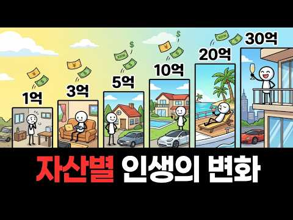
- 설명 앞부분: 통장에 1억이 처음 찍히는 순간부터 30억에 도달하는 순간까지, 자산 구간이 바뀔 때마다 우리의 심리와 삶은 어떻게 달라질까요? 모두가 꿈꾸는 10억의 충격적인 진실부터, 30억 부자가 한결같이 말하는 의외의 고백까지. 이 영상 하나면 지금 당신이 어느 지점에 서 있든, 다음에 무엇을 준비해야 할지 선명하게 보입니다. 이런 분께 추천합니다 첫 번째 1억 앞에서 막막함을 느끼고 계신 분 분명 자산은 늘었는데 마음은 더 가난해지는 박탈감을 겪고 계신 분 경제적 자유의 실제 기준이 궁금하신 분 돈을 모으는 과정에서 길을 잃지 않을 나침…
- 같은 채널 평소 대비 ×4.0 (채널 최근 롱폼 중앙값 8,923회) · 평소 영상: JEPI vs JEPQ, 같은 회사·같은 전략인데 10년 뒤 통장이 갈린 이유 [ 재테크… (8,923회) / 매달 50만원으로 월 배당 70만원, 저축은 51년 투자는 20년 (SCHD 시뮬레이션)… (9,967회)
- 대본 없음 (설명) — 음성인식이 끝나면 도입부·흐름이 들어감
- 댓글 37/37: 좋은 점 — 영상 2 · 감사·응원 0 · 더 알고 싶은 것 2 · 아쉬운 점 — 영상 0 · 반박·불만 — 의견 다름 2 · 정치·사회 1 · 경험 공유 3 · 구독·다음 기대 0
  - 좋은 점 — 영상 👍2 “마지막 남의말 듣지말라는게 엄청 와닿네요....ㅠ”
  - 좋은 점 — 영상 👍1 “맞는 말씀입니다”
  - 더 알고 싶은 것 👍3 “내용이 잘못되었다고 생각하진 않지만 너무 비약이 심하시네요. 대기업 부장이 1.5장 이상인데 대체 어떻게 보수적으로 굴리면 20억으로 7.5% 이상 수익을 남김??? 일반적으로 보수적 투자자 벤치마킹을 미국채 수익률로 잡는데 지금 장기국채도 5% 내외고 그마저도 넘으…”
  - 반박·불만 — 의견 다름 👍12 “정말 10억 후반이 되면 20억 가깝고 20억 되면 한달 늘어는가 금액이 정말 월급은 아마것도 아닙니다. 그런돈은 그냥 저축만 해도 돼요. 그대신 주식이든, 금융 상품에 투자는 해야되네요. 사는거는 뭐 똑같아요. 아껴 살고 모았기 때문에 있으나 없을때나 사는건 같습니…”
  - 반박·불만 — 의견 다름 👍3 “내용이 잘못되었다고 생각하진 않지만 너무 비약이 심하시네요. 대기업 부장이 1.5장 이상인데 대체 어떻게 보수적으로 굴리면 20억으로 7.5% 이상 수익을 남김??? 일반적으로 보수적 투자자 벤치마킹을 미국채 수익률로 잡는데 지금 장기국채도 5% 내외고 그마저도 넘으…”
  - 정치·사회 👍2 “돈으로 부터 자유로운 수준이 중요한거 같아요. 아플때 병원가고, 먹고싶을때 먹을수있고, 하고싶지 않은 일을 안할수있는 결정권을 내가 결정할수 있는 수준까지요. 내삶이 오로지 내 선택대로 할수 있다는 자유 이게진짜 부의 단계같아요 여기 댓글 다시는 분들은 남들 놀고 먹…”
  - 경험 공유 👍3 “내용이 잘못되었다고 생각하진 않지만 너무 비약이 심하시네요. 대기업 부장이 1.5장 이상인데 대체 어떻게 보수적으로 굴리면 20억으로 7.5% 이상 수익을 남김??? 일반적으로 보수적 투자자 벤치마킹을 미국채 수익률로 잡는데 지금 장기국채도 5% 내외고 그마저도 넘으…”
  - 경험 공유 👍2 “돈으로 부터 자유로운 수준이 중요한거 같아요. 아플때 병원가고, 먹고싶을때 먹을수있고, 하고싶지 않은 일을 안할수있는 결정권을 내가 결정할수 있는 수준까지요. 내삶이 오로지 내 선택대로 할수 있다는 자유 이게진짜 부의 단계같아요 여기 댓글 다시는 분들은 남들 놀고 먹…”

### 123. 택배로 부자가 될 수 있냐고요? 솔직하게 말씀드리겠습니다

- https://www.youtube.com/watch?v=r5jnahsJw5Q · 택부 - 택배기사 부자들 · 구독자 6,630 · 조회수 53,223 (×8.0, 하루 1,134.1) · 좋아요 415 (0.8%) · 8.3분 · 2026-09-01 · 주제 묶음 1. 재테크 일반·마인드 · 형식 브이로그·직접 해본 이야기 · 폴더 `W_r5jnahsJw5Q` (웹 승인)
- 썸네일: 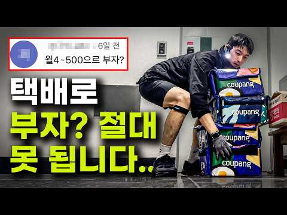
- 챕터: 0:00 택배로 부자 못 됩니다 · 0:22 택배기사 월급 공개 영상 댓글 · 0:48 부자란 무엇인가? · 1:30 부자들의 공통점 · 2:49 택배기사들이 좋은 이유 · 4:37 택배기사는 해병대다? · 5:17 부정적인 댓글들에게 하고 싶은 말 · 7:00 인생의 불확실성을 대하는 태도
- 설명 앞부분: [Community] 택배기사 소통카페 전국 택배기사 구인구직 카페 [Contct]
- 같은 채널 평소 대비 ×1.1 (채널 최근 롱폼 중앙값 49,980회) · 평소 영상: 아무도 알려주지 않았던 후회없이 택배차 고르는 방법 - 이 영상 하나로 끝! (49,980회) / 쿠팡 퀵플렉스로 돈 버는 시대는 끝났다. 이제 택배로 돈 벌려면 '이거' 하세요! (57,114회)
- 대본 없음 (설명) — 음성인식이 끝나면 도입부·흐름이 들어감
- 댓글 203/203: 좋은 점 — 영상 6 · 감사·응원 28 · 더 알고 싶은 것 11 · 아쉬운 점 — 영상 3 · 반박·불만 — 의견 다름 6 · 정치·사회 0 · 경험 공유 22 · 구독·다음 기대 2
  - 좋은 점 — 영상 👍7 “출근하시기 전에 촬영 하신거 같네요 ~!! 저도 파주에서 쿠팡야간배송하는 기사인데. 저는 일산1캠프 소속입니다 ^ ^ 오늘 쉬는날이라 영상 잘 보았습니다. 저보다는 한참 나이가 적으신 동생이신데. 교수님께 강의들은것처럼 도움되는 영상이었습니다 ~!!!”
  - 좋은 점 — 영상 👍2 “건강한 정신과 태도를 배우고갑니다”
  - 감사·응원 👍4 “4인가족, 이제 40, 쿠팡 7년차(쿠친포함) 입니다. 개인 빚없고 이제 신축아파트 한곳 마련했습니다. 택배는 최대 안쓰고 해야 집마련 가능합니다. 힐링(휴가)은 나이들어 즐기고 오로지 직진만하시는게 좋습니다. 같은 직종 파이팅입니다.”
  - 감사·응원 👍3 “열심히 일하시고 긍정적인 훌륭한 분입니다. 노동소득에서 자본소득가가 되시길 응원할게요. 아직 젊어서 빚 갚으면서 동시에 절세계좌로 지수투자를 꾸준히 모아가시면 반드시 복리의 마법으로 작은 부자가 되어있을 겁니다. 건강 잘 챙기시고 홧팅하세요!!!”
  - 더 알고 싶은 것 👍3 “그런말하는사람입니다. 전에 그런댓글도 달았구요. 근로소득으로는 절대 부자못됩니다. 월천벌어서 부자될수있을까요? 근로소득은 아무리 잘해도 한계라는게 있습니다. 혼자택배해서 월 2천가능한가요??? 불가능이죠?? 택배를 직원써서 시키는사람이되야지 직접뛰어서는 안됩니다. 사…”
  - 더 알고 싶은 것 👍2 “산타커플 접고 머리자르고 살빠진 이유 알려주세요”
  - 아쉬운 점 — 영상 👍1 “왜 이랬다가 저랬다가 어그로 끄시나요??”
  - 아쉬운 점 — 영상 👍0 “얘 어그로 끄네 ㅎㅎ”
  - 반박·불만 — 의견 다름 👍3 “그런말하는사람입니다. 전에 그런댓글도 달았구요. 근로소득으로는 절대 부자못됩니다. 월천벌어서 부자될수있을까요? 근로소득은 아무리 잘해도 한계라는게 있습니다. 혼자택배해서 월 2천가능한가요??? 불가능이죠?? 택배를 직원써서 시키는사람이되야지 직접뛰어서는 안됩니다. 사…”
  - 반박·불만 — 의견 다름 👍1 “자영업자임 가맹본사 만드려고 열심히 뛰고 있는데 요즘 힘들어서 택배 관심 갖게되었고 전 체널부터 많이 봐 왔는데요 제 생각에 택배라던지 해병대라는거 정말 누가 해도 힘들겠죠 ㅠㅠ 그런데 저는 오히려 그게 편한것같아요. 물리적으로 내 몸을 갈아 넣으면 끝이 날 수 있는…”
  - 경험 공유 👍34 “현직 cj기사입니다. 택배기사가 다힘든건아니에요ㅋㅋ 올아파트 타는 기사들이 관절상하고 할까요? 택배해서 돈빠짝벌어서 졸업할거야할거면 그냥시도도하지마세요 현제 저도 6년넘게 번지만타고있고 소장들 수수료 악합니다ㅋㅋ 고생해서 소장 수수료 지방은15~20. 퍼 예 1000…”
  - 경험 공유 👍7 “출근하시기 전에 촬영 하신거 같네요 ~!! 저도 파주에서 쿠팡야간배송하는 기사인데. 저는 일산1캠프 소속입니다 ^ ^ 오늘 쉬는날이라 영상 잘 보았습니다. 저보다는 한참 나이가 적으신 동생이신데. 교수님께 강의들은것처럼 도움되는 영상이었습니다 ~!!!”
  - 구독·다음 기대 👍2 “눈빛이 살아있으시네요 존경스럽습니다 많이 배우고 가요 ㅎㅎ 저는 동태눈깔된지 오랜데 ㅠㅠ 구독박고 갑니다”
  - 구독·다음 기대 👍1 “마인드 넘 훌륭하셔서 바로 구독합니다 화이팅😊”

### 124. 은퇴 후에도 월 300만원 쓰는 사람 실제로 몇 %일까

- https://www.youtube.com/watch?v=SqA7WIZcrQs · Ah Gong Talks Money · 구독자 5,820 · 조회수 46,410 (×8.0, 하루 672.5) · 좋아요 432 (0.9%) · 16.8분 · 2026-08-10 · 주제 묶음 4. 노후·연금 · 형식 정보·해설 (그 밖) · 폴더 `W_SqA7WIZcrQs` (웹 승인)
- 썸네일: 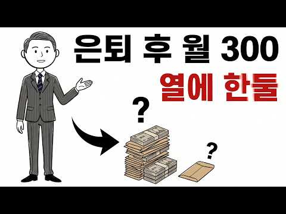
- 설명 앞부분: 은퇴하면 매달 300만원쯤은 쓰며 살 거라 생각하지만, 실제로 그렇게 사는 사람은 열에 한둘뿐입니다. 오늘은 은퇴 가구의 진짜 지출과, 그 소수가 무엇이 달랐는지를 아홉 가지 이야기로 차분히 풀어봅니다. 남의 숫자가 아니라 나에게 맞는 노후의 균형점을 찾는 시간이 되시길 바랍니다. 여러분은 은퇴 후에 매달 얼마 정도면 마음이 편안하실 것 같으신가요? 댓글로 살며시 남겨주세요.
- 같은 채널 평소 대비 ×42.9 (채널 최근 롱폼 중앙값 1,082회) · 평소 영상: 은퇴 후 일하면 국민연금이 깎입니다 — 감액되는 월급 기준 공개 (1,268회) / 자식이 부모에게 주는 생활비 실제 평균 — 기대하면 안 되는 숫자 (896회)
- 대본 없음 (설명) — 음성인식이 끝나면 도입부·흐름이 들어감
- 댓글 39/39: 좋은 점 — 영상 0 · 감사·응원 0 · 더 알고 싶은 것 0 · 아쉬운 점 — 영상 0 · 반박·불만 — 의견 다름 1 · 정치·사회 1 · 경험 공유 3 · 구독·다음 기대 0
  - 경험 공유 👍5 “은퇴생활 12년차의 60대인데, 빚이 전혀없는 자가1채 소유하고요. 부부가 월300~320만원으로 사는데, 그냥 알뜰소비하며 검소하게 삽니다. 경조사, 모임, 가끔 여행가는 정도죠. 타인에게 손 안 벌리고, 스스로 살아가는 정도.”
  - 경험 공유 👍3 “제가 은퇴를하고 놀 줄은 정말로 몰랐죠. 방구석에서 몇십년후에 일을 할줄 알았습니다.”

### 125. 50대 노후자금, S&P500 버리고 나스닥100만 사면 벌어지는 일 (현실적인 은퇴 포트폴리오)

- https://www.youtube.com/watch?v=dtX7Hmq0tdU · 돈잡는 경제학 · 구독자 2,700 · 조회수 21,336 (×7.9, 하루 133.1) · 좋아요 280 (1.3%) · 13.7분 · 2026-05-10 · 주제 묶음 3. 주식·ETF · 형식 정보·해설 (그 밖) · 폴더 `W_dtX7Hmq0tdU` (웹 승인)
- 썸네일: 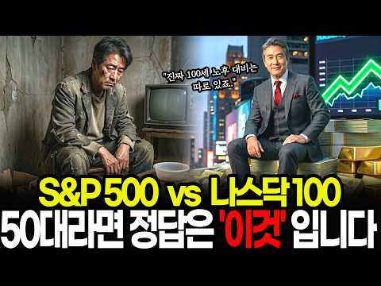
- 설명 앞부분: 50대 은퇴 이후 장기 생존 시나리오에서 인플레이션이 자산 가치에 미치는 영향을 분석하고, 안정적인 노후 자산 배분 원칙을 점검합니다. 전통적인 예금 중심의 자산 관리가 지닌 구매력 감소 리스크를 짚어보고, 투자의 오류를 소거해 나가는 방식을 통해 은퇴 자금을 효율적으로 관리하는 법을 살펴봅니다. 이어 변동성을 통제하며 장기 자산을 운용하는 실전 시뮬레이션의 시사점을 알아봅니다. 🚨 투자 유의사항 및 면책 조항 본 영상은 경제 및 투자에 대한 일반적인 정보 제공과 교육을 목적으로 제작되었습니다. 영상에 포함된 특정 자산의 비율, …
- 같은 채널 평소 대비 ×99.0 (채널 최근 롱폼 중앙값 216회) · 평소 영상: "유럽의 여름이 펄펄 끓는다! " 기록적인 폭염속 한국 에어컨이 날개 돋친듯 팔리는이유 (219회) / 뇌과학이 알려주는 개인투자자가 손실을 보는 5가지 이유, 내 계좌를 살리는 현실적인 대안 (212회)
- 대본 없음 (설명) — 음성인식이 끝나면 도입부·흐름이 들어감
- 댓글 9/9: 좋은 점 — 영상 0 · 감사·응원 3 · 더 알고 싶은 것 0 · 아쉬운 점 — 영상 0 · 반박·불만 — 의견 다름 0 · 정치·사회 0 · 경험 공유 0 · 구독·다음 기대 0
  - 감사·응원 👍0 “감사합니다 🎉”
  - 감사·응원 👍0 “딱 필요한 정보였어요.감사합니다 😊”

### 126. 【김형석 교수】 자식에게 통장을 맡기지 마십시오｜노후 자금이 가장 안전한 세 곳

- https://www.youtube.com/watch?v=v7tzJPrZr4A · 인생의 통찰 · 구독자 4,100 · 조회수 32,093 (×7.8, 하루 411.7) · 좋아요 520 (1.6%) · 52.5분 · 2026-08-01 · 주제 묶음 4. 노후·연금 · 형식 오디오북·낭독 (명언·인생조언) · 폴더 `W_v7tzJPrZr4A` (웹 승인)
- 썸네일: 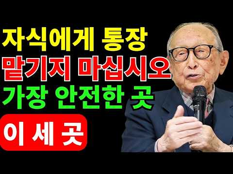
- 같은 채널 평소 대비 ×377.6 (채널 최근 롱폼 중앙값 85회) · 평소 영상: 김형석 교수의 경험: 82세에 깨달았습니다, 죽음보다 더 무서운 것은 바로 ‘이것’입니다 (85회) / 【김형석 교수】 늙어서 은행에 저축하면 안 되는 5가지 이유, 아무도 말해주지 않았습니다… (89회)
- 대본 없음 (없음) — 음성인식이 끝나면 도입부·흐름이 들어감
- 댓글 11/11: 좋은 점 — 영상 0 · 감사·응원 5 · 더 알고 싶은 것 0 · 아쉬운 점 — 영상 0 · 반박·불만 — 의견 다름 0 · 정치·사회 0 · 경험 공유 0 · 구독·다음 기대 0
  - 감사·응원 👍6 “선생님감사합니다”
  - 감사·응원 👍5 “실천에 힘써야 겟어요 감사합니다”

### 127. "55세 노후준비, 지금 시작해도 늦지 않은 진짜 이유"

- https://www.youtube.com/watch?v=mhUHrujFtEU · 야무진 경제학 · 구독자 22,500 · 조회수 175,032 (×7.8, 하루 2,522.5) · 좋아요 1,665 (0.9%) · 18.1분 · 2026-08-09 · 주제 묶음 4. 노후·연금 · 형식 정보·해설 (그 밖) · 폴더 `W_mhUHrujFtEU` (웹 승인)
- 썸네일: 
- 챕터: 0:00 55세, 월 200만원 10년이면 통장에 얼마가 남을까 · 1:55 정년 60세 · 연금 65세, 55세의 진짜 시간표 … · 3:12 10년은 넣는 기간, 30년은 돈이 일하는 기간 · 4:39 노후 준비는 물통이 아니라 '수도꼭지'입니다 · 5:22 월 200만원부터 30만원까지, 금액별 결과 전부 계… · 7:29 "그 200만원이 대체 어디 있냐"는 50대의 현실 · 9:28 남는 돈으로 저축이 안 되는 이유 — 파킨슨 제2법칙 · 10:02 의지를 시스템으로 바꾸는 법, 자동화 · 10:41 55세에게 복리보다 강력한 무기, 세액공제 900만원 · 12:32 연금계좌 한도 1,800만원 = 월 150만원의 의미 · 13:13 55세 + 가입 5년, 오늘 계좌부터 열어야 하는 이유 · 13:57 1년 미루면 1,240만원, '시작 지연 비용'의 정체 · 15:29 원금이 똑같은 두 사람, 왜 결과가 갈렸나 · 16:14 금액을 여섯 배 늘려도 바뀌지 않는 숫자 · 17:34 55세가 가장 많이 하는 실수 3가지
- 설명 앞부분: 55세에 노후 준비를 시작하면 정말 늦은 걸까요? 숫자는 그렇지 않다고 말합니다. 월 200만원부터 30만원까지, 금액을 하나씩 내려가며 계산해보면 55세에게 진짜 필요한 게 무엇인지가 분명해집니다. 지금 55세이신 분에게 회사 월급이 나오는 기간은 5년, 국민연금이 시작되는 건 65세. 그 사이 5년의 소득 크레바스가 기다리고 있습니다. 그런데 많은 분들이 여기서 계산을 멈추십니다. "10년 가지고 뭘 하겠느냐"고요. 이 계산에는 큰 착각이 하나 숨어 있습니다. 10년은 돈을 넣는 기간이지, 돈이 일하는 기간이 아니거든요. 60…
- 같은 채널 평소 대비 ×16.0 (채널 최근 롱폼 중앙값 10,929회) · 평소 영상: "50대 노후 준비 10년째 못 하는 진짜 이유, 놓친 4가지" (11,237회) / "50대라면 월 75만원 이렇게 넣어두세요, 65세부터 매달 들어옵니다" (10,621회)
- 대본 없음 (설명) — 음성인식이 끝나면 도입부·흐름이 들어감
- 댓글 81/81: 좋은 점 — 영상 4 · 감사·응원 2 · 더 알고 싶은 것 5 · 아쉬운 점 — 영상 0 · 반박·불만 — 의견 다름 2 · 정치·사회 1 · 경험 공유 5 · 구독·다음 기대 1
  - 좋은 점 — 영상 👍20 “제가 생각했을때 댓글을 보니 조금 이해하시는견해가 방향이 다른거같아요 주인장께서 말씀하시는가장핵심부분은 월200넣는게 중요한게아니구 그보다 시간에 투자하라는것같습니다 십만원이든,백만원이든 각자상황에 맞게요 굉장히 중요하고 좋은말씀을해주시는거같은데 다들 오해가많으신듯해…”
  - 좋은 점 — 영상 👍14 “54세입니다. 십년전에 시작하지 못한게 안타깝지만, 그래도 한살이라도 젊을때 시작해서 다행이라는 생각이 듭니다. 일단 최대로 꽉꽉 채워넣고 연금 개시는 최대한 미뤄가며 운용해보겠습니다. 내용 감가합니다. 많은 도움이 되었어요^^”
  - 감사·응원 👍20 “제가 생각했을때 댓글을 보니 조금 이해하시는견해가 방향이 다른거같아요 주인장께서 말씀하시는가장핵심부분은 월200넣는게 중요한게아니구 그보다 시간에 투자하라는것같습니다 십만원이든,백만원이든 각자상황에 맞게요 굉장히 중요하고 좋은말씀을해주시는거같은데 다들 오해가많으신듯해…”
  - 더 알고 싶은 것 👍9 “50대 중반부터는 자산 시세차익보다는 안정적인 현금흐름(배당이나 월세, 연금)을 만드는 게 핵심 같은데, 다들 50대 들어서 포트폴리오를 어떻게 재정비하셨는지 궁금하네요.”
  - 더 알고 싶은 것 👍1 “55세인 저는 세달전 연금저축으로 s&p500에 주 8만원씩 월32만원납입중입니다. (배당금 재투자할 계획) 12년납입후 다우존스ETF로 갈아타고 월배당금을 받을 생각입니다. 시간이 지날수록 배당금도 늘어나고 원금도 커진다네요.그리고 사망시 자녀에게 상속되고 계속 배…”
  - 반박·불만 — 의견 다름 👍1 “매달 200만원?? 어이없네”
  - 반박·불만 — 의견 다름 👍0 “제일 황당하고 어이없는 영상”
  - 정치·사회 👍5 “s&p500을 한국회사에서 사는게 좋은지 미국시장에서 사는게 좋은지 알려주세요.완전 주린이라 아무개념을 몰라요...”
  - 경험 공유 👍20 “제가 생각했을때 댓글을 보니 조금 이해하시는견해가 방향이 다른거같아요 주인장께서 말씀하시는가장핵심부분은 월200넣는게 중요한게아니구 그보다 시간에 투자하라는것같습니다 십만원이든,백만원이든 각자상황에 맞게요 굉장히 중요하고 좋은말씀을해주시는거같은데 다들 오해가많으신듯해…”
  - 경험 공유 👍2 “전제가 항상변화가 없어야 하는데, 그냥 적당히 즐기며 사세요. 아끼다 뭐된다라는 말은 괜히 있나요. 제가 자본주의에 물들어 살아보니... 이론과 실제는 다르고... 위 글내용은 맞지만 현실성이 떨어지는 이론적인 말입니다. 금융권에서 서민들 속이는 가스라이팅에 가까워요…”
  - 구독·다음 기대 👍20 “제가 생각했을때 댓글을 보니 조금 이해하시는견해가 방향이 다른거같아요 주인장께서 말씀하시는가장핵심부분은 월200넣는게 중요한게아니구 그보다 시간에 투자하라는것같습니다 십만원이든,백만원이든 각자상황에 맞게요 굉장히 중요하고 좋은말씀을해주시는거같은데 다들 오해가많으신듯해…”

### 128. 이 방식으로 살림 하니 돈이 무섭게 쌓여요.(주중 외식비0원, 배달비0원)

- https://www.youtube.com/watch?v=q8knIYPIobk · 뚝딱 살림 · 구독자 29,600 · 조회수 229,372 (×7.8, 하루 1,700.3) · 좋아요 2,315 (1.0%) · 8.6분 · 2026-06-05 · 주제 묶음 기타 · 형식 브이로그·직접 해본 이야기 · 폴더 `W_q8knIYPIobk` (웹 승인)
- 썸네일: 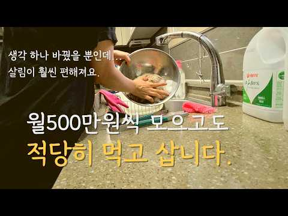
- 설명 앞부분: 오늘은 제가 늘 살림 할 때 마법처럼 외우는 주문에 대해 영상을 준비해보았습니다. 살림에도 어려운 살림, 쉬운 살림이 있습니다. 같은 살림인데 쉽게 하면 에너지도 아끼고 더 좋겠지요. 우리가 집안일을 할 때 특히 매 끼니 식사를 준비하는 과정에서 이러한 생각을 장착하고 음식을 만들면 음식 만드는 게 더욱 편해지고 거침없어 집니다. 실제로 저는 주중에는 거의 집밥으로 먹습니다. 주중에 외식이나 배달했던 경우는 1년에 몇 번 있을까 말까 하네요. 오히려 집밥을 해먹을때 시간도 아끼는 것 같아요. 시간, 돈, 에너지 모두 아끼는 이 마…
- 같은 채널 평소 대비 ×4.8 (채널 최근 롱폼 중앙값 48,082회) · 평소 영상: 월500씩 모으는 워킹맘의 현실, 쉽지만은 않죠. (50,450회) / 이걸 알면 월100만원씩 더 쌓여요(자녀 비용 0원) (45,714회)
- 대본 없음 (설명) — 음성인식이 끝나면 도입부·흐름이 들어감
- 댓글 400/402: 좋은 점 — 영상 5 · 감사·응원 21 · 더 알고 싶은 것 9 · 아쉬운 점 — 영상 0 · 반박·불만 — 의견 다름 2 · 정치·사회 0 · 경험 공유 40 · 구독·다음 기대 6
  - 좋은 점 — 영상 👍13 “제가 1번이네요. 가식없는 편안한 영상 감사합니다. 배우고 갑니다. 개인적으로 저축도 늘리고 이렇게 알뜰하고 깔끔하게 살고 싶습니다.^^”
  - 좋은 점 — 영상 👍13 “7개월 아기를 키우고 있습니다. 육아휴직 중에 영상 항상 챙겨보고있는데 정말 도움이 많이 됩니다. 깨닫는 것두 많고 절약을 실천하기에 현실적인 팁들을 알려주셔서 감사해요. 음식할때도 꼭 레시피 찾아보고 그대로 해야지 하는마음에 알게모르게 스트레스를 받곤 했던 것 같아…”
  - 감사·응원 👍176 “촬영용으로 예쁘게 미리. 만들어 놓은게 아니라 진짜 현실그대로 보여주는거 같아서 뭔가.. 위로와 용기와 응원을 주는거 같아서 구독해요!! 꾸밈없이 현실그대로 보여주세요!!^^”
  - 감사·응원 👍34 “진짜 리얼 이라는생각 맨날 다른집보면 한번도 안썼을것같은 냄비 그롯 가구 냉장고 모든것이 드라마 소품캍았는데 우리집과 별반 다르지 않타는것에 감사드려요”
  - 더 알고 싶은 것 👍38 “죄송한데 얼마 버셔서 500만원 저축하시는거예요?? 정말 대단하셔서 궁금해서요”
  - 더 알고 싶은 것 👍3 “저50대 고1중1 키우는싱글맘인데 저도 한달400씩 모아요.투자비율 어떻게 하시나요?전 최근들어 주식시작해 주식200 현금200 하는데 님500상태 살짝 알려주세요.저도 기본은 안쓰기로 400이상 남기고있어요”
  - 반박·불만 — 의견 다름 👍121 “저렇게 만들어준 집밥 먹어주는 자녀들이 기특하다는 댓글들 많은데요 글쎄요~ 저는 다른관점에서 보네요. 아이들을 그렇게 키우신 엄마가 지혜롭고 야무져보입니다.”
  - 반박·불만 — 의견 다름 👍2 “그 이름모를 야채가 바로 치커리 입니다 부침재료는 아닌데요 뭐... 맛있었다니 다행이네요 모든 재료는 가위질로 하시는데 참 잘 하시네요”
  - 경험 공유 👍54 “이쁘고 정돈된 집과주방이 아니라 내주방 우리집같아 너무 편하고 자책감 자괴감 안들어서 따라해봐야지~하고 끝까지 시청했어요!!”
  - 경험 공유 👍37 “보여주기식이아니라 진짜 현실적이라 공감이 잘되는거같아여~ 고기먹고남은거 저도 항상 주먹밥으로 양불리기하는데 똑같아서 신기하네요ㅎㅎ”
  - 구독·다음 기대 👍176 “촬영용으로 예쁘게 미리. 만들어 놓은게 아니라 진짜 현실그대로 보여주는거 같아서 뭔가.. 위로와 용기와 응원을 주는거 같아서 구독해요!! 꾸밈없이 현실그대로 보여주세요!!^^”
  - 구독·다음 기대 👍24 “이 채널 은근히 재미있네.. 주인장이 재미난 분인듯. 나도 모르게 구독했뿟네요.”

### 129. 1억으로 노후준비 끝, QLD에 1억 넣고 10년 버텼더니 충격 결과!

- https://www.youtube.com/watch?v=97zLvnO3BnY · 두배럭 2XLuck · 구독자 3,060 · 조회수 23,351 (×7.6, 하루 173.1) · 좋아요 423 (1.8%) · 11.5분 · 2026-06-05 · 주제 묶음 2. 돈 모으기·저축 · 형식 정보·해설 (그 밖) · 폴더 `W_97zLvnO3BnY` (웹 승인)
- 썸네일: 
- 설명 앞부분: QLD에 1억을 한 번에 투자했다면, 10년 뒤 얼마가 되었을까? 많은 투자자들이 고민합니다. 목돈이 생기면 한 번에 투자하는 게 좋을까요? 아니면 나눠서 적립식으로 투자하는 게 더 좋을까요? 이번 영상에서는 2006년 상장 이후 실제 QLD 데이터를 기반으로 1억 원 거치식 투자 월 100만 원 적립식 투자 두 가지 방식을 10년 투자 기준으로 직접 비교해봤습니다. 특히 금융위기, 코로나 쇼크, 2022년 금리 인상기 등 실제 하락장을 모두 포함하여 투자 시점에 따라 결과가 얼마나 달라지는지, 그리고 적립식 투자가 어떤 역할을 …
- 같은 채널 평소 대비 ×2.4 (채널 최근 롱폼 중앙값 9,552회) · 평소 영상: QLD 5년 vs 20년, 왜 마지막 5년이 가장 중요할까? (9,552회) / QLD 월 100만원 vs 200만원 적립식 투자, 10억까지 실제 얼마나 걸렸을까? (9,643회)
- 대본 없음 (설명) — 음성인식이 끝나면 도입부·흐름이 들어감
- 댓글 41/41: 좋은 점 — 영상 1 · 감사·응원 3 · 더 알고 싶은 것 3 · 아쉬운 점 — 영상 0 · 반박·불만 — 의견 다름 0 · 정치·사회 0 · 경험 공유 0 · 구독·다음 기대 0
  - 좋은 점 — 영상 👍1 “유익한 영상 감사드립니다🎉🎉🎉”
  - 감사·응원 👍1 “유익한 영상 감사드립니다🎉🎉🎉”
  - 더 알고 싶은 것 👍2 “질문이 있는데요..2022년 금리인상기의 QLD최대낙폭이 63% 혹은 78.8% 어느쪽이 맞나요?”
  - 더 알고 싶은 것 👍2 “이번 ai반도체랠리뺀 수익률 궁금합니다”

### 130. 노후 투자 얘기하다가 존리랑 싸웠습니다. 삼전 사도 되나요?vs그걸 제가 어떻게 알아요

- https://www.youtube.com/watch?v=gzP2RMXMuBU · 웬만해선 정수를 막을 수 없다 · 구독자 44,900 · 조회수 340,824 (×7.6, 하루 2,489.0) · 좋아요 5,970 (1.8%) · 37.2분 · 2026-06-03 · 주제 묶음 3. 주식·ETF · 형식 브이로그·직접 해본 이야기 · 폴더 `W_gzP2RMXMuBU` (웹 승인)
- 썸네일: 
- 설명 앞부분: 안녕하세요, 배우 박정수의 공식 유튜브 채널입니다. 세월이 흘러도 변치 않는 '스타일'과 '일상의 여유'를 기록합니다. 함께 나누고 싶은 아름다운 순간들을 담아낼 예정이니 많은 관심과 사랑 부탁드립니다. Lifestyle: 박정수의 취향이 담긴 공간과 일상 이야기 Beauty & Fashion: 나이가 아닌 스타일로 완성하는 뷰티 솔루션 Talk: 오랜 시간 쌓아온 삶의 지혜와 진솔한 대화 Production: Studio Titanium ⚠️ Notice 영상의 맥락과 상관없는 비방이나 악의적인 댓글은 예고 없이 삭제될 수 있으…
- 같은 채널 평소 대비 ×2.0 (채널 최근 롱폼 중앙값 170,016회) · 평소 영상: 중년 배우들이 20대 때부터 비밀리에 다니던 레전드 편집숍 대공개! (221,168회) / [거제 야-호] 리센느가 끌어올린 요즘 대세 거제도! 손녀와 함께 욱정수가 다녀온 실패 … (243,529회)
- 대본 없음 (설명) — 음성인식이 끝나면 도입부·흐름이 들어감
- 댓글 386/386: 좋은 점 — 영상 21 · 감사·응원 42 · 더 알고 싶은 것 14 · 아쉬운 점 — 영상 4 · 반박·불만 — 의견 다름 4 · 정치·사회 2 · 경험 공유 43 · 구독·다음 기대 3
  - 좋은 점 — 영상 👍51 “피가 되고 뼈가 되는 좋은 이야기들 감사합니다!!”
  - 좋은 점 — 영상 👍41 “존리샘 말씀에 100% 공감합니다”
  - 감사·응원 👍73 “코로나때 존리 선생님 책보고 강의듣고 힘든일로 무일푼이었다가 투자하고 아껴서 오년만에 억대 넘게 모았네요 ㅠㅠ 십억 백억 가자!!!!!!🩷🩷감사감사❤❤”
  - 감사·응원 👍63 “대표님 정수님 대화들으면서 재미있고 넘 많이 웃었어요 대표님 주식 강의 넘 감사합니다”
  - 더 알고 싶은 것 👍5 “코스피200 ETF도 여러가지가 있던데요 선물 TR 붙은것도 있고 다 같은건지요? 좀아시는분 댓금부탁드립니다”
  - 더 알고 싶은 것 👍4 “세상에 이렇게 귀엽고 깜찍하고 사랑스러운 75세 할가씨가 있을까요? 건강하세요.”
  - 아쉬운 점 — 영상 👍0 “에고 잘못된 정보를 올렸네요~ 들은대로 남긴 글인데. 저도 황당하네요. 글 삭제 합니다~”
  - 반박·불만 — 의견 다름 👍1 “여행도 공부고 견문도 넓혀주고 넓은 세상을 볼수있게 해줍니다 역설적으로 돈이 전부가 아니죠”
  - 반박·불만 — 의견 다름 👍0 “이사람은 미국주식에는 맞아 한국주식에는 글쎄...?”
  - 정치·사회 👍4 “우리나라가 세계2등 나라가 될수 있다니 놀랍고 자랑스럽네요.😊”
  - 정치·사회 👍0 “그대신 빨갱이들이 정권을 잡아서 나라다 망치잖아요”
  - 경험 공유 👍437 “저도 6년전에 존리님 말씀듣고 주식투자 하고 있어요. 애들 학원 안 보내고 매달 10만원씩 주식 사주고 있는데요. 많이 불어나서 세명 아이꺼 합치면 1억2천정도 됩니다. 초반 300만원 각자 입출금통장에 모아둔 용돈으로 시작했고 명절 용돈 받은 거 ,매달 넣어준 10…”
  - 경험 공유 👍83 “존리님 말씀듣고 손주들 돐때부터 7살 4살 통장에 돈넣고 수익률이 마구마구 할머니인 제가 뿌듯합니다”
  - 구독·다음 기대 👍5 “박정수 선생님.안녕하세요.저는 40대주부이고 항상티비보면 예쁘시다고 생각했습니다.존리선생님도 역시 오래전부터 철학을 알고 팬이되었습니다. 두분이 서로 싸우실까바 얼마나 조마조마하던지요. 그래도 서로 이해하는 지점이 있어서 좋게 마무리가 되었네요. 존리선생님 말씀듣고 …”
  - 구독·다음 기대 👍4 “오~~~이런컨텐츠 넘 좋아요~~!!! 볼때마다 박정수님 넘 알흠다우십니다~~다음편도기대됩니다”

### 131. 삼성전자 지금 시작인가? 노무라가 목표주가 67만원 제시한 이유가 소름입니다... 여기서 90% 더 오를 수 있다? 상승 전망 전부 분석했습니다 #삼성전자 #삼…

- https://www.youtube.com/watch?v=JJG1mtkTN6g · 코스피 읽는 개미 · 구독자 2,230 · 조회수 16,842 (×7.5, 하루 148.9) · 좋아요 395 (2.4%) · 15.7분 · 2026-06-27 · 주제 묶음 기타 · 형식 정보·해설 (그 밖) · 폴더 `W_JJG1mtkTN6g` (웹 승인)
- 썸네일: 
- 설명 앞부분: 삼성전자, 정말 다시 시작일까요? 노무라가 삼성전자 목표주가를 67만원으로 상향하며 시장의 관심이 집중되고 있습니다. AI 반도체 수요 확대, 메모리 실적 개선, 비용 부담 감소까지. 하지만 비메모리 사업 리스크와 시장 변동성도 함께 체크해야 합니다. 이번 영상에서는 목표주가 상향 이유 90% 상승 전망의 근거 앞으로 주목해야 할 핵심 포인트 투자자가 놓치면 안 되는 위험 요소까지 정리했습니다. 여러분은 삼성전자, 아직 기회라고 보시나요?
- 같은 채널 평소 대비 ×38.7 (채널 최근 롱폼 중앙값 436회) · 평소 영상: [ 삼성전자 ] 대폭발 시작되나? 반도체 수출 150% 급증…주가 대반전 "신호" 떴다! (451회) / 삼성전자 이익 역대 최대인데 아직 27만원... 언제 터질지 알려드리겠습니다 (420회)
- 대본 없음 (설명) — 음성인식이 끝나면 도입부·흐름이 들어감
- 댓글 25/25: 좋은 점 — 영상 0 · 감사·응원 1 · 더 알고 싶은 것 0 · 아쉬운 점 — 영상 0 · 반박·불만 — 의견 다름 0 · 정치·사회 0 · 경험 공유 0 · 구독·다음 기대 1
  - 감사·응원 👍1 “감사합니다 정보 🎉❤”
  - 구독·다음 기대 👍1 “구독완료”

### 132. 연금고수들이 연금저축계좌 반드시 담는 ETF 3가지

- https://www.youtube.com/watch?v=iMkvDXx86dE · 경제나침반 · 구독자 14,000 · 조회수 105,130 (×7.5, 하루 1,280.5) · 좋아요 2,048 (1.9%) · 25.2분 · 2026-07-28 · 주제 묶음 4. 노후·연금 · 형식 정보·해설 (그 밖) · 폴더 `W_iMkvDXx86dE` (웹 승인)
- 썸네일: 
- 설명 앞부분: 📈 오늘 시장에서 꼭 알아야 할 경제와 투자 인사이트를 쉽고 명확하게 정리해드립니다. 💡 주식, ETF, 미국주식, 경제 전망, 금리, AI, 반도체, 부동산까지 투자자가 반드시 알아야 할 핵심 정보를 함께 살펴보세요. 이번 영상에서는 최신 경제 뉴스와 금융시장 흐름을 바탕으로 투자에 도움이 되는 핵심 내용을 쉽고 이해하기 편하게 설명해드립니다. 경제나침반은 경제공부, 주식투자, ETF 투자, 미국주식, 한국 증시, 경제 전망, 재테크, 자산관리, 금리와 환율, AI 및 반도체 산업 등 다양한 주제를 객관적인 자료와 시장 흐름을 …
- 같은 채널 평소 대비 ×1,347.8 (채널 최근 롱폼 중앙값 78회) · 평소 영상: 죽어라 노력해도 평생 제자리인 이유 운을 대하는 방식 때문입니다 (78회) / 말을 바꾸면 정말 현실이 달라질까 믿음이 작동하는 진짜 원리 (85회)
- 대본 없음 (설명) — 음성인식이 끝나면 도입부·흐름이 들어감
- 댓글 67/67: 좋은 점 — 영상 3 · 감사·응원 5 · 더 알고 싶은 것 2 · 아쉬운 점 — 영상 1 · 반박·불만 — 의견 다름 1 · 정치·사회 0 · 경험 공유 3 · 구독·다음 기대 0
  - 좋은 점 — 영상 👍3 “좋은 정보 감사합니다~^^ 나스닥과 S&P500, 미국배당다우존스, 미국 10년국채랑 단기채권, 국내 고배당, 금, 국내외 리츠 ETF 갖고 있네요. IRP에서 안전자산 30%는 나스닥미국채혼합이랑 미국배당미국채혼합으로 채우고 있고요~”
  - 감사·응원 👍3 “감사합니다”
  - 감사·응원 👍3 “좋은 정보 감사합니다~^^ 나스닥과 S&P500, 미국배당다우존스, 미국 10년국채랑 단기채권, 국내 고배당, 금, 국내외 리츠 ETF 갖고 있네요. IRP에서 안전자산 30%는 나스닥미국채혼합이랑 미국배당미국채혼합으로 채우고 있고요~”
  - 더 알고 싶은 것 👍4 “56세 인데 절세계좌만 만들고 아직 아무것도 못담았어요 일반주식계좌에는 다행히 반도채, 원전쪽 수익률 좋아 100프로 넘다가 지금은 50프로 아래로 내려가는 중이고요.' 각설하고 제 나이때는 연금저축 시작해봐야 늦을까요 아직 안 늦었다면 절세계죄로 담을 종목과 최대한…”
  - 더 알고 싶은 것 👍4 “isa / 퇴직연금 / irp / 주식계좌 etf 뭐 담아야 할지? 궁금합니다.”
  - 아쉬운 점 — 영상 👍1 “화질구지다”
  - 반박·불만 — 의견 다름 👍0 “액티브 국내형 ETF면 손해가 아닙니다.”
  - 경험 공유 👍25 “일단 본인이 주식에 돈을 쓸 여윳돈이 얼마나 되느냐에따라 다름 돈이 많아서 세액공제 받고 또 투자 여력이 있다면 일반계좌에 국내주식 담아도 됨. 그런데 세액공제 받을만큼만 여력이 된다? 세금 신경쓰지말고 국내주식 담아도 됨. 코스피 2500에서 9000 갈때까지 세금…”
  - 경험 공유 👍7 “연금 저축 공부좀 해봤는데 여기 정보가 진짜 정확하고 알차고 핵샘을 다 담고 있네요”

### 133. ETF 이 '2가지'만 사두면 됩니다. '나머지는 필요없어요' 100억 자산 관리자의 꿀팁(백승호 단장 풀버전) #ETF #배당주 #주식 #백승호

- https://www.youtube.com/watch?v=1qlywudP2oY · 자람들 - 자립하는사람들 · 구독자 33,700 · 조회수 251,040 (×7.5, 하루 7,358.0) · 좋아요 2,095 (0.8%) · 69.7분 · 2026-09-14 · 주제 묶음 3. 주식·ETF · 형식 인터뷰·강연·대담 · 폴더 `W_1qlywudP2oY` (웹 승인)
- 썸네일: 
- 설명 앞부분: 👤 오늘의 게스트: 백승호 단장 개인 재무 컨설팅 전문가 & 유튜버·작가로도 활동 20년간 몇백 명의 고객 자산을 관리해온 재무 컨설턴트입니다. 현재 관리하는 총 자산만 100억원이 넘지만, 폭락장에도 노트북에 손 하나 대지 않을 만큼 평온한 태도로 유명합니다. 비결은 단 하나, "투자해도 되는 돈"과 "투자하면 안 되는 돈"을 철저히 구분하는 원칙입니다. 시드머니 없이 매주 조금씩 사 모으는 전략, 차트나 재무제표 대신 "내 지갑"을 믿고 애플·넷플릭스·구글 같은 주식을 고르는 방법, 그리고 레버리지·인버스 상품에 대한 강한 경…
- 같은 채널 평소 대비 ×9.9 (채널 최근 롱폼 중앙값 25,242회) · 평소 영상: 연 2200 배당금받는, 전직 배달 기사.. 3억으로 은퇴했습니다. (또배당 3부) #배… (25,556회) / 월 500만원 배당 노하우, 시드 5천 '이렇게' 구성하세요. 평범한 직장인이 파이어한 … (24,928회)
- 대본 없음 (설명) — 음성인식이 끝나면 도입부·흐름이 들어감
- 댓글 69/72: 좋은 점 — 영상 6 · 감사·응원 11 · 더 알고 싶은 것 2 · 아쉬운 점 — 영상 4 · 반박·불만 — 의견 다름 1 · 정치·사회 1 · 경험 공유 1 · 구독·다음 기대 1
  - 좋은 점 — 영상 👍6 “많이 배웠습니다. 감사합니다.”
  - 좋은 점 — 영상 👍5 “많이 배웠습니다 변액연금은 정말 몰랐네요”
  - 감사·응원 👍7 “와..이분 이 영상에서 처음 뵀는데 인상도 정말 좋으시고, 말씀도 편안하고 겸손하신데 무엇보다 내용이 명확하고 깔끔하시네요! 구독과 좋아요 누르고 갑니다. 귀한 영상 감사히 잘 봤습니다^^”
  - 감사·응원 👍7 “영상 감사드립니다🎉 Kodex200커버드콜 같은 것을 지금 사도 될 지 모르갰어오..우리나라가 갑자기 넘 오른 거 같아서요😅”
  - 더 알고 싶은 것 👍2 “오늘 선생님 유튜브 처음 들었는데 저와 투자 철학이 맞네요 좋아요.구독 눌렀습니다. 유선으로 통화하고 싶은데 어떻게 하면 되나요???”
  - 더 알고 싶은 것 👍2 “여기서 추천하는 "2 etf"는 어떤것인가요?”
  - 아쉬운 점 — 영상 👍84 “너무 길어요... AI에 요약을 요청~ 심플이즈 베스트: 일반 투자자에게는 S&P500과 나스닥100 ETF 두 가지만 꾸준히 사 모으는 것을 0순위로 추천합니다 (30:38). 결국 이 2개...ㅋ”
  - 아쉬운 점 — 영상 👍20 “13년전에 별생각없이 가입한 변액연금보험 10년납입 끝나고 2년정도 놔뒀는데 지금 수익률이 250퍼센트 넘어요. 조금더 많이 넣을껄하는 아쉬움이...”
  - 정치·사회 👍7 “영상 감사드립니다🎉 Kodex200커버드콜 같은 것을 지금 사도 될 지 모르갰어오..우리나라가 갑자기 넘 오른 거 같아서요😅”
  - 구독·다음 기대 👍2 “찐 투자의 길라잡이네요. 빽담화TV 구독과 알림 설정 들어갑니다.^^”

### 134. "2026년 상반기 연금 순위" 은퇴한 내 친구들의 연금은 상위 몇%일까? 연금 수령액 TOP 10

- https://www.youtube.com/watch?v=QEgZrrQEQfA · 할티비 · 구독자 40,000 · 조회수 295,947 (×7.4, 하루 2,529.7) · 좋아요 964 (0.3%) · 15분 · 2026-06-23 · 주제 묶음 4. 노후·연금 · 형식 인터뷰·강연·대담 · 폴더 `W_QEgZrrQEQfA` (웹 승인)
- 썸네일: 
- 설명 앞부분: 안녕하세요, 여러분의 현실적인 노후 준비를 돕는 [할티비]입니다. 🎤 당신의 연금은 상위 몇프로입니까? "연금 얼마 받으세요?"라는 질문에 어르신들께서 들려주신 대답은 우리의 예상보다 훨씬 더 현실적이고, 조금은 충격적이기도 했습니다. 대한민국 시니어들이 직접 겪고 있는 생생하고도 충격적인 노후 현실을 영상을 통해 직접 확인해 보세요! 오늘 영상이 노후 준비에 대해 다시 한번 생각해보는 계기가 되셨다면, 여러분의 연금 준비 상황이나 노후에 대한 생각도 댓글로 자유롭게 남겨주세요. 언제나 큰 힘이 됩니다! 🙇‍♂️🙇‍♀
- 같은 채널 평소 대비 ×19.6 (채널 최근 롱폼 중앙값 15,112회) · 평소 영상: "한국 병원, 이게 말이 돼?" 연금 받아도 세금으로 다 나가니까 병원비도 모자란 대한민… (15,112회) / "광주 사람인데 전라도가 싫어" 5.18 민주화 운동 겪은 국립대학 출신 어르신은 연금을… (17,295회)
- 대본 없음 (설명) — 음성인식이 끝나면 도입부·흐름이 들어감
- 댓글 188/188: 좋은 점 — 영상 1 · 감사·응원 3 · 더 알고 싶은 것 1 · 아쉬운 점 — 영상 2 · 반박·불만 — 의견 다름 1 · 정치·사회 23 · 경험 공유 8 · 구독·다음 기대 1
  - 좋은 점 — 영상 👍4 “내일 연금 신청하러가는데 기분이 묘하다 공무원아니고 일반으로 30년 부었어도 노후의 삶에 도움이 될거 같다 연금은 부부가 각자 넣고 둘이 타야 합해서 그런데로 살아갈거같다 성실하게 일하며 살아낸 내 지난 삶들에 잘 살아왔다고 박수를 보내고 싶다”
  - 감사·응원 👍11 “기초연금을 받는걸 당연하게 생각하고 적다고 하네... 기초연금돈이 나라에서 주는게 아니라 성실히 일하며 살아가는 사람들의 피와 땀방울인데 조금도 미안하고 감사하는 마음이 전혀없네 그런 마음으로 살아온 젊은시절은 훤히 보이네”
  - 더 알고 싶은 것 👍0 “연세가 어떻게 되시는지요? 돌아가실때까지 이렇게 질문해라 무식한 사회자야”
  - 아쉬운 점 — 영상 👍6 “이것 저젓 짜집기했네.”
  - 아쉬운 점 — 영상 👍0 “돈을 얼마씩 넣었기에 한달 350을 받냐? 믿을수가 없네 시청자들에게 귀죽이자는 거야 아니면 뻔뻔한 거짓말을 하는거야!”
  - 반박·불만 — 의견 다름 👍17 “기초연금은 국가가 65세 이상 노인들 중 하위 70프로 세금으로 지급하는 노후보조금이며 노령연금은 개인이 납입한 금액과 기간에 따라 지급하는 국민연금을 이렇게 부릅니다. 노령연금은 기초연금이 아닙니다.”
  - 정치·사회 👍40 “나라 망조 가 들었구나 난 죽어라 직장다녔어도 100만원 기초수급자 거의 100만원 젊어서 노세노세 정부가 다 살려주는구나.”
  - 정치·사회 👍14 “지금 젊은이들 무조건 국민연금 많이 들으세요..자영업은 형편되면 최대한 큰 금액으로...제 자식들보고 국민연금이 최고다 항상 말합니다..나라가 망하지 않는한 국민연금 못주는거 없습니다.”
  - 경험 공유 👍9 “평생 일했는데 2년뒤 국민연금 88만원 나온다고한다. 물론,. 굴곡많은 인생에 직장 옮겨 다니느라 중간에 사학연금 가입기간 7년 가량 있고, 군인연금 가입기간 4년이 있다. 두개 다 10년도 안되고 20년도 안되어서 아무런 혜택이 없기 때문이다. 근데 기초노령연금 대…”
  - 경험 공유 👍0 “나이들면 한 두 가지 약간의 건강이 문제 되지만 건강에 큰 문제가 없는 가정 하에서 이야기 합니다!!노인의 기준을 100세로 정하고 그 전까지는 열심히 일하며 벌어야 살 수 있다!! 모두 열심히~~~ 연금 100~800만원 별 쓸것 없다!! 연금으로 여유로운 생활은 …”
  - 구독·다음 기대 👍15 “영상 아주 재밌게 봤 읍니다 ....연금과 관련됀 질문 유튜브 중 최고로 재밌게 봤 읍니다 어떤 유튜브는 .. 1사람 가지고 12분 ..어떤 유튜브는 2사람 질문에 15분 ...어떤유튜브는 연금소득 300만원 ..건물 월세 300만원 이상 받는 .고소득자들만 .보여주…”

### 135. S&P500 하나로 채운 ISA 3년 투자 총정리 ∣ 5년 연장 대신 지금 해지한 이유 ∣ 직접 경험한 이전 절차 포함

- https://www.youtube.com/watch?v=WGCZYnwacuo · 원원 - 파이어 준비생 · 구독자 16,900 · 조회수 120,761 (×7.2, 하루 1,329.4) · 좋아요 2,869 (2.4%) · 22.5분 · 2026-07-19 · 주제 묶음 3. 주식·ETF · 형식 오디오북·낭독 (명언·인생조언) · 폴더 `W_WGCZYnwacuo` (웹 승인)
- 썸네일: 
- 설명 앞부분: 💫 :: won spirit 적립식 ETF 투자 관리 플랫폼 & 커뮤니티 안녕하세요! 금융권 직장인으로서 파이어(FIRE: Financial Independence, Retire Early)를 준비하며, 미국 S&P500 ETF, 단 하나로 목표를 이루는 여정을 기록하고 있습니다. S&P500을 현재 2.4억 정도 투자중이며, 매월 투명한 투자 내역 공개를 하고 그 밖에 투자 마인드, 투자 공부, 그리고 직장인의 삶을 공유합니다. 특히, 단순하면서도 누구나 실천 가능한 투자 전략으로 재정 독립을 목표로 하고 있습니다.💡 ➡️ 이번…
- 같은 채널 평소 대비 ×24.5 (채널 최근 롱폼 중앙값 4,936회) · 평소 영상: [1월결산] S&P500 투자자가 코스피 5,000 돌파를 바라보며! (4,850회) / 직장인이 부자 되려면 반드시 거쳐야 할 단계들! (4,849회)
- 대본 없음 (설명) — 음성인식이 끝나면 도입부·흐름이 들어감
- 댓글 542/544: 좋은 점 — 영상 31 · 감사·응원 66 · 더 알고 싶은 것 49 · 아쉬운 점 — 영상 2 · 반박·불만 — 의견 다름 2 · 정치·사회 0 · 경험 공유 50 · 구독·다음 기대 4
  - 좋은 점 — 영상 👍15 “ISA 계좌 저도 내년 5월이면 3년 만기입니다. 무척 유익한 내용이었습니다. 궁금한 점도 많이 해소 되었구요. 원원님 혹시 노후에 생활비로 연금계좌 운영은 어떤 방식으로 하실런지요. . . ? 이 내용을 주제로 영상을 한번 찍어 주시던지 아니면 간단한 답변이라도 부…”
  - 좋은 점 — 영상 👍14 “3:05 꿀팁이네요 목소리 듣기 좋아요 이런 어렵고 복잡한거 듣기 딱좋음”
  - 감사·응원 👍17 “제가 찾던 영상이에요. 구독하고 저장해서 계속 봐야겠어요. 40대후반 처음 isa와 연금저축계좌를 열고 s&p 500조금씩 사고 있어요. 큰 도움 되었습니당. 감사합니다^^”
  - 감사·응원 👍15 “ISA 계좌 저도 내년 5월이면 3년 만기입니다. 무척 유익한 내용이었습니다. 궁금한 점도 많이 해소 되었구요. 원원님 혹시 노후에 생활비로 연금계좌 운영은 어떤 방식으로 하실런지요. . . ? 이 내용을 주제로 영상을 한번 찍어 주시던지 아니면 간단한 답변이라도 부…”
  - 더 알고 싶은 것 👍15 “ISA 계좌 저도 내년 5월이면 3년 만기입니다. 무척 유익한 내용이었습니다. 궁금한 점도 많이 해소 되었구요. 원원님 혹시 노후에 생활비로 연금계좌 운영은 어떤 방식으로 하실런지요. . . ? 이 내용을 주제로 영상을 한번 찍어 주시던지 아니면 간단한 답변이라도 부…”
  - 더 알고 싶은 것 👍3 “저도 isa가 이번 년도 10월에 만기라서 이전할 예정인데 완전 유익한 정보 감사합니다.. 그리고 절세계좌 운영계획이 저랑 거의 90%이상 똑같네요... ㅎㅎㅎ 원원님의 계획과 달성 내용들을 보면서 참고를 많이 해야겠습니다. 좋은 정보 많이 많이 부탁드립니다. 감사합…”
  - 아쉬운 점 — 영상 👍1 “어쩜. 저랑 생각이 똑같으실가요. 저도 노후준비자금을 단일종목 에센피500에 연금계좌,ISA에 풀매수할려구요 함께 가겠습니다 원원님함께라면 지루한 장기투자 흔들림없이 쭉~갈수 있을 것 같아요 멘토링해주셔서 마음이 든든합니다😊 여직껏 제가 본 중 영상 중에 가장 심플하…”
  - 경험 공유 👍17 “제가 찾던 영상이에요. 구독하고 저장해서 계속 봐야겠어요. 40대후반 처음 isa와 연금저축계좌를 열고 s&p 500조금씩 사고 있어요. 큰 도움 되었습니당. 감사합니다^^”
  - 경험 공유 👍15 “ISA 계좌 저도 내년 5월이면 3년 만기입니다. 무척 유익한 내용이었습니다. 궁금한 점도 많이 해소 되었구요. 원원님 혹시 노후에 생활비로 연금계좌 운영은 어떤 방식으로 하실런지요. . . ? 이 내용을 주제로 영상을 한번 찍어 주시던지 아니면 간단한 답변이라도 부…”
  - 구독·다음 기대 👍17 “제가 찾던 영상이에요. 구독하고 저장해서 계속 봐야겠어요. 40대후반 처음 isa와 연금저축계좌를 열고 s&p 500조금씩 사고 있어요. 큰 도움 되었습니당. 감사합니다^^”
  - 구독·다음 기대 👍3 “나중에 챙겨볼께요!!”

### 136. 젠슨 황이 한국에 온 진짜 이유, 소름 돋는 반전

- https://www.youtube.com/watch?v=SgL_q0Ybdvc · 돈공부 · 구독자 4,550 · 조회수 32,264 (×7.1, 하루 246.0) · 좋아요 384 (1.2%) · 18.1분 · 2026-06-09 · 주제 묶음 1. 재테크 일반·마인드 · 형식 사연·드라마 · 폴더 `W_SgL_q0Ybdvc` (웹 승인)
- 썸네일: 
- 챕터: 0:00 젠슨 황이 한국에 왔어요 · 0:35 삼겹살집에서 만난 총수들 · 4:30 유일한 부품 공장 — 왜 한국인가 · 9:30 입국일에 터진 폭탄 — 왜 폭락했나 · 14:30 내 계좌에 남는 것 — 기회인가 위기인가 · 18:00 마무리
- 설명 앞부분: 세계 시가총액 1위 CEO가 왜 삼겹살집에서 한국 재벌 총수들을 불러 모았을까요? 표면적으로는 친선 방문이었지만, 돈의 흐름을 따라가보면 전혀 다른 그림이 보입니다. 엔비디아가 한국을 선택한 구조적 이유, 입국일에 코스피가 5.54% 폭락한 진짜 원인, 그리고 이 모든 것이 우리 일상과 투자에 어떤 의미인지 정리했습니다. 타임라인 골드만삭스 한국 증시 보고서 — Goldman Sachs, 2026.06.03 SK텔레콤-엔비디아 AI팩토리 협력 발표 — 파이낸셜뉴스, 2026.06.08 현대차-엔비디아 자율주행 협력 — 이데일리, …
- 같은 채널 평소 대비 ×58.2 (채널 최근 롱폼 중앙값 554회) · 평소 영상: "미국도 독일도 다 불려 온 판이었습니다" 사우디가 계약서에 한국 이름을 적어 넣은 진짜… (554회) / "60년 할부로 산 강" 파리·런던 '똥물' 논란, 한강에 수달이 돌아온 진짜 이유 (550회)
- 대본 없음 (설명) — 음성인식이 끝나면 도입부·흐름이 들어감
- 댓글 59/59: 좋은 점 — 영상 0 · 감사·응원 2 · 더 알고 싶은 것 1 · 아쉬운 점 — 영상 0 · 반박·불만 — 의견 다름 0 · 정치·사회 1 · 경험 공유 0 · 구독·다음 기대 0
  - 감사·응원 👍18 “삼성은 가장 애국자 기업입니다. 이 시간까지 나랏일에 발벗도 도움주고 인재양성도 꼭 대한민국 청년들만 채용합니다. 그동안 대통령이나 정치인들 하자는 대로 따랐던 삼성. 어느한곳 버릴게 없는기업 우리모두 응원이 필요 합니다!”
  - 감사·응원 👍15 “삼성가는 기본이 튼튼한 기업이죠. 할아버지 이병철 선대기업총수. 아버님 이건희 배짱좋고 분명한 회장님을 모신 이재용 보고배운 그 대로 기술을 피나는 노력으로 연마해서 드디어 작년 25년 후반부터 찬란한 빛을 발하고 있지요. 대한민국에 이런 단단한 기업이 있다는것에 감…”
  - 더 알고 싶은 것 👍8 “네이버,LG 다시 오를 수 있을까요?😂”
  - 정치·사회 👍18 “삼성은 가장 애국자 기업입니다. 이 시간까지 나랏일에 발벗도 도움주고 인재양성도 꼭 대한민국 청년들만 채용합니다. 그동안 대통령이나 정치인들 하자는 대로 따랐던 삼성. 어느한곳 버릴게 없는기업 우리모두 응원이 필요 합니다!”

### 137. 국민연금 추납, 1,850만원 내고 월 15만원 더 받으면 이득일까?

- https://www.youtube.com/watch?v=acPLoAXYROM · 김성일 TV · 구독자 28,700 · 조회수 198,000 (×6.9, 하루 3,667.5) · 좋아요 631 (0.3%) · 14.2분 · 2026-08-25 · 주제 묶음 4. 노후·연금 · 형식 정보·해설 (그 밖) · 폴더 `W_acPLoAXYROM` (웹 승인)
- 썸네일: 
- 챕터: 0:00 카페에 올라온 질문 — 추납할까 말까 · 1:07 추납 제도 정리 (조건·한도 119개월·보험료 계산식) · 2:27 공단 안내 확인 — 월 97.7만 원 → 113만 원 · 3:54 빠진 것 두 가지: 세금·건보료, 물가연동 · 5:17 세후 실수령과 원금 회수 시점 · 5:42 얼마나 오래 사느냐 — 사망 시점별 실질수익률 · 7:44 소득공제까지 넣은 실질 순투입 · 8:19 연금저축과 비교하면 몇 %를 넘겨야 하나 · 11:47 주의 — 고소득 사업장 가입자 · 12:21 실행 팁 세 가지
- 설명 앞부분: 국민연금 추납, 52개월에 1,850만 원을 넣으면 65세부터 월 15만 3천 원을 더 받습니다. "10년이면 원금 회수"라는 계산이 실제로 맞는지, 세금·건강보험료·물가연동을 모두 넣어 다시 계산했습니다. 사례는 만 34세, 공무원으로 근무하다 이직해 현재 국민연금 가입 중인 분입니다. ■ 다룬 내용 ■ 더 궁금한 점은 글 남겨주시면 확인해서 영상으로 답변드립니다.
- 같은 채널 평소 대비 ×54.1 (채널 최근 롱폼 중앙값 3,661회) · 평소 영상: [긴급] 기존 ISA 가입자 분들, '이것' 안 하면 무조건 손해입니다! (2026 세제… (3,710회) / [2025년 12월말] 김성일 작가: 절세4총사 계좌인증 : IRP , 연금저축, DC,… (3,612회)
- 대본 없음 (설명) — 음성인식이 끝나면 도입부·흐름이 들어감
- 댓글 107/107: 좋은 점 — 영상 0 · 감사·응원 4 · 더 알고 싶은 것 2 · 아쉬운 점 — 영상 1 · 반박·불만 — 의견 다름 1 · 정치·사회 4 · 경험 공유 9 · 구독·다음 기대 0
  - 감사·응원 👍3 “기가맥히는 계산 감사합니다 추납보험료가 꽤 높아서고민이었는데 투자하는게 훨씬 낫겠네요”
  - 더 알고 싶은 것 👍4 “저는 66년 12월생으로 올 연말까지 국민연금을 의무 납부합니다. 현재 주20시간 근무라 매월 납부금액이 최저 수준인 95,000원. 2031년 1월부터 매월 64만원을 수령하는데 중간에 쉬었던 기간을 추납할 수 있어요. 119개월 치 11,146,730원을 추납하면…”
  - 더 알고 싶은 것 👍0 “저는 93년 3월 가입해서 몇개월 납입후 군대를가서 93년7월부터 95년 9월까지..26개월 추납이 가능하다고합니다. 현재 매달 매월 납입금이 대강 62만원인데 26개월 * 62만원시 1610만원 추납가능하다고해요. 그러면 현재 세후로 65세때 181만원인데 전액추납…”
  - 정치·사회 👍39 “외국인 우리나라 국민연금 왜 퍼주는건지”
  - 정치·사회 👍3 “국민연금은 좋은제도. 1. 자국민 65세이상 국민연금 60프로 받는다. - 수급자 평균 약70만원(40%는 0원) 2. 외국인도 국민연금 준다. 중국인 위해 자국민도 못 받는 국민연금을. 중국 홈쇼핑에 나올꺼야 3. 선진국 연금 구조 : 한국이 최고수준(세계호구) -…”
  - 경험 공유 👍9 “제가 봤을때는 계산으로야 정리하신게 맞을겁니다.하지만 1.안전한 투자면서 물가연동을 선택할것인지, 불확실하지만 기대수익이 높은것을 선택할지에 대한것이 가장 크다고 보구요 2.심리적으로 봤을때 지금 천만원을 추납 안하면 과연 그 돈을 제대로 투자할까 싶습니다. 잘해봐야…”
  - 경험 공유 👍8 “추납무조건유리합니다.꼭다들하세요.A값 계속 상승하고 물가상승률반영 재평가율 상승. 내가 운영안해도 죽을때까지 국가에서 줍니다. 추납하고 잊어버리세요.”

### 138. 은퇴 후 최대 걱정 '건보료 폭탄' 피하려면? "이것만은 꼭 알아두세요!" ∣ 신승식 ∣ 김경록 ∣ 연금받는형

- https://www.youtube.com/watch?v=TrpDxPeBbbY · 연금 받는 형 · 구독자 21,600 · 조회수 147,460 (×6.8, 하루 1,354.8) · 좋아요 1,439 (1.0%) · 27.8분 · 2026-07-01 · 주제 묶음 4. 노후·연금 · 형식 정보·해설 (그 밖) · 폴더 `W_TrpDxPeBbbY` (웹 승인)
- 썸네일: 
- 설명 앞부분: 많은 분들이 은퇴를 준비하면서 국민연금 수령액만 신경 쓰고, 정작 더 큰 변수인 건강보험료는 놓치고 있습니다. 하지만 피부양자 자격을 잃거나, 퇴직 후 지역가입자로 전환되면 생각보다 큰 건강보험료를 부담할 수도 있습니다. 특히 부동산 보유 여부, 공적연금 수령액, IRP·연금저축 활용, 재취업 여부에 따라 건강보험료는 크게 달라질 수 있습니다. 👇 은퇴 후 수백만 원의 건보료 차이를 만드는 핵심 포인트를 영상에서 꼭 확인해 보세요. 🕒 타임라인별로 보기 📅 촬영일: 2026.06.10
- 같은 채널 평소 대비 ×2.9 (채널 최근 롱폼 중앙값 51,585회) · 평소 영상: 정부가 밀어주는 재테크, 안 하면 손해? 무조건 좋은 건 아닙니다 ∣ 김현우 소장 ∣ 연… (51,585회) / 노후 자금 1억 원으로 돈 걱정 없는 노후를 준비하고 싶다면 이렇게 하세요 ∣ 강영선 박… (51,043회)
- 대본 없음 (설명) — 음성인식이 끝나면 도입부·흐름이 들어감
- 댓글 128/128: 좋은 점 — 영상 2 · 감사·응원 0 · 더 알고 싶은 것 2 · 아쉬운 점 — 영상 4 · 반박·불만 — 의견 다름 7 · 정치·사회 6 · 경험 공유 6 · 구독·다음 기대 0
  - 좋은 점 — 영상 👍3 “건보료 어려운데… 이해가 쏙쏙 됩니다…”
  - 좋은 점 — 영상 👍1 “임의계속가입 시 건강보험료는 본인 부담분만 포함되는데 설명을 잘 못 하신 것 같습니다.”
  - 더 알고 싶은 것 👍3 “임의계속 신청시 퇴직전 납부액의 2배가 되는 건 아니라고 챗지피티 조회 하니 나오는데 어떤 게 맞나요?”
  - 아쉬운 점 — 영상 👍0 “틀린 부분 1. 퇴직 후 임의 3년동안 내는 건보료는 근로자부담 50%만 해당 2. 자식이 사업자등록이 되어있고 소득이 0원이라면 피부양자 지위 유지됨 - 매년 11월 정기조사 시 검증됨”
  - 반박·불만 — 의견 다름 👍32 “17:02 건강보험료 임의계속가입은 퇴직 전 직장에서 내던 본인부담(50%)에 해당되는 금액을 최대 3년동안 유지할 수 있도록 지원하는 제도 입니다. (회사에서 지원해주던 50%를 합하여 100%를 내는 것이 아닙니다.)”
  - 반박·불만 — 의견 다름 👍31 “집한채 없어도 국민연금 좀 받으면 건보료 많이냅니다 이건 아니죠 국민연금은 좀 빼라 기초연금에도 연계시키지말고”
  - 정치·사회 👍64 “외국인들 건보료혜택 폐지하라.”
  - 정치·사회 👍48 “국가나 정부 라면 기업을 활성화토록 해 세수를 확보하고 매년 일반국민의 세부담을 줄여주는 쪽으로 해야 하는 거 아닌가요 국세청이 정권에 따라 매년 세수확보한 답시고 기존의 제도까지 없애가며 국민세부담을 늘리는 게 맞는가요 물가 감안하고 환율 감안하면 2026년에 개인…”
  - 경험 공유 👍0 “금융소득 높으면 직장가입자도 건보료 따로 내던데요?? 제가 잘못 들은 걸까요?”

### 139. 부자일수록 비싼 세무사 찾는 이유(김수미 세무사)

- https://www.youtube.com/watch?v=EIxNl0TiWDo · 돈에 미친 세무사, 돈미세무사 김수미 · 구독자 39,200 · 조회수 262,714 (×6.7, 하루 2,507.7) · 좋아요 2,508 (0.9%) · 16.9분 · 2026-07-05 · 주제 묶음 1. 재테크 일반·마인드 · 형식 정보·해설 (그 밖) · 폴더 `W_EIxNl0TiWDo` (웹 승인)
- 썸네일: 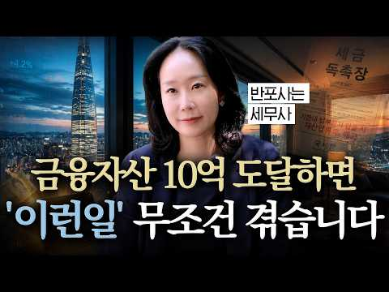
- 챕터: 0:00 하이라이트 · 0:49 금융자산10억의삶 · 5:27 부자들의금융투자방식 · 8:17 ISA계좌 · 12:53 세금공부해야하는이유 · 14:58 건강보험료과세
- 같은 채널 평소 대비 ×12.3 (채널 최근 롱폼 중앙값 21,420회) · 평소 영상: "절세 혜택에 속지 마세요" 세무사도 실수하는 생산적금융 ISA 투자 (16,096회) / "하루라도 빨리 격차를 좁히세요" 부자 필수 과목 6가지 (32,578회)
- 대본 (자막, 6.0 음절/초) 첫 20초: “총 금융 자산을 어느 정도 >> 10억 이상은 운영하고 있지. >> 금융 자산이 10억 이상 있으면 대한민국 상이 0.92%라고 하더라고요. 아, 그 정도면 진짜 인생이 달라질 수도 있다라고 하는데 >> 나 달라지는 거 없던데. >> 은행에서 막 연락도 오고 >> 아니야. 그 연락 [웃음] 안 오는데 프라이빗 가입은 됐다라고 하는데 정보 소스 우리가 궁금한 소스를 주거나 하진 않고” — 도입부 유형: 숫자로 시작
- 첫 1분: “총 금융 자산을 어느 정도 >> 10억 이상은 운영하고 있지. >> 금융 자산이 10억 이상 있으면 대한민국 상이 0.92%라고 하더라고요. 아, 그 정도면 진짜 인생이 달라질 수도 있다라고 하는데 >> 나 달라지는 거 없던데. >> 은행에서 막 연락도 오고 >> 아니야. 그 연락 [웃음] 안 오는데 프라이빗 가입은 됐다라고 하는데 정보 소스 우리가 궁금한 소스를 주거나 하진 않고 >> 어떤 비밀스러운 정보 같은게 있을 것 같은데. 근데 비밀스러운 정보 몇 번 받아봤는데 [웃음] >> 금융 자산 10억 이상 또 서울의 집판채이 정도는 무조건 정기적으로 세무 상담 받아야 된다. >> 받아라. >> 아 좋은 기준이네. 이거 >> 이거 안 하면 큰일 나. 건강보험료 폭탄이 나온다고 저희가 얘기를 하죠. >> 이것”
- 흐름 (90초마다 첫 문장): 0:00 총 금융 자산을 어느 정도 → 1:31 있으니까. → 3:01 가르쳐 주셔. 그냥 우리가 앞으로 → 4:30 때 배당을 받았을 때 받는 소득을 → 6:00 들어가 있는 경우에 또는 자녀가 → 7:30 ISA 계좌 뭐 이런 것도 → 9:01 계좌는 연 2천만 원 한도에서 되는 → 10:31 혜택이라는게 사실 여러 곳에 → 12:01 하시거든. 얘기 안 해. 사업이 조금 → 13:31 발생을 한다고 하더라도 그거에 대한 → 15:03 근데 아까 건강 보험료도 우리가 7% → 16:30 건강보험료 폭탄이 나온다고 저희가
- 댓글 244/244: 좋은 점 — 영상 1 · 감사·응원 5 · 더 알고 싶은 것 3 · 아쉬운 점 — 영상 2 · 반박·불만 — 의견 다름 3 · 정치·사회 20 · 경험 공유 13 · 구독·다음 기대 0
  - 좋은 점 — 영상 👍1 “주식에서 10억가지고 하루 1%만 먹어도 1천만원입니다. 반대로 -1% 또는 -10% 하루만에 잃을 위험성도 있고.. 하루 1% 안전하게 먹는 기술 개발하신다면 배당소득보다 주식단타 기술을 연마하는게 자산증식에 더 도움이 될수 있죠 아마 하루 1% 별거 아닐수도 있지…”
  - 감사·응원 👍8 “잘봤습니다^^ 오늘도 감사합니다~”
  - 더 알고 싶은 것 👍7 “상식적인 기준으로 보면... 건보료(X)가 아니라 건보세(O)가 맞습니다. 보험료: 안내면 보험금만 포기하면 된다. 세금: 안내면 재산압류에 강제징수. 단어는 "건강보험료"인데 실질성격은 세금.... 특히 지역가입자에게 재산에 따라 폭증하는 게 보험료가 맞나요? 세금…”
  - 더 알고 싶은 것 👍0 “PB한테 일부 맞기는것도 재산나름 입니다 10억 금융자산가와 1000억금융자산가 일때 PB수수료 20~30퍼라 치면 PB가 어느쪽 자산가를 미친듯이 신경써 수익률 올리려 할까요?”
  - 반박·불만 — 의견 다름 👍0 “진짜 10억이상 돌려요? 좀 그러네요... 10억 있는데 10억을 다 주식에 넣는다고요? 어이없네요”
  - 정치·사회 👍2 “나라랑 동업? 나라가 도둑!!! 동업이면 지도 세금 내야지 지는 왜 안내. 동업이면 지도 투자하고 밤새 같이 일해야지 왜 안해, 그냥 국개놈들 주머니 채워주는거지.”
  - 정치·사회 👍1 “선거관리원이. 부부가. 세금을 86억원을해외을 여행을. 해도 되나요”
  - 경험 공유 👍5 “금융자산 10억이면 1년에 이자소득+배당소득 합해서 5천~2억 올린다해도 그걸 다 찾아쓰는것도 아니고 끽해야 5천~1억 수익율이 얼만지는 모르겠지만 1억 찾아쓰는데 5천이 수익이라고 해봤자 15% 구간 10억 가진사람이 세무사 이용할 이유가 있음?”
  - 경험 공유 👍1 “저도 법인배당이랑 은행이자랑 같이 합쳐지는걸 몰라서 금융종합에 걸려버렸는데, 법인배당이 금융소득종합과세에 걸리고 -> ISA계좌연장이 안되고 -> 건보료도 매달 추가로 나옵니다...”

### 140. 【성철스님】부자되려면 지갑에 ‘이것’ 1개 당장 넣으세요!! ∣ 3일 안에 막힌 돈줄이 터지고 금전운이 폭발합니다 ∣ 돈복 재물운 풍수

- https://www.youtube.com/watch?v=wNCX2CjZUa4 · 듣고 깨닫다 · 구독자 14,500 · 조회수 95,910 (×6.6, 하루 550.9) · 좋아요 4,221 (4.4%) · 27.9분 · 2026-04-27 · 주제 묶음 1. 재테크 일반·마인드 · 형식 오디오북·낭독 (명언·인생조언) · 폴더 `W_wNCX2CjZUa4` (웹 승인)
- 썸네일: 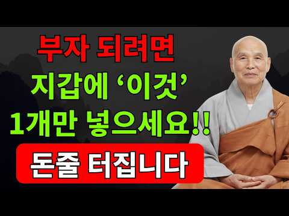
- 설명 앞부분: 2026년 병오년(붉은 말의 해)은 강력한 화(火)의 기운이 휘몰아치는 시기입니다. 이 거대한 운의 흐름 속에서 재물운을 내 것으로 만드는 비법은 의외로 간단합니다. 성철스님의 법어와 불교의 지혜를 통해, 돈 한 푼 안 들이고 지갑 속 기운을 바꾸는 '이것'의 정체를 공개합니다. 지금 바로 확인하고 벼락부자의 기운을 받아가세요. 부처님의 가피가 함께하시길 바랍니다.
- 같은 채널 평소 대비 ×50.1 (채널 최근 롱폼 중앙값 1,914회) · 평소 영상: 【성철스님】2026년 10월 1958년생 개띠, 지갑에 이것을 넣으면 재물운이 달라집니다 (2,017회) / 【성철스님】2026년 10월 1957년생 닭띠, 이 습관 하나가 말년 재물운을 바꿉니다 (1,812회)
- 대본 없음 (설명) — 음성인식이 끝나면 도입부·흐름이 들어감
- 댓글 1,597/1,597: 좋은 점 — 영상 23 · 감사·응원 452 · 더 알고 싶은 것 10 · 아쉬운 점 — 영상 0 · 반박·불만 — 의견 다름 3 · 정치·사회 0 · 경험 공유 13 · 구독·다음 기대 0
  - 좋은 점 — 영상 👍4 “🎉~가족모두 몸과 맘 건강히 벼락부자가 되었다 비방 실천하겠습니다. 좋은 말씀 감사합니다~🎉”
  - 좋은 점 — 영상 👍2 “부자가 되어서 많은사람들에게 도움이 되는 사람이 되겠습니다”
  - 감사·응원 👍22 “성철스님 가르침대로. 26년도 부터. 큰부자가 되겠습니다. 베풀면서 살겠습니다 행복하게 잘살겠습니다. 성철스님. 감사합니다 고맙습니다 덕분입니다 🎉👍😄🍀🙏”
  - 감사·응원 👍16 “성첼스님.말씀대로.벼락부자가되겠읍니다감사합니다❤😂🎉😢😮😅🎉🎉”
  - 더 알고 싶은 것 👍6 “로또기원합니다 1등 부탁드립니다 우리가족 건강하고 행복하게 살겠습니다”
  - 더 알고 싶은 것 👍1 “20:23 스님께서는 본인의 마음을 이야기 안 하시고 무슨 성철 스님 이야기만 합니까 자기 본인의 생각을 이야기하세요 끄떡하면 성철 스님 성철 스님 하는데 스님 본인의 생각을 이야기하세요 성철 스님 이야기는 하지 마시고 스님 본인의 마음을 이야기해 주세요”
  - 경험 공유 👍3 “2026년 저도 벼락 부자 되겟습니다❤❤❤ 감사 합니다”
  - 경험 공유 👍3 “저도부자되겠습니다감사합니다”

### 141. 나스닥100 1배수, 2배수, 3배수 20년 어떤 성과 보여주나(거치식, 적립식, 리벨런싱) ㅣ QQQ, QLD, TQQQ,

- https://www.youtube.com/watch?v=dQdACzI6nKE · 레버리지 하는 미국회계사 장기투자 여정 · 구독자 13,100 · 조회수 85,212 (×6.5, 하루 709.9) · 좋아요 2,117 (2.5%) · 16.3분 · 2026-06-20 · 주제 묶음 3. 주식·ETF · 형식 정보·해설 (그 밖) · 폴더 `W_dQdACzI6nKE` (웹 승인)
- 썸네일: 
- 챕터: 0:00 나스닥100 1배수, 2배수, 3배수 백테스트 시작 · 1:56 QQQ, QLD, TQQQ백테스트 조건 공개 (20년… · 2:48 QQQ, QLD, TQQQ 거치식 결과 — 2천만원,… · 7:46 QQQ, QLD, TQQQ 적립식 매수 결과 · 9:42 QQQ, QLD, TQQQ 리밸런싱 전략 결과 · 14:46 QQQ, QLD, TQQQ 3가지 투자방식 결론
- 설명 앞부분: QQQ, QLD, TQQQ — 20년 백테스트로 다 보여드립니다 1배, 2배, 3배 중에 도대체 뭘 모아야 하냐는 질문, 정말 많이 받았어요. 어떤 영상은 "1배가 국밥이다", 어떤 영상은 "3배 아니면 의미 없다" — 의견만 난무하고 진짜 데이터는 본 적이 없으실 거예요. 그래서 이번엔 20년치 실제 데이터로 끝까지 파봤습니다. 저는 미국 공인회계사이자 전직 펀드매니저입니다. 법인 계좌로 QLD를 메인으로 매일 매수하고 있고, 2022년 TQQQ -80% 폭락을 직접 겪고 2025년에 2~3배 수익으로 전량 매도한 경험이 있어요…
- 같은 채널 평소 대비 ×5.9 (채널 최근 롱폼 중앙값 14,488회) · 평소 영상: QLD 매일 매월 매수? 타이밍 보다 더 중요한 건 '언제 사서 언제 파느냐'다(QQQ,… (14,651회) / QLD랑 가장 잘 어울리는 배당주는 무엇인가 I SCHD, VYM, DGRO, VIG, … (14,325회)
- 대본 없음 (설명) — 음성인식이 끝나면 도입부·흐름이 들어감
- 댓글 390/390: 좋은 점 — 영상 21 · 감사·응원 51 · 더 알고 싶은 것 43 · 아쉬운 점 — 영상 0 · 반박·불만 — 의견 다름 4 · 정치·사회 1 · 경험 공유 25 · 구독·다음 기대 3
  - 좋은 점 — 영상 👍70 “저도 22년에 tqqq -80% 뚜드려맞아보고 qld를 매월 무지성적립식으로 하고있습니다. 그리고 200일 이평선 아래로 tqqq가 떨어지면 트리거로 생각해서 tqqq도 분할매수하고 있습니다. 좋은 영상 감사합니다.”
  - 좋은 점 — 영상 👍19 “와 많은 유튜버들이 하는 백테스트는 비슷했는데 이렇게하는건 유일하네요 질좋은 영상입니다”
  - 감사·응원 👍70 “저도 22년에 tqqq -80% 뚜드려맞아보고 qld를 매월 무지성적립식으로 하고있습니다. 그리고 200일 이평선 아래로 tqqq가 떨어지면 트리거로 생각해서 tqqq도 분할매수하고 있습니다. 좋은 영상 감사합니다.”
  - 감사·응원 👍29 “저는 얼마전부터 모아오던 QQQ를 QLD로 전환 매수했고 매달 월급날에 추매하는 장기 투자를 목표하고 있구요. 나스닥의 우상향을 믿지만 2배수라서 약간의 두려움도 있었는데 이 방송을 보고 나니 QLD가 더욱 든든해보입니다. 이렇게 좋은 방송을 공유해주셔서 진심으로 감…”
  - 더 알고 싶은 것 👍8 “백데이터는 환율이 상승했던 20년간인데요. 만약 현재 1500원대 환율이 900원대로 20년간 하락할 시의 시뮬레이션도 부탁드려봅니다. 모든 가정은 열어두어야 하니깐요. 앞으로도 환율이 고정 내지는 계속 상승할지는 알 수 없다고 생각해요. 수식을 잘 사용하시는 회계사…”
  - 더 알고 싶은 것 👍4 “추천 및 구독 하였습니다 Tqqq, qld, qqq 매월 적립식이 수익이 좋은데 만약 10년, 15년, 20년 매달 매수시 어느 계좌에 사야하나요? 그리고 미장에 직투 해야하나요? 국내 상장 나스닥을 해야하나요?”
  - 반박·불만 — 의견 다름 👍0 “영상 너무나 감사히 잘 보았습니다. 혹시 어느 일정부분 목표수익률이 났을때 매도 하고 기다렸다가 매도후 일정부분이 빠졌을때 다시 매수하고를 반복하면 어떤 결과가 나오는지도 궁금하네요^^ 22%로 세금등 때문에 말도 안돼는 설정일까요? 주린이라 ^^”
  - 정치·사회 👍2 “이게 맞는게 미국 우상향을 믿는다면 가능함 ㅋ 지금 버블이니 뭐니 하는데 실적도 따라오고 무엇보다 기준 금리가 이미 3.25%임 금리를 올린다해도 선반영이고 11월 트럼프 중간선거 이전이라 주식 부양해야됨 ㅋ 그래서 부랴부랴 이란 이스라엘 협력해라하는데 미국 쪽도 못…”
  - 경험 공유 👍70 “저도 22년에 tqqq -80% 뚜드려맞아보고 qld를 매월 무지성적립식으로 하고있습니다. 그리고 200일 이평선 아래로 tqqq가 떨어지면 트리거로 생각해서 tqqq도 분할매수하고 있습니다. 좋은 영상 감사합니다.”
  - 경험 공유 👍29 “저는 얼마전부터 모아오던 QQQ를 QLD로 전환 매수했고 매달 월급날에 추매하는 장기 투자를 목표하고 있구요. 나스닥의 우상향을 믿지만 2배수라서 약간의 두려움도 있었는데 이 방송을 보고 나니 QLD가 더욱 든든해보입니다. 이렇게 좋은 방송을 공유해주셔서 진심으로 감…”
  - 구독·다음 기대 👍29 “저는 얼마전부터 모아오던 QQQ를 QLD로 전환 매수했고 매달 월급날에 추매하는 장기 투자를 목표하고 있구요. 나스닥의 우상향을 믿지만 2배수라서 약간의 두려움도 있었는데 이 방송을 보고 나니 QLD가 더욱 든든해보입니다. 이렇게 좋은 방송을 공유해주셔서 진심으로 감…”
  - 구독·다음 기대 👍1 “(제가 숫자를 다시 수정하였어요. 예를들지 않고 영상속 나온 돈으로 그대로 계산했을경우로요. 답변 꼭 부탁드리겠습니다. 정말 감사드립니다) 제가 채널을 뒤늦게 알고, 영상 정주행하며 열공중입니다. 정말 절 10번 드리고싶어요. 너무 궁금한 부분을 속시원하게 검증해주시…”

### 142. 50대 노후준비 1억을 20억으로 만드는 가장 현실적인 3가지 전략 ∣ (ISA 계좌, S&P500)

- https://www.youtube.com/watch?v=hbBABRmu93Q · 만약에 머니 · 구독자 33,900 · 조회수 217,754 (×6.4, 하루 1,210.5) · 좋아요 2,956 (1.4%) · 21.2분 · 2026-04-21 · 주제 묶음 3. 주식·ETF · 형식 정보·해설 (그 밖) · 폴더 `W_hbBABRmu93Q` (웹 승인)
- 썸네일: 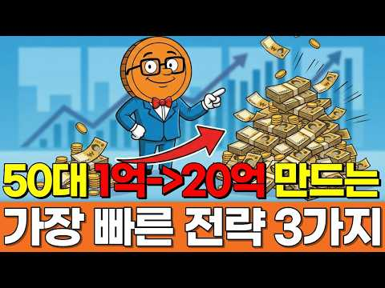
- 챕터: 0:00 50대에 1억 모으신 분들이 가장 많이 하는 실수 · 1:45 전문가 10명 중 8명이 시장에 패배하는 이유 · 3:20 [전략 1] 시간을 아군으로: S&P 500의 마법 · 5:10 20년 뒤 1억이 20억으로 변하는 실제 시뮬레이션 · 7:30 [전략 2] 양동이 대신 파이프라인: 배당 ETF 세… · 10:15 [전략 3] 가장 확실한 수익: 연금저축/IRP/IS… · 13:40 지금 당장 실행해야 할 2가지 체크리스트
- 설명 앞부분: 50대에 어렵게 모은 1억, 그런데 왜 공부를 할수록 통장 잔고는 줄어들까요? 수십 명의 전문가를 거느린 펀드매니저조차 80% 이상이 시장 지수를 이기지 못한다는 사실을 알고 계셨나요? 열심히 종목을 분석하고 사고팔기를 반복하는 행위가 오히려 여러분의 노후를 망치고 있을지도 모릅니다. 오늘 영상에서는 뇌과학과 행동경제학적 관점에서 우리가 왜 투자를 망치는지 분석하고, 자산가들만 아는 '세금이 새지 않는 20억 파이프라인' 구축법을 공개합니다. 50대는 결코 늦지 않았습니다. 지금 바로 시작하세요. [타임라인]
- 같은 채널 평소 대비 ×34.9 (채널 최근 롱폼 중앙값 6,244회) · 평소 영상: 순자산 5억도 평범한 나라. 대한민국 자산 계급 8단계, 여러분은 지금 몇 층에 서 계세… (7,668회) / 2026년 국민연금 개혁안 총정리. 조기수령후 건보료 폭탄 피하고 S&P 500 ETF으… (4,819회)
- 대본 (자막, 4.3 음절/초) 첫 20초: “50대에 어렵게 1억 모으시고 지금도 매일 종목 분석하고 계시다면 오늘만큼은 그 손 멈추세요. 수십명의 애널리스트를 두고 하루 종일 시장만 보는 전문 펀드 매니저조차 10명 중 8명 이상이 SNP 500을 못 이깁니다. 열심히 공부할수록 오히려” — 도입부 유형: 숫자로 시작
- 첫 1분: “50대에 어렵게 1억 모으시고 지금도 매일 종목 분석하고 계시다면 오늘만큼은 그 손 멈추세요. 수십명의 애널리스트를 두고 하루 종일 시장만 보는 전문 펀드 매니저조차 10명 중 8명 이상이 SNP 500을 못 이깁니다. 열심히 공부할수록 오히려 더 빨리 읽는 구조거든요. 오늘이 세 가지 전략만 기억하시면 20년 뒤 1억이 20억으로 보이실 겁니다. 충격받으셨죠? 저도이 데이터를 처음 봤을 때 같은 기분이었어요. 겁들이려고 하는 말이 아닙니다. 지금이라도 아신게 다행인 거고 50대는 절대 늦은 나이가 아니거든요. 오늘 제가 확실하게 정리해 드릴게요. 안녕하세요. 어른들의 돈부 파트너 마약의 머니입니다. 오늘 크게 세 가지를 알려 드릴 거예요. 첫 번째 왜 50대에 1억 모으신 분들 중 대부분이 그 1억을 오히”
- 흐름 (90초마다 첫 문장): 0:00 50대에 어렵게 1억 모으시고 지금도 → 1:31 있도록 계좌 하나까지 구체적으로 알려 → 3:00 어떤 분들은 오픈 채팅방에도 → 4:32 내려가세요. 훨씬 편하게 훨씬 멀리 → 6:01 부를게요.이 이 지수의 장기 수익률이 → 7:31 물론이 전략도 쉽지만은 않습니다. → 9:00 자체를 굴려서 시세 차익만 노리세요. → 10:31 배당받고 이게 복리의 진짜 → 12:02 수령 시기가 계속 뒤로 밀리고 → 13:30 세금이랑 수수료를 다 떼고 나면 실제 → 15:02 받으시는 겁니다. 여기서 끝이 → 16:32 있습니다. 이게 왜 중요하냐면 사실상 → 18:01 먼저 보세요. 5년 안에 자녀 결혼 → 19:31 돈 걱정이 사라집니다. → 21:02 다음 영상 주제에 직접
- 댓글 139/139: 좋은 점 — 영상 4 · 감사·응원 11 · 더 알고 싶은 것 7 · 아쉬운 점 — 영상 3 · 반박·불만 — 의견 다름 1 · 정치·사회 0 · 경험 공유 3 · 구독·다음 기대 0
  - 좋은 점 — 영상 👍2 “손실 회피 편향을 비롯한 투자 심리의 함정을 아주 정확하게 짚어주셨네요. 단순히 종목 추천을 넘어 S&P 500 ETF 장기 투자와 ISA, IRP 계좌를 활용한 현실적인 절세 파이프라인 구축까지, 과장 없이 핵심만 깔끔하게 정리된 훌륭한 영상입니다. 좋은 인사이트 …”
  - 좋은 점 — 영상 👍1 “좋은 영상”
  - 감사·응원 👍10 “영상 넘 좋아요 수고하셨습니다 감사합니다”
  - 감사·응원 👍3 “감사합니다 😊”
  - 더 알고 싶은 것 👍31 “ISA계좌 개설후 ETF 투자하면 3년뒤 해지할때 ETF도 모두 매도하고 끝내야 되나요?”
  - 더 알고 싶은 것 👍1 “안녕하세요 저는 올해 59세 퇴직을 앞두고 있는 상황에 회사 사정으로 아버지가 딸에게 사업승계하면서 아버지 사업장의 퇴직금을 일반계좌로 1차로 3월 31일에 나머지를 4월 23일 오늘 33,60만원을 받았습니다 IRP계좌로 받으려고 생각했지만 사장이 물어보지도 않고 …”
  - 아쉬운 점 — 영상 👍3 “지수투자에 대한 믿음과 마인드 컨트롤이 힘든거죠..텐버거 종목 보고 있자면 그걸 못버팁니다..개인적으론 90%지수투자 엣지투자(재미용)10%정도하면 덜 지루하더군요~”
  - 아쉬운 점 — 영상 👍2 “손실 회피 편향을 비롯한 투자 심리의 함정을 아주 정확하게 짚어주셨네요. 단순히 종목 추천을 넘어 S&P 500 ETF 장기 투자와 ISA, IRP 계좌를 활용한 현실적인 절세 파이프라인 구축까지, 과장 없이 핵심만 깔끔하게 정리된 훌륭한 영상입니다. 좋은 인사이트 …”
  - 반박·불만 — 의견 다름 👍0 “어이없네 ㅋㅋ 대한민국에 거지없겠네 ㅋ”
  - 경험 공유 👍1 “안녕하세요 저는 올해 59세 퇴직을 앞두고 있는 상황에 회사 사정으로 아버지가 딸에게 사업승계하면서 아버지 사업장의 퇴직금을 일반계좌로 1차로 3월 31일에 나머지를 4월 23일 오늘 33,60만원을 받았습니다 IRP계좌로 받으려고 생각했지만 사장이 물어보지도 않고 …”
  - 경험 공유 👍0 “주식은 모른다....... 내 지인이 증권회사에서 30년 넘게 일한 사람이다.... 에코프로 5만원대.. 청주공장에서 불이 났었다... 그날 주가가 폭락해서 -30이었다. 그다음날 전화 상담하니 전부매도 하라 하더라..... 정확히 1년뒤 주당 150만원이 되더라..…”

### 143. 50대 이후, 이런 집에 살면 노후가 무너집니다

- https://www.youtube.com/watch?v=NGLEPdYvQdQ · 김지호의 공간문해력 · 구독자 18,400 · 조회수 115,405 (×6.3, 하루 1,048.2) · 좋아요 2,398 (2.1%) · 18.2분 · 2026-06-30 · 주제 묶음 4. 노후·연금 · 형식 인터뷰·강연·대담 · 폴더 `W_NGLEPdYvQdQ` (웹 승인)
- 썸네일: 
- 설명 앞부분: 노후에는 집의 크기나 가격보다 더 중요한 것이 있습니다. 젊을 때는 좋아 보였던 고층 아파트, 넓은 집, 관리비가 많이 드는 집이 나이가 들수록 오히려 생활을 불편하게 만들고 노후 자금을 빠르게 줄어들게 만들 수 있습니다. 이번 영상에서는 50대 이후부터 조심해야 할 집의 특징과 노후에 편안하게 살기 위해 어떤 집을 선택해야 하는지 이야기해봅니다. 지금 살고 있는 집이 정말 내 노후에 맞는 집인지 한 번 점검해보시기 바랍니다.
- 같은 채널 평소 대비 ×1.2 (채널 최근 롱폼 중앙값 96,140회) · 평소 영상: "이게 대한민국 현실입니다" 평생 집 한채 마련했는데 갈 곳 없는 노후의 현실 (105,956회) / 노년에 '이 집' 선택했다가 평생 후회합니다.｜김지호의 공간문해력 (87,088회)
- 대본 없음 (설명) — 음성인식이 끝나면 도입부·흐름이 들어감
- 댓글 207/208: 좋은 점 — 영상 15 · 감사·응원 9 · 더 알고 싶은 것 0 · 아쉬운 점 — 영상 0 · 반박·불만 — 의견 다름 2 · 정치·사회 0 · 경험 공유 27 · 구독·다음 기대 0
  - 좋은 점 — 영상 👍43 “참으로 좋은 영상입니다. 도움이 많이 됩니다.👍”
  - 좋은 점 — 영상 👍19 “맞는 말씀이네요 나이 들수록 고층은 피하는게 답임”
  - 감사·응원 👍48 “아파트삶에 대해 알고 싶어 들어왔어요. 50대 입니다. 정보차원의 말을 주의깊게 가만히 듣다보니 문학작품을 읽는것 같았습니다. 울림이 있는 내용과 글 감사합니다.”
  - 감사·응원 👍8 “유익했습니다. 감사합니다.^^”
  - 반박·불만 — 의견 다름 👍10 “채광까재 동일하면 선생님 말씀이 맞습니다. 그치만 저층과 고층이 일조향까지 같은 경우는 거의 없다고 봐야죠, 뷰 역시 마찬가지입니다. 층슈는 단순한 물리적 위치가아닙니다. 일조권과 조망권의 가치죠”
  - 반박·불만 — 의견 다름 👍1 “그게 아닌데 소음 하고 ,벌레 모기 올라오는게 다름 ,물론 15층 이상은 영향 없음”
  - 경험 공유 👍55 “저도 10층이상에서 살다가 지금은 2층에서 살고 있는데 너무 만족합니다. 휴양림에 놀려온거 같아요”
  - 경험 공유 👍47 “7층 살때 제일 좋았어요 숲도 보이고 하늘도 보이고 채광도 바람도 너무 좋았던 2006년식 아파트 그집에서 제일 돈도 많이 벌고 건강했고 행복했었죠.”

### 144. 주식 ETF 자산 17억 구독자님의 포트폴리오 분석, 세금 건보료 절세 위한 추가 전략

- https://www.youtube.com/watch?v=x26AhOtaVsg · 배당으로 부자되기 · 구독자 8,580 · 조회수 53,036 (×6.2, 하루 342.5) · 좋아요 943 (1.8%) · 15.2분 · 2026-05-16 · 주제 묶음 3. 주식·ETF · 형식 정보·해설 (그 밖) · 폴더 `W_x26AhOtaVsg` (웹 승인)
- 썸네일: 
- 챕터: 0:00 10억 ETF 투자 시 매달 들어오는 배당금 규모 · 1:05 17억 자산가 구독자님의 현실적인 스펙 및 자산 현황 · 1:46 1만 주 매집으로 12억 수익을 올린 킬러 콘텐츠 분석 · 2:32 은퇴 후 자산을 지키는 '분배와 방어' 리밸런싱의 시작 · 3:18 월 1,000만 원 현금흐름을 만드는 2가지 핵심 커… · 4:26 실제 수령액 1,000만 원 이상, 그러나 정부가 잡… · 6:02 실제 소득을 1/3로 줄여주는 국내 커버드콜 ETF의… · 6:59 직장 가입자 자격 유지를 통한 건강보험료 추가 부담 … · 10:45 세후 수익률을 극대화하는 감액 배당주 투자
- 설명 앞부분: 은퇴 후 진짜 수익률을 결정하는 것은 주가 상승률이 아니라 세금 구조와 건강보험료입니다. 국내 지수형 커버드콜 ETF의 비과세 옵션 프리미엄 구조를 활용하면, 실제 월 1,030만 원을 수령하더라도 과세 대상 소득은 337만 원 수준으로 대폭 낮출 수 있습니다. 은퇴 후 자산을 불리는 '축적'의 단계에서 안정적으로 지키고 꺼내 쓰는 '분배와 방어'의 단계로 전환하기 위한 명확한 포트폴리오 리밸런싱 전략이 필요합니다. 이 채널 ‘배당으로 부자되기’는 실제 계좌 수익, 배당금, 리밸런싱 데이터를 기반으로 파이어족을 위한 현실적인 배당…
- 같은 채널 평소 대비 ×4.2 (채널 최근 롱폼 중앙값 12,744회) · 평소 영상: 목돈으로 배당 세팅하는 순서 6단계 — 연 1,000만 원까지는 그냥 배당주로 받으세요 (13,062회) / 배당 연 2천만 원 넘게 받으면서 건보료 부담 안 생기려면 (제 실제 원천징수 내역 공개) (12,425회)
- 대본 없음 (설명) — 음성인식이 끝나면 도입부·흐름이 들어감
- 댓글 78/78: 좋은 점 — 영상 3 · 감사·응원 8 · 더 알고 싶은 것 3 · 아쉬운 점 — 영상 1 · 반박·불만 — 의견 다름 1 · 정치·사회 0 · 경험 공유 3 · 구독·다음 기대 0
  - 좋은 점 — 영상 👍1 “퇴직후18억정도 자산 분배 고민중에 좋은 정보감사합니다.”
  - 좋은 점 — 영상 👍1 “좋은 정보 감사하겠습니다 😊”
  - 감사·응원 👍5 “영상 잘 보고 있습니다. 퇴직금 2억정도 있는데 월배당 ETF에 투자하고 싶습니다. 어떤 종목이 좋은지 콕 찝어서 주시면 감사하겠습니다.”
  - 감사·응원 👍4 “넘 좋을 몰랐던 배움 주셨으니 더 사유해보겠습니다 감사드립니다”
  - 더 알고 싶은 것 👍2 “잘 보고 갑니다 실제 포트 폴리오를 그래픽으로 올려 주시면 조금 더 이해다 쉬울 텐데 조금 아쉽네요”
  - 더 알고 싶은 것 👍0 “오늘도 많은 도움이 되었어요. 조금씩 지식을 쌓아가고 있습니다. 다른 사람들의 사례를 들어 설명해 주시는 부부도 도움됩니다. 앞으로도 계속해서 알려주세요. 감사합니다.”
  - 아쉬운 점 — 영상 👍2 “잘 보고 갑니다 실제 포트 폴리오를 그래픽으로 올려 주시면 조금 더 이해다 쉬울 텐데 조금 아쉽네요”
  - 반박·불만 — 의견 다름 👍0 “Tiger ,kodex 커브드콜 세금기준 배당금 4000만원 아닙니다 저랑비슷한 규모 같은데 년 1600이하 입니다 새로계산해보세요”
  - 경험 공유 👍1 “저도 폭락장 기다리는1인입니다 티큐 평단 20 브럽네용”
  - 경험 공유 👍0 “저도 같은 케이스인데 상담을 좀 받을 수 있을까요.. ? 미장 위주로 하다보니 33억이 넘었어요… 배당주로 좀 돌리면서 세금을 최소화 하고 싶은데 ㅠ”

### 145. QLD 직투 vs ISA, 잘 못 선택하면 10년 뒤 수천만 원 손해 봅니다.

- https://www.youtube.com/watch?v=vU5AK1FfCqQ · 돈재이 DONJAY · 구독자 19,800 · 조회수 121,465 (×6.1, 하루 971.6) · 좋아요 2,524 (2.1%) · 20.3분 · 2026-06-15 · 주제 묶음 6. 절세·제도 · 형식 오디오북·낭독 (명언·인생조언) · 폴더 `W_vU5AK1FfCqQ` (웹 승인)
- 썸네일: 
- 설명 앞부분: ⭐안녕하세요, 본 채널은 저의 개인적인 투자 여정과 장기 투자 철학을 기록하는 공간입니다. 제가 겪은 시행착오와 시장을 바라보는 관점이 여러분의 투자 공부에 작은 참고가 되기를 희망합니다. 다만, 채널의 모든 콘텐츠는 정보 전달을 목적으로 제작되었습니다. 여러분의 성공적인 투자 여정을 응원합니다.
- 같은 채널 평소 대비 ×6.9 (채널 최근 롱폼 중앙값 17,667회) · 평소 영상: 환율 계속 떨어지는데 QLD 투자해도 될까? 제 결론입니다 (17,667회) / 수익률 200%차이? 적립식 투자 수익률 어떤 것이 더 높을까? 매일 사기 vs 매주 사… (17,847회)
- 대본 없음 (설명) — 음성인식이 끝나면 도입부·흐름이 들어감
- 댓글 465/465: 좋은 점 — 영상 11 · 감사·응원 35 · 더 알고 싶은 것 44 · 아쉬운 점 — 영상 5 · 반박·불만 — 의견 다름 3 · 정치·사회 3 · 경험 공유 15 · 구독·다음 기대 3
  - 좋은 점 — 영상 👍9 “아주 좋은 정보네요”
  - 좋은 점 — 영상 👍7 “좋은 정보 감사합니다. 앞으로 원화 하락 계속 될테니 국내 상장 ETF로 나스닥 상승과 환율에서 2배로 먹겠습니다.”
  - 감사·응원 👍23 “감사합니다. 환차손까지 레버리지가 되는지 전혀 생각 못 했습니다.”
  - 감사·응원 👍18 “ISA투자 계속 지피티한테 물어봤는데도 답이 안나왔는데 이영상하나로 머리속이 깔끔해졌습니다 타이거로 가겠습니다 감사합니다”
  - 더 알고 싶은 것 👍5 “안녕하세요. 다름아니라 삼성증권 해외주식 팀에 전화로 문의했을때, tiger미국나스닥100레버리지 종목은 환율 2배 추종이 아닌, 1배 추종이라고 분명히 답변 받았었거든요. 나스닥 지수는 2배 추종이 맞지만, 환율은 1배를 따라간다라고 들었는데 무엇이 사실일까요? 환…”
  - 더 알고 싶은 것 👍4 “도움이 많이 되었습니다. 궁금한 점을 깔끔하게 설명해주시네요^^ ISA 올해 계좌한도가 다 차서 못하고 일단 이번 달부터 직투로 QLD 조금씩 매수 중입니다.^^ 내년에는 ISA 직투 반반씩 적립해 나가야 겠네요^^ 오픈채팉방이 다 찼네요 ㅠ 추가개설 부탁드립니다.”
  - 아쉬운 점 — 영상 👍9 “ISA는 소수점 안되는게 아쉽네요”
  - 아쉬운 점 — 영상 👍5 “장기로보고isa3년마다 해외직투계좌로 옮기고 해지후재가입 최대금액넣고 반복이 베스트라고봅니다 어느정도 지나 덩치가 커지면 현금흐름용 커버드콜을 isa 활용하면 건보료 상승없이 또 qld적립매수가능하구요”
  - 반박·불만 — 의견 다름 👍0 “(타이거 나스닥100 레버리지) h가 붙는건 노출이아닌데 왜? 붙은걸헷지라해?”
  - 정치·사회 👍7 “직투에서 달러 확보 얘기하는 사람은 진짜 나라가 붕괴해서 복구 불능 상태로 간다는 가정으로 하는거임 환 노출 모르는게 아니라”
  - 정치·사회 👍3 “ISA 단점 원금을 1억까지 밖에 못 넣는다. 언제가는 계좌 해지해야 하기때문에 복리가 깨진다. 직투 계좌 직접 매도 하기전까지는 무한정 매수가 가능하다 복리가 계속 불어난다. 결론 양도세 22퍼 내더라도 장기 투자시 수익율이 ISA 보다 직투가 높다 끝 ISA에서 …”
  - 경험 공유 👍47 “사람들이 잘 이해를 못하네... Isa 먼저 년 2천만원 채우고 남으면 직투로 qld하면 됨. 저도 같이 하는데 너무 좋은거 같아요. 빨리 5년에 1억 한국판qld채우는게 목표입니다”
  - 경험 공유 👍5 “신박한 주제라 신규유입(?)이 많아서 그런지 요상한 댓글이 많이 보이네요😂 저도 isa한도 다 채워지고 남으면 직투에 넣어요ㅎㅎ”
  - 구독·다음 기대 👍2 “잘봤어요 감사합니다! 구독했어요😊”
  - 구독·다음 기대 👍1 “구독했습니다 3번방 부탁드립니다”

### 146. "S&P500 ETF, 종목보다 '계좌'가 20년 뒤를 바꾸는 진짜 이유 (연금·ISA)"

- https://www.youtube.com/watch?v=fmQLRfIm28Y · 야무진 경제학 · 구독자 22,500 · 조회수 137,220 (×6.1, 하루 1,340.2) · 좋아요 3,515 (2.6%) · 28.4분 · 2026-07-07 · 주제 묶음 3. 주식·ETF · 형식 정보·해설 (그 밖) · 폴더 `W_fmQLRfIm28Y` (웹 승인)
- 썸네일: 
- 챕터: 0:00 종목은 담았는데 왜 내 계좌만 이 모양일까 · 2:19 원칙 ① 짐을 줄여라 — 종목이 많을수록 위험한 이유 · 5:02 원칙 ② 오래 메고 걸어라 — 매달 30만원 20년의… · 8:26 40세 시작 vs 50세 시작, 10년이 만든 격차 · 10:03 목돈 한 번에? 나눠서? 리밸런싱은 언제 · 10:44 우리가 가장 많이 하는 두 가지 오해 · 11:49 달콤한 함정 — 월배당·커버드콜의 진실 (금감원 경보) · 15:25 반전 — 짐이 아니라 '배낭'을 바꾸는 고수들 · 16:42 방수 배낭 ① 연금저축·IRP, 148만원 돌려받는 법 · 19:25 방수 배낭 ② ISA, 3년 유연 + 비과세 · 20:59 같은 상품 김 씨 vs 박 씨, 10년 뒤 잔고 차이 · 22:38 ISA를 연금으로 갈아타 혜택 두 번 챙기는 기술 · 24:04 꼭 알아야 할 주의점 — 중도해지 벌금 & ISA 한… · 25:47 오늘 걸어온 길 정리 — 짐이 아니라 배낭이 결과를 …
- 설명 앞부분: S&P500 ETF, 좋다는 종목만 열심히 담았는데 왜 내 계좌만 안 불어날까요? 문제는 '무엇을 담느냐'가 아니라 '어떤 계좌에 담느냐'입니다. 오늘은 ETF 투자를 배낭여행에 빗대, 20년 뒤 통장을 바꾸는 절세계좌(연금저축·IRP·ISA) 활용법을 한 번에 정리했습니다. 똑같은 미국 지수 ETF를 일반계좌(비닐봉지)에 담은 사람과 절세계좌(방수 배낭)에 담은 사람의 결과가 왜 갈리는지, 그리고 요즘 인기인 월배당·커버드콜의 숨은 함정(금융감독원 소비자경보)까지 짚습니다. 종목 압축, 복리의 시간, 절세계좌라는 세 가지 뼈대만…
- 같은 채널 평소 대비 ×12.2 (채널 최근 롱폼 중앙값 11,237회) · 평소 영상: "50대 노후 준비 10년째 못 하는 진짜 이유, 놓친 4가지" (11,237회) / "미국 ETF, 2026년엔 이 순서로 담으세요 (연금·IRP·ISA)" (11,287회)
- 대본 없음 (설명) — 음성인식이 끝나면 도입부·흐름이 들어감
- 댓글 115/115: 좋은 점 — 영상 6 · 감사·응원 9 · 더 알고 싶은 것 11 · 아쉬운 점 — 영상 2 · 반박·불만 — 의견 다름 0 · 정치·사회 0 · 경험 공유 4 · 구독·다음 기대 1
  - 좋은 점 — 영상 👍2 “노인초보자가 보기에 아주 핵심적이고 유익해서 구독 했어요❤😅😅 목소리도 좋아요”
  - 좋은 점 — 영상 👍2 “감사합니다 이해가 잘 되네요~~~”
  - 감사·응원 👍9 “감사드립니다 저두 5~6개 담고 있는데 정리하겠습니다”
  - 감사·응원 👍4 “감사합니다”
  - 더 알고 싶은 것 👍9 “연금계좌는 1년에 얼마까지입금(투자)가능한가요?”
  - 더 알고 싶은 것 👍4 “종합과세 때문에 isa 개설이 안되요..ㅜㅜ 비닐봉지에라도 담아야 할까요? 3년뒤 isa개설 가능해지면 그때 담는게 나을까요?”
  - 아쉬운 점 — 영상 👍5 “영상이 깔끔하고 편집이 잘 되어 있어서 보기 편하네요.”
  - 아쉬운 점 — 영상 👍2 “말을 너무 길게 늘림”
  - 경험 공유 👍3 “자식공부시키고 집산다고 그간 세월 다 보낸 60중반인 저희들은 어떻게해야하나요? 😢”
  - 경험 공유 👍1 “내가 들어보니 커버드콜 한번도 투자해 본적없고 주식투자경력10년도 안되었네...좃도 모르네...”
  - 구독·다음 기대 👍2 “구독, 좋아요 ,알림설정 다 눌렀습니다.서운해 하지 마세요~😅”

### 147. 호주 한국 반반 살기 '이것' 모르면 은퇴 자금 거덜 납니다 건강보험 & 세금 폭탄의 진실

- https://www.youtube.com/watch?v=WS4hFxgz01Y · Jungestate · 구독자 3,370 · 조회수 19,899 (×5.9, 하루 148.5) · 좋아요 632 (3.2%) · 15.9분 · 2026-06-06 · 주제 묶음 6. 절세·제도 · 형식 브이로그·직접 해본 이야기 · 폴더 `W_WS4hFxgz01Y` (웹 승인)
- 썸네일: 
- 챕터: 0:00 완벽했던 노후 계획이 악몽으로 변한 순간 · 1:22 역이민을 선택하는 진짜 이유 (철저한 가성비 계산) · 2:32 비자 시스템의 함정: 2026년 F-4 비자와 복수 … · 4:23 가장 치명적인 함정: 건강보험 30일 상실 & 6개월… · 5:31 완벽한 방어막: F-5 영주권 혜택 3가지와 까다로운… · 7:06 보이지 않는 세금 레이저망: 183일 거주자 판정과 … · 8:03 세금 방어 실전 팁: 5년 비과세 특례와 핀테크/해외… · 9:21 연금 퍼즐 맞추기: 호주 연금과 한국 국민연금의 영리… · 10:46 40년 만에 돌아온 한국, 180도 달라진 문화 충격 · 11:50 지방 귀농의 리스크와 현지인이 바라보는 '체리피커' … · 13:35 결론: 실패 없는 역이민을 위한 '테스트 드라이브' …
- 설명 앞부분: 호주에서 수십 년 뼈 빠지게 일하고 선택한 한국 역이민, 과연 장밋빛일까요? 낭만적인 브이로그 뒤에 숨겨진 차가운 현실을 분석했습니다. 시드니 자녀 집에 딱 한 달 다녀왔을 뿐인데 건강보험이 날아가고 6개월을 기다려야 하는 현실, 그리고 이삿짐을 푸는 순간 시작되는 한국 국세청의 '183일 세금 레이저망'까지. 은퇴 자금을 지키고 완벽한 노후를 완성하기 위한 'F-5 영주권' 활용법과 '테스트 드라이브 전략'을 지금 바로 확인하세요. 호주 집을 섣불리 팔기 전에 반드시 이 영상을 끝까지 보셔야 합니다! ⏱️ 타임라인 (Timest…
- 같은 채널 평소 대비 ×2.9 (채널 최근 롱폼 중앙값 6,862회) · 평소 영상: 호주 상속세 0원? 🇦🇺 유언장 써도 내 재산 32% 뺏기는 숨겨진 세금 함정 (10,257회) / 내 수퍼, 진짜 '내 돈' 맞나요? 💸4 5조 달러를 둘러싼 호주 정부의 의도 (3,694회)
- 대본 없음 (설명) — 음성인식이 끝나면 도입부·흐름이 들어감
- 댓글 91/91: 좋은 점 — 영상 10 · 감사·응원 13 · 더 알고 싶은 것 4 · 아쉬운 점 — 영상 3 · 반박·불만 — 의견 다름 0 · 정치·사회 2 · 경험 공유 5 · 구독·다음 기대 0
  - 좋은 점 — 영상 👍6 “마지막에 겸손 언급하신거 급 공감합니다. 이민오시던 시절의 한국이 아니예요. 해외에서 살다왓다고 조금이라도 꺼드럭 거리는거 많이 거슬리지요.”
  - 좋은 점 — 영상 👍4 “은퇴하고 한국에 살려고 했는데......유익한 정보 너무 감사합니다.늘 응원합니다.”
  - 감사·응원 👍4 “은퇴하고 한국에 살려고 했는데......유익한 정보 너무 감사합니다.늘 응원합니다.”
  - 감사·응원 👍4 “유용한 정보 감사합니다! 10년후 역이민을 목표로 달리고 있습니다!”
  - 더 알고 싶은 것 👍2 “정말 설명 똑 부러지게 잘하십니다. 시각적으로, 청각적으로. AI목소리인가요? 목소리 톤도 너무 듣기 좋구요. 저는 1년 뒤 은퇴하는데, 노인연금은 수혜대상이 될 수없어서 수퍼펀드로 만 은퇴 설계를 해야하는 관계로 혹 저와 같은 입장인 많은 은퇴자를 위해 은퇴후의 수…”
  - 더 알고 싶은 것 👍1 “정말 유익한 정보 감사드립니다. 영상을 보다가 궁금한 것들이 생각이 들어 질문드립니다. 호주국적자가한국에 조그마한 아파트를 투자 및 향후 사용 계획으로 구매하는 것에 대해 어떻게 생각하시는지 그리고 미리 염두해 두어야 할 것이 무엇이 있을까요? 주택을 취득하게 되면 …”
  - 아쉬운 점 — 영상 👍6 “틀린 내용이 많아 바로 잡습니다. 호주 영주권자 인경우 암치료 RNSH 같은 삼성병원 보다 시설 좋은곳에서 더 좋은 약,수술등 공짜 치료됩니다.또한 한국에서 보험이 안되는 비싼약도 DSP 경우 거의 공짜 입니다. 불과 몇십불이면 됩니다.아울러 환자에 대한 배려도 정말…”
  - 아쉬운 점 — 영상 👍2 “정말 설명 똑 부러지게 잘하십니다. 시각적으로, 청각적으로. AI목소리인가요? 목소리 톤도 너무 듣기 좋구요. 저는 1년 뒤 은퇴하는데, 노인연금은 수혜대상이 될 수없어서 수퍼펀드로 만 은퇴 설계를 해야하는 관계로 혹 저와 같은 입장인 많은 은퇴자를 위해 은퇴후의 수…”
  - 정치·사회 👍18 “한국은 더 이상 내 나라가 아니라 내가 태어나서 어린 시절을 보낸 말통하는 나라일뿐입니다. 성인이 된 후 나의 성인 인생을 통틀어 보낸곳이 내 나라 입니다. 영주권으로 사시는 분은 특별한 이유가 있으시겠지만. 자식도 친구도 다 이곳에 있고, 한국에 있는 내 옛친구는 …”
  - 정치·사회 👍0 “영주권자의 경우 한국가도 F4-5 비자가 필요없잖아요? 근데 만약 호주도 반년이상 해외살면 투자용 수입에서 세금이 외국인으로 분류되어 호주거주자보다 많이 내야하는거 맞나요? 지금설명은 시민권으로 바꾸신분의 케이스 같은데… 영주권자의 경우 호주에 투자수입있을시 궁금해뇨”
  - 경험 공유 👍18 “한국은 더 이상 내 나라가 아니라 내가 태어나서 어린 시절을 보낸 말통하는 나라일뿐입니다. 성인이 된 후 나의 성인 인생을 통틀어 보낸곳이 내 나라 입니다. 영주권으로 사시는 분은 특별한 이유가 있으시겠지만. 자식도 친구도 다 이곳에 있고, 한국에 있는 내 옛친구는 …”
  - 경험 공유 👍0 “역 이민은 또다른 외국 경험이라 생각한다. 난 우리집이 편안하고, 사회속에서 내가 그안에 공존을 하니 이사 간 집에서 마지막도 보낼생각이다. 한국방문시 뇌졸증 생겨 일주일 입원 경미 이유로 재활 거부. 바로 안정된 3개월 후 집으로 돌아와 응급실 통해 재활 전문 종합…”

### 148. 평생 모은 노후자금 뜯긴 노인들... 조폭 소굴 쳐들어간 아줌마의 100대 참교육 [박여사 6화]

- https://www.youtube.com/watch?v=cc4uBxFSiiY · 아직 늦지 않았습니다 · 구독자 30,800 · 조회수 180,152 (×5.8, 하루 3,312.3) · 좋아요 1,007 (0.6%) · 9.2분 · 2026-08-24 · 주제 묶음 4. 노후·연금 · 형식 사연·드라마 · 폴더 `W_cc4uBxFSiiY` (웹 승인)
- 썸네일: 
- 설명 앞부분: 평생 모은 노후자금을 노리는 주식 리딩방 사기 조직. 길바닥에 나뒹구는 노인을 보고 박여사의 분노가 폭발한다. "어르신, 제가 꼭 그 돈 찾아올게요." 조폭 소굴로 정면 돌파한 박여사와 전트. 그리고 5화에서 처음으로 패배를 안겼던 그 남자, 왕도일과의 재대결. "열 번 찍어 안 넘어가면 백 번, 백 번 찍어 안 넘어가면 천 번을 찍어." 과연 박여사는 왕도일을 무릎 꿇릴 수 있을까? 이 채널은 AI로 제작됩니다. 중년이 주인공인 이야기를 만듭니다. 평범한 아줌마, 평범한 아저씨. 그런데 건드리면 안 되는 사람들. 본 영상은 AI…
- 대본 없음 (설명) — 음성인식이 끝나면 도입부·흐름이 들어감
- 댓글 36/36: 좋은 점 — 영상 0 · 감사·응원 2 · 더 알고 싶은 것 2 · 아쉬운 점 — 영상 0 · 반박·불만 — 의견 다름 0 · 정치·사회 0 · 경험 공유 0 · 구독·다음 기대 0
  - 감사·응원 👍3 “❤와우 너무 잼나게 보아요 ❤ 박여사님. 뉴욕에서 응원합니다 화이팅 ❤❤”
  - 더 알고 싶은 것 👍2 “빨리 다음화 영상 올려 주세요.”

### 149. [냠냠동화] 🍭자전거 사주세요! ∣ 사회공룡 ∣ 저축 습관 ∣ 유아 동화∣ 어린이 동화 읽어주기 ∣ 동화책 읽기 ∣ 인성동화 ∣ 그림책

- https://www.youtube.com/watch?v=vN--X8tbqIA · 냠냠동화 · 구독자 7,400 · 조회수 42,230 (×5.7, 하루 274.4) · 좋아요 98 (0.2%) · 5.8분 · 2026-05-17 · 주제 묶음 2. 돈 모으기·저축 · 형식 정보·해설 (그 밖) · 폴더 `W_vN--X8tbqIA` (웹 승인)
- 썸네일: 
- 설명 앞부분: 어린이 여러분, 안녕하세요? 😊 맛있는 이야기를 냠냠! 🍭📖 냠냠동화에 오신 걸 환영해요! 그레이트북스의 『자전거 사 주세요』는 내 친구 사회공룡 시리즈의 한 권으로, 아이가 원하는 물건을 사 달라고 조르는 상황을 통해 소비와 저축의 의미를 배워봅니다. 📚 도서 정보 제목: 자전거 사주세요 글: 김효미 그림: 김이조 감수: 최연철 출판사: 그레이트북스 🎧 냠냠동화 제작 이야기 원작의 흐름과 문장을 존중하여 충실하게 구성하였으며 모든 내레이션은 운영자가 직접 녹음한 1인 다역 음성입니다. 그림책의 삽화를 한 장 한 장 직접 촬영하여…
- 같은 채널 평소 대비 ×5.2 (채널 최근 롱폼 중앙값 8,052회) · 평소 영상: [냠냠동화] 배 속의 거지 ∣ 먹어도 먹어도 배가 고픈 사람은 진짜 배 속에 거지가 들어… (8,052회) / [냠냠동화] 소파껌딱지 도지만 ∣ 살찌는 습관 ∣ 아람 심쿵 ∣ 어린이동화책읽어주기 ∣동… (8,315회)
- 대본 없음 (설명) — 음성인식이 끝나면 도입부·흐름이 들어감
- 댓글 0/0: 좋은 점 — 영상 0 · 감사·응원 0 · 더 알고 싶은 것 0 · 아쉬운 점 — 영상 0 · 반박·불만 — 의견 다름 0 · 정치·사회 0 · 경험 공유 0 · 구독·다음 기대 0

### 150. 삼성전자 투자자분들 주목하셔야합니다 실적은 사상 최대인데 주가는 왜 못 따라갈까? 목표가 48만원·150조 주주환원 총정리했습니다! #삼성전자 #삼성전자주가

- https://www.youtube.com/watch?v=0ftjA5wsqtQ · 코스피 읽는 개미 · 구독자 2,230 · 조회수 12,661 (×5.7, 하루 106.3) · 좋아요 357 (2.8%) · 18.6분 · 2026-06-21 · 주제 묶음 3. 주식·ETF · 형식 정보·해설 (그 밖) · 폴더 `W_0ftjA5wsqtQ` (웹 승인)
- 썸네일: 
- 설명 앞부분: [영상 요약] 하나증권이 삼성전자 목표주가를 48만 원으로 상향했습니다. 그 이유는 AI 반도체 수요 확대에 따른 D램·LPDDR 가격 강세, 그리고 예상보다 강한 실적 개선 때문입니다. 특히 올해 2분기 영업이익은 시장 기대를 크게 웃도는 수준으로 전망되고 있습니다. 또한 삼성전자의 막대한 현금 창출력을 바탕으로 최대 150조 원 규모의 주주환원(배당·자사주 매입) 가능성이 제기되면서 투자자들의 관심이 집중되고 있습니다. 목표주가 48만 원 상향 배경 AI 메모리 시장 성장과 HBM 전망 150조 원 주주환원의 의미 삼성전자 주…
- 같은 채널 평소 대비 ×29.1 (채널 최근 롱폼 중앙값 436회) · 평소 영상: [ 삼성전자 ] 대폭발 시작되나? 반도체 수출 150% 급증…주가 대반전 "신호" 떴다! (451회) / 삼성전자 이익 역대 최대인데 아직 27만원... 언제 터질지 알려드리겠습니다 (420회)
- 대본 없음 (설명) — 음성인식이 끝나면 도입부·흐름이 들어감
- 댓글 17/17: 좋은 점 — 영상 0 · 감사·응원 0 · 더 알고 싶은 것 0 · 아쉬운 점 — 영상 0 · 반박·불만 — 의견 다름 1 · 정치·사회 0 · 경험 공유 0 · 구독·다음 기대 2
  - 반박·불만 — 의견 다름 👍3 “무슨 헛소리를? 세계 증권사에서 4.3프로 주주환원의 현금배당을 한 적이나 있나요? 연구개발비랑 투자비는 어찌하고 무슨 주주환원이라고 삼성에서는 하지도 않은 말을 자기들 멋대로 헛소리를 하는지 참”
  - 구독·다음 기대 👍2 “구독완료”
  - 구독·다음 기대 👍0 “구독완료”

### 151. 신혼부부가 돈 못 모으는 이유...결혼 후 돈 관리 이렇게 하세요(김경필 머니트레이너)ㅣ보라언니동생 EP.04

- https://www.youtube.com/watch?v=vmjGJVCfwhk · STUDIO OMG · 구독자 31,200 · 조회수 174,602 (×5.6, 하루 6,722.9) · 좋아요 594 (0.3%) · 18.2분 · 2026-09-22 · 주제 묶음 1. 재테크 일반·마인드 · 형식 인터뷰·강연·대담 · 폴더 `W_vmjGJVCfwhk` (웹 승인)
- 썸네일: 
- 설명 앞부분: 오늘은 김경필 머니트레이너 님을 모시고 내 돈 관리법 수업을 듣고 왔어요!💸 곧 결혼을 앞둔 PD동생도, 결혼 2년차인 저도 돈 관리에 고민이 정말 많았는데요! 주식부터 월급 관리, 내집마련까지 2030세대가 필수시청해야 할 자산관리 꿀팁 쏙쏙 뽑아왔으니까 영상 정주행해주세요~! 🎁보라언니동생 4화 댓글 이벤트🎁 참여방법 1. "영상 소감" or “재테크 고민”을 댓글로 남겨주세요 2. 아래 구글 폼에 정보 제출하면 끝! 📚 이벤트 상품 돈쭐남 김경필 쌤의 친필사인 도서 [딱 1억만 모읍시다] 증정! (10명) 🎉 당첨자 발표 개…
- 같은 채널 평소 대비 ×6.1 (채널 최근 롱폼 중앙값 28,703회) · 평소 영상: 어렸을 때랑 성격이 딴판인 이유ㅣ안녕들하십니까 EP.07 (28,703회) / 회피가 이렇게 위험합니다ㅣ안녕들하십니까 EP.08 (25,438회)
- 대본 없음 (설명) — 음성인식이 끝나면 도입부·흐름이 들어감
- 댓글 62/62: 좋은 점 — 영상 8 · 감사·응원 6 · 더 알고 싶은 것 14 · 아쉬운 점 — 영상 1 · 반박·불만 — 의견 다름 0 · 정치·사회 0 · 경험 공유 8 · 구독·다음 기대 1
  - 좋은 점 — 영상 👍6 “우연히 보라님이 떠서 봤는데 필쌤 명강의 너무 잘 봤어요 역시 뭘 해야 하고 하지 않아야 하는지를 명쾌하게 속시원히 풀어주셔서 너무나 감사해요😊”
  - 좋은 점 — 영상 👍5 “최근 재테크에 관심이 많이 생겼는데 뼈 때리는 선생님 말씀 항상 기억해야겠네요, 앞으로도 좋은 영상 부탁드려요!”
  - 감사·응원 👍6 “우연히 보라님이 떠서 봤는데 필쌤 명강의 너무 잘 봤어요 역시 뭘 해야 하고 하지 않아야 하는지를 명쾌하게 속시원히 풀어주셔서 너무나 감사해요😊”
  - 감사·응원 👍4 “유익한 영상 감사합니다. 이제 신혼 1년 채워가는 중인데, 내집 마련의 꿈 한걸음 다가가고싶네요.”
  - 더 알고 싶은 것 👍33 “기존에 혼자살때 돈을 분배하고 저축하고 주식하고 잘 분배했던거 같은데, 부부가 되고나서 소득을 합치고 나니 용돈이 적어서인지 계속 빵꾸나네요ㅠㅠ 혼자 살땐 신용카드도 잘 안썼거든요... 근데 결혼 관련한 명목으로 신용카드 사용량도 늘다보니 감도 안오는 상태로 긁고 있…”
  - 더 알고 싶은 것 👍24 “진짜죄송한데 선생님 강의 풀버전 내주시면안되나요?”
  - 아쉬운 점 — 영상 👍0 “댓글달고 이벤트 참여하려고했는데 사진 첨부가 안되네요 ㅜㅜ 사진 올리는데 계속 거부돼요ㅠㅠ사진이 첨부가 안돼서 양식제출이 불가하다고뜨고 ㅠㅠ 이벤트 참여 꼭 하고싶은데 넘 아쉬워요”
  - 경험 공유 👍10 “출산한지 한달도 안된 구독자입니다🙌🏻 가족이 늘어나니 몸은 힘들지만 매일 행복한 하루를 보내고 있는데요, 문제는 육아휴직으로 소득절벽이 되면서 앞으로 우리가정의 지출은 어떻게 줄이고 저축을 어떻게해야할지 현실적으로 좀 막막한 마음입니다🥲 선생님의 뼈때리는 조언을 영상…”
  - 경험 공유 👍2 “강사님 교육이 T스럽게 딱 딱 현실만 짚어주셔서 넘 좋아요 ㅋㅋㅋ 저도 2030세대로 공감되는 부분이라 집중해서 봤어요 이런 영상 많이 만들어주세요!!😂 부동산, 아파트 매매 이런 쪽도 궁금해졌어요”
  - 구독·다음 기대 👍1 “예전 국민영수증때부터 즐겨듣던 팬입니다! 40대 미혼으로 살아갈 사람들의 재테크도 알려주시면 감사하겠습니다! 내집 마련 이후의 재테크요”

### 152. 돈 없는 58세 재혼녀가 젊은 애들보다 더 약아 빠져도 되는 이유

- https://www.youtube.com/watch?v=QnnwzV8yHpU · 내 누군지 아나? · 구독자 6,210 · 조회수 33,699 (×5.4, 하루 455.8) · 좋아요 706 (2.1%) · 29분 · 2026-08-05 · 주제 묶음 기타 · 형식 정보·해설 (그 밖) · 폴더 `W_QnnwzV8yHpU` (웹 승인)
- 썸네일: 
- 챕터: 0:00 그 사람이 연금을 물었을 때 · 1:03 새벽 6시 괴안동, 쉰여덟의 하루 · 6:04 연금 창구에서 들은 세 문장 · 10:26 사랑은 반반이어도 목소리는 반반이 아니다 · 14:35 제도가 결혼하지 말라고 말한다 · 18:34 그럼 나는 뭘 받고 저 집에 들어가지 · 22:27 순서를 바꾸는 세 가지 · 27:38 공책에 적은 세 줄
- 설명 앞부분: 💬 소개받은 사람 앞에서 그 사람 집이 누구 명의인지, 연금은 얼마나 나오는지 속으로 세어본 적 있으세요? 🌱 그리고 그런 자신이 싫어서 아무에게도 말 못 하셨죠. 오늘은 그 부끄러움을 정면으로 열어봅니다. ✨ 쉰여덟 아나의 재혼 이야기예요. 계산한 게 잘못이 아니라, 계산을 숨긴 채 사랑이라고 부른 게 잘못이었어요. 이 영상에서 다루는 내용 💸 이혼 6년 차, 통장 잔액 0원인 쉰여덟이 밤마다 63세·68세·75세를 세는 이유 🏦 국민연금공단 창구에서 들은 세 문장 — 분할연금 요건(혼인 5년·50%), 출생연도별 지급개시연령(…
- 같은 채널 평소 대비 ×13.7 (채널 최근 롱폼 중앙값 2,463회) · 평소 영상: 자식이 부모를 끊게 만드는 말 3가지, 세 번째에서 관계가 끝납니다 (2,463회) / 다 버렸는데 또 그대로였어요, 58세 아나가 서랍을 못 비운 진짜 마음 (2,477회)
- 대본 없음 (설명) — 음성인식이 끝나면 도입부·흐름이 들어감
- 댓글 106/106: 좋은 점 — 영상 0 · 감사·응원 2 · 더 알고 싶은 것 0 · 아쉬운 점 — 영상 0 · 반박·불만 — 의견 다름 4 · 정치·사회 0 · 경험 공유 5 · 구독·다음 기대 0
  - 감사·응원 👍13 “영상감사합니다 ~^^”
  - 반박·불만 — 의견 다름 👍106 “함께 이룬 재산도 아닌데 재혼하면서 왜 그걸 자기랑 공유해야한다고 생각하는지...”
  - 반박·불만 — 의견 다름 👍41 “너머돈. 먹는게. 쉬운게. 아닙니다”
  - 경험 공유 👍54 “아버지는 제가 열네 살이 되던 해, 너무 일찍 세상을 떠나셨습니다. 그날 이후 어머니는 아버지의 빈자리까지 홀로 감당하며 두 형제를 키우고 공부시키셨습니다. 살다 보면 문득 이런 생각이 듭니다. 평생 자식들만 바라보며 살아온 어머니에게도 이제는 곁에서 손을 잡아 주고…”
  - 경험 공유 👍6 “재혼도 솔직히 남자는 돈이 있어야 하고 여자는 돈있는사람 찾고있는것 같다 아님분도 있다 하지만 솔직히 내가 돈있는 여자라면 재혼하기싫다”

### 153. 1억을 모았다면 20억까지 절대 꿈의 숫자가 아닙니다 (돈의 물리학)

- https://www.youtube.com/watch?v=gPYpuRW8UOk · 경제기상도 · 구독자 4,320 · 조회수 22,754 (×5.3, 하루 141.4) · 좋아요 486 (2.1%) · 16.9분 · 2026-05-10 · 주제 묶음 2. 돈 모으기·저축 · 형식 정보·해설 (그 밖) · 폴더 `W_gPYpuRW8UOk` (웹 승인)
- 썸네일: 
- 설명 앞부분: 1억을 모았다면 이미 20억까지 '30%'는 끝난 겁니다 (돈의 물리학) 왜 첫 1억이 20억의 5%가 아니라 30%인가? (부의 임계점) 0원에서 1억까지가 가장 고통스러운 과학적 이유
- 같은 채널 평소 대비 ×2.6 (채널 최근 롱폼 중앙값 8,923회) · 평소 영상: JEPI vs JEPQ, 같은 회사·같은 전략인데 10년 뒤 통장이 갈린 이유 [ 재테크… (8,923회) / 매달 50만원으로 월 배당 70만원, 저축은 51년 투자는 20년 (SCHD 시뮬레이션)… (9,967회)
- 대본 없음 (설명) — 음성인식이 끝나면 도입부·흐름이 들어감
- 댓글 43/43: 좋은 점 — 영상 0 · 감사·응원 0 · 더 알고 싶은 것 0 · 아쉬운 점 — 영상 1 · 반박·불만 — 의견 다름 0 · 정치·사회 0 · 경험 공유 4 · 구독·다음 기대 0
  - 아쉬운 점 — 영상 👍0 “나으경우, 대1,중1 수도권 4인가족 50세남 1억 모으면 무슨 돈이 뭐라고~?? 하는 후배님들을 위해 나으경우, 최초1억은 10년소요 모았고 평수넓히기 해서 아파트가 두채가 되었고 두채에서 5년만에 2채에서 4억5천이 올랐다가 조정받아서 합이 3억이 올랐네요 그5년…”
  - 경험 공유 👍8 “부모님 집에 살면서 저축만 하니까 1억 모으는데 대략 6년 걸렸음. 결혼하고 집사고 지금 3년차인데 자산 얼마있는지 마이데이터 뽑아보면 재산-대출 = 대략 2억8천정도 됐음. 전에는 저축만 했는데 독립하니까 숨만쉬어도 돈이 나가는데도 투자하니까 돈이 금방 불어나는듯.…”
  - 경험 공유 👍0 “나으경우, 대1,중1 수도권 4인가족 50세남 1억 모으면 무슨 돈이 뭐라고~?? 하는 후배님들을 위해 나으경우, 최초1억은 10년소요 모았고 평수넓히기 해서 아파트가 두채가 되었고 두채에서 5년만에 2채에서 4억5천이 올랐다가 조정받아서 합이 3억이 올랐네요 그5년…”

### 154. 라오어님의 TQQQ, SOXL 무한매수법 정말 좋아합니다(QQQ, QLD, TQQQ, SOXL)

- https://www.youtube.com/watch?v=QTrCmMxmAdg · 레버리지 하는 미국회계사 장기투자 여정 · 구독자 13,100 · 조회수 67,354 (×5.1, 하루 618.0) · 좋아요 1,037 (1.5%) · 5.2분 · 2026-07-01 · 주제 묶음 3. 주식·ETF · 형식 정보·해설 (그 밖) · 폴더 `W_QTrCmMxmAdg` (웹 승인)
- 썸네일: 
- 챕터: 0:00 라오어 무한매수법이란? 하게 된 계기 · 1:34 무한매수법 실제 운용 현황 (법인 계좌 TQQQ, S… · 2:08 무한매수법 핵심 — 변동성에 투자한다는 것 · 3:23 무한매수법 수익률 30%, 충분한건가? · 3:54 라오어님의 증여 이야기 · 4:34 무한매수법 세금, 법인 통한 절세
- 설명 앞부분: 저는 라오어님의 무한매수법을 5년 넘게 해오고 있고, 지금은 법인 계좌로 TQQQ와 SOXL 40분할 사이클을 운영하면서 절세까지 하고 있습니다. 회계사로 일하면서 오히려 레버리지 상품을 불신했던 제가 어떻게 생각이 바뀌었는지, 지금 실전에서 어떤 구조로 운영하고 있는지 빠르게 정리해드립니다. 🎯 이 영상에서 다루는 내용 라오어 무한매수법이란 무엇인가 회계사인 제가 레버리지를 불신하다가 시작하게 된 계기 지금 법인 계좌 2개로 운영 중인 SOXL 40분할 구조와 최근 수익률 무매를 계속하는 이유 — 변동성에 투자한다는 것 연 30…
- 같은 채널 평소 대비 ×4.6 (채널 최근 롱폼 중앙값 14,488회) · 평소 영상: QLD 매일 매월 매수? 타이밍 보다 더 중요한 건 '언제 사서 언제 파느냐'다(QQQ,… (14,651회) / QLD랑 가장 잘 어울리는 배당주는 무엇인가 I SCHD, VYM, DGRO, VIG, … (14,325회)
- 대본 없음 (설명) — 음성인식이 끝나면 도입부·흐름이 들어감
- 댓글 199/200: 좋은 점 — 영상 4 · 감사·응원 21 · 더 알고 싶은 것 29 · 아쉬운 점 — 영상 0 · 반박·불만 — 의견 다름 2 · 정치·사회 0 · 경험 공유 20 · 구독·다음 기대 1
  - 좋은 점 — 영상 👍1 “회계사님 영상 잘봤습니다! 무한매수법 책은 읽은상태인데 머리가 좋은편이 아니라 큰 흐름만 이해한 상태네요 ㅠㅠ 엑셀이나 무매무매, 파이어게이트 어플로 가이드 방향으로 그냥 하는 방법도있던데 회계사님께서 하는 방법도 이해하기 쉽게 영상으로 제작 좀 부탁드려도될까요??ㅠ…”
  - 좋은 점 — 영상 👍0 “멋집니다. 영상도 깔끔하고 듣기 편하네요.”
  - 감사·응원 👍20 “SPYM 8개월 수익과 TQQQ 5일차 수익이 똑같아서 TQQQ 분할매수중입니다 저도 저의 도파민입니다 꾸준히 매수누릅니다 -10% -20% -30% 트리거오면 현금 이빠이 넣으려고요 열심히 살겠습니다 감사합니다!”
  - 감사·응원 👍6 “저도 무매법 몇달전에 시작했습니다. 미국에서 살고 있기에 실시간으로 가격변동을 보기에 투자금의 20% 까지는 빠질 때마다 공격적으로 매수합니다, 20% 이후 부터는 원칙대로 하죠. 무매법 수익률만 6월달에 투자금액의 20% 넘었습니다. 변동성이 무지 심한달이어서 그랬…”
  - 더 알고 싶은 것 👍9 “영상 잘보고 있습니다. 문득 궁금증이 들어서요 1. 라오어 tqqq vr(밸류리밸런싱, 장투법)도 알고 계실 듯한데 이거 대신 qld장투로 가져가는 이유를 알 수 있을까요? 2. 추측건대 라오어님은 vr이 qld장투의 상위호환전략이라고 생각하시기 때문에 vr로 장투하…”
  - 더 알고 싶은 것 👍4 “저도 무한매수법 배우고싶은데요 자세히 하는방법 다루어주시기를 부탁드립니다 저는그냐 사서 가지고가고있습니다”
  - 경험 공유 👍20 “SPYM 8개월 수익과 TQQQ 5일차 수익이 똑같아서 TQQQ 분할매수중입니다 저도 저의 도파민입니다 꾸준히 매수누릅니다 -10% -20% -30% 트리거오면 현금 이빠이 넣으려고요 열심히 살겠습니다 감사합니다!”
  - 경험 공유 👍9 “영상 잘보고 있습니다. 문득 궁금증이 들어서요 1. 라오어 tqqq vr(밸류리밸런싱, 장투법)도 알고 계실 듯한데 이거 대신 qld장투로 가져가는 이유를 알 수 있을까요? 2. 추측건대 라오어님은 vr이 qld장투의 상위호환전략이라고 생각하시기 때문에 vr로 장투하…”
  - 구독·다음 기대 👍0 “세상에나...고퀄 영상 감사합니다. 정주행하고 있는데 이해력이 낮아 답답할 뿐입니다. 51살 아줌마고요 63세까지는 일할 수 있을 것 같습니다. qld나 tqqq 하기에는 좀 애매한 나이일까요? 그냥 qqq를 해야할까요? 현재 isa계좌에 맥쿼리인프라 8000만원어치…”

### 155. 주식계좌에 1억 있으면, 대한민국 상위 몇 % 일까요?

- https://www.youtube.com/watch?v=-gcRoQnRARY · 억빌더 | 순자산 10억 평범한 월급쟁이 · 구독자 6,500 · 조회수 33,348 (×5.1, 하루 284.1) · 좋아요 604 (1.8%) · 8.6분 · 2026-06-22 · 주제 묶음 2. 돈 모으기·저축 · 형식 정보·해설 (그 밖) · 폴더 `W_-gcRoQnRARY` (웹 승인)
- 썸네일: 
- 챕터: 0:00 주식 계좌에 딱 1억, 대한민국 상위 몇 %일까? (… · 0:57 주식 1억이 생각보다 훨씬 드문 이유 · 2:52 "지금 고점 아닌가요?" 무서워서 미국 주식 시작도 … · 5:16 초봉 3천만 원 월급쟁이가 주식 계좌에만 10억을 굴… · 6:20 주식 10억은 대한민국 상위 0.35%, 1000명 … · 7:36 "월급의 10%부터 똑같이 작동합니다" 평범한 직장인…
- 설명 앞부분: 본 영상에서 제공하는 모든 정보는 투자 참고 자료일 뿐이며, 투자자 본인에게 있습니다 일반 금융자산과 달리 '주식으로만 딱 1억'을 가진 사람은 대한민국 투자자 중 상위 7.7%에 불과할 정도로 생각보다 훨씬 드뭅니다. 많은 사람이 고점의 공포와 폭락의 두려움 때문에 진입하지 못하지만, 장기적으로 우상향할 기업이라는 믿음이 있다면 지금 가격도 가장 싼 가격일 수 있습니다. 저 역시 초봉 3천만 원의 평범한 직장인으로 시작해 코로나와 전쟁 등 수많은 폭락장을 겪으면서도 이 원칙 하나로 주식 계좌 10억(상위 0.35%)을 달성했습니…
- 같은 채널 평소 대비 ×10.8 (채널 최근 롱폼 중앙값 3,090회) · 평소 영상: 월급 250만 원 받던 제가 '이것' 하나 바꾸고 순자산 10억 찍었습니다 (3,166회) / 큰 돈 쓰지도 않는데 왜 내 통장은 돈이 없을까? (3,014회)
- 대본 없음 (설명) — 음성인식이 끝나면 도입부·흐름이 들어감
- 댓글 156/156: 좋은 점 — 영상 1 · 감사·응원 11 · 더 알고 싶은 것 3 · 아쉬운 점 — 영상 1 · 반박·불만 — 의견 다름 2 · 정치·사회 0 · 경험 공유 7 · 구독·다음 기대 0
  - 좋은 점 — 영상 👍4 “구독신청 좋은영상 감사드립니다”
  - 감사·응원 👍100 “댓글보고 기죽어서 ㅠㅠ 글 안남길려다가~~~~오늘기준 주식계좌에 8천9백만원 있습니다~!!1천만원으로 시작했거든요~6년걸림 ㅋ ~그래도 행복합니다~!! 조금씩 늘어나네요~~1억목표~ㅎ~본업은 열심히 하는중이에요~~이글을 보시는 모든분들 성투하세요~화이팅~!!”
  - 감사·응원 👍13 “부동산 투자 실패로 5년전에 1억 날리고, 죽자사자 월급 모아서 원금 8000만원이고 주식계좌에 1억3천있습니다. 힘내서 빨리 직장 그만두고 싶어요... 왜 이렇게 사람들과 부딪히는게 힘든지 모르겠어요.”
  - 더 알고 싶은 것 👍0 “수익금 포함 말씀하시는게 맞으실까요?? 저는 누가 주식 얼마 투자했냐고 물으면 원금으로 말해야 하는지 수익금 포함인지....다른사람들은 어떻게 생각하는지 궁금해요 ㅎㅎ”
  - 아쉬운 점 — 영상 👍5 “이 영상을 보는 주린이들이 많을거라 예상됩니다. 주식은 우량한 주식을 장기투자하면 손실은 면하고 수익을 기대할 수 있습니다. 여기까지 많이들 들어봤을 이야기 입니다. 하지만 장투라는게 어렵고 지루하기도 하죠 그런면에선 커버드콜 및 배당주로 처음에 시작했으면 좋겠슴니다…”
  - 반박·불만 — 의견 다름 👍5 “증권 계좌 나눠서 하는 사람 많아서 글쎄요”
  - 경험 공유 👍5 “이분 말씀이 진리네요 저는 퇴직자로 금융권에 있었지만 미국시장, 국내시장, ETF 등에 무지했었어요 그냥 매일매일 현업에서 하루하루를 최선을 다하는 평범한 직장인 이었는데 퇴직후 미국시장, 국내시장, ETF 등에 관심을 가지고 24년도부터 꾸준히 모아가고 있습니다 총…”
  - 경험 공유 👍4 “저도 꾸준히 모아가겠습니다 감사합니다”

### 156. 긴급진단📢 '검은 목요일' 생존법은? 급락장 '줍줍' 기회일까? [염승환 이사]

- https://www.youtube.com/watch?v=lXqkrXt2uNs · 경제시그널 · 구독자 27,800 · 조회수 140,008 (×5.0, 하루 44,781.3) · 좋아요 1,012 (0.7%) · 16.5분 · 2026-10-15 · 주제 묶음 기타 · 형식 인터뷰·강연·대담 · 폴더 `W_lXqkrXt2uNs` (웹 승인)
- 썸네일: 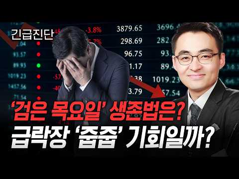
- 설명 앞부분: 📉 코스피·코스닥 매도 사이드카에 서킷브레이커까지 발동된 '검은 목요일'. 증시는 왜 급락했을까요? 염승환 이사와 함께 외국인 매도 배경부터 AI 투자 축소 우려, 창신메모리의 위협까지 짚어봤습니다. 삼성전자·SK하이닉스, 지금이 저가 매수 기회일까요? 아니면 조금 더 기다려야 할까요? 급락장 속 투자 전략을 함께 확인해 보겠습니다. 경제를 깊이 있게, 경제시그널 토크, 익스플레인 컨텐츠를 제작하는 경제시그널 콘텐츠 제작 역량을 바탕으로 기업·브랜드의 스토리를 디지털 콘텐츠에 맞는 방식으로 기획합니다. [브랜드가 찾는 콘텐츠 파트…
- 같은 채널 평소 대비 ×7.1 (채널 최근 롱폼 중앙값 19,857회) · 평소 영상: 이번 주 FOMC 시장 분기점! 금리인상 시 안도랠리 펼쳐질 역발상 섹터전략 [이권희 대… (19,857회) / 기대감 0%? 고생했던 주주들 필독! 2차전지 제약바이오 왜 반등하는지 알려드립니다 [민… (32,666회)
- 대본 없음 (설명) — 음성인식이 끝나면 도입부·흐름이 들어감
- 댓글 128/128: 좋은 점 — 영상 0 · 감사·응원 3 · 더 알고 싶은 것 0 · 아쉬운 점 — 영상 0 · 반박·불만 — 의견 다름 3 · 정치·사회 5 · 경험 공유 2 · 구독·다음 기대 0
  - 감사·응원 👍1 “염이사님감사합니다 ~”
  - 감사·응원 👍0 “염이사님 감사합니다🎉🎉🎉”
  - 반박·불만 — 의견 다름 👍32 “이 사람 말 믿고 매수했다가 수년 고생했습니다 자신만 믿고 해야지 전문가들이 전문가가 아닙니다 아무도 주식 떨어질 때는 못 믿습니다”
  - 반박·불만 — 의견 다름 👍2 “국민들 선동하는 염이사 그만하세요”
  - 정치·사회 👍9 “이 모든게 이정권의 주식시장 개입으로 인한 국민연금과 레버리지etf 의 정책 실패임. 외국인들만 좋은일 시키고 개인들과 국민연금은 어마어마한 손실을 기록할 듯.... 다신 볼 수 없는 코스피 9000...”
  - 정치·사회 👍1 “국장은 정치판 63선거위한 🚀 로켓!!! 28년 총선때 무조건 upup!!!😅😅😅😅”
  - 경험 공유 👍1 “증권사 전문가는 없음.,,,,,,,오직 이들은 매수 부추키는, 자기들 장사에 기여하기 위해, 매수 부추기는 사기꾼들임.....개인들은 스스로의 생각과 등락과 외국인따라, 그들이 사면 나도 사고, 그들이 팔면 나도 팔고....이렇게만 해야함.......증권사 전문가들은…”
  - 경험 공유 👍0 “비온후에 비가왜왔는지 나도안다 개지랄 그만해라”

### 157. 시흥 배곧 신도시의 몰락? 대출 없던 내 집 팔고 5억 빚 냈다가 4년 만에 전재산 날린 택시기사 이야기! ∣ 노후자금사연 ∣ 오디오북

- https://www.youtube.com/watch?v=Y3Fiyr3Qses · 은빛시나리오 · 구독자 29,300 · 조회수 141,473 (×4.8, 하루 820.7) · 좋아요 3,188 (2.2%) · 43.7분 · 2026-04-28 · 주제 묶음 4. 노후·연금 · 형식 사연·드라마 · 폴더 `W_Y3Fiyr3Qses` (웹 승인)
- 썸네일: 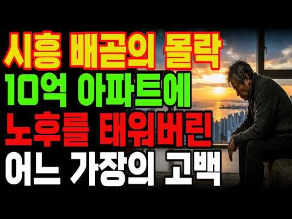
- 챕터: 0:00 인트로 · 2:00 Chapter 1. 2억짜리 내 집, 그 소박했던 천국 · 8:00 Chapter 2. "제2의 송도"라는 달콤한 유혹 · 14:00 Chapter 3. 5억 원의 족쇄, 승부수를 던지다 · 20:00 Chapter 4. 32층 바다 뷰, 신기루의 시작 · 26:00 Chapter 5. 학생들이 없는 대학로, 멈춰버린 … · 32:00 Chapter 6. 퍼펙트 스톰, 이자의 습격 · 40:00 Chapter 7. 10억이 5억으로.. 4년 만에 … · 47:00 Chapter 8. 낡은 내 집 한 채가 천국이었습니다
- 설명 앞부분: 여러분은 노후에 내 집 한 채면 충분하다고 생각하시나요? 35년을 새벽마다 핸들 잡으며 일군 대출 없는 낡은 아파트 한 채. 누가 봐도 부족하지 않은 노후였습니다. 그런데 단 한마디가 그 모든 걸 무너뜨렸어요. "가만히 있으면 손해야." 서울대 병원이 들어온다는 현수막 하나, 제2의 송도라는 말 한마디에 평생 모은 전재산 5억을 걸었습니다. 10억짜리 32층 바다 뷰 아파트. 4년 뒤, 손에 남은 건 5천만 원뿐이었습니다. 시청자 여러분께 이 영상은 실제 은퇴자들의 경험담을 바탕으로 공감과 정보 전달을 위해 각색·재구성한 이야기입…
- 같은 채널 평소 대비 ×4.5 (채널 최근 롱폼 중앙값 31,255회) · 평소 영상: 60대 이상 노후 파산자 45%? 그 숫자가 제가 될 줄 몰랐습니다. 가난한 노년의 공포! (31,255회) / 코스피 7천의 거대한 배신! 삼전닉스 안 사면 바보인가요? 70대 주식 투자자가 증권앱을… (33,672회)
- 대본 없음 (설명) — 음성인식이 끝나면 도입부·흐름이 들어감
- 댓글 512/512: 좋은 점 — 영상 2 · 감사·응원 20 · 더 알고 싶은 것 6 · 아쉬운 점 — 영상 4 · 반박·불만 — 의견 다름 11 · 정치·사회 4 · 경험 공유 17 · 구독·다음 기대 0
  - 좋은 점 — 영상 👍1 “건강하고 병들지 않았으면 괜찮지 않을까 생각됩니다. 아직 60대입니다. 예전에 2억에 팔았던 낡은 아파트 계속 살았으면 재건축 들어갈때 더한 경험 할 수도 있습니다. 차라리 60대에 낡은 아파트 팔고 배곶새아파트 과한대출로 구입해서 1억 5천 날린 경험이 이후 살아가…”
  - 좋은 점 — 영상 👍0 “잘 결정하셨어요ㆍ 공감100%입니다ㆍ”
  - 감사·응원 👍70 “착한 사람들이 이지경 대는게 가슴이 아프다 힘내시고 하루하루 열심히 사시면 복이 올겁니다”
  - 감사·응원 👍31 “희망의 끈을 놓지 마세요. 응원합니다.”
  - 더 알고 싶은 것 👍10 “무슨 아파트인지 알려주세요~ 배곧신도시 분양때부터 제가 중개했습니다~10억이면 송도 매매가였습니다~ 이분 누구인가요?”
  - 더 알고 싶은 것 👍4 “주택가에 혐오 시설인 대형 병원이 들어오면 호재가 아니고 악재인데 어떻게 집값이 오를 수 있나요?”
  - 아쉬운 점 — 영상 👍9 “욕심낼만큼 통이크지않아 주어진만큼만 살아왔더니 66세 빚없이 내집에서 아쉬움없이 사는게 얼마나다행인지 새삼느낌니다”
  - 아쉬운 점 — 영상 👍9 “대다수 한직업에 열중하다 가장 중요한 전부,전안생 거는 부동산 금융 무지에 남애기 낚시성 언론 사기꾼 전문가를 구분못하고 지릇니다 최우선에둬야할 일, 부동산 ,금융 공부입니다 세상 내다볼 상식 식견이 실패를 막아요 좋은 체험 반면교사로 삼고 화이팅하여 재기하세요”
  - 반박·불만 — 의견 다름 👍3 “ㅋㅋㅋ 개솔 10억 할때 홍보관 없었다 알지도 못하면서 소설쓰네 서울대캠퍼스는 대학이고 서울대 병원은 병원이다 뭘 알고나 해라 3억5천에 분양한걸 10억주고 입주해서 15억 된다고 이런 말도 안되는 걸 왜 만드는거야?”
  - 반박·불만 — 의견 다름 👍1 “말도 안되는 소리~”
  - 정치·사회 👍1 “거기다 뿌려진 쿠폰으로 일어나는 인플레이션도 감안하면... 소득은 작살 수준인데... 그런데도 공산주의 정권 지지하는 이상한 나라~”
  - 정치·사회 👍0 “이분들 정말 문제가 뭐였다는걸 모르시네요 잘못하거없어요 하나 기회를 잃은게 윤석열이 이 멧돼지색기 당선됫을때 그때라도 팔았어야됫음 거의 윤석열 그색기 때문인거를 나라말아쳐먹고 끔찍할수도있었겟지만 그나마 게엄 내란 실패해서 다행 멧돼지가 스스로 자폭해줘서 근리든 경제든…”
  - 경험 공유 👍75 “저도 처음에는 솔깃했는데 왠지 이게아니다싶었네요 배곧앞으로 천지개벽없는한 인구소멸지역으로 가네요”
  - 경험 공유 👍10 “무슨 아파트인지 알려주세요~ 배곧신도시 분양때부터 제가 중개했습니다~10억이면 송도 매매가였습니다~ 이분 누구인가요?”

### 158. "68세도 돈버는 부업" 월급70만원 요양사 관두고 집에서 노트북 하나로 순수익 월250만원 버는 68살

- https://www.youtube.com/watch?v=pZ7fCdoOvCI · 록터뷰 · 구독자 35,600 · 조회수 170,634 (×4.8, 하루 1,624.3) · 좋아요 3,384 (2.0%) · 7.8분 · 2026-07-05 · 주제 묶음 8. 부업·소득 · 형식 인터뷰·강연·대담 · 폴더 `W_pZ7fCdoOvCI` (웹 승인)
- 썸네일: 
- 설명 앞부분: 신청하시고 댓글 달아주시는 모든 분들께 제공드립니다! 나이도, 경험도 상관없습니다. 재고 없이, 초기 자본 없이 시작하는 온라인 판매 노하우를 무료 라이브에서 공개합니다. 💬 "온라인 판매는 한 번도 안 해봤는데 괜찮을까요?" 💬 "어떻게 진행하면 될까요?" 💬 "아무것도 몰라도 수익낼 수 있을까요?" 이런 고민이 있으셨다면 이번 무료 라이브에서 모두 알려드립니다. 🎁 무료 라이브 신청만 해도 전원 제공! 📕 사업 시작하는 방법 처음부터 끝까지 📕 집에서 10분이면 끝나는 판매 준비법 📕 돈 버는 온라인 판매 세팅 방법 📘 재고 …
- 같은 채널 평소 대비 ×63.0 (채널 최근 롱폼 중앙값 2,709회) · 평소 영상: "정말 너무 쉬워요" 백화점 판매원 하면서 휴대폰 하나로 부업하고 월급 받는 65세 어머님 (2,709회) / "이거 못하면 다른 부업 아무것도 못해요" 아이 둘 키우며 노트북 하나로 하루 2시간 일… (2,818회)
- 대본 없음 (설명) — 음성인식이 끝나면 도입부·흐름이 들어감
- 댓글 1,602/1,603: 좋은 점 — 영상 36 · 감사·응원 104 · 더 알고 싶은 것 75 · 아쉬운 점 — 영상 1 · 반박·불만 — 의견 다름 2 · 정치·사회 1 · 경험 공유 311 · 구독·다음 기대 18
  - 좋은 점 — 영상 👍9 “구독합니다. 저도 신청할게요. 오랜 경력단절로 무기력하고 자존감도 떨어졌는데.. 좋은 정보 얻었어요.”
  - 좋은 점 — 영상 👍1 “좋은정보 감사드립니다 저도 하고싶습니다”
  - 감사·응원 👍10 “신청합니다❤감사합니다!”
  - 감사·응원 👍8 “구독합니다. 저도 참여하고 싶습니다 정보 감사합니다🎉🎉😢”
  - 더 알고 싶은 것 👍6 “안녕하세요 배워 보고 싶어요 책자 부탁드립니다 감사합니다”
  - 더 알고 싶은 것 👍2 “구독.좋아요 했습니다. ㅎㅎ 무료자료와 링크 부탁드려요”
  - 아쉬운 점 — 영상 👍0 “안녕하세요 저도 요양사 근무하다 동료의 부주의 로 손가락 끝 닷쳐 산재처리 했다는 이유로 원장님의 부당한 차별 근무표로 그만 두게되었어요 현재는 학교 근무하는데 옛날 학교여서 너무 커서 근무 동선 길어서 무릅에 무리가 와서 힘든데 그래도 놓지못하고 하고있었어요 저도 …”
  - 반박·불만 — 의견 다름 👍2 “아무나 하는것 아닙니다 어려워요-”
  - 반박·불만 — 의견 다름 👍1 “바다님입니다~방송보고책을구입햇는데요~~제가원하는내용아닙니다”
  - 정치·사회 👍0 “요양보호사는 가정부다 가정부는 어른신모욕은안하는데.가정부보다 더러운직업이다 사람잘못만나면”
  - 경험 공유 👍21 “안녕하세요 신청합니다 현재 저도 요양사 자격증을 따서 시어머님을 모시는 가족요양사로 일하고 있는 며느리입니다 우연찮게 영상 보게되어 운이 좋다고 생각하고 배워보고 싶어 댓글 남깁니다 기회를 주시면 열심히 해보겠습니다”
  - 경험 공유 👍9 “구독합니다. 저도 신청할게요. 오랜 경력단절로 무기력하고 자존감도 떨어졌는데.. 좋은 정보 얻었어요.”
  - 구독·다음 기대 👍9 “구독합니다. 저도 신청할게요. 오랜 경력단절로 무기력하고 자존감도 떨어졌는데.. 좋은 정보 얻었어요.”
  - 구독·다음 기대 👍8 “구독합니다. 저도 참여하고 싶습니다 정보 감사합니다🎉🎉😢”

### 159. 경제공부 시작하는 법 ∣ 하루 10분이면 됩니다! (해야하는 이유) 🗞️ 📊 💸

- https://www.youtube.com/watch?v=z7fHe2Og-zE · 찌니ZZINI · 구독자 30,600 · 조회수 144,204 (×4.7, 하루 857.5) · 좋아요 0 (0.0%) · 17.5분 · 2026-05-03 · 주제 묶음 1. 재테크 일반·마인드 · 형식 정보·해설 (그 밖) · 폴더 `W_z7fHe2Og-zE` (웹 승인)
- 썸네일: 
- 챕터: 0:00 영상시작 · 0:12 경제공부 하는 이유? · 2:56 어피니 머니레터 · 5:24 매일경제신문 · 13:42 유튜브/팟캐스트 · 14:18 경제책 · 16:10 디그 · 16:44 마무리
- 설명 앞부분: 다이어리는 meeplus에서 제공받아 촬영되었습니다. 🔻다이어리 + 속지 어느덧 매일경제신문을 읽은지 1년이 다되어가네요 ! 꾸준히 10분씩만 하자였는데 1년을 하게 되었어요 경제공부를 해야하는 이유 투자, 부동산매매가 아니더라도 제가 느낀 이유가 있었어요. 하루 10분만 투자하기 초보자도 누구나 가능 ! 누구나 쉽게 할수있게 제가 정리를 했어요. 영상으로 만들었으니 재미있게 봐주세요 🙂
- 같은 채널 평소 대비 ×9.1 (채널 최근 롱폼 중앙값 15,902회) · 평소 영상: 📓 요즘 내가 좋아하는 다이어리, 모텀 ∣ 프로퍼빌롱잉즈 단테 1달 써봤다! (15,902회) / Vlog ∣ 다이어리 그만좀 사 ∣ 한정선 맛있나..❓∣ 모닝페이지, 경제공부 ∣ 양귀자… (14,843회)
- 대본 없음 (설명) — 음성인식이 끝나면 도입부·흐름이 들어감
- 댓글 147/147: 좋은 점 — 영상 11 · 감사·응원 22 · 더 알고 싶은 것 14 · 아쉬운 점 — 영상 1 · 반박·불만 — 의견 다름 0 · 정치·사회 1 · 경험 공유 6 · 구독·다음 기대 3
  - 좋은 점 — 영상 👍311 “신문사에서 가장 중요하게 생각하는 페이지의 순서는 1> 3면이라고 합니다. 그래서 1면의 심층기사가 3면에 계속되는게 보통이라고 들었습니다. 저는 1,3,world,market 섹션은 꼭 읽고 나머지는 시간이 되면 읽는 편입니다. 못읽는날도 스트레스 없이 그냥 넘기고…”
  - 좋은 점 — 영상 👍111 “안녕하세요 늘 영상 잘 보고 있습니다^^ 하나 꿀팁 드리면 press reader 앱 사용하면 매일경제신문 무료로 읽는거 가능합니다 다른 신문도 볼 수 있어요 저는 제가 졸업한 대학교 이메일 계정으로 이용 중이에요^^ 저도 경제공부 열심히 해봐야겠어요 큰 도움 되는 …”
  - 감사·응원 👍111 “안녕하세요 늘 영상 잘 보고 있습니다^^ 하나 꿀팁 드리면 press reader 앱 사용하면 매일경제신문 무료로 읽는거 가능합니다 다른 신문도 볼 수 있어요 저는 제가 졸업한 대학교 이메일 계정으로 이용 중이에요^^ 저도 경제공부 열심히 해봐야겠어요 큰 도움 되는 …”
  - 감사·응원 👍69 “경제 공부 시작하려고 했는데 이렇게 좋은 타이밍에 좋은 영상을 발견했네요! 귀한 정보 알려주셔서 너무 감사하고 참고해서 열심히 공부해보겠습니다!!”
  - 더 알고 싶은 것 👍5 “정말 세세하네요 신문 보기 시작하는데 어떻게 봐야하는지 몰라서 매번 중간 포기했는데 너무 좋은거같아요! 궁금한점은 하루 몇시간 투자해서 공부하시나요? 저는 아침에유튜브로 한경을 보고 머니레터만 보고있는데 확 공부가 된다는 느낌이 없네요😢”
  - 더 알고 싶은 것 👍3 “저는 해외에 살아서 추천해주신 신문들은 못봐서 여기신문으로 시작할려고 하는데 질문있어요. 모르는 경제용어같은건 어떤식으로 배우시나요? 경제에 대해서 1도 몰라서 처음에는 가볍게 시작하고 싶은데 처음부터 너무 깊이 들어갈까하는 고민이있어요. 그리고 읽어도 뉴스의 흐름을…”
  - 아쉬운 점 — 영상 👍311 “신문사에서 가장 중요하게 생각하는 페이지의 순서는 1> 3면이라고 합니다. 그래서 1면의 심층기사가 3면에 계속되는게 보통이라고 들었습니다. 저는 1,3,world,market 섹션은 꼭 읽고 나머지는 시간이 되면 읽는 편입니다. 못읽는날도 스트레스 없이 그냥 넘기고…”
  - 경험 공유 👍311 “신문사에서 가장 중요하게 생각하는 페이지의 순서는 1> 3면이라고 합니다. 그래서 1면의 심층기사가 3면에 계속되는게 보통이라고 들었습니다. 저는 1,3,world,market 섹션은 꼭 읽고 나머지는 시간이 되면 읽는 편입니다. 못읽는날도 스트레스 없이 그냥 넘기고…”
  - 경험 공유 👍111 “안녕하세요 늘 영상 잘 보고 있습니다^^ 하나 꿀팁 드리면 press reader 앱 사용하면 매일경제신문 무료로 읽는거 가능합니다 다른 신문도 볼 수 있어요 저는 제가 졸업한 대학교 이메일 계정으로 이용 중이에요^^ 저도 경제공부 열심히 해봐야겠어요 큰 도움 되는 …”
  - 구독·다음 기대 👍2 “경제 공부 시작하는 법이라니 어떻게 해야 하는지 궁금하네요 입술에 피어싱을 하셧다니...놀랍네요 주변에 입술 피어싱 한분을 한분도 못봤다 보니 더 신기하고 놀라워요 경제 공부를 시작하신 이유가 더 현실적으로 와 닿네요 내 월급은 조금뿐이 안 올렸는데 계란값만 3배라니…”
  - 구독·다음 기대 👍1 “이 영상으로 처음 뵙는데 구독하고 갈게요! 이북리더기 탐나네요,ㅎㅎㅋㅋㅋ 원래 쓰던게 고장나서 새로 사야하나싶었는데,,,, 어디꺼쓰시나요?! 이뻐서 따라사고싶어용 ㅎㅎ”

### 160. 우리 부모님 유산 탐내다 노후 자금 탈탈 털린 시어머니, 전과자에 신용불량자까지 세트로 만들어드림

- https://www.youtube.com/watch?v=5c7V1i5q_xc · 리얼톡툰 · 구독자 15,400 · 조회수 71,334 (×4.6, 하루 498.2) · 좋아요 473 (0.7%) · 9.8분 · 2026-05-28 · 주제 묶음 4. 노후·연금 · 형식 사연·드라마 · 폴더 `W_5c7V1i5q_xc` (웹 승인)
- 썸네일: 
- 설명 앞부분: 우리 부모님 유산 탐내다 노후 자금 탈탈 털린 시어머니, 전과자에 신용불량자까지 세트로 만들어드림 ★리얼톡툰의 영상의 소재들은 인터넷속 '실화'를 각색하거나 '창작'으로 제작 됩니다. 본채널의 동의 없이 영상을 불법다운로드, 복제, 재편집, 재배포 하는 행위는 금지하며, 민형사상의 법적 조치를 취하고 있음을 알려드립니다.
- 같은 채널 평소 대비 ×1.5 (채널 최근 롱폼 중앙값 48,314회) · 평소 영상: 우리집 베이비시터가 남편의 전여친이었다... (48,314회) / [모음집] 음주운전 범죄자랑 장례식장에서 눈 맞은 역대급 남미새 (49,298회)
- 대본 없음 (설명) — 음성인식이 끝나면 도입부·흐름이 들어감
- 댓글 19/19: 좋은 점 — 영상 0 · 감사·응원 0 · 더 알고 싶은 것 0 · 아쉬운 점 — 영상 0 · 반박·불만 — 의견 다름 1 · 정치·사회 0 · 경험 공유 0 · 구독·다음 기대 0
  - 반박·불만 — 의견 다름 👍0 “사돈집 재산을 왜 탐을 낸다요 말도 안되짓을 하네요”

