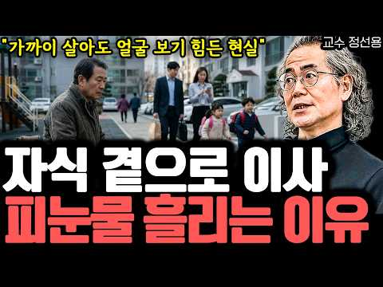

# 재테크 — 성공 사례 분석: 사례별 자세히 #161–#200

`analysis.md` 의 9번 (같은 # 번호). 자동 생성 — `tools/success_analysis.py` v1.5.1 (2026-10-23 07:34 UTC). ※ 연구·교육용 — 투자 권유가 아님.

### 161. "절대 자식 곁으로 이사 가지 마세요" 노후에 피눈물 흘리며 후회하는 진짜 이유 I 교수 정선용 (2부)

- https://www.youtube.com/watch?v=48I2AB2GXF0 · 퇴평성대 · 구독자 24,800 · 조회수 261,403 (×10.5, 하루 2,043.3) · 좋아요 2,852 (1.1%) · 15.7분 · 2026-06-17 · 주제 묶음 4. 노후·연금 · 형식 인터뷰·강연·대담 · 폴더 `W_48I2AB2GXF0` (웹 승인)
- 썸네일: 
- 설명 앞부분: 🎁 달리고 읽고 쓰는 사람의 하이, 정선용 진솔하게 자신의 경험을 나눠주신 선생님께 감사의 말씀을 드립니다. 선생님의 경험과 지식이 많은 분들에게 도움이 되었으면 좋겠습니다.
- 같은 채널 평소 대비 ×29.4 (채널 최근 롱폼 중앙값 8,880회) · 평소 영상: "결국엔 이곳으로 다 돌아옵니다" 퇴직 후 서울 떠난 50대가 깨달은 노후 주거지의 비밀… (8,880회) / 대기업 임원 출신도 100% 후회하는 '퇴직 후 최악의 행동' 3가지 I 교수 정선용 (… (9,299회)
- 대본 없음 (설명) — 음성인식이 끝나면 도입부·흐름이 들어감
- 댓글 432/432: 좋은 점 — 영상 23 · 감사·응원 11 · 더 알고 싶은 것 1 · 아쉬운 점 — 영상 3 · 반박·불만 — 의견 다름 8 · 정치·사회 1 · 경험 공유 60 · 구독·다음 기대 0
  - 좋은 점 — 영상 👍501 “많이 공감합니다 남편이 결혼한 아들 딸이 있는 경기도로 이사가고 싶어하는데 내가 생각을 바꾸도록 설득 중입니다 편하고 익숙한 곳에서 노후를 보내자고, 자식들은 저희들끼리 잘 살고 우리는 우리끼리 잘 살자고..”
  - 좋은 점 — 영상 👍93 “가까이 살되 자주 보지않는다. 서로 도움이 필요할 때만 만나는걸로.”
  - 감사·응원 👍5 “나한테 손 안벌리고 독립해서 잘 살면 자식한테 감사한거지 왜 그렇게 옆에 붙어 살려고 하는지.. 경제적으로 능력없어 생활비 지원을 30년 넘게 해드리는데도 자식하고 살고싶어하는 모습보면 숨이 턱턱 막힌다 부모부양해가며 나도 내가정 꾸리고 내자식 키우는거 쉽지않은데 나…”
  - 감사·응원 👍4 “'친구없이 사는 삶이 더 행복한 이유' 100% 공감합니다!!! 아직은 젊은 50대에 이런 귀한 깨달음과 용기와 결단력을 주셔 살아가게하심에 감사하고 있습니다. 저의 행복의 비결은 가지치기와 힘빼기였습니다. 운동,일,집 이렇게 단순해진 삶이 그 어느때보다 행복하고 머…”
  - 아쉬운 점 — 영상 👍2 “사람관계는 부모와 자식, 부부, 형재간 찬구간등 모든관계는 거리를 일정정도 가져야한다고 생각한다. 그래야 그 관계가 오래간다”
  - 아쉬운 점 — 영상 👍1 “부모가 편안하면 멀든 가깝든 자식이 알아서 찾아가더라고요 저는 그걸 남편 보고 배웠어요 부럽고 부럽더라고요 우리엄마도 저 반만큼만 편안하게 해줬으면 정말 잘해드리고 살 수 있었을텐데 하는 아쉬움과 부모곁에 없어야만 편한 내 자신에 대한 서러움과 죄책감이 같이 듭니다.…”
  - 반박·불만 — 의견 다름 👍1 “부모는 대단한 것 바라는것 아닙니다 자녀가 부모에게 전화나 문자로 안부를 묻는것이 오늘날 최고의 효도입니다”
  - 반박·불만 — 의견 다름 👍1 “자식곁으로 가는게 자식들한테 의지하러 가는게 아닙니다 자식들도 부모님 한번씩 뵈러가려면 너무멀면 힘듭니다 옆단지 아파트로 이사했는데 나름취미생활 하느라 애들 생각도 안납니다 자식들관계도 지혜롭게 .......”
  - 정치·사회 👍1 “자식에게 너무 많은것을 기대해서 그런거죠. 기대하는게 없다면, 가까이살던 말던 큰 상관없죠. 외국인들은 나이가 많이 들면 자식근처로 이사 많이 가요. 외국인들은 자식들과 잘 지내며 살더라고요. 자식들도 부모를 잘 살피고요. 유독 한국 사람들은 다 큰 성인 자식들까지도…”
  - 경험 공유 👍501 “많이 공감합니다 남편이 결혼한 아들 딸이 있는 경기도로 이사가고 싶어하는데 내가 생각을 바꾸도록 설득 중입니다 편하고 익숙한 곳에서 노후를 보내자고, 자식들은 저희들끼리 잘 살고 우리는 우리끼리 잘 살자고..”
  - 경험 공유 👍184 “혼자라고 느끼는것은 착각이에요. 자연이 친구이고 내가 내 친구죠(수십조의 세포들과 함께). 자연과 세상과 모두 연결되어 있구요.”

### 162. [원가공개] 100만 유튜버, 한달에 얼마 벌까?

- https://www.youtube.com/watch?v=HSAB2xHXtiQ · 원가 공개 경제학 · 구독자 40,800 · 조회수 426,746 (×10.5, 하루 3,841.6) · 좋아요 6,763 (1.6%) · 26.1분 · 2026-07-04 · 주제 묶음 기타 · 형식 정보·해설 (그 밖) · 폴더 `W_HSAB2xHXtiQ` (웹 승인)
- 썸네일: 
- 챕터: 0:00 인트로 — 구독자 100만이 통장에 찍히는 진짜 숫자… · 0:58 유튜버 수익의 6가지 파이프 — 수수료율이 전부 다르다 · 6:24 CPM vs RPM — 왜 항상 RPM이 더 낮은가 · 7:06 RPM 실감 계산 — 금융 채널 기준 100만 뷰 =… · 8:10 시청자 국가의 함정 — 미국 1명 = 인도네시아 6명 · 9:17 포브스코리아 1위 채널이 돈 버는 방식 · 10:09 노란딱지의 구조 — AI 봇이 수익을 막는 이유 · 10:50 쇼츠의 민낯 — 115만 구독자 채널의 쇼츠 수익이 … · 12:19 세금 두 단계 — 미국 원천세 + 국내 종합소득세 · 15:01 고정비 해부 — 혼자 vs 팀, 월 200만 원 vs… · 16:50 PPL 단가 공개 — 단순 노출 750만 원, 브랜디… · 18:59 케이스 1 · 2 · 3 실계산 — 같은 100만 구… · 26:04 플랫폼 비교 — 유튜브 vs SOOP vs 치지직 수… · 27:52 유튜브 수익 집중의 진짜 구조 — 상위 1%가 52배… · 29:49 마무리 — 조회수는 명함, PPL이 월급, 세금이 현실
- 설명 앞부분: [타임라인] [연관 검색어] 유튜버 수익 구조 실제로 얼마나 버는지 유튜브 수수료 크리에이터 수익 배분 비율 유튜버 고정비 스튜디오 직원 운영비 현실 유튜브 미국 원천세 종합소득세 신고 방법 유튜버 개인사업자 법인 전환 세금 절세 비교 쇼츠 수익 롱폼 비교 실제 얼마나 차이나는지 유튜버 수익 불평등 상위 1% 수입 격차 얼마 [해시태그]
- 같은 채널 평소 대비 ×29.6 (채널 최근 롱폼 중앙값 14,413회) · 평소 영상: [원가공개] 대부업체는 1년에 얼마나 버나? 대부업체는 고리대금으로 떼돈 번다? (11,987회) / [원가공개] 우리동네 새마을금고 이사장은 얼마 받나? (19,570회)
- 대본 없음 (설명) — 음성인식이 끝나면 도입부·흐름이 들어감
- 댓글 125/125: 좋은 점 — 영상 1 · 감사·응원 2 · 더 알고 싶은 것 5 · 아쉬운 점 — 영상 5 · 반박·불만 — 의견 다름 3 · 정치·사회 3 · 경험 공유 3 · 구독·다음 기대 0
  - 좋은 점 — 영상 👍0 “유투버 수입 관련 잘 배우고 갑니다. 구독과 좋아요 눌렀구요. 저는 이제 유튭 시작한 햇병아리 입니다. 오늘 홍콩 식당의 변검쇼 공연 업로드 했어요. 선배님들도 놀러 오셈 😂”
  - 감사·응원 👍13 “감사합니다.”
  - 감사·응원 👍11 “자세한. 내용. 감사합니다”
  - 더 알고 싶은 것 👍14 “정말🍀궁금해요🍀”
  - 더 알고 싶은 것 👍4 “1.25배속 시청이 딱 좋네요 시청 배속별로 수익이 다른가 궁금합니다”
  - 아쉬운 점 — 영상 👍3 “이 AI목소리는 여기나 저기나 좀 싫증난다.”
  - 아쉬운 점 — 영상 👍1 “왜 이렇게 길어 핵심만 말해 ...숏츠도 긴데 .....”
  - 반박·불만 — 의견 다름 👍0 “좀 틀린게 있는데요. 언어없는 해외시청자 기반으로 하는 채널들은 한국보다 단가가 낮을수밖에 없습니다. 조금 낮은게 아니라 5분의1 10분의1 수준입니다. 해외채널하면서 기대하는바는 캐나다, 미국, 호주 등 단가가 높은 나라에 시청이지만 사실상 시청자 비율이 동남아, …”
  - 반박·불만 — 의견 다름 👍0 “다른 수치는 그런가보다 하고 봐야겠는데 한가지는 말도 안되는 오류로 보이는군요. 115만 유튜버가 공개했다는 내용 중에 '250평 짜리 전용 스튜디오'.....ㅎ”
  - 정치·사회 👍0 “1. 유튜버의 6가지 수익 파이프라인과 유튜브 수수료 구조 [01:07] 6가지 수익원 개요 유튜버의 수익원은 단순히 조회수 광고 하나가 아니라 총 6개로 쪼개지며, 각 파이프라인마다 유튜브가 가져가는 수수료율이 다릅니다. [01:20] ① 롱폼 영상 조회수 광고 수…”
  - 경험 공유 👍7 “유트브해봤자 돈못번다”
  - 경험 공유 👍3 “내가 알기로는 구독자수보다 조회수가 더 중요한걸로 알고잇음 물론 머 몃십만 몃백만대면 그외 방송출연 이런걸로 돈을 더버는 사람들도만음 노래 채널은 거의 못번다고 하던댕 저작권료로 다 가져가서 암튼 구독자수 만으면 나쁜건 업지 구독자수 만으면 사람들이.알아주고 그만큼 …”

### 163. # "같은 ETF도 통장 잘못 고르면 손해" 직장인 배당 ETF TOP 3 + 1 통장 매칭 가이드, 배당금 TOP3 골라드립니다

- https://www.youtube.com/watch?v=LHUIFXJ3eAs · 머니톡 마니업 · 구독자 1,080 · 조회수 10,995 (×10.2, 하루 66.9) · 좋아요 199 (1.8%) · 15.1분 · 2026-05-11 · 주제 묶음 3. 주식·ETF · 형식 정보·해설 (그 밖) · 폴더 `W_LHUIFXJ3eAs` (웹 승인)
- 썸네일: 
- 설명 앞부분: "같은 ETF도 통장 잘못 고르면 손해" 직장인 배당 ETF TOP 3 + 1 통장 매칭 가이드 ETF 잘 골라도, 통장 잘못 고르면 결국 세금에서 손해 봅니다. 같은 종목인데, 어느 통장에 담느냐에 따라 1년에 100만원대가 살아남기도 사라지기도 해요. 종목 추천만 받고 통장은 그냥 둔다면, 사실 절반만 받은 셈입니다. 이 영상은 한국 직장인이 진짜 받아야 할 배당 ETF TOP 3에 보너스 한 종목까지, 각각 어느 통장에 담아야 정답인지를 매칭표로 풀어드립니다. 일반계좌, ISA, 연금저축이나 IRP, 미국 직투 계좌 — 네 …
- 같은 채널 평소 대비 ×20.3 (채널 최근 롱폼 중앙값 542회) · 평소 영상: "5천만 원이 첫 열매입니다" 통장에 5천이 찍히는 순간 보이는 세계가 달라지는 다섯 가… (542회) / 5천만원으로 진짜 은퇴가능한가요 (511회)
- 대본 없음 (설명) — 음성인식이 끝나면 도입부·흐름이 들어감
- 댓글 10/10: 좋은 점 — 영상 0 · 감사·응원 2 · 더 알고 싶은 것 0 · 아쉬운 점 — 영상 1 · 반박·불만 — 의견 다름 0 · 정치·사회 0 · 경험 공유 0 · 구독·다음 기대 0
  - 아쉬운 점 — 영상 👍0 “유튜브에 올리는 목소리는 AI겠지만 자료 조사는 하고 올리는 것일텐데 자료 조사도 제대로 해보지 않고 옛날 자료 그대로 복사+붙여넣기 하시는거 같아서 실망스럽습니다 07:50 TIGER plus미국배당7퍼센트프리미엄다우존스 종목코드 458760 ETF에 이름이 TIG…”

### 164. 팩트 체크 ! 연금, 금융소득 있을 때 진짜 받는 돈, 현실 총정리!

- https://www.youtube.com/watch?v=Lk0CkUkrevY · 리클래스 · 구독자 3,710 · 조회수 36,340 (×9.8, 하루 3,289.4) · 좋아요 95 (0.3%) · 11.6분 · 2026-10-12 · 주제 묶음 4. 노후·연금 · 형식 정보·해설 (그 밖) · 폴더 `W_Lk0CkUkrevY` (웹 승인)
- 썸네일: 
- 설명 앞부분: 행복한 은퇴를 꿈꾸지만, 은퇴 후 날아올 세금과 건강보험료 고지서 때문에 걱정이 많으시죠? "은퇴하고 내 집 한 채 있으면 건보료 폭탄 맞는다", "연금 받으면 소득세 많이 낸다" 등 카더라 소문은 많지만 도대체 내가 정확히 얼마를 내야 하는지 답답하셨을 겁니다. 은퇴 후 연금소득(국민연금, 공무원연금 등)과 금융소득(이자, 배당금)이 있을 때 소득세와 건강보험료는 과연 얼마나 나올까요? 집을 보유하고 있다면 정말 폭탄 수준일까요? 그 궁금증을 오늘 영상으로 깔끔하게 풀어드립니다! 공적연금소득과 금융소득, 그리고 보유 주택(재산)…
- 같은 채널 평소 대비 ×18.7 (채널 최근 롱폼 중앙값 1,946회) · 평소 영상: 절세 3총사 계좌(연금저축, IRP, ISA), 아직도 아무 ETF나 담고 계신가요? (2,011회) / 소득있어 국민연금 깍이는 것보다 더 무서운 '이것' (2,692회)
- 대본 없음 (설명) — 음성인식이 끝나면 도입부·흐름이 들어감
- 댓글 11/11: 좋은 점 — 영상 0 · 감사·응원 3 · 더 알고 싶은 것 2 · 아쉬운 점 — 영상 0 · 반박·불만 — 의견 다름 0 · 정치·사회 0 · 경험 공유 2 · 구독·다음 기대 0
  - 감사·응원 👍1 “동영상 감사히 잘보고있습니다.. 다주택(3주택)일 경우 건보료 계산하는 예시도 볼수있을까요? 은퇴가 몇달후라서요 ㅠ”
  - 더 알고 싶은 것 👍1 “동영상 감사히 잘보고있습니다.. 다주택(3주택)일 경우 건보료 계산하는 예시도 볼수있을까요? 은퇴가 몇달후라서요 ㅠ”
  - 더 알고 싶은 것 👍0 “안녕하세요 매번 잘 챙겨보는 구독자 입니다 저는 소득세를 대략 얼마나 내게 될까요 궁금해서 여쭈어 봅니다 연금 소득 3600 근로 소득 2640 임대 소득 2600 이 있습니다 대략적인것만부탁드리고 대략알고 이후 표ㅡ구입하여 하겠습니다 저도 아직 퇴직 전이라 그렇습니…”
  - 경험 공유 👍1 “지역가입자는 금융소득 1천만 원 넘는 순간 전체가 건보료에 잡힌다니, 저도 배당 받을 때 그 선부터 봐야겠어요.”
  - 경험 공유 👍0 “안녕하세요 매번 잘 챙겨보는 구독자 입니다 저는 소득세를 대략 얼마나 내게 될까요 궁금해서 여쭈어 봅니다 연금 소득 3600 근로 소득 2640 임대 소득 2600 이 있습니다 대략적인것만부탁드리고 대략알고 이후 표ㅡ구입하여 하겠습니다 저도 아직 퇴직 전이라 그렇습니…”

### 165. "우리나라 현 정부 얼마 안남았어" 명문대 엘리트 코스 33년차 교수는 연금을 얼마나 받을까?

- https://www.youtube.com/watch?v=IAFVinxTAbQ · 할티비 · 구독자 41,800 · 조회수 399,043 (×9.6, 하루 9,747.0) · 좋아요 7,043 (1.8%) · 11.9분 · 2026-09-12 · 주제 묶음 4. 노후·연금 · 형식 정보·해설 (그 밖) · 폴더 `W_IAFVinxTAbQ` (웹 승인)
- 썸네일: 
- 설명 앞부분: 🦭 노르웨이 자연산 하프물범 오메가3 (셀올예) 나이 들수록 신경 쓰이는 혈행·뼈 건강, 미리 챙기세요. 노르웨이에서 35년간 만들어 온 씰오일 오메가3입니다. 안녕하세요, 여러분의 현실적인 노후 준비를 돕는 [할티비]입니다. 🎤 연세대학 출신 33년차 교수는 연금을 얼마나 받을까? 대한민국 시니어들이 직접 겪고 있는 생생하고도 충격적인 노후 현실을 영상을 통해 직접 확인해 보세요! 오늘 영상이 노후 준비에 대해 다시 한번 생각해보는 계기가 되셨다면, 여러분의 연금 준비 상황이나 노후에 대한 생각도 댓글로 자유롭게 남겨주세요. 언…
- 같은 채널 평소 대비 ×19.5 (채널 최근 롱폼 중앙값 20,426회) · 평소 영상: "광주 사람인데 전라도가 싫어" 5.18 민주화 운동 겪은 국립대학 출신 어르신은 연금을… (18,947회) / "은퇴하고 연금 받으면 생활이 안돼" 79살 어르신이 기능사 시험 준비하면서 재취업 원하… (15,662회)
- 대본 없음 (설명) — 음성인식이 끝나면 도입부·흐름이 들어감
- 댓글 1,047/1,095: 좋은 점 — 영상 87 · 감사·응원 71 · 더 알고 싶은 것 5 · 아쉬운 점 — 영상 4 · 반박·불만 — 의견 다름 11 · 정치·사회 266 · 경험 공유 40 · 구독·다음 기대 0
  - 좋은 점 — 영상 👍261 “구구절절 맞는 말씀 감사합니다 모든 세대가 정신 똑바로 차려야 합니다 대한민국 지켜야지요.. 어떻게 일군 나라인데... ㅠㅠ”
  - 좋은 점 — 영상 👍229 “구구절절 옳은말씀 틀린게 하나도 없네요”
  - 감사·응원 👍261 “구구절절 맞는 말씀 감사합니다 모든 세대가 정신 똑바로 차려야 합니다 대한민국 지켜야지요.. 어떻게 일군 나라인데... ㅠㅠ”
  - 감사·응원 👍240 “맞습니다. 훌륭하세요. 진짜 깨어있는 의견 감사합니다😊”
  - 더 알고 싶은 것 👍6 “선관위가 투표하고 따로 지들 마음대로 투표자수 지들 마음대로 기입하는 나라인데 그 실제 표는 어떻게 맞출었을까요? 빠빳한 그 표일까요? 그럼 그 기표는 지들 마음대로 1번을 하든지 2번을 하든지 국민들의 실제 투표행위와 지들이 기입하는 것하고 씽크 일치가 안 되는데 …”
  - 더 알고 싶은 것 👍1 “교수님말씀 100%동감합니다 체력이따라준다면 지금이라도강단에서 후대를위하여강의를해주시면감사하겠습니다”
  - 아쉬운 점 — 영상 👍4 “한국에서 후진국부터 겪어오신 인생 선배는 보는 눈이 다르지, 예전에 일제를 겪은 어느 분은 자신들을 아사 상태에서 보리밥이라도 먹을 수 있게 구해준 일본에게 고맙다고 해서 그때는 이해를 못했는데, 바다낚시를 하다가 풍랑으로 무인도에 고립되어 사흘을 굶어보고 나니 그 …”
  - 아쉬운 점 — 영상 👍0 “넋빠진 사람... 박정희가 한국을 근대화 하는 자금의 출처가 가장 중요하다. 미국의 기획하에 식민지배 받고 수탈당한 보상금 1965년 한일수교로 현금1억달러 물자보상2억달러 .. 그 돈으로 경부고속도로, 포항제철 , 새마을사업 등을 산업인프라 조성하였음을 알지 못하고…”
  - 반박·불만 — 의견 다름 👍136 “그때는 옳고 현재는 틀렸다. 역사가 어떻게 증명할지 기대 됩니다. 그때는 내주머니에 돈채워주던때 지금은 내주머니 돈 뺏어가던때”
  - 반박·불만 — 의견 다름 👍1 “유럽권의 교사들은 항상 " 내 말을 그대로 믿지마라"는 말을 습관적으로 한다. 즉, 유럽권은 비판의식을 매우 중요하게 생각한다. 소크라테스의 " 너 자신을 알라, 데카르트의 나는 생각한다. 고로 존재한다. 등은 모두 비판적 사고를 강조하는 말들이다. 50세대는 주입식…”
  - 정치·사회 👍273 “이렇게 공감이 가고 속 시원한 영상 정말 간만에 봅니다. 어렵게 만든 이나라를 망치는 이재명 같은 놈은 내쳐야지요.”
  - 정치·사회 👍85 “재명이는 자기 변호해준 놈들 다 앉혀놨지 그러니 나라가 제대로 들아가겠어”
  - 경험 공유 👍350 “제가 생각하고 말하고 알고있는 것과 100%일치합니다.”
  - 경험 공유 👍146 “제가하고 싶은말을 전부 다해주셔서 넘 감사합니다”

### 166. 【성철스님】 부자가 되려면 절대 이 색깔 옷은 입지 마세요! 재물운이 달아납니다 ㅣ돈복 부르는 옷 색깔 ㅣ재물운 상승 풍수 ㅣ돈복 들어오는 색깔 ㅣ부자 되는 풍…

- https://www.youtube.com/watch?v=Ld78QoSYFrk · 행복한 노후연구소 · 구독자 11,200 · 조회수 106,855 (×9.5, 하루 9,548.8) · 좋아요 1,243 (1.2%) · 56.1분 · 2026-10-12 · 주제 묶음 1. 재테크 일반·마인드 · 형식 정보·해설 (그 밖) · 폴더 `W_Ld78QoSYFrk` (웹 승인)
- 썸네일: 
- 설명 앞부분: 【성철스님】 부자가 되려면 절대 입지 말아야 할 옷 색깔이 있을까요? 재물운이 달아난다고 전해지는 색깔부터 돈복을 부르는 색깔까지, 오늘은 전통 풍수에서 바라보는 옷 색깔의 의미와 부자 되는 풍수 비법을 함께 알아봅니다. 평소 아무 생각 없이 선택했던 옷 색깔에도 전통문화 속에서는 다양한 상징과 의미가 담겨 있다고 합니다. 그렇다면 돈복 들어오는 색깔은 무엇이며, 재물운 상승과 관련해 어떤 풍수 이야기가 전해져 왔을까요? 이번 영상에서는 돈복 부르는 옷 색깔, 재물운 상승 풍수, 행운의 색깔, 부자 되는 풍수 비법을 주제로 전통적…
- 같은 채널 평소 대비 ×6.6 (채널 최근 롱폼 중앙값 16,255회) · 평소 영상: 【성철스님】 10월 3일 이날, '이것'만은 절대 하지마세요, 금전운 사라집니다ㅣ개천절에… (16,255회) / 【성철스님】 입던 옷 버릴때 '이것' 모르고 버리면 큰일납니다! 잘못 버렸다간 금전운 달… (15,671회)
- 대본 없음 (설명) — 음성인식이 끝나면 도입부·흐름이 들어감
- 댓글 366/366: 좋은 점 — 영상 0 · 감사·응원 73 · 더 알고 싶은 것 2 · 아쉬운 점 — 영상 0 · 반박·불만 — 의견 다름 0 · 정치·사회 0 · 경험 공유 2 · 구독·다음 기대 0
  - 감사·응원 👍6 “금전운 받아갑니다 감사합니다😂😂😂”
  - 감사·응원 👍6 “재물복 받아갑니. 감사힙니다.”
  - 더 알고 싶은 것 👍0 “많은 재물복 받아갑니다 하루의 일용한 양식을 부탁합니다😂😂😂😂😂”
  - 더 알고 싶은 것 👍0 “허연 스님은 왜 회색 옷을 입는건지 심이 궁금합니다”
  - 경험 공유 👍0 “저도건강운주세요”

### 167. 은퇴 후 노후 걱정? 이렇게만 하면 월 300만 원도 가능합니다!ㅣ은퇴레시피

- https://www.youtube.com/watch?v=0vnE5QONVtk · 건강IN으로 · 구독자 17,200 · 조회수 163,866 (×9.5, 하루 1,113.8) · 좋아요 2,035 (1.2%) · 18.9분 · 2026-05-29 · 주제 묶음 4. 노후·연금 · 형식 정보·해설 (그 밖) · 폴더 `W_0vnE5QONVtk` (웹 승인)
- 썸네일: 
- 설명 앞부분: 120만 금융 투자 유튜버 [박곰희TV]의 박곰희가 말하는 퇴직금 굴리기! 영상 속 박곰희 공식 확인하고 은퇴 전 5년만 이렇게 해보세요!
- 대본 없음 (설명) — 음성인식이 끝나면 도입부·흐름이 들어감
- 댓글 90/90: 좋은 점 — 영상 3 · 감사·응원 16 · 더 알고 싶은 것 7 · 아쉬운 점 — 영상 1 · 반박·불만 — 의견 다름 0 · 정치·사회 0 · 경험 공유 5 · 구독·다음 기대 2
  - 좋은 점 — 영상 👍20 “곰희님 팬이에요. 늘 우리나라 국민들 개인연금에 애쓰고계셔서 넘 감사해요. 노후 55세은퇴 기준 5년전 50세에는 수입이 극대화될수있을지라도 지출도 극대화됩니다. 금융교육이 늦어 준비되지못한 우리나라의 실제적 50-55세분들이 ISA와 연저를 저렇게 할수있는분은 상위…”
  - 좋은 점 — 영상 👍1 “유익한 내용이네요. 내 사정에 맞게 최대한 노력해 보려고 합니다. 박곰희쌤 감사합니다”
  - 감사·응원 👍20 “곰희님 팬이에요. 늘 우리나라 국민들 개인연금에 애쓰고계셔서 넘 감사해요. 노후 55세은퇴 기준 5년전 50세에는 수입이 극대화될수있을지라도 지출도 극대화됩니다. 금융교육이 늦어 준비되지못한 우리나라의 실제적 50-55세분들이 ISA와 연저를 저렇게 할수있는분은 상위…”
  - 감사·응원 👍17 “책 사서 읽어보고 감동했습니다. 제 나이 46세에 아무 준비도 되어 있지 않아서 연금저축이랑 isa도 이제야 가입했네요.. 감사합니다..”
  - 더 알고 싶은 것 👍23 “너무 예시가 대기업 정년 풀로 다녔을때 기준으로만 얘기하시는듯... 현실적인 중소기업 다니는 버전으로도 부탁합니다... 나이 45만 넘어도 회사에서 짤릴 수 있습니다😂”
  - 더 알고 싶은 것 👍20 “곰희님 팬이에요. 늘 우리나라 국민들 개인연금에 애쓰고계셔서 넘 감사해요. 노후 55세은퇴 기준 5년전 50세에는 수입이 극대화될수있을지라도 지출도 극대화됩니다. 금융교육이 늦어 준비되지못한 우리나라의 실제적 50-55세분들이 ISA와 연저를 저렇게 할수있는분은 상위…”
  - 아쉬운 점 — 영상 👍1 “사회자님과 곰희샘 목소리가 너무 환상적이에요😊”
  - 경험 공유 👍3 “뭔소리지..퇴사직전이란게 정년퇴직 직전 말하는건가요? 연봉최대치일때?그래서3800만원을 매년 투입할수있단얘길 하시는건가요?...이런 교육은 저도하겠네요..세상에”
  - 경험 공유 👍0 “처음으로 글남깁니다! 자기전에 모든영상 돌려놓고 잠드는 46세 자영업자입니다! 6년전부터 꾸준히 보고있습니다! 깻잎님이랑 캐미 재미있어요~~^^ 현제의 자산도 보여주면서 방법제시해줘서 너무 도움됩니다! 서론이 길었군요. 저는 이제 막 isa 3년 만기되서 600/30…”
  - 구독·다음 기대 👍20 “곰희님 팬이에요. 늘 우리나라 국민들 개인연금에 애쓰고계셔서 넘 감사해요. 노후 55세은퇴 기준 5년전 50세에는 수입이 극대화될수있을지라도 지출도 극대화됩니다. 금융교육이 늦어 준비되지못한 우리나라의 실제적 50-55세분들이 ISA와 연저를 저렇게 할수있는분은 상위…”
  - 구독·다음 기대 👍7 “선생님! 여기서 뵙네요^^ 작년부터 박곰희 쌤 책 읽고, 박곰희TV 유튜브 여러번 보면서 노후 준비 시작했습니다. 가지고 있던 예금 연금저축계좌,ISA로 옮기면서 시기가 좋아서 수익도 좀 봤고요. 꾸준히 적립식으로 주식에 투자하고 있어요. 예금만 있을때는 너무 오래 …”

### 168. 퇴직금 반토막 나고 깨달은 '상위 2%'의 주식투자자 생존법 6가지! ∣ 노후자금사연 ∣ 오디오북

- https://www.youtube.com/watch?v=r-tcC-ZmMBE · 은빛시나리오 · 구독자 29,600 · 조회수 281,799 (×9.5, 하루 1,724.6) · 좋아요 11,943 (4.2%) · 52.8분 · 2026-05-12 · 주제 묶음 3. 주식·ETF · 형식 사연·드라마 · 폴더 `W_r-tcC-ZmMBE` (웹 승인)
- 썸네일: 
- 챕터: 0:00 인트로 · 1:20 Chapter 1. 1억이 사라진 날, 나는 안전화 … · 8:40 Chapter 2. 일기예보와 낡은 우산 (예측 대신… · 16:10 Chapter 3. 추락은 1초, 복구는 3년의 가시… · 23:30 Chapter 4. 잔챙이는 놔주고 대물만 기다렸습니… · 31:00 Chapter 5. 15만 원짜리 패딩과 4만 원짜리… · 38:20 Chapter 6. 남겨둔 현금이 진짜 무기가 된 날… · 45:50 Chapter 7. 냉장고 문에 자물쇠를 채운 날 (… · 53:10 Chapter 8. 10년의 인내가 선물한 노후의 평온
- 설명 앞부분: 여러분은 퇴직 후 노후 자금, 어떻게 지키고 계신가요? 퇴직금 2억 중 1억을 주식으로 날렸습니다. 채 1년도 걸리지 않았습니다.가족들 볼 면목이 없어 예순을 앞둔 나이에 건설 현장 막노동을 나갔습니다. 하루 13만 원짜리 일당으로 버티면서 남은 1억을 지키기 위한 원칙을 하나씩 세워나갔습니다.그렇게 10년이 지났습니다. 제 계좌에는 지금 10억이 넘는 돈이 있습니다.대단한 천재라서가 아닙니다. 운이 좋아서도 아닙니다. 현장에서 땀을 흘리는 동안 단 한 번도 어기지 않은 원칙 6가지를 지켜냈기 때문입니다. 오늘 그 원칙을 남김없이…
- 같은 채널 평소 대비 ×9.2 (채널 최근 롱폼 중앙값 30,466회) · 평소 영상: 60대 이상 노후 파산자 45%? 그 숫자가 제가 될 줄 몰랐습니다. 가난한 노년의 공포! (31,438회) / 60대 빚투의 끝…포모에 눈 멀어 반대매매로 노후를 날린 은퇴자의 고백! ∣ 노후자금사연… (27,288회)
- 대본 없음 (설명) — 음성인식이 끝나면 도입부·흐름이 들어감
- 댓글 424/461: 좋은 점 — 영상 29 · 감사·응원 45 · 더 알고 싶은 것 4 · 아쉬운 점 — 영상 2 · 반박·불만 — 의견 다름 3 · 정치·사회 0 · 경험 공유 26 · 구독·다음 기대 1
  - 좋은 점 — 영상 👍32 “정말 잘들었습니다. 공감도 되고 감동적입니다. 좋은 내용 감사합니다 😊”
  - 좋은 점 — 영상 👍20 “자극적인내용만 보다 담백한내용 도움이많이 됐습니다 감사합니다”
  - 감사·응원 👍51 “깊은 울림을 주는 글~~~ 고맙습니다. 행복한 날들만 가득하시기 바랍니다.”
  - 감사·응원 👍38 “이방송은 진심으로 주식초보자들은 꼭 반드시봐야합니다 다시한번 공부했습니다 감사합니다”
  - 더 알고 싶은 것 👍11 “1년에 3-4번 오는 폭락장만 노리면 되는데 현실에 저는 아직 초보네요. 많은 도움 많은 생각을 해봅니다. 좋은 영상 꾸준히 올려주세요.”
  - 더 알고 싶은 것 👍3 “영상 잘보았습니다.. 현제 제나이70세 가진돈.. 2.000만원인데.. 희망은 있을까요?..”
  - 아쉬운 점 — 영상 👍1 “소설을 넘 미사어귀가 많아 듣기 지루하고 짜증나게 하네요. 인내심이 있어야 듣지 못듣겠네.”
  - 아쉬운 점 — 영상 👍0 “동영상 보려다 길어서 포기. 좀 짧게 만들어주세요”
  - 반박·불만 — 의견 다름 👍2 “그러니 도박하지말고 장투하세요 별 기술이 필요한게 아닙니다”
  - 반박·불만 — 의견 다름 👍0 “계산이 틀렸네요 원금 1백만원으로 10%씩 일곱번 연속 손절치면 첫번째 손절 10만원 잔고 90만원 두번째 손절 9만원 잔고 81만원 세번째 손절 8.1만원 잔고 72만9천원 계속 ~~~~ 일곱번 연속 손절후 세번연속 30%수익이면 겨우 본전보다 많다~~”
  - 경험 공유 👍52 “실전매매 경험담 많은 도움받았습니다. 그리고 역경을 딛고 이겨낸 승리담. 전쟁터에서 살아남아 사모님께 드린 감동의 드라마~~ 저도 따라 해볼랍니다^^”
  - 경험 공유 👍20 “참인상깊게 읽고 갑니다 저도 처음하는 주식 매일아침 부푼가슴으로 앱여는 65세 오늘도 하팅해봅니다~~”
  - 구독·다음 기대 👍0 “너무 감동입니다 ! 고생하셨고 ~ 정말 대단하시네요! 저도 원칙을 지켜 목표를 꼭 이루고 싶습니다 구독하고 갑니다”

### 169. 미국 주식 10억 투자 직접해보니 믿기 힘든 결과가 생깁니다

- https://www.youtube.com/watch?v=-PrN9w6Fu0Y · 억빌더 | 순자산 10억 평범한 월급쟁이 · 구독자 6,510 · 조회수 61,359 (×9.4, 하루 474.2) · 좋아요 1,398 (2.3%) · 10.6분 · 2026-06-15 · 주제 묶음 3. 주식·ETF · 형식 브이로그·직접 해본 이야기 · 폴더 `W_-PrN9w6Fu0Y` (웹 승인)
- 썸네일: 
- 챕터: 0:00 10억 모았는데 월배당은 쳐다보지도 않은 이유 · 0:45 "그래서 대체 뭘 샀는데?" 미국 주식 10억 자산가… · 2:24 마이너스 40% 폭락을 3번 겪고도 10억 자산가가 … · 4:21 월배당이 좋냐 나쁘냐를 묻지 마세요, 종목이 아니라 … · 7:03 첫 1억은 4년 걸렸는데, 10억까지는 순식간이었습니다 · 9:29 10년 뒤의 내가 오늘의 나에게 평생 고마워하게 만드…
- 설명 앞부분: 본 영상에서 제공하는 모든 정보는 투자 참고 자료일 뿐이며, 투자자 본인에게 있습니다 미국 주식에 10억을 넣고 단 한 주도 팔지 않은 결과, 가만히 놔두기만 했는데도 자산이 1년에 몇억씩 불어나는 복리의 마법을 직접 경험했습니다. 잦은 단타로 계좌를 녹였던 과거를 지나 '내 아이를 보내고 싶은 우량 기업과 미국 대표 지수'라는 확실한 기준을 잡으면서 하락장도 세일 기회로 즐기는 투자 멘탈을 얻게 되었습니다. 이익이 나도 매도하지 않으니 세금과 수수료로 새는 돈 없이 자산이라는 눈덩이가 통째로 굴러갔고, 첫 1억까지는 4년이 걸렸…
- 같은 채널 평소 대비 ×19.2 (채널 최근 롱폼 중앙값 3,188회) · 평소 영상: 악착같이 모은 순자산 ‘1억’, 99%가 망하는 이유 (3,195회) / 월급 250만 원 받던 제가 '이것' 하나 바꾸고 순자산 10억 찍었습니다 (3,180회)
- 대본 없음 (설명) — 음성인식이 끝나면 도입부·흐름이 들어감
- 댓글 86/86: 좋은 점 — 영상 10 · 감사·응원 8 · 더 알고 싶은 것 4 · 아쉬운 점 — 영상 2 · 반박·불만 — 의견 다름 1 · 정치·사회 0 · 경험 공유 15 · 구독·다음 기대 0
  - 좋은 점 — 영상 👍45 “많이 공감합니다 올바른 주식투자😅 저도1억이 5년만에 6억입니다”
  - 좋은 점 — 영상 👍35 “공감합니다. 사놓고 아무짓도 않하는게답.”
  - 감사·응원 👍15 “와....이분 진짜 한번 뵙고 딥토킹하고 싶은 분입니다 맘만 있고 실행하지 않고 있었는데 오늘 영상으로 딱!!오늘 바로 해보겠습니다 네네 감사합니다”
  - 감사·응원 👍8 “많이 배우고 갑니다. 저 자신이 많이 부끄럽습니다. 저도 지난 과오를 돌아보고 넘어진 자리에서 다시 일어나보겠습니다. 감사합니다.”
  - 더 알고 싶은 것 👍2 “책사고싶은데 어떻게 사야되죠?”
  - 더 알고 싶은 것 👍2 “완전동의합니다. 그래도 어느 지수추종을 사야하는지요? S&P500이나 나스닥100이면 되나요?”
  - 아쉬운 점 — 영상 👍4 “와 당연한 얘기같은데도 잘 모르고 있었는데 정말 핵심만 간결하게 잘 설명해주셔서 많이 배워갑니다!!!! 저도 십억이십억 쭉쭉 벌게요!!!”
  - 아쉬운 점 — 영상 👍2 “그런데 다른영상들도다보고있는데 영상마다 목소리와 말씀하시는빠르기가달라서한분이아닌가?~싶으네요 다른건ai목소리인가요? 이영상이실제목소리라면 이목소리가가장좋네요~ 처음듣는영상인데 신뢰감이느껴집니다 구독합ㄴ다~”
  - 반박·불만 — 의견 다름 👍12 “인생을 살아보니,참 쉬운 말인데도 실천하기는 보통 어려운게 아닙니다 주위의 유혹에 흔들리지 않는 마음가짐이 제일 중요합니다”
  - 경험 공유 👍45 “많이 공감합니다 올바른 주식투자😅 저도1억이 5년만에 6억입니다”
  - 경험 공유 👍9 “저랑 같은 마인드시네요. 저도 지수투자에 5억 달성 코앞이네요. 한 달에 억씩 느는데 복리 효과 느끼고 있습니다.”

### 170. 노후에 자녀와 같이 살면 안 되는 이유｜데이터가 보여준 부모와 자녀의 적정 거리

- https://www.youtube.com/watch?v=Zor4Zw2SyYI · 김지호의 공간문해력 · 구독자 19,400 · 조회수 181,421 (×9.3, 하루 2,746.1) · 좋아요 2,632 (1.5%) · 15.7분 · 2026-08-18 · 주제 묶음 4. 노후·연금 · 형식 정보·해설 (그 밖) · 폴더 `W_Zor4Zw2SyYI` (웹 승인)
- 썸네일: 
- 설명 앞부분: 노후에 자녀와 같이 사는 것이 정말 행복한 선택일까요? 자녀와 가까이 지내면 외롭지 않고 서로 의지할 수 있을 것 같지만, 실제로는 부모와 자녀 모두에게 적절한 거리와 독립성이 필요할 수 있습니다. 이번 영상에서는 노후 생활과 부모 자식 관계, 그리고 ​자녀와 함께 살 때 생길 수 있는 현실적인 문제를 데이터와 여러 연구 내용을 바탕으로 살펴봅니다. 나이가 들수록 자녀에게 의지하고 싶은 마음이 커질 수 있습니다. 하지만 지나치게 가까운 관계는 오히려 서로에게 부담이 되고, 작은 생활 방식의 차이가 갈등으로 이어지기도 합니다. 그렇…
- 같은 채널 평소 대비 ×1.9 (채널 최근 롱폼 중앙값 93,450회) · 평소 영상: 노년에 '이 집' 선택했다가 평생 후회합니다.｜김지호의 공간문해력 (89,013회) / "이게 대한민국 현실입니다" 평생 집 한채 마련했는데 갈 곳 없는 노후의 현실 (107,899회)
- 대본 없음 (설명) — 음성인식이 끝나면 도입부·흐름이 들어감
- 댓글 241/243: 좋은 점 — 영상 6 · 감사·응원 13 · 더 알고 싶은 것 2 · 아쉬운 점 — 영상 1 · 반박·불만 — 의견 다름 1 · 정치·사회 0 · 경험 공유 27 · 구독·다음 기대 0
  - 좋은 점 — 영상 👍32 “공감이 가네요 아버지가 20여년전 돌아가시고 자식들은 모두 객지에 흩어져 살았습니다 저는 혼자 계신 엄마와 가까이 사는게 좋을듯 해서 제가 사는 지역으로 오시길 몇번 권유했었죠 엄마는 매번 싫다하셨어요 그렇게 20년이 흘렀고요 요즘 드는 생각은 엄마와 감정적으로 많이…”
  - 좋은 점 — 영상 👍28 “몸이 성할때,국이 식지않을 거리, 너무나 공감됩니다. 저는 친정어머니(94세)를 모시고 있지만 자식들과는 멀리 떨어져있답니다. 더 나이가 들고 부부중 한명마저 떠나고 나면 국이 식지않을 거리에 살고 싶을것 같아요. 경제력이 있어도 노후엔 사람이 그리워질테니까요. 좋은…”
  - 감사·응원 👍140 “따로 살땐 내 친정부모에게 감사함과 가족애가 느껴졋다 같이산이후로 애정과 고마움이 사라졌다 살면 살수록.....”
  - 감사·응원 👍66 “국이 식지 않는 거리라는 말이 마음에 와 닿네요 지나가다가도 들릴수있고 함께 약속없이 식사를 할수있고 .... 지금 활동이 가능한 나이에 미리 생각해봐야겠네요 함께 생각해봐야할 중요한주제고 많은정보 주셔서 감사드립니다.”
  - 아쉬운 점 — 영상 👍27 “대가족 문화가 살아나야 한다. 인간은 개인화 하면 망가질 수 밖에 없어. 나이 쳐먹고 이상한 인간들 많아지고 뻔뻔한 늙은이들 많은 이유가 주변에 가까운 가족이 없기 때문이야. 가족이 모여살면 배우자를 아무나 들이지 않고 위계와 예의가 있을 수 밖에 없다. 떨어져 사니…”
  - 경험 공유 👍169 “부모님이 갈곳이 없어서 같이 살다가 삼십분거리에 살곳 얻어드렸는데 저는 숨통이 트여요. 부모님은 매일 불평하십니다. 저와 연결 할 수 있는 방법을 십년간 매일같이 알려드렸는데 본인이 관심이 없어서 못배워요. 저도 할만큼 했다 생각이 드네요.”
  - 경험 공유 👍55 “전 모시고 살아요. 아니 제가 빌붙어 살아요. 엄마한테 죄송해요. 늘 절 도와주셔서 감사합니다”

### 171. AI 투자 "매년 5000조 못 벌면 본전도 못 찾는다" 한국에선 아무도 모르는 진짜 계산서

- https://www.youtube.com/watch?v=xe6nMxngK7A · 김열매TV · 구독자 12,200 · 조회수 114,049 (×9.3, 하루 12,727.3) · 좋아요 2,574 (2.3%) · 41.7분 · 2026-10-14 · 주제 묶음 3. 주식·ETF · 형식 정보·해설 (그 밖) · 폴더 `W_xe6nMxngK7A` (웹 승인)
- 썸네일: 
- 설명 앞부분: AI가 본전을 뽑으려면 2032년부터 '매년 3.7조 달러(약 5000조 원)'를 벌어야 합니다. 지금 오픈AI·앤트로픽 매출의 37배, 미국인 식비(GDP 9%)와 맞먹는 돈입니다. 미국 AI 데이터센터에 2032년까지 10조 달러가 넘는 돈이 들어갑니다. 그중 절반은 빌린 돈이고, 빅테크가 약속한 3조 달러는 장부에 5분의 1만 잡혀 있습니다. 김열매가 논문 숫자를 직접 해부해 'AI 버블이냐 아니냐'를 스스로 판단할 수 있는 기준을 드립니다. 그리고 지금 반드시 지켜봐야 할 '5가지 숫자'를 정리했습니다.
- 같은 채널 평소 대비 ×6.4 (채널 최근 롱폼 중앙값 17,747회) · 평소 영상: SK하이닉스 하한가 단 1주에 800억대 청산, AI가 이 틈을 노린다면? (15,292회) / 담보가 된 GPU, 젠슨황은 웃고 있다. AI 데이터센터로 몰려가는 글로벌 자본, 지금 … (13,974회)
- 대본 없음 (설명) — 음성인식이 끝나면 도입부·흐름이 들어감
- 댓글 406/406: 좋은 점 — 영상 33 · 감사·응원 69 · 더 알고 싶은 것 14 · 아쉬운 점 — 영상 3 · 반박·불만 — 의견 다름 10 · 정치·사회 5 · 경험 공유 16 · 구독·다음 기대 8
  - 좋은 점 — 영상 👍16 “좋은 영상 잘 보고 갑니다.”
  - 좋은 점 — 영상 👍11 “거의 못알아들었지만 엄청 좋은 내용인거 같습니다. 감사드립니다.”
  - 감사·응원 👍40 “도기마을출신답게 무조건 좋아요 먼저 누르고 시청하지요 😊감사합니다”
  - 감사·응원 👍19 “열매님 감사합니다😊”
  - 더 알고 싶은 것 👍9 “너무 좋은 컨텐츠였습니다. 앞으로도 계속 올려 주세요. 몇 조 달러 이런 거 말씀하실 때 항상 원으로 얼만지. 함께 말씀해 주시면 더욱 직권적이게 이해할 것 같습니다. 그리고 그 정도 돈이 어느 정도의 가치가 있는 돈인지도 함께 말씀해 주시면 더 좋을 것 같습니다. …”
  - 더 알고 싶은 것 👍3 “인사이트 가득한 내용 감사합니다. 앞으로도 많은 부탁드려요~~”
  - 아쉬운 점 — 영상 👍4 “첫 화면에 논문 제목과 출처를 자세하게 적어주셔서 챗GPT와 해당 논문에 대해서 많은 대화를 했어요 영상도 도움 많이 되었습니다. 감사합니다.”
  - 아쉬운 점 — 영상 👍1 “솔직히 못알아 들었어요 ㅜㅜ 그런데 좋은 내용이건 같아요 반복해서 들을께요^^”
  - 반박·불만 — 의견 다름 👍11 “전세계에 인간이 미국인만 있는것도 아닌데 몬의미,,”
  - 반박·불만 — 의견 다름 👍7 “원래 교수들의 미래 예측은 듣는 게 아닙니다ㅋㅋ”
  - 정치·사회 👍0 “삼전닉스 입장에서 이 영상을 보면 아주 긍정적이네요. 신용위기 터질 거 같으면 연준과 정부가 즉각 개입할 것입니다. 실리콘벨리은행에서 봤죠.”
  - 정치·사회 👍0 “돈이 문제가 아니여., 결국 나라가 관리 할껀데..뭐”
  - 경험 공유 👍6 “나도 늘 이게 궁금햇음,, 제일 중요한것 아닌가? 그런데 그걸 이야기 해준 사람이 없더라구요”
  - 경험 공유 👍5 “3월에 사모펀드문제가 불거졌을때 다 우려했었던 내용이고 거기서 뭐가 달라진게 있나요... 잘모르겠습니다. 열매님도 당시에 프로에 나오셔서 이 문제를 언급해주셨죠.”
  - 구독·다음 기대 👍4 “열매님 오늘 구독했습니다 😅”
  - 구독·다음 기대 👍3 “깊이 있는 내용을 잘 설명해 주시네요 오늘부터 구독합니다”

### 172. 월 100만원 ETF 투자하면, 60대에 "진짜 부자"가 됩니다

- https://www.youtube.com/watch?v=WGkQ7wwHHlQ · 농부의 경제학 · 구독자 8,310 · 조회수 77,498 (×9.3, 하루 1,061.6) · 좋아요 1,376 (1.8%) · 13.4분 · 2026-08-11 · 주제 묶음 3. 주식·ETF · 형식 정보·해설 (그 밖) · 폴더 `W_WGkQ7wwHHlQ` (웹 승인)
- 썸네일: 
- 설명 앞부분: 50세 노후 준비, 결코 늦지 않았습니다. 주변에서 스무 살부터 시작해야 복리가 붙는다고 말하지만, 50세부터 매달 100만 원씩 15년 동안 미국 ETF에 투자하면 65세 은퇴 후 세금을 떼고도 매달 236만 원의 마르지 않는 현금흐름을 만들 수 있습니다. 오늘 영상에서는 미국 대표 ETF인 SCHD(40%), SPYM(40%), QQQM(20%) 포트폴리오를 통해 배당 수익과 자산 성장을 동시에 챙기는 가장 현실적인 노후 자금 설계법을 상세히 풀어드립니다. 은퇴 후 원금을 깎아 먹지 않고 죽을 때까지 통장 잔고가 늘어나는 미국…
- 같은 채널 평소 대비 ×8.8 (채널 최근 롱폼 중앙값 8,757회) · 평소 영상: 월급은 똑같은데 3년 뒤 잔고가 '10배' 차이… (8,791회) / 상위 1% 투자자들이 주식 창 끄고 매일 하는 '… (8,723회)
- 대본 없음 (설명) — 음성인식이 끝나면 도입부·흐름이 들어감
- 댓글 82/82: 좋은 점 — 영상 4 · 감사·응원 7 · 더 알고 싶은 것 5 · 아쉬운 점 — 영상 1 · 반박·불만 — 의견 다름 0 · 정치·사회 1 · 경험 공유 5 · 구독·다음 기대 0
  - 좋은 점 — 영상 👍15 “개꿀팁!!이렇게 해볼게요”
  - 좋은 점 — 영상 👍4 “어렵네요. PDF로 정리해 주시면 감사하겠습니다”
  - 감사·응원 👍15 “비슷한 관련된 영상 정말 많이 봤는데, 이 영상이 제일 잘 정리가 되어 있고, 이해 하기가 쉬운 것 같아요. 주변에 많이 공유 하겠습니다. 영상 감사드려요.👍”
  - 감사·응원 👍4 “어렵네요. PDF로 정리해 주시면 감사하겠습니다”
  - 더 알고 싶은 것 👍7 “은퇴후(10년후예상)현금흐름이 있어서 하락장 방어 가능하다면 슨피 500, 나스닥 100을 5:5로 가져가도 괜찮을까요?”
  - 더 알고 싶은 것 👍4 “어렵네요. PDF로 정리해 주시면 감사하겠습니다”
  - 아쉬운 점 — 영상 👍6 “Schd가 월배당 이었으면 좋을텐데, 아쉽습니다”
  - 경험 공유 👍10 “51세, 배당적립식 투자 3년차 입니다 약 월50만원 배당금 받습니다 (가족 1인당 65세전 월100목표로) 월 150만원 적립식으로 모아갑니다 미래를 알수는 없으나 긍정론자라서ㆍㆍㆍ”
  - 경험 공유 👍2 “뻥이다ETF엔터테이먼트4년째 마이너스53%부추기지마라 이ㅅ 본전안올것같음”

### 173. 노령연금만 75만원, 60대 부부 일 안하고 어떻게 '기적처럼' 버틸 수 있을까?

- https://www.youtube.com/watch?v=aeGZ8be-ASU · 겨울 사랑 · 구독자 1,150 · 조회수 10,671 (×9.3, 하루 1,204.8) · 좋아요 210 (2.0%) · 77.1분 · 2026-10-14 · 주제 묶음 4. 노후·연금 · 형식 사연·드라마 · 폴더 `W_aeGZ8be-ASU` (웹 승인)
- 썸네일: 
- 설명 앞부분: 안녕하세요, "부부 둘이 합쳐 매달 나오는 노령연금 75만 원이 전부인데, 이 나이에 몸 부서져라 일하지 않으면 당장 길거리로 쫓겨나는 것 아닐까"라며 매일 밤 공포 속에 잠 못 이루던 60대 부부가 어째서 고된 노동 없이도 웃음을 찾고 기적처럼 평온한 일상을 누리게 되었는지, 그 희망찬 반전의 비결을 전하는 노후사연입니다. "은퇴 후 저희 부부의 손에 쥐어진 것은 국민연금도 아닌, 국가에서 나오는 기초노령연금 합산 약 75만 원이 전부였습니다. 주변에서는 '그 돈으로는 혼자서 호구지책하기도 힘들다, 60대면 어디 가서 식당 일이…
- 같은 채널 평소 대비 ×2.5 (채널 최근 롱폼 중앙값 4,346회) · 평소 영상: 노후에 1억이면, 오히려 '놀랍게도' 평생 돈 걱정 없이 살 수 있는 이유! (4,313회) / 퇴직금 3억에 빚도 없는데… 내 노후는 왜 이렇게 '숨막히게' 힘들까요? (4,097회)
- 대본 없음 (설명) — 음성인식이 끝나면 도입부·흐름이 들어감
- 댓글 24/24: 좋은 점 — 영상 1 · 감사·응원 1 · 더 알고 싶은 것 0 · 아쉬운 점 — 영상 0 · 반박·불만 — 의견 다름 0 · 정치·사회 1 · 경험 공유 3 · 구독·다음 기대 0
  - 좋은 점 — 영상 👍8 “저도 기초연금 신청하러 가는데 챙피해서 망설였읍니다~ 그러나받고나니 생활에 도움됐읍니다~ 정작 어려울땐 교회보다 국가입니다~ 십일조보다는 세금을 부지런히 내고 절대 대기업과 부자를 비난 말아야 합니다! 우리가받는 돈은 다 여기서 나옵니다”
  - 감사·응원 👍2 “좋은 소식 감사합니다~”
  - 정치·사회 👍1 “담 세대 좀 살수있는 환경을 어른들이 만들어 줍시다. 국회 얼간이들 중국 인들 한테 외국인들 한테 담 세대 먹걸이좀 퍼주지 말길. 울화통 터짐.”
  - 경험 공유 👍8 “저도 기초연금 신청하러 가는데 챙피해서 망설였읍니다~ 그러나받고나니 생활에 도움됐읍니다~ 정작 어려울땐 교회보다 국가입니다~ 십일조보다는 세금을 부지런히 내고 절대 대기업과 부자를 비난 말아야 합니다! 우리가받는 돈은 다 여기서 나옵니다”
  - 경험 공유 👍4 “60~70대 일해서 먹고살아요. 노령층이 세계 1. 2위를 다투고있는데 담음세대 는 어떻게 살아요.ㅠ 저도 연금 예상 액 몇푼 못 받아요.급여가 쥐꼬리 만해서요 아프지만 않으면 움직일수 있을때 까지 일 하려고요.”

### 174. 노년에 무조건 주식 투자를 해야하는 이유 ∣ 이 영상이 당신의 ’은퇴 후 30년 설계‘의 시작입니다

- https://www.youtube.com/watch?v=qRxB_45NLys · 농부의 경제학 · 구독자 8,310 · 조회수 74,961 (×9.0, 하루 435.8) · 좋아요 1,250 (1.7%) · 11.8분 · 2026-05-04 · 주제 묶음 1. 재테크 일반·마인드 · 형식 정보·해설 (그 밖) · 폴더 `W_qRxB_45NLys` (웹 승인)
- 썸네일: 
- 같은 채널 평소 대비 ×8.5 (채널 최근 롱폼 중앙값 8,791회) · 평소 영상: 월급은 똑같은데 3년 뒤 잔고가 '10배' 차이… (8,791회) / "코스피 레버리지의 실체" 모르고 투자하면 무조거… (8,815회)
- 대본 없음 (없음) — 음성인식이 끝나면 도입부·흐름이 들어감
- 댓글 77/77: 좋은 점 — 영상 2 · 감사·응원 3 · 더 알고 싶은 것 1 · 아쉬운 점 — 영상 2 · 반박·불만 — 의견 다름 1 · 정치·사회 0 · 경험 공유 8 · 구독·다음 기대 0
  - 좋은 점 — 영상 👍3 “좋은 영상에 감사 드립니다. ~🎉🎉🎉”
  - 감사·응원 👍3 “좋은 영상에 감사 드립니다. ~🎉🎉🎉”
  - 아쉬운 점 — 영상 👍6 “너무 길어요 좀 요약하세요”
  - 아쉬운 점 — 영상 👍1 “아따 서론이 진짜 너무 길어 못듣겠네 ㅜㅜㅜ”
  - 반박·불만 — 의견 다름 👍8 “선동 하지마라. 나이든 사람이 주식을 해서 원금 잃으면 누가 메꿔주냐.3억 있으면 잘쓰면 노후을 지킬수 있다 날고기는전문가도 못버는것을 노인들에게 하라고...”
  - 경험 공유 👍22 “노년에 주식 한다고... 나도 35년 주식 했지만 지금은 나름대로 자리잡았지만 초보 노인들에게는 망조든다 하지마라 이자 받아먹는게 더 안전하다...”
  - 경험 공유 👍5 “직장43년근무하다64세퇴직주식1억정도투자한지6년째 주식은매도가힘드네매도만잘햇씀2억이상수익인데현재4천만정도수익”

### 175. '단타'로 돈 버는 '볼린저밴드 세팅법' 완벽정리

- https://www.youtube.com/watch?v=wfcP-pTUItY · 코선사 - 코인선물사관학교 · 구독자 1,530 · 조회수 13,764 (×9.0, 하루 1,744.2) · 좋아요 326 (2.4%) · 25.9분 · 2026-10-15 · 주제 묶음 기타 · 형식 정보·해설 (그 밖) · 폴더 `W_wfcP-pTUItY` (웹 승인)
- 썸네일: 
- 설명 앞부분: 코인선물사관학교입니다. 차트분석 어려우시죠? 사실 차트 분석은 복잡하게 접근할 수록 어려워 집니다. 코선사에서는 차트를 몰라도 2-3시간만 배우면 할 수있는 승률 높은 단타 매매법 교육을 진행하고 있는데요. 기본교육은 무료로 진행되며 기본교육 만으로도 충분히 많은 것을 얻어가실 수 있습니다. 010-3450-3060 저장 후 ※교육은 경기도 의정부시에서 진행됩니다. 영상에서 다루는 내용. 1. 볼린저 밴드 매매가 자꾸 틀리는 이유 2. 볼린저 밴드의 정확한 이해 3. 기존 기본 매매법의 두 가지 형태 4. 솔루션: 더블 볼린저 밴…
- 같은 채널 평소 대비 ×2.9 (채널 최근 롱폼 중앙값 4,790회) · 평소 영상: 리플(XRP) 5년 만에 다시 산 이유 l 리플에 투자 중이시면 이거 두개만 체크하세요. (5,725회) / [ 실전 삼각수렴 ] 쉽게 수익내는 두 가지 방법 l 진입 타점은 이걸로 끝 (3,855회)
- 대본 없음 (설명) — 음성인식이 끝나면 도입부·흐름이 들어감
- 댓글 59/59: 좋은 점 — 영상 7 · 감사·응원 10 · 더 알고 싶은 것 8 · 아쉬운 점 — 영상 1 · 반박·불만 — 의견 다름 0 · 정치·사회 0 · 경험 공유 0 · 구독·다음 기대 2
  - 좋은 점 — 영상 👍2 “진짜 좋은 정보 감사합니다”
  - 좋은 점 — 영상 👍1 “좋은정보 감사합니다. 너무 좋아요!”
  - 감사·응원 👍2 “진짜 좋은 정보 감사합니다”
  - 감사·응원 👍1 “설명을 조근조근 확실하게 해주시네요. 신뢰성이 자연스럽게 올라갑나다. 여러번 반복해서 듣고 싶네요. 감사합니다.”
  - 더 알고 싶은 것 👍1 “다음영상올려주세요~”
  - 더 알고 싶은 것 👍1 “한번 들어갈때 비중은 시드의 어느정도를 추천하나요?”
  - 아쉬운 점 — 영상 👍1 “설명을 조근조근 확실하게 해주시네요. 신뢰성이 자연스럽게 올라갑나다. 여러번 반복해서 듣고 싶네요. 감사합니다.”
  - 구독·다음 기대 👍0 “다음강의도 정말기대됩니다❤❤”
  - 구독·다음 기대 👍0 “구독했습니다. 설명 잘해주시네요”

### 176. 스트레스 없이 돈 모으는 미니멀 소비습관 3가지 ㅣ 미니멀라이프

- https://www.youtube.com/watch?v=bk5ingu3Eb0 · 비채홈 · 구독자 12,800 · 조회수 112,517 (×8.8, 하루 915.7) · 좋아요 1,337 (1.2%) · 12분 · 2026-06-22 · 주제 묶음 2. 돈 모으기·저축 · 형식 브이로그·직접 해본 이야기 · 폴더 `W_bk5ingu3Eb0` (웹 승인)
- 썸네일: 
- 설명 앞부분: 저는 집밥, 가계부를 통해 소비충동을 억제하게 되면서 자연스럽게 소비도 미니멀하게 변했는데요. 오늘은 제가 미니멀라이프하면서 바뀐 소비습관 3가지를 이야기하면서 여러분들과 생각을 공유하려 합니다. ⭐️ 자주묻는 제품, 식단표 정보 ⭐
- 같은 채널 평소 대비 ×6.0 (채널 최근 롱폼 중앙값 18,883회) · 평소 영상: 생활비 줄이는 간단한 방법ㅣ 미니멀라이프 ㅣ살림브이로그 (18,883회) / 워킹맘이 6년간 절약하며 재테크하는 이유 ㅣ 미니멀라이프 ㅣ 가계부 (18,602회)
- 대본 없음 (설명) — 음성인식이 끝나면 도입부·흐름이 들어감
- 댓글 126/128: 좋은 점 — 영상 6 · 감사·응원 6 · 더 알고 싶은 것 15 · 아쉬운 점 — 영상 1 · 반박·불만 — 의견 다름 0 · 정치·사회 0 · 경험 공유 13 · 구독·다음 기대 1
  - 좋은 점 — 영상 👍84 “매달 줄일게 식비밖에 없다는 말 정말 너무너무 공감이에요 ㅋㅋㅋ 사실 저도 여행같은건 주변에서 너무 많이 가기도 하고, 제주도나 해외도 꽤 많이 가서 혹~~ 하는 마음이 있기는 하지만 ㅎㅎ 그래도 다행히 제 성향 자체가 집순이라 그런지 집 주변만 애들이랑 다녀도 행복…”
  - 좋은 점 — 영상 👍8 “8:30“많은 사람들에게 도움이 될 수 있는 공감 가는 주제네요 ✨ 돈을 모으는 과정이 꼭 힘들고 참기만 하는 일이 아니라, 미니멀한 소비 습관을 통해 스트레스를 줄이면서도 자연스럽게 저축할 수 있다는 점이 인상적이에요. 불필요한 소비를 줄이고 정말 필요한 것에 집중…”
  - 감사·응원 👍7 “좋은 영상 감사합니다”
  - 감사·응원 👍3 “영상 감사합니다 ~!!!”
  - 더 알고 싶은 것 👍3 “나중에 스테인리스 냄비 등도 어느제품인지 소개해주세요! 집밥 해먹으려고 갖추어 놓고 싶은데 어느것먼저 구비해야하는지 모르겟어요~”
  - 더 알고 싶은 것 👍3 “4인가족 20만원이 식비라 하셨는데요.. 과일만 사도 20.30만원인데 어떻게 가능한지 궁금해요.”
  - 아쉬운 점 — 영상 👍55 “제가 결혼하고 몇년 집대출금 갚으려고 아꼈거든요 지금은 집 대출금은 다 갚고 작은 땅도 사고 했는데요 4기암 걸리고 나니 그렇게 아낀거 부질 없더라구요 오히려 일 쉬고 있는 요즘은 여행도 다니고 외식도 하고 사고 싶은 옷도 사고해요 죽을때 가져가는 것도 아니구요 일상…”
  - 경험 공유 👍84 “매달 줄일게 식비밖에 없다는 말 정말 너무너무 공감이에요 ㅋㅋㅋ 사실 저도 여행같은건 주변에서 너무 많이 가기도 하고, 제주도나 해외도 꽤 많이 가서 혹~~ 하는 마음이 있기는 하지만 ㅎㅎ 그래도 다행히 제 성향 자체가 집순이라 그런지 집 주변만 애들이랑 다녀도 행복…”
  - 경험 공유 👍55 “제가 결혼하고 몇년 집대출금 갚으려고 아꼈거든요 지금은 집 대출금은 다 갚고 작은 땅도 사고 했는데요 4기암 걸리고 나니 그렇게 아낀거 부질 없더라구요 오히려 일 쉬고 있는 요즘은 여행도 다니고 외식도 하고 사고 싶은 옷도 사고해요 죽을때 가져가는 것도 아니구요 일상…”
  - 구독·다음 기대 👍4 “처음엔 잘되지 않았는데, 꾸준히 가계부 쓰셨다는 말씀에 저도 당장 제 변화가 눈에 보이지 않아도 습관이 될때까지 끝까지 해보겠습니다😊영상 도움이 많이 되서 처음 봤는데, 구독하고 갑니다.”

### 177. 99%가 모르는 부자의 비밀 습관 ∣ 인문학 서적 7가지로 부의 본질을 읽는 법

- https://www.youtube.com/watch?v=2nDXlFjGSzQ · 위대한 비밀 · 구독자 24,400 · 조회수 209,843 (×8.6, 하루 3,312.6) · 좋아요 2,104 (1.0%) · 43.7분 · 2026-08-20 · 주제 묶음 1. 재테크 일반·마인드 · 형식 오디오북·낭독 (명언·인생조언) · 폴더 `W_2nDXlFjGSzQ` (웹 승인)
- 썸네일: 
- 설명 앞부분: 부자가 되기 위해 읽어야 할 인문학 서적 7가지 ∣ 차트 공부는 그만, 이제 고전을 읽어라 차트만 보다 망한 사람들의 공통점 ∣ 부자들이 주식책 대신 읽는 인문학 7권 99%가 모르는 부자의 비밀 습관 ∣ 인문학 서적 7가지로 부의 본질을 읽는 법 단 7권으로 투자 철학 완성 ∣ 군주론부터 죽음의 수용소까지, 부자들의 필독서 왜 부자들은 역사책을 읽을까? ∣ 차트 대신 인문학으로 돈의 흐름을 읽는 법 억대 부자들의 서재에 꽂힌 7권 ∣ 주식 기술서가 아닌 고전이 부를 만든다 투자 실패자가 몰랐던 진실 ∣ 인문학 서적 7가지가 알려…
- 같은 채널 평소 대비 ×30.0 (채널 최근 롱폼 중앙값 6,994회) · 평소 영상: 주식 투자를 위해 알아야 할 차트 상식 10가지 ∣ 부자의 습관이 된 비밀 (7,265회) / 부자가 되기 위해 반드시 길러야 할 스트레스 관리 습관 7가지 ∣ 상위 1% 관리 습관의… (6,723회)
- 대본 (음성인식, 4.7 음절/초) 첫 20초: “매일 아침 눈을 뜨자마자 미국 증시부터 확인하고 출근길 치아철에서는 빨갛고 파란 차트를 들여다보느라 바쁘시죠? 이동 평균선이 어쩌고, RSI 지표가 저쪽고 유튜브가 추천해주는 급등주 영상도 꼬박꼬박 챙겨봅니다 그런데 이상하게 우리 계좌는 늘 그 자리입니다” — 도입부 유형: 질문으로 시작
- 첫 1분: “매일 아침 눈을 뜨자마자 미국 증시부터 확인하고 출근길 치아철에서는 빨갛고 파란 차트를 들여다보느라 바쁘시죠? 이동 평균선이 어쩌고, RSI 지표가 저쪽고 유튜브가 추천해주는 급등주 영상도 꼬박꼬박 챙겨봅니다 그런데 이상하게 우리 계좌는 늘 그 자리입니다 아니 뒷걸음질 치지 않으면 다행이죠 퇴근 후 피곤한 눈을 비벼가며 열심히 투자 공부를 하는데 도대체 왜 내돈은 불어나지 않는 걸까요? 우리가 차트의 보조지표 하나에 1위 일비할 때 진짜 돈의 흐름을 쥐고 흔드는 부자들은 전혀 다른 곳을 봅니다 혹시 이 사람들의 비밀서재에 가본 적 있으신가요? 당연히 실전 주식 비법 같은 책이 빼곡할 것 같죠 그런데 막상 문을 열어보면 전혀 예상치 못한 풍경이 펼쳐집니다 최신 투자 기술소가 아니거든요 가장 손대 묻은 황금 열”
- 흐름 (90초마다 첫 문장): 0:00 매일 아침 눈을 뜨자마자 미국 증시부터 확인하고 → 1:31 꽉 막힌 강남 한복판에서 → 3:01 그래서 그들은 주식책을 덮고 역사책을 펼치는 겁니다 → 4:33 바로 가면을 벗은 인간의 진짜 민낯 → 6:02 정글 한복판에서 저 사자는 방금 밥을 먹었으니 → 7:30 마키아 베리가 말한 군주의 냉혹함은 남을 악의적으로 집밟고 사기를 칠하… → 9:07 바로 싸우지 않고 적을 굴복시키는 것이 최고의 경지다라는 문장이죠 → 10:35 선자병법이 어떻게 싸울 것인가를 알려줬다면 유발 하라리의 사피엔스는 한… → 12:07 개미들은 눈앞의 재무제표 숫자와 이동 평균선의 꺾임에 목숨을 겁니다 → 13:35 손자병법의 질약과 사피엔스의 통찰을 결합한 상위 0.1%의 진짜 무기인… → 15:04 우리가 투자에서 겪는 가장 치명적인 실패는 사실 지식이 부족해서가 아닙… → 16:30 이렇게 말이죠 → 18:00 여러분의 멘탈은 바로 그 키입니다 → 19:30 내면에 닫힐 내리지 않으면 → 21:00 어느새 내 삶의 1분 1초가 온통 돈의 노예가 된 겁니다 → 22:30 사실은 집에 소유당하고 있다는 선을 한 통찰이죠 → 24:01 내 인생의 시간을 온전히 내 맘대로 쓸 수 있는 사람만이 → 25:33 자 이제 스스로에게 한 번 물어보시죠 → 27:01 우리가 저녁식사를 기대할 수 있는 건 → 28:31 여러분이 그저 성실하게 일하고 착실하게 소비만 하는 역할에 머문다면 결…
- 댓글 125/129: 좋은 점 — 영상 8 · 감사·응원 16 · 더 알고 싶은 것 3 · 아쉬운 점 — 영상 2 · 반박·불만 — 의견 다름 0 · 정치·사회 0 · 경험 공유 2 · 구독·다음 기대 1
  - 좋은 점 — 영상 👍41 “지금껏 유투버강의중에 최고의강의였습니다 눈이번쩍터졌습니다 저장해놓고 10번 20번 흔들릴때마다 반복또반복해서듣겠습니다 고맙습니다 누구나알기쉽게 설명을잘해주시네요”
  - 좋은 점 — 영상 👍14 “중요한 것은 지금 이 영상을 보며 고개를 끄덕일만큼의 자신에 대한 성장인 것 같다 보이지 않고 들리지 않으면 어떠한 가치로운 것도 무가치하니까 이 영상을 가치롭게 볼 수 있는 이 순간에 감사합니다 좋은 영상 감사합니다”
  - 감사·응원 👍41 “지금껏 유투버강의중에 최고의강의였습니다 눈이번쩍터졌습니다 저장해놓고 10번 20번 흔들릴때마다 반복또반복해서듣겠습니다 고맙습니다 누구나알기쉽게 설명을잘해주시네요”
  - 감사·응원 👍14 “중요한 것은 지금 이 영상을 보며 고개를 끄덕일만큼의 자신에 대한 성장인 것 같다 보이지 않고 들리지 않으면 어떠한 가치로운 것도 무가치하니까 이 영상을 가치롭게 볼 수 있는 이 순간에 감사합니다 좋은 영상 감사합니다”
  - 더 알고 싶은 것 👍5 “유익한 영상 감사합니다 매번잘보고있습니다 앞으로도 좋은영상 만들어주세요~^^”
  - 더 알고 싶은 것 👍5 “이런비법을 공짜로 알려주시면어쩝니까😅 많이배웁니다. 이렇게 다알려줘도 알아듣는사람은 소수겠죠. 그래도 좋은일하시는겁니다. 이걸듣고 부자가되는사람이 한명이라도있다면 성공입니다.”
  - 아쉬운 점 — 영상 👍41 “지금껏 유투버강의중에 최고의강의였습니다 눈이번쩍터졌습니다 저장해놓고 10번 20번 흔들릴때마다 반복또반복해서듣겠습니다 고맙습니다 누구나알기쉽게 설명을잘해주시네요”
  - 아쉬운 점 — 영상 👍6 “영상 쓸데 없이 너무 길어서 나갑니다. 영상이 길다고 좋은 방송 아니거든요. 10여분으로 줄여보세요. 가입자 많이 늘겁니다”
  - 경험 공유 👍14 “100억도달후 집:5억짜리사고 바로연금으로 돈을 넣어서 다음달부터 내가 움직이지 않아도 매달 2천만원씩 또박또박 들어 오게 만든다~물론 모든 부채도 없애고 할부도 없애고..온깆보험다가입해서 보험혜택누리고~~오로지 2천만원으로 취미와 가치있는 삶으로 살아가기....(구…”
  - 구독·다음 기대 👍1 “영상 하나 듣고 많은 깨달음 얻고 갑니다. 다음 내용도 기대합니다”

### 178. 은퇴 후에도 월 300만원 쓰는 사람 실제로 몇 %일까

- https://www.youtube.com/watch?v=SqA7WIZcrQs · Ah Gong Talks Money · 구독자 5,820 · 조회수 50,027 (×8.6, 하루 675.8) · 좋아요 451 (0.9%) · 16.8분 · 2026-08-10 · 주제 묶음 4. 노후·연금 · 형식 정보·해설 (그 밖) · 폴더 `W_SqA7WIZcrQs` (웹 승인)
- 썸네일: 
- 설명 앞부분: 은퇴하면 매달 300만원쯤은 쓰며 살 거라 생각하지만, 실제로 그렇게 사는 사람은 열에 한둘뿐입니다. 오늘은 은퇴 가구의 진짜 지출과, 그 소수가 무엇이 달랐는지를 아홉 가지 이야기로 차분히 풀어봅니다. 남의 숫자가 아니라 나에게 맞는 노후의 균형점을 찾는 시간이 되시길 바랍니다. 여러분은 은퇴 후에 매달 얼마 정도면 마음이 편안하실 것 같으신가요? 댓글로 살며시 남겨주세요.
- 같은 채널 평소 대비 ×53.8 (채널 최근 롱폼 중앙값 930회) · 평소 영상: 퇴직연금 DC vs DB — 90%가 잘못 선택하고 있습니다 (961회) / 자식이 부모에게 주는 생활비 실제 평균 — 기대하면 안 되는 숫자 (900회)
- 대본 없음 (설명) — 음성인식이 끝나면 도입부·흐름이 들어감
- 댓글 39/44: 좋은 점 — 영상 0 · 감사·응원 0 · 더 알고 싶은 것 0 · 아쉬운 점 — 영상 0 · 반박·불만 — 의견 다름 1 · 정치·사회 1 · 경험 공유 3 · 구독·다음 기대 0
  - 경험 공유 👍5 “은퇴생활 12년차의 60대인데, 빚이 전혀없는 자가1채 소유하고요. 부부가 월300~320만원으로 사는데, 그냥 알뜰소비하며 검소하게 삽니다. 경조사, 모임, 가끔 여행가는 정도죠. 타인에게 손 안 벌리고, 스스로 살아가는 정도.”
  - 경험 공유 👍3 “제가 은퇴를하고 놀 줄은 정말로 몰랐죠. 방구석에서 몇십년후에 일을 할줄 알았습니다.”

### 179. "5천까지는 나라가 지켜 준다길래" 저축은행에 노후자금 넣은 사람들이 아직 돈을 못 찾는 이유

- https://www.youtube.com/watch?v=NkJAvLHzj3Q · 경제콜라주 · 구독자 1,730 · 조회수 14,795 (×8.6, 하루 2,034.1) · 좋아요 77 (0.5%) · 16.2분 · 2026-10-16 · 주제 묶음 2. 돈 모으기·저축 · 형식 정보·해설 (그 밖) · 폴더 `W_NkJAvLHzj3Q` (웹 승인)
- 썸네일: 
- 챕터: 0:00 예금자보호 1억, 이제 안심일까 · 0:41 2011년 2월 17일 부산저축은행 앞의 줄 · 1:17 이자 1%포인트 더 주던 저축은행 · 3:02 내 1억은 공사판과 캄코시티로 · 4:36 영업정지 전날 먼저 빠진 85억 원 · 6:08 5천만 원 위의 돈, 1억이 5,800만 원이 된 계산 · 8:17 15년째 끝나지 않은 파산 정리 · 10:34 100%에서 55%, 그리고 0 — 멈춘 특별법 · 12:04 이자 1%포인트를 고른 게 잘못일까 · 13:12 지금 저축은행과 은행의 금리 차이 · 14:06 1억 시대, 내 통장에서 확인할 세 가지 · 15:11 다시 2011년 2월 17일, 그 창구
- 설명 앞부분: 예금자보호가 1억 원으로 오른 지금, 2011년 저축은행 사태 때 5천만 원 넘게 넣었던 사람들은 왜 아직도 돈을 다 찾지 못했을까요? 부산저축은행 예금자들의 결말로 1억 시대 내 예금을 다시 봅니다. 이 영상에서 다루는 내용 2011년 저축은행 금리 5.16% vs 은행 3.67%, 1억이면 1년 이자 150만 원 가까이 차이 부산저축은행 계열 대출의 70%가 공사판으로, 캄보디아 캄코시티에만 2,840억 원 영업정지 전날 VIP 고객과 직원이 먼저 뺀 85억 원 5천만 원 넘는 돈이 「빚 받을 순서」로 밀린 이유와 1억 → 5…
- 같은 채널 평소 대비 ×5.6 (채널 최근 롱폼 중앙값 2,620회) · 평소 영상: "집은 있는데 쓸 돈이 없습니다" 주택연금 들기 전에 반드시 정해야 하는 3가지 (2,765회) / "성실히 낸 게 손해였습니다" 국민연금 냈다고 기초연금 깎인 84만 명, 4년 만에 2배… (2,983회)
- 대본 없음 (설명) — 음성인식이 끝나면 도입부·흐름이 들어감
- 댓글 6/6: 좋은 점 — 영상 0 · 감사·응원 0 · 더 알고 싶은 것 0 · 아쉬운 점 — 영상 0 · 반박·불만 — 의견 다름 0 · 정치·사회 0 · 경험 공유 0 · 구독·다음 기대 0

### 180. "미국 주식 배당금 세금 0원 만드는 법: ISA, 연금저축, IRP 완벽 비교 가이드"

- https://www.youtube.com/watch?v=qeJz6DUm3DI · 맛스토리 · 구독자 2,990 · 조회수 25,555 (×8.6, 하루 147.4) · 좋아요 576 (2.2%) · 20.2분 · 2026-05-02 · 주제 묶음 4. 노후·연금 · 형식 정보·해설 (그 밖) · 폴더 `W_qeJz6DUm3DI` (웹 승인)
- 썸네일: 
- 챕터: 0:00 월 300만 원 배당 투자의 숨겨진 함정 (세금 폭탄) · 1:31 배당성장(SCHD) vs 커버드콜(JEPI) 완벽 비교 · 3:52 고배당의 유혹, 내 원금이 녹아내리는 이유 (ROC) · 5:15 무조건 만들어야 할 '절세 3대장' (ISA, 연금저… · 8:24 자산가들의 비밀, 월 300만 원 세팅 '바벨 전략' · 10:49 배당 투자자가 절대 하면 안 되는 치명적 실수 3가지
- 설명 앞부분: 매월 300만 원씩 통장에 꽂히는 배당 파이프라인, 남들처럼 일반 계좌에서 하시면 세금 폭탄 맞습니다. 15.4% 세금을 0원으로 만들고 복리 효과를 극대화하는 '절세 3대장'과 배당 ETF 바벨 전략을 지금 바로 확인하세요. 단순히 배당률이 높다고 무작정 투자하면 원금이 녹아내리는 '제 살 깎아먹기'에 당할 수 있습니다. 본 영상에서는 국민 배당주 SCHD와 고배당 커버드콜 JEPI의 장단점을 명확히 비교하고, ISA, 연금저축펀드, IRP를 활용해 세금 한 푼 내지 않고 은퇴 자금을 굴리는 구체적인 액션 플랜을 제시합니다. (…
- 같은 채널 평소 대비 ×35.0 (채널 최근 롱폼 중앙값 730회) · 평소 영상: 2026년 노후 자산관리 완벽 가이드: 국민연금 수령시기와 배당주 투자법 (821회) / 2026년 삼성전자 SK하이닉스 주가 전망: 100만원으로 시작하는 반도체 투자법 (640회)
- 대본 없음 (설명) — 음성인식이 끝나면 도입부·흐름이 들어감
- 댓글 17/17: 좋은 점 — 영상 2 · 감사·응원 0 · 더 알고 싶은 것 1 · 아쉬운 점 — 영상 2 · 반박·불만 — 의견 다름 0 · 정치·사회 0 · 경험 공유 2 · 구독·다음 기대 0
  - 좋은 점 — 영상 👍1 “5,60대 금융문맹에게는 쇠귀에 경읽기 입니다. 내주변 사람들, 심지어 형제들 까지..설득이 안됩니다. 정년을 한 사람들은 더 힘들어요! 좀더 쉽게 알려주세요!”
  - 더 알고 싶은 것 👍1 “5,60대 금융문맹에게는 쇠귀에 경읽기 입니다. 내주변 사람들, 심지어 형제들 까지..설득이 안됩니다. 정년을 한 사람들은 더 힘들어요! 좀더 쉽게 알려주세요!”
  - 아쉬운 점 — 영상 👍3 “전체화면으로 보면 광고가 뜨는데 그거때문에 자막가리는데 없애는 방법없나요?”
  - 경험 공유 👍0 “연금계좌에서 Schd.Jepq,는 매수가 안되는걸로 아는데 내가 잘못 아는건가요.”

### 181. 부자 되고 싶으면 공부하라 ∣ 핵심 이유 7가지 완벽 정리 #부자되는법

- https://www.youtube.com/watch?v=XyfHR8H2JI0 · 위대한 비밀 · 구독자 24,400 · 조회수 207,540 (×8.5, 하루 2,865.8) · 좋아요 2,218 (1.1%) · 46.9분 · 2026-08-11 · 주제 묶음 1. 재테크 일반·마인드 · 형식 정보·해설 (그 밖) · 폴더 `W_XyfHR8H2JI0` (웹 승인)
- 썸네일: 
- 설명 앞부분: 부자가 되기 위해 공부를 잘 해야 하는 7가지 이유 ∣ 빌게이츠도 숨긴 진실 공부 안 하면 평생 가난? 부자들이 절대 말 안 하는 비밀 7가지 대공개 왜 부자는 책을 읽을까? 공부의 힘 7가지 진실 전격 공개 공부 잘하면 부자 된다! 아무도 안 알려준 충격적인 이유 7개 부자의 습관은 공부였다 ∣ 반드시 알아야 할 7가지 핵심 원리 공부가 부를 만드는 원리 ∣ 충격적인 이유 7가지 과학적 분석 부자 되고 싶으면 공부하라 ∣ 핵심 이유 7가지 완벽 정리 공부를 멈추면 가난해진다 ∣ 부자의 비밀 습관 7개 최초 공개 억대 연봉의 비밀…
- 같은 채널 평소 대비 ×29.7 (채널 최근 롱폼 중앙값 6,994회) · 평소 영상: 주식 투자를 위해 알아야 할 차트 상식 10가지 ∣ 부자의 습관이 된 비밀 (7,265회) / 부자가 되기 위해 반드시 길러야 할 스트레스 관리 습관 7가지 ∣ 상위 1% 관리 습관의… (6,723회)
- 대본 없음 (설명) — 음성인식이 끝나면 도입부·흐름이 들어감
- 댓글 58/61: 좋은 점 — 영상 2 · 감사·응원 4 · 더 알고 싶은 것 0 · 아쉬운 점 — 영상 0 · 반박·불만 — 의견 다름 0 · 정치·사회 0 · 경험 공유 1 · 구독·다음 기대 0
  - 좋은 점 — 영상 👍7 “좋은 영상 올려주셔서 정말 감사드립니다”
  - 좋은 점 — 영상 👍0 “7번째 이유에서 미적분을 배우는 이유 1. 미적분을 이해하는 과정에서 배우는 논리적 사고 (영상에서 설명) 2. 실제로 미적분을 사용하는 분야는 많이 있습니다 예를 들면, 반도체 검사 장비의 검사 프로그램은 대부분 수학을 기초로 하고 미적분을 활용합니다. 또 하나 예…”
  - 감사·응원 👍7 “좋은 영상 올려주셔서 정말 감사드립니다”
  - 감사·응원 👍7 “항상 잘 보고 있습니다 감사합니다 🎉🎉🎉❤❤❤”
  - 경험 공유 👍1 “많이 알아야 합니다. 넓고 깊게. 우선 내가 뭘 알고 뭘 모르는지를 알아야 하죠”

### 182. 노후자금사연 태국 푸켓으로 떠났다가 3억 전재산 날리고 고시원 신세 된 65세 부부의 눈물 사연 노후자금 노후의지혜 시니어사연 오디오북

- https://www.youtube.com/watch?v=QhY-znsxiBk · 冬の話題コーナー · 구독자 1,350 · 조회수 11,450 (×8.5, 하루 1,105.8) · 좋아요 78 (0.7%) · 62.5분 · 2026-10-12 · 주제 묶음 1. 재테크 일반·마인드 · 형식 사연·드라마 · 폴더 `W_QhY-znsxiBk` (웹 승인)
- 썸네일: 
- 설명 앞부분: 당신의 삶에도 이야기가 있습니다. 유튜브 채널 [우리네 인생사연]은 노년의 진짜 목소리를 전합니다. "한 달 80만 원이면 된다"는 말을 믿고 태국 푸켓으로 떠난 65세 박진수 씨 부부. 유튜브와 온라인 커뮤니티의 달콤한 정보만 믿고 결심한 해외 이주. 3억 원의 은퇴 자금으로 시작한 푸켓 생활은 어떻게 되었을까요? 쓸쓸함과 후회, 그리고 뼈저린 교훈이 담긴 노후 파산 사연. 차분한 음성으로 들려드리는 진짜 이야기 속에서 해외 은퇴 이주의 숨겨진 리스크와 현실을 만나보세요. 누군가의 삶의 고백이 또 다른 누군가에겐 인생의 지혜와 …
- 같은 채널 평소 대비 ×1.7 (채널 최근 롱폼 중앙값 6,616회) · 평소 영상: 노후자금사연 내부정보야 100% 확실해 친구 말만 믿고 주식 투자했다가 퇴직금 4억 날려… (6,616회) / 연금 100만 원으로 70대 부부가 한 달을 버틸 수 있을까 (6,593회)
- 대본 없음 (설명) — 음성인식이 끝나면 도입부·흐름이 들어감
- 댓글 2/2: 좋은 점 — 영상 0 · 감사·응원 0 · 더 알고 싶은 것 0 · 아쉬운 점 — 영상 0 · 반박·불만 — 의견 다름 1 · 정치·사회 0 · 경험 공유 1 · 구독·다음 기대 0
  - 반박·불만 — 의견 다름 👍0 “푸켓에 15년째 살고 있지만....월세 이야기 나올때부터..말도 안되는....ㅎ”
  - 경험 공유 👍0 “푸켓에 15년째 살고 있지만....월세 이야기 나올때부터..말도 안되는....ㅎ”

### 183. 레이 달리오 경고: 앞으로 18개월, 반드시 지켜야 할 4가지 투자 자산 ∣ 투자 전략 ∣ 부자 마인드 ∣ 자산 방어

- https://www.youtube.com/watch?v=xsKZGlTvrhw · 투자 전략 · 구독자 6,040 · 조회수 50,598 (×8.4, 하루 284.2) · 좋아요 1,444 (2.9%) · 62.7분 · 2026-04-28 · 주제 묶음 1. 재테크 일반·마인드 · 형식 정보·해설 (그 밖) · 폴더 `W_xsKZGlTvrhw` (웹 승인)
- 썸네일: 
- 설명 앞부분: 앞으로 18개월, 준비된 사람과 준비되지 않은 사람의 자산 격차는 완전히 달라질 수 있습니다. 이번 영상에서는 장기 부채 사이클의 마지막 국면에서 왜 전통적인 60/40 포트폴리오가 더 이상 안전하지 않을 수 있는지, 그리고 거대한 경제 충격 속에서도 살아남을 가능성이 높은 단 4가지 핵심 자산이 무엇인지 깊이 있게 다룹니다. 이 영상은 단순한 공포 자극이 아니라, 부채 폭증·인플레이션·화폐 가치 훼손·금리 전환이라는 거대한 흐름 속에서 개인 투자자가 어떤 투자 전략을 세워야 하는지 논리적으로 짚어보는 콘텐츠입니다. 특히 레이 달…
- 같은 채널 평소 대비 ×15.1 (채널 최근 롱폼 중앙값 3,346회) · 평소 영상: 레이 달리오의 이번 주 새로운 경고: 7조 달러 지출, 5조 달러 수익, 남은 시간은 1… (3,376회) / 주식 폭락 전조일까? 시장에 곧 벌어질 상상 이상의 일 ∣ 투자 전략 ∣ 부자 마인드 ∣… (3,316회)
- 대본 없음 (설명) — 음성인식이 끝나면 도입부·흐름이 들어감
- 댓글 42/42: 좋은 점 — 영상 1 · 감사·응원 3 · 더 알고 싶은 것 0 · 아쉬운 점 — 영상 1 · 반박·불만 — 의견 다름 0 · 정치·사회 0 · 경험 공유 0 · 구독·다음 기대 0
  - 좋은 점 — 영상 👍15 “좋은설명감사합니다 우리모두들 대응을잘합시다 앞으로 18 개월뒤을 미리미리🙏🙏🙏”
  - 감사·응원 👍15 “좋은설명감사합니다 우리모두들 대응을잘합시다 앞으로 18 개월뒤을 미리미리🙏🙏🙏”
  - 감사·응원 👍11 “감사합니다 투자전략을 잘생각하여 님께서 말씀하신 내옹을 참고하겠습니다”
  - 아쉬운 점 — 영상 👍0 “열라 느리게 설명해야 15분이면 될이야기를 무지하게 늘려서 ... 지루하네요”

### 184. 통장에 돈이 없으면 정말 미친다... 비참 그 자체... 40이 되어보니 극 공감...

- https://www.youtube.com/watch?v=G-W92zK_kXk · 하루 · 구독자 1,540 · 조회수 12,874 (×8.4, 하루 2,705.6) · 좋아요 53 (0.4%) · 10.4분 · 2026-10-18 · 주제 묶음 2. 돈 모으기·저축 · 형식 정보·해설 (그 밖) · 폴더 `W_G-W92zK_kXk` (웹 승인)
- 썸네일: 
- 설명 앞부분: 안녕하세요 쓰리잡 뛰며 하루하루 살아가고 있는 85년생 42살 노총각 하루입니다
- 같은 채널 평소 대비 ×3.7 (채널 최근 롱폼 중앙값 3,461회) · 평소 영상: 꾸준한 남자??? 잘난거는 하나도 없지만... // 알바하며 살아가고 있는 42살 노총각… (3,569회) / 나는 아직 끝나지 않았다... 그저 하루를 계속 살아갈뿐... (3,143회)
- 대본 없음 (설명) — 음성인식이 끝나면 도입부·흐름이 들어감
- 댓글 22/30: 좋은 점 — 영상 0 · 감사·응원 2 · 더 알고 싶은 것 1 · 아쉬운 점 — 영상 0 · 반박·불만 — 의견 다름 0 · 정치·사회 0 · 경험 공유 1 · 구독·다음 기대 0
  - 감사·응원 👍2 “멋진마인드 응원합니다😂”
  - 감사·응원 👍1 “화이팅”
  - 더 알고 싶은 것 👍4 “존경스럽습니다! 실례지만 갭투자하신 지방 아파트4채여도 투자시드가 최소 1억씩 투자되었을것같은데 순자산은 어느정도이실까요? 4억정도 되시는건가요?”
  - 경험 공유 👍1 “ㅋㅋㅋ 쿠팡은 이제 너무 않가셔서.... 초반 멘트? (평일엔 공장에서 알바하고...) 에서 뺴신건가요?~ ㅎㅎ 쿠팡은 그냥 하시지 마세요.... 저도 현직 쿠팡배송기사이지만.... 쿠팡알바는 노동력에 비해서 가성비가 안좋아요 ㅋㅋ 근데 통장에 100만원 없다는 말씀…”

### 185. 39살 애 엄마가 노트북 한대로 수다 떨면서 월 4백만 원 버는 부업

- https://www.youtube.com/watch?v=86r1uUvk2-A · 배워서벌자 · 구독자 1,710 · 조회수 14,219 (×8.3, 하루 1,309.7) · 좋아요 0 (0.0%) · 24.1분 · 2026-10-12 · 주제 묶음 8. 부업·소득 · 형식 인터뷰·강연·대담 · 폴더 `W_86r1uUvk2-A` (웹 승인)
- 썸네일: 
- 설명 앞부분: 말쌤의 무료 강의 신청 방법 선착순으로 마감될 예정이며, 이후에는 참여가 불가능합니다! 🗓️무료강의 일정: 10월 27일(화) 오후 7시 30분 🏻 말쌤만의 부업 전략 1. 자격증·학위 없이 한국말 하나로 외국인 선생님이 되는 과정 2. 아이 대하듯 쉽게, 일상 대화 하나로 50분 수업을 채우는 법 3. 맛보기 수업 한 번을 매주 정기 수업으로 이어가는 법 주부 부업, 재택부업으로 뭘 해야 할지 고민이셨다면 이 영상부터 보세요. 15년차 방송인이자 5살 딸 엄마인 말쌤이 아이 등원 후 노트북 하나로 하는 온라인부업, 한국말로 미국…
- 대본 없음 (설명) — 음성인식이 끝나면 도입부·흐름이 들어감
- 댓글 7/7: 좋은 점 — 영상 0 · 감사·응원 0 · 더 알고 싶은 것 0 · 아쉬운 점 — 영상 0 · 반박·불만 — 의견 다름 0 · 정치·사회 0 · 경험 공유 3 · 구독·다음 기대 0
  - 경험 공유 👍1 “좋아요 저도 배우고 싶어요”
  - 경험 공유 👍1 “책은 어디서 구입하는지 찾아도 못찾아서 선물받고 싶네요. 제가 생각했던 딱 그 아이템인데 미리 선점하여 실행하고 계신 노하우 전수받고 싶습니다. 무료강의도 신청했어요~ 저에게도 사업튜터가 되어주세요~”

### 186. 자산 1억, 3억, 5억, 10억, 20억, 30억 자산 구간마다 나타나는 인생의 변화들 [ 재테크/미국주식/배당주식/슈드 ]

- https://www.youtube.com/watch?v=cQY_kOU_Rhs · 경제기상도 · 구독자 4,410 · 조회수 36,290 (×8.2, 하루 290.4) · 좋아요 426 (1.2%) · 14분 · 2026-06-20 · 주제 묶음 1. 재테크 일반·마인드 · 형식 인터뷰·강연·대담 · 폴더 `W_cQY_kOU_Rhs` (웹 승인)
- 썸네일: 
- 설명 앞부분: 통장에 1억이 처음 찍히는 순간부터 30억에 도달하는 순간까지, 자산 구간이 바뀔 때마다 우리의 심리와 삶은 어떻게 달라질까요? 모두가 꿈꾸는 10억의 충격적인 진실부터, 30억 부자가 한결같이 말하는 의외의 고백까지. 이 영상 하나면 지금 당신이 어느 지점에 서 있든, 다음에 무엇을 준비해야 할지 선명하게 보입니다. 이런 분께 추천합니다 첫 번째 1억 앞에서 막막함을 느끼고 계신 분 분명 자산은 늘었는데 마음은 더 가난해지는 박탈감을 겪고 계신 분 경제적 자유의 실제 기준이 궁금하신 분 돈을 모으는 과정에서 길을 잃지 않을 나침…
- 같은 채널 평소 대비 ×7.8 (채널 최근 롱폼 중앙값 4,676회) · 평소 영상: 22억이 필요하다던 월 배당 500만원, 시간을 주면 5억으로 줄어듭니다 [ 재테크/미국… (4,676회) / 계산기는 14만원이라 했다… 그런데 25년 뒤 진짜는 42만원 [ 재테크/미국주식/배당주… (4,512회)
- 대본 없음 (설명) — 음성인식이 끝나면 도입부·흐름이 들어감
- 댓글 37/37: 좋은 점 — 영상 2 · 감사·응원 0 · 더 알고 싶은 것 2 · 아쉬운 점 — 영상 0 · 반박·불만 — 의견 다름 2 · 정치·사회 1 · 경험 공유 3 · 구독·다음 기대 0
  - 좋은 점 — 영상 👍2 “마지막 남의말 듣지말라는게 엄청 와닿네요....ㅠ”
  - 좋은 점 — 영상 👍1 “맞는 말씀입니다”
  - 더 알고 싶은 것 👍3 “내용이 잘못되었다고 생각하진 않지만 너무 비약이 심하시네요. 대기업 부장이 1.5장 이상인데 대체 어떻게 보수적으로 굴리면 20억으로 7.5% 이상 수익을 남김??? 일반적으로 보수적 투자자 벤치마킹을 미국채 수익률로 잡는데 지금 장기국채도 5% 내외고 그마저도 넘으…”
  - 반박·불만 — 의견 다름 👍12 “정말 10억 후반이 되면 20억 가깝고 20억 되면 한달 늘어는가 금액이 정말 월급은 아마것도 아닙니다. 그런돈은 그냥 저축만 해도 돼요. 그대신 주식이든, 금융 상품에 투자는 해야되네요. 사는거는 뭐 똑같아요. 아껴 살고 모았기 때문에 있으나 없을때나 사는건 같습니…”
  - 반박·불만 — 의견 다름 👍3 “내용이 잘못되었다고 생각하진 않지만 너무 비약이 심하시네요. 대기업 부장이 1.5장 이상인데 대체 어떻게 보수적으로 굴리면 20억으로 7.5% 이상 수익을 남김??? 일반적으로 보수적 투자자 벤치마킹을 미국채 수익률로 잡는데 지금 장기국채도 5% 내외고 그마저도 넘으…”
  - 정치·사회 👍2 “돈으로 부터 자유로운 수준이 중요한거 같아요. 아플때 병원가고, 먹고싶을때 먹을수있고, 하고싶지 않은 일을 안할수있는 결정권을 내가 결정할수 있는 수준까지요. 내삶이 오로지 내 선택대로 할수 있다는 자유 이게진짜 부의 단계같아요 여기 댓글 다시는 분들은 남들 놀고 먹…”
  - 경험 공유 👍3 “내용이 잘못되었다고 생각하진 않지만 너무 비약이 심하시네요. 대기업 부장이 1.5장 이상인데 대체 어떻게 보수적으로 굴리면 20억으로 7.5% 이상 수익을 남김??? 일반적으로 보수적 투자자 벤치마킹을 미국채 수익률로 잡는데 지금 장기국채도 5% 내외고 그마저도 넘으…”
  - 경험 공유 👍2 “돈으로 부터 자유로운 수준이 중요한거 같아요. 아플때 병원가고, 먹고싶을때 먹을수있고, 하고싶지 않은 일을 안할수있는 결정권을 내가 결정할수 있는 수준까지요. 내삶이 오로지 내 선택대로 할수 있다는 자유 이게진짜 부의 단계같아요 여기 댓글 다시는 분들은 남들 놀고 먹…”

### 187. 65세에 저축이 '이 금액' 이하라면... 당신은 이미 '하류 노인'입니다 ∣ 아무도 말해주지 않은 잔인한 현실

- https://www.youtube.com/watch?v=TEPZ-oD7iFA · 노후의 진실 · 구독자 20,600 · 조회수 167,117 (×8.1, 하루 1,577.5) · 좋아요 3,264 (1.9%) · 25.9분 · 2026-07-09 · 주제 묶음 2. 돈 모으기·저축 · 형식 정보·해설 (그 밖) · 폴더 `W_TEPZ-oD7iFA` (웹 승인)
- 썸네일: 
- 설명 앞부분: 65세에 저축이 '이 금액' 이하라면... 당신은 이미 '하류 노인'입니다 ∣ 아무도 말해주지 않은 잔인한 현실
- 같은 채널 평소 대비 ×3.1 (채널 최근 롱폼 중앙값 54,532회) · 평소 영상: 돈 이야기가 아닙니다. 노후에 '남편이 있는 집'과 '남편이 없는 집'의 너무나 잔혹한 … (54,532회) / 노후 자금에도 '쓸 수 있는 기한'이 있습니다… 74세가 되어서야 깨달은 4가지 진실 (56,554회)
- 대본 없음 (설명) — 음성인식이 끝나면 도입부·흐름이 들어감
- 댓글 131/131: 좋은 점 — 영상 5 · 감사·응원 8 · 더 알고 싶은 것 4 · 아쉬운 점 — 영상 0 · 반박·불만 — 의견 다름 5 · 정치·사회 0 · 경험 공유 6 · 구독·다음 기대 1
  - 좋은 점 — 영상 👍28 “명자 할머니 사연을 듣고 저도 모르게 눈물이 났습니다. 그놈의 체면이 뭔지... 돈이 묶여 있으면 아무 소용 없다는 걸 확실히 배웠습니다. 좋은 영상 올려주셔서 감사합니다.”
  - 좋은 점 — 영상 👍6 “😂가슴에 와닿는 얘기입니다 건강이 우선이고요 😊”
  - 감사·응원 👍39 “감사합니다 끝까지 잘 들었습니다 ❤❤❤❤❤”
  - 감사·응원 👍28 “명자 할머니 사연을 듣고 저도 모르게 눈물이 났습니다. 그놈의 체면이 뭔지... 돈이 묶여 있으면 아무 소용 없다는 걸 확실히 배웠습니다. 좋은 영상 올려주셔서 감사합니다.”
  - 더 알고 싶은 것 👍13 “하류 노인 어쩌고 한 방송 알려주세요. PD엄벌”
  - 더 알고 싶은 것 👍3 “하류 노인이라니? 무엇을 기준으로 이런 단어를 사용하시나요? 부의 기준은 사회 통념으로 내리는게 아닙니다 자기가 가진 것에 만족하면 성공한 인생입니다 평생을 무소유를 실천하면 살아오신 노스님을 하류 노인이라 칭할건가요”
  - 반박·불만 — 의견 다름 👍17 “소설 너무쓴다^^ 현실을. 직시해라!! 대한민국. 5% 에게나. 해당될텐데~~~ 헛소리. 잔치채널 되지마세요~^~”
  - 반박·불만 — 의견 다름 👍8 “예수님 진실로 영접하는게 진짜 상류! 돈많고적고가 아닙니다. 오늘 이라도 죽는다면 천국에 내 자리가 있다는 확신. 이것이 하나님의 백성. 상류!”
  - 경험 공유 👍28 “명자 할머니 사연을 듣고 저도 모르게 눈물이 났습니다. 그놈의 체면이 뭔지... 돈이 묶여 있으면 아무 소용 없다는 걸 확실히 배웠습니다. 좋은 영상 올려주셔서 감사합니다.”
  - 경험 공유 👍28 “저런 지인이 있는게 행복입니다.저도 60중반인데 이제하류인생에들어갔네요 이혼한딸과 손자돌본다고~조금남은 돈이 제 목숨줄인데 점점 갈날이 다가오는거 같아 외롭고 슬픔니다.”
  - 구독·다음 기대 👍3 “대본은 누가 쓰셨나요? 설마 ai? ai는 아니죠? 제가 이런 영상 욕하면서 보는 게 낙인 사람인데 이 영상은 가슴 먹먹하게 만들었네요. 그리고 진짜 필요한 이야기를 해줬고요. ai 쓰레기 홍수에서 보석을 발견했네요. 구독했어요.”

### 188. 우리 돈 이렇게 쓰고 있어요 💦 ∣ 30대에 돈 공부 시작한 사람들의 소비·투자 고백💸🫶🏻

- https://www.youtube.com/watch?v=34hswtlGpU4 · 조.진 토크 · 구독자 1,440 · 조회수 11,650 (×8.1, 하루 1,452.0) · 좋아요 88 (0.8%) · 20.8분 · 2026-10-15 · 주제 묶음 2. 돈 모으기·저축 · 형식 정보·해설 (그 밖) · 폴더 `W_34hswtlGpU4` (웹 승인)
- 썸네일: 
- 챕터: 0:00 돈 얘기 한번 해볼까요? 💸 · 0:35 2026 잘산템 vs 못산템 공개 · 4:40 20대엔 돈을 어떻게 벌었을까? · 6:46 큰 돈을 벌고 싶었던 묘진이? · 9:59 손님이 남긴 치킨을 싸간 알바생 · 11:16 30대 이후 경제관이 바뀐 은나래 (코로나 생존기) · 12:53 소비에 대하여! 명품이면 다야? · 14:17 20대엔 돈을 아끼는 게 정답일까? · 15:12 배달 음식 줄이기 · 17:08 은나래와 묘진의 "상폐부터 NFT 폭망"까지 📉 · 19:51 [구인] 달나라 파티원 모집 (feat.일론머스크)
- 설명 앞부분: 안녕하세요! 조은나래 김묘진의 조진토크입니다 이번에는 돈에 대해 이야기했어요! 20대 때 남이 먹다 남긴 치킨을 싸가던 시절부터 배민 도보 배달, 동대문 보세 공구, 각종 알바 돈 벌기 위해 안 해본 게 없는 여자들의 생존기를 그려보았고요! 소비와 투자에 대해서도 이야기 나누었습니다 💸 명품에 돈 쓰던 시절, 테무·알리 쇼핑 실패담, 세뱃돈으로 산 주식은 상장폐지되고 3,000달러에 산 NFT는 500달러가 되어버린 슬픈 이야기까지… 📉 그런데 말이에요 😗 돈은 무조건 아끼고 모으는 게 정답일까요? 20대엔 돈을 모으는 것보다 다…
- 대본 없음 (설명) — 음성인식이 끝나면 도입부·흐름이 들어감
- 댓글 18/18: 좋은 점 — 영상 0 · 감사·응원 1 · 더 알고 싶은 것 1 · 아쉬운 점 — 영상 0 · 반박·불만 — 의견 다름 0 · 정치·사회 0 · 경험 공유 1 · 구독·다음 기대 0
  - 더 알고 싶은 것 👍2 “묘진언니 니트 정보도 궁금해요 예쁘당”
  - 경험 공유 👍3 “저도 돈 방석 앉고 싶습니댜🤣🥹🩷”

### 189. 택배로 부자가 될 수 있냐고요? 솔직하게 말씀드리겠습니다

- https://www.youtube.com/watch?v=r5jnahsJw5Q · 택부 - 택배기사 부자들 · 구독자 6,860 · 조회수 54,313 (×7.9, 하루 1,045.7) · 좋아요 422 (0.8%) · 8.3분 · 2026-09-01 · 주제 묶음 1. 재테크 일반·마인드 · 형식 브이로그·직접 해본 이야기 · 폴더 `W_r5jnahsJw5Q` (웹 승인)
- 썸네일: 
- 챕터: 0:00 택배로 부자 못 됩니다 · 0:22 택배기사 월급 공개 영상 댓글 · 0:48 부자란 무엇인가? · 1:30 부자들의 공통점 · 2:49 택배기사들이 좋은 이유 · 4:37 택배기사는 해병대다? · 5:17 부정적인 댓글들에게 하고 싶은 말 · 7:00 인생의 불확실성을 대하는 태도
- 설명 앞부분: [Community] 택배기사 소통카페 전국 택배기사 구인구직 카페 [Contct]
- 같은 채널 평소 대비 ×1.1 (채널 최근 롱폼 중앙값 47,718회) · 평소 영상: 아무도 알려주지 않았던 후회없이 택배차 고르는 방법 - 이 영상 하나로 끝! (51,289회) / 쿠팡택배해서 빚 2억, 4년 만에 갚아보겠습니다 (44,147회)
- 대본 없음 (설명) — 음성인식이 끝나면 도입부·흐름이 들어감
- 댓글 203/203: 좋은 점 — 영상 6 · 감사·응원 28 · 더 알고 싶은 것 11 · 아쉬운 점 — 영상 3 · 반박·불만 — 의견 다름 6 · 정치·사회 0 · 경험 공유 22 · 구독·다음 기대 2
  - 좋은 점 — 영상 👍7 “출근하시기 전에 촬영 하신거 같네요 ~!! 저도 파주에서 쿠팡야간배송하는 기사인데. 저는 일산1캠프 소속입니다 ^ ^ 오늘 쉬는날이라 영상 잘 보았습니다. 저보다는 한참 나이가 적으신 동생이신데. 교수님께 강의들은것처럼 도움되는 영상이었습니다 ~!!!”
  - 좋은 점 — 영상 👍2 “건강한 정신과 태도를 배우고갑니다”
  - 감사·응원 👍4 “4인가족, 이제 40, 쿠팡 7년차(쿠친포함) 입니다. 개인 빚없고 이제 신축아파트 한곳 마련했습니다. 택배는 최대 안쓰고 해야 집마련 가능합니다. 힐링(휴가)은 나이들어 즐기고 오로지 직진만하시는게 좋습니다. 같은 직종 파이팅입니다.”
  - 감사·응원 👍3 “열심히 일하시고 긍정적인 훌륭한 분입니다. 노동소득에서 자본소득가가 되시길 응원할게요. 아직 젊어서 빚 갚으면서 동시에 절세계좌로 지수투자를 꾸준히 모아가시면 반드시 복리의 마법으로 작은 부자가 되어있을 겁니다. 건강 잘 챙기시고 홧팅하세요!!!”
  - 더 알고 싶은 것 👍3 “그런말하는사람입니다. 전에 그런댓글도 달았구요. 근로소득으로는 절대 부자못됩니다. 월천벌어서 부자될수있을까요? 근로소득은 아무리 잘해도 한계라는게 있습니다. 혼자택배해서 월 2천가능한가요??? 불가능이죠?? 택배를 직원써서 시키는사람이되야지 직접뛰어서는 안됩니다. 사…”
  - 더 알고 싶은 것 👍2 “산타커플 접고 머리자르고 살빠진 이유 알려주세요”
  - 아쉬운 점 — 영상 👍1 “왜 이랬다가 저랬다가 어그로 끄시나요??”
  - 아쉬운 점 — 영상 👍0 “얘 어그로 끄네 ㅎㅎ”
  - 반박·불만 — 의견 다름 👍3 “그런말하는사람입니다. 전에 그런댓글도 달았구요. 근로소득으로는 절대 부자못됩니다. 월천벌어서 부자될수있을까요? 근로소득은 아무리 잘해도 한계라는게 있습니다. 혼자택배해서 월 2천가능한가요??? 불가능이죠?? 택배를 직원써서 시키는사람이되야지 직접뛰어서는 안됩니다. 사…”
  - 반박·불만 — 의견 다름 👍1 “자영업자임 가맹본사 만드려고 열심히 뛰고 있는데 요즘 힘들어서 택배 관심 갖게되었고 전 체널부터 많이 봐 왔는데요 제 생각에 택배라던지 해병대라는거 정말 누가 해도 힘들겠죠 ㅠㅠ 그런데 저는 오히려 그게 편한것같아요. 물리적으로 내 몸을 갈아 넣으면 끝이 날 수 있는…”
  - 경험 공유 👍34 “현직 cj기사입니다. 택배기사가 다힘든건아니에요ㅋㅋ 올아파트 타는 기사들이 관절상하고 할까요? 택배해서 돈빠짝벌어서 졸업할거야할거면 그냥시도도하지마세요 현제 저도 6년넘게 번지만타고있고 소장들 수수료 악합니다ㅋㅋ 고생해서 소장 수수료 지방은15~20. 퍼 예 1000…”
  - 경험 공유 👍7 “출근하시기 전에 촬영 하신거 같네요 ~!! 저도 파주에서 쿠팡야간배송하는 기사인데. 저는 일산1캠프 소속입니다 ^ ^ 오늘 쉬는날이라 영상 잘 보았습니다. 저보다는 한참 나이가 적으신 동생이신데. 교수님께 강의들은것처럼 도움되는 영상이었습니다 ~!!!”
  - 구독·다음 기대 👍2 “눈빛이 살아있으시네요 존경스럽습니다 많이 배우고 가요 ㅎㅎ 저는 동태눈깔된지 오랜데 ㅠㅠ 구독박고 갑니다”
  - 구독·다음 기대 👍1 “마인드 넘 훌륭하셔서 바로 구독합니다 화이팅😊”

### 190. 【김형석 교수】 자식에게 통장을 맡기지 마십시오｜노후 자금이 가장 안전한 세 곳

- https://www.youtube.com/watch?v=v7tzJPrZr4A · 인생의 통찰 · 구독자 4,110 · 조회수 32,493 (×7.9, 하루 391.7) · 좋아요 521 (1.6%) · 52.5분 · 2026-08-01 · 주제 묶음 4. 노후·연금 · 형식 오디오북·낭독 (명언·인생조언) · 폴더 `W_v7tzJPrZr4A` (웹 승인)
- 썸네일: 
- 같은 채널 평소 대비 ×451.3 (채널 최근 롱폼 중앙값 72회) · 평소 영상: 【김형석 교수】 계란과 '이것'을 같이 드시면 기억력이 급격히 떨어집니다! 절대 피해야 … (72회) / 【김형석 교수】 양배추와 절대 같이 먹지 마세요! 신장 망가뜨리는 최악의 음식 5가지 ∣… (68회)
- 대본 없음 (없음) — 음성인식이 끝나면 도입부·흐름이 들어감
- 댓글 11/11: 좋은 점 — 영상 0 · 감사·응원 5 · 더 알고 싶은 것 0 · 아쉬운 점 — 영상 0 · 반박·불만 — 의견 다름 0 · 정치·사회 0 · 경험 공유 0 · 구독·다음 기대 0
  - 감사·응원 👍6 “선생님감사합니다”
  - 감사·응원 👍5 “실천에 힘써야 겟어요 감사합니다”

### 191. 50대 노후자금, S&P500 버리고 나스닥100만 사면 벌어지는 일 (현실적인 은퇴 포트폴리오)

- https://www.youtube.com/watch?v=dtX7Hmq0tdU · 돈잡는 경제학 · 구독자 2,700 · 조회수 21,336 (×7.9, 하루 129.0) · 좋아요 280 (1.3%) · 13.7분 · 2026-05-10 · 주제 묶음 3. 주식·ETF · 형식 정보·해설 (그 밖) · 폴더 `W_dtX7Hmq0tdU` (웹 승인)
- 썸네일: 
- 설명 앞부분: 50대 은퇴 이후 장기 생존 시나리오에서 인플레이션이 자산 가치에 미치는 영향을 분석하고, 안정적인 노후 자산 배분 원칙을 점검합니다. 전통적인 예금 중심의 자산 관리가 지닌 구매력 감소 리스크를 짚어보고, 투자의 오류를 소거해 나가는 방식을 통해 은퇴 자금을 효율적으로 관리하는 법을 살펴봅니다. 이어 변동성을 통제하며 장기 자산을 운용하는 실전 시뮬레이션의 시사점을 알아봅니다. 🚨 투자 유의사항 및 면책 조항 본 영상은 경제 및 투자에 대한 일반적인 정보 제공과 교육을 목적으로 제작되었습니다. 영상에 포함된 특정 자산의 비율, …
- 같은 채널 평소 대비 ×97.4 (채널 최근 롱폼 중앙값 219회) · 평소 영상: "유럽의 여름이 펄펄 끓는다! " 기록적인 폭염속 한국 에어컨이 날개 돋친듯 팔리는이유 (219회) / 뇌과학이 알려주는 개인투자자가 손실을 보는 5가지 이유, 내 계좌를 살리는 현실적인 대안 (212회)
- 대본 없음 (설명) — 음성인식이 끝나면 도입부·흐름이 들어감
- 댓글 9/9: 좋은 점 — 영상 0 · 감사·응원 3 · 더 알고 싶은 것 0 · 아쉬운 점 — 영상 0 · 반박·불만 — 의견 다름 0 · 정치·사회 0 · 경험 공유 0 · 구독·다음 기대 0
  - 감사·응원 👍0 “감사합니다 🎉”
  - 감사·응원 👍0 “딱 필요한 정보였어요.감사합니다 😊”

### 192. "55세 노후준비, 지금 시작해도 늦지 않은 진짜 이유"

- https://www.youtube.com/watch?v=mhUHrujFtEU · 야무진 경제학 · 구독자 22,500 · 조회수 176,306 (×7.8, 하루 2,369.7) · 좋아요 1,667 (0.9%) · 18.1분 · 2026-08-09 · 주제 묶음 4. 노후·연금 · 형식 정보·해설 (그 밖) · 폴더 `W_mhUHrujFtEU` (웹 승인)
- 썸네일: 
- 챕터: 0:00 55세, 월 200만원 10년이면 통장에 얼마가 남을까 · 1:55 정년 60세 · 연금 65세, 55세의 진짜 시간표 … · 3:12 10년은 넣는 기간, 30년은 돈이 일하는 기간 · 4:39 노후 준비는 물통이 아니라 '수도꼭지'입니다 · 5:22 월 200만원부터 30만원까지, 금액별 결과 전부 계… · 7:29 "그 200만원이 대체 어디 있냐"는 50대의 현실 · 9:28 남는 돈으로 저축이 안 되는 이유 — 파킨슨 제2법칙 · 10:02 의지를 시스템으로 바꾸는 법, 자동화 · 10:41 55세에게 복리보다 강력한 무기, 세액공제 900만원 · 12:32 연금계좌 한도 1,800만원 = 월 150만원의 의미 · 13:13 55세 + 가입 5년, 오늘 계좌부터 열어야 하는 이유 · 13:57 1년 미루면 1,240만원, '시작 지연 비용'의 정체 · 15:29 원금이 똑같은 두 사람, 왜 결과가 갈렸나 · 16:14 금액을 여섯 배 늘려도 바뀌지 않는 숫자 · 17:34 55세가 가장 많이 하는 실수 3가지
- 설명 앞부분: 55세에 노후 준비를 시작하면 정말 늦은 걸까요? 숫자는 그렇지 않다고 말합니다. 월 200만원부터 30만원까지, 금액을 하나씩 내려가며 계산해보면 55세에게 진짜 필요한 게 무엇인지가 분명해집니다. 지금 55세이신 분에게 회사 월급이 나오는 기간은 5년, 국민연금이 시작되는 건 65세. 그 사이 5년의 소득 크레바스가 기다리고 있습니다. 그런데 많은 분들이 여기서 계산을 멈추십니다. "10년 가지고 뭘 하겠느냐"고요. 이 계산에는 큰 착각이 하나 숨어 있습니다. 10년은 돈을 넣는 기간이지, 돈이 일하는 기간이 아니거든요. 60…
- 같은 채널 평소 대비 ×18.3 (채널 최근 롱폼 중앙값 9,634회) · 평소 영상: "50대 노후, 이 3가지 모르면 4억 8천이 그냥 사라집니다" (9,716회) / ISA 2가지 모르면 천만원 벌고 154만원 뺏깁니다 (9,551회)
- 대본 없음 (설명) — 음성인식이 끝나면 도입부·흐름이 들어감
- 댓글 81/84: 좋은 점 — 영상 4 · 감사·응원 2 · 더 알고 싶은 것 5 · 아쉬운 점 — 영상 0 · 반박·불만 — 의견 다름 2 · 정치·사회 1 · 경험 공유 5 · 구독·다음 기대 1
  - 좋은 점 — 영상 👍20 “제가 생각했을때 댓글을 보니 조금 이해하시는견해가 방향이 다른거같아요 주인장께서 말씀하시는가장핵심부분은 월200넣는게 중요한게아니구 그보다 시간에 투자하라는것같습니다 십만원이든,백만원이든 각자상황에 맞게요 굉장히 중요하고 좋은말씀을해주시는거같은데 다들 오해가많으신듯해…”
  - 좋은 점 — 영상 👍14 “54세입니다. 십년전에 시작하지 못한게 안타깝지만, 그래도 한살이라도 젊을때 시작해서 다행이라는 생각이 듭니다. 일단 최대로 꽉꽉 채워넣고 연금 개시는 최대한 미뤄가며 운용해보겠습니다. 내용 감가합니다. 많은 도움이 되었어요^^”
  - 감사·응원 👍20 “제가 생각했을때 댓글을 보니 조금 이해하시는견해가 방향이 다른거같아요 주인장께서 말씀하시는가장핵심부분은 월200넣는게 중요한게아니구 그보다 시간에 투자하라는것같습니다 십만원이든,백만원이든 각자상황에 맞게요 굉장히 중요하고 좋은말씀을해주시는거같은데 다들 오해가많으신듯해…”
  - 더 알고 싶은 것 👍9 “50대 중반부터는 자산 시세차익보다는 안정적인 현금흐름(배당이나 월세, 연금)을 만드는 게 핵심 같은데, 다들 50대 들어서 포트폴리오를 어떻게 재정비하셨는지 궁금하네요.”
  - 더 알고 싶은 것 👍1 “55세인 저는 세달전 연금저축으로 s&p500에 주 8만원씩 월32만원납입중입니다. (배당금 재투자할 계획) 12년납입후 다우존스ETF로 갈아타고 월배당금을 받을 생각입니다. 시간이 지날수록 배당금도 늘어나고 원금도 커진다네요.그리고 사망시 자녀에게 상속되고 계속 배…”
  - 반박·불만 — 의견 다름 👍1 “매달 200만원?? 어이없네”
  - 반박·불만 — 의견 다름 👍0 “제일 황당하고 어이없는 영상”
  - 정치·사회 👍5 “s&p500을 한국회사에서 사는게 좋은지 미국시장에서 사는게 좋은지 알려주세요.완전 주린이라 아무개념을 몰라요...”
  - 경험 공유 👍20 “제가 생각했을때 댓글을 보니 조금 이해하시는견해가 방향이 다른거같아요 주인장께서 말씀하시는가장핵심부분은 월200넣는게 중요한게아니구 그보다 시간에 투자하라는것같습니다 십만원이든,백만원이든 각자상황에 맞게요 굉장히 중요하고 좋은말씀을해주시는거같은데 다들 오해가많으신듯해…”
  - 경험 공유 👍2 “전제가 항상변화가 없어야 하는데, 그냥 적당히 즐기며 사세요. 아끼다 뭐된다라는 말은 괜히 있나요. 제가 자본주의에 물들어 살아보니... 이론과 실제는 다르고... 위 글내용은 맞지만 현실성이 떨어지는 이론적인 말입니다. 금융권에서 서민들 속이는 가스라이팅에 가까워요…”
  - 구독·다음 기대 👍20 “제가 생각했을때 댓글을 보니 조금 이해하시는견해가 방향이 다른거같아요 주인장께서 말씀하시는가장핵심부분은 월200넣는게 중요한게아니구 그보다 시간에 투자하라는것같습니다 십만원이든,백만원이든 각자상황에 맞게요 굉장히 중요하고 좋은말씀을해주시는거같은데 다들 오해가많으신듯해…”

### 193. 1억으로 노후준비 끝, QLD에 1억 넣고 10년 버텼더니 충격 결과!

- https://www.youtube.com/watch?v=97zLvnO3BnY · 두배럭 2XLuck · 구독자 3,060 · 조회수 23,841 (×7.8, 하루 170.4) · 좋아요 430 (1.8%) · 11.5분 · 2026-06-05 · 주제 묶음 2. 돈 모으기·저축 · 형식 정보·해설 (그 밖) · 폴더 `W_97zLvnO3BnY` (웹 승인)
- 썸네일: 
- 설명 앞부분: QLD에 1억을 한 번에 투자했다면, 10년 뒤 얼마가 되었을까? 많은 투자자들이 고민합니다. 목돈이 생기면 한 번에 투자하는 게 좋을까요? 아니면 나눠서 적립식으로 투자하는 게 더 좋을까요? 이번 영상에서는 2006년 상장 이후 실제 QLD 데이터를 기반으로 1억 원 거치식 투자 월 100만 원 적립식 투자 두 가지 방식을 10년 투자 기준으로 직접 비교해봤습니다. 특히 금융위기, 코로나 쇼크, 2022년 금리 인상기 등 실제 하락장을 모두 포함하여 투자 시점에 따라 결과가 얼마나 달라지는지, 그리고 적립식 투자가 어떤 역할을 …
- 같은 채널 평소 대비 ×2.4 (채널 최근 롱폼 중앙값 9,936회) · 평소 영상: QLD 말고 SSO는 어땠을까? 10년 적립식 투자 충격 결과 비교! (9,936회) / QLD 월 200만 원 적립식 충격 결과! 월 100만 원 결과보다 얼마나? 금액과 시간… (9,941회)
- 대본 없음 (설명) — 음성인식이 끝나면 도입부·흐름이 들어감
- 댓글 41/41: 좋은 점 — 영상 1 · 감사·응원 3 · 더 알고 싶은 것 3 · 아쉬운 점 — 영상 0 · 반박·불만 — 의견 다름 0 · 정치·사회 0 · 경험 공유 0 · 구독·다음 기대 0
  - 좋은 점 — 영상 👍1 “유익한 영상 감사드립니다🎉🎉🎉”
  - 감사·응원 👍1 “유익한 영상 감사드립니다🎉🎉🎉”
  - 더 알고 싶은 것 👍2 “질문이 있는데요..2022년 금리인상기의 QLD최대낙폭이 63% 혹은 78.8% 어느쪽이 맞나요?”
  - 더 알고 싶은 것 👍2 “이번 ai반도체랠리뺀 수익률 궁금합니다”

### 194. "2026년 상반기 연금 순위" 은퇴한 내 친구들의 연금은 상위 몇%일까? 연금 수령액 TOP 10

- https://www.youtube.com/watch?v=QEgZrrQEQfA · 할티비 · 구독자 41,800 · 조회수 320,639 (×7.7, 하루 2,628.2) · 좋아요 1,052 (0.3%) · 15분 · 2026-06-23 · 주제 묶음 4. 노후·연금 · 형식 인터뷰·강연·대담 · 폴더 `W_QEgZrrQEQfA` (웹 승인)
- 썸네일: 
- 설명 앞부분: 안녕하세요, 여러분의 현실적인 노후 준비를 돕는 [할티비]입니다. 🎤 당신의 연금은 상위 몇프로입니까? "연금 얼마 받으세요?"라는 질문에 어르신들께서 들려주신 대답은 우리의 예상보다 훨씬 더 현실적이고, 조금은 충격적이기도 했습니다. 대한민국 시니어들이 직접 겪고 있는 생생하고도 충격적인 노후 현실을 영상을 통해 직접 확인해 보세요! 오늘 영상이 노후 준비에 대해 다시 한번 생각해보는 계기가 되셨다면, 여러분의 연금 준비 상황이나 노후에 대한 생각도 댓글로 자유롭게 남겨주세요. 언제나 큰 힘이 됩니다! 🙇‍♂️🙇‍♀
- 같은 채널 평소 대비 ×15.7 (채널 최근 롱폼 중앙값 20,426회) · 평소 영상: "광주 사람인데 전라도가 싫어" 5.18 민주화 운동 겪은 국립대학 출신 어르신은 연금을… (18,947회) / "은퇴하고 연금 받으면 생활이 안돼" 79살 어르신이 기능사 시험 준비하면서 재취업 원하… (15,662회)
- 대본 없음 (설명) — 음성인식이 끝나면 도입부·흐름이 들어감
- 댓글 188/199: 좋은 점 — 영상 1 · 감사·응원 3 · 더 알고 싶은 것 1 · 아쉬운 점 — 영상 2 · 반박·불만 — 의견 다름 1 · 정치·사회 23 · 경험 공유 8 · 구독·다음 기대 1
  - 좋은 점 — 영상 👍4 “내일 연금 신청하러가는데 기분이 묘하다 공무원아니고 일반으로 30년 부었어도 노후의 삶에 도움이 될거 같다 연금은 부부가 각자 넣고 둘이 타야 합해서 그런데로 살아갈거같다 성실하게 일하며 살아낸 내 지난 삶들에 잘 살아왔다고 박수를 보내고 싶다”
  - 감사·응원 👍11 “기초연금을 받는걸 당연하게 생각하고 적다고 하네... 기초연금돈이 나라에서 주는게 아니라 성실히 일하며 살아가는 사람들의 피와 땀방울인데 조금도 미안하고 감사하는 마음이 전혀없네 그런 마음으로 살아온 젊은시절은 훤히 보이네”
  - 더 알고 싶은 것 👍0 “연세가 어떻게 되시는지요? 돌아가실때까지 이렇게 질문해라 무식한 사회자야”
  - 아쉬운 점 — 영상 👍6 “이것 저젓 짜집기했네.”
  - 아쉬운 점 — 영상 👍0 “돈을 얼마씩 넣었기에 한달 350을 받냐? 믿을수가 없네 시청자들에게 귀죽이자는 거야 아니면 뻔뻔한 거짓말을 하는거야!”
  - 반박·불만 — 의견 다름 👍17 “기초연금은 국가가 65세 이상 노인들 중 하위 70프로 세금으로 지급하는 노후보조금이며 노령연금은 개인이 납입한 금액과 기간에 따라 지급하는 국민연금을 이렇게 부릅니다. 노령연금은 기초연금이 아닙니다.”
  - 정치·사회 👍40 “나라 망조 가 들었구나 난 죽어라 직장다녔어도 100만원 기초수급자 거의 100만원 젊어서 노세노세 정부가 다 살려주는구나.”
  - 정치·사회 👍14 “지금 젊은이들 무조건 국민연금 많이 들으세요..자영업은 형편되면 최대한 큰 금액으로...제 자식들보고 국민연금이 최고다 항상 말합니다..나라가 망하지 않는한 국민연금 못주는거 없습니다.”
  - 경험 공유 👍9 “평생 일했는데 2년뒤 국민연금 88만원 나온다고한다. 물론,. 굴곡많은 인생에 직장 옮겨 다니느라 중간에 사학연금 가입기간 7년 가량 있고, 군인연금 가입기간 4년이 있다. 두개 다 10년도 안되고 20년도 안되어서 아무런 혜택이 없기 때문이다. 근데 기초노령연금 대…”
  - 경험 공유 👍0 “나이들면 한 두 가지 약간의 건강이 문제 되지만 건강에 큰 문제가 없는 가정 하에서 이야기 합니다!!노인의 기준을 100세로 정하고 그 전까지는 열심히 일하며 벌어야 살 수 있다!! 모두 열심히~~~ 연금 100~800만원 별 쓸것 없다!! 연금으로 여유로운 생활은 …”
  - 구독·다음 기대 👍15 “영상 아주 재밌게 봤 읍니다 ....연금과 관련됀 질문 유튜브 중 최고로 재밌게 봤 읍니다 어떤 유튜브는 .. 1사람 가지고 12분 ..어떤 유튜브는 2사람 질문에 15분 ...어떤유튜브는 연금소득 300만원 ..건물 월세 300만원 이상 받는 .고소득자들만 .보여주…”

### 195. 이 방식으로 살림 하니 돈이 무섭게 쌓여요.(주중 외식비0원, 배달비0원)

- https://www.youtube.com/watch?v=q8knIYPIobk · 뚝딱 살림 · 구독자 30,900 · 조회수 235,127 (×7.6, 하루 1,680.6) · 좋아요 2,343 (1.0%) · 8.6분 · 2026-06-05 · 주제 묶음 기타 · 형식 브이로그·직접 해본 이야기 · 폴더 `W_q8knIYPIobk` (웹 승인)
- 썸네일: 
- 설명 앞부분: 오늘은 제가 늘 살림 할 때 마법처럼 외우는 주문에 대해 영상을 준비해보았습니다. 살림에도 어려운 살림, 쉬운 살림이 있습니다. 같은 살림인데 쉽게 하면 에너지도 아끼고 더 좋겠지요. 우리가 집안일을 할 때 특히 매 끼니 식사를 준비하는 과정에서 이러한 생각을 장착하고 음식을 만들면 음식 만드는 게 더욱 편해지고 거침없어 집니다. 실제로 저는 주중에는 거의 집밥으로 먹습니다. 주중에 외식이나 배달했던 경우는 1년에 몇 번 있을까 말까 하네요. 오히려 집밥을 해먹을때 시간도 아끼는 것 같아요. 시간, 돈, 에너지 모두 아끼는 이 마…
- 같은 채널 평소 대비 ×4.5 (채널 최근 롱폼 중앙값 52,543회) · 평소 영상: 월500씩 모으는 워킹맘의 현실, 쉽지만은 않죠. (52,543회) / 월500씩 모으는 워킹맘, 뭐라도 편해야죠(반찬걱정X, 출근걱정X) (53,411회)
- 대본 없음 (설명) — 음성인식이 끝나면 도입부·흐름이 들어감
- 댓글 400/412: 좋은 점 — 영상 5 · 감사·응원 21 · 더 알고 싶은 것 9 · 아쉬운 점 — 영상 0 · 반박·불만 — 의견 다름 2 · 정치·사회 0 · 경험 공유 40 · 구독·다음 기대 6
  - 좋은 점 — 영상 👍13 “제가 1번이네요. 가식없는 편안한 영상 감사합니다. 배우고 갑니다. 개인적으로 저축도 늘리고 이렇게 알뜰하고 깔끔하게 살고 싶습니다.^^”
  - 좋은 점 — 영상 👍13 “7개월 아기를 키우고 있습니다. 육아휴직 중에 영상 항상 챙겨보고있는데 정말 도움이 많이 됩니다. 깨닫는 것두 많고 절약을 실천하기에 현실적인 팁들을 알려주셔서 감사해요. 음식할때도 꼭 레시피 찾아보고 그대로 해야지 하는마음에 알게모르게 스트레스를 받곤 했던 것 같아…”
  - 감사·응원 👍176 “촬영용으로 예쁘게 미리. 만들어 놓은게 아니라 진짜 현실그대로 보여주는거 같아서 뭔가.. 위로와 용기와 응원을 주는거 같아서 구독해요!! 꾸밈없이 현실그대로 보여주세요!!^^”
  - 감사·응원 👍34 “진짜 리얼 이라는생각 맨날 다른집보면 한번도 안썼을것같은 냄비 그롯 가구 냉장고 모든것이 드라마 소품캍았는데 우리집과 별반 다르지 않타는것에 감사드려요”
  - 더 알고 싶은 것 👍38 “죄송한데 얼마 버셔서 500만원 저축하시는거예요?? 정말 대단하셔서 궁금해서요”
  - 더 알고 싶은 것 👍3 “저50대 고1중1 키우는싱글맘인데 저도 한달400씩 모아요.투자비율 어떻게 하시나요?전 최근들어 주식시작해 주식200 현금200 하는데 님500상태 살짝 알려주세요.저도 기본은 안쓰기로 400이상 남기고있어요”
  - 반박·불만 — 의견 다름 👍121 “저렇게 만들어준 집밥 먹어주는 자녀들이 기특하다는 댓글들 많은데요 글쎄요~ 저는 다른관점에서 보네요. 아이들을 그렇게 키우신 엄마가 지혜롭고 야무져보입니다.”
  - 반박·불만 — 의견 다름 👍2 “그 이름모를 야채가 바로 치커리 입니다 부침재료는 아닌데요 뭐... 맛있었다니 다행이네요 모든 재료는 가위질로 하시는데 참 잘 하시네요”
  - 경험 공유 👍54 “이쁘고 정돈된 집과주방이 아니라 내주방 우리집같아 너무 편하고 자책감 자괴감 안들어서 따라해봐야지~하고 끝까지 시청했어요!!”
  - 경험 공유 👍37 “보여주기식이아니라 진짜 현실적이라 공감이 잘되는거같아여~ 고기먹고남은거 저도 항상 주먹밥으로 양불리기하는데 똑같아서 신기하네요ㅎㅎ”
  - 구독·다음 기대 👍176 “촬영용으로 예쁘게 미리. 만들어 놓은게 아니라 진짜 현실그대로 보여주는거 같아서 뭔가.. 위로와 용기와 응원을 주는거 같아서 구독해요!! 꾸밈없이 현실그대로 보여주세요!!^^”
  - 구독·다음 기대 👍24 “이 채널 은근히 재미있네.. 주인장이 재미난 분인듯. 나도 모르게 구독했뿟네요.”

### 196. 반드시 봐야 할 뼈 때리는 노후 인생조언 3가지ㅣ명언ㅣ인생조언ㅣ오디오북ㅣ라디오북ㅣ시니어ㅣ노후

- https://www.youtube.com/watch?v=d-mIsUP1Yzs · Ritmos del Corazón · 구독자 1,460 · 조회수 11,071 (×7.6, 하루 1,178.7) · 좋아요 99 (0.9%) · 25.9분 · 2026-10-13 · 주제 묶음 4. 노후·연금 · 형식 오디오북·낭독 (명언·인생조언) · 폴더 `W_d-mIsUP1Yzs` (웹 승인)
- 썸네일: 
- 설명 앞부분: 나이가 들수록 인생은 점점 더 단순해지지만, 그 안에 담긴 진실은 오히려 더 선명하게 보이기 시작합니다. 젊을 때는 몰랐던 것들, 세월이 흘러서야 비로소 깨닫게 되는 인생의 중요한 교훈들이 있습니다. 이 영상에서는 노후를 살아가는 많은 사람들이 공감할 수 있는 현실적인 인생조언 3가지를 전해드립니다. 때로는 듣기 불편할 수도 있지만, 반드시 알아야 할 이야기들입니다. 건강, 돈, 인간관계 그리고 후회 없는 삶을 위해 무엇을 준비해야 하는지 함께 생각해 보는 시간이 되길 바랍니다. 인생은 생각보다 빠르게 지나갑니다. 지금 당장은 괜…
- 같은 채널 평소 대비 ×10.1 (채널 최근 롱폼 중앙값 1,094회) · 평소 영상: 노년의 진짜 자유는 이 3가지입니다ㅣ명언ㅣ인생조언ㅣ오디오북ㅣ시니어ㅣ노후ㅣ (1,221회) / 내 인생을 끝까지 책임져 주는 3가지ㅣ명언ㅣ인생조언ㅣ오디오북ㅣ라디오북ㅣ시니어ㅣ노년ㅣ노후 (1,226회)
- 대본 없음 (설명) — 음성인식이 끝나면 도입부·흐름이 들어감
- 댓글 0/0: 좋은 점 — 영상 0 · 감사·응원 0 · 더 알고 싶은 것 0 · 아쉬운 점 — 영상 0 · 반박·불만 — 의견 다름 0 · 정치·사회 0 · 경험 공유 0 · 구독·다음 기대 0

### 197. 노후 투자 얘기하다가 존리랑 싸웠습니다. 삼전 사도 되나요?vs그걸 제가 어떻게 알아요

- https://www.youtube.com/watch?v=gzP2RMXMuBU · 웬만해선 정수를 막을 수 없다 · 구독자 45,600 · 조회수 343,344 (×7.5, 하루 2,418.9) · 좋아요 6,010 (1.8%) · 37.2분 · 2026-06-03 · 주제 묶음 3. 주식·ETF · 형식 브이로그·직접 해본 이야기 · 폴더 `W_gzP2RMXMuBU` (웹 승인)
- 썸네일: 
- 설명 앞부분: 안녕하세요, 배우 박정수의 공식 유튜브 채널입니다. 세월이 흘러도 변치 않는 '스타일'과 '일상의 여유'를 기록합니다. 함께 나누고 싶은 아름다운 순간들을 담아낼 예정이니 많은 관심과 사랑 부탁드립니다. Lifestyle: 박정수의 취향이 담긴 공간과 일상 이야기 Beauty & Fashion: 나이가 아닌 스타일로 완성하는 뷰티 솔루션 Talk: 오랜 시간 쌓아온 삶의 지혜와 진솔한 대화 Production: Studio Titanium ⚠️ Notice 영상의 맥락과 상관없는 비방이나 악의적인 댓글은 예고 없이 삭제될 수 있으…
- 같은 채널 평소 대비 ×1.6 (채널 최근 롱폼 중앙값 208,736회) · 평소 영상: [거제 야-호] 리센느가 끌어올린 요즘 대세 거제도! 손녀와 함께 욱정수가 다녀온 실패 … (244,056회) / 중년 배우들이 20대 때부터 비밀리에 다니던 레전드 편집숍 대공개! (246,833회)
- 대본 없음 (설명) — 음성인식이 끝나면 도입부·흐름이 들어감
- 댓글 386/390: 좋은 점 — 영상 21 · 감사·응원 42 · 더 알고 싶은 것 14 · 아쉬운 점 — 영상 4 · 반박·불만 — 의견 다름 4 · 정치·사회 2 · 경험 공유 43 · 구독·다음 기대 3
  - 좋은 점 — 영상 👍51 “피가 되고 뼈가 되는 좋은 이야기들 감사합니다!!”
  - 좋은 점 — 영상 👍41 “존리샘 말씀에 100% 공감합니다”
  - 감사·응원 👍73 “코로나때 존리 선생님 책보고 강의듣고 힘든일로 무일푼이었다가 투자하고 아껴서 오년만에 억대 넘게 모았네요 ㅠㅠ 십억 백억 가자!!!!!!🩷🩷감사감사❤❤”
  - 감사·응원 👍63 “대표님 정수님 대화들으면서 재미있고 넘 많이 웃었어요 대표님 주식 강의 넘 감사합니다”
  - 더 알고 싶은 것 👍5 “코스피200 ETF도 여러가지가 있던데요 선물 TR 붙은것도 있고 다 같은건지요? 좀아시는분 댓금부탁드립니다”
  - 더 알고 싶은 것 👍4 “세상에 이렇게 귀엽고 깜찍하고 사랑스러운 75세 할가씨가 있을까요? 건강하세요.”
  - 아쉬운 점 — 영상 👍0 “에고 잘못된 정보를 올렸네요~ 들은대로 남긴 글인데. 저도 황당하네요. 글 삭제 합니다~”
  - 반박·불만 — 의견 다름 👍1 “여행도 공부고 견문도 넓혀주고 넓은 세상을 볼수있게 해줍니다 역설적으로 돈이 전부가 아니죠”
  - 반박·불만 — 의견 다름 👍0 “이사람은 미국주식에는 맞아 한국주식에는 글쎄...?”
  - 정치·사회 👍4 “우리나라가 세계2등 나라가 될수 있다니 놀랍고 자랑스럽네요.😊”
  - 정치·사회 👍0 “그대신 빨갱이들이 정권을 잡아서 나라다 망치잖아요”
  - 경험 공유 👍437 “저도 6년전에 존리님 말씀듣고 주식투자 하고 있어요. 애들 학원 안 보내고 매달 10만원씩 주식 사주고 있는데요. 많이 불어나서 세명 아이꺼 합치면 1억2천정도 됩니다. 초반 300만원 각자 입출금통장에 모아둔 용돈으로 시작했고 명절 용돈 받은 거 ,매달 넣어준 10…”
  - 경험 공유 👍83 “존리님 말씀듣고 손주들 돐때부터 7살 4살 통장에 돈넣고 수익률이 마구마구 할머니인 제가 뿌듯합니다”
  - 구독·다음 기대 👍5 “박정수 선생님.안녕하세요.저는 40대주부이고 항상티비보면 예쁘시다고 생각했습니다.존리선생님도 역시 오래전부터 철학을 알고 팬이되었습니다. 두분이 서로 싸우실까바 얼마나 조마조마하던지요. 그래도 서로 이해하는 지점이 있어서 좋게 마무리가 되었네요. 존리선생님 말씀듣고 …”
  - 구독·다음 기대 👍4 “오~~~이런컨텐츠 넘 좋아요~~!!! 볼때마다 박정수님 넘 알흠다우십니다~~다음편도기대됩니다”

### 198. 연금고수들이 연금저축계좌 반드시 담는 ETF 3가지

- https://www.youtube.com/watch?v=iMkvDXx86dE · 경제나침반 · 구독자 14,000 · 조회수 105,244 (×7.5, 하루 1,208.1) · 좋아요 2,048 (1.9%) · 25.2분 · 2026-07-28 · 주제 묶음 4. 노후·연금 · 형식 정보·해설 (그 밖) · 폴더 `W_iMkvDXx86dE` (웹 승인)
- 썸네일: 
- 설명 앞부분: 📈 오늘 시장에서 꼭 알아야 할 경제와 투자 인사이트를 쉽고 명확하게 정리해드립니다. 💡 주식, ETF, 미국주식, 경제 전망, 금리, AI, 반도체, 부동산까지 투자자가 반드시 알아야 할 핵심 정보를 함께 살펴보세요. 이번 영상에서는 최신 경제 뉴스와 금융시장 흐름을 바탕으로 투자에 도움이 되는 핵심 내용을 쉽고 이해하기 편하게 설명해드립니다. 경제나침반은 경제공부, 주식투자, ETF 투자, 미국주식, 한국 증시, 경제 전망, 재테크, 자산관리, 금리와 환율, AI 및 반도체 산업 등 다양한 주제를 객관적인 자료와 시장 흐름을 …
- 같은 채널 평소 대비 ×2,844.4 (채널 최근 롱폼 중앙값 37회) · 평소 영상: 더 할수록 망하는 이유 아무도 말 안 해줬습니다 (37회) / 월 70만 원으로 자산을 쌓은 사람의 3가지 원칙 (38회)
- 대본 없음 (설명) — 음성인식이 끝나면 도입부·흐름이 들어감
- 댓글 67/67: 좋은 점 — 영상 3 · 감사·응원 5 · 더 알고 싶은 것 2 · 아쉬운 점 — 영상 1 · 반박·불만 — 의견 다름 1 · 정치·사회 0 · 경험 공유 3 · 구독·다음 기대 0
  - 좋은 점 — 영상 👍3 “좋은 정보 감사합니다~^^ 나스닥과 S&P500, 미국배당다우존스, 미국 10년국채랑 단기채권, 국내 고배당, 금, 국내외 리츠 ETF 갖고 있네요. IRP에서 안전자산 30%는 나스닥미국채혼합이랑 미국배당미국채혼합으로 채우고 있고요~”
  - 감사·응원 👍3 “감사합니다”
  - 감사·응원 👍3 “좋은 정보 감사합니다~^^ 나스닥과 S&P500, 미국배당다우존스, 미국 10년국채랑 단기채권, 국내 고배당, 금, 국내외 리츠 ETF 갖고 있네요. IRP에서 안전자산 30%는 나스닥미국채혼합이랑 미국배당미국채혼합으로 채우고 있고요~”
  - 더 알고 싶은 것 👍4 “56세 인데 절세계좌만 만들고 아직 아무것도 못담았어요 일반주식계좌에는 다행히 반도채, 원전쪽 수익률 좋아 100프로 넘다가 지금은 50프로 아래로 내려가는 중이고요.' 각설하고 제 나이때는 연금저축 시작해봐야 늦을까요 아직 안 늦었다면 절세계죄로 담을 종목과 최대한…”
  - 더 알고 싶은 것 👍4 “isa / 퇴직연금 / irp / 주식계좌 etf 뭐 담아야 할지? 궁금합니다.”
  - 아쉬운 점 — 영상 👍1 “화질구지다”
  - 반박·불만 — 의견 다름 👍0 “액티브 국내형 ETF면 손해가 아닙니다.”
  - 경험 공유 👍25 “일단 본인이 주식에 돈을 쓸 여윳돈이 얼마나 되느냐에따라 다름 돈이 많아서 세액공제 받고 또 투자 여력이 있다면 일반계좌에 국내주식 담아도 됨. 그런데 세액공제 받을만큼만 여력이 된다? 세금 신경쓰지말고 국내주식 담아도 됨. 코스피 2500에서 9000 갈때까지 세금…”
  - 경험 공유 👍7 “연금 저축 공부좀 해봤는데 여기 정보가 진짜 정확하고 알차고 핵샘을 다 담고 있네요”

### 199. 삼성전자 지금 시작인가? 노무라가 목표주가 67만원 제시한 이유가 소름입니다... 여기서 90% 더 오를 수 있다? 상승 전망 전부 분석했습니다 #삼성전자 #삼…

- https://www.youtube.com/watch?v=JJG1mtkTN6g · 코스피 읽는 개미 · 구독자 2,260 · 조회수 16,870 (×7.5, 하루 142.8) · 좋아요 395 (2.3%) · 15.7분 · 2026-06-27 · 주제 묶음 기타 · 형식 정보·해설 (그 밖) · 폴더 `W_JJG1mtkTN6g` (웹 승인)
- 썸네일: 
- 설명 앞부분: 삼성전자, 정말 다시 시작일까요? 노무라가 삼성전자 목표주가를 67만원으로 상향하며 시장의 관심이 집중되고 있습니다. AI 반도체 수요 확대, 메모리 실적 개선, 비용 부담 감소까지. 하지만 비메모리 사업 리스크와 시장 변동성도 함께 체크해야 합니다. 이번 영상에서는 목표주가 상향 이유 90% 상승 전망의 근거 앞으로 주목해야 할 핵심 포인트 투자자가 놓치면 안 되는 위험 요소까지 정리했습니다. 여러분은 삼성전자, 아직 기회라고 보시나요?
- 같은 채널 평소 대비 ×39.8 (채널 최근 롱폼 중앙값 424회) · 평소 영상: 삼성전자 역대급 실적이 온다... 꼭 확인하셔야 할 이번 주 "이슈" 두가지 (433회) / 삼성전자 지금 불장 놓치면 정말 후회합니다...외국인이 돌아오고 있는 "이유" (414회)
- 대본 없음 (설명) — 음성인식이 끝나면 도입부·흐름이 들어감
- 댓글 25/25: 좋은 점 — 영상 0 · 감사·응원 1 · 더 알고 싶은 것 0 · 아쉬운 점 — 영상 0 · 반박·불만 — 의견 다름 0 · 정치·사회 0 · 경험 공유 0 · 구독·다음 기대 1
  - 감사·응원 👍1 “감사합니다 정보 🎉❤”
  - 구독·다음 기대 👍1 “구독완료”

### 200. 누적 매출 100억!! 택배상하차 알바하던 내가 릴스로 이만큼 번 이야기 궁금하지 않으세요? 저는 릴스 부업 하나로 마포에 있는 건물을 살수 있는 이유 대공개!!

- https://www.youtube.com/watch?v=T3aa35YuYFg · 머니클립 · 구독자 3,000 · 조회수 22,256 (×7.4, 하루 3,113.3) · 좋아요 0 (0.0%) · 20.8분 · 2026-10-16 · 주제 묶음 8. 부업·소득 · 형식 인터뷰·강연·대담 · 폴더 `W_T3aa35YuYFg` (웹 승인)
- 썸네일: 
- 설명 앞부분: 📢 최고수준 무료특강 신청방법 댓글에 "닉네임+신청" 필수 작성! 🚫 단톡방 미입장 시 신청 불가 🚫 ⚠ 현재 신청 폭주!!! 곧 단톡방 마감됩니다 ⚠ 🔥 주제만 정하면 콘텐츠는 AI가 알아서 만들어줘서 쉽고! 🔥 하루 딱 30분! 직장·육아 병행하면서도 가능! 🔥 얼굴 공개도, 촬영도, 큰 자본도 필요 없어요! ➡ 클로드로 자동 완성되는 → AI 카드뉴스 제작법 ➡ 나에게 맞는 → 1:1 주제·수익화 벤치마킹 🎁 라이브 현장 전자책 이벤트 🎁 채팅 3번 이상 참여하시면 강의 종료 5분 전 추첨합니다 💬 최고수준은 뭐가 달라요??…
- 대본 없음 (설명) — 음성인식이 끝나면 도입부·흐름이 들어감
- 댓글 16/16: 좋은 점 — 영상 0 · 감사·응원 0 · 더 알고 싶은 것 1 · 아쉬운 점 — 영상 0 · 반박·불만 — 의견 다름 0 · 정치·사회 0 · 경험 공유 0 · 구독·다음 기대 0
  - 더 알고 싶은 것 👍1 “좋은 사업이네요 . . . 전자책 부탁합니다”

