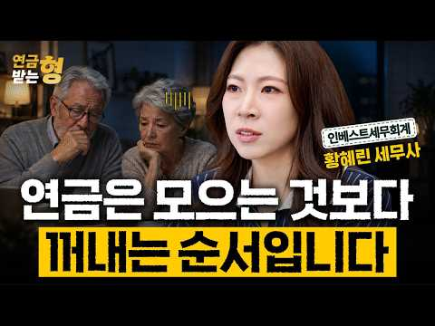

# 재테크 — 성공 사례 분석: 사례별 자세히 #161–#193

`analysis.md` 의 9번 (같은 # 번호). 자동 생성 — `tools/success_analysis.py` v1.6 (2026-10-28 10:11 UTC). ※ 연구·교육용 — 투자 권유가 아님.

### 161. 저는 1년 동안 매달 5만 원을 모아봤습니다. 그리고 돈에 대한 생각이 달라졌습니다

- https://www.youtube.com/watch?v=IBAvE_dF0L4 · 돈의 통찰 · 구독자 3,920 · 조회수 57,780 (×14.7, 하루 761.2) · 좋아요 782 (1.4%) · 41.6분 · 2026-08-13 · 주제 묶음 기타 · 형식 브이로그·직접 해본 이야기 · 폴더 `W_IBAvE_dF0L4` (웹 승인)
- 썸네일: 
- 설명 앞부분: 매달 5만 원. 처음에는 너무 작은 금액처럼 보였습니다. 하지만 1년 동안 꾸준히 모아보니, 단순히 통장 잔액만 달라진 것이 아니었습니다. 이 영상에서는 **매달 부담 없이 저축할 수 있는 작은 금액을 정하고, 자동으로 분리해 쌓아가는 방법**을 이야기합니다. 월급의 20%를 무조건 저축해야 한다는 말이 부담스러웠던 분들, 몇 번이나 저축을 시작했다가 예상치 못한 지출 때문에 포기했던 분들이라면 이 방법이 도움이 될 수 있습니다. 💰 매달 5만 원을 꾸준히 모으는 방법 🏦 생활비와 저축금을 분리하는 이유 🧠 작은 목표가 저축 습관…
- 같은 채널 평소 대비 ×4.0 (채널 최근 롱폼 중앙값 14,276회) · 평소 영상: 나이에 비해 가진 게 없다면… 당신은 정말 뒤처진 걸까? (14,276회) / 부유한 은퇴자들이 돈이 있어도 절대 사지 않는 10가지 물건. (14,364회)
- 대본 (음성인식(앞 5분), 5.4 음절/초) — 앞부분만, 흐름은 그 안까지 첫 20초: “아침 6시 41분 경기도 외곽의 작은 원룸 주방입니다. 커피 머신에서는 아직 커피가 천천히 떨어지고 있습니다. 창밖 거리에는 가끔 지나가는 차 소리만 들리고 건물 안 사람들은 아직 잠들어 있습니다. 그리고 커피 한 모금을 마시기도 전에 김지우는 휴대폰 앱을 열고 누군가 볼까 주변을 살핀 뒤” — 도입부 유형: 숫자로 시작
- 첫 1분: “아침 6시 41분 경기도 외곽의 작은 원룸 주방입니다. 커피 머신에서는 아직 커피가 천천히 떨어지고 있습니다. 창밖 거리에는 가끔 지나가는 차 소리만 들리고 건물 안 사람들은 아직 잠들어 있습니다. 그리고 커피 한 모금을 마시기도 전에 김지우는 휴대폰 앱을 열고 누군가 볼까 주변을 살핀 뒤 계좌에서 다른 계좌로 5만원을 이체합니다. 4만 5천원이 아닙니다. 월급에서 생활비를 모두 내고 남은 돈도 아닙니다. 정확히 5만원, 월급 날마다 빠짐없이 같은 금액을 넣은지 어느새 1년이 됐습니다. 김지우는 동네 마트 계산원으로 일하며 한 달에 약 230만원을 벌고 있습니다. 대부분의 경제 전문가들이 말하는 기준으로 보면 여유 있게 저축하기에는 결코 높은 월급이 아닙니다. 그런데도 그는 같은 월급으로 이미 한 달치 월세”
- 흐름 (90초마다 첫 문장): 0:00 아침 6시 41분 경기도 외곽의 작은 원룸 주방입니다. → 1:31 차이는 단 하나의 원칙에 있었습니다. → 3:01 돈을 모으려고 노력했지만 → 4:32 왜냐하면 그가 겪은 일은 특별한 경우가 아니라
- 댓글 40/40: 좋은 점 — 영상 3 · 감사·응원 4 · 더 알고 싶은 것 0 · 아쉬운 점 — 영상 2 · 반박·불만 — 의견 다름 0 · 정치·사회 0 · 경험 공유 5 · 구독·다음 기대 0
  - 좋은 점 — 영상 👍8 “영상 너무 유익해요!”
  - 좋은 점 — 영상 👍6 “영상보고 많이 배웠 어요 감사 합니다”
  - 감사·응원 👍6 “영상보고 많이 배웠 어요 감사 합니다”
  - 감사·응원 👍3 “저도 이렇게 하고 있습니다. 무리하지 않고 지속할 수 있는 가장 현실적인 방법입니다. 좋은 영상 감사합니다.”
  - 아쉬운 점 — 영상 👍15 “너무길어요 요점만”
  - 아쉬운 점 — 영상 👍6 “지루하네요”
  - 경험 공유 👍12 “항상기준에 못미쳐서 내가 못하는거구나 그랬는데 위로를 받았네요”
  - 경험 공유 👍8 “맞아요 위로를 받았어요 항상기준에 못미쳐서 내가 못하는거구나 그랬는데 위로를 받았네요”

### 162. 손 하나 까딱 않는 며느리에게 가게를 맡겼더니, 한달 뒤 놀라운 일이 벌어지는데... ㅣ노후사연ㅣ감동사연ㅣ사연라디오ㅣ오디오북

- https://www.youtube.com/watch?v=9h3kmvUNlB0 · 마음나날 · 구독자 15,000 · 조회수 266,845 (×17.8, 하루 2,767.6) · 좋아요 8,729 (3.3%) · 110.1분 · 2026-07-23 · 주제 묶음 4. 노후·연금 · 형식 사연·드라마 · 폴더 `W_9h3kmvUNlB0` (웹 승인)
- 썸네일: 
- 설명 앞부분: 시집온 지 사흘, 손 하나 까딱 않는 며느리에게 시어머니가 가게 열쇠를 통째로 맡겼습니다. 시장 사람들은 노망이 났다며 손가락질했지요. 그런데 한 달 뒤, 그 며느리가 입을 열었습니다. "이상한 날은 일곱 번이었습니다." 사십 년을 지켜온 가게에서, 십오 년 동안 아무도 몰랐던 일이 그날 처음 드러났습니다. 걷지 못해 종일 앉아만 있던 사람이, 그 자리에서 모든 것을 보고 있었던 것입니다. 끝까지 들으시면, 아무 말 없이 내 편에 서 주었던 그 사람이 떠오르실 겁니다. ☕ 따뜻한 차 한 잔 준비하시고, 편안히 이야기 속으로 들어오…
- 대본 (음성인식(앞 5분), 4.1 음절/초) — 앞부분만, 흐름은 그 안까지 첫 20초: “새로 들어온 며느리가 손 하나 까딱을 안 합니다. 아침에 나와 의자에 앉으면 문 닫을 때까지 그 자리였어요. 물건도 안 나르고 청소도 안 하고 손님도 안 받았죠. 시장 사람들이 대놓고 수근거렸습니다. 저런 며느리를 어디다 쓰냐 밥값도 못하겠네.”
- 첫 1분: “새로 들어온 며느리가 손 하나 까딱을 안 합니다. 아침에 나와 의자에 앉으면 문 닫을 때까지 그 자리였어요. 물건도 안 나르고 청소도 안 하고 손님도 안 받았죠. 시장 사람들이 대놓고 수근거렸습니다. 저런 며느리를 어디다 쓰냐 밥값도 못하겠네. 그런데 정말 이상한 일이 벌어졌습니다. 시어머니가 그 며느리한테 가게 열쇠를 몽땅 넘겨준 겁니다. 시집 온 지 사월 만이었어요. 이 집 큰 아들이 뒤집어졌습니다. 어머니, 손 하나 깠다 갖는 저것한테 열쇠를 맡기시겠냐고요? 시어머니가 아들 앞을 막아 섰습니다. 그리고 딱 한마디 했어요. 그래, 손 안 되는 게 그의 일이다. 손 안 되는 게 일이라니 그게 무슨 말일까요? 그렇게 한 달이 흘렀어요.”
- 흐름 (90초마다 첫 문장): 0:00 새로 들어온 며느리가 손 하나 까딱을 안 합니다. → 1:32 이야기 시작 전에 구독과 좋아요 한 번씩 눌러주세요. → 3:05 시장 사람들은 그 며느리를 게으른 뱅이라 불렀죠. → 4:34 서랍을 다 확인하고 나서 명자는 저울 앞에 섰습니다.
- 댓글 387/389: 좋은 점 — 영상 3 · 감사·응원 19 · 더 알고 싶은 것 0 · 아쉬운 점 — 영상 3 · 반박·불만 — 의견 다름 2 · 정치·사회 1 · 경험 공유 3 · 구독·다음 기대 0
  - 좋은 점 — 영상 👍5 “경남거제시에서 듣고있습니다 좋은말씀 감사합니다”
  - 좋은 점 — 영상 👍2 “시모님정말감사하고. 고맙습니다 이사연 너무감동적이고 내가슴이뭉클하네요 이렇게 고맙고. 친모님 하고오래오래 가슴뭉클한사연 너무감사합니다 은수씨. 고생많았어요 시모님 며느리가 않이고 딸로평생. 안아주세요 시모님 항상행복하시고 행복한. 나. 날되십시요 좋은영상감사합니다”
  - 감사·응원 👍7 “미국 칼리포니아 감사합니다.”
  - 감사·응원 👍6 “강원도 원주시에서 듣고있습니다 감사합니다”
  - 아쉬운 점 — 영상 👍3 “뭘 나중에 안다 그런식으로 전개합니까 자꾸 그러니까 답답하고 지루합니다”
  - 아쉬운 점 — 영상 👍0 “반복되는 말들 너무 심하네요 ㅜ”
  - 반박·불만 — 의견 다름 👍3 “작가님! 자식이 잘 못하면, 부모가 회초리을 드는 것은 옮은 일입니다! 바늘 도둑이, 소 도둑이 된다는 옛 말이 있지요! 것도 남의 인생을 망치는 사람은 인간이 아닙니다! 수원시 원천동에서~🤗”
  - 반박·불만 — 의견 다름 👍0 “공주. 앉아 있는것 보통 힘든 일이 아닌데..”
  - 정치·사회 👍0 “꼭 부정선거 보는 느낌.”
  - 경험 공유 👍2 “시모님정말감사하고. 고맙습니다 이사연 너무감동적이고 내가슴이뭉클하네요 이렇게 고맙고. 친모님 하고오래오래 가슴뭉클한사연 너무감사합니다 은수씨. 고생많았어요 시모님 며느리가 않이고 딸로평생. 안아주세요 시모님 항상행복하시고 행복한. 나. 날되십시요 좋은영상감사합니다”
  - 경험 공유 👍1 “저도 허리 통증으로 오랫동안 고생해봐서 그런지 이 글이 정말 마음에 와닿네요. 아파서 제대로 걷지도 못하고 누워 지내는 시간이 얼마나 힘든지 조금은 알 것 같습니다. 그래도 포기하지 않고 조금씩 관리하면서 다시 일상을 되찾으셨다니 정말 다행이고 대단하세요. 🙏❤ 허리…”

### 163. 주식 상위 2%만 아는 10가지 절대 생존 원칙 (돈의 원리)

- https://www.youtube.com/watch?v=fFURFeLTdAg · 준의 경제노트 (jun’s Note) · 구독자 12,500 · 조회수 306,780 (×24.5, 하루 2,199.6) · 좋아요 6,918 (2.3%) · 21.6분 · 2026-06-10 · 주제 묶음 3. 주식·ETF · 형식 오디오북·낭독 (명언·인생조언) · 폴더 `W_fFURFeLTdAg` (웹 승인)
- 썸네일: 
- 챕터: 0:00 주식 시장, 살아남는 자가 강하다 · 1:25 금융 천재 vs 평범한 경비원, 진짜 승자는? · 3:10 주식 투자는 지능이 아닌 '행동'의 영역 · 3:52 원칙 1. 예측하지 말고, 대응하라 · 5:22 원칙 2. 손실의 비대칭성을 이해하라 (바벨 전략) · 7:23 원칙 3. 승률이 아니라, 손익비로 계산하라 · 9:05 원칙 4. 좋은 회사가 아니라, 싼 주식을 사라 · 11:00 원칙 5. 현금은 쓰레기가 아니라, 무기다 · 12:56 원칙 6. 살 때는 신중하게, 팔 때는 과감하게 · 14:00 원칙 7. 공포에 사고, 환희에 팔아라 · 15:35 원칙 8. 좋은 종목만 사라 · 16:45 원칙 9. 본전 심리를 버려라 · 17:50 원칙 10. 감정과 싸우지 말고, 회피하라 · 19:25 실전 적용: 시장의 주인이 되는 법 · 20:20 마무리: 10년 생존을 위한 자가 진단
- 설명 앞부분: 주식 투자자 10명 중 9명은 왜 돈을 잃을까요?** 📉 예측에 의존하는 투자가 아닌, 진짜 부자들만 아는 '10가지 절대 생존 원칙'을 공개합니다. 평생 경비원으로 일하며 95억 원의 유산을 남긴 로널드 리드와, 화려한 경력에도 파산한 금융 천재의 결정적 차이는 무엇이었을까요? 이 영상에서 자산을 수십 배로 불리는 투자의 본질을 확실히 해부해 드립니다. 핵심 요약 주식 투자는 지능의 게임이 아니라 '행동'의 영역입니다. 10년, 20년 동안 시장에서 살아남아 끝까지 승리하는 상위 2%가 되고 싶다면, 영상에서 제시하는 생존 지도…
- 같은 채널 평소 대비 ×389.8 (채널 최근 롱폼 중앙값 787회) · 평소 영상: 1억을 20억, 30억으로 만드는 4가지 전략 ∣ 99%가 모르는 부자의 비밀 (787회) / 유통물량 5%로 나스닥100 편입까지? 스페이스X 일론 머스크가 그리는 우주 AI 제국의… (612회)
- 대본 (음성인식(앞 5분), 5.0 음절/초) — 앞부분만, 흐름은 그 안까지 첫 20초: “주식 투자자 10명 중 9명이 돈을 잃습니다. 이건 제 뇌피셜이 아닙니다. 수십 년 동안 반복되어 박제된 자본시장의 차가운 통계입니다. 상승장에서는 누구나 법니다. 주위에 주식으로 돈 벌어서 차 바꿨네, 집산내 하는 소리가 들려오면 나만 벼락거지가 되는 것 같아 눈이 돌아가죠.” — 도입부 유형: 숫자로 시작
- 첫 1분: “주식 투자자 10명 중 9명이 돈을 잃습니다. 이건 제 뇌피셜이 아닙니다. 수십 년 동안 반복되어 박제된 자본시장의 차가운 통계입니다. 상승장에서는 누구나 법니다. 주위에 주식으로 돈 벌어서 차 바꿨네, 집산내 하는 소리가 들려오면 나만 벼락거지가 되는 것 같아 눈이 돌아가죠. 하지만 진짜 문제는 그 다음입니다. 하락장이 찾아오면 벌었던 돈을 고스란히 토해내고 가슴에 피눈물을 흘리며 시장을 떠납니다. 그런데 말입니다. 이 잔인한 전쟁터에서 10년, 20년을 살아남아 자산을 수십배, 수백배 불린 상위 2%의 진짜 부자들이 있습니다. 이 사람들에게 특별한 고급 정보가 있었을까요? 남들보다 머리가 천재적으로 좋아서였을까요? 아닙니다. 그들에게는 오직하나 흔들리지 않는 절대로 깨지지 않는 자신만의 원칙이 있었습니다”
- 흐름 (90초마다 첫 문장): 0:00 주식 투자자 10명 중 9명이 돈을 잃습니다. → 1:31 지낸 금융 천재 → 3:00 아무리 천재라도 탐욕을 못 다스리면 파멸하고 → 4:30 하지만 발 한 번 헛디디면
- 댓글 189/190: 좋은 점 — 영상 8 · 감사·응원 20 · 더 알고 싶은 것 2 · 아쉬운 점 — 영상 4 · 반박·불만 — 의견 다름 3 · 정치·사회 0 · 경험 공유 13 · 구독·다음 기대 0
  - 좋은 점 — 영상 👍20 “백배 공감합니다 꼭 간직하겠습니다. 감사합니다 ❤”
  - 좋은 점 — 영상 👍17 “정말 큰 도움이 되는 영상이였습니다 덕분에 주식으로 이백억을 벌것 같습니다”
  - 감사·응원 👍20 “백배 공감합니다 꼭 간직하겠습니다. 감사합니다 ❤”
  - 감사·응원 👍14 “항상 좋은정보 감사합니다. 투자를 하다보면은 지키기 어려운데 공감가네요.”
  - 더 알고 싶은 것 👍3 “평생마트주차장 관리인 , 경비원, 미련하게 악착같이 주식모아서 결국 어떻게 되었나요? .... 죽었습니다. 끝.”
  - 더 알고 싶은 것 👍1 “좋은 강의 감사합니다. 싼 주식의 기준은, 또는 평가는 무엇인지요? 저Per? 실적? 수주액? 부탁합니다.”
  - 아쉬운 점 — 영상 👍22 “나는 뻔한 예가 나오면 흐름이 끊겨서 거기까지만 듣고 나갑니다.”
  - 아쉬운 점 — 영상 👍4 “ai목소리 질려서 안보게되네요 다 똑같은 목소리라 채널구분도 안되구”
  - 반박·불만 — 의견 다름 👍6 “맞는말인듯😊전 샀다팔았다 하지 않으려고 연금저축펀드 에쎈피500!!!😊 감사합니다!! 그리고 딴분들이 웃기는겤ㅋㅋㅋㅋ아니 영상만들어 주신분한테 목소리가 어떻니 왜 그러심? 물림? ㅋㅋㅋㅋㅋㅋ 그런 댓글 작성할 시간에 영상 올려주신분께 감사하다고 좋아요 한번 눌러욬ㅋㅋ…”
  - 반박·불만 — 의견 다름 👍5 “모두 맞는 이야기 이지만 2번 손해안보는 안전한 자산에 85~90%를 넣어두고 나머지만 위험을 감수한 투자를 한다는 것은 틀렸네요. 현재 안전한 투자는 한국 단기채권은 3% 초반, 미국단기채권은 4% 초반으로 이자율이 나오는데 대한민국의 최근 10년간 연평균 화폐증가…”
  - 경험 공유 👍137 “120만원으로 시작해서 7년만에 1억 4천넘게 벌어보고 느낀점 버핏옹의 투자원칙 첫번째 원칙 돈을 지켜라 두번째 원칙 첫번째 원칙을 지켜라 이말은 진리고 내가 주식시장에서 돈을 벌 수 있던 말이다 저말을 뜻을 깨닫는다면 시장에서 돈을 벌수 있다 이걸 설명하기 어려운건…”
  - 경험 공유 👍4 “저는 초단타 14년차 1억으로 무한 3%”

### 164. 매일 아침 7시, 내 포트폴리오를 관리해주는 AI 주식 비서를 만들어봤습니다

- https://www.youtube.com/watch?v=ITzgH6CeZns · 스티브의 파도타기 | AI 시대 일하는 법 · 구독자 27,100 · 조회수 713,720 (×26.3, 하루 4,671.0) · 좋아요 16,379 (2.3%) · 14.8분 · 2026-05-28 · 주제 묶음 3. 주식·ETF · 형식 정보·해설 (그 밖) · 폴더 `W_ITzgH6CeZns` (웹 승인)
- 썸네일: 
- 챕터: 0:00 Intro · 1:44 시작 전 꼭 알아야 할 것 · 2:37 1단계 - 주식 가격 정확하게 가져오기 · 3:40 2단계 - 관련 뉴스 가져오기 (날짜 문제 해결) · 6:20 3단계 - 브리핑으로 묶기 · 7:54 4단계 - 카카오톡으로 받기 (PlayMCP 연결) · 11:17 5단계 - 매일 아침 7시 자동 실행 (스케줄 등록) · 13:09 다음날 아침, 실제로 작동하는지 확인
- 설명 앞부분: Claude 하나로 매일 아침 7시, 코딩을 모르는 누구나 만들 수 있을만큼 쉽습니다. AI 자동화 콘텐츠가 넘쳐납니다. "주식 자동 매매", "포트폴리오 자동 운영" 같은 것들이요. 저는 개인적으로 추천드리지 않습니다. AI가 주식 판단을 대신할 수 있다면, AI 쓰는 사람들 모두 부자가 됐겠죠. AI는 미래를 알지 못합니다. 반복 노동은 AI에게 넘기고 진짜 중요한 판단은 내가 하는 것. 이게 제가 생각하는 AI 시대의 일하는 방식입니다. 타임라인 ○ 이렇게 AI를 활용하는 법을 직접 배우고 싶다면?
- 같은 채널 평소 대비 ×606.9 (채널 최근 롱폼 중앙값 1,176회) · 평소 영상: 신입사원이 아닌, AI에게 인수인계합니다 ∣ 업무를 회사에 남기는 법 (1,176회) / 기존 업무 AI로 대체하기 전에, 꼭 정리해야 할 게 있었습니다 (1,133회)
- 대본 (음성인식(앞 5분), 6.0 음절/초) — 앞부분만, 흐름은 그 안까지 첫 20초: “오늘 아침 7시 4분에 메시지가 와있습니다 어제 만들었던 대로 제포트폴리오의 가격과 핵심 뉴스를 요약해서 보내줬습니다 이제 매일 아침에 일어나서 어플 들어가서 가격 확인하고 네이버 뉴스나 인베스팅 같은 해외 사이트 들어가서 관련 뉴스들을 다 찾아볼 필요가 없어졌습니다 남한의 비서가 카톡을 열면 다 정리를 해줬거든요 그래서 여기에 드는 에너지와 시간이 압도적으로 줄게 됩니다” — 도입부 유형: 숫자로 시작
- 첫 1분: “오늘 아침 7시 4분에 메시지가 와있습니다 어제 만들었던 대로 제포트폴리오의 가격과 핵심 뉴스를 요약해서 보내줬습니다 이제 매일 아침에 일어나서 어플 들어가서 가격 확인하고 네이버 뉴스나 인베스팅 같은 해외 사이트 들어가서 관련 뉴스들을 다 찾아볼 필요가 없어졌습니다 남한의 비서가 카톡을 열면 다 정리를 해줬거든요 그래서 여기에 드는 에너지와 시간이 압도적으로 줄게 됩니다 주식하는 분들 아침마다 앱 켜서 가격 확인하고 뉴스 찾아보다가 영어 뉴스면 번역기 돌리고 계신가요? 이거 하다 보면 최소 10분은 걸리고 뉴스 찾느라 머리 아프지 않으세요? 혹시 모든 걸 누가 깔끔하게 정리해서 카톡으로 보내줬으면 좋겠다 라는 생각을 해보신 적 있다면 축하드립니다 이 영상을 끝까지 보시면 네포트폴리오의 가격 변동과 관련 뉴”
- 흐름 (90초마다 첫 문장): 0:00 오늘 아침 7시 4분에 메시지가 와있습니다 → 1:30 해외 뉴스를 쓸 수도 있겠죠 → 3:05 여기에 본인의 포트폴리오를 쓰시면 됩니다 → 4:30 그리고 날짜를 확인하면서 지금 확인하고 있는 게
- 댓글 387/393: 좋은 점 — 영상 23 · 감사·응원 34 · 더 알고 싶은 것 38 · 아쉬운 점 — 영상 2 · 반박·불만 — 의견 다름 0 · 정치·사회 1 · 경험 공유 12 · 구독·다음 기대 5
  - 좋은 점 — 영상 👍11 “클로드 코웤.... 대단한 기능이네요. 꼭 주식이 아니더라도 회사 업무 관련 시장 분석에도 활용해봐야겠습니다. 좋은 정보 감사합니다”
  - 좋은 점 — 영상 👍4 “좋은 정보 입니다 정말 감사드립니다”
  - 감사·응원 👍55 “주식 투자를 하는 사람으로서 정말 감사합니다. 혹시 텔레그램에 팔로우하는 채널들에 수많은 주식 정보가 있는데 그걸 요약해서 브리핑하는 것도 가능할까요? 검토 부탁드립니다.”
  - 감사·응원 👍11 “클로드 코웤.... 대단한 기능이네요. 꼭 주식이 아니더라도 회사 업무 관련 시장 분석에도 활용해봐야겠습니다. 좋은 정보 감사합니다”
  - 더 알고 싶은 것 👍55 “주식 투자를 하는 사람으로서 정말 감사합니다. 혹시 텔레그램에 팔로우하는 채널들에 수많은 주식 정보가 있는데 그걸 요약해서 브리핑하는 것도 가능할까요? 검토 부탁드립니다.”
  - 더 알고 싶은 것 👍4 “내용이 너무 좋아서 저도 해보고 싶은데, 컴퓨터가 켜져 있어야 한다는 부분이 가장 아쉬운 지점이네요... 근데 궁금한게 클로드는 기본적으로 서버에서 작동하는 거 아닌가요? 근데 왜 마치 로컬 프로그램인 것처럼 내 컴퓨터가 켜져 있어야 한다고 하는지 모르겠네요... 대…”
  - 아쉬운 점 — 영상 👍0 “실제로 투자에 사용하기에는 과거데이터를 참고 해서 주거나 잘못된 정보를 주기도 하니 잘 걸러 내야 합니다..”
  - 아쉬운 점 — 영상 👍0 “감사합니다. 주어진 자료 바탕으로 제가 이틀정도 더 씨름하면서 제 스타일로 변동하였습니다. 문제가 되었던 부분들과 제가 수정한 방안 모두 감사한 마음으로 정리해봅니다. 1. 먼저 큰 틀에서 이 영상대로 잘 따라하시면 됩니다 . 전 하루에 3번은 받았으면 해서 8시 1…”
  - 경험 공유 👍4 “컴맹인 제가 해냈어요 . 친절한 설명 감사드립니다.”
  - 경험 공유 👍4 “내용이 너무 좋아서 저도 해보고 싶은데, 컴퓨터가 켜져 있어야 한다는 부분이 가장 아쉬운 지점이네요... 근데 궁금한게 클로드는 기본적으로 서버에서 작동하는 거 아닌가요? 근데 왜 마치 로컬 프로그램인 것처럼 내 컴퓨터가 켜져 있어야 한다고 하는지 모르겠네요... 대…”
  - 구독·다음 기대 👍0 “오~구독했습니다~바로 공유하고~좋아요^^ 이런 유요한 꿀팁이 클로드 써보면서 이런정보가 있는지😅”
  - 구독·다음 기대 👍0 “너무 좋은 정보 감사합니다. 구독하고 갑니다.~”

### 165. 월배당 ETF 10억 투자하면 정말 배당금 얼마? ∣ 종합소득세·건강보험료 계산법 (은퇴 현금흐름 설계)

- https://www.youtube.com/watch?v=yRDpbgaZahc · 은퇴머니 - 은퇴 현금흐름 설계 · 구독자 30,000 · 조회수 757,998 (×25.3, 하루 5,069.2) · 좋아요 10,287 (1.4%) · 11.4분 · 2026-05-31 · 주제 묶음 6. 절세·제도 · 형식 정보·해설 (그 밖) · 폴더 `W_yRDpbgaZahc` (웹 승인)
- 썸네일: 
- 챕터: 0:00 평생 모은 10억으로 생활비를 만들어야 한다면 · 1:10 10억을 배당 ETF에 넣고 3년, 직접 따라가 봤습… · 2:00 첫 분배금, 그리고 먼저 떼이는 원천세 · 3:11 예상 못 한 종합소득세 · 4:36 매달 빠져나가는 건강보험료 · 6:25 분배금은 36개월, 세금은 58개월 · 7:04 시뮬레이터 + 커버드콜 ETF 3종 비교 · 8:39 결국 종목이 아니라, 본인의 다섯 변수
- 설명 앞부분: 은퇴 후 10억을 월배당 ETF(JEPQ)에 넣으면 매달 얼마가 들어오고, 세금은 언제 얼마가 빠질까. 2023~2025년 3년 치 통장을 한 화면에 펼쳐 직접 확인해 봤습니다. 타임라인 📑 영상 PPT 자료 영상 내용을 정리한 슬라이드를 웹에서 바로 보고, PDF로도 내려받을 수 있습니다. 🧮 직접 계산해 보기 영상의 사례를 내 조건으로 바꿔 계산할 수 있습니다. 📄 전자책 「은퇴 현금흐름 설계법」 💬 여러분의 은퇴 설계에서 가장 고민되는 부분은? (자산 규모 / 세금 / 건강보험) 댓글로 알려 주세요.
- 같은 채널 평소 대비 ×55.4 (채널 최근 롱폼 중앙값 13,674회) · 평소 영상: ETF 포트폴리오, 은퇴 전에 확인해야 할 또 하나의 기준 (14,282회) / 은퇴 포트폴리오가 사람마다 다른 이유 (13,066회)
- 대본 (음성인식(앞 5분), 4.9 음절/초) — 앞부분만, 흐름은 그 안까지 첫 20초: “어느 평일 오전, 회사에서 한마디를 듣습니다. 회사 사정으로 이번 달까지만 나오시면 됩니다. 엘레베이터를 타고 내려오는 동안 머릿속에 하얘집니다. 다음 달 25일부터 통장에 들어올 돈이 없습니다. 평생 모은 10억으로 오늘부터 생활비를 만들어내야 합니다. 답은 어렵지 않다고 들었습니다.”
- 첫 1분: “어느 평일 오전, 회사에서 한마디를 듣습니다. 회사 사정으로 이번 달까지만 나오시면 됩니다. 엘레베이터를 타고 내려오는 동안 머릿속에 하얘집니다. 다음 달 25일부터 통장에 들어올 돈이 없습니다. 평생 모은 10억으로 오늘부터 생활비를 만들어내야 합니다. 답은 어렵지 않다고 들었습니다. 월배당 ETF에 넣으면 매달 월급처럼 들어온다 저도 그렇게 알았습니다. 그런데 검색하다 보면 이런 말이 따라 붙습니다. 배당을 많이 받으면 종합소득세 대상자가 됩니다. 건강보험율도 더 내야 합니다. 월급처럼 들어오는 것만 생각하면 되는 게 아니었습니다. 그럼 10억을 넣으면 매달 얼마가 손에 들어올까요? 그리고 세금은 언제 얼마가 나갈까요? 저는 이 금액을 정확히 알아야 한다고 생각했습니다. 그게 없으면 막연한 은퇴부라는 끝”
- 흐름 (90초마다 첫 문장): 0:00 어느 평일 오전, 회사에서 한마디를 듣습니다. → 1:32 매달 통장에 어떤 알림이 떴슬지 → 3:03 들어오는 게 당연해지니까요. → 4:34 2024년 11월
- 댓글 965/968: 좋은 점 — 영상 33 · 감사·응원 53 · 더 알고 싶은 것 33 · 아쉬운 점 — 영상 2 · 반박·불만 — 의견 다름 16 · 정치·사회 33 · 경험 공유 47 · 구독·다음 기대 4
  - 좋은 점 — 영상 👍32 “제가 지금 비슷한 처지에 종소세 건보료 때문에 수많은 고민을 하고있읍니다 좋은자료 감사합니다”
  - 좋은 점 — 영상 👍17 “제가 꼭 알고 싶어했던 부분을 영상을 담아주셨습니다. 많은 도움이 되었습니다!! 감사합니다!”
  - 감사·응원 👍32 “제가 지금 비슷한 처지에 종소세 건보료 때문에 수많은 고민을 하고있읍니다 좋은자료 감사합니다”
  - 감사·응원 👍20 “꼭 필요한 내용이네요. 궁금했는데 정말 감사드려요~ 구독, 좋아요 누르고 갑니다.”
  - 더 알고 싶은 것 👍8 “3년후 제피큐에넣은 10억은 얼마가남았나요?”
  - 더 알고 싶은 것 👍6 “좋은 정보 고맙습니다. 능력자 이시네요~ 저도 은퇴후 제일 고민이 건보료입니다. 인별로 나누고 있고 연금저축 IRP ISA 모두 활용중입니다. 국내지수 커버드콜 비중도 점점 커집니다. 은퇴후 투자법인도 고려중입니다. 앞으로도 좋은 컨텐츠 부탁드립니다. 목소리 좋으시네…”
  - 반박·불만 — 의견 다름 👍817 “개인연금 시대에 종합소득 과세 2000은 말도 안되는 시대에 뒤떨어진 정책입니다 최소 4000은 되어야 함”
  - 정치·사회 👍43 “한국에 사는 한국 국민으로서는 당연한 세금과 의료보험료이고, 외국인보다는 훨씬 낫습니다. 처음 15% 원천 징수는 미국 증시에서 이익을 본거니 미국금융소득에 대한 연방세입니다. 캘리포니아 거주자는 추가로 주 소득세도 꽤 더 냅니다. 미국인의 경우에는 소득의 처분 시점…”
  - 정치·사회 👍42 “이래서 우리나라가 순자산 100만달러이상 보유한 사람들 유출되는게 전세계 4위인거임ㅋㅋ 부자들이 떠나는 나라...”
  - 경험 공유 👍497 “저도 은퇴 후 자산정리하고, 분배금으로 살고 있습니다. 님과는 다르게 ETF반 커버드콜반으로 운영중이고, 현재 커버드콜은 전부 국내만 운영중입니다. 커버드콜 자산은 조금더 많은것 같고, 결론적으로 올해 총 수익은 1.2억정도인데 과세기준소득은 약 1천만원, 올해 말은…”
  - 경험 공유 👍74 “건보료 150만원 내도 좋으니 ㅅㅂ 나도 월 분배금 900들어오면 소원이 없겠다😂😂😂😂😂”
  - 구독·다음 기대 👍32 “이제까지 봤던 은퇴관련 배당 컨텐츠중에서 가장 실용적이고 퀄리티높은 !!!! 구독합니다.”
  - 구독·다음 기대 👍19 “제피큐 모으고 있어서 궁금했던 내용인데 영상 잘 봤습니다 ㅎ 구독하고 갑니다”

### 166. ETF 이 '2가지'만 사두면 됩니다. '나머지는 필요없어요' 100억 자산 관리자의 꿀팁(백승호 단장 풀버전) #ETF #배당주 #주식 #백승호

- https://www.youtube.com/watch?v=1qlywudP2oY · 자람들 - 자립하는사람들 · 구독자 34,800 · 조회수 259,633 (×7.5, 하루 5,871.6) · 좋아요 2,243 (0.9%) · 69.7분 · 2026-09-14 · 주제 묶음 3. 주식·ETF · 형식 인터뷰·강연·대담 · 폴더 `W_1qlywudP2oY` (웹 승인)
- 썸네일: 
- 설명 앞부분: 👤 오늘의 게스트: 백승호 단장 개인 재무 컨설팅 전문가 & 유튜버·작가로도 활동 20년간 몇백 명의 고객 자산을 관리해온 재무 컨설턴트입니다. 현재 관리하는 총 자산만 100억원이 넘지만, 폭락장에도 노트북에 손 하나 대지 않을 만큼 평온한 태도로 유명합니다. 비결은 단 하나, "투자해도 되는 돈"과 "투자하면 안 되는 돈"을 철저히 구분하는 원칙입니다. 시드머니 없이 매주 조금씩 사 모으는 전략, 차트나 재무제표 대신 "내 지갑"을 믿고 애플·넷플릭스·구글 같은 주식을 고르는 방법, 그리고 레버리지·인버스 상품에 대한 강한 경…
- 같은 채널 평소 대비 ×10.0 (채널 최근 롱폼 중앙값 25,862회) · 평소 영상: 연 2200 배당금받는, 전직 배달 기사.. 3억으로 은퇴했습니다. (또배당 3부) #배… (25,862회) / 월 500만원 배당 노하우, 시드 5천 '이렇게' 구성하세요. 평범한 직장인이 파이어한 … (25,083회)
- 대본 없음 (설명) — 음성인식이 끝나면 도입부·흐름이 들어감
- 댓글 69/77: 좋은 점 — 영상 6 · 감사·응원 11 · 더 알고 싶은 것 2 · 아쉬운 점 — 영상 4 · 반박·불만 — 의견 다름 1 · 정치·사회 1 · 경험 공유 1 · 구독·다음 기대 1
  - 좋은 점 — 영상 👍6 “많이 배웠습니다. 감사합니다.”
  - 좋은 점 — 영상 👍5 “많이 배웠습니다 변액연금은 정말 몰랐네요”
  - 감사·응원 👍7 “와..이분 이 영상에서 처음 뵀는데 인상도 정말 좋으시고, 말씀도 편안하고 겸손하신데 무엇보다 내용이 명확하고 깔끔하시네요! 구독과 좋아요 누르고 갑니다. 귀한 영상 감사히 잘 봤습니다^^”
  - 감사·응원 👍7 “영상 감사드립니다🎉 Kodex200커버드콜 같은 것을 지금 사도 될 지 모르갰어오..우리나라가 갑자기 넘 오른 거 같아서요😅”
  - 더 알고 싶은 것 👍2 “오늘 선생님 유튜브 처음 들었는데 저와 투자 철학이 맞네요 좋아요.구독 눌렀습니다. 유선으로 통화하고 싶은데 어떻게 하면 되나요???”
  - 더 알고 싶은 것 👍2 “여기서 추천하는 "2 etf"는 어떤것인가요?”
  - 아쉬운 점 — 영상 👍84 “너무 길어요... AI에 요약을 요청~ 심플이즈 베스트: 일반 투자자에게는 S&P500과 나스닥100 ETF 두 가지만 꾸준히 사 모으는 것을 0순위로 추천합니다 (30:38). 결국 이 2개...ㅋ”
  - 아쉬운 점 — 영상 👍20 “13년전에 별생각없이 가입한 변액연금보험 10년납입 끝나고 2년정도 놔뒀는데 지금 수익률이 250퍼센트 넘어요. 조금더 많이 넣을껄하는 아쉬움이...”
  - 정치·사회 👍7 “영상 감사드립니다🎉 Kodex200커버드콜 같은 것을 지금 사도 될 지 모르갰어오..우리나라가 갑자기 넘 오른 거 같아서요😅”
  - 구독·다음 기대 👍2 “찐 투자의 길라잡이네요. 빽담화TV 구독과 알림 설정 들어갑니다.^^”

### 167. 노후자금 2억 태양광에 넣은 50대, 1년 만에 벌어진 일ㅣ태양광발전사업 리스크 정리

- https://www.youtube.com/watch?v=keim9Fw6NwE · 짐컴퍼니ㅣ태양광의 모든 것 · 구독자 3,970 · 조회수 53,320 (×13.4, 하루 658.0) · 좋아요 262 (0.5%) · 7.9분 · 2026-08-08 · 주제 묶음 4. 노후·연금 · 형식 사연·드라마 · 폴더 `W_keim9Fw6NwE` (웹 승인)
- 썸네일: 
- 챕터: 0:00 "큰돈 벌 생각이면 주식하세요" — 태양광발전사업의 … · 0:22 노후자금 2억 태양광에 넣었다가 빚만 남은 사연 · 0:39 실패 원인 ① 태양광 보험을 제대로 알아보지 않았다 · 0:46 시드 8천 + 대출 1.5억, 100kW 발전소의 구조 · 1:06 실패 원인 ② 현물시장 vs 고정가격계약, 뭐가 달랐나 · 1:30 "매달 200만원 나옵니다"를 그대로 믿으면 안 되는… · 1:53 태양광 발전량은 계절마다 다릅니다 (겨울 100만 ↔… · 2:11 SMP·REC 변동 리스크를 알고도 현물시장에 들어간… · 2:32 사업주의 잘못 vs 영업자·시공사의 설명 의무 · 2:40 실패 원인 ③ 태풍 피해 3천만원, 보험은 얼마 나왔나 · 2:47 태양광 종합보험 자기부담금 구조 (2%면 1천, 4%… · 3:20 이분도 결국 노후자금 때문에 시작한 겁니다 · 3:27 상담 전화의 대부분이 "돈 많이 벌려고"입니다 · 3:54 노후에 필요한 월 300만원, 어떻게 만드나 · 4:02 국민연금으로 월 100만원 받으려면 (월급 500만원… · 4:24 개인연금 1억 3,500만원 넣어야 월 100만원 · 4:33 주택연금 5억 주택이면 월 75만원, 대신 집은 은행에 · 4:50 지붕 태양광 100kW 1억 7천 → 20년 고정 월… · 5:19 국민연금 100만 + 태양광 180만 = 노후 월 3… · 5:26 목돈 1억 5천이 없다면? 40% 분양 프로모션 구조
- 설명 앞부분: 노후자금으로 태양광발전사업을 고민 중이시라면 이 영상 먼저 보세요. 2억 넣고 1년 만에 빚만 남은 사례부터, 국민연금·개인연금·주택연금과 지붕 태양광 수익을 나란히 계산해 노후 월 300만원 만드는 법까지 정리했습니다. 태양광 발전소, 20년을 보고 시작하는 분들이 꼭 확인해야 할 기준을 실제 상담 사례로 풀었습니다. ⏱ 타임스탬프 이 영상에서 다루는 내용 태양광발전사업을 "큰돈 버는 사업"으로 접근하면 왜 실패하는지 노후자금 2억을 태양광에 넣었다가 빚만 남은 실제 사례의 3가지 원인 (보험 미확인 / 현물시장 리스크 / 계절…
- 같은 채널 평소 대비 ×2.4 (채널 최근 롱폼 중앙값 22,388회) · 평소 영상: RPS 폐지 공청회 다녀왔습니다, 100kW 미만 1.2 가중치는 사라집니다ㅣ하위법령 개… (22,388회) / RPS 폐지, 현물시장은 29년에 끝납니다ㅣ에너지공단 간담회 실무 초안 정리 (26년 허… (23,232회)
- 대본 없음 (설명) — 음성인식이 끝나면 도입부·흐름이 들어감
- 댓글 36/36: 좋은 점 — 영상 0 · 감사·응원 0 · 더 알고 싶은 것 2 · 아쉬운 점 — 영상 0 · 반박·불만 — 의견 다름 1 · 정치·사회 0 · 경험 공유 1 · 구독·다음 기대 0
  - 더 알고 싶은 것 👍0 “400키로 발전되는데 총비용과 자기자본은 어느정도있어야되는지요?”
  - 반박·불만 — 의견 다름 👍0 “태양광요?말도 안된소리 까다롭고 특별한곳 아니면 할수가 없어요.아무렇게나 얘기하시는데 절대 쉽게 안됩니다~ 안됩니다~장관님이나 윗분들은 ㅎᆢ”

### 168. 머스크가 던진 32개 예측 중 부자들이 베팅한 TOP 7 카운트다운 "이미 19개가 맞았습니다"

- https://www.youtube.com/watch?v=EomU4-CfZCw · 경제가머니 · 구독자 22,600 · 조회수 623,213 (×27.6, 하루 3,709.8) · 좋아요 10,950 (1.8%) · 27.2분 · 2026-05-13 · 주제 묶음 1. 재테크 일반·마인드 · 형식 정보·해설 (그 밖) · 폴더 `W_EomU4-CfZCw` (웹 승인)
- 썸네일: 
- 설명 앞부분: 머스크가 5년 동안 던진 미래 예측 32개 중 19개가 이미 현실이 됐습니다. 그럼 남은 13개는요? 부자들이 진짜 돈을 쏟아붓는 일곱 자리, 그리고 카운트다운에 적히지 않은 자리 하나가 더 있습니다. 오픈AI 5,000억 달러, xAI 2,300억 달러, 스페이스X 8,000억 달러. 부자들의 자본이 한 산업으로 빨려 들어가는 그림과, AI 시대의 새 석유·새 전기·새 노동력이 어디로 향하는지, 그리고 그 거대한 베팅 옆에 한국이 어떤 자리에 끼어 있는지 — 친근한 선생님 톤으로 한 번에 정리해드립니다. 노후 적금부터 자녀 진로…
- 같은 채널 평소 대비 ×1,069.9 (채널 최근 롱폼 중앙값 582회) · 평소 영상: "종목은 맞았는데 계좌는 왜 이래?" 개인이 고른 주식은 102% 올랐는데 12조가 떠난… (589회) / 한국 직장인 절반이 AI를 쓰고도 시간을 못 아끼는 진짜 이유 (576회)
- 대본 (음성인식(앞 5분), 4.8 음절/초) — 앞부분만, 흐름은 그 안까지 첫 20초: “릴론 머스크를 아시나요? 테슬라랑 스페이스X 만든 지금 세계에서 돈이 제일 많은 그 사람이요 그 머스크가 5년 동안 던진 미래 예측이 정확히 32개입니다 그 중 19개는 이미 현실이 됐고요 아직 남아있는 13개에 부자들이 돈을 쏟아붙고 있습니다 그 13개 중에 베팅이 가장 무거운 7개를 보고 나면” — 도입부 유형: 질문으로 시작
- 첫 1분: “릴론 머스크를 아시나요? 테슬라랑 스페이스X 만든 지금 세계에서 돈이 제일 많은 그 사람이요 그 머스크가 5년 동안 던진 미래 예측이 정확히 32개입니다 그 중 19개는 이미 현실이 됐고요 아직 남아있는 13개에 부자들이 돈을 쏟아붙고 있습니다 그 13개 중에 베팅이 가장 무거운 7개를 보고 나면 솔직히 매달넣는 적금이 좀 다르게 보일 거예요 저도 5년 전엔 머스크마를 그냥 흘려들었거든요 허풍이라고 생각했어요 그런데 그가 뿌려둔 32개 예측을 하나씩 체크해봤더니 마치 누가 미리 시나리오를 써놓은 것처럼 19개가 그대로 일어나 있더라고요 시작하기 전에 구독과 좋아요 눌러주시면 영상을 제작하는 데 도움이 됩니다 이번 영상에선 3가지를 한 번에 보여드릴게요 첫째 머스크가 던진 32개가 도대체 뭔지 둘째 이미 일어”
- 흐름 (90초마다 첫 문장): 0:00 릴론 머스크를 아시나요? → 1:30 그런데 그 돈을 가만히 두는 게 아니라 → 3:01 AGI가 2026년 말에 온다 → 4:30 스타 링크 위성이 1만 개를 넘는다
- 댓글 484/489: 좋은 점 — 영상 6 · 감사·응원 11 · 더 알고 싶은 것 3 · 아쉬운 점 — 영상 4 · 반박·불만 — 의견 다름 6 · 정치·사회 8 · 경험 공유 7 · 구독·다음 기대 0
  - 좋은 점 — 영상 👍5 “좋은 내용 입니다. 감사 ~”
  - 좋은 점 — 영상 👍3 “서문이 길다고 많이 말씀 하시는데 저갈은 초보가 이해하는데는 도움이 많이 되었습니다 감사합니다❤🎉”
  - 감사·응원 👍48 “농지거래허가제를 폐지하여 도시민의 농업활동을 활성화하고, 농약공장을 폐지하고 미생물 농약공장으로 전환하여 식수와 식품의 안전을 국가가 책임지고, 기뻐하고 감사하며 사랑하는 영성산업으로 세계통일하여 기아,난민,전쟁을 종식하자.”
  - 감사·응원 👍7 “1분넘도록 본론 안돌아가고 이빨만 ㅈㄴ 털길래 지루해서 걍 ai요약 돌렸다 미안하고 고맙다”
  - 더 알고 싶은 것 👍0 “UBI가 대체 어디서 일어나고있죠???”
  - 더 알고 싶은 것 👍0 “AI로봇 종류 알려주세요”
  - 아쉬운 점 — 영상 👍7 “1분넘도록 본론 안돌아가고 이빨만 ㅈㄴ 털길래 지루해서 걍 ai요약 돌렸다 미안하고 고맙다”
  - 아쉬운 점 — 영상 👍0 “스트립트도 AI 작성, 나레이선도 AI음성. 어색하면 AI라는 것이 허들이요.”
  - 반박·불만 — 의견 다름 👍13 “와 상온상압초전도체 발견하면 진짜 어마무시할듯 전기 효율을 진짜 말도안되게 쓸수있을텐데”
  - 정치·사회 👍1 “이제 정부에서 뇌에 칩에 주민등록증 처럼 할텐데 이거 없으면 뭐 사거나 소유 불가능”
  - 정치·사회 👍1 “한국투자??? 나라 꼴 하는 짓보면 한국 투자는 아닐듯...지금 이 정부가 하는짓은 나라를 파괴하는짓만 하고 있는데 무슨....”
  - 경험 공유 👍2 “나도주식이란걸 사야되나 했는데,,투자라는이름으로삥뜯어가는거네”
  - 경험 공유 👍1 “없는사람은 더 암울하고 격차가 더 벌어진다는 얘기 그래서 지금 경기안좋아도 주식은난리 삼전 왜우리아빠 없어 찾을때만 샀어도 대박 취업하는아들과 너무오래살것같은 경제력이 걱정이더”

### 169. 1억 모았으면 지금 당장 이것부터 하세요. 10억 가는 사람은 여기서 갈립니다.

- https://www.youtube.com/watch?v=USUzkksspmg · 지금 돈 공부 · 구독자 739 · 조회수 16,610 (×22.5, 하루 119.7) · 좋아요 452 (2.7%) · 13.6분 · 2026-06-11 · 주제 묶음 2. 돈 모으기·저축 · 형식 정보·해설 (그 밖) · 폴더 `W_USUzkksspmg` (웹 승인)
- 썸네일: 
- 챕터: 0:00 1억에서 10억으로 가기 위해 꼭 알아야 할 것 · 0:32 1억 모은 사람이 절대 하면 안 되는 실수 ① (소비… · 2:09 실수 ② (예적금의 덫) · 3:36 실수 ③ (무리한 투자와 레버리지) · 6:11 돈이 불어나는 무너지지 않는 구조란? · 7:26 방법 1: S&P500 적립식 장기투자 (부부가 20… · 9:38 방법 2: 마음 편한 자산배분, '투자 4분법' (홍… · 11:46 요약 및 마무리 (지금 당장 해야 할 딱 한 가지)
- 설명 앞부분: 1억을 모았다면, 이제는 '안 잃고 꾸준히 불리는 구조'에서 갈립니다. "열심히 일해서 드디어 1억을 모았는데... 이제 어떻게 굴려야 할까?" 1억을 모은 순간, 누구나 깊은 고민에 빠지게 됩니다. 참았던 보상 심리에 소비를 늘리거나, 원금을 지키겠다고 예적금에만 묶어두거나, 조급해져 실력에 맞지 않는 무리한 투자(빚투)를 하다가 오히려 원금을 잃곤 합니다. 1억에서 10억으로 넘어가는 구간에서 중요한 것은 '얼마나 빨리 벌까'가 아니라, '어떻게 돈이 불어나는 무너지지 않는 구조를 만들까'입니다. 평범한 직장인 부부도 20년 …
- 같은 채널 평소 대비 ×39.3 (채널 최근 롱폼 중앙값 423회) · 평소 영상: 부자들의 삶은 지루하고 단순합니다. 단순하게 살아서 부자가 된 겁니다. (423회) / 주식투자 실패한 99%의 한결같은 공통점 (415회)
- 대본 (음성인식(앞 5분), 5.8 음절/초) — 앞부분만, 흐름은 그 안까지 첫 20초: “오늘 내용을 이해하고 반복하는 사람은 분명 빠르게 10억 자산가가 되실 겁니다. 1억에서 10억을 가려면 소비통제는 여전히 중요하고 이제는 돈이 불어나는 구조까지 만들어야 합니다. 이게 안 되면 50년이 걸려도 10억에 못 갈 수도 있거든요? 그래서 오늘 영상에서는 돈이 불어나는 구조를 어떻게 만드는지” — 도입부 유형: 숫자로 시작
- 첫 1분: “오늘 내용을 이해하고 반복하는 사람은 분명 빠르게 10억 자산가가 되실 겁니다. 1억에서 10억을 가려면 소비통제는 여전히 중요하고 이제는 돈이 불어나는 구조까지 만들어야 합니다. 이게 안 되면 50년이 걸려도 10억에 못 갈 수도 있거든요? 그래서 오늘 영상에서는 돈이 불어나는 구조를 어떻게 만드는지 그리고 1억을 모은 사람들이 절대 하면 안 되는 실수 3가지까지 말씀드릴게요. 이거 모르면 1억 모아도 10억까지 못 갑니다. 먼저 1억을 모은 사람이 절대 하면 안 되는 실수 3가지를 말씀드릴게요. 첫 번째 실수는 1억을 모은 뒤에 소비를 늘리는 겁니다. 제가 이번 영상 만들려고 리서치하다가 이런 댓글을 봤거든요. 1억은 4년 만에 모았는데 그 이후 여행 다니며 흥청망청 쓰고 연애 4천만원씩 신용카드 5년”
- 흐름 (90초마다 첫 문장): 0:00 오늘 내용을 이해하고 반복하는 사람은 분명 빠르게 10억 자산가가 되실… → 1:30 1억이 막 생긴 그 시점이 복리가 시작되려는 순간이거든요. → 3:01 쉽게 말해서 예적금은 돈을 지키는 게 아니라 → 4:31 그때는 진짜 누구나 돈을 법니다.
- 댓글 9/9: 좋은 점 — 영상 1 · 감사·응원 1 · 더 알고 싶은 것 0 · 아쉬운 점 — 영상 0 · 반박·불만 — 의견 다름 0 · 정치·사회 0 · 경험 공유 0 · 구독·다음 기대 0
  - 좋은 점 — 영상 👍2 “실질적인 도움이 되네요. 감사합니다.”
  - 감사·응원 👍2 “실질적인 도움이 되네요. 감사합니다.”

### 170. 1억이 우스우세요 사실 여기서부터가 진짜 시작입니다

- https://www.youtube.com/watch?v=-O-ROZCAU_4 · 송차장기록 · 구독자 8,630 · 조회수 162,263 (×18.8, 하루 1,386.0) · 좋아요 1,918 (1.2%) · 15.4분 · 2026-07-03 · 주제 묶음 2. 돈 모으기·저축 · 형식 브이로그·직접 해본 이야기 · 폴더 `W_-O-ROZCAU_4` (웹 승인)
- 썸네일: 
- 챕터: 0:00 통장에 1억, 아니 5천은 있으세요? · 4:00 "요즘 1억이 돈이에요?" 후배의 한마디 · 8:30 주식으로 1억 넘게 가진 사람, 몇 명이나 될까 · 12:30 1억이 우스운 게 아니라, 여기서부터가 시작인 이유
- 설명 앞부분: 오늘은 무더운 여름날, 평범한 40대 직장인의 점심 한 끼에서 시작된 이야기입니다. 후배와 슬로우캘리에서 먹은 연어 샐러드, 후배가 사준 스타벅스 커피, 그리고 퇴근 전 잠깐 걸은 공원 산책. 후배가 그러더라고요. "형, 솔직히 요즘 1억이 돈이에요?" 유튜브만 켜면 몇 억씩 벌었다는 얘기뿐이니, 1억쯤은 우습게 느껴질 만도 하죠. 근데 마흔 넘으면서 알게 됐어요. 남들 억대 얘기에 눈 맞추다 보면, 정작 내 발밑의 첫 1억은 우스워 보인다는 걸. 근데 그 1억, 절대 우스운 돈이 아니더라고요. 그리고 그건 끝이 아니라 시작이었습…
- 같은 채널 평소 대비 ×9.9 (채널 최근 롱폼 중앙값 16,408회) · 평소 영상: 부부사이 서운하면 이혼합니다 (4050 가족 속 혼자라 느낄 때) (16,439회) / 은퇴하고 혼자 남는 남편들, 이유가 있었습니다 황혼이혼 역대 최다 (16,377회)
- 대본 (음성인식(앞 5분), 4.8 음절/초) — 앞부분만, 흐름은 그 안까지 첫 20초: “요즘 어디를 봐도 돈 이야기입니다. 다들 몇 억씩 벌었다고 이 정도는 껌가씨라고 그러죠? 그런 걸 계속 보다 보면 1억쯤은 별 거 아닌 것처럼 느껴집니다. 그래서 딱 하나만 묻겠습니다. 지금 통장에 1억 있으십니까?”
- 첫 1분: “요즘 어디를 봐도 돈 이야기입니다. 다들 몇 억씩 벌었다고 이 정도는 껌가씨라고 그러죠? 그런 걸 계속 보다 보면 1억쯤은 별 거 아닌 것처럼 느껴집니다. 그래서 딱 하나만 묻겠습니다. 지금 통장에 1억 있으십니까? 없으시면 눈높이를 좀 낮춰서 다시 여쭤보겠습니다. 그럼 5천은요. 순수하게 현금으로요. 여기서 바로 있다라는 대답이 나오는 분 생각보다 많지 않을 겁니다. 그리고 그게 이상한 게 전혀 아닙니다. 1억이 진짜로 우수어 보이십니까? 안녕하세요 송차장 기록입니다. 부산에서 올라와서 서울에서 악작같이 버티고 있는 40대 직장인 가장입니다. 오늘은 돈 이야기를 좀 해보려고 합니다. 정확히는 우리가 요즘 돈을 어떤 눈으로 보고 있는지에 대한 이야기입니다.”
- 흐름 (90초마다 첫 문장): 0:00 요즘 어디를 봐도 돈 이야기입니다. → 1:31 그 친구가 지나가듯 던진 한마디가 하루종일 머릿속을 맨돌았거든요. → 3:02 저는 그냥 들어줬습니다. → 4:31 나쁜 기분은 아니었어요.
- 댓글 595/595: 좋은 점 — 영상 7 · 감사·응원 19 · 더 알고 싶은 것 3 · 아쉬운 점 — 영상 1 · 반박·불만 — 의견 다름 17 · 정치·사회 4 · 경험 공유 31 · 구독·다음 기대 1
  - 좋은 점 — 영상 👍1 “이해가 쉽게 차분하게 설명을 잘 하시네요 좋은 말씀 감사히 잘 들었습니다”
  - 좋은 점 — 영상 👍1 “공감합니다”
  - 감사·응원 👍15 “29살에 청년 도약계좌 합쳐서 이제 순 자산 천만원 모았습니다... 왜 그거밖에 못 모았냐고 욕 하실수도 있지만 주변소리 다 무시하고 적은 월급이지만 열심히 모아볼게요 감사합니다”
  - 감사·응원 👍15 “화이팅 하세요 커피 한잔의 행복이 1억의 값어치 일 수도 있습니다.”
  - 더 알고 싶은 것 👍6 “누구에겐 1 억이 아무것도 아니지만 다른 이에겐 평생 만질 수 없는 큰 돈이죠. 돈이란 그렇게 상대적인 것 같습니다. 하지만 소액이라도 소중하게 생각하지 않으면 어느새 빠져나가고 없을 겁니다. 없으면 사람 구실 하기 힘들고 잘못 사용하면 그렇게 추할 수가 없는 이 물…”
  - 더 알고 싶은 것 👍4 “송차장님은 공감능력은 매우매우 뛰어나고 감성적이고 정말 사람좋아보이고 남에게 싫은소리 못하는분이고 심성도 아주 좋은분같음 그런데 투자에는 이게 아주 좋지않은 성격입니다 인간본능은 인종 문화불문 주변친구 돈벌면 배아프고 시기하고 질투나고 그럽니다 그걸 굳이 티내진 않아…”
  - 아쉬운 점 — 영상 👍1 “근데 주식,금융투자 같은걸 안하면 1억모아도 돈이 뭘 물어다 주지는 않음... 걍 그돈을 통장에 넣어둔다하면 그런 바보는 이 세상에 없겟지만.... 그냥 1억모으는 과정을 무한반복하는 고통이라고 보시면 될듯. 절대 주식,투자없이 돈을 못불림”
  - 반박·불만 — 의견 다름 👍58 “1억은 결코 작은돈이 아니죠😂 누구나 종자돈 일백, 일천에서 시작합니다 백원한닢도 소중한겁니다”
  - 반박·불만 — 의견 다름 👍18 “아파트값이 말도 안되게 뛸 때.. 무주택자로 만원도 고민고민하며 저축하는 기쁨으로 8년에 5억 정도를 모았어요.. 저희는 빌라를 샀는데 비록 이제 통장에는 돈이 없지만 그래도 뿌듯합니다.. 그리고 다시 저축하면 된다는 걸 아니까 두렵지 않습니다..”
  - 정치·사회 👍4 “정부가 돈을 푸니깐 진짜 돈가치가 없게 느껴집니다. 저도 1억이 예전 1천 느낌밖에 안나요. 물가폭등 수준이라..”
  - 정치·사회 👍0 “어차피, 한국에서 연금은 개쓰레기 영포티뻐킹파티련들 빼고, 높은 확률로 결국 유사현금성 쿠폰(베네수엘라,쿠바,빨갱이국가 특)으로 지급 될 확률이 크다. 따라서, 나는 모든것을 한국과 끊어버렸지. 한국돈1억도 중요하지만, 무엇보다 한국과 상관없이 삶을 살아갈 수 있는 …”
  - 경험 공유 👍26 “저도 이제 오십을 바라보는 나이가 되었고 서울 자가에 대기업 부장이상 직급이지만 여전히 완전한 경제적 자유는 이루지 못했네요. 저는 개인적인 경험이지만 초기 1억은 그리 어렵지 않았어요. 무에서 시작하다보니 지출통제가 쉬웠거든요. 오히려 1억에서 3억 구간이 너무 힘…”
  - 경험 공유 👍18 “아파트값이 말도 안되게 뛸 때.. 무주택자로 만원도 고민고민하며 저축하는 기쁨으로 8년에 5억 정도를 모았어요.. 저희는 빌라를 샀는데 비록 이제 통장에는 돈이 없지만 그래도 뿌듯합니다.. 그리고 다시 저축하면 된다는 걸 아니까 두렵지 않습니다..”
  - 구독·다음 기대 👍0 “1억은 정말 큰돈이지요... 지금 가계빚이 2000조가량 된다고 해요. 그걸 빚진 가구주가 대략 1천만명이라고 가정하면 평균 빚이 2억이라는 계산이 나옵니다. 문제는 그 부채의 대부분이 살고있는 집하나를 담보로 받은 주택담보대출인거고 그주택은 그냥 소비재에 불과한, …”

### 171. 신혼부부가 돈 못 모으는 이유...결혼 후 돈 관리 이렇게 하세요(김경필 머니트레이너)ㅣ보라언니동생 EP.04

- https://www.youtube.com/watch?v=vmjGJVCfwhk · STUDIO OMG · 구독자 31,500 · 조회수 178,891 (×5.7, 하루 4,959.3) · 좋아요 606 (0.3%) · 18.2분 · 2026-09-22 · 주제 묶음 1. 재테크 일반·마인드 · 형식 인터뷰·강연·대담 · 폴더 `W_vmjGJVCfwhk` (웹 승인)
- 썸네일: 
- 설명 앞부분: 오늘은 김경필 머니트레이너 님을 모시고 내 돈 관리법 수업을 듣고 왔어요!💸 곧 결혼을 앞둔 PD동생도, 결혼 2년차인 저도 돈 관리에 고민이 정말 많았는데요! 주식부터 월급 관리, 내집마련까지 2030세대가 필수시청해야 할 자산관리 꿀팁 쏙쏙 뽑아왔으니까 영상 정주행해주세요~! 🎁보라언니동생 4화 댓글 이벤트🎁 참여방법 1. "영상 소감" or “재테크 고민”을 댓글로 남겨주세요 2. 아래 구글 폼에 정보 제출하면 끝! 📚 이벤트 상품 돈쭐남 김경필 쌤의 친필사인 도서 [딱 1억만 모읍시다] 증정! (10명) 🎉 당첨자 발표 개…
- 같은 채널 평소 대비 ×7.2 (채널 최근 롱폼 중앙값 24,752회) · 평소 영상: 회피가 이렇게 위험합니다ㅣ안녕들하십니까 EP.08 (25,829회) / 돈 펑펑 쓰는 분들께 잔소리 해드림(🎁이벤트)ㅣ안녕들하십니까 EP.09 (23,675회)
- 대본 없음 (설명) — 음성인식이 끝나면 도입부·흐름이 들어감
- 댓글 62/63: 좋은 점 — 영상 8 · 감사·응원 6 · 더 알고 싶은 것 14 · 아쉬운 점 — 영상 1 · 반박·불만 — 의견 다름 0 · 정치·사회 0 · 경험 공유 8 · 구독·다음 기대 1
  - 좋은 점 — 영상 👍6 “우연히 보라님이 떠서 봤는데 필쌤 명강의 너무 잘 봤어요 역시 뭘 해야 하고 하지 않아야 하는지를 명쾌하게 속시원히 풀어주셔서 너무나 감사해요😊”
  - 좋은 점 — 영상 👍5 “최근 재테크에 관심이 많이 생겼는데 뼈 때리는 선생님 말씀 항상 기억해야겠네요, 앞으로도 좋은 영상 부탁드려요!”
  - 감사·응원 👍6 “우연히 보라님이 떠서 봤는데 필쌤 명강의 너무 잘 봤어요 역시 뭘 해야 하고 하지 않아야 하는지를 명쾌하게 속시원히 풀어주셔서 너무나 감사해요😊”
  - 감사·응원 👍4 “유익한 영상 감사합니다. 이제 신혼 1년 채워가는 중인데, 내집 마련의 꿈 한걸음 다가가고싶네요.”
  - 더 알고 싶은 것 👍33 “기존에 혼자살때 돈을 분배하고 저축하고 주식하고 잘 분배했던거 같은데, 부부가 되고나서 소득을 합치고 나니 용돈이 적어서인지 계속 빵꾸나네요ㅠㅠ 혼자 살땐 신용카드도 잘 안썼거든요... 근데 결혼 관련한 명목으로 신용카드 사용량도 늘다보니 감도 안오는 상태로 긁고 있…”
  - 더 알고 싶은 것 👍24 “진짜죄송한데 선생님 강의 풀버전 내주시면안되나요?”
  - 아쉬운 점 — 영상 👍0 “댓글달고 이벤트 참여하려고했는데 사진 첨부가 안되네요 ㅜㅜ 사진 올리는데 계속 거부돼요ㅠㅠ사진이 첨부가 안돼서 양식제출이 불가하다고뜨고 ㅠㅠ 이벤트 참여 꼭 하고싶은데 넘 아쉬워요”
  - 경험 공유 👍10 “출산한지 한달도 안된 구독자입니다🙌🏻 가족이 늘어나니 몸은 힘들지만 매일 행복한 하루를 보내고 있는데요, 문제는 육아휴직으로 소득절벽이 되면서 앞으로 우리가정의 지출은 어떻게 줄이고 저축을 어떻게해야할지 현실적으로 좀 막막한 마음입니다🥲 선생님의 뼈때리는 조언을 영상…”
  - 경험 공유 👍2 “강사님 교육이 T스럽게 딱 딱 현실만 짚어주셔서 넘 좋아요 ㅋㅋㅋ 저도 2030세대로 공감되는 부분이라 집중해서 봤어요 이런 영상 많이 만들어주세요!!😂 부동산, 아파트 매매 이런 쪽도 궁금해졌어요”
  - 구독·다음 기대 👍1 “예전 국민영수증때부터 즐겨듣던 팬입니다! 40대 미혼으로 살아갈 사람들의 재테크도 알려주시면 감사하겠습니다! 내집 마련 이후의 재테크요”

### 172. 삼성 전고체 배터리가 노리는 진짜 목표

- https://www.youtube.com/watch?v=imK95IyKW3Q · 돈공부 · 구독자 4,540 · 조회수 119,064 (×26.2, 하루 695.1) · 좋아요 1,166 (1.0%) · 13.1분 · 2026-05-10 · 주제 묶음 1. 재테크 일반·마인드 · 형식 정보·해설 (그 밖) · 폴더 `W_imK95IyKW3Q` (웹 승인)
- 썸네일: 
- 챕터: 0:00 삼성이 찾아간 곳은 전기차가 아니었다 · 1:00 한국 배터리 3사 위기의 실체 · 4:00 로봇이라는 블루오션 · 7:00 KAIST가 뚫은 새로운 길 · 9:00 삼성 30년 공정의 비밀 · 11:00 내 돈에 무슨 의미인가 · 14:00 정리 — 삼성의 진짜 전략
- 설명 앞부분: 삼성SDI가 전고체 배터리를 들고 가장 먼저 찾아간 곳은 전기차가 아니라 로봇이었습니다. 한국 배터리 3사 점유율이 25.5%로 추락한 지금, 삼성이 왜 가장 작은 시장부터 시작하는지 그 경제 논리를 추적합니다. KAIST의 특허 우회 전략부터 30년 MLCC 제조 노하우, 그리고 이 모든 것이 우리 돈에 어떤 의미인지까지. 타임라인 KAIST 지르코늄 기반 할라이드 전해질 연구 — Nature Communications, 헤럴드경제 2026.01.07 KAIST 산소 앵커링 후속 연구 — Advanced Energy Materi…
- 같은 채널 평소 대비 ×271.2 (채널 최근 롱폼 중앙값 439회) · 평소 영상: "이 도시는 안 망했습니다" 수출 1위 아산과 특구 우수 충주, 온양·수안보 온천만 주저… (439회) / "전 세계 3척뿐인 배" 2028년엔 한국이 네 번째가 될 진짜 이유 (418회)
- 대본 (음성인식(앞 5분), 4.5 음절/초) — 앞부분만, 흐름은 그 안까지 첫 20초: “삼성이 전고체 배터리를 들고 가장 먼저 찾아간 곳이 전기차 회사가 아니에요. 로봇공장이었어요. 전고체 배터리 하면 전기차, 다들 그렇게 생각하잖아요. 근데 삼성은 아무도 예상 못한 곳에 먼저 꽂았어요. 여기에는 숫자 3개로 설명되는 아주 영리한 계산이 숨어있어요.”
- 첫 1분: “삼성이 전고체 배터리를 들고 가장 먼저 찾아간 곳이 전기차 회사가 아니에요. 로봇공장이었어요. 전고체 배터리 하면 전기차, 다들 그렇게 생각하잖아요. 근데 삼성은 아무도 예상 못한 곳에 먼저 꽂았어요. 여기에는 숫자 3개로 설명되는 아주 영리한 계산이 숨어있어요. 도매 흐름을 따라가 보면 삼성이 왜 가장 작은 시장부터 시작하는지 그리고 그게 우리 돈의 어떤 의미인지 보이기 시작해요. 올해 1월 글로걸 전기차 배터리 시장 점유율이 발표됐어요. 한국 배터리 3, 4 LG SK 삼성 SDI 수치가 동시에 쏟아졌는데요. 비중국 시장에서 한국 3, 4 합산 점유율이 25.5% 1년 전보다 무려 10.4% 포인트가 빠진 거예요. 개별로 보면 더 심각해요. LG 에너지 솔로션이 전년 대비 16.2% 역성장 SKO는 21”
- 흐름 (90초마다 첫 문장): 0:00 삼성이 전고체 배터리를 들고 가장 먼저 찾아간 곳이 전기차 회사가 아니… → 1:33 쉽게 말하면 배터리를 만드는 재료 10개 중에 → 3:01 다른 걸 본 거예요. → 4:32 30년간 각형만 고집하던 삼성이
- 댓글 95/95: 좋은 점 — 영상 1 · 감사·응원 2 · 더 알고 싶은 것 1 · 아쉬운 점 — 영상 2 · 반박·불만 — 의견 다름 3 · 정치·사회 0 · 경험 공유 0 · 구독·다음 기대 0
  - 좋은 점 — 영상 👍0 “가만히 누워서 보기엔 넘 유익한 정보가 많네요.. 무료로 나눠주셔서 넘 감사하네요. 꼭 부자되세요.. 회사 연구를 정말 많이 하셔서 채널주인이 궁금하네요. 저 진짜 댓글 안다는 사람인데 ...”
  - 감사·응원 👍15 “전고체는 삼성과 LG가 최우선 파이팅!”
  - 감사·응원 👍0 “가만히 누워서 보기엔 넘 유익한 정보가 많네요.. 무료로 나눠주셔서 넘 감사하네요. 꼭 부자되세요.. 회사 연구를 정말 많이 하셔서 채널주인이 궁금하네요. 저 진짜 댓글 안다는 사람인데 ...”
  - 더 알고 싶은 것 👍0 “가만히 누워서 보기엔 넘 유익한 정보가 많네요.. 무료로 나눠주셔서 넘 감사하네요. 꼭 부자되세요.. 회사 연구를 정말 많이 하셔서 채널주인이 궁금하네요. 저 진짜 댓글 안다는 사람인데 ...”
  - 아쉬운 점 — 영상 👍2 “서론이 너무 길어 보다 나갑니다 핵심만 짚어주세”
  - 아쉬운 점 — 영상 👍1 “설명너무길어요 다알고들있을텐데”
  - 반박·불만 — 의견 다름 👍2 “글쎄다”
  - 반박·불만 — 의견 다름 👍0 “헛소리”

### 173. "이건 저희 부모님도 가능해요" 외국인한테 한국어 읽어주고 달러 버는 역대급 부업

- https://www.youtube.com/watch?v=lHj-_pcQSX4 · 뉴머니 · 구독자 28,800 · 조회수 409,751 (×14.2, 하루 4,179.4) · 좋아요 8,185 (2.0%) · 16.1분 · 2026-07-22 · 주제 묶음 8. 부업·소득 · 형식 정보·해설 (그 밖) · 폴더 `W_lHj-_pcQSX4` (웹 승인)
- 썸네일: 
- 설명 앞부분: ⏰ 무료라이브 날짜는 신청하시면 단톡방에서 공지드립니다 ⚠️현재 신청 폭주!!! 곧 단톡방 마감됩니다⚠ 필수! 단톡방 입장하면 필살기 무료선물 드립니다 🚨선착순 한정 한국어만 읽어주고 달러를 번다고?🫢 오늘 출연하신 한글언니님은 영어를 유창하게 하지 않아도 외국인들에게 한국어를 가르치며 매달 꾸준히 달러 수익을 만들고 계십니다. “이런 거 하는 사람 많아서 이미 레드오션 아닌가요?” 그렇게 생각하실 수도 있는데요. 놀랍게도 한국어 강사는 영어 강사보다 훨씬 적은 반면 배우려는 학생은 200만명이 넘는다는 사실...🫢 이번 영상에서…
- 같은 채널 평소 대비 ×32.7 (채널 최근 롱폼 중앙값 12,531회) · 평소 영상: 이게 '진짜' 자동화입니다. 원클릭으로 쇼츠 뽑아서 월 수천만원 버는 미친 방법 (뻔한 … (12,531회) / "뻔한 쇼핑쇼츠 그만하세요" 비밀공식 하나로 월 8,000만원 찍었던 방법 전부 공개합니… (12,717회)
- 대본 (음성인식(앞 5분), 5.5 음절/초) — 앞부분만, 흐름은 그 안까지 첫 20초: “외국인들을 대상으로 한국어를 가르치고 있어요. 즐겁게 같이 공부해요. 자격증 없어도 괜찮아요. 저도 자격증이 없고 제가 가지고 있는 노트북 한 대로 시작을 했어요. 외국어를 못 한다고 하셔도 할 수 없는 일은 아니에요. 편하게 얘기하고 다리 레그 좋아요. 계속 계속 수업을 장기적으로 듣는 거예요.”
- 첫 1분: “외국인들을 대상으로 한국어를 가르치고 있어요. 즐겁게 같이 공부해요. 자격증 없어도 괜찮아요. 저도 자격증이 없고 제가 가지고 있는 노트북 한 대로 시작을 했어요. 외국어를 못 한다고 하셔도 할 수 없는 일은 아니에요. 편하게 얘기하고 다리 레그 좋아요. 계속 계속 수업을 장기적으로 듣는 거예요. 지금 시간당 30달러를 받고 있어요. 44,445원 수요에 비해서 공급이 현저에 부족한 상태인 거예요. 신예어분들도 드시고 시작하기 전에 다 닦아 놓고 저처럼 한 다음에 수육 내실 수 있죠. 안녕하세요. 안녕하세요. 먼저 간단하게 자기소개 부탁드려도 될까요? 31살이고 한글 언니라고 합니다. 남편분이 외국인 분이셨구나. 주민 씨 사람이에요. 한글 언니 남편이에요. 저는 외국인들을 대상으로 한국어를 가르치고 있어요.”
- 흐름 (90초마다 첫 문장): 0:00 외국인들을 대상으로 한국어를 가르치고 있어요. → 1:31 44,445원 → 3:00 보여주실 수 있을까요? → 4:30 아까 제 화면을 보셨겠지만
- 댓글 990/997: 좋은 점 — 영상 42 · 감사·응원 87 · 더 알고 싶은 것 54 · 아쉬운 점 — 영상 5 · 반박·불만 — 의견 다름 0 · 정치·사회 36 · 경험 공유 232 · 구독·다음 기대 11
  - 좋은 점 — 영상 👍8 “전 세아이의 엄마인데 경력단절로 코로나때 일그만두고 52세가 되었는데 저도 신청 가능한가요? 좋은 영상 감사합니다 ~몇년 쉬다가 일하고는 싶은데 ~막내가 초6, 고등학생 둘까지 아직 손이 가는 부분이 있어 뭔가 일을 하려는게 두렵고 그렇습니다~ 저도 신청가능할까요?”
  - 좋은 점 — 영상 👍6 “다른 영상들은 봐도 신뢰가 가지않았는데 대표님이 올리신글들 영상에서 하시는 말들에 아 진짜 제대로 배워볼수있겠다는 생각이 들었어요. 그리고 이런것들을 좋은 영상으로 만들어주셔서 감사합니다! 신청하겠습니다 :)”
  - 감사·응원 👍233 “안녕하세요, 한글언니입니다! 🥰 저도 광고를 보고 시작한 사람인만큼 많은 무료 부업 강의들을 시청했습니다 여러분이 느끼셨던 기분, 저도 느껴봤어요 🫥 제 시급 4만원을 기준으로 강의는 두시간가량 진행 예정이니 여러분이 내어주시는 시간을 돈으로 환산하면 10만원이 되겠…”
  - 감사·응원 👍21 “호주에 거주하면서 문화의 힘을 많이 체감하는 중입니다🇦🇺 한국어를 배우고 싶어하는 외국인들 정말 많아요 😮 한글을 널리 알리는데 더 적극적으로 나서보고 싶어서 신청합니다 😊 좋은 영상 감사해요🦘🧡”
  - 더 알고 싶은 것 👍54 “무료 강의후에 강의 신청하라고 하죠? 강의비 대략 얼마인가요?😅😊❤”
  - 더 알고 싶은 것 👍47 “저는70살 LA거주 할머니 입니다 영어도 가능하고 한글 학교 선생으로 7년 이상 경력이 있습니다 신청할 수 있을까요?”
  - 아쉬운 점 — 영상 👍233 “안녕하세요, 한글언니입니다! 🥰 저도 광고를 보고 시작한 사람인만큼 많은 무료 부업 강의들을 시청했습니다 여러분이 느끼셨던 기분, 저도 느껴봤어요 🫥 제 시급 4만원을 기준으로 강의는 두시간가량 진행 예정이니 여러분이 내어주시는 시간을 돈으로 환산하면 10만원이 되겠…”
  - 아쉬운 점 — 영상 👍7 “무료신청 ㅡ낚시 입니다ㆍ”
  - 정치·사회 👍46 “호주 25년째 거주하고있습니다. 한글 배우고 싶어하는 외국인들에게 많은 도움이 되고 싶습니다. 제 주위에도 엄청 많습니다! 이렇게 좋은 기회가 있는줄 몰랐습니다. 저도 특강 신청하겠습니다!”
  - 정치·사회 👍21 “호주에 거주하면서 문화의 힘을 많이 체감하는 중입니다🇦🇺 한국어를 배우고 싶어하는 외국인들 정말 많아요 😮 한글을 널리 알리는데 더 적극적으로 나서보고 싶어서 신청합니다 😊 좋은 영상 감사해요🦘🧡”
  - 경험 공유 👍238 “전에 한번 해봤는데, 돈 받고 떠든다고 생각하니까.. 부담감이 장난아니더라구요. 잘나가시는 분은 커리큘럼도 있어야하고, 교재도 만들어서 사용허시요”
  - 경험 공유 👍233 “안녕하세요, 한글언니입니다! 🥰 저도 광고를 보고 시작한 사람인만큼 많은 무료 부업 강의들을 시청했습니다 여러분이 느끼셨던 기분, 저도 느껴봤어요 🫥 제 시급 4만원을 기준으로 강의는 두시간가량 진행 예정이니 여러분이 내어주시는 시간을 돈으로 환산하면 10만원이 되겠…”
  - 구독·다음 기대 👍8 “달러를 벌고 싶어서 부업알아보는데 알고리즘이 데려다줬어요 기대됩니다. 신청합니다”
  - 구독·다음 기대 👍5 “우연한 기회에 유튜브를 찍게 되었는데 발음이 정확하고 자연스럽다는 것을 알게되어 저의 장점을 살릴 수 있는 일인것 같아 너무 배우고 싶습니다. 매달 제로에서 시작해야하는 영업 프리랜서로 일하고 있습니다. 대출로 인한 가계 지출이 많은 저로서는 안정적인 수익창출이 절실…”

### 174. 노년에 이성이 접근한다면, 목적은 딱 4가지입니다… 돈이 있든 없든 반드시 보세요【노후의 진실】

- https://www.youtube.com/watch?v=RRnTh3k1Fls · 노후의 진실 · 구독자 20,600 · 조회수 334,870 (×16.3, 하루 2,936.7) · 좋아요 7,520 (2.2%) · 29.1분 · 2026-07-06 · 주제 묶음 4. 노후·연금 · 형식 정보·해설 (그 밖) · 폴더 `W_RRnTh3k1Fls` (웹 승인)
- 썸네일: 
- 설명 앞부분: 노년에 이성이 접근한다면, 목적은 딱 4가지입니다… 돈이 있든 없든 반드시 보세요【노후의 진실】
- 같은 채널 평소 대비 ×8.5 (채널 최근 롱폼 중앙값 39,444회) · 평소 영상: 은퇴 후 주식을 시작한 10명 중 9명은 결국 돈을 다 잃습니다… 그 잔인한 이유는 무엇… (39,444회) / "통장에 얼마 있냐"는 자식 물음에 81세가 내놓은 기막힌 대답 (38,891회)
- 대본 (음성인식(앞 5분), 4.7 음절/초) — 앞부분만, 흐름은 그 안까지 첫 20초: “밤 9시가 넘은 시간에 미용실문을 두드린 사람은 이른한 살 먹은 제 친구 수님이었습니다. 그 애가 거울 앞에 안 떠니 이러는 겁니다. 정호가 나 내일 아침에 혼인 심고 하러 간다. 머리 좀 곱게 말아다오고 저는 가위를 든 채로 한참을 아무 말도 못했습니다.” — 도입부 유형: 숫자로 시작
- 첫 1분: “밤 9시가 넘은 시간에 미용실문을 두드린 사람은 이른한 살 먹은 제 친구 수님이었습니다. 그 애가 거울 앞에 안 떠니 이러는 겁니다. 정호가 나 내일 아침에 혼인 심고 하러 간다. 머리 좀 곱게 말아다오고 저는 가위를 든 채로 한참을 아무 말도 못했습니다. 오늘은 노년에 다가오는 이성의 목적 4가지를 전부 말씀드리겠습니다. 앞에 셋은 이야기 중간에 짚어드리고 제가 제일 오래 망설인 네 번째는 맨 뒤에 있습니다. 돈이 있으신 분도 없으신 분도 그 네 번째 때문에 끝까지 들으셔야 합니다. 다 들으시면 사람을 가려내는 시험지 넉장이 손에 남을 겁니다. 저는 수도권 외곽 낡은 상가에서 30년 넘게 미용실을 하는 예순 여덟 한정옥입니다. 미용실 의자라는 게 참 요상한 자리라서 목에 보자기 하나 둘러들이면 며느리 얘기”
- 흐름 (90초마다 첫 문장): 0:00 밤 9시가 넘은 시간에 미용실문을 두드린 사람은 이른한 살 먹은 제 친… → 1:32 남편 보내고 여섯 해 동안 화장품 한 개를 안 사던 애가요? → 3:04 다음 주에 만나면 지난번에 왼쪽 무릎이 냈지요. → 4:33 아이고 지갑을 차에 두고 왔네.
- 댓글 469/471: 좋은 점 — 영상 11 · 감사·응원 13 · 더 알고 싶은 것 1 · 아쉬운 점 — 영상 1 · 반박·불만 — 의견 다름 8 · 정치·사회 0 · 경험 공유 16 · 구독·다음 기대 1
  - 좋은 점 — 영상 👍65 “노후에 대한 여러가지 채널을 봤는데 다들 뻔한 얘기들이였어요 여기가 제대로네요”
  - 좋은 점 — 영상 👍31 “내용이 아주 유익하네요. 결정적인것은 노년에만 해당하는 얘기는 아닐 듯 합니다.”
  - 감사·응원 👍78 “좀 다른말이긴 한데, 베트남 여자덜 조심하세요. 고맙다는말 절대 안하고, 뭔 가족들까지 허구헌날 아프고... 연금 나오는거 쪼개서라도 송금하라 하고 본인과 그친척은 맨날 아프고 내가 아픈건 별관심 없음. 😂”
  - 감사·응원 👍56 “7대 장손 맏며느리로 살며 평생 고맙다 소리 들어본 적 없소 시할아버지 시아버지 시어머니 차례로 가시고 40년 같이 산 남편도 해빙기때 가셨소 모든 짐 훌훌 벗어버리고 혼자 자유를 만끽하며 살고 있소 아주 편하고 좋소 아들이고 딸이고 손주고 보고싶소 하면 얼굴한번 보…”
  - 아쉬운 점 — 영상 👍36 “걷기 수영하기 자전거타기 낚시하기 등산하기 음악듣기 책보기 부산의 남포동국제시장 부평시장 쇼핑맛집 탐방하기 둘랫길걷기 진짜최고입니다 나이66세 남 ㅡㅡㅡㅡㅡ”
  - 반박·불만 — 의견 다름 👍6 “노년에만 해당되는 얘기가 아닙니다.”
  - 반박·불만 — 의견 다름 👍2 “다~그런건아닌데요”
  - 경험 공유 👍78 “좀 다른말이긴 한데, 베트남 여자덜 조심하세요. 고맙다는말 절대 안하고, 뭔 가족들까지 허구헌날 아프고... 연금 나오는거 쪼개서라도 송금하라 하고 본인과 그친척은 맨날 아프고 내가 아픈건 별관심 없음. 😂”
  - 경험 공유 👍27 “인생에서 노년은 생각보다 깁니다 그만살고 죽고싶다 죽어지지 않아요 하루하루 살아내야지요 인간은 원래 이기적인겁니다 우선은 건강해야되니 운동은 해야합니다 몸이 굳어가니까 아파오니까 음식도 잘 챙겨먹고 내가 하고픈걸 조금씩 하고 혼자 즐길줄 알아야합니다 노래도 가볍게 흥…”
  - 구독·다음 기대 👍2 “잘들었습니다. 구독합니다~”

### 175. 주식 AI 비서 4명 만들었더니 공부가 쉬워졌어요 (제미나이 활용법)

- https://www.youtube.com/watch?v=02hqxRMURPs · 공부하는 주린이 · 구독자 1,300 · 조회수 31,323 (×24.1, 하루 184.2) · 좋아요 1,002 (3.2%) · 7.1분 · 2026-05-11 · 주제 묶음 3. 주식·ETF · 형식 인터뷰·강연·대담 · 폴더 `W_02hqxRMURPs` (웹 승인)
- 썸네일: 
- 챕터: 0:00 예고 · 0:11 영끌 실패한 썰 · 0:25 AI 비서 4인방 공개 · 1:02 AI에게 역할 부여하기 · 1:30 AI 비서1. 단어 의미 설명가 / AI 비서 만드는… · 3:26 AI 비서2. 20년 경력의 수석 애널리스트 · 5:05 AI 비서 3,4 및 고정하기 · 5:58 마무리 · 6:24 주린이 투자 한 주 브리핑
- 설명 앞부분: 타임라인 템플릿 공유해 드립니다 :) 비서1은 "세컨드브레인연구소", 나머지 2,3,4는 "제미나이 주식투자"의 템플릿을 참고하여, 주린이의 필요에 맞게 변형해 사용했습니다. ㅡAI 비서1ㅡ 이름 : 단어 의미 설명가 설명 : 너는 복잡한 개념을 가장 쉽고 명쾌하게 설명하는 '지식 큐레이터'이자 '비유의 대가'이다. 생소한 용어나 최신 기술 단어를 해부하고, 뇌에 박히는 비유를 통해 완벽한 이해를 돕는 역할을 수행한다. 요청 사항 내가 단어를 제시하면 [사전적 정의/등장 배경/직관적 비유/주식 시장과의 연관성]을 포함한 '개념 요…
- 같은 채널 평소 대비 ×32.3 (채널 최근 롱폼 중앙값 969회) · 평소 영상: 다들 ETF부터 사라길래... 2천 넣으려다 쫄보라 결국 1천만 샀어요 (987회) / 시드 1억으로 늘렸는데... 이제 주식이 무서워졌어요 (951회)
- 대본 (음성인식(앞 5분), 6.7 음절/초) — 앞부분만, 흐름은 그 안까지 첫 20초: “저 집 결국 못 썼어요. 이제 주식 진짜 더 열심히 할 거예요. 오늘은 저희 투자 전단 AI 비서 4명 세팅했거든요. 그 꿀팁들 아낌없이 공개하세요. 저는 부동산 때문에 폭풍 같은 현출을 보냈는데요. 저희 집 한 6, 7번 보여줬나? 그러고 팔려고 하는데 제가 타려던 금액을 갑자기 먼저 팔려버려서 다 무선 됐어요. 갈아타기 실패해서 좀 속상한데 주식 공부 더 열심히 하라는 신호 같기도 하더라고요.”
- 첫 1분: “저 집 결국 못 썼어요. 이제 주식 진짜 더 열심히 할 거예요. 오늘은 저희 투자 전단 AI 비서 4명 세팅했거든요. 그 꿀팁들 아낌없이 공개하세요. 저는 부동산 때문에 폭풍 같은 현출을 보냈는데요. 저희 집 한 6, 7번 보여줬나? 그러고 팔려고 하는데 제가 타려던 금액을 갑자기 먼저 팔려버려서 다 무선 됐어요. 갈아타기 실패해서 좀 속상한데 주식 공부 더 열심히 하라는 신호 같기도 하더라고요. 그래서 앞으로 진짜 열심히 공부하는 모습 보여드릴게요. 오늘은 본격적으로 저희 투자를 위해서 AI 비서 4명을 만들었거든요. 그럼 제가 엄선한 비서 사인을 공개할게요. 짜잔! 단호, 이미 설명과 20년 경력의 순석 주식 에널리스트, 리스트 관리 전문가, 그리고 뉴스 분석가입니다. 뭔지 모르시겠죠? 저는 이 책을 참”
- 흐름 (90초마다 첫 문장): 0:00 저 집 결국 못 썼어요. 이제 주식 진짜 더 열심히 할 거예요. → 1:31 먼저 단어 의미 설명가. → 3:00 중학생. → 4:31 이거 둘 다 써서 고려해줘.
- 댓글 36/36: 좋은 점 — 영상 3 · 감사·응원 8 · 더 알고 싶은 것 1 · 아쉬운 점 — 영상 0 · 반박·불만 — 의견 다름 0 · 정치·사회 0 · 경험 공유 5 · 구독·다음 기대 0
  - 좋은 점 — 영상 👍3 “저도 재작년부터 AI를 활용해서 주식을 하는데 1번 단어 설명해주는 AI를 저도 만들어서 사용했어요 정확히는 주식에서 쓰는 용어를 하루에 3단어씩 골라서 설명 해 달라는 식으로 자동 메크로를 달았었는데 이게 도움이 많이 되었네용 지금은 안쓰기는 합니다 그래도 지금 경…”
  - 좋은 점 — 영상 👍2 “좋은정보 감사합니다 올해 주식을 시작했는데 공부를 해야할것 같은데 이런 좋은정보가 있다니... 빨리 집에가서 따라해봐야겠네요”
  - 감사·응원 👍2 “정말 필요한 정보 였는데.. 더 보기란에 템플릿까지.. 너무 감사합니다^^”
  - 감사·응원 👍2 “좋은정보 감사합니다 올해 주식을 시작했는데 공부를 해야할것 같은데 이런 좋은정보가 있다니... 빨리 집에가서 따라해봐야겠네요”
  - 더 알고 싶은 것 👍0 “Ai오프라인 강의는 어디서 어떻게 듣나요?”
  - 경험 공유 👍3 “저도 재작년부터 AI를 활용해서 주식을 하는데 1번 단어 설명해주는 AI를 저도 만들어서 사용했어요 정확히는 주식에서 쓰는 용어를 하루에 3단어씩 골라서 설명 해 달라는 식으로 자동 메크로를 달았었는데 이게 도움이 많이 되었네용 지금은 안쓰기는 합니다 그래도 지금 경…”
  - 경험 공유 👍2 “나도 따라해볼께요~”

### 176. 연금저축·IRP, 세금 가장 적게 내는 인출 순서 ∣ 황혜린 세무사 ∣ 연금받는형

- https://www.youtube.com/watch?v=Uv3FpJVvy8A · 연금 받는 형 · 구독자 21,900 · 조회수 58,357 (×2.7, 하루 3,080.0) · 좋아요 370 (0.6%) · 28.9분 · 2026-10-09 · 주제 묶음 4. 노후·연금 · 형식 정보·해설 (그 밖) · 폴더 `W_Uv3FpJVvy8A` (웹 승인)
- 썸네일: 
- 설명 앞부분: 연금저축과 IRP는 많이 모으는 것만큼 어떻게 꺼내 쓰느냐가 중요합니다. 연금수령 요건을 지켜 나눠 받으면 3.3~5.5%의 낮은 연금소득세가 적용되지만, 중도해지하거나 연금 외 수령으로 한꺼번에 찾으면 세액공제받은 원금과 운용수익에 16.5%의 기타소득세가 부과될 수 있습니다. 같은 연금자산이라도 인출 방법에 따라 적용되는 세율이 약 3배까지 달라질 수 있는 것입니다. 연금계좌에 들어 있는 돈도 모두 같은 세금이 적용되는 것은 아닙니다. 세액공제를 받지 않은 원금은 세금 없이 먼저 인출할 수 있고, 퇴직금을 재원으로 받는 연금은…
- 같은 채널 평소 대비 ×1.6 (채널 최근 롱폼 중앙값 35,923회) · 평소 영상: 수익률에 속지 마세요 월배당, 이거 모르면 망합니다 ∣ 김수한 연금컨설턴트 ∣ 연금받는형 (35,923회) / 국민연금 추납, 많이 내면 무조건 좋을까? 납부액보다 먼저 따져볼 것 ∣ 김용택 대표 ∣… (40,170회)
- 대본 없음 (설명) — 음성인식이 끝나면 도입부·흐름이 들어감
- 댓글 16/16: 좋은 점 — 영상 0 · 감사·응원 0 · 더 알고 싶은 것 1 · 아쉬운 점 — 영상 1 · 반박·불만 — 의견 다름 1 · 정치·사회 0 · 경험 공유 1 · 구독·다음 기대 0
  - 더 알고 싶은 것 👍1 “저는 2013년도에 개인 사업자로써 화재보험회사에 연금저축에 가입하고 10년간 납입 완료 한 상태에서 3년을 기다렸다가 연금수령을 하려고 하는 상황 중 새로 은행에 만든 IRP계좌에 화재보험에서 연금을 받으려고 하는 계좌를 업 시켰기에 다시 5년을 기다렸다가 내년이면…”
  - 경험 공유 👍3 “11년차부터 연금수령한도를 적용하지 읺아 종합과세되지 않는다라고 말하면 일반사람들이 오해합니다. 사적연금은 연금개시 후 10년동안 연금수령한도 이내에서 수령해야 연금소득세(5.5~3.3%)적용하고 초과하면 기타소득세(16.5%)냅니다. 또한, 사적연금은 1년차부터 1…”

### 177. 택배로 부자가 될 수 있냐고요? 솔직하게 말씀드리겠습니다

- https://www.youtube.com/watch?v=r5jnahsJw5Q · 택부 - 택배기사 부자들 · 구독자 6,860 · 조회수 54,900 (×8.0, 하루 962.6) · 좋아요 426 (0.8%) · 8.3분 · 2026-09-01 · 주제 묶음 1. 재테크 일반·마인드 · 형식 브이로그·직접 해본 이야기 · 폴더 `W_r5jnahsJw5Q` (웹 승인)
- 썸네일: 
- 챕터: 0:00 택배로 부자 못 됩니다 · 0:22 택배기사 월급 공개 영상 댓글 · 0:48 부자란 무엇인가? · 1:30 부자들의 공통점 · 2:49 택배기사들이 좋은 이유 · 4:37 택배기사는 해병대다? · 5:17 부정적인 댓글들에게 하고 싶은 말 · 7:00 인생의 불확실성을 대하는 태도
- 설명 앞부분: [Community] 택배기사 소통카페 전국 택배기사 구인구직 카페 [Contct]
- 같은 채널 평소 대비 ×1.2 (채널 최근 롱폼 중앙값 44,147회) · 평소 영상: 쿠팡택배해서 빚 2억, 4년 만에 갚아보겠습니다 (44,147회) / 아무도 알려주지 않았던 후회없이 택배차 고르는 방법 - 이 영상 하나로 끝! (51,289회)
- 대본 없음 (설명) — 음성인식이 끝나면 도입부·흐름이 들어감
- 댓글 203/203: 좋은 점 — 영상 6 · 감사·응원 28 · 더 알고 싶은 것 11 · 아쉬운 점 — 영상 3 · 반박·불만 — 의견 다름 6 · 정치·사회 0 · 경험 공유 22 · 구독·다음 기대 2
  - 좋은 점 — 영상 👍7 “출근하시기 전에 촬영 하신거 같네요 ~!! 저도 파주에서 쿠팡야간배송하는 기사인데. 저는 일산1캠프 소속입니다 ^ ^ 오늘 쉬는날이라 영상 잘 보았습니다. 저보다는 한참 나이가 적으신 동생이신데. 교수님께 강의들은것처럼 도움되는 영상이었습니다 ~!!!”
  - 좋은 점 — 영상 👍2 “건강한 정신과 태도를 배우고갑니다”
  - 감사·응원 👍4 “4인가족, 이제 40, 쿠팡 7년차(쿠친포함) 입니다. 개인 빚없고 이제 신축아파트 한곳 마련했습니다. 택배는 최대 안쓰고 해야 집마련 가능합니다. 힐링(휴가)은 나이들어 즐기고 오로지 직진만하시는게 좋습니다. 같은 직종 파이팅입니다.”
  - 감사·응원 👍3 “열심히 일하시고 긍정적인 훌륭한 분입니다. 노동소득에서 자본소득가가 되시길 응원할게요. 아직 젊어서 빚 갚으면서 동시에 절세계좌로 지수투자를 꾸준히 모아가시면 반드시 복리의 마법으로 작은 부자가 되어있을 겁니다. 건강 잘 챙기시고 홧팅하세요!!!”
  - 더 알고 싶은 것 👍3 “그런말하는사람입니다. 전에 그런댓글도 달았구요. 근로소득으로는 절대 부자못됩니다. 월천벌어서 부자될수있을까요? 근로소득은 아무리 잘해도 한계라는게 있습니다. 혼자택배해서 월 2천가능한가요??? 불가능이죠?? 택배를 직원써서 시키는사람이되야지 직접뛰어서는 안됩니다. 사…”
  - 더 알고 싶은 것 👍2 “산타커플 접고 머리자르고 살빠진 이유 알려주세요”
  - 아쉬운 점 — 영상 👍1 “왜 이랬다가 저랬다가 어그로 끄시나요??”
  - 아쉬운 점 — 영상 👍0 “얘 어그로 끄네 ㅎㅎ”
  - 반박·불만 — 의견 다름 👍3 “그런말하는사람입니다. 전에 그런댓글도 달았구요. 근로소득으로는 절대 부자못됩니다. 월천벌어서 부자될수있을까요? 근로소득은 아무리 잘해도 한계라는게 있습니다. 혼자택배해서 월 2천가능한가요??? 불가능이죠?? 택배를 직원써서 시키는사람이되야지 직접뛰어서는 안됩니다. 사…”
  - 반박·불만 — 의견 다름 👍1 “자영업자임 가맹본사 만드려고 열심히 뛰고 있는데 요즘 힘들어서 택배 관심 갖게되었고 전 체널부터 많이 봐 왔는데요 제 생각에 택배라던지 해병대라는거 정말 누가 해도 힘들겠죠 ㅠㅠ 그런데 저는 오히려 그게 편한것같아요. 물리적으로 내 몸을 갈아 넣으면 끝이 날 수 있는…”
  - 경험 공유 👍34 “현직 cj기사입니다. 택배기사가 다힘든건아니에요ㅋㅋ 올아파트 타는 기사들이 관절상하고 할까요? 택배해서 돈빠짝벌어서 졸업할거야할거면 그냥시도도하지마세요 현제 저도 6년넘게 번지만타고있고 소장들 수수료 악합니다ㅋㅋ 고생해서 소장 수수료 지방은15~20. 퍼 예 1000…”
  - 경험 공유 👍7 “출근하시기 전에 촬영 하신거 같네요 ~!! 저도 파주에서 쿠팡야간배송하는 기사인데. 저는 일산1캠프 소속입니다 ^ ^ 오늘 쉬는날이라 영상 잘 보았습니다. 저보다는 한참 나이가 적으신 동생이신데. 교수님께 강의들은것처럼 도움되는 영상이었습니다 ~!!!”
  - 구독·다음 기대 👍2 “눈빛이 살아있으시네요 존경스럽습니다 많이 배우고 가요 ㅎㅎ 저는 동태눈깔된지 오랜데 ㅠㅠ 구독박고 갑니다”
  - 구독·다음 기대 👍1 “마인드 넘 훌륭하셔서 바로 구독합니다 화이팅😊”

### 178. 1억, 5억, 10억, 30억 자산 구간별 나타나는 인생 변화. (부자들이 돈 버는 법)

- https://www.youtube.com/watch?v=hA5g5pbTFUo · 신현욱의 경영백서 · 구독자 8,460 · 조회수 158,255 (×18.7, 하루 1,162.0) · 좋아요 1,807 (1.1%) · 26.2분 · 2026-06-14 · 주제 묶음 1. 재테크 일반·마인드 · 형식 오디오북·낭독 (명언·인생조언) · 폴더 `W_hA5g5pbTFUo` (웹 승인)
- 썸네일: 
- 설명 앞부분: 나의 상황에 맞는 1 - 5 - 10 - 30억 자산 형성 로드맵을 얻고 싶다면? 1억은 태도의 변화, 5억은 생존으로의 안정감을 주는 레버리지의 수단, 10억은 경제적 자유가 아닌 자산/소비의 변화 30억은 자산이 자산을 형성하는 막강한 동력으로서 큰 의미를 가지고 있다고 영상을 통해 말씀 드렸습니다. 여러분들은 오늘 이야기 중 어떤 부분이 가장 인상 깊거나 공감 되셨나요? 댓글에 편하게 남겨주시면 함께 소통하겠습니다.
- 같은 채널 평소 대비 ×40.7 (채널 최근 롱폼 중앙값 3,888회) · 평소 영상: 사업을 무일푼 바닥부터 다시 시작해야 한다면? (2,000억 매출 더휴식, 신현욱 대표) (3,888회) / 8번 망한 치과의사는 어떻게 '대기업'을 만들었나ㅣ2천억 CEO가 뜯어본 토스 (5,112회)
- 대본 (음성인식(앞 5분), 6.7 음절/초) — 앞부분만, 흐름은 그 안까지 첫 20초: “1억원을 가지고는 절대 인생이 바뀔 수도 없고 바뀔 기대도 할 필요도 없다 그런데 어떤 관점에서는 인생이 크게 변할 수도 있습니다 제가 5억원이 생기고 나서 처음으로 느꼈던 감정은 사실은 안정감이었어요 제가 여태까지 만나는 모든 사람을 통틀어서 순자산 10억원을 달생해가지고 경제적 자유를 얻었다라고 하는 사람을 다 한 번도 보지 못했습니다” — 도입부 유형: 숫자로 시작, 내 이야기·사연, 경고·단정
- 첫 1분: “1억원을 가지고는 절대 인생이 바뀔 수도 없고 바뀔 기대도 할 필요도 없다 그런데 어떤 관점에서는 인생이 크게 변할 수도 있습니다 제가 5억원이 생기고 나서 처음으로 느꼈던 감정은 사실은 안정감이었어요 제가 여태까지 만나는 모든 사람을 통틀어서 순자산 10억원을 달생해가지고 경제적 자유를 얻었다라고 하는 사람을 다 한 번도 보지 못했습니다 사실 이 순자산 30억의 의미는 그냥 내가 기존에 살던 대로 살면요 내가 돈을 쓰는 속도보다 자산이 자산을 더 불려내는 속도 훨씬 더 빨라집니다 안녕하세요 대표님 네 안녕하십니까 네 안녕하세요 대표님께서는 현재 연매출 2천억원 그리고 부동산 투자도 13년 이상을 해오시면서 순자산 1억 5억 10억 30억을 모두 경험하셨을 것 같아요 그래서 많은 분들이 1억만 있으면 인생이”
- 흐름 (90초마다 첫 문장): 0:00 1억원을 가지고는 절대 인생이 바뀔 수도 없고 → 1:30 그리고 집을 사려고 해도 → 3:00 저는 생각을 하는 거죠 → 4:30 한 1, 2년 안쪽이었을 거예요
- 댓글 423/424: 좋은 점 — 영상 7 · 감사·응원 14 · 더 알고 싶은 것 5 · 아쉬운 점 — 영상 2 · 반박·불만 — 의견 다름 3 · 정치·사회 4 · 경험 공유 31 · 구독·다음 기대 0
  - 좋은 점 — 영상 👍25 “영상보고 당혹스러워서 글 남깁니다. 50대고 지방 흙수저 출신에 작은 사업해서 자산 100억 모았습니다. 근데 이 영상에서 얘기하는 것처럼 삶이 드라마틱하게 바뀌는 거 없습니다. 제 고향친구들이랑 비교해도 뭐 대단히 고급스러운 삶을 살고 그런거 없습니다. 그냥 먹는거…”
  - 좋은 점 — 영상 👍10 “좋은내용 감사합니다. 50만원 100만원 소수인원들을 위한 멤버쉽 계획은 없으신가요?”
  - 감사·응원 👍10 “좋은내용 감사합니다. 50만원 100만원 소수인원들을 위한 멤버쉽 계획은 없으신가요?”
  - 감사·응원 👍2 “패기가 넘치시는 좋은 말씀입니다 다만 운이 얼마나 중요한지도 아시고 주위에 감사하는 마음 안타까워하는 마음도 가지셨으면 합니다 제 인생에서 가장 열심히 가장 아끼면서 사는 동안 가장 힘들더군요”
  - 더 알고 싶은 것 👍0 “이분이 그 유명한 인간지표 갓인구 센세 맞나요?”
  - 더 알고 싶은 것 👍0 “솔직하게얘기해야되나요? 아니요”
  - 아쉬운 점 — 영상 👍3 “ㅋㅋㄱㅋㅋㅋㄲㅋㄱ너무 뻔한소리의 저퀄영상..”
  - 반박·불만 — 의견 다름 👍2 “부는 운입니다. 부자들은 '그저 난 운이 좋았다'라고 말합니다. 자책하지 마세요 여러분 탓이 아닙니다. 그저 계속 그 일을 하다보면 그 동안 받지 못했던 보상이 주어집니다. -오정세-”
  - 정치·사회 👍1 “뜬금없지만 대표님 국힘당 김기현 닮았네요”
  - 경험 공유 👍32 “그냥 하고 싶은것 하고 사세요 아끼다 똥됩니다 개처럼 벌다가 작년에 1미터 높이에서 뒤로 떨어졌는데 암튼 밑에 날카로운 돌이 있어서 중환자실서 3일만에 깨어남 생각이 바뀜 하고 픈것 다해도 생각보다 자산이 줄지 않음 오히려 조금씩 더 늘어남 결국엔 어느정도 가지게 되…”
  - 경험 공유 👍25 “영상보고 당혹스러워서 글 남깁니다. 50대고 지방 흙수저 출신에 작은 사업해서 자산 100억 모았습니다. 근데 이 영상에서 얘기하는 것처럼 삶이 드라마틱하게 바뀌는 거 없습니다. 제 고향친구들이랑 비교해도 뭐 대단히 고급스러운 삶을 살고 그런거 없습니다. 그냥 먹는거…”

### 179. 노후에 자녀와 같이 살면 안 되는 이유｜데이터가 보여준 부모와 자녀의 적정 거리

- https://www.youtube.com/watch?v=Zor4Zw2SyYI · 김지호의 공간문해력 · 구독자 19,400 · 조회수 187,700 (×9.7, 하루 2,637.9) · 좋아요 2,697 (1.4%) · 15.7분 · 2026-08-18 · 주제 묶음 4. 노후·연금 · 형식 정보·해설 (그 밖) · 폴더 `W_Zor4Zw2SyYI` (웹 승인)
- 썸네일: 
- 설명 앞부분: 노후에 자녀와 같이 사는 것이 정말 행복한 선택일까요? 자녀와 가까이 지내면 외롭지 않고 서로 의지할 수 있을 것 같지만, 실제로는 부모와 자녀 모두에게 적절한 거리와 독립성이 필요할 수 있습니다. 이번 영상에서는 노후 생활과 부모 자식 관계, 그리고 ​자녀와 함께 살 때 생길 수 있는 현실적인 문제를 데이터와 여러 연구 내용을 바탕으로 살펴봅니다. 나이가 들수록 자녀에게 의지하고 싶은 마음이 커질 수 있습니다. 하지만 지나치게 가까운 관계는 오히려 서로에게 부담이 되고, 작은 생활 방식의 차이가 갈등으로 이어지기도 합니다. 그렇…
- 같은 채널 평소 대비 ×1.9 (채널 최근 롱폼 중앙값 97,888회) · 평소 영상: 노년에 '이 집' 선택했다가 평생 후회합니다.｜김지호의 공간문해력 (89,013회) / "이게 대한민국 현실입니다" 평생 집 한채 마련했는데 갈 곳 없는 노후의 현실 (107,899회)
- 대본 없음 (설명) — 음성인식이 끝나면 도입부·흐름이 들어감
- 댓글 241/244: 좋은 점 — 영상 6 · 감사·응원 13 · 더 알고 싶은 것 2 · 아쉬운 점 — 영상 1 · 반박·불만 — 의견 다름 1 · 정치·사회 0 · 경험 공유 27 · 구독·다음 기대 0
  - 좋은 점 — 영상 👍32 “공감이 가네요 아버지가 20여년전 돌아가시고 자식들은 모두 객지에 흩어져 살았습니다 저는 혼자 계신 엄마와 가까이 사는게 좋을듯 해서 제가 사는 지역으로 오시길 몇번 권유했었죠 엄마는 매번 싫다하셨어요 그렇게 20년이 흘렀고요 요즘 드는 생각은 엄마와 감정적으로 많이…”
  - 좋은 점 — 영상 👍28 “몸이 성할때,국이 식지않을 거리, 너무나 공감됩니다. 저는 친정어머니(94세)를 모시고 있지만 자식들과는 멀리 떨어져있답니다. 더 나이가 들고 부부중 한명마저 떠나고 나면 국이 식지않을 거리에 살고 싶을것 같아요. 경제력이 있어도 노후엔 사람이 그리워질테니까요. 좋은…”
  - 감사·응원 👍140 “따로 살땐 내 친정부모에게 감사함과 가족애가 느껴졋다 같이산이후로 애정과 고마움이 사라졌다 살면 살수록.....”
  - 감사·응원 👍66 “국이 식지 않는 거리라는 말이 마음에 와 닿네요 지나가다가도 들릴수있고 함께 약속없이 식사를 할수있고 .... 지금 활동이 가능한 나이에 미리 생각해봐야겠네요 함께 생각해봐야할 중요한주제고 많은정보 주셔서 감사드립니다.”
  - 아쉬운 점 — 영상 👍27 “대가족 문화가 살아나야 한다. 인간은 개인화 하면 망가질 수 밖에 없어. 나이 쳐먹고 이상한 인간들 많아지고 뻔뻔한 늙은이들 많은 이유가 주변에 가까운 가족이 없기 때문이야. 가족이 모여살면 배우자를 아무나 들이지 않고 위계와 예의가 있을 수 밖에 없다. 떨어져 사니…”
  - 경험 공유 👍169 “부모님이 갈곳이 없어서 같이 살다가 삼십분거리에 살곳 얻어드렸는데 저는 숨통이 트여요. 부모님은 매일 불평하십니다. 저와 연결 할 수 있는 방법을 십년간 매일같이 알려드렸는데 본인이 관심이 없어서 못배워요. 저도 할만큼 했다 생각이 드네요.”
  - 경험 공유 👍55 “전 모시고 살아요. 아니 제가 빌붙어 살아요. 엄마한테 죄송해요. 늘 절 도와주셔서 감사합니다”

### 180. 월 100만원 ETF 투자하면, 60대에 "진짜 부자"가 됩니다

- https://www.youtube.com/watch?v=WGkQ7wwHHlQ · 농부의 경제학 · 구독자 8,310 · 조회수 77,498 (×9.3, 하루 1,076.4) · 좋아요 1,376 (1.8%) · 13.4분 · 2026-08-11 · 주제 묶음 3. 주식·ETF · 형식 정보·해설 (그 밖) · 폴더 `W_WGkQ7wwHHlQ` (웹 승인)
- 썸네일: 
- 설명 앞부분: 50세 노후 준비, 결코 늦지 않았습니다. 주변에서 스무 살부터 시작해야 복리가 붙는다고 말하지만, 50세부터 매달 100만 원씩 15년 동안 미국 ETF에 투자하면 65세 은퇴 후 세금을 떼고도 매달 236만 원의 마르지 않는 현금흐름을 만들 수 있습니다. 오늘 영상에서는 미국 대표 ETF인 SCHD(40%), SPYM(40%), QQQM(20%) 포트폴리오를 통해 배당 수익과 자산 성장을 동시에 챙기는 가장 현실적인 노후 자금 설계법을 상세히 풀어드립니다. 은퇴 후 원금을 깎아 먹지 않고 죽을 때까지 통장 잔고가 늘어나는 미국…
- 같은 채널 평소 대비 ×8.9 (채널 최근 롱폼 중앙값 8,723회) · 평소 영상: 상위 1% 투자자들이 주식 창 끄고 매일 하는 '… (8,723회) / 월급은 똑같은데 3년 뒤 잔고가 '10배' 차이… (8,791회)
- 대본 없음 (설명) — 음성인식이 끝나면 도입부·흐름이 들어감
- 댓글 82/82: 좋은 점 — 영상 4 · 감사·응원 7 · 더 알고 싶은 것 5 · 아쉬운 점 — 영상 1 · 반박·불만 — 의견 다름 0 · 정치·사회 1 · 경험 공유 5 · 구독·다음 기대 0
  - 좋은 점 — 영상 👍15 “개꿀팁!!이렇게 해볼게요”
  - 좋은 점 — 영상 👍4 “어렵네요. PDF로 정리해 주시면 감사하겠습니다”
  - 감사·응원 👍15 “비슷한 관련된 영상 정말 많이 봤는데, 이 영상이 제일 잘 정리가 되어 있고, 이해 하기가 쉬운 것 같아요. 주변에 많이 공유 하겠습니다. 영상 감사드려요.👍”
  - 감사·응원 👍4 “어렵네요. PDF로 정리해 주시면 감사하겠습니다”
  - 더 알고 싶은 것 👍7 “은퇴후(10년후예상)현금흐름이 있어서 하락장 방어 가능하다면 슨피 500, 나스닥 100을 5:5로 가져가도 괜찮을까요?”
  - 더 알고 싶은 것 👍4 “어렵네요. PDF로 정리해 주시면 감사하겠습니다”
  - 아쉬운 점 — 영상 👍6 “Schd가 월배당 이었으면 좋을텐데, 아쉽습니다”
  - 경험 공유 👍10 “51세, 배당적립식 투자 3년차 입니다 약 월50만원 배당금 받습니다 (가족 1인당 65세전 월100목표로) 월 150만원 적립식으로 모아갑니다 미래를 알수는 없으나 긍정론자라서ㆍㆍㆍ”
  - 경험 공유 👍2 “뻥이다ETF엔터테이먼트4년째 마이너스53%부추기지마라 이ㅅ 본전안올것같음”

### 181. 99%가 모르는 부자의 비밀 습관 ∣ 인문학 서적 7가지로 부의 본질을 읽는 법

- https://www.youtube.com/watch?v=2nDXlFjGSzQ · 위대한 비밀 · 구독자 24,400 · 조회수 210,338 (×8.6, 하루 3,073.5) · 좋아요 2,105 (1.0%) · 43.7분 · 2026-08-20 · 주제 묶음 1. 재테크 일반·마인드 · 형식 오디오북·낭독 (명언·인생조언) · 폴더 `W_2nDXlFjGSzQ` (웹 승인)
- 썸네일: 
- 설명 앞부분: 부자가 되기 위해 읽어야 할 인문학 서적 7가지 ∣ 차트 공부는 그만, 이제 고전을 읽어라 차트만 보다 망한 사람들의 공통점 ∣ 부자들이 주식책 대신 읽는 인문학 7권 99%가 모르는 부자의 비밀 습관 ∣ 인문학 서적 7가지로 부의 본질을 읽는 법 단 7권으로 투자 철학 완성 ∣ 군주론부터 죽음의 수용소까지, 부자들의 필독서 왜 부자들은 역사책을 읽을까? ∣ 차트 대신 인문학으로 돈의 흐름을 읽는 법 억대 부자들의 서재에 꽂힌 7권 ∣ 주식 기술서가 아닌 고전이 부를 만든다 투자 실패자가 몰랐던 진실 ∣ 인문학 서적 7가지가 알려…
- 같은 채널 평소 대비 ×31.3 (채널 최근 롱폼 중앙값 6,723회) · 평소 영상: 부자가 되기 위해 반드시 길러야 할 스트레스 관리 습관 7가지 ∣ 상위 1% 관리 습관의… (6,723회) / 서양 철학자 5명이 알려주는 돈의 비밀 ∣ 부자가 되는 태도와 습관의 모든 것 (6,698회)
- 대본 (음성인식, 4.7 음절/초) 첫 20초: “매일 아침 눈을 뜨자마자 미국 증시부터 확인하고 출근길 치아철에서는 빨갛고 파란 차트를 들여다보느라 바쁘시죠? 이동 평균선이 어쩌고, RSI 지표가 저쪽고 유튜브가 추천해주는 급등주 영상도 꼬박꼬박 챙겨봅니다 그런데 이상하게 우리 계좌는 늘 그 자리입니다” — 도입부 유형: 질문으로 시작
- 첫 1분: “매일 아침 눈을 뜨자마자 미국 증시부터 확인하고 출근길 치아철에서는 빨갛고 파란 차트를 들여다보느라 바쁘시죠? 이동 평균선이 어쩌고, RSI 지표가 저쪽고 유튜브가 추천해주는 급등주 영상도 꼬박꼬박 챙겨봅니다 그런데 이상하게 우리 계좌는 늘 그 자리입니다 아니 뒷걸음질 치지 않으면 다행이죠 퇴근 후 피곤한 눈을 비벼가며 열심히 투자 공부를 하는데 도대체 왜 내돈은 불어나지 않는 걸까요? 우리가 차트의 보조지표 하나에 1위 일비할 때 진짜 돈의 흐름을 쥐고 흔드는 부자들은 전혀 다른 곳을 봅니다 혹시 이 사람들의 비밀서재에 가본 적 있으신가요? 당연히 실전 주식 비법 같은 책이 빼곡할 것 같죠 그런데 막상 문을 열어보면 전혀 예상치 못한 풍경이 펼쳐집니다 최신 투자 기술소가 아니거든요 가장 손대 묻은 황금 열”
- 흐름 (90초마다 첫 문장): 0:00 매일 아침 눈을 뜨자마자 미국 증시부터 확인하고 → 1:31 꽉 막힌 강남 한복판에서 → 3:01 그래서 그들은 주식책을 덮고 역사책을 펼치는 겁니다 → 4:33 바로 가면을 벗은 인간의 진짜 민낯 → 6:02 정글 한복판에서 저 사자는 방금 밥을 먹었으니 → 7:30 마키아 베리가 말한 군주의 냉혹함은 남을 악의적으로 집밟고 사기를 칠하… → 9:07 바로 싸우지 않고 적을 굴복시키는 것이 최고의 경지다라는 문장이죠 → 10:35 선자병법이 어떻게 싸울 것인가를 알려줬다면 유발 하라리의 사피엔스는 한… → 12:07 개미들은 눈앞의 재무제표 숫자와 이동 평균선의 꺾임에 목숨을 겁니다 → 13:35 손자병법의 질약과 사피엔스의 통찰을 결합한 상위 0.1%의 진짜 무기인… → 15:04 우리가 투자에서 겪는 가장 치명적인 실패는 사실 지식이 부족해서가 아닙… → 16:30 이렇게 말이죠 → 18:00 여러분의 멘탈은 바로 그 키입니다 → 19:30 내면에 닫힐 내리지 않으면 → 21:00 어느새 내 삶의 1분 1초가 온통 돈의 노예가 된 겁니다 → 22:30 사실은 집에 소유당하고 있다는 선을 한 통찰이죠 → 24:01 내 인생의 시간을 온전히 내 맘대로 쓸 수 있는 사람만이 → 25:33 자 이제 스스로에게 한 번 물어보시죠 → 27:01 우리가 저녁식사를 기대할 수 있는 건 → 28:31 여러분이 그저 성실하게 일하고 착실하게 소비만 하는 역할에 머문다면 결…
- 댓글 125/129: 좋은 점 — 영상 8 · 감사·응원 16 · 더 알고 싶은 것 3 · 아쉬운 점 — 영상 2 · 반박·불만 — 의견 다름 0 · 정치·사회 0 · 경험 공유 2 · 구독·다음 기대 1
  - 좋은 점 — 영상 👍41 “지금껏 유투버강의중에 최고의강의였습니다 눈이번쩍터졌습니다 저장해놓고 10번 20번 흔들릴때마다 반복또반복해서듣겠습니다 고맙습니다 누구나알기쉽게 설명을잘해주시네요”
  - 좋은 점 — 영상 👍14 “중요한 것은 지금 이 영상을 보며 고개를 끄덕일만큼의 자신에 대한 성장인 것 같다 보이지 않고 들리지 않으면 어떠한 가치로운 것도 무가치하니까 이 영상을 가치롭게 볼 수 있는 이 순간에 감사합니다 좋은 영상 감사합니다”
  - 감사·응원 👍41 “지금껏 유투버강의중에 최고의강의였습니다 눈이번쩍터졌습니다 저장해놓고 10번 20번 흔들릴때마다 반복또반복해서듣겠습니다 고맙습니다 누구나알기쉽게 설명을잘해주시네요”
  - 감사·응원 👍14 “중요한 것은 지금 이 영상을 보며 고개를 끄덕일만큼의 자신에 대한 성장인 것 같다 보이지 않고 들리지 않으면 어떠한 가치로운 것도 무가치하니까 이 영상을 가치롭게 볼 수 있는 이 순간에 감사합니다 좋은 영상 감사합니다”
  - 더 알고 싶은 것 👍5 “유익한 영상 감사합니다 매번잘보고있습니다 앞으로도 좋은영상 만들어주세요~^^”
  - 더 알고 싶은 것 👍5 “이런비법을 공짜로 알려주시면어쩝니까😅 많이배웁니다. 이렇게 다알려줘도 알아듣는사람은 소수겠죠. 그래도 좋은일하시는겁니다. 이걸듣고 부자가되는사람이 한명이라도있다면 성공입니다.”
  - 아쉬운 점 — 영상 👍41 “지금껏 유투버강의중에 최고의강의였습니다 눈이번쩍터졌습니다 저장해놓고 10번 20번 흔들릴때마다 반복또반복해서듣겠습니다 고맙습니다 누구나알기쉽게 설명을잘해주시네요”
  - 아쉬운 점 — 영상 👍6 “영상 쓸데 없이 너무 길어서 나갑니다. 영상이 길다고 좋은 방송 아니거든요. 10여분으로 줄여보세요. 가입자 많이 늘겁니다”
  - 경험 공유 👍14 “100억도달후 집:5억짜리사고 바로연금으로 돈을 넣어서 다음달부터 내가 움직이지 않아도 매달 2천만원씩 또박또박 들어 오게 만든다~물론 모든 부채도 없애고 할부도 없애고..온깆보험다가입해서 보험혜택누리고~~오로지 2천만원으로 취미와 가치있는 삶으로 살아가기....(구…”
  - 구독·다음 기대 👍1 “영상 하나 듣고 많은 깨달음 얻고 갑니다. 다음 내용도 기대합니다”

### 182. 내 주변에 주식으로 돈 번 사람이 '진짜' 단 한 명도 없는 소름 돋는 이유 ∣ 교수 정선용 (3부)

- https://www.youtube.com/watch?v=k9be9TSs41s · 너와 나의 경제학교 · 구독자 33,700 · 조회수 371,620 (×11.0, 하루 4,128.2) · 좋아요 5,574 (1.5%) · 11.9분 · 2026-07-30 · 주제 묶음 3. 주식·ETF · 형식 인터뷰·강연·대담 · 폴더 `W_k9be9TSs41s` (웹 승인)
- 썸네일: 
- 설명 앞부분: 정선용, 달리고 읽고 쓰는 사람의 하이
- 같은 채널 평소 대비 ×10.9 (채널 최근 롱폼 중앙값 33,942회) · 평소 영상: 주식으로 2천만 원 벌었다면 당장 '이곳'으로 돈을 빼세요 (99%가 개미들이 파산하는 … (33,942회) / 당신이 평생을 바쳐 뼈 빠지게 일해도 절대 부자가 될 수 없는 소름 돋는 진짜 이유 ∣ … (33,958회)
- 대본 없음 (설명) — 음성인식이 끝나면 도입부·흐름이 들어감
- 댓글 1,286/1,286: 좋은 점 — 영상 17 · 감사·응원 24 · 더 알고 싶은 것 9 · 아쉬운 점 — 영상 8 · 반박·불만 — 의견 다름 19 · 정치·사회 42 · 경험 공유 106 · 구독·다음 기대 0
  - 좋은 점 — 영상 👍10 “오늘 같은 폭락장에 멘탈 유지에 도움이 됐습니다 와이프랑 즐겨 봅니다! 항상 좋은 강의 너무 감사드립니다!”
  - 좋은 점 — 영상 👍8 “주식 처음 올해 1월부터 시작해서 닥 7개월 했는데 교수님 말씀하신 내용 100프로 공감합니다. 운이좋아서 7000~9000포인트에 12% 수익났지만 결국 하락장에 마음 쫄려서 마이너스 21%로 던지고 남은 현금 보존했네요. 지금 반등장에 아쉬움도 있지만 지금 주말 …”
  - 감사·응원 👍17 “여지것 이런 사실 실화같은 이야기를 한 사람이 있었던가 진정진심 돈의 무서움을 알수가 있다 사이버 머니의 무서움 지갑속에 백만원가 사이버머니의 천만원의 비율같은 이야기 감사 합니다”
  - 감사·응원 👍10 “오늘 같은 폭락장에 멘탈 유지에 도움이 됐습니다 와이프랑 즐겨 봅니다! 항상 좋은 강의 너무 감사드립니다!”
  - 더 알고 싶은 것 👍3 “주식으로 번 것은 떠벌리면 날아가요! 그리고 깡통찼다는 사람들 보면 그럴만하다싶어요 너무나 욕심만 따르고 귀동냥으로 매매하고 즉흥적이고 몰빵하고 빚투하고 등등등 그러니 깡통차고도 남죠 저는 주식 5년했지만 한번도 깡통찬적 없어요 그리고 은행이자보다 낫다싶어 하고 있어…”
  - 더 알고 싶은 것 👍1 “주식 안해보신 분 같아요 어떻게 20프로 연간 수익을 계속 안전적으로 내나요? 떼부자 되겠어요”
  - 아쉬운 점 — 영상 👍8 “주식 처음 올해 1월부터 시작해서 닥 7개월 했는데 교수님 말씀하신 내용 100프로 공감합니다. 운이좋아서 7000~9000포인트에 12% 수익났지만 결국 하락장에 마음 쫄려서 마이너스 21%로 던지고 남은 현금 보존했네요. 지금 반등장에 아쉬움도 있지만 지금 주말 …”
  - 아쉬운 점 — 영상 👍2 “나도 삼성 오르기전에 사놓은 것이 올랐지. 그뒤에 정리하고 지금은 많이 떨어진 국내주 위주로 사모았는데 이건 아니올리다. 지금 손해만 보고 있다. 그런데 그냥 낚시질 하듯 기다린다. 어짜피 어디로 가든 지금처럼 주식으로 쉽게 돈 못벌기 때문이다. 주식은 그냥 강태공이…”
  - 반박·불만 — 의견 다름 👍2 “왜 동영상 시청하면서 비교우위로 사람을 재단하는가? 그냥 즐겁게 보면 되는데 말이다 각자에게 원하는 답을 안해준다고 당신은 틀렸어 하네 그냥 즐겁게 보세요”
  - 반박·불만 — 의견 다름 👍1 “돈벌면잔짜부자는말도안합니다”
  - 정치·사회 👍32 “기관과 외국인 장난으로 절대로 못 번다. 정부야 조사해 줘라”
  - 정치·사회 👍5 “상승장의 마법은 외국인 세력들의 작전이죠”
  - 경험 공유 👍167 “AI한테 물어봤더니 요즘 대한민국 장은 그냥 세력들의 장난이 너무 심함으로 들어가지말라고 하데,, 내가 기어코 들어가겠다고 하니까 그럼 차라리 카지노에 가서 게임하는게 더 공평하대 ㅎㅎ똑같은 조건에서 오픈하니까 ,”
  - 경험 공유 👍42 “돈 번 사람도 있어요 단 가족에게도 말을 안할뿐이지 내가 그런경우 삼전 몇년전에 5만원에 사서 아직 들고 있음 지금 팔아도 꽤 큰돈임 근데 아무에게도 말 안함 여기는 나를 모르니까 말한거고 그러니 가만보면 다들 손해보고 잃은것만 떠벌리고 번 건 입 다물고 있음”

### 183. 은퇴 후에도 월 300만원 쓰는 사람 실제로 몇 %일까

- https://www.youtube.com/watch?v=SqA7WIZcrQs · Ah Gong Talks Money · 구독자 5,820 · 조회수 55,234 (×9.5, 하루 698.2) · 좋아요 472 (0.9%) · 16.8분 · 2026-08-10 · 주제 묶음 4. 노후·연금 · 형식 정보·해설 (그 밖) · 폴더 `W_SqA7WIZcrQs` (웹 승인)
- 썸네일: 
- 설명 앞부분: 은퇴하면 매달 300만원쯤은 쓰며 살 거라 생각하지만, 실제로 그렇게 사는 사람은 열에 한둘뿐입니다. 오늘은 은퇴 가구의 진짜 지출과, 그 소수가 무엇이 달랐는지를 아홉 가지 이야기로 차분히 풀어봅니다. 남의 숫자가 아니라 나에게 맞는 노후의 균형점을 찾는 시간이 되시길 바랍니다. 여러분은 은퇴 후에 매달 얼마 정도면 마음이 편안하실 것 같으신가요? 댓글로 살며시 남겨주세요.
- 같은 채널 평소 대비 ×73.6 (채널 최근 롱폼 중앙값 750회) · 평소 영상: 국민연금 조기수령 vs 연기수령 — 총액으로 계산하면 승자가 다릅니다 (750회) / 기초연금 못 받는 상위 30%의 기준 공개 — 집 한 채 때문에 탈락합니다 (711회)
- 대본 없음 (설명) — 음성인식이 끝나면 도입부·흐름이 들어감
- 댓글 39/47: 좋은 점 — 영상 0 · 감사·응원 0 · 더 알고 싶은 것 0 · 아쉬운 점 — 영상 0 · 반박·불만 — 의견 다름 1 · 정치·사회 1 · 경험 공유 3 · 구독·다음 기대 0
  - 경험 공유 👍5 “은퇴생활 12년차의 60대인데, 빚이 전혀없는 자가1채 소유하고요. 부부가 월300~320만원으로 사는데, 그냥 알뜰소비하며 검소하게 삽니다. 경조사, 모임, 가끔 여행가는 정도죠. 타인에게 손 안 벌리고, 스스로 살아가는 정도.”
  - 경험 공유 👍3 “제가 은퇴를하고 놀 줄은 정말로 몰랐죠. 방구석에서 몇십년후에 일을 할줄 알았습니다.”

### 184. 국민연금 추납, 1,850만원 내고 월 15만원 더 받으면 이득일까?

- https://www.youtube.com/watch?v=acPLoAXYROM · 김성일 TV · 구독자 28,800 · 조회수 214,171 (×7.4, 하루 3,341.8) · 좋아요 667 (0.3%) · 14.2분 · 2026-08-25 · 주제 묶음 4. 노후·연금 · 형식 정보·해설 (그 밖) · 폴더 `W_acPLoAXYROM` (웹 승인)
- 썸네일: 
- 챕터: 0:00 카페에 올라온 질문 — 추납할까 말까 · 1:07 추납 제도 정리 (조건·한도 119개월·보험료 계산식) · 2:27 공단 안내 확인 — 월 97.7만 원 → 113만 원 · 3:54 빠진 것 두 가지: 세금·건보료, 물가연동 · 5:17 세후 실수령과 원금 회수 시점 · 5:42 얼마나 오래 사느냐 — 사망 시점별 실질수익률 · 7:44 소득공제까지 넣은 실질 순투입 · 8:19 연금저축과 비교하면 몇 %를 넘겨야 하나 · 11:47 주의 — 고소득 사업장 가입자 · 12:21 실행 팁 세 가지
- 설명 앞부분: 국민연금 추납, 52개월에 1,850만 원을 넣으면 65세부터 월 15만 3천 원을 더 받습니다. "10년이면 원금 회수"라는 계산이 실제로 맞는지, 세금·건강보험료·물가연동을 모두 넣어 다시 계산했습니다. 사례는 만 34세, 공무원으로 근무하다 이직해 현재 국민연금 가입 중인 분입니다. ■ 다룬 내용 ■ 더 궁금한 점은 글 남겨주시면 확인해서 영상으로 답변드립니다.
- 같은 채널 평소 대비 ×52.1 (채널 최근 롱폼 중앙값 4,112회) · 평소 영상: 코스피 5% 폭락 날, 제가 불안하지 않은 이유 #자산배분 #정규분포 #확률분포 (4,484회) / [2026년 8월말] 김성일 작가: 절세5총사 계좌인증 : IRP , 연금저축, DC, … (4,502회)
- 대본 없음 (설명) — 음성인식이 끝나면 도입부·흐름이 들어감
- 댓글 107/110: 좋은 점 — 영상 0 · 감사·응원 4 · 더 알고 싶은 것 2 · 아쉬운 점 — 영상 1 · 반박·불만 — 의견 다름 1 · 정치·사회 4 · 경험 공유 9 · 구독·다음 기대 0
  - 감사·응원 👍3 “기가맥히는 계산 감사합니다 추납보험료가 꽤 높아서고민이었는데 투자하는게 훨씬 낫겠네요”
  - 더 알고 싶은 것 👍4 “저는 66년 12월생으로 올 연말까지 국민연금을 의무 납부합니다. 현재 주20시간 근무라 매월 납부금액이 최저 수준인 95,000원. 2031년 1월부터 매월 64만원을 수령하는데 중간에 쉬었던 기간을 추납할 수 있어요. 119개월 치 11,146,730원을 추납하면…”
  - 더 알고 싶은 것 👍0 “저는 93년 3월 가입해서 몇개월 납입후 군대를가서 93년7월부터 95년 9월까지..26개월 추납이 가능하다고합니다. 현재 매달 매월 납입금이 대강 62만원인데 26개월 * 62만원시 1610만원 추납가능하다고해요. 그러면 현재 세후로 65세때 181만원인데 전액추납…”
  - 정치·사회 👍39 “외국인 우리나라 국민연금 왜 퍼주는건지”
  - 정치·사회 👍3 “국민연금은 좋은제도. 1. 자국민 65세이상 국민연금 60프로 받는다. - 수급자 평균 약70만원(40%는 0원) 2. 외국인도 국민연금 준다. 중국인 위해 자국민도 못 받는 국민연금을. 중국 홈쇼핑에 나올꺼야 3. 선진국 연금 구조 : 한국이 최고수준(세계호구) -…”
  - 경험 공유 👍9 “제가 봤을때는 계산으로야 정리하신게 맞을겁니다.하지만 1.안전한 투자면서 물가연동을 선택할것인지, 불확실하지만 기대수익이 높은것을 선택할지에 대한것이 가장 크다고 보구요 2.심리적으로 봤을때 지금 천만원을 추납 안하면 과연 그 돈을 제대로 투자할까 싶습니다. 잘해봐야…”
  - 경험 공유 👍8 “추납무조건유리합니다.꼭다들하세요.A값 계속 상승하고 물가상승률반영 재평가율 상승. 내가 운영안해도 죽을때까지 국가에서 줍니다. 추납하고 잊어버리세요.”

### 185. 48살이 되어서야 돈보다 중요한 걸 배웠습니다 l 돈 공부를 시작했더니 제 인생이 달라졌습니다

- https://www.youtube.com/watch?v=y4ZUoXoQuXA · 안녕, 오후 · 구독자 4,730 · 조회수 55,941 (×11.8, 하루 546.0) · 좋아요 896 (1.6%) · 7.4분 · 2026-07-17 · 주제 묶음 1. 재테크 일반·마인드 · 형식 브이로그·직접 해본 이야기 · 폴더 `W_y4ZUoXoQuXA` (웹 승인)
- 썸네일: 
- 설명 앞부분: 45살. 300만 원이 없어 동생에게 돈을 빌렸던 날. 처음으로 돈 공부를 시작했습니다. 그런데 돈보다 먼저 바뀐 건 제 생활이었습니다. 배달을 줄이고, 냉장고를 정리하고, 돈을 대하는 태도가 달라졌습니다. 저는 의지가 강한 사람이 아닙니다. 그래서 꾸준히 할 수 있는 환경을 만들었습니다. 오늘 영상이 누군가의 작은 시작이 되었으면 좋겠습니다. 오늘도 함께해 주셔서 감사합니다. 우리 인생은 아직 오후니까요. 😊
- 같은 채널 평소 대비 ×4.3 (채널 최근 롱폼 중앙값 12,991회) · 평소 영상: 일을 세 개 하면서 오히려 포기하게 된 것들 (12,991회) / 뭐라도 해야 했다 l 45살, 통장에 돈이 없었습니다 (11,128회)
- 대본 없음 (설명) — 음성인식이 끝나면 도입부·흐름이 들어감
- 댓글 96/98: 좋은 점 — 영상 2 · 감사·응원 17 · 더 알고 싶은 것 1 · 아쉬운 점 — 영상 1 · 반박·불만 — 의견 다름 0 · 정치·사회 0 · 경험 공유 6 · 구독·다음 기대 3
  - 좋은 점 — 영상 👍3 “영상보면서 공감합니다. 돈도 돈이지만, 뭔가 부족해지고 삶에서 어떤 신호를 주는데, 그걸 못 알아차리고, 사는것 같습니다. 쌓여버린 식재료!, 높은 혈당, 혈당스파이크 이후에 졸린 내몸 등이 보여주는것은 너 지금 건강상태가 문제가 있어 라는 신호, 인간 관계가 안좋다…”
  - 좋은 점 — 영상 👍2 “영상 보면서 너무너무 공감돼 좋아요 누르고 갑니다!!! 의지박약이지만 그래도 열심히 해보아요 우리~~”
  - 감사·응원 👍24 “저는 44살인데 너무 늦은 건 아닌가 이번생은 망했나 싶었는데 선배님 보고 열심히 따라가보렵니다. 영상 감사해요✨️”
  - 감사·응원 👍18 “나이 50에 미혼 아재입니다 하루 종일 회사에서 일하고 오면,,,,,, 집에서 무슨 공부할 힘조차 없습니다 하지만 이 영상을 보며 다시 용기를 얻습니다 감사합니다!!!!!^^”
  - 더 알고 싶은 것 👍3 “저는 부린인데 주식창 보는방법 어디서 배우나요?”
  - 아쉬운 점 — 영상 👍1 “저렇게 월요일은 무슨 요리하고 화요일은 무슨 요리하고 다 적어 놔도 막상 그날 되면 갑자기 당기는 게 다르고 그 음식들이 안 당겨서 안 하게 되더라고요. ㅜㅡ 저도 오후 님과 비슷한 타입인데요 냉장고에 먹겠다고 하면서 사다 놓은 소스나 식재료들이 다 버려지고 있거든요…”
  - 경험 공유 👍7 “안녕하세요~~ 저도 안녕님과 비슷한 나이에 비슷한 처지로 영상 보면서 바로 구독버튼 눌렀습니다 이 영상을 계기로 배우는 바가 많습니다 종종 놀러올께요!! 우리 모두 행복 가득하고 걱정없는 미래로 가득한 날로 이어지기를 바래 봅니다. 영상 잘봤습니다😊❤”
  - 경험 공유 👍5 “같은나이 친구분이네요~~ 저도 의지가 약한사람인데 ,,, 저와 관심사도 같고 생각하는것도 비슷해서 구독하고 가요^^”
  - 구독·다음 기대 👍5 “같은나이 친구분이네요~~ 저도 의지가 약한사람인데 ,,, 저와 관심사도 같고 생각하는것도 비슷해서 구독하고 가요^^”
  - 구독·다음 기대 👍2 “안녕하세요^^ 영상 보며 공감이 많이 되고 좋아서 구독합니다. 우리 인생은 아직 오후라는 말이 제겐 힘이 되어주네요^^”

### 186. 50대 자산 7억이 거지라고 진짜 평균은 따로 있습니다

- https://www.youtube.com/watch?v=TK4FK8lH1Qs · 송차장기록 · 구독자 8,630 · 조회수 161,724 (×18.7, 하루 991.8) · 좋아요 1,606 (1.0%) · 17.6분 · 2026-05-18 · 주제 묶음 기타 · 형식 브이로그·직접 해본 이야기 · 폴더 `W_TK4FK8lH1Qs` (웹 승인)
- 썸네일: 
- 챕터: 0:00 회사 선배가 며칠째 잠을 못 이루는 이유 · 3:30 "50대 7억은 폐지 주워라"… 진짜 그런가 · 9:00 100가구 중 88가구는 10억이 없습니다 · 13:40 댓글창의 거짓말, 영화 「리플리」처럼
- 설명 앞부분: 어제 회사 선배랑 저녁 한 끼 먹었습니다. 술 못 드시는 선배라 커피 한 잔에 두 시간을 앉아 있었는데, 며칠 전 블라인드에서 본 글 하나가 머리에서 안 떠나신다고 하시더라고요. 50대 가장이 부부 합산 7억으로 노후 준비를 묻는 글에, 폐지 주우라는 댓글이 줄줄이 달렸다는 이야기. 30년 가까이 한 회사에서 새벽에 일어나 출근해 온 사람의 자존심이 한 줄짜리 댓글에 깎이는 걸 본 거지요. 집에 와서 자료를 찾아봤습니다. 댓글창 풍경은 우리나라 평균이 아니더라고요. 자산 많은 분들 목소리만 모이는 자리지, 보통 사람의 자리가 아니…
- 같은 채널 평소 대비 ×9.8 (채널 최근 롱폼 중앙값 16,439회) · 평소 영상: 부부사이 서운하면 이혼합니다 (4050 가족 속 혼자라 느낄 때) (16,439회) / 은퇴하고 혼자 남는 남편들, 이유가 있었습니다 황혼이혼 역대 최다 (16,377회)
- 대본 (음성인식(앞 5분), 4.3 음절/초) — 앞부분만, 흐름은 그 안까지 첫 20초: “안녕하세요 송차장 기록입니다. 부산에서 올라와서 서울에서 악착같이 버티고 있는 직장입니다. 늘 부자가 되고 싶지만 현실은 평범한 40대의 가정입니다. 5월 말인데 벌써 여름이네요. 낮에 잠깐 밖에 나갔다가 들어왔는데 등이 다 젖었더라고요.”
- 첫 1분: “안녕하세요 송차장 기록입니다. 부산에서 올라와서 서울에서 악착같이 버티고 있는 직장입니다. 늘 부자가 되고 싶지만 현실은 평범한 40대의 가정입니다. 5월 말인데 벌써 여름이네요. 낮에 잠깐 밖에 나갔다가 들어왔는데 등이 다 젖었더라고요. 봄이라는 계절은 정말로 며칠이 안 되는 것 같습니다. 오늘은 회사 선배랑 저녁 먹은 이야기에서부터 시작하고자 합니다. 헤어지고 돌아오는 길에 머리에서 안 떠나는 장면이 하나 있었거든요. 그거 정리하려고 며칠 밀었던 영상을 오늘 켰어요. 짧게 한 줄로 정리하면 이런 겁니다. 우리가 매일 어디선가 듣고 있는 말 그 돈으로 어떻게 사냐 그 자산으로는 못 살지 그 정도면 폐지나 죽지 그 한 줄들이 진짜 우리나라 평균을 보여주는 말인지”
- 흐름 (90초마다 첫 문장): 0:00 안녕하세요 송차장 기록입니다. → 1:31 그런데 작년부터 몸이 좀 안 좋아지셔서 약을 드시느라 → 3:00 솔직히 그 자산으로 글을 올리기 부끄럽지 않아요? → 4:30 생각해 보면 이런 댓글이
- 댓글 689/772: 좋은 점 — 영상 7 · 감사·응원 14 · 더 알고 싶은 것 12 · 아쉬운 점 — 영상 2 · 반박·불만 — 의견 다름 20 · 정치·사회 10 · 경험 공유 47 · 구독·다음 기대 1
  - 좋은 점 — 영상 👍7 “제가 서른초반에 강남 꼬마빌딩 사서 속칭 건물주 소리듣고 이사했었는데요. 동네서 제일 어렸었고 건물주 친목회하면 다 제 아버지 연세 위 셨어요. 눈 많이 오면 제일 먼저 나가 새벽부터 눈치우면 다 같이 나와 온 동네 치우고 슈퍼 앞에서 막걸리 한 병씩 마시고 슈퍼사장…”
  - 좋은 점 — 영상 👍4 “위례 전세 살고 있는 53세 젊은 아찌입니다 요즘 송차장님 영상 참 즐겁게 보고 있네여 내용 너무 좋구여 현실적인 애기에 공감합니다 앞으로도 꾸준한 영상 부탁드립니다”
  - 감사·응원 👍145 “50대 중반인 저로서도 신경이 쓰이는 내용이네요. 댓글이 맞고 틀리고를 떠나서 예의가 없는 댓글이네요. 제가 아는 부자들은 대부분은 예의 바르고 성실한 분들입니다. 저런 말을 아무렇지도 않게 사람이라면 부자가 아닐 확률이 매우 높고 혹여 갑작스레 졸부가 되었더라도 얼…”
  - 감사·응원 👍32 “50대 중반을 지나면서 지금이 제일 만족스런 이유. 1.집 포함해서 4억인 재산. 아무리 생각해도 돈 버는 재주는 별로 없구나 싶지만 빚 없슴에 만족하고 행복함. 2.두 자녀 중 큰 애는 대학 졸업 후 취업 2년차 독립. 막내도 대학 4학년 대단히 나를 행복하게 만듦…”
  - 더 알고 싶은 것 👍4 “위례 전세 살고 있는 53세 젊은 아찌입니다 요즘 송차장님 영상 참 즐겁게 보고 있네여 내용 너무 좋구여 현실적인 애기에 공감합니다 앞으로도 꾸준한 영상 부탁드립니다”
  - 더 알고 싶은 것 👍3 “첫화면 문래동 영문초등학교앞 맞나요?? 좋은얘기 잘 들었습니다~^^;;”
  - 아쉬운 점 — 영상 👍1 “그냥 어그로 댓글을 뭘그리 진지하게…. 이번 소재는 좀 억지네요 ㅎㅎ”
  - 반박·불만 — 의견 다름 👍73 “어이없어서 웃었네요. 7억이 얼마나 큰 재산인데…”
  - 반박·불만 — 의견 다름 👍2 “남과의 비교는 의미가 없는거 같습니다.. 제가 조금더 나이가 많은거 같은데.. 행복은 자기 스스로 찾는거 같습니다.. 저도 자산 많지만 그게 행복은 아닙니다..나이가 들수록 인생 목표는 계속 바뀌는거 같습니다”
  - 정치·사회 👍0 “쓰레기 같은 댓글에 반응하지 마세요. 그런 댓글 쓰는 사람들은 그만큼의 자산도 없어서 배가 아파 빈정거리는 족속들이니까요. 화내면, 낚이는 겁니다. 무시와 무반응이 그놈들을 이기는 겁니다. 그놈들은 종북좌파 빨갱이일 수 있고, 중국 댓글부대일 수도 있으니까요.”
  - 정치·사회 👍0 “부동산을 작살 내야 나라가 삽니다”
  - 경험 공유 👍145 “50대 중반인 저로서도 신경이 쓰이는 내용이네요. 댓글이 맞고 틀리고를 떠나서 예의가 없는 댓글이네요. 제가 아는 부자들은 대부분은 예의 바르고 성실한 분들입니다. 저런 말을 아무렇지도 않게 사람이라면 부자가 아닐 확률이 매우 높고 혹여 갑작스레 졸부가 되었더라도 얼…”
  - 경험 공유 👍107 “허언증 말기인 모지리들임 ㅋ 순자산 천억이라 ㅆㅣ부리면 내가 천억자산가인가?”
  - 구독·다음 기대 👍2 “구독하고갑니다”

### 187. 주식으로 돈 잃는 사람들이 겪는 4가지 함정 (ft. 조영구, 장성규) ∣ 뇌과학과 데이터로 분석한 상위 5% 투자법

- https://www.youtube.com/watch?v=AeK-KvdyI-k · 준의 경제노트 (jun’s Note) · 구독자 12,500 · 조회수 228,436 (×18.3, 하루 1,406.0) · 좋아요 4,361 (1.9%) · 14.9분 · 2026-05-18 · 주제 묶음 3. 주식·ETF · 형식 인터뷰·강연·대담 · 폴더 `W_AeK-KvdyI-k` (웹 승인)
- 썸네일: 
- 챕터: 0:00 오프닝: 똑똑한 그들이 주식 앞에서 무너진 이유 · 1:12 데이터로 보는 개인투자자 90%가 실패하는 구조 · 2:15 [함정 1] 열심히 할수록, 자주 볼수록 더 잃는다 … · 4:20 상위 5%의 전략: '아무것도 안 하는 것'도 전략이다 · 5:35 [함정 2] 뉴스 보고 샀더니 이미 늦은 이유 (스마… · 7:12 오늘 기사 보고 오늘 사지 않는 실전 습관 · 8:22 [함정 3] "본전만 오면 판다" 이 생각이 저주인 … · 9:45 내 계좌가 마이너스 종목만 남은 '박물관 계좌'가 된… · 10:50 물타기라는 착각: 가라앉는 배에 짐을 더 싣는 행위 · 11:32 [함정 4] 종목이 많으면 안전하다? '가짜 분산투자… · 12:40 진짜 분산투자의 3가지 기준 (자산군, 지역, 섹터) · 13:42 결론: 감정을 브레이크 잡는 매수 전 '3줄 습관' · 14:25 아웃트로: 실수를 데이터로 바꾸는 사람만 살아남는다
- 설명 앞부분: [ 영상 타임라인 안내 ] 안녕하세요! 평생의 노후를 축제로 만드는 경제 가이드, '준 투자'입니다. 우리 채널은 뇌과학과 데이터를 기반으로 가장 효율적인 돈 공부 방법을 나눕니다.
- 같은 채널 평소 대비 ×290.3 (채널 최근 롱폼 중앙값 787회) · 평소 영상: 1억을 20억, 30억으로 만드는 4가지 전략 ∣ 99%가 모르는 부자의 비밀 (787회) / 유통물량 5%로 나스닥100 편입까지? 스페이스X 일론 머스크가 그리는 우주 AI 제국의… (612회)
- 대본 (음성인식(앞 5분), 4.9 음절/초) — 앞부분만, 흐름은 그 안까지 첫 20초: “여러분 안녕하세요. 조영구 씨 아시죠? 행사의 황제 한 달에 20개, 30개씩 무대 오르던 분입니다. 그런데 이분이 얼마 전 유튜브에 나와서 이런 말을 했어요. 2000만 원을 넣었는데 보름 만에 1000만 원을 벌었어요. 이렇게 아름다운 세상이 있는데 내가 왜 이렇게 힘들게 살았나 싶었어요.” — 도입부 유형: 시청자 부르기
- 첫 1분: “여러분 안녕하세요. 조영구 씨 아시죠? 행사의 황제 한 달에 20개, 30개씩 무대 오르던 분입니다. 그런데 이분이 얼마 전 유튜브에 나와서 이런 말을 했어요. 2000만 원을 넣었는데 보름 만에 1000만 원을 벌었어요. 이렇게 아름다운 세상이 있는데 내가 왜 이렇게 힘들게 살았나 싶었어요. 그리고 그 다음 문장이 충격이에요. 15억을 넣었는데 남은 돈이 1억 8천만 원이었습니다. 집 두체가 사라진 거거든요. 앞면마비까지 왔어요. 한 명만 더 볼게요. 아나운서 출신 방송인 장성교 씨. 대학생 시절 집안을 일으켜보겠다는 마음으로 어머니와 누나한테 총 2500만 원을 받았습니다. 고위험 종목에 손을 댔다가 100만 원만 남기고 다 날렸습니다. 울면서 고백했더니 어머니가 괜찮아 이런 일 아무것도 아니야 라고 안”
- 흐름 (90초마다 첫 문장): 0:00 여러분 안녕하세요. 조영구 씨 아시죠? 행사의 황제 한 달에 20개, … → 1:31 오늘 이 영상에서 딱 3가지만 가져가세요. → 3:02 캘리포니아 대학교 연구팀이 → 4:31 그 조건이 아니면 움직이지 않습니다.
- 댓글 319/319: 좋은 점 — 영상 11 · 감사·응원 23 · 더 알고 싶은 것 0 · 아쉬운 점 — 영상 2 · 반박·불만 — 의견 다름 4 · 정치·사회 1 · 경험 공유 10 · 구독·다음 기대 1
  - 좋은 점 — 영상 👍27 “공감이 가는 내용입니다. ^^ 투자하면서 이런일이 나오는거 같아요.”
  - 좋은 점 — 영상 👍12 “내가 알고 매수할정도면 모든 주주님들은 수익보고 나가는 상태임 상승장에 사고 하락장에 매도하는 전형적 개미 영상 보고 수익으로 바꿔보겠읍니다 좋은 정보 감사합니다”
  - 감사·응원 👍12 “내가 알고 매수할정도면 모든 주주님들은 수익보고 나가는 상태임 상승장에 사고 하락장에 매도하는 전형적 개미 영상 보고 수익으로 바꿔보겠읍니다 좋은 정보 감사합니다”
  - 감사·응원 👍10 “ㅎㅎㅎ 저도 똑 같은 행동을 했네요~ 그러나 각종 유튜브 전문가들의 도움으로 이 만큼 온 것에 감사합니다~***”
  - 아쉬운 점 — 영상 👍1 “감사합니다. AI 목소리 인가요? 귀에 쏙쏙 박히네요.”
  - 아쉬운 점 — 영상 👍1 “다 헛소리...유튜버가 12000원이하에 사라고 해서 사고 팔았던게 이수페타시스..지금? 하화에어로스페이스 몇만원때 ..지금? 뉴스나고 엄청 오르드만..뉴스 나기전 지루한 박스 참지 못마고 팔았더니만..뭐 지금도 잘나가잖아.”
  - 반박·불만 — 의견 다름 👍7 “그 말이 다 맞는거는 아니죠 꼭지까지 오른 주식을 안팔고 보유하다가 좆된경우도 많아요 또 어떤경우는 장기간 옆으로 횡보하다가 어느날 상한가 찍었는데 흘러내려서 결국 윗꼬리 달린 장대 음봉으로 끝나고 이후로 지하로 내려간 경우도 있어요 주로 코스닥에 많죠 또 유명한 회…”
  - 반박·불만 — 의견 다름 👍6 “수수료 0.5% 아닙니다. 0.005입니다”
  - 정치·사회 👍1 “조영구는 벌때는 소리없이엎드려있다가 잃면 온나라가 떠들썩하더라.🤣”
  - 경험 공유 👍23 “남이 수익나면 박수🎉처주고 기다리면. 나도 수익납니다 마음이 중용을. 실천”
  - 경험 공유 👍12 “내가 알고 매수할정도면 모든 주주님들은 수익보고 나가는 상태임 상승장에 사고 하락장에 매도하는 전형적 개미 영상 보고 수익으로 바꿔보겠읍니다 좋은 정보 감사합니다”

### 188. 부자 되고 싶으면 공부하라 ∣ 핵심 이유 7가지 완벽 정리 #부자되는법

- https://www.youtube.com/watch?v=XyfHR8H2JI0 · 위대한 비밀 · 구독자 24,400 · 조회수 209,152 (×8.6, 하루 2,698.4) · 좋아요 2,226 (1.1%) · 46.9분 · 2026-08-11 · 주제 묶음 1. 재테크 일반·마인드 · 형식 정보·해설 (그 밖) · 폴더 `W_XyfHR8H2JI0` (웹 승인)
- 썸네일: 
- 설명 앞부분: 부자가 되기 위해 공부를 잘 해야 하는 7가지 이유 ∣ 빌게이츠도 숨긴 진실 공부 안 하면 평생 가난? 부자들이 절대 말 안 하는 비밀 7가지 대공개 왜 부자는 책을 읽을까? 공부의 힘 7가지 진실 전격 공개 공부 잘하면 부자 된다! 아무도 안 알려준 충격적인 이유 7개 부자의 습관은 공부였다 ∣ 반드시 알아야 할 7가지 핵심 원리 공부가 부를 만드는 원리 ∣ 충격적인 이유 7가지 과학적 분석 부자 되고 싶으면 공부하라 ∣ 핵심 이유 7가지 완벽 정리 공부를 멈추면 가난해진다 ∣ 부자의 비밀 습관 7개 최초 공개 억대 연봉의 비밀…
- 같은 채널 평소 대비 ×31.1 (채널 최근 롱폼 중앙값 6,723회) · 평소 영상: 부자가 되기 위해 반드시 길러야 할 스트레스 관리 습관 7가지 ∣ 상위 1% 관리 습관의… (6,723회) / 서양 철학자 5명이 알려주는 돈의 비밀 ∣ 부자가 되는 태도와 습관의 모든 것 (6,698회)
- 대본 없음 (설명) — 음성인식이 끝나면 도입부·흐름이 들어감
- 댓글 58/61: 좋은 점 — 영상 2 · 감사·응원 4 · 더 알고 싶은 것 0 · 아쉬운 점 — 영상 0 · 반박·불만 — 의견 다름 0 · 정치·사회 0 · 경험 공유 1 · 구독·다음 기대 0
  - 좋은 점 — 영상 👍7 “좋은 영상 올려주셔서 정말 감사드립니다”
  - 좋은 점 — 영상 👍0 “7번째 이유에서 미적분을 배우는 이유 1. 미적분을 이해하는 과정에서 배우는 논리적 사고 (영상에서 설명) 2. 실제로 미적분을 사용하는 분야는 많이 있습니다 예를 들면, 반도체 검사 장비의 검사 프로그램은 대부분 수학을 기초로 하고 미적분을 활용합니다. 또 하나 예…”
  - 감사·응원 👍7 “좋은 영상 올려주셔서 정말 감사드립니다”
  - 감사·응원 👍7 “항상 잘 보고 있습니다 감사합니다 🎉🎉🎉❤❤❤”
  - 경험 공유 👍1 “많이 알아야 합니다. 넓고 깊게. 우선 내가 뭘 알고 뭘 모르는지를 알아야 하죠”

### 189. "삼성전자 SK하이닉스 2배 레버리지 ETF" 5월 22일 상장 확정인데 증권사 CEO 열 명 중 아홉 명이 올해 최대 폭탄이라고 경고했다

- https://www.youtube.com/watch?v=aTh--_DtGNU · 이코노메이션 · 구독자 14,400 · 조회수 274,431 (×19.1, 하루 1,585.8) · 좋아요 5,239 (1.9%) · 25.6분 · 2026-05-08 · 주제 묶음 3. 주식·ETF · 형식 브이로그·직접 해본 이야기 · 폴더 `W_aTh--_DtGNU` (웹 승인)
- 썸네일: 
- 설명 앞부분: 5월 22일 삼성전자와 SK하이닉스 주가를 두 배로 추종하는 단일종목 레버리지 ETF가 국내 최초로 상장됩니다. 사전교육에만 만 이천 명이 몰렸고 최대 오조 삼천억원이 유입될 것으로 추정되지만, 증권사 CEO 열 명 중 아홉 명은 이 상품을 올해 국내 증시 최대 리스크로 꼽았습니다. 음의 복리 효과와 강제청산 구조, 장 마감 전 리밸런싱 폭탄까지. 알고 들어가는 것과 모르고 들어가는 것은 완전히 다릅니다. 🎨 본 영상의 시각 자료는 Stable Diffusion 등 생성형 AI 기술을 활용하여 제작되었으며, 경제 지식 전달을 위한…
- 같은 채널 평소 대비 ×158.3 (채널 최근 롱폼 중앙값 1,734회) · 평소 영상: SK하이닉스가 돈을 안 쓰자 월가가 움직였다, 100조 환원설까지 나온 이유 (1,734회) / 정부가 막지 못한 레버리지 ETF 급락의 진짜 통로, 전부 뜯어왔습니다 (1,789회)
- 대본 (음성인식(앞 5분), 4.7 음절/초) — 앞부분만, 흐름은 그 안까지 첫 20초: “새벽 3시 30분입니다. 서울 여의도 증권사 트레이딩룸에 불이 켜집니다. 모니터 12대가 동시에 붉은 빛을 쏟아냅니다. 방 안공기가 차갑습니다. 누군가의 손 등에 땀이 매칩니다. 키보드 위로 떨어지는 땀방울 하나, 화면속 숫자가 폭포처럼 쏟아져 내립니다. 하루 만에 마이너스 60%” — 도입부 유형: 숫자로 시작
- 첫 1분: “새벽 3시 30분입니다. 서울 여의도 증권사 트레이딩룸에 불이 켜집니다. 모니터 12대가 동시에 붉은 빛을 쏟아냅니다. 방 안공기가 차갑습니다. 누군가의 손 등에 땀이 매칩니다. 키보드 위로 떨어지는 땀방울 하나, 화면속 숫자가 폭포처럼 쏟아져 내립니다. 하루 만에 마이너스 60% 아침에 천만 원이었던 계좌가 퇴근길에 400만 원이 됩니다. 석 달 반 동안 일을 악물고 모은 돈이 6시간 만에 증발한 겁니다. 이건 영화가 아닙니다. 2026년 5월 22일 이후에 실제로 벌어질 수 있는 일입니다. 삼성전자와 SK하이닉스, 두베레버리지, ETF, 이름은 들어보셨을 겁니다. 그런데 이 상품의 진짜 얼굴을 아는 사람은 거의 없습니다. 여기서 진짜 무서운 건요. 이걸 사려고 줄 선 사람이 벌써 12,000명을 넘겼다는”
- 흐름 (90초마다 첫 문장): 0:00 새벽 3시 30분입니다. 서울 여의도 증권사 트레이딩룸에 불이 켜집니다. → 1:30 손가락 하나 깎아 안 했는데 벤츠 할부금이 나온 거예요. → 3:00 한쪽에서는 인생 역전을 외치고 → 4:32 여기서 이해하기 힘든 장면이 포착됩니다.
- 댓글 808/808: 좋은 점 — 영상 14 · 감사·응원 29 · 더 알고 싶은 것 6 · 아쉬운 점 — 영상 2 · 반박·불만 — 의견 다름 6 · 정치·사회 22 · 경험 공유 11 · 구독·다음 기대 1
  - 좋은 점 — 영상 👍23 “많이배웠네요”
  - 좋은 점 — 영상 👍19 “아주 좋은 정보 도박판을 만들고있습니다.”
  - 감사·응원 👍23 “어젯밤에 상장 소식을 접하고는 크게 동요되었었는데.. 마음을 추스르게 해주셔서 감사요.”
  - 감사·응원 👍10 “이해하기좋게 설명해줘서. 감사합니다 Etf 나오면 나도 해봐야지 했는데 큰일 날 뻔했네요 빨리 일반 들이 많이 알았으면 하네요.”
  - 더 알고 싶은 것 👍3 “최고.최고. 잘 보고 있습니다. 댁의 이력이 궁금합니다. ❤❤❤”
  - 더 알고 싶은 것 👍2 “하한가 비유하면서 하루 60프로 손실은 좀 억지스럽네요 삼성 닉스가 상하한가 칠일이 있을까요?”
  - 아쉬운 점 — 영상 👍3 “얘는 맨날 삼전 까더라 삼전 못들어가서 열 받나?? ai목소리 듣기 싫어 나갈란다”
  - 반박·불만 — 의견 다름 👍1 “그런데..영상 잘보고 있지만 왜? 숫자얘기? 나올때 발음이 영 아닌데.틀리고? 당신 ai???”
  - 반박·불만 — 의견 다름 👍0 “부족힐 영상 아닙니다 쉽게 풀어서 귀에 쏙쏙 들어오게 하니까요~~^^ ~~ㅇㆍㄴ”
  - 정치·사회 👍71 “투자를 가장한 도박이지! 나라가 적절히 제재를 해야지. 이건 마음에 안든다”
  - 정치·사회 👍13 “정부에서 이런걸 왜 허가해주나요?국민은 도박판에 밀어 넣는거 아닌가요?잘못되면 정권이 흔들리겠네요”
  - 경험 공유 👍88 “내가 작년 11월 부터 미장 개별주 2배 래버러지 1주로 시작해서 떨어질때마다 물타고 또타고 또타고...타다타다 -60프로까지 떨어져 마지막 최저점에서 마지막 현금 올인해서 -30프로까지 만들고나서부터 반등 시작 70프로익절로 마감 했지만 스트레스 장난아님..초보자는…”
  - 경험 공유 👍10 “이해하기좋게 설명해줘서. 감사합니다 Etf 나오면 나도 해봐야지 했는데 큰일 날 뻔했네요 빨리 일반 들이 많이 알았으면 하네요.”
  - 구독·다음 기대 👍1 “5월22일이 기대됩니다!!!!!! 장 시작과 동시에 몰빵 하고 털고 나오면 됩니다!!”

### 190. 매달 배당 받으면서 세금도 아끼는 구조 ∣ IRP 황금 포트폴리오-당신의 IRP, 지금 일하고 있나요?

- https://www.youtube.com/watch?v=g2en6jgo9Aw · 투게더경제학 · 구독자 806 · 조회수 14,285 (×17.7, 하루 87.6) · 좋아요 276 (1.9%) · 18.3분 · 2026-05-18 · 주제 묶음 3. 주식·ETF · 형식 정보·해설 (그 밖) · 폴더 `W_g2en6jgo9Aw` (웹 승인)
- 썸네일: 
- 챕터: 0:00 IRP에 2% 예금 넣고 있다면 당장 보세요! · 0:45 IRP, 세액공제만 받는 계좌가 아닙니다 (최대 14… · 2:10 2026년 IRP 계좌 활용법: 배당 ETF 3가지가… · 3:05 IRP 계좌에 ETF 담을 때 규칙 (위험자산 70%… · 3:40 첫 번째 배당 ETF: ACE 미국배당다우존스 (장기… · 7:20 두 번째 배당 ETF: TIGER 미국배당다우존스 (… · 9:30 세 번째 배당 ETF: KODEX 미국배당커버드콜액티… · 13:50 IRP 안에서 3가지 ETF, 어떻게 배합해야 할까요… · 15:30 상황별 IRP 투자 전략: 금리 인하 vs 인플레이션… · 18:00 지금 당장 확인해야 할 IRP 체크리스트 5가지 · 20:30 오늘 영상 3줄 요약 (IRP 핵심 정리) · 21:20 중요한 투자 유의사항 (면책 조항)
- 설명 앞부분: IRP 계좌에 2% 예금만 넣어두셨나요? 10년 뒤 당신의 노후 자산이 150만원 더 벌 기회를 놓치고 있다면 이 영상을 꼭 보세요! 세액공제 혜택과 월배당 ETF 3가지로 노후를 완벽하게 준비하는 방법을 공개합니다. 안녕하세요, 투게더경제학입니다. 혹시 IRP 계좌를 단순한 절세 통장으로만 생각하고 계신가요? 2026년 현재, 많은 분들이 IRP의 진정한 잠재력을 놓치고 있습니다. 원금보장 예금이나 방치된 펀드 대신, 세액공제 최대 900만원(연봉 5,500만원 이하 시 16.5% 공제율로 최대 148.5만원 환급) 혜택 위에 …
- 같은 채널 평소 대비 ×10.4 (채널 최근 롱폼 중앙값 1,376회) · 평소 영상: 지폐가 사라지는 세상, 디지털화폐 CBDC 시대- 당신이 반드시 알아야 할 생존전략 5가… (1,525회) / 상속세 완전개편의 모든것 , 당신의 자산은 안전한가! 우리가 몰랐던 진실 . (1,227회)
- 대본 (음성인식(앞 5분), 4.8 음절/초) — 앞부분만, 흐름은 그 안까지 첫 20초: “안녕하세요. Together 경제학입니다. 여러분의 IRP 계좌 안에 뭐가 들어있나요? 혹시 원금 보장이라는 말만 믿고 금리 2%짜리 예금 상품을 꽉꽉 채워두고 계신 건 아닌가요? 아니면 가입할 때 은행 직원이 추천해준 상품, 이름도 잘 기억 안 나는 그 펀드 그냥 그대로 방치하고 계신 건 아닌가요?”
- 첫 1분: “안녕하세요. Together 경제학입니다. 여러분의 IRP 계좌 안에 뭐가 들어있나요? 혹시 원금 보장이라는 말만 믿고 금리 2%짜리 예금 상품을 꽉꽉 채워두고 계신 건 아닌가요? 아니면 가입할 때 은행 직원이 추천해준 상품, 이름도 잘 기억 안 나는 그 펀드 그냥 그대로 방치하고 계신 건 아닌가요? 오늘 이 영상은 바로 그런 분들을 위한 영상입니다. 2026년 현재 IRP 계좌를 제대로 활용하고 있는 사람과 그냥 묻어두고 있는 사람 사이에는 10년 뒤 노후 자산에서 큰 차이가 벌어집니다. 이건 제가 과장해서 드리는 말씀이 아닙니다. 오늘 숫자로 직접 보여드릴게요. 그리고 오늘 제가 소개해드릴 배당 ETF TOP3. 이건 단순한 추천이 아닙니다. 왜 이 3가지여야 하는지, 어떤 구조로 담아야 하는지 그리고”
- 흐름 (90초마다 첫 문장): 0:00 안녕하세요. Together 경제학입니다. 여러분의 IRP 계좌 안에 … → 1:30 그러면 계산이 바로 나오죠. → 3:02 책권형 ETF나 MMF 같은 것들이죠. → 4:31 유 나이티드 헬스 그룹이 5,052%
- 댓글 2/2: 좋은 점 — 영상 0 · 감사·응원 0 · 더 알고 싶은 것 0 · 아쉬운 점 — 영상 0 · 반박·불만 — 의견 다름 0 · 정치·사회 0 · 경험 공유 0 · 구독·다음 기대 0

### 191. 20대에 1억 모으기 가능할까?

- https://www.youtube.com/watch?v=yQfFHr8xZi8 · 토스뱅크 오리지널 · 구독자 5,310 · 조회수 71,961 (×13.6, 하루 575.6) · 좋아요 20 (0.0%) · 10.3분 · 2026-06-25 · 주제 묶음 2. 돈 모으기·저축 · 형식 정보·해설 (그 밖) · 폴더 `W_yQfFHr8xZi8` (웹 승인)
- 썸네일: 
- 설명 앞부분: 20대에 1억 모으기, 진짜 가능할까요? 이제 막 사회생활을 시작하거나 취업을 준비 중인 분들에게는 너무 큰 금액처럼 보일텐데요🤑 전문가들은 1억이 부자가 되는 금액이 아니라 근로소득만으로 도달할 수 있는 현실적 최대치이자 복리 효과를 체감하는 시작점이라고 말합니다💰 그럼 진짜 1억을 모으려면 대체 어떻게 해야할까요? 💸내 삶을 더 풍요롭게 하는 돈에 대한 모든 이야기💸 ABOUT MONEY는 토스뱅크 오리지널 채널에서 계속됩니다. Original Content by Toss Bank
- 같은 채널 평소 대비 ×1.3 (채널 최근 롱폼 중앙값 56,126회) · 평소 영상: 결혼식이 부담스러운 이유 (56,126회) / 기름값은 왜 주유소마다 다른 걸까? (56,410회)
- 대본 없음 (설명) — 음성인식이 끝나면 도입부·흐름이 들어감
- 댓글 4/4: 좋은 점 — 영상 1 · 감사·응원 3 · 더 알고 싶은 것 0 · 아쉬운 점 — 영상 0 · 반박·불만 — 의견 다름 0 · 정치·사회 0 · 경험 공유 2 · 구독·다음 기대 0
  - 좋은 점 — 영상 👍5 “와우~ 대단하네요. 좋은 정보 감사”
  - 감사·응원 👍9 “이번 영상에 출연하게 된 곽지현입니다🤭🍀 제가 좋아하는 절약과 돈 모으는 이야기를 누군가에게 맘것 할 수 있어 너무 재미있고 행복한 시간이었습니다💜 모두 1억 화이팅해요💸💰”
  - 감사·응원 👍5 “와우~ 대단하네요. 좋은 정보 감사”
  - 경험 공유 👍9 “이번 영상에 출연하게 된 곽지현입니다🤭🍀 제가 좋아하는 절약과 돈 모으는 이야기를 누군가에게 맘것 할 수 있어 너무 재미있고 행복한 시간이었습니다💜 모두 1억 화이팅해요💸💰”

### 192. [원가공개] 100만 유튜버, 한달에 얼마 벌까?

- https://www.youtube.com/watch?v=HSAB2xHXtiQ · 원가 공개 경제학 · 구독자 40,800 · 조회수 426,746 (×10.5, 하루 4,165.2) · 좋아요 6,763 (1.6%) · 26.1분 · 2026-07-04 · 주제 묶음 기타 · 형식 정보·해설 (그 밖) · 폴더 `W_HSAB2xHXtiQ` (웹 승인)
- 썸네일: 
- 챕터: 0:00 인트로 — 구독자 100만이 통장에 찍히는 진짜 숫자… · 0:58 유튜버 수익의 6가지 파이프 — 수수료율이 전부 다르다 · 6:24 CPM vs RPM — 왜 항상 RPM이 더 낮은가 · 7:06 RPM 실감 계산 — 금융 채널 기준 100만 뷰 =… · 8:10 시청자 국가의 함정 — 미국 1명 = 인도네시아 6명 · 9:17 포브스코리아 1위 채널이 돈 버는 방식 · 10:09 노란딱지의 구조 — AI 봇이 수익을 막는 이유 · 10:50 쇼츠의 민낯 — 115만 구독자 채널의 쇼츠 수익이 … · 12:19 세금 두 단계 — 미국 원천세 + 국내 종합소득세 · 15:01 고정비 해부 — 혼자 vs 팀, 월 200만 원 vs… · 16:50 PPL 단가 공개 — 단순 노출 750만 원, 브랜디… · 18:59 케이스 1 · 2 · 3 실계산 — 같은 100만 구… · 26:04 플랫폼 비교 — 유튜브 vs SOOP vs 치지직 수… · 27:52 유튜브 수익 집중의 진짜 구조 — 상위 1%가 52배… · 29:49 마무리 — 조회수는 명함, PPL이 월급, 세금이 현실
- 설명 앞부분: [타임라인] [연관 검색어] 유튜버 수익 구조 실제로 얼마나 버는지 유튜브 수수료 크리에이터 수익 배분 비율 유튜버 고정비 스튜디오 직원 운영비 현실 유튜브 미국 원천세 종합소득세 신고 방법 유튜버 개인사업자 법인 전환 세금 절세 비교 쇼츠 수익 롱폼 비교 실제 얼마나 차이나는지 유튜버 수익 불평등 상위 1% 수입 격차 얼마 [해시태그]
- 같은 채널 평소 대비 ×29.6 (채널 최근 롱폼 중앙값 14,413회) · 평소 영상: [원가공개] 세계가 아는 제주 해녀, 정작 1년에 얼마 벌까? (15,208회) / [원가공개] 대부업체는 1년에 얼마나 버나? 대부업체는 고리대금으로 떼돈 번다? (11,987회)
- 대본 없음 (설명) — 음성인식이 끝나면 도입부·흐름이 들어감
- 댓글 125/125: 좋은 점 — 영상 1 · 감사·응원 2 · 더 알고 싶은 것 5 · 아쉬운 점 — 영상 5 · 반박·불만 — 의견 다름 3 · 정치·사회 3 · 경험 공유 3 · 구독·다음 기대 0
  - 좋은 점 — 영상 👍0 “유투버 수입 관련 잘 배우고 갑니다. 구독과 좋아요 눌렀구요. 저는 이제 유튭 시작한 햇병아리 입니다. 오늘 홍콩 식당의 변검쇼 공연 업로드 했어요. 선배님들도 놀러 오셈 😂”
  - 감사·응원 👍13 “감사합니다.”
  - 감사·응원 👍11 “자세한. 내용. 감사합니다”
  - 더 알고 싶은 것 👍14 “정말🍀궁금해요🍀”
  - 더 알고 싶은 것 👍4 “1.25배속 시청이 딱 좋네요 시청 배속별로 수익이 다른가 궁금합니다”
  - 아쉬운 점 — 영상 👍3 “이 AI목소리는 여기나 저기나 좀 싫증난다.”
  - 아쉬운 점 — 영상 👍1 “왜 이렇게 길어 핵심만 말해 ...숏츠도 긴데 .....”
  - 반박·불만 — 의견 다름 👍0 “좀 틀린게 있는데요. 언어없는 해외시청자 기반으로 하는 채널들은 한국보다 단가가 낮을수밖에 없습니다. 조금 낮은게 아니라 5분의1 10분의1 수준입니다. 해외채널하면서 기대하는바는 캐나다, 미국, 호주 등 단가가 높은 나라에 시청이지만 사실상 시청자 비율이 동남아, …”
  - 반박·불만 — 의견 다름 👍0 “다른 수치는 그런가보다 하고 봐야겠는데 한가지는 말도 안되는 오류로 보이는군요. 115만 유튜버가 공개했다는 내용 중에 '250평 짜리 전용 스튜디오'.....ㅎ”
  - 정치·사회 👍0 “1. 유튜버의 6가지 수익 파이프라인과 유튜브 수수료 구조 [01:07] 6가지 수익원 개요 유튜버의 수익원은 단순히 조회수 광고 하나가 아니라 총 6개로 쪼개지며, 각 파이프라인마다 유튜브가 가져가는 수수료율이 다릅니다. [01:20] ① 롱폼 영상 조회수 광고 수…”
  - 경험 공유 👍7 “유트브해봤자 돈못번다”
  - 경험 공유 👍3 “내가 알기로는 구독자수보다 조회수가 더 중요한걸로 알고잇음 물론 머 몃십만 몃백만대면 그외 방송출연 이런걸로 돈을 더버는 사람들도만음 노래 채널은 거의 못번다고 하던댕 저작권료로 다 가져가서 암튼 구독자수 만으면 나쁜건 업지 구독자수 만으면 사람들이.알아주고 그만큼 …”

### 193. 평생 모은 노후자금 뜯긴 노인들... 조폭 소굴 쳐들어간 아줌마의 100대 참교육 [박여사 6화]

- https://www.youtube.com/watch?v=cc4uBxFSiiY · 아직 늦지 않았습니다 · 구독자 30,900 · 조회수 200,657 (×6.5, 하루 3,111.5) · 좋아요 1,064 (0.5%) · 9.2분 · 2026-08-24 · 주제 묶음 4. 노후·연금 · 형식 사연·드라마 · 폴더 `W_cc4uBxFSiiY` (웹 승인)
- 썸네일: 
- 설명 앞부분: 평생 모은 노후자금을 노리는 주식 리딩방 사기 조직. 길바닥에 나뒹구는 노인을 보고 박여사의 분노가 폭발한다. "어르신, 제가 꼭 그 돈 찾아올게요." 조폭 소굴로 정면 돌파한 박여사와 전트. 그리고 5화에서 처음으로 패배를 안겼던 그 남자, 왕도일과의 재대결. "열 번 찍어 안 넘어가면 백 번, 백 번 찍어 안 넘어가면 천 번을 찍어." 과연 박여사는 왕도일을 무릎 꿇릴 수 있을까? 이 채널은 AI로 제작됩니다. 중년이 주인공인 이야기를 만듭니다. 평범한 아줌마, 평범한 아저씨. 그런데 건드리면 안 되는 사람들. 본 영상은 AI…
- 같은 채널 평소 대비 ×20.2 (채널 최근 롱폼 중앙값 9,955회) · 평소 영상: [박여사 7화] 새벽 1시 국도, 낡은 티코와 람보르기니의 레이스 (9,955회) / [박여사 5화] 주식 리딩방 사기 조직, 그리고 처음 마주한 강적 왕도일 (30,670회)
- 대본 없음 (설명) — 음성인식이 끝나면 도입부·흐름이 들어감
- 댓글 36/41: 좋은 점 — 영상 0 · 감사·응원 2 · 더 알고 싶은 것 2 · 아쉬운 점 — 영상 0 · 반박·불만 — 의견 다름 0 · 정치·사회 0 · 경험 공유 0 · 구독·다음 기대 0
  - 감사·응원 👍3 “❤와우 너무 잼나게 보아요 ❤ 박여사님. 뉴욕에서 응원합니다 화이팅 ❤❤”
  - 더 알고 싶은 것 👍2 “빨리 다음화 영상 올려 주세요.”

