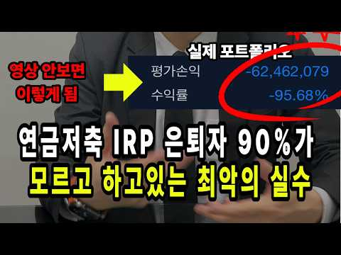
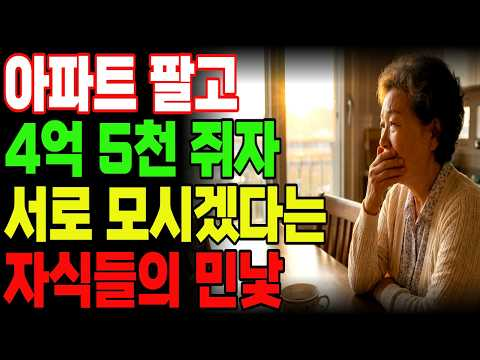

# 재테크 — 성공 사례 분석: 사례별 자세히 #161–#182

`analysis.md` 의 9번 (같은 # 번호). 자동 생성 — `tools/success_analysis.py` v1.4.1 (2026-10-16 07:22 UTC). ※ 연구·교육용 — 투자 권유가 아님.

### 161. 시흥 배곧 신도시의 몰락? 대출 없던 내 집 팔고 5억 빚 냈다가 4년 만에 전재산 날린 택시기사 이야기! ∣ 노후자금사연 ∣ 오디오북

- https://www.youtube.com/watch?v=Y3Fiyr3Qses · 은빛시나리오 · 구독자 29,300 · 조회수 141,473 (×4.8, 하루 830.3) · 좋아요 3,188 (2.2%) · 43.7분 · 2026-04-28 · 주제 묶음 4. 노후·연금 · 형식 사연·드라마 · 폴더 `W_Y3Fiyr3Qses` (웹 승인)
- 썸네일: 
- 챕터: 0:00 인트로 · 2:00 Chapter 1. 2억짜리 내 집, 그 소박했던 천국 · 8:00 Chapter 2. "제2의 송도"라는 달콤한 유혹 · 14:00 Chapter 3. 5억 원의 족쇄, 승부수를 던지다 · 20:00 Chapter 4. 32층 바다 뷰, 신기루의 시작 · 26:00 Chapter 5. 학생들이 없는 대학로, 멈춰버린 … · 32:00 Chapter 6. 퍼펙트 스톰, 이자의 습격 · 40:00 Chapter 7. 10억이 5억으로.. 4년 만에 … · 47:00 Chapter 8. 낡은 내 집 한 채가 천국이었습니다
- 설명 앞부분: 여러분은 노후에 내 집 한 채면 충분하다고 생각하시나요? 35년을 새벽마다 핸들 잡으며 일군 대출 없는 낡은 아파트 한 채. 누가 봐도 부족하지 않은 노후였습니다. 그런데 단 한마디가 그 모든 걸 무너뜨렸어요. "가만히 있으면 손해야." 서울대 병원이 들어온다는 현수막 하나, 제2의 송도라는 말 한마디에 평생 모은 전재산 5억을 걸었습니다. 10억짜리 32층 바다 뷰 아파트. 4년 뒤, 손에 남은 건 5천만 원뿐이었습니다. 시청자 여러분께 이 영상은 실제 은퇴자들의 경험담을 바탕으로 공감과 정보 전달을 위해 각색·재구성한 이야기입…
- 같은 채널 평소 대비 ×4.5 (채널 최근 롱폼 중앙값 31,255회) · 평소 영상: 60대 이상 노후 파산자 45%? 그 숫자가 제가 될 줄 몰랐습니다. 가난한 노년의 공포! (31,255회) / 코스피 7천의 거대한 배신! 삼전닉스 안 사면 바보인가요? 70대 주식 투자자가 증권앱을… (33,672회)
- 대본 없음 (설명) — 음성인식이 끝나면 도입부·흐름이 들어감
- 댓글 512/512: 좋은 점 — 영상 2 · 감사·응원 20 · 더 알고 싶은 것 6 · 아쉬운 점 — 영상 4 · 반박·불만 — 의견 다름 11 · 정치·사회 4 · 경험 공유 17 · 구독·다음 기대 0
  - 좋은 점 — 영상 👍1 “건강하고 병들지 않았으면 괜찮지 않을까 생각됩니다. 아직 60대입니다. 예전에 2억에 팔았던 낡은 아파트 계속 살았으면 재건축 들어갈때 더한 경험 할 수도 있습니다. 차라리 60대에 낡은 아파트 팔고 배곶새아파트 과한대출로 구입해서 1억 5천 날린 경험이 이후 살아가…”
  - 좋은 점 — 영상 👍0 “잘 결정하셨어요ㆍ 공감100%입니다ㆍ”
  - 감사·응원 👍70 “착한 사람들이 이지경 대는게 가슴이 아프다 힘내시고 하루하루 열심히 사시면 복이 올겁니다”
  - 감사·응원 👍31 “희망의 끈을 놓지 마세요. 응원합니다.”
  - 더 알고 싶은 것 👍10 “무슨 아파트인지 알려주세요~ 배곧신도시 분양때부터 제가 중개했습니다~10억이면 송도 매매가였습니다~ 이분 누구인가요?”
  - 더 알고 싶은 것 👍4 “주택가에 혐오 시설인 대형 병원이 들어오면 호재가 아니고 악재인데 어떻게 집값이 오를 수 있나요?”
  - 아쉬운 점 — 영상 👍9 “욕심낼만큼 통이크지않아 주어진만큼만 살아왔더니 66세 빚없이 내집에서 아쉬움없이 사는게 얼마나다행인지 새삼느낌니다”
  - 아쉬운 점 — 영상 👍9 “대다수 한직업에 열중하다 가장 중요한 전부,전안생 거는 부동산 금융 무지에 남애기 낚시성 언론 사기꾼 전문가를 구분못하고 지릇니다 최우선에둬야할 일, 부동산 ,금융 공부입니다 세상 내다볼 상식 식견이 실패를 막아요 좋은 체험 반면교사로 삼고 화이팅하여 재기하세요”
  - 반박·불만 — 의견 다름 👍3 “ㅋㅋㅋ 개솔 10억 할때 홍보관 없었다 알지도 못하면서 소설쓰네 서울대캠퍼스는 대학이고 서울대 병원은 병원이다 뭘 알고나 해라 3억5천에 분양한걸 10억주고 입주해서 15억 된다고 이런 말도 안되는 걸 왜 만드는거야?”
  - 반박·불만 — 의견 다름 👍1 “말도 안되는 소리~”
  - 정치·사회 👍1 “거기다 뿌려진 쿠폰으로 일어나는 인플레이션도 감안하면... 소득은 작살 수준인데... 그런데도 공산주의 정권 지지하는 이상한 나라~”
  - 정치·사회 👍0 “이분들 정말 문제가 뭐였다는걸 모르시네요 잘못하거없어요 하나 기회를 잃은게 윤석열이 이 멧돼지색기 당선됫을때 그때라도 팔았어야됫음 거의 윤석열 그색기 때문인거를 나라말아쳐먹고 끔찍할수도있었겟지만 그나마 게엄 내란 실패해서 다행 멧돼지가 스스로 자폭해줘서 근리든 경제든…”
  - 경험 공유 👍75 “저도 처음에는 솔깃했는데 왠지 이게아니다싶었네요 배곧앞으로 천지개벽없는한 인구소멸지역으로 가네요”
  - 경험 공유 👍10 “무슨 아파트인지 알려주세요~ 배곧신도시 분양때부터 제가 중개했습니다~10억이면 송도 매매가였습니다~ 이분 누구인가요?”

### 162. "68세도 돈버는 부업" 월급70만원 요양사 관두고 집에서 노트북 하나로 순수익 월250만원 버는 68살

- https://www.youtube.com/watch?v=pZ7fCdoOvCI · 록터뷰 · 구독자 35,600 · 조회수 170,634 (×4.8, 하루 1,655.8) · 좋아요 3,384 (2.0%) · 7.8분 · 2026-07-05 · 주제 묶음 8. 부업·소득 · 형식 인터뷰·강연·대담 · 폴더 `W_pZ7fCdoOvCI` (웹 승인)
- 썸네일: 
- 설명 앞부분: 신청하시고 댓글 달아주시는 모든 분들께 제공드립니다! 나이도, 경험도 상관없습니다. 재고 없이, 초기 자본 없이 시작하는 온라인 판매 노하우를 무료 라이브에서 공개합니다. 💬 "온라인 판매는 한 번도 안 해봤는데 괜찮을까요?" 💬 "어떻게 진행하면 될까요?" 💬 "아무것도 몰라도 수익낼 수 있을까요?" 이런 고민이 있으셨다면 이번 무료 라이브에서 모두 알려드립니다. 🎁 무료 라이브 신청만 해도 전원 제공! 📕 사업 시작하는 방법 처음부터 끝까지 📕 집에서 10분이면 끝나는 판매 준비법 📕 돈 버는 온라인 판매 세팅 방법 📘 재고 …
- 같은 채널 평소 대비 ×61.7 (채널 최근 롱폼 중앙값 2,764회) · 평소 영상: "이거 못하면 다른 부업 아무것도 못해요" 아이 둘 키우며 노트북 하나로 하루 2시간 일… (2,818회) / "정말 너무 쉬워요" 백화점 판매원 하면서 휴대폰 하나로 부업하고 월급 받는 65세 어머님 (2,709회)
- 대본 없음 (설명) — 음성인식이 끝나면 도입부·흐름이 들어감
- 댓글 1,602/1,603: 좋은 점 — 영상 36 · 감사·응원 104 · 더 알고 싶은 것 75 · 아쉬운 점 — 영상 1 · 반박·불만 — 의견 다름 2 · 정치·사회 1 · 경험 공유 311 · 구독·다음 기대 18
  - 좋은 점 — 영상 👍9 “구독합니다. 저도 신청할게요. 오랜 경력단절로 무기력하고 자존감도 떨어졌는데.. 좋은 정보 얻었어요.”
  - 좋은 점 — 영상 👍1 “좋은정보 감사드립니다 저도 하고싶습니다”
  - 감사·응원 👍10 “신청합니다❤감사합니다!”
  - 감사·응원 👍8 “구독합니다. 저도 참여하고 싶습니다 정보 감사합니다🎉🎉😢”
  - 더 알고 싶은 것 👍6 “안녕하세요 배워 보고 싶어요 책자 부탁드립니다 감사합니다”
  - 더 알고 싶은 것 👍2 “구독.좋아요 했습니다. ㅎㅎ 무료자료와 링크 부탁드려요”
  - 아쉬운 점 — 영상 👍0 “안녕하세요 저도 요양사 근무하다 동료의 부주의 로 손가락 끝 닷쳐 산재처리 했다는 이유로 원장님의 부당한 차별 근무표로 그만 두게되었어요 현재는 학교 근무하는데 옛날 학교여서 너무 커서 근무 동선 길어서 무릅에 무리가 와서 힘든데 그래도 놓지못하고 하고있었어요 저도 …”
  - 반박·불만 — 의견 다름 👍2 “아무나 하는것 아닙니다 어려워요-”
  - 반박·불만 — 의견 다름 👍1 “바다님입니다~방송보고책을구입햇는데요~~제가원하는내용아닙니다”
  - 정치·사회 👍0 “요양보호사는 가정부다 가정부는 어른신모욕은안하는데.가정부보다 더러운직업이다 사람잘못만나면”
  - 경험 공유 👍21 “안녕하세요 신청합니다 현재 저도 요양사 자격증을 따서 시어머님을 모시는 가족요양사로 일하고 있는 며느리입니다 우연찮게 영상 보게되어 운이 좋다고 생각하고 배워보고 싶어 댓글 남깁니다 기회를 주시면 열심히 해보겠습니다”
  - 경험 공유 👍9 “구독합니다. 저도 신청할게요. 오랜 경력단절로 무기력하고 자존감도 떨어졌는데.. 좋은 정보 얻었어요.”
  - 구독·다음 기대 👍9 “구독합니다. 저도 신청할게요. 오랜 경력단절로 무기력하고 자존감도 떨어졌는데.. 좋은 정보 얻었어요.”
  - 구독·다음 기대 👍8 “구독합니다. 저도 참여하고 싶습니다 정보 감사합니다🎉🎉😢”

### 163. 경제공부 시작하는 법 ∣ 하루 10분이면 됩니다! (해야하는 이유) 🗞️ 📊 💸

- https://www.youtube.com/watch?v=z7fHe2Og-zE · 찌니ZZINI · 구독자 30,600 · 조회수 144,204 (×4.7, 하루 867.9) · 좋아요 0 (0.0%) · 17.5분 · 2026-05-03 · 주제 묶음 1. 재테크 일반·마인드 · 형식 정보·해설 (그 밖) · 폴더 `W_z7fHe2Og-zE` (웹 승인)
- 썸네일: 
- 챕터: 0:00 영상시작 · 0:12 경제공부 하는 이유? · 2:56 어피니 머니레터 · 5:24 매일경제신문 · 13:42 유튜브/팟캐스트 · 14:18 경제책 · 16:10 디그 · 16:44 마무리
- 설명 앞부분: 다이어리는 meeplus에서 제공받아 촬영되었습니다. 🔻다이어리 + 속지 어느덧 매일경제신문을 읽은지 1년이 다되어가네요 ! 꾸준히 10분씩만 하자였는데 1년을 하게 되었어요 경제공부를 해야하는 이유 투자, 부동산매매가 아니더라도 제가 느낀 이유가 있었어요. 하루 10분만 투자하기 초보자도 누구나 가능 ! 누구나 쉽게 할수있게 제가 정리를 했어요. 영상으로 만들었으니 재미있게 봐주세요 🙂
- 같은 채널 평소 대비 ×9.1 (채널 최근 롱폼 중앙값 15,902회) · 평소 영상: 📓 요즘 내가 좋아하는 다이어리, 모텀 ∣ 프로퍼빌롱잉즈 단테 1달 써봤다! (15,902회) / Vlog ∣ 다이어리 그만좀 사 ∣ 한정선 맛있나..❓∣ 모닝페이지, 경제공부 ∣ 양귀자… (14,843회)
- 대본 없음 (설명) — 음성인식이 끝나면 도입부·흐름이 들어감
- 댓글 147/147: 좋은 점 — 영상 11 · 감사·응원 22 · 더 알고 싶은 것 14 · 아쉬운 점 — 영상 1 · 반박·불만 — 의견 다름 0 · 정치·사회 1 · 경험 공유 6 · 구독·다음 기대 3
  - 좋은 점 — 영상 👍311 “신문사에서 가장 중요하게 생각하는 페이지의 순서는 1> 3면이라고 합니다. 그래서 1면의 심층기사가 3면에 계속되는게 보통이라고 들었습니다. 저는 1,3,world,market 섹션은 꼭 읽고 나머지는 시간이 되면 읽는 편입니다. 못읽는날도 스트레스 없이 그냥 넘기고…”
  - 좋은 점 — 영상 👍111 “안녕하세요 늘 영상 잘 보고 있습니다^^ 하나 꿀팁 드리면 press reader 앱 사용하면 매일경제신문 무료로 읽는거 가능합니다 다른 신문도 볼 수 있어요 저는 제가 졸업한 대학교 이메일 계정으로 이용 중이에요^^ 저도 경제공부 열심히 해봐야겠어요 큰 도움 되는 …”
  - 감사·응원 👍111 “안녕하세요 늘 영상 잘 보고 있습니다^^ 하나 꿀팁 드리면 press reader 앱 사용하면 매일경제신문 무료로 읽는거 가능합니다 다른 신문도 볼 수 있어요 저는 제가 졸업한 대학교 이메일 계정으로 이용 중이에요^^ 저도 경제공부 열심히 해봐야겠어요 큰 도움 되는 …”
  - 감사·응원 👍69 “경제 공부 시작하려고 했는데 이렇게 좋은 타이밍에 좋은 영상을 발견했네요! 귀한 정보 알려주셔서 너무 감사하고 참고해서 열심히 공부해보겠습니다!!”
  - 더 알고 싶은 것 👍5 “정말 세세하네요 신문 보기 시작하는데 어떻게 봐야하는지 몰라서 매번 중간 포기했는데 너무 좋은거같아요! 궁금한점은 하루 몇시간 투자해서 공부하시나요? 저는 아침에유튜브로 한경을 보고 머니레터만 보고있는데 확 공부가 된다는 느낌이 없네요😢”
  - 더 알고 싶은 것 👍3 “저는 해외에 살아서 추천해주신 신문들은 못봐서 여기신문으로 시작할려고 하는데 질문있어요. 모르는 경제용어같은건 어떤식으로 배우시나요? 경제에 대해서 1도 몰라서 처음에는 가볍게 시작하고 싶은데 처음부터 너무 깊이 들어갈까하는 고민이있어요. 그리고 읽어도 뉴스의 흐름을…”
  - 아쉬운 점 — 영상 👍311 “신문사에서 가장 중요하게 생각하는 페이지의 순서는 1> 3면이라고 합니다. 그래서 1면의 심층기사가 3면에 계속되는게 보통이라고 들었습니다. 저는 1,3,world,market 섹션은 꼭 읽고 나머지는 시간이 되면 읽는 편입니다. 못읽는날도 스트레스 없이 그냥 넘기고…”
  - 경험 공유 👍311 “신문사에서 가장 중요하게 생각하는 페이지의 순서는 1> 3면이라고 합니다. 그래서 1면의 심층기사가 3면에 계속되는게 보통이라고 들었습니다. 저는 1,3,world,market 섹션은 꼭 읽고 나머지는 시간이 되면 읽는 편입니다. 못읽는날도 스트레스 없이 그냥 넘기고…”
  - 경험 공유 👍111 “안녕하세요 늘 영상 잘 보고 있습니다^^ 하나 꿀팁 드리면 press reader 앱 사용하면 매일경제신문 무료로 읽는거 가능합니다 다른 신문도 볼 수 있어요 저는 제가 졸업한 대학교 이메일 계정으로 이용 중이에요^^ 저도 경제공부 열심히 해봐야겠어요 큰 도움 되는 …”
  - 구독·다음 기대 👍2 “경제 공부 시작하는 법이라니 어떻게 해야 하는지 궁금하네요 입술에 피어싱을 하셧다니...놀랍네요 주변에 입술 피어싱 한분을 한분도 못봤다 보니 더 신기하고 놀라워요 경제 공부를 시작하신 이유가 더 현실적으로 와 닿네요 내 월급은 조금뿐이 안 올렸는데 계란값만 3배라니…”
  - 구독·다음 기대 👍1 “이 영상으로 처음 뵙는데 구독하고 갈게요! 이북리더기 탐나네요,ㅎㅎㅋㅋㅋ 원래 쓰던게 고장나서 새로 사야하나싶었는데,,,, 어디꺼쓰시나요?! 이뻐서 따라사고싶어용 ㅎㅎ”

### 164. 우리 부모님 유산 탐내다 노후 자금 탈탈 털린 시어머니, 전과자에 신용불량자까지 세트로 만들어드림

- https://www.youtube.com/watch?v=5c7V1i5q_xc · 리얼톡툰 · 구독자 15,400 · 조회수 71,334 (×4.6, 하루 505.2) · 좋아요 473 (0.7%) · 9.8분 · 2026-05-28 · 주제 묶음 4. 노후·연금 · 형식 사연·드라마 · 폴더 `W_5c7V1i5q_xc` (웹 승인)
- 썸네일: 
- 설명 앞부분: 우리 부모님 유산 탐내다 노후 자금 탈탈 털린 시어머니, 전과자에 신용불량자까지 세트로 만들어드림 ★리얼톡툰의 영상의 소재들은 인터넷속 '실화'를 각색하거나 '창작'으로 제작 됩니다. 본채널의 동의 없이 영상을 불법다운로드, 복제, 재편집, 재배포 하는 행위는 금지하며, 민형사상의 법적 조치를 취하고 있음을 알려드립니다.
- 같은 채널 평소 대비 ×1.5 (채널 최근 롱폼 중앙값 48,314회) · 평소 영상: 우리집 베이비시터가 남편의 전여친이었다... (48,314회) / [모음집] 음주운전 범죄자랑 장례식장에서 눈 맞은 역대급 남미새 (49,298회)
- 대본 없음 (설명) — 음성인식이 끝나면 도입부·흐름이 들어감
- 댓글 19/19: 좋은 점 — 영상 0 · 감사·응원 0 · 더 알고 싶은 것 0 · 아쉬운 점 — 영상 0 · 반박·불만 — 의견 다름 1 · 정치·사회 0 · 경험 공유 0 · 구독·다음 기대 0
  - 반박·불만 — 의견 다름 👍0 “사돈집 재산을 왜 탐을 낸다요 말도 안되짓을 하네요”

### 165. 은퇴자 90%가 모르고 하는 IRP 연금저축의 치명적인 실수 무조건 따라해야하는 연금 저축 IRP 포트폴리오

- https://www.youtube.com/watch?v=pUUm7GRoncI · 노후사실확인 - 새는 돈 막아드립니다 · 구독자 3,300 · 조회수 14,641 (×4.4, 하루 82.6) · 좋아요 371 (2.5%) · 19.1분 · 2026-04-22 · 주제 묶음 3. 주식·ETF · 형식 정보·해설 (그 밖) · 폴더 `W_pUUm7GRoncI` (웹 승인)
- 썸네일: 
- 설명 앞부분: IRP & 연금저축 완벽 정리 (2026 최신 기준) 퇴직 후 IRP 계좌와 연금저축 계좌를 만들었지만 “도대체 뭘 담아야 하지?” 고민되셨다면 이 글 하나로 정리됩니다. 왜 연금계좌를 꼭 해야 할까? 연금계좌의 핵심은 딱 2가지입니다. 세액공제 혜택 연금저축 + IRP 합산 연 900만원까지 13.2% ~ 16.5% 세금 환급 → 최대 약 148만원 환급 가능 과세이연 + 복리 효과 일반계좌: 수익 발생할 때마다 세금 발생 연금계좌: 세금 없이 계속 재투자 가능 → 장기적으로 수천만 원 차이 발생 ⚠️ 2025~2026 연금계좌…
- 같은 채널 평소 대비 ×78.3 (채널 최근 롱폼 중앙값 187회) · 평소 영상: S&P500 이렇게 사세요 '평생 놀고 먹는 시스템' 노후준비 끝입니다 (187회) / "IRP 연금저축 은행에서 개설하면 절대 안됩니다!" 절세계좌 총정리 (166회)
- 대본 없음 (설명) — 음성인식이 끝나면 도입부·흐름이 들어감
- 댓글 11/11: 좋은 점 — 영상 0 · 감사·응원 3 · 더 알고 싶은 것 1 · 아쉬운 점 — 영상 0 · 반박·불만 — 의견 다름 0 · 정치·사회 0 · 경험 공유 1 · 구독·다음 기대 0
  - 감사·응원 👍0 “귀에 속들어오네요 감사합니다”
  - 감사·응원 👍0 “깔끔한 정리 감사합니다.”
  - 더 알고 싶은 것 👍1 “크레딧제도 는 어디서 볼수있나요? 연금저축계좌에서 쌓여 있는돈요?”
  - 경험 공유 👍1 “최고입니다. IRP30% 안전자산 비중 고민중이었는데 제가 생각하는 상품과 같아 신뢰가 갑니다.🎉”

### 166. 1.3억 커버드콜로 은퇴했어요 #배당투자 #배당은퇴 #경제적자유 #파이어족 #월배당 #고배당주 #주식투자 #재테크#노후준비#배당금생활 #SCHD #JEPI #J…

- https://www.youtube.com/watch?v=BqDfJt2vAHY · ttobaedang또배당 · 구독자 6,610 · 조회수 28,857 (×4.4, 하루 656.2) · 좋아요 538 (1.9%) · 7.9분 · 2026-09-02 · 주제 묶음 1. 재테크 일반·마인드 · 형식 정보·해설 (그 밖) · 폴더 `W_BqDfJt2vAHY` (웹 승인)
- 썸네일: 
- 같은 채널 평소 대비 ×5.1 (채널 최근 롱폼 중앙값 5,613회) · 평소 영상: 8500만원 증발 그래도 행복한이유 #배당투자 #배당은퇴 #경제적자유 #파이어족 #월배당… (5,613회) / 이번달 1960957원 배당 받는다 3억은퇴 #배당투자 #배당은퇴 #경제적자유 #파이어족… (4,191회)
- 대본 없음 (없음) — 음성인식이 끝나면 도입부·흐름이 들어감
- 댓글 153/153: 좋은 점 — 영상 5 · 감사·응원 20 · 더 알고 싶은 것 11 · 아쉬운 점 — 영상 1 · 반박·불만 — 의견 다름 0 · 정치·사회 0 · 경험 공유 13 · 구독·다음 기대 2
  - 좋은 점 — 영상 👍13 “시간의 간절함 정말 공감해요. 이 시간이라는게 젊음이기도 하니까요. 100세 시대가 온다고 젊은 시절의 육체로 100년 사는게 아니고 한 해 한 해 체력이 예전같지 않는 걸 느끼며 자산 뿐만 아니고 내 남은 수명과의 밸런스의 중요하단 생각이 드네요. 앞으로도 좋은 영…”
  - 좋은 점 — 영상 👍5 “기다리던 영상. 잘보고가요 많이 배우고. 유익합니다^^”
  - 감사·응원 👍8 “화이팅❤”
  - 감사·응원 👍7 “오늘처럼 주가 폭락했을때 의기소침 하고 있는데 또배당님 영상을 보며 위로를 받습니다.감사합니다..”
  - 더 알고 싶은 것 👍13 “시간의 간절함 정말 공감해요. 이 시간이라는게 젊음이기도 하니까요. 100세 시대가 온다고 젊은 시절의 육체로 100년 사는게 아니고 한 해 한 해 체력이 예전같지 않는 걸 느끼며 자산 뿐만 아니고 내 남은 수명과의 밸런스의 중요하단 생각이 드네요. 앞으로도 좋은 영…”
  - 더 알고 싶은 것 👍9 “형님 전 직장생활이 너무 힘든 12년차 직장인입니다 이제 막 3억을 바라보고있는데 형님 영상보면서 나도 할수있구나 하고 자신감 얻어갑니다 나중에라도 팬들이랑 가볍게 밥한끼 했으면 하네요 솔직하고 용기있는 모습 너무 멋있습니다 나중에 세금 건보료 관련해서 영상도 부탁드…”
  - 아쉬운 점 — 영상 👍0 “1.3억으로 낚시 ㅡㅡㅅㅂ”
  - 경험 공유 👍9 “형님 전 직장생활이 너무 힘든 12년차 직장인입니다 이제 막 3억을 바라보고있는데 형님 영상보면서 나도 할수있구나 하고 자신감 얻어갑니다 나중에라도 팬들이랑 가볍게 밥한끼 했으면 하네요 솔직하고 용기있는 모습 너무 멋있습니다 나중에 세금 건보료 관련해서 영상도 부탁드…”
  - 경험 공유 👍7 “저랑 비슷한 생각을 하고 계셔서 조금 놀랐어요 ㅎㅎ 100프로 공감해요 투자은 역시 시간이더라구요 그 시간 동안 버틸수 있는 힘은 커버드콜이란 걸 저도 느껴요 그래서 저도 요즘 나만의 원칙을 만들려고 노력하고 있어요❤”
  - 구독·다음 기대 👍5 “싱글파이어 보고 왔어요. 구독했습니다.”
  - 구독·다음 기대 👍1 “오늘 구독했습니다 정주행하러갑니다 ❤ ISA 계좌부터 만들어야겠군요? 토스에선 안보이네요?”

### 167. 경제신문 무료로 보는법 📰 (경제공부 초보 읽는 방법 👀)

- https://www.youtube.com/watch?v=PIiGnsoTl7I · 찌니ZZINI · 구독자 30,600 · 조회수 131,373 (×4.3, 하루 825.1) · 좋아요 0 (0.0%) · 10.2분 · 2026-05-10 · 주제 묶음 2. 돈 모으기·저축 · 형식 정보·해설 (그 밖) · 폴더 `W_PIiGnsoTl7I` (웹 승인)
- 썸네일: 
- 챕터: 0:00 영상시작 · 0:19 첫주식투자 도전 · 1:22 경제신문 무료 방법 · 5:10 경제공부방법 질문 · 9:36 책추천 · 10:00 마무리
- 설명 앞부분: 🔻아래 사이트로 들어가서 국립중앙도서관과 연동하기 오늘은 경제신문 무료로 보는법을 가지고 왔어요 ! 어느덧 1년이 지났더라구요 🙂 연락을 주셨을때 내심 뿌듯하기도 하고 1년전 저의 모습이 보이더라구요 ✨ 많은 분들이 도움 되셨음 좋겠습니다! ⏰ 타임라인
- 같은 채널 평소 대비 ×8.3 (채널 최근 롱폼 중앙값 15,902회) · 평소 영상: 📓 요즘 내가 좋아하는 다이어리, 모텀 ∣ 프로퍼빌롱잉즈 단테 1달 써봤다! (15,902회) / Vlog ∣ 다이어리 그만좀 사 ∣ 한정선 맛있나..❓∣ 모닝페이지, 경제공부 ∣ 양귀자… (14,843회)
- 대본 없음 (설명) — 음성인식이 끝나면 도입부·흐름이 들어감
- 댓글 334/334: 좋은 점 — 영상 37 · 감사·응원 86 · 더 알고 싶은 것 14 · 아쉬운 점 — 영상 1 · 반박·불만 — 의견 다름 0 · 정치·사회 2 · 경험 공유 10 · 구독·다음 기대 2
  - 좋은 점 — 영상 👍26 “경제신문을 굳이 돈 주고 볼 필요는 없다고 생각하는 편입니다. 다만 솔직히 말씀드리면, 복잡한 절차를 거쳐 무료로 보는 방식은 오래 유지하기 쉽지 않더라고요. 물론 잘 활용하시는 분들도 계시겠지만 때마다 로그인하고 도서관 연동하고 매번 들어가는 과정 자체가 생각보다 …”
  - 좋은 점 — 영상 👍17 “와... 경제지 뿐만 아니라 여러나라의 신문도 한번 쯤 보고 싶었는데.. 이런 서비스가 있었는 지 몰랐네요. 정말 감사합니다. 큰 도움이 되었습니다.”
  - 감사·응원 👍74 “헐 이렇게 쉽게 성공하다니..!! 예전에 저도 국립중앙도서관으로 하면 프레스리더로 무료 읽기 된다구 해서 시도했다가 실패했었는데 알려주신대로 시도했더니 바로 인증됐어요ㅠㅠ 정말 감사해요~~!!”
  - 감사·응원 👍17 “와... 경제지 뿐만 아니라 여러나라의 신문도 한번 쯤 보고 싶었는데.. 이런 서비스가 있었는 지 몰랐네요. 정말 감사합니다. 큰 도움이 되었습니다.”
  - 더 알고 싶은 것 👍4 “이런 정보 몰랐다면 덜컥 돈 주고 구독했을 것 같은데… 너무 감사해요!! 🥹 그리고 혹시 1:22 이 기기는 이름이 뭔지 알 수 있을까요?”
  - 더 알고 싶은 것 👍3 “몇일이 지난후에는 무료로 안되네요 로그아웃하고 다시 로긴해도 프리미엄 가입 안내가 나오면서 볼수 없게 되네요 맞나요?”
  - 정치·사회 👍1 “매일경제 경향신문 한겨레 다 좌파 성향 신문이네요ㅠ 그건 좀 아쉽 좌파 우파 둘 다 보고싶은데”
  - 정치·사회 👍0 “나라가 넘어가도 ㅈㅍ언론사 신문을 읽네”
  - 경험 공유 👍74 “헐 이렇게 쉽게 성공하다니..!! 예전에 저도 국립중앙도서관으로 하면 프레스리더로 무료 읽기 된다구 해서 시도했다가 실패했었는데 알려주신대로 시도했더니 바로 인증됐어요ㅠㅠ 정말 감사해요~~!!”
  - 경험 공유 👍26 “경제신문을 굳이 돈 주고 볼 필요는 없다고 생각하는 편입니다. 다만 솔직히 말씀드리면, 복잡한 절차를 거쳐 무료로 보는 방식은 오래 유지하기 쉽지 않더라고요. 물론 잘 활용하시는 분들도 계시겠지만 때마다 로그인하고 도서관 연동하고 매번 들어가는 과정 자체가 생각보다 …”
  - 구독·다음 기대 👍4 “이런 정보 몰랐다면 덜컥 돈 주고 구독했을 것 같은데… 너무 감사해요!! 🥹 그리고 혹시 1:22 이 기기는 이름이 뭔지 알 수 있을까요?”
  - 구독·다음 기대 👍1 “우와 좋은 정보 감사해요 ! 만드시는 컨텐츠 결이 제 관심사랑 맞아서 쭉 보고 싶어지네요 ㅎㅎ 다음 영상도 기다릴게욤💚”

### 168. ETF는 이 '2개'로 충분합니다. 돈 있으면 무조건 여기부터 넣습니다. 노후 준비 끝납니다 (백승호 단장 3부) #백승호 #ETF #배당금 #커버드콜

- https://www.youtube.com/watch?v=YdmZDxBcYKE · 자람들 - 자립하는사람들 · 구독자 33,700 · 조회수 143,647 (×4.3, 하루 3,705.2) · 좋아요 1,061 (0.7%) · 19.7분 · 2026-09-07 · 주제 묶음 3. 주식·ETF · 형식 인터뷰·강연·대담 · 폴더 `W_YdmZDxBcYKE` (웹 승인)
- 썸네일: 
- 설명 앞부분: 👤 오늘의 게스트: 백승호 단장 (3부) 개인 재무 컨설팅 전문가 & 유튜버·작가로도 활동 100억원대 자산을 20년간 관리해온 재무 컨설턴트가 이번엔 계좌별 자산 배치 전략, 나이대별 포트폴리오 구성법, 그리고 투자 철학의 핵심을 정리했습니다. 절세 계좌(ISA·연금)에 국내 주식을 넣으면 오히려 손해라는 아이러니한 사실부터, 조기축구회에 비유한 20대·40대·60대별 맞춤 포트폴리오, 저평가된 중국 ETF와 생소한 유럽 명품 ETF 추천까지 다뤘습니다. 마지막은 "투자는 버티는 것"이라는 한마디로 마무리됩니다. 절세계좌에국내주…
- 같은 채널 평소 대비 ×5.8 (채널 최근 롱폼 중앙값 24,928회) · 평소 영상: 월 500만원 배당 노하우, 시드 5천 '이렇게' 구성하세요. 평범한 직장인이 파이어한 … (24,928회) / 연 2200 배당금받는, 전직 배달 기사.. 3억으로 은퇴했습니다. (또배당 3부) #배… (25,556회)
- 대본 없음 (설명) — 음성인식이 끝나면 도입부·흐름이 들어감
- 댓글 61/61: 좋은 점 — 영상 2 · 감사·응원 4 · 더 알고 싶은 것 2 · 아쉬운 점 — 영상 1 · 반박·불만 — 의견 다름 0 · 정치·사회 0 · 경험 공유 2 · 구독·다음 기대 0
  - 좋은 점 — 영상 👍8 “강의 내용이 매우 퀄리티 있고 구구절절 공감가는 내용인데 주변 소음이 너무 아쉽네요.”
  - 좋은 점 — 영상 👍1 “이분 말씀 진짜 와닿네요. 한번 뵙고 싶네요.”
  - 감사·응원 👍3 “리밸런싱의 중요함을 다시한번 깨우치네요~ 감사^^”
  - 감사·응원 👍1 “투자자에게 너무 소중한 정보들입니다. 알고도 실천하지 않은분들이 대부분입니다. 주옥같은 내용들, 꼭 실천해 보도록 하겠습니다. 감사합니다^^”
  - 더 알고 싶은 것 👍0 “채권은잘모르겠어요 어떤걸사야되는지?”
  - 아쉬운 점 — 영상 👍8 “강의 내용이 매우 퀄리티 있고 구구절절 공감가는 내용인데 주변 소음이 너무 아쉽네요.”

### 169. 성공한 인생인 줄 알았습니다... 은퇴 후 찾아온 잔인한 현실

- https://www.youtube.com/watch?v=27QUCjtiMVg · 인생의에필로그 · 구독자 9,590 · 조회수 39,835 (×4.2, 하루 398.4) · 좋아요 463 (1.2%) · 19.3분 · 2026-07-08 · 주제 묶음 4. 노후·연금 · 형식 사연·드라마 · 폴더 `W_27QUCjtiMVg` (웹 승인)
- 썸네일: 
- 챕터: 0:00 인트로 · 0:33 1장. 오랜만의 모임 · 2:41 2장. 같은 자리에서 시작했는데 · 3:46 3장. 좋았던 시절 · 5:02 4장. 조금씩 어긋나기 시작했다 · 11:45 5장. 처음으로 따져본 노후 · 12:52 6장. 빛바랜 사진 앞에서 · 14:15 7장. 내밀어준 손 · 16:24 8장. 뒤늦게 알게 된 것 · 18:21 9장. 제작자인사
- 설명 앞부분: 평생 자기 가게 하나로 성공한 삶을 살았다 믿었던 60대 가장. 은퇴 후 오랜만에 만난 친구들 앞에서 처음으로 자신의 노후를 계산기에 두드려본 날의 이야기입니다. 크게 벌었는데도 손에 남은 게 없었던 이유, 매달의 작은 안정을 우습게 봤던 대가는 무엇이었을까요. 노후자금과 은퇴 후 삶을 돌아보게 하는 오늘의 사연, 끝까지 들어주세요. ⏱ 타임스탬프 본 영상은 공개된 자료와 실제 사건을 참고하여 제작자가 직접 기획·각본한 스토리텔링 콘텐츠입니다. 일부 표현과 장면은 이해를 돕기 위한 창작적 각색이 포함되어 있습니다. 본 콘텐츠는 다…
- 같은 채널 평소 대비 ×22.5 (채널 최근 롱폼 중앙값 1,769회) · 평소 영상: 친구따라 장사 시작했다가… 62세에 개인회생 신청할 줄은 몰랐습니다 (1,922회) / 35년 바쳤는데… 은퇴 날 이혼 서류 받은 67세 가장의 눈물 (1,616회)
- 대본 없음 (설명) — 음성인식이 끝나면 도입부·흐름이 들어감
- 댓글 40/40: 좋은 점 — 영상 0 · 감사·응원 0 · 더 알고 싶은 것 1 · 아쉬운 점 — 영상 1 · 반박·불만 — 의견 다름 0 · 정치·사회 0 · 경험 공유 2 · 구독·다음 기대 0
  - 더 알고 싶은 것 👍0 “실손보험 들었눈데 가입3개월전에 병원기록있러서 해약 되려하는대 방법있을까요?”
  - 아쉬운 점 — 영상 👍0 “핵심없는 이야기 너무 길게 하신거 아닌가요,,,,,,,,,,,,핵심이 없어요, 왜 들어야 하죠?”
  - 경험 공유 👍7 “명퇴 12년차 60대인데, 퇴직후 빚없이 아파트1채 소유하며, 부부 공적연금 300만원+ 목돈4억원이면, 월360만원 이상의 금융소득으로 노부부 돈 신경 안쓰고 삽니다. 단 부부가 큰병없이 건강하고, 출가한 자식들과 돈거래가 전혀없고, 보이스피싱 등 사기만 안 당하면…”

### 170. 배당 ETF 10억 투자하면 진짜 배당금 얼마? ∣ 공식분배금·실수령 차이 (무료 전자책 제공)

- https://www.youtube.com/watch?v=KGOC_mfphu4 · 은퇴머니 - 은퇴 현금흐름 설계 · 구독자 30,000 · 조회수 123,678 (×4.1, 하루 768.4) · 좋아요 2,065 (1.7%) · 18.8분 · 2026-05-08 · 주제 묶음 3. 주식·ETF · 형식 정보·해설 (그 밖) · 폴더 `W_KGOC_mfphu4` (웹 승인)
- 썸네일: 
- 챕터: 0:00 도입 — 10억 ETF에 넣으면 매달 얼마? · 4:25 시뮬레이터 — 공식 분배금에서 실수령까지 · 13:40 마무리 — 빠져나가는 돈을 줄이는 조합
- 설명 앞부분: 10억을 한 ETF에 통째로 넣으면 — 공식 분배금의 65%만 실수령. 배당소득세·종합소득세·건강보험료, 세 단계에서 빠져나가는 돈을 시뮬레이터로 확인합니다. PDF 요약본 안내: 고정 댓글 확인 📑 영상 PPT 자료 영상 내용을 정리한 슬라이드를 웹에서 바로 보고, PDF로도 내려받을 수 있습니다. 🧮 직접 계산해 보기 영상의 사례를 내 조건으로 바꿔 계산할 수 있습니다.
- 같은 채널 평소 대비 ×8.2 (채널 최근 롱폼 중앙값 15,092회) · 평소 영상: 국민연금 언제 받을까? 배당금·피부양자까지 [몰아보기] (15,922회) / ETF 포트폴리오, 은퇴 전에 확인해야 할 또 하나의 기준 (14,263회)
- 대본 없음 (설명) — 음성인식이 끝나면 도입부·흐름이 들어감
- 댓글 261/261: 좋은 점 — 영상 16 · 감사·응원 23 · 더 알고 싶은 것 18 · 아쉬운 점 — 영상 6 · 반박·불만 — 의견 다름 2 · 정치·사회 3 · 경험 공유 14 · 구독·다음 기대 6
  - 좋은 점 — 영상 👍7 “구독했습니다. 좋은 내용 감사합니다 ~~”
  - 좋은 점 — 영상 👍6 “계산에 약간 오류가 있네요, 미국 지수 추종 한국 상장 ETF의 분배금은 15.4%가 아니라 15% 원천징수입니다. ^^ 좋은 영상 감사합니다.”
  - 감사·응원 👍9 “연금저축계좌나 isa에서는 얼마나 절세되는지 비교분석해 주시면 감사하겠습니다”
  - 감사·응원 👍7 “구독했습니다. 좋은 내용 감사합니다 ~~”
  - 더 알고 싶은 것 👍9 “연금저축계좌나 isa에서는 얼마나 절세되는지 비교분석해 주시면 감사하겠습니다”
  - 더 알고 싶은 것 👍6 “원금이 어쩧개 되는지도 알려주세요”
  - 아쉬운 점 — 영상 👍0 “너무 길어서 그래서 얼마 받는지 알수가 없네...”
  - 반박·불만 — 의견 다름 👍9 “국내 커버드콜로 하면 실제 수령액에서 옵션 수익분은 다 빼야 해요. 그냥 전부 합하면 위처럼 말도 안되는 건강보험료, 원천차감금액이 나와요. 따라서 커버드콜을 미국지수나 주식에 연동되는 것으로 하면 손해가 수천 만원씩 나와요.”
  - 정치·사회 👍0 “평생 근로자로 살다 집한채 들고 은퇴하려고 봤더니 세금 천지에 보유세에 상속세 건강보험료까지 어러다 노후 파산해서 노숙자로 전락할까 걱정입니다 이 정권이 주식에 부동산까지 다 망가트리고 세금만 잔뜩 부과해서 사적 재산까지 탈탈 털어가기 전에 차라리 이민을 준비해야하나…”
  - 경험 공유 👍1 “10억으로 빠질거 빠지고 월 600이상이면 노후는 될거 같은데..저도 qqqi 10000주 목표로 매수하고있는데.. 이제 1200 주지만..”
  - 경험 공유 👍1 “멋집니다 저도 받고 싶어요 자료~!!”
  - 구독·다음 기대 👍7 “구독했습니다. 좋은 내용 감사합니다 ~~”
  - 구독·다음 기대 👍4 “구독완료~~~ Isa계좌 커버드콜만 운용하는데 비교 부탁드립니다 그리고 배당금은 어느정도를 받아야 세금을 합리적으로 내는지도 궁금합니다”

### 171. 배당 10%를 주면서 동시에 주가도 20% 오른 단 6개의 ETF [1,099개 ETF 모두 뒤져봤습니다.]

- https://www.youtube.com/watch?v=4Gy4lBNuebE · 우아한짠테크 TV · 구독자 37,200 · 조회수 150,728 (×4.0, 하루 982.9) · 좋아요 4,481 (3.0%) · 12.7분 · 2026-05-15 · 주제 묶음 3. 주식·ETF · 형식 정보·해설 (그 밖) · 폴더 `W_4Gy4lBNuebE` (웹 승인)
- 썸네일: 
- 설명 앞부분: 안녕하세요, 우아한짠테크 '우짠'입니다! "배당 많이 받으면 주가는 안 오른다?" 이 상식을 완벽하게 깨부쉈습니다. 국내 상장 ETF 1,099개를 일일이 전수조사해 [배당 10% + 주가 상승 20% + 순자산 3,000억 이상]이라는 미친 조건을 통과한 ETF만 걸러냈습니다. 심지어 이 중에는 수익률 무려 103%를 찍어버린 전설적인 종목도 숨어있는데요! 월배당 투자자라면 무조건 계좌에 담아야 할 상위 0.55%의 기적 같은 ETF, 오늘 영상에서 확인하세요!
- 같은 채널 평소 대비 ×13.8 (채널 최근 롱폼 중앙값 10,926회) · 평소 영상: 매월 100만원으로 시작해 '월 배당 300만원' 연금처럼 받으세요. (11,105회) / ISA, 연금계좌 S&P500만 샀다고요? 10년 뒤 땅을 치고 후회합니다. (10,746회)
- 대본 없음 (설명) — 음성인식이 끝나면 도입부·흐름이 들어감
- 댓글 316/316: 좋은 점 — 영상 22 · 감사·응원 61 · 더 알고 싶은 것 16 · 아쉬운 점 — 영상 1 · 반박·불만 — 의견 다름 0 · 정치·사회 1 · 경험 공유 10 · 구독·다음 기대 3
  - 좋은 점 — 영상 👍7 “도움이 됩니다.감사합니다.”
  - 좋은 점 — 영상 👍7 “은퇴한지 오래된 주린이. 고정구독자입니다. 아직은 고정현금 흐름이 있기에, 절세계좌 (isa,연금저축, 비과세종합저축계좌) 에서 , 성장주와 고배당주에 투자중입니다. 항상 커버드콜에 관심이 있었는데, 커버드콜에 대한 공부가 아직은 확실히 덜되어 있었는데, 오늘 영상이…”
  - 감사·응원 👍14 “깔끔한 정리 감사합니다.”
  - 감사·응원 👍7 “도움이 됩니다.감사합니다.”
  - 더 알고 싶은 것 👍3 “저기 중에서 1-2개는 담아가야 겠어요:) 없어서 아쉬웠는데! 이렇게 분석해주셔서 감사합니다. 우짠님 어찌 생각하시나요?~ 요즘 장신없어 자주 못왔는데! 우짠님 현재 포트폴리오도 궁금하네요~~~”
  - 더 알고 싶은 것 👍3 “비교분석 감사합니다. 반은 있고 반은 없네요.^^ 다행히 아직까진 수익률도 빨간블이고~ 최근 상장한 ETF들 국내 몇개 있던데요. 비교.예측 부탁드립다. 구독.❤하고 갑니다.”
  - 아쉬운 점 — 영상 👍3 “저기 중에서 1-2개는 담아가야 겠어요:) 없어서 아쉬웠는데! 이렇게 분석해주셔서 감사합니다. 우짠님 어찌 생각하시나요?~ 요즘 장신없어 자주 못왔는데! 우짠님 현재 포트폴리오도 궁금하네요~~~”
  - 경험 공유 👍66 “분석 하시느라 수고 많으셨습니다 언급 하신 여섯개 종목 중에 저희 포트폴리오 안에는 총 4개 종목이 포함되어 있네요 그래서인지 현재 손실 중인 종목은 단 한개도 없고 전체 계좌 총 수익률은 어제 기준 16% 입니다”
  - 경험 공유 👍6 “감사합니다. 제가 기존에 갖고있던 3가지 etf 와 이 6개 모두 총 9가지 etf만 매수해야겠습니다. 유익한 정보 정말 감사드립니다 ~~~~!”
  - 구독·다음 기대 👍12 “깔끔한 정리 아주 좋네요~~ 구독갑니다”
  - 구독·다음 기대 👍2 “왕왕 주린이인대 너무 잘봤어요 매일봐도 모르겟었는데 도움받고가요 근데 커버드콜도 장투하는 개념인지 안전한지 궁금합니다 감사합니다”

### 172. "골드만삭스가 전주에 무릎 꿇었습니다" 국민연금 1,458조, 세계 1위 수익률의 비밀

- https://www.youtube.com/watch?v=3Hw87oNMlHI · 경제초고수 · 구독자 39,400 · 조회수 149,400 (×3.8, 하루 916.4) · 좋아요 4,089 (2.7%) · 14.7분 · 2026-05-06 · 주제 묶음 4. 노후·연금 · 형식 인터뷰·강연·대담 · 폴더 `W_3Hw87oNMlHI` (웹 승인)
- 썸네일: 
- 챕터: 0:00 231조 수익, 삼성전자 반 개를 벌어왔다 (Hook) · 0:25 골드만삭스가 전주에 사무소를 열었다 · 0:50 블랙록, 알리안츠까지 전주에 모이는 이유 · 1:10 오늘 영상 로드맵 선언 · 1:30 적립금 1,458조, 세계 3위 연기금 · 1:50 1년 예산 680조의 두 배 · 2:10 해외주식 508조, 해외투자 합계 607조 (44%) · 2:30 대체투자 214조: 공항, 도로, 데이터센터, 오피스 · 3:00 대체투자가 왜 중요한가 (폭락장 쿠션) · 3:30 과거 채권 53% 시대의 교훈 · 3:50 수익률 4.2% vs 캐나다 10.7% (7년 전 꼴… · 4:20 복리 차이: 5년이면 수백 조 · 4:40 왜 채권에 묶어뒀나 (정치적 안전 논리) · 5:00 대전환 시작: 해외 37%, 대체 17% · 5:20 한국 주식 시장 비중 2%, 98%를 놓치고 있었다 · 5:40 장기 목표 해외투자 60% · 6:00 김성주 이사장: 사상 첫 재임 · 6:20 자산 배분 철학: 비율이 수익 90% 결정 · 6:50 정치 압력과 관성을 돌파한 팀 · 7:10 세계 비교: 한국 18.82% 압도적 1위
- 설명 앞부분: 2025년 국민연금 수익률 18.82%. 역대 최고. 1년 수익금만 231.6조 원. 삼성전자 시가총액의 절반을 1년 만에 벌어왔습니다. 근데 진짜 소름 돋는 건 따로 있어요. 골드만삭스가 전주에 사무소를 열었습니다. 배우러 온 거예요. 이 영상에서 다루는 내용: 국민연금 적립금 1,458조 원, 세계 3위 연기금의 규모 해외투자 607조 원 (44%), 대체투자 214조 원의 정체 과거 채권 53% 시대 수익률 4.2%에서 현재 18.82%로의 대전환 자산 배분 전략: 종목이 아니라 비율이 수익의 90%를 결정한다 세계 연기금 …
- 같은 채널 평소 대비 ×34.7 (채널 최근 롱폼 중앙값 4,300회) · 평소 영상: 같은 돈 남기고도 삼 년 뒤가 갈리는 이유 ∣ 사회초년생 월급의 순서 (4,517회) / 캐나다안산거 우리가 살게 사우디가 장보고3를 원하는이유 (4,083회)
- 대본 없음 (설명) — 음성인식이 끝나면 도입부·흐름이 들어감
- 댓글 415/415: 좋은 점 — 영상 1 · 감사·응원 10 · 더 알고 싶은 것 2 · 아쉬운 점 — 영상 0 · 반박·불만 — 의견 다름 14 · 정치·사회 52 · 경험 공유 5 · 구독·다음 기대 0
  - 좋은 점 — 영상 👍35 “골드만삭스와 공동연구? 이거는 국부에 도움이 안될것 같은데요.. 저들의 의도는 한국 주식시장 망가뜨릴것 같아요.”
  - 감사·응원 👍206 “지금시점으론 1700조라던데.. 5000조 만들어서 연금좀 많이줘라.. 부탁하고 응원한다..”
  - 감사·응원 👍116 “극민연금 현재의 직원들 잘 운영해주어 고맙고 수고 많습니다”
  - 더 알고 싶은 것 👍0 “삼성전자 시총 400조 언제적 얘기 하시는지?”
  - 반박·불만 — 의견 다름 👍1 “국민 연금을 그렇게 욕 먹으면서 개혁을 하니 이런 좋은 일도 생겨서 더이상 국민 연금 고갈 되어서 못 받는 다는 헛소리 안 나오게 되어 미래 세대가 세금 폭탄을 드디어 벗어 나게 되어 새로운 세상에 대한 희망이 생기게 되었다..”
  - 반박·불만 — 의견 다름 👍1 “헛소리 하지마. 꼴깝 더네.”
  - 정치·사회 👍74 “우리연금제도를 보고 많은 나라가 부러워할 것 같습니다. 참 말이 많았죠. 최근 주식 때문이기도 하지만 다행입니다. 주변에 연금 받는 사람들 보면 생활을 완전히 보장은 못해도 상당한 도움이 됩니다. 안심하시고 연금을 꾸준히 납입하세요.”
  - 정치·사회 👍71 “이재명 대통령이 국민연금고갈 문제를 1년만에 다 해결했네. 대단하다 정말.”
  - 경험 공유 👍22 “국민연금 투자결정했었던 사람들에게 인센티브를 줘야합니다. 그것도 생각했던 것 보다 많이... 반도체 공장에 근무만해도 내년에 10억이상 받는데... 이런 투자결정을 했었던 사람들이 받아야지 ... 자 ~ 박수 짝짝짝~♡”
  - 경험 공유 👍4 “나도 껴주라”

### 173. 서울대 의대생이었던 내가 돈을 모으기 시작한 이유ㅣ반지하에서 반포자가까지(feat. 절약, 저축)

- https://www.youtube.com/watch?v=qP7PI42yX6g · 닥터나솔 · 구독자 49,200 · 조회수 182,868 (×3.7, 하루 2,860.4) · 좋아요 2,443 (1.3%) · 15.8분 · 2026-08-13 · 주제 묶음 2. 돈 모으기·저축 · 형식 인터뷰·강연·대담 · 폴더 `W_qP7PI42yX6g` (웹 승인)
- 썸네일: 
- 같은 채널 평소 대비 ×1.7 (채널 최근 롱폼 중앙값 105,503회) · 평소 영상: '이걸 너무 늦게 알았어요' 47세에 돌아보니 나에게 맞는 인생을 사는 법 (105,503회) / “두려웠어요…” 혼자 호텔로 도망쳐보니 알게 된 것 ∣ 혼자 사는 40대 병원장의 연휴 (105,863회)
- 대본 없음 (없음) — 음성인식이 끝나면 도입부·흐름이 들어감
- 댓글 280/281: 좋은 점 — 영상 2 · 감사·응원 34 · 더 알고 싶은 것 0 · 아쉬운 점 — 영상 1 · 반박·불만 — 의견 다름 2 · 정치·사회 2 · 경험 공유 28 · 구독·다음 기대 5
  - 좋은 점 — 영상 👍10 “많이 배웁니다 제가 많이 부족함을 느낍니다. 인생을 다시 잘 살아야겠다고 생각이 드는 영상입니다. 이런걸 알려주셔서 감사합니다”
  - 좋은 점 — 영상 👍0 “좋은 말씀 감사합니다.”
  - 감사·응원 👍364 “학교다닐때 95학번입니다.저희 고등학교에서 넘사벽 전교 1등 저는 10등권 이었습니다. 진짜 서울의대는 넘사벽이었죠.장세권 이름도 안잊어 먹을 정도로 수재여서 그친구도 평범한 집. 그런 끈기와 머리는 부모님께 받은 선물입니다. 노력만으로도 안되지요. 저는 수유시장 앞…”
  - 감사·응원 👍273 “부모님께서 좋은 머리를 물려주셨어요...넘 감사할 일이죠...”
  - 아쉬운 점 — 영상 👍3 “저 좋은 유전자를 후대에 못전한게 아쉽네요”
  - 정치·사회 👍10 “저도 아버지께서 최근에 하늘나라가셔서 요즘따라 많이 그립네요.ㅎ 어머니도 잘모시도록 하겠습니다.”
  - 정치·사회 👍0 “제 개인적 이야기 입니다. 고등학교 3년 입학 성적이 좋아 입학장학금을 저도 쌍둥이라서 가정 생계가 힘들었지만 부모님 가르침으로 그 친구에게 장학금을 양보 했습니다. 그 친구가 의대에 진학하고 제 쌍둥이 동생에게 82년 1억이란 돈을 대출해주어 자영업을 하게 도와주었…”
  - 경험 공유 👍364 “학교다닐때 95학번입니다.저희 고등학교에서 넘사벽 전교 1등 저는 10등권 이었습니다. 진짜 서울의대는 넘사벽이었죠.장세권 이름도 안잊어 먹을 정도로 수재여서 그친구도 평범한 집. 그런 끈기와 머리는 부모님께 받은 선물입니다. 노력만으로도 안되지요. 저는 수유시장 앞…”
  - 경험 공유 👍78 “94년도 중3때 도덕담당이던 아줌씨 담임 내가 교실을 깨끗히 청소 잘 한다며 일요일 본인 집 이삿날 새벽일찍부터 날 불러 청소시키더라. 순진했던 난 왁스로 손이 벗겨져라 화장실 청소까지 말끔하게 했는데 본인 가족 끼리만 짜장면 먹으러가고 나한텐 뻥튀기 과자 한봉다리 …”
  - 구독·다음 기대 👍22 “저도 지금 경제 상황이 좋지 않은 대학생인데 보면서 희망을 얻고 구독하고 갑니다. 멋있으세요!”
  - 구독·다음 기대 👍16 “아~~~쌤. 저 반성하게 되요. 팬입니다. ㅎㅎ”

### 174. 돈 버는 방식은 정해져 있다, 수익 모델 15종 다이제스트

- https://www.youtube.com/watch?v=wr4nCMUy1dk · 사다리게임 · 구독자 36,100 · 조회수 133,753 (×3.7, 하루 949.8) · 좋아요 9,030 (6.8%) · 18분 · 2026-05-28 · 주제 묶음 기타 · 형식 정보·해설 (그 밖) · 폴더 `W_wr4nCMUy1dk` (웹 승인)
- 썸네일: 
- 설명 앞부분: 수익 모델의 유형은 이미 정해져 있습니다. 세상에 아무리 새로운 서비스가 나와도, 돈을 버는 구조는 결국 기존 패턴의 선택이거나 조합이에요. 15가지 수익 모델을 하나씩 빠르게 훑을 건데요, 이 중에서 여러분의 사업에 맞는 걸 찾아 보세요.
- 같은 채널 평소 대비 ×7.6 (채널 최근 롱폼 중앙값 17,553회) · 평소 영상: 대기업 잔치에 끼어들 수 있는 아이템이 있습니다 (신사업 원정대) (17,553회) / 일본에선 외국인 노동자가 새로운 고객층이 됐습니다 (17,373회)
- 대본 없음 (설명) — 음성인식이 끝나면 도입부·흐름이 들어감
- 댓글 77/77: 좋은 점 — 영상 7 · 감사·응원 9 · 더 알고 싶은 것 2 · 아쉬운 점 — 영상 0 · 반박·불만 — 의견 다름 0 · 정치·사회 0 · 경험 공유 1 · 구독·다음 기대 2
  - 좋은 점 — 영상 👍5 “좋은 영상 감사합니다.”
  - 좋은 점 — 영상 👍3 “좋은 영상 감사합니다!”
  - 감사·응원 👍34 “뭐지 이 개 똑똑한 영상이 내게 뜨다니.... 감사합니다.”
  - 감사·응원 👍10 “우연히 보게되었는데 내용이 간결하게 핵심이 잘 정리되어서 너무 좋았습니다 감사합니다 😊”
  - 더 알고 싶은 것 👍16 “당연한 얘기들이지만 실천하기가 참 어려운😂 각각의 초기자금과 난이도도 붙여서 심화버전도 만들어주시면 좋겠네요!”
  - 더 알고 싶은 것 👍2 “각각 매출 발생 방법별 디테일한 성과 지표알려주세요”
  - 경험 공유 👍3 “제가 봤으니까 이제 영상 내려주세요”
  - 구독·다음 기대 👍3 “구독하고 갑니다. 감사합니다.”
  - 구독·다음 기대 👍2 “구독합니다”

### 175. 월 100만 원으로 QLD 적립식 투자하면 10억 은퇴자금 가능할까?

- https://www.youtube.com/watch?v=hSorn4W4RsI · 돈재이 DONJAY · 구독자 19,800 · 조회수 67,814 (×3.4, 하루 455.1) · 좋아요 1,360 (2.0%) · 19.2분 · 2026-05-20 · 주제 묶음 3. 주식·ETF · 형식 오디오북·낭독 (명언·인생조언) · 폴더 `W_hSorn4W4RsI` (웹 승인)
- 썸네일: 
- 설명 앞부분: ⭐안녕하세요, 본 채널은 저의 개인적인 투자 여정과 장기 투자 철학을 기록하는 공간입니다. 제가 겪은 시행착오와 시장을 바라보는 관점이 여러분의 투자 공부에 작은 참고가 되기를 희망합니다. 다만, 채널의 모든 콘텐츠는 정보 전달을 목적으로 제작되었습니다. 여러분의 성공적인 투자 여정을 응원합니다.
- 같은 채널 평소 대비 ×3.8 (채널 최근 롱폼 중앙값 17,847회) · 평소 영상: 수익률 200%차이? 적립식 투자 수익률 어떤 것이 더 높을까? 매일 사기 vs 매주 사… (17,847회) / 환율 계속 떨어지는데 QLD 투자해도 될까? 제 결론입니다 (17,667회)
- 대본 없음 (설명) — 음성인식이 끝나면 도입부·흐름이 들어감
- 댓글 342/342: 좋은 점 — 영상 6 · 감사·응원 34 · 더 알고 싶은 것 34 · 아쉬운 점 — 영상 0 · 반박·불만 — 의견 다름 0 · 정치·사회 0 · 경험 공유 27 · 구독·다음 기대 1
  - 좋은 점 — 영상 👍3 “재밌게 잘 봤습니다👍앞으로도 계속해서 좋은 정보 많이 올려주세용👍 멋집니다”
  - 좋은 점 — 영상 👍3 “돈재이님 영상 너무 잘봤습니다 ~! 세금관련 영상도 쉽게 이해할수있는 영상도 제작 부탁드립니다!”
  - 감사·응원 👍16 “10년후에 저도 같이 밥 먹어요^^ 투자메이트가 생기니 투자가 더 재밌네요~~ 10년동안 사라지기 없기!!!! 돈재이님의 삶을 응원합니다!!!”
  - 감사·응원 👍7 “헐 지금 내가 딱 궁금한 딱!!!! 슈드 큐엘디 갈까 고민하는 상황에서 뜨네 와 감사합니다”
  - 더 알고 싶은 것 👍5 “10억으로 하면 100억도 되나요?”
  - 더 알고 싶은 것 👍3 “돈재이님 영상 너무 잘봤습니다 ~! 세금관련 영상도 쉽게 이해할수있는 영상도 제작 부탁드립니다!”
  - 경험 공유 👍26 “제가 실제로 1억 5천 정도 미국 개별주식 들고있던 상태에서 21년 7월 부터 매일 QLD를 사모았거든요. 어제까지 총 3억 정도 분할 매수해서 원금은 4억 5천 살짝 안되고 계좌는 딱 13억 찍혀있어요. 시장을 떠나지 않고 꾸준히 적립식 분할 매수한다면 10년안에 …”
  - 경험 공유 👍21 “제가 주식 금융순자산 만드는데 8년 8개월 걸렸는데 정말 1배짜리로는 힘들고 적절한 하락장때 적절한 레버리지 섞어야 가능하더라구요. 하락장마다 직장신용대출받아서 추가로 들어가니 가능하더군요.”
  - 구독·다음 기대 👍2 “매달 사는날이 정해져 있나요? 좋은방법인것 같아요 오늘 구독하고 갑니다.”

### 176. -5억, 주식에 노후자금 몰빵🔥내 미래는 쪽빵ㅜㅜ

- https://www.youtube.com/watch?v=IthWsvdt6q4 · 권감각의 유기주식테라피  · 구독자 20,400 · 조회수 69,312 (×3.4, 하루 1,693.6) · 좋아요 572 (0.8%) · 11.1분 · 2026-09-05 · 주제 묶음 3. 주식·ETF · 형식 사연·드라마 · 폴더 `W_IthWsvdt6q4` (웹 승인)
- 썸네일: 
- 설명 앞부분: 당첨자 정보 입력하기 : 사연을 보내주실 때는 주식 매수 동기와 화면 캡처본(개인정보 가림 처리)을 함께 첨부해 주세요! 🎶 엔딩송 풀버전
- 같은 채널 평소 대비 ×1.7 (채널 최근 롱폼 중앙값 41,465회) · 평소 영상: 공포에 사라길래 샀더니 -6천… 주식장이 귀신의 집이냐 (41,465회) / 결혼 전 1억 있다고 했는데🔥주식으로 5천 날렸습니다 (48,457회)
- 대본 없음 (설명) — 음성인식이 끝나면 도입부·흐름이 들어감
- 댓글 81/82: 좋은 점 — 영상 0 · 감사·응원 2 · 더 알고 싶은 것 1 · 아쉬운 점 — 영상 1 · 반박·불만 — 의견 다름 1 · 정치·사회 0 · 경험 공유 5 · 구독·다음 기대 0
  - 감사·응원 👍4 “어우 5억 끔찍...나도 6월까지 -7억 이었다가 최근 -4억정도로 회복했는데.... 화이팅 합시다~!!!”
  - 감사·응원 👍0 “다들 힘내세요 언니 5억 빚있다는데 저는 공무원인데 영끌해서 부동산 3억 넘게 날리고 주식도 3억손실 미친듯이 안쓰고 빚 갚고있어요 영상 보고 서로 위로의 마음이에요ㅜㅜ 그래도 10년 지나면 나아지겠지하며 살고있어요 눈깔이 돌때가 있더라구요 ㅠㅠ”
  - 아쉬운 점 — 영상 👍4 “편집자님 갈수록 편집이 맛깔나네요 정성이 느껴집니다. 권감각님이 돈복은 지금은 몰라도 인복은 상한가네요”
  - 반박·불만 — 의견 다름 👍4 “평생 주식 할 생각이라지만 우리의 생명이 영원한 것이 아닌데 말이죠~😅 이러다 이 별에서 떠나는 날까지도 돈이 묶여 있을까 싶어 걱정입니다. 제 얘기예요~😂”
  - 경험 공유 👍16 “몰빵….주식3년차인데 단한번도 몰빵해본적이없다요… 쫄보라서그런가 무조건 분매수분매도실천함”
  - 경험 공유 👍4 “어우 5억 끔찍...나도 6월까지 -7억 이었다가 최근 -4억정도로 회복했는데.... 화이팅 합시다~!!!”

### 177. 반드시 부자되는 신혼부부의 3가지 공통점 (부자되는 방법)

- https://www.youtube.com/watch?v=t6NrbgrRE_k · 해쏘현_신혼부부 재테크 · 구독자 26,400 · 조회수 89,467 (×3.4, 하루 1,660.2) · 좋아요 724 (0.8%) · 11.9분 · 2026-08-23 · 주제 묶음 1. 재테크 일반·마인드 · 형식 정보·해설 (그 밖) · 폴더 `W_t6NrbgrRE_k` (웹 승인)
- 썸네일: 
- 챕터: 0:00 인트로 · 0:50 부부가 한 방향으로 돈을 굴린다 · 3:30 오를 곳을 고르는 방법 · 6:53 남들이 망설일 때 실행한다 · 8:54 클로징 · 11:15 요즘 근황
- 설명 앞부분: 🙋‍♀️ 여전히 내집마련이 어렵다면 고민 상담하기 ‼️내집마련 고민상담 대기 신청하기
- 같은 채널 평소 대비 ×12.5 (채널 최근 롱폼 중앙값 7,185회) · 평소 영상: 주식 증여 vs 현금 증여, 뭐가 유리할까? (세무사 상담 후 바꾼 이유) (6,281회) / 자녀에게 주식 증여하는 방법 (집에서 홈택스 신고까지 A to Z) (8,754회)
- 대본 없음 (설명) — 음성인식이 끝나면 도입부·흐름이 들어감
- 댓글 100/100: 좋은 점 — 영상 4 · 감사·응원 4 · 더 알고 싶은 것 3 · 아쉬운 점 — 영상 2 · 반박·불만 — 의견 다름 1 · 정치·사회 2 · 경험 공유 9 · 구독·다음 기대 0
  - 좋은 점 — 영상 👍4 “맞는 말씀임. 아껴쓰고, 투잡이든 내 몸값을 늘리든 소득 올리고 공부해서 종잣돈으로 투자도 하고. 그럼 모이는 것 같아요! 모든 자산을 부동산에 때려박는 것 보다, 부동산보다 수익을 다른 방향으로 더 올릴 수 있다면 그것도 시도하는게 필요한 것 같아요! 찐 부자들은 …”
  - 좋은 점 — 영상 👍2 “알고리즘에 떠서 보게 되었는데 좋은 내용이네요! 전달력이 굉장히 좋으시네요! 감사합니다!”
  - 감사·응원 👍2 “알고리즘에 떠서 보게 되었는데 좋은 내용이네요! 전달력이 굉장히 좋으시네요! 감사합니다!”
  - 감사·응원 👍1 “항상 좋은 영상 감사해요~ 내집마련을 최우선으로 하여 달려가겠습니다! 책 집필도 화이팅이에요!”
  - 더 알고 싶은 것 👍12 “요즘 부동산 입장권이라는말이 있던데 , 둘이합쳐 1억뿐인데도 바로 매수하는게 맞을까요.. 예를들어 5억대 매매해서 1억 오를때 상급지는 몇억씩 뛸것같아서 6억 미만 사는게 리스크가 있을것같아서요.. 부부합산 연봉 9천인데, 2년동안 1억을 모아서 시드 2억일때 아파트…”
  - 더 알고 싶은 것 👍3 “책 궁금해요! 나오면 사서 읽어볼게요~!!”
  - 아쉬운 점 — 영상 👍15 “그걸 누가 모르나? 다들 돈이 모자르고 대출 받기도 힘드니 오피스텔이나 빌라라도 생각하는거다 뭐? 리센츠, 헬리오? 그거 살 돈 있는 사람들이 이런거 보겠냐? 다들 작은 시드로 시작하니 이런거라도 보면서 방법을 찾을려고 하는거다 누구나 다 알고 있는 뻔한 내용들만 얘…”
  - 아쉬운 점 — 영상 👍2 “자막이 황금성 오타가 있네요~”
  - 정치·사회 👍155 “문재인 만나기전에 결혼하신 분들은 3배가 안되면 이상한겁니다!”
  - 경험 공유 👍6 “18년에 결혼해서 저도 순자산 5배가 늘었는데요 각자 상황에 따라 다릅니다. 잘 판단하고 결정하세요.”
  - 경험 공유 👍2 “공주시 같은 소도시는여???? 현 대장 아파트가 300세대 ( 3년차 ) 거의 5억입니다.”

### 178. 부자 되기 바로 전, 삶에 나타나는 이상한 변화 7가지 (놓치면 평생 후회합니다)

- https://www.youtube.com/watch?v=GxGvoXZQbZ0 · 누구나 겪는 돈 이야기 · 구독자 4,490 · 조회수 14,334 (×3.2, 하루 92.5) · 좋아요 356 (2.5%) · 17.2분 · 2026-05-14 · 주제 묶음 1. 재테크 일반·마인드 · 형식 정보·해설 (그 밖) · 폴더 `W_GxGvoXZQbZ0` (웹 승인)
- 썸네일: 
- 챕터: 0:00 도입: 최근 느껴지는 낯선 감각 · 1:45 신호 1: 기존 인간관계에서의 소외감 · 3:30 신호 2: 예전의 취미가 무의미하게 느껴짐 · 5:15 신호 3: 직관의 필터가 바뀌기 시작함 · 7:00 신호 4: 논쟁을 멈추고 실행에 집중 · 9:15 신호 5: 하나의 목표에 대한 강한 집중 · 11:30 신호 6: 극한의 피로에 도달 · 13:45 신호 7: 현재 수입 구조에 대한 의문 · 15:30 정리: 폭발을 위한 에너지가 축적되는 과정 · 16:45 당신에게 전하는 메시지: 멈추지 마세요
- 설명 앞부분: 7가지 이상한 신호: 당신의 인생이 곧 완전히 바뀐다 ∣ 성공의 전환점 최근 들어 주변의 모든 것이 낯설게 느껴지나요? 친구들과의 즐거운 시간조차 공허하게 느껴지고, 예전에는 좋아하던 것들이 더 이상 흥미롭지 않거나, 심지어 모든 것에 대해 피로감과 의문을 느끼고 있나요? 너무 걱정하지 마세요. 이것이 단순한 하락의 신호일 거라고 생각할 필요는 없습니다. 사실 이런 불편하고 혼란스러운 감정은 무너짐이 아니라, 당신이 완전히 새로운 단계로 나아가기 직전이라는 신호일 수 있습니다. 대부분의 성공한 사람들은 인생이 크게 바뀌기 직전에 …
- 같은 채널 평소 대비 ×2.1 (채널 최근 롱폼 중앙값 6,898회) · 평소 영상: 이 7가지 모르면 10억은 절대 못 갑니다 (1억부터 시작) (7,030회) / 왜 가난한 사람들끼리 모이면 더 가난해질까? 숨겨진 충격적 메커니즘 (경제학·심리학·사회… (6,766회)
- 대본 없음 (설명) — 음성인식이 끝나면 도입부·흐름이 들어감
- 댓글 14/14: 좋은 점 — 영상 2 · 감사·응원 3 · 더 알고 싶은 것 0 · 아쉬운 점 — 영상 0 · 반박·불만 — 의견 다름 0 · 정치·사회 0 · 경험 공유 2 · 구독·다음 기대 0
  - 좋은 점 — 영상 👍1 “좋은 영상 올려주셔서 정말 감사드립니다”
  - 좋은 점 — 영상 👍0 “좋은 영상입니다~ 저영상이 진짜로 이루어지면 좋겠습니다”
  - 감사·응원 👍4 “나는 백프로왔어요.감사합니다.고맙습니다.”
  - 감사·응원 👍1 “좋은 영상 올려주셔서 정말 감사드립니다”
  - 경험 공유 👍4 “나도나도 이런느낌. 부자될 상이로군요.. 아니라도 이영상. 자신감 뿜뿜 되네요~~”

### 179. 90%가 모르는 1억의 3가지 비밀

- https://www.youtube.com/watch?v=W6qFqiYnm5o · 10분 동기부여 · 구독자 19,900 · 조회수 63,013 (×3.2, 하루 358.1) · 좋아요 1,012 (1.6%) · 29.6분 · 2026-04-23 · 주제 묶음 2. 돈 모으기·저축 · 형식 인터뷰·강연·대담 · 폴더 `W_W6qFqiYnm5o` (웹 승인)
- 썸네일: 
- 설명 앞부분: YDCLASS 평생교육시설 유튜브 전문 학원 유선상담 010-5293-3371 1억은 단순한 저축 목표가 아닙니다. 복리 곡선이 꺾이는 임계점이자, 돈을 바라보는 방식이 완전히 달라지는 전환점입니다. 돈을 열심히 모으고 있는데 뭔가 제자리걸음인 느낌이 드는 분, 1억이 생긴 뒤에도 크게 달라진 게 없는 분들께 꼭 필요한 이야기입니다. 이 영상은 복리의 작동 원리와 1억이 갖는 심리적·수학적 의미에 대해 쉽게 이해할 수 있도록 제작되었습니다. 복잡한 금융 개념을 일상적인 언어와 실제 경험담으로 풀어 설명합니다. 본 영상의 이미지는 …
- 같은 채널 평소 대비 ×27.8 (채널 최근 롱폼 중앙값 2,264회) · 평소 영상: 나름대로 열심히 절약했던 습관이 내 돈을 갉아먹고 있었다 (2,264회) / 1억 모으고 이 실수 하면 5년 모은 돈 순식간에 날아갑니다 (2,239회)
- 대본 없음 (설명) — 음성인식이 끝나면 도입부·흐름이 들어감
- 댓글 94/94: 좋은 점 — 영상 2 · 감사·응원 5 · 더 알고 싶은 것 0 · 아쉬운 점 — 영상 7 · 반박·불만 — 의견 다름 0 · 정치·사회 0 · 경험 공유 5 · 구독·다음 기대 0
  - 좋은 점 — 영상 👍13 “구독,좋아요 누르고 갑니다.좋은영상 감사합니다 이번달 1억 달성했어요”
  - 좋은 점 — 영상 👍1 “너무 유익한 이야기 감사합니다 😊”
  - 감사·응원 👍13 “구독,좋아요 누르고 갑니다.좋은영상 감사합니다 이번달 1억 달성했어요”
  - 감사·응원 👍2 “꼭 해봐야 압니다 세상에 대한 색다른 경험을 할수 있습니다 저같은 경우 성공에 방식보다 실패한 사례 위주로 공부 했어요 자기 생각보다 주식에 대가들에 말대로 행동했어요 그냥 따라 했어요 그러면 어느순간 눈이 뜨이드라구요 도와주신 모든 분께 감사 드립니다”
  - 아쉬운 점 — 영상 👍7 “아놔~제발 같은말 반복되니까 하지마요 갑갑해주껬네 ㅜ ㅜ”
  - 아쉬운 점 — 영상 👍3 “와 진짜 심하네 계속 같은 말만 반복이네 ㅠ”
  - 경험 공유 👍8 “1억? 내가 2억5천까지 예적금으로 모았는데 놀랍게도 바뀌는게 1도 없었다”
  - 경험 공유 👍2 “주식 시작한지 한달 째인데 돈은 모르겠는데 마인드 변화가 거의 일치해서 공감가네요. 저야 수익율이 0이지만. 돈 잃기에 대한 두려움, 기준을 세우는 과정, 수익률에 중요한건 시드라는걸 체감하는 과정. 이미 주식하고계신분들은 다 아는 내용이라 뻔한소리 하는거....도 …”

### 180. 친구? 없어요. 혼자 재테크 경제 세미나 다니는 30대 미혼 여자 직장인 vlog 💸 ∣ 자산 폭등기 대처법, 돈 공부, 서울머니쇼 후기, 강남 조용한 북카페 …

- https://www.youtube.com/watch?v=jHm2LpwKQRg · 일어나안나 · 구독자 42,200 · 조회수 128,613 (×3.0, 하루 809.4) · 좋아요 2,264 (1.8%) · 6.5분 · 2026-05-10 · 주제 묶음 1. 재테크 일반·마인드 · 형식 브이로그·직접 해본 이야기 · 폴더 `W_jHm2LpwKQRg` (웹 승인)
- 썸네일: 
- 설명 앞부분: 혼자 경제 세미나와 북카페들 다녀온 30대 직장인 재테크 브이로그예요.💸 2026 서울머니쇼 후기와 자산 폭등기 대처법, 그리고 강남의 조용한 북카페 3곳(북쌔즈, 최인아책방, 북앤레스트)을 담았습니다. 직접 다녀와보니 너무 좋았는데요. 혼자 집중해서 공부하거나 책 읽을 곳 찾는 분들은 영상 끝까지 시청해 주세요! ✨ 감사합니다.🤍 ▪by 일어나안나
- 같은 채널 평소 대비 ×5.7 (채널 최근 롱폼 중앙값 22,553회) · 평소 영상: 지출 스트레스 없이 혼자 0원 문화생활 하는 싱글 여성의 24시간 vlog (서울무료전시… (23,135회) / 나도 모르게 돈 버리고 있는 소비습관 3가지 (21,851회)
- 대본 없음 (설명) — 음성인식이 끝나면 도입부·흐름이 들어감
- 댓글 188/188: 좋은 점 — 영상 2 · 감사·응원 9 · 더 알고 싶은 것 11 · 아쉬운 점 — 영상 0 · 반박·불만 — 의견 다름 0 · 정치·사회 0 · 경험 공유 26 · 구독·다음 기대 3
  - 좋은 점 — 영상 👍1 “덕분에 가보고싶은 북카페가 생겼습니다😊 좋은영상 감사합니다”
  - 좋은 점 — 영상 👍0 “유익한 경제세미나 서치하는 방법도 궁금해요!🤭”
  - 감사·응원 👍204 “인스타나 sns 보면 다 친구많고 잘노는것 같지만 사실 대부분은 열심히 돈모으고 일하고 쉬고 어쩌다 몇몇 소수의 친구와 편한 만남.. 다 비슷해요 화이팅!!”
  - 감사·응원 👍161 “친구는 어차피 없어집니다. 적어도 돈은 배신은 안하죠. 재테크 힘내세요.”
  - 더 알고 싶은 것 👍1 “저도 비슷한 나이대 구독자에요... ㅎㅎ 몇년생이신지 궁금해요!”
  - 더 알고 싶은 것 👍0 “유익한 경제세미나 서치하는 방법도 궁금해요!🤭”
  - 경험 공유 👍60 “저는 32살 일반 직장인인데요 저도 딱 이래요.. 친구도 만나는것도 뭔가 의미없게 느껴지고 일하고 부업하고 매일 월급날만 기다리면서 계산기만 두드리는데 가끔 보면 너무 현생을 희생하면서 사는게 아닌지 잘살고있는건지 의문이 들더라구요..”
  - 경험 공유 👍51 “부자,자산가들 특징이 친구가 거의 없어요 방해되거든요 돈 벌려하면 만나서 놀고 술 마시고 시간 낭비죠 저도 계모임이 3개고 총 50여명 모임에 속해있다가 2개는 정리하고 나머지 1개도 곧 정리합니다 대화가 이제 안됩니다 자산가로 들어서고나니 혼자가 더 마음편하고 판단…”
  - 구독·다음 기대 👍5 “친구 없어서 구독합니다..”
  - 구독·다음 기대 👍0 “구독합니다”

### 181. 부모 노후자금 4억 5천만 원 앞에서 드러낸 자식들의 민낯! "엄마 노후는 우리가 책임질게" 서로 모시겠다는 아들 딸?

- https://www.youtube.com/watch?v=iIGP8SjSqRE · 청춘은안단테 · 구독자 19,800 · 조회수 60,208 (×3.0, 하루 798.6) · 좋아요 526 (0.9%) · 57분 · 2026-08-01 · 주제 묶음 4. 노후·연금 · 형식 사연·드라마 · 폴더 `W_iIGP8SjSqRE` (웹 승인)
- 썸네일: 
- 설명 앞부분: 여러분은 자식에게 노후자금을 얼마나 나눠주실 건가요? 다 퍼주고 남는 게 없어도 괜찮으신가요, 아니면 마지막 한 줄은 지키실 건가요? 예순아홉 김영자 씨는 남편을 먼저 보내고, 자식 셋 결혼자금으로 3억을 썼습니다. 아파트와 예금을 정리해 손에 쥔 돈은 4억 5천만 원, 이 돈으로 조용한 노후를 보내려 시골로 내려갔습니다. 처음엔 결사반대하던 자식들은 시간이 지나며 서로 모시겠다고 나섰지만, 그 속에 숨은 진짜 이유는 따로 있었습니다. 명절날 한자리에 모인 삼 남매가 동시에 요구한 돈은 무려 3억, 노후자금의 3분의 2였습니다. …
- 같은 채널 평소 대비 ×2.5 (채널 최근 롱폼 중앙값 23,990회) · 평소 영상: 주식은 도박이다? 은퇴를 1년 앞두고 조급함에 주식 레버리지로 2억 날린 60세 가장의 … (23,990회) / 끝없는 자녀 지원, 이제는 멈춰야 할 때... (38,960회)
- 대본 없음 (설명) — 음성인식이 끝나면 도입부·흐름이 들어감
- 댓글 35/35: 좋은 점 — 영상 2 · 감사·응원 1 · 더 알고 싶은 것 0 · 아쉬운 점 — 영상 0 · 반박·불만 — 의견 다름 0 · 정치·사회 0 · 경험 공유 1 · 구독·다음 기대 0
  - 좋은 점 — 영상 👍2 “현대적인 해석 좋다 도인 같은 외모에 알아 듣기 좋게 차분히 설명 잘 하시네😊”
  - 좋은 점 — 영상 👍0 “좋은 말씀 감사합니다”
  - 감사·응원 👍0 “좋은 말씀 감사합니다”
  - 경험 공유 👍4 “전 하와이에서 56년 동안살았어요. 작년2월에 남편도 4개월 정도 아프다 돌아가고 전 혼자 살고 있는데 혼자 사는것도 처음이지만 요즘엔 참으로 행복합니다. 일년에 봄 가을두번 한국에갑니다. 아들이 하나에 쌍둥이 손자가 있어 일년에 두번 오고 내가두번가고 잘 지내고 있…”

### 182. [전문가 초대] 인플레 고착화 시대...내 포트폴리오에 담을 자산은? (오건영 단장)

- https://www.youtube.com/watch?v=6tQaMqgqoxA · 돈에안기자(TV조선경제채널) · 구독자 26,700 · 조회수 80,585 (×3.0, 하루 625.6) · 좋아요 951 (1.2%) · 44.2분 · 2026-06-09 · 주제 묶음 3. 주식·ETF · 형식 인터뷰·강연·대담 · 폴더 `W_6tQaMqgqoxA` (웹 승인)
- 썸네일: 
- 설명 앞부분: 🚨2026 경제아카데미 시즌1 - 오건영 단장 풀버전 안내 말씀 본 영상은 지난 5월 16일 진행된 오프라인 증시 강연 녹화본입니다. (시청에 참고하시기 바랍니다.) 현장에 직접 참석해 주신 분들을 배려하고자 부득이하게 업로드에 시차를 두게 되었습니다. 촬영일과 차이는 있지만, 현재 시장 상황에서도 투자에 큰 도움이 되는 유효한 인사이트를 담고 있으니 시청자 여러분의 너른 양해와 관심 부탁드립니다. 💹 美 CPI 9.1%→3.0% 급락 후 정체, 금리 인하 지연 가능성 🛢️ 중동분쟁 장기화로 글로벌 에너지·안보 패러다임 재편 💰 …
- 같은 채널 평소 대비 ×8.3 (채널 최근 롱폼 중앙값 9,746회) · 평소 영상: [전문가 초대]시스코 주가 회복에 26년 걸렸다...삼전닉스도 전철 밟을까? -이선엽 대표 (32,701회)
- 대본 없음 (설명) — 음성인식이 끝나면 도입부·흐름이 들어감
- 댓글 42/42: 좋은 점 — 영상 2 · 감사·응원 7 · 더 알고 싶은 것 0 · 아쉬운 점 — 영상 0 · 반박·불만 — 의견 다름 0 · 정치·사회 2 · 경험 공유 1 · 구독·다음 기대 0
  - 좋은 점 — 영상 👍7 “너무좋은강의다진짜 무료로보는게 죄송할정도네”
  - 좋은 점 — 영상 👍2 “강의 큰 도움되었습니다 경제를 좀 더 크고 길게 봐야겠다는 생각이 드네요”
  - 감사·응원 👍3 “귀한 강의 감사합니다.”
  - 감사·응원 👍1 “굿~~~ 잛봤어요 감사합니다😊”
  - 정치·사회 👍13 “본질은 부정선거”
  - 정치·사회 👍2 “아~~mb자원외교...선구안이었는데 문재인이 다 망침!!”
  - 경험 공유 👍1 “차트만 봐도 유가나, 금리는 이미 추세가 상방으로 돌려졌음. 지금은 잠시 눌리면서 힘을 모으는 단계죠. 과거 금리는 충분히 누를 수 있던 시기가 분명히 있었지만, 안 했죠. 오히려 몇년간 금리 인하 소리만 죽도록 나왔는데, 감자기 올해는 금리 인상..? 아무리 내가 …”

