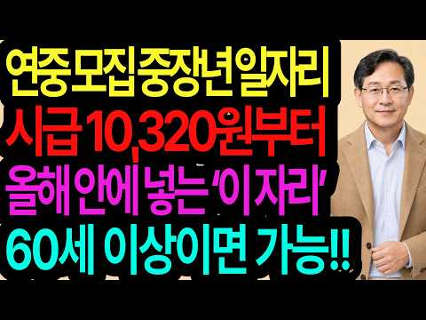
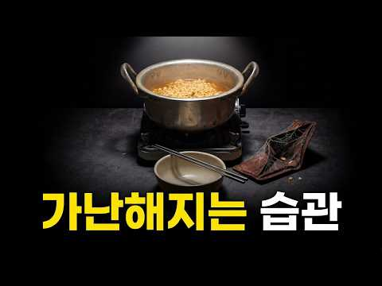
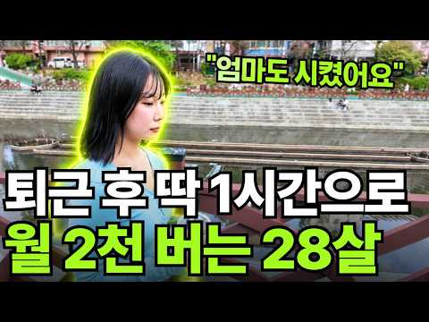

# 재테크 — 성공 사례 분석: 사례별 자세히 #201–#240

`analysis.md` 의 9번 (같은 # 번호). 자동 생성 — `tools/success_analysis.py` v1.4.1 (2026-10-19 08:06 UTC). ※ 연구·교육용 — 투자 권유가 아님.

### 201. 은퇴 후 최대 걱정 '건보료 폭탄' 피하려면? "이것만은 꼭 알아두세요!" ∣ 신승식 ∣ 김경록 ∣ 연금받는형

- https://www.youtube.com/watch?v=TrpDxPeBbbY · 연금 받는 형 · 구독자 21,600 · 조회수 149,439 (×6.9, 하루 1,360.0) · 좋아요 1,449 (1.0%) · 27.8분 · 2026-07-01 · 주제 묶음 4. 노후·연금 · 형식 정보·해설 (그 밖) · 폴더 `W_TrpDxPeBbbY` (웹 승인)
- 썸네일: 
- 설명 앞부분: 많은 분들이 은퇴를 준비하면서 국민연금 수령액만 신경 쓰고, 정작 더 큰 변수인 건강보험료는 놓치고 있습니다. 하지만 피부양자 자격을 잃거나, 퇴직 후 지역가입자로 전환되면 생각보다 큰 건강보험료를 부담할 수도 있습니다. 특히 부동산 보유 여부, 공적연금 수령액, IRP·연금저축 활용, 재취업 여부에 따라 건강보험료는 크게 달라질 수 있습니다. 👇 은퇴 후 수백만 원의 건보료 차이를 만드는 핵심 포인트를 영상에서 꼭 확인해 보세요. 🕒 타임라인별로 보기 📅 촬영일: 2026.06.10
- 같은 채널 평소 대비 ×2.9 (채널 최근 롱폼 중앙값 51,831회) · 평소 영상: 정부가 밀어주는 재테크, 안 하면 손해? 무조건 좋은 건 아닙니다 ∣ 김현우 소장 ∣ 연… (51,831회) / 노후 자금 1억 원으로 돈 걱정 없는 노후를 준비하고 싶다면 이렇게 하세요 ∣ 강영선 박… (51,043회)
- 대본 없음 (설명) — 음성인식이 끝나면 도입부·흐름이 들어감
- 댓글 128/128: 좋은 점 — 영상 2 · 감사·응원 0 · 더 알고 싶은 것 2 · 아쉬운 점 — 영상 4 · 반박·불만 — 의견 다름 7 · 정치·사회 6 · 경험 공유 6 · 구독·다음 기대 0
  - 좋은 점 — 영상 👍3 “건보료 어려운데… 이해가 쏙쏙 됩니다…”
  - 좋은 점 — 영상 👍1 “임의계속가입 시 건강보험료는 본인 부담분만 포함되는데 설명을 잘 못 하신 것 같습니다.”
  - 더 알고 싶은 것 👍3 “임의계속 신청시 퇴직전 납부액의 2배가 되는 건 아니라고 챗지피티 조회 하니 나오는데 어떤 게 맞나요?”
  - 아쉬운 점 — 영상 👍0 “틀린 부분 1. 퇴직 후 임의 3년동안 내는 건보료는 근로자부담 50%만 해당 2. 자식이 사업자등록이 되어있고 소득이 0원이라면 피부양자 지위 유지됨 - 매년 11월 정기조사 시 검증됨”
  - 반박·불만 — 의견 다름 👍32 “17:02 건강보험료 임의계속가입은 퇴직 전 직장에서 내던 본인부담(50%)에 해당되는 금액을 최대 3년동안 유지할 수 있도록 지원하는 제도 입니다. (회사에서 지원해주던 50%를 합하여 100%를 내는 것이 아닙니다.)”
  - 반박·불만 — 의견 다름 👍31 “집한채 없어도 국민연금 좀 받으면 건보료 많이냅니다 이건 아니죠 국민연금은 좀 빼라 기초연금에도 연계시키지말고”
  - 정치·사회 👍64 “외국인들 건보료혜택 폐지하라.”
  - 정치·사회 👍48 “국가나 정부 라면 기업을 활성화토록 해 세수를 확보하고 매년 일반국민의 세부담을 줄여주는 쪽으로 해야 하는 거 아닌가요 국세청이 정권에 따라 매년 세수확보한 답시고 기존의 제도까지 없애가며 국민세부담을 늘리는 게 맞는가요 물가 감안하고 환율 감안하면 2026년에 개인…”
  - 경험 공유 👍0 “금융소득 높으면 직장가입자도 건보료 따로 내던데요?? 제가 잘못 들은 걸까요?”

### 202. 부자가 되기 위해 반드시 거쳐야 할 3단계 – 마키아벨리의 부의 청사진

- https://www.youtube.com/watch?v=VDrLyc9skjk · 부의 파워 코드 · 구독자 1,630 · 조회수 11,222 (×6.9, 하루 2,893.0) · 좋아요 159 (1.4%) · 45.1분 · 2026-10-15 · 주제 묶음 1. 재테크 일반·마인드 · 형식 오디오북·낭독 (명언·인생조언) · 폴더 `W_VDrLyc9skjk` (웹 승인)
- 썸네일: 
- 챕터: 0:00 소개: 4,800만 달러의 실수 · 2:43 1단계: 학습 단계 (떠나기 전에 시스템을 익히세요) · 3:59 당신의 직업이 당신에게 실제로 가르쳐주는 4가지 · 8:20 1단계의 두 가지 함정 · 11:21 2단계: 전환 - 기술을 소유권으로 바꾸기 · 12:32 2단계의 어두운 면 (4,800만 달러를 잃은 방법) · 19:51 2단계의 두 가지 함정 · 24:07 3단계: 실행 - 증식 게임 · 27:16 실행 vs. 투기 (자산 보호) · 33:04 궁극적인 마키아벨리적 목표: 지속과 유산
- 설명 앞부분: 성공했다고 여겨지는 한 사람이 단 하루 만에 4,800만 달러를 잃었습니다. 잘못된 투자 때문이 아니라, 옳은 결정을 너무 일찍 내린 탓입니다. 이 영상에서는 부를 창출하는 3단계의 냉혹한 과정을 분석하고, 순서를 이해하는 것이 왜 마키아벨리적 전략의 핵심인지 알아봅니다. 대부분의 사람들은 규율이나 재능이 부족해서가 아니라, 옳은 일을 잘못된 순서로 하기 때문에 실패합니다. 니콜로 마키아벨리의 『군주론』과 『담론』의 전략적 틀에서 영감을 받은 이 심층 분석은 진정한 재정적 힘의 숨겨진 구조를 드러냅니다. 여러분의 급여가 업계를 내…
- 같은 채널 평소 대비 ×0.5 (채널 최근 롱폼 중앙값 24,528회) · 평소 영상: 돈의 6단계 (당신은 몇 단계에 있습니까?) – 마키아벨리 (24,528회) / 왜 '멍청한' 사람들은 부자가 되고 똑똑한 사람들은 빈털터리로 남는가 ∣ 마키아벨리 (20,592회)
- 대본 없음 (설명) — 음성인식이 끝나면 도입부·흐름이 들어감
- 댓글 7/7: 좋은 점 — 영상 0 · 감사·응원 1 · 더 알고 싶은 것 0 · 아쉬운 점 — 영상 0 · 반박·불만 — 의견 다름 0 · 정치·사회 0 · 경험 공유 0 · 구독·다음 기대 0
  - 감사·응원 👍0 “감사합니다”

### 203. 박카스 집안 부자 갈등, 그 뒤 두 아들 모두 실형… 동아제약 경영권 분쟁의 전말

- https://www.youtube.com/watch?v=PC10zRnT7E4 · 경제꽈배기 · 구독자 5,170 · 조회수 35,315 (×6.8, 하루 35,315.0) · 좋아요 299 (0.9%) · 15분 · 2026-10-18 · 주제 묶음 1. 재테크 일반·마인드 · 형식 정보·해설 (그 밖) · 폴더 `W_PC10zRnT7E4` (웹 승인)
- 썸네일: 
- 챕터: 0:00 박카스, 돈의 강물 · 2:14 네 아들 · 3:12 노란 병의 습격 · 비타500 · 4:43 부자의 충돌과 대표 교체 · 6:52 2007 경영권 분쟁 · 9:17 강문석의 몰락 · 10:47 동생의 리베이트 사건 · 13:34 박카스 병이 남긴 질문
- 설명 앞부분: 박카스 하나로 수십 년 동안 제약업계 정상을 지켜 온 동아제약. 그 뒤편에서는 후계 구도를 둘러싼 아버지와 아들의 경영권 분쟁이 이어졌습니다. 2004년 차남 강문석 사장이 대표이사에서 물러났고, 2007년 지분 다툼은 주총 직전 화해로 봉합됐다가 그해 가을 다시 불거졌습니다. 이후 강문석 전 부회장은 디지털오션 자금 횡령·배임 혐의로 2012년 1심에서 징역 2년 6개월을 선고받았고(이후 확정 여부는 보도로 확인되지 않습니다), 회사를 이어받은 4남 강정석 회장은 리베이트 사건으로 2019년 징역 2년 6개월이 확정됐습니다. 이…
- 같은 채널 평소 대비 ×1.5 (채널 최근 롱폼 중앙값 23,748회) · 평소 영상: 멜론 몰락의 진짜 이유, 압도적 1위 플랫폼이 스스로 자멸한 결정적 계기 (23,820회) / LG생활건강 24년 만의 적자 충격, 차석용 매직이 하루아침에 무너진 이유 (23,675회)
- 대본 없음 (설명) — 음성인식이 끝나면 도입부·흐름이 들어감
- 댓글 19/19: 좋은 점 — 영상 1 · 감사·응원 0 · 더 알고 싶은 것 0 · 아쉬운 점 — 영상 0 · 반박·불만 — 의견 다름 1 · 정치·사회 0 · 경험 공유 0 · 구독·다음 기대 0
  - 좋은 점 — 영상 👍3 “좋은내용 임에도 구독이 적은 이유ㅡ 그넘의 배경음때문에 듣기 불편”

### 204. 부자일수록 비싼 세무사 찾는 이유(김수미 세무사)

- https://www.youtube.com/watch?v=EIxNl0TiWDo · 돈에 미친 세무사, 돈미세무사 김수미 · 구독자 39,200 · 조회수 266,458 (×6.8, 하루 2,518.6) · 좋아요 2,544 (0.9%) · 16.9분 · 2026-07-05 · 주제 묶음 1. 재테크 일반·마인드 · 형식 정보·해설 (그 밖) · 폴더 `W_EIxNl0TiWDo` (웹 승인)
- 썸네일: 
- 챕터: 0:00 하이라이트 · 0:49 금융자산10억의삶 · 5:27 부자들의금융투자방식 · 8:17 ISA계좌 · 12:53 세금공부해야하는이유 · 14:58 건강보험료과세
- 같은 채널 평소 대비 ×9.9 (채널 최근 롱폼 중앙값 26,999회) · 평소 영상: "하루라도 빨리 격차를 좁히세요" 부자 필수 과목 6가지 (32,578회) / "절세 혜택에 속지 마세요" 세무사도 실수하는 생산적금융 ISA 투자 (16,096회)
- 대본 (자막, 6.0 음절/초) 첫 20초: “총 금융 자산을 어느 정도 >> 10억 이상은 운영하고 있지. >> 금융 자산이 10억 이상 있으면 대한민국 상이 0.92%라고 하더라고요. 아, 그 정도면 진짜 인생이 달라질 수도 있다라고 하는데 >> 나 달라지는 거 없던데. >> 은행에서 막 연락도 오고 >> 아니야. 그 연락 [웃음] 안 오는데 프라이빗 가입은 됐다라고 하는데 정보 소스 우리가 궁금한 소스를 주거나 하진 않고” — 도입부 유형: 숫자로 시작
- 첫 1분: “총 금융 자산을 어느 정도 >> 10억 이상은 운영하고 있지. >> 금융 자산이 10억 이상 있으면 대한민국 상이 0.92%라고 하더라고요. 아, 그 정도면 진짜 인생이 달라질 수도 있다라고 하는데 >> 나 달라지는 거 없던데. >> 은행에서 막 연락도 오고 >> 아니야. 그 연락 [웃음] 안 오는데 프라이빗 가입은 됐다라고 하는데 정보 소스 우리가 궁금한 소스를 주거나 하진 않고 >> 어떤 비밀스러운 정보 같은게 있을 것 같은데. 근데 비밀스러운 정보 몇 번 받아봤는데 [웃음] >> 금융 자산 10억 이상 또 서울의 집판채이 정도는 무조건 정기적으로 세무 상담 받아야 된다. >> 받아라. >> 아 좋은 기준이네. 이거 >> 이거 안 하면 큰일 나. 건강보험료 폭탄이 나온다고 저희가 얘기를 하죠. >> 이것”
- 흐름 (90초마다 첫 문장): 0:00 총 금융 자산을 어느 정도 → 1:31 있으니까. → 3:01 가르쳐 주셔. 그냥 우리가 앞으로 → 4:30 때 배당을 받았을 때 받는 소득을 → 6:00 들어가 있는 경우에 또는 자녀가 → 7:30 ISA 계좌 뭐 이런 것도 → 9:01 계좌는 연 2천만 원 한도에서 되는 → 10:31 혜택이라는게 사실 여러 곳에 → 12:01 하시거든. 얘기 안 해. 사업이 조금 → 13:31 발생을 한다고 하더라도 그거에 대한 → 15:03 근데 아까 건강 보험료도 우리가 7% → 16:30 건강보험료 폭탄이 나온다고 저희가
- 댓글 244/244: 좋은 점 — 영상 1 · 감사·응원 5 · 더 알고 싶은 것 3 · 아쉬운 점 — 영상 2 · 반박·불만 — 의견 다름 3 · 정치·사회 20 · 경험 공유 13 · 구독·다음 기대 0
  - 좋은 점 — 영상 👍1 “주식에서 10억가지고 하루 1%만 먹어도 1천만원입니다. 반대로 -1% 또는 -10% 하루만에 잃을 위험성도 있고.. 하루 1% 안전하게 먹는 기술 개발하신다면 배당소득보다 주식단타 기술을 연마하는게 자산증식에 더 도움이 될수 있죠 아마 하루 1% 별거 아닐수도 있지…”
  - 감사·응원 👍8 “잘봤습니다^^ 오늘도 감사합니다~”
  - 더 알고 싶은 것 👍7 “상식적인 기준으로 보면... 건보료(X)가 아니라 건보세(O)가 맞습니다. 보험료: 안내면 보험금만 포기하면 된다. 세금: 안내면 재산압류에 강제징수. 단어는 "건강보험료"인데 실질성격은 세금.... 특히 지역가입자에게 재산에 따라 폭증하는 게 보험료가 맞나요? 세금…”
  - 더 알고 싶은 것 👍0 “PB한테 일부 맞기는것도 재산나름 입니다 10억 금융자산가와 1000억금융자산가 일때 PB수수료 20~30퍼라 치면 PB가 어느쪽 자산가를 미친듯이 신경써 수익률 올리려 할까요?”
  - 반박·불만 — 의견 다름 👍0 “진짜 10억이상 돌려요? 좀 그러네요... 10억 있는데 10억을 다 주식에 넣는다고요? 어이없네요”
  - 정치·사회 👍2 “나라랑 동업? 나라가 도둑!!! 동업이면 지도 세금 내야지 지는 왜 안내. 동업이면 지도 투자하고 밤새 같이 일해야지 왜 안해, 그냥 국개놈들 주머니 채워주는거지.”
  - 정치·사회 👍1 “선거관리원이. 부부가. 세금을 86억원을해외을 여행을. 해도 되나요”
  - 경험 공유 👍5 “금융자산 10억이면 1년에 이자소득+배당소득 합해서 5천~2억 올린다해도 그걸 다 찾아쓰는것도 아니고 끽해야 5천~1억 수익율이 얼만지는 모르겠지만 1억 찾아쓰는데 5천이 수익이라고 해봤자 15% 구간 10억 가진사람이 세무사 이용할 이유가 있음?”
  - 경험 공유 👍1 “저도 법인배당이랑 은행이자랑 같이 합쳐지는걸 몰라서 금융종합에 걸려버렸는데, 법인배당이 금융소득종합과세에 걸리고 -> ISA계좌연장이 안되고 -> 건보료도 매달 추가로 나옵니다...”

### 205. 【성철스님】부자되려면 지갑에 ‘이것’ 1개 당장 넣으세요!! ∣ 3일 안에 막힌 돈줄이 터지고 금전운이 폭발합니다 ∣ 돈복 재물운 풍수

- https://www.youtube.com/watch?v=wNCX2CjZUa4 · 듣고 깨닫다 · 구독자 14,500 · 조회수 95,939 (×6.6, 하루 547.8) · 좋아요 4,221 (4.4%) · 27.9분 · 2026-04-27 · 주제 묶음 1. 재테크 일반·마인드 · 형식 오디오북·낭독 (명언·인생조언) · 폴더 `W_wNCX2CjZUa4` (웹 승인)
- 썸네일: 
- 설명 앞부분: 2026년 병오년(붉은 말의 해)은 강력한 화(火)의 기운이 휘몰아치는 시기입니다. 이 거대한 운의 흐름 속에서 재물운을 내 것으로 만드는 비법은 의외로 간단합니다. 성철스님의 법어와 불교의 지혜를 통해, 돈 한 푼 안 들이고 지갑 속 기운을 바꾸는 '이것'의 정체를 공개합니다. 지금 바로 확인하고 벼락부자의 기운을 받아가세요. 부처님의 가피가 함께하시길 바랍니다.
- 같은 채널 평소 대비 ×61.1 (채널 최근 롱폼 중앙값 1,570회) · 평소 영상: 【성철스님】2026년 10월 1957년생 닭띠, 이 습관 하나가 말년 재물운을 바꿉니다 (1,812회) / 【성철스님】2026년 9월 닭띠, 하늘이 보내는 신호를 절대 놓치지 마세요! 추석 이후 … (1,329회)
- 대본 없음 (설명) — 음성인식이 끝나면 도입부·흐름이 들어감
- 댓글 1,597/1,597: 좋은 점 — 영상 23 · 감사·응원 452 · 더 알고 싶은 것 10 · 아쉬운 점 — 영상 0 · 반박·불만 — 의견 다름 3 · 정치·사회 0 · 경험 공유 13 · 구독·다음 기대 0
  - 좋은 점 — 영상 👍4 “🎉~가족모두 몸과 맘 건강히 벼락부자가 되었다 비방 실천하겠습니다. 좋은 말씀 감사합니다~🎉”
  - 좋은 점 — 영상 👍2 “부자가 되어서 많은사람들에게 도움이 되는 사람이 되겠습니다”
  - 감사·응원 👍22 “성철스님 가르침대로. 26년도 부터. 큰부자가 되겠습니다. 베풀면서 살겠습니다 행복하게 잘살겠습니다. 성철스님. 감사합니다 고맙습니다 덕분입니다 🎉👍😄🍀🙏”
  - 감사·응원 👍16 “성첼스님.말씀대로.벼락부자가되겠읍니다감사합니다❤😂🎉😢😮😅🎉🎉”
  - 더 알고 싶은 것 👍6 “로또기원합니다 1등 부탁드립니다 우리가족 건강하고 행복하게 살겠습니다”
  - 더 알고 싶은 것 👍1 “20:23 스님께서는 본인의 마음을 이야기 안 하시고 무슨 성철 스님 이야기만 합니까 자기 본인의 생각을 이야기하세요 끄떡하면 성철 스님 성철 스님 하는데 스님 본인의 생각을 이야기하세요 성철 스님 이야기는 하지 마시고 스님 본인의 마음을 이야기해 주세요”
  - 경험 공유 👍3 “2026년 저도 벼락 부자 되겟습니다❤❤❤ 감사 합니다”
  - 경험 공유 👍3 “저도부자되겠습니다감사합니다”

### 206. 나스닥100 1배수, 2배수, 3배수 20년 어떤 성과 보여주나(거치식, 적립식, 리벨런싱) ㅣ QQQ, QLD, TQQQ,

- https://www.youtube.com/watch?v=dQdACzI6nKE · 레버리지 하는 미국회계사 장기투자 여정 · 구독자 13,100 · 조회수 85,745 (×6.5, 하루 708.2) · 좋아요 2,122 (2.5%) · 16.3분 · 2026-06-20 · 주제 묶음 3. 주식·ETF · 형식 정보·해설 (그 밖) · 폴더 `W_dQdACzI6nKE` (웹 승인)
- 썸네일: 
- 챕터: 0:00 나스닥100 1배수, 2배수, 3배수 백테스트 시작 · 1:56 QQQ, QLD, TQQQ백테스트 조건 공개 (20년… · 2:48 QQQ, QLD, TQQQ 거치식 결과 — 2천만원,… · 7:46 QQQ, QLD, TQQQ 적립식 매수 결과 · 9:42 QQQ, QLD, TQQQ 리밸런싱 전략 결과 · 14:46 QQQ, QLD, TQQQ 3가지 투자방식 결론
- 설명 앞부분: QQQ, QLD, TQQQ — 20년 백테스트로 다 보여드립니다 1배, 2배, 3배 중에 도대체 뭘 모아야 하냐는 질문, 정말 많이 받았어요. 어떤 영상은 "1배가 국밥이다", 어떤 영상은 "3배 아니면 의미 없다" — 의견만 난무하고 진짜 데이터는 본 적이 없으실 거예요. 그래서 이번엔 20년치 실제 데이터로 끝까지 파봤습니다. 저는 미국 공인회계사이자 전직 펀드매니저입니다. 법인 계좌로 QLD를 메인으로 매일 매수하고 있고, 2022년 TQQQ -80% 폭락을 직접 겪고 2025년에 2~3배 수익으로 전량 매도한 경험이 있어요…
- 같은 채널 평소 대비 ×5.9 (채널 최근 롱폼 중앙값 14,488회) · 평소 영상: QLD 매일 매월 매수? 타이밍 보다 더 중요한 건 '언제 사서 언제 파느냐'다(QQQ,… (14,651회) / QLD랑 가장 잘 어울리는 배당주는 무엇인가 I SCHD, VYM, DGRO, VIG, … (14,325회)
- 대본 없음 (설명) — 음성인식이 끝나면 도입부·흐름이 들어감
- 댓글 390/390: 좋은 점 — 영상 21 · 감사·응원 51 · 더 알고 싶은 것 43 · 아쉬운 점 — 영상 0 · 반박·불만 — 의견 다름 4 · 정치·사회 1 · 경험 공유 25 · 구독·다음 기대 3
  - 좋은 점 — 영상 👍70 “저도 22년에 tqqq -80% 뚜드려맞아보고 qld를 매월 무지성적립식으로 하고있습니다. 그리고 200일 이평선 아래로 tqqq가 떨어지면 트리거로 생각해서 tqqq도 분할매수하고 있습니다. 좋은 영상 감사합니다.”
  - 좋은 점 — 영상 👍19 “와 많은 유튜버들이 하는 백테스트는 비슷했는데 이렇게하는건 유일하네요 질좋은 영상입니다”
  - 감사·응원 👍70 “저도 22년에 tqqq -80% 뚜드려맞아보고 qld를 매월 무지성적립식으로 하고있습니다. 그리고 200일 이평선 아래로 tqqq가 떨어지면 트리거로 생각해서 tqqq도 분할매수하고 있습니다. 좋은 영상 감사합니다.”
  - 감사·응원 👍29 “저는 얼마전부터 모아오던 QQQ를 QLD로 전환 매수했고 매달 월급날에 추매하는 장기 투자를 목표하고 있구요. 나스닥의 우상향을 믿지만 2배수라서 약간의 두려움도 있었는데 이 방송을 보고 나니 QLD가 더욱 든든해보입니다. 이렇게 좋은 방송을 공유해주셔서 진심으로 감…”
  - 더 알고 싶은 것 👍8 “백데이터는 환율이 상승했던 20년간인데요. 만약 현재 1500원대 환율이 900원대로 20년간 하락할 시의 시뮬레이션도 부탁드려봅니다. 모든 가정은 열어두어야 하니깐요. 앞으로도 환율이 고정 내지는 계속 상승할지는 알 수 없다고 생각해요. 수식을 잘 사용하시는 회계사…”
  - 더 알고 싶은 것 👍4 “추천 및 구독 하였습니다 Tqqq, qld, qqq 매월 적립식이 수익이 좋은데 만약 10년, 15년, 20년 매달 매수시 어느 계좌에 사야하나요? 그리고 미장에 직투 해야하나요? 국내 상장 나스닥을 해야하나요?”
  - 반박·불만 — 의견 다름 👍0 “영상 너무나 감사히 잘 보았습니다. 혹시 어느 일정부분 목표수익률이 났을때 매도 하고 기다렸다가 매도후 일정부분이 빠졌을때 다시 매수하고를 반복하면 어떤 결과가 나오는지도 궁금하네요^^ 22%로 세금등 때문에 말도 안돼는 설정일까요? 주린이라 ^^”
  - 정치·사회 👍2 “이게 맞는게 미국 우상향을 믿는다면 가능함 ㅋ 지금 버블이니 뭐니 하는데 실적도 따라오고 무엇보다 기준 금리가 이미 3.25%임 금리를 올린다해도 선반영이고 11월 트럼프 중간선거 이전이라 주식 부양해야됨 ㅋ 그래서 부랴부랴 이란 이스라엘 협력해라하는데 미국 쪽도 못…”
  - 경험 공유 👍70 “저도 22년에 tqqq -80% 뚜드려맞아보고 qld를 매월 무지성적립식으로 하고있습니다. 그리고 200일 이평선 아래로 tqqq가 떨어지면 트리거로 생각해서 tqqq도 분할매수하고 있습니다. 좋은 영상 감사합니다.”
  - 경험 공유 👍29 “저는 얼마전부터 모아오던 QQQ를 QLD로 전환 매수했고 매달 월급날에 추매하는 장기 투자를 목표하고 있구요. 나스닥의 우상향을 믿지만 2배수라서 약간의 두려움도 있었는데 이 방송을 보고 나니 QLD가 더욱 든든해보입니다. 이렇게 좋은 방송을 공유해주셔서 진심으로 감…”
  - 구독·다음 기대 👍29 “저는 얼마전부터 모아오던 QQQ를 QLD로 전환 매수했고 매달 월급날에 추매하는 장기 투자를 목표하고 있구요. 나스닥의 우상향을 믿지만 2배수라서 약간의 두려움도 있었는데 이 방송을 보고 나니 QLD가 더욱 든든해보입니다. 이렇게 좋은 방송을 공유해주셔서 진심으로 감…”
  - 구독·다음 기대 👍1 “(제가 숫자를 다시 수정하였어요. 예를들지 않고 영상속 나온 돈으로 그대로 계산했을경우로요. 답변 꼭 부탁드리겠습니다. 정말 감사드립니다) 제가 채널을 뒤늦게 알고, 영상 정주행하며 열공중입니다. 정말 절 10번 드리고싶어요. 너무 궁금한 부분을 속시원하게 검증해주시…”

### 207. 50대 이후, 이런 집에 살면 노후가 무너집니다

- https://www.youtube.com/watch?v=NGLEPdYvQdQ · 김지호의 공간문해력 · 구독자 18,400 · 조회수 116,383 (×6.3, 하루 1,047.3) · 좋아요 2,404 (2.1%) · 18.2분 · 2026-06-30 · 주제 묶음 4. 노후·연금 · 형식 인터뷰·강연·대담 · 폴더 `W_NGLEPdYvQdQ` (웹 승인)
- 썸네일: 
- 설명 앞부분: 노후에는 집의 크기나 가격보다 더 중요한 것이 있습니다. 젊을 때는 좋아 보였던 고층 아파트, 넓은 집, 관리비가 많이 드는 집이 나이가 들수록 오히려 생활을 불편하게 만들고 노후 자금을 빠르게 줄어들게 만들 수 있습니다. 이번 영상에서는 50대 이후부터 조심해야 할 집의 특징과 노후에 편안하게 살기 위해 어떤 집을 선택해야 하는지 이야기해봅니다. 지금 살고 있는 집이 정말 내 노후에 맞는 집인지 한 번 점검해보시기 바랍니다.
- 같은 채널 평소 대비 ×1.2 (채널 최근 롱폼 중앙값 96,140회) · 평소 영상: "이게 대한민국 현실입니다" 평생 집 한채 마련했는데 갈 곳 없는 노후의 현실 (105,956회) / 노년에 '이 집' 선택했다가 평생 후회합니다.｜김지호의 공간문해력 (87,088회)
- 대본 없음 (설명) — 음성인식이 끝나면 도입부·흐름이 들어감
- 댓글 207/210: 좋은 점 — 영상 15 · 감사·응원 9 · 더 알고 싶은 것 0 · 아쉬운 점 — 영상 0 · 반박·불만 — 의견 다름 2 · 정치·사회 0 · 경험 공유 27 · 구독·다음 기대 0
  - 좋은 점 — 영상 👍43 “참으로 좋은 영상입니다. 도움이 많이 됩니다.👍”
  - 좋은 점 — 영상 👍19 “맞는 말씀이네요 나이 들수록 고층은 피하는게 답임”
  - 감사·응원 👍48 “아파트삶에 대해 알고 싶어 들어왔어요. 50대 입니다. 정보차원의 말을 주의깊게 가만히 듣다보니 문학작품을 읽는것 같았습니다. 울림이 있는 내용과 글 감사합니다.”
  - 감사·응원 👍8 “유익했습니다. 감사합니다.^^”
  - 반박·불만 — 의견 다름 👍10 “채광까재 동일하면 선생님 말씀이 맞습니다. 그치만 저층과 고층이 일조향까지 같은 경우는 거의 없다고 봐야죠, 뷰 역시 마찬가지입니다. 층슈는 단순한 물리적 위치가아닙니다. 일조권과 조망권의 가치죠”
  - 반박·불만 — 의견 다름 👍1 “그게 아닌데 소음 하고 ,벌레 모기 올라오는게 다름 ,물론 15층 이상은 영향 없음”
  - 경험 공유 👍55 “저도 10층이상에서 살다가 지금은 2층에서 살고 있는데 너무 만족합니다. 휴양림에 놀려온거 같아요”
  - 경험 공유 👍47 “7층 살때 제일 좋았어요 숲도 보이고 하늘도 보이고 채광도 바람도 너무 좋았던 2006년식 아파트 그집에서 제일 돈도 많이 벌고 건강했고 행복했었죠.”

### 208. 나이 들수록 착하게만 살면 안 되는 이유｜만만하게 보이지 않는 6가지 방법ㅣ인생조언ㅣ노후준비ㅣ처세술ㅣ인간관계ㅣ삶의지혜ㅣ시니어ㅣ오디오북ㅣ

- https://www.youtube.com/watch?v=DJHfVSc-DvE · 마음 안부 · 구독자 3,880 · 조회수 24,039 (×6.2, 하루 3,411.9) · 좋아요 139 (0.6%) · 30.1분 · 2026-10-12 · 주제 묶음 4. 노후·연금 · 형식 오디오북·낭독 (명언·인생조언) · 폴더 `W_DJHfVSc-DvE` (웹 승인)
- 썸네일: 
- 설명 앞부분: 평생 남을 배려하며 착하게 살았지만 당연시 여기는 태도와 상처만 남으셨나요? 나이가 들수록 만만하게 보이지 않고, 내 삶의 주도권과 존엄을 단단하게 지키는 6가지 인간관계 지혜를 알아봅니다. 남에게 휘둘리지 않고 내 마음의 평온을 되찾는 법, 영상에서 확인해보세요. 이런 분들께 추천합니다 착하게 살았지만 돌아온 것은 허탈함과 무시뿐이신 분 거절이 어려워 타인의 부탁이나 요구에 쉽게 흔들리는 분 인간관계에서 상처받지 않고 나를 지키는 경계선이 필요하신 분 💬 "평생 착하게 살기만 해서 억울했던 적, 혹시 있으신가요? 🥺 오늘 이야기…
- 같은 채널 평소 대비 ×1.4 (채널 최근 롱폼 중앙값 16,730회) · 평소 영상: 노년부부도 각자 살아야 행복한 6가지 이유ㅣ인생조언ㅣ시니어ㅣ노후ㅣ오디오북ㅣ명언ㅣ (17,845회) / 60대 이후 돈을 더 벌려고 무리하면 오히려 손해 보는 이유ㅣ인생조언ㅣ노후준비ㅣ삶의지혜ㅣ… (15,616회)
- 대본 없음 (설명) — 음성인식이 끝나면 도입부·흐름이 들어감
- 댓글 1/1: 좋은 점 — 영상 0 · 감사·응원 0 · 더 알고 싶은 것 0 · 아쉬운 점 — 영상 0 · 반박·불만 — 의견 다름 0 · 정치·사회 0 · 경험 공유 0 · 구독·다음 기대 0

### 209. 주식 ETF 자산 17억 구독자님의 포트폴리오 분석, 세금 건보료 절세 위한 추가 전략

- https://www.youtube.com/watch?v=x26AhOtaVsg · 배당으로 부자되기 · 구독자 8,580 · 조회수 53,040 (×6.2, 하루 340.3) · 좋아요 943 (1.8%) · 15.2분 · 2026-05-16 · 주제 묶음 3. 주식·ETF · 형식 정보·해설 (그 밖) · 폴더 `W_x26AhOtaVsg` (웹 승인)
- 썸네일: 
- 챕터: 0:00 10억 ETF 투자 시 매달 들어오는 배당금 규모 · 1:05 17억 자산가 구독자님의 현실적인 스펙 및 자산 현황 · 1:46 1만 주 매집으로 12억 수익을 올린 킬러 콘텐츠 분석 · 2:32 은퇴 후 자산을 지키는 '분배와 방어' 리밸런싱의 시작 · 3:18 월 1,000만 원 현금흐름을 만드는 2가지 핵심 커… · 4:26 실제 수령액 1,000만 원 이상, 그러나 정부가 잡… · 6:02 실제 소득을 1/3로 줄여주는 국내 커버드콜 ETF의… · 6:59 직장 가입자 자격 유지를 통한 건강보험료 추가 부담 … · 10:45 세후 수익률을 극대화하는 감액 배당주 투자
- 설명 앞부분: 은퇴 후 진짜 수익률을 결정하는 것은 주가 상승률이 아니라 세금 구조와 건강보험료입니다. 국내 지수형 커버드콜 ETF의 비과세 옵션 프리미엄 구조를 활용하면, 실제 월 1,030만 원을 수령하더라도 과세 대상 소득은 337만 원 수준으로 대폭 낮출 수 있습니다. 은퇴 후 자산을 불리는 '축적'의 단계에서 안정적으로 지키고 꺼내 쓰는 '분배와 방어'의 단계로 전환하기 위한 명확한 포트폴리오 리밸런싱 전략이 필요합니다. 이 채널 ‘배당으로 부자되기’는 실제 계좌 수익, 배당금, 리밸런싱 데이터를 기반으로 파이어족을 위한 현실적인 배당…
- 같은 채널 평소 대비 ×4.3 (채널 최근 롱폼 중앙값 12,425회) · 평소 영상: 배당 연 2천만 원 넘게 받으면서 건보료 부담 안 생기려면 (제 실제 원천징수 내역 공개) (12,425회) / 목돈으로 배당 세팅하는 순서 6단계 — 연 1,000만 원까지는 그냥 배당주로 받으세요 (13,062회)
- 대본 없음 (설명) — 음성인식이 끝나면 도입부·흐름이 들어감
- 댓글 78/78: 좋은 점 — 영상 3 · 감사·응원 8 · 더 알고 싶은 것 3 · 아쉬운 점 — 영상 1 · 반박·불만 — 의견 다름 1 · 정치·사회 0 · 경험 공유 3 · 구독·다음 기대 0
  - 좋은 점 — 영상 👍1 “퇴직후18억정도 자산 분배 고민중에 좋은 정보감사합니다.”
  - 좋은 점 — 영상 👍1 “좋은 정보 감사하겠습니다 😊”
  - 감사·응원 👍5 “영상 잘 보고 있습니다. 퇴직금 2억정도 있는데 월배당 ETF에 투자하고 싶습니다. 어떤 종목이 좋은지 콕 찝어서 주시면 감사하겠습니다.”
  - 감사·응원 👍4 “넘 좋을 몰랐던 배움 주셨으니 더 사유해보겠습니다 감사드립니다”
  - 더 알고 싶은 것 👍2 “잘 보고 갑니다 실제 포트 폴리오를 그래픽으로 올려 주시면 조금 더 이해다 쉬울 텐데 조금 아쉽네요”
  - 더 알고 싶은 것 👍0 “오늘도 많은 도움이 되었어요. 조금씩 지식을 쌓아가고 있습니다. 다른 사람들의 사례를 들어 설명해 주시는 부부도 도움됩니다. 앞으로도 계속해서 알려주세요. 감사합니다.”
  - 아쉬운 점 — 영상 👍2 “잘 보고 갑니다 실제 포트 폴리오를 그래픽으로 올려 주시면 조금 더 이해다 쉬울 텐데 조금 아쉽네요”
  - 반박·불만 — 의견 다름 👍0 “Tiger ,kodex 커브드콜 세금기준 배당금 4000만원 아닙니다 저랑비슷한 규모 같은데 년 1600이하 입니다 새로계산해보세요”
  - 경험 공유 👍1 “저도 폭락장 기다리는1인입니다 티큐 평단 20 브럽네용”
  - 경험 공유 👍0 “저도 같은 케이스인데 상담을 좀 받을 수 있을까요.. ? 미장 위주로 하다보니 33억이 넘었어요… 배당주로 좀 돌리면서 세금을 최소화 하고 싶은데 ㅠ”

### 210. QLD 직투 vs ISA, 잘 못 선택하면 10년 뒤 수천만 원 손해 봅니다.

- https://www.youtube.com/watch?v=vU5AK1FfCqQ · 돈재이 DONJAY · 구독자 19,800 · 조회수 122,176 (×6.2, 하루 969.3) · 좋아요 2,531 (2.1%) · 20.3분 · 2026-06-15 · 주제 묶음 6. 절세·제도 · 형식 오디오북·낭독 (명언·인생조언) · 폴더 `W_vU5AK1FfCqQ` (웹 승인)
- 썸네일: 
- 설명 앞부분: ⭐안녕하세요, 본 채널은 저의 개인적인 투자 여정과 장기 투자 철학을 기록하는 공간입니다. 제가 겪은 시행착오와 시장을 바라보는 관점이 여러분의 투자 공부에 작은 참고가 되기를 희망합니다. 다만, 채널의 모든 콘텐츠는 정보 전달을 목적으로 제작되었습니다. 여러분의 성공적인 투자 여정을 응원합니다.
- 같은 채널 평소 대비 ×6.9 (채널 최근 롱폼 중앙값 17,667회) · 평소 영상: 환율 계속 떨어지는데 QLD 투자해도 될까? 제 결론입니다 (17,667회) / 수익률 200%차이? 적립식 투자 수익률 어떤 것이 더 높을까? 매일 사기 vs 매주 사… (17,847회)
- 대본 없음 (설명) — 음성인식이 끝나면 도입부·흐름이 들어감
- 댓글 465/465: 좋은 점 — 영상 11 · 감사·응원 35 · 더 알고 싶은 것 44 · 아쉬운 점 — 영상 5 · 반박·불만 — 의견 다름 3 · 정치·사회 3 · 경험 공유 15 · 구독·다음 기대 3
  - 좋은 점 — 영상 👍9 “아주 좋은 정보네요”
  - 좋은 점 — 영상 👍7 “좋은 정보 감사합니다. 앞으로 원화 하락 계속 될테니 국내 상장 ETF로 나스닥 상승과 환율에서 2배로 먹겠습니다.”
  - 감사·응원 👍23 “감사합니다. 환차손까지 레버리지가 되는지 전혀 생각 못 했습니다.”
  - 감사·응원 👍18 “ISA투자 계속 지피티한테 물어봤는데도 답이 안나왔는데 이영상하나로 머리속이 깔끔해졌습니다 타이거로 가겠습니다 감사합니다”
  - 더 알고 싶은 것 👍5 “안녕하세요. 다름아니라 삼성증권 해외주식 팀에 전화로 문의했을때, tiger미국나스닥100레버리지 종목은 환율 2배 추종이 아닌, 1배 추종이라고 분명히 답변 받았었거든요. 나스닥 지수는 2배 추종이 맞지만, 환율은 1배를 따라간다라고 들었는데 무엇이 사실일까요? 환…”
  - 더 알고 싶은 것 👍4 “도움이 많이 되었습니다. 궁금한 점을 깔끔하게 설명해주시네요^^ ISA 올해 계좌한도가 다 차서 못하고 일단 이번 달부터 직투로 QLD 조금씩 매수 중입니다.^^ 내년에는 ISA 직투 반반씩 적립해 나가야 겠네요^^ 오픈채팉방이 다 찼네요 ㅠ 추가개설 부탁드립니다.”
  - 아쉬운 점 — 영상 👍9 “ISA는 소수점 안되는게 아쉽네요”
  - 아쉬운 점 — 영상 👍5 “장기로보고isa3년마다 해외직투계좌로 옮기고 해지후재가입 최대금액넣고 반복이 베스트라고봅니다 어느정도 지나 덩치가 커지면 현금흐름용 커버드콜을 isa 활용하면 건보료 상승없이 또 qld적립매수가능하구요”
  - 반박·불만 — 의견 다름 👍0 “(타이거 나스닥100 레버리지) h가 붙는건 노출이아닌데 왜? 붙은걸헷지라해?”
  - 정치·사회 👍7 “직투에서 달러 확보 얘기하는 사람은 진짜 나라가 붕괴해서 복구 불능 상태로 간다는 가정으로 하는거임 환 노출 모르는게 아니라”
  - 정치·사회 👍3 “ISA 단점 원금을 1억까지 밖에 못 넣는다. 언제가는 계좌 해지해야 하기때문에 복리가 깨진다. 직투 계좌 직접 매도 하기전까지는 무한정 매수가 가능하다 복리가 계속 불어난다. 결론 양도세 22퍼 내더라도 장기 투자시 수익율이 ISA 보다 직투가 높다 끝 ISA에서 …”
  - 경험 공유 👍47 “사람들이 잘 이해를 못하네... Isa 먼저 년 2천만원 채우고 남으면 직투로 qld하면 됨. 저도 같이 하는데 너무 좋은거 같아요. 빨리 5년에 1억 한국판qld채우는게 목표입니다”
  - 경험 공유 👍5 “신박한 주제라 신규유입(?)이 많아서 그런지 요상한 댓글이 많이 보이네요😂 저도 isa한도 다 채워지고 남으면 직투에 넣어요ㅎㅎ”
  - 구독·다음 기대 👍2 “잘봤어요 감사합니다! 구독했어요😊”
  - 구독·다음 기대 👍1 “구독했습니다 3번방 부탁드립니다”

### 211. "S&P500 ETF, 종목보다 '계좌'가 20년 뒤를 바꾸는 진짜 이유 (연금·ISA)"

- https://www.youtube.com/watch?v=fmQLRfIm28Y · 야무진 경제학 · 구독자 22,500 · 조회수 137,268 (×6.1, 하루 1,327.3) · 좋아요 3,515 (2.6%) · 28.4분 · 2026-07-07 · 주제 묶음 3. 주식·ETF · 형식 정보·해설 (그 밖) · 폴더 `W_fmQLRfIm28Y` (웹 승인)
- 썸네일: 
- 챕터: 0:00 종목은 담았는데 왜 내 계좌만 이 모양일까 · 2:19 원칙 ① 짐을 줄여라 — 종목이 많을수록 위험한 이유 · 5:02 원칙 ② 오래 메고 걸어라 — 매달 30만원 20년의… · 8:26 40세 시작 vs 50세 시작, 10년이 만든 격차 · 10:03 목돈 한 번에? 나눠서? 리밸런싱은 언제 · 10:44 우리가 가장 많이 하는 두 가지 오해 · 11:49 달콤한 함정 — 월배당·커버드콜의 진실 (금감원 경보) · 15:25 반전 — 짐이 아니라 '배낭'을 바꾸는 고수들 · 16:42 방수 배낭 ① 연금저축·IRP, 148만원 돌려받는 법 · 19:25 방수 배낭 ② ISA, 3년 유연 + 비과세 · 20:59 같은 상품 김 씨 vs 박 씨, 10년 뒤 잔고 차이 · 22:38 ISA를 연금으로 갈아타 혜택 두 번 챙기는 기술 · 24:04 꼭 알아야 할 주의점 — 중도해지 벌금 & ISA 한… · 25:47 오늘 걸어온 길 정리 — 짐이 아니라 배낭이 결과를 …
- 설명 앞부분: S&P500 ETF, 좋다는 종목만 열심히 담았는데 왜 내 계좌만 안 불어날까요? 문제는 '무엇을 담느냐'가 아니라 '어떤 계좌에 담느냐'입니다. 오늘은 ETF 투자를 배낭여행에 빗대, 20년 뒤 통장을 바꾸는 절세계좌(연금저축·IRP·ISA) 활용법을 한 번에 정리했습니다. 똑같은 미국 지수 ETF를 일반계좌(비닐봉지)에 담은 사람과 절세계좌(방수 배낭)에 담은 사람의 결과가 왜 갈리는지, 그리고 요즘 인기인 월배당·커버드콜의 숨은 함정(금융감독원 소비자경보)까지 짚습니다. 종목 압축, 복리의 시간, 절세계좌라는 세 가지 뼈대만…
- 같은 채널 평소 대비 ×12.6 (채널 최근 롱폼 중앙값 10,929회) · 평소 영상: "50대 노후 준비 10년째 못 하는 진짜 이유, 놓친 4가지" (11,237회) / "50대라면 월 75만원 이렇게 넣어두세요, 65세부터 매달 들어옵니다" (10,621회)
- 대본 없음 (설명) — 음성인식이 끝나면 도입부·흐름이 들어감
- 댓글 115/115: 좋은 점 — 영상 6 · 감사·응원 9 · 더 알고 싶은 것 11 · 아쉬운 점 — 영상 2 · 반박·불만 — 의견 다름 0 · 정치·사회 0 · 경험 공유 4 · 구독·다음 기대 1
  - 좋은 점 — 영상 👍2 “노인초보자가 보기에 아주 핵심적이고 유익해서 구독 했어요❤😅😅 목소리도 좋아요”
  - 좋은 점 — 영상 👍2 “감사합니다 이해가 잘 되네요~~~”
  - 감사·응원 👍9 “감사드립니다 저두 5~6개 담고 있는데 정리하겠습니다”
  - 감사·응원 👍4 “감사합니다”
  - 더 알고 싶은 것 👍9 “연금계좌는 1년에 얼마까지입금(투자)가능한가요?”
  - 더 알고 싶은 것 👍4 “종합과세 때문에 isa 개설이 안되요..ㅜㅜ 비닐봉지에라도 담아야 할까요? 3년뒤 isa개설 가능해지면 그때 담는게 나을까요?”
  - 아쉬운 점 — 영상 👍5 “영상이 깔끔하고 편집이 잘 되어 있어서 보기 편하네요.”
  - 아쉬운 점 — 영상 👍2 “말을 너무 길게 늘림”
  - 경험 공유 👍3 “자식공부시키고 집산다고 그간 세월 다 보낸 60중반인 저희들은 어떻게해야하나요? 😢”
  - 경험 공유 👍1 “내가 들어보니 커버드콜 한번도 투자해 본적없고 주식투자경력10년도 안되었네...좃도 모르네...”
  - 구독·다음 기대 👍2 “구독, 좋아요 ,알림설정 다 눌렀습니다.서운해 하지 마세요~😅”

### 212. 평생 모은 노후자금 뜯긴 노인들... 조폭 소굴 쳐들어간 아줌마의 100대 참교육 [박여사 6화]

- https://www.youtube.com/watch?v=cc4uBxFSiiY · 아직 늦지 않았습니다 · 구독자 30,800 · 조회수 187,089 (×6.1, 하루 3,375.8) · 좋아요 1,023 (0.5%) · 9.2분 · 2026-08-24 · 주제 묶음 4. 노후·연금 · 형식 사연·드라마 · 폴더 `W_cc4uBxFSiiY` (웹 승인)
- 썸네일: 
- 설명 앞부분: 평생 모은 노후자금을 노리는 주식 리딩방 사기 조직. 길바닥에 나뒹구는 노인을 보고 박여사의 분노가 폭발한다. "어르신, 제가 꼭 그 돈 찾아올게요." 조폭 소굴로 정면 돌파한 박여사와 전트. 그리고 5화에서 처음으로 패배를 안겼던 그 남자, 왕도일과의 재대결. "열 번 찍어 안 넘어가면 백 번, 백 번 찍어 안 넘어가면 천 번을 찍어." 과연 박여사는 왕도일을 무릎 꿇릴 수 있을까? 이 채널은 AI로 제작됩니다. 중년이 주인공인 이야기를 만듭니다. 평범한 아줌마, 평범한 아저씨. 그런데 건드리면 안 되는 사람들. 본 영상은 AI…
- 대본 없음 (설명) — 음성인식이 끝나면 도입부·흐름이 들어감
- 댓글 36/36: 좋은 점 — 영상 0 · 감사·응원 2 · 더 알고 싶은 것 2 · 아쉬운 점 — 영상 0 · 반박·불만 — 의견 다름 0 · 정치·사회 0 · 경험 공유 0 · 구독·다음 기대 0
  - 감사·응원 👍3 “❤와우 너무 잼나게 보아요 ❤ 박여사님. 뉴욕에서 응원합니다 화이팅 ❤❤”
  - 더 알고 싶은 것 👍2 “빨리 다음화 영상 올려 주세요.”

### 213. 호주 한국 반반 살기 '이것' 모르면 은퇴 자금 거덜 납니다 건강보험 & 세금 폭탄의 진실

- https://www.youtube.com/watch?v=WS4hFxgz01Y · Jungestate · 구독자 3,370 · 조회수 19,899 (×5.9, 하루 147.4) · 좋아요 632 (3.2%) · 15.9분 · 2026-06-06 · 주제 묶음 6. 절세·제도 · 형식 브이로그·직접 해본 이야기 · 폴더 `W_WS4hFxgz01Y` (웹 승인)
- 썸네일: 
- 챕터: 0:00 완벽했던 노후 계획이 악몽으로 변한 순간 · 1:22 역이민을 선택하는 진짜 이유 (철저한 가성비 계산) · 2:32 비자 시스템의 함정: 2026년 F-4 비자와 복수 … · 4:23 가장 치명적인 함정: 건강보험 30일 상실 & 6개월… · 5:31 완벽한 방어막: F-5 영주권 혜택 3가지와 까다로운… · 7:06 보이지 않는 세금 레이저망: 183일 거주자 판정과 … · 8:03 세금 방어 실전 팁: 5년 비과세 특례와 핀테크/해외… · 9:21 연금 퍼즐 맞추기: 호주 연금과 한국 국민연금의 영리… · 10:46 40년 만에 돌아온 한국, 180도 달라진 문화 충격 · 11:50 지방 귀농의 리스크와 현지인이 바라보는 '체리피커' … · 13:35 결론: 실패 없는 역이민을 위한 '테스트 드라이브' …
- 설명 앞부분: 호주에서 수십 년 뼈 빠지게 일하고 선택한 한국 역이민, 과연 장밋빛일까요? 낭만적인 브이로그 뒤에 숨겨진 차가운 현실을 분석했습니다. 시드니 자녀 집에 딱 한 달 다녀왔을 뿐인데 건강보험이 날아가고 6개월을 기다려야 하는 현실, 그리고 이삿짐을 푸는 순간 시작되는 한국 국세청의 '183일 세금 레이저망'까지. 은퇴 자금을 지키고 완벽한 노후를 완성하기 위한 'F-5 영주권' 활용법과 '테스트 드라이브 전략'을 지금 바로 확인하세요. 호주 집을 섣불리 팔기 전에 반드시 이 영상을 끝까지 보셔야 합니다! ⏱️ 타임라인 (Timest…
- 같은 채널 평소 대비 ×2.9 (채널 최근 롱폼 중앙값 6,862회) · 평소 영상: 호주 상속세 0원? 🇦🇺 유언장 써도 내 재산 32% 뺏기는 숨겨진 세금 함정 (10,257회) / 내 수퍼, 진짜 '내 돈' 맞나요? 💸4 5조 달러를 둘러싼 호주 정부의 의도 (3,694회)
- 대본 없음 (설명) — 음성인식이 끝나면 도입부·흐름이 들어감
- 댓글 91/91: 좋은 점 — 영상 10 · 감사·응원 13 · 더 알고 싶은 것 4 · 아쉬운 점 — 영상 3 · 반박·불만 — 의견 다름 0 · 정치·사회 2 · 경험 공유 5 · 구독·다음 기대 0
  - 좋은 점 — 영상 👍6 “마지막에 겸손 언급하신거 급 공감합니다. 이민오시던 시절의 한국이 아니예요. 해외에서 살다왓다고 조금이라도 꺼드럭 거리는거 많이 거슬리지요.”
  - 좋은 점 — 영상 👍4 “은퇴하고 한국에 살려고 했는데......유익한 정보 너무 감사합니다.늘 응원합니다.”
  - 감사·응원 👍4 “은퇴하고 한국에 살려고 했는데......유익한 정보 너무 감사합니다.늘 응원합니다.”
  - 감사·응원 👍4 “유용한 정보 감사합니다! 10년후 역이민을 목표로 달리고 있습니다!”
  - 더 알고 싶은 것 👍2 “정말 설명 똑 부러지게 잘하십니다. 시각적으로, 청각적으로. AI목소리인가요? 목소리 톤도 너무 듣기 좋구요. 저는 1년 뒤 은퇴하는데, 노인연금은 수혜대상이 될 수없어서 수퍼펀드로 만 은퇴 설계를 해야하는 관계로 혹 저와 같은 입장인 많은 은퇴자를 위해 은퇴후의 수…”
  - 더 알고 싶은 것 👍1 “정말 유익한 정보 감사드립니다. 영상을 보다가 궁금한 것들이 생각이 들어 질문드립니다. 호주국적자가한국에 조그마한 아파트를 투자 및 향후 사용 계획으로 구매하는 것에 대해 어떻게 생각하시는지 그리고 미리 염두해 두어야 할 것이 무엇이 있을까요? 주택을 취득하게 되면 …”
  - 아쉬운 점 — 영상 👍6 “틀린 내용이 많아 바로 잡습니다. 호주 영주권자 인경우 암치료 RNSH 같은 삼성병원 보다 시설 좋은곳에서 더 좋은 약,수술등 공짜 치료됩니다.또한 한국에서 보험이 안되는 비싼약도 DSP 경우 거의 공짜 입니다. 불과 몇십불이면 됩니다.아울러 환자에 대한 배려도 정말…”
  - 아쉬운 점 — 영상 👍2 “정말 설명 똑 부러지게 잘하십니다. 시각적으로, 청각적으로. AI목소리인가요? 목소리 톤도 너무 듣기 좋구요. 저는 1년 뒤 은퇴하는데, 노인연금은 수혜대상이 될 수없어서 수퍼펀드로 만 은퇴 설계를 해야하는 관계로 혹 저와 같은 입장인 많은 은퇴자를 위해 은퇴후의 수…”
  - 정치·사회 👍18 “한국은 더 이상 내 나라가 아니라 내가 태어나서 어린 시절을 보낸 말통하는 나라일뿐입니다. 성인이 된 후 나의 성인 인생을 통틀어 보낸곳이 내 나라 입니다. 영주권으로 사시는 분은 특별한 이유가 있으시겠지만. 자식도 친구도 다 이곳에 있고, 한국에 있는 내 옛친구는 …”
  - 정치·사회 👍0 “영주권자의 경우 한국가도 F4-5 비자가 필요없잖아요? 근데 만약 호주도 반년이상 해외살면 투자용 수입에서 세금이 외국인으로 분류되어 호주거주자보다 많이 내야하는거 맞나요? 지금설명은 시민권으로 바꾸신분의 케이스 같은데… 영주권자의 경우 호주에 투자수입있을시 궁금해뇨”
  - 경험 공유 👍18 “한국은 더 이상 내 나라가 아니라 내가 태어나서 어린 시절을 보낸 말통하는 나라일뿐입니다. 성인이 된 후 나의 성인 인생을 통틀어 보낸곳이 내 나라 입니다. 영주권으로 사시는 분은 특별한 이유가 있으시겠지만. 자식도 친구도 다 이곳에 있고, 한국에 있는 내 옛친구는 …”
  - 경험 공유 👍0 “역 이민은 또다른 외국 경험이라 생각한다. 난 우리집이 편안하고, 사회속에서 내가 그안에 공존을 하니 이사 간 집에서 마지막도 보낼생각이다. 한국방문시 뇌졸증 생겨 일주일 입원 경미 이유로 재활 거부. 바로 안정된 3개월 후 집으로 돌아와 응급실 통해 재활 전문 종합…”

### 214. [냠냠동화] 🍭자전거 사주세요! ∣ 사회공룡 ∣ 저축 습관 ∣ 유아 동화∣ 어린이 동화 읽어주기 ∣ 동화책 읽기 ∣ 인성동화 ∣ 그림책

- https://www.youtube.com/watch?v=vN--X8tbqIA · 냠냠동화 · 구독자 7,400 · 조회수 42,736 (×5.8, 하루 275.8) · 좋아요 99 (0.2%) · 5.8분 · 2026-05-17 · 주제 묶음 2. 돈 모으기·저축 · 형식 정보·해설 (그 밖) · 폴더 `W_vN--X8tbqIA` (웹 승인)
- 썸네일: 
- 설명 앞부분: 어린이 여러분, 안녕하세요? 😊 맛있는 이야기를 냠냠! 🍭📖 냠냠동화에 오신 걸 환영해요! 그레이트북스의 『자전거 사 주세요』는 내 친구 사회공룡 시리즈의 한 권으로, 아이가 원하는 물건을 사 달라고 조르는 상황을 통해 소비와 저축의 의미를 배워봅니다. 📚 도서 정보 제목: 자전거 사주세요 글: 김효미 그림: 김이조 감수: 최연철 출판사: 그레이트북스 🎧 냠냠동화 제작 이야기 원작의 흐름과 문장을 존중하여 충실하게 구성하였으며 모든 내레이션은 운영자가 직접 녹음한 1인 다역 음성입니다. 그림책의 삽화를 한 장 한 장 직접 촬영하여…
- 같은 채널 평소 대비 ×5.3 (채널 최근 롱폼 중앙값 8,052회) · 평소 영상: [냠냠동화] 배 속의 거지 ∣ 먹어도 먹어도 배가 고픈 사람은 진짜 배 속에 거지가 들어… (8,052회) / [냠냠동화] 소파껌딱지 도지만 ∣ 살찌는 습관 ∣ 아람 심쿵 ∣ 어린이동화책읽어주기 ∣동… (8,315회)
- 대본 없음 (설명) — 음성인식이 끝나면 도입부·흐름이 들어감
- 댓글 0/0: 좋은 점 — 영상 0 · 감사·응원 0 · 더 알고 싶은 것 0 · 아쉬운 점 — 영상 0 · 반박·불만 — 의견 다름 0 · 정치·사회 0 · 경험 공유 0 · 구독·다음 기대 0

### 215. 평범한 내가 부자들 사이에서 느낀 것들

- https://www.youtube.com/watch?v=SF1SLHOlcC0 · 30대 우영이의 일기 · 구독자 4,150 · 조회수 23,743 (×5.7, 하루 20,465.0) · 좋아요 186 (0.8%) · 12.3분 · 2026-10-18 · 주제 묶음 1. 재테크 일반·마인드 · 형식 정보·해설 (그 밖) · 폴더 `W_SF1SLHOlcC0` (웹 승인)
- 썸네일: 
- 챕터: 0:00 평범한 투자자가 100억 부자들과 여행하면 · 0:49 요트 파티 가는 버스에서 벌어진 일 · 1:42 알고 있는 것과 실제로 하는 것의 차이 · 2:16 부자들 사이에서 느낀 복잡한 감정 · 3:31 돈타쿠는 지금 뭘 하고 있을까? · 3:47 바이비트 요트 파티 · 4:52 돈타쿠와 새벽까지 나눈 이야기 · 5:01 돈타쿠가 인생을 즐기는 방식 · 6:30 내가 앞으로 하고 싶은 일 · 7:09 계획 없이 살아온 투자자의 이야기 · 8:35 남들의 시선에서 자유로워지는 법 · 9:37 다음 날 아침, 5km 러닝 · 11:27 나는 정말 어떤 삶을 살고 싶은 걸까?
- 같은 채널 평소 대비 ×6.3 (채널 최근 롱폼 중앙값 3,740회) · 평소 영상: 죽을 각오로 싸워도 질 수 있다 ∣ 『Win the Inside Game』 (3,992회) / 유튜브 돈 되나요?｜30일 동안 매일 올려봤습니다 (3,488회)
- 대본 없음 (없음) — 음성인식이 끝나면 도입부·흐름이 들어감
- 댓글 52/52: 좋은 점 — 영상 1 · 감사·응원 3 · 더 알고 싶은 것 0 · 아쉬운 점 — 영상 0 · 반박·불만 — 의견 다름 3 · 정치·사회 0 · 경험 공유 7 · 구독·다음 기대 1
  - 감사·응원 👍1 “저도 한 2년전부터 100억대를 가지고 있는 사람인데 우영이님이 느꼈던 그 감정을 오랬동안 느꼈던 사람으로서 이 영상이 굉장히 공감되기도 하고 한편으로는 저의 옛날 모습이 생각나서 정말 다양한 감정이 느껴지네요 우영님에 대해서 저는 오늘 처음 알게 됐지만 팬이 됐습니…”
  - 감사·응원 👍0 “언제나 응원합니다”
  - 반박·불만 — 의견 다름 👍6 “자산시장, 그것도 코인시장, 그것도 알트위주로 건드리던사람은 일확천금을 노리고 들어왔다는거고 일확천금을 얻은자와 못얻은자의 차이 아닐까요 못얻었다고 뭘 잘못한건 아닌데 마음 한구석엔 나도 저게목표였는데 하는 생각도들거고”
  - 경험 공유 👍6 “자산시장, 그것도 코인시장, 그것도 알트위주로 건드리던사람은 일확천금을 노리고 들어왔다는거고 일확천금을 얻은자와 못얻은자의 차이 아닐까요 못얻었다고 뭘 잘못한건 아닌데 마음 한구석엔 나도 저게목표였는데 하는 생각도들거고”
  - 경험 공유 👍3 “각자 재능이 다른데 겉으로 보면 똑같은 사람이라고 생각하니 내가 부족하다고 느껴지는 것 같습니다. 운의 영향도 무시할수 없구요. 전세계 사람들에게 가위바위보를 시켜도 우승하는 사람은 반드시 나오는 것 처럼요”
  - 구독·다음 기대 👍1 “저도 한 2년전부터 100억대를 가지고 있는 사람인데 우영이님이 느꼈던 그 감정을 오랬동안 느꼈던 사람으로서 이 영상이 굉장히 공감되기도 하고 한편으로는 저의 옛날 모습이 생각나서 정말 다양한 감정이 느껴지네요 우영님에 대해서 저는 오늘 처음 알게 됐지만 팬이 됐습니…”

### 216. 57세 이후 통장에 이정도 예금 있다면 더 이상 일하지 말고 인생 즐기면서 사세요ㅣ명언ㅣ인생조언ㅣ오디오북ㅣ라디오북ㅣ시니어ㅣ노후ㅣ노년

- https://www.youtube.com/watch?v=AJFlT07d2uo · 노후생활설계실 · 구독자 3,010 · 조회수 17,196 (×5.7, 하루 3,378.0) · 좋아요 42 (0.2%) · 64.7분 · 2026-10-14 · 주제 묶음 2. 돈 모으기·저축 · 형식 사연·드라마 · 폴더 `W_AJFlT07d2uo` (웹 승인)
- 썸네일: 
- 설명 앞부분: 노후의 삶, 가족, 돈, 관계와 인생의 이야기를 따뜻하게 전해드립니다. 실제 삶에서 얻은 지혜와 감동을 통해 더 행복한 인생 후반전을 함께 생각해 봅니다. ※ 일부 이야기는 이해를 돕기 위해 구성된 허구이며, 실제 사례를 바탕으로 각색될 수 있습니다.
- 같은 채널 평소 대비 ×2.0 (채널 최근 롱폼 중앙값 8,655회) · 평소 영상: "설마 그 한마디에…" 인생을 망치는 무의식적 '독(毒) 말버릇'과 고독사하는 시니어의 … (8,655회) / 「식비를 줄이기 전에, 이것부터 그만두세요」 연금 10만 엔으로 노후 파산하는 사람 vs… (8,737회)
- 대본 없음 (설명) — 음성인식이 끝나면 도입부·흐름이 들어감
- 댓글 0/0: 좋은 점 — 영상 0 · 감사·응원 0 · 더 알고 싶은 것 0 · 아쉬운 점 — 영상 0 · 반박·불만 — 의견 다름 0 · 정치·사회 0 · 경험 공유 0 · 구독·다음 기대 0

### 217. 삼성전자 투자자분들 주목하셔야합니다 실적은 사상 최대인데 주가는 왜 못 따라갈까? 목표가 48만원·150조 주주환원 총정리했습니다! #삼성전자 #삼성전자주가

- https://www.youtube.com/watch?v=0ftjA5wsqtQ · 코스피 읽는 개미 · 구독자 2,230 · 조회수 12,662 (×5.7, 하루 105.4) · 좋아요 357 (2.8%) · 18.6분 · 2026-06-21 · 주제 묶음 3. 주식·ETF · 형식 정보·해설 (그 밖) · 폴더 `W_0ftjA5wsqtQ` (웹 승인)
- 썸네일: 
- 설명 앞부분: [영상 요약] 하나증권이 삼성전자 목표주가를 48만 원으로 상향했습니다. 그 이유는 AI 반도체 수요 확대에 따른 D램·LPDDR 가격 강세, 그리고 예상보다 강한 실적 개선 때문입니다. 특히 올해 2분기 영업이익은 시장 기대를 크게 웃도는 수준으로 전망되고 있습니다. 또한 삼성전자의 막대한 현금 창출력을 바탕으로 최대 150조 원 규모의 주주환원(배당·자사주 매입) 가능성이 제기되면서 투자자들의 관심이 집중되고 있습니다. 목표주가 48만 원 상향 배경 AI 메모리 시장 성장과 HBM 전망 150조 원 주주환원의 의미 삼성전자 주…
- 같은 채널 평소 대비 ×29.1 (채널 최근 롱폼 중앙값 436회) · 평소 영상: [ 삼성전자 ] 대폭발 시작되나? 반도체 수출 150% 급증…주가 대반전 "신호" 떴다! (451회) / 삼성전자 이익 역대 최대인데 아직 27만원... 언제 터질지 알려드리겠습니다 (420회)
- 대본 없음 (설명) — 음성인식이 끝나면 도입부·흐름이 들어감
- 댓글 17/17: 좋은 점 — 영상 0 · 감사·응원 0 · 더 알고 싶은 것 0 · 아쉬운 점 — 영상 0 · 반박·불만 — 의견 다름 1 · 정치·사회 0 · 경험 공유 0 · 구독·다음 기대 2
  - 반박·불만 — 의견 다름 👍3 “무슨 헛소리를? 세계 증권사에서 4.3프로 주주환원의 현금배당을 한 적이나 있나요? 연구개발비랑 투자비는 어찌하고 무슨 주주환원이라고 삼성에서는 하지도 않은 말을 자기들 멋대로 헛소리를 하는지 참”
  - 구독·다음 기대 👍2 “구독완료”
  - 구독·다음 기대 👍0 “구독완료”

### 218. 신혼부부가 돈 못 모으는 이유...결혼 후 돈 관리 이렇게 하세요(김경필 머니트레이너)ㅣ보라언니동생 EP.04

- https://www.youtube.com/watch?v=vmjGJVCfwhk · STUDIO OMG · 구독자 31,200 · 조회수 175,514 (×5.6, 하루 6,499.6) · 좋아요 596 (0.3%) · 18.2분 · 2026-09-22 · 주제 묶음 1. 재테크 일반·마인드 · 형식 인터뷰·강연·대담 · 폴더 `W_vmjGJVCfwhk` (웹 승인)
- 썸네일: 
- 설명 앞부분: 오늘은 김경필 머니트레이너 님을 모시고 내 돈 관리법 수업을 듣고 왔어요!💸 곧 결혼을 앞둔 PD동생도, 결혼 2년차인 저도 돈 관리에 고민이 정말 많았는데요! 주식부터 월급 관리, 내집마련까지 2030세대가 필수시청해야 할 자산관리 꿀팁 쏙쏙 뽑아왔으니까 영상 정주행해주세요~! 🎁보라언니동생 4화 댓글 이벤트🎁 참여방법 1. "영상 소감" or “재테크 고민”을 댓글로 남겨주세요 2. 아래 구글 폼에 정보 제출하면 끝! 📚 이벤트 상품 돈쭐남 김경필 쌤의 친필사인 도서 [딱 1억만 모읍시다] 증정! (10명) 🎉 당첨자 발표 개…
- 같은 채널 평소 대비 ×6.1 (채널 최근 롱폼 중앙값 28,703회) · 평소 영상: 어렸을 때랑 성격이 딴판인 이유ㅣ안녕들하십니까 EP.07 (28,703회) / 회피가 이렇게 위험합니다ㅣ안녕들하십니까 EP.08 (25,438회)
- 대본 없음 (설명) — 음성인식이 끝나면 도입부·흐름이 들어감
- 댓글 62/62: 좋은 점 — 영상 8 · 감사·응원 6 · 더 알고 싶은 것 14 · 아쉬운 점 — 영상 1 · 반박·불만 — 의견 다름 0 · 정치·사회 0 · 경험 공유 8 · 구독·다음 기대 1
  - 좋은 점 — 영상 👍6 “우연히 보라님이 떠서 봤는데 필쌤 명강의 너무 잘 봤어요 역시 뭘 해야 하고 하지 않아야 하는지를 명쾌하게 속시원히 풀어주셔서 너무나 감사해요😊”
  - 좋은 점 — 영상 👍5 “최근 재테크에 관심이 많이 생겼는데 뼈 때리는 선생님 말씀 항상 기억해야겠네요, 앞으로도 좋은 영상 부탁드려요!”
  - 감사·응원 👍6 “우연히 보라님이 떠서 봤는데 필쌤 명강의 너무 잘 봤어요 역시 뭘 해야 하고 하지 않아야 하는지를 명쾌하게 속시원히 풀어주셔서 너무나 감사해요😊”
  - 감사·응원 👍4 “유익한 영상 감사합니다. 이제 신혼 1년 채워가는 중인데, 내집 마련의 꿈 한걸음 다가가고싶네요.”
  - 더 알고 싶은 것 👍33 “기존에 혼자살때 돈을 분배하고 저축하고 주식하고 잘 분배했던거 같은데, 부부가 되고나서 소득을 합치고 나니 용돈이 적어서인지 계속 빵꾸나네요ㅠㅠ 혼자 살땐 신용카드도 잘 안썼거든요... 근데 결혼 관련한 명목으로 신용카드 사용량도 늘다보니 감도 안오는 상태로 긁고 있…”
  - 더 알고 싶은 것 👍24 “진짜죄송한데 선생님 강의 풀버전 내주시면안되나요?”
  - 아쉬운 점 — 영상 👍0 “댓글달고 이벤트 참여하려고했는데 사진 첨부가 안되네요 ㅜㅜ 사진 올리는데 계속 거부돼요ㅠㅠ사진이 첨부가 안돼서 양식제출이 불가하다고뜨고 ㅠㅠ 이벤트 참여 꼭 하고싶은데 넘 아쉬워요”
  - 경험 공유 👍10 “출산한지 한달도 안된 구독자입니다🙌🏻 가족이 늘어나니 몸은 힘들지만 매일 행복한 하루를 보내고 있는데요, 문제는 육아휴직으로 소득절벽이 되면서 앞으로 우리가정의 지출은 어떻게 줄이고 저축을 어떻게해야할지 현실적으로 좀 막막한 마음입니다🥲 선생님의 뼈때리는 조언을 영상…”
  - 경험 공유 👍2 “강사님 교육이 T스럽게 딱 딱 현실만 짚어주셔서 넘 좋아요 ㅋㅋㅋ 저도 2030세대로 공감되는 부분이라 집중해서 봤어요 이런 영상 많이 만들어주세요!!😂 부동산, 아파트 매매 이런 쪽도 궁금해졌어요”
  - 구독·다음 기대 👍1 “예전 국민영수증때부터 즐겨듣던 팬입니다! 40대 미혼으로 살아갈 사람들의 재테크도 알려주시면 감사하겠습니다! 내집 마련 이후의 재테크요”

### 219. 돈 없는 58세 재혼녀가 젊은 애들보다 더 약아 빠져도 되는 이유

- https://www.youtube.com/watch?v=QnnwzV8yHpU · 내 누군지 아나? · 구독자 6,210 · 조회수 33,707 (×5.4, 하루 449.7) · 좋아요 706 (2.1%) · 29분 · 2026-08-05 · 주제 묶음 기타 · 형식 정보·해설 (그 밖) · 폴더 `W_QnnwzV8yHpU` (웹 승인)
- 썸네일: 
- 챕터: 0:00 그 사람이 연금을 물었을 때 · 1:03 새벽 6시 괴안동, 쉰여덟의 하루 · 6:04 연금 창구에서 들은 세 문장 · 10:26 사랑은 반반이어도 목소리는 반반이 아니다 · 14:35 제도가 결혼하지 말라고 말한다 · 18:34 그럼 나는 뭘 받고 저 집에 들어가지 · 22:27 순서를 바꾸는 세 가지 · 27:38 공책에 적은 세 줄
- 설명 앞부분: 💬 소개받은 사람 앞에서 그 사람 집이 누구 명의인지, 연금은 얼마나 나오는지 속으로 세어본 적 있으세요? 🌱 그리고 그런 자신이 싫어서 아무에게도 말 못 하셨죠. 오늘은 그 부끄러움을 정면으로 열어봅니다. ✨ 쉰여덟 아나의 재혼 이야기예요. 계산한 게 잘못이 아니라, 계산을 숨긴 채 사랑이라고 부른 게 잘못이었어요. 이 영상에서 다루는 내용 💸 이혼 6년 차, 통장 잔액 0원인 쉰여덟이 밤마다 63세·68세·75세를 세는 이유 🏦 국민연금공단 창구에서 들은 세 문장 — 분할연금 요건(혼인 5년·50%), 출생연도별 지급개시연령(…
- 같은 채널 평소 대비 ×13.7 (채널 최근 롱폼 중앙값 2,463회) · 평소 영상: 자식이 부모를 끊게 만드는 말 3가지, 세 번째에서 관계가 끝납니다 (2,463회) / 다 버렸는데 또 그대로였어요, 58세 아나가 서랍을 못 비운 진짜 마음 (2,477회)
- 대본 없음 (설명) — 음성인식이 끝나면 도입부·흐름이 들어감
- 댓글 106/106: 좋은 점 — 영상 0 · 감사·응원 2 · 더 알고 싶은 것 0 · 아쉬운 점 — 영상 0 · 반박·불만 — 의견 다름 4 · 정치·사회 0 · 경험 공유 5 · 구독·다음 기대 0
  - 감사·응원 👍13 “영상감사합니다 ~^^”
  - 반박·불만 — 의견 다름 👍106 “함께 이룬 재산도 아닌데 재혼하면서 왜 그걸 자기랑 공유해야한다고 생각하는지...”
  - 반박·불만 — 의견 다름 👍41 “너머돈. 먹는게. 쉬운게. 아닙니다”
  - 경험 공유 👍54 “아버지는 제가 열네 살이 되던 해, 너무 일찍 세상을 떠나셨습니다. 그날 이후 어머니는 아버지의 빈자리까지 홀로 감당하며 두 형제를 키우고 공부시키셨습니다. 살다 보면 문득 이런 생각이 듭니다. 평생 자식들만 바라보며 살아온 어머니에게도 이제는 곁에서 손을 잡아 주고…”
  - 경험 공유 👍6 “재혼도 솔직히 남자는 돈이 있어야 하고 여자는 돈있는사람 찾고있는것 같다 아님분도 있다 하지만 솔직히 내가 돈있는 여자라면 재혼하기싫다”

### 220. 1억을 모았다면 20억까지 절대 꿈의 숫자가 아닙니다 (돈의 물리학)

- https://www.youtube.com/watch?v=gPYpuRW8UOk · 경제기상도 · 구독자 4,320 · 조회수 22,754 (×5.3, 하루 140.5) · 좋아요 486 (2.1%) · 16.9분 · 2026-05-10 · 주제 묶음 2. 돈 모으기·저축 · 형식 정보·해설 (그 밖) · 폴더 `W_gPYpuRW8UOk` (웹 승인)
- 썸네일: 
- 설명 앞부분: 1억을 모았다면 이미 20억까지 '30%'는 끝난 겁니다 (돈의 물리학) 왜 첫 1억이 20억의 5%가 아니라 30%인가? (부의 임계점) 0원에서 1억까지가 가장 고통스러운 과학적 이유
- 같은 채널 평소 대비 ×3.1 (채널 최근 롱폼 중앙값 7,332회) · 평소 영상: 12억 모았는데 월 230만원? 월 배당 300만원 계산이 틀리는 이유 [ 재테크/미국주… (7,436회) / JEPI 배당은 줄고 JEPQ 배당은 최고치… '배당률 골짜기'의 정체 [ 재테크/미국주… (7,227회)
- 대본 없음 (설명) — 음성인식이 끝나면 도입부·흐름이 들어감
- 댓글 43/43: 좋은 점 — 영상 0 · 감사·응원 0 · 더 알고 싶은 것 0 · 아쉬운 점 — 영상 1 · 반박·불만 — 의견 다름 0 · 정치·사회 0 · 경험 공유 4 · 구독·다음 기대 0
  - 아쉬운 점 — 영상 👍0 “나으경우, 대1,중1 수도권 4인가족 50세남 1억 모으면 무슨 돈이 뭐라고~?? 하는 후배님들을 위해 나으경우, 최초1억은 10년소요 모았고 평수넓히기 해서 아파트가 두채가 되었고 두채에서 5년만에 2채에서 4억5천이 올랐다가 조정받아서 합이 3억이 올랐네요 그5년…”
  - 경험 공유 👍8 “부모님 집에 살면서 저축만 하니까 1억 모으는데 대략 6년 걸렸음. 결혼하고 집사고 지금 3년차인데 자산 얼마있는지 마이데이터 뽑아보면 재산-대출 = 대략 2억8천정도 됐음. 전에는 저축만 했는데 독립하니까 숨만쉬어도 돈이 나가는데도 투자하니까 돈이 금방 불어나는듯.…”
  - 경험 공유 👍0 “나으경우, 대1,중1 수도권 4인가족 50세남 1억 모으면 무슨 돈이 뭐라고~?? 하는 후배님들을 위해 나으경우, 최초1억은 10년소요 모았고 평수넓히기 해서 아파트가 두채가 되었고 두채에서 5년만에 2채에서 4억5천이 올랐다가 조정받아서 합이 3억이 올랐네요 그5년…”

### 221. 라오어님의 TQQQ, SOXL 무한매수법 정말 좋아합니다(QQQ, QLD, TQQQ, SOXL)

- https://www.youtube.com/watch?v=QTrCmMxmAdg · 레버리지 하는 미국회계사 장기투자 여정 · 구독자 13,100 · 조회수 68,286 (×5.2, 하루 620.6) · 좋아요 1,043 (1.5%) · 5.2분 · 2026-07-01 · 주제 묶음 3. 주식·ETF · 형식 정보·해설 (그 밖) · 폴더 `W_QTrCmMxmAdg` (웹 승인)
- 썸네일: 
- 챕터: 0:00 라오어 무한매수법이란? 하게 된 계기 · 1:34 무한매수법 실제 운용 현황 (법인 계좌 TQQQ, S… · 2:08 무한매수법 핵심 — 변동성에 투자한다는 것 · 3:23 무한매수법 수익률 30%, 충분한건가? · 3:54 라오어님의 증여 이야기 · 4:34 무한매수법 세금, 법인 통한 절세
- 설명 앞부분: 저는 라오어님의 무한매수법을 5년 넘게 해오고 있고, 지금은 법인 계좌로 TQQQ와 SOXL 40분할 사이클을 운영하면서 절세까지 하고 있습니다. 회계사로 일하면서 오히려 레버리지 상품을 불신했던 제가 어떻게 생각이 바뀌었는지, 지금 실전에서 어떤 구조로 운영하고 있는지 빠르게 정리해드립니다. 🎯 이 영상에서 다루는 내용 라오어 무한매수법이란 무엇인가 회계사인 제가 레버리지를 불신하다가 시작하게 된 계기 지금 법인 계좌 2개로 운영 중인 SOXL 40분할 구조와 최근 수익률 무매를 계속하는 이유 — 변동성에 투자한다는 것 연 30…
- 같은 채널 평소 대비 ×4.7 (채널 최근 롱폼 중앙값 14,488회) · 평소 영상: QLD 매일 매월 매수? 타이밍 보다 더 중요한 건 '언제 사서 언제 파느냐'다(QQQ,… (14,651회) / QLD랑 가장 잘 어울리는 배당주는 무엇인가 I SCHD, VYM, DGRO, VIG, … (14,325회)
- 대본 없음 (설명) — 음성인식이 끝나면 도입부·흐름이 들어감
- 댓글 199/201: 좋은 점 — 영상 4 · 감사·응원 21 · 더 알고 싶은 것 29 · 아쉬운 점 — 영상 0 · 반박·불만 — 의견 다름 2 · 정치·사회 0 · 경험 공유 20 · 구독·다음 기대 1
  - 좋은 점 — 영상 👍1 “회계사님 영상 잘봤습니다! 무한매수법 책은 읽은상태인데 머리가 좋은편이 아니라 큰 흐름만 이해한 상태네요 ㅠㅠ 엑셀이나 무매무매, 파이어게이트 어플로 가이드 방향으로 그냥 하는 방법도있던데 회계사님께서 하는 방법도 이해하기 쉽게 영상으로 제작 좀 부탁드려도될까요??ㅠ…”
  - 좋은 점 — 영상 👍0 “멋집니다. 영상도 깔끔하고 듣기 편하네요.”
  - 감사·응원 👍20 “SPYM 8개월 수익과 TQQQ 5일차 수익이 똑같아서 TQQQ 분할매수중입니다 저도 저의 도파민입니다 꾸준히 매수누릅니다 -10% -20% -30% 트리거오면 현금 이빠이 넣으려고요 열심히 살겠습니다 감사합니다!”
  - 감사·응원 👍6 “저도 무매법 몇달전에 시작했습니다. 미국에서 살고 있기에 실시간으로 가격변동을 보기에 투자금의 20% 까지는 빠질 때마다 공격적으로 매수합니다, 20% 이후 부터는 원칙대로 하죠. 무매법 수익률만 6월달에 투자금액의 20% 넘었습니다. 변동성이 무지 심한달이어서 그랬…”
  - 더 알고 싶은 것 👍9 “영상 잘보고 있습니다. 문득 궁금증이 들어서요 1. 라오어 tqqq vr(밸류리밸런싱, 장투법)도 알고 계실 듯한데 이거 대신 qld장투로 가져가는 이유를 알 수 있을까요? 2. 추측건대 라오어님은 vr이 qld장투의 상위호환전략이라고 생각하시기 때문에 vr로 장투하…”
  - 더 알고 싶은 것 👍4 “저도 무한매수법 배우고싶은데요 자세히 하는방법 다루어주시기를 부탁드립니다 저는그냐 사서 가지고가고있습니다”
  - 경험 공유 👍20 “SPYM 8개월 수익과 TQQQ 5일차 수익이 똑같아서 TQQQ 분할매수중입니다 저도 저의 도파민입니다 꾸준히 매수누릅니다 -10% -20% -30% 트리거오면 현금 이빠이 넣으려고요 열심히 살겠습니다 감사합니다!”
  - 경험 공유 👍9 “영상 잘보고 있습니다. 문득 궁금증이 들어서요 1. 라오어 tqqq vr(밸류리밸런싱, 장투법)도 알고 계실 듯한데 이거 대신 qld장투로 가져가는 이유를 알 수 있을까요? 2. 추측건대 라오어님은 vr이 qld장투의 상위호환전략이라고 생각하시기 때문에 vr로 장투하…”
  - 구독·다음 기대 👍0 “세상에나...고퀄 영상 감사합니다. 정주행하고 있는데 이해력이 낮아 답답할 뿐입니다. 51살 아줌마고요 63세까지는 일할 수 있을 것 같습니다. qld나 tqqq 하기에는 좀 애매한 나이일까요? 그냥 qqq를 해야할까요? 현재 isa계좌에 맥쿼리인프라 8000만원어치…”

### 222. 주식계좌에 1억 있으면, 대한민국 상위 몇 % 일까요?

- https://www.youtube.com/watch?v=-gcRoQnRARY · 억빌더 | 순자산 10억 평범한 월급쟁이 · 구독자 6,500 · 조회수 33,447 (×5.2, 하루 282.5) · 좋아요 604 (1.8%) · 8.6분 · 2026-06-22 · 주제 묶음 2. 돈 모으기·저축 · 형식 정보·해설 (그 밖) · 폴더 `W_-gcRoQnRARY` (웹 승인)
- 썸네일: 
- 챕터: 0:00 주식 계좌에 딱 1억, 대한민국 상위 몇 %일까? (… · 0:57 주식 1억이 생각보다 훨씬 드문 이유 · 2:52 "지금 고점 아닌가요?" 무서워서 미국 주식 시작도 … · 5:16 초봉 3천만 원 월급쟁이가 주식 계좌에만 10억을 굴… · 6:20 주식 10억은 대한민국 상위 0.35%, 1000명 … · 7:36 "월급의 10%부터 똑같이 작동합니다" 평범한 직장인…
- 설명 앞부분: 본 영상에서 제공하는 모든 정보는 투자 참고 자료일 뿐이며, 투자자 본인에게 있습니다 일반 금융자산과 달리 '주식으로만 딱 1억'을 가진 사람은 대한민국 투자자 중 상위 7.7%에 불과할 정도로 생각보다 훨씬 드뭅니다. 많은 사람이 고점의 공포와 폭락의 두려움 때문에 진입하지 못하지만, 장기적으로 우상향할 기업이라는 믿음이 있다면 지금 가격도 가장 싼 가격일 수 있습니다. 저 역시 초봉 3천만 원의 평범한 직장인으로 시작해 코로나와 전쟁 등 수많은 폭락장을 겪으면서도 이 원칙 하나로 주식 계좌 10억(상위 0.35%)을 달성했습니…
- 같은 채널 평소 대비 ×10.6 (채널 최근 롱폼 중앙값 3,166회) · 평소 영상: 월급 250만 원 받던 제가 '이것' 하나 바꾸고 순자산 10억 찍었습니다 (3,166회) / 악착같이 모은 순자산 ‘1억’, 99%가 망하는 이유 (3,189회)
- 대본 없음 (설명) — 음성인식이 끝나면 도입부·흐름이 들어감
- 댓글 156/156: 좋은 점 — 영상 1 · 감사·응원 11 · 더 알고 싶은 것 3 · 아쉬운 점 — 영상 1 · 반박·불만 — 의견 다름 2 · 정치·사회 0 · 경험 공유 7 · 구독·다음 기대 0
  - 좋은 점 — 영상 👍4 “구독신청 좋은영상 감사드립니다”
  - 감사·응원 👍100 “댓글보고 기죽어서 ㅠㅠ 글 안남길려다가~~~~오늘기준 주식계좌에 8천9백만원 있습니다~!!1천만원으로 시작했거든요~6년걸림 ㅋ ~그래도 행복합니다~!! 조금씩 늘어나네요~~1억목표~ㅎ~본업은 열심히 하는중이에요~~이글을 보시는 모든분들 성투하세요~화이팅~!!”
  - 감사·응원 👍13 “부동산 투자 실패로 5년전에 1억 날리고, 죽자사자 월급 모아서 원금 8000만원이고 주식계좌에 1억3천있습니다. 힘내서 빨리 직장 그만두고 싶어요... 왜 이렇게 사람들과 부딪히는게 힘든지 모르겠어요.”
  - 더 알고 싶은 것 👍0 “수익금 포함 말씀하시는게 맞으실까요?? 저는 누가 주식 얼마 투자했냐고 물으면 원금으로 말해야 하는지 수익금 포함인지....다른사람들은 어떻게 생각하는지 궁금해요 ㅎㅎ”
  - 아쉬운 점 — 영상 👍5 “이 영상을 보는 주린이들이 많을거라 예상됩니다. 주식은 우량한 주식을 장기투자하면 손실은 면하고 수익을 기대할 수 있습니다. 여기까지 많이들 들어봤을 이야기 입니다. 하지만 장투라는게 어렵고 지루하기도 하죠 그런면에선 커버드콜 및 배당주로 처음에 시작했으면 좋겠슴니다…”
  - 반박·불만 — 의견 다름 👍5 “증권 계좌 나눠서 하는 사람 많아서 글쎄요”
  - 경험 공유 👍5 “이분 말씀이 진리네요 저는 퇴직자로 금융권에 있었지만 미국시장, 국내시장, ETF 등에 무지했었어요 그냥 매일매일 현업에서 하루하루를 최선을 다하는 평범한 직장인 이었는데 퇴직후 미국시장, 국내시장, ETF 등에 관심을 가지고 24년도부터 꾸준히 모아가고 있습니다 총…”
  - 경험 공유 👍4 “저도 꾸준히 모아가겠습니다 감사합니다”

### 223. 지금 바로 지원 가능한 노인일자리 24만 개 TOP5, 연말 모집 안 기다려도 됩니다! ∣ #노인일자리 #노인일자리정보 #중장년일자리 #퇴직후생활 #은퇴 #은퇴…

- https://www.youtube.com/watch?v=ZcDVI5t76xc · 육공청춘 · 구독자 2,430 · 조회수 12,489 (×5.1, 하루 11,485.2) · 좋아요 53 (0.4%) · 9.7분 · 2026-10-18 · 주제 묶음 4. 노후·연금 · 형식 정보·해설 (그 밖) · 폴더 `W_ZcDVI5t76xc` (웹 승인)
- 썸네일: 
- 설명 앞부분: 미리 들어두면 좋은 케어아카데미 무료 과정 노인 일자리는 11월 말에 한 번 뽑는 줄 아시는 분이 많은데, 115만 2천 개 중 24만 6천 개는 일 년 내내 뽑습니다. 보건복지부 자료와 운영 안내, 시니어클럽 추가모집 공고에서 확인한 대로 지금 넣을 수 있는 자리 다섯을 정리했습니다. 이 자리들은 활동비가 아니라 최저임금 이상 월급입니다. ▪ 활동비 자리와 월급 자리가 어떻게 다른지 ▪ 복지관 취업 창구에 이름 올려 두는 자리 ▪ 도급 계약이 되는 운송 자리 둘 ▪ 8월 추가모집 공고에 적힌 실버카페 근무 조건 ▪ 60세 이상 …
- 같은 채널 평소 대비 ×2.1 (채널 최근 롱폼 중앙값 5,994회) · 평소 영상: 이제부터 요양보호사 말고 '이 일' 하세요. 지금 그대로 경력이 되고 교육도 무료입니다 … (6,306회) / 경비·택시만 있는 게 아닙니다. 50대가 실제로 가는 다섯 곳과 공고 검색어 #50대일자… (5,683회)
- 대본 없음 (설명) — 음성인식이 끝나면 도입부·흐름이 들어감
- 댓글 5/5: 좋은 점 — 영상 0 · 감사·응원 0 · 더 알고 싶은 것 0 · 아쉬운 점 — 영상 0 · 반박·불만 — 의견 다름 0 · 정치·사회 0 · 경험 공유 0 · 구독·다음 기대 0

### 224. 긴급진단📢 '검은 목요일' 생존법은? 급락장 '줍줍' 기회일까? [염승환 이사]

- https://www.youtube.com/watch?v=lXqkrXt2uNs · 경제시그널 · 구독자 27,800 · 조회수 140,439 (×5.0, 하루 33,766.8) · 좋아요 1,012 (0.7%) · 16.5분 · 2026-10-15 · 주제 묶음 기타 · 형식 인터뷰·강연·대담 · 폴더 `W_lXqkrXt2uNs` (웹 승인)
- 썸네일: 
- 설명 앞부분: 📉 코스피·코스닥 매도 사이드카에 서킷브레이커까지 발동된 '검은 목요일'. 증시는 왜 급락했을까요? 염승환 이사와 함께 외국인 매도 배경부터 AI 투자 축소 우려, 창신메모리의 위협까지 짚어봤습니다. 삼성전자·SK하이닉스, 지금이 저가 매수 기회일까요? 아니면 조금 더 기다려야 할까요? 급락장 속 투자 전략을 함께 확인해 보겠습니다. 경제를 깊이 있게, 경제시그널 토크, 익스플레인 컨텐츠를 제작하는 경제시그널 콘텐츠 제작 역량을 바탕으로 기업·브랜드의 스토리를 디지털 콘텐츠에 맞는 방식으로 기획합니다. [브랜드가 찾는 콘텐츠 파트…
- 같은 채널 평소 대비 ×7.1 (채널 최근 롱폼 중앙값 19,857회) · 평소 영상: 이번 주 FOMC 시장 분기점! 금리인상 시 안도랠리 펼쳐질 역발상 섹터전략 [이권희 대… (19,857회) / 기대감 0%? 고생했던 주주들 필독! 2차전지 제약바이오 왜 반등하는지 알려드립니다 [민… (32,666회)
- 대본 없음 (설명) — 음성인식이 끝나면 도입부·흐름이 들어감
- 댓글 128/128: 좋은 점 — 영상 0 · 감사·응원 3 · 더 알고 싶은 것 0 · 아쉬운 점 — 영상 0 · 반박·불만 — 의견 다름 3 · 정치·사회 5 · 경험 공유 2 · 구독·다음 기대 0
  - 감사·응원 👍1 “염이사님감사합니다 ~”
  - 감사·응원 👍0 “염이사님 감사합니다🎉🎉🎉”
  - 반박·불만 — 의견 다름 👍32 “이 사람 말 믿고 매수했다가 수년 고생했습니다 자신만 믿고 해야지 전문가들이 전문가가 아닙니다 아무도 주식 떨어질 때는 못 믿습니다”
  - 반박·불만 — 의견 다름 👍2 “국민들 선동하는 염이사 그만하세요”
  - 정치·사회 👍9 “이 모든게 이정권의 주식시장 개입으로 인한 국민연금과 레버리지etf 의 정책 실패임. 외국인들만 좋은일 시키고 개인들과 국민연금은 어마어마한 손실을 기록할 듯.... 다신 볼 수 없는 코스피 9000...”
  - 정치·사회 👍1 “국장은 정치판 63선거위한 🚀 로켓!!! 28년 총선때 무조건 upup!!!😅😅😅😅”
  - 경험 공유 👍1 “증권사 전문가는 없음.,,,,,,,오직 이들은 매수 부추키는, 자기들 장사에 기여하기 위해, 매수 부추기는 사기꾼들임.....개인들은 스스로의 생각과 등락과 외국인따라, 그들이 사면 나도 사고, 그들이 팔면 나도 팔고....이렇게만 해야함.......증권사 전문가들은…”
  - 경험 공유 👍0 “비온후에 비가왜왔는지 나도안다 개지랄 그만해라”

### 225. 남들이 걱정하는 삶을 선택했습니다 #배당투자 #배당은퇴 #경제적자유 #파이어족 #월배당 #고배당주 #주식투자 #재테크#노후준비#배당금생활 #SCHD #JEPI …

- https://www.youtube.com/watch?v=SiE0NjI7Fu0 · ttobaedang또배당 · 구독자 6,610 · 조회수 33,221 (×5.0, 하루 6,639.0) · 좋아요 378 (1.1%) · 9.1분 · 2026-10-14 · 주제 묶음 1. 재테크 일반·마인드 · 형식 정보·해설 (그 밖) · 폴더 `W_SiE0NjI7Fu0` (웹 승인)
- 썸네일: 
- 같은 채널 평소 대비 ×4.4 (채널 최근 롱폼 중앙값 7,524회) · 평소 영상: 3억 배당은퇴 6000만원 증발 그래도 행복한이유 #배당투자 #배당은퇴 #경제적자유 #파… (7,524회) / 5000만원 증발 월급없이도 행복한이유 #배당투자 #배당은퇴 #경제적자유 #파이어족 #월… (8,557회)
- 대본 없음 (없음) — 음성인식이 끝나면 도입부·흐름이 들어감
- 댓글 155/155: 좋은 점 — 영상 3 · 감사·응원 18 · 더 알고 싶은 것 5 · 아쉬운 점 — 영상 0 · 반박·불만 — 의견 다름 0 · 정치·사회 0 · 경험 공유 9 · 구독·다음 기대 2
  - 좋은 점 — 영상 👍4 “진정성이 느껴지고 서민형이라 와닿는 영상이라 보면서 위로를 받게 되네요. 좋은 영상 자주 올려주세요. 😊❤”
  - 좋은 점 — 영상 👍1 “울림이 있는 story, 공감이 되고 배우고 갑니다~”
  - 감사·응원 👍21 “당신의 직업은 투자자, 유튜버^^ 늘 응원하겠습니다”
  - 감사·응원 👍6 “현대는 직업이 필요가 없어졌습니다. 단지 생활비를 충당할 수 있는 근원지 배당금, 이자, 월세소득 등 원천을 만드는 것이 중요하죠. 또배당금님은 현재 잘 하고 계신거예요. 직장이 없어도 배당금으로 자유롭게 생활하실 수 있는것이 얼마나 대단한것인지 높이 평가해요. 질투…”
  - 더 알고 싶은 것 👍4 “진정성이 느껴지고 서민형이라 와닿는 영상이라 보면서 위로를 받게 되네요. 좋은 영상 자주 올려주세요. 😊❤”
  - 더 알고 싶은 것 👍3 “안녕하십니까 또배당님! 금일 영상은 원고가 매우 훌륭하고 좋습니다 감동적입니다 자신의선택과 책임을 말씀하는 철학은 울림이 있습니다, 다음에 기회가되면 제가 운영하고 있는 다음카페에 칼럼기고를 부탁드려도 될까요”
  - 경험 공유 👍8 “나도 도배당아저씨처럼 할수있다는 희망으로 삽니다”
  - 경험 공유 👍6 “세상을 보는 안목과 생각이 깊고 넓으시군요. 저도 공감되는 말씀입니다.”
  - 구독·다음 기대 👍1 “호동대표님 유튜브보고 구독하러왔어요 자주영상 올려주세요😊 세미파이어족 화이팅!!”

### 226. 부자들이 50대에 가장 먼저 버린다는 가난한 사람의 습관 7가지

- https://www.youtube.com/watch?v=w9PVpTLk0Tc · 부자의습관 · 구독자 3,340 · 조회수 16,261 (×4.9, 하루 2,267.2) · 좋아요 98 (0.6%) · 40.2분 · 2026-10-12 · 주제 묶음 1. 재테크 일반·마인드 · 형식 오디오북·낭독 (명언·인생조언) · 폴더 `W_w9PVpTLk0Tc` (웹 승인)
- 썸네일: 
- 설명 앞부분: 왜 어떤 부자가 되는 데에 이번 영상에서는 일상에서 쉽게 실천할 수 있는 부자의습관, 돈 관리 방법, 저축 습관, 소비 습관과 재테크에 도움이 되는 경제 상식을 알기 쉽게 이야기합니다. 돈을 많이 버는 것만큼 중요한 것은 돈을 어떻게 관리하고 사용하는가입니다. 평소 무심코 반복하는 행동이 자산을 만드는 습관이 될 수도 있고, 반대로 돈이 새어나가는 원인이 될 수도 있습니다. 이 채널에서는 부자들의 사고방식과 생활 습관, 현명한 소비와 저축, 자산 관리, 노후 준비 등 우리의 경제생활에 도움이 되는 다양한 이야기를 꾸준히 전해드립니…
- 대본 없음 (설명) — 음성인식이 끝나면 도입부·흐름이 들어감
- 댓글 1/1: 좋은 점 — 영상 0 · 감사·응원 1 · 더 알고 싶은 것 0 · 아쉬운 점 — 영상 0 · 반박·불만 — 의견 다름 0 · 정치·사회 0 · 경험 공유 0 · 구독·다음 기대 0
  - 감사·응원 👍1 “감사합니다 ..ㅎ”

### 227. 시흥 배곧 신도시의 몰락? 대출 없던 내 집 팔고 5억 빚 냈다가 4년 만에 전재산 날린 택시기사 이야기! ∣ 노후자금사연 ∣ 오디오북

- https://www.youtube.com/watch?v=Y3Fiyr3Qses · 은빛시나리오 · 구독자 29,300 · 조회수 141,562 (×4.8, 하루 816.3) · 좋아요 3,188 (2.2%) · 43.7분 · 2026-04-28 · 주제 묶음 4. 노후·연금 · 형식 사연·드라마 · 폴더 `W_Y3Fiyr3Qses` (웹 승인)
- 썸네일: 
- 챕터: 0:00 인트로 · 2:00 Chapter 1. 2억짜리 내 집, 그 소박했던 천국 · 8:00 Chapter 2. "제2의 송도"라는 달콤한 유혹 · 14:00 Chapter 3. 5억 원의 족쇄, 승부수를 던지다 · 20:00 Chapter 4. 32층 바다 뷰, 신기루의 시작 · 26:00 Chapter 5. 학생들이 없는 대학로, 멈춰버린 … · 32:00 Chapter 6. 퍼펙트 스톰, 이자의 습격 · 40:00 Chapter 7. 10억이 5억으로.. 4년 만에 … · 47:00 Chapter 8. 낡은 내 집 한 채가 천국이었습니다
- 설명 앞부분: 여러분은 노후에 내 집 한 채면 충분하다고 생각하시나요? 35년을 새벽마다 핸들 잡으며 일군 대출 없는 낡은 아파트 한 채. 누가 봐도 부족하지 않은 노후였습니다. 그런데 단 한마디가 그 모든 걸 무너뜨렸어요. "가만히 있으면 손해야." 서울대 병원이 들어온다는 현수막 하나, 제2의 송도라는 말 한마디에 평생 모은 전재산 5억을 걸었습니다. 10억짜리 32층 바다 뷰 아파트. 4년 뒤, 손에 남은 건 5천만 원뿐이었습니다. 시청자 여러분께 이 영상은 실제 은퇴자들의 경험담을 바탕으로 공감과 정보 전달을 위해 각색·재구성한 이야기입…
- 같은 채널 평소 대비 ×4.5 (채널 최근 롱폼 중앙값 31,255회) · 평소 영상: 60대 이상 노후 파산자 45%? 그 숫자가 제가 될 줄 몰랐습니다. 가난한 노년의 공포! (31,255회) / 코스피 7천의 거대한 배신! 삼전닉스 안 사면 바보인가요? 70대 주식 투자자가 증권앱을… (33,672회)
- 대본 없음 (설명) — 음성인식이 끝나면 도입부·흐름이 들어감
- 댓글 512/512: 좋은 점 — 영상 2 · 감사·응원 20 · 더 알고 싶은 것 6 · 아쉬운 점 — 영상 4 · 반박·불만 — 의견 다름 11 · 정치·사회 4 · 경험 공유 17 · 구독·다음 기대 0
  - 좋은 점 — 영상 👍1 “건강하고 병들지 않았으면 괜찮지 않을까 생각됩니다. 아직 60대입니다. 예전에 2억에 팔았던 낡은 아파트 계속 살았으면 재건축 들어갈때 더한 경험 할 수도 있습니다. 차라리 60대에 낡은 아파트 팔고 배곶새아파트 과한대출로 구입해서 1억 5천 날린 경험이 이후 살아가…”
  - 좋은 점 — 영상 👍0 “잘 결정하셨어요ㆍ 공감100%입니다ㆍ”
  - 감사·응원 👍70 “착한 사람들이 이지경 대는게 가슴이 아프다 힘내시고 하루하루 열심히 사시면 복이 올겁니다”
  - 감사·응원 👍31 “희망의 끈을 놓지 마세요. 응원합니다.”
  - 더 알고 싶은 것 👍10 “무슨 아파트인지 알려주세요~ 배곧신도시 분양때부터 제가 중개했습니다~10억이면 송도 매매가였습니다~ 이분 누구인가요?”
  - 더 알고 싶은 것 👍4 “주택가에 혐오 시설인 대형 병원이 들어오면 호재가 아니고 악재인데 어떻게 집값이 오를 수 있나요?”
  - 아쉬운 점 — 영상 👍9 “욕심낼만큼 통이크지않아 주어진만큼만 살아왔더니 66세 빚없이 내집에서 아쉬움없이 사는게 얼마나다행인지 새삼느낌니다”
  - 아쉬운 점 — 영상 👍9 “대다수 한직업에 열중하다 가장 중요한 전부,전안생 거는 부동산 금융 무지에 남애기 낚시성 언론 사기꾼 전문가를 구분못하고 지릇니다 최우선에둬야할 일, 부동산 ,금융 공부입니다 세상 내다볼 상식 식견이 실패를 막아요 좋은 체험 반면교사로 삼고 화이팅하여 재기하세요”
  - 반박·불만 — 의견 다름 👍3 “ㅋㅋㅋ 개솔 10억 할때 홍보관 없었다 알지도 못하면서 소설쓰네 서울대캠퍼스는 대학이고 서울대 병원은 병원이다 뭘 알고나 해라 3억5천에 분양한걸 10억주고 입주해서 15억 된다고 이런 말도 안되는 걸 왜 만드는거야?”
  - 반박·불만 — 의견 다름 👍1 “말도 안되는 소리~”
  - 정치·사회 👍1 “거기다 뿌려진 쿠폰으로 일어나는 인플레이션도 감안하면... 소득은 작살 수준인데... 그런데도 공산주의 정권 지지하는 이상한 나라~”
  - 정치·사회 👍0 “이분들 정말 문제가 뭐였다는걸 모르시네요 잘못하거없어요 하나 기회를 잃은게 윤석열이 이 멧돼지색기 당선됫을때 그때라도 팔았어야됫음 거의 윤석열 그색기 때문인거를 나라말아쳐먹고 끔찍할수도있었겟지만 그나마 게엄 내란 실패해서 다행 멧돼지가 스스로 자폭해줘서 근리든 경제든…”
  - 경험 공유 👍75 “저도 처음에는 솔깃했는데 왠지 이게아니다싶었네요 배곧앞으로 천지개벽없는한 인구소멸지역으로 가네요”
  - 경험 공유 👍10 “무슨 아파트인지 알려주세요~ 배곧신도시 분양때부터 제가 중개했습니다~10억이면 송도 매매가였습니다~ 이분 누구인가요?”

### 228. "68세도 돈버는 부업" 월급70만원 요양사 관두고 집에서 노트북 하나로 순수익 월250만원 버는 68살

- https://www.youtube.com/watch?v=pZ7fCdoOvCI · 록터뷰 · 구독자 35,600 · 조회수 170,693 (×4.8, 하루 1,609.1) · 좋아요 3,384 (2.0%) · 7.8분 · 2026-07-05 · 주제 묶음 8. 부업·소득 · 형식 인터뷰·강연·대담 · 폴더 `W_pZ7fCdoOvCI` (웹 승인)
- 썸네일: 
- 설명 앞부분: 신청하시고 댓글 달아주시는 모든 분들께 제공드립니다! 나이도, 경험도 상관없습니다. 재고 없이, 초기 자본 없이 시작하는 온라인 판매 노하우를 무료 라이브에서 공개합니다. 💬 "온라인 판매는 한 번도 안 해봤는데 괜찮을까요?" 💬 "어떻게 진행하면 될까요?" 💬 "아무것도 몰라도 수익낼 수 있을까요?" 이런 고민이 있으셨다면 이번 무료 라이브에서 모두 알려드립니다. 🎁 무료 라이브 신청만 해도 전원 제공! 📕 사업 시작하는 방법 처음부터 끝까지 📕 집에서 10분이면 끝나는 판매 준비법 📕 돈 버는 온라인 판매 세팅 방법 📘 재고 …
- 같은 채널 평소 대비 ×63.3 (채널 최근 롱폼 중앙값 2,695회) · 평소 영상: "정말 너무 쉬워요" 백화점 판매원 하면서 휴대폰 하나로 부업하고 월급 받는 65세 어머님 (2,709회) / "이거 못하면 다른 부업 아무것도 못해요" 아이 둘 키우며 노트북 하나로 하루 2시간 일… (2,818회)
- 대본 없음 (설명) — 음성인식이 끝나면 도입부·흐름이 들어감
- 댓글 1,602/1,603: 좋은 점 — 영상 36 · 감사·응원 104 · 더 알고 싶은 것 75 · 아쉬운 점 — 영상 1 · 반박·불만 — 의견 다름 2 · 정치·사회 1 · 경험 공유 311 · 구독·다음 기대 18
  - 좋은 점 — 영상 👍9 “구독합니다. 저도 신청할게요. 오랜 경력단절로 무기력하고 자존감도 떨어졌는데.. 좋은 정보 얻었어요.”
  - 좋은 점 — 영상 👍1 “좋은정보 감사드립니다 저도 하고싶습니다”
  - 감사·응원 👍10 “신청합니다❤감사합니다!”
  - 감사·응원 👍8 “구독합니다. 저도 참여하고 싶습니다 정보 감사합니다🎉🎉😢”
  - 더 알고 싶은 것 👍6 “안녕하세요 배워 보고 싶어요 책자 부탁드립니다 감사합니다”
  - 더 알고 싶은 것 👍2 “구독.좋아요 했습니다. ㅎㅎ 무료자료와 링크 부탁드려요”
  - 아쉬운 점 — 영상 👍0 “안녕하세요 저도 요양사 근무하다 동료의 부주의 로 손가락 끝 닷쳐 산재처리 했다는 이유로 원장님의 부당한 차별 근무표로 그만 두게되었어요 현재는 학교 근무하는데 옛날 학교여서 너무 커서 근무 동선 길어서 무릅에 무리가 와서 힘든데 그래도 놓지못하고 하고있었어요 저도 …”
  - 반박·불만 — 의견 다름 👍2 “아무나 하는것 아닙니다 어려워요-”
  - 반박·불만 — 의견 다름 👍1 “바다님입니다~방송보고책을구입햇는데요~~제가원하는내용아닙니다”
  - 정치·사회 👍0 “요양보호사는 가정부다 가정부는 어른신모욕은안하는데.가정부보다 더러운직업이다 사람잘못만나면”
  - 경험 공유 👍21 “안녕하세요 신청합니다 현재 저도 요양사 자격증을 따서 시어머님을 모시는 가족요양사로 일하고 있는 며느리입니다 우연찮게 영상 보게되어 운이 좋다고 생각하고 배워보고 싶어 댓글 남깁니다 기회를 주시면 열심히 해보겠습니다”
  - 경험 공유 👍9 “구독합니다. 저도 신청할게요. 오랜 경력단절로 무기력하고 자존감도 떨어졌는데.. 좋은 정보 얻었어요.”
  - 구독·다음 기대 👍9 “구독합니다. 저도 신청할게요. 오랜 경력단절로 무기력하고 자존감도 떨어졌는데.. 좋은 정보 얻었어요.”
  - 구독·다음 기대 👍8 “구독합니다. 저도 참여하고 싶습니다 정보 감사합니다🎉🎉😢”

### 229. 경제공부 시작하는 법 ∣ 하루 10분이면 됩니다! (해야하는 이유) 🗞️ 📊 💸

- https://www.youtube.com/watch?v=z7fHe2Og-zE · 찌니ZZINI · 구독자 30,600 · 조회수 144,896 (×4.7, 하루 856.4) · 좋아요 0 (0.0%) · 17.5분 · 2026-05-03 · 주제 묶음 1. 재테크 일반·마인드 · 형식 정보·해설 (그 밖) · 폴더 `W_z7fHe2Og-zE` (웹 승인)
- 썸네일: 
- 챕터: 0:00 영상시작 · 0:12 경제공부 하는 이유? · 2:56 어피니 머니레터 · 5:24 매일경제신문 · 13:42 유튜브/팟캐스트 · 14:18 경제책 · 16:10 디그 · 16:44 마무리
- 설명 앞부분: 다이어리는 meeplus에서 제공받아 촬영되었습니다. 🔻다이어리 + 속지 어느덧 매일경제신문을 읽은지 1년이 다되어가네요 ! 꾸준히 10분씩만 하자였는데 1년을 하게 되었어요 경제공부를 해야하는 이유 투자, 부동산매매가 아니더라도 제가 느낀 이유가 있었어요. 하루 10분만 투자하기 초보자도 누구나 가능 ! 누구나 쉽게 할수있게 제가 정리를 했어요. 영상으로 만들었으니 재미있게 봐주세요 🙂
- 같은 채널 평소 대비 ×9.1 (채널 최근 롱폼 중앙값 15,902회) · 평소 영상: 📓 요즘 내가 좋아하는 다이어리, 모텀 ∣ 프로퍼빌롱잉즈 단테 1달 써봤다! (15,902회) / Vlog ∣ 다이어리 그만좀 사 ∣ 한정선 맛있나..❓∣ 모닝페이지, 경제공부 ∣ 양귀자… (14,843회)
- 대본 없음 (설명) — 음성인식이 끝나면 도입부·흐름이 들어감
- 댓글 147/149: 좋은 점 — 영상 11 · 감사·응원 22 · 더 알고 싶은 것 14 · 아쉬운 점 — 영상 1 · 반박·불만 — 의견 다름 0 · 정치·사회 1 · 경험 공유 6 · 구독·다음 기대 3
  - 좋은 점 — 영상 👍311 “신문사에서 가장 중요하게 생각하는 페이지의 순서는 1> 3면이라고 합니다. 그래서 1면의 심층기사가 3면에 계속되는게 보통이라고 들었습니다. 저는 1,3,world,market 섹션은 꼭 읽고 나머지는 시간이 되면 읽는 편입니다. 못읽는날도 스트레스 없이 그냥 넘기고…”
  - 좋은 점 — 영상 👍111 “안녕하세요 늘 영상 잘 보고 있습니다^^ 하나 꿀팁 드리면 press reader 앱 사용하면 매일경제신문 무료로 읽는거 가능합니다 다른 신문도 볼 수 있어요 저는 제가 졸업한 대학교 이메일 계정으로 이용 중이에요^^ 저도 경제공부 열심히 해봐야겠어요 큰 도움 되는 …”
  - 감사·응원 👍111 “안녕하세요 늘 영상 잘 보고 있습니다^^ 하나 꿀팁 드리면 press reader 앱 사용하면 매일경제신문 무료로 읽는거 가능합니다 다른 신문도 볼 수 있어요 저는 제가 졸업한 대학교 이메일 계정으로 이용 중이에요^^ 저도 경제공부 열심히 해봐야겠어요 큰 도움 되는 …”
  - 감사·응원 👍69 “경제 공부 시작하려고 했는데 이렇게 좋은 타이밍에 좋은 영상을 발견했네요! 귀한 정보 알려주셔서 너무 감사하고 참고해서 열심히 공부해보겠습니다!!”
  - 더 알고 싶은 것 👍5 “정말 세세하네요 신문 보기 시작하는데 어떻게 봐야하는지 몰라서 매번 중간 포기했는데 너무 좋은거같아요! 궁금한점은 하루 몇시간 투자해서 공부하시나요? 저는 아침에유튜브로 한경을 보고 머니레터만 보고있는데 확 공부가 된다는 느낌이 없네요😢”
  - 더 알고 싶은 것 👍3 “저는 해외에 살아서 추천해주신 신문들은 못봐서 여기신문으로 시작할려고 하는데 질문있어요. 모르는 경제용어같은건 어떤식으로 배우시나요? 경제에 대해서 1도 몰라서 처음에는 가볍게 시작하고 싶은데 처음부터 너무 깊이 들어갈까하는 고민이있어요. 그리고 읽어도 뉴스의 흐름을…”
  - 아쉬운 점 — 영상 👍311 “신문사에서 가장 중요하게 생각하는 페이지의 순서는 1> 3면이라고 합니다. 그래서 1면의 심층기사가 3면에 계속되는게 보통이라고 들었습니다. 저는 1,3,world,market 섹션은 꼭 읽고 나머지는 시간이 되면 읽는 편입니다. 못읽는날도 스트레스 없이 그냥 넘기고…”
  - 경험 공유 👍311 “신문사에서 가장 중요하게 생각하는 페이지의 순서는 1> 3면이라고 합니다. 그래서 1면의 심층기사가 3면에 계속되는게 보통이라고 들었습니다. 저는 1,3,world,market 섹션은 꼭 읽고 나머지는 시간이 되면 읽는 편입니다. 못읽는날도 스트레스 없이 그냥 넘기고…”
  - 경험 공유 👍111 “안녕하세요 늘 영상 잘 보고 있습니다^^ 하나 꿀팁 드리면 press reader 앱 사용하면 매일경제신문 무료로 읽는거 가능합니다 다른 신문도 볼 수 있어요 저는 제가 졸업한 대학교 이메일 계정으로 이용 중이에요^^ 저도 경제공부 열심히 해봐야겠어요 큰 도움 되는 …”
  - 구독·다음 기대 👍2 “경제 공부 시작하는 법이라니 어떻게 해야 하는지 궁금하네요 입술에 피어싱을 하셧다니...놀랍네요 주변에 입술 피어싱 한분을 한분도 못봤다 보니 더 신기하고 놀라워요 경제 공부를 시작하신 이유가 더 현실적으로 와 닿네요 내 월급은 조금뿐이 안 올렸는데 계란값만 3배라니…”
  - 구독·다음 기대 👍1 “이 영상으로 처음 뵙는데 구독하고 갈게요! 이북리더기 탐나네요,ㅎㅎㅋㅋㅋ 원래 쓰던게 고장나서 새로 사야하나싶었는데,,,, 어디꺼쓰시나요?! 이뻐서 따라사고싶어용 ㅎㅎ”

### 230. 우리 부모님 유산 탐내다 노후 자금 탈탈 털린 시어머니, 전과자에 신용불량자까지 세트로 만들어드림

- https://www.youtube.com/watch?v=5c7V1i5q_xc · 리얼톡툰 · 구독자 15,400 · 조회수 72,588 (×4.7, 하루 503.3) · 좋아요 474 (0.7%) · 9.8분 · 2026-05-28 · 주제 묶음 4. 노후·연금 · 형식 사연·드라마 · 폴더 `W_5c7V1i5q_xc` (웹 승인)
- 썸네일: 
- 설명 앞부분: 우리 부모님 유산 탐내다 노후 자금 탈탈 털린 시어머니, 전과자에 신용불량자까지 세트로 만들어드림 ★리얼톡툰의 영상의 소재들은 인터넷속 '실화'를 각색하거나 '창작'으로 제작 됩니다. 본채널의 동의 없이 영상을 불법다운로드, 복제, 재편집, 재배포 하는 행위는 금지하며, 민형사상의 법적 조치를 취하고 있음을 알려드립니다.
- 같은 채널 평소 대비 ×1.5 (채널 최근 롱폼 중앙값 48,314회) · 평소 영상: 우리집 베이비시터가 남편의 전여친이었다... (48,314회) / [모음집] 음주운전 범죄자랑 장례식장에서 눈 맞은 역대급 남미새 (49,298회)
- 대본 없음 (설명) — 음성인식이 끝나면 도입부·흐름이 들어감
- 댓글 19/19: 좋은 점 — 영상 0 · 감사·응원 0 · 더 알고 싶은 것 0 · 아쉬운 점 — 영상 0 · 반박·불만 — 의견 다름 1 · 정치·사회 0 · 경험 공유 0 · 구독·다음 기대 0
  - 반박·불만 — 의견 다름 👍0 “사돈집 재산을 왜 탐을 낸다요 말도 안되짓을 하네요”

### 231. 45살에 시작한 재택부업으로 매달 순수익 1억, 인생역전한 48살 대표님

- https://www.youtube.com/watch?v=yoaOIMkMTVE · 두 번째 직업 : 부업으로 돈 버는 사람들 · 구독자 3,050 · 조회수 14,202 (×4.7, 하루 3,661.0) · 좋아요 0 (0.0%) · 25분 · 2026-10-15 · 주제 묶음 2. 돈 모으기·저축 · 형식 정보·해설 (그 밖) · 폴더 `W_yoaOIMkMTVE` (웹 승인)
- 썸네일: 
- 챕터: 0:00 7억 빚에서 월 순이익 1억까지 · 1:05 오션뷰 집 공개 · 2:28 한 달에 얼마 벌까 · 2:41 자기소개 · 2:50 TV 보면서 돈을 번다? · 3:53 매출 공개 · 4:45 나이가 많아도 할 수 있을까 · 5:36 대기업보다 싸게 팔 수 있는 이유 · 6:20 하루 10분이 거짓말인 이유 · 6:54 배송은 어떻게 할까 · 7:44 대표님이 하는 일 · 8:03 데이터 분석 과정 공개 · 8:30 제조는 어떻게 할까 · 9:29 시작 비용 · 9:32 사업을 시작하게 된 계기 · 10:27 팔 상품 찾는 법 · 13:52 마진 계산하는 법 · 14:25 수강생 사례 · 15:27 60대도 쿠팡 등록이 가능할까 · 16:26 경쟁자가 늘어나도 괜찮을까
- 설명 앞부분: 📅 무료 세미나 : 10월 28일(수) 저녁 7시 30분 최대표님 무료 세미나 & 영상 속 자료 선물 신청 방법 🎁 무료 세미나 신청자에게 드리는 선물 쿠팡에 상품 쉽게 등록하는 법 전자책 건강식품 판매 자격(사업자·영업신고) 준비 전자책 AI로 상세페이지 만드는 프롬프트 헬스장 세 곳을 운영하던 최대표님은 코로나로 7억이 넘는 빚을 지고, 2년 동안 아내에게도 말하지 못했다고 합니다. 그런데 지금은 직원 한 명 없이 온라인부업으로 월 순이익 1억을 벌고 있다고 해요. "하루 10분도 일 안 한다"는 재택부업이 정말 가능한지, 바…
- 같은 채널 평소 대비 ×9.3 (채널 최근 롱폼 중앙값 1,525회) · 평소 영상: "진짜 초등학생도 가능한 부업이에요" 암 투병 중에도 따박따박 연금 받는 부업 (1,525회) / 5억 빚지고 시작한 부업으로 월 3000씩 버는 전업 주부 (1,473회)
- 대본 없음 (설명) — 음성인식이 끝나면 도입부·흐름이 들어감
- 댓글 129/129: 좋은 점 — 영상 3 · 감사·응원 8 · 더 알고 싶은 것 6 · 아쉬운 점 — 영상 0 · 반박·불만 — 의견 다름 1 · 정치·사회 0 · 경험 공유 21 · 구독·다음 기대 1
  - 좋은 점 — 영상 👍0 “대표님의 진정성이 와닿네요. 저도 많은 과정이 있었는데 도전해보고 싶습니다.”
  - 감사·응원 👍1 “부유가 아니라 여유가 진심 부럽네요 부의 정점은 나눔이란걸 아시는분 멋지신분 꼭 배우고 싶네요 무료강의 신청합니다. ♡전자책♡ 감사합니다”
  - 감사·응원 👍0 “대단해요 자세히 설명을 해주셔서 너무 감사드립니다 신청합니다 꼭 배우고 싶어요”
  - 더 알고 싶은 것 👍0 “전자책 부탁해요”
  - 더 알고 싶은 것 👍0 “전자책 부탁드려요”
  - 반박·불만 — 의견 다름 👍1 “우리 집사람도 하루종일 홈쇼핑 틀어놓고 사는데 이게 돈이 되는거였네요 ㅎㅎ 저도 60 넘었지만 늦은거 아니죠? 28일 꼭 듣겠습니다”
  - 경험 공유 👍2 “저도 홈쇼핑 자주 보는데 이런 방법이 있는줄은 몰랐네요. 나이 먹어서 할수있을까 싶었는데 67세분도 하셨다니 용기가 납니다. 28일 세미나 꼭 들어가볼게요”
  - 경험 공유 👍1 “우리 집사람도 하루종일 홈쇼핑 틀어놓고 사는데 이게 돈이 되는거였네요 ㅎㅎ 저도 60 넘었지만 늦은거 아니죠? 28일 꼭 듣겠습니다”
  - 구독·다음 기대 👍0 “구독했습니다~~”

### 232. 1.3억 커버드콜로 은퇴했어요 #배당투자 #배당은퇴 #경제적자유 #파이어족 #월배당 #고배당주 #주식투자 #재테크#노후준비#배당금생활 #SCHD #JEPI #J…

- https://www.youtube.com/watch?v=BqDfJt2vAHY · ttobaedang또배당 · 구독자 6,610 · 조회수 29,321 (×4.4, 하루 623.8) · 좋아요 543 (1.8%) · 7.9분 · 2026-09-02 · 주제 묶음 1. 재테크 일반·마인드 · 형식 정보·해설 (그 밖) · 폴더 `W_BqDfJt2vAHY` (웹 승인)
- 썸네일: 
- 같은 채널 평소 대비 ×4.5 (채널 최근 롱폼 중앙값 6,568회) · 평소 영상: 3억 배당은퇴 6000만원 증발 그래도 행복한이유 #배당투자 #배당은퇴 #경제적자유 #파… (7,524회) / 8500만원 증발 그래도 행복한이유 #배당투자 #배당은퇴 #경제적자유 #파이어족 #월배당… (5,613회)
- 대본 없음 (없음) — 음성인식이 끝나면 도입부·흐름이 들어감
- 댓글 153/157: 좋은 점 — 영상 5 · 감사·응원 20 · 더 알고 싶은 것 11 · 아쉬운 점 — 영상 1 · 반박·불만 — 의견 다름 0 · 정치·사회 0 · 경험 공유 13 · 구독·다음 기대 2
  - 좋은 점 — 영상 👍13 “시간의 간절함 정말 공감해요. 이 시간이라는게 젊음이기도 하니까요. 100세 시대가 온다고 젊은 시절의 육체로 100년 사는게 아니고 한 해 한 해 체력이 예전같지 않는 걸 느끼며 자산 뿐만 아니고 내 남은 수명과의 밸런스의 중요하단 생각이 드네요. 앞으로도 좋은 영…”
  - 좋은 점 — 영상 👍5 “기다리던 영상. 잘보고가요 많이 배우고. 유익합니다^^”
  - 감사·응원 👍8 “화이팅❤”
  - 감사·응원 👍7 “오늘처럼 주가 폭락했을때 의기소침 하고 있는데 또배당님 영상을 보며 위로를 받습니다.감사합니다..”
  - 더 알고 싶은 것 👍13 “시간의 간절함 정말 공감해요. 이 시간이라는게 젊음이기도 하니까요. 100세 시대가 온다고 젊은 시절의 육체로 100년 사는게 아니고 한 해 한 해 체력이 예전같지 않는 걸 느끼며 자산 뿐만 아니고 내 남은 수명과의 밸런스의 중요하단 생각이 드네요. 앞으로도 좋은 영…”
  - 더 알고 싶은 것 👍9 “형님 전 직장생활이 너무 힘든 12년차 직장인입니다 이제 막 3억을 바라보고있는데 형님 영상보면서 나도 할수있구나 하고 자신감 얻어갑니다 나중에라도 팬들이랑 가볍게 밥한끼 했으면 하네요 솔직하고 용기있는 모습 너무 멋있습니다 나중에 세금 건보료 관련해서 영상도 부탁드…”
  - 아쉬운 점 — 영상 👍0 “1.3억으로 낚시 ㅡㅡㅅㅂ”
  - 경험 공유 👍9 “형님 전 직장생활이 너무 힘든 12년차 직장인입니다 이제 막 3억을 바라보고있는데 형님 영상보면서 나도 할수있구나 하고 자신감 얻어갑니다 나중에라도 팬들이랑 가볍게 밥한끼 했으면 하네요 솔직하고 용기있는 모습 너무 멋있습니다 나중에 세금 건보료 관련해서 영상도 부탁드…”
  - 경험 공유 👍7 “저랑 비슷한 생각을 하고 계셔서 조금 놀랐어요 ㅎㅎ 100프로 공감해요 투자은 역시 시간이더라구요 그 시간 동안 버틸수 있는 힘은 커버드콜이란 걸 저도 느껴요 그래서 저도 요즘 나만의 원칙을 만들려고 노력하고 있어요❤”
  - 구독·다음 기대 👍5 “싱글파이어 보고 왔어요. 구독했습니다.”
  - 구독·다음 기대 👍1 “오늘 구독했습니다 정주행하러갑니다 ❤ ISA 계좌부터 만들어야겠군요? 토스에선 안보이네요?”

### 233. QLD는 몇 년 들고 있어야 안전할까? 20년치 모든 매수 시점을 계산해봤습니다.

- https://www.youtube.com/watch?v=PWr2oclRWKs · 여의도 아빠  · 구독자 2,320 · 조회수 10,287 (×4.4, 하루 1,737.5) · 좋아요 72 (0.7%) · 6.7분 · 2026-10-13 · 주제 묶음 기타 · 형식 브이로그·직접 해본 이야기 · 폴더 `W_PWr2oclRWKs` (웹 승인)
- 썸네일: 
- 설명 앞부분: "QLD, 5년만 버티면 괜찮은 거 아닌가요?" 실제 20년 데이터에선 10년 보유 시 손실 확률 0%. 그런데 OO를 넣자 '5년이면 된다'던 답이 최대 20년으로 늘어났습니다. QLD 보유 기간별 손실 확률 10년 보유 중앙값 13배 금융위기 꼭대기 매수자 닷컴 꼭대기에 2배 나스닥을 샀다면? 같은 최악의 타이밍, 적립을 멈추지 않았다면 본전 20년 → 6년 반 QLD 장기투자가 성립하는 사람 vs 하면 안 되는 사람
- 같은 채널 평소 대비 ×1.6 (채널 최근 롱폼 중앙값 6,578회) · 평소 영상: JEPQ 배당금 어디에 넣어야 가장 많이 벌까? QQQ·QLD·JEPQ 전부 계산해봤습니… (6,578회) / QLD 투자자 대부분이 모르는 사실. 아무리 잘 모아도 '이 순서'를 모르면 무너집니다. (5,557회)
- 대본 없음 (설명) — 음성인식이 끝나면 도입부·흐름이 들어감
- 댓글 11/11: 좋은 점 — 영상 0 · 감사·응원 1 · 더 알고 싶은 것 1 · 아쉬운 점 — 영상 0 · 반박·불만 — 의견 다름 0 · 정치·사회 0 · 경험 공유 0 · 구독·다음 기대 0
  - 감사·응원 👍1 “영상 정말 잘봤습니다. 감사합니다.”
  - 더 알고 싶은 것 👍3 “이번영상도 시청사수입니다! 지금과 같은 고금리가 유지 혹은 더 올라간다면 QQQ대비 QLD의 매력,효율성은 이자비용으로 인해서라도 이전에 비해 많이 떨어질지 궁금하네요”

### 234. 경제신문 무료로 보는법 📰 (경제공부 초보 읽는 방법 👀)

- https://www.youtube.com/watch?v=PIiGnsoTl7I · 찌니ZZINI · 구독자 30,600 · 조회수 132,316 (×4.3, 하루 815.5) · 좋아요 0 (0.0%) · 10.2분 · 2026-05-10 · 주제 묶음 2. 돈 모으기·저축 · 형식 정보·해설 (그 밖) · 폴더 `W_PIiGnsoTl7I` (웹 승인)
- 썸네일: 
- 챕터: 0:00 영상시작 · 0:19 첫주식투자 도전 · 1:22 경제신문 무료 방법 · 5:10 경제공부방법 질문 · 9:36 책추천 · 10:00 마무리
- 설명 앞부분: 🔻아래 사이트로 들어가서 국립중앙도서관과 연동하기 오늘은 경제신문 무료로 보는법을 가지고 왔어요 ! 어느덧 1년이 지났더라구요 🙂 연락을 주셨을때 내심 뿌듯하기도 하고 1년전 저의 모습이 보이더라구요 ✨ 많은 분들이 도움 되셨음 좋겠습니다! ⏰ 타임라인
- 같은 채널 평소 대비 ×8.3 (채널 최근 롱폼 중앙값 15,902회) · 평소 영상: 📓 요즘 내가 좋아하는 다이어리, 모텀 ∣ 프로퍼빌롱잉즈 단테 1달 써봤다! (15,902회) / Vlog ∣ 다이어리 그만좀 사 ∣ 한정선 맛있나..❓∣ 모닝페이지, 경제공부 ∣ 양귀자… (14,843회)
- 대본 없음 (설명) — 음성인식이 끝나면 도입부·흐름이 들어감
- 댓글 334/335: 좋은 점 — 영상 37 · 감사·응원 86 · 더 알고 싶은 것 14 · 아쉬운 점 — 영상 1 · 반박·불만 — 의견 다름 0 · 정치·사회 2 · 경험 공유 10 · 구독·다음 기대 2
  - 좋은 점 — 영상 👍26 “경제신문을 굳이 돈 주고 볼 필요는 없다고 생각하는 편입니다. 다만 솔직히 말씀드리면, 복잡한 절차를 거쳐 무료로 보는 방식은 오래 유지하기 쉽지 않더라고요. 물론 잘 활용하시는 분들도 계시겠지만 때마다 로그인하고 도서관 연동하고 매번 들어가는 과정 자체가 생각보다 …”
  - 좋은 점 — 영상 👍17 “와... 경제지 뿐만 아니라 여러나라의 신문도 한번 쯤 보고 싶었는데.. 이런 서비스가 있었는 지 몰랐네요. 정말 감사합니다. 큰 도움이 되었습니다.”
  - 감사·응원 👍74 “헐 이렇게 쉽게 성공하다니..!! 예전에 저도 국립중앙도서관으로 하면 프레스리더로 무료 읽기 된다구 해서 시도했다가 실패했었는데 알려주신대로 시도했더니 바로 인증됐어요ㅠㅠ 정말 감사해요~~!!”
  - 감사·응원 👍17 “와... 경제지 뿐만 아니라 여러나라의 신문도 한번 쯤 보고 싶었는데.. 이런 서비스가 있었는 지 몰랐네요. 정말 감사합니다. 큰 도움이 되었습니다.”
  - 더 알고 싶은 것 👍4 “이런 정보 몰랐다면 덜컥 돈 주고 구독했을 것 같은데… 너무 감사해요!! 🥹 그리고 혹시 1:22 이 기기는 이름이 뭔지 알 수 있을까요?”
  - 더 알고 싶은 것 👍3 “몇일이 지난후에는 무료로 안되네요 로그아웃하고 다시 로긴해도 프리미엄 가입 안내가 나오면서 볼수 없게 되네요 맞나요?”
  - 정치·사회 👍1 “매일경제 경향신문 한겨레 다 좌파 성향 신문이네요ㅠ 그건 좀 아쉽 좌파 우파 둘 다 보고싶은데”
  - 정치·사회 👍0 “나라가 넘어가도 ㅈㅍ언론사 신문을 읽네”
  - 경험 공유 👍74 “헐 이렇게 쉽게 성공하다니..!! 예전에 저도 국립중앙도서관으로 하면 프레스리더로 무료 읽기 된다구 해서 시도했다가 실패했었는데 알려주신대로 시도했더니 바로 인증됐어요ㅠㅠ 정말 감사해요~~!!”
  - 경험 공유 👍26 “경제신문을 굳이 돈 주고 볼 필요는 없다고 생각하는 편입니다. 다만 솔직히 말씀드리면, 복잡한 절차를 거쳐 무료로 보는 방식은 오래 유지하기 쉽지 않더라고요. 물론 잘 활용하시는 분들도 계시겠지만 때마다 로그인하고 도서관 연동하고 매번 들어가는 과정 자체가 생각보다 …”
  - 구독·다음 기대 👍4 “이런 정보 몰랐다면 덜컥 돈 주고 구독했을 것 같은데… 너무 감사해요!! 🥹 그리고 혹시 1:22 이 기기는 이름이 뭔지 알 수 있을까요?”
  - 구독·다음 기대 👍1 “우와 좋은 정보 감사해요 ! 만드시는 컨텐츠 결이 제 관심사랑 맞아서 쭉 보고 싶어지네요 ㅎㅎ 다음 영상도 기다릴게욤💚”

### 235. ETF는 이 '2개'로 충분합니다. 돈 있으면 무조건 여기부터 넣습니다. 노후 준비 끝납니다 (백승호 단장 3부) #백승호 #ETF #배당금 #커버드콜

- https://www.youtube.com/watch?v=YdmZDxBcYKE · 자람들 - 자립하는사람들 · 구독자 33,700 · 조회수 143,721 (×4.3, 하루 3,438.3) · 좋아요 1,061 (0.7%) · 19.7분 · 2026-09-07 · 주제 묶음 3. 주식·ETF · 형식 인터뷰·강연·대담 · 폴더 `W_YdmZDxBcYKE` (웹 승인)
- 썸네일: 
- 설명 앞부분: 👤 오늘의 게스트: 백승호 단장 (3부) 개인 재무 컨설팅 전문가 & 유튜버·작가로도 활동 100억원대 자산을 20년간 관리해온 재무 컨설턴트가 이번엔 계좌별 자산 배치 전략, 나이대별 포트폴리오 구성법, 그리고 투자 철학의 핵심을 정리했습니다. 절세 계좌(ISA·연금)에 국내 주식을 넣으면 오히려 손해라는 아이러니한 사실부터, 조기축구회에 비유한 20대·40대·60대별 맞춤 포트폴리오, 저평가된 중국 ETF와 생소한 유럽 명품 ETF 추천까지 다뤘습니다. 마지막은 "투자는 버티는 것"이라는 한마디로 마무리됩니다. 절세계좌에국내주…
- 같은 채널 평소 대비 ×5.6 (채널 최근 롱폼 중앙값 25,556회) · 평소 영상: 연 2200 배당금받는, 전직 배달 기사.. 3억으로 은퇴했습니다. (또배당 3부) #배… (25,556회) / 월 500만원 배당 노하우, 시드 5천 '이렇게' 구성하세요. 평범한 직장인이 파이어한 … (24,928회)
- 대본 없음 (설명) — 음성인식이 끝나면 도입부·흐름이 들어감
- 댓글 61/61: 좋은 점 — 영상 2 · 감사·응원 4 · 더 알고 싶은 것 2 · 아쉬운 점 — 영상 1 · 반박·불만 — 의견 다름 0 · 정치·사회 0 · 경험 공유 2 · 구독·다음 기대 0
  - 좋은 점 — 영상 👍8 “강의 내용이 매우 퀄리티 있고 구구절절 공감가는 내용인데 주변 소음이 너무 아쉽네요.”
  - 좋은 점 — 영상 👍1 “이분 말씀 진짜 와닿네요. 한번 뵙고 싶네요.”
  - 감사·응원 👍3 “리밸런싱의 중요함을 다시한번 깨우치네요~ 감사^^”
  - 감사·응원 👍1 “투자자에게 너무 소중한 정보들입니다. 알고도 실천하지 않은분들이 대부분입니다. 주옥같은 내용들, 꼭 실천해 보도록 하겠습니다. 감사합니다^^”
  - 더 알고 싶은 것 👍0 “채권은잘모르겠어요 어떤걸사야되는지?”
  - 아쉬운 점 — 영상 👍8 “강의 내용이 매우 퀄리티 있고 구구절절 공감가는 내용인데 주변 소음이 너무 아쉽네요.”

### 236. 지난 폭락과는 완전히 다릅니다…코스피가 진짜 위험한 이유 (Feat. 박병창 MP파트너스 대표) [딥플 Deep-ple]

- https://www.youtube.com/watch?v=y_mvodyrXhQ · 핀플 - Finple · 구독자 45,900 · 조회수 192,594 (×4.2, 하루 66,895.4) · 좋아요 2,901 (1.5%) · 60분 · 2026-10-16 · 주제 묶음 3. 주식·ETF · 형식 인터뷰·강연·대담 · 폴더 `W_y_mvodyrXhQ` (웹 승인)
- 썸네일: 
- 설명 앞부분: 딥플 클릭 보기 순서 1Q 코스닥150채권혼합50액티브 ETF (0186S0) 1️⃣ “코스닥 활성화 정책 기대감” 2025.12.19, 금융위원회 ‘코스닥 신뢰+혁신 제고 방안’ 발표 2️⃣ “주식 비중을 높인 2세대 채권혼합형” ‘코스닥150 지수’ 약 50% + ‘단기국공채 지수’ 약 50% 2023.11.16, 퇴직연금감독규정에 따라 주식 편입한도 40% 이내 → 50% 미만으로 상향 성장성과 안정성 둘 다 잡은 ETF 투자도 하나(Hana)면 됩니다. 1Q K반도체TOP2 시리즈 ETF 1Q K반도체TOP2+ ETF (0…
- 같은 채널 평소 대비 ×16.2 (채널 최근 롱폼 중앙값 11,900회) · 평소 영상: 삼성전자·SK하이닉스 왜 못 갈까? 엔비디아에서 답이 나왔다 (Feat. 신중호 LS증권… (12,540회) / 삼성전자 107조에도 코스피 폭락! 외국인이 한국 주식을 버리는 진짜 이유 [더 파이널 … (11,260회)
- 대본 없음 (설명) — 음성인식이 끝나면 도입부·흐름이 들어감
- 댓글 357/357: 좋은 점 — 영상 16 · 감사·응원 26 · 더 알고 싶은 것 1 · 아쉬운 점 — 영상 2 · 반박·불만 — 의견 다름 7 · 정치·사회 28 · 경험 공유 21 · 구독·다음 기대 1
  - 좋은 점 — 영상 👍27 “박병창님의 강의 넘 유익했습니다. 3프로에서 믿을맨중 하나죠”
  - 좋은 점 — 영상 👍20 “와~박병찬 대표님! 제가 가려웠던 부분을 잘 알려주셔서 감사해요~~ 민준님도 핵심을 잘 짚어 질문해주시네요😊”
  - 감사·응원 👍20 “와~박병찬 대표님! 제가 가려웠던 부분을 잘 알려주셔서 감사해요~~ 민준님도 핵심을 잘 짚어 질문해주시네요😊”
  - 감사·응원 👍18 “우연이 시청하게 되었는데 풍부한 경험과 지식으로 현싯점을 명확하게 분석한 최고의 전문가 이십니다 대단히 감사합니다 최고의 차원이 다른 전문가 이십니다”
  - 더 알고 싶은 것 👍0 “직전에 잘나간주식 장비 두산테스나나 이차전지원통형 신흥 이런거 사면 되나요?”
  - 아쉬운 점 — 영상 👍3 “다시 반복해서 들어봐야겠어요 좋네요”
  - 아쉬운 점 — 영상 👍0 “그러니까 요약좀 해줘요 ㅋ”
  - 반박·불만 — 의견 다름 👍376 “반도체 업계 종사자입니다 중국 반도체 신기술(특히 창신메모리 CXMT의 차세대 D램 '4F²' 연내 출시 발표 등) 정치적·시장적 과장(선동에 가까운 쇼맨십)이 99%, 무시 못 할 기술적 우회 시도가 0.1%' 정도로 보시는 것이 가장 냉정한 팩트입니다. 단순히 '…”
  - 반박·불만 — 의견 다름 👍4 “헛소리를 겁나게 길게하네 말 맨날 바뀌면서ㅋㅋㅋㅋㅋ”
  - 정치·사회 👍16 “내년의 실적을 의심하는 것이 아니라 질적에 관계없이 난 팔겠다는 외국인이 무서운거지 수급”
  - 정치·사회 👍13 “확실히 이번 하락은 좀 다른듯 월요일 쌍바닥도 깨질거같은데 전쟁끝나거나 선거끝날떄까지 관망해야하는 장세인듯”
  - 경험 공유 👍20 “와~박병찬 대표님! 제가 가려웠던 부분을 잘 알려주셔서 감사해요~~ 민준님도 핵심을 잘 짚어 질문해주시네요😊”
  - 경험 공유 👍14 “아저씨 갑자기 이러니까. 세상에 해안이 있는 것처럼 떠들지 마 당신도 언젠가 평탄한 길이 있었을 때 이럴 땐 매수해야 된다고 말했던 사람이잖아. 정답은 없지. 그러나 지금 정답이 있는 것처럼 내가 마치 예언가인 것처럼. 이야기하는 건 너무 창피하지 않아?”
  - 구독·다음 기대 👍0 “이런 채널이 있는줄 물랐는데 박대표님 들으러 들어왔습니다. 일단 구독했습니다.”

### 237. 성공한 인생인 줄 알았습니다... 은퇴 후 찾아온 잔인한 현실

- https://www.youtube.com/watch?v=27QUCjtiMVg · 인생의에필로그 · 구독자 9,590 · 조회수 40,035 (×4.2, 하루 388.6) · 좋아요 464 (1.2%) · 19.3분 · 2026-07-08 · 주제 묶음 4. 노후·연금 · 형식 사연·드라마 · 폴더 `W_27QUCjtiMVg` (웹 승인)
- 썸네일: 
- 챕터: 0:00 인트로 · 0:33 1장. 오랜만의 모임 · 2:41 2장. 같은 자리에서 시작했는데 · 3:46 3장. 좋았던 시절 · 5:02 4장. 조금씩 어긋나기 시작했다 · 11:45 5장. 처음으로 따져본 노후 · 12:52 6장. 빛바랜 사진 앞에서 · 14:15 7장. 내밀어준 손 · 16:24 8장. 뒤늦게 알게 된 것 · 18:21 9장. 제작자인사
- 설명 앞부분: 평생 자기 가게 하나로 성공한 삶을 살았다 믿었던 60대 가장. 은퇴 후 오랜만에 만난 친구들 앞에서 처음으로 자신의 노후를 계산기에 두드려본 날의 이야기입니다. 크게 벌었는데도 손에 남은 게 없었던 이유, 매달의 작은 안정을 우습게 봤던 대가는 무엇이었을까요. 노후자금과 은퇴 후 삶을 돌아보게 하는 오늘의 사연, 끝까지 들어주세요. ⏱ 타임스탬프 본 영상은 공개된 자료와 실제 사건을 참고하여 제작자가 직접 기획·각본한 스토리텔링 콘텐츠입니다. 일부 표현과 장면은 이해를 돕기 위한 창작적 각색이 포함되어 있습니다. 본 콘텐츠는 다…
- 같은 채널 평소 대비 ×22.6 (채널 최근 롱폼 중앙값 1,769회) · 평소 영상: 친구따라 장사 시작했다가… 62세에 개인회생 신청할 줄은 몰랐습니다 (1,922회) / 35년 바쳤는데… 은퇴 날 이혼 서류 받은 67세 가장의 눈물 (1,616회)
- 대본 없음 (설명) — 음성인식이 끝나면 도입부·흐름이 들어감
- 댓글 40/40: 좋은 점 — 영상 0 · 감사·응원 0 · 더 알고 싶은 것 1 · 아쉬운 점 — 영상 1 · 반박·불만 — 의견 다름 0 · 정치·사회 0 · 경험 공유 2 · 구독·다음 기대 0
  - 더 알고 싶은 것 👍0 “실손보험 들었눈데 가입3개월전에 병원기록있러서 해약 되려하는대 방법있을까요?”
  - 아쉬운 점 — 영상 👍0 “핵심없는 이야기 너무 길게 하신거 아닌가요,,,,,,,,,,,,핵심이 없어요, 왜 들어야 하죠?”
  - 경험 공유 👍7 “명퇴 12년차 60대인데, 퇴직후 빚없이 아파트1채 소유하며, 부부 공적연금 300만원+ 목돈4억원이면, 월360만원 이상의 금융소득으로 노부부 돈 신경 안쓰고 삽니다. 단 부부가 큰병없이 건강하고, 출가한 자식들과 돈거래가 전혀없고, 보이스피싱 등 사기만 안 당하면…”

### 238. 개인투자자는 하락장에서 이렇게 대응해야 합니다

- https://www.youtube.com/watch?v=4UdVEI_udfc · 리채피 richappy · 구독자 4,630 · 조회수 19,240 (×4.2, 하루 5,738.3) · 좋아요 163 (0.9%) · 9.1분 · 2026-10-15 · 주제 묶음 3. 주식·ETF · 형식 정보·해설 (그 밖) · 폴더 `W_4UdVEI_udfc` (웹 승인)
- 썸네일: 
- 챕터: 0:00 하락장, 지금 우리는 어떻게 대응해야 할까 · 0:18 포트폴리오 점검: 성장주와 수비수의 역할 · 1:12 투자일지: 손실을 교훈으로 바꾸는 기록 · 1:48 리채피의 대응: 현금 20% 중 5%를 먼저 투입 · 2:40 하락장은 어디까지 갈지 아무도 모릅니다: 민스키 사이클 · 3:06 남은 현금 5%와 10%를 쓰는 계획 · 3:33 미장 대응: 방어주가 버텨 줄 때는 포지션 유지 · 4:25 하락장의 본성: 손이 안 나갈 때 내는 작은 용기 · 4:52 반등장에서 다시 수비로 돌아오는 포지션 운용 · 5:46 가장 무서운 장기 횡보장과 미스터 마켓 · 6:40 급하지 않은 여유 자금으로 대응하기 · 7:31 정리: 지금이 공격으로 전환할 구간인 이유 · 8:24 살아남고 용기 내는 사람이 부를 얻습니다
- 설명 앞부분: 주식 하락장, 계좌가 무너지는데 무엇을 해야 할지 모르겠다면 포트폴리오 점검부터 하세요. 이번 하락장에서 현금을 어떻게 나눠 쓰고 있는지 실제 대응을 공개합니다. 시장이 크게 흔들리면 공포에 손을 놓거나, 바닥을 맞히려다 현금을 한 번에 쓰는 분이 많습니다. 이는 하락이 어디까지 갈지 예측하려 하기 때문입니다. 하락장 대응은 단순히 버티는 일이 아니라 내 포트폴리오가 어떤 성격인지 알고 계획대로 움직이는 일입니다. 그래서 포트폴리오 점검부터 시작해 현금을 나눠 쓰는 분할 매수, 그리고 길어질 횡보장까지 견디는 여유 자금으로 이어지…
- 같은 채널 평소 대비 ×1.9 (채널 최근 롱폼 중앙값 10,022회) · 평소 영상: 주식으로 번 노하우 그냥 풀겠습니다 (11,518회) / 상위 0.1% 자산가가 되고 나서야 알게 된 '이것' (18,192회)
- 대본 없음 (설명) — 음성인식이 끝나면 도입부·흐름이 들어감
- 댓글 27/27: 좋은 점 — 영상 2 · 감사·응원 8 · 더 알고 싶은 것 0 · 아쉬운 점 — 영상 0 · 반박·불만 — 의견 다름 0 · 정치·사회 0 · 경험 공유 0 · 구독·다음 기대 0
  - 좋은 점 — 영상 👍0 “말씀하시는 것을 보니 고수시네요 한수 배우고 갑니다”
  - 좋은 점 — 영상 👍0 “포메이션 구축 중입니다. 좋은 말씀 감사합니다.”
  - 감사·응원 👍3 “아침에 듣는 이 말씀이 안정제가 되네요 감사합니다”
  - 감사·응원 👍1 “공감되는 영상 감사합니다^^”

### 239. 배당 ETF 10억 투자하면 진짜 배당금 얼마? ∣ 공식분배금·실수령 차이 (무료 전자책 제공)

- https://www.youtube.com/watch?v=KGOC_mfphu4 · 은퇴머니 - 은퇴 현금흐름 설계 · 구독자 30,000 · 조회수 123,678 (×4.1, 하루 754.2) · 좋아요 2,065 (1.7%) · 18.8분 · 2026-05-08 · 주제 묶음 3. 주식·ETF · 형식 정보·해설 (그 밖) · 폴더 `W_KGOC_mfphu4` (웹 승인)
- 썸네일: 
- 챕터: 0:00 도입 — 10억 ETF에 넣으면 매달 얼마? · 4:25 시뮬레이터 — 공식 분배금에서 실수령까지 · 13:40 마무리 — 빠져나가는 돈을 줄이는 조합
- 설명 앞부분: 10억을 한 ETF에 통째로 넣으면 — 공식 분배금의 65%만 실수령. 배당소득세·종합소득세·건강보험료, 세 단계에서 빠져나가는 돈을 시뮬레이터로 확인합니다. PDF 요약본 안내: 고정 댓글 확인 📑 영상 PPT 자료 영상 내용을 정리한 슬라이드를 웹에서 바로 보고, PDF로도 내려받을 수 있습니다. 🧮 직접 계산해 보기 영상의 사례를 내 조건으로 바꿔 계산할 수 있습니다.
- 같은 채널 평소 대비 ×8.2 (채널 최근 롱폼 중앙값 15,092회) · 평소 영상: 국민연금 언제 받을까? 배당금·피부양자까지 [몰아보기] (15,922회) / ETF 포트폴리오, 은퇴 전에 확인해야 할 또 하나의 기준 (14,263회)
- 대본 없음 (설명) — 음성인식이 끝나면 도입부·흐름이 들어감
- 댓글 261/261: 좋은 점 — 영상 16 · 감사·응원 23 · 더 알고 싶은 것 18 · 아쉬운 점 — 영상 6 · 반박·불만 — 의견 다름 2 · 정치·사회 3 · 경험 공유 14 · 구독·다음 기대 6
  - 좋은 점 — 영상 👍7 “구독했습니다. 좋은 내용 감사합니다 ~~”
  - 좋은 점 — 영상 👍6 “계산에 약간 오류가 있네요, 미국 지수 추종 한국 상장 ETF의 분배금은 15.4%가 아니라 15% 원천징수입니다. ^^ 좋은 영상 감사합니다.”
  - 감사·응원 👍9 “연금저축계좌나 isa에서는 얼마나 절세되는지 비교분석해 주시면 감사하겠습니다”
  - 감사·응원 👍7 “구독했습니다. 좋은 내용 감사합니다 ~~”
  - 더 알고 싶은 것 👍9 “연금저축계좌나 isa에서는 얼마나 절세되는지 비교분석해 주시면 감사하겠습니다”
  - 더 알고 싶은 것 👍6 “원금이 어쩧개 되는지도 알려주세요”
  - 아쉬운 점 — 영상 👍0 “너무 길어서 그래서 얼마 받는지 알수가 없네...”
  - 반박·불만 — 의견 다름 👍9 “국내 커버드콜로 하면 실제 수령액에서 옵션 수익분은 다 빼야 해요. 그냥 전부 합하면 위처럼 말도 안되는 건강보험료, 원천차감금액이 나와요. 따라서 커버드콜을 미국지수나 주식에 연동되는 것으로 하면 손해가 수천 만원씩 나와요.”
  - 정치·사회 👍0 “평생 근로자로 살다 집한채 들고 은퇴하려고 봤더니 세금 천지에 보유세에 상속세 건강보험료까지 어러다 노후 파산해서 노숙자로 전락할까 걱정입니다 이 정권이 주식에 부동산까지 다 망가트리고 세금만 잔뜩 부과해서 사적 재산까지 탈탈 털어가기 전에 차라리 이민을 준비해야하나…”
  - 경험 공유 👍1 “10억으로 빠질거 빠지고 월 600이상이면 노후는 될거 같은데..저도 qqqi 10000주 목표로 매수하고있는데.. 이제 1200 주지만..”
  - 경험 공유 👍1 “멋집니다 저도 받고 싶어요 자료~!!”
  - 구독·다음 기대 👍7 “구독했습니다. 좋은 내용 감사합니다 ~~”
  - 구독·다음 기대 👍4 “구독완료~~~ Isa계좌 커버드콜만 운용하는데 비교 부탁드립니다 그리고 배당금은 어느정도를 받아야 세금을 합리적으로 내는지도 궁금합니다”

### 240. "1시간만 해보세요" 퇴근 후 아무도 모르는 사이드잡으로 월 2천만원 버는 28살 여자

- https://www.youtube.com/watch?v=6yurUbmQWu0 · 실전부업클럽 · 구독자 24,500 · 조회수 100,242 (×4.1, 하루 20,457.1) · 좋아요 0 (0.0%) · 27.5분 · 2026-10-14 · 주제 묶음 1. 재테크 일반·마인드 · 형식 정보·해설 (그 밖) · 폴더 `W_6yurUbmQWu0` (웹 승인)
- 썸네일: 
- 설명 앞부분: 📂 무료 제공 콘텐츠 (소수 인원에게만 한정 공개) 2️⃣ 5분 만에 뚝뚝 만드는 카드뉴스 AI 프롬프트 모음 기획과 제작 시간을 획기적으로 줄여주는 감자 강사님만의 시크릿 카드뉴스 AI 명령어 템플릿! 📩 초간단 자료 신청 및 수령 방법 3️⃣ 신청 후 안내에 따라 [전용 비밀 채팅방]에 입장합니다. 4️⃣ 채팅방 공지사항에서 자료를 즉시 다운로드하고 추가 온라인부업 & 무료 라이브 세미나 안내를 확인하세요! (※ 채팅방을 퇴장하실 경우 자료 재수령이 어려울 수 있으니 주의해 주세요!) ⚠ 필독 및 주의사항 본 자료는 한정 기간…
- 같은 채널 평소 대비 ×5.0 (채널 최근 롱폼 중앙값 20,203회) · 평소 영상: "중졸 캐디 출신인 저도 해요" 부업으로 연 순수익 15억 번 40대 엄마 (20,203회) / 잔고 3만원에서 AI로 콘텐츠 만들어 총 47억 번 30대 애둘 워킹맘 [통합본] (29,705회)
- 대본 없음 (설명) — 음성인식이 끝나면 도입부·흐름이 들어감
- 댓글 295/295: 좋은 점 — 영상 3 · 감사·응원 14 · 더 알고 싶은 것 23 · 아쉬운 점 — 영상 0 · 반박·불만 — 의견 다름 0 · 정치·사회 0 · 경험 공유 5 · 구독·다음 기대 2
  - 좋은 점 — 영상 👍0 “좋은 내용이에요, 신청합니다.”
  - 좋은 점 — 영상 👍0 “자료신청완료 좋은정보 감사합니다!”
  - 감사·응원 👍1 “감명깊게 봤습니다 어려운 여건을 이겨낸 대표님의 화이팅 넘치는 에너지를 배우고 싶습니다”
  - 감사·응원 👍0 “자료 신청 완료! 치트키 받고 강의까지 연결되길 간절히 바래요. 꼭 해보고싶습니다 감사합니자”
  - 더 알고 싶은 것 👍0 “영상시청,구독,채팅방 가입했습니다 프롬프트 부탁드립니다”
  - 더 알고 싶은 것 👍0 “최대표. 저도 식자재납품하다 코로나19때문에 최대표님 과거랑 비슷한 상황이라 너무힘들어 꼭 배워서 와이프한테 기쁨 주고 싶네요! 부탁드립니다”
  - 경험 공유 👍15 “나도 이거 하는데, 이게 이벤트 기간에만 주는 수익이라... 당장 다음달에 종료되어도 이상하지 않은..”
  - 경험 공유 👍0 “최대표. 저도 식자재납품하다 코로나19때문에 최대표님 과거랑 비슷한 상황이라 너무힘들어 꼭 배워서 와이프한테 기쁨 주고 싶네요! 부탁드립니다”
  - 구독·다음 기대 👍0 “구독완료”
  - 구독·다음 기대 👍0 “자료신청합니다. 구독했어요”

