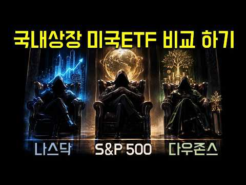
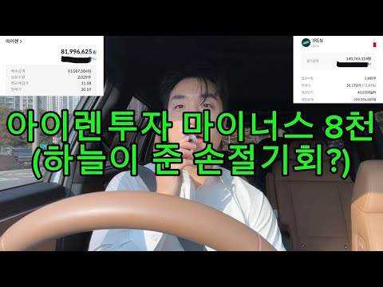
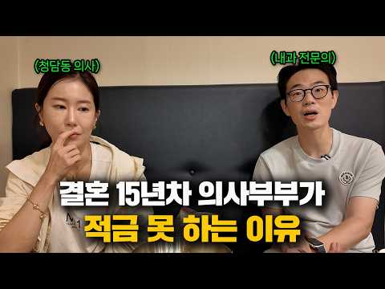
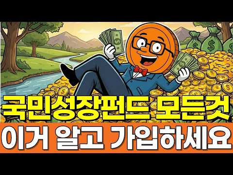

# 재테크 — 성공 사례 분석: 사례별 자세히 #241–#258

`analysis.md` 의 9번 (같은 # 번호). 자동 생성 — `tools/success_analysis.py` v1.4.1 (2026-10-20 07:22 UTC). ※ 연구·교육용 — 투자 권유가 아님.

### 241. 배당 10%를 주면서 동시에 주가도 20% 오른 단 6개의 ETF [1,099개 ETF 모두 뒤져봤습니다.]

- https://www.youtube.com/watch?v=4Gy4lBNuebE · 우아한짠테크 TV · 구독자 37,200 · 조회수 150,823 (×4.0, 하루 958.5) · 좋아요 4,479 (3.0%) · 12.7분 · 2026-05-15 · 주제 묶음 3. 주식·ETF · 형식 정보·해설 (그 밖) · 폴더 `W_4Gy4lBNuebE` (웹 승인)
- 썸네일: 
- 설명 앞부분: 안녕하세요, 우아한짠테크 '우짠'입니다! "배당 많이 받으면 주가는 안 오른다?" 이 상식을 완벽하게 깨부쉈습니다. 국내 상장 ETF 1,099개를 일일이 전수조사해 [배당 10% + 주가 상승 20% + 순자산 3,000억 이상]이라는 미친 조건을 통과한 ETF만 걸러냈습니다. 심지어 이 중에는 수익률 무려 103%를 찍어버린 전설적인 종목도 숨어있는데요! 월배당 투자자라면 무조건 계좌에 담아야 할 상위 0.55%의 기적 같은 ETF, 오늘 영상에서 확인하세요!
- 같은 채널 평소 대비 ×14.0 (채널 최근 롱폼 중앙값 10,746회) · 평소 영상: ISA, 연금계좌 S&P500만 샀다고요? 10년 뒤 땅을 치고 후회합니다. (10,746회) / 가족도 절 버렸졌지만 돈은 끝까지 내옆에 있습니다. (10,636회)
- 대본 없음 (설명) — 음성인식이 끝나면 도입부·흐름이 들어감
- 댓글 316/316: 좋은 점 — 영상 22 · 감사·응원 61 · 더 알고 싶은 것 16 · 아쉬운 점 — 영상 1 · 반박·불만 — 의견 다름 0 · 정치·사회 1 · 경험 공유 10 · 구독·다음 기대 3
  - 좋은 점 — 영상 👍7 “도움이 됩니다.감사합니다.”
  - 좋은 점 — 영상 👍7 “은퇴한지 오래된 주린이. 고정구독자입니다. 아직은 고정현금 흐름이 있기에, 절세계좌 (isa,연금저축, 비과세종합저축계좌) 에서 , 성장주와 고배당주에 투자중입니다. 항상 커버드콜에 관심이 있었는데, 커버드콜에 대한 공부가 아직은 확실히 덜되어 있었는데, 오늘 영상이…”
  - 감사·응원 👍14 “깔끔한 정리 감사합니다.”
  - 감사·응원 👍7 “도움이 됩니다.감사합니다.”
  - 더 알고 싶은 것 👍3 “저기 중에서 1-2개는 담아가야 겠어요:) 없어서 아쉬웠는데! 이렇게 분석해주셔서 감사합니다. 우짠님 어찌 생각하시나요?~ 요즘 장신없어 자주 못왔는데! 우짠님 현재 포트폴리오도 궁금하네요~~~”
  - 더 알고 싶은 것 👍3 “비교분석 감사합니다. 반은 있고 반은 없네요.^^ 다행히 아직까진 수익률도 빨간블이고~ 최근 상장한 ETF들 국내 몇개 있던데요. 비교.예측 부탁드립다. 구독.❤하고 갑니다.”
  - 아쉬운 점 — 영상 👍3 “저기 중에서 1-2개는 담아가야 겠어요:) 없어서 아쉬웠는데! 이렇게 분석해주셔서 감사합니다. 우짠님 어찌 생각하시나요?~ 요즘 장신없어 자주 못왔는데! 우짠님 현재 포트폴리오도 궁금하네요~~~”
  - 경험 공유 👍66 “분석 하시느라 수고 많으셨습니다 언급 하신 여섯개 종목 중에 저희 포트폴리오 안에는 총 4개 종목이 포함되어 있네요 그래서인지 현재 손실 중인 종목은 단 한개도 없고 전체 계좌 총 수익률은 어제 기준 16% 입니다”
  - 경험 공유 👍6 “감사합니다. 제가 기존에 갖고있던 3가지 etf 와 이 6개 모두 총 9가지 etf만 매수해야겠습니다. 유익한 정보 정말 감사드립니다 ~~~~!”
  - 구독·다음 기대 👍12 “깔끔한 정리 아주 좋네요~~ 구독갑니다”
  - 구독·다음 기대 👍2 “왕왕 주린이인대 너무 잘봤어요 매일봐도 모르겟었는데 도움받고가요 근데 커버드콜도 장투하는 개념인지 안전한지 궁금합니다 감사합니다”

### 242. 서울대 의대생이었던 내가 돈을 모으기 시작한 이유ㅣ반지하에서 반포자가까지(feat. 절약, 저축)

- https://www.youtube.com/watch?v=qP7PI42yX6g · 닥터나솔 · 구독자 49,200 · 조회수 187,984 (×3.8, 하루 2,767.2) · 좋아요 2,491 (1.3%) · 15.8분 · 2026-08-13 · 주제 묶음 2. 돈 모으기·저축 · 형식 인터뷰·강연·대담 · 폴더 `W_qP7PI42yX6g` (웹 승인)
- 썸네일: 
- 같은 채널 평소 대비 ×1.8 (채널 최근 롱폼 중앙값 105,503회) · 평소 영상: '이걸 너무 늦게 알았어요' 47세에 돌아보니 나에게 맞는 인생을 사는 법 (105,503회) / “두려웠어요…” 혼자 호텔로 도망쳐보니 알게 된 것 ∣ 혼자 사는 40대 병원장의 연휴 (105,863회)
- 대본 없음 (없음) — 음성인식이 끝나면 도입부·흐름이 들어감
- 댓글 280/293: 좋은 점 — 영상 2 · 감사·응원 34 · 더 알고 싶은 것 0 · 아쉬운 점 — 영상 1 · 반박·불만 — 의견 다름 2 · 정치·사회 2 · 경험 공유 28 · 구독·다음 기대 5
  - 좋은 점 — 영상 👍10 “많이 배웁니다 제가 많이 부족함을 느낍니다. 인생을 다시 잘 살아야겠다고 생각이 드는 영상입니다. 이런걸 알려주셔서 감사합니다”
  - 좋은 점 — 영상 👍0 “좋은 말씀 감사합니다.”
  - 감사·응원 👍364 “학교다닐때 95학번입니다.저희 고등학교에서 넘사벽 전교 1등 저는 10등권 이었습니다. 진짜 서울의대는 넘사벽이었죠.장세권 이름도 안잊어 먹을 정도로 수재여서 그친구도 평범한 집. 그런 끈기와 머리는 부모님께 받은 선물입니다. 노력만으로도 안되지요. 저는 수유시장 앞…”
  - 감사·응원 👍273 “부모님께서 좋은 머리를 물려주셨어요...넘 감사할 일이죠...”
  - 아쉬운 점 — 영상 👍3 “저 좋은 유전자를 후대에 못전한게 아쉽네요”
  - 정치·사회 👍10 “저도 아버지께서 최근에 하늘나라가셔서 요즘따라 많이 그립네요.ㅎ 어머니도 잘모시도록 하겠습니다.”
  - 정치·사회 👍0 “제 개인적 이야기 입니다. 고등학교 3년 입학 성적이 좋아 입학장학금을 저도 쌍둥이라서 가정 생계가 힘들었지만 부모님 가르침으로 그 친구에게 장학금을 양보 했습니다. 그 친구가 의대에 진학하고 제 쌍둥이 동생에게 82년 1억이란 돈을 대출해주어 자영업을 하게 도와주었…”
  - 경험 공유 👍364 “학교다닐때 95학번입니다.저희 고등학교에서 넘사벽 전교 1등 저는 10등권 이었습니다. 진짜 서울의대는 넘사벽이었죠.장세권 이름도 안잊어 먹을 정도로 수재여서 그친구도 평범한 집. 그런 끈기와 머리는 부모님께 받은 선물입니다. 노력만으로도 안되지요. 저는 수유시장 앞…”
  - 경험 공유 👍78 “94년도 중3때 도덕담당이던 아줌씨 담임 내가 교실을 깨끗히 청소 잘 한다며 일요일 본인 집 이삿날 새벽일찍부터 날 불러 청소시키더라. 순진했던 난 왁스로 손이 벗겨져라 화장실 청소까지 말끔하게 했는데 본인 가족 끼리만 짜장면 먹으러가고 나한텐 뻥튀기 과자 한봉다리 …”
  - 구독·다음 기대 👍22 “저도 지금 경제 상황이 좋지 않은 대학생인데 보면서 희망을 얻고 구독하고 갑니다. 멋있으세요!”
  - 구독·다음 기대 👍16 “아~~~쌤. 저 반성하게 되요. 팬입니다. ㅎㅎ”

### 243. "골드만삭스가 전주에 무릎 꿇었습니다" 국민연금 1,458조, 세계 1위 수익률의 비밀

- https://www.youtube.com/watch?v=3Hw87oNMlHI · 경제초고수 · 구독자 39,400 · 조회수 149,400 (×3.8, 하루 894.5) · 좋아요 4,089 (2.7%) · 14.7분 · 2026-05-06 · 주제 묶음 4. 노후·연금 · 형식 인터뷰·강연·대담 · 폴더 `W_3Hw87oNMlHI` (웹 승인)
- 썸네일: 
- 챕터: 0:00 231조 수익, 삼성전자 반 개를 벌어왔다 (Hook) · 0:25 골드만삭스가 전주에 사무소를 열었다 · 0:50 블랙록, 알리안츠까지 전주에 모이는 이유 · 1:10 오늘 영상 로드맵 선언 · 1:30 적립금 1,458조, 세계 3위 연기금 · 1:50 1년 예산 680조의 두 배 · 2:10 해외주식 508조, 해외투자 합계 607조 (44%) · 2:30 대체투자 214조: 공항, 도로, 데이터센터, 오피스 · 3:00 대체투자가 왜 중요한가 (폭락장 쿠션) · 3:30 과거 채권 53% 시대의 교훈 · 3:50 수익률 4.2% vs 캐나다 10.7% (7년 전 꼴… · 4:20 복리 차이: 5년이면 수백 조 · 4:40 왜 채권에 묶어뒀나 (정치적 안전 논리) · 5:00 대전환 시작: 해외 37%, 대체 17% · 5:20 한국 주식 시장 비중 2%, 98%를 놓치고 있었다 · 5:40 장기 목표 해외투자 60% · 6:00 김성주 이사장: 사상 첫 재임 · 6:20 자산 배분 철학: 비율이 수익 90% 결정 · 6:50 정치 압력과 관성을 돌파한 팀 · 7:10 세계 비교: 한국 18.82% 압도적 1위
- 설명 앞부분: 2025년 국민연금 수익률 18.82%. 역대 최고. 1년 수익금만 231.6조 원. 삼성전자 시가총액의 절반을 1년 만에 벌어왔습니다. 근데 진짜 소름 돋는 건 따로 있어요. 골드만삭스가 전주에 사무소를 열었습니다. 배우러 온 거예요. 이 영상에서 다루는 내용: 국민연금 적립금 1,458조 원, 세계 3위 연기금의 규모 해외투자 607조 원 (44%), 대체투자 214조 원의 정체 과거 채권 53% 시대 수익률 4.2%에서 현재 18.82%로의 대전환 자산 배분 전략: 종목이 아니라 비율이 수익의 90%를 결정한다 세계 연기금 …
- 같은 채널 평소 대비 ×34.7 (채널 최근 롱폼 중앙값 4,300회) · 평소 영상: 같은 돈 남기고도 삼 년 뒤가 갈리는 이유 ∣ 사회초년생 월급의 순서 (4,517회) / 캐나다안산거 우리가 살게 사우디가 장보고3를 원하는이유 (4,083회)
- 대본 없음 (설명) — 음성인식이 끝나면 도입부·흐름이 들어감
- 댓글 415/415: 좋은 점 — 영상 1 · 감사·응원 10 · 더 알고 싶은 것 2 · 아쉬운 점 — 영상 0 · 반박·불만 — 의견 다름 14 · 정치·사회 52 · 경험 공유 5 · 구독·다음 기대 0
  - 좋은 점 — 영상 👍35 “골드만삭스와 공동연구? 이거는 국부에 도움이 안될것 같은데요.. 저들의 의도는 한국 주식시장 망가뜨릴것 같아요.”
  - 감사·응원 👍206 “지금시점으론 1700조라던데.. 5000조 만들어서 연금좀 많이줘라.. 부탁하고 응원한다..”
  - 감사·응원 👍116 “극민연금 현재의 직원들 잘 운영해주어 고맙고 수고 많습니다”
  - 더 알고 싶은 것 👍0 “삼성전자 시총 400조 언제적 얘기 하시는지?”
  - 반박·불만 — 의견 다름 👍1 “국민 연금을 그렇게 욕 먹으면서 개혁을 하니 이런 좋은 일도 생겨서 더이상 국민 연금 고갈 되어서 못 받는 다는 헛소리 안 나오게 되어 미래 세대가 세금 폭탄을 드디어 벗어 나게 되어 새로운 세상에 대한 희망이 생기게 되었다..”
  - 반박·불만 — 의견 다름 👍1 “헛소리 하지마. 꼴깝 더네.”
  - 정치·사회 👍74 “우리연금제도를 보고 많은 나라가 부러워할 것 같습니다. 참 말이 많았죠. 최근 주식 때문이기도 하지만 다행입니다. 주변에 연금 받는 사람들 보면 생활을 완전히 보장은 못해도 상당한 도움이 됩니다. 안심하시고 연금을 꾸준히 납입하세요.”
  - 정치·사회 👍71 “이재명 대통령이 국민연금고갈 문제를 1년만에 다 해결했네. 대단하다 정말.”
  - 경험 공유 👍22 “국민연금 투자결정했었던 사람들에게 인센티브를 줘야합니다. 그것도 생각했던 것 보다 많이... 반도체 공장에 근무만해도 내년에 10억이상 받는데... 이런 투자결정을 했었던 사람들이 받아야지 ... 자 ~ 박수 짝짝짝~♡”
  - 경험 공유 👍4 “나도 껴주라”

### 244. 돈 버는 방식은 정해져 있다, 수익 모델 15종 다이제스트

- https://www.youtube.com/watch?v=wr4nCMUy1dk · 사다리게임 · 구독자 36,100 · 조회수 133,900 (×3.7, 하루 924.5) · 좋아요 9,028 (6.7%) · 18분 · 2026-05-28 · 주제 묶음 기타 · 형식 정보·해설 (그 밖) · 폴더 `W_wr4nCMUy1dk` (웹 승인)
- 썸네일: 
- 설명 앞부분: 수익 모델의 유형은 이미 정해져 있습니다. 세상에 아무리 새로운 서비스가 나와도, 돈을 버는 구조는 결국 기존 패턴의 선택이거나 조합이에요. 15가지 수익 모델을 하나씩 빠르게 훑을 건데요, 이 중에서 여러분의 사업에 맞는 걸 찾아 보세요.
- 같은 채널 평소 대비 ×7.6 (채널 최근 롱폼 중앙값 17,553회) · 평소 영상: 대기업 잔치에 끼어들 수 있는 아이템이 있습니다 (신사업 원정대) (17,553회) / 일본에선 외국인 노동자가 새로운 고객층이 됐습니다 (17,373회)
- 대본 없음 (설명) — 음성인식이 끝나면 도입부·흐름이 들어감
- 댓글 77/77: 좋은 점 — 영상 7 · 감사·응원 9 · 더 알고 싶은 것 2 · 아쉬운 점 — 영상 0 · 반박·불만 — 의견 다름 0 · 정치·사회 0 · 경험 공유 1 · 구독·다음 기대 2
  - 좋은 점 — 영상 👍5 “좋은 영상 감사합니다.”
  - 좋은 점 — 영상 👍3 “좋은 영상 감사합니다!”
  - 감사·응원 👍34 “뭐지 이 개 똑똑한 영상이 내게 뜨다니.... 감사합니다.”
  - 감사·응원 👍10 “우연히 보게되었는데 내용이 간결하게 핵심이 잘 정리되어서 너무 좋았습니다 감사합니다 😊”
  - 더 알고 싶은 것 👍16 “당연한 얘기들이지만 실천하기가 참 어려운😂 각각의 초기자금과 난이도도 붙여서 심화버전도 만들어주시면 좋겠네요!”
  - 더 알고 싶은 것 👍2 “각각 매출 발생 방법별 디테일한 성과 지표알려주세요”
  - 경험 공유 👍3 “제가 봤으니까 이제 영상 내려주세요”
  - 구독·다음 기대 👍3 “구독하고 갑니다. 감사합니다.”
  - 구독·다음 기대 👍2 “구독합니다”

### 245. 연금저축 IRP 계좌에서 사모을 ETF 3대장 추천! 결국 국내상장 나스닥 S&P500 다우존스 ETF 적립식으로 사모으는 방법이 추천 됩니다

- https://www.youtube.com/watch?v=yITsxwpiFOw · 소금달 - 소액 금 달러 투자 · 구독자 2,770 · 조회수 10,178 (×3.7, 하루 2,029.5) · 좋아요 35 (0.3%) · 20분 · 2026-10-15 · 주제 묶음 4. 노후·연금 · 형식 정보·해설 (그 밖) · 폴더 `W_yITsxwpiFOw` (웹 승인)
- 썸네일: 
- 챕터: 0:00 국내상장 미국 ETF 3대장 · 0:29 나스닥 100 ETF 추천 · 5:12 S&P 500 ETF 추천 · 11:08 미국배당 다우존스 ETF 비교 · 19:24 연금저축 IRP ISA 절세계좌 장기투자
- 설명 앞부분: 국내상장 미국주식은 3대장 모두 적립식 투자 하시는걸 추천 드립니다. IRP, ISA, 연금저축 계좌에서 절세 비교하고, 국내상장 상품별로 수수료 비교하면 그 다음은 꾸준히 사모으면서 장기투자하는게 정답인것 같습니다.
- 같은 채널 평소 대비 ×21.5 (채널 최근 롱폼 중앙값 474회) · 평소 영상: 은퇴없이 죽을 때까지 일만 해야할까? (474회) / 미국주식 대표 S&P 500 ETF 비교 방법! 하나만 골라서 연금저축에서 적립식 투자로… (467회)
- 대본 없음 (설명) — 음성인식이 끝나면 도입부·흐름이 들어감
- 댓글 2/2: 좋은 점 — 영상 0 · 감사·응원 0 · 더 알고 싶은 것 0 · 아쉬운 점 — 영상 0 · 반박·불만 — 의견 다름 0 · 정치·사회 0 · 경험 공유 0 · 구독·다음 기대 0

### 246. “아이렌 긴급 ,30달러 깨질듯한 상황.. 손절각인가??(ft.코어위브/CPI)아이렌맨.

- https://www.youtube.com/watch?v=cTlVY95Qzlk · 아이렌맨 : IREN을 사랑하는 남자 · 구독자 7,720 · 조회수 27,807 (×3.6, 하루 5,459.1) · 좋아요 337 (1.2%) · 8.8분 · 2026-10-15 · 주제 묶음 기타 · 형식 인터뷰·강연·대담 · 폴더 `W_cTlVY95Qzlk` (웹 승인)
- 썸네일: 
- 설명 앞부분: 오늘은 급하게 차에서 영상올립니다. 준비해둔 자료가있는데.. 그냥 그게 중요치않기에 아이렌의 운명은 ..?
- 같은 채널 평소 대비 ×2.3 (채널 최근 롱폼 중앙값 12,020회) · 평소 영상: "아이렌 실적발표 D-1 ∣ 시험장 들어가기 전, 이것만 알고 가자 (feat. 엔비디아… (12,459회) / "아이렌 호재? 오픈소스도 점령! ,차마스 5종목·코어위브 제외·미중회담"ft.아이렌맨 (11,581회)
- 대본 없음 (설명) — 음성인식이 끝나면 도입부·흐름이 들어감
- 댓글 398/398: 좋은 점 — 영상 1 · 감사·응원 40 · 더 알고 싶은 것 7 · 아쉬운 점 — 영상 1 · 반박·불만 — 의견 다름 7 · 정치·사회 1 · 경험 공유 24 · 구독·다음 기대 1
  - 감사·응원 👍230 “이 형 인정해 주자, 매일같이 떨어져도 멘탈 지키면서 주식 가격올리고, 가오가 있는 사람이다. 응원합니다.”
  - 감사·응원 👍56 “아이렌이 의외로 이번장이후로 코어. 네비보다 더많이 올라갈수있어요~ 항상응원하니다 힘내고 힘내세요! 장투의길은 원래 힘든법이죠!! 화이팅!”
  - 더 알고 싶은 것 👍16 “주가가 얼마나 떨어지던 물타고 버티고 하는 종목은 대형주에나 해당되는 말이고요.. 아이렌같은 부도날 가능성도 있는 중소형주는 그렇게 하다가 골로간 사람들 한둘이 아닙니다. 아이렌은 절대 부도 안난다구요?? 지금 cds 폭등하는게 안보이시나요? 코로나때 저금리로 유동성…”
  - 더 알고 싶은 것 👍4 “손절좀부탁드려요형님ㅜㅜ 그래야오를듯합니다”
  - 아쉬운 점 — 영상 👍5 “29불에 1억정도 시드 박았네요 장기계좌에 8불 3000만원 있는데 늘 아쉬웠는데 자리 좋은거 같아요”
  - 반박·불만 — 의견 다름 👍16 “주가가 얼마나 떨어지던 물타고 버티고 하는 종목은 대형주에나 해당되는 말이고요.. 아이렌같은 부도날 가능성도 있는 중소형주는 그렇게 하다가 골로간 사람들 한둘이 아닙니다. 아이렌은 절대 부도 안난다구요?? 지금 cds 폭등하는게 안보이시나요? 코로나때 저금리로 유동성…”
  - 반박·불만 — 의견 다름 👍10 “오를수도 있고 떨어질수도 있다. 응원하지도 말고 조롱하지도 말자고 말했더니 선동하지말라고 한다. 지켜보자고 했더니 응원할것도 아니면서 왜 지켜보냐고 시비를 건다. 도대체 어떤것이 선동인것인가?? 이 채널은 아이렌을 응원하는 사람들만 댓글을 달수 밖에 없는 것인가? 합…”
  - 정치·사회 👍2 “데이터 센터 반대의 목소리가 높아지고 있지만 중간선거 끝나면 불확실성이 제거돼서 이유 없이 오를겁니다”
  - 경험 공유 👍18 “이런분이 찐이지 떨어지던 오르던 자기 신념 자기주관 아이렌 저도 이번에 떨어져서 조금식 담아봅니다 올라가길 응원합니다 화이팅!”
  - 경험 공유 👍16 “주가가 얼마나 떨어지던 물타고 버티고 하는 종목은 대형주에나 해당되는 말이고요.. 아이렌같은 부도날 가능성도 있는 중소형주는 그렇게 하다가 골로간 사람들 한둘이 아닙니다. 아이렌은 절대 부도 안난다구요?? 지금 cds 폭등하는게 안보이시나요? 코로나때 저금리로 유동성…”
  - 구독·다음 기대 👍2 “항상 볼때마다 잘생겼어ㅎㅎ아이렌 떨어져도 아이렌남 보면서 버티는 중 하루에 1영상이면 좋겠네요. 기다려집니다”

### 247. "유료강의 듣지 마세요" 건기식으로 하루 10분 일하고 월 2억 매출내는 건기식 부업의 모든 것 [500만원 풀버전 전부공개]

- https://www.youtube.com/watch?v=YUyMEz4qCdM · 돈되는대화 · 구독자 3,340 · 조회수 11,546 (×3.5, 하루 1,953.2) · 좋아요 0 (0.0%) · 19.3분 · 2026-10-14 · 주제 묶음 8. 부업·소득 · 형식 인터뷰·강연·대담 · 폴더 `W_YUyMEz4qCdM` (웹 승인)
- 썸네일: 
- 설명 앞부분: "현재 가장 확실한 돈버는법! 48살에 건기식 부업 하나로 월 2억 버는 최대표의 20분 실전 압축 강의" 요즘 가장 빠른 돈버는법이 궁금하시거나, 집에서 손쉽게 도전할 수 있는 재택부업 및 온라인부업을 찾고 계셨나요? 딱 20분 투자로 직장인 부업은 물론 주부 부업으로도 바로 시작해 볼 수 있는 현실적인 돈버는법의 핵심 노하우를 축약했습니다. 🎁 무료 배포 자료 3종 구성 쿠팡 상위 노출 시크릿 전자책: 초보 셀러도 쿠팡 알고리즘을 정복하고 첫 페이지 노출을 노리는 핵심 가이드 구매 전환율 폭발 상세페이지 및 썸네일 제작 전자책…
- 같은 채널 평소 대비 ×2.3 (채널 최근 롱폼 중앙값 4,965회) · 평소 영상: "한국에서 저만 해요" 역대급 부업으로 월 9천씩 버는 30대 대표 (4,867회) / "AI한테 질문하면 끝" 부업 10개 해본 여사장님이 말하는 지금 가장 쉬운 1등 부업 (6,370회)
- 대본 없음 (설명) — 음성인식이 끝나면 도입부·흐름이 들어감
- 댓글 91/91: 좋은 점 — 영상 0 · 감사·응원 7 · 더 알고 싶은 것 3 · 아쉬운 점 — 영상 0 · 반박·불만 — 의견 다름 0 · 정치·사회 0 · 경험 공유 2 · 구독·다음 기대 0
  - 감사·응원 👍0 “전자책 신청완료 감사합니다”
  - 감사·응원 👍0 “최대표님 감사합니다~~”
  - 더 알고 싶은 것 👍0 “환절기 감기 조심하세요. 전자책 부탁드립니다.”
  - 더 알고 싶은 것 👍0 “어떻게신청하나요.신청하겠습니다10월28일.그날어떻게강연들어갈수있나요??알려주세요. 그날어떻게. 전자책”
  - 경험 공유 👍0 “저도 전자책신청합니다~~~제발”
  - 경험 공유 👍0 “전자책 저도. 필요해요~~”

### 248. "진짜 부자는 티를 안 낸다" 허세 부리는 사람과 조용히 부자가 된 사람의 결정적 차이 4가지

- https://www.youtube.com/watch?v=2JSu61-Eh2o · 존버리즘 · 구독자 20,000 · 조회수 68,778 (×3.4, 하루 23,457.6) · 좋아요 420 (0.6%) · 39.5분 · 2026-10-17 · 주제 묶음 1. 재테크 일반·마인드 · 형식 정보·해설 (그 밖) · 폴더 `W_2JSu61-Eh2o` (웹 승인)
- 썸네일: 
- 챕터: 0:00 차는 남자 얼굴이야, 3년 뒤 걸려 온 전화 · 0:43 첫 번째, 보이는 것부터 할부로 사는 사람 · 2:23 집들이에서 나온 한마디, 은행에 월세 내는 거랑 똑같… · 3:14 휠, 블랙박스, 범퍼 수리비까지 카드로 · 5:27 유예할부 만기, 3천5백이 최선입니다 · 6:15 3백만 빌려줄 수 있냐 · 7:09 팀장이 탄 13년 된 쏘나타 · 9:01 두 번째, 얼마 벌었는지 꼭 말하는 사람 · 11:41 따라 산 주식, 천만 원이 6백이 되기까지 · 15:16 왜 나만 빼고 만나? · 17:24 칼국수집에서 들린 소문, 그 친구가 제일 여유 있었다 · 18:35 석 달 만에 올라온 새 골프채 사진 · 19:07 세 번째, 남의 집 돈 사정을 캐묻는 사람 · 20:52 옆집 학원비가 우리 집 마이너스통장이 되기까지 · 23:05 남편 휴대폰에 뜬 은행 문자 · 26:15 경차 타던 전세 집의 반전 · 28:28 은정 씨네 새집 집들이 · 29:21 네 번째, 체면 때문에 지갑부터 여는 사람 · 33:50 아들 학원비 결제가 안 된 날, 우리가 먼저야 · 35:07 각자 내자는 말에 비어 버린 2차
- 설명 앞부분: 돈 없는 사람만 하는 최악의 행동 4가지, 네 사람의 이야기로 정리했습니다. 7천만 원짜리 수입 SUV를 할부로 뽑고 13년 된 쏘나타를 놀리던 남자는, 3년 뒤 그 친구에게 3백만 원을 빌려 달라고 전화했습니다. 얼마 벌었는지 꼭 말하던 친구, 남의 집 평수부터 캐묻던 엄마, 후배들 술값을 늘 혼자 내던 부장. 그리고 그 옆에서 아무 말 없이 살던 사람들이 실제로 어떻게 살고 있었는지까지 담았습니다. ⏱ 타임라인
- 같은 채널 평소 대비 ×0.9 (채널 최근 롱폼 중앙값 80,617회) · 평소 영상: “먹기 전에 찍어야지” 인스타에 중독된여자를 걸러야 하는 진짜 이유 (80,617회) / “앞자리가 바뀌자 달라졌다” 40대 미혼 여자들이 뒤늦게 깨달은 충격적인 현실들 (79,569회)
- 대본 없음 (설명) — 음성인식이 끝나면 도입부·흐름이 들어감
- 댓글 54/54: 좋은 점 — 영상 1 · 감사·응원 1 · 더 알고 싶은 것 0 · 아쉬운 점 — 영상 0 · 반박·불만 — 의견 다름 1 · 정치·사회 0 · 경험 공유 4 · 구독·다음 기대 0
  - 좋은 점 — 영상 👍0 “좋은 말씀 입니다 제 주위에 4번 해당하는 주인공이 있네요 서글픈 인생을 견디고있어요🎉”
  - 감사·응원 👍4 “차라리 내주고 싶으면 점심먹고 저가커피정도 사주고 시간쓰지않게하면 서로 부담도없고 충분히 감사하더군요.”
  - 반박·불만 — 의견 다름 👍0 “글세효 부동산 자산 있고 해서 부자아닙니다 소비도하고 남들에게 베풀줄 알아야 부자죠 여기는 그냥 서민중에 대기업 다니는 정도 부자구만.. 가만히 있어도 돈이 들어오고 그래서 돈도 남에게 돈을 쓸줄 사람이 부자에요..”
  - 경험 공유 👍3 “쥐뿔도 없다는말 참 내가 좋아하는말임 허세부리고 입가볍고 남 함부로 내려치면서 무시하고, 쓸데없이 다른사람의 재산 집 생활까지 캐묻는 사람까지 등등 공통적으로 하고싶은말이 쥐뿔도 없이 나댄다는거 돈잘벌고 여가생활 일 열씸히 하는 사람들은 티도 내지않고 조용히 잘지냅니다”
  - 경험 공유 👍1 “내가 본 부자 1위는 중국에서 봤는데 후진타오 옆에 앉아서 인민대표대회하고 같이 식사할때 왕푸징 한 복판에 나라에서 받은 기사있는 아우디 A8 세워도 아무도 뭐라 안하고 밥 먹을때 옆에 무도학원 출신 첩이 있는데 진짜 세상에서 본 사람 중 제일 예뻤음 그 분 당시 회…”

### 249. 돈 모으기 힘든 의사부부의 현실적인 재테크 이야기

- https://www.youtube.com/watch?v=VI9RFlefx5w · 솔직하지영 · 구독자 9,810 · 조회수 33,739 (×3.4, 하루 5,804.2) · 좋아요 215 (0.6%) · 11.9분 · 2026-10-14 · 주제 묶음 1. 재테크 일반·마인드 · 형식 정보·해설 (그 밖) · 폴더 `W_VI9RFlefx5w` (웹 승인)
- 썸네일: 
- 설명 앞부분: 등산 후라 많이 찌들어 있었는데요ㅎㅎ 이번 영상에서는 요즘 MZ들의 소비 습관부터 저희 부부가 평소 어떤 식으로 돈 관리를 하는지까지 솔직하게 담아봤습니다. 영상 후반에는 PD님들과 막걸리 한잔 걸치면서 강 원장과 이런저런 이야기도 나눴는데요. 편하게 웃으면서 재밌게 봐주세요
- 같은 채널 평소 대비 ×2.0 (채널 최근 롱폼 중앙값 16,630회) · 평소 영상: 결혼 15년차 의사부부가 메이드카페에 가면 생기는 일 (18,203회) / 남편 얼굴이 갑자기 늙어 보인다면 ‘여기’부터 보세요 (15,056회)
- 대본 없음 (설명) — 음성인식이 끝나면 도입부·흐름이 들어감
- 댓글 9/9: 좋은 점 — 영상 0 · 감사·응원 0 · 더 알고 싶은 것 0 · 아쉬운 점 — 영상 0 · 반박·불만 — 의견 다름 0 · 정치·사회 0 · 경험 공유 0 · 구독·다음 기대 0

### 250. -5억, 주식에 노후자금 몰빵🔥내 미래는 쪽빵ㅜㅜ

- https://www.youtube.com/watch?v=IthWsvdt6q4 · 권감각의 유기주식테라피  · 구독자 20,400 · 조회수 69,900 (×3.4, 하루 1,555.9) · 좋아요 574 (0.8%) · 11.1분 · 2026-09-05 · 주제 묶음 3. 주식·ETF · 형식 사연·드라마 · 폴더 `W_IthWsvdt6q4` (웹 승인)
- 썸네일: 
- 설명 앞부분: 당첨자 정보 입력하기 : 사연을 보내주실 때는 주식 매수 동기와 화면 캡처본(개인정보 가림 처리)을 함께 첨부해 주세요! 🎶 엔딩송 풀버전
- 같은 채널 평소 대비 ×1.9 (채널 최근 롱폼 중앙값 37,565회) · 평소 영상: 공포에 사라길래 샀더니 -6천… 주식장이 귀신의 집이냐 (41,465회) / 주식 공부하면 돈 번다며 - 2억 날리고 깨달은 주식판 현실 계좌 인증합니다🔥 (33,665회)
- 대본 없음 (설명) — 음성인식이 끝나면 도입부·흐름이 들어감
- 댓글 81/83: 좋은 점 — 영상 0 · 감사·응원 2 · 더 알고 싶은 것 1 · 아쉬운 점 — 영상 1 · 반박·불만 — 의견 다름 1 · 정치·사회 0 · 경험 공유 5 · 구독·다음 기대 0
  - 감사·응원 👍4 “어우 5억 끔찍...나도 6월까지 -7억 이었다가 최근 -4억정도로 회복했는데.... 화이팅 합시다~!!!”
  - 감사·응원 👍0 “다들 힘내세요 언니 5억 빚있다는데 저는 공무원인데 영끌해서 부동산 3억 넘게 날리고 주식도 3억손실 미친듯이 안쓰고 빚 갚고있어요 영상 보고 서로 위로의 마음이에요ㅜㅜ 그래도 10년 지나면 나아지겠지하며 살고있어요 눈깔이 돌때가 있더라구요 ㅠㅠ”
  - 아쉬운 점 — 영상 👍4 “편집자님 갈수록 편집이 맛깔나네요 정성이 느껴집니다. 권감각님이 돈복은 지금은 몰라도 인복은 상한가네요”
  - 반박·불만 — 의견 다름 👍4 “평생 주식 할 생각이라지만 우리의 생명이 영원한 것이 아닌데 말이죠~😅 이러다 이 별에서 떠나는 날까지도 돈이 묶여 있을까 싶어 걱정입니다. 제 얘기예요~😂”
  - 경험 공유 👍16 “몰빵….주식3년차인데 단한번도 몰빵해본적이없다요… 쫄보라서그런가 무조건 분매수분매도실천함”
  - 경험 공유 👍4 “어우 5억 끔찍...나도 6월까지 -7억 이었다가 최근 -4억정도로 회복했는데.... 화이팅 합시다~!!!”

### 251. 월 100만 원으로 QLD 적립식 투자하면 10억 은퇴자금 가능할까?

- https://www.youtube.com/watch?v=hSorn4W4RsI · 돈재이 DONJAY · 구독자 19,800 · 조회수 68,010 (×3.4, 하루 444.5) · 좋아요 1,363 (2.0%) · 19.2분 · 2026-05-20 · 주제 묶음 3. 주식·ETF · 형식 오디오북·낭독 (명언·인생조언) · 폴더 `W_hSorn4W4RsI` (웹 승인)
- 썸네일: 
- 설명 앞부분: ⭐안녕하세요, 본 채널은 저의 개인적인 투자 여정과 장기 투자 철학을 기록하는 공간입니다. 제가 겪은 시행착오와 시장을 바라보는 관점이 여러분의 투자 공부에 작은 참고가 되기를 희망합니다. 다만, 채널의 모든 콘텐츠는 정보 전달을 목적으로 제작되었습니다. 여러분의 성공적인 투자 여정을 응원합니다.
- 같은 채널 평소 대비 ×3.8 (채널 최근 롱폼 중앙값 17,667회) · 평소 영상: 환율 계속 떨어지는데 QLD 투자해도 될까? 제 결론입니다 (17,667회) / 수익률 200%차이? 적립식 투자 수익률 어떤 것이 더 높을까? 매일 사기 vs 매주 사… (17,847회)
- 대본 없음 (설명) — 음성인식이 끝나면 도입부·흐름이 들어감
- 댓글 342/343: 좋은 점 — 영상 6 · 감사·응원 34 · 더 알고 싶은 것 34 · 아쉬운 점 — 영상 0 · 반박·불만 — 의견 다름 0 · 정치·사회 0 · 경험 공유 27 · 구독·다음 기대 1
  - 좋은 점 — 영상 👍3 “재밌게 잘 봤습니다👍앞으로도 계속해서 좋은 정보 많이 올려주세용👍 멋집니다”
  - 좋은 점 — 영상 👍3 “돈재이님 영상 너무 잘봤습니다 ~! 세금관련 영상도 쉽게 이해할수있는 영상도 제작 부탁드립니다!”
  - 감사·응원 👍16 “10년후에 저도 같이 밥 먹어요^^ 투자메이트가 생기니 투자가 더 재밌네요~~ 10년동안 사라지기 없기!!!! 돈재이님의 삶을 응원합니다!!!”
  - 감사·응원 👍7 “헐 지금 내가 딱 궁금한 딱!!!! 슈드 큐엘디 갈까 고민하는 상황에서 뜨네 와 감사합니다”
  - 더 알고 싶은 것 👍5 “10억으로 하면 100억도 되나요?”
  - 더 알고 싶은 것 👍3 “돈재이님 영상 너무 잘봤습니다 ~! 세금관련 영상도 쉽게 이해할수있는 영상도 제작 부탁드립니다!”
  - 경험 공유 👍26 “제가 실제로 1억 5천 정도 미국 개별주식 들고있던 상태에서 21년 7월 부터 매일 QLD를 사모았거든요. 어제까지 총 3억 정도 분할 매수해서 원금은 4억 5천 살짝 안되고 계좌는 딱 13억 찍혀있어요. 시장을 떠나지 않고 꾸준히 적립식 분할 매수한다면 10년안에 …”
  - 경험 공유 👍21 “제가 주식 금융순자산 만드는데 8년 8개월 걸렸는데 정말 1배짜리로는 힘들고 적절한 하락장때 적절한 레버리지 섞어야 가능하더라구요. 하락장마다 직장신용대출받아서 추가로 들어가니 가능하더군요.”
  - 구독·다음 기대 👍2 “매달 사는날이 정해져 있나요? 좋은방법인것 같아요 오늘 구독하고 갑니다.”

### 252. 반드시 부자되는 신혼부부의 3가지 공통점 (부자되는 방법)

- https://www.youtube.com/watch?v=t6NrbgrRE_k · 해쏘현_신혼부부 재테크 · 구독자 26,400 · 조회수 89,675 (×3.4, 하루 1,549.1) · 좋아요 727 (0.8%) · 11.9분 · 2026-08-23 · 주제 묶음 1. 재테크 일반·마인드 · 형식 정보·해설 (그 밖) · 폴더 `W_t6NrbgrRE_k` (웹 승인)
- 썸네일: 
- 챕터: 0:00 인트로 · 0:50 부부가 한 방향으로 돈을 굴린다 · 3:30 오를 곳을 고르는 방법 · 6:53 남들이 망설일 때 실행한다 · 8:54 클로징 · 11:15 요즘 근황
- 설명 앞부분: 🙋‍♀️ 여전히 내집마련이 어렵다면 고민 상담하기 ‼️내집마련 고민상담 대기 신청하기
- 같은 채널 평소 대비 ×11.4 (채널 최근 롱폼 중앙값 7,836회) · 평소 영상: 자녀에게 주식 증여하는 방법 (집에서 홈택스 신고까지 A to Z) (8,754회) / 주식 증여 vs 현금 증여, 뭐가 유리할까? (세무사 상담 후 바꾼 이유) (6,281회)
- 대본 없음 (설명) — 음성인식이 끝나면 도입부·흐름이 들어감
- 댓글 100/100: 좋은 점 — 영상 4 · 감사·응원 4 · 더 알고 싶은 것 3 · 아쉬운 점 — 영상 2 · 반박·불만 — 의견 다름 1 · 정치·사회 2 · 경험 공유 9 · 구독·다음 기대 0
  - 좋은 점 — 영상 👍4 “맞는 말씀임. 아껴쓰고, 투잡이든 내 몸값을 늘리든 소득 올리고 공부해서 종잣돈으로 투자도 하고. 그럼 모이는 것 같아요! 모든 자산을 부동산에 때려박는 것 보다, 부동산보다 수익을 다른 방향으로 더 올릴 수 있다면 그것도 시도하는게 필요한 것 같아요! 찐 부자들은 …”
  - 좋은 점 — 영상 👍2 “알고리즘에 떠서 보게 되었는데 좋은 내용이네요! 전달력이 굉장히 좋으시네요! 감사합니다!”
  - 감사·응원 👍2 “알고리즘에 떠서 보게 되었는데 좋은 내용이네요! 전달력이 굉장히 좋으시네요! 감사합니다!”
  - 감사·응원 👍1 “항상 좋은 영상 감사해요~ 내집마련을 최우선으로 하여 달려가겠습니다! 책 집필도 화이팅이에요!”
  - 더 알고 싶은 것 👍12 “요즘 부동산 입장권이라는말이 있던데 , 둘이합쳐 1억뿐인데도 바로 매수하는게 맞을까요.. 예를들어 5억대 매매해서 1억 오를때 상급지는 몇억씩 뛸것같아서 6억 미만 사는게 리스크가 있을것같아서요.. 부부합산 연봉 9천인데, 2년동안 1억을 모아서 시드 2억일때 아파트…”
  - 더 알고 싶은 것 👍3 “책 궁금해요! 나오면 사서 읽어볼게요~!!”
  - 아쉬운 점 — 영상 👍15 “그걸 누가 모르나? 다들 돈이 모자르고 대출 받기도 힘드니 오피스텔이나 빌라라도 생각하는거다 뭐? 리센츠, 헬리오? 그거 살 돈 있는 사람들이 이런거 보겠냐? 다들 작은 시드로 시작하니 이런거라도 보면서 방법을 찾을려고 하는거다 누구나 다 알고 있는 뻔한 내용들만 얘…”
  - 아쉬운 점 — 영상 👍2 “자막이 황금성 오타가 있네요~”
  - 정치·사회 👍155 “문재인 만나기전에 결혼하신 분들은 3배가 안되면 이상한겁니다!”
  - 경험 공유 👍6 “18년에 결혼해서 저도 순자산 5배가 늘었는데요 각자 상황에 따라 다릅니다. 잘 판단하고 결정하세요.”
  - 경험 공유 👍2 “공주시 같은 소도시는여???? 현 대장 아파트가 300세대 ( 3년차 ) 거의 5억입니다.”

### 253. 부자 되기 바로 전, 삶에 나타나는 이상한 변화 7가지 (놓치면 평생 후회합니다)

- https://www.youtube.com/watch?v=GxGvoXZQbZ0 · 누구나 겪는 돈 이야기 · 구독자 4,490 · 조회수 14,362 (×3.2, 하루 90.4) · 좋아요 356 (2.5%) · 17.2분 · 2026-05-14 · 주제 묶음 1. 재테크 일반·마인드 · 형식 정보·해설 (그 밖) · 폴더 `W_GxGvoXZQbZ0` (웹 승인)
- 썸네일: 
- 챕터: 0:00 도입: 최근 느껴지는 낯선 감각 · 1:45 신호 1: 기존 인간관계에서의 소외감 · 3:30 신호 2: 예전의 취미가 무의미하게 느껴짐 · 5:15 신호 3: 직관의 필터가 바뀌기 시작함 · 7:00 신호 4: 논쟁을 멈추고 실행에 집중 · 9:15 신호 5: 하나의 목표에 대한 강한 집중 · 11:30 신호 6: 극한의 피로에 도달 · 13:45 신호 7: 현재 수입 구조에 대한 의문 · 15:30 정리: 폭발을 위한 에너지가 축적되는 과정 · 16:45 당신에게 전하는 메시지: 멈추지 마세요
- 설명 앞부분: 7가지 이상한 신호: 당신의 인생이 곧 완전히 바뀐다 ∣ 성공의 전환점 최근 들어 주변의 모든 것이 낯설게 느껴지나요? 친구들과의 즐거운 시간조차 공허하게 느껴지고, 예전에는 좋아하던 것들이 더 이상 흥미롭지 않거나, 심지어 모든 것에 대해 피로감과 의문을 느끼고 있나요? 너무 걱정하지 마세요. 이것이 단순한 하락의 신호일 거라고 생각할 필요는 없습니다. 사실 이런 불편하고 혼란스러운 감정은 무너짐이 아니라, 당신이 완전히 새로운 단계로 나아가기 직전이라는 신호일 수 있습니다. 대부분의 성공한 사람들은 인생이 크게 바뀌기 직전에 …
- 같은 채널 평소 대비 ×2.1 (채널 최근 롱폼 중앙값 6,898회) · 평소 영상: 이 7가지 모르면 10억은 절대 못 갑니다 (1억부터 시작) (7,030회) / 왜 가난한 사람들끼리 모이면 더 가난해질까? 숨겨진 충격적 메커니즘 (경제학·심리학·사회… (6,766회)
- 대본 없음 (설명) — 음성인식이 끝나면 도입부·흐름이 들어감
- 댓글 14/14: 좋은 점 — 영상 2 · 감사·응원 3 · 더 알고 싶은 것 0 · 아쉬운 점 — 영상 0 · 반박·불만 — 의견 다름 0 · 정치·사회 0 · 경험 공유 2 · 구독·다음 기대 0
  - 좋은 점 — 영상 👍1 “좋은 영상 올려주셔서 정말 감사드립니다”
  - 좋은 점 — 영상 👍0 “좋은 영상입니다~ 저영상이 진짜로 이루어지면 좋겠습니다”
  - 감사·응원 👍4 “나는 백프로왔어요.감사합니다.고맙습니다.”
  - 감사·응원 👍1 “좋은 영상 올려주셔서 정말 감사드립니다”
  - 경험 공유 👍4 “나도나도 이런느낌. 부자될 상이로군요.. 아니라도 이영상. 자신감 뿜뿜 되네요~~”

### 254. 90%가 모르는 1억의 3가지 비밀

- https://www.youtube.com/watch?v=W6qFqiYnm5o · 10분 동기부여 · 구독자 19,900 · 조회수 63,051 (×3.2, 하루 350.3) · 좋아요 1,012 (1.6%) · 29.6분 · 2026-04-23 · 주제 묶음 2. 돈 모으기·저축 · 형식 인터뷰·강연·대담 · 폴더 `W_W6qFqiYnm5o` (웹 승인)
- 썸네일: 
- 설명 앞부분: YDCLASS 평생교육시설 유튜브 전문 학원 유선상담 010-5293-3371 1억은 단순한 저축 목표가 아닙니다. 복리 곡선이 꺾이는 임계점이자, 돈을 바라보는 방식이 완전히 달라지는 전환점입니다. 돈을 열심히 모으고 있는데 뭔가 제자리걸음인 느낌이 드는 분, 1억이 생긴 뒤에도 크게 달라진 게 없는 분들께 꼭 필요한 이야기입니다. 이 영상은 복리의 작동 원리와 1억이 갖는 심리적·수학적 의미에 대해 쉽게 이해할 수 있도록 제작되었습니다. 복잡한 금융 개념을 일상적인 언어와 실제 경험담으로 풀어 설명합니다. 본 영상의 이미지는 …
- 같은 채널 평소 대비 ×27.8 (채널 최근 롱폼 중앙값 2,264회) · 평소 영상: 나름대로 열심히 절약했던 습관이 내 돈을 갉아먹고 있었다 (2,264회) / 1억 모으고 이 실수 하면 5년 모은 돈 순식간에 날아갑니다 (2,239회)
- 대본 없음 (설명) — 음성인식이 끝나면 도입부·흐름이 들어감
- 댓글 94/94: 좋은 점 — 영상 2 · 감사·응원 5 · 더 알고 싶은 것 0 · 아쉬운 점 — 영상 7 · 반박·불만 — 의견 다름 0 · 정치·사회 0 · 경험 공유 5 · 구독·다음 기대 0
  - 좋은 점 — 영상 👍13 “구독,좋아요 누르고 갑니다.좋은영상 감사합니다 이번달 1억 달성했어요”
  - 좋은 점 — 영상 👍1 “너무 유익한 이야기 감사합니다 😊”
  - 감사·응원 👍13 “구독,좋아요 누르고 갑니다.좋은영상 감사합니다 이번달 1억 달성했어요”
  - 감사·응원 👍2 “꼭 해봐야 압니다 세상에 대한 색다른 경험을 할수 있습니다 저같은 경우 성공에 방식보다 실패한 사례 위주로 공부 했어요 자기 생각보다 주식에 대가들에 말대로 행동했어요 그냥 따라 했어요 그러면 어느순간 눈이 뜨이드라구요 도와주신 모든 분께 감사 드립니다”
  - 아쉬운 점 — 영상 👍7 “아놔~제발 같은말 반복되니까 하지마요 갑갑해주껬네 ㅜ ㅜ”
  - 아쉬운 점 — 영상 👍3 “와 진짜 심하네 계속 같은 말만 반복이네 ㅠ”
  - 경험 공유 👍8 “1억? 내가 2억5천까지 예적금으로 모았는데 놀랍게도 바뀌는게 1도 없었다”
  - 경험 공유 👍2 “주식 시작한지 한달 째인데 돈은 모르겠는데 마인드 변화가 거의 일치해서 공감가네요. 저야 수익율이 0이지만. 돈 잃기에 대한 두려움, 기준을 세우는 과정, 수익률에 중요한건 시드라는걸 체감하는 과정. 이미 주식하고계신분들은 다 아는 내용이라 뻔한소리 하는거....도 …”

### 255. 친구? 없어요. 혼자 재테크 경제 세미나 다니는 30대 미혼 여자 직장인 vlog 💸 ∣ 자산 폭등기 대처법, 돈 공부, 서울머니쇼 후기, 강남 조용한 북카페 …

- https://www.youtube.com/watch?v=jHm2LpwKQRg · 일어나안나 · 구독자 42,200 · 조회수 128,707 (×3.0, 하루 790.1) · 좋아요 2,264 (1.8%) · 6.5분 · 2026-05-10 · 주제 묶음 1. 재테크 일반·마인드 · 형식 브이로그·직접 해본 이야기 · 폴더 `W_jHm2LpwKQRg` (웹 승인)
- 썸네일: 
- 설명 앞부분: 혼자 경제 세미나와 북카페들 다녀온 30대 직장인 재테크 브이로그예요.💸 2026 서울머니쇼 후기와 자산 폭등기 대처법, 그리고 강남의 조용한 북카페 3곳(북쌔즈, 최인아책방, 북앤레스트)을 담았습니다. 직접 다녀와보니 너무 좋았는데요. 혼자 집중해서 공부하거나 책 읽을 곳 찾는 분들은 영상 끝까지 시청해 주세요! ✨ 감사합니다.🤍 ▪by 일어나안나
- 같은 채널 평소 대비 ×5.8 (채널 최근 롱폼 중앙값 22,202회) · 평소 영상: 나도 모르게 돈 버리고 있는 소비습관 3가지 (21,851회) / 지출 스트레스 없이 혼자 0원 문화생활 하는 싱글 여성의 24시간 vlog (서울무료전시… (23,135회)
- 대본 없음 (설명) — 음성인식이 끝나면 도입부·흐름이 들어감
- 댓글 188/188: 좋은 점 — 영상 2 · 감사·응원 9 · 더 알고 싶은 것 11 · 아쉬운 점 — 영상 0 · 반박·불만 — 의견 다름 0 · 정치·사회 0 · 경험 공유 26 · 구독·다음 기대 3
  - 좋은 점 — 영상 👍1 “덕분에 가보고싶은 북카페가 생겼습니다😊 좋은영상 감사합니다”
  - 좋은 점 — 영상 👍0 “유익한 경제세미나 서치하는 방법도 궁금해요!🤭”
  - 감사·응원 👍204 “인스타나 sns 보면 다 친구많고 잘노는것 같지만 사실 대부분은 열심히 돈모으고 일하고 쉬고 어쩌다 몇몇 소수의 친구와 편한 만남.. 다 비슷해요 화이팅!!”
  - 감사·응원 👍161 “친구는 어차피 없어집니다. 적어도 돈은 배신은 안하죠. 재테크 힘내세요.”
  - 더 알고 싶은 것 👍1 “저도 비슷한 나이대 구독자에요... ㅎㅎ 몇년생이신지 궁금해요!”
  - 더 알고 싶은 것 👍0 “유익한 경제세미나 서치하는 방법도 궁금해요!🤭”
  - 경험 공유 👍60 “저는 32살 일반 직장인인데요 저도 딱 이래요.. 친구도 만나는것도 뭔가 의미없게 느껴지고 일하고 부업하고 매일 월급날만 기다리면서 계산기만 두드리는데 가끔 보면 너무 현생을 희생하면서 사는게 아닌지 잘살고있는건지 의문이 들더라구요..”
  - 경험 공유 👍51 “부자,자산가들 특징이 친구가 거의 없어요 방해되거든요 돈 벌려하면 만나서 놀고 술 마시고 시간 낭비죠 저도 계모임이 3개고 총 50여명 모임에 속해있다가 2개는 정리하고 나머지 1개도 곧 정리합니다 대화가 이제 안됩니다 자산가로 들어서고나니 혼자가 더 마음편하고 판단…”
  - 구독·다음 기대 👍5 “친구 없어서 구독합니다..”
  - 구독·다음 기대 👍0 “구독합니다”

### 256. 부모 노후자금 4억 5천만 원 앞에서 드러낸 자식들의 민낯! "엄마 노후는 우리가 책임질게" 서로 모시겠다는 아들 딸?

- https://www.youtube.com/watch?v=iIGP8SjSqRE · 청춘은안단테 · 구독자 19,800 · 조회수 60,208 (×3.0, 하루 758.4) · 좋아요 526 (0.9%) · 57분 · 2026-08-01 · 주제 묶음 4. 노후·연금 · 형식 사연·드라마 · 폴더 `W_iIGP8SjSqRE` (웹 승인)
- 썸네일: 
- 설명 앞부분: 여러분은 자식에게 노후자금을 얼마나 나눠주실 건가요? 다 퍼주고 남는 게 없어도 괜찮으신가요, 아니면 마지막 한 줄은 지키실 건가요? 예순아홉 김영자 씨는 남편을 먼저 보내고, 자식 셋 결혼자금으로 3억을 썼습니다. 아파트와 예금을 정리해 손에 쥔 돈은 4억 5천만 원, 이 돈으로 조용한 노후를 보내려 시골로 내려갔습니다. 처음엔 결사반대하던 자식들은 시간이 지나며 서로 모시겠다고 나섰지만, 그 속에 숨은 진짜 이유는 따로 있었습니다. 명절날 한자리에 모인 삼 남매가 동시에 요구한 돈은 무려 3억, 노후자금의 3분의 2였습니다. …
- 같은 채널 평소 대비 ×2.5 (채널 최근 롱폼 중앙값 23,990회) · 평소 영상: 주식은 도박이다? 은퇴를 1년 앞두고 조급함에 주식 레버리지로 2억 날린 60세 가장의 … (23,990회) / 끝없는 자녀 지원, 이제는 멈춰야 할 때... (38,960회)
- 대본 없음 (설명) — 음성인식이 끝나면 도입부·흐름이 들어감
- 댓글 35/35: 좋은 점 — 영상 2 · 감사·응원 1 · 더 알고 싶은 것 0 · 아쉬운 점 — 영상 0 · 반박·불만 — 의견 다름 0 · 정치·사회 0 · 경험 공유 1 · 구독·다음 기대 0
  - 좋은 점 — 영상 👍2 “현대적인 해석 좋다 도인 같은 외모에 알아 듣기 좋게 차분히 설명 잘 하시네😊”
  - 좋은 점 — 영상 👍0 “좋은 말씀 감사합니다”
  - 감사·응원 👍0 “좋은 말씀 감사합니다”
  - 경험 공유 👍4 “전 하와이에서 56년 동안살았어요. 작년2월에 남편도 4개월 정도 아프다 돌아가고 전 혼자 살고 있는데 혼자 사는것도 처음이지만 요즘엔 참으로 행복합니다. 일년에 봄 가을두번 한국에갑니다. 아들이 하나에 쌍둥이 손자가 있어 일년에 두번 오고 내가두번가고 잘 지내고 있…”

### 257. [전문가 초대] 인플레 고착화 시대...내 포트폴리오에 담을 자산은? (오건영 단장)

- https://www.youtube.com/watch?v=6tQaMqgqoxA · 돈에안기자(TV조선경제채널) · 구독자 26,700 · 조회수 80,604 (×3.0, 하루 606.9) · 좋아요 951 (1.2%) · 44.2분 · 2026-06-09 · 주제 묶음 3. 주식·ETF · 형식 인터뷰·강연·대담 · 폴더 `W_6tQaMqgqoxA` (웹 승인)
- 썸네일: 
- 설명 앞부분: 🚨2026 경제아카데미 시즌1 - 오건영 단장 풀버전 안내 말씀 본 영상은 지난 5월 16일 진행된 오프라인 증시 강연 녹화본입니다. (시청에 참고하시기 바랍니다.) 현장에 직접 참석해 주신 분들을 배려하고자 부득이하게 업로드에 시차를 두게 되었습니다. 촬영일과 차이는 있지만, 현재 시장 상황에서도 투자에 큰 도움이 되는 유효한 인사이트를 담고 있으니 시청자 여러분의 너른 양해와 관심 부탁드립니다. 💹 美 CPI 9.1%→3.0% 급락 후 정체, 금리 인하 지연 가능성 🛢️ 중동분쟁 장기화로 글로벌 에너지·안보 패러다임 재편 💰 …
- 같은 채널 평소 대비 ×7.2 (채널 최근 롱폼 중앙값 11,192회) · 평소 영상: [전문가 초대] 이차전지, 오를 일만 남았다…LG엔솔, 삼성SDI, 포스코퓨처엠, 에코프… (12,638회) / [전문가 초대]시스코 주가 회복에 26년 걸렸다...삼전닉스도 전철 밟을까? -이선엽 대표 (32,701회)
- 대본 없음 (설명) — 음성인식이 끝나면 도입부·흐름이 들어감
- 댓글 42/42: 좋은 점 — 영상 2 · 감사·응원 7 · 더 알고 싶은 것 0 · 아쉬운 점 — 영상 0 · 반박·불만 — 의견 다름 0 · 정치·사회 2 · 경험 공유 1 · 구독·다음 기대 0
  - 좋은 점 — 영상 👍7 “너무좋은강의다진짜 무료로보는게 죄송할정도네”
  - 좋은 점 — 영상 👍2 “강의 큰 도움되었습니다 경제를 좀 더 크고 길게 봐야겠다는 생각이 드네요”
  - 감사·응원 👍3 “귀한 강의 감사합니다.”
  - 감사·응원 👍1 “굿~~~ 잛봤어요 감사합니다😊”
  - 정치·사회 👍13 “본질은 부정선거”
  - 정치·사회 👍2 “아~~mb자원외교...선구안이었는데 문재인이 다 망침!!”
  - 경험 공유 👍1 “차트만 봐도 유가나, 금리는 이미 추세가 상방으로 돌려졌음. 지금은 잠시 눌리면서 힘을 모으는 단계죠. 과거 금리는 충분히 누를 수 있던 시기가 분명히 있었지만, 안 했죠. 오히려 몇년간 금리 인하 소리만 죽도록 나왔는데, 감자기 올해는 금리 인상..? 아무리 내가 …”

### 258. 2026 국민성장펀드 가입전 필수 확인! 5060이 반드시 피해야 할 함정 3가지 (소득공제, 분리과세 총정리)

- https://www.youtube.com/watch?v=A5E-2sukBgo · 만약에 머니 · 구독자 33,900 · 조회수 102,313 (×3.0, 하루 648.0) · 좋아요 1,552 (1.5%) · 20.6분 · 2026-05-15 · 주제 묶음 3. 주식·ETF · 형식 정보·해설 (그 밖) · 폴더 `W_A5E-2sukBgo` (웹 승인)
- 썸네일: 
- 챕터: 0:00 국민성장펀드, 5060에게 '독'이 될 수 있는 이유 · 1:15 2026 국민성장펀드 핵심 요약 (일정 및 세제 혜택) · 2:40 5060 자산가가 주목해야 할 진짜 혜택: 분리과세 … · 4:10 [함정 01] 금융소득 종합과세 대상자는 '입구 컷'? · 6:22 [함정 02] 5년 폐쇄형의 공포, 급전 필요할 때 … · 8:45 [함정 03] '손실 20% 보장'이 원금 보장이 아… · 10:30 가입해도 좋은 사람 vs 절대 하면 안 되는 사람 (… · 12:15 가입 전 오늘 밤 당장 해야 할 실전 3단계 체크리스트
- 설명 앞부분: 5월 22일 시작되는 국민성장펀드, '나만은 예외겠지' 하다가 5년 동안 노후 자금이 잠길 수 있습니다. 정부가 손실 20%를 보전해준다는 달콤한 유혹 뒤에 숨겨진 5060 맞춤형 독소 조항을 낱낱이 파헤쳐 드립니다. "남들 다 하니까 나도?"라는 생각으로 은행 가시기 전에 딱 10분만 투자하세요. 이 영상은 여러분의 소중한 노후 자금을 지키는 가장 확실한 보험이 될 것입니다. [타임라인]
- 같은 채널 평소 대비 ×16.4 (채널 최근 롱폼 중앙값 6,244회) · 평소 영상: 순자산 5억도 평범한 나라. 대한민국 자산 계급 8단계, 여러분은 지금 몇 층에 서 계세… (7,668회) / 2026년 국민연금 개혁안 총정리. 조기수령후 건보료 폭탄 피하고 S&P 500 ETF으… (4,819회)
- 대본 없음 (설명) — 음성인식이 끝나면 도입부·흐름이 들어감
- 댓글 87/87: 좋은 점 — 영상 3 · 감사·응원 8 · 더 알고 싶은 것 2 · 아쉬운 점 — 영상 2 · 반박·불만 — 의견 다름 2 · 정치·사회 13 · 경험 공유 1 · 구독·다음 기대 1
  - 좋은 점 — 영상 👍18 “판단에 도움이 되었네요”
  - 좋은 점 — 영상 👍6 “도움이 많이 됐어요. 감사합니다.”
  - 감사·응원 👍62 “국민들 위해 엄청 신경써주셔서 감사합니다 대장동 개발이익도 일부 환수로 성남시를 위해 공원만들고 국민들 위해 애써주셨는데 국민들 우해 늘 신경써주시니 감사하네요”
  - 감사·응원 👍17 “정말 감사합니다 .. 가려운데 시원하게 해주시네요... 화실하게 잘알고갑니다...”
  - 더 알고 싶은 것 👍7 “달에 적금식으론 안되나요?”
  - 더 알고 싶은 것 👍2 “펀드 수익금 은 매년 전용계좌에 들어오나요 5년 만기때 들어오나요 궁금합니다”
  - 아쉬운 점 — 영상 👍1 “재외국민이안된다는것이좀아쉽네요”
  - 반박·불만 — 의견 다름 👍23 “확실히 다른 금융상품보다 월등히 이익... 돈있으면 가입하는 것이 돈버는 것임... 함정이니 뭐니 다 헛소리임.... 이보다 조건 좋은 금융상품 없음.”
  - 정치·사회 👍23 “이재명대통령님을 연임할 수 있게 힘을 모으면 되지요”
  - 정치·사회 👍7 “사기정권이 하는건 국민을 위한게 아니라 대장동처럼 자기들이 뜯어먹을게 있기때문에 하는 거라 걸러야 됨.”
  - 경험 공유 👍2 “온 국민 돈 빨아다가 운용사 배불리고, 이름도 없는 회사에 돈 퍼부어 빼먹는 방식이 김대중의 IT, 문재인 태양광 등과 비슷해보인다. 내인생 내가 책임지는게 답이라 생각한다. 누굴믿냐”
  - 구독·다음 기대 👍4 “고민 중이였는데 50,60대에 맞춰 장단점을 잘 설명 해주셨어요. 좋은 영상인데 구독자수가 적어서 의아했는데... 올해부터 시작하셨군요. 장담컨대 번창하실 겁니다~ 요즘 금융 공부 중인데...구독하고 정주행 하려구요. 앞으로 예비 은퇴자, 은퇴자 위주로 영상 만들길 …”

