# 📊 YouTube '건강' 주제 분석 리포트

> 생성 2026-10-11 12:11 KST · 노트북 v2.3.0 · 실행ID `20261011_120552` · 지역 KR / 언어 ko  
> ⚠️ 연구·교육용 분석 결과입니다. **투자 조언이 아니며**, 통계는 상관관계일 뿐 인과관계를 보장하지 않습니다.

## 0. 한눈에 보기 (TL;DR)

- ⚙️ **설정 파일**: `health/analyzer_config.toml`
- **분석 데이터**: 영상 560개 수집 → 성과 분석 112개 (업로드 2025-10-17 ~ 2026-09-25, 업로드 후 14일 이상 경과), 채널 309개, 검색 키워드 13개(6개 카테고리), 주제 무관 영상 9개 제외
- 📢 **광고 집행 의심 영상 12개 제외**: 조회수는 많은데 좋아요·댓글이 거의 없는 영상(유료 홍보로 조회수를 산 것으로 추정) → 자연 유입으로 재현할 수 없으므로 성과 분석·성공사례에서 뺐습니다 (목록: 2장 하단)
- **성공(아웃라이어) 기준**: 조회수 10,000회 이상 **그리고** 같은 채널 최근 영상 중앙값의 3배 이상 → 27개 (24.1%)
- 🗂️ **기회가 큰 소재(카테고리)**: 6. 습관·몸의 신호·사연 포맷 (70점), 4. 영양제·약 오해와 부작용 (54점), 3. 건강검진·나이대 관리 (51점)
- 🎯 **기회가 가장 큰 키워드**: `건강 망치는 습관`(76점), `의사가 말하는 최악의 습관`(64점), `당뇨 전단계 증상`(59점), `영양제 부작용`(59점), `건강검진 결과 보는법`(56점)
- 🎬 **포맷별 성공 비율**: 라이브 0.0% (배수 중앙값 -배, n=1) · 롱폼 30.5% (배수 중앙값 1.87배, n=59) · 쇼츠 17.3% (배수 중앙값 1.05배, n=52) → 추천: **롱폼** 중심
- ⏱️ **롱폼 추천 길이**: 30~60분, 1~3분 (성공 비율 상위 구간)
- 🏷️ **효과 있는 제목 요소**: 리스트/순위(TOP·순위·추천) 7.21배, 호기심(이유·진짜·결국) 2.96배, 숫자 포함 1.83배, 괄호/대괄호 1.64배  /  역효과: 물음표(질문형) 0.41배, 공포/경고(폭락·위기·절대) 0.50배, 느낌표 0.76배  (*=다중비교 보정 후 유의, q<0.05)
- 🌱 **작은 채널도 터지나?**: 소규모(<1만) 채널 영상의 성공 비율 13.9% vs 대형(≥10만) 26.4%. 성공한 소규모 채널의 업로드 빈도 중앙값: 주 2.6회
- 🕒 **업로드 타이밍(참고)**: 성공 비율 높은 요일 화, 수 / 시간대 15~17시, 21~23시 (KST)
- 💸 **API 쿼터 사용**: 1,958 / 예산 9,000 (일일 한도 10,000)

## 1. 🎬 추천 영상 아이디어 (데이터 기반)

제목 예시는 이번 데이터에서 효과가 확인된 제목 요소(리스트/순위(TOP·순위·추천), 호기심(이유·진짜·결국), 숫자 포함, 괄호/대괄호; 데이터 기반 (lift≥1.1))를 키워드 성격(실패·손실 사연 / 사기·피해 / 일반 정보)에 맞춰 조합한 **템플릿 예시**입니다. 그대로 쓰기보다 참고 영상의 실제 제목·썸네일·도입부(대본)를 함께 보고 다듬으세요.

### 1. `건강 망치는 습관` — 기회점수 **76**/100 · 실패·손실 사연

- 근거: 검색 상위 20개 영상 일평균 조회수 중앙값 **220회**, 소규모 채널 진입 성공 비율 **20.0%**, 최근 90일 영상 비율 29.4%, 경쟁 채널 구독자 중앙값 1.9만명, 아웃라이어 배수 중앙값 1.44배, 성공 영상 5개
- 추천 포맷: **쇼츠** · 검색 상위 중 쇼츠 비율 88.2%
- 제목 예시: 「건강 망치는 습관 유형 TOP 3」 / 「건강 망치는 습관 결국 이렇게 끝납니다」 / 「건강 망치는 습관 — 돌아간다면 절대 안 할 3가지」
- 참고할 성공 영상:
  - [몰라서 계속하는 가족 건강을 망치는 습관.1        #집안습관 #생활상식 #…](https://www.youtube.com/watch?v=vWnq7C7nRzY) — 조회수 2.6만, 구독자 6.7만, 채널 평균의 24.2배, 쇼츠
  - [지금도 장기를 망치는 생활 습관들.3편            #시니어건강 #생활습관…](https://www.youtube.com/watch?v=4soQ_klMchg) — 조회수 2.5만, 구독자 6.7만, 채널 평균의 23.5배, 쇼츠
  - [건강 몸을 망치는 음식 습관](https://www.youtube.com/watch?v=6CUj-b02ukA) — 조회수 1.9만, 구독자 9.7천, 채널 평균의 3.4배, 쇼츠

### 2. `의사가 말하는 최악의 습관` — 기회점수 **64**/100 · 실패·손실 사연

- 근거: 검색 상위 20개 영상 일평균 조회수 중앙값 **23회**, 소규모 채널 진입 성공 비율 **20.0%**, 최근 90일 영상 비율 5.9%, 경쟁 채널 구독자 중앙값 2.9천명, 아웃라이어 배수 중앙값 0.98배, 성공 영상 1개
- 추천 포맷: **쇼츠** · 검색 상위 중 쇼츠 비율 82.4%
- 제목 예시: 「의사가 말하는 최악의 습관 결국 이렇게 끝납니다」 / 「의사가 말하는 최악의 습관 — 돌아간다면 절대 안 할 5가지」 / 「[재구성] 의사가 말하는 최악의 습관, 그날 계좌에 생긴 일」
- 참고할 성공 영상:
  - [의사들이 경고하는 최악의 아침 습관 3가지](https://www.youtube.com/watch?v=bI_ENAlJ20g) — 조회수 1.3천, 구독자 1.1천, 채널 평균의 253.6배, 쇼츠
  - [의사들이 말하는 의외로 잘 모르는 최악의 습관 8가지](https://www.youtube.com/watch?v=e6hi90Ab1cg) — 조회수 4.7천, 구독자 1.2천, 채널 평균의 7.0배, 쇼츠
  - [렌즈끼는 사람 필수시청! 안과의사가 말하는 최악의 습관 #애니쇼츠 #쇼츠](https://www.youtube.com/watch?v=O-ORvB1OOTY) — 조회수 1.3만, 구독자 599, 채널 평균의 0.8배, 쇼츠

### 3. `당뇨 전단계 증상` — 기회점수 **59**/100 · 일반 정보

- 근거: 검색 상위 20개 영상 일평균 조회수 중앙값 **105회**, 소규모 채널 진입 성공 비율 **15.0%**, 최근 90일 영상 비율 0.0%, 경쟁 채널 구독자 중앙값 22.9만명, 아웃라이어 배수 중앙값 3.72배, 성공 영상 1개
- 추천 포맷: **nan** · 롱폼이면 30~60분, 1~3분 · 검색 상위 중 쇼츠 비율 20.0%
- 제목 예시: 「당뇨 전단계 증상 초보가 꼭 알아야 할 7가지」 / 「당뇨 전단계 증상 완벽 정리 (초보 필수)」 / 「당뇨 전단계 증상 TOP 7 순위 정리」
- 참고할 성공 영상:
  - [이 신호가 보인다면 이미 '당뇨 전단계'입니다ㅣ당뇨 전단계에서 정상으로 돌아가는 …](https://www.youtube.com/watch?v=KveZCW7D4H8) — 조회수 1.6만, 구독자 3.2천, 채널 평균의 29.6배, 롱폼
  - [공복혈당은 정상인데 당뇨 전단계라고요?](https://www.youtube.com/watch?v=nkUmqV97sWI) — 조회수 5.6천, 구독자 1.1천, 채널 평균의 3.7배, 쇼츠
  - [나도 모르게 찾아오는 당뇨의 신호! 이런 증상에 주목하세요! #당뇨 #당뇨전단계](https://www.youtube.com/watch?v=4frx2uSRfCc) — 조회수 91.1만, 구독자 180만, 채널 평균의 1.5배, 롱폼

### 4. `영양제 부작용` — 기회점수 **59**/100 · 일반 정보

- 근거: 검색 상위 20개 영상 일평균 조회수 중앙값 **113회**, 소규모 채널 진입 성공 비율 **10.0%**, 최근 90일 영상 비율 5.3%, 경쟁 채널 구독자 중앙값 37만명, 아웃라이어 배수 중앙값 1.26배, 성공 영상 2개
- 추천 포맷: **롱폼** · 롱폼이면 30~60분, 1~3분 · 검색 상위 중 쇼츠 비율 36.8%
- 제목 예시: 「영양제 부작용 완벽 정리 (초보 필수)」 / 「영양제 부작용 TOP 3 순위 정리」 / 「영양제 부작용 결국 이렇게 됩니다」
- 참고할 성공 영상:
  - [광고X! 전문가들이 인정하는 속눈썹 영양제 BEST5 (진짜 효과 비교)](https://www.youtube.com/watch?v=dIPKbczbJTg) — 조회수 1.7만, 구독자 1.4천, 채널 평균의 24.4배, 롱폼
  - [사지마세요! 돈값 못하는 영양제 5가지](https://www.youtube.com/watch?v=brD8GO7SdXw) — 조회수 25.5만, 구독자 34.9만, 채널 평균의 4.1배, 롱폼
  - [알고먹자! 알부민 주사와 알부민 영양제](https://www.youtube.com/watch?v=wg4atnbJWoE) — 조회수 1.8천, 구독자 2.5만, 채널 평균의 3.7배, 롱폼

### 5. `건강검진 결과 보는법` — 기회점수 **56**/100 · 일반 정보

- 근거: 검색 상위 20개 영상 일평균 조회수 중앙값 **8회**, 소규모 채널 진입 성공 비율 **20.0%**, 최근 90일 영상 비율 0.0%, 경쟁 채널 구독자 중앙값 1.4만명, 아웃라이어 배수 중앙값 2.06배, 성공 영상 2개
- 추천 포맷: **nan** · 롱폼이면 30~60분, 1~3분 · 검색 상위 중 쇼츠 비율 10.0%
- 제목 예시: 「건강검진 결과 보는법 TOP 5 순위 정리」 / 「건강검진 결과 보는법 결국 이렇게 됩니다」 / 「건강검진 결과 보는법 초보가 꼭 알아야 할 5가지」
- 참고할 성공 영상:
  - [피검사 결과지 해석법｜이 수치면 꼭 병원 가세요](https://www.youtube.com/watch?v=aE2GQ7nIKZc) — 조회수 25.5만, 구독자 874, 채널 평균의 86.3배, 롱폼
  - [뇌출혈 막는 1위 검진 “40대 이후라면 뇌혈관 터지기 전 꼭 확인하세요” (서울…](https://www.youtube.com/watch?v=i2v4mCioW34) — 조회수 296만, 구독자 48.8만, 채널 평균의 3.9배, 쇼츠
  - [뇌경색 막는 1위 검진 “뇌혈관 막히기 전 꼭 확인하세요” (서울대병원 이승훈 교…](https://www.youtube.com/watch?v=mwpczxE-9dM) — 조회수 156만, 구독자 48.8만, 채널 평균의 2.1배, 쇼츠

### 6. `간수치 높은 이유` — 기회점수 **55**/100 · 일반 정보

- 근거: 검색 상위 20개 영상 일평균 조회수 중앙값 **89회**, 소규모 채널 진입 성공 비율 **5.0%**, 최근 90일 영상 비율 0.0%, 경쟁 채널 구독자 중앙값 5.5만명, 아웃라이어 배수 중앙값 26.82배, 성공 영상 2개
- 추천 포맷: **nan** · 롱폼이면 30~60분, 1~3분 · 검색 상위 중 쇼츠 비율 40.0%
- 제목 예시: 「간수치 높은 이유 결국 이렇게 됩니다」 / 「간수치 높은 이유 초보가 꼭 알아야 할 7가지」 / 「간수치 높은 이유 완벽 정리 (초보 필수)」
- 참고할 성공 영상:
  - ["간수치 높아도 건강하고 오래 잘 살 수 있습니다" 병원에서는 절대 안 알려주는 …](https://www.youtube.com/watch?v=vhXcvpsA45I) — 조회수 80.7만, 구독자 27.1만, 채널 평균의 30.6배, 롱폼
  - [평생 쌩쌩한 간 유지하는 특급 비법 ［유병장수］](https://www.youtube.com/watch?v=ldi24C9U34E) — 조회수 40.1만, 구독자 29.2만, 채널 평균의 23.0배, 롱폼

### 7. `근감소증 예방 운동` — 기회점수 **51**/100 · 일반 정보

- 근거: 검색 상위 20개 영상 일평균 조회수 중앙값 **594회**, 소규모 채널 진입 성공 비율 **0.0%**, 최근 90일 영상 비율 0.0%, 경쟁 채널 구독자 중앙값 49.5만명, 아웃라이어 배수 중앙값 1.67배, 성공 영상 5개
- 추천 포맷: **롱폼** · 롱폼이면 30~60분, 1~3분 · 검색 상위 중 쇼츠 비율 10.0%
- 제목 예시: 「근감소증 예방 운동 초보가 꼭 알아야 할 3가지」 / 「근감소증 예방 운동 완벽 정리 (초보 필수)」 / 「근감소증 예방 운동 TOP 3 순위 정리」
- 참고할 성공 영상:
  - [근감소증 학회 권고! 중년 근육 폭발하는 최고의 운동 3가지](https://www.youtube.com/watch?v=-P-cMWHci2o) — 조회수 41.9만, 구독자 1.6만, 채널 평균의 164.7배, 롱폼
  - [아무리 먹고 운동해도 근육량이 줄어드는 이유 \| 이 음식을 바꿔보세요](https://www.youtube.com/watch?v=io3fpR2Lt4w) — 조회수 105만, 구독자 26.2만, 채널 평균의 11.5배, 롱폼
  - [근감소증에 좋은 음식 3가지 #시니어건강 #60대 #건강정보 #단백질](https://www.youtube.com/watch?v=-ZG1mnQISUk) — 조회수 2.2만, 구독자 5.3천, 채널 평균의 1.7배, 쇼츠

### 8. `영양제 조합` — 기회점수 **49**/100 · 일반 정보

- 근거: 검색 상위 20개 영상 일평균 조회수 중앙값 **622회**, 소규모 채널 진입 성공 비율 **0.0%**, 최근 90일 영상 비율 0.0%, 경쟁 채널 구독자 중앙값 174만명, 아웃라이어 배수 중앙값 1.97배, 성공 영상 5개
- 추천 포맷: **롱폼** · 롱폼이면 30~60분, 1~3분 · 검색 상위 중 쇼츠 비율 30.0%
- 제목 예시: 「영양제 조합 완벽 정리 (초보 필수)」 / 「영양제 조합 TOP 5 순위 정리」 / 「영양제 조합 결국 이렇게 됩니다」
- 참고할 성공 영상:
  - [마그네슘 영양제 조합법 #마그네슘 #영양제조합 #영양제추천 #약사추천](https://www.youtube.com/watch?v=IByasey8HYk) — 조회수 6.6만, 구독자 1.4천, 채널 평균의 35.8배, 쇼츠
  - ["매일 이것만 챙겨먹는다" 서울대 의사가 직접 고른 '진짜 영양제' (이승훈 교수…](https://www.youtube.com/watch?v=XE9cRKT1WnM) — 조회수 274만, 구독자 78.8만, 채널 평균의 29.5배, 롱폼
  - [약사가 평생 먹을 8가지 영양제 순위](https://www.youtube.com/watch?v=UiPseOSG000) — 조회수 138만, 구독자 201만, 채널 평균의 18.9배, 롱폼

### 🗓️ 첫 10개 영상 업로드 플랜 (제안)

| # | 형식 | 키워드 | 제목 예시 | 근거 |
|---|---|---|---|---|
| 1 | 쇼츠 | 건강 망치는 습관 | 건강 망치는 습관 유형 TOP 3 | 기회점수 76 |
| 2 | 롱폼 | 건강 망치는 습관 | 건강 망치는 습관 결국 이렇게 끝납니다 | 같은 키워드를 다른 포맷으로 재활용 (제작비↓, 검색·쇼츠 피드 동시 공략) |
| 3 | 쇼츠 | 의사가 말하는 최악의 습관 | 의사가 말하는 최악의 습관 결국 이렇게 끝납니다 | 기회점수 64 |
| 4 | 롱폼 | 의사가 말하는 최악의 습관 | 의사가 말하는 최악의 습관 — 돌아간다면 절대 안 할 5가지 | 같은 키워드를 다른 포맷으로 재활용 (제작비↓, 검색·쇼츠 피드 동시 공략) |
| 5 | 롱폼 | 당뇨 전단계 증상 | 당뇨 전단계 증상 초보가 꼭 알아야 할 7가지 | 기회점수 59 |
| 6 | 쇼츠 | 당뇨 전단계 증상 | 당뇨 전단계 증상 완벽 정리 (초보 필수) | 같은 키워드를 다른 포맷으로 재활용 (제작비↓, 검색·쇼츠 피드 동시 공략) |
| 7 | 롱폼 | 영양제 부작용 | 영양제 부작용 완벽 정리 (초보 필수) | 기회점수 59 |
| 8 | 쇼츠 | 영양제 부작용 | 영양제 부작용 TOP 3 순위 정리 | 같은 키워드를 다른 포맷으로 재활용 (제작비↓, 검색·쇼츠 피드 동시 공략) |
| 9 | 롱폼 | 건강검진 결과 보는법 | 건강검진 결과 보는법 TOP 5 순위 정리 | 기회점수 56 |
| 10 | 쇼츠 | 건강검진 결과 보는법 | 건강검진 결과 보는법 결국 이렇게 됩니다 | 같은 키워드를 다른 포맷으로 재활용 (제작비↓, 검색·쇼츠 피드 동시 공략) |

### 🧩 하위 주제(제목 클러스터)별 기회

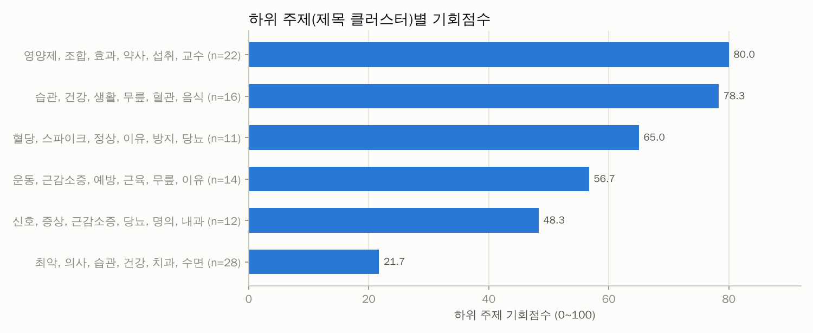

| 기회점수 | 핵심 단어 | 영상 수 | 배수 중앙값 | 성공 비율 | 소규모채널 성공 | 쇼츠 비율 | 예시 제목 |
|---|---|---|---|---|---|---|---|
| 80 | 영양제, 조합, 효과, 약사, 섭취, 교수 | 22 | 1.83 | 31.8% | 9.1% | 9.1% | 마그네슘 영양제 조합법 #마그네슘 #영양제조합 #영양제추천 #약사추천 / "매일 이것만 챙겨먹는다" 서울대 의사가 직접 고른 '진짜 영양제' (이 / 광고X! 전 |
| 78 | 습관, 건강, 생활, 무릎, 혈관, 음식 | 16 | 3.38 | 31.2% | 6.2% | 93.8% | 몰라서 계속하는 가족 건강을 망치는 습관.1        #집안습관 #생 / 지금도 장기를 망치는 생활 습관들.3편            #시니어건강  / 나도 모 |
| 65 | 혈당, 스파이크, 정상, 이유, 방지, 당뇨 | 11 | 3.72 | 36.4% | 0.0% | 9.1% | 혈당스파이크를 줄여주는 행동 TOP 3가지 / 당신의 혈당 그래프는 안녕하신가요? 널뛰는 혈당이 생명을 단축한다, 혈당 / 혈당 스파이크를 부르는 4가지 이유#닥 |
| 57 | 운동, 근감소증, 예방, 근육, 무릎, 이유 | 14 | 1.95 | 35.7% | 0.0% | 57.1% | 근감소증 학회 권고! 중년 근육 폭발하는 최고의 운동 3가지 / 아무리 먹고 운동해도 근육량이 줄어드는 이유 \| 이 음식을 바꿔보세요 / 50대 근감소증 예방에 |
| 48 | 신호, 증상, 근감소증, 당뇨, 명의, 내과 | 12 | 1.25 | 16.7% | 8.3% | 41.7% | 이 신호가 보인다면 이미 '당뇨 전단계'입니다ㅣ당뇨 전단계에서 정상으로  / 평생 쌩쌩한 간 유지하는 특급 비법 ［유병장수］ / 요즘 지방간이 폭발적으로 늘고 있 |
| 22 | 최악, 의사, 습관, 건강, 치과, 수면 | 28 | 0.97 | 3.6% | 0.0% | 67.9% | 의사들이 경고하는 최악의 아침 습관 3가지 / 의사들이 말하는 의외로 잘 모르는 최악의 습관 8가지 / 의사들이 절대 먹지 말라는 음식 5가지 드시고 계신가요? |
| - | 병원, 결과, 검진, 건강, 서울대, 교수 | 9 | 1.83 | 33.3% | 11.1% | 22.2% | 피검사 결과지 해석법｜이 수치면 꼭 병원 가세요 / "간수치 높아도 건강하고 오래 잘 살 수 있습니다" 병원에서는 절대 안  / 뇌출혈 막는 1위 검진 “40대  |

## 2. 🔑 키워드 기회 분석

기회점수 = 수요 25% + 자동완성 15% + 소규모채널 진입 20% + 아웃라이어 10% + 신선도 5% + 경쟁(역) 15% + 콘텐츠 공백 10% (키워드 간 백분위 기준). 수요·경쟁은 **주제 관련 영상만**으로 계산했고, 검색 상위 10개 중 절반 이상이 한 채널인 키워드(채널명 검색)는 제외했습니다. '관련 비율'이 낮다 = 사람들이 찾는데 맞는 영상이 적다(콘텐츠 공백).

### 🗂️ 카테고리(소재)별 기회

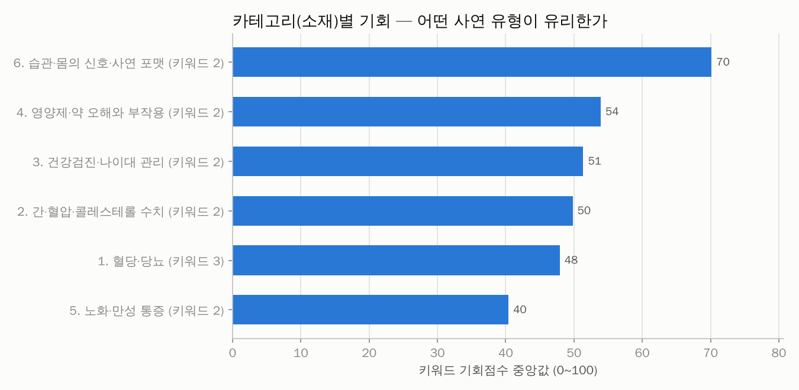

| 카테고리 | 키워드 수 | 기회(중앙) | 기회(최고) | 최고 키워드 | 검색수요 합 | 일평균 조회(중앙) | 소규모 진입 | 관련 비율 | 성공 영상 | 배수(중앙) |
|---|---|---|---|---|---|---|---|---|---|---|
| 6. 습관·몸의 신호·사연 포맷 | 2 | 70 | 76 | 건강 망치는 습관 | 0.0 | 122 | 20.0% | 85.0% | 6 | 1.01 |
| 4. 영양제·약 오해와 부작용 | 2 | 54 | 59 | 영양제 부작용 | 0.0 | 367 | 5.0% | 97.5% | 7 | 1.83 |
| 3. 건강검진·나이대 관리 | 2 | 51 | 56 | 건강검진 결과 보는법 | 0.0 | 7 | 15.0% | 100.0% | 2 | 1.83 |
| 2. 간·혈압·콜레스테롤 수치 | 2 | 50 | 55 | 간수치 높은 이유 | 0.0 | 61 | 2.5% | 97.5% | 2 | 23.01 |
| 1. 혈당·당뇨 | 3 | 48 | 59 | 당뇨 전단계 증상 | 0.0 | 168 | 6.7% | 100.0% | 5 | 2.80 |
| 5. 노화·만성 통증 | 2 | 40 | 51 | 근감소증 예방 운동 | 0.0 | 308 | 0.0% | 100.0% | 5 | 1.24 |

### 🔑 키워드별 기회

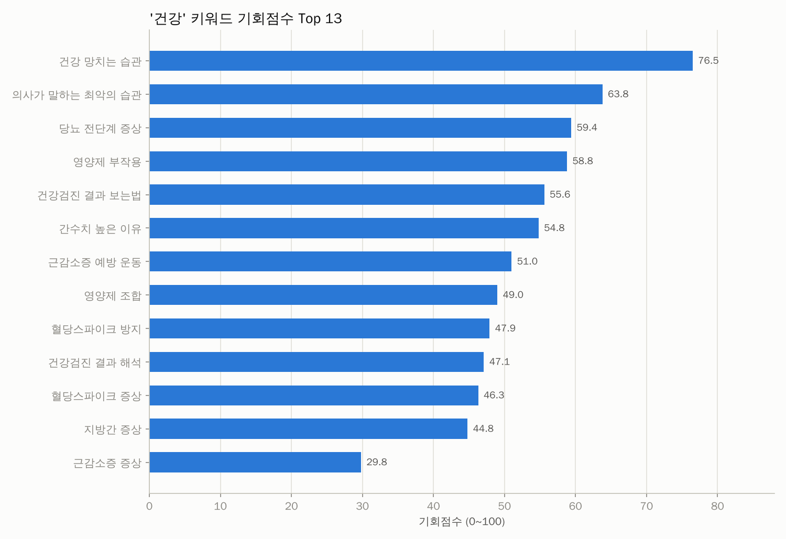
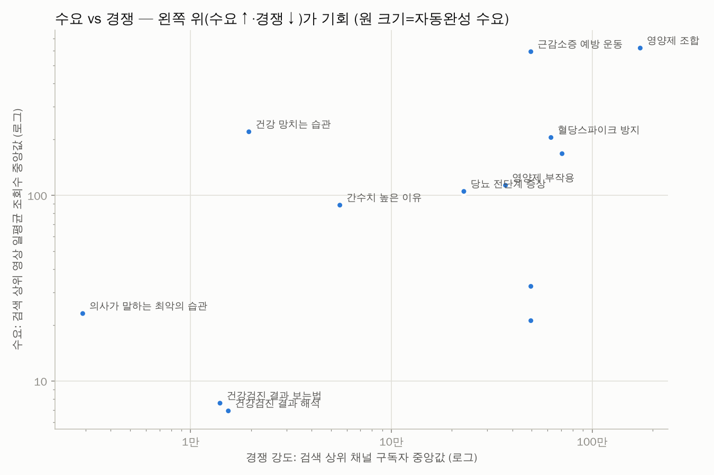

| 키워드 | 카테고리 | 기회점수 | 일평균 조회수(중앙) | 자동완성 | 소규모 진입 | 관련 비율 | 최신 비율 | 경쟁 구독자(중앙) | 배수(중앙) | 성공 수 | 추천 포맷 | 채널명검색 |
|---|---|---|---|---|---|---|---|---|---|---|---|---|
| 건강 망치는 습관 | 6. 습관·몸의 신호·사연 | 76 | 220 | 0.00 | 20.0% | 85.0% | 29.4% | 1.9만 | 1.44 | 5 | 쇼츠 |  |
| 의사가 말하는 최악의 습관 | 6. 습관·몸의 신호·사연 | 64 | 23 | 0.00 | 20.0% | 85.0% | 5.9% | 2.9천 | 0.98 | 1 | 쇼츠 |  |
| 당뇨 전단계 증상 | 1. 혈당·당뇨 | 59 | 105 | 0.00 | 15.0% | 100.0% | 0.0% | 22.9만 | 3.72 | 1 | - |  |
| 영양제 부작용 | 4. 영양제·약 오해와 부 | 59 | 113 | 0.00 | 10.0% | 95.0% | 5.3% | 37만 | 1.26 | 2 | 롱폼 |  |
| 건강검진 결과 보는법 | 3. 건강검진·나이대 관리 | 56 | 8 | 0.00 | 20.0% | 100.0% | 0.0% | 1.4만 | 2.06 | 2 | - |  |
| 간수치 높은 이유 | 2. 간·혈압·콜레스테롤  | 55 | 89 | 0.00 | 5.0% | 100.0% | 0.0% | 5.5만 | 26.82 | 2 | - |  |
| 근감소증 예방 운동 | 5. 노화·만성 통증 | 51 | 594 | 0.00 | 0.0% | 100.0% | 0.0% | 49.5만 | 1.67 | 5 | 롱폼 |  |
| 영양제 조합 | 4. 영양제·약 오해와 부 | 49 | 622 | 0.00 | 0.0% | 100.0% | 0.0% | 174만 | 1.97 | 5 | 롱폼 |  |
| 혈당스파이크 방지 | 1. 혈당·당뇨 | 48 | 205 | 0.00 | 5.0% | 100.0% | 0.0% | 62.4만 | 1.23 | 1 | - |  |
| 건강검진 결과 해석 | 3. 건강검진·나이대 관리 | 47 | 7 | 0.00 | 10.0% | 100.0% | 0.0% | 1.5만 | 2.06 | 1 | - |  |
| 혈당스파이크 증상 | 1. 혈당·당뇨 | 46 | 168 | 0.00 | 0.0% | 100.0% | 0.0% | 70.8만 | 4.08 | 3 | 롱폼 |  |
| 지방간 증상 | 2. 간·혈압·콜레스테롤  | 45 | 32 | 0.00 | 0.0% | 95.0% | 0.0% | 49.5만 | 2.80 | 0 | - |  |
| 근감소증 증상 | 5. 노화·만성 통증 | 30 | 21 | 0.00 | 0.0% | 100.0% | 0.0% | 49.5만 | 0.08 | 0 | - |  |

키워드별 검색 수요 (자동완성이 표현을 어디까지 알아보는지 — 1.0=전체 문구가 자동완성에 뜸, 0=앞 두 단어도 안 뜸)

| 순위 | 검색어 | 카테고리 | 수요 점수 | 자동완성이 알아본 부분 | 일치 제안 수 |
|---|---|---|---|---|---|
| 1 | 혈당스파이크 증상 | 1. 혈당·당뇨 | 0.00 | - | 0 |
| 1 | 지방간 증상 | 2. 간·혈압·콜레스테롤 수치 | 0.00 | - | 0 |
| 1 | 건강검진 결과 보는법 | 3. 건강검진·나이대 관리 | 0.00 | - | 0 |
| 1 | 영양제 부작용 | 4. 영양제·약 오해와 부작용 | 0.00 | - | 0 |
| 1 | 근감소증 증상 | 5. 노화·만성 통증 | 0.00 | - | 0 |
| 1 | 건강 망치는 습관 | 6. 습관·몸의 신호·사연 포맷 | 0.00 | - | 0 |
| 1 | 혈당스파이크 방지 | 1. 혈당·당뇨 | 0.00 | - | 0 |
| 1 | 간수치 높은 이유 | 2. 간·혈압·콜레스테롤 수치 | 0.00 | - | 0 |
| 1 | 건강검진 결과 해석 | 3. 건강검진·나이대 관리 | 0.00 | - | 0 |
| 1 | 영양제 조합 | 4. 영양제·약 오해와 부작용 | 0.00 | - | 0 |
| 1 | 근감소증 예방 운동 | 5. 노화·만성 통증 | 0.00 | - | 0 |
| 1 | 의사가 말하는 최악의 습관 | 6. 습관·몸의 신호·사연 포맷 | 0.00 | - | 0 |
| 1 | 당뇨 전단계 증상 | 1. 혈당·당뇨 | 0.00 | - | 0 |

📢 광고 집행 의심으로 제외한 영상 12개 (조회수 대비 좋아요·댓글이 극히 적음)

| 영상 | 채널 | 구독자 | 조회수 | 좋아요율 | 댓글 수 |
|---|---|---|---|---|---|
| [내 몸 망치는 최악의 습관 10가지 #건강정보](https://www.youtube.com/watch?v=Nqi9wUH39Tk) | 백년해로-아름답게 살기위한 건강정보 | 3.0천 | 28.3만 | 0.08% | 11 |
| [나도 모르게 몸 망치는 최악의 일상 습관 9가지 #건강습관 #건강상식](https://www.youtube.com/watch?v=CLgjK_UqGqI) | 시니어노후준비 | 3.2만 | 25.1만 | 0.11% | 0 |
| [의사들이 절대 하지 말라는  최악의 아침 습관 TOP9](https://www.youtube.com/watch?v=y8lGFD0gwbo) | 시간을 멈추는 한 문장 | 5.7천 | 17.5만 | 0.07% | 0 |
| [평생 피해야 할 건강 망치는 습관 TOP 7](https://www.youtube.com/watch?v=XHfWC3CTQxg) | 건강바다TV | 3.0만 | 9.6만 | 0.25% | 3 |
| [몸 망치는 위생습관 14가지](https://www.youtube.com/watch?v=fFfF2bE45uk) | KOREA건강채널 | 1.1만 | 8.3만 | 0.11% | 0 |
| [의사들은 '절대' 안 한다는 건강 망치는 최악의 습관 5가지 #건강상식 #의사조언…](https://www.youtube.com/watch?v=3CbMtwPX4PY) | 지식EASY | 2.9천 | 8.0만 | 0.18% | 0 |
| [나도 모르게 내 몸 망치는 일상 속 나쁜 습관 11가지 #건강습관 #생활습관 #건…](https://www.youtube.com/watch?v=fqT15eVzNHU) | 백세마음쉼터 | 2.7만 | 7.9만 | 0.18% | 2 |
| [의외로 건강 망치는 ‘좋은 습관’ TOP 5](https://www.youtube.com/watch?v=uh-5IDLwNOs) | 꿈꾸는 또리 | 1.8천 | 6.7만 | 0.11% | 0 |
| [주부 9단도 몰랐던 가족 건강 망치는 습관 #주부템 #건강정보 #건강습관 #건강관…](https://www.youtube.com/watch?v=qqWgYkngOEE) | 건강되찾기 | 8.9천 | 6.4만 | 0.20% | 2 |
| [건강검진 결과지에서 가장 먼저 봐야 할 수치 7가지](https://www.youtube.com/watch?v=s-gm1aI2v-M) | 세상지식노트 | 2.3천 | 6.4만 | 0.17% | 2 |
| [평생 건강을 망치는 최악의 습관들  #노화예방 #건강습관 #중장년건강 #50대건강…](https://www.youtube.com/watch?v=0w9EMIQl9CY) | 티노트(T-Note) | 1.1만 | 6.1만 | 0.25% | 2 |
| [의사들이 말하는 최악의 아침 습관 TOP7 #건강정보 #지식](https://www.youtube.com/watch?v=_579R7FvqHw) | 건강의 지혜 | 9.6천 | 5.6만 | 0.04% | 1 |

🎯 주제와 무관해서 제외한 영상 9개 (조회수 상위 15개 — 전체는 data/excluded_offtopic.csv)

| 영상 | 채널 | 조회수 | 검색 키워드 |
|---|---|---|---|
| [사람들이 잘 모르는 최악의 습관 3가지](https://www.youtube.com/watch?v=n1l3GwZmCBM) | 피지컬갤러리 | 845만 | 의사가 말하는 최악의 습관 |
| [약사는 절대 안 사는 약 3가지 🚫 부작용·대체약 총정리](https://www.youtube.com/watch?v=vL3eWvH2Yug) | 건강약속_약사 | 433만 | 영양제 부작용 |
| [혈관에 좋다고 오메가3 드시는 분들 주목](https://www.youtube.com/watch?v=ltaDvs5GuQA) | 대한심장TV | 47.0만 | 영양제 부작용 |
| [피부 망치는 습관 7가지](https://www.youtube.com/watch?v=V90mDVoDaH0) | 스완SWAN_현실남자관리 | 44.6만 | 건강 망치는 습관 |
| [위 식도를 망치는 습관 7가지](https://www.youtube.com/watch?v=ck2-XZW-Rv8) | 심플약사 | 15.2만 | 건강 망치는 습관 |
| [원상회복 안 되는 알콜성 간경변](https://www.youtube.com/watch?v=B9C0Iid9ieU) | 고대병원 | 10.6만 | 지방간 증상 |
| [의사들이 말하는 최악의 아침습관 7가지](https://www.youtube.com/watch?v=gTMImpwYtQs) | 공감온도 | 4.8천 | 의사가 말하는 최악의 습관 |
| [의사들이 말하는 최악의 습관 TOP 3 #지식 #습관 #물 #웃긴영상  #감동 #…](https://www.youtube.com/watch?v=1p817V2QlE0) | 딱1분예능 | 2.5천 | 의사가 말하는 최악의 습관 |
| [의사들이 경고한 최악의 아침 폐를 망치는 습관](https://www.youtube.com/watch?v=4lbskbmx0Og) | 건강요약365 | 1.2천 | 의사가 말하는 최악의 습관 |

## 3. 🏷️ 제목 패턴 분석

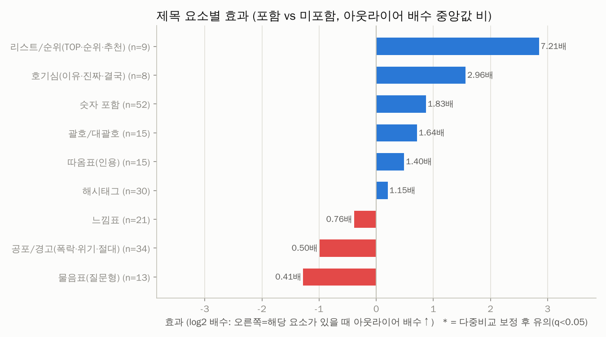
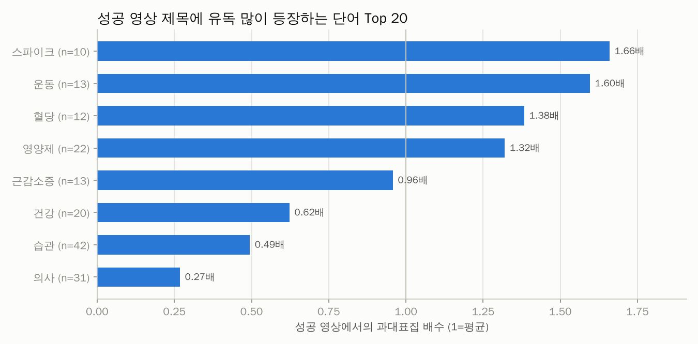
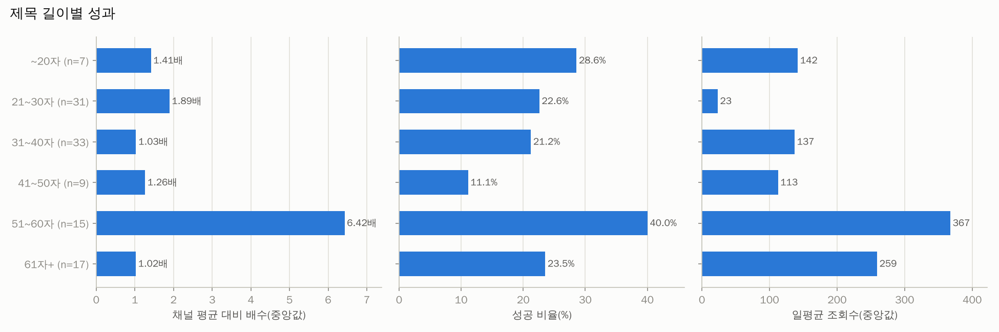

| 제목 요소 | 해당 영상 수 | 배수(있음) | 배수(없음) | 효과(배) | 성공률(있음) | 성공률(없음) | p값 | q값(보정) |
|---|---|---|---|---|---|---|---|---|
| 리스트/순위(TOP·순위·추천) | 9 | 9.10 | 1.26 | 7.21 | 55.6% | 24.7% | 0.018 | 0.053 |
| 호기심(이유·진짜·결국) | 8 | 4.04 | 1.36 | 2.96 | 50.0% | 25.6% | 0.354 | 0.530 |
| 숫자 포함 | 52 | 1.89 | 1.03 | 1.83 | 34.6% | 19.6% | 0.010 | 0.053 |
| 괄호/대괄호 | 15 | 2.07 | 1.26 | 1.64 | 33.3% | 26.5% | 0.203 | 0.366 |
| 따옴표(인용) | 15 | 1.85 | 1.32 | 1.40 | 33.3% | 26.5% | 0.484 | 0.622 |
| 해시태그 | 30 | 1.57 | 1.36 | 1.15 | 30.0% | 26.5% | 0.868 | 0.868 |
| 느낌표 | 21 | 1.26 | 1.65 | 0.76 | 23.8% | 28.6% | 0.640 | 0.720 |
| 공포/경고(폭락·위기·절대) | 34 | 0.99 | 1.97 | 0.50 | 5.9% | 39.1% | 0.017 | 0.053 |
| 물음표(질문형) | 13 | 0.68 | 1.65 | 0.41 | 15.4% | 29.4% | 0.026 | 0.058 |

롱폼/쇼츠 따로 본 제목 요소 효과

| 구분 | 제목 요소 | 영상 수 | 효과(배) | 성공률(있음) | p값 |
|---|---|---|---|---|---|
| 롱폼 | 숫자 포함 | 22 | 6.58 | 54.5% | 0.001 |
| 롱폼 | 괄호/대괄호 | 12 | 1.39 | 33.3% | 0.323 |
| 롱폼 | 따옴표(인용) | 11 | 0.85 | 36.4% | 0.713 |
| 롱폼 | 느낌표 | 15 | 0.78 | 33.3% | 0.843 |
| 롱폼 | 해시태그 | 8 | 0.45 | 12.5% | 0.125 |
| 롱폼 | 공포/경고(폭락·위기·절대) | 15 | 0.36 | 13.3% | 0.080 |
| 롱폼 | 물음표(질문형) | 11 | 0.20 | 18.2% | 0.009 |
| 쇼츠 | 해시태그 | 22 | 1.93 | 36.4% | 0.082 |
| 쇼츠 | 숫자 포함 | 30 | 0.62 | 20.0% | 0.905 |
| 쇼츠 | 공포/경고(폭락·위기·절대) | 19 | 0.61 | 0.0% | 0.109 |

**성공 영상 제목에 유독 많이 나오는 단어** (과대표집 배수 = 성공 영상 내 비중 ÷ 전체 비중)

| 단어 | 영상 수 | 성공 수 | 과대표집 | 배수(중앙) | 일평균 조회수 |
|---|---|---|---|---|---|
| 스파이크 | 10 | 4 | 1.66 | 2.98 | 255 |
| 운동 | 13 | 5 | 1.60 | 2.58 | 168 |
| 혈당 | 12 | 4 | 1.38 | 2.80 | 255 |
| 영양제 | 22 | 7 | 1.32 | 1.83 | 367 |
| 근감소증 | 13 | 3 | 0.96 | 1.02 | 64 |
| 건강 | 20 | 3 | 0.62 | 1.02 | 94 |
| 예방 | 8 | 1 | 0.52 | 1.00 | 23 |
| 습관 | 42 | 5 | 0.49 | 1.02 | 52 |
| 의사 | 31 | 2 | 0.27 | 1.01 | 15 |
| 최악 | 29 | 0 | 0.00 | 0.99 | 15 |

## 4. 🎞️ 포맷 · 길이

> 쇼츠 조회수는 2025년 3월부터 '재생 시작/반복'마다 집계되어 롱폼 조회수와 직접 비교할 수 없습니다. 그래서 **같은 채널·같은 포맷 대비 배수(아웃라이어)** 와 성공 비율로 비교합니다.

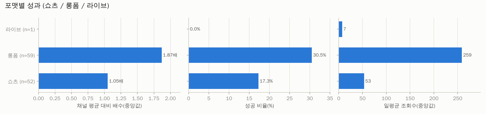
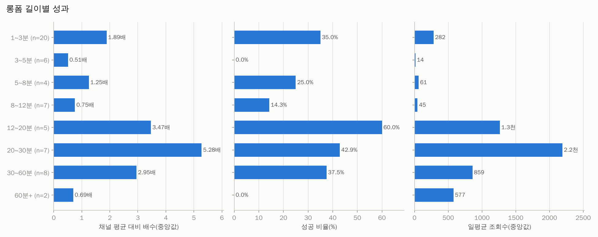

| 포맷 | 영상 수 | 조회수(중앙) | 일평균(중앙) | 배수(중앙) | 성공 비율 | 소규모채널 성공 |
|---|---|---|---|---|---|---|
| 라이브 | 1 | 2.0천 | 7 | - | 0.0% | 0.0% |
| 롱폼 | 59 | 6.1만 | 259 | 1.87 | 30.5% | 5.1% |
| 쇼츠 | 52 | 6.1천 | 53 | 1.05 | 17.3% | 3.8% |

| 롱폼 길이 | 영상 수 | 조회수(중앙) | 일평균(중앙) | 배수(중앙) | 성공 비율 | 소규모채널 성공 |
|---|---|---|---|---|---|---|
| 1~3분 | 20 | 4.7만 | 282 | 1.89 | 35.0% | 5.0% |
| 3~5분 | 6 | 3.5천 | 14 | 0.51 | 0.0% | 0.0% |
| 5~8분 | 4 | 1.5만 | 61 | 1.25 | 25.0% | 25.0% |
| 8~12분 | 7 | 1.6만 | 45 | 0.75 | 14.3% | 14.3% |
| 12~20분 | 5 | 25.5만 | 1.3천 | 3.47 | 60.0% | 0.0% |
| 20~30분 | 7 | 72.1만 | 2.2천 | 5.28 | 42.9% | 0.0% |
| 30~60분 | 8 | 21.7만 | 859 | 2.95 | 37.5% | 0.0% |
| 60분+ | 2 | 15.0만 | 577 | 0.69 | 0.0% | 0.0% |

## 5. 🕒 업로드 타이밍 (참고용 — 효과가 작고 혼란변수가 많음)

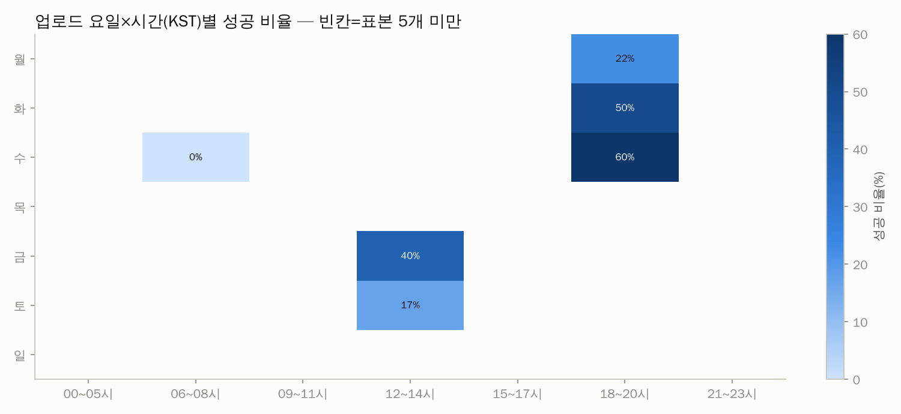

| 요일 | 영상 수 | 조회수(중앙) | 일평균(중앙) | 배수(중앙) | 성공 비율 | 소규모채널 성공 |
|---|---|---|---|---|---|---|
| 월 | 16 | 2.0만 | 70 | 1.36 | 12.5% | 0.0% |
| 화 | 17 | 2.7만 | 178 | 3.47 | 41.2% | 0.0% |
| 수 | 19 | 1.7만 | 53 | 1.15 | 31.6% | 10.5% |
| 목 | 20 | 1.1만 | 72 | 1.24 | 15.0% | 10.0% |
| 금 | 14 | 1.6만 | 190 | 2.13 | 28.6% | 7.1% |
| 토 | 15 | 5.9만 | 220 | 0.80 | 13.3% | 0.0% |
| 일 | 11 | 3.9만 | 258 | 0.97 | 27.3% | 0.0% |

| 시간대(KST) | 영상 수 | 조회수(중앙) | 일평균(중앙) | 배수(중앙) | 성공 비율 | 소규모채널 성공 |
|---|---|---|---|---|---|---|
| 00~05시 | 1 | 1.2천 | 15 | 0.83 | 0.0% | 0.0% |
| 06~08시 | 17 | 1.6만 | 113 | 1.41 | 17.6% | 5.9% |
| 09~11시 | 13 | 3.6만 | 142 | 1.02 | 7.7% | 0.0% |
| 12~14시 | 24 | 1.7만 | 150 | 1.02 | 25.0% | 8.3% |
| 15~17시 | 11 | 1.6만 | 87 | 3.22 | 36.4% | 0.0% |
| 18~20시 | 36 | 5.5만 | 197 | 1.65 | 27.8% | 2.8% |
| 21~23시 | 10 | 1.6만 | 103 | 2.63 | 30.0% | 10.0% |

## 6. 🌱 채널 규모별 분석 — 0명 채널에게 가장 중요한 부분

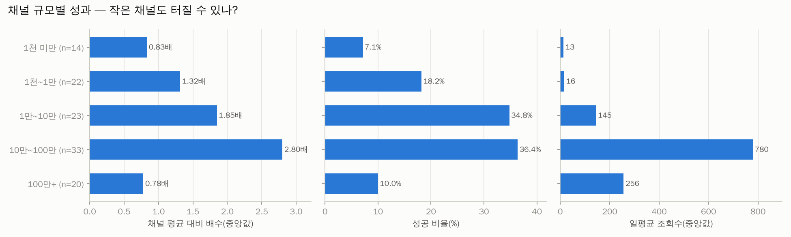
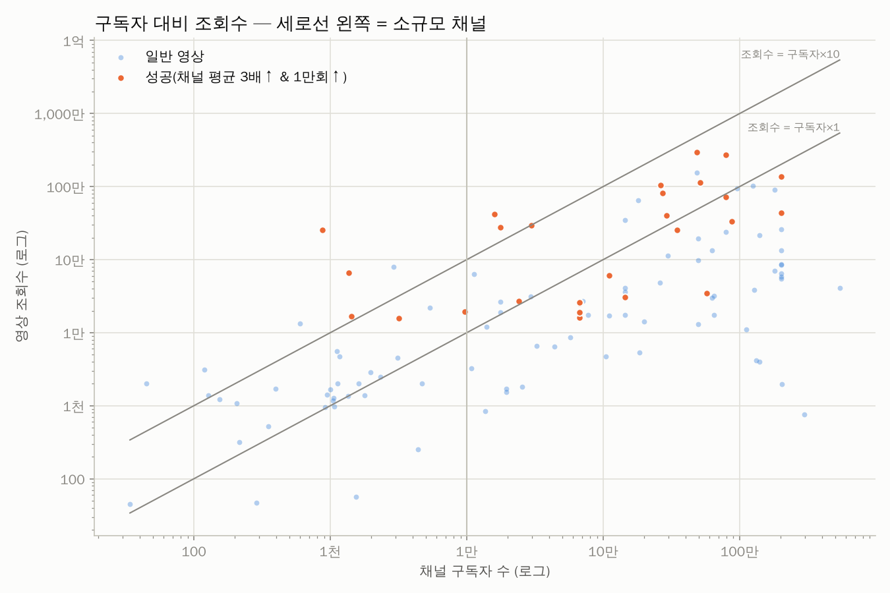

| 구독자 규모 | 영상 수 | 조회수(중앙) | 일평균(중앙) | 배수(중앙) | 성공 비율 | 소규모채널 성공 |
|---|---|---|---|---|---|---|
| 1천 미만 | 14 | 1.3천 | 13 | 0.83 | 7.1% | 7.1% |
| 1천~1만 | 22 | 2.2천 | 16 | 1.32 | 18.2% | 18.2% |
| 1만~10만 | 23 | 1.9만 | 145 | 1.85 | 34.8% | 0.0% |
| 10만~100만 | 33 | 11.2만 | 780 | 2.80 | 36.4% | 0.0% |
| 100만+ | 20 | 6.7만 | 256 | 0.78 | 10.0% | 0.0% |

**개설 1년 이내 채널의 성공 영상** (0개) — 신생 채널이 실제로 터진 사례

_데이터 없음_

## 7. 🔥 최근 14일 이내 급상승 영상 (아직 성과 집계 전 — 트렌드 참고)

| 영상 | 채널 | 구독자 | 조회수 | 일평균 | 경과일 | 포맷 |
|---|---|---|---|---|---|---|
| [혈당스파이크 만드는 음식 3가지, 주의해야 하는 과일](https://www.youtube.com/watch?v=Hjce-lTRE1M) | 이재성 박사의 식탁보감 | 128만 | 7.8만 | 1.1만 | 7.1 | 롱폼 |
| [건강 망치는 절대 금지 습관](https://www.youtube.com/watch?v=yWlXO_ACaOY) | 베러힐링_Better healing | 1.3만 | 3.3만 | 8.2천 | 4.0 | 쇼츠 |
| [오메가3 ·비타민D, ‘이렇게‘ 먹으면 돈 버립니다](https://www.youtube.com/watch?v=VY_3G0tjq6M) | 영양독학 | 42 | 6.1천 | 2.0천 | 3.0 | 쇼츠 |
| [식사 후 절대하지 마세요! 건강 망치는 습관 5가지](https://www.youtube.com/watch?v=y6bZb5MY3n0) | 중년의 행복한 시간 | 39 | 1.3천 | 1.2천 | 1.0 | 쇼츠 |
| [50대 이후 계속하면 뇌 건강 망치는 습관 3가지](https://www.youtube.com/watch?v=EWPP1JBYrKM) | 건강바이블 | 2.2천 | 1.8천 | 1.0천 | 1.7 | 쇼츠 |
| [무릎 건강 망치는 의외의 습관](https://www.youtube.com/watch?v=kx_84iGyZeA) | 장생불사 | 159 | 1.2천 | 428 | 2.7 | 쇼츠 |
| [50대부터 당장 끊어야 할 건강 망치는 습관 14가지 #Shorts](https://www.youtube.com/watch?v=Fe5aSEzuSYg) | 건강행복교수 | 8천 | 427 | 43 | 9.9 | 쇼츠 |

## 8. 🏆 성공사례 — 대본 · 영상 · 썸네일

선정 기준: 종합점수(아웃라이어 40% + 조회수 35% + 구독자 대비 조회수 25%) 상위, 소규모 채널 ≥50%, 롱폼 ≥50%, 채널당 최대 1개. 각 폴더에 `transcript.txt`(대본), `transcript_timestamped.txt`, `video.mp4`, `thumbnail.jpg`, `metadata.json`, `comments.csv` 가 있습니다.

### 1. [근감소증 학회 권고! 중년 근육 폭발하는 최고의 운동 3가지](https://www.youtube.com/watch?v=-P-cMWHci2o)

- 채널 **최박사의 운동 혁명** (구독자 1.6만) · 조회수 **41.9만** · 채널 평균의 **164.7배** · 롱폼 03:00 · 업로드 2026-09-09 · 카테고리: 5. 노화·만성 통증 · 검색어: `근감소증 예방 운동` · 선정: 롱폼 쿼터 (점수 92)
- 📁 [`success_cases/01_근감소증_학회_권고_중년_근육_폭발하는_최고의_운동_3_-P-cMWHci2o/`](success_cases/01_근감소증_학회_권고_중년_근육_폭발하는_최고의_운동_3_-P-cMWHci2o/) · 대본: failed · 영상: skipped(DOWNLOAD_VIDEOS=False)

### 2. [피검사 결과지 해석법｜이 수치면 꼭 병원 가세요](https://www.youtube.com/watch?v=aE2GQ7nIKZc)

- 채널 **수성속내과** (구독자 874) · 조회수 **25.5만** · 채널 평균의 **86.3배** · 롱폼 01:24 · 업로드 2025-12-31 · 카테고리: 3. 건강검진·나이대 관리 · 검색어: `건강검진 결과 해석` · 선정: 소규모 채널 쿼터 (점수 88)
- 📁 [`success_cases/02_피검사_결과지_해석법_이_수치면_꼭_병원_가세요_aE2GQ7nIKZc/`](success_cases/02_피검사_결과지_해석법_이_수치면_꼭_병원_가세요_aE2GQ7nIKZc/) · 대본: failed · 영상: skipped(DOWNLOAD_VIDEOS=False)

### 3. ["간수치 높아도 건강하고 오래 잘 살 수 있습니다" 병원에서는 절대 안 알려주는 천재적인 간 해독법!!ㄷㄷ](https://www.youtube.com/watch?v=vhXcvpsA45I)

- 채널 **헬스조선 Health Chosun** (구독자 27.1만) · 조회수 **80.7만** · 채널 평균의 **30.6배** · 롱폼 21:06 · 업로드 2026-04-11 · 카테고리: 2. 간·혈압·콜레스테롤 수치 · 검색어: `간수치 높은 이유` · 선정: 종합점수 상위 (점수 87)
- 📁 [`success_cases/03_간수치_높아도_건강하고_오래_잘_살_수_있습니다_병원에_vhXcvpsA45I/`](success_cases/03_간수치_높아도_건강하고_오래_잘_살_수_있습니다_병원에_vhXcvpsA45I/) · 대본: failed · 영상: skipped(DOWNLOAD_VIDEOS=False)

### 4. [아무리 먹고 운동해도 근육량이 줄어드는 이유 \| 이 음식을 바꿔보세요](https://www.youtube.com/watch?v=io3fpR2Lt4w)

- 채널 **정우주의 근막건강** (구독자 26.2만) · 조회수 **105만** · 채널 평균의 **11.5배** · 롱폼 36:52 · 업로드 2026-05-27 · 카테고리: 5. 노화·만성 통증 · 검색어: `근감소증 예방 운동` · 선정: 종합점수 상위 (점수 84)
- 📁 [`success_cases/04_아무리_먹고_운동해도_근육량이_줄어드는_이유_이_음식을_io3fpR2Lt4w/`](success_cases/04_아무리_먹고_운동해도_근육량이_줄어드는_이유_이_음식을_io3fpR2Lt4w/) · 대본: failed · 영상: skipped(DOWNLOAD_VIDEOS=False)

### 5. [마그네슘 영양제 조합법 #마그네슘 #영양제조합 #영양제추천 #약사추천](https://www.youtube.com/watch?v=IByasey8HYk)

- 채널 **띱약사의 비밀 약방** (구독자 1.4천) · 조회수 **6.6만** · 채널 평균의 **35.8배** · 쇼츠 00:21 · 업로드 2025-10-17 · 카테고리: 4. 영양제·약 오해와 부작용 · 검색어: `영양제 조합` · 선정: 소규모 채널 쿼터 (점수 81)
- 📁 [`success_cases/05_마그네슘_영양제_조합법_마그네슘_영양제조합_영양제추천_IByasey8HYk/`](success_cases/05_마그네슘_영양제_조합법_마그네슘_영양제조합_영양제추천_IByasey8HYk/) · 대본: failed · 영상: skipped(DOWNLOAD_VIDEOS=False)

### 6. [뇌출혈 막는 1위 검진 “40대 이후라면 뇌혈관 터지기 전 꼭 확인하세요” (서울대병원 이승훈 교수) #뇌졸중 #뇌출혈 #건강…](https://www.youtube.com/watch?v=i2v4mCioW34)

- 채널 **건강의 신** (구독자 48.8만) · 조회수 **296만** · 채널 평균의 **3.9배** · 쇼츠 00:59 · 업로드 2026-05-26 · 카테고리: 3. 건강검진·나이대 관리 · 검색어: `건강검진 결과 보는법` · 선정: 종합점수 상위 (점수 81)
- 📁 [`success_cases/06_뇌출혈_막는_1위_검진_40대_이후라면_뇌혈관_터지기_i2v4mCioW34/`](success_cases/06_뇌출혈_막는_1위_검진_40대_이후라면_뇌혈관_터지기_i2v4mCioW34/) · 대본: failed · 영상: skipped(DOWNLOAD_VIDEOS=False)

### 7. [광고X! 전문가들이 인정하는 속눈썹 영양제 BEST5 (진짜 효과 비교)](https://www.youtube.com/watch?v=dIPKbczbJTg)

- 채널 **속눈썹 사업학교ㅣ비올리즈** (구독자 1.4천) · 조회수 **1.7만** · 채널 평균의 **24.4배** · 롱폼 06:26 · 업로드 2025-11-05 · 카테고리: 4. 영양제·약 오해와 부작용 · 검색어: `영양제 부작용` · 선정: 소규모 채널 쿼터 (점수 63)
- 📁 [`success_cases/07_광고X_전문가들이_인정하는_속눈썹_영양제_BEST5_진_dIPKbczbJTg/`](success_cases/07_광고X_전문가들이_인정하는_속눈썹_영양제_BEST5_진_dIPKbczbJTg/) · 대본: failed · 영상: skipped(DOWNLOAD_VIDEOS=False)

### 8. [이 신호가 보인다면 이미 '당뇨 전단계'입니다ㅣ당뇨 전단계에서 정상으로 돌아가는 5가지 방법ㅣ강남 세브란스병원 안철우 교수](https://www.youtube.com/watch?v=KveZCW7D4H8)

- 채널 **안철우의 호르몬TV** (구독자 3.2천) · 조회수 **1.6만** · 채널 평균의 **29.6배** · 롱폼 10:15 · 업로드 2025-10-22 · 카테고리: 1. 혈당·당뇨 · 검색어: `당뇨 전단계 증상` · 선정: 소규모 채널 쿼터 (점수 61)
- 📁 [`success_cases/08_이_신호가_보인다면_이미_당뇨_전단계_입니다_당뇨_전단_KveZCW7D4H8/`](success_cases/08_이_신호가_보인다면_이미_당뇨_전단계_입니다_당뇨_전단_KveZCW7D4H8/) · 대본: failed · 영상: skipped(DOWNLOAD_VIDEOS=False)

## 9. 💬 시청자 질문 (성공 영상 댓글에서 추출) — 다음 영상 주제 후보

질문 댓글에 많이 나오는 단어: `추천`(39), `영양제`(33), `비타민`(31), `오메가`(28), `감사`(25), `약사`(23), `제품`(19), `복용`(18), `선생`(17), `섭취`(15), `수치`(14), `식후`(13), `효과`(13), `의사`(12), `종합`(12), `병원`(11), `마그네슘`(11), `혈당`(11), `저녁`(10), `부탁`(10)

| 질문 댓글 | 좋아요 | 영상 |
|---|---|---|
| 40대 MRA-혈관 비급여진료비 3차 병원이 제일 비쌈 MRI-뇌조직 장비가 몇테슬라인지?-3테슬라 최고수준 1.5테슬라이상 찍는걸 추천 | 806 | [뇌출혈 막는 1위 검진 “40대 이후라면 뇌혈…](https://www.youtube.com/watch?v=i2v4mCioW34) |
| 진심으로 알려주시는 팁 감사합니딘😢 | 320 | [뇌출혈 막는 1위 검진 “40대 이후라면 뇌혈…](https://www.youtube.com/watch?v=i2v4mCioW34) |
| 쓰잘데없이 TV건강 프로하지마라 짜고치는 사기다 선생님 사실을 알려주셔서 정말 고맙습니다 | 301 | ["매일 이것만 챙겨먹는다" 서울대 의사가 직접…](https://www.youtube.com/watch?v=XE9cRKT1WnM) |
| 의사나 약사나 쇼로 돈벌려고 유혹하는 행위는 절대 못하도록 법으로 금지해야 합니다. 특히 방송에서 마치 어떤 약이 신비스럽다고 느낄 정도로 우회적 광고를 하고 나면 곧바로 광고에서 분주하게 나오지요. 그래서 의사나 약사를 도적이라는 웃지못할 말까지 하 | 163 | [사지마세요! 돈값 못하는 영양제 5가지](https://www.youtube.com/watch?v=brD8GO7SdXw) |
| 안녕하세요, 건강구조대입니다 😃 영상에 출연하신 이광렬 화학자님의 새 영상이 업데이트되었습니다! https://www.youtube.com/watch?v=3_yjeGjRBEg&feature=youtu.be | 163 | ["매일 이것만 챙겨먹는다" 서울대 의사가 직접…](https://www.youtube.com/watch?v=XE9cRKT1WnM) |
| 안녕하세요! 여기약사 박현지입니다 😊 초대해주셔서 감사합니다~ 영양제관련해서 궁금하신 사항은 언제든 인스타로 문의주세요!! 스완님 쨩...✨️ | 130 | [연대 출신 약사님이 알려주는, 2030 영양제…](https://www.youtube.com/watch?v=c6f9BZEZD6I) |
| 알부민 저렇게 파는건 그럼 명백한 사기인데..왜 놔두는지 | 124 | [사지마세요! 돈값 못하는 영양제 5가지](https://www.youtube.com/watch?v=brD8GO7SdXw) |
| 외부 병원에서 찍어도 3차병원가면 또 찍자고 하지않나요? | 58 | [뇌출혈 막는 1위 검진 “40대 이후라면 뇌혈…](https://www.youtube.com/watch?v=i2v4mCioW34) |
| 궁금증을 해결해주셔서 감사합니다 | 48 | [사지마세요! 돈값 못하는 영양제 5가지](https://www.youtube.com/watch?v=brD8GO7SdXw) |
| 우리 나이에는 넘치는 게 오히려 독이 되어 간이랑 신장에 무리를 주기 십상이니, 남들 좋다는 거 다 따라 드시지 말고 꼭 나한테 필요한 것만 가려 드셔야 해요. 영양제는 어디까지나 보조일 뿐이니, 평소 드시는 밥상을 보약이라 생각하고 잘 챙겨 드시는  | 47 | ["매일 이것만 챙겨먹는다" 서울대 의사가 직접…](https://www.youtube.com/watch?v=XE9cRKT1WnM) |
| 우리나라 몇개 채널은 경쟁이나 하듯이 의사들과 약사들이 나와서 시청자들에게 보여주기 토론을 거의 매일하고 있습니다 그때 채널을 돌려보면 광고 홈쇼핑 에선 딱 그 상품을 열심히 팔고 있는걸 알수있습니다 이런것 이젠 규제를 좀 해야 되는데 왜 하지않고 허 | 44 | [사지마세요! 돈값 못하는 영양제 5가지](https://www.youtube.com/watch?v=brD8GO7SdXw) |
| 혼자 자취하는 사람들이 많이 늘었는데 과연 편의점 도시락이나 식당밥으로 제대로된 영양소를 섭취 가능할까하는 의문점이 있네요.. | 42 | ["매일 이것만 챙겨먹는다" 서울대 의사가 직접…](https://www.youtube.com/watch?v=XE9cRKT1WnM) |
| 정말정말 나의 귀인이십니다 몇테슬라인가 ? 3차병원 비싸 ㅡ 올해 66세 큰맘먹고 알아보고 찍어볼 생각을 했씁니다 | 38 | [뇌출혈 막는 1위 검진 “40대 이후라면 뇌혈…](https://www.youtube.com/watch?v=i2v4mCioW34) |
| 각종 스트레스에 의해 불안해지면 포만감으로 이를 풀려하는데 뇌의 연료가 포도당이라 당분이 되는걸 집중적으로 먹게 되어 혈당이 급격히 올라간다. 그럼 비상사태이므로 인슐린이 최대로 생산되어 혈액속의 포도당을 무차별적으로 잡아들여 우선 근육에 집어넣고 남 | 35 | [당신의 혈당 그래프는 안녕하신가요? 널뛰는 혈…](https://www.youtube.com/watch?v=PGqII7B90k4) |
| 비타민 C : 야채 안먹는사람 비타민 B : 고기 안먹는 사람 오메가3 : 생선 안먹는 사람 비타민 D : 모두에게~ 나머지? 굳이 | 31 | ["매일 이것만 챙겨먹는다" 서울대 의사가 직접…](https://www.youtube.com/watch?v=XE9cRKT1WnM) |
| 정말 소중한정보를 누군가를위해 알려주시네요 꼭필요한 누군가를위해 급여로 책정해서 부담없이 검사해볼수 있엇으면 좋겟네요 . | 31 | [뇌출혈 막는 1위 검진 “40대 이후라면 뇌혈…](https://www.youtube.com/watch?v=i2v4mCioW34) |
| 감사합니다. 조리법까지도알려주시고 멋진 의사샘 파이팅입니다 | 26 | [아무리 먹고 운동해도 근육량이 줄어드는 이유 …](https://www.youtube.com/watch?v=io3fpR2Lt4w) |
| 식후 혈당 200을 넘지 않아야 한다고요? 정상인도 짜장면이랑 탕수육 먹고 혈당 측정해봐요 200넘어요 당뇨병 환자는 300넘고 | 22 | [당신의 혈당 그래프는 안녕하신가요? 널뛰는 혈…](https://www.youtube.com/watch?v=PGqII7B90k4) |
| 이 영상에서 추천해주신 조합 보니까 제가 먹는 거랑 딱 맞네요ㅎㅎ 저도 30대 넘어가면서 잠이 얕아지고 스트레스로 잠을 못 잤거든요ㅠㅠ 마그네슘에 멜라토닌, 테아닌 조합이 좋다길래 따로따로 사 먹다가 챙기기 너무 번거로웠는데, 활신경제는 멜라토닌·테아 | 22 | [마그네슘 영양제 조합법 #마그네슘 #영양제조합…](https://www.youtube.com/watch?v=IByasey8HYk) |
| 주식투자? 부동산투자? 금투자? 다 부질없다. 근육투자, 건강투자가 최고 | 20 | [아무리 먹고 운동해도 근육량이 줄어드는 이유 …](https://www.youtube.com/watch?v=io3fpR2Lt4w) |

## 10. 🔖 태그 분석 (성공 영상에서 과대표집된 태그)

| 태그 | 영상 수 | 성공 수 | 과대표집 | 배수(중앙) |
|---|---|---|---|---|
| 건강정보 | 10 | 3 | 1.24 | 0.79 |
| 다이어트 | 8 | 2 | 1.04 | 0.75 |
| 건강 | 11 | 0 | 0.00 | 0.77 |

**아웃라이어 배수와의 순위상관(스피어만)** — 절댓값 0.1 미만은 사실상 무관

| 지표 | 상관계수 |
|---|---|
| like_rate | -0.219 |
| comment_rate | -0.056 |
| title_len | 0.025 |
| duration_sec | 0.038 |
| subscribers | 0.070 |
| channel_age_days | 0.346 |
| uploads_per_week | 0.107 |

## 11. ✅ 0명 채널 실행 체크리스트

1. **검색형 키워드로 시작**: 위 기회점수 상위 키워드는 '검색 → 유입'이 가능한 주제입니다. 구독자가 없을 때는 추천 피드보다 검색 유입이 먼저 열립니다.
2. **제목 = 검색어 + 검증된 제목 요소**: 키워드를 제목 앞쪽에 넣고, 3장의 효과 요소를 1~2개만 조합하세요 (과장은 시청 지속률을 떨어뜨립니다).
3. **첫 30초(쇼츠는 첫 3~5초)**: 8장 성공사례의 '도입부'를 비교해 공통 구조(질문 제기 → 결론 예고 → 근거)를 따라 해보세요.
4. **롱폼 1개 → 쇼츠 2~3개 재가공**: 같은 주제를 두 포맷으로 내보내 제작 효율과 노출 채널을 동시에 늘립니다.
5. **업로드 빈도**: 성공한 소규모 채널의 업로드 빈도 중앙값은 주 2.6회입니다. 꾸준함이 우선입니다 (최소 주 1~2회 롱폼 + 쇼츠).
6. **댓글 질문을 다음 영상으로**: 9장의 질문이 바로 수요가 검증된 다음 주제입니다.
7. **주식/금융 주제 주의**: 특정 종목 매수·매도 권유, 수익 보장 표현은 피하고 '투자 권유 아님' 고지를 넣으세요. 유료 리딩방·1:1 종목 추천처럼 대가를 받고 투자 판단을 조언하면 자본시장법상 유사투자자문업 신고 대상이 될 수 있습니다 (사업화 전 확인 필요).
8. **2~4주마다 재분석**: 트렌드는 빠르게 바뀝니다. 이 노트북을 다시 실행해 키워드 순위 변화를 확인하세요.

## 12. 📐 방법론 · 한계 · 재현 정보

- **아웃라이어 배수** = 영상 조회수 ÷ 같은 채널 최근 업로드 50개(업로드 14일 이상 경과, 같은 포맷 우선, 해당 영상 제외)의 조회수 중앙값. 구독자 수와 무관하게 '주제·제목·썸네일의 힘'을 보는 지표입니다.
- **분석 분할**: 성과 분석은 업로드 후 14일 이상 ~ 365일 이내 영상만 사용 (2025-10-17 ~ 2026-09-25). 그보다 최근 영상은 7장(급상승)에서만 참고.
- **미래 정보 누수 방지**: 모든 지표는 수집 시점에 관측 가능한 값만 사용하며, 기준선에서 대상 영상 자신을 제외했습니다.
- **주제 관련성 필터**: 제목·태그에 관련어(건강, 혈당, 당뇨, 혈압, 고지혈증, 콜레스테롤, 지방간, 간수치 등)가 있거나 설명란에 2번 이상 나와야 분석·성공사례에 포함 ('건강하세요, 건강하시고, 건강하시길, 건강한 하루, 건강 챙기세요, 건강보험료, 의사소통, 의사결정, 의사 결정, 의사표현, 하드디스크' 같은 표현은 먼저 제거). 이번 실행 제외 9개.
- **한계**: ① search.list 결과는 YouTube가 고른 표본이며 개인화되지 않은 결과입니다. ② 오래된 영상일수록 조회수가 누적되어 배수가 커질 수 있습니다 (채널 최근 업로드가 짧은 기간에 몰린 경우). ③ 썸네일·시청 지속률·CTR 등 핵심 내부 지표는 API로 볼 수 없습니다. ④ 제목 요소 효과는 상관관계이며 주제·채널 특성과 섞여 있습니다. ⑤ 쇼츠 판별은 길이 + youtube.com/shorts 응답으로 추정합니다.
- **재현성**: 랜덤 시드 42, 캐시 TTL 24시간, API 호출 {'search': 13, 'videos': 312, 'channels': 7, 'playlistItems': 309, 'commentThreads': 30}, 캐시 적중 {}
- **저작권**: 성공사례 대본·영상은 개인 학습·분석용입니다. 재업로드·재배포하지 마세요. 공개 저장소에는 영상 파일을 올리지 않는 것이 기본값입니다.

**이번 실행의 경고/주의 사항**

- ［INIT］ ⚠️ 위험/비용 관련 설정이 기본값과 다릅니다 key=DOWNLOAD_VIDEOS default=True current=False
- ［KEYWORD］ 일부 자동완성(수요 점수) 요청 실패 → 해당 접두어는 수요 0으로 계산 n_failed=77
- ［SUCCESS］ 모든 대본 수집 실패 — YouTube 차단(봇 확인) 또는 네트워크 문제일 수 있음 hint="VPN 끄기 / cookies.txt를 스크립트 폴더에 두고 다시 실행"

## 13. 📁 파일 목록

- `README.md` (이 리포트) · `analysis.xlsx` (모든 표) · `data/*.csv` · `charts/*.png` · `success_cases/` · `run_info.json` · `run_log.txt`
