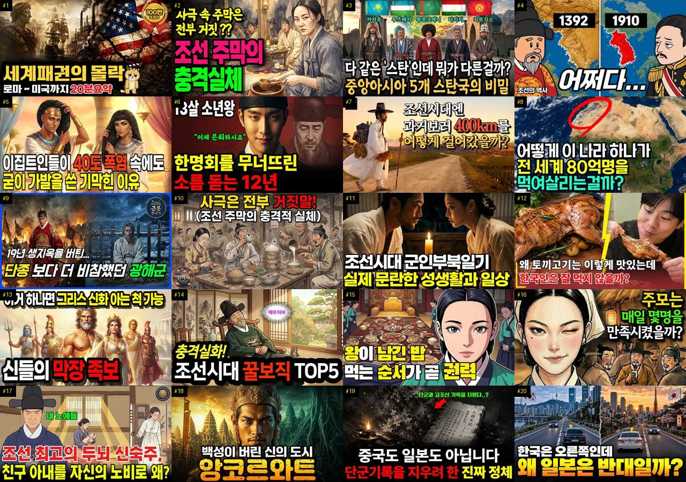
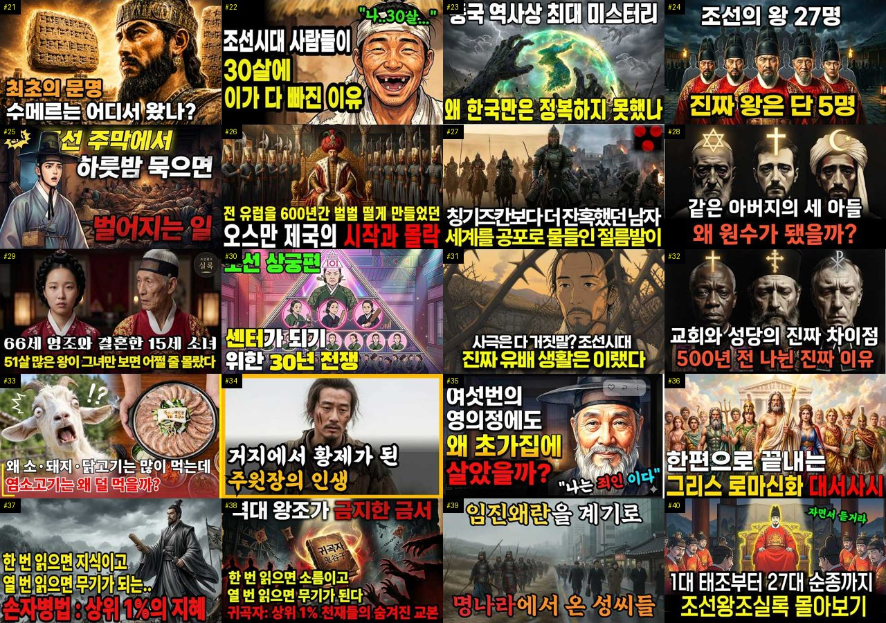
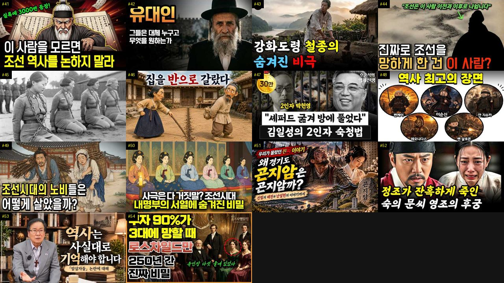
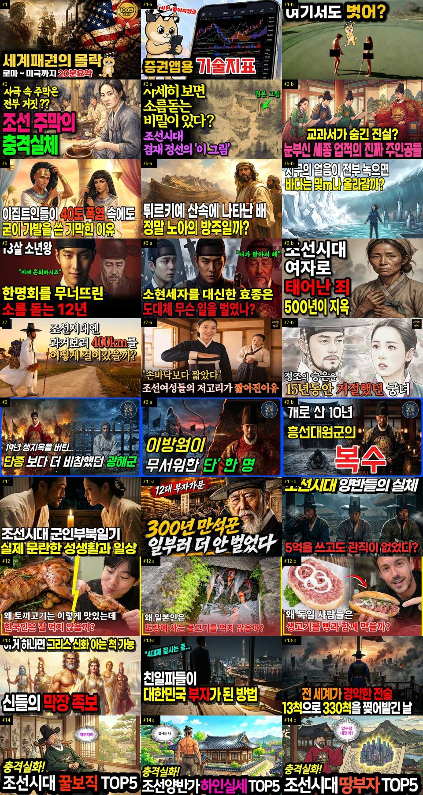
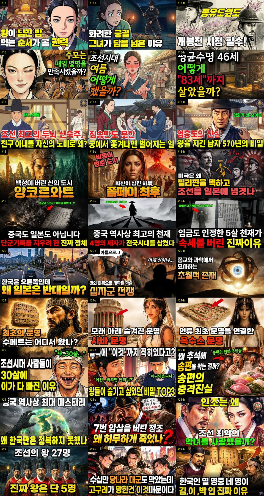
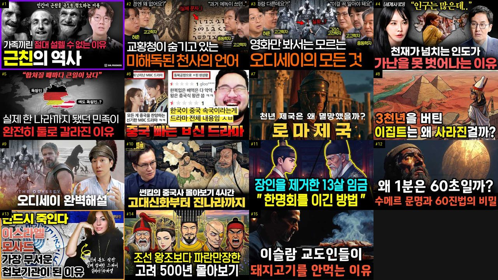

# 역사 — 성공 사례 분석 (지시사항 재료)

자동 생성 — `tools/success_analysis.py` v1.4.1 (2026-10-16 10:16 UTC), 규칙 `history/analysis_rules.toml` v1.2. **이 문서는 숫자와 원문만 담는다 — 해석·지시사항은 이것을 읽는 AI 가 만든다.** 주별 추세는 `weekly.md`, 승인한 영상 전부는 `approved.md`. ※ 연구·교육용 — 투자 권유가 아님.

## 0. 자료와 한계

| 자료 | 수 |
|---|---|
| 사례 폴더 (설명·자막·댓글·썸네일을 받은 영상) | 76 (웹 승인 76) |
| **성공 사례** — 180일 안·구독자 50,000 이하·조회수 ≥ 구독자 × 3·10,000회 이상·4분 이상, 채널당 2개 | **54** (기준 통과 60 − 뺀 것 0 − 채널당 제한 6) |
| 성공 사례의 글 출처 (자막·음성인식·설명·없음) | 설명 52 · 없음 2 |
| 성공 사례 대본 — 전체 · 앞부분만(음성인식 1차) · 없음 | 0 · 0 · 54 |
| 같은 채널 기준선 (채널 평소 영상) | 성공 사례 49/54 · 채널 45곳 (잘된 영상 191 · 평소 영상 197) |
| 성공 사례 댓글 (받은 / 달린) | 21,018 / 21,015 |
| 성공 사례 썸네일 | 54 |
| 비교 집단 — 탐색에서 본 영상 중 구독자 50,000 이하·4분 이상·365일 안·주제 관련, 채널당 최근 5개 | 282 (성공 101 = 36%, 채널당 제한으로 뺀 1229) |
| 자료를 받지 않은 성공 후보 (웹 화면에서 승인하면 들어감 — 채널당 자리가 남은 것만) | 53 (자리가 찬 채널의 212개 뺌) |
| 수요·공급 시장 — 최근 90일 영상 (채널 크기 상관없음) | 85 · 검색어 7 · 자동완성 말 279 (공급 확인 0) |
| 채널 성장 자료 (개설일이 있는 채널) | 172 (빨리 크는 작은 채널 25) |

**한계**

- 대본(자막·음성인식)이 없는 성공 사례 54개 (#1, #2, #3, #4, #5, #6, #7, #8, #9, #10, #11, #12, #13, #14, #15, #16, #17, #18, #19, #20, #21, #22, #23, #24, #25, #26, #27, #28, #29, #30 …) — 설명란·챕터만 있음. 도입부·구성·말 속도는 대본이 있는 0개로만 셌다 (음성인식이 끝나면 다시 셈)
- 비교 집단 282개 = 검색(조회수 순 — 잘된 영상 쪽으로 치우침)·추가한 채널·성공 사례 채널의 평소 영상 202개 (치우침 없음) 에서 올린 지 7~365일 영상, 성공 비율 36% — 실제 시장 비율이 아니다. 같은 집단 안의 '있음/없음' 차이로만 보고, '무엇이 먹혔나'는 1-2번(같은 채널 안)을 먼저 보라
- 같은 채널 기준선이 있는 성공 사례 49/54개 (채널 영상이 5개 미만이거나 아직 못 받음)
- 수요·공급의 '시장'은 탐색·검색에서 본 최근 90일 영상 85개 — 검색이 조회수 순이라 조회수 적은 영상이 덜 잡힌다. 주제 묶음 사이의 상대 비교(지수)로만 보라
- 자동완성 말의 '최근 영상 수'는 우리가 본 영상만 셌다 — 실제 공급은 웹 화면 [공급 확인](말 하나에 검색 1번 = 100단위)으로 확인
- 자동완성 말에는 책·방송·사람·채널 이름도 섞인다 (예: '…를 찾아서'·'…지침서') — 영상 주제가 아닌 말은 건너뛰고 읽어라
- 채널의 최근 구독자 증가는 구독자 수를 3일 넘게 사이를 두고 두 번 이상 받아야 나온다 (7일마다 다시 받음)
- '구독자가 많이 모이는가'는 YouTube API 로 영상별 구독 증가를 볼 수 없다 — 대신 채널 성장(7번: 개설 뒤 월 구독자·받을 때마다 남긴 기록), '구독·다음 기대' 댓글, 배수(조회수÷구독자)로 본다
- 댓글 갈래·제목 특징은 낱말 규칙이라 거칠다 (물음표 반문도 '질문', 한 댓글이 여러 갈래). 원문 인용을 함께 보라
- '눈에 띔'은 차이가 크고 표본이 충분하다는 표시일 뿐 원인이 아니다

## 1. 성공 사례 (54개 — 배수 큰 순)

배수 = 조회수 ÷ 구독자. **채널 평소 대비** = 조회수 ÷ 그 채널 최근 롱폼 조회수 중앙값 (같은 채널 기준선 — 클수록 그 영상만의 힘). 썸네일은 5번(장마다 20개, 번호 = #), 사례별 자세히는 **`analysis_cases_01.md` …** (9번).

| # | 제목 | 채널 | 구독자 | 조회수 | 배수 | 채널 평소 대비 | 하루 조회수 | 길이 | 업로드 | 주제 묶음 | 형식 | 글 출처 | 댓글 받은/달린 |
|---|---|---|---|---|---|---|---|---|---|---|---|---|---|
| 1 | [미국도 무너질까? 2000년동안 무너진 패권국들의 공통점 (10분 요약하려다 20분 요약 된 세계사)](https://www.youtube.com/watch?v=e6jRgQdtI8M) | 잡식이냥 | 2,220 | 1,079,330 | 486.2 | ×2,361.8 | 51,308.7 | 21.1분 | 2026-09-25 | 5. 세계사·서양사 | 정보·해설 | 설명 | 438/438 |
| 2 | [사극에는 절대 나올 수 없는 조선 주막의 적나라한 민낯](https://www.youtube.com/watch?v=cE8_zCNVONE) | 한끗역사 | 3,260 | 989,304 | 303.5 | ×498.5 | 7,091.2 | 29.4분 | 2026-05-29 | 3. 조선 | 정보·해설 | 설명 | 271/271 |
| 3 | [다 같은 '스탄'인데 뭐가 다른걸까? 중앙아시아 5개 스탄국의 비밀｜역사｜세계사｜소련](https://www.youtube.com/watch?v=nE1aAbOYw0I) | 다시만난역사 | 3,400 | 993,716 | 292.3 | – | 56,875.3 | 27.9분 | 2026-09-28 | 5. 세계사·서양사 | 정보·해설 | 설명 | 258/258 |
| 4 | [13분만에 보는 518년의 조선 역사](https://www.youtube.com/watch?v=earKPFklnV8) | 재미난역사이야기 | 171 | 47,735 | 279.1 | – | 5,029.6 | 13.7분 | 2026-10-06 | 1. 역사 일반·이야기 | 정보·해설 | 설명 | 27/27 |
| 5 | [[세계사] 고대 이집트인들은 폭염 속에서도 왜 가발을 쓰고 다녔을까?💡](https://www.youtube.com/watch?v=NoE9j2eaocE) | 역사리뷰룸 | 3,140 | 814,787 | 259.5 | ×991.2 | 14,450.1 | 16.8분 | 2026-08-21 | 5. 세계사·서양사 | 오디오북·낭독 | 설명 | 84/84 |
| 6 | [13살 소년왕이 조선 최고 책사 한명회를 손끝 하나 안 대고 무너뜨린 방법 ∣ 조선왕조실록이 감춘 성종의 …](https://www.youtube.com/watch?v=BrJfH7HySwo) | 역사비 | 3,140 | 647,951 | 206.3 | ×759.2 | 7,186.1 | 40분 | 2026-07-18 | 3. 조선 | 정보·해설 | 설명 | 241/241 |
| 7 | [조선 선비는 과거 보러 400km를 어떻게 걸어갔을까 ∣ 국밥·엿·주막에 숨은 놀라운 이야기∣사극은 거짓말…](https://www.youtube.com/watch?v=PmKbdO0FcnE) | 어게인역사 | 5,640 | 1,079,338 | 191.4 | ×821.1 | 28,049.1 | 12분 | 2026-09-07 | 3. 조선 | 정보·해설 | 설명 | 202/202 |
| 8 | [어떻게 이 나라 하나가 전 세계 80억명을 먹여살리는걸까?｜인산염｜역사｜지리학｜세계사](https://www.youtube.com/watch?v=JU4AtsLwYPQ) | 다시만난역사 | 3,400 | 528,123 | 155.3 | – | 42,218.4 | 17.7분 | 2026-10-03 | 5. 세계사·서양사 | 정보·해설 | 설명 | 89/89 |
| 9 | [단종보다 10배 더 슬픈 광해군의 19년 생지옥… 원수의 파멸을 두 눈으로 지켜본 늙은 왕!](https://www.youtube.com/watch?v=P9nHouyJ1Hg) | 근본한국사 | 3,030 | 422,969 | 139.6 | ×377.3 | 2,601.9 | 13.9분 | 2026-05-06 | 3. 조선 | 사연·드라마 | 설명 | 586/586 |
| 10 | [[김역사의 한국사] 사극이 철저히 숨긴 조선시대 '주막'의 충격적인 진짜 모습 정사 ㅣ 야사](https://www.youtube.com/watch?v=76GoBExdKA8) | 김역사 | 6,810 | 896,839 | 131.7 | – | 5,092.9 | 19.3분 | 2026-04-23 | 3. 조선 | 정보·해설 | 설명 | 845/845 |
| 11 | [[역사한줄] 조선시대 실제군인이 작성한 일기내용 #조선역사 #한국사 #부북일기](https://www.youtube.com/watch?v=eY_TrTKsIJ0) | 역사한줄 | 3,500 | 427,781 | 122.2 | ×73.5 | 2,874.4 | 16.8분 | 2026-05-20 | 3. 조선 | 정보·해설 | 설명 | 321/321 |
| 12 | [돼지는 114일, 토끼는 단 한 달… 그런데 한국인은 왜 안 먹을까? 충격적인 5가지 이유 ∣ 역사 이야기](https://www.youtube.com/watch?v=hf9t-gKqdjg) | 몰랐던 세상 | 1,590 | 183,318 | 115.3 | ×48.4 | 30,328.4 | 10.8분 | 2026-10-10 | 1. 역사 일반·이야기 | 수면·낭독 | 설명 | 330/330 |
| 13 | [이거 하나면 그리스 신화 아는 척 가능 ⚡ 신들의 막장 족보 총정리 (제우스부터 오디세우스까지)](https://www.youtube.com/watch?v=sq8Un9KgH9g) | 재미난 역사여행 | 5,220 | 591,711 | 113.3 | ×965.3 | 9,946.2 | 49.8분 | 2026-08-17 | 5. 세계사·서양사 | 정보·해설 | 설명 | 295/295 |
| 14 | [충격실화! 조선시대 꿀보직 TOP5 — 일 안 해도 나라에서 월급 줬습니다](https://www.youtube.com/watch?v=F708KFpG_5U) | 역사 뒷풀이 | 1,720 | 191,829 | 111.5 | ×138.6 | 1,236.1 | 11.4분 | 2026-05-14 | 3. 조선 | 정보·해설 | 설명 | 154/154 |
| 15 | [왕이 수저를 놓는 순간, 궁궐의 진짜 전쟁이 시작된다. '궁녀들의 서열' ∣ 한국사 ∣ 조선역사](https://www.youtube.com/watch?v=isuVlVJmmeA) | 역사빚다 | 3,550 | 359,294 | 101.2 | ×259.9 | 2,100.0 | 11.4분 | 2026-04-28 | 4. 한국 근현대사 | 정보·해설 | 설명 | 349/349 |
| 16 | [CCTV 없던 조선, 주모는 어떻게 그많은 사람들을 만족시켰을까? l 역사이야기 l 조선시대 한국사](https://www.youtube.com/watch?v=X46M1yoKC8s) | 역사원탑 | 5,520 | 523,437 | 94.8 | ×18.2 | 4,189.9 | 29분 | 2026-06-13 | 1. 역사 일반·이야기 | 정보·해설 | 설명 | 327/327 |
| 17 | [조선의 역대급 변절자 신숙주, 성삼문 아내를 노비로 들인 충격적인 이유](https://www.youtube.com/watch?v=RdzPp1O7PW8) | 왕조의 숨은 이야기 | 1,550 | 130,932 | 84.5 | ×157.1 | 1,259.1 | 19.9분 | 2026-07-04 | 3. 조선 | 정보·해설 | 없음 | 91/89 |
| 18 | [크메르 제국의 앙코르와트는 왜 밀림에 묻혔나?:세계에서 가장 넓었던 신의 도시가 버려진 이유!](https://www.youtube.com/watch?v=F-tooKrghZ0) | 율리의역사 [YULY'S… | 1,020 | 70,099 | 68.7 | ×123.0 | 7,814.8 | 18.3분 | 2026-10-07 | 11. 황제·왕·인물 | 정보·해설 | 설명 | 30/30 |
| 19 | [중국도 일본도 아닙니다 단군과 고조선의 기록을 지우려한 정체](https://www.youtube.com/watch?v=VYoPhgs3WfU) | 역사얘기 | 1,930 | 130,459 | 67.6 | ×61.1 | 1,676.1 | 16.8분 | 2026-07-30 | 2. 한국 고대·삼국·고려 | 정보·해설 | 설명 | 656/656 |
| 20 | [세계 3분의 1이 왼쪽으로 달리는 이유](https://www.youtube.com/watch?v=QftIZGkR9MM) | 세계사쇼 | 22,200 | 1,391,510 | 62.7 | ×285.4 | 56,096.6 | 18.3분 | 2026-09-21 | 5. 세계사·서양사 | 정보·해설 | 설명 | 437/437 |
| 21 | [인류 최초의 문명 수메르, 그들은 대체 어디서 왔을까? l 세계사 l 역사 l 메소포타미아](https://www.youtube.com/watch?v=if6WN6ejRYo) | 역사의 그림자 | 722 | 45,246 | 62.7 | ×29.9 | 286.1 | 16.7분 | 2026-05-11 | 5. 세계사·서양사 | 인터뷰·강연·대담 | 설명 | 44/44 |
| 22 | [조선시대 사람들이 30살에 이가 다 빠져버린 소름돋는 이유는? ∣ 조선역사 ∣ 한국사 ∣ 조선왕조실록 ∣](https://www.youtube.com/watch?v=5vBTGmcYA5w) | 시대를 훔친 이야기 | 3,250 | 184,553 | 56.8 | ×314.4 | 1,398.5 | 18.4분 | 2026-06-06 | 3. 조선 | 정보·해설 | 설명 | 522/522 |
| 23 | [중국 역사상 최대 미스터리 왜 한국만은 정복하지 못했나](https://www.youtube.com/watch?v=utBggJ670VU) | 역사탐사실 | 18,600 | 945,425 | 50.8 | ×443.7 | 8,118.4 | 34.7분 | 2026-06-21 | 1. 역사 일반·이야기 | 정보·해설 | 설명 | 1,006/1,006 |
| 24 | [조선 왕조 실록 1대 태조부터 27대 순종까지 한번에 몰아보기 ∣ 27명의 임금 중 진짜 왕이 단 5명뿐인…](https://www.youtube.com/watch?v=DY0tRfuxRhQ) | 새벽이 깨운 역사 | 9,750 | 424,229 | 43.5 | ×315.6 | 3,341.2 | 64.6분 | 2026-06-11 | 3. 조선 | 몰아보기·통합본 | 설명 | 319/319 |
| 25 | [조선시대 주막의 충격적인 하룻밤, 사극에서 절대 안 보여준 진짜 모습](https://www.youtube.com/watch?v=PgkTnWeBMyA) | 역사트리 | 10,100 | 438,894 | 43.5 | ×171.5 | 6,064.9 | 17.7분 | 2026-08-05 | 3. 조선 | 정보·해설 | 설명 | 195/195 |
| 26 | [유럽을 공포에 떨게 한 600년 이슬람 제국은 왜 흔적도 없이 사라졌을까? ∣ 오스만 제국사 풀스토리](https://www.youtube.com/watch?v=EjRxsCOhmGY) | 달빛 세계사 | 18,000 | 735,547 | 40.9 | ×13.4 | 14,732.1 | 77.4분 | 2026-08-27 | 6. 동양사 (중국·일본… | 수면·낭독 | 설명 | 66/65 |
| 27 | [칭기즈칸보다 잔혹했던 절름발이 몸으로 유라시아를 떨게 한 공포의 정복자 티무르](https://www.youtube.com/watch?v=XI61XGQiilU) | 역사를읽다 | 15,800 | 561,644 | 35.5 | ×56.7 | 3,173.7 | 36.9분 | 2026-04-22 | 6. 동양사 (중국·일본… | 정보·해설 | 설명 | 383/383 |
| 28 | [[세계사] 한 아버지의 한 손짓이 유대교, 기독교, 이슬람교인 43억 명의 운명을 가른 충격적 이유 ∣ 아…](https://www.youtube.com/watch?v=MlHcNPc7h-A) | 역사로그 | 21,500 | 751,520 | 35.0 | ×7.9 | 4,464.2 | 23.5분 | 2026-05-01 | 5. 세계사·서양사 | 정보·해설 | 설명 | 909/909 |
| 29 | [15살에 66세 영조와 결혼한 정순왕후, 그날 밤 영조가 잠을 못 잤다 [조선왕조실록]](https://www.youtube.com/watch?v=gwmPtcxsmYE) | 조선왕조실록이야기 | 19,500 | 675,428 | 34.6 | ×64.6 | 8,662.7 | 49.2분 | 2026-07-30 | 3. 조선 | 정보·해설 | 설명 | 3,815/3,814 |
| 30 | [조선 궁궐의 그림자 정부: 상궁들의 치열한 서열과 권력 관계 ∣ 한국사 ∣ 조선역사](https://www.youtube.com/watch?v=SfyXkieRomg) | 역사빚다 | 3,550 | 115,974 | 32.7 | ×83.9 | 654.9 | 15.6분 | 2026-04-22 | 4. 한국 근현대사 | 정보·해설 | 설명 | 76/76 |
| 31 | [조선시대에 유배를 당한 사람들은 어떻게 살았을까? #역사 #조선시대 #역사이야기](https://www.youtube.com/watch?v=BL2vtVh5qWg) | 담너머 조선 이야기 | 4,560 | 136,187 | 29.9 | ×15.6 | 1,584.3 | 19.1분 | 2026-07-22 | 1. 역사 일반·이야기 | 정보·해설 | 설명 | 71/71 |
| 32 | [[세계사] 교회(개신교)와 성당(카톨릭)의 진짜 차이, 그들이 500년 전 나뉜 진짜 이유 ∣ 천주교 정교…](https://www.youtube.com/watch?v=YqDWoNyHmgI) | 역사로그 | 21,500 | 582,081 | 27.1 | ×6.1 | 3,603.0 | 46.7분 | 2026-05-07 | 5. 세계사·서양사 | 정보·해설 | 설명 | 935/935 |
| 33 | [[역사 이야기] 흑염소 찾는 사람은 늘었는데 가격은 폭락? 한국인이 염소고기를 덜 먹는 충격적인 이유](https://www.youtube.com/watch?v=UmJpb4Bco8g) | 몰랐던 세상 | 1,590 | 42,377 | 26.6 | ×11.2 | 8,407.1 | 10.8분 | 2026-10-11 | 1. 역사 일반·이야기 | 수면·낭독 | 설명 | 75/75 |
| 34 | [《중국 역사》 거지에서 명나라 황제가 되기까지, 주원장의 파란만장한 삶 l 역사 인물 l 고전](https://www.youtube.com/watch?v=ma9nDAg_3mY) | 역사 산책: 동양편 | 2,770 | 66,961 | 24.2 | ×10.4 | 858.3 | 16.3분 | 2026-07-30 | 6. 동양사 (중국·일본… | 정보·해설 | 없음 | 23/23 |
| 35 | [영의정만 6번 지낸 조선 최고의 천재가 죽기 직전 자신을 '죄인'이라 부른 진짜 이유∣오리 이원익,청백리,…](https://www.youtube.com/watch?v=n_nHYw8fWkY) | 거꾸로한국사 | 17,000 | 405,643 | 23.9 | ×23.9 | 3,286.5 | 43.8분 | 2026-06-15 | 3. 조선 | 정보·해설 | 설명 | 444/444 |
| 36 | [그리스 로마 신화 완벽 정리 : 태초의 창세부터 올림포스 12신, 트로이 전쟁의 종말까지 [🌙꿀잠 오디오북]](https://www.youtube.com/watch?v=_KdSJr42TXI) | 달빛 세계사 | 18,000 | 411,168 | 22.8 | ×7.5 | 5,341.9 | 80.3분 | 2026-07-31 | 10. 수면·낭독 | 수면·낭독 | 설명 | 91/91 |
| 37 | [💥💥💥저작권등록💥💥💥인생에서 10번은 반복해야 할 손자병법 풀스토리입니다'🌙수면용 세계사](https://www.youtube.com/watch?v=sTVP1T4HjKU) | 잠결에듣는세계사 | 38,500 | 869,216 | 22.6 | ×51.5 | 4,969.5 | 75분 | 2026-04-24 | 5. 세계사·서양사 | 수면·낭독 | 설명 | 229/229 |
| 38 | [제자 4명이 전국시대를 지배했다ㅣ2500년간 금서였던 귀곡자 완전해부 ∣ 역사 ∣ 세계사 ∣ 숨겨진 중국역…](https://www.youtube.com/watch?v=nxTN1r6q7FE) | 역사깨침 | 29,800 | 626,376 | 21.0 | ×10.9 | 5,854.0 | 44.5분 | 2026-07-01 | 10. 수면·낭독 | 수면·낭독 | 설명 | 283/283 |
| 39 | [400년 전 명나라에서 건너온 성씨들, 지금 10만 명입니다](https://www.youtube.com/watch?v=hjoWlvuU9AA) | 교과서엔 없는 역사 | 38,100 | 650,794 | 17.1 | – | 3,971.3 | 9.9분 | 2026-05-05 | 6. 동양사 (중국·일본… | 사연·드라마 | 설명 | 790/790 |
| 40 | [1시간이면 완벽 이해 조선왕조실록 1대부터 27대까지 몰아보기ㅣ건국부터 멸망까지 한번에 자면서 들으세요](https://www.youtube.com/watch?v=YfPUeVAhmfw) | 한밤의 한국사 | 46,600 | 768,087 | 16.5 | ×12.2 | 7,113.9 | 69.5분 | 2026-06-30 | 3. 조선 | 수면·낭독 | 설명 | 126/126 |
| 41 | [조선왕조실록에 3000번 등장하는 단 한 사람ㅣ숙종의 사약을 세 사발이나 마신 노론 영수ㅣ우암 송시열](https://www.youtube.com/watch?v=NRtLHrlkspU) | 한밤의 한국사 | 46,600 | 735,768 | 15.8 | ×11.7 | 5,110.6 | 60.7분 | 2026-05-25 | 3. 조선 | 수면·낭독 | 설명 | 635/635 |
| 42 | [2000년간 쫓겨다닌 민족은 어떻게 세계를 주무르게 되었나](https://www.youtube.com/watch?v=_Q9IE-9yuLQ) | 세계사쇼 | 22,200 | 320,061 | 14.4 | ×65.7 | 1,785.4 | 17분 | 2026-04-20 | 기타 | 정보·해설 | 설명 | 800/800 |
| 43 | [조선 왕실 최악의 비극 ∣ 삼대가 죽어야 왕이 될 수 있었던 남자, 철종](https://www.youtube.com/watch?v=_QrSVpBd6Tg) | 역사아카이브 - Hist… | 24,200 | 343,173 | 14.2 | ×18.1 | 3,150.7 | 75.3분 | 2026-06-29 | 3. 조선 | 정보·해설 | 설명 | 192/192 |
| 44 | ["조선을 병들게 한 장본인" 조선 역사는 이 사람 이전과 이후로 나뉩니다](https://www.youtube.com/watch?v=kHamu2oW_1g) | 한국사 다시읽기 | 28,200 | 386,579 | 13.7 | ×78.6 | 2,928.9 | 18.8분 | 2026-06-06 | 1. 역사 일반·이야기 | 정보·해설 | 설명 | 1,143/1,143 |
| 45 | [📸 역사책에서 찾을 수 없었던 놀라운 순간들 ∣ 희귀 역사 사진들](https://www.youtube.com/watch?v=BF7Kb1zcVTo) | 고대의 메아리 | 1,020 | 13,550 | 13.3 | ×4.3 | 2,689.5 | 7.7분 | 2026-10-11 | 1. 역사 일반·이야기 | 정보·해설 | 설명 | 0/0 |
| 46 | [집을 반으로 갈라버린 조선의 노부부, 그런데 할아버지가 사라졌다](https://www.youtube.com/watch?v=XBePem4Xz2g) | 한국시대극 | 12,500 | 155,436 | 12.4 | ×15.0 | 1,706.8 | 4.8분 | 2026-07-17 | 3. 조선 | 브이로그·직접 해본 이야기 | 설명 | 39/39 |
| 47 | ["야, 이 자식아. 전쟁 지면 너도 책임 있어" '산보하듯' 남침하자던 박헌영에게 잉크병 던진 김일성 [호…](https://www.youtube.com/watch?v=dg8J-vvh6ZM) | 오늘의시각 | 38,200 | 363,028 | 9.5 | ×9.7 | 2,085.2 | 14.5분 | 2026-04-25 | 1. 역사 일반·이야기 | 정보·해설 | 설명 | 679/680 |
| 48 | [역사에 기록된 가장 멋있었던 죽음들](https://www.youtube.com/watch?v=tMIab7lVg88) | 쉽게 설명해서! | 18,100 | 168,628 | 9.3 | ×3.7 | 1,619.1 | 19.1분 | 2026-07-04 | 1. 역사 일반·이야기 | 정보·해설 | 설명 | 109/109 |
| 49 | [[한국사] 조선의 노비들은 어떻게 살았을까? 대부분의 사람들은 몰랐던 충격적인 노비의 삶 ∣ 정사 ∣ 야사](https://www.youtube.com/watch?v=gbQwCONfulQ) | 역사꾼 | 12,900 | 114,757 | 8.9 | ×34.1 | 659.3 | 15.7분 | 2026-04-25 | 4. 한국 근현대사 | 정보·해설 | 설명 | 303/303 |
| 50 | [조선 내명부의 서열에 숨겨진 비밀 #조선시대 #역사이야기 #조선역사](https://www.youtube.com/watch?v=z4-vBeFor6g) | 담너머 조선 이야기 | 4,560 | 32,943 | 7.2 | ×3.8 | 491.8 | 16.1분 | 2026-08-10 | 1. 역사 일반·이야기 | 정보·해설 | 설명 | 23/23 |
| 51 | [왜 경기도 곤지암은 곤지암일까? ∣ 우리가 몰랐던 진짜이야기 ∣ 신립 ∣ 허난설헌 ∣ 탄금대 ∣ 나들목 ∣…](https://www.youtube.com/watch?v=soiH5GMxOqk) | 땅 이름의 비밀 | 28,900 | 208,150 | 7.2 | ×8.0 | 9,246.4 | 17.2분 | 2026-09-23 | 3. 조선 | 야담·옛날이야기 | 설명 | 46/46 |
| 52 | [24년 인내 끝에 왕이 된 정조, 즉위 20일 만에 숙의 문씨를 처형한 역사적 비극](https://www.youtube.com/watch?v=Yg9WfFY9xlc) | 잊혀진한국사 | 14,200 | 81,980 | 5.8 | ×251.1 | 495.3 | 17.3분 | 2026-05-03 | 1. 역사 일반·이야기 | 인터뷰·강연·대담 | 설명 | 99/99 |
| 53 | [역사는 사실대로 기억해야 합니다｜「암살자들」논란에 대한 생각 #임동진 #암살자들 #영화](https://www.youtube.com/watch?v=mcOVtFOj-jk) | 임동진TV | 24,200 | 94,251 | 3.9 | ×4.4 | 10,385.3 | 19분 | 2026-10-07 | 1. 역사 일반·이야기 | 정보·해설 | 설명 | 431/431 |
| 54 | [부자 90%가 3대에 망할 때 로스차일드만 250년 간 진짜 이유](https://www.youtube.com/watch?v=R57hAxs7SQ4) | 역사명탐정 | 23,300 | 86,164 | 3.7 | ×11.1 | 584.9 | 17.4분 | 2026-05-22 | 기타 | 정보·해설 | 설명 | 86/86 |

### 자료를 받지 않은 성공 후보 (53개 중 배수 큰 40개 — 웹 화면 탐색 목록에서 승인하면 분석에 들어감, 성공 사례가 이미 채널당 2개인 채널은 뺌)

| 제목 | 채널 | 구독자 | 조회수 | 배수 | 길이 | 업로드 | 주제 묶음 |
|---|---|---|---|---|---|---|---|
| [🥣 조선 주막이 뒤집혔다 🔥 조선시대 DJ의 가야금 EDM 대축제](https://www.youtube.com/watch?v=soKbFyG1ES8) | 트롯가인 황진이 | 1,590 | 347,492 | 218.6 | 7.7분 | 2026-06-14 | 3. 조선 |
| [조선의 왕들이 단명한 이유, 매일 먹던 '이것'이 독이었던 충격적인 사실ㅣ조선왕평균수명46세](https://www.youtube.com/watch?v=aDk8BnSRa5o) | 역사MSG | 2,530 | 550,647 | 217.7 | 25.3분 | 2026-06-09 | 3. 조선 |
| [진시황릉 위치를 알지만 흙 한 삽도 못 댑니다, 진시황릉을 열지못하는 이유](https://www.youtube.com/watch?v=t6wt3d0dKUY) | 역사얘기 | 1,930 | 340,206 | 176.3 | 29.2분 | 2026-07-27 | 6. 동양사 (중국·일본… |
| [왜 조선 사람들은 제일 낮고 편한 고개를 두고 험한 길로 돌아갔을까? ∣ 문경새재, 대관령, 옛길의 진짜 …](https://www.youtube.com/watch?v=0SfgHs91EZc) | 안식한국사 | 3,570 | 435,059 | 121.9 | 18.5분 | 2026-09-09 | 3. 조선 |
| [📸 자세히 볼수록 더 놀라운 과거 사진들](https://www.youtube.com/watch?v=29WBSDOBKYQ) | 고대의 메아리 | 1,020 | 108,169 | 106.0 | 7.8분 | 2026-09-17 | 기타 |
| [사극은 거짓말이었다 ∣ 조선 백성이 매일 먹던 진짜 밥상 ∣ 조선 사람들이 산처럼 먹은 충격적인 이유 🍙l…](https://www.youtube.com/watch?v=Ez3nyrXxl7o) | 어게인역사 | 5,640 | 571,608 | 101.3 | 21분 | 2026-06-13 | 3. 조선 |
| [13분만에 보는 474년 고려 역사 몰아보기](https://www.youtube.com/watch?v=gNkIer6ljNo) | 재미난역사이야기 | 171 | 16,213 | 94.8 | 13.6분 | 2026-10-10 | 1. 역사 일반·이야기 |
| [소름 끼치게 놀라운 AI로 재현해 본 조선 왕 27인의 실제 모습 ∣ 우리가 몰랐던 진짜 성격](https://www.youtube.com/watch?v=BIvwX_N1iPs) | 비밀야담 보관소 | 2,580 | 241,184 | 93.5 | 18분 | 2026-07-01 | 3. 조선 |
| [고향에 돌아온 영웅은 왜 친아들 손에 죽었나 ∣ 영화가 절대 안 알려주는 오디세우스의 진짜 최후](https://www.youtube.com/watch?v=amyYhkZId34) | 재미난 역사여행 | 5,220 | 487,063 | 93.3 | 33분 | 2026-08-29 | 11. 황제·왕·인물 |
| [조선시대 한복판에 떨어진 대한민국 최정예 육군, 압도적 화력으로 역사를 다시 쓴다](https://www.youtube.com/watch?v=kjtOsCP4t5Y) | 스튜디오진혼 | 12,500 | 1,034,245 | 82.7 | 37.6분 | 2026-05-26 | 3. 조선 |
| [[자면서 듣는역사] 왜 그렇게 남편을 잃은 과부를 괴롭혔을까?](https://www.youtube.com/watch?v=0NcpK50ihfw) | 역사원탑 | 5,520 | 452,149 | 81.9 | 29.5분 | 2026-09-24 | 1. 역사 일반·이야기 |
| [조선왕조실록 1대 태조~27대 순조까지 완벽 총정리 l 조선역사 l 한국사](https://www.youtube.com/watch?v=8rmf4SkvKpc) | 시대를 훔친 이야기 | 3,250 | 240,923 | 74.1 | 131분 | 2026-06-21 | 3. 조선 |
| [조선에 편의점을 열었더니 벌어진 일](https://www.youtube.com/watch?v=t68eLyT7a-s) | 세계관오류 | 15,100 | 1,095,701 | 72.6 | 4.1분 | 2026-09-27 | 3. 조선 |
| [인류 역사상 가장 잔혹하고 완벽했던 복수극:성녀가 된 학살자 ∣ 키예프 루스](https://www.youtube.com/watch?v=FwQQV6pQWrE) | 율리의역사 [YULY'S… | 1,020 | 71,804 | 70.4 | 17.9분 | 2026-10-05 | 1. 역사 일반·이야기 |
| [[세계사] 영화 '오디세이' 보기 전 필수! 트로이 전쟁의 숨겨진 이야기는 무엇일까?💡](https://www.youtube.com/watch?v=Cy5pxD74PzY) | 역사리뷰룸 | 3,140 | 210,866 | 67.2 | 40.5분 | 2026-08-11 | 5. 세계사·서양사 |
| [이실라인실록 1탄 - 이실로테 서버 혈라인 역사 이야기](https://www.youtube.com/watch?v=k8L6EXJmYh0) | 리니지 인순이 | 283 | 19,004 | 67.2 | 6.4분 | 2026-07-19 | 1. 역사 일반·이야기 |
| [17만 대군도 벌벌 떨게 한 한국사 최강의 인간 병기, '척준경'의 말도 안 되는 실화](https://www.youtube.com/watch?v=7_UjHlAN6-E) | 정치수달TV | 8,310 | 521,924 | 62.8 | 32.4분 | 2026-05-11 | 4. 한국 근현대사 |
| [세조의 오른팔 한명회 자식 다섯 전원 몰살된 진짜 이유 ∣ 한명회자식비극 ∣ 왕비두명만든남자](https://www.youtube.com/watch?v=DcJMoVuG9Jw) | 역사탐사실 | 18,600 | 1,113,787 | 59.9 | 19.4분 | 2026-05-31 | 11. 황제·왕·인물 |
| [[𝙋𝙡𝙖𝙮𝙡𝙞𝙨𝙩] 세종대왕이 경복궁에서 야근하며 듣던 가야금 재즈](https://www.youtube.com/watch?v=q3oC3zdfyw4) | 조선재즈 | 9,970 | 565,043 | 56.7 | 180.7분 | 2026-06-12 | 2. 한국 고대·삼국·고려 |
| [단종을 죽인 쪽 vs 지킨 쪽 ∣ 오백 년 뒤 결과](https://www.youtube.com/watch?v=Xi_Lcq1safM) | 역사트리 | 10,100 | 560,809 | 55.5 | 30.8분 | 2026-06-05 | 기타 |
| [왕은 하루에 몇 번이나 잠자리를 했을까? ∣ 조선시대 왕 잠자리 횟수 ∣ 조선 왕실 성생활 기록](https://www.youtube.com/watch?v=HbrtYNiPNdA) | 비사록 | 7,290 | 339,827 | 46.6 | 27.3분 | 2026-07-11 | 3. 조선 |
| [발해 200만 명은 어디로 사라졌나? 유전자 연구가 밝힌 놀라운 진실 ∣ 시니어역사 ∣ 오디오북](https://www.youtube.com/watch?v=Wja_qufcptM) | 역사깨침 | 29,800 | 1,375,372 | 46.1 | 37.4분 | 2026-08-04 | 10. 수면·낭독 |
| [조선에서 라면팔면 팔릴까?](https://www.youtube.com/watch?v=Mj85mD9KvmE) | 눕이현 | 24,300 | 1,078,535 | 44.4 | 9.3분 | 2026-08-21 | 3. 조선 |
| [[역사한줄] 교과서에서 가려버린 임진왜란의 참혹한 민낯 ∣ 400년 전 양반의 피란 일기 #한국사 #조선역…](https://www.youtube.com/watch?v=yJ9x4dJJgwI) | 역사한줄 | 3,500 | 136,973 | 39.1 | 27.1분 | 2026-07-27 | 3. 조선 |
| [충격실화! 조선시대 헬보직 T0P5 ─ 출근길이 황천길이었습니다.](https://www.youtube.com/watch?v=Uu3Hv3Ft2VA) | 역사 뒷풀이 | 1,720 | 65,050 | 37.8 | 12.5분 | 2026-05-22 | 3. 조선 |
| [대서양 한가운데서 연료가 바닥난 여객기 - 세계 항공 역사에 길이 남은 한 이야기 ∣ 숨은 세계](https://www.youtube.com/watch?v=uKkQZ-CwDwg) | 숨은 세계 | 4,600 | 168,884 | 36.7 | 13.8분 | 2026-08-18 | 1. 역사 일반·이야기 |
| [세종도 수양대군도 미치도록 사랑한 여인,!! 그런데 노비 출신이라고?ㅣ조선왕조실록ㅣ한국사](https://www.youtube.com/watch?v=2QiExRW-Dg8) | 호기심 사록 | 10,400 | 380,016 | 36.5 | 49.7분 | 2026-06-03 | 3. 조선 |
| [조선에 무한리필 고깃집을 열었더니 군대가 몰려왔다](https://www.youtube.com/watch?v=nk5JVJjbplA) | 세계관오류 | 15,100 | 534,851 | 35.4 | 6.5분 | 2026-09-11 | 3. 조선 |
| [맹호소대: 1592년 임진왜란에 떨어진 대한민국 해병대 소대 1~5화 전편 몰아보기 [AI 단편 영화]](https://www.youtube.com/watch?v=xZI-Xl25xbQ) | 전쟁극장 Films | 21,900 | 732,268 | 33.4 | 42.5분 | 2026-07-22 | 3. 조선 |
| [인조는 왜 폐왕 광해군을 19년 동안 죽이지 못했나, 소름 돋는 정치적 계산 ∣ 한국사이야기 ∣ 시니어역사…](https://www.youtube.com/watch?v=lCETBo17swM) | 역사비 | 3,140 | 98,883 | 31.5 | 22.6분 | 2026-07-21 | 3. 조선 |
| [바보아내와 결혼한 첫날밤 "소리내면 죽어요" ∣ 조선시대 소설 ∣ 야담 ∣ 오디오북](https://www.youtube.com/watch?v=4NZndWA73cE) | 인형극 야담 | 18,400 | 506,403 | 27.5 | 80.1분 | 2026-05-07 | 3. 조선 |
| [《중국 역사》 왕위를 빼앗긴 후 40년 동안 은둔한 건문제, 명나라에서 가장 비극적인 황제 l 역사 인물 …](https://www.youtube.com/watch?v=CO8sZe3eXGg) | 역사 산책: 동양편 | 2,770 | 63,658 | 23.0 | 37.6분 | 2026-09-28 | 6. 동양사 (중국·일본… |
| ["세종 없으면 이 사람이 1등?" 100년을 앞서간 조선 최고의 두뇌](https://www.youtube.com/watch?v=W9NKVCxalr4) | 한국사 다시읽기 | 28,200 | 642,259 | 22.8 | 27.2분 | 2026-04-29 | 3. 조선 |
| [🔥과거로 타임슬립한🔥"미슐랭 3스타 윤아"가 "조선 제일 미식가 왕"을 만나면 벌어지는 일!! 결말포함](https://www.youtube.com/watch?v=qbxPxqvxdVU) | 모든 드라마 | 17,900 | 405,444 | 22.6 | 192.3분 | 2026-06-23 | 3. 조선 |
| [역사상 최악의 인간들이 의외로 잘한 일 top10](https://www.youtube.com/watch?v=Trayygy-3-Q) | 쉽게 설명해서! | 18,100 | 399,977 | 22.1 | 21.3분 | 2026-07-07 | 1. 역사 일반·이야기 |
| [조선 후반 343년은 이름도 없는 궁녀 한 사람에게서 시작됐습니다ㅣ창빈 안씨와 1567년 그 새벽](https://www.youtube.com/watch?v=IjhcBnVhVLY) | 새벽이 깨운 역사 | 9,750 | 213,883 | 21.9 | 52.4분 | 2026-09-09 | 3. 조선 |
| ["니가 왕의 딸이라고?" 조선의 공주가 평민이라고? 소녀시대 🔥유리🔥 주연의 숨겨진 명작 드라마 [결말까지…](https://www.youtube.com/watch?v=o_Xj7ipQ_MY) | 무비프라자 | 23,300 | 430,803 | 18.5 | 185.8분 | 2026-06-16 | 3. 조선 |
| [왜 왕은 얼음을 실컷 먹을 수 있었는데도 덥다고 했을까? ㅣ조선시대 궁궐 냉방의 비밀ㅣ조선시대 여름의 현실](https://www.youtube.com/watch?v=Bw0-7LTWfbg) | 조선별채 | 14,400 | 231,414 | 16.1 | 8.4분 | 2026-05-09 | 3. 조선 |
| [조선 주막의 충격적인 실체, 사극이 절대 보여주지 않는 민낯](https://www.youtube.com/watch?v=O9dkJz-lu1g) | 왕조의 숨은 이야기 | 1,550 | 21,146 | 13.6 | 29분 | 2026-06-30 | 3. 조선 |
| [기적적으로 살아난 사육신 박팽년의 후손 이야기 ∣ 사육신,박팽년](https://www.youtube.com/watch?v=_PA2GUeMIPA) | 거꾸로한국사 | 17,000 | 218,079 | 12.8 | 26.2분 | 2026-06-06 | 1. 역사 일반·이야기 |

## 1-2. 같은 채널 안에서 — 잘된 영상 vs 평소 영상 (채널 크기·구독층을 뺀 비교)

채널 42곳의 최근 롱폼(7~365일)에서, 그 채널 조회수 중앙값의 ×3 넘은 **잘된 영상 191개**와 ×0.5~1.5 인 **평소 영상 197개** (채널당 5개씩). 같은 채널이니 차이는 채널 크기가 아니라 영상(주제·제목·썸네일·길이) 쪽이다.

### 1-2-1. 제목 특징 (잘된 영상 중 비율 vs 평소 영상 중 비율)

| 제목 특징 | 잘된 영상 | 평소 영상 | 차이 | 표시 |
|---|---|---|---|---|
| vs 비교 | 25% | 16% | +8%p |  |
| 따옴표·괄호로 강조 | 30% | 35% | -5%p |  |
| 숫자가 들어감 | 49% | 45% | +4%p |  |
| 직접·해보니·N년 기록 | 3.1% | 0.5% | +3%p |  |
| 40자 이상 | 69% | 66% | +3%p |  |
| 사연·오디오북·실화·고백 | 5.2% | 3.0% | +2%p |  |
| 25자 미만 | 4.7% | 2.5% | +2%p |  |
| 이유 | 14% | 16% | -2%p |  |
| 물음표 ? | 32% | 30% | +2%p |  |
| 말줄임 …·... | 2.1% | 4.1% | -2%p |  |
| 구분 기호(ㅣ·｜·/)로 나눔 | 44% | 42% | +2%p |  |
| 패턴형(공통점·특징·이유·N가지·착각·과정) | 15% | 17% | -2%p |  |
| 노후·퇴직금·은퇴·50~70대 | 0% | 1.0% | -1%p |  |
| 빚투·신용·미수·레버리지·대출 | 0% | 1.0% | -1%p |  |
| 느낌표 ! | 5.8% | 5.1% | +1%p |  |
| N가지 | 1.6% | 1.0% | +1%p |  |
| 손실 낱말(망하·날린·잃은·반토막) | 1.6% | 1.0% | +1%p |  |
| 두 금액(반전) | 0.5% | 0% | +0%p |  |
| 과정·벌어진 일·결말·결국 | 1.0% | 0.5% | +0%p |  |
| AI | 0% | 0.5% | -0%p |  |
| 금액(억·만원) | 1.0% | 1.0% | +0%p |  |
| 공통점 | 0.5% | 0.5% | +0%p |  |

### 1-2-2. 주제 묶음 (잘된 영상 중 비율 vs 평소 영상 중 비율)

| 주제 묶음 | 잘된 영상 | 평소 영상 | 차이 |
|---|---|---|---|
| 3. 조선 | 35% | 27% | +8%p |
| 5. 세계사·서양사 | 8.4% | 7.1% | +1%p |
| 6. 동양사 (중국·일본·몽골) | 6.8% | 5.6% | +1%p |
| 10. 수면·낭독 | 4.2% | 3.6% | +1%p |
| 7. 전쟁·군사사 | 1.6% | 1.5% | +0%p |
| 11. 황제·왕·인물 | 1.6% | 2.0% | -0%p |
| 1. 역사 일반·이야기 | 23% | 24% | -1%p |
| 2. 한국 고대·삼국·고려 | 2.1% | 3.6% | -2%p |
| 8. 문명·고고학 | 2.1% | 3.6% | -2%p |
| 4. 한국 근현대사 | 6.8% | 9.1% | -2%p |
| 기타 | 8.9% | 13% | -4%p |

### 1-2-3. 제목 낱말 (같은 채널 안 — 잘된 영상에 더 자주 / 덜 나온 말, 합쳐 5번 이상)

| 낱말 | 잘된 영상 | 평소 영상 | 차이 |
|---|---|---|---|
| 조선 | 29% | 23% | +6%p |
| 역사 | 19% | 13% | +6%p |
| 사람 | 9.9% | 4.6% | +5%p |
| 영화 | 4.2% | 0.5% | +4%p |
| 세계사 | 7.9% | 4.6% | +3%p |
| 노비 | 3.1% | 0% | +3%p |
| 한국사 | 14% | 11% | +3%p |
| 조선시대 | 13% | 9.6% | +3%p |
| 전쟁 | 4.2% | 1.5% | +3%p |
| 메소포타미아 | 2.6% | 0% | +3%p |
| 오디오북 | 3.7% | 1.5% | +2%p |
| 사극 | 3.7% | 1.5% | +2%p |
| 만에 | 0.5% | 4.1% | -4%p |
| 남자 | 1.6% | 4.6% | -3%p |
| 무덤 | 0.5% | 3.6% | -3%p |
| 나라 | 1.6% | 4.1% | -2%p |
| 이유 | 14% | 16% | -2%p |
| 일본 | 0.5% | 2.5% | -2%p |
| 며느리 | 0.5% | 2.5% | -2%p |
| 만든 | 1.6% | 3.6% | -2%p |

- 길이 중앙값: 잘된 영상 26.3분 · 평소 영상 24.1분
- 제목 글자 수 중앙값: 잘된 영상 47 · 평소 영상 46
- 타임라인(챕터) 있는 영상: 잘된 영상 51% · 평소 영상 50%

### 1-2-4. 성공 사례와 같은 채널의 평소 영상 (제목 짝 — 썸네일 짝은 5번)

| # | 성공 사례 (채널 평소 대비) | 같은 채널 평소 영상 1 | 같은 채널 평소 영상 2 |
|---|---|---|---|
| 1 | 미국도 무너질까? 2000년동안 무너진 패권국들의 공통점 (10분 요약하려다 20분 요약… (×2,361.8) | 쉽게 이해하는 [이평선, 일목균형표, 볼린저밴드, 거래량, 매물대] (중학생용,… (457회) | 대체 왜 여기서까지 벗는걸까? 알수록 흥미로운 이색문화 (459회) |
| 2 | 사극에는 절대 나올 수 없는 조선 주막의 적나라한 민낯 (×498.5) | 알고보면 소름돋는 비밀이 숨겨져 있다? 조선시대 겸재 정선의 '이 그림' (2,027회) | 교과서가 숨긴 불편한 진실! 세종의 휘황찬란한 업적은 전부 다른 사람 성과를 가… (1,942회) |
| 5 | [세계사] 고대 이집트인들은 폭염 속에서도 왜 가발을 쓰고 다녔을까?💡 (×991.2) | [세계사] 튀르키예 산속에 나타난 거대한 배의 정체는 정말 노아의 방주일까?💡 (822회) | [세계사] 지구의 얼음이 전부 녹으면 해수면은 무려 몇 m 올라갈까?💡 (799회) |
| 6 | 13살 소년왕이 조선 최고 책사 한명회를 손끝 하나 안 대고 무너뜨린 방법 ∣ 조선왕조실… (×759.2) | 청나라 볼모에서 조선의 왕이 된 효종, 10년 북벌의 비극ㅣ인조는, 왜 아들 소… (924회) | 조선 시대 여자로 태어난다는 것, 500년의 지옥 ∣ 그 지옥을 뚫은 여자들 ∣… (783회) |
| 7 | 조선 선비는 과거 보러 400km를 어떻게 걸어갔을까 ∣ 국밥·엿·주막에 숨은 놀라운 이… (×821.1) | 조선 여인의 저고리가 300년 동안 3분의 2가 사라진 이유ㅣ영조도 정조도 막지… (1,322회) | 왕의 사랑을 15년 거절한 궁녀, 그런데 정조는 더 사랑했다∣궁녀는 왜 정조를 … (1,307회) |
| 9 | 단종보다 10배 더 슬픈 광해군의 19년 생지옥… 원수의 파멸을 두 눈으로 지켜본 늙은 … (×377.3) | 형제를 죽인 이방원, 그가 유일하게 두려워한 적은 친아버지 이성계였다 ∣ 왕자의… (1,121회) | 흥선대원군이 뒤엎은 60년 세도정치 ∣ 상갓집 개는 연기였다 (1,143회) |
| 11 | [역사한줄] 조선시대 실제군인이 작성한 일기내용 #조선역사 #한국사 #부북일기 (×73.5) | [역사한줄] 교과서에 없는 역사기록 12대를 이어온 조선시대 부자가문 풀스토리 … (5,822회) | [역사한줄] 조선시대 양반들의 실체, 5억을 쓰고도 관직이 없었다? #한국사 #… (6,037회) |
| 12 | 돼지는 114일, 토끼는 단 한 달… 그런데 한국인은 왜 안 먹을까? 충격적인 5가지 이… (×48.4) | 일본인은 왜 배수로 물고기를 절대 먹지 않을까? 깨끗한 물에도 숨겨진 진짜 이유… (3,790회) | 독일인은 왜 생돼지고기를 빵에 발라 먹을까? 충격적인 매트의 역사 이야기 (4,266회) |
| 13 | 이거 하나면 그리스 신화 아는 척 가능 ⚡ 신들의 막장 족보 총정리 (제우스부터 오디세우… (×965.3) | 친일파들은 어떻게 대한민국의 상위 1% 부자가 되었을까? (613회) | 세계 군사학자들도 경악한 전술, 13척으로 330척을 찢어발긴 명량해전의 진실 … (607회) |
| 14 | 충격실화! 조선시대 꿀보직 TOP5 — 일 안 해도 나라에서 월급 줬습니다 (×138.6) | 대감집 숨은 권력자들 ─ 조선시대 실세 하인 TOP5 │한국사│조선역사 (1,384회) | 충격실화! 조선시대 땅부자 TOP 5 ─ 현재 가치로 계산해봤습니다 (1,259회) |
| 15 | 왕이 수저를 놓는 순간, 궁궐의 진짜 전쟁이 시작된다. '궁녀들의 서열' ∣ 한국사 ∣ … (×259.9) | 조선이 궁녀에게 유독 잔인했던 이유 : '임금의 여자'라는 이름의 가혹한 굴레 … (1,806회) | 몽유도원도, 조선 최고의 그림이 살생부가 된 진실 ∣안평대군 ∣ 왕과사는남자 ∣… (959회) |
| 16 | CCTV 없던 조선, 주모는 어떻게 그많은 사람들을 만족시켰을까? l 역사이야기 l 조선… (×18.2) | 🔥 "여름철 야심한밤 참을 수 있을까?" 무더위를 참지못한 조선평민 남성과 여성… (44,823회) | "그렇게 먹고 오래 살겠나?" 조선 왕들을 죽인 범인의 충격적인 정체 l 역사이… (12,716회) |
| 17 | 조선의 역대급 변절자 신숙주, 성삼문 아내를 노비로 들인 충격적인 이유 (×157.1) | 조선 후궁의 말년, 궁에서 쫓겨난 뒤 짐승만도 못했던 비참한 삶 (863회) | 왕과 사는 남자 실제 역사 ∣ 엄흥도는 왜 사라졌나, 영화가 감춘 570년의 진실 (804회) |
| 18 | 크메르 제국의 앙코르와트는 왜 밀림에 묻혔나?:세계에서 가장 넓었던 신의 도시가 버려진 … (×123.0) | 역사상 가장 비극적인 재앙: 폼페이의 마지막 하루 (570회) | 1905년 미국이 조선을 일본에 넘긴 배신의 역사! (471회) |
| 19 | 중국도 일본도 아닙니다 단군과 고조선의 기록을 지우려한 정체 (×61.1) | 중국 역사상 가장 뛰어난 천재.. 제자는 단 4명뿐, 하지만 그 4명이 전국시대… (2,136회) | 세종이 인정한 천재 김시습 이야기 (793회) |
| 20 | 세계 3분의 1이 왼쪽으로 달리는 이유 (×285.4) | 십자군 전쟁의 진짜 목적은 무엇이었을까? (4,875회) | 종교와 과학계에서는 신의 존재를 어떻게 증명할까? (4,993회) |
| 21 | 인류 최초의 문명 수메르, 그들은 대체 어디서 왔을까? l 세계사 l 역사 l 메소포타미아 (×29.9) | 왜 사막 한가운데 거대한 왕국이 탄생했을까?｜사바 왕국｜시바의 여왕｜마립 댐｜고… (1,511회) | 수메르를 연결한 숨겨진 중심은 누구였을까?｜옥수스 문명｜고대문명ㅣ메소포터미아 (1,709회) |
| 22 | 조선시대 사람들이 30살에 이가 다 빠져버린 소름돋는 이유는? ∣ 조선역사 ∣ 한국사 ∣… (×314.4) | 조선왕조실록에 "이것"까지 낱낱히 적었다? 왕들이 끝까지 감추고 싶었던 비밀 T… (587회) | 왜? 추석의 송편을 먹는 걸까? 송편의 충격진실ㅣ송편유래ㅣ추석역사 (591회) |
| 23 | 중국 역사상 최대 미스터리 왜 한국만은 정복하지 못했나 (×443.7) | 종기 하나로 죽었다고? 정조 죽음의 14일, 기록이 말해주는 진실 ∣ 정조이산마… (2,131회) | 사랑이 아니라 광기였다? 인조와 조귀인 관계의 충격적 결말 ∣ 조귀인자작극저주사… (2,123회) |
| 24 | 조선 왕조 실록 1대 태조부터 27대 순종까지 한번에 몰아보기 ∣ 27명의 임금 중 진짜… (×315.6) | 고구려 멸망, 수십만 당나라 대군을 막고도 무너진 진짜 이유 (1,379회) | 김이박이 인구 절반인 이유 ∣ 조선 후기, 신분에는 가격표가 붙어 있었다 (1,309회) |

## 2. 주제 — 주제 묶음별 성공 비율 (비교 집단)

주제 묶음 = `tag_rules.toml` TAG_THEMES (제목에서 맞는 글자가 가장 긴 묶음, 없으면 태그). 비교 집단 성공 비율 36% 과 견주어 본다. 영상 15개 미만은 '표본 적음'.

| 주제 묶음 | 영상 | 성공 | 성공 비율 | 배수 중앙값 | 조회수 중앙값 | 성공 사례 # |
|---|---|---|---|---|---|---|
| 3. 조선 | 97 | 42 | 43% | 1.1 | 10,525 | 2, 6, 7, 9, 10, 11, 14, 17, 22, 24, 25, 29, 35, 40, 41, 43, 46, 51 |
| 5. 세계사·서양사 | 18 | 7 | 39% | 3.3 | 22,797.0 | 1, 3, 5, 8, 13, 20, 21, 28, 32, 37 |
| 1. 역사 일반·이야기 | 70 | 23 | 33% | 2.0 | 18,734.0 | 4, 12, 16, 23, 31, 33, 44, 45, 47, 48, 50, 52, 53 |
| 4. 한국 근현대사 | 32 | 10 | 31% | 1.0 | 5,173.0 | 15, 30, 49 |
| 9. 야사·야담·옛날이야기 (표본 적음) | 4 | 2 | 50% | 12.8 | 272,500.5 | - |
| 6. 동양사 (중국·일본·몽골) (표본 적음) | 12 | 4 | 33% | 0.9 | 11,167.0 | 26, 27, 34, 39 |
| 7. 전쟁·군사사 (표본 적음) | 6 | 2 | 33% | 0.3 | 8,833.5 | - |
| 11. 황제·왕·인물 (표본 적음) | 3 | 1 | 33% | 0.5 | 460 | 18 |
| 8. 문명·고고학 (표본 적음) | 7 | 2 | 29% | 2.0 | 36,989 | - |
| 2. 한국 고대·삼국·고려 (표본 적음) | 11 | 3 | 27% | 0.9 | 26,096 | 19 |
| 기타 (표본 적음) | 13 | 3 | 23% | 0.2 | 1,607 | 42, 54 |
| 10. 수면·낭독 (표본 적음) | 9 | 2 | 22% | 0.2 | 8,745 | 36, 38 |

## 2-2. 형식(포맷) — 어떤 모양의 영상인가 (제목·채널 이름·태그 낱말로 나눔)

형식 규칙 = `analysis_rules.toml` [format] (위에서부터 먼저 맞는 것 하나, 낱말 규칙이라 거칠다). **성공 사례 몫**은 성공 사례 중 그 형식 비율, **시장 지수**는 3번과 같은 수요 몫 ÷ 공급 몫 (1보다 크면 영상 하나가 평균보다 많이 봄), **같은 채널**은 1-2번의 잘된 영상 중 비율 vs 평소 영상 중 비율. 원인이 아니라 묶음이다.

| 형식 | 비교 집단 영상 (성공 비율) | 배수 중앙값 | 성공 사례 몫 (#) | 시장 영상 · 지수 | 같은 채널 잘된 vs 평소 |
|---|---|---|---|---|---|
| 수면·낭독 (잠잘 때 듣는) | 38 (55%) | 9.1 | 15% (12, 26, 33, 36, 37, 38, 40, 41) | 10 · 0.5 (표본 적음) | 15% vs 14% |
| 애니메이션·지도 (표본 적음) | 6 (17%) | 1.9 | 0% (-) | 1 · 0.7 (표본 적음) | 0.5% vs 1.0% |
| 몰아보기·통합본 (긴 영상) (표본 적음) | 10 (80%) | 32.9 | 1.9% (24) | 2 · 0.3 (표본 적음) | 3.1% vs 2.5% |
| 야담·옛날이야기 (표본 적음) | 8 (25%) | 0.9 | 1.9% (51) | 1 · 0.3 (표본 적음) | 1.0% vs 2.0% |
| 사극·드라마·영화 리뷰 (표본 적음) | 0 | – | 0% (-) | 2 · 2.5 (표본 적음) | – vs – |
| 사연·드라마 (표본 적음) | 8 (50%) | 8.8 | 3.7% (9, 39) | 3 · 2.2 (표본 적음) | 2.6% vs 5.6% |
| 오디오북·낭독 (명언·인생조언) (표본 적음) | 3 (33%) | 0.7 | 1.9% (5) | 2 · 0.3 (표본 적음) | 1.0% vs 2.0% |
| 인터뷰·강연·대담 | 17 (18%) | 0.5 | 3.7% (21, 52) | 19 · 1.6 | 4.7% vs 6.1% |
| 브이로그·직접 해본 이야기 (표본 적음) | 8 (50%) | 3.9 | 1.9% (46) | 1 · 2.7 (표본 적음) | 3.7% vs 1.5% |
| 정보·해설 (그 밖) | 184 (31%) | 0.9 | 70% (1, 2, 3, 4, 6, 7, 8, 10, 11, 13, 14, 15 …) | 44 · 0.8 | 69% vs 66% |

## 3. 수요와 공급 — 찾는 사람에 비해 영상이 적은 곳

### 3-1. 주제 묶음별 (최근 90일 영상 85개 — 채널 크기 상관없음)

수요 몫 = 그 묶음 영상들의 하루 조회수 합 ÷ 전체, 공급 몫 = 영상 수 ÷ 전체. **지수 = 수요 몫 ÷ 공급 몫** — 1 보다 크면 영상 하나가 평균보다 많이 보임(공급이 모자라 보임), 작으면 영상이 넘침. 작은 채널 성공 비율 = 2번 표. 시청자 질문 = 사례 댓글 중 그 묶음 낱말이 든 질문·요청.

| 주제 묶음 | 영상(공급) | 채널 | 수요 몫 | 공급 몫 | 지수 | 영상당 하루 조회수 중앙값 | 작은 채널 성공 비율 | 시청자 질문 |
|---|---|---|---|---|---|---|---|---|
| 5. 세계사·서양사 | 16 | 12 | 25% | 19% | **1.3** | 25,911.3 | 39% | 13 |
| 3. 조선 | 16 | 14 | 22% | 19% | **1.2** | 13,624.7 | 43% | 21 |
| 1. 역사 일반·이야기 | 31 | 17 | 37% | 36% | **1.0** | 10,385.3 | 33% | 43 |
| 4. 한국 근현대사 (표본 적음) | 4 | 3 | 7.7% | 4.7% | **1.6** | 35,654.7 | 31% | 4 |
| 기타 (표본 적음) | 5 | 3 | 3.0% | 5.9% | **0.5** | 8,719.8 | 23% | 0 |
| 10. 수면·낭독 (표본 적음) | 3 | 2 | 1.6% | 3.5% | **0.5** | 6,976.2 | 22% | 0 |
| 8. 문명·고고학 (표본 적음) | 1 | 1 | 0.5% | 1.2% | **0.4** | 12,923.7 | 29% | 5 |
| 6. 동양사 (중국·일본·몽골) (표본 적음) | 4 | 3 | 1.8% | 4.7% | **0.4** | 14,080.5 | 33% | 6 |
| 2. 한국 고대·삼국·고려 (표본 적음) | 3 | 2 | 1.1% | 3.5% | **0.3** | 5,115.3 | 27% | 25 |
| 11. 황제·왕·인물 (표본 적음) | 1 | 1 | 0.3% | 1.2% | **0.3** | 7,814.8 | 33% | 5 |
| 7. 전쟁·군사사 (표본 적음) | 1 | 1 | 0% | 1.2% | **0.0** | 217.1 | 33% | 3 |
| 9. 야사·야담·옛날이야기 (표본 적음) | 0 | 0 | 0% | 0% | **–** | – | 50% | 1 |

### 3-2. 검색어별 (탐색·검색 캐시 — 검색어마다 조회수 순 상위 결과)

결과 수 = YouTube 가 알려 준 그 기간 영상 수 추정(공급). 영상당 하루 조회수 = 상위 결과 하루 조회수 합 ÷ 결과 수 (클수록 영상에 비해 찾는 사람이 많음). 큰 채널 비율 = 상위 결과 중 구독자 5만 넘는 채널 (클수록 들어가기 어려움). **작은 채널이 뚫은 비율** = 상위 결과 중 작은 채널(5만 이하)의 성공 영상(×3·1만) 비율 — 클수록 새 채널도 상위에 들 수 있음. 지금 검색어(keywords.txt)가 먼저, 예전 검색어는 '(예전)'.

| 검색어 | 기간(일) | 본 영상 | 결과 수(공급) | 최근 30일 | 조회수 중앙값 | 하루 조회수 중앙값 | 영상당 하루 조회수 | 큰 채널 비율 | 작은 채널이 뚫은 비율 |
|---|---|---|---|---|---|---|---|---|---|
| 역사 이야기 | 182 | 100 | 1,560,345 | 8 | 408,285.0 | 4,102.4 | 0.5 | 37% | 54% (46개) |
| 조선시대 | 365 | 100 | 381,256 | 2 | 550,493 | 3,341.2 | 1.7 | 47% | 53% (46개) |
| 한국사 | 365 | 100 | 225,070 | 3 | 447,805.0 | 2,092.8 | 2.3 | 51% | 48% (39개) |
| 세계사 | 182 | 100 | 245,519 | 8 | 396,476.0 | 3,220.9 | 3.9 | 83% | 17% (16개) |
| 역사 | 182 | 50 | 1,000,000 | 0 | 583,319 | 5,040.6 | 0.3 | 85% | 15% (4개) |
| 역사 | 365 | 100 | 2,000,000 | 3 | 1,226,971 | 7,004.3 | 0.6 | 89% | 11% (8개) |
| 세계 역사 (예전) | 365 | 50 | 388,344 | 4 | 119,358 | 990.8 | 0.7 | 68% | 15% (7개) |

### 3-3. 사람들이 찾는 말 (YouTube 자동완성) 중 최근 영상이 적은 말

수요 점수 = 검색어를 넣었을 때 자동완성에 앞쪽에 나올수록·여러 검색어에서 나올수록 큼. 최근 영상 = 우리가 본 최근 영상 중 제목에 그 말의 낱말이 다 든 수. 틈 = 수요 점수 ÷ (1 + 최근 영상). **공급 확인** = 웹 화면 [공급 확인]으로 그 말을 직접 검색한 결과 (최근 90일 결과 수·상위 영상).

| 말 | 수요 점수 | 나온 검색어 | 최근 영상(우리가 본) | 틈 | 공급 확인: 결과 수 | 영상당 하루 조회수 | 작은 채널 비율 | 최근 30일 |
|---|---|---|---|---|---|---|---|---|
| 조선왕조실록 | 2.7 | 조선왕조, 조선, 조선왕 | 1 | 1.35 | 확인 전 |  |  |  |
| 조선왕조계보 | 1.1 | 조선왕조, 조선왕 | 0 | 1.1 | 확인 전 |  |  |  |
| 역사인물퀴즈 | 1.0 | 역사인물 | 0 | 1.0 | 확인 전 |  |  |  |
| 국산낚시 | 1.0 | 국사 | 0 | 1.0 | 확인 전 |  |  |  |
| 역사교육과 | 1.0 | 역사교육 | 0 | 1.0 | 확인 전 |  |  |  |
| 고백의 역사비하인드 | 1.0 | 역사비하인드 | 0 | 1.0 | 확인 전 |  |  |  |
| 고려 거란 전쟁 | 1.0 | 고려 | 0 | 1.0 | 확인 전 |  |  |  |
| 조선시대 플리 | 1.0 | 조선시대 | 0 | 1.0 | 확인 전 |  |  |  |
| 조선힙합 | 1.0 | 조선 | 0 | 1.0 | 확인 전 |  |  |  |
| 세종시 | 1.0 | 세종 | 0 | 1.0 | 확인 전 |  |  |  |
| 사극 플레이리스트 | 1.0 | 사극 | 0 | 1.0 | 확인 전 |  |  |  |
| 조선사랑꾼 | 1.0 | 조선사 | 0 | 1.0 | 확인 전 |  |  |  |
| 대한제국 애국가 | 1.0 | 대한제국 | 0 | 1.0 | 확인 전 |  |  |  |
| 전쟁상황 | 1.0 | 전쟁사 | 0 | 1.0 | 확인 전 |  |  |  |
| 야상곡 | 1.0 | 야사 | 0 | 1.0 | 확인 전 |  |  |  |
| 역사다큐멘터리 | 0.9 | 역사다큐 | 0 | 0.9 | 확인 전 |  |  |  |
| 조선역사이야기 | 0.9 | 조선역사 | 0 | 0.9 | 확인 전 |  |  |  |
| 한국역사이야기 | 0.9 | 한국역사 | 0 | 0.9 | 확인 전 |  |  |  |
| 역사채널e | 0.9 | 역사채널 | 0 | 0.9 | 확인 전 |  |  |  |
| 국산 suv 추천 | 0.9 | 국사 | 0 | 0.9 | 확인 전 |  |  |  |
| 고대산 | 0.9 | 고대사 | 0 | 0.9 | 확인 전 |  |  |  |
| 고려대 | 0.9 | 고려 | 0 | 0.9 | 확인 전 |  |  |  |
| 조선왕조실록 해외반응 | 0.9 | 조선왕조실록, 조선왕조 | 0 | 0.9 | 확인 전 |  |  |  |
| 조선의 사랑꾼 | 0.9 | 조선 | 0 | 0.9 | 확인 전 |  |  |  |
| 임진왜란 조선의반격 | 0.9 | 임진왜란 | 0 | 0.9 | 확인 전 |  |  |  |
| 이순신 해외반응 | 0.9 | 이순신 | 0 | 0.9 | 확인 전 |  |  |  |
| 조선왕릉축전 | 0.9 | 조선왕릉 | 0 | 0.9 | 확인 전 |  |  |  |
| 병자호란 요약 | 0.9 | 병자호란 | 0 | 0.9 | 확인 전 |  |  |  |
| 조선사자보이즈 | 0.9 | 조선사 | 0 | 0.9 | 확인 전 |  |  |  |
| 조선왕실 후손 | 0.9 | 조선왕실 | 0 | 0.9 | 확인 전 |  |  |  |

### 3-4. 주제 묶음별 시청자 질문 (사례 댓글 — 좋아요 순)

- **1. 역사 일반·이야기** (43개): 👍155 “지금까지 올라온 오디세이 영상 대부분 보았는데, 역시 역사와 관련된 건 조승연작가님이 최고인 것 같아요 ㅎㅎ 다시 영화보고싶을만큼 좋은 영상이였어요. 그래서 다음편 언제올라오죠!!!!! 너무 궁금…” / 👍57 “68세. 이영자. 저는 11년동안 허리디스크 때문에 고생했어요. 하루에 10분도 제대로 못 걷고 누워만 있어서 우울증까지 왔었어요. 당시 누워만 있고 운동도 못하니 근육이 많이 빠져 살이 5kg …” / 👍42 “이 컨텐츠의 백미는 최고의 영상편집뿐만 아니라 최신의 역사 연구와 검증된 역사적 사실로 정확하게 기술되고 있다는 점이다. 이 채널을 알게된 후 삶의 즐거움이 한층 높아졌다. 딥 호라이즌님 더욱 좋…”
- **2. 한국 고대·삼국·고려** (25개): 👍61 “중국 북경 위쪽에 고려영 관련해서도 얘기해주세요” / 👍24 “이집트, 로마 뿐만아니라 고구려, 고조선에 대한 재미 있는 이야기도 해주길.” / 👍2 “좋은내용 감사합니다. 단지, 고구려나 고려, 신라 그리고 발해가 그냥 좁은땅에 활약해서 그냥 둔건지는 좀... 중국땅에 고구려나 고려에 대한 지명이 많다고 봤는데 그것도 알려주시면 감사하겠습니다.”
- **3. 조선** (21개): 👍19 “사극 보면서 가끔 배신자 또는 나라의 공를 세운 위대한 분 를 보면 지금 그에 후손은 누군가 궁금해서 찾아봅니다, 그런거 보면 잘 살아야겠다는 생각이 든다 적어도 후손이 부끄럽지 않을 정도로 말이지” / 👍16 “난중일기에 조선시대 장군들 보급품인 공노비 여자를 잘 사용하는내용도 부탁해요 충분한 얘기꺼리가 될겁니다” / 👍9 “66세. 원금순. 저는 11년동안 허리디스크 때문에 고생했어요. 하루에 10분도 제대로 못 걷고 누워만 있어서 우울증까지 왔었어요. 당시 누워만 있고 운동도 못하니 근육이 많이 빠져 살이 5kg …”
- **5. 세계사·서양사** (13개): 👍4 “왜 자꾸 저희 라고 할까요... 다른 나라 사람을 대상으로 하는 말씀일까요? 세계사 이기 때문에 우리나라를 대변한다 생각해서 그런걸까요? 궁금하네요.” / 👍4 “수에즈 운하와 영국에 대해서도 궁금합니다” / 👍2 “제가 '역사를 보다' 전편을 시청한 것은 아니라서 이전 방송에서 해 주셨을지는 모르겠지만, 혹시 각국의 위서(僞書)를 주제로 하여 방송을 꾸며주실 수는 없을까요? 예전에 인도사 전공자이신 이광수 …”
- **6. 동양사 (중국·일본·몽골)** (6개): 👍2 “돌가루 때문에 잇몸병이 생겼다는건 납득이 안갑니다. 저도 어렸을때 벼를 절구에 갈아 먹고는 했는데 모래를 씹어 이가 상했던 기억은 없어요. 조리로 잘 행구면 가끔 돌이 들어가는 경우는 있어도 모래…” / 👍1 “​​아시는 분 설명좀 부탁드려요. 저도 천주교 8년을 다니며 묵주기도 십자가의 길묵상 수 없이 했고 교리강의 새벽미사 빠짐없이 했지만 신부님도 수녀님도 누구도 이 부분을 시원하게 설명해주시지 않으…” / 👍0 “좌파정권이 앞으로 2~3번만 더 돌면, 과연 한국의 정체성이 남아있을까요? 몽골화될 듯.”
- **8. 문명·고고학** (5개): 👍35 “신화 이야기 너무 재미나요. 다른 지역의 신화도 더 알고 싶어요,” / 👍9 “⁠ 제보 !! 구글어스가 처음 나왔을때 궁금해서 사용해 보는데 시안에 피라미드가 엄청 많이 보이는겁니다 그래서 확대를 해 봤는데 그 피라미드 하나하나에 구분을위해 넘버가 붙어 있는데 전부 앞쪽에 …” / 👍1 “아니 근데 정작 궁금한거에 대한 답? 같은게 없는것같아서 좀 막막하네요.. 각각의 이야기를 만든 최초의 사람은 모를 수 있긴 한데(뭐 실제 참전했던 이름 모를 어느 농부일수도 있고, 그냥 소문만 …”
- **11. 황제·왕·인물** (5개): 👍2 “동국대학교 고미술학 박용숙 교수의 [샤먼제국]에 대한 리뷰 부탁드려도 괜찮으시죠?” / 👍1 “추가로 당시 오스트리아에선 엥겔푸트 돌푸스라는 오스트리아 조국당 이라는 파시스트당을 이끌던 전직군인 출신 지도자가 다스리고 있었는데 그는 독일과의 통합 보다는 오스트리아의 독립과 과거 오헝제국의 …” / 👍1 “나이차이는 있었지만 그래도 현명한 왕비인듯 합니다 물론 희생은 있었지만요 그렇지만 집안 가문도 다시 찾을수 있어군요 다음회가 궁금하네요 수고하셨습니다”
- **4. 한국 근현대사** (4개): 👍2 “그런데 왜 일제가 금지한 그 나쁜법을 폐기하지 않고 있을까요? 대한민국 민주정부가 민간이 각자 알아서 술 만들고 판매할 수 있게 왜 안할까요? 일본과 한통속일까요?” / 👍1 “방계후손. 피가얼마나섞였을까요? 그런자손은 구극하면안됩니까? 김구선생님의 독립운동을 폄하하지마시길... 김구선생과 독립꾼들의 죽음과 희생이없었다면 이나라는 그냥 일본속국으로 살고있었을것. 그렇게 …” / 👍0 “시칠리아와 마피아, 프란시스코 프랑코와 스페인 내전, 지중해의 분단국가 키프로스, 유고슬라비아 내전, 북한의 김일성을 따라하려고 했던 루마니아의 독재자 니콜라에 차우셰스쿠, 극단적인 쇄국 정책으로…”
- **7. 전쟁·군사사** (3개): 👍36 “한반도 공산당은 어떻게 한반도을 먹었을까? 도 만들어주세요... 경제 군사 모두 북한을 앞도하고 세계 10위권에 있는데 북한정권에 꼬리를 내리고 아부하는지...” / 👍3 “2차 세계대전 당시 히틀러가 유태인 대학살을 할 당시 어떤 배경, 어떤 상황이었는지. 좀 더 다른 시각으로 통찰력있는 분석 부탁드립니다.” / 👍2 “핀란드 제국과 환제국이 유라시아의 패권을 두고 다퉜던 환핀전쟁과 공룡오적도 다뤄주시면 더 좋을것같습니다”
- **9. 야사·야담·옛날이야기** (1개): 👍4 “4~5분 내외로 전래동화나 명작이나 재미있는 이야기나 전설의 고향같은 영상 만들어주세요^^ 어르신들에게 보여드리고 싶네요♡”

## 4. 제목

### 4-1. 제목 특징별 성공 비율 (비교 집단: 있음 vs 없음)

'눈에 띔' = 차이 10%p 이상 · 양쪽 15개 이상 (원인이 아니라 표시). 마지막 열 = 성공 사례 중 그 특징이 있는 비율.

| 제목 특징 | 있음 (성공 비율) | 없음 (성공 비율) | 차이 | 표시 | 성공 사례 중 |
|---|---|---|---|---|---|
| 25자 미만 | 15 (60%) | 267 (34%) | +26%p | **눈에 띔** | 5.6% |
| vs 비교 | 44 (57%) | 238 (32%) | +25%p | **눈에 띔** | 24% |
| 물음표 ? | 97 (47%) | 185 (30%) | +18%p | **눈에 띔** | 28% |
| 따옴표·괄호로 강조 | 106 (43%) | 176 (31%) | +12%p | **눈에 띔** | 32% |
| 과정·벌어진 일·결말·결국 | 6 (83%) | 276 (35%) | +48%p | 표본 적음 | 0% |
| 말줄임 …·... | 6 (0%) | 276 (37%) | -37%p | 표본 적음 | 3.7% |
| 빚투·신용·미수·레버리지·대출 | 1 (0%) | 281 (36%) | -36%p | 표본 적음 | 0% |
| N가지 | 3 (67%) | 279 (36%) | +31%p | 표본 적음 | 1.9% |
| 사연·오디오북·실화·고백 | 12 (50%) | 270 (35%) | +15%p | 표본 적음 | 5.6% |
| 직접·해보니·N년 기록 | 4 (50%) | 278 (36%) | +14%p | 표본 적음 | 1.9% |
| AI | 4 (50%) | 278 (36%) | +14%p | 표본 적음 | 0% |
| 금액(억·만원) | 2 (50%) | 280 (36%) | +14%p | 표본 적음 | 3.7% |
| 공통점 | 2 (50%) | 280 (36%) | +14%p | 표본 적음 | 1.9% |
| 손실 낱말(망하·날린·잃은·반토막) | 2 (50%) | 280 (36%) | +14%p | 표본 적음 | 0% |
| 숫자가 들어감 | 123 (41%) | 159 (32%) | +9%p |  | 50% |
| 구분 기호(ㅣ·｜·/)로 나눔 | 113 (40%) | 169 (33%) | +7%p |  | 41% |
| 40자 이상 | 202 (38%) | 80 (31%) | +6%p |  | 72% |
| 패턴형(공통점·특징·이유·N가지·착각·과정) | 38 (40%) | 244 (35%) | +4%p |  | 22% |
| 이유 | 34 (38%) | 248 (36%) | +3%p |  | 20% |
| 느낌표 ! | 11 (36%) | 271 (36%) | +1%p | 표본 적음 | 5.6% |
| 두 금액(반전) | 0 | 282 (36%) | – | 표본 적음 | 1.9% |
| 코스피·폭락·급락·하락장 | 0 | 282 (36%) | – | 표본 적음 | 1.9% |

### 4-2. 제목 낱말 (비교 집단 제목에 자주 나온 낱말 — 조사를 거칠게 뗌)

| 낱말 | 있음 (성공 비율) | 없음 (성공 비율) | 차이 | 표시 |
|---|---|---|---|---|
| 왕과 | 9 (89%) | 273 (34%) | +55%p | 표본 적음 |
| 사는 | 9 (89%) | 273 (34%) | +55%p | 표본 적음 |
| 단종 | 15 (80%) | 267 (33%) | +47%p | **눈에 띔** |
| 야사 | 15 (67%) | 267 (34%) | +33%p | **눈에 띔** |
| 남자 | 16 (62%) | 266 (34%) | +28%p | **눈에 띔** |
| 어떻게 | 21 (62%) | 261 (34%) | +28%p | **눈에 띔** |
| 이야기 | 27 (59%) | 255 (33%) | +26%p | **눈에 띔** |
| 역사 | 60 (55%) | 222 (31%) | +24%p | **눈에 띔** |
| 조선시대 | 35 (57%) | 247 (33%) | +24%p | **눈에 띔** |
| 한국사 | 50 (50%) | 232 (33%) | +17%p | **눈에 띔** |
| 충격적인 | 14 (50%) | 268 (35%) | +15%p | 표본 적음 |
| 사람 | 13 (46%) | 269 (35%) | +11%p | 표본 적음 |
| 숨겨진 | 11 (46%) | 271 (35%) | +10%p | 표본 적음 |
| 세계 | 14 (43%) | 268 (35%) | +8%p | 표본 적음 |
| 조선 | 66 (41%) | 216 (34%) | +7%p |  |
| 만에 | 11 (9.1%) | 271 (37%) | -28%p | 표본 적음 |
| 진실 | 22 (14%) | 260 (38%) | -24%p | **눈에 띔** |
| 조선역사 | 28 (25%) | 254 (37%) | -12%p | **눈에 띔** |
| 조선왕조실록 | 21 (29%) | 261 (36%) | -8%p |  |
| 세계사 | 17 (29%) | 265 (36%) | -7%p |  |
| 비밀 | 16 (31%) | 266 (36%) | -5%p |  |
| 몰랐던 | 9 (33%) | 273 (36%) | -3%p | 표본 적음 |

### 4-3. 제목 길이

| 길이 | 영상 (성공 비율) |
|---|---|
| 0~24자 | 15 (60%) |
| 25~34자 | 33 (27%) |
| 35~44자 | 75 (25%) |
| 45자 이상 | 159 (40%) |

성공 사례 제목 전부는 1번 표 (#순).

## 5. 썸네일

글자·얼굴·색·구도는 자동으로 뽑지 않는다 — **이미지를 직접 보고** 판단한다 (번호 = 1번 표의 #).

성공 사례 #1–#20:

성공 사례 #21–#40:

성공 사례 #41–#54:

같은 채널 짝 — 줄마다 [성공 사례 #n · 같은 채널 평소 영상 #n-a · #n-b] (1 … #14-b):

같은 채널 짝 — 줄마다 [성공 사례 #n · 같은 채널 평소 영상 #n-a · #n-b] (15 … #24-b):

비교 — 자료를 받았지만 성공 기준 밖 (조회수 큰 순, 번호는 `analysis.json` 의 others 순서):

## 6. 길이·내용 구성

### 6-1. 길이별 성공 비율 (비교 집단)

| 길이 | 영상 (성공 비율) | 성공 사례 |
|---|---|---|
| 4~8분 | 12 (42%) | 2 |
| 8~15분 | 53 (40%) | 9 |
| 15~25분 | 81 (37%) | 25 |
| 25~40분 | 69 (29%) | 5 |
| 40분 이상 | 67 (37%) | 13 |

### 6-2. 채널 크기별 성공 비율 (참고 — 구독자가 적을수록 배수가 커지기 쉬움)

| 구독자 | 영상 (성공 비율) |
|---|---|
| 0~999명 | 8 (25%) |
| 1,000~4,999명 | 92 (29%) |
| 5,000~19,999명 | 104 (45%) |
| 20,000~50,000명 | 78 (32%) |

### 6-3. 성공 사례의 구성

- 길이 중앙값: 성공 사례 18.4분 · 비교 집단의 나머지 25.5분
- 타임라인(챕터) 있는 성공 사례: 54% (챕터 수 중앙값 10)
- 대본이 있는 성공 사례: 0개 — 말 속도 중앙값 – 음절/초, 첫 1분 음절 중앙값 – (대본이 없어 도입부·흐름은 아직 셀 수 없음)
- 도입부(첫 20초 첫 문장) 유형: 대본 없음 — 아직 셀 수 없음
- 사례마다의 챕터·도입부(첫 20초)·첫 1분·90초마다 흐름은 9번.

### 6-4. 참여율 (비교 집단, 중앙값)

| | 영상 | 조회수 1,000회당 좋아요 | 조회수 1,000회당 댓글 |
|---|---|---|---|
| 성공 | 101 | 6.6 | 0.7 |
| 나머지 | 181 | 9.6 | 1.0 |

## 7. 구독자 — 빨리 크는 작은 채널

YouTube API 는 영상별 구독 증가를 주지 않는다 → 채널 단위로 본다. 개설 24개월 안·구독자 1,000 이상 채널을 **월 구독자 증가(구독자 ÷ 개설 뒤 달 수)** 순으로. 최근 하루 증가 = 받을 때마다 남긴 구독자 기록 (3일 넘게 벌어져야 나옴). 주로 다룬 주제 = 우리가 본 그 채널 영상의 주제 묶음. **기관·브랜드?** = 채널 이름에 운용사 ETF 상표·증권·은행·공식·방송 같은 말 (`analysis_rules.toml` [growth] BRAND_HINT) — 광고비로 큰 채널일 수 있어 개인 채널과 따로 보라.

| 채널 | 기관·브랜드? | 개설 | 구독자 | 월 구독자 증가 | 최근 하루 증가 | 영상 수 | 월 업로드 | 길이 중앙값 | 주로 다룬 주제 | 대표 영상 (하루 조회수 큰 것) |
|---|---|---|---|---|---|---|---|---|---|---|
| 세계관오류 |  | 2026-09-07 | 15,100 | 11,786 | – | 38 | 29.7 | 5.3분 | 3. 조선 | [조선에 편의점을 열었더니 벌어진 일](https://www.youtube.com/watch?v=t68eLyT7a-s) 1,095,701회 |
| 인류의서재 |  | 2026-03-07 | 83,200 | 11,408 | – | 203 | 27.8 | 24.1분 | 8. 문명·고고학, 3. 조선 | [잊혀진 문명, 세계 최강이 사라진 이유](https://www.youtube.com/watch?v=o-x6sIGANPY) 1,257,307회 |
| 딥 호라이즌 |  | 2026-03-09 | 72,200 | 9,990 | – | 43 | 5.9 | 17.0분 | 8. 문명·고고학, 5. 세계사·서양사 | [세계를 지배했던 로마제국은 왜 멸망했을까?](https://www.youtube.com/watch?v=ymyvysUivBw) 1,453,332회 |
| 잘듣세 - 잘 때 듣는 세계사 |  | 2025-04-18 | 168,000 | 9,366 | – | 82 | 4.6 | 54.9분 | 3. 조선, 2. 한국 고대·삼국·고려 | [🌙성우 이지선 낭독 ∣ 드라마보다 더 재밌는 백제 700년 풀스토리 ∣…](https://www.youtube.com/watch?v=qbc8clunueY) 921,900회 |
| 깊은 밤, 이야기 |  | 2025-08-05 | 113,000 | 7,889 | – | 36 | 2.5 | 153.6분 | 6. 동양사 (중국·일본·몽골) | [🌙 틀어놓고 주무세요: 차와 은, 그리고 아편이 바꾼 청나라의 운명｜깊…](https://www.youtube.com/watch?v=I0fakry7esY) 310,470회 |
| 교과서엔 없는 역사 |  | 2026-02-27 | 38,100 | 5,021 | – | 295 | 38.9 | 9.9분 | 3. 조선, 6. 동양사 (중국·일본·몽골) | [400년 전 명나라에서 건너온 성씨들, 지금 10만 명입니다](https://www.youtube.com/watch?v=hjoWlvuU9AA) 650,794회 |
| 땅 이름의 비밀 |  | 2026-04-16 | 28,900 | 4,807 | – | 111 | 18.5 | 1.9분 | 1. 역사 일반·이야기, 3. 조선 | [왜 강원도 태백 황지연못은 황지연못일까? ∣ 지명의 유래 #땅이름의비밀…](https://www.youtube.com/watch?v=JU4mIAm2AGE) 1,263,452회 |
| 한밤의 한국사 |  | 2025-12-02 | 46,600 | 4,461 | – | 75 | 7.2 | 56.5분 | 3. 조선, 1. 역사 일반·이야기 | [13살 조선 왕이 된 소년, 자기를 왕으로 만든 한명회를 무너뜨린 방법](https://www.youtube.com/watch?v=6eo5h71aB1Q) 571,137회 |
| 역사깨침 |  | 2026-03-17 | 29,800 | 4,259 | – | 69 | 9.9 | 37.8분 | 10. 수면·낭독, 6. 동양사 (중국·일… | [발해 200만 명은 어디로 사라졌나? 유전자 연구가 밝힌 놀라운 진실 …](https://www.youtube.com/watch?v=Wja_qufcptM) 1,375,372회 |
| 잠결에듣는세계사 |  | 2025-12-18 | 38,500 | 3,893 | – | 193 | 19.5 | 96.3분 | 2. 한국 고대·삼국·고려, 6. 동양사 … | [💥💥💥저작권등록💥💥💥인생에서 10번은 반복해야 할 손자병법 풀스토리입니…](https://www.youtube.com/watch?v=sTVP1T4HjKU) 869,216회 |
| 쉽게 설명해서! |  | 2026-05-27 | 18,100 | 3,880 | – | 50 | 10.7 | 25.2분 | 1. 역사 일반·이야기, 8. 문명·고고학 | [역사를 바꾼 황당한 우연 TOP 12](https://www.youtube.com/watch?v=zmprlDuby8k) 72,271회 |
| 역사 팩트 |  | 2026-01-13 | 31,300 | 3,452 | – | 84 | 9.3 | 13.6분 | 4. 한국 근현대사 | [[한국사 역사] 왕과 사는 남자, 단종을 죽인 세조, 정순왕후를 왜 6…](https://www.youtube.com/watch?v=KTi10qT_KTc) 1,362,268회 |
| 다시만난역사 |  | 2026-09-18 | 3,400 | 3,400 | – | 4 | 4.0 | 28.2분 | 5. 세계사·서양사, 4. 한국 근현대사 | [다 같은 '스탄'인데 뭐가 다른걸까? 중앙아시아 5개 스탄국의 비밀｜역…](https://www.youtube.com/watch?v=nE1aAbOYw0I) 993,716회 |
| 역사노트 |  | 2025-06-17 | 53,900 | 3,376 | – | 214 | 13.4 | 41.7분 | 1. 역사 일반·이야기, 4. 한국 근현대사 | [조선 왕조 실록 1대~27대까지 완벽 정리 몰아보기 끝판왕 ∣ 조선역사…](https://www.youtube.com/watch?v=AZiEQwSPtG8) 1,221,207회 |
| 역사명탐정 |  | 2026-03-13 | 23,300 | 3,268 | – | 60 | 8.4 | 17.4분 | 7. 전쟁·군사사, 1. 역사 일반·이야기 | [이란 이스라엘 전쟁, 이것 모르면 절대 이해 못 합니다 ∣ 30년 우정…](https://www.youtube.com/watch?v=BU28_QKtzSs) 757,221회 |
| 역사탐사실 |  | 2026-04-24 | 18,600 | 3,254 | – | 42 | 7.3 | 37.0분 | 3. 조선, 2. 한국 고대·삼국·고려 | [조선 왕비 42명 중, 가장 행복했던 여자는 누구였을까?](https://www.youtube.com/watch?v=-L8e8sbeu3c) 331,970회 |
| 세계사쇼 |  | 2026-03-10 | 22,200 | 3,086 | – | 53 | 7.4 | 19.8분 | 1. 역사 일반·이야기, 7. 전쟁·군사사 | [유대교 기독교 이슬람교 차이점 ∣ 종교 갈등의 모든 것 ∣ 십자군 전쟁](https://www.youtube.com/watch?v=od4iO2H6rhw) 1,663,634회 |
| 거꾸로한국사 |  | 2026-04-28 | 17,000 | 3,026 | – | 53 | 9.4 | 42.1분 | 3. 조선, 1. 역사 일반·이야기 | [영의정만 6번 지낸 조선 최고의 천재가 죽기 직전 자신을 '죄인'이라 …](https://www.youtube.com/watch?v=n_nHYw8fWkY) 405,643회 |
| 오늘의시각 |  | 2025-09-15 | 38,200 | 2,936 | – | 984 | 75.6 | 1.2분 | 4. 한국 근현대사, 1. 역사 일반·이야기 | [김정일을 지도자로 만들어 김정일이 평생 은혜 갚은 '김씨 왕조' 1등 …](https://www.youtube.com/watch?v=9lUZWGzzzIk) 209,468회 |
| 한국사 다시읽기 |  | 2025-12-15 | 28,200 | 2,824 | – | 88 | 8.8 | 17.9분 | 3. 조선, 1. 역사 일반·이야기 | ["정약용이 인정한 조선 후기 1위?" 역사 자체를 바꿀 수 있었던 최고…](https://www.youtube.com/watch?v=Z37l5sHivjA) 479,258회 |
| 역사를읽다 |  | 2026-03-17 | 15,800 | 2,258 | – | 48 | 6.9 | 32.3분 | 3. 조선, 5. 세계사·서양사 | [칭기즈칸보다 잔혹했던 절름발이 몸으로 유라시아를 떨게 한 공포의 정복자…](https://www.youtube.com/watch?v=XI61XGQiilU) 561,644회 |
| 역사아카이브 - Histor… |  | 2025-10-18 | 24,200 | 2,035 | – | 184 | 15.5 | 87.5분 | 3. 조선, 2. 한국 고대·삼국·고려 | [의적이 아니었다 ∣ 조선왕조실록이 기록한 임꺽정의 진짜 얼굴](https://www.youtube.com/watch?v=Tq2dRv5ICiw) 133,165회 |
| 국민한국사 |  | 2025-12-13 | 18,900 | 1,880 | – | 92 | 9.2 | 29.6분 | 3. 조선 | [『한국사』못지켜드려 죄송합니다. 역사 속 단종과 엄흥도 실화의 울림. …](https://www.youtube.com/watch?v=mz-5KuMpdQk) 508,542회 |
| 새벽이 깨운 역사 |  | 2026-04-30 | 9,750 | 1,767 | – | 57 | 10.3 | 44.5분 | 3. 조선, 2. 한국 고대·삼국·고려 | [고조선보다 2000년 전 ∣ 선사시대 사람들은 어떻게 살았을까?](https://www.youtube.com/watch?v=mvBCWZDgoDw) 203,041회 |
| 역사트리 |  | 2026-04-20 | 10,100 | 1,718 | – | 33 | 5.6 | 24.4분 | 3. 조선, 4. 한국 근현대사 | [조선시대 주막의 충격적인 하룻밤, 사극에서 절대 안 보여준 진짜 모습](https://www.youtube.com/watch?v=PgkTnWeBMyA) 438,894회 |

## 8. 시청자 니즈 (성공 사례 54개의 시청자 댓글 18,101개 — 채널 주인 댓글·도배 댓글 5개 뺌)

갈래는 낱말 규칙 (한 댓글이 여러 갈래). '더 알고 싶은 것'은 ① **요청**(다뤄 주세요·알려 주세요·궁금해요 — 다음 영상 주제 후보, 아래 8-1) 과 ② 물음표 질문(반문이 섞임, 8-2) 으로 나눠 인용한다.

| 갈래 | 댓글 | 비율 | 좋아요 합 |
|---|---|---|---|
| 좋은 점 — 영상 (도움·설명·정리·공감) | 377 | 2.1% | 2,506 |
| 감사·응원 (일반) | 789 | 4.4% | 5,374 |
| 더 알고 싶은 것 (질문·요청) | 171 | 0.9% | 270 |
| 아쉬운 점 — 영상 (제목·광고·길이·정보 오류·목소리) | 165 | 0.9% | 868 |
| 반박·불만 — 의견 다름 (내용) | 372 | 2.1% | 1,108 |
| 정치·사회 (영상과 무관한 의견) | 1,065 | 5.9% | 5,541 |
| 경험 공유 (내 이야기) | 489 | 2.7% | 2,979 |
| 구독·다음 기대 | 43 | 0.2% | 198 |

### 좋은 점 — 영상 (도움·설명·정리·공감) — 좋아요 많은 댓글

- 👍346 [#10] “AI영상이지만 잘 만든 것 같습니다. AI에 의지하는 영상과 AI를 이용하는 영상은 극과 극이죠. 정말 감동적인 내용이었습니다. 앞으로 좋은 영상 기대할께요.”
- 👍135 [#53] “옳은 말씀 해주셔서 고맙습니다”
- 👍127 [#53] “목사님 말씀 잘듣고 기쁜 마음으로 돌아갑니다. 목사님의 말씀에 절대공감합니다. 감사드립니다!!”
- 👍93 [#11] “솔직하게 써서 시대상이 정말 적나라하게 드러났네, 조선사회 연구에 큰 도움이 될 자료입니다.”
- 👍88 [#40] “휴가3일 내내 영상봅니다. 세종대왕의 마누라 신빈 김씨 돌아가신 년도까지 외워지네 방금 고려역사 1시간40분짜리 정주행후 잘시간에 또 봅니다. AI목소리가 듣기 좋아요”
- 👍82 [#44] “공감합니다 우암 송시열이 역사의 쓰레기라는거....”
- 👍68 [#28] “유익한영상입니다.제작하시느라고생하셨습니다.감사합니다.”
- 👍63 [#10] “단순한 술집인 줄 알았는데 조선의 신용 결제 시스템과 정보 교환의 중심지였다니 정말 놀랍네요. 역사를 보는 눈이 넓어졌습니다. 좋은 영상 감사합니다!”

### 감사·응원 (일반) — 좋아요 많은 댓글

- 👍318 [#10] “이세상 제일 살기좋은 시대가 지금입니다.감사합니다.”
- 👍254 [#53] “어릴적부터 제일 좋아하는 남자탈렌트였던 분에서 지금은 정의로운 자유우파 목사님으로 그자리에 계시고 실망시키지 않으셨습니다.존경합니다.고맙고 감사드립니다.오래도록 건강하시기 바랍니다.”
- 👍234 [#53] “진실을 말씀하셔서 감사합니다 ^^”
- 👍155 [#39] “갈송 할아버지 17대손입니다 이렇게 다뤄주시니 감사하네요! 절강편씨는 원래 이씨입니다 당나라 황실 후예입니다 명나라 황제가 후궁에 빠져 나라가 도탄에 빠지자 충절의 상소문을 올려 옥에 갇히게 되었는데 일편단심 4글자를 황제에게 올려서 황제가 감복하여 옥에서 풀려나 일편단심의 편을 하사 받았죠”
- 👍81 [#39] “훌륭하고고마운후손분들이네요 고맙습니다”
- 👍68 [#28] “유익한영상입니다.제작하시느라고생하셨습니다.감사합니다.”
- 👍63 [#10] “단순한 술집인 줄 알았는데 조선의 신용 결제 시스템과 정보 교환의 중심지였다니 정말 놀랍네요. 역사를 보는 눈이 넓어졌습니다. 좋은 영상 감사합니다!”
- 👍55 [#35] “이원익대감님 고맙습니다~^^”

### 더 알고 싶은 것 (질문·요청) — 좋아요 많은 댓글

- 👍24 [#5] “이집트, 로마 뿐만아니라 고구려, 고조선에 대한 재미 있는 이야기도 해주길.”
- 👍16 [#11] “난중일기에 조선시대 장군들 보급품인 공노비 여자를 잘 사용하는내용도 부탁해요 충분한 얘기꺼리가 될겁니다”
- 👍12 [#36] “오디세이 보고 전체적인 맥락이 궁금해서 찾아봤어요... 많은 이해가 되었습니다. 자세한 설명과 그림에 감사드려요..❤”
- 👍9 [#19] “⁠ 제보 !! 구글어스가 처음 나왔을때 궁금해서 사용해 보는데 시안에 피라미드가 엄청 많이 보이는겁니다 그래서 확대를 해 봤는데 그 피라미드 하나하나에 구분을위해 넘버가 붙어 있는데 전부 앞쪽에 corea + 세자리 넘버가 예를들면 corea 264 이런식으로 붙어 있었습니다 그땐 캡춰하는걸 몰라서 그냥보고 지나쳤다가 나중에 동북공정 소릴 듣고 다시 찾아보”
- 👍8 [#17] “조선왕조실록 한글판이 전자책으로 국립도서관에 있습니다 수양대군 실록에 계유정난 으로 하사받은 공신들의 노비명단이 있으니 역사적 사실을 영상으로 만들어주세요”
- 👍7 [#10] “전국의 주막이 네트웍으로 연결돼 있었다는 문서자료가 있을까요? 조선시대 중후기에 전국적으로 신용거래가 가능했다는 게 믿어지지 않네요.”
- 👍7 [#43] “실시간으로 보면서 느끼는 건데, 철종의 삶을 보면 권력의 정점이라는 왕의 자리가 오히려 한 인간의 자유를 완전히 앗아간 세상에서 가장 화려한 감옥이 아니었나 싶네요, 여러분은 어떻게 생각하시나요? 😥”
- 👍6 [#3] “여러 측면에서 상당히 사실에 가깝고 현지인들이 느끼는 정체성에도 가장 근접한 내용인 듯 싶습니다. 아무리 중앙아 전문가라하여도 대부분은 다수 민족이 얽혀 있는 복잡한 역사로 인해 중앙아에 대해 정확한 이해하기가 어렵고, 더욱이 중앙아 각국과의 교류나 축적된 지식도 많지 않아서 중앙아와 개별 국가에 대한 깊은 이해를 갖기가 어려운 것이 사실입니다. 역사나 지”

### 아쉬운 점 — 영상 (제목·광고·길이·정보 오류·목소리) — 좋아요 많은 댓글

- 👍239 [#29] “그 시대에 없던집안의 딸로 태어나서 집안을 위해 희생된 여인. 얼마나 남몰래 울었을지..감히 상상도 못하겠네요. 영조가 정조에게 빨리 넘기고 혼례를 안했다면 더 좋았을지도... 기록이 조금만 더 자세히 남아있었더라면 하는 아쉬움이 늘 남네요! 더운데 고생하셨습니다!!”
- 👍171 [#41] “스스로의 인문적 철학이(난 이것을 르네상스적 사고라 말한다) 없었으니 오로지 사대주의적 주자학에만 미쳐서 세상의 변화를 읽지못하다 결국 외세에 나라마저 뺏긴 조선의 역사! 500년의 역사라하여 미화만 할것이 아니라 잘못된 역사가 반복되지 않도록 철저히 반면교사로 삼아야한다~”
- 👍88 [#40] “휴가3일 내내 영상봅니다. 세종대왕의 마누라 신빈 김씨 돌아가신 년도까지 외워지네 방금 고려역사 1시간40분짜리 정주행후 잘시간에 또 봅니다. AI목소리가 듣기 좋아요”
- 👍40 [#12] “한국인이 토끼고기를 잘 안먹는 이유를 알려고 눌렀는데, 서론이 너무 길어서 숏츠 보려고 나간다 ㅠ”
- 👍35 [#54] “아직 로스차일드를 잘 모르는듯. 그들은 자신들의 존재나 힘을 철저하게 숨긴다. 잘못 알려진게 아니고 부풀려진게 아니고 철저히 축소시킨다. 다른 재벌. 명문가문과는 차원이 달라. 네이썬의 얘기도 과장된게 아니라 일부러 철저히 숨기는것일뿐. CIA를 통해서 음모론이라는 용어로 똑같이 자신들은 힘이 없거나 잃은것처럼 위장할뿐..”
- 👍32 [#24] “가장 아까운 사람이 문종과 정조였음. 두분 다 똑똑했는데 더 오래 다스리지 못래서 아쉬웠고 일찍 가시는 바람에 단종비화가 발생했고 조선후기 세도정치로 조선이 망가졌지..”
- 👍22 [#51] “신립은 무식하고 용감한 장수였다 질것이 뻔한 싸움은 피하고 지연전을 펼쳤어야지”
- 👍20 [#17] “자막이나 제대로 확인하고 영상올리길”

### 반박·불만 — 의견 다름 (내용) — 좋아요 많은 댓글

- 👍124 [#47] “북한군이 남침 3일만에 서울을 집어 먹고서 계속 남하하지 않은체 서울에서 몇칠을 머문 덕분에 미군과 국군이 전열을 재 정비할 시간이 생겼었는데 왜 북한군이 계속 남하를 하지 않은 이유를 이 영상을 보고서 알았다.이유야 어떻든 하늘이 한국의 공산화를 막을 기회를 준것은 분명했던것 같다.또한 제주도 4.3사건은 분명히 북한군과 북한 앞잡이들이 저지른 사건인데 ”
- 👍53 [#23] “●●그당시 압록강은 지금의 압록강이 아닙니다”
- 👍50 [#23] “앞록강은 북한에있는 압록강이 아니죠!!! 요동의 압록강이죠 기자는잘못 알고 있습니다”
- 👍34 [#28] “여든여섯의 아브라함이 하갈을 통해서 이스마엘을 얻었는데 사라가 아흔이 넘어서 아이를 낳았다고 했으니 이 때 사라의 나이도 76세 정도인가요? 당시에 결혼을 해서 2년 동안 아이가 없으면 여종에게서 아이를 본다고 법에 있었다는데 젊은 나이에 결혼을 해서 사라가 질투가 심해서 50년 이상을 버틴 것인지 아니면 이야기를 만들다가 엉켜서 연결이 안되는 건 지 모르”
- 👍33 [#28] “아랍의 후손은 이스마엘 자손에게서만 나온게 아닙니다. 노아홍수 후 3아들에게서 나온 자손이 엄청납니다. 셈 함 야벳의 자손까지 생각해야 합니다. 셈족 중 아브라함은 작은 씨족에 불과하고 아람족을 비롯한 많은 족속이 나오고 함의 후손에게서 가나안 족속과 아프리카 족속이 나오고 야벳족속에게서도 페르시아와 유럽족속의 조상이 나오죠.”
- 👍24 [#32] “개신교나 천주고. 예수님 믿는거는 동일 합니다 마리아는 예수님어머니 일뿐 믿거나 숭배하는건 아닙니다 개신교 다니는 님들 제발 우상이니. 지옥들어가니 맘대로 잣대를 지어 말하지 않았으면 좋겠어요 심판은 하나님이 하십니다. 삼위일체. 믿는건 동일합니다”
- 👍23 [#39] “근데 웃기는건 명나라를 중국으로 알고있다는거. 상고시대 이후 중국한족은 없어. 실체가없는 허상이 바로 한족이야. 죄다 북방 유목왕조들이야.”
- 👍21 [#51] “신립이 조선최고의 명장이라고 웃기는 소리 조선최고의 2대 등장(등신지랄육갑한 두사람) 신립과 원균 한놈은 육군기병 8천과 전투마 한놈은 130여척의 판옥선과 12.000여 수군을 자멸괘멸시킨 그것도 제대로 싸워보지도 못하고 예를들어 2차진주성전투는 못살 당했으나최선을 다한 전투였다 신립을 나라를 위해 열심히 싸우다 죽은 억울한 죽음이라고 칭찬할 것 하나도 ”

### 정치·사회 (영상과 무관한 의견) — 좋아요 많은 댓글

- 👍804 [#47] “제발 중국인 없는 세상서 살고싶다”
- 👍254 [#53] “어릴적부터 제일 좋아하는 남자탈렌트였던 분에서 지금은 정의로운 자유우파 목사님으로 그자리에 계시고 실망시키지 않으셨습니다.존경합니다.고맙고 감사드립니다.오래도록 건강하시기 바랍니다.”
- 👍244 [#23] “미스터리는 뭔 미스터리야 원래 만주까지 포함된 나라에서 만주를 빼앗기고 반토막이되고 또 남북갈라져 반에반토막된 나라가 대한민국이구만”
- 👍205 [#47] “멸공 공산당된 국회”
- 👍155 [#39] “갈송 할아버지 17대손입니다 이렇게 다뤄주시니 감사하네요! 절강편씨는 원래 이씨입니다 당나라 황실 후예입니다 명나라 황제가 후궁에 빠져 나라가 도탄에 빠지자 충절의 상소문을 올려 옥에 갇히게 되었는데 일편단심 4글자를 황제에게 올려서 황제가 감복하여 옥에서 풀려나 일편단심의 편을 하사 받았죠”
- 👍134 [#41] “저런 정쟁, 당파싸움때문에 국민들 등만 터지는 지금의 나라가 되었다”
- 👍99 [#19] “이씨조선은..책임 져야 한다.. 역사를 지우고. 팔아먹고 누구맘데로.. 이씨조선은 정통 왕족도 아니면서 쿠테타로 정권 잡고,, 우리 역사를 다 태우냐 ???부끄러운줄 알아야지 후손들이라도 책임져라!!... 일본에 가 있는 우리 역사책 다 찾아와라..!!@@@”
- 👍85 [#29] “불행했다 !, 앞으로도 그런혼례는 없어져야 한다 !, 영조가 죽은후, 나중에 정순왕후, 경주김씨가 세도를 잡고, 반대편 정치편을 모조리 죽이고, 결국,또 정치사화가 일어나고,많은 사람이 죽고, 나라가 피폐해지고, 못다누린 권력을, 쥐고 흔들고, 정조대까지 당파싸움에 나라가 편할 새가 없었고, 자식대까지, 그 권력이 좌지우지, 그사이,백성들의 삶은 편치못했고”

### 경험 공유 (내 이야기) — 좋아요 많은 댓글

- 👍964 [#42] “난 유대인이 엄청 불쌍한 민족이라고 생각했었는데..지금은 히틀러가 위인같다는.선경지명 대단하네..”
- 👍89 [#6] “세조도 한명회도 자식들이 요절하는 지옥을 겪었네요. 인과응보겠지요.”
- 👍86 [#42] “유대인은 애초에 고리대금업자들이였죠. 혐오가 생기지 않을 수가 없었던 존재들임. 고리대금업자가 과연 무고한 피해자기만 했을까? 모든 수를 써서 돈을 갚게 만드는게 고리대금업자인데? 2차 세계대전으로 세탁이 잘된거지 원래 전유럽 미국이 다 유대계 혐오했었음”
- 👍84 [#36] “제가 어렸을적 계몽사 라는 출판사에서 50권짜리 세계명작전집이 집에 있었습니다 . 1권이 그리스신화 2권이 호머이야기였던가 .. 그 호머이야기가 트로이전쟁을 소재로했던거같은데 어릴때 읽기는읽었지만 내용을 온전히 이해하지못한채 전쟁장면묘사에 집중했던거같네요 .. 어릴때 읽었던 50권의 책 아직도 그 책장을 넘길때 느꼈던 그때그시절 거친질감과 오래된 책향이 아”
- 👍83 [#53] “정말 공감이 됩니다 목사님. 제가 하고 싶은 얘기 시원하게 해주셔서 감사합니다.”
- 👍76 [#39] “무지했던 사람들이 천씨를 비하했었죠... 명문가 입니다...”
- 👍70 [#29] “쇼츠만 보던 내가 이 긴 영상을 다 봤다.”
- 👍57 [#6] “내가 생각 하는 조선의 최고의 왕이라면 세종 성종 정조 이렿게 봅니다 영상 잘봤습니다^^”

### 구독·다음 기대 — 좋아요 많은 댓글

- 👍88 [#40] “휴가3일 내내 영상봅니다. 세종대왕의 마누라 신빈 김씨 돌아가신 년도까지 외워지네 방금 고려역사 1시간40분짜리 정주행후 잘시간에 또 봅니다. AI목소리가 듣기 좋아요”
- 👍32 [#41] “쥐새끼 처럼 궁궐에서 빤스런한 인조 설명이 너무나 감탄스럽습니다. 감동이기에 구독합니다~~”
- 👍13 [#1] “와 내용 너무 좋네요 구독하고 갑니다”
- 👍7 [#28] “유익한 정보에 감사드립니다. 다음의 정보도 기대됩니다.”
- 👍6 [#10] “와우~나레이션이 매우 마음을 적셔주는 감동이 있습니다. 내용도, 지식전달도, 훌륭하디고 개인적인 소견을 전합니다. 구독누르고 자주 찾아오겠습니다. 계속 알차고, 풍요롭고, 신선한 주제를 선정하여 우리를 즐겁게 해주십시오. 오늘 기분좋게 '좋아요'를 누를 수있는 콘텐츠 발견의 행운에 기뻐하며 행복함을 맛본 시간을 즐겼습니다. 감사합니다.”
- 👍5 [#13] “그토록 복잡해서 이름 외우고 의미 새기며 읽다 포기하고, 또 미련두었던 그리스신화! 끝까지 정주행 했는데.. 이제서야 맥락을 이해하게 되었네요. 무엇이든 맥락.흐름을 아는게 이래서 중요하지요. 티탄신, 2,3세대 신, 님프 통틀어 나는 딱 하나 고른다면, 오디세우스가 가장 인간적인 영웅이랄까? 좋아요.구독 합니다^^”
- 👍4 [#6] “사람은 착하게 살면 끝이 좋다라는 교훈, 역사를 통해서 배웁니다~다음영상도 기대합니다”
- 👍4 [#6] “잘 들었습니다 구독했습니다”

### 8-1. 더 알고 싶은 것 ① 요청 — 다뤄 주세요·알려 주세요·궁금해요 (96개 중 좋아요 순, 영상마다 2개까지)

- 👍24 [#5] “이집트, 로마 뿐만아니라 고구려, 고조선에 대한 재미 있는 이야기도 해주길.”
- 👍16 [#11] “난중일기에 조선시대 장군들 보급품인 공노비 여자를 잘 사용하는내용도 부탁해요 충분한 얘기꺼리가 될겁니다”
- 👍12 [#36] “오디세이 보고 전체적인 맥락이 궁금해서 찾아봤어요... 많은 이해가 되었습니다. 자세한 설명과 그림에 감사드려요..❤”
- 👍9 [#19] “⁠ 제보 !! 구글어스가 처음 나왔을때 궁금해서 사용해 보는데 시안에 피라미드가 엄청 많이 보이는겁니다 그래서 확대를 해 봤는데 그 피라미드 하나하나에 구분을위해 넘버가 붙어 있는데 전부 앞쪽에 corea + 세자리 넘버가 예를들면 corea 264 이런식으로 붙어 있었습니다 그땐 캡춰하는걸 몰라서 그냥보고 지나쳤다가 나중에 동북공정 소릴 듣고 다시 찾아보”
- 👍8 [#17] “조선왕조실록 한글판이 전자책으로 국립도서관에 있습니다 수양대군 실록에 계유정난 으로 하사받은 공신들의 노비명단이 있으니 역사적 사실을 영상으로 만들어주세요”
- 👍6 [#3] “여러 측면에서 상당히 사실에 가깝고 현지인들이 느끼는 정체성에도 가장 근접한 내용인 듯 싶습니다. 아무리 중앙아 전문가라하여도 대부분은 다수 민족이 얽혀 있는 복잡한 역사로 인해 중앙아에 대해 정확한 이해하기가 어렵고, 더욱이 중앙아 각국과의 교류나 축적된 지식도 많지 않아서 중앙아와 개별 국가에 대한 깊은 이해를 갖기가 어려운 것이 사실입니다. 역사나 지”
- 👍6 [#48] “양규장군님과 김숙흥별장님도 그리고 황진장군님을 올려주셨으면 합니다. 구국의 영웅으로 백성을 지키기위해 용맹한 행동 숭고한 정신은 영상에 나오는 위인, 인물들과 나란히 소개하는 것이 좋을 것 같습니다. 우리가 우리의 훌륭한 선조를 기억할 수있길 바랍니다.”
- 👍4 [#22] “46세.. 살아온 동안 양치 4일에 한번만 해온 저로서 1년전 치아 2개 소실, 잇몸 말랑말랑하다 못해 어금니가 뒤틀렸다 바로 돌아올 정도로 안좋아 치과가니 노인보다 안좋아하며 모든 치아가 흔들린다 벼랑 끝이이시다.라고 하여 먹고나면 꼭 음파칫솔 쓰고 했더니 아주 건강한 치아가 되었지요 치실과 치간칫솔을 사용해도 더이상 피가 나오지 않고요. 우리고양이 7살”
- 👍4 [#39] “그냥 명 식민지 조선이 일본 공격 받으니 조선이라는 재산 지키느라 싸운거지 영웅화 오ㅈ네 조선이 명에게 바치던 공물과 공녀 노비도 소개해주세요”
- 👍4 [#42] “수에즈 운하와 영국에 대해서도 궁금합니다”
- 👍4 [#46] “4~5분 내외로 전래동화나 명작이나 재미있는 이야기나 전설의 고향같은 영상 만들어주세요^^ 어르신들에게 보여드리고 싶네요♡”
- 👍3 [#2] “여러분들은 중요한 일이 있을 때 지키는 나만의 징크스같은게 있으신가요? 댓글로 알려주세요”
- 👍3 [#10] “우리 역사를 제대로 설명해주셨네요 아직도 일제를 숭배하는 영상들이 많습니다 이젠 일제를 청산하고 진정한 우리에 역사를 바로 세워야할때가 왔습니다 훌륭한 영상 많이 만들어주세요”
- 👍3 [#42] “2차 세계대전 당시 히틀러가 유태인 대학살을 할 당시 어떤 배경, 어떤 상황이었는지. 좀 더 다른 시각으로 통찰력있는 분석 부탁드립니다.”
- 👍3 [#48] “솔직히 '가장 멋있는 죽음'이라기보다는 무능한 윗선들 때문에 발생한 '가장 억울하고 안타까운 희생' 아닌가요? 특히 이순신 장군님은 선조만 아니었어도 끝까지 살아남아 조선을 재건하셨을 텐데 말이죠. 영웅답게 죽는 것보다 차라리 얀 지슈카처럼 무능한 권력에 맞서 끝까지 살아남아 싸우는 게 진짜 영웅 아닐까요? 제 생각에 동의하지 않는 분들의 의견도 궁금하네요”
- 👍3 [#53] “좌편향 된 문화계와 홀로 싸우고 있으신 김규나작가님 이라는 분이 계십니다 많은 응원 부탁드립니다”
- 👍2 [#10] “한국 국수에 대한 역사도 알고 싶습니다.😮”
- 👍2 [#15] “안녕하세요 부산남포동명당구장입니다 죄송합니다 져는 홍보메니져 입니다 자갈치마캣 이번출구 맞은펀 동현빌딩 사층에위치하고있으며 미정횟집 락휴 도있어요 언제나 환영합니다 언제나 화이팅입니다 감사합니다 구독좋아요 홍보부탁 드립니다 대박성공하세요 선생님 모두부자 되세요 백억부자 부탁드립니다 😊❤🎉항상건강하시고 슈퍼유투버 성공 하세요 선생님 새해복많이 받으세요 아직도”
- 👍2 [#22] “돌가루 때문에 잇몸병이 생겼다는건 납득이 안갑니다. 저도 어렸을때 벼를 절구에 갈아 먹고는 했는데 모래를 씹어 이가 상했던 기억은 없어요. 조리로 잘 행구면 가끔 돌이 들어가는 경우는 있어도 모래가 항시 씹는 느낌은 없었습니다. 근본적인 것은 영양 부족으로 치아 자체가 약해서 작은 충격에도 잘부러지고 잇몸 질환이 생기면 치료 방법 자체가 없으니 만성 질환이”
- 👍2 [#23] “좋은내용 감사합니다. 단지, 고구려나 고려, 신라 그리고 발해가 그냥 좁은땅에 활약해서 그냥 둔건지는 좀... 중국땅에 고구려나 고려에 대한 지명이 많다고 봤는데 그것도 알려주시면 감사하겠습니다.”
- 👍2 [#24] “저는 78세, 허리가 얼마나 아파야 하는지 모르겠지만 조금 심합나다. 어떻게 알려 주실수 있으신지요?”
- 👍2 [#29] “오늘 역사공부 잘 했습니다🎉 앞으로도 잘 부탁드려요^^”
- 👍2 [#32] “몇가지 오류가 있어서 말씀드립니다. 저들의 갈등에 신학은 없고 인간만이 있다고 하셨는데 마르틴 루터는 목숨을 걸어가며 신학을 지키려고 종교개혁을 반박문을 써내려 갔습니다. 또 모든 사람이 하나님의 말씀을 읽을 수 있도록 번역을 해나갔습니다. 인간의 욕심이 종교를 분열 시킨 부분이 크지만 신학을 지키기 위해 신앙심을 지키기 위해 갈라진 부분도 있습니다. 그리”
- 👍2 [#32] “수고하셨습니다 고맙고 감사합니다 얼마나 기억할지 몰라도 참 소중한 말씀 감사합니다 천주님 보호안에서 건강하시고 행복하세요 아멘🙏😌😂천주교 신자라서 행복합니다😂😂성모님을 함부로 말하지 마세요 개신교 분들 제발요 예수님 어머니 시잔아요 얼마전깢는 개신교 십자가 보면 고개숙여 인사했는데 지금은 너무 우리성모님을 한부로 말해서 요즘은 사형틀을 앞에놓고 주님 주님 ”
- 👍2 [#39] “항왜의 역사도 알려 주세요”
- 👍1 [#3] “하나도 안궁금합니다~”
- 👍1 [#9] “그외 패륜도 10개만 더 알려주세요”
- 👍1 [#12] “토끼 한번도 먹어본적 없는데 저런이유로 국내에서 유통이 안되고 있는거군요.. 혹시 나중에 기회되면 거위도 영상 올려주시면 감사하겠습니다! 외국에서는 많이 먹는거 같던데 우리나라에는 거위고기 보기가 어려워서 궁금하네요!”
- 👍1 [#13] “제우스 알고싶어요”
- 👍1 [#13] “오디세우스는 몇살까지 살았는지 궁금하네요~”
- 👍1 [#15] “이렇게 먹는다는걸 40이 넘어서야 알게되다니. 어떤 기록을 근거로 말하는건지 심히 궁금하다”
- 👍1 [#23] “그런데 왜 살수대첩 살수대첩하는데 살수라고 하는 지명은 왜 우리나라에 없고 중국에 있는지 진짜 궁금합니다”
- 👍1 [#29] “정순왕후가 2명인가요? 단종임금도 부인이 정순왕후라 알고 있는데 역사공부 부족해 모르겠네요 알려주세요”
- 👍1 [#36] “흥미롭게 잘 봤어요. 맨날 책을 덮기 일쑤였는데, 영상 덕에 이해가 아주 잘 가네요. 나중에 북유럽 신화, 이집트 신화 등도 영상 만들어주시면 감사하겠습니다.”
- 👍1 [#37] “손자병법 전체 보고 싶습니다. 방법 알려주세요”
- 👍1 [#38] “조나탄 분신 까지 Before Life Count 하면 무한인데 꼭 잡아주세요 . 부탁드립니다.”
- 👍0 [#6] “허리디스크로 8년을 고생했어요. 앉아있으면 엉덩이부터 발끝까지 저릿하고, 조금만 서 있어도 허리가 끊어질 듯 아팠죠. 계단도 못 오르고, 장 보는 것도 남편 없인 힘들었어요. 잠도 못 자고 매사에 예민해지더라고요. 그렇게 집에만 있을 때 역사비 채널 많이 봤어요. 누워서 영상 보는 게 큰 위로였고, 그 시간 버티는 데 도움 많이 받았습니다. 그러다 병원 원”
- 👍0 [#7] “안녕하세요 배경음악이 너무 좋네요.. 배경음악이 뭔지 좀 알려주세요.. ^^”
- 👍0 [#12] “궁금해서 먹었는데 닭도리탕같이 해주던데 질겨서 그돈이면 닭도리탕먹는게 낫다”
- 👍0 [#16] “당시 국밥은 지금 보다 맛이 있었을까요? 궁금합니다.”

### 8-2. 더 알고 싶은 것 ② 물음표 질문 (반문이 섞임 — 좋아요 순, 최상위 댓글)

- 👍7 [#10] “전국의 주막이 네트웍으로 연결돼 있었다는 문서자료가 있을까요? 조선시대 중후기에 전국적으로 신용거래가 가능했다는 게 믿어지지 않네요.”
- 👍7 [#43] “실시간으로 보면서 느끼는 건데, 철종의 삶을 보면 권력의 정점이라는 왕의 자리가 오히려 한 인간의 자유를 완전히 앗아간 세상에서 가장 화려한 감옥이 아니었나 싶네요, 여러분은 어떻게 생각하시나요? 😥”
- 👍5 [#10] “주막이 10만개?당시 우리나라 인구가 몇명인지 아나요??”
- 👍5 [#25] “주막에서 잘때 화장실은 어떻게 했을까요? 전 그게 궁금함..”
- 👍5 [#28] “하갈이 나갈 때 이스마엘의 나이는 몇살인가요? 이 점을 유의 하여 이야기를 하시기 바랍니다. 그림과 아울러...”
- 👍4 [#17] “이 채널 차단 어떻게 하는지요? 최소한의 문법 맞춤 노력도 안하는게 자꾸 뜨네요.”
- 👍4 [#36] “근데 오디세이에서 키클롭스는 포세이돈의 아들이랬는데 여기서는 우라노스의 아들이라고 하시는데 뭐가 맞는건가요??”
- 👍3 [#6] “이렇게 멋지신 분인 줄 몰랐네요 영상으로나마 잘 알게 되어 감사합니다 강남구 선릉 맞나요? 현시대 좋은 장소에 계서서 다행입니다.”
- 👍3 [#39] “안동댐강간범은 어떻게 되나요?”
- 👍3 [#43] “이런거좀 하지맙시다. 100년 전도 모르는데 당신이 어떻게 알죠? 미리 소설이라고 말하세요 😅”
- 👍2 [#8] “비슷한조건에서 한쪽은 석유 한쪽은 인산염 맞나요?”
- 👍2 [#19] “우리에게 역전의 기회는 올 수 있을까요?? 님과 같은 분이 많이 활동을 해야 하는데.... 걱정이 많습니다... 강단사학이란 너무 큰 벽에 조금 이나마 균열을 낼 수 있는 계기가 될 수 있으면 좋겠습니다.. 응원합니다... 그리고 조상신들께 기도합니다......”
- 👍2 [#23] “근데 살수가 청천강 맞나요 ? 논란이 많던데”
- 👍2 [#29] “혼자만의 시간이 얼마나 고독하고 무서웠을까요? 고작 15살인데 안타갑네요~~”
- 👍2 [#29] “궁금했던 이야기 감사합니다❤❤ 인생에 정답이 어디에 있을까요? 행운이 불운이 되고 불운이 행운이 되기도 합니다 영조에게 사랑을 받은 여인이라면 누구랑 살아도 잘 살았을 것 같습니다 날로 날로 번성하소서!”
- 👍2 [#40] “조선왕들 중에 제대로된 왕이 몇명이 될까요 ? 썩은왕이 매우 많은듯”
- 👍1 [#6] “칼도 없었고, 사약도 없었습니다. 그런데 권력은 움직였습니다. 1481년 압구정 사건에서 성종은 한명회의 요구를 받아들이지 않았고, 결국 한명회를 추국하라는 명까지 내렸습니다. 여러분은 이 장면을 어떻게 보시나요? 온화한 성군의 원칙적인 대응이었을까요, 아니면 거대한 공신 세력을 제어해 나간 성종의 치밀한 권력 운영이었을까요?”
- 👍1 [#9] “근데 조선 5백년 역사상 제대로 된왕이 몄명이나 되나요 ?”
- 👍1 [#23] “댓글에 역사의 지식이 풍부하고 모른점 알게 되어 좋네요.. 앞으로10년뒤 00년생 이 사람들이 과연 역사와 대한민국의 정기를 알 수 있을까요? 대한민국은 점 점 가면 갈수록 이기주의로 변화하고 있는데.. 잊혀지지 않게 역사를 잘 보존하고 잘 알려 주어 오랫동안 잊혀지지 않았으면 합니다.”
- 👍1 [#25] “영상이 진실이고 AI아니라면 좋을텐덴데. 맞나요?”

### 8-3. 아쉬운 점 — 영상에 대한 비판 (좋아요 순, 답글 포함)

- 👍239 [#29] “그 시대에 없던집안의 딸로 태어나서 집안을 위해 희생된 여인. 얼마나 남몰래 울었을지..감히 상상도 못하겠네요. 영조가 정조에게 빨리 넘기고 혼례를 안했다면 더 좋았을지도... 기록이 조금만 더 자세히 남아있었더라면 하는 아쉬움이 늘 남네요! 더운데 고생하셨습니다!!”
- 👍171 [#41] “스스로의 인문적 철학이(난 이것을 르네상스적 사고라 말한다) 없었으니 오로지 사대주의적 주자학에만 미쳐서 세상의 변화를 읽지못하다 결국 외세에 나라마저 뺏긴 조선의 역사! 500년의 역사라하여 미화만 할것이 아니라 잘못된 역사가 반복되지 않도록 철저히 반면교사로 삼아야한다~”
- 👍88 [#40] “휴가3일 내내 영상봅니다. 세종대왕의 마누라 신빈 김씨 돌아가신 년도까지 외워지네 방금 고려역사 1시간40분짜리 정주행후 잘시간에 또 봅니다. AI목소리가 듣기 좋아요”
- 👍40 [#12] “한국인이 토끼고기를 잘 안먹는 이유를 알려고 눌렀는데, 서론이 너무 길어서 숏츠 보려고 나간다 ㅠ”
- 👍35 [#54] “아직 로스차일드를 잘 모르는듯. 그들은 자신들의 존재나 힘을 철저하게 숨긴다. 잘못 알려진게 아니고 부풀려진게 아니고 철저히 축소시킨다. 다른 재벌. 명문가문과는 차원이 달라. 네이썬의 얘기도 과장된게 아니라 일부러 철저히 숨기는것일뿐. CIA를 통해서 음모론이라는 용어로 똑같이 자신들은 힘이 없거나 잃은것처럼 위장할뿐..”
- 👍32 [#24] “가장 아까운 사람이 문종과 정조였음. 두분 다 똑똑했는데 더 오래 다스리지 못래서 아쉬웠고 일찍 가시는 바람에 단종비화가 발생했고 조선후기 세도정치로 조선이 망가졌지..”
- 👍22 [#51] “신립은 무식하고 용감한 장수였다 질것이 뻔한 싸움은 피하고 지연전을 펼쳤어야지”
- 👍20 [#17] “자막이나 제대로 확인하고 영상올리길”
- 👍17 [#28] (답글) “​@이잼민국불교가 타락한게 아니라 그걸 이용한 타락자가 생긴 것이지요~ 결국 모든 종교는 교리가 아무리 훌륭해도 그걸 이용해서 사익을 추구하는 종교지도자가 사악하면 그 종교는 혹세무민하는 사악한 종교가 되는 악순환이 반복되는 것”
- 👍12 [#48] “양규장군님이 빠진게 좀 아쉽네요”
- 👍10 [#9] “현재 상황이랑 비슷하게 역사는 반복되네 .”
- 👍9 [#16] “13:05 영조4년 자막이 왜 저래 ?”
- 👍9 [#29] “정순왕후가 간택된 이유를 알았습니다. 그런데 자식이 없어 아쉽네요.”
- 👍7 [#12] (답글) “@Bbangses 시간이 중요한 것이 아니라 불필요한 배경설명이 장황한 구조로 반복되는 구성때문에 정보 전달력이 떨어진다는 의미인 것 같은데요”
- 👍7 [#23] “서해 바다가 있었기 때문이다. 바다를 걸어 올 수는 없었으니까. 압록강 을 넘어 오려면 보급 선이 너무 길어 진다.”
- 👍7 [#28] “유산 문제? 낳아 준 이는 아브라함인데, 유산은 하늘 아버지가 말씀 한마디로 뭉뚱그려서 얘기했는데, 해석은 또 지들 마음대로 해서리... 다 부질없는 짓이구만~ 그 명분 아래 죽어간 신같은 인간들의 숫자가 하늘의 별만큼 많으니. 우주에 떠도는 그 원성이 헤아릴 길이 없는데. 어찌 그 업을 지우랴~ 반복되는 업의 윤회라~”
- 👍6 [#17] “자막이 엉망이네요.. 좀 수정해서 올리면 훨씬 보기 편하겠어요. 너무 많이 틀리니까 불편해서 보다 말았어요”
- 👍4 [#23] “압록강너머가 무슨말인가요 요하,변하 로 정정해야지 기본도 정리하지 못하고 나면 나머지는 허구로 들리지요”
- 👍4 [#24] “조선의 27대 임금 가운데, 실질적인 왕권과 통치권을 확고하게 행사한 군주는 **태종, 세종, 성종, 숙종, 영조, 정조** 여섯 명이라고 생각합니다. 물론 **문종**도 여기에 포함될 가능성은 있습니다. 그러나 건강이 좋지 않아 즉위 후 재위 기간이 매우 짧았고, 충분히 자신의 왕권을 확립하고 행사할 시간을 갖지 못했다는 점에서 아쉬움이 있습니다. 태종을”
- 👍4 [#37] “과장 광고가아니길~”

## 9. 사례별 자세히 (따로 — 40개씩)

사례마다 챕터·설명 앞부분·대본(첫 20초·첫 1분·90초마다 흐름)·같은 채널 평소 영상·댓글 갈래와 인용 (같은 # 번호):

- `analysis_cases_01.md` — #1–#40
- `analysis_cases_02.md` — #41–#54
