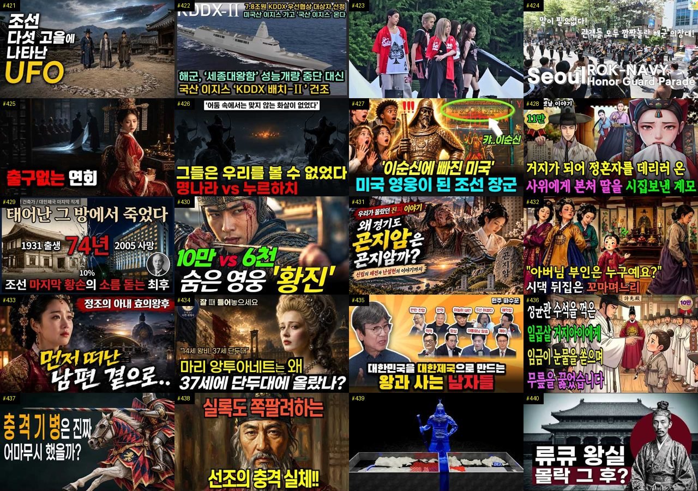
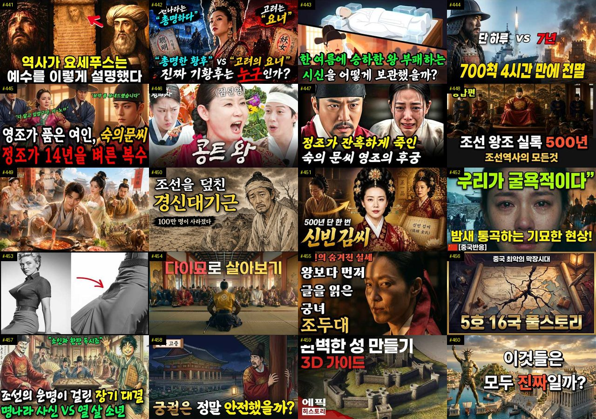
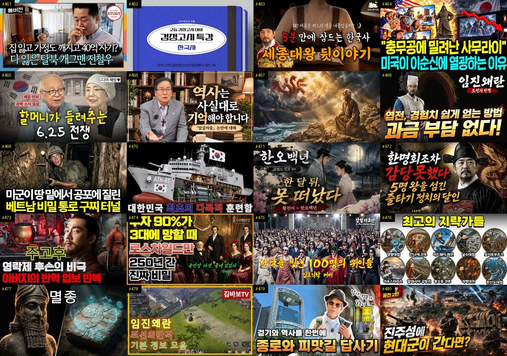

# 역사 — 성공 사례 분석 (지시사항 재료)

자동 생성 — `tools/success_analysis.py` v1.4.1 (2026-10-17 07:39 UTC), 규칙 `history/analysis_rules.toml` v1.3. **이 문서는 숫자와 원문만 담는다 — 해석·지시사항은 이것을 읽는 AI 가 만든다.** 주별 추세는 `weekly.md`, 승인한 영상 전부는 `approved.md`. ※ 연구·교육용 — 투자 권유가 아님.

## 0. 자료와 한계

| 자료 | 수 |
|---|---|
| 사례 폴더 (설명·자막·댓글·썸네일을 받은 영상) | 714 (웹 승인 714) |
| **성공 사례** — 180일 안·구독자 50,000 이하·조회수 ≥ 구독자 × 3·10,000회 이상·4분 이상, 채널당 2개 | **498** (기준 통과 678 − 뺀 것 31 − 채널당 제한 149) |
| 성공 사례의 글 출처 (자막·음성인식·설명·없음) | 설명 485 · 없음 13 |
| 성공 사례 대본 — 전체 · 앞부분만(음성인식 1차) · 없음 | 0 · 0 · 498 |
| 같은 채널 기준선 (채널 평소 영상) | 성공 사례 68/498 · 채널 45곳 (잘된 영상 192 · 평소 영상 197) |
| 성공 사례 댓글 (받은 / 달린) | 96,650 / 106,612 |
| 성공 사례 썸네일 | 498 |
| 비교 집단 — 탐색에서 본 영상 중 구독자 50,000 이하·4분 이상·365일 안·주제 관련, 채널당 최근 5개 | 1368 (성공 574 = 42%, 채널당 제한으로 뺀 1350) |
| 자료를 받지 않은 성공 후보 (웹 화면에서 승인하면 들어감 — 채널당 자리가 남은 것만) | 34 (자리가 찬 채널의 171개 뺌) |
| 수요·공급 시장 — 최근 90일 영상 (채널 크기 상관없음) | 1110 · 검색어 44 · 자동완성 말 273 (공급 확인 0) |
| 채널 성장 자료 (개설일이 있는 채널) | 1023 (빨리 크는 작은 채널 25) |

성공 기준은 넘었지만 뺀 영상: 이누야샤 OST - 시대를 초월한 마음 ∣ 애절한 사… (뺀 주제(OST)) · 당신이 중국 황제로 환생하면, 매일마다 겪게될 끔찍한… (뺀 주제(타임슬립)) · 1597 왜군 암살조를 격파한다. 조선 수군과 UDT… (뺀 주제(타임슬립)) · 【추홍재의 붉은 실】2화 ∣ 사극 AI BL DRAMA (뺀 주제(BL DRAMA)) · 임진왜란 타임슬립 진주대첩중 왜군 조총부대와 대립하는… (뺀 주제(타임슬립)) · 해외반응 명량 해상전투씬 (2탄) 2부 리액션 한글자… (뺀 주제(해외반응)) · 이순신 장군이 왜 미국에서 난리일까? ∣ 해외반응 (뺀 주제(해외반응)) · [타임슬립] “후손들이 좀 늦었습니다” 707이 임진… (뺀 주제(타임슬립)) · [타임슬립] 천군강림 완결 ∣ 전투기 6대가 임진왜란… (뺀 주제(타임슬립)) · 한글날 "세종대왕님 감사합니다" 감옥 가며 지킨 말에… (뺀 주제(해외반응)) · [타임슬립] 천벌1부 ∣ 임진왜란에 떨어진 한국군, … (뺀 주제(타임슬립)) · [타임슬립] 조선군 전멸 3시간 전, 현대 한국군 1… (뺀 주제(타임슬립))

**한계**

- 대본(자막·음성인식)이 없는 성공 사례 498개 (#1, #2, #3, #4, #5, #6, #7, #8, #9, #10, #11, #12, #13, #14, #15, #16, #17, #18, #19, #20, #21, #22, #23, #24, #25, #26, #27, #28, #29, #30 …) — 설명란·챕터만 있음. 도입부·구성·말 속도는 대본이 있는 0개로만 셌다 (음성인식이 끝나면 다시 셈)
- 댓글을 다 받지 못한 성공 사례 82개 (받은 96,650 / 달린 106,612개 — 할당량이 끝나면 다음에 이어 받음)
- 비교 집단 1368개 = 검색(조회수 순 — 잘된 영상 쪽으로 치우침)·추가한 채널·성공 사례 채널의 평소 영상 189개 (치우침 없음) 에서 올린 지 7~365일 영상, 성공 비율 42% — 실제 시장 비율이 아니다. 같은 집단 안의 '있음/없음' 차이로만 보고, '무엇이 먹혔나'는 1-2번(같은 채널 안)을 먼저 보라
- 같은 채널 기준선이 있는 성공 사례 68/498개 (채널 영상이 5개 미만이거나 아직 못 받음)
- 수요·공급의 '시장'은 탐색·검색에서 본 최근 90일 영상 1110개 — 검색이 조회수 순이라 조회수 적은 영상이 덜 잡힌다. 주제 묶음 사이의 상대 비교(지수)로만 보라
- 자동완성 말의 '최근 영상 수'는 우리가 본 영상만 셌다 — 실제 공급은 웹 화면 [공급 확인](말 하나에 검색 1번 = 100단위)으로 확인
- 자동완성 말에는 책·방송·사람·채널 이름도 섞인다 (예: '…를 찾아서'·'…지침서') — 영상 주제가 아닌 말은 건너뛰고 읽어라
- 채널의 최근 구독자 증가는 구독자 수를 3일 넘게 사이를 두고 두 번 이상 받아야 나온다 (7일마다 다시 받음)
- '구독자가 많이 모이는가'는 YouTube API 로 영상별 구독 증가를 볼 수 없다 — 대신 채널 성장(7번: 개설 뒤 월 구독자·받을 때마다 남긴 기록), '구독·다음 기대' 댓글, 배수(조회수÷구독자)로 본다
- 댓글 갈래·제목 특징은 낱말 규칙이라 거칠다 (물음표 반문도 '질문', 한 댓글이 여러 갈래). 원문 인용을 함께 보라
- '눈에 띔'은 차이가 크고 표본이 충분하다는 표시일 뿐 원인이 아니다

## 1. 성공 사례 (498개 — 배수 큰 순)

배수 = 조회수 ÷ 구독자. **채널 평소 대비** = 조회수 ÷ 그 채널 최근 롱폼 조회수 중앙값 (같은 채널 기준선 — 클수록 그 영상만의 힘). 썸네일은 5번(장마다 20개, 번호 = #), 사례별 자세히는 **`analysis_cases_01.md` …** (9번).

| # | 제목 | 채널 | 구독자 | 조회수 | 배수 | 채널 평소 대비 | 하루 조회수 | 길이 | 업로드 | 주제 묶음 | 형식 | 글 출처 | 댓글 받은/달린 |
|---|---|---|---|---|---|---|---|---|---|---|---|---|---|
| 1 | [평생 낳고 또 낳았던 세종의 아내... '다산 왕비'라는 포장지에 가려진 소헌왕후의 기구한 일생](https://www.youtube.com/watch?v=RvQFZXKtb6A) | 색다른역사 | 359 | 259,519 | 722.9 | – | 2,853.5 | 35.7분 | 2026-07-18 | 3. 조선 | 정보·해설 | 설명 | 79/79 |
| 2 | [진시황릉 안 여는 이유, 중국이 먼저 연 황제 무덤에 있었다](https://www.youtube.com/watch?v=guOJNdkFSNk) | 진실백과 | 519 | 354,150 | 682.4 | – | 27,185.1 | 17분 | 2026-10-04 | 6. 동양사 (중국·일본… | 정보·해설 | 설명 | 114/114 |
| 3 | [조선시대 양반으로 살면 정말 편했을까?｜양반의 하루 일상 #조선시대 #조선 #조선역사 #양반 #하루일과 #…](https://www.youtube.com/watch?v=9Ydk21vIkbc) | 한국사공방 | 152 | 99,284 | 653.2 | – | 1,746.1 | 20분 | 2026-08-21 | 3. 조선 | 브이로그·직접 해본 이야기 | 설명 | 11/11 |
| 4 | [조선 궁궐 사람들은 한겨울을 어떻게 났을까? 실록에 남은 나인과 군사들의 혹독한 겨울](https://www.youtube.com/watch?v=z_GZNlpBCEs) | 인류 타임슬립 | 323 | 193,403 | 598.8 | – | 12,506.0 | 13분 | 2026-10-01 | 3. 조선 | 정보·해설 | 설명 | 32/32 |
| 5 | [한글날 100주년 ∣ 한글은 세종대왕이 만들었다. 그럼 한국어는 누가 만들었을까? #한글날 #세종대왕 #한…](https://www.youtube.com/watch?v=dSyAznnEIHw) | 역사의 그날 | 210 | 116,413 | 554.4 | – | 13,215.8 | 16.3분 | 2026-10-08 | 1. 역사 일반·이야기 | 정보·해설 | 설명 | 51/51 |
| 6 | [미국도 무너질까? 2000년동안 무너진 패권국들의 공통점 (10분 요약하려다 20분 요약 된 세계사)](https://www.youtube.com/watch?v=e6jRgQdtI8M) | 잡식이냥 | 2,220 | 1,079,330 | 486.2 | ×2,361.8 | 49,224.2 | 21.1분 | 2026-09-25 | 5. 세계사·서양사 | 정보·해설 | 설명 | 438/438 |
| 7 | [굶어 죽던 조선에 감자가 들어오자! 모두 미쳤다!](https://www.youtube.com/watch?v=j0kJwAlyYyA) | 음식야사 | 397 | 184,327 | 464.3 | – | 7,752.2 | 14.4분 | 2026-09-23 | 3. 조선 | 브이로그·직접 해본 이야기 | 설명 | 138/138 |
| 8 | [우리 선조는 왜 조상을 산에 모셨을까? 묘자리에 목숨까지 건 이유｜조선 선산의 역사](https://www.youtube.com/watch?v=JPFrVw4I_Mw) | 역사 아람 | 428 | 194,618 | 454.7 | – | 9,118.5 | 23.6분 | 2026-09-25 | 1. 역사 일반·이야기 | 야담·옛날이야기 | 설명 | 54/54 |
| 9 | [조선은 이순신이 죽은 뒤 300년 더 만든 거북선을 왜 한 척도 남기지 못했을까 ∣ 칠천량 해전 ∣ 정조 …](https://www.youtube.com/watch?v=3LSkFuV-1d0) | 역사썰방 | 1,920 | 843,390 | 439.3 | – | 23,486.1 | 21분 | 2026-09-11 | 3. 조선 | 정보·해설 | 설명 | 208/208 |
| 10 | [전 세계가 매년 100조를 쓸 때 한국만 0원인 진짜 이유 세종대왕이 600년 전 심어놓은 공짜 시스템의 …](https://www.youtube.com/watch?v=uXPzRDWIFSA) | 경제를 알리자 | 418 | 175,774 | 420.5 | – | 8,359.3 | 19분 | 2026-09-26 | 3. 조선 | 정보·해설 | 설명 | 36/36 |
| 11 | ["사극 국밥은 다 가짜?" 조선 사람들이 열광한 진짜 K-패스트푸드 l 조선시대주막에서팔던음식 l 국밥역사…](https://www.youtube.com/watch?v=8AaUMqwdi00) | 알쓸역사 | 350 | 130,997 | 374.3 | – | 807.5 | 17.2분 | 2026-05-08 | 3. 조선 | 정보·해설 | 설명 | 105/105 |
| 12 | [이순신 장군에게 초코파이를 드렸더니…](https://www.youtube.com/watch?v=As36MA96C-8) | 타임슬립극장 | 137 | 47,945 | 350.0 | – | 4,651.0 | 7.7분 | 2026-10-07 | 3. 조선 | 정보·해설 | 설명 | 30/30 |
| 13 | [임금인줄 모르고 훈수둔 10살 아이... 야사 / 야담/ 민담/ 시니어 오디오 북/ 옛날이야기](https://www.youtube.com/watch?v=n9Bpb5j7ec8) | 토이야담 | 671 | 221,812 | 330.6 | – | 3,703.5 | 32.3분 | 2026-08-18 | 9. 야사·야담·옛날이야기 | 수면·낭독 | 설명 | 83/83 |
| 14 | [충격적인 명나라 후궁의 삶](https://www.youtube.com/watch?v=OYKLljbuJTc) | 오래된서랍 | 331 | 107,333 | 324.3 | – | 681.2 | 15.8분 | 2026-05-12 | 6. 동양사 (중국·일본… | 정보·해설 | 설명 | 24/24 |
| 15 | [[이두로 읽는 한일고대사 1화](https://www.youtube.com/watch?v=oziUkAAOReY) | 희망의 나라 만들기 | 73 | 31,599 | 316.0 | – | 297.3 | 4.2분 | 2026-07-03 | 2. 한국 고대·삼국·고려 | 정보·해설 | 설명 | 0/0 |
| 16 | [사극에는 절대 나올 수 없는 조선 주막의 적나라한 민낯](https://www.youtube.com/watch?v=cE8_zCNVONE) | 한끗역사 | 3,260 | 989,304 | 303.5 | ×498.5 | 7,046.2 | 29.4분 | 2026-05-29 | 3. 조선 | 정보·해설 | 설명 | 271/271 |
| 17 | [다 같은 '스탄'인데 뭐가 다른걸까? 중앙아시아 5개 스탄국의 비밀｜역사｜세계사｜소련](https://www.youtube.com/watch?v=nE1aAbOYw0I) | 다시만난역사 | 3,400 | 993,716 | 292.3 | – | 54,116.1 | 27.9분 | 2026-09-28 | 5. 세계사·서양사 | 정보·해설 | 설명 | 258/258 |
| 18 | [“아무도 오지 않았다” 16살 단종, 영월에서 홀로 버틴 4개월](https://www.youtube.com/watch?v=uezr9s1ffZM) | 조선 비화록 | 21 | 28,537 | 285.4 | – | 865.1 | 24.8분 | 2026-09-14 | 기타 | 정보·해설 | 설명 | 3/3 |
| 19 | [13분만에 보는 518년의 조선 역사](https://www.youtube.com/watch?v=earKPFklnV8) | 재미난역사이야기 | 171 | 47,735 | 279.1 | – | 4,598.0 | 13.7분 | 2026-10-06 | 1. 역사 일반·이야기 | 정보·해설 | 설명 | 27/27 |
| 20 | [넬슨 13전 8승, 이 사람은 23전 23승, 백만 미국인이 이순신 앞에서 침묵한 순간. "조선은 하나의 …](https://www.youtube.com/watch?v=J3I-shhMdAw) | 알쓸이슈 | 353 | 98,098 | 277.9 | – | 3,067.9 | 25.7분 | 2026-09-15 | 3. 조선 | 브이로그·직접 해본 이야기 | 설명 | 69/69 |
| 21 | [세종대왕 아들 8명 거의 전멸한 진짜 이유 ∣ 세종아들비극 ∣ 천재DNA가부른저주](https://www.youtube.com/watch?v=REHceL3oduo) | 요모조모역사 | 601 | 166,663 | 277.3 | – | 1,282.1 | 23.7분 | 2026-06-09 | 3. 조선 | 정보·해설 | 설명 | 158/158 |
| 22 | [[3부작] 이순신의 실제 얼굴을 찾아서(최종회)](https://www.youtube.com/watch?v=B5Yqnj_CfVg) | 페이스 아카이브 | 1,560 | 409,367 | 262.4 | – | 9,786.6 | 13.7분 | 2026-09-05 | 3. 조선 | 애니메이션·지도 | 설명 | 925/925 |
| 23 | [[세계사] 고대 이집트인들은 폭염 속에서도 왜 가발을 쓰고 다녔을까?💡](https://www.youtube.com/watch?v=NoE9j2eaocE) | 역사리뷰룸 | 3,140 | 814,787 | 259.5 | ×991.2 | 14,225.3 | 16.8분 | 2026-08-21 | 5. 세계사·서양사 | 오디오북·낭독 | 설명 | 84/84 |
| 24 | [하수도도 없던 조선, 여름은 왜 지옥이 됐을까 ∣ 성종도 두려워한 한양의 장마 ∣ 조선생활사](https://www.youtube.com/watch?v=ZsqcB6lCi0A) | 역사 한 소절 | 1,600 | 409,519 | 255.9 | – | 4,762.7 | 26.9분 | 2026-07-23 | 3. 조선 | 정보·해설 | 설명 | 219/219 |
| 25 | [인더스 문명은 왜 아무도 못 읽는 글자만 남기고 사라졌을까](https://www.youtube.com/watch?v=wDoiDBjy-JM) | 인류미터기 | 645 | 162,322 | 251.7 | – | 2,560.0 | 18.4분 | 2026-08-14 | 8. 문명·고고학 | 정보·해설 | 설명 | 32/32 |
| 26 | [Ep.03_전북 정읍시 ∣ 조선 역사의 비극과 민중의 함성이 공존하는 도시](https://www.youtube.com/watch?v=Fpwz5nqZTgk) | 팔도유남 Paldoyun… | 223 | 51,415 | 230.6 | – | 365.3 | 15.7분 | 2026-05-29 | 1. 역사 일반·이야기 | 야담·옛날이야기 | 설명 | 59/59 |
| 27 | [고대 전투에서 맨 앞줄은 누가 섰을까?](https://www.youtube.com/watch?v=8nGtdAH4vHw) | 궁금하단말이야 | 7,390 | 1,673,215 | 226.4 | – | 79,730.6 | 6.4분 | 2026-09-26 | 7. 전쟁·군사사 | 정보·해설 | 설명 | 713/713 |
| 28 | [암행어사 박문수 "암행어사 출두요!" 탐관오리를 쓸어버리다 ∣ 조선 사극 사이다](https://www.youtube.com/watch?v=4C7JI9SwK1o) | 영화 말본 | 1,080 | 240,331 | 222.5 | – | 4,555.5 | 13분 | 2026-08-25 | 3. 조선 | 정보·해설 | 설명 | 30/30 |
| 29 | [양반도 부러워했다?! 백정의 충격적인 사생활!! ∣ 조선의 백정 ∣ 한국사](https://www.youtube.com/watch?v=um-bKohXZK0) | 스토리퐁당 | 1,080 | 238,295 | 220.6 | – | 2,891.8 | 26분 | 2026-07-26 | 4. 한국 근현대사 | 정보·해설 | 설명 | 96/96 |
| 30 | [[복원 시리즈 #1] "충격" 조선 왕의 실제 얼굴 현실로 부활. "진짜 왕들이 살아 움직인다" "단종 실…](https://www.youtube.com/watch?v=PVn_o0ybu1c) | Soul Wave _ 소… | 117 | 25,735 | 220.0 | – | 146.0 | 5.2분 | 2026-04-24 | 3. 조선 | 수면·낭독 | 없음 | 80/80 |
| 31 | [🥣 조선 주막이 뒤집혔다 🔥 조선시대 DJ의 가야금 EDM 대축제](https://www.youtube.com/watch?v=soKbFyG1ES8) | 트롯가인 황진이 | 1,590 | 347,492 | 218.6 | – | 2,787.3 | 7.7분 | 2026-06-14 | 3. 조선 | 정보·해설 | 설명 | 60/60 |
| 32 | [조선의 왕들이 단명한 이유, 매일 먹던 '이것'이 독이었던 충격적인 사실ㅣ조선왕평균수명46세](https://www.youtube.com/watch?v=aDk8BnSRa5o) | 역사MSG | 2,530 | 550,647 | 217.7 | – | 4,255.7 | 25.3분 | 2026-06-09 | 3. 조선 | 정보·해설 | 설명 | 593/593 |
| 33 | [조선에는 원래 제사가 없었다? 제사는 언제부터 지냈나?](https://www.youtube.com/watch?v=LMJeEzBPcwg) | 인류의모든기록 | 380 | 82,422 | 216.9 | – | 3,059.0 | 15.3분 | 2026-09-20 | 3. 조선 | 야담·옛날이야기 | 설명 | 50/50 |
| 34 | [고려에 조공하던 여진족은 어떻게 중국을 두 번 지배했을까? 그 후손은 지금 어디에](https://www.youtube.com/watch?v=EwZnhWBu_-Y) | Damir Merzhal… | 961 | 204,996 | 213.3 | – | 9,596.8 | 98.4분 | 2026-09-25 | 2. 한국 고대·삼국·고려 | 수면·낭독 | 설명 | 70/70 |
| 35 | [“누가 이순신을 사?” 미국서 무시당한 청년…결국 25만 부 팔아치웠다](https://www.youtube.com/watch?v=olrlcl1HoCo) | 최기훈TV | 611 | 129,287 | 211.6 | – | 5,134.2 | 17.4분 | 2026-09-22 | 3. 조선 | 애니메이션·지도 | 설명 | 24/24 |
| 36 | [13살 소년왕이 조선 최고 책사 한명회를 손끝 하나 안 대고 무너뜨린 방법 ∣ 조선왕조실록이 감춘 성종의 …](https://www.youtube.com/watch?v=BrJfH7HySwo) | 역사비 | 3,140 | 647,951 | 206.3 | ×759.2 | 7,115.8 | 40분 | 2026-07-18 | 3. 조선 | 정보·해설 | 설명 | 241/241 |
| 37 | [사극에서 절대 보여주지 않는 조선 노비의 진짜 밥상 ∣ 정사 ∣ 야사](https://www.youtube.com/watch?v=N6THuYELTWU) | 역사 만화경 | 574 | 117,089 | 204.0 | – | 788.5 | 12.8분 | 2026-05-21 | 3. 조선 | 애니메이션·지도 | 설명 | 161/161 |
| 38 | [예수는 실존 인물이었을까? 역사학이 답한 충격적인 진실](https://www.youtube.com/watch?v=xDel5Oig1HQ) | 에덴코덱스 | 256 | 51,228 | 200.1 | – | 416.6 | 13.4분 | 2026-06-16 | 1. 역사 일반·이야기 | 정보·해설 | 설명 | 59/59 |
| 39 | [왕비가 후궁보다 아기를 못낳는 충격적인 이유∣ 조선 왕실 합궁 규칙의 함정](https://www.youtube.com/watch?v=MGvKBHt5020) | 역사샘 | 130 | 25,519 | 196.3 | – | 246.8 | 17.9분 | 2026-07-05 | 3. 조선 | 정보·해설 | 설명 | 36/36 |
| 40 | [조선 선비는 과거 보러 400km를 어떻게 걸어갔을까 ∣ 국밥·엿·주막에 숨은 놀라운 이야기∣사극은 거짓말…](https://www.youtube.com/watch?v=PmKbdO0FcnE) | 어게인역사 | 5,640 | 1,079,338 | 191.4 | ×821.1 | 27,414.4 | 12분 | 2026-09-07 | 3. 조선 | 정보·해설 | 설명 | 202/202 |
| 41 | [실제로 존재했던 충격적인 역사 사진 30선](https://www.youtube.com/watch?v=q9VFXgtvKHc) | 숨겨진역사 | 53 | 18,725 | 187.2 | – | 172.5 | 10분 | 2026-06-30 | 1. 역사 일반·이야기 | 정보·해설 | 설명 | 5/5 |
| 42 | [청나라 멸망 후, 500만 만주족에게 벌어진 일 ∣ 청나라 감춰진 역사 이야기](https://www.youtube.com/watch?v=PmeHs6CH_ro) | 그날의 재발견 | 1,340 | 250,260 | 186.8 | – | 3,380.2 | 14.1분 | 2026-08-04 | 1. 역사 일반·이야기 | 정보·해설 | 설명 | 591/591 |
| 43 | [조선시대엔 네비게이션도 없이 어떻게 한양까지 갔을까?선비들만 아는 지름길이 있었나?∣김정호∣대동여지도∣한국사](https://www.youtube.com/watch?v=AXj7fbQkVos) | 역사 밤샘토크 | 756 | 139,437 | 184.4 | – | 1,613.8 | 33.4분 | 2026-07-22 | 3. 조선 | 정보·해설 | 설명 | 60/60 |
| 44 | [조선시대 왕비의 식사 — 12첩 반상인데 왜 맛이 없었을까](https://www.youtube.com/watch?v=Ch-zCROKRo4) | 역사콕콕 | 491 | 89,254 | 181.8 | – | 615.9 | 23.4분 | 2026-05-25 | 3. 조선 | 정보·해설 | 설명 | 151/151 |
| 45 | [신데렐라 숙빈 최씨의 쓸쓸한 죽음 뒤에 숨겨진 실록의 충격적인 진실](https://www.youtube.com/watch?v=ZtLWS2MvtyQ) | 역사를 만나다 | 228 | 40,218 | 176.4 | – | 447.4 | 17.1분 | 2026-07-19 | 3. 조선 | 정보·해설 | 설명 | 29/29 |
| 46 | [지구나이 45억년, 인류 이전 초거대 문명의 소름돋는 증거들](https://www.youtube.com/watch?v=-FBIBpxt-FY) | 어스릭스 | 4,970 | 859,559 | 172.9 | – | 7,355.4 | 22.6분 | 2026-06-22 | 8. 문명·고고학 | 정보·해설 | 설명 | 491/491 |
| 47 | [유럽인은 왜 수만 년 동안 검은 피부였을까 ∣ 고대문명](https://www.youtube.com/watch?v=FivM7xayEWA) | 고대문명 역사관 | 410 | 70,473 | 171.9 | – | 2,019.3 | 17.7분 | 2026-09-12 | 8. 문명·고고학 | 정보·해설 | 설명 | 23/23 |
| 48 | [75 충격적인 역사 사진, 꼭 보세요!](https://www.youtube.com/watch?v=wT9qEomWsew) | 사진으로 보는 역사 | 3,510 | 587,381 | 167.3 | – | 92,952.0 | 30.8분 | 2026-10-11 | 1. 역사 일반·이야기 | 정보·해설 | 설명 | 31/31 |
| 49 | [왕비는 왜 자기 아기에게 젖을 먹이지 못했을까? 왕실 유모 '봉보부인' 제도](https://www.youtube.com/watch?v=YQV0bUQN9Ps) | 과연누구인가 | 716 | 118,045 | 164.9 | – | 795.7 | 32.9분 | 2026-05-21 | 3. 조선 | 정보·해설 | 설명 | 97/97 |
| 50 | [피라미드는 명함도 못 내미는 초고대 유적 ∣ 카라한테페의 정체](https://www.youtube.com/watch?v=RKvtPoSMm6M) | 역사줌 | 73 | 16,451 | 164.5 | – | 393.0 | 18.5분 | 2026-09-05 | 8. 문명·고고학 | 정보·해설 | 설명 | 27/27 |
| 51 | [조선 왕들이 일찍 죽은 진짜 이유｜매일 먹던 수라상에 충격적인 답이 있었다](https://www.youtube.com/watch?v=MvFehJWoeAU) | 조선의 시간 | 30 | 16,237 | 162.4 | – | 232.7 | 14.2분 | 2026-08-08 | 3. 조선 | 정보·해설 | 설명 | 3/3 |
| 52 | [200개 문명이 '같은 날'을 기억하는 소름 돋는 이유 ㅣ 전 세계 200개 문명이 증언하는 대홍수, 과학…](https://www.youtube.com/watch?v=d1kg9gfbQkI) | 역사로 가다 | 847 | 136,822 | 161.5 | – | 961.2 | 36.6분 | 2026-05-27 | 8. 문명·고고학 | 정보·해설 | 설명 | 370/370 |
| 53 | [조선시대 장원급제하면 생기는 일 ∣ 잔치 빚부터 출근 첫날 신고식까지](https://www.youtube.com/watch?v=7hixvj0cPrk) | 역사잇수다 | 443 | 69,292 | 156.4 | – | 38,271.2 | 9.4분 | 2026-10-15 | 3. 조선 | 브이로그·직접 해본 이야기 | 설명 | 131/131 |
| 54 | [웹소설 임진왜란 2072 - 제1부 노량대전 ( 제08장 귀선 부상 )](https://www.youtube.com/watch?v=LUbqbOx35pA) | 라이프 갤러리 | 1,050 | 163,896 | 156.1 | – | 2,840.8 | 5.4분 | 2026-08-20 | 3. 조선 | 정보·해설 | 설명 | 14/14 |
| 55 | [어떻게 이 나라 하나가 전 세계 80억명을 먹여살리는걸까?｜인산염｜역사｜지리학｜세계사](https://www.youtube.com/watch?v=JU4AtsLwYPQ) | 다시만난역사 | 3,400 | 528,123 | 155.3 | – | 39,411.8 | 17.7분 | 2026-10-03 | 5. 세계사·서양사 | 정보·해설 | 설명 | 89/89 |
| 56 | [하루 3톤의 똥, 경복궁은 어떻게 처리했을까? ∣ 조선판 극한직업의 진실](https://www.youtube.com/watch?v=iBPuti_K5mk) | 토키의역사속으로 | 1,390 | 214,597 | 154.4 | – | 1,350.9 | 25.5분 | 2026-05-11 | 3. 조선 | 정보·해설 | 설명 | 134/134 |
| 57 | [일상속에 숨겨진 치명적인 독 조선시대 사람들이 40세 전에 쓰러진 진짜 이유 ∣ 역사 ∣ 한국사 ∣ 조선](https://www.youtube.com/watch?v=G4WR44Mrbq8) | 시절담 | 2,380 | 354,067 | 148.8 | – | 2,924.0 | 50.1분 | 2026-06-18 | 3. 조선 | 브이로그·직접 해본 이야기 | 설명 | 534/534 |
| 58 | [김이박이 절반인 이유 ∣ 아무도 제대로 알려주지 않은 성씨의 역사](https://www.youtube.com/watch?v=sgral4YYJWE) | 우리 모두의 역사 | 5,100 | 752,546 | 147.6 | – | 14,510.9 | 89분 | 2026-08-26 | 1. 역사 일반·이야기 | 정보·해설 | 설명 | 78/78 |
| 59 | [13살 성종이 한명회의 권력을 빼앗은 진짜 방법 ∣ 재미진역사](https://www.youtube.com/watch?v=EbGTavxpfHc) | 역사 속 사람들 | 707 | 103,202 | 146.0 | – | 10,453.5 | 63.4분 | 2026-10-07 | 1. 역사 일반·이야기 | 인터뷰·강연·대담 | 설명 | 43/43 |
| 60 | [조선왕조실록이 숨긴 3가지 미스터리ㅣ한국사ㅣ472년의 비밀](https://www.youtube.com/watch?v=FMHq4YfptwI) | 시간이 풀어준 이야기 | 981 | 141,623 | 144.4 | – | 937.7 | 29.4분 | 2026-05-19 | 3. 조선 | 정보·해설 | 설명 | 115/115 |
| 61 | [[미스터리] 1803년 일본 해안에 UFO가 내렸다? 붉은 머리 여인과 끝내 열리지 않은 상자](https://www.youtube.com/watch?v=dJJri3JiE_0) | 미스터리세상 | 324 | 46,343 | 143.0 | – | 6,641.4 | 13.4분 | 2026-10-10 | 1. 역사 일반·이야기 | 정보·해설 | 설명 | 12/12 |
| 62 | [세종대왕이 황급히 역사 ∣ 고려에 살던 아랍인 7만 명의 소름돋는 행방](https://www.youtube.com/watch?v=INsyRZUYb1A) | 역사프리즘 | 688 | 98,272 | 142.8 | – | 871.0 | 20.8분 | 2026-06-26 | 1. 역사 일반·이야기 | 정보·해설 | 설명 | 264/264 |
| 63 | [단종보다 10배 더 슬픈 광해군의 19년 생지옥… 원수의 파멸을 두 눈으로 지켜본 늙은 왕!](https://www.youtube.com/watch?v=P9nHouyJ1Hg) | 근본한국사 | 3,030 | 422,969 | 139.6 | ×377.3 | 2,587.7 | 13.9분 | 2026-05-06 | 3. 조선 | 사연·드라마 | 설명 | 586/586 |
| 64 | [400년 뒤 미래로 이동한 조선남자가 조선손맛으로 식당을 도와주면 생기는 일 ㅋㅋㅋㅋ](https://www.youtube.com/watch?v=Al4AjgCif5c) | 우리드라마 | 5,140 | 716,053 | 139.3 | – | 13,514.0 | 111분 | 2026-08-25 | 3. 조선 | 몰아보기·통합본 | 설명 | 194/194 |
| 65 | [마지막 황손 이석의 아침 밥상은? 교과서에는 없는 대한제국 황실의 진짜 이야기｜황손 이석의 승광재의 아침](https://www.youtube.com/watch?v=1bjVlbD1kCY) | 승광재 | 1,870 | 259,046 | 138.5 | – | 9,540.5 | 7.7분 | 2026-09-20 | 4. 한국 근현대사 | 야담·옛날이야기 | 설명 | 195/195 |
| 66 | [며느리보다 10살 어린 시어머니, 그녀는 조선을 뒤흔들었다](https://www.youtube.com/watch?v=T8bS_yX629Y) | 역사정복 | 414 | 57,329 | 138.5 | – | 1,407.6 | 16.8분 | 2026-09-06 | 3. 조선 | 사연·드라마 | 설명 | 13/13 |
| 67 | [콘돔도 없던 조선시대, 기생은 어떻게 임신과 화류병을 막았나— 알려지지 않은 충격적인 진실#조선시대 #기생…](https://www.youtube.com/watch?v=mU274jAWlws) | 조선의 호기심 | 1,730 | 236,220 | 136.5 | – | 1,725.4 | 24.5분 | 2026-06-02 | 3. 조선 | 정보·해설 | 설명 | 517/517 |
| 68 | [조선시대 역적으로 몰린 양반 아내들, 노비로 전락한 충격적인 진실](https://www.youtube.com/watch?v=mHF_-cRLwGQ) | 조선 왕조의 비밀 | 1,530 | 208,668 | 136.4 | – | 1,882.6 | 26.2분 | 2026-06-28 | 3. 조선 | 정보·해설 | 설명 | 146/146 |
| 69 | [청나라를 위협한 '미지의 제국', 백두산정계비를 세우게 만든 진짜 이유](https://www.youtube.com/watch?v=tS5qj6B66kc) | 그날의 재발견 | 1,340 | 181,824 | 135.7 | – | 5,232.9 | 47.9분 | 2026-09-12 | 6. 동양사 (중국·일본… | 인터뷰·강연·대담 | 설명 | 487/487 |
| 70 | [조선 최고의 신랑감이 하루아침에 한양 제일의 망나니가 된 이유 /야담 조선야담 옛날이야기 오디오북 수면동화…](https://www.youtube.com/watch?v=5tjsVKWQES0) | 썰톡 TV | 3,390 | 456,315 | 134.6 | – | 7,623.0 | 87.1분 | 2026-08-18 | 9. 야사·야담·옛날이야기 | 수면·낭독 | 설명 | 123/123 |
| 71 | [[중국 전쟁사] 그 넓은 중국은 어쩌다 동해를 코앞에 두고 통로가 막혀버렸을까?｜기묘하게 꼬여버린 '북·중…](https://www.youtube.com/watch?v=itVdxpo0sWQ) | 역사순삭 | 73 | 13,455 | 134.6 | – | 160.4 | 10.1분 | 2026-07-25 | 7. 전쟁·군사사 | 애니메이션·지도 | 설명 | 7/7 |
| 72 | [[김역사의 한국사] 사극이 철저히 숨긴 조선시대 '주막'의 충격적인 진짜 모습 정사 ㅣ 야사](https://www.youtube.com/watch?v=76GoBExdKA8) | 김역사 | 6,810 | 896,839 | 131.7 | – | 5,067.3 | 19.3분 | 2026-04-23 | 3. 조선 | 정보·해설 | 설명 | 845/845 |
| 73 | [AI로 되살린 조선 옛 기록 속 이상한 동물들, 그 정체를 추적해 봤습니다](https://www.youtube.com/watch?v=yCYBW9qayVY) | 키치스토리 | 1,370 | 179,098 | 130.7 | – | 17,935.8 | 13.6분 | 2026-10-07 | 3. 조선 | 정보·해설 | 설명 | 23/23 |
| 74 | [가족을 모두 잃고 18년을 버틴 광해군 ∣ 왕에서 죄인이 된 비극적인 최후](https://www.youtube.com/watch?v=KRTIB2WwIQw) | 웅이 역사원정대 | 1,570 | 201,826 | 128.6 | – | 4,802.3 | 48분 | 2026-09-05 | 3. 조선 | 정보·해설 | 설명 | 155/155 |
| 75 | [[한국사] 여든여덟에 목이 잘린 영의정은 왜 목이 잘렸나 ∣ 역사인물 ∣ 다큐 ∣ 야사 ∣ 비사](https://www.youtube.com/watch?v=wFTPh8YhhLI) | 한국사인물관 | 4,330 | 542,366 | 125.3 | – | 19,244.1 | 36.4분 | 2026-09-19 | 4. 한국 근현대사 | 정보·해설 | 설명 | 100/100 |
| 76 | [일본땅 오카야마에 '가야국'이 있었다! (임나일본부, 일본열도에서 그…](https://www.youtube.com/watch?v=0jpGanPQC-U) | 주간사과 - Weekly… | 122 | 15,203 | 124.6 | – | 474.6 | 9.8분 | 2026-09-15 | 기타 | 정보·해설 | 설명 | 22/22 |
| 77 | [이지스함으로 부족한가? 이지스함 vs KDDX #KDDX #세종대왕함 #이지스함](https://www.youtube.com/watch?v=DRCG7mwqgik) | NEXUS ROBO | 203 | 25,115 | 123.7 | – | 1,144.4 | 9.8분 | 2026-09-25 | 3. 조선 | 정보·해설 | 없음 | 11/11 |
| 78 | [[역사한줄] 조선시대 실제군인이 작성한 일기내용 #조선역사 #한국사 #부북일기](https://www.youtube.com/watch?v=eY_TrTKsIJ0) | 역사한줄 | 3,500 | 427,781 | 122.2 | ×73.5 | 2,857.3 | 16.8분 | 2026-05-20 | 3. 조선 | 정보·해설 | 설명 | 321/321 |
| 79 | [왜 조선 사람들은 제일 낮고 편한 고개를 두고 험한 길로 돌아갔을까? ∣ 문경새재, 대관령, 옛길의 진짜 …](https://www.youtube.com/watch?v=0SfgHs91EZc) | 안식한국사 | 3,570 | 435,059 | 121.9 | – | 11,475.3 | 18.5분 | 2026-09-09 | 3. 조선 | 수면·낭독 | 설명 | 102/102 |
| 80 | [[애절한 중국 사극 노래] “나만의 폐하를 사랑하지요” ∣ 황제 무측천이 사랑한 단 하나의 태양 ∣ 성세천…](https://www.youtube.com/watch?v=z6VcKlWaGoo) | 사녀 | 1,170 | 142,138 | 121.5 | – | 1,242.6 | 4.4분 | 2026-06-24 | 3. 조선 | 정보·해설 | 설명 | 107/107 |
| 81 | ["13살 노비, 30년 후 정1품" 세종의 곁을 지킨 신빈 김씨, 조선판 신데렐라의 진짜 결말](https://www.youtube.com/watch?v=Qof4DjCKdgE) | 그날의역사 | 7,060 | 847,852 | 120.1 | – | 4,892.4 | 43.7분 | 2026-04-27 | 3. 조선 | 정보·해설 | 설명 | 648/648 |
| 82 | [어찌 저를 살리십니까 저하... ∣ 홍연 EP.5 ∣ AI 사극 드라마](https://www.youtube.com/watch?v=WUtMmYAwaYY) | 해뜰날 | 488 | 57,437 | 117.7 | – | 559.3 | 4.7분 | 2026-07-06 | 3. 조선 | 정보·해설 | 설명 | 5/5 |
| 83 | [《불교 역사》 인도의 괴짜 승려 달마는 누구인가? l 역사 인물 l 고전](https://www.youtube.com/watch?v=N4v1knO4AEw) | 역사 산책: 동양편 | 2,770 | 319,472 | 115.3 | ×49.7 | 4,246.3 | 23.2분 | 2026-08-03 | 1. 역사 일반·이야기 | 정보·해설 | 없음 | 126/126 |
| 84 | [돼지는 114일, 토끼는 단 한 달… 그런데 한국인은 왜 안 먹을까? 충격적인 5가지 이유 ∣ 역사 이야기](https://www.youtube.com/watch?v=hf9t-gKqdjg) | 몰랐던 세상 | 1,590 | 183,318 | 115.3 | ×48.4 | 26,432.7 | 10.8분 | 2026-10-10 | 1. 역사 일반·이야기 | 수면·낭독 | 설명 | 330/330 |
| 85 | [🔥조선 영의정의 외아들🔥이 갑자기 노비로 전락하면 벌어지는 일...](https://www.youtube.com/watch?v=Kj46XmMz4u0) | 드라마상점 | 4,770 | 545,645 | 114.4 | – | 3,476.4 | 23.5분 | 2026-05-13 | 3. 조선 | 사극·드라마·영화 리뷰 | 설명 | 142/142 |
| 86 | [이거 하나면 그리스 신화 아는 척 가능 ⚡ 신들의 막장 족보 총정리 (제우스부터 오디세우스까지)](https://www.youtube.com/watch?v=sq8Un9KgH9g) | 재미난 역사여행 | 5,220 | 591,711 | 113.3 | ×965.3 | 9,799.5 | 49.8분 | 2026-08-17 | 5. 세계사·서양사 | 정보·해설 | 설명 | 295/295 |
| 87 | [고조선 이전_또 다른 문명이 있었다](https://www.youtube.com/watch?v=u_tS1xBdjn8) | 리워크531(REWORK… | 221 | 25,008 | 113.2 | – | 152.8 | 12.2분 | 2026-05-06 | 2. 한국 고대·삼국·고려 | 정보·해설 | 설명 | 47/47 |
| 88 | [조선시대 유배객들이 실제로 겪은 일 ∣ 교과서가 숨긴 진짜 유배의 실체 ∣ 조선역사 ∣ 조선왕조실록 ∣ 한…](https://www.youtube.com/watch?v=U2MgGktKryE) | 역사딴지 | 1,150 | 129,417 | 112.5 | – | 1,907.6 | 13.9분 | 2026-08-10 | 3. 조선 | 수면·낭독 | 설명 | 76/76 |
| 89 | [조선야담#52 남겨진 머슴과 과부마님. 옛날이야기. 야담. 야사,](https://www.youtube.com/watch?v=4jEcvypcCuQ) | 조선의 밤 | 109 | 12,249 | 112.4 | – | 1,020.3 | 18.2분 | 2026-10-05 | 9. 야사·야담·옛날이야기 | 수면·낭독 | 설명 | 1/1 |
| 90 | [[친일파와 식민지 근대화론] 일제가 조선을 먹여 살렸다는 기막힌 헛소리 팩트체크 포함 1시간 몰아보기](https://www.youtube.com/watch?v=LwjbMRyBWZ8) | 기웃기웃 김기욱 | 1,730 | 194,236 | 112.3 | – | 3,477.2 | 62.7분 | 2026-08-22 | 3. 조선 | 수면·낭독 | 설명 | 1,036/1,036 |
| 91 | [충격실화! 조선시대 꿀보직 TOP5 — 일 안 해도 나라에서 월급 줬습니다](https://www.youtube.com/watch?v=F708KFpG_5U) | 역사 뒷풀이 | 1,720 | 191,829 | 111.5 | ×138.6 | 1,229.1 | 11.4분 | 2026-05-14 | 3. 조선 | 정보·해설 | 설명 | 154/154 |
| 92 | [왕의 밥상을 차리던 수라간 궁녀들, 그 산더미 같은 '남은 반찬'은 어떻게 처리 했을까? ∣ 한국사 ∣ 조…](https://www.youtube.com/watch?v=i88zvql3pbc) | 시대산책 | 1,590 | 177,135 | 111.4 | – | 1,128.4 | 47.9분 | 2026-05-13 | 3. 조선 | 정보·해설 | 설명 | 140/140 |
| 93 | [단종의 친누나 경혜공주, 세조에게 한 조선 역사상 가장 잔인한 복수](https://www.youtube.com/watch?v=wX-80QWb2tg) | 시간책방 | 8,520 | 940,342 | 110.4 | – | 7,187.3 | 36.6분 | 2026-06-08 | 1. 역사 일반·이야기 | 정보·해설 | 설명 | 864/861 |
| 94 | [고대 이집트의 잃어버린 도시, 마침내 발견되다](https://www.youtube.com/watch?v=-j9jOJl_ERU) | 시간의 단면 | 572 | 62,582 | 109.4 | – | 558.6 | 24.1분 | 2026-06-27 | 8. 문명·고고학 | 정보·해설 | 설명 | 18/18 |
| 95 | [한국인은 왜 양고기를 거의 안 먹을까? 돼지고기와 100배 차이, 숨겨진 역사 이야기](https://www.youtube.com/watch?v=T9z8nPsgfvc) | 몰랐던 세상 | 1,590 | 173,311 | 109.0 | ×53.3 | 21,869.5 | 12.8분 | 2026-10-09 | 1. 역사 일반·이야기 | 수면·낭독 | 설명 | 253/245 |
| 96 | [비운의 공주' 네네: 황제에게 거절당한 후 그녀가 겪어야 했던 파란만장한 삶](https://www.youtube.com/watch?v=5BUUcuUn5yc) | 원시툰 | 498 | 54,021 | 108.5 | – | 305.2 | 16.8분 | 2026-04-23 | 11. 황제·왕·인물 | 정보·해설 | 설명 | 6/6 |
| 97 | [조선 후궁의 진짜 삶, 사극은 거짓말이었습니다](https://www.youtube.com/watch?v=evU7LnkasQA) | 발칙한조선 | 1,230 | 130,262 | 105.9 | – | 757.5 | 19.6분 | 2026-04-28 | 3. 조선 | 정보·해설 | 설명 | 56/56 |
| 98 | [이무기가 왕이 된 조선 - 기생과 암살자 ∣ 찬룡 EP.4](https://www.youtube.com/watch?v=3k3Qi9yy7HQ) | 투모로우 TO:MORROW | 12,900 | 1,359,088 | 105.4 | – | 26,699.9 | 10.3분 | 2026-08-27 | 3. 조선 | 정보·해설 | 설명 | 218/218 |
| 99 | [역대 이순신 역할중 가장 싱크로율 높은 배우는? #이순신영화 #이순신실제모습](https://www.youtube.com/watch?v=WrHgunG_gNc) | 페이스 아카이브 | 1,560 | 164,001 | 105.1 | – | 13,005.0 | 5.3분 | 2026-10-04 | 3. 조선 | 정보·해설 | 설명 | 398/398 |
| 100 | [조선 최고의 검술은 어디서 시작되었나? 기록되지 않은 조선제일검의 계보 [아무도 들려주지 않는 조선왕조실록]](https://www.youtube.com/watch?v=-Yturcnh4j8) | 몰래 듣는 조선의 비밀 | 1,220 | 127,764 | 104.7 | – | 991.5 | 17.9분 | 2026-06-10 | 3. 조선 | 정보·해설 | 설명 | 120/120 |
| 101 | [세종의 나라로 돌아온 예언 적중 베스트셀러 작가, 김진명! 한글을 통한 또 다른 예언 ∣ 마당밖김재원 Ep…](https://www.youtube.com/watch?v=6I_qpnaoM9Y) | 마당 밖 김재원 | 3,590 | 374,480 | 104.3 | – | 47,386.9 | 34.2분 | 2026-10-09 | 3. 조선 | 정보·해설 | 설명 | 121/121 |
| 102 | [제주도는 원래 우리나라가 아니었다고? ∣한국사}탐라국}제주도의역사∣오디오북](https://www.youtube.com/watch?v=Knxr-xtwiKw) | 오늘역사 | 890 | 91,030 | 102.3 | – | 700.1 | 34.7분 | 2026-06-09 | 10. 수면·낭독 | 수면·낭독 | 설명 | 127/127 |
| 103 | [같은 해 두 달 차이로 사라진 두 여인, 인현왕후 vs 장희빈, 진짜 악녀는 누구였나](https://www.youtube.com/watch?v=mU85T1GMwSc) | 역사선생김선생 | 64 | 10,210 | 102.1 | – | 64.3 | 19.4분 | 2026-05-11 | 3. 조선 | 정보·해설 | 설명 | 7/7 |
| 104 | [조선 과부의 삶｜남편을 잃은 조선 여인들은 대체 어떻게 살아남았을까?](https://www.youtube.com/watch?v=LhuDHX7Mx38) | 숨은 조선사 | 403 | 40,991 | 101.7 | – | 594.7 | 15.4분 | 2026-08-09 | 3. 조선 | 정보·해설 | 설명 | 24/24 |
| 105 | [사극은 거짓말이었다 ∣ 조선 백성이 매일 먹던 진짜 밥상 ∣ 조선 사람들이 산처럼 먹은 충격적인 이유 🍙l…](https://www.youtube.com/watch?v=Ez3nyrXxl7o) | 어게인역사 | 5,640 | 571,608 | 101.3 | ×434.8 | 4,558.9 | 21분 | 2026-06-13 | 3. 조선 | 정보·해설 | 설명 | 735/735 |
| 106 | [왕이 수저를 놓는 순간, 궁궐의 진짜 전쟁이 시작된다. '궁녀들의 서열' ∣ 한국사 ∣ 조선역사](https://www.youtube.com/watch?v=isuVlVJmmeA) | 역사빚다 | 3,550 | 359,294 | 101.2 | ×259.9 | 2,089.1 | 11.4분 | 2026-04-28 | 4. 한국 근현대사 | 정보·해설 | 설명 | 349/349 |
| 107 | [[4K] 청량리에 홍릉이 있었다 ∣ 명성황후의 옛 홍릉터와 영휘원·숭인원](https://www.youtube.com/watch?v=r7PovYPhfuc) | HAPPA Lens(하빠… | 300 | 30,165 | 100.5 | – | 1,506.2 | 23.1분 | 2026-09-27 | 기타 | 정보·해설 | 설명 | 13/13 |
| 108 | [종기하나에 왜 조선 왕들은 줄줄이 목숨을 잃었을까? 조선왕조실록 속 숨겨진 비밀](https://www.youtube.com/watch?v=9pevoSr0BEk) | 스티브잡학 | 1,500 | 150,235 | 100.2 | – | 939.2 | 14.4분 | 2026-05-10 | 3. 조선 | 정보·해설 | 설명 | 218/218 |
| 109 | [이순신 장군님을 2026년 대한민국에 모셔왔습니다](https://www.youtube.com/watch?v=Jb4mO-n0884) | 어디로든 연우 | 2,460 | 242,634 | 98.6 | – | 29,478.8 | 6.4분 | 2026-10-09 | 3. 조선 | 정보·해설 | 설명 | 248/248 |
| 110 | [같은 근친혼, 왜 한쪽만 망했을까? ∣ 유전자 복권의 진실](https://www.youtube.com/watch?v=8Bsvg1loL0c) | 역사 보따리 | 318 | 31,005 | 97.5 | – | 185.9 | 10.6분 | 2026-05-03 | 1. 역사 일반·이야기 | 수면·낭독 | 설명 | 13/13 |
| 111 | [세종대왕이 사랑한 단 한 여자, 노비에서 정1품 빈이 된 숨겨진 사랑 이야기](https://www.youtube.com/watch?v=SbAPKCB9hbk) | 힛토리 | 677 | 64,448 | 95.2 | – | 393.2 | 21.8분 | 2026-05-06 | 3. 조선 | 정보·해설 | 설명 | 52/52 |
| 112 | [조선 팔도 사람들의 진짜 성격, 조선 팔도 사람 기질의 비밀 500년 정도전이 말한 팔도 사람들의 진짜 성격](https://www.youtube.com/watch?v=HzK-wrKO-eI) | 사실과 기록 | 8,670 | 823,768 | 95.0 | – | 24,173.4 | 26.4분 | 2026-09-13 | 3. 조선 | 정보·해설 | 설명 | 1,725/1,725 |
| 113 | [CCTV 없던 조선, 주모는 어떻게 그많은 사람들을 만족시켰을까? l 역사이야기 l 조선시대 한국사](https://www.youtube.com/watch?v=X46M1yoKC8s) | 역사원탑 | 5,520 | 523,437 | 94.8 | ×18.2 | 4,160.2 | 29분 | 2026-06-13 | 1. 역사 일반·이야기 | 정보·해설 | 설명 | 327/327 |
| 114 | [최강 일본도를 깨부순 조선의 무기, 그건 농기구였다.](https://www.youtube.com/watch?v=VU7nOsg3tDw) | 피의역사썰 | 2,960 | 277,493 | 93.8 | – | 4,550.5 | 12.8분 | 2026-08-17 | 3. 조선 | 정보·해설 | 설명 | 230/230 |
| 115 | [소름 끼치게 놀라운 AI로 재현해 본 조선 왕 27인의 실제 모습 ∣ 우리가 몰랐던 진짜 성격](https://www.youtube.com/watch?v=BIvwX_N1iPs) | 비밀야담 보관소 | 2,580 | 241,184 | 93.5 | – | 2,227.9 | 18분 | 2026-07-01 | 3. 조선 | 야담·옛날이야기 | 설명 | 139/138 |
| 116 | [인류 이전에 문명이 있었다면, 우리는 그 흔적을 알아볼 수 있을까](https://www.youtube.com/watch?v=sw1GnKwEuU0) | 밤의 지식 도서관 | 220 | 20,187 | 91.8 | – | 470.5 | 19.7분 | 2026-09-04 | 8. 문명·고고학 | 정보·해설 | 설명 | 7/7 |
| 117 | [[역사 / 세계사 / 달빛 속] 수메르가 번성하기 전,동방에는 이미 어떤 ‘유령 같은 문명’이 존재했을까?](https://www.youtube.com/watch?v=5dTfiPOfO70) | 달빛 속 역사 이야기 | 554 | 50,057 | 90.4 | – | 279.8 | 58.5분 | 2026-04-21 | 5. 세계사·서양사 | 수면·낭독 | 설명 | 99/99 |
| 118 | [조선시대 진짜 밥상의 비밀, 우리가 알던 건 다 틀렸다. 400년 전 조선 사람들은 도대체 뭘 먹었을까?](https://www.youtube.com/watch?v=gimD7JtQT68) | 흥미진진 한국사 | 1,070 | 95,804 | 89.5 | – | 574.0 | 9.2분 | 2026-05-03 | 3. 조선 | 정보·해설 | 설명 | 84/84 |
| 119 | [고혈압·당뇨·고지혈증 폭탄! 조선 왕 80%가 단명한 진짜 이유?](https://www.youtube.com/watch?v=bjPpvpMBIoU) | 불타는한국사 | 135 | 12,052 | 89.3 | – | 144.6 | 13.8분 | 2026-07-25 | 3. 조선 | 수면·낭독 | 설명 | 18/18 |
| 120 | [조선 3대 고개, 도적보다 무서웠던 ‘이것’의 정체 ∣ 고대문명](https://www.youtube.com/watch?v=Yeiowu79QM8) | 고대문명 역사관 | 410 | 36,193 | 88.3 | – | 1,732.0 | 18.8분 | 2026-09-26 | 3. 조선 | 야담·옛날이야기 | 설명 | 4/4 |
| 121 | [강남 5,600억 노른자 땅 속 무덤 주인의 소름돋는 정체](https://www.youtube.com/watch?v=HiCvp_Xx_xg) | 역사로와 | 5,470 | 482,240 | 88.2 | – | 4,330.5 | 28.5분 | 2026-06-27 | 기타 | 정보·해설 | 설명 | 576/576 |
| 122 | [중국 역사의 가장 잔혹한 시대 '오호십육국'은 정말 단순한 대혼란이었을까?](https://www.youtube.com/watch?v=FGh1bXJM8x0) | 북방의 눈 | 1,530 | 134,409 | 87.8 | – | 6,430.3 | 109분 | 2026-09-26 | 1. 역사 일반·이야기 | 정보·해설 | 설명 | 23/23 |
| 123 | [조선 궁녀 500명은 도대체 어떻게 버텼을까? ∣ 조선시대 ∣ 조선궁녀](https://www.youtube.com/watch?v=ASsTr0jROpQ) | 배우는역사 | 2,810 | 246,535 | 87.7 | – | 1,673.0 | 28.1분 | 2026-05-22 | 3. 조선 | 정보·해설 | 설명 | 251/251 |
| 124 | [조선의 왕이 죽고나면 벌어지는 일│ 조선왕릉의 비밀](https://www.youtube.com/watch?v=_mtXC7plYVs) | 역사잼잼 | 2,900 | 253,936 | 87.6 | – | 2,686.2 | 17.2분 | 2026-07-14 | 3. 조선 | 정보·해설 | 설명 | 117/117 |
| 125 | [🔥최고 시청률 6.3% 찍은🔥왕비 자리를 차지하기 위해 미녀들이 목숨 걸고 싸우는 역대급 궁중 암투극!](https://www.youtube.com/watch?v=JEqNYtNRvWs) | 우리드라마 | 5,140 | 449,420 | 87.4 | – | 10,731.1 | 230.1분 | 2026-09-05 | 11. 황제·왕·인물 | 몰아보기·통합본 | 설명 | 21/21 |
| 126 | [교과서가 숨긴 정약용의 두 얼굴ㅣ18살에 수천만 원을 기생에게 뿌린 남자#정약용 #다산정약용 #조선역사#정…](https://www.youtube.com/watch?v=E2CnbVqR8N0) | 역사 쏙쏙 | 3,630 | 312,628 | 86.1 | – | 2,155.0 | 47.4분 | 2026-05-25 | 1. 역사 일반·이야기 | 정보·해설 | 설명 | 370/370 |
| 127 | [네팔의 비극 뒤에 숨겨진 역사… 중국이 히말라야에 묻어둔 230조 원짜리 덫의 정체](https://www.youtube.com/watch?v=C13y7E8GstI) | 역사책방 | 4,020 | 342,702 | 85.2 | – | 9,074.2 | 18.1분 | 2026-09-09 | 1. 역사 일반·이야기 | 정보·해설 | 설명 | 91/91 |
| 128 | [이 노인 한 명이 조선을 병들게 했다 ∣ 노론의 거두, 송시열의 정체](https://www.youtube.com/watch?v=trFvm6O6UoA) | 역사풀이 | 6,620 | 562,287 | 84.9 | – | 5,893.8 | 31.5분 | 2026-07-13 | 3. 조선 | 정보·해설 | 설명 | 1,346/1,346 |
| 129 | [노량진역 옆 570년 된 무덤, 여섯 분인데 왜 일곱 기일까? ∣ 사육신묘의 미스터리 ∣ 역사다큐 ∣ 조선…](https://www.youtube.com/watch?v=4P3OBpzFYlg) | 역사의늪 | 2,710 | 229,520 | 84.7 | – | 2,840.4 | 35.8분 | 2026-07-28 | 3. 조선 | 정보·해설 | 설명 | 395/395 |
| 130 | [풍수 전문가들이 현충원 최고 명당으로 지목한 곳은 대통령 묘가 아니었습니다](https://www.youtube.com/watch?v=c0O8c0NcFog) | 역사파인더 | 3,650 | 308,572 | 84.5 | – | 3,183.0 | 39.8분 | 2026-07-12 | 기타 | 정보·해설 | 설명 | 643/643 |
| 131 | [조선의 역대급 변절자 신숙주, 성삼문 아내를 노비로 들인 충격적인 이유](https://www.youtube.com/watch?v=RdzPp1O7PW8) | 왕조의 숨은 이야기 | 1,550 | 130,932 | 84.5 | ×157.1 | 1,248.4 | 19.9분 | 2026-07-04 | 3. 조선 | 정보·해설 | 없음 | 91/89 |
| 132 | [역사상 가장 악명 높았던 독재자들은 어떻게 최후를 맞이했을까?](https://www.youtube.com/watch?v=O_KWOoiOj3I) | 크로니클 | 3,530 | 294,778 | 83.5 | – | 4,695.6 | 19.9분 | 2026-08-15 | 1. 역사 일반·이야기 | 정보·해설 | 설명 | 309/309 |
| 133 | [조선시대 한복판에 떨어진 대한민국 최정예 육군, 압도적 화력으로 역사를 다시 쓴다](https://www.youtube.com/watch?v=kjtOsCP4t5Y) | 스튜디오진혼 | 12,500 | 1,034,245 | 82.7 | – | 7,209.7 | 37.6분 | 2026-05-26 | 3. 조선 | 몰아보기·통합본 | 설명 | 854/854 |
| 134 | [[자면서 듣는역사] 왜 그렇게 남편을 잃은 과부를 괴롭혔을까?](https://www.youtube.com/watch?v=0NcpK50ihfw) | 역사원탑 | 5,520 | 452,149 | 81.9 | ×15.7 | 19,809.2 | 29.5분 | 2026-09-24 | 1. 역사 일반·이야기 | 수면·낭독 | 설명 | 263/260 |
| 135 | [세조는 왜 정순왕후를 죽이지 못했나?ㅣ조선왕조실록ㅣ조선역사ㅣ단종ㅣ](https://www.youtube.com/watch?v=rNcjDyncTfI) | 콕역사 | 1,540 | 124,894 | 81.1 | – | 786.9 | 48.5분 | 2026-05-11 | 3. 조선 | 정보·해설 | 설명 | 210/210 |
| 136 | [조선의 역대급 변절자 신숙주가 성삼문 아내를 노비로 들인 이유 #계유정난 #사육신](https://www.youtube.com/watch?v=h9lGe72Y4NM) | 국사의품격 | 3,970 | 303,410 | 76.4 | – | 2,231.2 | 19.2분 | 2026-06-03 | 3. 조선 | 정보·해설 | 설명 | 394/394 |
| 137 | [폐위된 왕의 하루 ∣ 궁궐에서 가시 울타리까지, 연산군과 광해군 ∣ 조선 폐위 왕들](https://www.youtube.com/watch?v=lWYjoJ3bUO0) | 타임슬림 한국사 | 6,030 | 459,388 | 76.2 | – | 3,406.4 | 89.3분 | 2026-06-04 | 3. 조선 | 정보·해설 | 설명 | 183/183 |
| 138 | [연산군도 비비지 못하는 고려 최악의 폭군 ∣ 고려 충혜왕의 실제 기록](https://www.youtube.com/watch?v=y3ouJ8UuWqA) | 역사판 | 2,280 | 170,406 | 74.7 | – | 1,348.1 | 24.4분 | 2026-06-12 | 3. 조선 | 정보·해설 | 설명 | 54/54 |
| 139 | [명나라 역사상 가장 끔찍하게 죽은 남자ㅣ환관 유근의 일생](https://www.youtube.com/watch?v=DisrEocrnVY) | 역사노다지 | 4,230 | 313,926 | 74.2 | – | 3,256.4 | 36.1분 | 2026-07-12 | 6. 동양사 (중국·일본… | 정보·해설 | 설명 | 230/230 |
| 140 | [조선왕조실록 1대 태조~27대 순조까지 완벽 총정리 l 조선역사 l 한국사](https://www.youtube.com/watch?v=8rmf4SkvKpc) | 시대를 훔친 이야기 | 3,250 | 240,923 | 74.1 | ×410.4 | 2,052.1 | 131분 | 2026-06-21 | 3. 조선 | 몰아보기·통합본 | 설명 | 66/66 |
| 141 | [여진 토멸 │ 고려의 여진 정벌, 전설이 된 척준경의 마지막 활약. AI 단편 사극 영화](https://www.youtube.com/watch?v=VKwK-vwmKL8) | 쇠꼬비 검프 | 16,200 | 1,188,691 | 73.4 | – | 24,266.1 | 58.9분 | 2026-08-29 | 2. 한국 고대·삼국·고려 | 정보·해설 | 설명 | 1,373/1,373 |
| 142 | [임진왜란 의병장이 88세에 역적으로 참형당한 진짜 이유 ∣ 재미진역사](https://www.youtube.com/watch?v=GhH9jUSqkF0) | 역사 속 사람들 | 707 | 51,731 | 73.2 | – | 2,602.3 | 62.9분 | 2026-09-27 | 3. 조선 | 인터뷰·강연·대담 | 설명 | 42/42 |
| 143 | [직업이 없던 시대, 고대 인류는 하루 종일 무엇을 했을까? ∣ 인류역사](https://www.youtube.com/watch?v=MbnWhQOwocM) | 태고의 세계 | 718 | 52,514 | 73.1 | – | 368.8 | 11.6분 | 2026-05-27 | 1. 역사 일반·이야기 | 오디오북·낭독 | 설명 | 209/209 |
| 144 | [[한국사 위인] 인조는 폐왕 광해군을 왜 19년 동안 못죽였을까∣ 한국사 ∣ 역사인물 ∣ 조선 ∣ 역사다큐…](https://www.youtube.com/watch?v=5Rkq7lrGDAo) | 한국사인물관 | 4,330 | 314,545 | 72.6 | – | 3,269.9 | 26.3분 | 2026-07-13 | 3. 조선 | 정보·해설 | 설명 | 568/568 |
| 145 | [조선에 편의점을 열었더니 벌어진 일](https://www.youtube.com/watch?v=t68eLyT7a-s) | 세계관오류 | 15,100 | 1,095,701 | 72.6 | – | 54,097.8 | 4.1분 | 2026-09-27 | 3. 조선 | 정보·해설 | 설명 | 350/347 |
| 146 | [세조를 넘어 한명회 가문까지… 단종의 저주는 계속되었다 (다섯 자식의 끔찍한 운명)](https://www.youtube.com/watch?v=iRByyYtg5uY) | 한국사 산책 | 3,210 | 227,826 | 71.0 | – | 1,433.4 | 16.2분 | 2026-05-11 | 1. 역사 일반·이야기 | 정보·해설 | 설명 | 207/207 |
| 147 | [세종대왕을 만나면 말이 통할까, 우리말은 500년 동안 얼마나 변했나](https://www.youtube.com/watch?v=jiV-fQ_-uyE) | 역사한줌 | 3,860 | 271,943 | 70.5 | – | 11,220.8 | 29.4분 | 2026-09-23 | 3. 조선 | 정보·해설 | 설명 | 120/120 |
| 148 | [세종대왕을 2026년 대한민국에 모셔왔더니 벌어진 일](https://www.youtube.com/watch?v=JfPvwN_MgGg) | 세계관오류 | 15,100 | 1,044,835 | 69.2 | – | 69,887.8 | 10.4분 | 2026-10-02 | 3. 조선 | 브이로그·직접 해본 이야기 | 설명 | 1,049/1,048 |
| 149 | [크메르 제국의 앙코르와트는 왜 밀림에 묻혔나?:세계에서 가장 넓었던 신의 도시가 버려진 이유!](https://www.youtube.com/watch?v=F-tooKrghZ0) | 율리의역사 [YULY'S… | 1,020 | 70,099 | 68.7 | ×99.9 | 7,108.8 | 18.3분 | 2026-10-07 | 11. 황제·왕·인물 | 정보·해설 | 설명 | 30/30 |
| 150 | [중국도 일본도 아닙니다 단군과 고조선의 기록을 지우려한 정체](https://www.youtube.com/watch?v=VYoPhgs3WfU) | 역사얘기 | 1,930 | 130,459 | 67.6 | ×61.1 | 1,657.1 | 16.8분 | 2026-07-30 | 2. 한국 고대·삼국·고려 | 정보·해설 | 설명 | 656/656 |
| 151 | [[세계사] 영화 '오디세이' 보기 전 필수! 트로이 전쟁의 숨겨진 이야기는 무엇일까?💡](https://www.youtube.com/watch?v=Cy5pxD74PzY) | 역사리뷰룸 | 3,140 | 210,866 | 67.2 | ×256.5 | 3,177.6 | 40.5분 | 2026-08-11 | 5. 세계사·서양사 | 정보·해설 | 설명 | 158/158 |
| 152 | [이순신 장군을 2026년 해군기지에 모셔왔더니 벌어진 일](https://www.youtube.com/watch?v=oE5KnPfgZQo) | 로그북 | 379 | 25,389 | 67.0 | – | 2,359.9 | 5.2분 | 2026-10-06 | 3. 조선 | 정보·해설 | 설명 | 25/25 |
| 153 | [경성야사 ㅣ 덕산옥 4화 "저자거리 왈짜패"](https://www.youtube.com/watch?v=cM4xQnLjeHY) | Mr.Gongguri | 203 | 13,585 | 66.9 | – | 278.1 | 7분 | 2026-08-29 | 9. 야사·야담·옛날이야기 | 정보·해설 | 설명 | 0/0 |
| 154 | ["나는 조선의 국모다" 이거 정말 맞는건가? 민비에 대한 A부터 Z까지!!](https://www.youtube.com/watch?v=246Gb3xy0oM) | 매불월드 | 3,030 | 200,021 | 66.0 | – | 1,467.7 | 27.5분 | 2026-06-03 | 3. 조선 | 브이로그·직접 해본 이야기 | 설명 | 411/411 |
| 155 | [사극에서 안 보여준 조선 백성의 진짜 밥상! 매일 밥을 산처럼 먹은 충격적인 이유 [한국사]](https://www.youtube.com/watch?v=X91u0-AHvWA) | 역사동굴 | 2,470 | 161,407 | 65.3 | – | 5,999.8 | 15.8분 | 2026-09-20 | 4. 한국 근현대사 | 정보·해설 | 설명 | 53/53 |
| 156 | [고고학자들이 아무 설명 없이 발굴을 중단한 미스터리 장소 100곳 ∣ 미스터리 다큐](https://www.youtube.com/watch?v=7Ct4FNaJHlU) | 푸른 태양 | 1,880 | 121,279 | 64.5 | – | 1,644.1 | 75분 | 2026-08-04 | 8. 문명·고고학 | 정보·해설 | 설명 | 13/13 |
| 157 | [교과서에서 자세히 다루지 않는 조선 왕실 기록 10가지 ∣ 3시간 몰아보기](https://www.youtube.com/watch?v=n-4NHLlhbts) | 세상의모든역사 | 4,000 | 255,662 | 63.9 | – | 1,909.8 | 213.2분 | 2026-06-05 | 3. 조선 | 수면·낭독 | 설명 | 193/193 |
| 158 | [17만 대군도 벌벌 떨게 한 한국사 최강의 인간 병기, '척준경'의 말도 안 되는 실화](https://www.youtube.com/watch?v=7_UjHlAN6-E) | 정치수달TV | 8,310 | 521,924 | 62.8 | – | 3,283.9 | 32.4분 | 2026-05-11 | 4. 한국 근현대사 | 인터뷰·강연·대담 | 설명 | 944/943 |
| 159 | [나라 팔아먹고 200년째 떵떵거리는 집안들 (친일파 후손 TOP 10)](https://www.youtube.com/watch?v=DNKL5ihsgO8) | 검은노트 | 1,060 | 66,510 | 62.8 | – | 1,008.3 | 13.4분 | 2026-08-12 | 1. 역사 일반·이야기 | 정보·해설 | 설명 | 471/471 |
| 160 | [세계 3분의 1이 왼쪽으로 달리는 이유](https://www.youtube.com/watch?v=QftIZGkR9MM) | 세계사쇼 | 22,200 | 1,391,510 | 62.7 | ×285.4 | 54,151.9 | 18.3분 | 2026-09-21 | 5. 세계사·서양사 | 정보·해설 | 설명 | 437/437 |
| 161 | [인류 최초의 문명 수메르, 그들은 대체 어디서 왔을까? l 세계사 l 역사 l 메소포타미아](https://www.youtube.com/watch?v=if6WN6ejRYo) | 역사의 그림자 | 722 | 45,246 | 62.7 | ×29.9 | 284.5 | 16.7분 | 2026-05-11 | 5. 세계사·서양사 | 인터뷰·강연·대담 | 설명 | 44/44 |
| 162 | [이순신이 원균의 죽음을 듣고 한 행동 ∣ 평생의 라이벌이 죽은 날 난중일기에 적은 단 한 줄, 칠천량 해전…](https://www.youtube.com/watch?v=vk4v5mv4VCk) | 사라진도면 | 436 | 27,157 | 62.3 | – | 158.9 | 17.4분 | 2026-04-29 | 3. 조선 | 정보·해설 | 설명 | 284/284 |
| 163 | [조선야담#20 어서 씻으라는 마님 # 옛날이야기 #민담 #전설](https://www.youtube.com/watch?v=ItASrjGgMvo) | 조선야사 | 2,370 | 145,472 | 61.4 | – | 7,999.6 | 18.3분 | 2026-09-29 | 9. 야사·야담·옛날이야기 | 야담·옛날이야기 | 설명 | 4/4 |
| 164 | ['세종이 한글을 만든 건 중국 때문?!' 시대를 앞서간 세종의 미친 통찰력 (w.김진명 작가) ∣ 로컬수다…](https://www.youtube.com/watch?v=dfG1m38EBcw) | 광화문로 | 4,590 | 278,965 | 60.8 | – | 1,712.5 | 22.6분 | 2026-05-07 | 3. 조선 | 정보·해설 | 설명 | 327/327 |
| 165 | [진시황릉을 파는 순간, 중국은 큰일 난다? 절대 발굴 금지 이유 3가지 #진시황 #진시황릉 #병마용](https://www.youtube.com/watch?v=1UUDO7-0e6E) | 역사로 힐링 | 217 | 13,100 | 60.4 | – | 123.6 | 18.6분 | 2026-07-03 | 6. 동양사 (중국·일본… | 정보·해설 | 설명 | 71/71 |
| 166 | [세조의 오른팔 한명회 자식 다섯 전원 몰살된 진짜 이유 ∣ 한명회자식비극 ∣ 왕비두명만든남자](https://www.youtube.com/watch?v=DcJMoVuG9Jw) | 역사탐사실 | 18,600 | 1,113,787 | 59.9 | ×522.7 | 8,047.7 | 19.4분 | 2026-05-31 | 11. 황제·왕·인물 | 정보·해설 | 설명 | 1,590/1,590 |
| 167 | [한명회도 탄핵한 조선 천재 간신, 아들 넷을 직접 도살대에 올린 아버지 ∣ 갑자사화 ∣ 무오사화 ∣ 조선왕…](https://www.youtube.com/watch?v=8A-zm5k03_A) | 역사보고서 | 3,620 | 216,317 | 59.8 | – | 1,633.8 | 28.9분 | 2026-06-06 | 3. 조선 | 정보·해설 | 설명 | 451/451 |
| 168 | [조선왕조 518년 1대 태조부터 27대 순종까지 한번에ㅣ조선 역사ㅣ한국사](https://www.youtube.com/watch?v=U8mDpoSE4DA) | 하옥리책방 | 7,080 | 421,770 | 59.6 | – | 3,178.0 | 27.9분 | 2026-06-06 | 3. 조선 | 정보·해설 | 설명 | 134/134 |
| 169 | [조선왕조 500년｜잠들기 전 듣는 조선 역사 3시간 7분 완전 몰아보기｜태조부터 순종까지](https://www.youtube.com/watch?v=zoqHzODexwM) | 스페셜스토리 | 1,260 | 74,957 | 59.5 | – | 3,430.0 | 187.1분 | 2026-09-25 | 3. 조선 | 수면·낭독 | 설명 | 34/34 |
| 170 | [《중국 역사》 고대 중국, 남자 첩이 여자 첩보다 더 비극적이었던 이유는? l 역사 인물 l 고전](https://www.youtube.com/watch?v=jcUvSMjefq8) | 역사 산책: 동양편 | 2,770 | 164,122 | 59.2 | ×25.5 | 2,191.1 | 23.4분 | 2026-08-03 | 1. 역사 일반·이야기 | 정보·해설 | 없음 | 87/87 |
| 171 | [3D로 보는 조선시대 과거시험 250km 여정 ∣ 10년 낙방 무관 노상추의 7일](https://www.youtube.com/watch?v=I9OuWbhZvzA) | 조상님 클라쓰 | 2,020 | 118,900 | 58.9 | – | 22,891.8 | 7.5분 | 2026-10-12 | 3. 조선 | 정보·해설 | 설명 | 49/49 |
| 172 | [천하를 통일한 유방, 모든 걸 이긴 뒤에 진짜 공포가 시작됐다 ∣ 초한전쟁 그 후의 이야기](https://www.youtube.com/watch?v=9LJDKInAPkg) | 역사의실마리 | 1,530 | 89,970 | 58.8 | – | 1,065.4 | 22.9분 | 2026-07-24 | 7. 전쟁·군사사 | 인터뷰·강연·대담 | 설명 | 49/49 |
| 173 | [사극 볼 때 99%가 모르는 사실! ∣ '폐하, 전하, 저하, 합하, 각하'... 호칭에 숨겨진 계급의 진…](https://www.youtube.com/watch?v=vrkKEeX65wQ) | 역사탐정대 | 1,110 | 63,646 | 57.3 | – | 364.2 | 16.9분 | 2026-04-25 | 3. 조선 | 정보·해설 | 설명 | 130/130 |
| 174 | [이순신이 원수 자격을 의심했던 조선군 총사령관?!](https://www.youtube.com/watch?v=-f0CsdR5eJE) | 몰래 듣는 조선의 비밀 | 1,220 | 69,520 | 57.0 | – | 1,302.8 | 18.7분 | 2026-08-24 | 3. 조선 | 정보·해설 | 설명 | 30/30 |
| 175 | ["나는 승리하고 있다" 이순신에게 패한 일본 3장수가 끝내 몰랐던 것 (한산·명량·노량)](https://www.youtube.com/watch?v=3vAeVWhNxgY) | 궁금한채널히스토리아 | 1,970 | 112,215 | 57.0 | – | 623.8 | 25.9분 | 2026-04-20 | 3. 조선 | 인터뷰·강연·대담 | 설명 | 161/161 |
| 176 | [조선시대 사람들이 30살에 이가 다 빠져버린 소름돋는 이유는? ∣ 조선역사 ∣ 한국사 ∣ 조선왕조실록 ∣](https://www.youtube.com/watch?v=5vBTGmcYA5w) | 시대를 훔친 이야기 | 3,250 | 184,553 | 56.8 | ×314.4 | 1,389.1 | 18.4분 | 2026-06-06 | 3. 조선 | 정보·해설 | 설명 | 522/522 |
| 177 | [세종대왕이 2026년 응급실에 실려 왔더니 벌어진 일](https://www.youtube.com/watch?v=B3nPKyxx39o) | 로그북 | 379 | 21,498 | 56.7 | – | 2,286.4 | 7.3분 | 2026-10-07 | 3. 조선 | 정보·해설 | 설명 | 13/13 |
| 178 | [[𝙋𝙡𝙖𝙮𝙡𝙞𝙨𝙩] 세종대왕이 경복궁에서 야근하며 듣던 가야금 재즈](https://www.youtube.com/watch?v=q3oC3zdfyw4) | 조선재즈 | 9,970 | 565,043 | 56.7 | – | 4,449.8 | 180.7분 | 2026-06-12 | 2. 한국 고대·삼국·고려 | 정보·해설 | 설명 | 469/468 |
| 179 | [당신을 놀라게 할 희귀하고 놀라운 역사적 사진 모음!](https://www.youtube.com/watch?v=fUvbh_dyakA) | 사진으로 보는 역사 | 3,510 | 196,851 | 56.1 | – | 36,720.9 | 31.9분 | 2026-10-11 | 1. 역사 일반·이야기 | 정보·해설 | 설명 | 14/14 |
| 180 | [🔥우연히 얻은 신비한 상자, 그 안에 진짜 명나라가 존재했다. 손가락 한 번에 산적 몰살!#男频 #爽文](https://www.youtube.com/watch?v=UZ5O6Ny3-sQ) | 천하극장 | 7,980 | 446,495 | 56.0 | – | 8,960.4 | 135.2분 | 2026-08-28 | 6. 동양사 (중국·일본… | 사연·드라마 | 설명 | 523/523 |
| 181 | [교과서에서 통째로 삭제된 조선 천재들-왜 이걸 안 가르쳐줬을까?](https://www.youtube.com/watch?v=esb1CTy8ggc) | 한번은 알아야 할 역사 | 4,360 | 242,936 | 55.7 | – | 1,525.0 | 29.6분 | 2026-05-11 | 3. 조선 | 정보·해설 | 설명 | 260/260 |
| 182 | [이순신 장군을 죽음에서 구한 단 한 명의 충신 ∣ 조선 청백리, 오리 이원익](https://www.youtube.com/watch?v=uqbaeQokoCI) | 초설야담 | 3,690 | 202,160 | 54.8 | – | 2,015.2 | 26.9분 | 2026-07-09 | 3. 조선 | 야담·옛날이야기 | 설명 | 164/164 |
| 183 | [세조가 잊지 못한다는 경혜공주의 충격적인 복수극 ∣ 조선역사 ∣ 조선왕조실록 ∣ 단종 ∣ 세조 ∣ 한국사 …](https://www.youtube.com/watch?v=UfGhWXk2w-c) | 역사킴 | 4,320 | 233,890 | 54.1 | – | 1,329.3 | 29.6분 | 2026-04-24 | 3. 조선 | 사연·드라마 | 설명 | 189/189 |
| 184 | [조선 역사상 가장 아까운 천재 1위 I 당신이 생각하는 천재는 누구?](https://www.youtube.com/watch?v=BZJ24uQ8qFQ) | 역사잼잼 | 2,900 | 156,384 | 53.9 | – | 1,313.4 | 32.4분 | 2026-06-20 | 1. 역사 일반·이야기 | 정보·해설 | 설명 | 155/155 |
| 185 | [국립현충원에서 가장 좋은 자리, 그 무덤의 주인은 조선의 궁녀였다](https://www.youtube.com/watch?v=UAw390nt3vQ) | 시간책방 | 8,520 | 452,801 | 53.1 | – | 11,788.2 | 40.1분 | 2026-09-08 | 3. 조선 | 정보·해설 | 설명 | 63/63 |
| 186 | [조선 왕의 밥상에는 뭐가 올라왔을까 ∣ 수라상, 하루 두 번 차려진 왕의 식탁](https://www.youtube.com/watch?v=gKhL7p_uupA) | 간단역사 | 224 | 11,840 | 52.9 | – | 79.0 | 17.6분 | 2026-05-20 | 3. 조선 | 정보·해설 | 설명 | 9/9 |
| 187 | [정조가 홍국영을 버린 충격적인 이유](https://www.youtube.com/watch?v=x-wWAo2juoU) | 재역이(재미있는역사이야기) | 5,710 | 299,603 | 52.5 | – | 2,517.9 | 34.9분 | 2026-06-20 | 기타 | 정보·해설 | 설명 | 248/248 |
| 188 | [[광복절동화] 소중하고 기쁜 국경일 광복절 8월 15일 의미 어린이 역사교육 계기교육 유아 초등](https://www.youtube.com/watch?v=gCpZreiHwT0) | 누리과정유치원 | 343 | 17,796 | 51.9 | – | 268.9 | 5.5분 | 2026-08-12 | 1. 역사 일반·이야기 | 정보·해설 | 설명 | 0/0 |
| 189 | [⟪한국사⟫ 장희빈을 무너뜨린 진짜 인물 숙안공주 ∣ 역사 인물 ∣ 조선시대 ∣ 야사](https://www.youtube.com/watch?v=Bp1B0xzl8fY) | 비밀의 한국사 | 1,060 | 54,707 | 51.6 | – | 344.9 | 20.3분 | 2026-05-11 | 3. 조선 | 정보·해설 | 설명 | 28/28 |
| 190 | [우리가 배운 ‘최초 문명’ 이전 — 바다 밑에서 1만 년 전 흔적이 나왔다](https://www.youtube.com/watch?v=aMVakhKmWbE) | 역사로 가다 | 847 | 43,525 | 51.4 | – | 891.6 | 19분 | 2026-08-29 | 8. 문명·고고학 | 정보·해설 | 설명 | 37/37 |
| 191 | [100년 전 그녀가 내 눈앞에? AI로 되살린 조선 마지막 기생들의 실제 미모](https://www.youtube.com/watch?v=BXSMEO_j4SE) | 복원티비 BokOneTv | 6,600 | 336,463 | 51.0 | – | 1,984.2 | 6분 | 2026-04-30 | 3. 조선 | 야담·옛날이야기 | 설명 | 229/229 |
| 192 | [중국 역사상 최대 미스터리 왜 한국만은 정복하지 못했나](https://www.youtube.com/watch?v=utBggJ670VU) | 역사탐사실 | 18,600 | 945,425 | 50.8 | ×443.7 | 8,056.7 | 34.7분 | 2026-06-21 | 1. 역사 일반·이야기 | 정보·해설 | 설명 | 1,006/1,006 |
| 193 | [호랑이와 산적이 득실대던 조선시대, 사람들은 어떻게 수백 리를 여행했을까?](https://www.youtube.com/watch?v=gAJcgExhsio) | 신박한 호기심 | 1,580 | 80,069 | 50.7 | – | 2,742.9 | 13.2분 | 2026-09-18 | 3. 조선 | 야담·옛날이야기 | 설명 | 8/8 |
| 194 | [제주는 원래 한국이 아니었습니다 ∣ 천 년 동안 왕이 있었던 섬, 탐라의 모든 것](https://www.youtube.com/watch?v=_g2d7oLhrDM) | 우리 모두의 역사 | 5,100 | 255,666 | 50.1 | – | 8,858.6 | 92.4분 | 2026-09-18 | 3. 조선 | 정보·해설 | 설명 | 34/34 |
| 195 | [당신의 성씨가 사실 명나라 것이라면? 나라가 사라진 사람들 그들이 택한 나라는 조선이었다](https://www.youtube.com/watch?v=PKcdNOIwE4o) | 모든역사 | 12,100 | 605,541 | 50.0 | – | 16,887.6 | 34.7분 | 2026-09-11 | 6. 동양사 (중국·일본… | 애니메이션·지도 | 설명 | 481/481 |
| 196 | [세계 최강 러시아도무릎 꿇린 강희제 왜 조선만 건드리지 못했나?](https://www.youtube.com/watch?v=2asJEOv8rQM) | 역사유람기 | 244 | 12,191 | 50.0 | – | 101.3 | 45.5분 | 2026-06-18 | 3. 조선 | 정보·해설 | 설명 | 57/57 |
| 197 | [사극은 다 거짓말! 술집이 아니었던 조선 주막의 진짜 얼굴 ∣ 조선의 편의점 주막, 국밥 한 그릇에 잠은 …](https://www.youtube.com/watch?v=1E2leMJjfqM) | 신기한 역사 | 1,690 | 84,245 | 49.9 | – | 5,621.7 | 18.4분 | 2026-10-02 | 1. 역사 일반·이야기 | 정보·해설 | 설명 | 13/13 |
| 198 | [수천㎞ 떨어진 세 문명에 똑같은 기록이 있습니다… 우연일까?](https://www.youtube.com/watch?v=9a31LH4SAgM) | 역사백화점 | 2,500 | 123,737 | 49.5 | – | 2,096.1 | 23.4분 | 2026-08-19 | 8. 문명·고고학 | 정보·해설 | 설명 | 104/104 |
| 199 | [임꺽정은 정말 의적이었을까? 조선 조정을 뒤흔든 도적의 실체와 비굴했던 최후](https://www.youtube.com/watch?v=mfVPZP6s4Sw) | 신박한 호기심 | 1,580 | 78,103 | 49.4 | – | 23,246.2 | 14.3분 | 2026-10-13 | 3. 조선 | 야담·옛날이야기 | 설명 | 48/48 |
| 200 | [검은 이빨 [제1화] : 일제강점기 조선인이 중동 사막으로 간 사연⁠](https://www.youtube.com/watch?v=ZMQZncVWqLk) | 도시의 관찰자 ∣ Urb… | 225 | 11,115 | 49.4 | – | 242.6 | 16.9분 | 2026-09-01 | 4. 한국 근현대사 | 사연·드라마 | 설명 | 3/3 |
| 201 | [하필이면 은둔하며 평범히 살려 했던 조선 NO.1 검객을 못 알아보고 건드려 버린...](https://www.youtube.com/watch?v=GTC_IBKGQgc) | 하필이면TV | 12,300 | 578,356 | 47.0 | – | 4,551.2 | 30.1분 | 2026-06-12 | 3. 조선 | 사극·드라마·영화 리뷰 | 없음 | 100/100 |
| 202 | [조선시대 과거 시험의 모든 것! 낙방한 선비들이 먹고살기 위해 선택한 의외의 직업들](https://www.youtube.com/watch?v=3kotYxP9RjI) | 안식한국사 | 3,570 | 167,698 | 47.0 | – | 2,583.4 | 18.8분 | 2026-08-13 | 3. 조선 | 수면·낭독 | 설명 | 112/112 |
| 203 | [왕은 하루에 몇 번이나 잠자리를 했을까? ∣ 조선시대 왕 잠자리 횟수 ∣ 조선 왕실 성생활 기록](https://www.youtube.com/watch?v=HbrtYNiPNdA) | 비사록 | 7,290 | 339,827 | 46.6 | – | 3,467.4 | 27.3분 | 2026-07-11 | 3. 조선 | 정보·해설 | 설명 | 373/373 |
| 204 | [왜 'KOREA'가 되었을까? 동북공정이 무너지는 역사적 사실 ∣ 역사다큐 ∣ 동북공정 ∣ 중국 ∣ 고려 …](https://www.youtube.com/watch?v=QwkJdNsHHFg) | 역사의작은그림자 | 13,000 | 591,240 | 45.5 | – | 4,919.5 | 23.5분 | 2026-06-19 | 1. 역사 일반·이야기 | 정보·해설 | 설명 | 1,754/1,754 |
| 205 | [일본이 '괴물'이라 부르며 이순신보다 두려워 했던 인물? 조선 역사상 가장 저평가된 영웅](https://www.youtube.com/watch?v=5ooDDKo68E0) | 역사동굴 | 2,470 | 112,099 | 45.4 | – | 2,200.4 | 17.7분 | 2026-08-27 | 3. 조선 | 정보·해설 | 설명 | 36/36 |
| 206 | ["악마의 열매" 커피 때문에 세계 역사가 뒤집어진 이유! 세계사를 바꾼 커피의 역사 ㅣ커피는 어떻게 세계인…](https://www.youtube.com/watch?v=MOJF6JpGS3A) | 세계경제이야기 | 12,400 | 552,490 | 44.6 | – | 17,034.4 | 30.8분 | 2026-09-14 | 5. 세계사·서양사 | 정보·해설 | 설명 | 51/51 |
| 207 | [지구나이 46억년 우리가 최초의 문명이 아닐수 있다? 실루리안가설 ∣ 고대문명 ∣ 지구역사 ∣ 잃어버린문명](https://www.youtube.com/watch?v=s_WObkOSKe0) | 지식브리핑 | 7,320 | 326,193 | 44.6 | – | 1,872.8 | 30.4분 | 2026-04-26 | 1. 역사 일반·이야기 | 몰아보기·통합본 | 설명 | 422/422 |
| 208 | [조선에서 라면팔면 팔릴까?](https://www.youtube.com/watch?v=Mj85mD9KvmE) | 눕이현 | 24,300 | 1,078,535 | 44.4 | – | 19,043.6 | 9.3분 | 2026-08-21 | 3. 조선 | 정보·해설 | 없음 | 1,174/1,171 |
| 209 | [이순신이 죽을 뻔한 순간, 선조에게 맞선 72살 대신 정탁의 구명 상소](https://www.youtube.com/watch?v=rKbIXQkOL-A) | 꼬미의 기록장 | 2,160 | 95,314 | 44.1 | – | 1,480.6 | 32.6분 | 2026-08-13 | 3. 조선 | 정보·해설 | 설명 | 82/82 |
| 210 | [조선 왕조 실록 1대 태조부터 27대 순종까지 한번에 몰아보기 ∣ 27명의 임금 중 진짜 왕이 단 5명뿐인…](https://www.youtube.com/watch?v=DY0tRfuxRhQ) | 새벽이 깨운 역사 | 9,750 | 424,229 | 43.5 | ×315.6 | 3,317.9 | 64.6분 | 2026-06-11 | 3. 조선 | 몰아보기·통합본 | 설명 | 319/319 |
| 211 | [📷 일반에 공개되기엔 너무 대담했던 숨겨진 빈티지 사진 100장](https://www.youtube.com/watch?v=NSnNg56q-RY) | World of Lost… | 5,310 | 231,050 | 43.5 | – | 1,572.4 | 20분 | 2026-05-23 | 1. 역사 일반·이야기 | 인터뷰·강연·대담 | 설명 | 34/34 |
| 212 | [조선시대 주막의 충격적인 하룻밤, 사극에서 절대 안 보여준 진짜 모습](https://www.youtube.com/watch?v=PgkTnWeBMyA) | 역사트리 | 10,100 | 438,894 | 43.5 | ×171.5 | 5,991.2 | 17.7분 | 2026-08-05 | 3. 조선 | 정보·해설 | 설명 | 195/195 |
| 213 | [수면용 다큐: 찬란했던 그리스 문명은 왜 로마 앞에 무너졌을까. [잠들기 전 / 역사]🔥](https://www.youtube.com/watch?v=4ABLLl6jGes) | 교훈과 지혜 | 2,470 | 106,379 | 43.1 | – | 661.7 | 65.6분 | 2026-05-09 | 5. 세계사·서양사 | 수면·낭독 | 설명 | 18/18 |
| 214 | [한국 학계가 주목한 충의의 상징, 악비의 삶과 교훈 [몰아보기]](https://www.youtube.com/watch?v=2BtJRlNcTSg) | 중국사 노트 | 629 | 27,053 | 43.0 | – | 253.1 | 97.5분 | 2026-07-02 | 기타 | 몰아보기·통합본 | 설명 | 54/54 |
| 215 | [448년간 숨겨진 한글의 비밀. 세종이 아니었다](https://www.youtube.com/watch?v=qlAGk8dcK8s) | 역사소리방 | 1,240 | 52,709 | 42.5 | – | 357.5 | 23.6분 | 2026-05-22 | 3. 조선 | 정보·해설 | 설명 | 345/345 |
| 216 | [촉나라 몰락 후 제갈 가문은 어떻게 한국과 이어졌을까? ∣ 역사 ∣ 역사를 짚다](https://www.youtube.com/watch?v=ymSL8cjjxqU) | 짚다 ZIPDA | 6,590 | 279,605 | 42.4 | – | 8,227.4 | 35분 | 2026-09-13 | 1. 역사 일반·이야기 | 정보·해설 | 설명 | 191/191 |
| 217 | [미국인이 인생을 걸고 그린 이순신, 스탠 리까지 움직였다](https://www.youtube.com/watch?v=g9WR1Dmtp4E) | 스트레인지 | 1,150 | 47,875 | 41.6 | – | 498.2 | 16분 | 2026-07-13 | 3. 조선 | 애니메이션·지도 | 설명 | 39/39 |
| 218 | [명나라 사신들이 기겁했다! 얼굴 하나로 대륙을 뒤흔든 조선 최고 미남 왕의 정체](https://www.youtube.com/watch?v=RJMbPAxJLaE) | 역사풀이 | 6,620 | 275,499 | 41.6 | – | 2,639.1 | 27.7분 | 2026-07-04 | 6. 동양사 (중국·일본… | 정보·해설 | 설명 | 594/594 |
| 219 | [7발의 총성, 사라진 탄환…육영수 여사 사건의 미스터리 (암살자는 누구인가?) #육영수 #박정희 #암살 #…](https://www.youtube.com/watch?v=QMZbscMfVpo) | 매불세계 | 9,780 | 403,178 | 41.2 | – | 16,183.8 | 47.3분 | 2026-09-22 | 4. 한국 근현대사 | 정보·해설 | 없음 | 509/509 |
| 220 | [몰락한 명나라 귀족들 어떻게 한국 성씨가 되었을까? ∣ 역사 ∣ 역사를 짚다](https://www.youtube.com/watch?v=fKoRyiUc1O8) | 짚다 ZIPDA | 6,590 | 270,982 | 41.1 | – | 5,005.3 | 40.5분 | 2026-08-24 | 6. 동양사 (중국·일본… | 정보·해설 | 설명 | 262/263 |
| 221 | [유럽을 공포에 떨게 한 600년 이슬람 제국은 왜 흔적도 없이 사라졌을까? ∣ 오스만 제국사 풀스토리](https://www.youtube.com/watch?v=EjRxsCOhmGY) | 달빛 세계사 | 18,000 | 735,547 | 40.9 | ×13.4 | 14,473.9 | 77.4분 | 2026-08-27 | 6. 동양사 (중국·일본… | 수면·낭독 | 설명 | 66/65 |
| 222 | [영화보다 더 영화 같은 '임경업 장군'의 파란만장한 일대기!](https://www.youtube.com/watch?v=jav15__Z528) | 세상의 모든 역사 - 세… | 1,300 | 52,979 | 40.8 | – | 337.7 | 21.6분 | 2026-05-13 | 7. 전쟁·군사사 | 정보·해설 | 설명 | 67/67 |
| 223 | [사람을 밟아 죽이고 외딴섬으로 쫓겨났다, 조선 왕이 코끼리를 유배 보낸 사연](https://www.youtube.com/watch?v=CdyTqgp82Fo) | 역사한편 | 738 | 29,681 | 40.2 | – | 2,251.4 | 17.6분 | 2026-10-04 | 3. 조선 | 사연·드라마 | 설명 | 20/20 |
| 224 | [화학 지식도 없던 고대인은 어떻게 철을 만들어냈을까?](https://www.youtube.com/watch?v=12EyJuBAyOg) | 지구연구실 | 7,820 | 311,005 | 39.8 | – | 4,322.9 | 25.7분 | 2026-08-06 | 8. 문명·고고학 | 정보·해설 | 설명 | 131/131 |
| 225 | [사극은 거짓말이었다∣ 조선 백성이 진짜 씻던 방법 ∣ 조선 사람들이 1년에 두 번만 씻은 충격적 이유](https://www.youtube.com/watch?v=hoE9aioaOxY) | 한번은 알아야 할 역사 | 4,360 | 172,228 | 39.5 | – | 1,408.0 | 23분 | 2026-06-17 | 3. 조선 | 정보·해설 | 설명 | 228/228 |
| 226 | [비단옷보다 무거웠던 것 ∣ 조선 중전의 진짜 하루 공개](https://www.youtube.com/watch?v=e12EIRsz6Xo) | 진짜역사한잔 | 11,400 | 447,037 | 39.2 | – | 5,971.6 | 89.8분 | 2026-08-03 | 3. 조선 | 정보·해설 | 설명 | 85/85 |
| 227 | [[역사한줄] 교과서에서 가려버린 임진왜란의 참혹한 민낯 ∣ 400년 전 양반의 피란 일기 #한국사 #조선역…](https://www.youtube.com/watch?v=yJ9x4dJJgwI) | 역사한줄 | 3,500 | 136,973 | 39.1 | ×23.5 | 1,678.2 | 27.1분 | 2026-07-27 | 3. 조선 | 정보·해설 | 설명 | 300/300 |
| 228 | [밥 한 끼에 3공기 먹고도 굶어 죽었다?" 사극이 철저히 숨긴 조선 백성들의 소름 돋는 진짜 밥상](https://www.youtube.com/watch?v=AcrIqDy_Okc) | 실록책방 | 2,230 | 86,412 | 38.8 | – | 967.1 | 19.5분 | 2026-07-19 | 3. 조선 | 정보·해설 | 설명 | 100/100 |
| 229 | [이집트가 멈춘 피라미드를 천 년 동안 쌓은 나라 — 쿠시 왕국의 흥망사](https://www.youtube.com/watch?v=XneTj9iI6Y8) | 역사쥐 | 406 | 15,588 | 38.4 | – | 717.8 | 17.5분 | 2026-09-25 | 8. 문명·고고학 | 정보·해설 | 설명 | 10/10 |
| 230 | [성벽도 없는 유목 부족이 어떻게 한나라를 굴복시키고 로마제국을 멸망으로 몰고 갔을까? ∣ 600년 흉노의 …](https://www.youtube.com/watch?v=Z1Cxh6mktng) | 먼 옛날 | 1,700 | 64,841 | 38.1 | – | 2,032.5 | 68.3분 | 2026-09-15 | 1. 역사 일반·이야기 | 수면·낭독 | 설명 | 4/4 |
| 231 | [1636년, 조선에 떨어진 대한민국 소대의 한양성 진격전 ∣ 강철소대 3화](https://www.youtube.com/watch?v=uXPx-c7GqKg) | 악션Channel AI | 6,530 | 247,076 | 37.8 | – | 1,564.1 | 8.1분 | 2026-05-12 | 3. 조선 | 정보·해설 | 설명 | 269/269 |
| 232 | [충격실화! 조선시대 헬보직 T0P5 ─ 출근길이 황천길이었습니다.](https://www.youtube.com/watch?v=Uu3Hv3Ft2VA) | 역사 뒷풀이 | 1,720 | 65,050 | 37.8 | ×47.0 | 439.4 | 12.5분 | 2026-05-22 | 3. 조선 | 정보·해설 | 설명 | 78/78 |
| 233 | [왕이 되지 못한 조선 왕자들의 충격적인 진짜 삶 #조선시대 #조선역사 #역사이야기](https://www.youtube.com/watch?v=cuwkTGyvORY) | 담너머 조선 이야기 | 4,560 | 170,592 | 37.4 | ×19.5 | 2,443.0 | 22분 | 2026-08-08 | 1. 역사 일반·이야기 | 정보·해설 | 설명 | 119/119 |
| 234 | [세종보다 완벽했던 조선 최고 '먼치킨' 군주는 왜 2년 만에 암살당해야 했나](https://www.youtube.com/watch?v=M0j4utufB5A) | 세상의 모든 역사 - 세… | 1,300 | 47,966 | 36.9 | – | 279.2 | 33.6분 | 2026-04-28 | 3. 조선 | 정보·해설 | 설명 | 62/62 |
| 235 | [[조선 다잇소] 2화 : 세종대왕의 만성 두통을 타이레놀로 고쳐버렸다.](https://www.youtube.com/watch?v=r-JOlwuvsDA) | 다잇소 스튜디오 | 1,070 | 39,454 | 36.9 | – | 4,019.9 | 7.7분 | 2026-10-07 | 3. 조선 | 정보·해설 | 설명 | 26/26 |
| 236 | [[시니어역사] 주역, 세상이 아무리 바뀌어도 흔들리지 않는 법](https://www.youtube.com/watch?v=GaOAwSMZYl8) | 역사 너머 | 7,700 | 282,128 | 36.6 | – | 2,192.4 | 90분 | 2026-06-10 | 1. 역사 일반·이야기 | 오디오북·낭독 | 설명 | 166/166 |
| 237 | [세종도 수양대군도 미치도록 사랑한 여인,!! 그런데 노비 출신이라고?ㅣ조선왕조실록ㅣ한국사](https://www.youtube.com/watch?v=2QiExRW-Dg8) | 호기심 사록 | 10,400 | 380,016 | 36.5 | – | 2,808.3 | 49.7분 | 2026-06-03 | 3. 조선 | 정보·해설 | 설명 | 195/194 |
| 238 | [한나라를 무릎 꿇린 흉노, 왜 사라졌을까? 신라 왕족은 그 후손이었나?](https://www.youtube.com/watch?v=1V5KZiQQCuY) | Damir Merzhal… | 961 | 35,072 | 36.5 | – | 2,608.7 | 150.1분 | 2026-10-03 | 2. 한국 고대·삼국·고려 | 정보·해설 | 설명 | 21/21 |
| 239 | [2,500년 동안 누구도 답을 못 낸 고대 미스터리 TOP 7](https://www.youtube.com/watch?v=rNrXJodHv8g) | 잡학도깨비 | 1,630 | 58,714 | 36.0 | – | 392.9 | 16.6분 | 2026-05-20 | 8. 문명·고고학 | 정보·해설 | 설명 | 7/7 |
| 240 | [“아이언맨 슈퍼맨 다 필요없다” 미국에서 갑자기 역대급 이순신 대열풍이 일어난 이유](https://www.youtube.com/watch?v=tZ6pzMh4JYU) | 한반도 백과사전 | 4,810 | 173,174 | 36.0 | – | 9,496.3 | 20.3분 | 2026-09-29 | 3. 조선 | 애니메이션·지도 | 설명 | 85/85 |
| 241 | [칭기즈칸보다 잔혹했던 절름발이 몸으로 유라시아를 떨게 한 공포의 정복자 티무르](https://www.youtube.com/watch?v=XI61XGQiilU) | 역사를읽다 | 15,800 | 561,644 | 35.5 | ×56.7 | 3,157.8 | 36.9분 | 2026-04-22 | 6. 동양사 (중국·일본… | 정보·해설 | 설명 | 383/383 |
| 242 | [이순신 사후 84일의 비밀, 선조가 대첩 승리 당일 저지른 비정한 보복](https://www.youtube.com/watch?v=T0Vb2yu89Tc) | 어른의 역사 시간 | 2,430 | 86,286 | 35.5 | – | 741.5 | 58.4분 | 2026-06-22 | 3. 조선 | 정보·해설 | 설명 | 294/294 |
| 243 | [조선시대에 키 180Cm가 넘으면 일어나는 일](https://www.youtube.com/watch?v=6wCWuqNY_aw) | 바람이들려준역사 | 2,470 | 87,236 | 35.3 | – | 1,364.6 | 16분 | 2026-08-14 | 3. 조선 | 정보·해설 | 설명 | 181/181 |
| 244 | [한국사 최악의 배신자 5인 최고의 1인은?](https://www.youtube.com/watch?v=rMcAaykM45c) | 오늘도 역사 | 1,050 | 36,928 | 35.2 | – | 234.6 | 36.5분 | 2026-05-12 | 4. 한국 근현대사 | 정보·해설 | 설명 | 245/245 |
| 245 | [[세계사] 한 아버지의 한 손짓이 유대교, 기독교, 이슬람교인 43억 명의 운명을 가른 충격적 이유 ∣ 아…](https://www.youtube.com/watch?v=MlHcNPc7h-A) | 역사로그 | 21,500 | 751,520 | 35.0 | ×7.9 | 4,440.7 | 23.5분 | 2026-05-01 | 5. 세계사·서양사 | 정보·해설 | 설명 | 909/909 |
| 246 | [조선시대, 난방도 패딩도 없던 시대 혹독한 추위 어떻게 버텼나?](https://www.youtube.com/watch?v=jljGmlOxqMc) | 바람이들려준역사 | 2,470 | 85,797 | 34.7 | – | 779.6 | 17.9분 | 2026-06-29 | 3. 조선 | 정보·해설 | 설명 | 52/52 |
| 247 | [15살에 66세 영조와 결혼한 정순왕후, 그날 밤 영조가 잠을 못 잤다 [조선왕조실록]](https://www.youtube.com/watch?v=gwmPtcxsmYE) | 조선왕조실록이야기 | 19,500 | 675,428 | 34.6 | ×64.6 | 8,564.8 | 49.2분 | 2026-07-30 | 3. 조선 | 정보·해설 | 설명 | 3,815/3,814 |
| 248 | [독립자금에 전 재산을 쏟아부은 조선 최고 부자 경주 최부잣집 클라스](https://www.youtube.com/watch?v=bcLdcEWs4yw) | 역사본능 | 25,200 | 864,461 | 34.3 | – | 26,747.8 | 31.7분 | 2026-09-15 | 3. 조선 | 정보·해설 | 설명 | 254/254 |
| 249 | [누만티아 공성전 (기원전 134–133년) — 난공불락의 요새: 로마군 6만 대 수비대 4천](https://www.youtube.com/watch?v=lUI6y2G873w) | 박지훈 — 역사 | 1,910 | 65,428 | 34.3 | – | 729.1 | 61.9분 | 2026-07-19 | 5. 세계사·서양사 | 정보·해설 | 설명 | 24/24 |
| 250 | [시아버지는 하루 세 번 며느리 방에 들었다… 전쟁터에서 아들을 잃은 뒤 시작된 일이었다 ∣조선이야기∣조선시…](https://www.youtube.com/watch?v=6KTo0gGjuZo) | 조선이야기 | 6,390 | 218,813 | 34.2 | – | 1,250.5 | 53분 | 2026-04-25 | 3. 조선 | 수면·낭독 | 설명 | 206/206 |
| 251 | ["일본어 너무 잘해서 턱 빠질 뻔" 일제강점기 한국 드라마가 일본 넷플릭스 TOP10에 들자 일본 시청자들…](https://www.youtube.com/watch?v=RPBvkCsjnSY) | 왓더 | 3,130 | 105,907 | 33.8 | – | 44,141.4 | 9.4분 | 2026-10-14 | 4. 한국 근현대사 | 정보·해설 | 설명 | 105/105 |
| 252 | [왕족이 너무 많아 망한 나라 ∣ 명나라 황실 30만의 비밀, 분봉제](https://www.youtube.com/watch?v=OggTD1ptneA) | 타임트래블로그 | 6,340 | 213,598 | 33.7 | – | 1,379.4 | 20.4분 | 2026-05-15 | 6. 동양사 (중국·일본… | 정보·해설 | 설명 | 243/243 |
| 253 | [미래 일본군이 이순신을 암살하러 왔다 ∣ 회천 ∣ 천군 ∣ AI 역사 SF 영화](https://www.youtube.com/watch?v=tvOXhCQr_a8) | TIME ZERO | 1,110 | 37,386 | 33.7 | – | 1,322.6 | 16.8분 | 2026-09-19 | 3. 조선 | 정보·해설 | 설명 | 52/52 |
| 254 | ["나 안 돌아갈래!" 왕은 요절하고 신하는 90세 장수? 유배지에서 '신선놀음' 즐긴 조선 죄인들의 반전 …](https://www.youtube.com/watch?v=tCn0W7-u_h4) | 역사 한 소절 | 1,600 | 53,528 | 33.5 | – | 368.0 | 18.2분 | 2026-05-24 | 3. 조선 | 오디오북·낭독 | 설명 | 105/105 |
| 255 | [133척을 격파하고도 '야반도주'? 이순신이 승리 직후 짐을 싸야 했던 소름 돋는 이유 ∣ 조선시대 ∣ 한…](https://www.youtube.com/watch?v=ssq5V-PjPTI) | 역사한방울 | 2,240 | 74,916 | 33.4 | – | 465.8 | 21.3분 | 2026-05-09 | 3. 조선 | 정보·해설 | 설명 | 416/416 |
| 256 | [맹호소대: 1592년 임진왜란에 떨어진 대한민국 해병대 소대 1~5화 전편 몰아보기 [AI 단편 영화]](https://www.youtube.com/watch?v=xZI-Xl25xbQ) | 전쟁극장 Films | 21,900 | 732,268 | 33.4 | – | 8,418.7 | 42.5분 | 2026-07-22 | 3. 조선 | 몰아보기·통합본 | 설명 | 1,329/1,318 |
| 257 | [세종대왕이 너무도 사랑한 하루도 빠짐없이 매일밤 찾아갈 수밖에 없었던 여인 신빈 김씨](https://www.youtube.com/watch?v=MiSjJNMeiGo) | 역사만담 | 5,100 | 166,611 | 32.7 | – | 1,651.6 | 24.9분 | 2026-07-08 | 3. 조선 | 정보·해설 | 설명 | 123/123 |
| 258 | [조선 궁궐의 그림자 정부: 상궁들의 치열한 서열과 권력 관계 ∣ 한국사 ∣ 조선역사](https://www.youtube.com/watch?v=SfyXkieRomg) | 역사빚다 | 3,550 | 115,974 | 32.7 | ×83.9 | 651.6 | 15.6분 | 2026-04-22 | 4. 한국 근현대사 | 정보·해설 | 설명 | 76/76 |
| 259 | [미국 인터넷과 댓글을 뜨겁게 달군 이순신 장군 열풍, 한국 영웅에 흥분하는 진짜 이유](https://www.youtube.com/watch?v=pQ-R6g1dNIg) | 1프로경제학 | 1,240 | 39,744 | 32.0 | – | 1,790.8 | 33.8분 | 2026-09-25 | 3. 조선 | 애니메이션·지도 | 설명 | 70/70 |
| 260 | [세계 고고학계가 은폐하려던 미스터리 ㅣ 전세계 고인돌 40%가 왜 한국에 서 있나 ㅣ 한국사](https://www.youtube.com/watch?v=2vAcvC3aPNE) | 대한역사 | 4,770 | 151,725 | 31.8 | – | 1,242.1 | 23.3분 | 2026-06-17 | 4. 한국 근현대사 | 정보·해설 | 설명 | 270/270 |
| 261 | [조선 최고령 사형수 ∣ 88세 영의정은 왜 목이 잘렸나](https://www.youtube.com/watch?v=FSUt5VNvoj4) | 진짜역사한잔 | 11,400 | 356,662 | 31.3 | – | 5,863.3 | 101.6분 | 2026-08-17 | 3. 조선 | 정보·해설 | 설명 | 160/160 |
| 262 | [황성옛터 (1928) — 일제강점기 금지곡 ∣ Rachel Kim ∣ 트로트 커버](https://www.youtube.com/watch?v=a-4VLGM6YMk) | 추억의 그루브 (The … | 338 | 10,386 | 30.7 | – | 67.5 | 4.2분 | 2026-05-16 | 4. 한국 근현대사 | 정보·해설 | 설명 | 15/15 |
| 263 | [김창룡 — '대통령의 오른팔', 옛 부하의 손에 최후를 맞은 대한민국 특무부대장.](https://www.youtube.com/watch?v=GX_Hq2wRnBQ) | 한국인물열전 TV | 2,340 | 70,917 | 30.3 | – | 486.2 | 84.9분 | 2026-05-24 | 4. 한국 근현대사 | 정보·해설 | 설명 | 185/185 |
| 264 | [산에서 쓰러진 사내를 아버지라 부른 7살 딸, 그는 사실 도망 중인 임금이었는데... 옛날이야기 ∣ 민담 …](https://www.youtube.com/watch?v=jApSZXpwkLE) | 야담야사 라디오 | 7,610 | 230,300 | 30.3 | – | 6,960.8 | 102.7분 | 2026-09-14 | 9. 야사·야담·옛날이야기 | 수면·낭독 | 설명 | 357/357 |
| 265 | [《한국사》정도전은 왜 죽어야 했나, 조선을 설계한 천재의 비극적인 최후.](https://www.youtube.com/watch?v=bVTJY1keq4w) | 한국사의 비밀 | 1,100 | 33,049 | 30.0 | – | 370.5 | 56분 | 2026-07-20 | 4. 한국 근현대사 | 수면·낭독 | 설명 | 47/47 |
| 266 | [[숨겨진 중국사] 유방이 두려워한 건 번쾌의 배신이 아니라 충성이었다 ∣ 임종 직전 내려진 참수 명령의 진…](https://www.youtube.com/watch?v=lZkbngqXdeg) | 숨겨진중국사 | 12,500 | 375,082 | 30.0 | – | 9,107.6 | 27.9분 | 2026-09-06 | 6. 동양사 (중국·일본… | 정보·해설 | 설명 | 58/58 |
| 267 | [조선시대에 유배를 당한 사람들은 어떻게 살았을까? #역사 #조선시대 #역사이야기](https://www.youtube.com/watch?v=BL2vtVh5qWg) | 담너머 조선 이야기 | 4,560 | 136,187 | 29.9 | ×15.6 | 1,568.1 | 19.1분 | 2026-07-22 | 1. 역사 일반·이야기 | 정보·해설 | 설명 | 71/71 |
| 268 | [왕이 지나가면 그 마을이 망하는 이유? 조선시대 임금 행차의 비극](https://www.youtube.com/watch?v=VHZ90COisw4) | 역사와인생 | 1,260 | 37,329 | 29.6 | – | 266.1 | 19.1분 | 2026-05-30 | 3. 조선 | 정보·해설 | 설명 | 155/155 |
| 269 | [일본이 억지로 바꿔 놓은 좌측통행, 한국은 차가 7천 대뿐이던 해방 이듬해 통째로 뒤집어 버렸습니다](https://www.youtube.com/watch?v=r2ziZQKriJI) | 경제 이야기꾼 | 553 | 16,088 | 29.1 | – | 872.3 | 17.2분 | 2026-09-28 | 1. 역사 일반·이야기 | 정보·해설 | 설명 | 43/43 |
| 270 | [🔥최고 시청률 12.9%🔥 찍어버린... 남궁민이 인생 캐릭터를 갱신한 ✨레전드 사극 드라마✨](https://www.youtube.com/watch?v=g9youcD9-z0) | 무비프라자 | 23,300 | 675,152 | 29.0 | – | 10,091.6 | 187분 | 2026-08-11 | 3. 조선 | 사극·드라마·영화 리뷰 | 설명 | 180/180 |
| 271 | [작은 땅에 축복받은 민족, 강대국조차 한반도와 한국를 부러워하는 진짜 이유 총정리(8편 통합본)](https://www.youtube.com/watch?v=NCOnYDCLHag) | 안경 경제학 | 15,400 | 441,634 | 28.7 | – | 9,227.5 | 231.5분 | 2026-08-30 | 1. 역사 일반·이야기 | 몰아보기·통합본 | 설명 | 580/580 |
| 272 | [1636년, 조선에 떨어진 대한민국 소대의 만주군 격퇴전 ∣ 강철소대 5화](https://www.youtube.com/watch?v=DrsCsmw1sbc) | 악션Channel AI | 6,530 | 185,785 | 28.4 | – | 1,238.8 | 8.5분 | 2026-05-20 | 3. 조선 | 정보·해설 | 설명 | 115/115 |
| 273 | [왕자 셋을 낳고도 버림받았다? 영조의 어머니 숙빈 최씨는 왜 궁 밖으로 내쳐졌나? ∣ 조선야사 야담 오디오북](https://www.youtube.com/watch?v=cJrTHxxYL9s) | Reframe Histo… | 4,430 | 124,976 | 28.2 | – | 714.6 | 80분 | 2026-04-25 | 10. 수면·낭독 | 수면·낭독 | 설명 | 68/68 |
| 274 | [3일마다 버리는 신발을 왜 500년이나 신었을까? 알고 보니 이유가 있었습니다](https://www.youtube.com/watch?v=Kp25Hlg6e0M) | 역사트리 | 10,100 | 283,943 | 28.1 | ×111.0 | 3,498.9 | 20.9분 | 2026-07-28 | 기타 | 정보·해설 | 설명 | 478/477 |
| 275 | [직업이 없던 시대, 고대 인간은 하루 종일 무엇을 했을까?](https://www.youtube.com/watch?v=de9kdpnsnzo) | 한국 옛이야기 보따리 | 467 | 12,967 | 27.8 | – | 123.6 | 18분 | 2026-07-04 | 8. 문명·고고학 | 애니메이션·지도 | 설명 | 9/9 |
| 276 | [바보아내와 결혼한 첫날밤 "소리내면 죽어요" ∣ 조선시대 소설 ∣ 야담 ∣ 오디오북](https://www.youtube.com/watch?v=4NZndWA73cE) | 인형극 야담 | 18,400 | 506,403 | 27.5 | – | 3,109.2 | 80.1분 | 2026-05-07 | 3. 조선 | 수면·낭독 | 설명 | 160/160 |
| 277 | [철: 지구에서 가장 강력한 금속의 숨겨진 역사](https://www.youtube.com/watch?v=cPSuGyyaGf0) | 고요한 우주 | 675 | 18,367 | 27.2 | – | 438.0 | 55.3분 | 2026-09-05 | 1. 역사 일반·이야기 | 정보·해설 | 설명 | 5/5 |
| 278 | [[세계사] 교회(개신교)와 성당(카톨릭)의 진짜 차이, 그들이 500년 전 나뉜 진짜 이유 ∣ 천주교 정교…](https://www.youtube.com/watch?v=YqDWoNyHmgI) | 역사로그 | 21,500 | 582,081 | 27.1 | ×6.1 | 3,583.3 | 46.7분 | 2026-05-07 | 5. 세계사·서양사 | 정보·해설 | 설명 | 935/935 |
| 279 | [박혁거세가 아닌 흉노 왕자 문무왕이 비석에 조상으로 새긴 이름](https://www.youtube.com/watch?v=Pz93F35MnVU) | 문명원정대 | 3,180 | 85,448 | 26.9 | – | 480.1 | 51.8분 | 2026-04-22 | 2. 한국 고대·삼국·고려 | 정보·해설 | 설명 | 537/537 |
| 280 | [황제마저 벌벌 떨게 만든 명나라 최고의 천재, 그러나 죽어서 가문 전체가 몰살당한 남자 ∣ 장거정의 위대한…](https://www.youtube.com/watch?v=YrBIFiEaMvY) | 대명제국 흑역사【심층 다… | 2,200 | 59,097 | 26.9 | – | 583.0 | 94.3분 | 2026-07-07 | 6. 동양사 (중국·일본… | 정보·해설 | 없음 | 38/38 |
| 281 | [조선에서 가장 잊힌 왕, 정말 무능하고 나약했던 왕일까? ∣ 역사이야기](https://www.youtube.com/watch?v=LZQFW5QA-BM) | 숨겨진 역사 서재 | 890 | 23,656 | 26.6 | – | 1,702.5 | 72.2분 | 2026-10-03 | 1. 역사 일반·이야기 | 정보·해설 | 설명 | 5/5 |
| 282 | [세계를 다 삼킨 중국 황제 조선만은 못 건드린 이유](https://www.youtube.com/watch?v=xuJSO9q8Wl8) | 역사탐구 | 4,930 | 129,735 | 26.3 | – | 2,245.8 | 28.6분 | 2026-08-20 | 3. 조선 | 정보·해설 | 설명 | 175/175 |
| 283 | [조선을 비웃으려던 명나라 사신이 세 가지 난제를 던졌다… 말똥 치우던 10살 종놈이 첫 번째 답을 내놓는 …](https://www.youtube.com/watch?v=06ORKfm5PHU) | 달빛야담방 | 3,190 | 83,602 | 26.2 | – | 1,709.9 | 94.3분 | 2026-08-29 | 6. 동양사 (중국·일본… | 수면·낭독 | 설명 | 13/13 |
| 284 | [막부가 무너진 뒤, 도쿠가와 가문은 어떻게 되었을까?](https://www.youtube.com/watch?v=kkwFyuynkKQ) | 제국 그 후 | 5,240 | 136,249 | 26.0 | – | 1,978.6 | 25분 | 2026-08-09 | 6. 동양사 (중국·일본… | 정보·해설 | 설명 | 34/34 |
| 285 | [이무기가 왕이 된 조선 ∣ ‘찬룡’ 1~6화 완전판 몰아보기](https://www.youtube.com/watch?v=kq8suKRpa7s) | 투모로우 TO:MORROW | 12,900 | 327,901 | 25.4 | – | 10,965.6 | 52.1분 | 2026-09-17 | 3. 조선 | 몰아보기·통합본 | 설명 | 318/318 |
| 286 | [조선 과부는 밤을 어떻게 보냈나? 500년간 숨겨온 4가지 진실∣조선시대 ∣ 풍속화 ∣ 한국역사 ∣ 조선과…](https://www.youtube.com/watch?v=nlBAu4hyMXY) | 조선의 호기심 | 1,730 | 43,838 | 25.3 | – | 311.1 | 13.7분 | 2026-05-29 | 3. 조선 | 정보·해설 | 설명 | 41/41 |
| 287 | [총도 없이 40cm 창으로 영국군 총과 대포를 맞서 싸운 아프리카 줄루족들의 용기](https://www.youtube.com/watch?v=25PIXdjZbuU) | 어른들의자장가 | 5,840 | 147,646 | 25.3 | – | 2,057.1 | 22.4분 | 2026-08-06 | 5. 세계사·서양사 | 정보·해설 | 설명 | 123/123 |
| 288 | [[숨겨진 중국사] 만주의 주인은 중국이 아니었다, 금나라 정사 1권이 남긴 시조의 출신지 ∣ 역사인물 ∣ …](https://www.youtube.com/watch?v=ptxr6rzOhA4) | 숨겨진중국사 | 12,500 | 311,301 | 24.9 | – | 6,082.0 | 31.4분 | 2026-08-27 | 6. 동양사 (중국·일본… | 정보·해설 | 설명 | 369/369 |
| 289 | [황제 자리에서 끌려 내려온 고종, 그 뒤 12년 어떻게 살았을까?ㅣ여생록](https://www.youtube.com/watch?v=7HJVltWXC2Q) | 여생록 | 967 | 23,961 | 24.8 | – | 12,664.2 | 22.4분 | 2026-10-15 | 11. 황제·왕·인물 | 정보·해설 | 설명 | 58/58 |
| 290 | [🌙 자면서듣는 역사 ∣ 조선왕조실록 : 조선의역사 풀스토리 500년 대서사｜달빛 역사관](https://www.youtube.com/watch?v=Tq1ADCDu3hQ) | 달빛 역사관 : 자면서 … | 9,220 | 226,994 | 24.6 | – | 1,578.6 | 104.3분 | 2026-05-26 | 3. 조선 | 수면·낭독 | 설명 | 27/27 |
| 291 | [영의정만 6번 지낸 조선 최고의 천재가 죽기 직전 자신을 '죄인'이라 부른 진짜 이유∣오리 이원익,청백리,…](https://www.youtube.com/watch?v=n_nHYw8fWkY) | 거꾸로한국사 | 17,000 | 405,643 | 23.9 | ×23.9 | 3,262.9 | 43.8분 | 2026-06-15 | 3. 조선 | 정보·해설 | 설명 | 444/444 |
| 292 | [박정희 정권 최대의 미스터리 ∣ 제3공화국 뒤흔든 정인숙 피살사건 ∣ 50년 만에 다시 보는 아들의 삶](https://www.youtube.com/watch?v=KHWMK-goPxs) | 역사의 수레바퀴 | 16,900 | 390,905 | 23.1 | – | 3,171.7 | 42.5분 | 2026-06-16 | 4. 한국 근현대사 | 정보·해설 | 설명 | 421/421 |
| 293 | [역모로 쫓긴 대감집 아씨를 가마니에 숨겨온 심마니, 조선 거상이 되다∣ 야담.수면 오디오북.조선야담.조선한…](https://www.youtube.com/watch?v=wl-pu2vCAY4) | 설주야담 | 30,400 | 695,193 | 22.9 | – | 13,646.2 | 53.4분 | 2026-08-27 | 10. 수면·낭독 | 수면·낭독 | 설명 | 174/174 |
| 294 | [그리스 로마 신화 완벽 정리 : 태초의 창세부터 올림포스 12신, 트로이 전쟁의 종말까지 [🌙꿀잠 오디오북]](https://www.youtube.com/watch?v=_KdSJr42TXI) | 달빛 세계사 | 18,000 | 411,168 | 22.8 | ×7.5 | 5,280.8 | 80.3분 | 2026-07-31 | 10. 수면·낭독 | 수면·낭독 | 설명 | 91/91 |
| 295 | ["세종 없으면 이 사람이 1등?" 100년을 앞서간 조선 최고의 두뇌](https://www.youtube.com/watch?v=W9NKVCxalr4) | 한국사 다시읽기 | 28,200 | 642,259 | 22.8 | ×130.5 | 3,759.3 | 27.2분 | 2026-04-29 | 3. 조선 | 정보·해설 | 설명 | 735/732 |
| 296 | [사극은 절대 안 보여준 조선 주막의 진실 - 봉놋방·주모·1박의 기록](https://www.youtube.com/watch?v=SiPh04Hz_ps) | 해태연표 | 4,250 | 96,189 | 22.6 | – | 697.2 | 33.8분 | 2026-06-01 | 3. 조선 | 브이로그·직접 해본 이야기 | 설명 | 45/45 |
| 297 | [💥💥💥저작권등록💥💥💥인생에서 10번은 반복해야 할 손자병법 풀스토리입니다'🌙수면용 세계사](https://www.youtube.com/watch?v=sTVP1T4HjKU) | 잠결에듣는세계사 | 38,500 | 869,216 | 22.6 | ×51.5 | 4,944.4 | 75분 | 2026-04-24 | 5. 세계사·서양사 | 수면·낭독 | 설명 | 229/229 |
| 298 | [나라를 잃고 미얀마로 도망친 명나라 마지막 황제, 배신 끝에 최후를 맞다 ∣ 영력제의 최후](https://www.youtube.com/watch?v=PknqtorX34s) | 대명제국 흑역사【심층 다… | 2,200 | 49,498 | 22.5 | – | 1,033.3 | 64.8분 | 2026-08-30 | 6. 동양사 (중국·일본… | 정보·해설 | 없음 | 17/17 |
| 299 | [사극이 절대 안 보여준 조선 주막의 충격적인 진짜 모습](https://www.youtube.com/watch?v=_6pNuFtoURo) | 이슈의 역사 | 7,910 | 175,417 | 22.2 | – | 1,017.1 | 29.8분 | 2026-04-27 | 3. 조선 | 정보·해설 | 설명 | 398/398 |
| 300 | [[그날의 한국사] 광해군을 끌어내린 친조카 인조의 비참한 말로... "큰아버지께 죄를 지었다" 죽기 직전 …](https://www.youtube.com/watch?v=c3ED6GNQFLw) | 그날의 한국사 | 806 | 17,852 | 22.1 | – | 106.3 | 47.6분 | 2026-05-02 | 3. 조선 | 정보·해설 | 설명 | 46/46 |
| 301 | [과학도 설명하지 못한 고고학 미스터리 50가지](https://www.youtube.com/watch?v=0aRr9dRPf-I) | Nariman | 2,680 | 59,299 | 22.1 | – | 370.9 | 290분 | 2026-05-10 | 8. 문명·고고학 | 정보·해설 | 설명 | 4/4 |
| 302 | [일본을 400년간 트라우마에 시달리게 한 장수. 이순신이 아닙니다 ∣ 김시민](https://www.youtube.com/watch?v=CF4biSGrwOg) | 그랬구나! | 8,870 | 196,113 | 22.1 | – | 2,122.4 | 65.2분 | 2026-07-16 | 3. 조선 | 인터뷰·강연·대담 | 설명 | 505/505 |
| 303 | [산골 동네 주민들이 모여 합스부르크 정예 군사들을 제압하고 귀족들을 몰살시킨 전투](https://www.youtube.com/watch?v=e-vAN1KFcCQ) | 어른들의자장가 | 5,840 | 127,238 | 21.8 | – | 1,590.8 | 17.9분 | 2026-07-29 | 7. 전쟁·군사사 | 정보·해설 | 설명 | 28/28 |
| 304 | [역사책이 안 가르쳐준 이순신의 진짜 모습](https://www.youtube.com/watch?v=h1eEOaC8OUo) | 재역이(재미있는역사이야기) | 5,710 | 123,987 | 21.7 | – | 1,109.0 | 37.1분 | 2026-06-27 | 3. 조선 | 정보·해설 | 설명 | 387/387 |
| 305 | [🌙 자면서듣는 역사 ∣ 조선역사 27명의 왕 조선왕조실록 완벽 정리 풀버전｜달빛 역사관](https://www.youtube.com/watch?v=tNn6Ydh7Tdw) | 달빛 역사관 : 자면서 … | 9,220 | 200,024 | 21.7 | – | 1,451.6 | 160.9분 | 2026-06-01 | 3. 조선 | 수면·낭독 | 설명 | 56/56 |
| 306 | [사극에서는 절대 보여주지 않는 조선 평민의 진짜 밥상](https://www.youtube.com/watch?v=sqEhpBUi3Vc) | 조선의이면 | 2,840 | 61,514 | 21.7 | – | 424.9 | 15.4분 | 2026-05-25 | 3. 조선 | 정보·해설 | 설명 | 88/88 |
| 307 | [한명회보다 더 악랄했던 남자, 결국 "이렇게" 죽었다](https://www.youtube.com/watch?v=67_mrdQlz5g) | 그랬구나! | 8,870 | 190,309 | 21.5 | – | 1,165.0 | 54.5분 | 2026-05-06 | 기타 | 정보·해설 | 설명 | 242/242 |
| 308 | [팰월드 1.0 중후반 희귀 자원 쉽게 얻는 방법 (크로마이트,코랄리움,솔라이트,팰키사이트,고대 문명의 코어)](https://www.youtube.com/watch?v=IMg_-t4j4Q8) | 퇴근한광대 | 7,090 | 152,126 | 21.5 | – | 1,751.8 | 6.9분 | 2026-07-22 | 5. 세계사·서양사 | 정보·해설 | 설명 | 259/259 |
| 309 | [제자 4명이 전국시대를 지배했다ㅣ2500년간 금서였던 귀곡자 완전해부 ∣ 역사 ∣ 세계사 ∣ 숨겨진 중국역…](https://www.youtube.com/watch?v=nxTN1r6q7FE) | 역사깨침 | 29,800 | 626,376 | 21.0 | ×10.9 | 5,805.7 | 44.5분 | 2026-07-01 | 10. 수면·낭독 | 수면·낭독 | 설명 | 283/283 |
| 310 | [[일본반응] 일본이 숨기고 싶었던 잔혹한 역사 한국 드라마로 넷플릭스 공개되자 일본이 발칵 뒤집혔다. 오히…](https://www.youtube.com/watch?v=iBsJYAMwbOI) | 초코티비 | 7,260 | 150,905 | 20.8 | – | 82,487.6 | 8.4분 | 2026-10-15 | 1. 역사 일반·이야기 | 정보·해설 | 설명 | 259/257 |
| 311 | [왕의남자 감독이 만들고 주연급 배우만 10명이 나오는 역대급 명작 사극](https://www.youtube.com/watch?v=La_DA95E-Ag) | 재미난 영화 | 33,200 | 688,758 | 20.8 | – | 8,953.3 | 44.5분 | 2026-08-01 | 3. 조선 | 사극·드라마·영화 리뷰 | 없음 | 980/980 |
| 312 | [일본이 이순신보다 두려워 했던 인물? '괴물'이라 부르며 두려워했던 조선의 영웅](https://www.youtube.com/watch?v=Q9d1dEUVJHI) | 역사스토리 | 21,700 | 442,835 | 20.4 | – | 6,251.1 | 15.7분 | 2026-08-07 | 3. 조선 | 정보·해설 | 설명 | 417/417 |
| 313 | [[조선 다잇소] 3화 : 편전에서 쓰러진 세종대왕, 조선 제일검 앞에서도 주사기를 꺼내든 이유](https://www.youtube.com/watch?v=AAyf0Os9xt0) | 다잇소 스튜디오 | 1,070 | 21,822 | 20.4 | – | 2,998.6 | 8분 | 2026-10-10 | 3. 조선 | 정보·해설 | 설명 | 21/21 |
| 314 | [66살 할아버지 영조와 결혼한 15살 소녀 정순왕후의 최후｜한국사｜조선역사｜신유박해](https://www.youtube.com/watch?v=_Il2QJpOgZw) | 역사콕테일 | 8,260 | 167,567 | 20.3 | – | 1,452.1 | 24.6분 | 2026-06-23 | 4. 한국 근현대사 | 정보·해설 | 설명 | 201/201 |
| 315 | [사극 BL [연화 戀畫] EP.04 그대를 연모하오](https://www.youtube.com/watch?v=LHz299QKvXU) | ORUVE | 2,780 | 56,262 | 20.2 | – | 2,452.2 | 5.8분 | 2026-09-24 | 3. 조선 | 정보·해설 | 설명 | 50/50 |
| 316 | [[AI 판타지 드라마] 조선 판타지 - 조선에 판타지 몬스터가 침략했다!! ㅣ 8화 - 동행](https://www.youtube.com/watch?v=zx_t3HMu1og) | 판타지_몽 | 7,700 | 155,548 | 20.2 | – | 4,540.7 | 14.9분 | 2026-09-13 | 3. 조선 | 정보·해설 | 설명 | 134/134 |
| 317 | [노량해전의 숨겨진 기록에 충격! 전세계가 이순신 장군에 놀랄 수 밖에 없던 이유 #썬킴 #매불쇼 #이순신 …](https://www.youtube.com/watch?v=PpJ3imzubBw) | 강펀치 | 11,300 | 227,497 | 20.1 | – | 3,629.3 | 29.6분 | 2026-08-15 | 3. 조선 | 정보·해설 | 설명 | 279/279 |
| 318 | [왜 전 세계는 같은 대홍수를 기억할까 ∣ 수메르부터 마야, 한국까지](https://www.youtube.com/watch?v=Ci7XAox-ZRQ) | 인류미터기 | 645 | 12,890 | 20.0 | – | 157.0 | 19.4분 | 2026-07-27 | 8. 문명·고고학 | 정보·해설 | 설명 | 49/49 |
| 319 | [조선 왕의 침소는 왜 가장 추웠을까, 궁녀의 방이 더 따뜻했던 이유](https://www.youtube.com/watch?v=apLiHkAgHfY) | 역사한폭 | 540 | 10,774 | 19.9 | – | 451.9 | 18.6분 | 2026-09-23 | 3. 조선 | 정보·해설 | 설명 | 2/2 |
| 320 | [왜 11살 꼬마며느리는 망한 집에 웃으며 시집왔을까? 그 정체는? ∣ 야담 ∣ 조선시대 ∣ 오디오북 ∣ 전…](https://www.youtube.com/watch?v=S0fim5zCQbI) | 달빛잠자리이야기 | 15,700 | 307,275 | 19.6 | – | 2,261.7 | 57분 | 2026-06-03 | 3. 조선 | 수면·낭독 | 설명 | 338/338 |
| 321 | [자객들에 쫓기던 왕비를 절벽으로 밀어버린 천재아이∣ 야담 ∣ 조선시대 ∣ 오디오북 ∣ 전설 민담](https://www.youtube.com/watch?v=aI8A973spEw) | 전해들은 야담 | 41,000 | 800,721 | 19.5 | – | 5,414.1 | 82.4분 | 2026-05-22 | 3. 조선 | 수면·낭독 | 설명 | 748/748 |
| 322 | [400년 전 명군 후손들이 지금도 한국에 살고 있다는 충격적 진실](https://www.youtube.com/watch?v=8hxGkzijJTc) | 브라이언 히스토리 | 1,050 | 20,493 | 19.5 | – | 129.8 | 13.1분 | 2026-05-12 | 1. 역사 일반·이야기 | 정보·해설 | 설명 | 133/133 |
| 323 | [우리가 몰랐던 조선시대 평민들의 충격적인 삶 ∣ 조선역사 ∣ 한국사 ∣ 조선왕조실록 ∣ 자면서 듣기 좋은 …](https://www.youtube.com/watch?v=IbaIAa8VCR8) | 역사킴 | 4,320 | 84,243 | 19.5 | – | 625.2 | 30.3분 | 2026-06-04 | 1. 역사 일반·이야기 | 수면·낭독 | 설명 | 75/75 |
| 324 | ["조선 최고의 천재다" 전세계가 세종대왕이 만든 한글을 극찬하는 이유](https://www.youtube.com/watch?v=T2Z6frSqJrs) | 한반도 백과사전 | 4,810 | 91,873 | 19.1 | – | 8,975.7 | 19.5분 | 2026-10-07 | 3. 조선 | 정보·해설 | 설명 | 28/28 |
| 325 | [세종대왕이 600년 전 숨겨둔 비밀 ∣ 지금 전 세계가 뒤집힌 이유](https://www.youtube.com/watch?v=JLOhGgZAKeA) | 이상하TV | 12,400 | 235,763 | 19.0 | – | 4,817.0 | 22.1분 | 2026-08-29 | 3. 조선 | 정보·해설 | 설명 | 68/68 |
| 326 | [40분 전까지 이름도 몰랐는데 울었다 — 이순신을 처음 알게 된 외국인들](https://www.youtube.com/watch?v=PGedVpjYgEk) | 경제냥 | 3,310 | 62,935 | 19.0 | – | 3,485.5 | 14.7분 | 2026-09-29 | 3. 조선 | 애니메이션·지도 | 설명 | 64/64 |
| 327 | [제1차 세계대전 최악의 소모전, 베르됭 전투 3D ∣ 완전판](https://www.youtube.com/watch?v=34eZlgvSfDM) | 에픽히스토리 코리아 | 24,600 | 462,287 | 18.8 | – | 8,127.2 | 40.1분 | 2026-08-21 | 7. 전쟁·군사사 | 정보·해설 | 설명 | 151/151 |
| 328 | [기원전 2333년에 세워졌다는 나라, 진짜였을까?](https://www.youtube.com/watch?v=KIpCeI59BK4) | 역사본능 | 25,200 | 469,959 | 18.6 | – | 4,299.0 | 105.9분 | 2026-06-30 | 2. 한국 고대·삼국·고려 | 몰아보기·통합본 | 설명 | 424/424 |
| 329 | [어머니를 잃고 복수를 위해 입궁한 천재 여의,목욕탕에서 만난 남자가 세자였다…“봤으니 책임질게.”#숏드 #…](https://www.youtube.com/watch?v=iiA2zhl7rLA) | 심쿵방송 | 12,600 | 234,776 | 18.6 | – | 1,450.1 | 333.2분 | 2026-05-08 | 3. 조선 | 정보·해설 | 설명 | 75/75 |
| 330 | [[리부트] 흑선봉명록 1 ∣ The King's Mystic: Chronicles of Seoha ∣ 조선…](https://www.youtube.com/watch?v=Enoqsssxx5Y) | 로보랩 스튜디오 | 9,220 | 167,333 | 18.1 | – | 4,929.7 | 22.2분 | 2026-09-13 | 3. 조선 | 정보·해설 | 설명 | 133/133 |
| 331 | [한글날 특집 ∣ 외국인이 한글을 읽고 놀란 순간… 세종대왕이 열어 준 길](https://www.youtube.com/watch?v=FziT13rkQ8I) | 국뽕살롱 | 823 | 14,934 | 18.1 | – | 1,777.4 | 14.4분 | 2026-10-08 | 3. 조선 | 정보·해설 | 설명 | 12/12 |
| 332 | [부여 당일치기로 국사책 표지모델 찾아왔습니다 (feat. 제72회 백제문화제) ∣ KOOKIES](https://www.youtube.com/watch?v=bd5gpHAMqPg) | Kookies Box [… | 2,280 | 41,391 | 18.1 | – | 1,661.4 | 27.8분 | 2026-09-22 | 1. 역사 일반·이야기 | 인터뷰·강연·대담 | 설명 | 6/6 |
| 333 | [아직도 설명할 수 없는 미스터리한 고대 발견 15가지](https://www.youtube.com/watch?v=mVSr1ixtdfw) | Nariman | 2,680 | 48,360 | 18.0 | – | 308.4 | 128분 | 2026-05-13 | 8. 문명·고고학 | 정보·해설 | 설명 | 5/5 |
| 334 | [만들면 곤장 80대? 고려·조선 임금들이 약과를 필사적으로 금지했던 진짜 이유](https://www.youtube.com/watch?v=tK0dcg5wlHQ) | 핵쉬운역사 | 3,680 | 66,109 | 18.0 | – | 417.7 | 21.7분 | 2026-05-12 | 2. 한국 고대·삼국·고려 | 정보·해설 | 설명 | 110/110 |
| 335 | [숙종이 송시열보다 무서운 진짜 이유 — 조선에서 가장 냉혹했던 왕의 46년](https://www.youtube.com/watch?v=PPmGCBpYbO4) | 역사빌런 | 14,900 | 261,833 | 17.6 | – | 1,708.7 | 38.5분 | 2026-05-17 | 3. 조선 | 정보·해설 | 설명 | 460/460 |
| 336 | [《삼국지》 사마의, 왜 그는 천하를 얻고도 가문이 멸문지화를 당했나? l 역사 인물 l 고전](https://www.youtube.com/watch?v=0gnfP3KZ31E) | 동양사 이야기 | 16,400 | 287,466 | 17.5 | – | 2,497.5 | 46분 | 2026-06-24 | 6. 동양사 (중국·일본… | 정보·해설 | 설명 | 85/85 |
| 337 | [조선왕조실록에 3,000번 등장한 남자의 정체 ∣ 송시열 완전분석](https://www.youtube.com/watch?v=rXE_DENv7GI) | 역사빌런 | 14,900 | 255,127 | 17.1 | – | 1,509.7 | 25.9분 | 2026-05-01 | 3. 조선 | 정보·해설 | 설명 | 1,005/1,005 |
| 338 | [400년 전 명나라에서 건너온 성씨들, 지금 10만 명입니다](https://www.youtube.com/watch?v=hjoWlvuU9AA) | 교과서엔 없는 역사 | 38,100 | 650,794 | 17.1 | – | 3,949.8 | 9.9분 | 2026-05-05 | 6. 동양사 (중국·일본… | 사연·드라마 | 설명 | 790/790 |
| 339 | ["정약용이 인정한 조선 후기 1위?" 역사 자체를 바꿀 수 있었던 최고의 천재](https://www.youtube.com/watch?v=Z37l5sHivjA) | 한국사 다시읽기 | 28,200 | 479,258 | 17.0 | ×97.4 | 6,757.2 | 24.3분 | 2026-08-07 | 1. 역사 일반·이야기 | 브이로그·직접 해본 이야기 | 설명 | 557/557 |
| 340 | [우리가 알고있던 중국의 역사는 가짜다! 병자호란의 판도를 뒤집는 낯선 진실 ∣ 역사다큐 ∣ 한국사 ∣ 청나…](https://www.youtube.com/watch?v=25MhghC8gwg) | 역사의작은그림자 | 13,000 | 219,958 | 16.9 | – | 1,546.0 | 24.9분 | 2026-05-28 | 3. 조선 | 정보·해설 | 설명 | 1,371/1,372 |
| 341 | [3만 중공군을 호수에 수장시킨 한국군 패잔병들의 미친 복수극 #세계사 #역사다큐 #6.25전쟁 #용문산전투](https://www.youtube.com/watch?v=xWHLDEMFc6E) | 역사 전략실 | 11,000 | 184,228 | 16.8 | – | 1,450.8 | 31.9분 | 2026-06-12 | 4. 한국 근현대사 | 사연·드라마 | 설명 | 471/471 |
| 342 | [1시간이면 완벽 이해 조선왕조실록 1대부터 27대까지 몰아보기ㅣ건국부터 멸망까지 한번에 자면서 들으세요](https://www.youtube.com/watch?v=YfPUeVAhmfw) | 한밤의 한국사 | 46,600 | 768,087 | 16.5 | ×12.2 | 7,055.7 | 69.5분 | 2026-06-30 | 3. 조선 | 수면·낭독 | 설명 | 126/126 |
| 343 | [일본군 성노예 피해자 증언 ∣ 북한 피해자들 증언 1부 (뉴스타파)](https://www.youtube.com/watch?v=DcpFycWacCI) | 보이드본 Voidborne | 6,960 | 114,538 | 16.5 | – | 1,041.8 | 35.1분 | 2026-06-29 | 기타 | 정보·해설 | 없음 | 680/680 |
| 344 | [사수 전투 │ 고당전쟁 역사상 가장 위대했던 고구려와 연개소문의 승리. AI 단편 사극 영화](https://www.youtube.com/watch?v=w6G1N2fUNQg) | 쇠꼬비 검프 | 16,200 | 265,243 | 16.4 | – | 1,881.9 | 43.9분 | 2026-05-29 | 2. 한국 고대·삼국·고려 | 정보·해설 | 설명 | 1,082/1,082 |
| 345 | [조선야담#2 딸을 머슴에게 시집보내다~ 옛날이야기 민담 잠잘때 듣는 옛날이야기](https://www.youtube.com/watch?v=HRbSM37fr0E) | 조선야사 | 2,370 | 38,428 | 16.2 | – | 2,501.7 | 101.8분 | 2026-10-01 | 9. 야사·야담·옛날이야기 | 수면·낭독 | 설명 | 7/7 |
| 346 | [왜 왕은 얼음을 실컷 먹을 수 있었는데도 덥다고 했을까? ㅣ조선시대 궁궐 냉방의 비밀ㅣ조선시대 여름의 현실](https://www.youtube.com/watch?v=Bw0-7LTWfbg) | 조선별채 | 14,400 | 231,414 | 16.1 | – | 1,437.7 | 8.4분 | 2026-05-09 | 3. 조선 | 정보·해설 | 설명 | 284/284 |
| 347 | [조선이 감춘 엿새의 학살 — 고려 왕족 474년 핏줄은 어떻게 사라졌나](https://www.youtube.com/watch?v=e3Aax9sONqQ) | 새벽이 깨운 역사 | 9,750 | 156,399 | 16.0 | ×116.4 | 1,267.4 | 50.1분 | 2026-06-15 | 2. 한국 고대·삼국·고려 | 정보·해설 | 설명 | 371/371 |
| 348 | [[감동 사극] 악독한 계모를 피해 도망친 두 자매! 자식 없이 늙어가는 농부의 수양딸이 되어 조선 최고의 …](https://www.youtube.com/watch?v=9MZ_w0MHkpE) | 이야기와 인생 | 5,350 | 85,209 | 15.9 | – | 845.1 | 176.9분 | 2026-07-08 | 3. 조선 | 수면·낭독 | 설명 | 73/73 |
| 349 | [조선왕조실록에 3000번 등장하는 단 한 사람ㅣ숙종의 사약을 세 사발이나 마신 노론 영수ㅣ우암 송시열](https://www.youtube.com/watch?v=NRtLHrlkspU) | 한밤의 한국사 | 46,600 | 735,768 | 15.8 | ×11.7 | 5,079.1 | 60.7분 | 2026-05-25 | 3. 조선 | 수면·낭독 | 설명 | 635/635 |
| 350 | [오천 명이 사흘을 버틴 그날, 프레임 밖엔 한국 청년들이 있었다 ∣ 지평리 전투](https://www.youtube.com/watch?v=-H2SXWoldbw) | 역사참판 | 2,890 | 45,136 | 15.6 | – | 730.1 | 42.3분 | 2026-08-16 | 7. 전쟁·군사사 | 정보·해설 | 설명 | 24/24 |
| 351 | [수메르인의 DNA를 전 세계 고대 문명과 비교했다… 문명사의 판도를 흔든 뜻밖의 결과](https://www.youtube.com/watch?v=V40fQEAfXbM) | DNA의 비밀 | 2,300 | 35,921 | 15.6 | – | 2,896.3 | 19.4분 | 2026-10-04 | 8. 문명·고고학 | 정보·해설 | 설명 | 9/9 |
| 352 | [돌 하나가 침묵하던 역사를 깨웠다..3천년을 버텨낸 고대이집트 문명의 실체 l 고대 이집트 파라오 역사](https://www.youtube.com/watch?v=OHxH6e2-3sU) | 역사포커스 | 10,200 | 157,041 | 15.4 | – | 896.2 | 54.6분 | 2026-04-25 | 8. 문명·고고학 | 정보·해설 | 설명 | 35/35 |
| 353 | [《한국사》장희빈 vs 인현왕후 , 누가 진짜 악녀일까? 사극이 감춘 진실.](https://www.youtube.com/watch?v=_nA4lx-XhpI) | 역사속을걷다 | 12,100 | 180,917 | 14.9 | – | 1,174.2 | 52.1분 | 2026-05-16 | 4. 한국 근현대사 | 정보·해설 | 설명 | 299/299 |
| 354 | [대체 무슨 일이 있었던 걸까? 아직도 풀리지 않은 한국사 미스터리 TOP5](https://www.youtube.com/watch?v=XTkcF4ZQXnY) | 왕의서재 | 2,140 | 31,910 | 14.9 | – | 818.5 | 17분 | 2026-09-08 | 4. 한국 근현대사 | 인터뷰·강연·대담 | 설명 | 14/14 |
| 355 | [한 토지 소유자가 자신의 밭에서 숨겨진 계단을 발견했다… 그 아래에 있던 것은 모두를 충격에 빠뜨렸다](https://www.youtube.com/watch?v=MKqGAsTkS8w) | 오늘의 고백 | 14,300 | 205,023 | 14.3 | – | 1,627.9 | 16.8분 | 2026-06-13 | 기타 | 정보·해설 | 설명 | 114/114 |
| 356 | [조선 왕실 최악의 비극 ∣ 삼대가 죽어야 왕이 될 수 있었던 남자, 철종](https://www.youtube.com/watch?v=_QrSVpBd6Tg) | 역사아카이브 - Hist… | 24,200 | 343,173 | 14.2 | ×18.1 | 3,125.2 | 75.3분 | 2026-06-29 | 3. 조선 | 정보·해설 | 설명 | 192/192 |
| 357 | [왕이 되어 약속을 지키러 돌아왔는데, 정혼녀는 날 거지 취급했다… 진짜 은인은 그녀의 동생이었다!](https://www.youtube.com/watch?v=Pl3jaa_L3Pw) | 역전 극장 | 20,500 | 289,237 | 14.1 | – | 12,746.7 | 119.3분 | 2026-09-24 | 기타 | 몰아보기·통합본 | 설명 | 159/159 |
| 358 | [사극이 안 보여준 승은 다음날 아침](https://www.youtube.com/watch?v=C8zmRWow5a8) | 역사기록관 | 6,240 | 86,145 | 13.8 | – | 700.4 | 25.3분 | 2026-06-16 | 3. 조선 | 정보·해설 | 설명 | 150/150 |
| 359 | [중동도 아니고 유럽도 아닌 나라, 터키는 왜 이럴까?｜터키(튀르키예)의 이상한 역사 총정리](https://www.youtube.com/watch?v=KOPcuyYROn0) | 이불 속, 역사이야기 | 27,700 | 368,494 | 13.3 | – | 2,071.3 | 44분 | 2026-04-22 | 1. 역사 일반·이야기 | 정보·해설 | 설명 | 87/87 |
| 360 | [📸 역사책에서 찾을 수 없었던 놀라운 순간들 ∣ 희귀 역사 사진들](https://www.youtube.com/watch?v=BF7Kb1zcVTo) | 고대의 메아리 | 1,020 | 13,550 | 13.3 | ×4.3 | 2,285.4 | 7.7분 | 2026-10-11 | 1. 역사 일반·이야기 | 정보·해설 | 설명 | 0/0 |
| 361 | [《삼국지》 제갈량을 능가한 삼국지 최고의 책사는 누구? 와룡의 라이벌 6인 l 역사 인물 l 고전](https://www.youtube.com/watch?v=V26QZgQ3Ejw) | 동양사 이야기 | 16,400 | 216,469 | 13.2 | – | 2,636.6 | 40.2분 | 2026-07-27 | 6. 동양사 (중국·일본… | 오디오북·낭독 | 설명 | 185/185 |
| 362 | [효령대군, 세종보다 37년 더 살았다 ∣ 9명의 왕을 지켜본 둘째 왕자](https://www.youtube.com/watch?v=zZQ_1_dLarU) | 그날의역사 | 7,060 | 92,321 | 13.1 | – | 667.2 | 21.6분 | 2026-05-31 | 3. 조선 | 정보·해설 | 설명 | 162/162 |
| 363 | ["김춘택의 아들!" 반란군이 외친 그 한마디, 영조는 평생 울었다](https://www.youtube.com/watch?v=jE5InvqFO4w) | 역사방 | 2,220 | 28,516 | 12.8 | – | 225.6 | 36.7분 | 2026-06-12 | 기타 | 정보·해설 | 설명 | 137/137 |
| 364 | [기적적으로 살아난 사육신 박팽년의 후손 이야기 ∣ 사육신,박팽년](https://www.youtube.com/watch?v=_PA2GUeMIPA) | 거꾸로한국사 | 17,000 | 218,079 | 12.8 | ×12.9 | 1,635.8 | 26.2분 | 2026-06-06 | 1. 역사 일반·이야기 | 정보·해설 | 설명 | 406/406 |
| 365 | [조선왕조실록 1대 태조부터 27대 순종까지 조선왕 27명 완벽 총정리 ∣ 세상에서 제일쉬운 한국사](https://www.youtube.com/watch?v=luixAMxkKk8) | 별이수놓은 역사 | 15,300 | 192,473 | 12.6 | – | 1,410.9 | 94.6분 | 2026-06-02 | 3. 조선 | 정보·해설 | 설명 | 182/182 |
| 366 | [임진왜란 이후 에도막부의 등장, 일본의 260년 극적인 변화는?](https://www.youtube.com/watch?v=yjX-IdjN48M) | 매불월드 | 3,030 | 37,898 | 12.5 | – | 313.0 | 33.4분 | 2026-06-18 | 3. 조선 | 정보·해설 | 설명 | 180/180 |
| 367 | [[임진왜란 통합본] 조선시대로 이동한 대한민국 해병대, 임진왜란 4대대첩 (1~4화)](https://www.youtube.com/watch?v=T0XaUdpk_JA) | 전쟁IF | 12,400 | 155,041 | 12.5 | – | 1,914.5 | 42.6분 | 2026-07-28 | 3. 조선 | 몰아보기·통합본 | 설명 | 84/84 |
| 368 | [단 12명으로 몽골 대군을 막아선 고려의 괴물 장수 김경손](https://www.youtube.com/watch?v=m441159aCfI) | 정치수달TV | 8,310 | 103,469 | 12.4 | – | 721.7 | 29.4분 | 2026-05-26 | 2. 한국 고대·삼국·고려 | 정보·해설 | 설명 | 103/103 |
| 369 | [집을 반으로 갈라버린 조선의 노부부, 그런데 할아버지가 사라졌다](https://www.youtube.com/watch?v=XBePem4Xz2g) | 한국시대극 | 12,500 | 155,436 | 12.4 | ×15.0 | 1,690.2 | 4.8분 | 2026-07-17 | 3. 조선 | 브이로그·직접 해본 이야기 | 설명 | 39/39 |
| 370 | [전 재산을 세 번 나눠주고도, 세 번 다시 부자가 된 역대급 천재 ∣ ⟪사기⟫에 유일하게 두 번 기록된 유…](https://www.youtube.com/watch?v=gp_BBbaN5Lw) | 역사깨침 | 29,800 | 369,161 | 12.4 | ×6.4 | 3,237.6 | 48.9분 | 2026-06-25 | 10. 수면·낭독 | 수면·낭독 | 설명 | 169/169 |
| 371 | [이순신을 살린 대한민국 함대, 1598년 조선에 갇혔다 ∣ 1시간 Full Movie ∣ 4K](https://www.youtube.com/watch?v=dUD9yKNxGps) | 대한 타임슬립 본부 | 16,100 | 199,103 | 12.4 | – | 8,937.4 | 60.4분 | 2026-09-25 | 3. 조선 | 몰아보기·통합본 | 설명 | 108/108 |
| 372 | [겁쟁이라 불리던 6사단은 어떻게 중공군 3개 사단을 호수에 묻었나 ∣ 용문산·파로호 대첩](https://www.youtube.com/watch?v=K-D-pHlxoFo) | 역사참판 | 2,890 | 35,468 | 12.3 | – | 366.2 | 16.5분 | 2026-07-12 | 기타 | 정보·해설 | 설명 | 103/103 |
| 373 | [왜 조선 궁녀들은 승은의 밤에 사시나무 떨듯 떨었을까? ∣ 조선왕조실록 ∣ 궁중 생활사](https://www.youtube.com/watch?v=kW4V815so3A) | 비사록 | 7,290 | 88,765 | 12.2 | – | 555.3 | 43.5분 | 2026-05-10 | 3. 조선 | 정보·해설 | 설명 | 116/116 |
| 374 | ["목감기 때문에 못 갑니다" 고종이 도망친 그날, 이완용은 어떻게 나라를 팔았나 ∣ 김기욱 X 김재원](https://www.youtube.com/watch?v=PNPiVTupkFM) | 기웃기웃 김기욱 | 1,730 | 21,024 | 12.2 | – | 300.9 | 18.6분 | 2026-08-08 | 기타 | 정보·해설 | 설명 | 98/98 |
| 375 | [임진왜란에 떨어진 대한육군, 현대 K 육군 박격포의 미친 화력에 경악한 왜군들(천군, 제2부: 참전)](https://www.youtube.com/watch?v=DA5EjQoVSbM) | 스튜디오진혼 | 12,500 | 150,436 | 12.0 | – | 916.0 | 7.8분 | 2026-05-06 | 3. 조선 | 사연·드라마 | 설명 | 68/68 |
| 376 | [AI 판타지 드라마 ∣ 고려제일검, 현대에 나타나다 ∣ EP.02 일본편 하](https://www.youtube.com/watch?v=AdJgSItMuIE) | 비드라마 스튜디오 BeD… | 7,700 | 92,054 | 12.0 | – | 625.5 | 9.2분 | 2026-05-23 | 2. 한국 고대·삼국·고려 | 정보·해설 | 설명 | 126/126 |
| 377 | [광해를 내쫓고 왜 하필 인조를 세워서 나라를 망쳐놨을까?｜인조반정｜병자호란｜삼전도의굴욕｜한국사｜조선사｜역사](https://www.youtube.com/watch?v=aDOcfa9fnjg) | 역사콕테일 | 8,260 | 98,790 | 12.0 | – | 1,921.8 | 28.9분 | 2026-08-26 | 3. 조선 | 정보·해설 | 설명 | 92/92 |
| 378 | [《한국사》 조선 왕들이 쓰러진 충격적 비밀… 수라상에 있는 비밀은? l 조선시대 l 실록](https://www.youtube.com/watch?v=3kLrgAozH3w) | 한국사 이야기 | 24,200 | 288,828 | 11.9 | – | 13,621.1 | 37.9분 | 2026-09-26 | 3. 조선 | 정보·해설 | 설명 | 19/19 |
| 379 | [📸 우리가 알고 있던 역사와 완전히 다른 이야기](https://www.youtube.com/watch?v=UXhJpWnQbRo) | 희귀 역사 사진 | 8,590 | 101,976 | 11.9 | – | 607.4 | 29분 | 2026-05-02 | 1. 역사 일반·이야기 | 정보·해설 | 설명 | 36/36 |
| 380 | [왜선 300척이 다시 몰려왔다, 이순신은 새 거북선 3척을 띄웠다 ∣ 대한국 프로젝트2 불침 최종편 ∣ 4K](https://www.youtube.com/watch?v=i9VrWPX2dWg) | 대한 타임슬립 본부 | 16,100 | 187,615 | 11.7 | – | 3,731.6 | 9분 | 2026-08-28 | 3. 조선 | 사연·드라마 | 설명 | 26/26 |
| 381 | [한양 제일 거상이 직접 사위 집 문을 두드렸다, 매질 당하던 그날 밤 안채에서 들려온 소리에 오라버니가 한…](https://www.youtube.com/watch?v=kHzQXzGwkkA) | 붉은실야담 | 8,920 | 102,829 | 11.5 | – | 1,810.9 | 88분 | 2026-08-21 | 9. 야사·야담·옛날이야기 | 수면·낭독 | 설명 | 64/64 |
| 382 | [미국 인터넷을 뜨겁게 달군 "이순신 장군 열풍"뜨거운 댓글 반응 / “이런 사람이 진짜 있었냐” 지금 미국…](https://www.youtube.com/watch?v=iuHGTcdrKzs) | 홍시채널 | 41,300 | 473,175 | 11.5 | – | 20,246.1 | 26.3분 | 2026-09-23 | 3. 조선 | 애니메이션·지도 | 설명 | 473/473 |
| 383 | ["충무공에 푹 빠진 미국" 초능력도 없는 400년 전 이순신 장군 이야기에 열광하는 진짜 이유](https://www.youtube.com/watch?v=HlGkmhX0J6c) | 코믹스 경제 | 32,600 | 367,638 | 11.3 | – | 15,407.6 | 24.1분 | 2026-09-23 | 3. 조선 | 애니메이션·지도 | 설명 | 154/154 |
| 384 | [조선의 왕비 46명 몰아보기 살아서 중전이 된 42명과 추존 왕후 4명 까지 한 번에 보는 풀스토리 ∣ 역사](https://www.youtube.com/watch?v=Az6ATKEByaY) | 세상의모든역사 | 4,000 | 44,996 | 11.2 | – | 398.5 | 300.2분 | 2026-06-26 | 1. 역사 일반·이야기 | 수면·낭독 | 설명 | 9/9 |
| 385 | [영화도 담지 못한 단종의 진짜 최후, 삼족을 멸한다는데 그 시신을 거둔 아전이 있었다 [조선왕조실록]](https://www.youtube.com/watch?v=HbaG82CmZF4) | 조선왕조실록이야기 | 19,500 | 219,462 | 11.2 | ×21.0 | 3,666.2 | 50.1분 | 2026-08-18 | 3. 조선 | 정보·해설 | 설명 | 535/535 |
| 386 | [조선시대 밥상 ∣ 드라마에서 본 그 음식, 전부 가짜였다 ∣ 한국사](https://www.youtube.com/watch?v=oPQVIFZZo4I) | 한국사 뒤편 | 1,180 | 13,254 | 11.2 | – | 77.6 | 15.3분 | 2026-04-29 | 3. 조선 | 브이로그·직접 해본 이야기 | 설명 | 53/53 |
| 387 | [100년 전 부산의 모습｜1928년 일제강점기 컬러복원【Ep.01】｜Life in Busan under J…](https://www.youtube.com/watch?v=2esMNsdBMQc) | 기억을색으로 | 7,690 | 86,025 | 11.2 | – | 827.9 | 8.5분 | 2026-07-05 | 4. 한국 근현대사 | 정보·해설 | 설명 | 385/386 |
| 388 | [조선 왕실 안에 무당이 있었던 이유](https://www.youtube.com/watch?v=z8i6snGeNzI) | 심야공중전화 | 4,140 | 45,357 | 11.0 | – | 1,265.0 | 8.4분 | 2026-09-11 | 3. 조선 | 정보·해설 | 설명 | 5/5 |
| 389 | [오삼계의 일생을 천천히 따라가다 ∣ 산해관을 열어 명나라를 팔아넘긴 장군에서 청나라에 반기를 든 반란군 황…](https://www.youtube.com/watch?v=4C3AKdwvLkQ) | 청나라 비밀문서 | 1,280 | 13,878 | 10.8 | – | 119.7 | 94분 | 2026-06-23 | 6. 동양사 (중국·일본… | 정보·해설 | 설명 | 11/11 |
| 390 | [사계 (四季) ∣ 조선힙합 (Official Music Video)](https://www.youtube.com/watch?v=HUl-kxbFBII) | 조선힙합 Official | 28,700 | 309,466 | 10.8 | – | 2,530.8 | 5.8분 | 2026-06-17 | 3. 조선 | 정보·해설 | 설명 | 95/95 |
| 391 | ["스파이더맨보다 이순신" 미국 덕후들이 46만 부 사재기한 진짜 이유](https://www.youtube.com/watch?v=6pf_oTBbTws) | 이상하TV | 12,400 | 132,226 | 10.7 | – | 12,081.9 | 18.9분 | 2026-10-06 | 3. 조선 | 애니메이션·지도 | 없음 | 120/120 |
| 392 | [1592년, 임진왜란에 떨어진 대한민국 해병대 소대의 부산진성 전투 ∣ 맹호소대 1화](https://www.youtube.com/watch?v=WCcDKmeCnzA) | 전쟁극장 Films | 21,900 | 230,434 | 10.5 | – | 1,720.2 | 8.4분 | 2026-06-05 | 3. 조선 | 정보·해설 | 설명 | 134/134 |
| 393 | [[🌙조선시대] 한편으로 보는 임진왜란 ∣ 1592년-1599년, 7년 전쟁 전과정](https://www.youtube.com/watch?v=9ZEt85_5oyw) | 별빛연대기 | 3,000 | 31,383 | 10.5 | – | 945.9 | 113.7분 | 2026-09-14 | 3. 조선 | 정보·해설 | 설명 | 20/20 |
| 394 | [왕위를 포기한 효령대군, 91세까지 살아남은 기막힌 비밀 ∣ 태종 이방원의 아들 ∣ 조선역사](https://www.youtube.com/watch?v=jCwsp1nTcXQ) | 별이수놓은 역사 | 15,300 | 157,521 | 10.3 | – | 1,428.4 | 35.7분 | 2026-06-29 | 1. 역사 일반·이야기 | 정보·해설 | 설명 | 318/318 |
| 395 | [무자비한 파괴자...? 고대문명을 몰락시킨 미스터리한 바다 민족의 충격적인 실체 l 바다민족의 역사](https://www.youtube.com/watch?v=fo3UgV-bl8E) | 역사포커스 | 10,200 | 104,974 | 10.3 | – | 616.2 | 37.9분 | 2026-04-29 | 1. 역사 일반·이야기 | 정보·해설 | 설명 | 85/85 |
| 396 | [AI 판타지 드라마 ∣ 고려제일검, 현대에 나타나다 ∣ EP.03 고려의 땅, 한국](https://www.youtube.com/watch?v=nG_APZQePXA) | 비드라마 스튜디오 BeD… | 7,700 | 78,489 | 10.2 | – | 555.6 | 8.8분 | 2026-05-29 | 2. 한국 고대·삼국·고려 | 정보·해설 | 설명 | 184/184 |
| 397 | [🌙 [잘 때 듣는] 로마는 왜 300년 동안 박해하던 기독교를 받아들였을까? ∣ 콘스탄티누스 대제의 일생 …](https://www.youtube.com/watch?v=yz5rgz5s2YE) | 잘 때 듣는 - 숙면 세… | 10,900 | 111,050 | 10.2 | – | 1,546.7 | 98.6분 | 2026-08-06 | 10. 수면·낭독 | 수면·낭독 | 설명 | 87/87 |
| 398 | [임금을 능멸한 명나라 사신의 코를 납작하게 만든 8살 세자 ∣ 야담 ∣ 옛날이야기 ∣ 민담 ∣ 수면동화 ∣…](https://www.youtube.com/watch?v=SAbogjdAt5c) | 재미난야담 | 2,840 | 28,648 | 10.1 | – | 522.2 | 110.6분 | 2026-08-23 | 9. 야사·야담·옛날이야기 | 수면·낭독 | 설명 | 56/56 |
| 399 | [[🌙조선시대] 조선 산성방어 왜 무너졌나? - 병자호란](https://www.youtube.com/watch?v=TiyiiqTQTWs) | 별빛연대기 | 3,000 | 30,166 | 10.1 | – | 2,819.9 | 100.7분 | 2026-10-06 | 3. 조선 | 수면·낭독 | 설명 | 13/13 |
| 400 | [《무장가문을 사로잡은 아기 복덩이》∣ [사극 힐링] 거친 무장 가문에 떨어진 복덩이 아기?! 냉혹한 장군 …](https://www.youtube.com/watch?v=WkSUWR9v6uY) | 드라마 정주행 Drama… | 16,100 | 161,928 | 10.1 | – | 4,070.9 | 109분 | 2026-09-07 | 3. 조선 | 몰아보기·통합본 | 설명 | 63/63 |
| 401 | [세종대왕님 감사합니다. 베토벤 9번 환희의 송가 지휘하면서 한글로 불러봤습니다ㅣ닌텐도 스위치 마에스트로](https://www.youtube.com/watch?v=tN1bnh8GQOI) | 사이좋음 | 3,150 | 31,676 | 10.1 | – | 3,833.2 | 5.3분 | 2026-10-09 | 3. 조선 | 브이로그·직접 해본 이야기 | 설명 | 242/242 |
| 402 | ["어떻게 하루 종일 안지치고 싸웠을까?｜세계 최강 로마군의 ‘병력 교대’ 시스템"](https://www.youtube.com/watch?v=0G6JWsVnOdc) | 슬기로운 역사보기 | 16,300 | 162,925 | 10.0 | – | 2,012.8 | 13.7분 | 2026-07-28 | 5. 세계사·서양사 | 정보·해설 | 설명 | 135/135 |
| 403 | [러시아가 몽골 타타르 기병 박살 낸 방법 – 몰로디 전투 1572](https://www.youtube.com/watch?v=YjpJgo3xmZ4) | Historie Chro… | 12,200 | 121,670 | 10.0 | – | 676.3 | 26분 | 2026-04-20 | 6. 동양사 (중국·일본… | 정보·해설 | 설명 | 169/169 |
| 404 | [100만 대군을 숲에 가두고 썰어버린 약소국의 미친 전술 (feat. 스탈린의 분노) #세계사 #역사다큐 …](https://www.youtube.com/watch?v=JxcyT7cCW2w) | 역사 전략실 | 11,000 | 108,024 | 9.8 | – | 782.9 | 22.5분 | 2026-06-01 | 5. 세계사·서양사 | 인터뷰·강연·대담 | 설명 | 97/97 |
| 405 | [외국인들이 동궁을 보고 한국 사극에 충격받은 이유](https://www.youtube.com/watch?v=k2LmY18bZeM) | K-클래스 | 6,050 | 59,280 | 9.8 | – | 705.9 | 9.6분 | 2026-07-25 | 3. 조선 | 정보·해설 | 설명 | 88/88 |
| 406 | [팰월드 1.0 고대 문명 테크용 멀티작업팰 추천 (세계수 이후)](https://www.youtube.com/watch?v=2KijxN_U_rs) | 퇴근한광대 | 7,090 | 69,431 | 9.8 | – | 890.8 | 6.5분 | 2026-07-31 | 8. 문명·고고학 | 정보·해설 | 설명 | 110/110 |
| 407 | [일제강점기를 처음 제대로 공부한 일본인 아내의 반응](https://www.youtube.com/watch?v=KIzkBsRwPzI) | 유츄 Yuchu TV | 30,100 | 293,124 | 9.7 | – | 4,251.6 | 13.1분 | 2026-08-09 | 4. 한국 근현대사 | 브이로그·직접 해본 이야기 | 설명 | 2,584/2,626 |
| 408 | [세종대왕릉의 저주, 왕족들이 줄줄이 죽고 예종이 관 뚜껑을 열자 드러난 충격적 광경](https://www.youtube.com/watch?v=TEULswg17Es) | 왕조의 숨은 이야기 | 1,550 | 14,756 | 9.5 | ×17.7 | 153.9 | 24.2분 | 2026-07-13 | 3. 조선 | 정보·해설 | 설명 | 6/6 |
| 409 | ["야, 이 자식아. 전쟁 지면 너도 책임 있어" '산보하듯' 남침하자던 박헌영에게 잉크병 던진 김일성 [호…](https://www.youtube.com/watch?v=dg8J-vvh6ZM) | 오늘의시각 | 38,200 | 363,028 | 9.5 | ×9.7 | 2,074.6 | 14.5분 | 2026-04-25 | 1. 역사 일반·이야기 | 정보·해설 | 설명 | 679/680 |
| 410 | [지는 사람 목을 벤다｜사백 년 전 두만강 군영에서 실제로 벌어진 일 ∣조선이 감춘 북방 근무 1년의 기록 …](https://www.youtube.com/watch?v=0Si50CybDIU) | 역사아카이브 - Hist… | 24,200 | 228,754 | 9.4 | ×12.4 | 3,056.6 | 91.5분 | 2026-08-03 | 3. 조선 | 정보·해설 | 설명 | 38/38 |
| 411 | [왕이 직접 만든 괴물 ∣ 조선 역사상 가장 위험한 남자 홍윤성의 모든 것](https://www.youtube.com/watch?v=5dELsNr_kgU) | 역사 추적자 | 8,060 | 76,004 | 9.4 | – | 466.5 | 28.8분 | 2026-05-07 | 1. 역사 일반·이야기 | 정보·해설 | 설명 | 57/68 |
| 412 | [세종은 왜 장영실을 버렸나... 가마부상은 핑계일뿐, 진짜 목적은 따로 있었다? ㅣ 노비출신천재장영실 ㅣ장…](https://www.youtube.com/watch?v=1RZ8WZKegt8) | 세상사실록 | 13,700 | 128,916 | 9.4 | – | 809.6 | 37.9분 | 2026-05-11 | 3. 조선 | 정보·해설 | 설명 | 0/219 |
| 413 | [60번 싸워 한 번도 지지 않았다, 조선의 조자룡 정기룡 장군](https://www.youtube.com/watch?v=9-hT8Cpgz-g) | 역사스토리 | 21,700 | 203,775 | 9.4 | – | 3,589.7 | 17.9분 | 2026-08-21 | 3. 조선 | 정보·해설 | 설명 | 0/82 |
| 414 | [1592년, 왜군이 조선을 침략한 순간… 이순신은 현대전력과 함께 반격했다](https://www.youtube.com/watch?v=byJ4-8wapS0) | 시간실록 | 8,390 | 78,480 | 9.3 | – | 549.2 | 29분 | 2026-05-27 | 3. 조선 | 정보·해설 | 설명 | 0/101 |
| 415 | [[AI 단편영화] 임진왜란 명량에 현대해군이 나타났다｜이순신의 승리를 지키러 온 후손들](https://www.youtube.com/watch?v=VeX5H6ej6lQ) | 타임머신 타고 전장속으로 | 3,230 | 30,128 | 9.3 | – | 223.2 | 13.6분 | 2026-06-04 | 3. 조선 | 정보·해설 | 설명 | 0/16 |
| 416 | [역사에 기록된 가장 멋있었던 죽음들](https://www.youtube.com/watch?v=tMIab7lVg88) | 쉽게 설명해서! | 18,100 | 168,628 | 9.3 | ×3.7 | 1,605.3 | 19.1분 | 2026-07-04 | 1. 역사 일반·이야기 | 정보·해설 | 설명 | 109/109 |
| 417 | [홍수속에서 황금비단 대신 '썩은 나무'를 건져 대박난 뱃사공 · 야담 · 조선이야기 · 수면동화 · 옛날이…](https://www.youtube.com/watch?v=aT-MjEjvu4M) | 언니야담 | 6,040 | 55,738 | 9.2 | – | 432.3 | 29.5분 | 2026-06-10 | 9. 야사·야담·옛날이야기 | 수면·낭독 | 설명 | 0/25 |
| 418 | [[한국사] 조선 건국 후 고려의 왕족들은 어떻게 됐을까? ∣ 정사 ∣ 야사](https://www.youtube.com/watch?v=vXqCx5yiyls) | 역사꾼 | 12,900 | 115,837 | 9.0 | ×34.4 | 665.9 | 17.2분 | 2026-04-26 | 4. 한국 근현대사 | 정보·해설 | 설명 | 0/324 |
| 419 | [[한국사] 조선의 노비들은 어떻게 살았을까? 대부분의 사람들은 몰랐던 충격적인 노비의 삶 ∣ 정사 ∣ 야사](https://www.youtube.com/watch?v=gbQwCONfulQ) | 역사꾼 | 12,900 | 114,757 | 8.9 | ×34.1 | 656.0 | 15.7분 | 2026-04-25 | 4. 한국 근현대사 | 정보·해설 | 설명 | 303/303 |
| 420 | [미국서 터진 새로운 한류 충무공 이순신, 그들이 열광하는 진짜 이유](https://www.youtube.com/watch?v=yhTI4EZgG5g) | 스피드경제 | 8,450 | 74,202 | 8.8 | – | 3,349.6 | 22분 | 2026-09-25 | 3. 조선 | 정보·해설 | 설명 | 0/91 |
| 421 | [조선의 기이한 하늘 기록에서 영감을 받은 역사 미스터리 SF](https://www.youtube.com/watch?v=k3_pkuXeBcg) | 미니드라마 스튜디오 | 2,910 | 25,462 | 8.8 | – | 521.2 | 8.5분 | 2026-08-29 | 1. 역사 일반·이야기 | 정보·해설 | 설명 | 0/2 |
| 422 | [세종대왕함 성능개량 접고 신형 국산 구축함 ‘KDDX 배치2’로 전면 대체](https://www.youtube.com/watch?v=t1GYmItUasY) | 밀스토리 밀담 | 9,390 | 74,636 | 8.0 | – | 663.9 | 20분 | 2026-06-26 | 3. 조선 | 정보·해설 | 설명 | 0/199 |
| 423 | [[4K] 260522 올데이프로젝트 (ALLDAY PROJECT) 직캠 Full Ver. ∣ 2026 고려…](https://www.youtube.com/watch?v=aisP83aXT9k) | machrowh | 4,990 | 39,434 | 7.9 | – | 267.0 | 18.2분 | 2026-05-22 | 2. 한국 고대·삼국·고려 | 정보·해설 | 설명 | 0/32 |
| 424 | [[4K] 서울을 열광시키는 이순신의 후예들 , 대한민국 해군 의장대 퍼레이드 ∣ Seoul ROK - Na…](https://www.youtube.com/watch?v=wZQ8lD6HGgc) | 걸어서 서울속으로 | 2,610 | 20,609 | 7.9 | – | 124.2 | 11.8분 | 2026-05-04 | 3. 조선 | 정보·해설 | 설명 | 0/48 |
| 425 | [황제의 여자가 되는 순간, 죽을 날이 정해지는 나라 ∣ 명나라 70년 순장 제도](https://www.youtube.com/watch?v=zZfMQjHQFwg) | 타임트래블로그 | 6,340 | 49,946 | 7.9 | – | 365.0 | 19.8분 | 2026-06-02 | 6. 동양사 (중국·일본… | 정보·해설 | 설명 | 0/44 |
| 426 | [10만 명나라 대군이 닷새 만에 전멸한 이유 (누르하치와 사르후 전투)](https://www.youtube.com/watch?v=qKvJfxLs168) | 쉬운 역사탐험가 | 2,360 | 18,095 | 7.7 | – | 189.8 | 22.5분 | 2026-07-13 | 6. 동양사 (중국·일본… | 정보·해설 | 설명 | 0/27 |
| 427 | [미국에서 계속 완판되는 이순신책 — 400년 전 조선시대 장군이 미국 영웅이 된 진짜 이유](https://www.youtube.com/watch?v=kk5ieUmNeJU) | 247경제 | 15,000 | 114,867 | 7.7 | – | 4,383.5 | 21.9분 | 2026-09-21 | 3. 조선 | 애니메이션·지도 | 설명 | 0/121 |
| 428 | [거지가 되어 정혼자를 데리러온 사위에게 본처 딸을 시집보낸 계모 ∣ 야담](https://www.youtube.com/watch?v=smRrpCIxycs) | 88야담- 조선 야사 이… | 20,200 | 154,409 | 7.6 | – | 892.6 | 98.3분 | 2026-04-27 | 9. 야사·야담·옛날이야기 | 야담·옛날이야기 | 설명 | 0/242 |
| 429 | [조선 왕족의 몰락, 마지막 황손이 호텔 방에서 홀로 죽은 섬뜩한 이유](https://www.youtube.com/watch?v=gtT2dqrU87A) | 역사 한 숟갈 | 7,870 | 58,945 | 7.5 | – | 419.8 | 51.4분 | 2026-05-29 | 3. 조선 | 정보·해설 | 설명 | 0/170 |
| 430 | [왜군 10만vs조선 6천명 임진왜란 숨은 영웅 황진 "이순신이 전부가 아니다?" 왜군 10만을 9일만에 절…](https://www.youtube.com/watch?v=onNW9QzwZPM) | 역사스캔 | 7,310 | 52,976 | 7.2 | – | 449.5 | 79.2분 | 2026-06-21 | 3. 조선 | 정보·해설 | 설명 | 0/344 |
| 431 | [왜 경기도 곤지암은 곤지암일까? ∣ 우리가 몰랐던 진짜이야기 ∣ 신립 ∣ 허난설헌 ∣ 탄금대 ∣ 나들목 ∣…](https://www.youtube.com/watch?v=soiH5GMxOqk) | 땅 이름의 비밀 | 28,900 | 208,150 | 7.2 | ×8.1 | 8,894.4 | 17.2분 | 2026-09-23 | 3. 조선 | 야담·옛날이야기 | 설명 | 46/46 |
| 432 | [첩 셋에게 눌려 살던 양반집 시어머니, 열한 살 며느리가 판을 뒤집는데.. ∣ 야담 옛날이야기 민담 전설 …](https://www.youtube.com/watch?v=wg9LyGH6fmw) | 달빛잠자리이야기 | 15,700 | 112,400 | 7.2 | – | 1,655.3 | 61.5분 | 2026-08-10 | 9. 야사·야담·옛날이야기 | 수면·낭독 | 설명 | 0/116 |
| 433 | [[역사TV] 4K 효의왕후, 정조에게 사랑받지 못했다는 왕비, 사실은 달랐습니다 #조선왕조실록 #한국사 #…](https://www.youtube.com/watch?v=j2DKlA7Biv4) | 재밌는한국역사tv | 19,200 | 135,798 | 7.1 | – | 2,168.0 | 56분 | 2026-08-15 | 3. 조선 | 정보·해설 | 설명 | 0/69 |
| 434 | [🌙 [잘 때 듣는] 마리 앙투아네트는 왜 사지도 않은 목걸이 때문에 단두대에 올랐을까? (73분) ∣ 숙면…](https://www.youtube.com/watch?v=_NDcu-xEccM) | 잘 때 듣는 - 숙면 세… | 10,900 | 76,868 | 7.0 | – | 1,329.0 | 73.7분 | 2026-08-20 | 10. 수면·낭독 | 수면·낭독 | 설명 | 0/83 |
| 435 | [2026년, 대한민국을 대한제국으로 만드는 왕과 사는 남자들 — 유시민에게 "감히"를 묻는 그들은 누구인가?](https://www.youtube.com/watch?v=AI8f_HV3rZk) | 민주 파수꾼 | 7,600 | 52,832 | 7.0 | – | 7,097.2 | 21.9분 | 2026-10-09 | 4. 한국 근현대사 | 정보·해설 | 설명 | 0/180 |
| 436 | [성균관 수석을 꺾은 일곱 살 거지 아이에게, 임금이 눈물을 쏟으며 무릎을 꿇었습니다 ∣ 야담∣ 민담∣ 설화…](https://www.youtube.com/watch?v=uFLxZ2FVYBg) | 야담마을 | 25,100 | 171,581 | 6.8 | – | 1,138.0 | 109.7분 | 2026-05-19 | 9. 야사·야담·옛날이야기 | 수면·낭독 | 설명 | 0/293 |
| 437 | ["수백 명의 기사가 수천 명을 무너뜨린 방법｜중세 최강의 랜스 돌격"](https://www.youtube.com/watch?v=Obv1Lozqg18) | 슬기로운 역사보기 | 16,300 | 109,742 | 6.7 | – | 1,608.6 | 13.7분 | 2026-08-10 | 5. 세계사·서양사 | 인터뷰·강연·대담 | 설명 | 0/189 |
| 438 | [명나라도 욕한 조선의 최악의 왕!! 실록도 쪽팔려했던 선조의 충격적인 진짜 모습](https://www.youtube.com/watch?v=IVm9Nrtk7Us) | 사실과 기록 | 8,670 | 58,029 | 6.7 | – | 400.6 | 44.3분 | 2026-05-25 | 6. 동양사 (중국·일본… | 정보·해설 | 설명 | 0/272 |
| 439 | [승률 100% 이순신 장군이 설계한 지옥도](https://www.youtube.com/watch?v=wScaIvRspYc) | 엑스톨(Extol) | 30,500 | 199,135 | 6.5 | – | 1,270.6 | 11.4분 | 2026-05-13 | 3. 조선 | 정보·해설 | 설명 | 0/331 |
| 440 | [류큐 왕국이 무너진 뒤, 오키나와 왕실은 어떻게 되었을까?](https://www.youtube.com/watch?v=ZjlRMwPi0Ik) | 제국 그 후 | 5,240 | 34,128 | 6.5 | – | 509.2 | 24.2분 | 2026-08-11 | 3. 조선 | 애니메이션·지도 | 설명 | 0/86 |
| 441 | [유대 역사가 요세푸스는 예수를 어떻게 기록했는가 ∣ 성경 밖의 결정적 증언](https://www.youtube.com/watch?v=PE6zM8WI08M) | Coram Deo | 29,600 | 192,375 | 6.5 | – | 7,437.3 | 22.5분 | 2026-09-21 | 1. 역사 일반·이야기 | 정보·해설 | 설명 | 0/225 |
| 442 | [고려는 요녀라 적고 원나라는 총명하다 적었다 — 기황후의 두 얼굴 ∣ 실제 역사 총정리](https://www.youtube.com/watch?v=5ZVR3QCPQb8) | 꿀잠 자는 밤 | 4,090 | 26,497 | 6.5 | – | 298.2 | 102.7분 | 2026-07-20 | 6. 동양사 (중국·일본… | 수면·낭독 | 설명 | 0/31 |
| 443 | [한여름에 승하한 왕, 부패하는 시신을 5개월 동안 어떻게 보관했을까?ㅣ조선시대](https://www.youtube.com/watch?v=DZy8rOLSTDA) | 알zip사 | 3,110 | 20,138 | 6.5 | – | 258.2 | 18.1분 | 2026-07-31 | 3. 조선 | 정보·해설 | 설명 | 0/24 |
| 444 | ["이순신 장군 앞에 세종대왕함이 나타났더니... 나고야성 일본 함대 700척이 단 하루 만에 사라졌다"](https://www.youtube.com/watch?v=7e2VTJTPgf4) | 타임머신 타고 전장속으로 | 3,230 | 20,189 | 6.2 | – | 118.6 | 14.8분 | 2026-04-30 | 3. 조선 | 정보·해설 | 설명 | 0/39 |
| 445 | [정조가 14년을 벼른 복수 ∣ 영조가 품은 여인, 숙의문씨 #조선왕조실록 #한국사 #정조의복수](https://www.youtube.com/watch?v=BJ8PuEdrBM0) | 국사의품격 | 3,970 | 24,800 | 6.2 | – | 223.9 | 26.1분 | 2026-06-28 | 3. 조선 | 정보·해설 | 설명 | 0/13 |
| 446 | [콩트 왕 김선영 유배(1탄) 🔪 정통 사극 노리고 왔는데 개그맨으로 오해 받게 생긴 대배우, 오늘 안에 수…](https://www.youtube.com/watch?v=URXxc2M5IBk) | 언발란스 식당 | 17,000 | 103,666 | 6.1 | – | 901.9 | 21.7분 | 2026-06-24 | 3. 조선 | 정보·해설 | 설명 | 0/154 |
| 447 | [24년 인내 끝에 왕이 된 정조, 즉위 20일 만에 숙의 문씨를 처형한 역사적 비극](https://www.youtube.com/watch?v=Yg9WfFY9xlc) | 잊혀진한국사 | 14,200 | 81,980 | 5.8 | ×251.1 | 492.7 | 17.3분 | 2026-05-03 | 1. 역사 일반·이야기 | 인터뷰·강연·대담 | 설명 | 99/99 |
| 448 | [🌙 조선왕조실록 500년｜건국부터 대한제국까지, 조선의 모든 것 (태조~순종)](https://www.youtube.com/watch?v=I1I433SSBdE) | 소리로 듣는 역사 | 2,620 | 14,788 | 5.6 | – | 174.0 | 157.3분 | 2026-07-24 | 3. 조선 | 정보·해설 | 설명 | 0/10 |
| 449 | [🔥데릴사위에서 국사로 등극! 시작부터 장손황후를 납치하고 유리와 우두법으로 당나라를 압도하다! 황제도 충격…](https://www.youtube.com/watch?v=dY21RwhecaM) | 흑룡극장 | 3,620 | 20,287 | 5.6 | – | 244.6 | 194.4분 | 2026-07-26 | 6. 동양사 (중국·일본… | 몰아보기·통합본 | 설명 | 0/7 |
| 450 | [임진왜란보다 끔찍했던 2년, 조선을 삼킨 최악의 대기근 ∣ 경신대기근](https://www.youtube.com/watch?v=e0W45a_vPy0) | 조선의이면 | 2,840 | 15,272 | 5.4 | – | 129.6 | 23.8분 | 2026-06-21 | 3. 조선 | 정보·해설 | 설명 | 0/22 |
| 451 | [노비 출신으로 정1품 빈에 오른 신빈 김씨: 실록으로 본 세종과 신빈김씨](https://www.youtube.com/watch?v=k_GaCpqR56M) | 거침없는한국사 | 32,800 | 175,972 | 5.4 | – | 1,267.2 | 65.3분 | 2026-05-31 | 3. 조선 | 야담·옛날이야기 | 설명 | 0/113 |
| 452 | [[중국반응]“이건 우리 굴욕인데 왜 니들이 울어? 한국 역사 영화 본 중국인들이 단체로 멘붕 터진 이유!”…](https://www.youtube.com/watch?v=8VXHbvT07N4) | 한류클라쓰TV | 44,600 | 238,831 | 5.3 | – | 4,683.3 | 14.5분 | 2026-08-27 | 1. 역사 일반·이야기 | 사연·드라마 | 설명 | 0/538 |
| 453 | [📷 일반에 공개되기엔 너무 대담했던 숨겨진 빈티지 사진 100장](https://www.youtube.com/watch?v=dV8dR2TXhac) | World of Lost… | 5,310 | 28,405 | 5.3 | – | 203.0 | 20분 | 2026-05-30 | 1. 역사 일반·이야기 | 인터뷰·강연·대담 | 설명 | 0/4 |
| 454 | [임진왜란 총대장 57만석 다이묘 '우키다 히데이에는' 어떤 고난을 겪게 될까](https://www.youtube.com/watch?v=kTj9EiK_Mk4) | 아르케 히스토리 | 37,500 | 200,608 | 5.3 | – | 2,204.3 | 27.2분 | 2026-07-18 | 3. 조선 | 정보·해설 | 설명 | 0/624 |
| 455 | [세조가 발탁한 천민 궁녀… 조선을 뒤에서 움직인 여자 '조두대'](https://www.youtube.com/watch?v=IOKiWVxwsyM) | 역사 추적자 | 8,060 | 42,856 | 5.3 | – | 308.4 | 29.2분 | 2026-05-31 | 3. 조선 | 정보·해설 | 설명 | 0/56 |
| 456 | [💥저작권등록💥 '중국 역사상 최악의 막장 시대, 5호 16국 풀스토리](https://www.youtube.com/watch?v=JGs2ZVj0fNI) | 잠결에듣는세계사 | 38,500 | 201,723 | 5.2 | ×13.4 | 3,017.9 | 108.6분 | 2026-08-11 | 1. 역사 일반·이야기 | 수면·낭독 | 설명 | 0/154 |
| 457 | [조선의 운명이 걸린 장기 대결, 명나라 사신 VS 열 살 소년 I 조선야담 I 민담 I 전설 I 오디오북 …](https://www.youtube.com/watch?v=XE1MNQka_bA) | 민간야담 | 5,080 | 25,936 | 5.1 | – | 199.5 | 58.7분 | 2026-06-09 | 9. 야사·야담·옛날이야기 | 수면·낭독 | 설명 | 0/26 |
| 458 | [왜 왕은 완벽한 보안시스템이 있는 궁궐을 무섭다고 했을까?ㅣ조선시대 궁궐 보안의 비밀ㅣ왕실 호위 군대](https://www.youtube.com/watch?v=212AYS3uovQ) | 조선별채 | 14,400 | 70,319 | 4.9 | – | 505.9 | 8.1분 | 2026-05-31 | 3. 조선 | 정보·해설 | 설명 | 0/97 |
| 459 | [완벽한 중세 성은 어떻게 만들어졌을까? ∣ 3D로 보는 성 건축의 모든 것](https://www.youtube.com/watch?v=YgKCW5fOHGs) | 에픽히스토리 코리아 | 24,600 | 119,358 | 4.8 | – | 948.2 | 15.3분 | 2026-06-13 | 5. 세계사·서양사 | 정보·해설 | 설명 | 0/99 |
| 460 | [고대 7대 불가사의의 진실, 이것들은 모두 진짜일까?](https://www.youtube.com/watch?v=s46E4QAU_uM) | 지식세계 | 3,550 | 17,137 | 4.8 | – | 267.4 | 14.9분 | 2026-08-14 | 8. 문명·고고학 | 사극·드라마·영화 리뷰 | 설명 | 0/2 |
| 461 | [[FULL] 40억 사기.. 인생 최대로 힘든 시기를 보낸 탈북 개그맨 전철우 ∣ 이사야사 ep.9 ∣ T…](https://www.youtube.com/watch?v=Hj74bq62j-Q) | TVCHOSUN STORY | 47,800 | 227,256 | 4.8 | – | 6,315.2 | 72.3분 | 2026-09-11 | 9. 야사·야담·옛날이야기 | 정보·해설 | 설명 | 0/139 |
| 462 | [2026년 2차 고등 검정고시 한국사 핵심 총정리](https://www.youtube.com/watch?v=XDc4VNrUNqY) | 강북구청소년상담복지센터강… | 2,760 | 13,111 | 4.8 | – | 156.0 | 64.7분 | 2026-07-25 | 4. 한국 근현대사 | 인터뷰·강연·대담 | 설명 | 0/68 |
| 463 | [잠들기 전 한국사🌙『조선왕조실록 : 성군 세종의 충격 가족사』벌거벗은 한국사 오디오북 _ 책읽어주는여자 _…](https://www.youtube.com/watch?v=DButhfdWiN4) | 모모의 북살롱 | 39,200 | 174,621 | 4.5 | – | 4,869.4 | 69.3분 | 2026-09-11 | 3. 조선 | 수면·낭독 | 설명 | 0/9 |
| 464 | ["미국에서 난리난 이순신 장군?!" 충무공 이순신이 사무라이를 밀어내고 새로운 영웅이 된 진짜 이유](https://www.youtube.com/watch?v=i8RNMbV3q_g) | 코믹스 경제 | 32,600 | 134,669 | 4.1 | – | 12,399.9 | 27분 | 2026-10-06 | 3. 조선 | 정보·해설 | 설명 | 0/50 |
| 465 | [사미자가 직접 겪은 친일파의 악행, 그리고 광복](https://www.youtube.com/watch?v=MfUbyKigbfc) | 오미자 말고 사미자 | 9,780 | 40,312 | 4.1 | – | 1,833.6 | 14.4분 | 2026-09-25 | 1. 역사 일반·이야기 | 인터뷰·강연·대담 | 설명 | 0/64 |
| 466 | [역사는 사실대로 기억해야 합니다｜「암살자들」논란에 대한 생각 #임동진 #암살자들 #영화](https://www.youtube.com/watch?v=mcOVtFOj-jk) | 임동진TV | 24,200 | 94,251 | 3.9 | ×4.4 | 9,457.0 | 19분 | 2026-10-07 | 1. 역사 일반·이야기 | 정보·해설 | 설명 | 431/431 |
| 467 | [요한계시록의 진짜 역사 ∣ 완전판 다큐멘터리](https://www.youtube.com/watch?v=FaJ1hyZFG3w) | 성경의 흔적 | 10,700 | 41,412 | 3.9 | – | 238.8 | 71분 | 2026-04-26 | 1. 역사 일반·이야기 | 정보·해설 | 설명 | 0/41 |
| 468 | [[임진왜란조선의반격] 남들보다 3배 빨리 큽니다. 당장 이곳으로 달려가세요! (무소과금 필수)](https://www.youtube.com/watch?v=qsdjcCOadcU) | 겜딘 | 6,980 | 26,962 | 3.9 | – | 159.6 | 5.2분 | 2026-05-01 | 3. 조선 | 정보·해설 | 설명 | 0/25 |
| 469 | [미군이 땅 밑에서 공포에 질린 베트남 비밀 통로 구찌 터널](https://www.youtube.com/watch?v=yKtyK4Tw8C4) | 역사를읽다 | 15,800 | 60,721 | 3.8 | ×6.1 | 349.3 | 33.2분 | 2026-04-26 | 1. 역사 일반·이야기 | 정보·해설 | 설명 | 0/92 |
| 470 | [한산도함의 내부 — 이순신 한산도대첩의 이름을 단 한국 해군 첫 훈련함](https://www.youtube.com/watch?v=iUhBRxh0Rxk) | Nature's Teth… | 12,000 | 44,837 | 3.7 | – | 337.5 | 30.8분 | 2026-06-06 | 3. 조선 | 정보·해설 | 설명 | 0/24 |
| 471 | [[민요 MV] 한오백년 ∣ 황진이와 소세양, 30일 사랑과 이별의 야사](https://www.youtube.com/watch?v=7RPHMSdojmo) | STARPLAYTV | 9,840 | 36,745 | 3.7 | – | 735.1 | 6.1분 | 2026-08-28 | 9. 야사·야담·옛날이야기 | 정보·해설 | 설명 | 0/6 |
| 472 | [5명의 임금을 섬긴 유자광 : 격동기 관료의 처세와 정치적 평가](https://www.youtube.com/watch?v=BdvwjhnDBYw) | 거침없는한국사 | 32,800 | 122,482 | 3.7 | – | 796.3 | 73.1분 | 2026-05-16 | 3. 조선 | 정보·해설 | 설명 | 0/261 |
| 473 | [주고후 – 영락제의 피를 이은 그는 왜 아버지의 ‘반역의 업보’를 그대로 되풀이했나?](https://www.youtube.com/watch?v=0lfKtPz-4PY) | 중국황제비극 | 17,900 | 66,643 | 3.7 | – | 461.6 | 62.4분 | 2026-05-25 | 6. 동양사 (중국·일본… | 정보·해설 | 설명 | 0/43 |
| 474 | [부자 90%가 3대에 망할 때 로스차일드만 250년 간 진짜 이유](https://www.youtube.com/watch?v=R57hAxs7SQ4) | 역사명탐정 | 23,300 | 86,164 | 3.7 | ×11.1 | 581.3 | 17.4분 | 2026-05-22 | 기타 | 정보·해설 | 설명 | 86/86 |
| 475 | [[역사 한마당 특집] 한국을 빛낸 100명의 위인들 - 최영준과 노사사 (Symphonic Rock Cov…](https://www.youtube.com/watch?v=VJjV_PxYhtI) | 강철가요단 | 15,900 | 58,361 | 3.7 | – | 344.5 | 5.1분 | 2026-04-30 | 1. 역사 일반·이야기 | 정보·해설 | 설명 | 0/86 |
| 476 | [역사를 바꾼 가장 똑똑했던 전쟁 전술들 Top10](https://www.youtube.com/watch?v=J5wm-3Ctcfs) | 쉽게 설명해서! | 18,100 | 65,285 | 3.6 | ×1.4 | 726.4 | 30.2분 | 2026-07-19 | 1. 역사 일반·이야기 | 정보·해설 | 설명 | 0/115 |
| 477 | [우리가 배운 역사와 다른 수메르의 지구 기록 여덟 가지… 마지막은 가장 소름 돋는다](https://www.youtube.com/watch?v=4GVFyzDkyTs) | Sakura | 3,730 | 13,423 | 3.6 | – | 140.2 | 176.6분 | 2026-07-13 | 1. 역사 일반·이야기 | 정보·해설 | 설명 | 0/1 |
| 478 | [[ 임진왜란 : 조선의반격 ] 시작할때 알아두면 좋을 각종 정보 모음 #임진왜란 #임진왜란조선의반격 #조선…](https://www.youtube.com/watch?v=6P9AdomzXDg) | 김바보 Tv | 6,020 | 21,576 | 3.6 | – | 126.2 | 22분 | 2026-04-29 | 3. 조선 | 정보·해설 | 설명 | 0/35 |
| 479 | [종로의 숨겨진 유적과 피맛길 답사 ∣ 왕의 가마를 피해 걷던 서민들의 진짜 역사 [답골TV]](https://www.youtube.com/watch?v=lRFzNz6LA6c) | 길눈이랑 답사해 | 4,810 | 17,145 | 3.6 | – | 128.0 | 22.4분 | 2026-06-05 | 1. 역사 일반·이야기 | 정보·해설 | 설명 | 0/35 |
| 480 | [진주성에 현대군이 간다면? ∣ 임진왜란 퓨전](https://www.youtube.com/watch?v=0RMUNVJ5n80) | 시간실록 | 8,390 | 29,826 | 3.5 | – | 244.8 | 13.3분 | 2026-06-17 | 3. 조선 | 정보·해설 | 설명 | 0/40 |
| 481 | [한때 노인정 휩쓸던 '수지침'이 한순간에 사라진 충격적인 이유 ∣ 고려수지요법](https://www.youtube.com/watch?v=Xl4HbydufoE) | 눈앞의 경제학 | 21,800 | 76,794 | 3.5 | – | 489.4 | 14.6분 | 2026-05-13 | 2. 한국 고대·삼국·고려 | 정보·해설 | 설명 | 0/275 |
| 482 | [🎬전하! 닦아 드리겠사옵니다ㅣ영화 [광해] 실화 체크!](https://www.youtube.com/watch?v=E7EKKWRLPG0) | 청년재단 | 47,200 | 164,223 | 3.5 | – | 938.7 | 45.6분 | 2026-04-25 | 3. 조선 | 정보·해설 | 설명 | 0/272 |
| 483 | [임진왜란 7년 동안 이에야스가 조선에 병사를 안 보낸 믿기 힘든 이유](https://www.youtube.com/watch?v=jQzSVXNM0_c) | 역사 한 숟갈 | 7,870 | 27,222 | 3.5 | – | 326.4 | 44.6분 | 2026-07-25 | 3. 조선 | 정보·해설 | 설명 | 0/87 |
| 484 | [21세기 대군부인 역사체크, 어디까지 말이 되는거야?](https://www.youtube.com/watch?v=BK2lypbQLmI) | 지식이 왜? | 21,100 | 72,787 | 3.5 | – | 469.9 | 23.2분 | 2026-05-15 | 1. 역사 일반·이야기 | 사극·드라마·영화 리뷰 | 설명 | 0/345 |
| 485 | [미국 시장을 뒤흔든 조선 장군 이순신… 그런데 그가 몰던 거북선은 왜 한 척도 남지 않았을까](https://www.youtube.com/watch?v=5694G9i-0jA) | 찐경제 | 27,700 | 93,767 | 3.4 | – | 4,922.6 | 30.3분 | 2026-09-28 | 3. 조선 | 애니메이션·지도 | 설명 | 0/67 |
| 486 | [훈민정음 창제, 그리고 최초의 한글 노래 🎵 [깨알세종]](https://www.youtube.com/watch?v=1afN4NvwfNw) | 세종특별자치시 | 27,400 | 91,723 | 3.4 | – | 6,125.0 | 4.2분 | 2026-10-02 | 3. 조선 | 정보·해설 | 설명 | 0/5 |
| 487 | [🎬인조는 정말 무능한 왕?ㅣ영화 [남한산성] 실화 체크!](https://www.youtube.com/watch?v=3kblP24f4YI) | 청년재단 | 47,200 | 157,622 | 3.3 | – | 938.5 | 44.4분 | 2026-05-02 | 1. 역사 일반·이야기 | 정보·해설 | 설명 | 0/233 |
| 488 | ["한국인들 건드리면 큰일 난다!" 지금 미국 난리 난 이순신 열풍.. 찾아볼수록 더 놀란 미국인들](https://www.youtube.com/watch?v=o7LyCfzJXlM) | 해외감동오픈 | 36,900 | 122,784 | 3.3 | – | 6,173.6 | 41분 | 2026-09-27 | 3. 조선 | 애니메이션·지도 | 설명 | 0/83 |
| 489 | [한일부부∣ 갑자기 한국 역사를 배우겠다는 일본인 아내… 이유를 듣고 놀랐습니다](https://www.youtube.com/watch?v=0kHYAVTIdno) | 유츄 Yuchu TV | 30,100 | 96,656 | 3.2 | – | 578.7 | 9.5분 | 2026-05-03 | 1. 역사 일반·이야기 | 정보·해설 | 설명 | 0/451 |
| 490 | [임진왜란 때, 포로로 끌려간 조선인 10만 명은 어떻게 되었을까?](https://www.youtube.com/watch?v=Mmv7xy1M_uM) | 세놀토 SENOLTO | 48,900 | 156,611 | 3.2 | – | 13,158.0 | 33.9분 | 2026-10-05 | 3. 조선 | 정보·해설 | 설명 | 0/332 |
| 491 | [[7화] 공시생, 광해가 되다 : 전라도 Ⅱ](https://www.youtube.com/watch?v=QIVNP9Th_xk) | 왓이프(만약에) 채널 | 9,980 | 31,969 | 3.2 | – | 1,105.3 | 6.9분 | 2026-09-18 | 기타 | 정보·해설 | 설명 | 0/28 |
| 492 | [만주에서 잊혀진 216만명 한국인들의 마지막 이야기](https://www.youtube.com/watch?v=A5p5XCMhzP4) | 역사여행 | 27,700 | 87,863 | 3.2 | – | 1,548.1 | 37.7분 | 2026-08-21 | 기타 | 정보·해설 | 설명 | 0/174 |
| 493 | [엄세번 – 금으로 깔린 침상, 27명의 절세미인… 이 사치의 끝은 왜 단두대였나?](https://www.youtube.com/watch?v=OeDMukPCb-s) | 중국황제비극 | 17,900 | 56,537 | 3.2 | – | 348.2 | 91.7분 | 2026-05-07 | 6. 동양사 (중국·일본… | 정보·해설 | 설명 | 0/54 |
| 494 | [[미국반응]“굴욕적인 패배를 보여줬을 뿐인데.. 이것이 진짜 역사를 대하는 품격! 미국 영화계가 한국의 K…](https://www.youtube.com/watch?v=7AsY1jh4zsE) | 한류클라쓰TV | 44,600 | 140,655 | 3.1 | – | 9,887.7 | 12.5분 | 2026-10-03 | 1. 역사 일반·이야기 | 사연·드라마 | 설명 | 0/201 |
| 495 | ["중국 독점이 깨졌습니다" 미국이 11조 들고 울산 고려아연 앞에 무릎 꿇은 진짜 이유](https://www.youtube.com/watch?v=hAbwSDdS4ug) | 머리가 좋아지는 지박사 | 34,100 | 104,756 | 3.1 | – | 604.1 | 20.8분 | 2026-04-26 | 2. 한국 고대·삼국·고려 | 인터뷰·강연·대담 | 설명 | 0/42 |
| 496 | [명나라 사신이 조선을 비웃으며 낸 세 가지 난제, 말똥 치우던 열 살 종놈이 단번에 끝냈습니다 ∣야담∣ 민…](https://www.youtube.com/watch?v=3lJHf1jBGoU) | 야담마을 | 25,100 | 76,830 | 3.1 | – | 477.5 | 87.5분 | 2026-05-09 | 9. 야사·야담·옛날이야기 | 수면·낭독 | 설명 | 0/200 |
| 497 | [잠들기 전 한국사🌙『 조선왕조실록 : 연산군의 비밀 』벌거벗은 한국사 _ 책읽어주는여자 _ 베스트셀러 오디…](https://www.youtube.com/watch?v=bDb2YIZhBPw) | 모모의 북살롱 | 39,200 | 119,255 | 3.0 | – | 4,132.1 | 61.5분 | 2026-09-18 | 3. 조선 | 수면·낭독 | 설명 | 0/6 |
| 498 | [《한국사》 마패 한 장 들고 떠난 암행어사의 고독한 여정 l 역사 인물 l 조선시대 l 야사](https://www.youtube.com/watch?v=7S3HBJxmMqY) | 한국사 이야기 | 24,200 | 73,198 | 3.0 | – | 425.1 | 73.7분 | 2026-04-28 | 3. 조선 | 정보·해설 | 설명 | 0/18 |

### 자료를 받지 않은 성공 후보 (34개 중 배수 큰 34개 — 웹 화면 탐색 목록에서 승인하면 분석에 들어감, 성공 사례가 이미 채널당 2개인 채널은 뺌)

| 제목 | 채널 | 구독자 | 조회수 | 배수 | 길이 | 업로드 | 주제 묶음 |
|---|---|---|---|---|---|---|---|
| [진시황릉 위치를 알지만 흙 한 삽도 못 댑니다, 진시황릉을 열지못하는 이유](https://www.youtube.com/watch?v=t6wt3d0dKUY) | 역사얘기 | 1,930 | 340,206 | 176.3 | 29.2분 | 2026-07-27 | 6. 동양사 (중국·일본… |
| [고종의 손자가 태조를 만나러 갔습니다｜황손 이석의 전주 경기전 나들이](https://www.youtube.com/watch?v=r8ePaFdfltI) | 승광재 | 1,870 | 281,261 | 150.4 | 8.9분 | 2026-09-13 | 기타 |
| [📸 자세히 볼수록 더 놀라운 과거 사진들](https://www.youtube.com/watch?v=29WBSDOBKYQ) | 고대의 메아리 | 1,020 | 108,169 | 106.0 | 7.8분 | 2026-09-17 | 기타 |
| [13분만에 보는 474년 고려 역사 몰아보기](https://www.youtube.com/watch?v=gNkIer6ljNo) | 재미난역사이야기 | 171 | 16,213 | 94.8 | 13.6분 | 2026-10-10 | 1. 역사 일반·이야기 |
| [고향에 돌아온 영웅은 왜 친아들 손에 죽었나 ∣ 영화가 절대 안 알려주는 오디세우스의 진짜 최후](https://www.youtube.com/watch?v=amyYhkZId34) | 재미난 역사여행 | 5,220 | 487,063 | 93.3 | 33분 | 2026-08-29 | 11. 황제·왕·인물 |
| [[한글날 미술] 📚세종대왕의 비밀책장✏️ ∣ 초등미술 ∣ 유아미술 ∣ 어르신미술 ∣ 만들기 도안](https://www.youtube.com/watch?v=yARjtU5w2X8) | 소스쌤의 수업레시피 | 148 | 11,665 | 78.8 | 6.2분 | 2026-10-05 | 3. 조선 |
| [GROK AI가 마침내 스톤헨지의 미스터리를 풀었다 — 발견은 충격적이다!](https://www.youtube.com/watch?v=vRkVXMN75KA) | 호기심 탐험 | 207 | 15,459 | 74.7 | 12.8분 | 2026-06-03 | 1. 역사 일반·이야기 |
| [인류 역사상 가장 잔혹하고 완벽했던 복수극:성녀가 된 학살자 ∣ 키예프 루스](https://www.youtube.com/watch?v=FwQQV6pQWrE) | 율리의역사 [YULY'S… | 1,020 | 71,804 | 70.4 | 17.9분 | 2026-10-05 | 1. 역사 일반·이야기 |
| [이실라인실록 1탄 - 이실로테 서버 혈라인 역사 이야기](https://www.youtube.com/watch?v=k8L6EXJmYh0) | 리니지 인순이 | 283 | 19,004 | 67.2 | 6.4분 | 2026-07-19 | 1. 역사 일반·이야기 |
| [🇰🇷 "독립운동가들이 한 무대에 선다면..." (광복 81주년 헌정곡)](https://www.youtube.com/watch?v=pJaA31rf_fw) | 세종입니다 | 10,300 | 583,053 | 56.6 | 5.1분 | 2026-07-27 | 4. 한국 근현대사 |
| [대서양 한가운데서 연료가 바닥난 여객기 - 세계 항공 역사에 길이 남은 한 이야기 ∣ 숨은 세계](https://www.youtube.com/watch?v=uKkQZ-CwDwg) | 숨은 세계 | 4,600 | 168,884 | 36.7 | 13.8분 | 2026-08-18 | 1. 역사 일반·이야기 |
| [프랑스 왕 정일영 유배🔪 한시도 쉬지 않고 떠드는데 다 거짓말 ∣ 조선의 청요리사 EP.02](https://www.youtube.com/watch?v=2maU-yLB89c) | 언발란스 식당 | 17,000 | 573,832 | 33.8 | 37.2분 | 2026-05-27 | 5. 세계사·서양사 |
| [인조는 왜 폐왕 광해군을 19년 동안 죽이지 못했나, 소름 돋는 정치적 계산 ∣ 한국사이야기 ∣ 시니어역사…](https://www.youtube.com/watch?v=lCETBo17swM) | 역사비 | 3,140 | 98,883 | 31.5 | 22.6분 | 2026-07-21 | 3. 조선 |
| [반포도 안 된 한글을 읽어 버렸더니, 세종대왕 앞에 불려 갔습니다 ∣ 수아의 시간여행](https://www.youtube.com/watch?v=fhe1kNeRQh8) | 수아의 시간여행 | 21,700 | 619,318 | 28.5 | 41.5분 | 2026-10-08 | 3. 조선 |
| [[닥터 Q&A - 알려주고려🔎]ㅣ파킨슨병 진단 후 '이것'만은 꼭 아세요!ㅣ파킨슨병에는 걷기 운동? 진짜는…](https://www.youtube.com/watch?v=3KvAEfas2pc) | 고려대학교 안산병원 | 5,620 | 141,055 | 25.1 | 11.5분 | 2026-08-11 | 2. 한국 고대·삼국·고려 |
| [수메르 점토판이 경고한 미래… 12가지 예언 중 3가지가 지금 현실이 되고 있다](https://www.youtube.com/watch?v=8rgm5rTg8CI) | Sakura | 3,730 | 92,311 | 24.8 | 177.7분 | 2026-07-16 | 1. 역사 일반·이야기 |
| [🔥신마적, YMCA 정복기｜실존인물 이야기](https://www.youtube.com/watch?v=ReQvKTHgUB8) | OBS스튜디오 | 12,000 | 267,369 | 22.3 | 8.7분 | 2026-09-16 | 1. 역사 일반·이야기 |
| [세계 3위 종교인데 왜 인도에만 있을까?](https://www.youtube.com/watch?v=4XK2bBMsg2w) | 세계사쇼 | 22,200 | 430,686 | 19.4 | 17분 | 2026-09-24 | 5. 세계사·서양사 |
| [러시아: 아직 세상에 드러나지 않은 비밀을 품은 거대한 땅 ∣ 4K 여행 다큐멘터리](https://www.youtube.com/watch?v=IuTPpHa7IT8) | 언리얼 지구 | 16,200 | 305,313 | 18.9 | 75.2분 | 2026-07-29 | 1. 역사 일반·이야기 |
| [작가 김진명이 말하는 세종대왕과 이재명 대통령의 차이](https://www.youtube.com/watch?v=5_-94AWneis) | 월간중앙 | 5,600 | 100,267 | 17.9 | 8.1분 | 2026-05-25 | 3. 조선 |
| [조선 왕이 늦둥이 막내딸에게 지어준 특별한 비밀의 집 ∣ 대중교통 당일치기 여행](https://www.youtube.com/watch?v=aXvG9G4M-U8) | 오늘은 걷는날 | 28,400 | 500,182 | 17.6 | 19.1분 | 2026-07-10 | 3. 조선 |
| [그대 고생했소 ∣ OFFICIAL MOVIE](https://www.youtube.com/watch?v=4cGIvt1SJpc) | 조선힙합 Official | 28,700 | 481,423 | 16.8 | 4.2분 | 2026-06-08 | 3. 조선 |
| [12척으로 330척을 막았다는 말에 외국인들이 소름 돋은 순간 — 영화 명량 해외 리뷰어 실시간 반응](https://www.youtube.com/watch?v=tE80jFMi8Oc) | 해외반응픽 | 2,890 | 40,117 | 13.9 | 26.4분 | 2026-07-15 | 기타 |
| [[1~4화] 국군의 시공간 초월여행 - 개입편 (FULL 버젼)](https://www.youtube.com/watch?v=Pbr2tuKGSrw) | 왓이프(만약에) 채널 | 9,980 | 112,933 | 11.3 | 69분 | 2026-06-26 | 기타 |
| [국사와 혼인했지만 5년째 독수공방! 그녀가 떠나자 차가운 남편이 무너진다!](https://www.youtube.com/watch?v=RTtxJBBAXp0) | AI 설렘극장 | 10,300 | 101,802 | 9.9 | 88.9분 | 2026-09-18 | 1. 역사 일반·이야기 |
| [수메르 점토판에 기록된 12개의 숨겨진 존재… 그들은 누구인가?](https://www.youtube.com/watch?v=GQTx0HcYjSk) | 우주의 목소리 | 9,480 | 80,019 | 8.4 | 82.1분 | 2026-07-12 | 기타 |
| [미국이 30년 지켜온 대만을 손절한 진짜 이유, 130년 소유권의 비밀](https://www.youtube.com/watch?v=68pTvNqLVvg) | 역사명탐정 | 23,300 | 177,743 | 7.6 | 21.2분 | 2026-09-10 | 기타 |
| [왜 추풍령은 추풍령일까? 우리가 몰랐던 진짜 이야기 ∣ 추풍령 휴게소 ∣ 임진왜란 ∣ 경부선 철도 ∣ 경부…](https://www.youtube.com/watch?v=I9_i5pXQ12U) | 땅 이름의 비밀 | 28,900 | 170,928 | 5.9 | 17.4분 | 2026-09-07 | 3. 조선 |
| [김정일을 지도자로 만들어 김정일이 평생 은혜 갚은 '김씨 왕조' 1등 공신 최현, '백두 혈통'X'빨치산 …](https://www.youtube.com/watch?v=9lUZWGzzzIk) | 오늘의시각 | 38,200 | 209,468 | 5.5 | 16.7분 | 2026-09-27 | 3. 조선 |
| [1910년 8월 29일, 나라를 빼앗긴 날｜드라마로 다시 보는 경술국치](https://www.youtube.com/watch?v=Zhlnv2Nd238) | MBC Archive | 28,200 | 143,187 | 5.1 | 13.4분 | 2026-08-28 | 1. 역사 일반·이야기 |
| [비 오는 날마다 대문 앞에 놓인 젖은 보따리, 쫓겨난 며느리가 남긴 것](https://www.youtube.com/watch?v=TzEDam3vkEU) | 한국시대극 | 12,500 | 56,964 | 4.6 | 4분 | 2026-07-10 | 1. 역사 일반·이야기 |
| [황진이가 아니라고?! 조선왕조실록에 무려 16번 기록된 조선 최고의 기생은 누구일까? 세종의 아들 셋도 뒤…](https://www.youtube.com/watch?v=pLNpL8magZk) | 한끗역사 | 3,260 | 14,735 | 4.5 | 28.4분 | 2026-06-04 | 3. 조선 |
| [13만원으로 AI 다큐영화 만든 방법 (혼자서, 전체 과정 공개)](https://www.youtube.com/watch?v=qFztreXVAwo) | leeolab | 6,020 | 20,790 | 3.5 | 4.9분 | 2026-05-01 | 1. 역사 일반·이야기 |
| [김의 역사, 세계가 찾는 이유](https://www.youtube.com/watch?v=WgI67aCFMfI) | 동원F&B(Dongwon) | 40,100 | 122,059 | 3.0 | 4분 | 2026-07-21 | 1. 역사 일반·이야기 |

## 1-2. 같은 채널 안에서 — 잘된 영상 vs 평소 영상 (채널 크기·구독층을 뺀 비교)

채널 42곳의 최근 롱폼(7~365일)에서, 그 채널 조회수 중앙값의 ×3 넘은 **잘된 영상 192개**와 ×0.5~1.5 인 **평소 영상 197개** (채널당 5개씩). 같은 채널이니 차이는 채널 크기가 아니라 영상(주제·제목·썸네일·길이) 쪽이다.

### 1-2-1. 제목 특징 (잘된 영상 중 비율 vs 평소 영상 중 비율)

| 제목 특징 | 잘된 영상 | 평소 영상 | 차이 | 표시 |
|---|---|---|---|---|
| vs 비교 | 24% | 16% | +8%p |  |
| 따옴표·괄호로 강조 | 30% | 35% | -5%p |  |
| 숫자가 들어감 | 48% | 45% | +3%p |  |
| 40자 이상 | 69% | 66% | +3%p |  |
| 직접·해보니·N년 기록 | 3.1% | 0.5% | +3%p |  |
| 이유 | 14% | 16% | -2%p |  |
| 사연·오디오북·실화·고백 | 5.2% | 3.0% | +2%p |  |
| 25자 미만 | 4.7% | 2.5% | +2%p |  |
| 말줄임 …·... | 2.1% | 4.1% | -2%p |  |
| 물음표 ? | 32% | 30% | +2%p |  |
| 패턴형(공통점·특징·이유·N가지·착각·과정) | 15% | 17% | -2%p |  |
| 구분 기호(ㅣ·｜·/)로 나눔 | 44% | 42% | +2%p |  |
| 느낌표 ! | 6.2% | 5.1% | +1%p |  |
| 노후·퇴직금·은퇴·50~70대 | 0% | 1.0% | -1%p |  |
| 빚투·신용·미수·레버리지·대출 | 0% | 1.0% | -1%p |  |
| N가지 | 1.6% | 1.0% | +1%p |  |
| 손실 낱말(망하·날린·잃은·반토막) | 1.6% | 1.0% | +1%p |  |
| 두 금액(반전) | 0.5% | 0% | +0%p |  |
| 과정·벌어진 일·결말·결국 | 1.0% | 0.5% | +0%p |  |
| AI | 0% | 0.5% | -0%p |  |
| 금액(억·만원) | 1.0% | 1.0% | +0%p |  |
| 공통점 | 0.5% | 0.5% | +0%p |  |

### 1-2-2. 주제 묶음 (잘된 영상 중 비율 vs 평소 영상 중 비율)

| 주제 묶음 | 잘된 영상 | 평소 영상 | 차이 |
|---|---|---|---|
| 3. 조선 | 34% | 27% | +8%p |
| 5. 세계사·서양사 | 8.9% | 7.1% | +2%p |
| 6. 동양사 (중국·일본·몽골) | 6.8% | 5.6% | +1%p |
| 10. 수면·낭독 | 4.2% | 3.6% | +1%p |
| 7. 전쟁·군사사 | 1.6% | 1.5% | +0%p |
| 11. 황제·왕·인물 | 1.6% | 2.0% | -0%p |
| 1. 역사 일반·이야기 | 23% | 24% | -1%p |
| 2. 한국 고대·삼국·고려 | 2.1% | 3.6% | -2%p |
| 8. 문명·고고학 | 2.1% | 3.6% | -2%p |
| 4. 한국 근현대사 | 6.8% | 9.1% | -2%p |
| 기타 | 8.9% | 13% | -4%p |

### 1-2-3. 제목 낱말 (같은 채널 안 — 잘된 영상에 더 자주 / 덜 나온 말, 합쳐 5번 이상)

| 낱말 | 잘된 영상 | 평소 영상 | 차이 |
|---|---|---|---|
| 조선 | 29% | 23% | +6%p |
| 역사 | 19% | 13% | +6%p |
| 사람 | 9.9% | 4.6% | +5%p |
| 영화 | 4.2% | 0.5% | +4%p |
| 세계사 | 7.8% | 4.6% | +3%p |
| 노비 | 3.1% | 0% | +3%p |
| 조선시대 | 12% | 9.6% | +3%p |
| 한국사 | 14% | 11% | +3%p |
| 전쟁 | 4.2% | 1.5% | +3%p |
| 메소포타미아 | 2.6% | 0% | +3%p |
| 왕이 | 3.6% | 1.5% | +2%p |
| 오디세 | 2.6% | 0.5% | +2%p |
| 만에 | 0.5% | 4.1% | -4%p |
| 남자 | 1.6% | 4.6% | -3%p |
| 무덤 | 0.5% | 3.6% | -3%p |
| 나라 | 1.6% | 4.1% | -2%p |
| 이유 | 14% | 16% | -2%p |
| 만든 | 1.6% | 3.6% | -2%p |
| 일본 | 0.5% | 2.5% | -2%p |
| 며느리 | 0.5% | 2.5% | -2%p |

- 길이 중앙값: 잘된 영상 26.2분 · 평소 영상 24.1분
- 제목 글자 수 중앙값: 잘된 영상 46.5 · 평소 영상 46
- 타임라인(챕터) 있는 영상: 잘된 영상 51% · 평소 영상 50%

### 1-2-4. 성공 사례와 같은 채널의 평소 영상 (제목 짝 — 썸네일 짝은 5번)

| # | 성공 사례 (채널 평소 대비) | 같은 채널 평소 영상 1 | 같은 채널 평소 영상 2 |
|---|---|---|---|
| 6 | 미국도 무너질까? 2000년동안 무너진 패권국들의 공통점 (10분 요약하려다 20분 요약… (×2,361.8) | 쉽게 이해하는 [이평선, 일목균형표, 볼린저밴드, 거래량, 매물대] (중학생용,… (457회) | 대체 왜 여기서까지 벗는걸까? 알수록 흥미로운 이색문화 (459회) |
| 16 | 사극에는 절대 나올 수 없는 조선 주막의 적나라한 민낯 (×498.5) | 알고보면 소름돋는 비밀이 숨겨져 있다? 조선시대 겸재 정선의 '이 그림' (2,027회) | 교과서가 숨긴 불편한 진실! 세종의 휘황찬란한 업적은 전부 다른 사람 성과를 가… (1,942회) |
| 23 | [세계사] 고대 이집트인들은 폭염 속에서도 왜 가발을 쓰고 다녔을까?💡 (×991.2) | [세계사] 튀르키예 산속에 나타난 거대한 배의 정체는 정말 노아의 방주일까?💡 (822회) | [세계사] 지구의 얼음이 전부 녹으면 해수면은 무려 몇 m 올라갈까?💡 (799회) |
| 36 | 13살 소년왕이 조선 최고 책사 한명회를 손끝 하나 안 대고 무너뜨린 방법 ∣ 조선왕조실… (×759.2) | 청나라 볼모에서 조선의 왕이 된 효종, 10년 북벌의 비극ㅣ인조는, 왜 아들 소… (924회) | 조선 시대 여자로 태어난다는 것, 500년의 지옥 ∣ 그 지옥을 뚫은 여자들 ∣… (783회) |
| 40 | 조선 선비는 과거 보러 400km를 어떻게 걸어갔을까 ∣ 국밥·엿·주막에 숨은 놀라운 이… (×821.1) | 조선 여인의 저고리가 300년 동안 3분의 2가 사라진 이유ㅣ영조도 정조도 막지… (1,322회) | 왕의 사랑을 15년 거절한 궁녀, 그런데 정조는 더 사랑했다∣궁녀는 왜 정조를 … (1,307회) |
| 63 | 단종보다 10배 더 슬픈 광해군의 19년 생지옥… 원수의 파멸을 두 눈으로 지켜본 늙은 … (×377.3) | 형제를 죽인 이방원, 그가 유일하게 두려워한 적은 친아버지 이성계였다 ∣ 왕자의… (1,121회) | 흥선대원군이 뒤엎은 60년 세도정치 ∣ 상갓집 개는 연기였다 (1,143회) |
| 78 | [역사한줄] 조선시대 실제군인이 작성한 일기내용 #조선역사 #한국사 #부북일기 (×73.5) | [역사한줄] 교과서에 없는 역사기록 12대를 이어온 조선시대 부자가문 풀스토리 … (5,822회) | [역사한줄] 조선시대 양반들의 실체, 5억을 쓰고도 관직이 없었다? #한국사 #… (6,037회) |
| 83 | 《불교 역사》 인도의 괴짜 승려 달마는 누구인가? l 역사 인물 l 고전 (×49.7) | 《삼국지》 유비는 왜 동문 공손찬의 등에 칼을 꽂았을까? l 역사 인물 l 고전 (7,251회) | 《삼국지》 조조의 손자 조예, 위나라를 파멸로 몰았던 이유는? l 역사 인물 l… (5,600회) |
| 84 | 돼지는 114일, 토끼는 단 한 달… 그런데 한국인은 왜 안 먹을까? 충격적인 5가지 이… (×48.4) | 일본인은 왜 배수로 물고기를 절대 먹지 않을까? 깨끗한 물에도 숨겨진 진짜 이유… (3,790회) | 독일인은 왜 생돼지고기를 빵에 발라 먹을까? 충격적인 매트의 역사 이야기 (4,266회) |
| 86 | 이거 하나면 그리스 신화 아는 척 가능 ⚡ 신들의 막장 족보 총정리 (제우스부터 오디세우… (×965.3) | 친일파들은 어떻게 대한민국의 상위 1% 부자가 되었을까? (613회) | 세계 군사학자들도 경악한 전술, 13척으로 330척을 찢어발긴 명량해전의 진실 … (607회) |
| 91 | 충격실화! 조선시대 꿀보직 TOP5 — 일 안 해도 나라에서 월급 줬습니다 (×138.6) | 대감집 숨은 권력자들 ─ 조선시대 실세 하인 TOP5 │한국사│조선역사 (1,384회) | 충격실화! 조선시대 땅부자 TOP 5 ─ 현재 가치로 계산해봤습니다 (1,259회) |
| 95 | 한국인은 왜 양고기를 거의 안 먹을까? 돼지고기와 100배 차이, 숨겨진 역사 이야기 (×53.3) | 일본인은 왜 배수로 물고기를 절대 먹지 않을까? 깨끗한 물에도 숨겨진 진짜 이유… (3,790회) | 프랑스인은 왜 생고기를 먹을까? 스테이크 타르타르의 역사와 육회의 놀라운 공통점… (2,710회) |
| 105 | 사극은 거짓말이었다 ∣ 조선 백성이 매일 먹던 진짜 밥상 ∣ 조선 사람들이 산처럼 먹은 … (×434.8) | 조선 여인의 저고리가 300년 동안 3분의 2가 사라진 이유ㅣ영조도 정조도 막지… (1,322회) | 왕의 사랑을 15년 거절한 궁녀, 그런데 정조는 더 사랑했다∣궁녀는 왜 정조를 … (1,307회) |
| 106 | 왕이 수저를 놓는 순간, 궁궐의 진짜 전쟁이 시작된다. '궁녀들의 서열' ∣ 한국사 ∣ … (×259.9) | 조선이 궁녀에게 유독 잔인했던 이유 : '임금의 여자'라는 이름의 가혹한 굴레 … (1,806회) | 몽유도원도, 조선 최고의 그림이 살생부가 된 진실 ∣안평대군 ∣ 왕과사는남자 ∣… (959회) |
| 113 | CCTV 없던 조선, 주모는 어떻게 그많은 사람들을 만족시켰을까? l 역사이야기 l 조선… (×18.2) | 🔥 "여름철 야심한밤 참을 수 있을까?" 무더위를 참지못한 조선평민 남성과 여성… (44,823회) | "그렇게 먹고 오래 살겠나?" 조선 왕들을 죽인 범인의 충격적인 정체 l 역사이… (12,716회) |
| 131 | 조선의 역대급 변절자 신숙주, 성삼문 아내를 노비로 들인 충격적인 이유 (×157.1) | 조선 후궁의 말년, 궁에서 쫓겨난 뒤 짐승만도 못했던 비참한 삶 (863회) | 왕과 사는 남자 실제 역사 ∣ 엄흥도는 왜 사라졌나, 영화가 감춘 570년의 진실 (804회) |
| 134 | [자면서 듣는역사] 왜 그렇게 남편을 잃은 과부를 괴롭혔을까? (×15.7) | 🔥 "여름철 야심한밤 참을 수 있을까?" 무더위를 참지못한 조선평민 남성과 여성… (44,823회) | "그렇게 먹고 오래 살겠나?" 조선 왕들을 죽인 범인의 충격적인 정체 l 역사이… (12,716회) |
| 140 | 조선왕조실록 1대 태조~27대 순조까지 완벽 총정리 l 조선역사 l 한국사 (×410.4) | 조선왕조실록에 "이것"까지 낱낱히 적었다? 왕들이 끝까지 감추고 싶었던 비밀 T… (587회) | 왜? 추석의 송편을 먹는 걸까? 송편의 충격진실ㅣ송편유래ㅣ추석역사 (591회) |
| 149 | 크메르 제국의 앙코르와트는 왜 밀림에 묻혔나?:세계에서 가장 넓었던 신의 도시가 버려진 … (×99.9) | 칭기즈칸이 2년 만에 지워버린 사막의 부자 나라 호레즘 제국:성주 한 사람의 욕… (834회) | 역사상 가장 비극적인 재앙: 폼페이의 마지막 하루 (570회) |
| 150 | 중국도 일본도 아닙니다 단군과 고조선의 기록을 지우려한 정체 (×61.1) | 중국 역사상 가장 뛰어난 천재.. 제자는 단 4명뿐, 하지만 그 4명이 전국시대… (2,136회) | 세종이 인정한 천재 김시습 이야기 (793회) |

## 2. 주제 — 주제 묶음별 성공 비율 (비교 집단)

주제 묶음 = `tag_rules.toml` TAG_THEMES (제목에서 맞는 글자가 가장 긴 묶음, 없으면 태그). 비교 집단 성공 비율 42% 과 견주어 본다. 영상 15개 미만은 '표본 적음'.

| 주제 묶음 | 영상 | 성공 | 성공 비율 | 배수 중앙값 | 조회수 중앙값 | 성공 사례 # |
|---|---|---|---|---|---|---|
| 9. 야사·야담·옛날이야기 | 34 | 22 | 65% | 7.0 | 33,981.5 | 13, 70, 89, 153, 163, 264, 345, 381, 398, 417, 428, 432, 436, 457, 461, 471, 496 |
| 8. 문명·고고학 | 44 | 26 | 59% | 19.0 | 24,465.5 | 25, 46, 47, 50, 52, 94, 116, 156, 190, 198, 224, 229, 239, 275, 301, 318, 333, 351, 352, 406, 460 |
| 3. 조선 | 494 | 275 | 56% | 7.6 | 37,357.5 | 1, 3, 4, 7, 9, 10, 11, 12, 16, 20, 21, 22, 24, 28, 30, 31, 32, 33, 35, 36, 37, 39, 40, 43, 44, 45, 49, 51, 53, 54, 56, 57, 60, 63, 64, 66, 67, 68, 72, 73, 74, 77, 78, 79, 80, 81, 82, 85, 88, 90, 91, 92, 97, 98, 99, 100, 101, 103, 104, 105, 108, 109, 111, 112, 114, 115, 118, 119, 120, 123, 124, 128, 129, 131, 133, 135, 136, 137, 138, 140, 142, 144, 145, 147, 148, 152, 154, 157, 162, 164, 167, 168, 169, 171, 173, 174, 175, 176, 177, 181, 182, 183, 185, 186, 189, 191, 193, 194, 196, 199, 201, 202, 203, 205, 208, 209, 210, 212, 215, 217, 223, 225, 226, 227, 228, 231, 232, 234, 235, 237, 240, 242, 243, 246, 247, 248, 250, 253, 254, 255, 256, 257, 259, 261, 268, 270, 272, 276, 282, 285, 286, 290, 291, 295, 296, 299, 300, 302, 304, 305, 306, 311, 312, 313, 315, 316, 317, 319, 320, 321, 324, 325, 326, 329, 330, 331, 335, 337, 340, 342, 346, 348, 349, 356, 358, 362, 365, 366, 367, 369, 371, 373, 375, 377, 378, 380, 382, 383, 385, 386, 388, 390, 391, 392, 393, 399, 400, 401, 405, 408, 410, 412, 413, 414, 415, 420, 422, 424, 427, 429, 430, 431, 433, 439, 440, 443, 444, 445, 446, 448, 450, 451, 454, 455, 458, 463, 464, 468, 470, 472, 478, 480, 482, 483, 485, 486, 488, 490, 497, 498 |
| 10. 수면·낭독 | 21 | 8 | 38% | 0.3 | 11,001 | 102, 273, 293, 294, 309, 370, 397, 434 |
| 6. 동양사 (중국·일본·몽골) | 95 | 36 | 38% | 3.7 | 9,298 | 2, 14, 69, 139, 165, 180, 195, 218, 220, 221, 241, 252, 266, 280, 283, 284, 288, 298, 336, 338, 361, 389, 403, 425, 426, 438, 442, 449, 473, 493 |
| 2. 한국 고대·삼국·고려 | 71 | 24 | 34% | 1.3 | 11,220 | 15, 34, 87, 141, 150, 178, 238, 279, 328, 334, 344, 347, 368, 376, 396, 423, 481, 495 |
| 기타 | 66 | 22 | 33% | 3.2 | 4,224.0 | 18, 76, 107, 121, 130, 187, 214, 274, 307, 343, 355, 357, 363, 372, 374, 474, 491, 492 |
| 1. 역사 일반·이야기 | 313 | 96 | 31% | 1.9 | 4,483 | 5, 8, 19, 26, 38, 41, 42, 48, 58, 59, 61, 62, 83, 84, 93, 95, 110, 113, 122, 126, 127, 132, 134, 143, 146, 159, 170, 179, 184, 188, 192, 197, 204, 207, 211, 216, 230, 233, 236, 267, 269, 271, 277, 281, 310, 322, 323, 332, 339, 359, 360, 364, 379, 384, 394, 395, 409, 411, 416, 421, 441, 447, 452, 453, 456, 465, 466, 467, 469, 475, 476, 477, 479, 484, 487, 489, 494 |
| 7. 전쟁·군사사 | 36 | 11 | 31% | 0.8 | 2,093.5 | 27, 71, 172, 222, 303, 327, 350 |
| 4. 한국 근현대사 | 120 | 36 | 30% | 1.1 | 5,630.5 | 29, 65, 75, 106, 155, 158, 200, 219, 244, 251, 258, 260, 262, 263, 265, 292, 314, 341, 353, 354, 387, 407, 418, 419, 435, 462 |
| 5. 세계사·서양사 | 64 | 15 | 23% | 2.1 | 2,043.0 | 6, 17, 23, 55, 86, 117, 151, 160, 161, 206, 213, 245, 249, 278, 287, 297, 308, 402, 404, 437, 459 |
| 11. 황제·왕·인물 (표본 적음) | 10 | 3 | 30% | 3.7 | 8,062.5 | 96, 125, 149, 166, 289 |

## 2-2. 형식(포맷) — 어떤 모양의 영상인가 (제목·채널 이름·태그 낱말로 나눔)

형식 규칙 = `analysis_rules.toml` [format] (위에서부터 먼저 맞는 것 하나, 낱말 규칙이라 거칠다). **성공 사례 몫**은 성공 사례 중 그 형식 비율, **시장 지수**는 3번과 같은 수요 몫 ÷ 공급 몫 (1보다 크면 영상 하나가 평균보다 많이 봄), **같은 채널**은 1-2번의 잘된 영상 중 비율 vs 평소 영상 중 비율. 원인이 아니라 묶음이다.

| 형식 | 비교 집단 영상 (성공 비율) | 배수 중앙값 | 성공 사례 몫 (#) | 시장 영상 · 지수 | 같은 채널 잘된 vs 평소 |
|---|---|---|---|---|---|
| 수면·낭독 (잠잘 때 듣는) | 126 (55%) | 6.7 | 11% (13, 30, 34, 70, 79, 84, 88, 89, 90, 95, 102, 110 …) | 89 · 0.6 | 15% vs 14% |
| 애니메이션·지도 | 38 (58%) | 9.1 | 3.4% (22, 35, 37, 71, 195, 217, 240, 259, 275, 326, 382, 383 …) | 33 · 0.8 | 0.5% vs 1.0% |
| 몰아보기·통합본 (긴 영상) | 35 (51%) | 10.1 | 3.2% (64, 125, 133, 140, 207, 210, 214, 256, 271, 285, 328, 357 …) | 47 · 1.2 | 3.1% vs 2.5% |
| 야담·옛날이야기 | 42 (31%) | 2.0 | 2.8% (8, 26, 33, 65, 115, 120, 163, 182, 191, 193, 199, 428 …) | 38 · 0.9 | 1.0% vs 2.0% |
| 사극·드라마·영화 리뷰 (표본 적음) | 11 (64%) | 5.1 | 1.2% (85, 201, 270, 311, 460, 484) | 10 · 2.4 (표본 적음) | – vs – |
| 사연·드라마 | 36 (39%) | 1.8 | 2.4% (63, 66, 180, 183, 200, 223, 338, 341, 375, 380, 452, 494) | 41 · 1.0 | 2.6% vs 5.6% |
| 오디오북·낭독 (명언·인생조언) | 20 (25%) | 2.8 | 1.0% (23, 143, 236, 254, 361) | 12 · 0.2 (표본 적음) | 1.0% vs 2.0% |
| 인터뷰·강연·대담 | 70 (30%) | 0.7 | 3.6% (59, 69, 142, 158, 161, 172, 175, 211, 302, 332, 354, 404 …) | 116 · 2.0 | 4.7% vs 6.1% |
| 브이로그·직접 해본 이야기 | 33 (52%) | 5.6 | 2.6% (3, 7, 20, 53, 57, 148, 154, 296, 339, 369, 386, 401 …) | 29 · 1.7 | 3.6% vs 1.5% |
| 정보·해설 (그 밖) | 957 (40%) | 3.0 | 68% (1, 2, 4, 5, 6, 9, 10, 11, 12, 14, 15, 16 …) | 695 · 0.8 | 69% vs 66% |

## 3. 수요와 공급 — 찾는 사람에 비해 영상이 적은 곳

### 3-1. 주제 묶음별 (최근 90일 영상 1110개 — 채널 크기 상관없음)

수요 몫 = 그 묶음 영상들의 하루 조회수 합 ÷ 전체, 공급 몫 = 영상 수 ÷ 전체. **지수 = 수요 몫 ÷ 공급 몫** — 1 보다 크면 영상 하나가 평균보다 많이 보임(공급이 모자라 보임), 작으면 영상이 넘침. 작은 채널 성공 비율 = 2번 표. 시청자 질문 = 사례 댓글 중 그 묶음 낱말이 든 질문·요청.

| 주제 묶음 | 영상(공급) | 채널 | 수요 몫 | 공급 몫 | 지수 | 영상당 하루 조회수 중앙값 | 작은 채널 성공 비율 | 시청자 질문 |
|---|---|---|---|---|---|---|---|---|
| 5. 세계사·서양사 | 50 | 38 | 7.9% | 4.5% | **1.7** | 2,053.8 | 23% | 23 |
| 3. 조선 | 362 | 247 | 41% | 33% | **1.3** | 2,184.2 | 56% | 151 |
| 8. 문명·고고학 | 40 | 31 | 4.0% | 3.6% | **1.1** | 1,501.4 | 59% | 20 |
| 1. 역사 일반·이야기 | 273 | 179 | 26% | 25% | **1.1** | 1,056.3 | 31% | 112 |
| 10. 수면·낭독 | 18 | 9 | 1.4% | 1.6% | **0.9** | 2,982.8 | 38% | 0 |
| 기타 | 46 | 38 | 3.5% | 4.1% | **0.9** | 1,066.4 | 33% | 0 |
| 2. 한국 고대·삼국·고려 | 43 | 32 | 2.8% | 3.9% | **0.7** | 243.9 | 34% | 75 |
| 7. 전쟁·군사사 | 31 | 24 | 1.7% | 2.8% | **0.6** | 302.6 | 31% | 66 |
| 4. 한국 근현대사 | 136 | 84 | 6.8% | 12% | **0.6** | 754.0 | 30% | 29 |
| 6. 동양사 (중국·일본·몽골) | 70 | 45 | 2.9% | 6.3% | **0.5** | 594.0 | 38% | 32 |
| 9. 야사·야담·옛날이야기 | 32 | 19 | 1.0% | 2.9% | **0.4** | 1,181.8 | 65% | 2 |
| 11. 황제·왕·인물 (표본 적음) | 9 | 8 | 0.4% | 0.8% | **0.5** | 1,086.1 | 30% | 10 |

### 3-2. 검색어별 (탐색·검색 캐시 — 검색어마다 조회수 순 상위 결과)

결과 수 = YouTube 가 알려 준 그 기간 영상 수 추정(공급). 영상당 하루 조회수 = 상위 결과 하루 조회수 합 ÷ 결과 수 (클수록 영상에 비해 찾는 사람이 많음). 큰 채널 비율 = 상위 결과 중 구독자 5만 넘는 채널 (클수록 들어가기 어려움). **작은 채널이 뚫은 비율** = 상위 결과 중 작은 채널(5만 이하)의 성공 영상(×3·1만) 비율 — 클수록 새 채널도 상위에 들 수 있음. 지금 검색어(keywords.txt)가 먼저, 예전 검색어는 '(예전)'.

| 검색어 | 기간(일) | 본 영상 | 결과 수(공급) | 최근 30일 | 조회수 중앙값 | 하루 조회수 중앙값 | 영상당 하루 조회수 | 큰 채널 비율 | 작은 채널이 뚫은 비율 |
|---|---|---|---|---|---|---|---|---|---|
| 조선역사 | 182 | 100 | 330,921 | 7 | 287,551.0 | 2,883.2 | 1.6 | 23% | 72% (68개) |
| 조선왕조실록 | 182 | 100 | 151,050 | 11 | 241,184 | 2,275.7 | 2.7 | 26% | 70% (66개) |
| 세종 | 182 | 100 | 275,264 | 8 | 264,008.5 | 3,039.9 | 1.8 | 27% | 69% (18개) |
| 조선시대 | 182 | 100 | 418,887 | 6 | 347,492 | 3,317.9 | 1.8 | 33% | 67% (57개) |
| 조선왕조 | 182 | 100 | 213,688 | 8 | 288,757 | 2,924.0 | 2.4 | 34% | 64% (56개) |
| 이순신 | 182 | 100 | 160,564 | 26 | 100,682 | 1,914.5 | 4.0 | 36% | 60% (53개) |
| 역사채널 | 182 | 100 | 1,125,485 | 15 | 51,390.0 | 661.0 | 0.2 | 7.4% | 58% (55개) |
| 조선왕 | 182 | 100 | 216,213 | 15 | 213,509.0 | 1,981.0 | 2.1 | 32% | 54% (52개) |
| 역사 이야기 | 182 | 100 | 1,560,345 | 8 | 410,927 | 4,160.2 | 0.5 | 36% | 54% (46개) |
| 조선 | 182 | 100 | 1,471,803 | 6 | 618,397.0 | 5,169.6 | 0.6 | 48% | 52% (33개) |
| 조선시대 | 365 | 100 | 381,256 | 2 | 557,718.5 | 3,232.0 | 1.6 | 49% | 51% (43개) |
| 조선왕실 | 182 | 100 | 115,812 | 21 | 117,946.0 | 1,419.7 | 2.8 | 32% | 51% (49개) |
| 한국역사 | 182 | 100 | 679,704 | 9 | 439,169.0 | 4,520.9 | 1.3 | 51% | 49% (43개) |
| 사극 | 182 | 100 | 297,126 | 10 | 161,101.0 | 1,848.0 | 1.5 | 46% | 49% (38개) |
| 세종대왕 | 182 | 100 | 123,095 | 28 | 85,664.5 | 1,205.8 | 7.0 | 36% | 48% (42개) |
| 한국사 | 365 | 100 | 225,070 | 3 | 447,805.0 | 2,083.3 | 2.3 | 51% | 48% (39개) |
| 고려 | 182 | 100 | 560,649 | 4 | 107,624 | 871.0 | 0.3 | 51% | 46% (20개) |
| 고대문명 | 182 | 100 | 1,172,699 | 10 | 104,309.0 | 1,278.0 | 0.5 | 46% | 46% (36개) |
| 임진왜란 | 182 | 100 | 110,545 | 9 | 63,531.5 | 956.1 | 3.6 | 39% | 43% (35개) |
| 한국사 | 182 | 100 | 246,428 | 5 | 231,328 | 1,798.7 | 1.9 | 53% | 40% (30개) |
| 한국사이야기 | 182 | 100 | 186,740 | 12 | 65,139.5 | 617.5 | 0.7 | 17% | 39% (36개) |
| 야사 | 182 | 100 | 178,605 | 10 | 49,287 | 508.1 | 0.8 | 35% | 39% (29개) |
| 역사인물 | 182 | 100 | 313,297 | 9 | 74,764.5 | 633.4 | 0.6 | 29% | 36% (35개) |
| 명나라 | 182 | 100 | 147,818 | 11 | 20,629.0 | 240.1 | 0.7 | 8.7% | 35% (32개) |
| 대한제국 | 182 | 100 | 209,753 | 18 | 44,005 | 792.6 | 1.1 | 51% | 31% (27개) |
| 병자호란 | 182 | 100 | 21,120 | 11 | 12,696.5 | 154.4 | 2.7 | 19% | 24% (17개) |
| 숨겨진역사 | 182 | 100 | 395,795 | 10 | 2,689 | 37.1 | 0.2 | 3.8% | 22% (17개) |
| 고대사 | 182 | 100 | 1,589,831 | 12 | 62,711.0 | 524.5 | 0.1 | 34% | 20% (16개) |
| 전쟁사 | 182 | 100 | 612,706 | 7 | 56,509 | 644.8 | 0.3 | 51% | 19% (13개) |
| 역사다큐 | 182 | 100 | 2,000,000 | 12 | 309,929.0 | 3,026.7 | 0.4 | 63% | 19% (16개) |
| 세계사 | 182 | 100 | 245,519 | 8 | 396,476.0 | 3,202.9 | 3.6 | 83% | 17% (16개) |
| 역사미스터리 | 182 | 100 | 1,122,345 | 10 | 270,479.5 | 3,084.1 | 0.5 | 73% | 17% (12개) |
| 역사교육 | 182 | 100 | 495,576 | 7 | 4,415 | 49.2 | 0.2 | 29% | 17% (15개) |
| 일제강점기 | 182 | 100 | 117,366 | 7 | 76,904 | 1,072.6 | 1.6 | 71% | 16% (12개) |
| 세계사 이야기 | 182 | 100 | 187,798 | 5 | 56,729 | 319.0 | 1.9 | 37% | 15% (14개) |
| 역사 | 365 | 100 | 2,000,000 | 3 | 1,226,971 | 6,969.9 | 0.6 | 89% | 11% (8개) |
| 조선왕릉 | 182 | 100 | 7,051 | 19 | 2,039 | 29.4 | 13.6 | 12% | 10% (10개) |
| 역사다큐멘터리 | 182 | 100 | 1,142,165 | 12 | 101,248.5 | 945.1 | 0.4 | 49% | 9.8% (8개) |
| 역사 | 182 | 100 | 2,000,000 | 4 | 1,000,254.0 | 8,940.1 | 0.8 | 90% | 9.7% (7개) |
| 국사 | 182 | 100 | 135,617 | 16 | 2,391 | 64.7 | 0.2 | 22% | 7.5% (5개) |
| … 나머지 4개는 analysis.json |  |  |  |  |  |  |  |  |  |

### 3-3. 사람들이 찾는 말 (YouTube 자동완성) 중 최근 영상이 적은 말

수요 점수 = 검색어를 넣었을 때 자동완성에 앞쪽에 나올수록·여러 검색어에서 나올수록 큼. 최근 영상 = 우리가 본 최근 영상 중 제목에 그 말의 낱말이 다 든 수. 틈 = 수요 점수 ÷ (1 + 최근 영상). **공급 확인** = 웹 화면 [공급 확인]으로 그 말을 직접 검색한 결과 (최근 90일 결과 수·상위 영상).

| 말 | 수요 점수 | 나온 검색어 | 최근 영상(우리가 본) | 틈 | 공급 확인: 결과 수 | 영상당 하루 조회수 | 작은 채널 비율 | 최근 30일 |
|---|---|---|---|---|---|---|---|---|
| 조선왕조계보 | 1.1 | 조선왕조, 조선왕 | 0 | 1.1 | 확인 전 |  |  |  |
| 역사인물퀴즈 | 1.0 | 역사인물 | 0 | 1.0 | 확인 전 |  |  |  |
| 국산낚시 | 1.0 | 국사 | 0 | 1.0 | 확인 전 |  |  |  |
| 고백의 역사비하인드 | 1.0 | 역사비하인드 | 0 | 1.0 | 확인 전 |  |  |  |
| 조선시대 플리 | 1.0 | 조선시대 | 0 | 1.0 | 확인 전 |  |  |  |
| 세종시 | 1.0 | 세종 | 0 | 1.0 | 확인 전 |  |  |  |
| 사극 플레이리스트 | 1.0 | 사극 | 0 | 1.0 | 확인 전 |  |  |  |
| 조선사랑꾼 | 1.0 | 조선사 | 0 | 1.0 | 확인 전 |  |  |  |
| 대한제국 애국가 | 1.0 | 대한제국 | 0 | 1.0 | 확인 전 |  |  |  |
| 전쟁상황 | 1.0 | 전쟁사 | 0 | 1.0 | 확인 전 |  |  |  |
| 야상곡 | 1.0 | 야사 | 0 | 1.0 | 확인 전 |  |  |  |
| 조선역사이야기 | 0.9 | 조선역사 | 0 | 0.9 | 확인 전 |  |  |  |
| 한국역사이야기 | 0.9 | 한국역사 | 0 | 0.9 | 확인 전 |  |  |  |
| 역사채널e | 0.9 | 역사채널 | 0 | 0.9 | 확인 전 |  |  |  |
| 국산 suv 추천 | 0.9 | 국사 | 0 | 0.9 | 확인 전 |  |  |  |
| 고대산 | 0.9 | 고대사 | 0 | 0.9 | 확인 전 |  |  |  |
| 조선의 사랑꾼 | 0.9 | 조선 | 0 | 0.9 | 확인 전 |  |  |  |
| 임진왜란 조선의반격 | 0.9 | 임진왜란 | 0 | 0.9 | 확인 전 |  |  |  |
| 조선왕릉축전 | 0.9 | 조선왕릉 | 0 | 0.9 | 확인 전 |  |  |  |
| 병자호란 요약 | 0.9 | 병자호란 | 0 | 0.9 | 확인 전 |  |  |  |
| 조선사자보이즈 | 0.9 | 조선사 | 0 | 0.9 | 확인 전 |  |  |  |
| 조선왕실 후손 | 0.9 | 조선왕실 | 0 | 0.9 | 확인 전 |  |  |  |
| 근현대사 총정리 | 0.9 | 근현대사 | 0 | 0.9 | 확인 전 |  |  |  |
| 전쟁사 강의 | 0.9 | 전쟁사 | 0 | 0.9 | 확인 전 |  |  |  |
| 야상 코디 | 0.9 | 야사 | 0 | 0.9 | 확인 전 |  |  |  |
| 재미있는 세계사 이야기 | 0.83 | 세계사 이야기 | 0 | 0.833 | 확인 전 |  |  |  |
| 역사다큐 그날 | 0.8 | 역사다큐 | 0 | 0.8 | 확인 전 |  |  |  |
| 역사다큐멘터리 추천 | 0.8 | 역사다큐, 역사다큐멘터리 | 0 | 0.8 | 확인 전 |  |  |  |
| 조선역사 설민석 | 0.8 | 조선역사 | 0 | 0.8 | 확인 전 |  |  |  |
| 역사채널e 훈민정음 | 0.8 | 역사채널 | 0 | 0.8 | 확인 전 |  |  |  |

### 3-4. 주제 묶음별 시청자 질문 (사례 댓글 — 좋아요 순)

- **3. 조선** (151개): 👍256 “저는 현역 장교인 신분의 군인입니다. 나중에 혹시 괜찮으시면, 우리 국군의 날 행사 귀빈석에서 수많은 위인들이 우리 국군의 위용을 보시는 영상 한번 만들어주시면 감사하겠습니다. 불멸의 이순신 보고…” / 👍194 “부인복도 없고 수명도 짧았으니....참으로 애통하네요 세종은 영특한 세자가 얼마나 기특하고 대견했을까요? 그런데 그 어린 아들은 비참한 죽임을 당했으니” / 👍70 “0:22에 조선왕 의복이랑 비슷한데 중국의 어떤 신하가 익선관에 저런 의상을 입나요? 어깨에 금박 자수 놓는 것도 그렇고 너무 조선왕을 갖다 썼는데”
- **1. 역사 일반·이야기** (112개): 👍183 “중공에 휘둘리지 말고 역사관 바로세우고 웅장하게 만들어주길 바랍니다” / 👍155 “지금까지 올라온 오디세이 영상 대부분 보았는데, 역시 역사와 관련된 건 조승연작가님이 최고인 것 같아요 ㅎㅎ 다시 영화보고싶을만큼 좋은 영상이였어요. 그래서 다음편 언제올라오죠!!!!! 너무 궁금…” / 👍95 “학교 다닐때 국사 시험 잘 칠라고 외웠던 사육신 중 한분인 박팽년이 궁금해서 들어왔습니다. 😅 천재는 천재를 낳고 또 후대에 또 천재를 낳고.. 그 DNA가 진짜 대단하네요. 시험 잘 칠라고 외울…”
- **2. 한국 고대·삼국·고려** (75개): 👍61 “중국 북경 위쪽에 고려영 관련해서도 얘기해주세요” / 👍39 “존경하는 작가님❤ 고구려완성 기다리고 있어요 건강하셔서 오래오래 좋은글과 말씀부탁드려요” / 👍24 “이집트, 로마 뿐만아니라 고구려, 고조선에 대한 재미 있는 이야기도 해주길.”
- **7. 전쟁·군사사** (66개): 👍36 “한반도 공산당은 어떻게 한반도을 먹었을까? 도 만들어주세요... 경제 군사 모두 북한을 앞도하고 세계 10위권에 있는데 북한정권에 꼬리를 내리고 아부하는지...” / 👍30 “와 엄청나네요 퀄리티가... 이런 영상만 찾아보는데 제가 본 것들 중에서 1위네요 다른 1차대전 2차대전 대평양전쟁 대규모 전투도 다뤄주시면 좋겠어요” / 👍13 “다음 전투영상도 부탁드립니다 대한님!”
- **6. 동양사 (중국·일본·몽골)** (32개): 👍26 “흉노는 중국사관에서 비롯된 명칭이며, 이제는 훈족등으로 바꿔야 합니다. 몽골 현지에서는 흉노를 어떻게 부르는지 궁금합니다.” / 👍18 “상자 속의 대명나라》(내 방에 대명나라가 있다 / 箱子里的大明朝) 라고 하는데 더는 검색이 안나오네요.. 2부 올려주세요!! 제발” / 👍8 “세상에나 그 당시에도 동성애가 성했네요. 에고... 글자 화면 뒤에 끊임없이 움직이는 동영상은 안 올리면 안되나요? 집중력도 떨어지고, 어지럽고 정신 사나워요.”
- **4. 한국 근현대사** (29개): 👍10 “조선놈들이 반일 히스테리에 빠지는 이유... 일제시대 전후의 역사가 너무 추악했기 때문에 남탓하기 급급해서이지. 일제시대前: 평균수명 30도 안되는 자기민족을 노예화 시킨고, 당파싸움에서 지면 3…” / 👍7 “국립 동작구 210번지.... 죽은 자가 산 자를 지킨다 하였습니다.. 이 영상을 보며 든 생각입니다.... 우측에 이승만... 좌측에 김대중.... 수도를 버리고 국민을 버린자와... 모스크바 …” / 👍6 “아주 민감한 부분인데 솔직히 한국의 근현대사도 왜곡이 심합니다 , 무조건 일본을 악으로 규정하고 우리는 피해자다 일본이 강제 한일 합방후에 조선사람을 학대하고 괴롭히기만 한거처럼 거짓말로 왜곡하는…”
- **5. 세계사·서양사** (23개): 👍5 “서아시아 이슬람 칼리프 세력도 올려주세요 수능 세계사 공부하는 학생인데 이런 컨텐츠 재밌어요” / 👍4 “왜 자꾸 저희 라고 할까요... 다른 나라 사람을 대상으로 하는 말씀일까요? 세계사 이기 때문에 우리나라를 대변한다 생각해서 그런걸까요? 궁금하네요.” / 👍4 “수에즈 운하와 영국에 대해서도 궁금합니다”
- **8. 문명·고고학** (20개): 👍88 “이 컨텐츠 너무 재밌어요 ㅠㅠ 이집트 문명을 엄청 좋아해서 파라오도 재밌게봤는데 다음에는 마야 문명도 한번 만들어 주실 수 있나요?! 마야문명도 엄청 좋아해서요!! 오늘도 재밌게 보고갑니다!!” / 👍35 “신화 이야기 너무 재미나요. 다른 지역의 신화도 더 알고 싶어요,” / 👍9 “⁠ 제보 !! 구글어스가 처음 나왔을때 궁금해서 사용해 보는데 시안에 피라미드가 엄청 많이 보이는겁니다 그래서 확대를 해 봤는데 그 피라미드 하나하나에 구분을위해 넘버가 붙어 있는데 전부 앞쪽에 …”
- **11. 황제·왕·인물** (10개): 👍35 “제정 러시아 혹은 러시아 제국의 차르/차리나로서의 삶을 체험하고 싶은데 가능한가요?” / 👍2 “그럼 왕비와 후궁은 어느시간에 만났나요?” / 👍2 “동국대학교 고미술학 박용숙 교수의 [샤먼제국]에 대한 리뷰 부탁드려도 괜찮으시죠?”
- **9. 야사·야담·옛날이야기** (2개): 👍34 “67세. 천명자. 저는 8년동안 허리디스크 때문에 고생했어요. 하루에 10분도 제대로 못 걷고 누워만 있어서 우울증까지 왔었어요. 당시 누워만 있고 운동도 못하니 근육이 많이 빠져 살이 5kg 줄…” / 👍4 “4~5분 내외로 전래동화나 명작이나 재미있는 이야기나 전설의 고향같은 영상 만들어주세요^^ 어르신들에게 보여드리고 싶네요♡”

## 4. 제목

### 4-1. 제목 특징별 성공 비율 (비교 집단: 있음 vs 없음)

'눈에 띔' = 차이 10%p 이상 · 양쪽 15개 이상 (원인이 아니라 표시). 마지막 열 = 성공 사례 중 그 특징이 있는 비율.

| 제목 특징 | 있음 (성공 비율) | 없음 (성공 비율) | 차이 | 표시 | 성공 사례 중 |
|---|---|---|---|---|---|
| 손실 낱말(망하·날린·잃은·반토막) | 17 (65%) | 1351 (42%) | +23%p | **눈에 띔** | 2.0% |
| N가지 | 15 (60%) | 1353 (42%) | +18%p | **눈에 띔** | 1.4% |
| 직접·해보니·N년 기록 | 24 (58%) | 1344 (42%) | +17%p | **눈에 띔** | 2.2% |
| vs 비교 | 164 (56%) | 1204 (40%) | +15%p | **눈에 띔** | 17% |
| AI | 30 (57%) | 1338 (42%) | +15%p | **눈에 띔** | 2.4% |
| 구분 기호(ㅣ·｜·/)로 나눔 | 533 (49%) | 835 (37%) | +12%p | **눈에 띔** | 43% |
| 25자 미만 | 85 (32%) | 1283 (43%) | -11%p | **눈에 띔** | 4.0% |
| 과정·벌어진 일·결말·결국 | 21 (52%) | 1347 (42%) | +11%p | **눈에 띔** | 2.0% |
| 패턴형(공통점·특징·이유·N가지·착각·과정) | 166 (51%) | 1202 (41%) | +10%p | **눈에 띔** | 15% |
| 빚투·신용·미수·레버리지·대출 | 3 (0%) | 1365 (42%) | -42%p | 표본 적음 | 0.2% |
| 금액(억·만원) | 14 (57%) | 1354 (42%) | +15%p | 표본 적음 | 1.4% |
| 이유 | 148 (51%) | 1220 (41%) | +10%p |  | 13% |
| 물음표 ? | 323 (49%) | 1045 (40%) | +9%p |  | 27% |
| 두 금액(반전) | 2 (50%) | 1366 (42%) | +8%p | 표본 적음 | 0.2% |
| 공통점 | 2 (50%) | 1366 (42%) | +8%p | 표본 적음 | 0.2% |
| 말줄임 …·... | 75 (48%) | 1293 (42%) | +6%p |  | 6.8% |
| 40자 이상 | 837 (44%) | 531 (38%) | +6%p |  | 64% |
| 숫자가 들어감 | 633 (45%) | 735 (40%) | +5%p |  | 48% |
| 따옴표·괄호로 강조 | 449 (39%) | 919 (44%) | -5%p |  | 29% |
| 사연·오디오북·실화·고백 | 68 (44%) | 1300 (42%) | +2%p |  | 5.8% |
| 느낌표 ! | 120 (42%) | 1248 (42%) | +1%p |  | 8.8% |

### 4-2. 제목 낱말 (비교 집단 제목에 자주 나온 낱말 — 조사를 거칠게 뗌)

| 낱말 | 있음 (성공 비율) | 없음 (성공 비율) | 차이 | 표시 |
|---|---|---|---|---|
| 이순신 | 55 (84%) | 1313 (40%) | +43%p | **눈에 띔** |
| 조선시대 | 77 (66%) | 1291 (40%) | +26%p | **눈에 띔** |
| 어떻게 | 62 (66%) | 1306 (41%) | +25%p | **눈에 띔** |
| 충격적인 | 50 (54%) | 1318 (42%) | +12%p | **눈에 띔** |
| 조선 | 286 (51%) | 1082 (40%) | +11%p | **눈에 띔** |
| 이유 | 143 (51%) | 1225 (41%) | +10%p | **눈에 띔** |
| 조선왕조실록 | 57 (51%) | 1311 (42%) | +9%p |  |
| 가장 | 43 (49%) | 1325 (42%) | +7%p |  |
| 한국사 | 144 (45%) | 1224 (42%) | +4%p |  |
| 세계사 | 77 (20%) | 1291 (43%) | -24%p | **눈에 띔** |
| 숨겨진 | 91 (24%) | 1277 (43%) | -19%p | **눈에 띔** |
| 진실 | 55 (31%) | 1313 (42%) | -12%p | **눈에 띔** |
| 명나라 | 62 (32%) | 1306 (42%) | -10%p | **눈에 띔** |
| 역사 | 240 (36%) | 1128 (43%) | -7%p |  |
| 이야기 | 75 (37%) | 1293 (42%) | -5%p |  |
| 조선역사 | 48 (38%) | 1320 (42%) | -5%p |  |
| 비밀 | 59 (41%) | 1309 (42%) | -1%p |  |
| 한국 | 49 (41%) | 1319 (42%) | -1%p |  |
| 중국 | 48 (42%) | 1320 (42%) | -0%p |  |

### 4-3. 제목 길이

| 길이 | 영상 (성공 비율) |
|---|---|
| 0~24자 | 85 (32%) |
| 25~34자 | 241 (35%) |
| 35~44자 | 390 (45%) |
| 45자 이상 | 652 (44%) |

성공 사례 제목 전부는 1번 표 (#순).

## 5. 썸네일

글자·얼굴·색·구도는 자동으로 뽑지 않는다 — **이미지를 직접 보고** 판단한다 (번호 = 1번 표의 #).

성공 사례 #1–#20:

성공 사례 #21–#40:

성공 사례 #41–#60:

성공 사례 #61–#80:

성공 사례 #81–#100:

성공 사례 #101–#120:

성공 사례 #121–#140:

성공 사례 #141–#160:

성공 사례 #161–#180:

성공 사례 #181–#200:

성공 사례 #201–#220:

성공 사례 #221–#240:

성공 사례 #241–#260:

성공 사례 #261–#280:

성공 사례 #281–#300:

성공 사례 #301–#320:

성공 사례 #321–#340:

성공 사례 #341–#360:

성공 사례 #361–#380:

성공 사례 #381–#400:

성공 사례 #401–#420:

성공 사례 #421–#440:

성공 사례 #441–#460:

성공 사례 #461–#480:

성공 사례 #481–#498:

같은 채널 짝 — 줄마다 [성공 사례 #n · 같은 채널 평소 영상 #n-a · #n-b] (6 … #86-b):

같은 채널 짝 — 줄마다 [성공 사례 #n · 같은 채널 평소 영상 #n-a · #n-b] (91 … #150-b):

비교 — 자료를 받았지만 성공 기준 밖 (조회수 큰 순, 번호는 `analysis.json` 의 others 순서):

## 6. 길이·내용 구성

### 6-1. 길이별 성공 비율 (비교 집단)

| 길이 | 영상 (성공 비율) | 성공 사례 |
|---|---|---|
| 4~8분 | 168 (23%) | 33 |
| 8~15분 | 369 (25%) | 73 |
| 15~25분 | 344 (48%) | 153 |
| 25~40분 | 206 (54%) | 99 |
| 40분 이상 | 281 (60%) | 140 |

### 6-2. 채널 크기별 성공 비율 (참고 — 구독자가 적을수록 배수가 커지기 쉬움)

| 구독자 | 영상 (성공 비율) |
|---|---|
| 0~999명 | 373 (24%) |
| 1,000~4,999명 | 372 (52%) |
| 5,000~19,999명 | 395 (54%) |
| 20,000~50,000명 | 228 (35%) |

### 6-3. 성공 사례의 구성

- 길이 중앙값: 성공 사례 24.1분 · 비교 집단의 나머지 14.9분
- 타임라인(챕터) 있는 성공 사례: 41% (챕터 수 중앙값 9.0)
- 대본이 있는 성공 사례: 0개 — 말 속도 중앙값 – 음절/초, 첫 1분 음절 중앙값 – (대본이 없어 도입부·흐름은 아직 셀 수 없음)
- 도입부(첫 20초 첫 문장) 유형: 대본 없음 — 아직 셀 수 없음
- 사례마다의 챕터·도입부(첫 20초)·첫 1분·90초마다 흐름은 9번.

### 6-4. 참여율 (비교 집단, 중앙값)

| | 영상 | 조회수 1,000회당 좋아요 | 조회수 1,000회당 댓글 |
|---|---|---|---|
| 성공 | 574 | 9.1 | 0.8 |
| 나머지 | 794 | 12.4 | 1.2 |

## 7. 구독자 — 빨리 크는 작은 채널

YouTube API 는 영상별 구독 증가를 주지 않는다 → 채널 단위로 본다. 개설 24개월 안·구독자 1,000 이상 채널을 **월 구독자 증가(구독자 ÷ 개설 뒤 달 수)** 순으로. 최근 하루 증가 = 받을 때마다 남긴 구독자 기록 (3일 넘게 벌어져야 나옴). 주로 다룬 주제 = 우리가 본 그 채널 영상의 주제 묶음. **기관·브랜드?** = 채널 이름에 운용사 ETF 상표·증권·은행·공식·방송 같은 말 (`analysis_rules.toml` [growth] BRAND_HINT) — 광고비로 큰 채널일 수 있어 개인 채널과 따로 보라.

| 채널 | 기관·브랜드? | 개설 | 구독자 | 월 구독자 증가 | 최근 하루 증가 | 영상 수 | 월 업로드 | 길이 중앙값 | 주로 다룬 주제 | 대표 영상 (하루 조회수 큰 것) |
|---|---|---|---|---|---|---|---|---|---|---|
| 세계관오류 |  | 2026-09-07 | 15,100 | 11,491 | – | 38 | 28.9 | 6.5분 | 3. 조선 | [세종대왕을 2026년 대한민국에 모셔왔더니 벌어진 일](https://www.youtube.com/watch?v=JfPvwN_MgGg) 1,044,835회 |
| 인류의서재 |  | 2026-03-07 | 83,200 | 11,357 | – | 203 | 27.7 | 19.8분 | 3. 조선, 8. 문명·고고학 | [잊혀진 문명, 세계 최강이 사라진 이유](https://www.youtube.com/watch?v=o-x6sIGANPY) 1,257,307회 |
| 똑똑해지는 인물과역사학 |  | 2026-04-25 | 60,000 | 10,497 | – | 108 | 18.9 | 44.2분 | 1. 역사 일반·이야기 | [폭스바겐 10만 해고 사태의 진짜 주범! 세계 1위 기술 강국을 중국의…](https://www.youtube.com/watch?v=8Uu_ytHUSgU) 571,538회 |
| 딥 호라이즌 |  | 2026-03-09 | 72,200 | 9,945 | – | 43 | 5.9 | 16.6분 | 8. 문명·고고학, 5. 세계사·서양사 | [세계를 지배했던 로마제국은 왜 멸망했을까?](https://www.youtube.com/watch?v=ymyvysUivBw) 1,453,332회 |
| 잘듣세 - 잘 때 듣는 세계사 |  | 2025-04-18 | 168,000 | 9,349 | – | 82 | 4.6 | 54.9분 | 3. 조선, 2. 한국 고대·삼국·고려 | [🌙성우 이지선 낭독 ∣ 드라마보다 더 재밌는 백제 700년 풀스토리 ∣…](https://www.youtube.com/watch?v=qbc8clunueY) 921,900회 |
| 깊은 밤, 이야기 |  | 2025-08-05 | 113,000 | 7,871 | – | 36 | 2.5 | 142.6분 | 1. 역사 일반·이야기, 6. 동양사 (중… | [왔다 내 수면제 💊 코르시카 촌놈이 황제가 되기까지 🇫🇷 자면서 듣는 …](https://www.youtube.com/watch?v=u7XtozqUZC4) 155,173회 |
| 지구 박물관 | 예(박물관) | 2025-10-14 | 71,400 | 5,922 | – | 91 | 7.5 | 14.2분 | 3. 조선 | [동해바다까지 얼려버린 조선시대 소빙기, 보일러도 없던 백성들의 잔혹한 …](https://www.youtube.com/watch?v=G_kdm80N4pM) 1,146,426회 |
| 투모로우 TO:MORROW |  | 2026-08-11 | 12,900 | 5,861 | – | 34 | 15.4 | 11.3분 | 3. 조선 | [이무기가 왕이 된 조선 - 구미호와 여우 구슬 ∣ 찬룡 EP.10](https://www.youtube.com/watch?v=YgZ8AZOq1js) 108,424회 |
| 코믹스 경제 |  | 2026-04-29 | 32,600 | 5,837 | – | 156 | 27.9 | 25.6분 | 3. 조선 | ["충무공에 푹 빠진 미국" 초능력도 없는 400년 전 이순신 장군 이야…](https://www.youtube.com/watch?v=HlGkmhX0J6c) 367,638회 |
| 교과서엔 없는 역사 |  | 2026-02-27 | 38,100 | 4,999 | – | 295 | 38.7 | 10.6분 | 3. 조선, 6. 동양사 (중국·일본·몽골) | [400년 전 명나라에서 건너온 성씨들, 지금 10만 명입니다](https://www.youtube.com/watch?v=hjoWlvuU9AA) 650,794회 |
| 전쟁극장 Films |  | 2026-05-30 | 21,900 | 4,796 | – | 21 | 4.6 | 8.3분 | 3. 조선 | [맹호소대: 1592년 임진왜란에 떨어진 대한민국 해병대 소대 1~5화 …](https://www.youtube.com/watch?v=xZI-Xl25xbQ) 732,268회 |
| 땅 이름의 비밀 |  | 2026-04-16 | 28,900 | 4,781 | – | 111 | 18.4 | 1.9분 | 1. 역사 일반·이야기, 3. 조선 | [왜 강원도 태백 황지연못은 황지연못일까? ∣ 지명의 유래 #땅이름의비밀…](https://www.youtube.com/watch?v=JU4mIAm2AGE) 1,263,452회 |
| 리뷰 한사발 |  | 2024-11-14 | 106,000 | 4,596 | – | 2,072 | 89.8 | 54.4분 | 3. 조선, 1. 역사 일반·이야기 | [한국 드라마 역사상 "최고의 악역"이라는 극찬 받으며 화제됐던 고퀄리티…](https://www.youtube.com/watch?v=wn5RSEetzmQ) 526,258회 |
| 아니야 연대기 |  | 2025-12-26 | 44,300 | 4,587 | – | 42 | 4.3 | 11.9분 | 4. 한국 근현대사 | [친일파들이 나라를 팔아 사먹은 '호화로운 음식들' ∣ 일제강점기](https://www.youtube.com/watch?v=Boc8Ve9IkI4) 112,961회 |
| 한밤의 한국사 |  | 2025-12-02 | 46,600 | 4,461 | – | 75 | 7.2 | 56.5분 | 3. 조선, 1. 역사 일반·이야기 | [13살 조선 왕이 된 소년, 자기를 왕으로 만든 한명회를 무너뜨린 방법](https://www.youtube.com/watch?v=6eo5h71aB1Q) 571,137회 |
| 후루룩 |  | 2024-11-01 | 101,000 | 4,300 | – | 1,707 | 72.7 | 26.1분 | 9. 야사·야담·옛날이야기, 3. 조선 | [가난한 양반집으로 시집간 돈 많은 역관의 딸! 신분 낮은 며느리를 무시…](https://www.youtube.com/watch?v=Sp1FcPKTRkk) 178,962회 |
| 역사깨침 |  | 2026-03-17 | 29,800 | 4,239 | – | 69 | 9.8 | 37.8분 | 10. 수면·낭독, 6. 동양사 (중국·일… | [발해 200만 명은 어디로 사라졌나? 유전자 연구가 밝힌 놀라운 진실 …](https://www.youtube.com/watch?v=Wja_qufcptM) 1,375,372회 |
| 해외감동오픈 |  | 2026-01-09 | 36,900 | 3,997 | – | 114 | 12.3 | 39.6분 | 3. 조선 | ["한국인들 건드리면 큰일 난다!" 지금 미국 난리 난 이순신 열풍.. …](https://www.youtube.com/watch?v=o7LyCfzJXlM) 122,784회 |
| 잠결에듣는세계사 |  | 2025-12-18 | 38,500 | 3,881 | – | 193 | 19.5 | 99.7분 | 2. 한국 고대·삼국·고려, 6. 동양사 … | [💥💥💥저작권등록💥💥💥인생에서 10번은 반복해야 할 손자병법 풀스토리입니…](https://www.youtube.com/watch?v=sTVP1T4HjKU) 869,216회 |
| 쉽게 설명해서! |  | 2026-05-27 | 18,100 | 3,880 | – | 50 | 10.7 | 25.2분 | 1. 역사 일반·이야기, 8. 문명·고고학 | [역사를 바꾼 황당한 우연 TOP 12](https://www.youtube.com/watch?v=zmprlDuby8k) 72,271회 |
| 사진으로 보는 역사 |  | 2026-10-10 | 3,510 | 3,510 | – | 5 | 5.0 | 30.8분 | 1. 역사 일반·이야기 | [75 충격적인 역사 사진, 꼭 보세요!](https://www.youtube.com/watch?v=wT9qEomWsew) 587,381회 |
| 역사 팩트 |  | 2026-01-13 | 31,300 | 3,452 | – | 84 | 9.3 | 13.6분 | 4. 한국 근현대사 | [[한국사 역사] 왕과 사는 남자, 단종을 죽인 세조, 정순왕후를 왜 6…](https://www.youtube.com/watch?v=KTi10qT_KTc) 1,362,268회 |
| 역사본능 |  | 2026-03-07 | 25,200 | 3,440 | – | 202 | 27.6 | 28.6분 | 3. 조선, 2. 한국 고대·삼국·고려 | [하멜 표류기, 13년간 조선에 체류한 네덜란드인 하멜](https://www.youtube.com/watch?v=iwQcR8HMeSQ) 426,206회 |
| 다시만난역사 |  | 2026-09-18 | 3,400 | 3,400 | – | 4 | 4.0 | 28.2분 | 5. 세계사·서양사, 4. 한국 근현대사 | [다 같은 '스탄'인데 뭐가 다른걸까? 중앙아시아 5개 스탄국의 비밀｜역…](https://www.youtube.com/watch?v=nE1aAbOYw0I) 993,716회 |
| 역사노트 |  | 2025-06-17 | 53,900 | 3,369 | – | 214 | 13.4 | 24.2분 | 3. 조선, 4. 한국 근현대사 | [조선 왕조 실록 1대~27대까지 완벽 정리 몰아보기 끝판왕 ∣ 조선역사…](https://www.youtube.com/watch?v=AZiEQwSPtG8) 1,221,207회 |

## 8. 시청자 니즈 (성공 사례 498개의 시청자 댓글 83,602개 — 채널 주인 댓글·도배 댓글 55개 뺌)

갈래는 낱말 규칙 (한 댓글이 여러 갈래). '더 알고 싶은 것'은 ① **요청**(다뤄 주세요·알려 주세요·궁금해요 — 다음 영상 주제 후보, 아래 8-1) 과 ② 물음표 질문(반문이 섞임, 8-2) 으로 나눠 인용한다.

| 갈래 | 댓글 | 비율 | 좋아요 합 |
|---|---|---|---|
| 좋은 점 — 영상 (도움·설명·정리·공감) | 986 | 1.2% | 5,984 |
| 감사·응원 (일반) | 3,028 | 3.6% | 20,432 |
| 더 알고 싶은 것 (질문·요청) | 833 | 1.0% | 3,124 |
| 아쉬운 점 — 영상 (제목·광고·길이·정보 오류·목소리) | 729 | 0.9% | 3,138 |
| 반박·불만 — 의견 다름 (내용) | 1,513 | 1.8% | 5,497 |
| 정치·사회 (영상과 무관한 의견) | 4,769 | 5.7% | 23,231 |
| 경험 공유 (내 이야기) | 2,284 | 2.7% | 11,836 |
| 구독·다음 기대 | 231 | 0.3% | 1,432 |

### 좋은 점 — 영상 (도움·설명·정리·공감) — 좋아요 많은 댓글

- 👍346 [#72] “AI영상이지만 잘 만든 것 같습니다. AI에 의지하는 영상과 AI를 이용하는 영상은 극과 극이죠. 정말 감동적인 내용이었습니다. 앞으로 좋은 영상 기대할께요.”
- 👍273 [#128] “많이 배웠다는 자들이. 그 본질을 어디에 두고, 당파 싸움만 일삼은 깡통학자들.. 🤣🤣”
- 👍182 [#382] “이순신 장군은 현실 영웅입니다 만화 영웅하곤 차원이 다릅니다 현신했던 레전드 입니다 가장 유명하고 한국인은 잊지말아야할 장군님의 가르침은 " 왜는 간사하기 짝이없어 신의를 지켰다는 얘기를 들은적이 없다 " 였습니다”
- 👍163 [#312] “경매에 나온것 조차 국가가 못가져오고 저것도 국민들 모금으로 가져온게 레전드네 이놈의 국가꼬라지 봐라”
- 👍160 [#364] “박팽년의 후손이 잘 된 것은 하늘의 도움이다. 오랫동안 후손들이 빛나는 길을 걷기를 바랍니다.”
- 👍135 [#466] “옳은 말씀 해주셔서 고맙습니다”
- 👍127 [#466] “목사님 말씀 잘듣고 기쁜 마음으로 돌아갑니다. 목사님의 말씀에 절대공감합니다. 감사드립니다!!”
- 👍93 [#78] “솔직하게 써서 시대상이 정말 적나라하게 드러났네, 조선사회 연구에 큰 도움이 될 자료입니다.”

### 감사·응원 (일반) — 좋아요 많은 댓글

- 👍406 [#148] “폐하 한글 만들어 주셔서 감사합니다 폐하께서 태어나신 5월 15일은 스승의 날이 됩니다 그리고 10월9일 한글날이 됩니다”
- 👍377 [#148] “본인이 만든 글자를 몇백년이 지나도 후대가 쓰고있고 대한민국 국민모두가 세종대왕님께 감사함을 느끼고 있다는걸 알면 얼마나 기쁘실까 그리고 자신의 아들이 손자를 죽였다는것을 알면 얼마나 슬프실지.....”
- 👍363 [#121] “효령대군이 휴식공간으로 쓰라고 온몸으로 지켜 주셨내요, 감사,감사....”
- 👍318 [#72] “이세상 제일 살기좋은 시대가 지금입니다.감사합니다.”
- 👍256 [#109] “저는 현역 장교인 신분의 군인입니다. 나중에 혹시 괜찮으시면, 우리 국군의 날 행사 귀빈석에서 수많은 위인들이 우리 국군의 위용을 보시는 영상 한번 만들어주시면 감사하겠습니다. 불멸의 이순신 보고 군인의 꿈을 품었던 소년이 어느새 야전에서 부하들을 이끄는 군인이 되었습니다. 모두가 우리 군의 귀감이신 이충무공께서 보우하신 덕입니다. 늘 정진하겠습니다. 충성”
- 👍254 [#466] “어릴적부터 제일 좋아하는 남자탈렌트였던 분에서 지금은 정의로운 자유우파 목사님으로 그자리에 계시고 실망시키지 않으셨습니다.존경합니다.고맙고 감사드립니다.오래도록 건강하시기 바랍니다.”
- 👍240 [#344] “사수전투 요청드렸던 사람입니다 연개소문의 위용을 이렇게라도 볼수있어 감사드립니다. 천년이 넘게 흘렀지만 여전히 중국에 드리워져 있는 대막리지의 메아리.”
- 👍234 [#466] “진실을 말씀하셔서 감사합니다 ^^”

### 더 알고 싶은 것 (질문·요청) — 좋아요 많은 댓글

- 👍293 [#343] “이렇게 생생한 증언과 증거가 있는데도 우리나라 유명대학 교수는 위안부가 아니라 자진해서 취직하러 간거라고 주장하고 있지. 자기딸이 그렇다면 어땠을까~ 끔찍한 일본의 만행을 세계에 알려주시길~”
- 👍256 [#109] “저는 현역 장교인 신분의 군인입니다. 나중에 혹시 괜찮으시면, 우리 국군의 날 행사 귀빈석에서 수많은 위인들이 우리 국군의 위용을 보시는 영상 한번 만들어주시면 감사하겠습니다. 불멸의 이순신 보고 군인의 꿈을 품었던 소년이 어느새 야전에서 부하들을 이끄는 군인이 되었습니다. 모두가 우리 군의 귀감이신 이충무공께서 보우하신 덕입니다. 늘 정진하겠습니다. 충성”
- 👍194 [#218] “부인복도 없고 수명도 짧았으니....참으로 애통하네요 세종은 영특한 세자가 얼마나 기특하고 대견했을까요? 그런데 그 어린 아들은 비참한 죽임을 당했으니”
- 👍95 [#364] “학교 다닐때 국사 시험 잘 칠라고 외웠던 사육신 중 한분인 박팽년이 궁금해서 들어왔습니다. 😅 천재는 천재를 낳고 또 후대에 또 천재를 낳고.. 그 DNA가 진짜 대단하네요. 시험 잘 칠라고 외울땐 아무 생각 없었는데 영상 보고나서 와아! 했어요”
- 👍81 [#183] “내용이 충격적이고 가슴이 아립니다. 그런데 AI로 만든 그림이 거슬립니다. 복장, 신분이나 사람 자체가 바뀌거나 심지어는 중국 또는 시대가 다른 복식으로 나오기도 합니다. 좀더 디테일한 검증 확인 부탁드립니다”
- 👍75 [#355] “진짜인가요? 진짜라는 자료 올려주세요 . 안올리면 신고 합니다.”
- 👍63 [#183] “형의 아들을 쥑이고 딸을 저리 비참하게 만들다니....🤬🤬 세조가아니고 수양이다. 왕의 칭호는 어울리지 않는다. 그놈의 연달아 3년상만 아니었어도 문종에게 찍소리고 못할 수양. 그리고 문종은 몸이 약한사람이 아니었습니다.수정해주세요[ 역사를 알고 올려주세요😰]”
- 👍41 [#32] “왕이 100보 이상 걸을 일이 있을까요? 가마타고 댕기지~ 그리고 대부분 종기로 단명했는데, 옷을 잔뜩 껴입고 온종일 앉아있고, 결정적으로 잘 안 씻어서 그렇습니다. 비누가 수십억의 인류를 살렸다는 말이 있죠~”

### 아쉬운 점 — 영상 (제목·광고·길이·정보 오류·목소리) — 좋아요 많은 댓글

- 👍290 [#208] “처음엔 AI티가 나네~ 하면서 보고있는데 몰입하다가 와 순간 사람들이 연기하는거로 착각함 재밌다진짜”
- 👍239 [#247] “그 시대에 없던집안의 딸로 태어나서 집안을 위해 희생된 여인. 얼마나 남몰래 울었을지..감히 상상도 못하겠네요. 영조가 정조에게 빨리 넘기고 혼례를 안했다면 더 좋았을지도... 기록이 조금만 더 자세히 남아있었더라면 하는 아쉬움이 늘 남네요! 더운데 고생하셨습니다!!”
- 👍171 [#349] “스스로의 인문적 철학이(난 이것을 르네상스적 사고라 말한다) 없었으니 오로지 사대주의적 주자학에만 미쳐서 세상의 변화를 읽지못하다 결국 외세에 나라마저 뺏긴 조선의 역사! 500년의 역사라하여 미화만 할것이 아니라 잘못된 역사가 반복되지 않도록 철저히 반면교사로 삼아야한다~”
- 👍102 [#358] “서론이 지나치게 길고 동어반복이 심해서 보기가 지지부진하네요”
- 👍98 [#358] “실제 이야기가 시작되기 전까지의 단계가 너무 길고, 동어반복이 계속되는데. 과정과 결론이 더 빨리나오는게 좋을 듯 하네요.”
- 👍88 [#342] “휴가3일 내내 영상봅니다. 세종대왕의 마누라 신빈 김씨 돌아가신 년도까지 외워지네 방금 고려역사 1시간40분짜리 정주행후 잘시간에 또 봅니다. AI목소리가 듣기 좋아요”
- 👍79 [#387] “부산에 이런멋진건물이 있었다는것이 놀랍고 아쉽습니다. 남아있었다면 모두 중요한 문화재인데 최근 부산세관건물을 복원한다는 뉴스을접했습니다.”
- 👍58 [#237] “미치도록 사랑한 이라니 제목이 너무 자극적이다. 진심으로 사랑했다도 아니고”

### 반박·불만 — 의견 다름 (내용) — 좋아요 많은 댓글

- 👍228 [#407] “당신의 잘못이아닙니다. 사실을 알고 기억해주고 미안해 해주시는것도 감사합니다.”
- 👍224 [#154] “도대체 내가 조선의 국모다 하는 말도안돼는 오페라를 20여년간 그것도 국립극장에서 공연이 가능케한 쌉새들은 도대체 누구여?”
- 👍184 [#204] “고려가 한반도에만 있었다고 하는 것은 조선의 역사왜곡과 일제의 신민사학이 만들어낸 허구임. 고대 왕국은 강과 산맥을 가지고 영토의 경계가 만들어졌음. 한국사 교과서에 보이는 경계는 이런 규칙에 절대 맞지 않음. 옛날 지역명을 한반도에 때려 박아 놓고 경계를 그으니 말도 안되는 경계선이 나온 것임. 고구려, 고려의 평양이 북한의 평양이라는 고정 관념도 버려야”
- 👍161 [#343] “일본을 막 엄청 싫어하는건 아닌데 이런 영상들을 보면 뭔가 다시 생각하게 되는 거 같음.. 진짜 너무 잔인하고 이건 사람이 할짓이 아니다 정말..”
- 👍124 [#409] “북한군이 남침 3일만에 서울을 집어 먹고서 계속 남하하지 않은체 서울에서 몇칠을 머문 덕분에 미군과 국군이 전열을 재 정비할 시간이 생겼었는데 왜 북한군이 계속 남하를 하지 않은 이유를 이 영상을 보고서 알았다.이유야 어떻든 하늘이 한국의 공산화를 막을 기회를 준것은 분명했던것 같다.또한 제주도 4.3사건은 분명히 북한군과 북한 앞잡이들이 저지른 사건인데 ”
- 👍114 [#407] “본인이 슬퍼할 일은 아닙니다. 부정만 안 하면 될 뿐”
- 👍87 [#228] “중요한걸 놓쳤습니다. 조선 평민들의 밥그릇을 가득 채운건 쌀밥이 아닙니다. 잡곡밥 혹은 잡곡죽이였습니다. 조선은 벼농사에 불리한 기후와 지형이였기에 벼농사는 선사시대부터 시도했지만 조선 후기까지도 보리, 기장, 조와 같은 잡곡이 식사에서 차지하는 비중이 높았습니다. 이북지역은 조선 후기까지도 여전히 기장, 조가 확고한 주식의 자리를 차지했고, 그나마 벼-보”
- 👍81 [#405] “자꾸 중국풍이라고 하는데, 그건 중국풍이 아닙니다. 2000년 이전에 나왔던 모든 중국 사극 드라마 봐 보세요. 그런 복식 존재도 안합니다. 멀리갈 것도 없습니다. 한때 엄청난 인기를 끌었던 포청천 드라마 복식 찾아보십시오. 대부분이 그런 복장이였습니다. 심지어 수백년 역사의 중국의 경극의 복식도 보십시오. 그런 한국형 복식은 존재도 안합니다. 한국 드라마”

### 정치·사회 (영상과 무관한 의견) — 좋아요 많은 댓글

- 👍1,523 [#148] “나라가 왜 반으로 쪼개졌어 샤갈 하고 우실 듯 ㅠㅠ”
- 👍804 [#409] “제발 중국인 없는 세상서 살고싶다”
- 👍538 [#204] “드라마로 동북공정 진행중입니다.계속 경계해야합니다.중국인 무비자 입국 금지시키고요.”
- 👍361 [#204] “고려는 한반도뿐만 아니라 만주, 동부대륙도 통치하고 있었습니다 겨우 한반도만 지배하던 나라가 황제국이라고 칭할 수가 있나? 송나라는 요나라한테 발렸지만 요나라와 맞짱 떠서 이긴 나라가 고려구만”
- 👍342 [#67] “저게 법이라니.. 나라가 나서서 여자들을 괴로운 삶으로 몰아넣었군요. 마음이 너무 아픕니다”
- 👍284 [#340] “우리나라가 republic of josun이 아니라 republic of korea란걸 알아야한다. 우리 대한민국의 뿌리는 고려, 고구려인 korea다. 조선은 나라도 아니고 중국 공산주의자들에 의해 미화된 것이다. 북조선, 남조선과 조선을 지우고 광개토대왕의 고구려, 고려가 우리의 뿌리임을 잊지말아야한다.”
- 👍270 [#128] “송시열 이 영감탱이 때문에 나라가 망햇다니 기가차네”
- 👍254 [#466] “어릴적부터 제일 좋아하는 남자탈렌트였던 분에서 지금은 정의로운 자유우파 목사님으로 그자리에 계시고 실망시키지 않으셨습니다.존경합니다.고맙고 감사드립니다.오래도록 건강하시기 바랍니다.”

### 경험 공유 (내 이야기) — 좋아요 많은 댓글

- 👍428 [#343] “근데 예전에 코메디안 김구라가 위안부 할머니를 매춘부라 칭했슬때 내가 넘 놀란적이 있었다ㅡ 방송국에서 퇴출 당하리라 생각했는데 여지껏 버젓이 출연하고 있는걸 보면 이 할머니들이 생각나 그김구라새끼의 낯짝만 봐서 토할것 같아 채널을 돌려 버린다ㅡ ㅡ방송국 자체도 역사적인 인식이 희박한게 넘 놀라울뿐이다ㅡ 지금이라도 그런인간 방송국 퇴출이 정당하지 않을까 ?저”
- 👍331 [#128] “조선이 아닌 송나라에서 태어나야 했었던 인물”
- 👍224 [#154] “도대체 내가 조선의 국모다 하는 말도안돼는 오페라를 20여년간 그것도 국립극장에서 공연이 가능케한 쌉새들은 도대체 누구여?”
- 👍215 [#248] “경주최씨 입니다 ^^ 조상님들께서 훌륭하셨으니 후손들도 멋지게 살아야죠 ㅎㅎ 저도 좋은 기운 이어받고 열심히 살고 있습니다”
- 👍207 [#90] “당시 조선 상황에서 중일러 가운데 어느 한 나라에 먹힐 수밖에 없었고 그래서 일본에 먹힌건데 뭐 잘못됐냐는 주장이 있는데 그 말은 강도살인범이 셋이 있었는데 어차피 넌 그 강도들 중 한 넘한테 찔려죽을 운명이었고 그래서 내가 널 찔러죽였는데 내가 무슨 죄야? 라는 것과 다를 게 없다. 강도가 셋이 있든 열셋이 있든 강도질을, 그것도 살인강도질을 했으면 그 ”
- 👍196 [#80] “어떤 스트리머 하는 영상을 보는데 누가 이치만큼은 게임 중에 원조를 죽이지 않았다고, 계속 사랑했다고 채팅치더라🥹 그거 보고 진짜 이치가 찐사라는 생각 많이 했었지ㅠㅠ 그래 이치는 그랬네, 어떤 순간에도 원조를 해치지 않으려 했네....ㅠㅠ 배드엔딩이 뜨더라도 결국 둘이 함께 은퇴하는 엔딩들과 서로 백년해로하면서 함께 사는 엔딩들을 후반부에 플레이하면서, ”
- 👍191 [#112] “내가 경험한 전라남도와 광주 사람들~~~~! 간과 쓸개 다 빼줄듯이 하다가도 자기 이익 앞에서는 망설임없이 뒤통수 친다~~~!!!! 거의 90%가 그랬음~~~!!!!!”
- 👍161 [#252] “명청 교체는 이자성의난 때문이라 생각했었는데 알고보니 분봉제가 진짜 원인이었네요”

### 구독·다음 기대 — 좋아요 많은 댓글

- 👍333 [#208] “조금 오버해서 방송국놈들이 수천 수억들여 촬영한 영상들보다 각본 연출 스토리 좋구요 시댄스로 이 정도 만들려면 돈이 꽤 들었을텐데요 시댄스의 엄청난 성능과 주인장의 센스가 제대로 콜라보 되었어요 정말 좋은 센스와 재능을 가지셨네요 구독하고 다음영상 기다리겠습니다 굿”
- 👍171 [#407] “아내분이 조국의 민낯을 본다는 게 힘들건대 대단하네요. 너무 자책하지 않기를. 구독하고 갑니다”
- 👍100 [#62] “안녕하십니까? 윤명철입니다. 우연히 뜬 영상을 보았습니다. 아주 고맙게 보았습니다. 이러한 프로가 계속 만들어지길 바랍니다. 이 기회에 제작자나 시청자들에게 말씅드립니다. 여기 내용들은 저의 선학들부터 저를 거쳐 후배학자들의 연구들이 모인 것입니다. 이밖에도 우리역사의 긍정적이고, 새로운 사실들이 많이 있습니다. 그런데 잘 안알려진 이유 가운데에는 학자들의”
- 👍88 [#342] “휴가3일 내내 영상봅니다. 세종대왕의 마누라 신빈 김씨 돌아가신 년도까지 외워지네 방금 고려역사 1시간40분짜리 정주행후 잘시간에 또 봅니다. AI목소리가 듣기 좋아요”
- 👍65 [#46] “설득력있고 상상해보고 물음표를 던져주는 내용이 아주 인상적입니다. 구독하고 시청합니다.”
- 👍64 [#344] “다음 작품으로 광개토대왕의 사방합전 기대합니다. 헉헉...”
- 👍48 [#270] “진심 지금 정주행만 5번 넘게했는데 계속 봐도 질리지가 않고 볼때마다 눈물나옴😢”
- 👍32 [#349] “쥐새끼 처럼 궁궐에서 빤스런한 인조 설명이 너무나 감탄스럽습니다. 감동이기에 구독합니다~~”

### 8-1. 더 알고 싶은 것 ① 요청 — 다뤄 주세요·알려 주세요·궁금해요 (517개 중 좋아요 순, 영상마다 2개까지)

- 👍293 [#343] “이렇게 생생한 증언과 증거가 있는데도 우리나라 유명대학 교수는 위안부가 아니라 자진해서 취직하러 간거라고 주장하고 있지. 자기딸이 그렇다면 어땠을까~ 끔찍한 일본의 만행을 세계에 알려주시길~”
- 👍256 [#109] “저는 현역 장교인 신분의 군인입니다. 나중에 혹시 괜찮으시면, 우리 국군의 날 행사 귀빈석에서 수많은 위인들이 우리 국군의 위용을 보시는 영상 한번 만들어주시면 감사하겠습니다. 불멸의 이순신 보고 군인의 꿈을 품었던 소년이 어느새 야전에서 부하들을 이끄는 군인이 되었습니다. 모두가 우리 군의 귀감이신 이충무공께서 보우하신 덕입니다. 늘 정진하겠습니다. 충성”
- 👍95 [#364] “학교 다닐때 국사 시험 잘 칠라고 외웠던 사육신 중 한분인 박팽년이 궁금해서 들어왔습니다. 😅 천재는 천재를 낳고 또 후대에 또 천재를 낳고.. 그 DNA가 진짜 대단하네요. 시험 잘 칠라고 외울땐 아무 생각 없었는데 영상 보고나서 와아! 했어요”
- 👍81 [#183] “내용이 충격적이고 가슴이 아립니다. 그런데 AI로 만든 그림이 거슬립니다. 복장, 신분이나 사람 자체가 바뀌거나 심지어는 중국 또는 시대가 다른 복식으로 나오기도 합니다. 좀더 디테일한 검증 확인 부탁드립니다”
- 👍75 [#355] “진짜인가요? 진짜라는 자료 올려주세요 . 안올리면 신고 합니다.”
- 👍63 [#183] “형의 아들을 쥑이고 딸을 저리 비참하게 만들다니....🤬🤬 세조가아니고 수양이다. 왕의 칭호는 어울리지 않는다. 그놈의 연달아 3년상만 아니었어도 문종에게 찍소리고 못할 수양. 그리고 문종은 몸이 약한사람이 아니었습니다.수정해주세요[ 역사를 알고 올려주세요😰]”
- 👍39 [#101] “존경하는 작가님❤ 고구려완성 기다리고 있어요 건강하셔서 오래오래 좋은글과 말씀부탁드려요”
- 👍33 [#208] “어허, AI 컨텐츠 중에 다음 퀄리티가 정말 궁금해서 구독한 곳은 여기가 처음입니다. 조선이라는 시대가 그렇게 거부감있는 시대도 아니고, 마치 드라마 시즌1 최종장까지 요약편을 보는 느낌이 드네요. 컨셉을 이어가면서 최종 왕의 입맛까지 홀릴 것이냐, 아니믄 다른 세계관으로 갈 것이냐~ 도 궁금하군요. 무튼 구독 좋아요 박고 갑니다~”
- 👍30 [#327] “와 엄청나네요 퀄리티가... 이런 영상만 찾아보는데 제가 본 것들 중에서 1위네요 다른 1차대전 2차대전 대평양전쟁 대규모 전투도 다뤄주시면 좋겠어요”
- 👍26 [#279] “흉노는 중국사관에서 비롯된 명칭이며, 이제는 훈족등으로 바꿔야 합니다. 몽골 현지에서는 흉노를 어떻게 부르는지 궁금합니다.”
- 👍24 [#23] “이집트, 로마 뿐만아니라 고구려, 고조선에 대한 재미 있는 이야기도 해주길.”
- 👍24 [#130] “옛 이야기지만. 고맙습니다 다시듣고들어봐도 풀리지 았아던 내용 정말 휼륭하네요 좋은것 많이 올려주세요”
- 👍23 [#226] “이런 콘텐츠는 오래오래 만들어 주세요.”
- 👍20 [#273] “사설이 엄청길어요. 왜버려졌는지 그게 궁금해서봤는데. 으악”
- 👍18 [#226] “그러면 간택 시험을 대충 봐서 떨어지면 되지 않을까 궁금하네요”
- 👍16 [#78] “난중일기에 조선시대 장군들 보급품인 공노비 여자를 잘 사용하는내용도 부탁해요 충분한 얘기꺼리가 될겁니다”
- 👍15 [#65] “황손님 건강하세요. 100년 이야기 해주세요♡♡♡❤”
- 👍15 [#132] “연임을 꿈꾸는 독재자 리짜이밍의 최후는 어떨지 다뤄주세요”
- 👍15 [#133] “Ai로 제대로된 실감나는 영화나올날이 얼마 안남았네ㅎ 장보고함이 임진왜란 당시로 갔을때도 한편 부탁드려요 ㅎ”
- 👍14 [#219] “육영수 여사님의 총격 사망은.... 당시에 권총 가진놈의 소행이다. 문세광이의 권총과 경호원의 권총, 또는 다른 권총소지자가 한 사고입니다. 제대로 수사를 했는지? 경호팀에서 조사를 묻어버렸는지? 중앙정보부가 덮었는지? 글쎄요 저도 멍청 궁금합니다.”
- 👍14 [#328] “배달국도 알고싶어요”
- 👍14 [#364] “신숙주와 정인지도 함 다뤄 주세요. 작년 가을 육신사에 다시 갔더니 너무 깔끔하게 잘 정돈되어 있었습니다.”
- 👍14 [#387] “아무리 수만 번 생각을 해 봐도 일본이 말기암적 사대 주자성리학의 쓰레기 왕조 조선을 통치한 기간이 없었다면 지금 이 나란 어찌 됐을까? 어떤 모습으로 살고 있을까? 참 궁금하다. 그리고 이 채널엔 쩌~그 영상이 없고 서울, 경상도만 있어서 넘 좋다👍👍👍 바로 구독! 쩌~그 올라오는 순간 바로 취소!”
- 👍12 [#57] “너무 잘 만들었습니다.그때였다면 저는 없을 것같네요.지금 태어 난게 다행이라고 할까? 현제의 삶에 감사와 고마움을 느낍니다.항상 좋은 영상 부탁드립니다.”
- 👍12 [#294] “오디세이 보고 전체적인 맥락이 궁금해서 찾아봤어요... 많은 이해가 되었습니다. 자세한 설명과 그림에 감사드려요..❤”
- 👍11 [#208] “오 뭐야 SF사극 드라마 한편본듯ㅋ 재밌어옄ㅋㅋㅋㅋ 계속만들어주시면 채널 떡상!”
- 👍11 [#321] “국문학과나오셨나봐 창작잘들었습니다 또올려주세요 귀가자꾸끌려갑니다”
- 👍10 [#179] “썸네일 사진이 궁금해서 끝까지 봤다. 내 두 번 다시 네놈의 동영상을 보지 않을 것이다. 엄지 거꾸로 콱 찍고 간다.”
- 👍10 [#218] “이분이 오래 살고 단종이 왕이 됐으면 정조도 없었겠네. 그래도 궁금하다. 어떤 역사가 쓰였을지.”
- 👍10 [#310] “조선놈들이 반일 히스테리에 빠지는 이유... 일제시대 전후의 역사가 너무 추악했기 때문에 남탓하기 급급해서이지. 일제시대前: 평균수명 30도 안되는 자기민족을 노예화 시킨고, 당파싸움에서 지면 3족의멸, 멸문지화 당하면서 애기들까지 죽어나간 시대 일제시대後: 한국전쟁 500만 죽어나감,북한 고난의 행군때 아무런 조치도 없이200만 죽어나감.김정일이 "이제까”
- 👍10 [#348] “댓글좀 보세요. 화면을 제대로 올려주세요”
- 👍10 [#383] “와 이순신장군을 미국인이 만화로 그렸다고 대단하다 콤판 대단하다 이제 k콘텐츠 바람을 타고 1위는 따논당상이다 과연 미국인이 한국인의 정서를 얼마나 잘 전달했을지 궁금하다”
- 👍9 [#126] “감사합니.다 이렇게 훌륭하신분들이 계셨기에 지금에 우리들이 있읍니다 많은걸 배우고 반성했어요 너무 감사합니다 교육이 되는 좋은글 많이 부탁드립니다 강사합니다 !,”
- 👍9 [#150] “⁠ 제보 !! 구글어스가 처음 나왔을때 궁금해서 사용해 보는데 시안에 피라미드가 엄청 많이 보이는겁니다 그래서 확대를 해 봤는데 그 피라미드 하나하나에 구분을위해 넘버가 붙어 있는데 전부 앞쪽에 corea + 세자리 넘버가 예를들면 corea 264 이런식으로 붙어 있었습니다 그땐 캡춰하는걸 몰라서 그냥보고 지나쳤다가 나중에 동북공정 소릴 듣고 다시 찾아보”
- 👍9 [#367] “현대군 투입 전투영상도 자주 부탁드립니다 전쟁님!”
- 👍8 [#67] “댓글 맞춤법이 너무 많이 틀리네요... 신경 좀 써서 올려주세요. 기본적인 문법까지 다 틀려. ㅠㅠ”
- 👍8 [#81] “천만감독 장항준 감독님 신빈김씨 일대기를 드라마로 만들어 주세요.”
- 👍8 [#81] “내용 잘 들었습니다. 신빈김씨의 삶이 어쩌면 우리들이 끊임없이 이어가고 있는 우리들의 어머니상이 아닐까 생각합니다. 제작자께 부탁드립니다. 긴 시간 동안 들으면서 내용이 중첩되고 혼란스럽다는 점입니다. 그런 탓에 머리 속에 쉽게 들어오지 않았습니다. 다시한번 문장을 다듬어 제작해주시면 고맙겠습니다.”
- 👍8 [#131] “조선왕조실록 한글판이 전자책으로 국립도서관에 있습니다 수양대군 실록에 계유정난 으로 하사받은 공신들의 노비명단이 있으니 역사적 사실을 영상으로 만들어주세요”
- 👍8 [#159] “동족죽인 공산세력 후손명담도 올려주세요. 오하려 그게 더나쁨”

### 8-2. 더 알고 싶은 것 ② 물음표 질문 (반문이 섞임 — 좋아요 순, 최상위 댓글)

- 👍194 [#218] “부인복도 없고 수명도 짧았으니....참으로 애통하네요 세종은 영특한 세자가 얼마나 기특하고 대견했을까요? 그런데 그 어린 아들은 비참한 죽임을 당했으니”
- 👍41 [#32] “왕이 100보 이상 걸을 일이 있을까요? 가마타고 댕기지~ 그리고 대부분 종기로 단명했는데, 옷을 잔뜩 껴입고 온종일 앉아있고, 결정적으로 잘 안 씻어서 그렇습니다. 비누가 수십억의 인류를 살렸다는 말이 있죠~”
- 👍40 [#93] “(권순임)현덕왕후님.경혜 공주님과.임금이신 단종을 두시고 어떻게 눈을 감으셨나요?참으로 가슴이 찢어지게 아파 옵니다.그리고 하염없이 눈물이 흘러 내립니다.현덕 왕후님 이제는 하늘에세 편안하게 쉬세요.🙏🙏🙏🎉🎉🎉”
- 👍39 [#85] “언제의 드라마죠? 못본거같은데 재밋네요..”
- 👍24 [#180] “이거 재미 있네요, 그래서 후편 완결은 어떻게 보나요?”
- 👍22 [#179] “썸네일 사진은 어디에 있나요?”
- 👍19 [#307] “아까운 인재가 시대를 잘못타고 태어나 이러지도 저러지도 못한 혈육 앞에 얼마나 가슴아리며 살았을까요? 승리한자 옆이 아니었기에 기록은 죄인으로 오명으로 남겨지는건 피할수 없는 운명이겠지요!!”
- 👍14 [#383] “구역질나는 정치판 꼴을 보다 참으로 오랜만에 신선한 보람을 느꼈습니다. 참 설명 내용과 화면이 가슴 벅차게 하네요. 국운이 이렇게 사방에서 상승하건만 우리 국민들의 진가는 언제 쯤 발현 될 수 있을까요?”
- 👍13 [#29] “백정은 조선건국과 맞다아 있는 것 같습니다. 태조 이성계의 조상이 어디입니까? 북방 이민족이죠. 이들도 고려시대에서는 화척이였습니다. 하지만 이들은 세력을 가지고 성장하여 고려를 무너뜨리고 새로운 나라(조선)를 세웁니다. 그 조선에게서 (무장세력으로 강해질 수 있던) 화척들 (훗날 백정들)은 어떻게 보였을까요? 또 다른 위협세력 (자기처럼 나라를 뒤집을 수”
- 👍13 [#67] “쌀때 밖에 싸라 하면 안되나요?”
- 👍12 [#92] “궁중 역사공부 잘 들었습니다 얼마나 힘들었을까요???”
- 👍11 [#67] “1.씹창 났다..라는 말의 어원을 아시나요? 말 그대로 여성성기(씹)에 (곪을)창이 난 겁니다 양반이 기생하고 하려는데 아래가 곪았어요. 그래서 못 하게 되었어요...이 때 하는 말이 "에이, 씹창 났다.." 조선시대 성병이 얼마나 많았는지 이해가 되시죠? 2. 정월 대보름 부럼깨기 풍송의 유래를 아시나요? 부럼은 부스럼을 의미하는데 이걸 무슨 액운을 깬다”
- 👍10 [#264] “언제오나요?? 행복이요”
- 👍10 [#370] “어떻게 이렇게 재미있고 흥미진진하게 이야기를 들려주실 수 있나요?”
- 👍8 [#39] “이런 합궁 규칙이 언제 생긴건지 누가 만든건지 중국에도 있었는지 ? 나쁜 규칙이라고 생각됩니다.이런 분위기에서 임신이 되겠습니까?그러니까 대군이 임금이 된것이 7번 밖에 없지요.”
- 👍8 [#170] “세상에나 그 당시에도 동성애가 성했네요. 에고... 글자 화면 뒤에 끊임없이 움직이는 동영상은 안 올리면 안되나요? 집중력도 떨어지고, 어지럽고 정신 사나워요.”
- 👍7 [#72] “전국의 주막이 네트웍으로 연결돼 있었다는 문서자료가 있을까요? 조선시대 중후기에 전국적으로 신용거래가 가능했다는 게 믿어지지 않네요.”
- 👍7 [#93] “정미수의 여동생은 어떻게 되었나요?”
- 👍7 [#115] “AI로 재현한 것이 어떻게 실제 모습인가요?”
- 👍7 [#222] “근데 대체 어떤 전투에서 파란만장한 전공을 세웠나요? 개 풀뜯어먹는 소리하면 조회수 올라가나요? 장군이 이름만 남기면 그냥 아몰랑 명장인가요?”

### 8-3. 아쉬운 점 — 영상에 대한 비판 (좋아요 순, 답글 포함)

- 👍290 [#208] “처음엔 AI티가 나네~ 하면서 보고있는데 몰입하다가 와 순간 사람들이 연기하는거로 착각함 재밌다진짜”
- 👍239 [#247] “그 시대에 없던집안의 딸로 태어나서 집안을 위해 희생된 여인. 얼마나 남몰래 울었을지..감히 상상도 못하겠네요. 영조가 정조에게 빨리 넘기고 혼례를 안했다면 더 좋았을지도... 기록이 조금만 더 자세히 남아있었더라면 하는 아쉬움이 늘 남네요! 더운데 고생하셨습니다!!”
- 👍171 [#349] “스스로의 인문적 철학이(난 이것을 르네상스적 사고라 말한다) 없었으니 오로지 사대주의적 주자학에만 미쳐서 세상의 변화를 읽지못하다 결국 외세에 나라마저 뺏긴 조선의 역사! 500년의 역사라하여 미화만 할것이 아니라 잘못된 역사가 반복되지 않도록 철저히 반면교사로 삼아야한다~”
- 👍102 [#358] “서론이 지나치게 길고 동어반복이 심해서 보기가 지지부진하네요”
- 👍98 [#358] “실제 이야기가 시작되기 전까지의 단계가 너무 길고, 동어반복이 계속되는데. 과정과 결론이 더 빨리나오는게 좋을 듯 하네요.”
- 👍88 [#342] “휴가3일 내내 영상봅니다. 세종대왕의 마누라 신빈 김씨 돌아가신 년도까지 외워지네 방금 고려역사 1시간40분짜리 정주행후 잘시간에 또 봅니다. AI목소리가 듣기 좋아요”
- 👍79 [#387] “부산에 이런멋진건물이 있었다는것이 놀랍고 아쉽습니다. 남아있었다면 모두 중요한 문화재인데 최근 부산세관건물을 복원한다는 뉴스을접했습니다.”
- 👍58 [#237] “미치도록 사랑한 이라니 제목이 너무 자극적이다. 진심으로 사랑했다도 아니고”
- 👍54 [#132] “확대 되는거 반복되니 어지러워요 ㅠ”
- 👍52 [#67] “컨텐츠는 좋은데 자막이 ai로 자동 생성한건지 너무 틀린 게 많이 보여서 거슬리네요”
- 👍48 [#114] “멋진 내용 잘봤습니다 근데 농부들이 도리깨를 곡괭이처럼 사용하는 부분은 좀아쉽네요^^”
- 👍40 [#84] “한국인이 토끼고기를 잘 안먹는 이유를 알려고 눌렀는데, 서론이 너무 길어서 숏츠 보려고 나간다 ㅠ”
- 👍40 [#391] “미국인이 답답할수도 있는 불멸의 이순신을 보고..이순신장군님한테 빠져서 8년을 공부하고 만화를 그렸어요 정말 대단한분임.. 이런 짜집기 ai영상 말고 콤판유투브를 봐야함 Onrie Kompan 10년전에 알게되었는데 진짜 고맙고 존경스러움”
- 👍36 [#137] “광해군은 유배지 제주에서는 시를 썼다는데, 그것을 남겨 보관하지 않은 게 참 아쉽네요. 재평가가 이뤄져야 할 광해군인데... 안타깝습니다”
- 👍35 [#167] “임사홍이 언뜻 기억은 났는데 이런 내용은 몰랐네요. 이야기가 지루하지 않고 술술 귀에 흘러들어오네요.”
- 👍35 [#474] “아직 로스차일드를 잘 모르는듯. 그들은 자신들의 존재나 힘을 철저하게 숨긴다. 잘못 알려진게 아니고 부풀려진게 아니고 철저히 축소시킨다. 다른 재벌. 명문가문과는 차원이 달라. 네이썬의 얘기도 과장된게 아니라 일부러 철저히 숨기는것일뿐. CIA를 통해서 음모론이라는 용어로 똑같이 자신들은 힘이 없거나 잃은것처럼 위장할뿐..”
- 👍33 [#81] “설명이 너무 길어요 비슷하고 같은말을 반복하는게, 사연의 감동을 감소시키고 있습니다.”
- 👍32 [#210] “가장 아까운 사람이 문종과 정조였음. 두분 다 똑똑했는데 더 오래 다스리지 못래서 아쉬웠고 일찍 가시는 바람에 단종비화가 발생했고 조선후기 세도정치로 조선이 망가졌지..”
- 👍32 [#227] “역사는 반복되지요. 인육을 먹을때가 오지않기를 바래봅니다.”
- 👍32 [#268] “호환, 마마보다 무서운게 저런 행차였군요. 그래서 왕의 행차는 매년 몇회 이내로 제한했음에도 저리도 자주행차를 하고 그에따라 향리들의 수탈이 반복되었군요.”

## 9. 사례별 자세히 (따로 — 40개씩)

사례마다 챕터·설명 앞부분·대본(첫 20초·첫 1분·90초마다 흐름)·같은 채널 평소 영상·댓글 갈래와 인용 (같은 # 번호):

- `analysis_cases_01.md` — #1–#40
- `analysis_cases_02.md` — #41–#80
- `analysis_cases_03.md` — #81–#120
- `analysis_cases_04.md` — #121–#160
- `analysis_cases_05.md` — #161–#200
- `analysis_cases_06.md` — #201–#240
- `analysis_cases_07.md` — #241–#280
- `analysis_cases_08.md` — #281–#320
- `analysis_cases_09.md` — #321–#360
- `analysis_cases_10.md` — #361–#400
- `analysis_cases_11.md` — #401–#440
- `analysis_cases_12.md` — #441–#480
- `analysis_cases_13.md` — #481–#498
