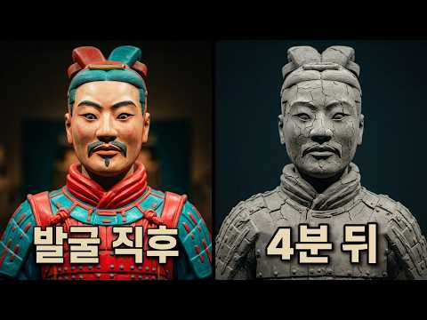
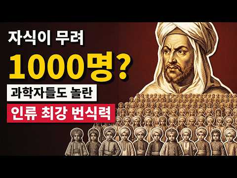
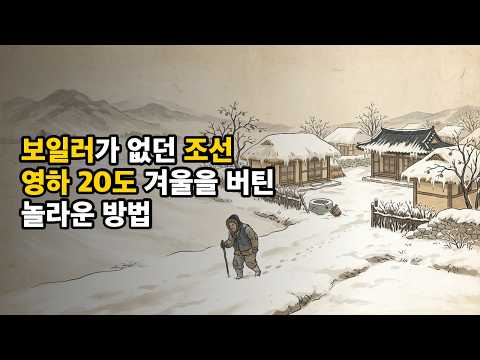
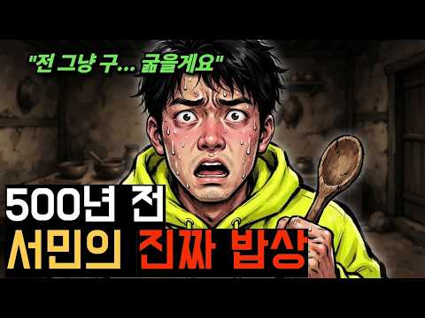
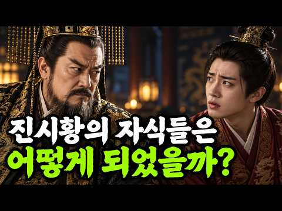
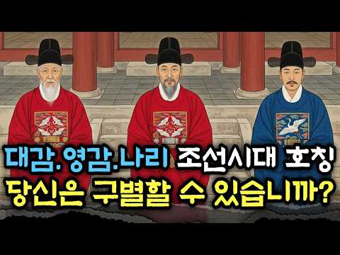
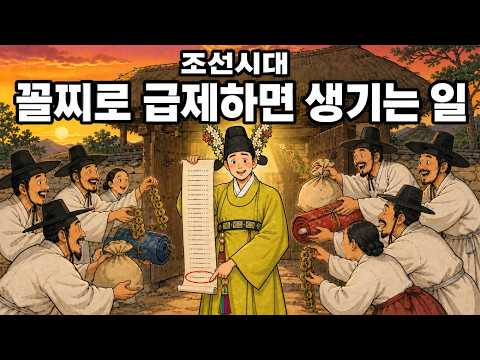
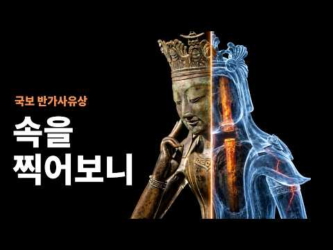
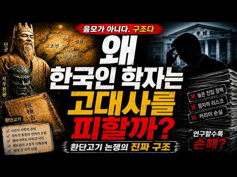

# 역사 — 성공 사례 분석: 사례별 자세히 #1–#40

`analysis.md` 의 9번 (같은 # 번호). 자동 생성 — `tools/success_analysis.py` v1.6 (2026-10-28 10:14 UTC). ※ 연구·교육용 — 투자 권유가 아님.

### 1. 진시황릉을 절대 열지 않는 이유, 황제 무덤을 한 번 열었다가 벌어진 일

- https://www.youtube.com/watch?v=RkJUINfSNkQ · 지식세이렌 · 구독자 1,890 · 조회수 2,664,095 (×1,409.6, 하루 245,372.6) · 좋아요 4,012 (0.1%) · 17.6분 · 2026-10-17 · 주제 묶음 6. 동양사 (중국·일본·몽골) · 형식 정보·해설 (그 밖) · 폴더 `W_RkJUINfSNkQ` (웹 승인)
- 썸네일: 
- 챕터: 0:00 오프닝: 2,200년째 열리지 않은 거대한 무덤 · 1:05 세상을 통일한 황제, 그리고 죽음의 공포 · 4:15 사마천이 기록한 수은의 강과 지하 궁전 · 6:42 우물을 파다 발견된 흙의 군대, 병마용 · 11:05 과학 기술이 있어도 무덤을 열지 않는 진짜 이유 · 12:47 비극으로 끝난 명나라 정릉 발굴의 교훈 · 17:00 마무리: 평범한 산으로 남은 2,200년의 비밀
- 설명 앞부분: 2,200년이 넘는 세월 동안 단 한 번도 열리지 않은 거대한 지하 궁전, 진시황릉. 위치도 알고, 땅속에 거대한 궁전이 있다는 것까지 확인됐지만 중국 정부가 결코 무덤을 열지 않는 진짜 이유는 무엇일까요? 사마천의 기록과 병마용 발굴의 숨겨진 비하인드를 통해 진시황릉의 미스터리를 파헤쳐 봅니다.
- 대본 없음 (설명) — 음성인식이 끝나면 도입부·흐름이 들어감
- 댓글 447/585: 좋은 점 — 영상 3 · 감사·응원 1 · 더 알고 싶은 것 6 · 아쉬운 점 — 영상 0 · 반박·불만 — 의견 다름 17 · 정치·사회 31 · 경험 공유 13 · 구독·다음 기대 0
  - 좋은 점 — 영상 👍4 “구독자 500인데 조회수가 80만.. 역시 내용이 좋으니 구독자는 무의미해지네요.. 정말 좋은 내용이었습니다. 목소리 톤도 좋았고, 정리가 너무 잘되어 있었습니다. 보기 좋았습니다.”
  - 좋은 점 — 영상 👍3 “핵도 만드는 현대에 수은 위험은 무슨ㅋ 요즘같은 시대에 기술이 없어서 못한다는 건 약간 변명 같기도 하고.. 딴 생각이 있는거 같긴 하네^^ 궁금증과 모험심에 잠을 설치는 백인들이라면 벌써 열었다. 여기가 뭐 접근 불가능한 아마존 밀림 한가운데도 아니고;; 다 알려진…”
  - 감사·응원 👍4 “❤ 고맙습니다~ 잘 보았습니다~ 날마다 좋은날 되세요~”
  - 더 알고 싶은 것 👍5 “내년에 시안 갈 예정이에요. 당연히 진시왕릉 병마용갱 보고싶어서요~ 봐도봐도 까먹을 수 있으니 이 영상 오프라인저장해놓고 시안가는 비행기안에서 다시 볼께요 혹시 영상제작에 아즈텍 문명에 대해서도 자세히 다뤄주시면 좋을거 같은게 촌판톨리, 태양숭배등 아직 한국인들에게 …”
  - 더 알고 싶은 것 👍2 “아 ㅡ ㅡ 궁금하다 당장 😊”
  - 반박·불만 — 의견 다름 👍391 “글쎄 왕의 무덤을 지키기 위해 아직까지 발굴을 미룬다는 이해할 수 없는 얘기를 믿으라고? 그것도 중국이란 나라에서?”
  - 반박·불만 — 의견 다름 👍24 “수은 때문이 아닙니다. 진시황이 동이족이에요. 그러니 한족으로 둔갑시켜야 하는데 무덤을 개방하면 그게 힘들어지는거죠. 코디미 같은 일이죠. 당나라 건릉? 거기도 마찬가지 입니다. 당나라 건국을 동이족이 했거던요.”
  - 정치·사회 👍462 “중국인들이 이천년 동안 저걸 안 털었다고? 개가 웃을 소리...”
  - 정치·사회 👍260 “저거 벌써 털렷을것 같은데??? 도굴을 해도 벌써 몇번을해도 햇을텐데.. 2천년동안 저걸 그냥 놔둘 중국인들이 아니다”
  - 경험 공유 👍3 “저무덤이 고구려ㆍ백제 의 무덤 일수있다는 생각은 안해봤나”

### 2. 자식만 1,000명 넘게 낳았다고? 과학자들도 경악한 인류 최강 번식력 왕 TOP 3

- https://www.youtube.com/watch?v=6wJWzIdFLlY · 역사의 인물 · 구독자 205 · 조회수 150,520 (×734.2, 하루 18,191.8) · 좋아요 279 (0.2%) · 17.3분 · 2026-10-20 · 주제 묶음 6. 동양사 (중국·일본·몽골) · 형식 정보·해설 (그 밖) · 폴더 `W_6wJWzIdFLlY` (웹 승인)
- 썸네일: 
- 챕터: 0:00 [part0] 인트로: 조선의 이방원은 명함도 못 내… · 0:41 [part1] TOP 3. 아들 12명을 먼저 보낸 … · 5:40 [part2] TOP 2. 20세기에 자녀 210명,… · 9:56 [part3] TOP 1. 기네스북 공인 1,171명… · 14:25 [part4] 번외: 전 세계 1,600만 명이 그의… · 16:17 [part5] 마무리: 수많은 자식이 남긴 영광과 비극
- 설명 앞부분: 조선 500년 역사에서 자식이 가장 많았던 왕, 태종 이방원(29명). 하지만 세계사로 눈을 돌리면 이 숫자는 시작에 불과합니다. 자식이 100명, 200명은 기본, 자녀 수가 무려 1,171명에 달하는 왕이 있었습니다. 오스트리아 빈 대학 연구진이 "이게 과학적으로 정말 가능한가?"를 밝혀내기 위해 컴퓨터 시뮬레이션까지 돌려 이그노벨상을 받기도 했죠. 단순한 가족을 넘어 왕좌의 보험이자 권력의 상징이었던 상상 초월의 다자녀 왕 TOP 3를 지금 확인해 보세요. 타임라인 (Chapters) 여러분이 보시기에 가장 비현실적이고 충격…
- 같은 채널 평소 대비 ×713.4 (채널 최근 롱폼 중앙값 211회) · 평소 영상: 영의정은 들러리였다? 조선 500년을 뒤흔든 '정3품' 실세의 정체 (215회) / 제국을 무너뜨린 귓속말 한마디 ∣ 황제를 꼭두각시로 만든 여인들 TOP 3 (207회)
- 대본 없음 (설명) — 음성인식이 끝나면 도입부·흐름이 들어감
- 댓글 18/29: 좋은 점 — 영상 0 · 감사·응원 0 · 더 알고 싶은 것 0 · 아쉬운 점 — 영상 0 · 반박·불만 — 의견 다름 1 · 정치·사회 0 · 경험 공유 0 · 구독·다음 기대 0

### 3. 패딩도 보일러도 없던 조선 사람들, 겨울밤엔 대체 어떻게 살아남았을까?

- https://www.youtube.com/watch?v=EfxClhTo9OA · 히든스토리 · 구독자 94 · 조회수 66,232 (×662.3, 하루 6,370.2) · 좋아요 300 (0.4%) · 14.4분 · 2026-10-18 · 주제 묶음 3. 조선 · 형식 야담·옛날이야기 · 폴더 `W_EfxClhTo9OA` (웹 승인)
- 썸네일: 
- 챕터: 0:00 영하 23.1도의 날 · 1:49 조선에도 패딩이? · 2:46 바닥 아래 주인공 · 4:58 학자의 짧은 기록 · 6:12 바닥까지 간 조선 · 8:47 이상한 한 가지 · 10:18 박지원이 본 결점 · 12:45 답이 바뀌셨나요
- 설명 앞부분: 보일러도 패딩도 없던 조선, 17세기 소빙기의 혹독한 겨울을 사람들은 어떻게 버텼을까요? 솜을 누빈 누비옷부터 뜨끈한 온돌 아랫목까지, 조선 사람들의 겨울나기 비밀을 역사 기록으로 따라갑니다. 롱패딩의 가로 박음질과 똑같은 원리로 만든 조선의 누비옷, 머리를 감싼 남바위와 팔을 덮은 토시, 문틈을 막은 문풍지까지. 조선 사람들은 몸 바깥을 겹겹이 막았습니다. 하지만 진짜 주인공은 바닥 아래에 있었습니다. 경복궁 아미산 굴뚝에 남은 온돌의 흔적, 그리고 『성호사설』에 실학자 이익이 남긴 짧은 기록. 옛날에는 온돌방이 한 집에 한두 …
- 같은 채널 평소 대비 ×291.1 (채널 최근 롱폼 중앙값 228회) · 평소 영상: 얼음 한덩이가 금값이던 조선의 여름, 석빙고 이야기 (297회) / 과거에 급제하면 월급이 얼마였을까? 9급 공무원보다 많았을까? (158회)
- 대본 없음 (설명) — 음성인식이 끝나면 도입부·흐름이 들어감
- 댓글 10/16: 좋은 점 — 영상 0 · 감사·응원 0 · 더 알고 싶은 것 0 · 아쉬운 점 — 영상 0 · 반박·불만 — 의견 다름 0 · 정치·사회 0 · 경험 공유 0 · 구독·다음 기대 0

### 4. 당신이 조선 서민의 밥상 앞에서, 한 숟가락도 먹을 수 없는 이유ㅣ조선으로 간다면?

- https://www.youtube.com/watch?v=VfA3xSIyXDE · 다시 만나는 한국사 · 구독자 174 · 조회수 76,058 (×437.1, 하루 8,303.8) · 좋아요 148 (0.2%) · 19.2분 · 2026-10-19 · 주제 묶음 3. 조선 · 형식 정보·해설 (그 밖) · 폴더 `W_VfA3xSIyXDE` (웹 승인)
- 썸네일: 
- 설명 앞부분: 한 번쯤 들어봤지만 제대로 알지 못했던 한국사의 숨겨진 이야기! 흥미로운 사건과 인물들의 이야기를 따라가며, 우리가 몰랐던 역사의 순간들을 새롭게 만나보세요. 알면 알수록 빠져드는 한국사, 지금 함께 확인해보세요! 📖✨
- 같은 채널 평소 대비 ×178.3 (채널 최근 롱폼 중앙값 426회) · 평소 영상: 편의점도 없던 조선에서, 어떻게 생필품을 구했을까? (454회) / '조선 전체 인구의 20% 증발'... 사람이 사람을 먹었던 을병대기근 (399회)
- 대본 없음 (설명) — 음성인식이 끝나면 도입부·흐름이 들어감
- 댓글 7/18: 좋은 점 — 영상 0 · 감사·응원 0 · 더 알고 싶은 것 0 · 아쉬운 점 — 영상 0 · 반박·불만 — 의견 다름 0 · 정치·사회 0 · 경험 공유 0 · 구독·다음 기대 0

### 5. 한글날 100주년 ∣ 한글은 세종대왕이 만들었다. 그럼 한국어는 누가 만들었을까? #한글날 #세종대왕 #한국어역사

- https://www.youtube.com/watch?v=dSyAznnEIHw · 역사의 그날 · 구독자 235 · 조회수 154,910 (×659.2, 하루 7,787.1) · 좋아요 557 (0.4%) · 16.3분 · 2026-10-08 · 주제 묶음 1. 역사 일반·이야기 · 형식 정보·해설 (그 밖) · 폴더 `W_dSyAznnEIHw` (웹 승인)
- 썸네일: 
- 챕터: 0:00 한글보다 먼저 있었던 우리말 · 1:48 고려의 말을 받아 적은 사신 · 4:02 서동요와 삼국 사람들의 말 · 6:20 세종대왕 앞에 선다면 통할까 · 7:30 희미해지는 한국어의 과거 · 8:41 한국어는 누가 만들었을까 · 10:02 한글 창제와 최만리의 반대 · 12:46 원이 엄마가 남긴 한글 편지 · 14:02 한글날이 기념하는 것
- 설명 앞부분: 한글은 세종대왕이 만들었습니다. 그런데 세종대왕이 태어나던 날, 주변 사람들은 이미 우리말로 축하 인사를 건네고 있었습니다. 한글을 만들 사람이 이제 막 태어났는데, 그 사람들은 이 말을 누구에게 배웠을까요? 한글이 없던 시절의 우리말은 다른 글자를 빌려 적은 기록 속에 조각으로 남아 있습니다. 고려에 온 송나라 사신이 받아 적은 낱말, 신라의 골목에 퍼졌던 노래, 그리고 중국 역사책에 남은 삼국의 말 이야기까지. 그 흔적을 따라 한국어의 과거로 거슬러 올라가 봅니다. 타임라인 본 영상의 일부는 AI 기술을 활용하여 제작되었습니다.
- 같은 채널 평소 대비 ×634.9 (채널 최근 롱폼 중앙값 244회) · 평소 영상: 사과 한 알은 왜 전쟁이 되었나｜트로이 전쟁부터 귀향까지, 오디세우스의 진짜 이야기 (244회) / 심장의 수명이 고작 25살? 인간이 깨부순 ‘심장박동 총량의 법칙’｜심장 의학의 역사 #… (195회)
- 대본 없음 (설명) — 음성인식이 끝나면 도입부·흐름이 들어감
- 댓글 51/64: 좋은 점 — 영상 0 · 감사·응원 2 · 더 알고 싶은 것 1 · 아쉬운 점 — 영상 0 · 반박·불만 — 의견 다름 2 · 정치·사회 3 · 경험 공유 1 · 구독·다음 기대 0
  - 감사·응원 👍5 “감사합니다 잘보았습니다 ^^”
  - 감사·응원 👍2 “고맙습니다”
  - 더 알고 싶은 것 👍4 “세종대왕 같은 지도자가 언제 다시 나올까요?”
  - 반박·불만 — 의견 다름 👍2 “애초에 세종이 한글을 만들었다는 것은 틀렸음. 이상하게 어느 순간부터 세종 혼자서 만든 것으로 둔갑했는데 언어연구의 중요한 분야인 음운연구를 위하여 성삼문과 신숙주가 만주를 13번이나 갔다 왔음. 이들만 아니라 다른 집현전 학사들의 역할도 있었음. 물론 당시의 시대적…”
  - 반박·불만 — 의견 다름 👍0 “말은 자연 시작되며 변하는거 아닌가요 어느순간 탁 탄생되는건 아니죠”
  - 정치·사회 👍8 “영상 상당히 잘 만들었네요. 알타이 어족 이야기도 그대로 인정 안하고 사실 관계를 따지는 것과 집현전 학자들과 싸우면거 밀고 나간 이야기들… 결국 훈민정음 세계문화유산… 외국인들 진짜 최신의 본격 인공문자에 감탄하고 연구할듯…”
  - 정치·사회 👍1 “조선글은 세종대왕이 만들었고 충분히 자랑스러운 역사야,하지만 세종대왕이 뚝딱하고 무에서 유를 창조했다고 생각했다면 그건 당신들만의 착각. 조선글을 만드는 과정에서 중국한자를 참고했고 음 역시 중국어를 참고한거다,애초에 조선글을 만든 자체가 평민들을 중국인들과 교류해라…”

### 6. 진시황릉 안 여는 이유, 중국이 먼저 연 황제 무덤에 있었다

- https://www.youtube.com/watch?v=guOJNdkFSNk · 진실백과 · 구독자 551 · 조회수 404,675 (×734.4, 하루 16,783.3) · 좋아요 1,524 (0.4%) · 17분 · 2026-10-04 · 주제 묶음 6. 동양사 (중국·일본·몽골) · 형식 정보·해설 (그 밖) · 폴더 `W_guOJNdkFSNk` (웹 승인)
- 썸네일: 
- 챕터: 0:00 진시황릉을 열지 못하는 진짜 이유 · 0:46 사마천이 기록한 수은 강의 비밀 · 2:27 시험 삼아 파 본 황제의 무덤, 정릉 · 3:35 지하궁전 입구를 찾다 · 4:31 꺼지지 않는 등불은 왜 꺼졌을까? · 5:46 며칠 만에 썩어 버린 비단옷 · 6:44 정릉의 관은 어디로 갔을까? · 7:43 측천무후 무덤을 열자는 계획 · 8:31 문화대혁명과 황제의 유골 · 10:21 발굴대장의 뒤늦은 후회 · 11:25 땅을 파지 않고 들여다본 진시황릉 · 12:18 하룻밤 만에 판 백제 왕의 무덤 · 13:16 돌판에 새겨진 이름 · 14:40 밤을 새운 발굴단 · 15:33 왜 아직도 진시황릉은 닫혀 있을까?
- 설명 앞부분: 진시황릉은 이천 년 넘게 닫혀 있습니다. 흔히 수은 때문이라고 하지만, 중국이 황제 무덤을 파지 않기로 한 건 진시황릉이 아니라 먼저 연 다른 황제 무덤에서 겪은 일 때문이었습니다. 중국은 명나라 만력제의 무덤 정릉을 시험 삼아 열었습니다. 문을 열자 금관과 비단옷이 그대로 남아 있었는데, 그 뒤 땅 위에서 세 가지가 차례로 사라졌습니다. 같은 일이 충청남도 공주의 백제 무령왕릉에서도 하룻밤 사이에 벌어졌습니다. 정릉에서 무엇이 어떤 순서로 사라졌는지, 그 뒤 중국이 진시황릉 앞에서 어떤 방침을 세웠는지, 무령왕릉 발굴단은 왜 열…
- 같은 채널 평소 대비 ×1,001.7 (채널 최근 롱폼 중앙값 404회) · 평소 영상: 사브르, 다리 베도 점수 없는 건 말 때문이 아니었다 ∣ 펜싱 아시안게임 (404회) / 한글 자판, 안과 의사가 만든 가장 빠른 타자기는 표준에서 떨어졌다 (410회)
- 대본 없음 (설명) — 음성인식이 끝나면 도입부·흐름이 들어감
- 댓글 114/120: 좋은 점 — 영상 0 · 감사·응원 1 · 더 알고 싶은 것 1 · 아쉬운 점 — 영상 0 · 반박·불만 — 의견 다름 0 · 정치·사회 6 · 경험 공유 3 · 구독·다음 기대 0
  - 감사·응원 👍2 “진짜 궁금하고 의아했었습니다. 정말 감사드립니다.”
  - 더 알고 싶은 것 👍1 “진시왕릉 맞나요? 중국이나 일본이나 자기들 불리하면 공개 안하던데 상투는 동이의 흔적이다.”
  - 정치·사회 👍23 “발굴영상 본적이 있죠 시신은 버려져 들개들이 물고 다녔어요 황제가 중국인이 아닌겁니다 증거인멸 하는겁니다”
  - 정치·사회 👍10 “수은? 구라다. 이미 도굴을 당할만큼 당해서 그 무덤안에는 아무것도 없어..물론 수은이 없다는 말이 아니라 수은이 그토록 절대적일까? 진시황 영정의 무덤이 2천년넘게 존재했는데 그 약삭빠르고 돈이라면 환장한 중국인들이 도굴을 하지 않았다고 믿는다면 당신은 순진한 것이…”
  - 경험 공유 👍21 “예전 광산일 할때 발파 끝난뒤 옆쪽으로 천연동굴이 발견되었다 들어가보니 ,불빛에 반짝이는 석화 ,석순 ,종류석 너무 아름다워서 보석 방에 들어온것마냥 반작반짝 빛나는 모습에 ,,너도나도 자칫 손대면 가루가되는 석화는 냅두고 석순 ,종류석등을 깨가지고 나왔다 ,,헌데 …”
  - 경험 공유 👍2 “진짜 궁금하고 의아했었습니다. 정말 감사드립니다.”

### 7. 측천무후 무덤을 절대 열지 않는 이유, 입구를 한 번 찾았다가 벌어진 일

- https://www.youtube.com/watch?v=H2CA284tnpw · 지식세이렌 · 구독자 1,890 · 조회수 381,637 (×201.9, 하루 50,792.9) · 좋아요 770 (0.2%) · 15.3분 · 2026-10-20 · 주제 묶음 기타 · 형식 정보·해설 (그 밖) · 폴더 `W_H2CA284tnpw` (웹 승인)
- 썸네일: 
- 챕터: 0:00 오프닝: 곡괭이 끝에 걸린 쇳물 봉인 돌문 · 1:39 열네 살 소녀가 중국 유일의 여황제가 되기까지 · 4:21 산 하나가 통째로 무덤, 건릉 · 5:15 1,300년 동안 열리지 않은 세 가지 이유 · 7:43 쇳물로 엮은 63미터 돌벽의 정체 · 9:11 털리고 남은 공주의 무덤이 말해 주는 것 · 10:55 입구를 찾고도 다시 덮은 이유 · 12:52 글자 없는 비석과 마지막 유언 · 14:50 마무리: 황제인가, 황후인가
- 설명 앞부분: 1,300년 동안 단 한 번도 열리지 않은 여황제의 무덤, 건릉. 1958년, 돌을 캐던 마을 사람들이 쇳물로 봉인된 입구를 찾아냈지만 중국은 그 문을 다시 흙으로 덮어 버렸습니다. 당나라 황제릉이 거의 다 털리는 동안 이 무덤만 살아남은 이유, 그리고 입구를 찾고도 열지 않는 진짜 이유를 측천무후의 일생과 함께 파헤쳐 봅니다.
- 대본 없음 (설명) — 음성인식이 끝나면 도입부·흐름이 들어감
- 댓글 29/38: 좋은 점 — 영상 1 · 감사·응원 1 · 더 알고 싶은 것 1 · 아쉬운 점 — 영상 1 · 반박·불만 — 의견 다름 0 · 정치·사회 4 · 경험 공유 1 · 구독·다음 기대 0
  - 좋은 점 — 영상 👍6 “유익한 도움에 감사 드립니다.!!🙏🙆‍♂️🙋‍♂️💕💕”
  - 감사·응원 👍6 “유익한 도움에 감사 드립니다.!!🙏🙆‍♂️🙋‍♂️💕💕”
  - 아쉬운 점 — 영상 👍4 “측천무후를 드라마로 흥미롭게 관람 했었는데 그런사연이 있었군요 지루하지 않게 해설을 잘해주셔서 도움 됐습니다 AI 목소리가 아니여서 더 편한마음 으로 잘들었고 구독,좋아요 꾸욱 누르고 갑니다..수고하셨습니다”
  - 경험 공유 👍4 “측천무후를 드라마로 흥미롭게 관람 했었는데 그런사연이 있었군요 지루하지 않게 해설을 잘해주셔서 도움 됐습니다 AI 목소리가 아니여서 더 편한마음 으로 잘들었고 구독,좋아요 꾸욱 누르고 갑니다..수고하셨습니다”

### 8. 조선 궁궐 사람들은 한겨울을 어떻게 났을까? 실록에 남은 나인과 군사들의 혹독한 겨울

- https://www.youtube.com/watch?v=z_GZNlpBCEs · 인류 타임슬립 · 구독자 366 · 조회수 255,897 (×699.2, 하루 9,638.6) · 좋아요 539 (0.2%) · 13분 · 2026-10-01 · 주제 묶음 3. 조선 · 형식 정보·해설 (그 밖) · 폴더 `W_z_GZNlpBCEs` (웹 승인)
- 썸네일: 
- 챕터: 0:00 궁궐 뜰에서 숨진 군사 · 0:32 인류 타임슬립 · 1:05 1425년, 성균관 유생들의 온돌 · 1:40 양반 큰 집에도 온돌은 한두 칸 · 2:10 1539년, 중종과 빈 가마니 · 3:15 1554년, 다시 대궐 뜰 · 3:43 1576년, 마루방에서 자려 한 선조 · 4:09 마루방에서 겨울을 난 나인들 · 5:02 1623년, 벌집처럼 늘어난 온돌 · 5:29 1624년, 이원익이 들은 나인들의 말 · 6:13 1636년, 윤황과 신하들의 말다툼 · 7:05 1636년, 솜옷을 나눠 주던 날 · 7:47 1647년, 한밤에 내보낸 사람들 · 8:49 1662년, 궁궐 땔나무의 값 · 9:48 1683년, 송시열의 청과 숙종 · 10:18 1692년, 눈보라 치는 밤 · 10:43 1746년, 온돌을 만들려는 군사들 · 11:12 1783년, 시험장이 된 온돌방 · 11:34 1790년, 정조가 한 말 · 12:07 다시 대궐 뜰
- 설명 앞부분: 1554년 12월, 조선 궁궐 뜰에서 밤을 지키던 군사 한 명이 숨집니다. 명종은 필시 얼어 죽었을 거라고 했어요. 같은 궁궐 안, 왕을 모시던 나인들은 옛 규례대로 온돌이 아니라 나무판을 깐 마루방에서 겨울을 났습니다. 세종이 성균관 유생들에게 내준 온돌, 중종이 문 앞 군사들에게 내준 빈 가마니, 벌집처럼 늘어난 궐 안 온돌을 두고 오간 신하들의 말, 송시열의 청과 숙종의 대답, 그리고 솜옷 한 벌까지 이름을 맞춰 가며 나눠 준 날의 기록까지. 조선 궁궐의 따뜻한 방이 누구 차지였는지 가장 오래된 기록부터 차례로 따라가 봅니다…
- 같은 채널 평소 대비 ×211.1 (채널 최근 롱폼 중앙값 1,212회) · 평소 영상: 3천3백 년 전 고대 이집트는 얼마나 더웠을까? 우물 없는 마을의 한여름 하루 (1,429회) / 화살 맞기 두 시간 전, 그는 고기를 먹고 있었다 ∣ 5,300년 전 알프스 얼음 속 남… (995회)
- 대본 없음 (설명) — 음성인식이 끝나면 도입부·흐름이 들어감
- 댓글 32/55: 좋은 점 — 영상 0 · 감사·응원 0 · 더 알고 싶은 것 1 · 아쉬운 점 — 영상 0 · 반박·불만 — 의견 다름 1 · 정치·사회 1 · 경험 공유 1 · 구독·다음 기대 0
  - 정치·사회 👍6 “이게 다 신라 때문이야 신라의 사대주의 아니었으면 고구려 문명이 유지되어 훨씬 좋은 나라가 되었을텐데”
  - 경험 공유 👍9 “궁궐의 한옥이 잘못된 게 아니고 그 당시 전세계가 소 빙하기를 겪었습니다. 지구의 온도가 많이 내려가서 농작물 대흉작으로 많이들 굶어 죽었죠. 지금도 그렇지만 아파트에서도 난방 안 하면 춥듯이 원래부터 겨울은 춥게 지내는 게 일상이었고 당연하게 받아들였을 겁니다. 다…”

### 9. [중국 역사] 진시황의 자식들의 비참한 최후! ∣ 역사 인물

- https://www.youtube.com/watch?v=Ie2nMmmHwXY · 천하역사록 · 구독자 754 · 조회수 350,511 (×464.9, 하루 17,372.2) · 좋아요 952 (0.3%) · 29.8분 · 2026-10-08 · 주제 묶음 6. 동양사 (중국·일본·몽골) · 형식 정보·해설 (그 밖) · 폴더 `W_Ie2nMmmHwXY` (웹 승인)
- 썸네일: 
- 설명 앞부분: 천하를 처음으로 통일한 황제, 진시황. 그는 자신의 핏줄이 2세, 3세를 거쳐 만세까지 천하를 다스릴 것이라 선언했습니다. 그러나 진시황이 세상을 떠나고 겨우 1년 남짓 만에, 스무 명이 넘던 그의 자식들은 거의 모두 사라졌습니다. 맏아들 부소는 아버지의 이름으로 온 가짜 조서를 받고 스스로 목숨을 끊었고, 황자 열두 명은 함양의 저잣거리에서, 공주 열 명은 두현에서 죽임을 당했습니다. 그리고 형제들을 모두 죽이고 황제가 된 막내 호해는, 3년 뒤 평민으로라도 살게 해 달라고 애원하다 생을 마쳤습니다. 진시황은 왜 끝내 후계자를 …
- 같은 채널 평소 대비 ×11.3 (채널 최근 롱폼 중앙값 30,935회) · 평소 영상: [중국 역사] 중국 4대 악녀 몰아보기 ∣ 여태후, 측천무후, 서태후, 가남풍 (57,499회) / 중국 역사상 최강의 장수 TOP4 ∣ 1위는 여포가 아니다 ∣ 역사인물 (138,094회)
- 대본 없음 (설명) — 음성인식이 끝나면 도입부·흐름이 들어감
- 댓글 19/19: 좋은 점 — 영상 1 · 감사·응원 0 · 더 알고 싶은 것 0 · 아쉬운 점 — 영상 2 · 반박·불만 — 의견 다름 0 · 정치·사회 0 · 경험 공유 0 · 구독·다음 기대 0
  - 아쉬운 점 — 영상 👍8 “김정남 외국으로 돌렸다가 결국 돌아오지 못했지. 견훤도 비슷했고 어차피 역사는 반복되지.”
  - 아쉬운 점 — 영상 👍3 “듣기싫은 AI목소리가 아니라서 좋네요”

### 10. 조선시대 호칭 하나에 목숨이 달렸다? 대감 vs 영감, 두 글자 차이의 진실 ∣ 조선 관직 체계 완벽 정리

- https://www.youtube.com/watch?v=e8tP6Oe_c-I · 역사의파도 · 구독자 678 · 조회수 424,940 (×626.8, 하루 13,493.1) · 좋아요 1,561 (0.4%) · 21.4분 · 2026-09-26 · 주제 묶음 3. 조선 · 형식 정보·해설 (그 밖) · 폴더 `W_e8tP6Oe_c-I` (웹 승인)
- 썸네일: 
- 설명 앞부분: 🔍 대감이랑 영감, 누가 더 높은지 알고 계셨나요? 조선의 관직은 정1품부터 종9품까지 총 18단계. 그런데 이 18개의 계급을 부르는 호칭은 딱 세 개뿐이었습니다. 대감, 영감, 나리. 사장님한테 "과장님"이라고 불렀다고 생각해보세요. 지금이야 민망한 정도로 끝나지만, 조선에서는 그 한마디에 벼슬이 날아갈 수도 있었습니다. 💡 알고 보면 더 재밌는 포인트 같은 빨간 관복인데 대감과 영감을 구분하는 방법 → 흉배의 동물 수 "마마"와 "마마님"은 완전히 다른 호칭 제사를 올리려면 최소 7품 이상이어야 했던 세상 관찰사(도지사급)와…
- 같은 채널 평소 대비 ×318.8 (채널 최근 롱폼 중앙값 1,333회) · 평소 영상: 400년 전 조선의 명절｜설날과 추석은 지금과 완전히 달랐습니다 (1,333회) / 중국 인구는 왜 14억이 됐을까? ∣ 인도에 세계 1등을 내준 이유 (1,161회)
- 대본 없음 (설명) — 음성인식이 끝나면 도입부·흐름이 들어감
- 댓글 106/110: 좋은 점 — 영상 0 · 감사·응원 1 · 더 알고 싶은 것 0 · 아쉬운 점 — 영상 0 · 반박·불만 — 의견 다름 0 · 정치·사회 6 · 경험 공유 3 · 구독·다음 기대 0
  - 감사·응원 👍2 “형태가 바뀌어 남아있다에 한표! 구독 눌렀습니다 감사합니다 화이팅!!”
  - 정치·사회 👍15 “이중 영감이란 호칭은 대한민국까지 이어져서 건국이후에 판검사들을 영감이라했죠. 그래서 1962년당시 군사정부에서는 이영감호칭이 국민들과 위화감을 조성한다해서 법으로 금지시켰고 그법이 지금까지 지켜지고 있는 것입니다.”
  - 정치·사회 👍1 “썩어빠진 조선시대 호칭.그러니 나라가 이 지경이지.”

### 11. 조선시대 꼴찌로 급제하면 생기는 일 ∣ 잔치 빚은 똑같이, 장원 자리까지 8년

- https://www.youtube.com/watch?v=zn_Zh0UIhSI · 역사잇수다 · 구독자 1,190 · 조회수 270,851 (×227.6, 하루 23,664.9) · 좋아요 954 (0.4%) · 8.5분 · 2026-10-16 · 주제 묶음 3. 조선 · 형식 브이로그·직접 해본 이야기 · 폴더 `W_zn_Zh0UIhSI` (웹 승인)
- 썸네일: 
- 챕터: 0:00 꼴찌로 합격했다면 · 0:47 꼴찌도 어사화를 받았을까? · 1:40 33명의 출발선: 갑과·을과·병과 · 2:21 합격하고도 발령 대기, 수습 관리 · 3:10 잔치 빚과 녹봉 살림 · 3:57 조선 후기, 더 길어진 줄 · 4:27 무과의 '라인': 95.2% vs 52.8% · 5:15 83세 박문규의 반전 · 6:47 그래도 이 시험에 인생을 건 이유, 홍패 · 8:07 여러분의 선택은?
- 설명 앞부분: 만약 여러분이 오늘, 조선 최고의 시험에 꼴찌로 합격했다면? 장원과 똑같이 어사화를 꽂고, 똑같이 잔치를 열고, 똑같이 빚을 졌습니다. 그런데 그 빚을 갚을 길은 몇 년씩 늦게 열렸습니다. 170년 동안 집안이 지켜온 꼴찌권 급제자의 어사화, 합격하고도 발령을 기다려야 했던 수습 관리들, 그리고 병과로 붙어 하루 만에 정3품에 오른 83세 노인까지. 기록으로 따라가 봅니다. 1편: 조선시대 장원급제하면 생기는 일 📚 참고 자료 국립민속박물관 소장 어사화(민속050505), 국립민속박물관 학예연구사 글 한국민족문화대백과사전 「전시」…
- 대본 없음 (설명) — 음성인식이 끝나면 도입부·흐름이 들어감
- 댓글 219/245: 좋은 점 — 영상 2 · 감사·응원 3 · 더 알고 싶은 것 5 · 아쉬운 점 — 영상 0 · 반박·불만 — 의견 다름 2 · 정치·사회 4 · 경험 공유 4 · 구독·다음 기대 0
  - 좋은 점 — 영상 👍1 “목소리가 귀에 잘 안 들어와요.”
  - 감사·응원 👍1 “난 꼴지라도 합격하면 하늘신 땅신 다 감사한다... 서울대 꼴지라도 서울대''다.. 과거 합격해서 발령이 나지 않거나, 길어져도, 먹고 산다.. 동네 진사만 되어도 하늘을 날아간다... 나 어릴적 삼랑진인가에서 동네초시 어른 있었다. 연세 많은분이었는데.. 초시만 해…”
  - 더 알고 싶은 것 👍1 “빨리 다음영상 올려주세뇨 ㅠㅠ”
  - 더 알고 싶은 것 👍1 “권율도 46세인가에 과거 보고 병과에 급제한걸요 솔직히 지방시인 소과 대과는 언제 치뤘는 지도 궁금합니다 소과랑 대과를 치뤄야 한성에서 치루는 시험을 칠 수 있다고 알고 있는 데 거의 낼모레 무덤에 들어 갈 사람이 시험 치룬거나 진배없기에 참 모를 일입니다”
  - 반박·불만 — 의견 다름 👍1 “꼴찌가 아닙니다. 야....과거라니까? 행정고시 외무고시 합격이라니까? 꼴찌가 어딧어.... 한국은행 합격이라니까?”
  - 정치·사회 👍3 “원래 너무 잘나가면 견제로 찍혀서 못나간다는 말이 있더라. 대표적으로 미국의 아이언젠하워가 나중에 원수가 되며 대통령 까지 되었는데. 아이젠하워는 성적이 우수하지도 않았고 오랜기간 소령으로만 머물며 승진도 느린편이였음. 하지만 나중에 정부에 필요한 인재로 판단되어 초…”
  - 정치·사회 👍1 “부정부패의 원인을 제공했구먼. 그러니 나라가 망하죵? 최근 정치판 꼬라지도 다를 바 없는 듯?”
  - 경험 공유 👍2 “어허 빠르시네요 꼴찌에 이어서 나가리까지 챙기는 섬세한 채널장 흥하시길 조회수 보니 내가 더 뿌듯”
  - 경험 공유 👍2 “저도 사람들이 많이 떨어지는 국가시험에서 한번에 합격했죠. 바로 운전면허증 하하하”

### 12. 13분만에 보는 518년의 조선 역사

- https://www.youtube.com/watch?v=earKPFklnV8 · 재미난역사이야기 · 구독자 307 · 조회수 113,969 (×371.2, 하루 5,307.8) · 좋아요 290 (0.2%) · 13.7분 · 2026-10-06 · 주제 묶음 1. 역사 일반·이야기 · 형식 정보·해설 (그 밖) · 폴더 `W_earKPFklnV8` (웹 승인)
- 썸네일: 
- 설명 앞부분: 1392년에 태어나 1910년에 사라진 조선. 27명의 왕이 518년 동안 다스린 이 나라는, 비가 많이 와서 강을 못 건넌 장군이 군대를 통째로 돌리면서 시작됐습니다. 나라 이름을 명나라 황제에게 골라 달라고 한 일, 아들이 동생들을 죽이고 왕이 된 일, 고기가 없으면 밥을 못 먹던 세종이 28글자를 만든 일, 13척으로 133척을 막은 이순신, 12만 대군 앞에서 47일을 버틴 남한산성, 커피에 아편을 탄 통역관까지. 조선이 어쩌다 한 왕조의 처음에서 끝까지 가게 됐는지, 13분 만에 쉽게 따라가 보세요. 혼일강리역대국도지도(…
- 대본 없음 (설명) — 음성인식이 끝나면 도입부·흐름이 들어감
- 댓글 27/47: 좋은 점 — 영상 0 · 감사·응원 0 · 더 알고 싶은 것 0 · 아쉬운 점 — 영상 0 · 반박·불만 — 의견 다름 0 · 정치·사회 2 · 경험 공유 1 · 구독·다음 기대 0
  - 정치·사회 👍3 “조선은 뿌리가 무신정권 이지요.”
  - 경험 공유 👍0 “내가 101번째 ㅎ”

### 13. 박물관은 왜 이 두 불상에게만 방 하나를 내줬을까

- https://www.youtube.com/watch?v=7YQYE2IBtoU · 사소한 역사이야기 · 구독자 1,150 · 조회수 522,382 (×454.2, 하루 19,702.3) · 좋아요 1,879 (0.4%) · 5.9분 · 2026-10-01 · 주제 묶음 1. 역사 일반·이야기 · 형식 정보·해설 (그 밖) · 폴더 `W_7YQYE2IBtoU` (웹 승인)
- 썸네일: 
- 챕터: 0:00 질문 · 0:32 겉을 들여다보다 · 2:00 속을 들여다보다 · 3:45 방이 답하다 · 5:26 에필로그 · 사유의 방에 가면
- 설명 앞부분: 국립중앙박물관 2층, 사유의 방. 넓은 방에 놓인 것은 단 두 점의 반가사유상입니다. 2015년 감마선으로 들여다본 두 불상의 속에는, 겉에서는 보이지 않는 장인의 고민이 남아 있었습니다. ※ 국립중앙박물관 상설전시관(사유의 방 포함)은 현재 무료이며, 2027년부터 유료화가 예정되어 있습니다. ※ 공방·주조 장면은 기록을 바탕으로 재현한 이미지입니다. 참고: 국립중앙박물관 감마선·성분 분석(2015) / 경향신문 2021.02.23 / 서울신문 2022.01.26 / 불광미디어
- 대본 없음 (설명) — 음성인식이 끝나면 도입부·흐름이 들어감
- 댓글 60/63: 좋은 점 — 영상 1 · 감사·응원 3 · 더 알고 싶은 것 0 · 아쉬운 점 — 영상 1 · 반박·불만 — 의견 다름 4 · 정치·사회 0 · 경험 공유 0 · 구독·다음 기대 0
  - 좋은 점 — 영상 👍11 “앞으로도 좋은 이야기 기대해봅니다.”
  - 감사·응원 👍13 “와 진짜 좋은채널이다 훌륭하다 응원합니다”
  - 아쉬운 점 — 영상 👍8 “정면에서 사진 찍는 사람들이 많아서 뒷쪽으로 돌아가 등을 보는 게 괜히 눈치 보이고 어찌 어찌 용기 내 뒤로 가더라도, 앞쪽 사진 찍는 사람들 때문에 오래 보고 서 있기가 쉽지 않았다 360도 관람이 크게 의미 없단 느낌이었다.(그럼에도 당당히 봤어야 헀나? 하는 아…”
  - 반박·불만 — 의견 다름 👍4 “글쎄... 요즘은 어떤지 모르겠지만... 관람객 많은 날은 어찌나 시끄러운지!!!”
  - 반박·불만 — 의견 다름 👍4 “78호 등 뒤에 반타원형 구리판이 덧대어 있는데, 그게 청동을 부을 때 뚫린 구멍을 막은 자리라고? 첫째 덧댄 부분의 구멍 자리를 다르게 표시했다. 화면에서 나온 것보다 훨씬 더 위쪽이다. 둘째, 청동 부을 때 뚫린 구멍이라는 표현 자체가 모호한데, 주조 결함으로 불…”

### 14. 이순신 장군에게 초코파이를 드렸더니…

- https://www.youtube.com/watch?v=As36MA96C-8 · 타임슬립극장 · 구독자 168 · 조회수 58,954 (×350.9, 하루 2,755.8) · 좋아요 343 (0.6%) · 7.7분 · 2026-10-07 · 주제 묶음 3. 조선 · 형식 정보·해설 (그 밖) · 폴더 `W_As36MA96C-8` (웹 승인)
- 썸네일: 
- 설명 앞부분: "노도 돛도 없는데, 어찌 나아가느냐?" 명량해전을 앞둔 1597년의 이순신 장군을 2026년 대한민국 해군기지에 모셔왔습니다. 쇠로 만든 군함, 수백 리 밖을 보는 레이더, 수병들과 함께 먹는 점심 한 끼. 그리고 배에 적힌 이름 하나. 여러분이라면 장군님께 무엇을 가장 먼저 보여드리고 싶나요? 다음엔 누구를 모셔올지도 댓글로 남겨주세요. ※ 본 영상은 AI를 활용해 제작한 시간여행 창작 영화입니다. 등장인물의 대사와 사건은 상상으로 구성했습니다.
- 대본 없음 (설명) — 음성인식이 끝나면 도입부·흐름이 들어감
- 댓글 30/33: 좋은 점 — 영상 0 · 감사·응원 1 · 더 알고 싶은 것 1 · 아쉬운 점 — 영상 0 · 반박·불만 — 의견 다름 1 · 정치·사회 0 · 경험 공유 0 · 구독·다음 기대 0
  - 감사·응원 👍10 “각박한 세상에 이순신 장군님 ai영상이 감동에 감격에 눈물나도록 만드네요 감사합니다”
  - 더 알고 싶은 것 👍1 “2차 동학 농민의 일본군사들과의 항쟁을 작품부탁드립니다”
  - 반박·불만 — 의견 다름 👍4 “와... 눈물 나뿌네 마지막에 ㅠㅠ 이런분이 100원 짜리에 계시는게 말도 안됨 ㅠㅠ”

### 15. 조선에서 돌아온 일본 장수들은 왜 2년 만에 세키가하라에서 싸웠나? ∣ 지도로 보는 임진왜란 그 후 1편

- https://www.youtube.com/watch?v=RXflUwO13U8 · Terra Scripta · 구독자 1,820 · 조회수 368,076 (×202.2, 하루 29,802.7) · 좋아요 530 (0.1%) · 12.1분 · 2026-10-16 · 주제 묶음 3. 조선 · 형식 애니메이션·지도 · 폴더 `W_RXflUwO13U8` (웹 승인)
- 썸네일: 
- 챕터: 0:00 질문 — 같은 편이던 장수들은 왜 서로 칼을 겨눴나 · 0:46 히데요시의 죽음 · 1:36 조선에서 생긴 원한 · 2:59 1600년 여름, 두 편으로 갈라지다 · 4:03 세키가하라 분지 · 4:51 안개 속의 포진 · 5:48 개전 · 6:27 세 갈래의 격전 · 7:20 마쓰오산의 배반 · 8:18 무너지는 서군 · 8:59 시마즈의 퇴각 · 9:50 조선에서 싸운 장수들의 운명 · 10:59 정리 · 11:43 엔딩
- 설명 앞부분: 1600년 10월 21일, 교토와 에도 사이의 작은 분지 세키가하라. 안개 속에서 마주 선 두 군대에는 임진왜란 때 조선을 침략했던 장수들이 있었습니다. 고니시 유키나가와 우키타 히데이에는 이시다 미쓰나리의 서군에, 구로다 나가마사와 후쿠시마 마사노리는 도쿠가와 이에야스의 동군에 섰습니다. 조선에서 같은 편으로 싸웠던 장수들은 왜 2년 만에 서로에게 칼을 겨눴을까요? 히데요시의 죽음, 울산성 보고가 남긴 원한, 칠장 사건, 두 편으로 갈라진 1600년 여름, 그리고 세키가하라의 포진과 고바야카와의 배반, 시마즈의 퇴각까지 지도 위…
- 같은 채널 평소 대비 ×28.1 (채널 최근 롱폼 중앙값 13,096회) · 평소 영상: 명나라는 어떻게 2년 만에 요하 동쪽을 잃었나? 개원·철령·심양·요양 함락 ∣ 지도로 보… (15,150회) / 임진왜란 뒤 조선은 왜 원수의 나라에 200년 동안 사신을 보냈나? ∣ 지도로 보는 임진… (11,042회)
- 대본 없음 (설명) — 음성인식이 끝나면 도입부·흐름이 들어감
- 댓글 48/50: 좋은 점 — 영상 0 · 감사·응원 1 · 더 알고 싶은 것 0 · 아쉬운 점 — 영상 1 · 반박·불만 — 의견 다름 1 · 정치·사회 3 · 경험 공유 3 · 구독·다음 기대 0
  - 감사·응원 👍7 “햐 , 이 엄청난 콘텐츠를 우연히 보게 되었네요 😂 감사해요 ~”
  - 아쉬운 점 — 영상 👍1 “사실 이에야스는 아이즈에 100만석 넘는 우에스기랑 시나노에 사나다 달아놓고 세키가하라부터 달려온 셈이라 이시다 지부노쇼가 좀만 더 인망이 있었어도, 단번에 어이없게 결착만 안났어도 장성한 히데요리의 천하를 볼수 있었다는게 좀 아쉬움”
  - 반박·불만 — 의견 다름 👍1 “사실 이에야스는 아이즈에 100만석 넘는 우에스기랑 시나노에 사나다 달아놓고 세키가하라부터 달려온 셈이라 이시다 지부노쇼가 좀만 더 인망이 있었어도, 단번에 어이없게 결착만 안났어도 장성한 히데요리의 천하를 볼수 있었다는게 좀 아쉬움”
  - 정치·사회 👍1 “정작 세키가하라 전투에서 이에야스의 본대인 히데타다가 이끄는 병력은 전투 끝나고 사후수습 다 끝나고 나서야 도착했다는거 그리고 정작 세키가하라 전투에서 초장에 서로 죽어라 싸우던 장수들은 아이러니하게도 히데요시의 총신들 문신파와 무신파들이죠 저기 동군 배치된 장수중에…”
  - 경험 공유 👍2 “히데요시 사후 히데요시 추종세력과 이에야스와의 패권 쟁탈전이 바로 세끼가하라 전투다. 히데요시가 죽은 이상 이에야스에 대적할 놈은 없다. 나머지 전부 오합지졸들이다. 이에야스는 히데요시가 오늘 내일 한다는 사실을 알고 있었고 디질때까지 참고 인내하고 아부를 떨고 있었…”
  - 경험 공유 👍1 “정작 세키가하라 전투에서 이에야스의 본대인 히데타다가 이끄는 병력은 전투 끝나고 사후수습 다 끝나고 나서야 도착했다는거 그리고 정작 세키가하라 전투에서 초장에 서로 죽어라 싸우던 장수들은 아이러니하게도 히데요시의 총신들 문신파와 무신파들이죠 저기 동군 배치된 장수중에…”

### 16. 굶어 죽던 조선에 감자가 들어오자! 모두 미쳤다!

- https://www.youtube.com/watch?v=j0kJwAlyYyA · 음식야사 · 구독자 397 · 조회수 221,950 (×559.1, 하루 6,366.5) · 좋아요 582 (0.3%) · 14.4분 · 2026-09-23 · 주제 묶음 3. 조선 · 형식 브이로그·직접 해본 이야기 · 폴더 `W_j0kJwAlyYyA` (웹 승인)
- 썸네일: 
- 설명 앞부분: 조선 사람들은 감자를 심지 말라는 명령이 내려와도 몰래몰래 심었습니다. 그런데 고구마는 심으라고 권해도 사람들이 선뜻 나서지 않았죠. 같은 시대, 같은 조선 땅에 들어온 두 뿌리 작물 — 감자와 고구마. 하나는 막아도 퍼져나갔고, 하나는 밀어줘도 더디게 퍼졌습니다. 18세기 학자 이광려의 오랜 집념, 대마도에서 고구마를 발견한 조엄, 겨울마다 썩어가는 종자를 붙잡고 늘어진 사람들, 그리고 씨감자를 숨긴 백성과 소금을 내놓은 수령까지 — 지금은 흔하디흔한 이 두 뿌리가 우리 밥상에 오르기까지의 이야기를 들려드립니다.
- 같은 채널 평소 대비 ×628.8 (채널 최근 롱폼 중앙값 353회) · 평소 영상: 왜 한국에서만 김치가 발전했을까? 다른 나라에는 왜 없을까? (353회) / 조선시대 신분별로 완전히 달랐던 진짜 아침 식사 (340회)
- 대본 없음 (설명) — 음성인식이 끝나면 도입부·흐름이 들어감
- 댓글 138/159: 좋은 점 — 영상 0 · 감사·응원 1 · 더 알고 싶은 것 0 · 아쉬운 점 — 영상 1 · 반박·불만 — 의견 다름 0 · 정치·사회 3 · 경험 공유 1 · 구독·다음 기대 0
  - 감사·응원 👍1 “굶주린 조선 백성 위해 구황작물 들여 왔는데 일본 대마도에서 고구마를 훔쳐 왔는데 심을 줄 몰라 터득 하는데 몇년 걸렸다 해요! 조상님께 감사하세요! 지나다.”
  - 아쉬운 점 — 영상 👍3 “뭔가 러닝타임은 긴대 실 내용은 별거 없는것 같습니다 같은 내용이 반복되고 한번에 명확하게 끝낼수있는 내용을 대상에 대한 이야기가 진행되는 도중에 다른 대상으로 넘어가고 다시 도중에 원래 대상 예기로 돌아와서 내용이 어지럽고 문제의 이유나 설명이 단순하고 불명확하게 …”
  - 정치·사회 👍1 “대한민국은 감자를 가지고 반찬을 해먹고 전도 해먹고 녹말로 떡도 해먹는데 이렇게 전도 반찬도 덕도 해먹는 나라가 있나요 .”

### 17. 미국도 무너질까? 2000년동안 무너진 패권국들의 공통점 (10분 요약하려다 20분 요약 된 세계사)

- https://www.youtube.com/watch?v=e6jRgQdtI8M · 잡식이냥 · 구독자 2,260 · 조회수 1,106,430 (×489.6, 하루 33,510.5) · 좋아요 2,482 (0.2%) · 21.1분 · 2026-09-25 · 주제 묶음 5. 세계사·서양사 · 형식 정보·해설 (그 밖) · 폴더 `W_e6jRgQdtI8M` (웹 승인)
- 썸네일: 
- 챕터: 0:00 인트로 (세계패권의 역사) · 0:31 로마제국의 패권과 몰락 · 5:17 로마제국 이후 천년의 세월 · 7:01 스페인과 포루투갈의 패권과 몰락 · 9:30 네덜란드의 패권과 몰락 · 13:11 영국의 패권과 몰락 · 16:12 다음 세계 패권국이자 현재의 패권국 미국 · 20:12 마무리 정리 (세계패권은 이렇게 무너졌다.. 그럼 미…
- 설명 앞부분: 세계패권의 이동과 몰락에 대해 알아보쟈냥
- 같은 채널 평소 대비 ×2,384.5 (채널 최근 롱폼 중앙값 464회) · 평소 영상: 쉽게 이해하는 [이평선, 일목균형표, 볼린저밴드, 거래량, 매물대] (중학생용, 이것만 … (464회) / 대체 왜 여기서까지 벗는걸까? 알수록 흥미로운 이색문화 (466회)
- 대본 없음 (설명) — 음성인식이 끝나면 도입부·흐름이 들어감
- 댓글 438/450: 좋은 점 — 영상 4 · 감사·응원 7 · 더 알고 싶은 것 0 · 아쉬운 점 — 영상 5 · 반박·불만 — 의견 다름 11 · 정치·사회 54 · 경험 공유 18 · 구독·다음 기대 1
  - 감사·응원 👍2 “재미있게 잘 보았습니다. 감사합니다.”
  - 아쉬운 점 — 영상 👍0 “으 AI 묻었다... 내용 괜찮은데 굳이 사진 몇개만 짜집기해도 될걸 왜 AI 쓰는지 모르겠음 그냥 이런 유튜버는 그냥 신뢰가 안감”
  - 반박·불만 — 의견 다름 👍3 “30년전 고딩때 역사쌤이 패권은 계속 움직인다고 쭉 설명하면서 미국다음은 아시아니까 정신 차려야한다 했는데 중국한테 가기전에 우리가 먹어야한다고.. 그땐 말도안된다 생각했는데 요즘 미국보면 진짜 영원한건 없다😅”
  - 반박·불만 — 의견 다름 👍0 “미국 내려가면 누가 지구 no.1 자리 먹을건데? 핑핑이 독재 통제국가 빅브라더가 주인이 될 리는 없으니깐 방구석에서 헛소리 그만 짖어대고 꿈깨라..😂😂😂😂😂”
  - 정치·사회 👍11 “이후 패권국이 될만한 자격이 있는 나라가 없다는데 큰 문제가 있다! 그냥 우리나라가 패권국이 되는 수밖에”
  - 정치·사회 👍3 “헛소리들, 댓글다는 분들이 너무 미국을 모르는군요.미국의 Global 패권은 현재 탄탄합니다. 여타 제국들과 달리, 한두사람 제한된 이기주의에서 나오는 통치가 아니고, 다수 국민과 의회가 세계를 관리한다는 점에서 로마 몽골 사라센 영연방 제국과다릅니다. 대통령은 행동…”
  - 경험 공유 👍2 “내가 예언하지 미국은 세상의 종말이 오기 전까지 미국은 건제하다”
  - 구독·다음 기대 👍13 “와 내용 너무 좋네요 구독하고 갑니다”

### 18. 조선 주막 방값은 공짜, 대신 목숨을 걸었다 ∣ 승정원일기·실록으로 본 조선 주막

- https://www.youtube.com/watch?v=6UEopLVwlag · 조상님 클라쓰 · 구독자 5,350 · 조회수 987,616 (×184.6, 하루 73,225.6) · 좋아요 2,442 (0.2%) · 11.5분 · 2026-10-14 · 주제 묶음 3. 조선 · 형식 정보·해설 (그 밖) · 폴더 `W_6UEopLVwlag` (웹 승인)
- 썸네일: 
- 챕터: 0:00 손님만 죽었다 · 0:34 오늘 가져가실 네 가지 · 1:01 해 질 녘, 노상추 · 1:40 장대 끝의 간판, 원에서 주막으로 · 2:34 짐승과 사람이 한데 · 3:09 밥값이 곧 잠값 · 3:59 열 명, 한 방 · 4:43 이 방에서 가장 무서운 것 · 5:51 도적이 머무는 집 · 7:09 나라가 본 주막 · 8:15 40도의 밤 · 9:09 주막이 품은 사람들 · 9:41 새벽, 다시 길로 · 10:16 사라진 불빛 · 10:38 지금도 남은 외상 장부
- 설명 앞부분: 1638년, 한양 코앞 파주. 관아 문 바로 앞 주막에서 재물을 지닌 나그네들이 전부터 여러 번 목숨을 잃었습니다. 조정의 보고는 이렇게 끝납니다. "손님은 죽었는데 주인은 다치지 않았다. 이 또한 의심스럽다." 그런데도 조선의 나그네들은 해만 지면 주막을 찾아 들어갔습니다. 밥만 사 먹으면 잠은 공짜였던 주막, 모르는 사람 열 명이 한 방에 눕던 봉놋방, 도적과 반란군과 떠도는 아이들이 함께 밤을 나던 그 지붕 아래를 3D로 따라가 봅니다. 1638 파주 탄막 사건: 승정원일기 인조 16년 2월 27일. 범인은 명화적, 조정은 …
- 같은 채널 평소 대비 ×87.7 (채널 최근 롱폼 중앙값 11,265회) · 평소 영상: 제주 땅을 310m 뚫어도 바닥이 없었다 ∣ 한라산 아래 숨은 네 개의 층 (11,265회) / 조선판 오디세우스, 148일간의 사투 ∣ 표류한 관리 최부의 실제 기록 (10,830회)
- 대본 없음 (설명) — 음성인식이 끝나면 도입부·흐름이 들어감
- 댓글 154/224: 좋은 점 — 영상 0 · 감사·응원 2 · 더 알고 싶은 것 3 · 아쉬운 점 — 영상 0 · 반박·불만 — 의견 다름 1 · 정치·사회 4 · 경험 공유 3 · 구독·다음 기대 0
  - 감사·응원 👍14 “옛날에 태어나지 않은것에 감사”
  - 감사·응원 👍0 “진짜 너무 미개하다 조선인들은 미개한 조선을 개화시켜준 대일본제국에게 항상 감사히 생각하며 살아야한다”
  - 더 알고 싶은 것 👍1 “동학농민운동도 다뤄주셨으면 좋겠어요❤”
  - 더 알고 싶은 것 👍0 “지금 현대의 사람들이 어떻게 조선시대 주막에서 하룻밤을 잘 수가 있을까요? 좁아터진 방, 흙 방바닥에 거적대기 위에 이불도 없고 베개는 딱딱한 목침, 벌레는 들끓고 냄새나는 이방인과 다닥다닥 붙어서 방 온도는 40도를 넘나드는 사우나인 방. 근데 바깥에서 얼어죽을 바…”
  - 정치·사회 👍0 “조선시대에 1. 외국인 2. 여자 3. 주막 4. 하룻밤 참 신빙성이 있네요”
  - 정치·사회 👍0 “7:55 중국인도 주막을열였던것에대해선 흥미롭네요”
  - 경험 공유 👍5 “당연히 1번이죠. 제가 뭐 몇십억씩 있는 현대판 양반도 아니고, 내 주제에 뭘 이런데서 못자겠습니까.. 1번”

### 19. 우리 선조는 왜 조상을 산에 모셨을까? 묘자리에 목숨까지 건 이유｜조선 선산의 역사

- https://www.youtube.com/watch?v=JPFrVw4I_Mw · 역사 아람 · 구독자 442 · 조회수 195,171 (×441.6, 하루 6,018.7) · 좋아요 926 (0.5%) · 23.6분 · 2026-09-25 · 주제 묶음 1. 역사 일반·이야기 · 형식 야담·옛날이야기 · 폴더 `W_JPFrVw4I_Mw` (웹 승인)
- 썸네일: 
- 설명 앞부분: 🏔️ 왜 우리 조상은 산에 묻혔을까요? 신라 왕은 도읍 한복판에 누웠는데, 우리 할아버지는 왜 산 중턱에 계실까요? 화장을 금한 조선의 결정 하나가 어떻게 온 산을 무덤으로 바꿨는지, 그 600년의 이야기를 따라가 봅니다. 신라·고려·조선의 장례 문화가 어떻게 달랐는지 한눈에 정리됩니다 📖 풍수와 효 사상이 어떻게 얽혀 조선의 산송 분쟁으로 번졌는지 알게 됩니다 🌿 오늘날 화장률 94%의 시대, 우리 장례 문화가 어디서 와서 어디로 가는지 보입니다 벌초하러 산에 오르던 그 길이, 사실은 600년 역사가 쌓인 길이었습니다.
- 같은 채널 평소 대비 ×89.3 (채널 최근 롱폼 중앙값 2,186회) · 평소 영상: 조선 왕들이 마주한 극한의 스케쥴 ∣ 워라벨 없었던 조선 왕들의 진짜 하루 (2,186회) / 600년 전 한양이 불타버린 이유 │실록에서 밝혀진 한양 대화재의 진실과 119의 시초 (1,802회)
- 대본 없음 (설명) — 음성인식이 끝나면 도입부·흐름이 들어감
- 댓글 54/54: 좋은 점 — 영상 1 · 감사·응원 1 · 더 알고 싶은 것 0 · 아쉬운 점 — 영상 1 · 반박·불만 — 의견 다름 1 · 정치·사회 2 · 경험 공유 0 · 구독·다음 기대 0
  - 좋은 점 — 영상 👍2 “양택풍수는 환경적 측면에서 공감이 가나 음택풍수는 너무나 문제가 많고 비합리적인 성리학적 도그마에 빠진 잘못된 선택이라고본다 육신이 분해되어 원자로 쪼개어지면 그이후는 인연따라 천지기상상태에 따라 모이고 흩어지는 것일 뿐이다!!!”
  - 감사·응원 👍0 “덕분에 공부 많이 하고 갑니다. 감사해요”
  - 정치·사회 👍0 “지금도 대통령 되면 집터 조상들 묘지가 티 비 나오지 않던가 그 것을 모르니 아무리 노력해도 그렇게 사는 것이여”

### 20. 조선시대 장원급제하면 생기는 일 ∣ 잔치 빚부터 출근 첫날 신고식까지

- https://www.youtube.com/watch?v=7hixvj0cPrk · 역사잇수다 · 구독자 1,190 · 조회수 198,799 (×167.1, 하루 15,416.5) · 좋아요 882 (0.4%) · 9.4분 · 2026-10-15 · 주제 묶음 3. 조선 · 형식 브이로그·직접 해본 이야기 · 폴더 `W_7hixvj0cPrk` (웹 승인)
- 썸네일: 
- 챕터: 0:00 장원급제하면 생기는 일 · 0:41 장원은 얼마나 대단했을까 · 1:50 잔치가 한 번이 아니라 두 번 · 2:39 과거에 붙어서 생긴 빚, 과채 수기 · 3:40 출근 첫날 신고식, 면신례 · 6:01 장원만의 결정적 차이 · 7:23 어머니가 건넨 문서, 별급문기 · 8:40 지금도 남아 있는 그 마음
- 설명 앞부분: 조선 최고의 시험에서 1등을 하면 정말 인생역전이었을까? 어떤 집은 그날부터 재산이 늘었고, 어떤 집은 바로 그날 때문에 빚 문서를 썼습니다. 실제로 남아 있는 조선의 문서로 장원급제한 집안의 살림을 따라가 봅니다. 조선시대 장원급제하면 정말 인생역전이었을까? 화려한 합격 뒤에 숨겨진 빚더미와 혹독한 신고식의 실체를 파헤쳐 봅니다. 조선 시대 과거 시험에서 1등을 차지한 장원급제자는 즉시 종6품 관직에 오르는 파격적인 특혜를 누렸습니다. 하지만 영광 뒤에는 현실적인 고충이 따랐습니다. 합격과 동시에 열어야 했던 성대한 잔치 때문에…
- 대본 없음 (설명) — 음성인식이 끝나면 도입부·흐름이 들어감
- 댓글 131/201: 좋은 점 — 영상 1 · 감사·응원 2 · 더 알고 싶은 것 0 · 아쉬운 점 — 영상 0 · 반박·불만 — 의견 다름 2 · 정치·사회 1 · 경험 공유 4 · 구독·다음 기대 2
  - 좋은 점 — 영상 👍1 “유익합니다. 근데 조금 질리네요. 비슷한 이야기가 되돌림하네요.”
  - 감사·응원 👍1 “첫영상이네? 앞으로 화이팅~!”
  - 감사·응원 👍1 “Ai의 발전 덕분에 흥미있는 소재와 재밌는 입담으로 정보를 소개해주는 채널이 늘어난 것같아 기쁘네요. 앞으로 영상 뜰때마다 무조건 좋아요 누르면서 시청할께요. 화이팅!”
  - 반박·불만 — 의견 다름 👍9 “닥전이죠. 조선시대도 인맥이 모든걸 좌우했습니다. 인맥이 얼마나 좋으냐에 관직은 물론 밥상에 오르는 반찬까지 달라집니다. 양반이 양반 행세하고 양반 대접 받을려면 양반 사회에서 인정이 필수였습니다. 역대 급제자들이 비겁하고 기개가 없어서 저런 면신례의 굴욕을 감내한게…”
  - 정치·사회 👍0 “조선은 애초에 오래 갈수 있는 나라가 아니었군요... 한국의 역사가 고난으로 가득했던 이유를 알것같습니다..”
  - 경험 공유 👍3 “제가 막 제대하자마 회사 입사하고 정직원 될때 주변선배들한테 과자ㆍ음료돌리고 외가 친척들한테 소고기 쏜것도 여기에 해당한것 같네요”
  - 경험 공유 👍1 “우리 집에서 장원이 나오면 이사가겠습니다.”
  - 구독·다음 기대 👍1 “재미있네요 다른영상 올라오면 볼수있게 구독박고 갑니다”
  - 구독·다음 기대 👍1 “재미있게 잘 봤습니다. 내용과 퀄리티가 좋아 구독자수가 많을줄 알았는데, 구독자수를 보고 놀랐네요. 저점매수 구독하고 갑니다~”

### 21. 75 충격적인 역사 사진, 꼭 보세요!

- https://www.youtube.com/watch?v=wT9qEomWsew · 사진으로 보는 역사 · 구독자 3,510 · 조회수 732,897 (×208.8, 하루 42,111.3) · 좋아요 4,019 (0.5%) · 30.8분 · 2026-10-11 · 주제 묶음 1. 역사 일반·이야기 · 형식 정보·해설 (그 밖) · 폴더 `W_wT9qEomWsew` (웹 승인)
- 썸네일: 
- 설명 앞부분: 시청해 주셔서 감사합니다. 📜 사진으로 보는 역사**는 한 장의 사진 속에 담긴 시대의 흔적과 사람들의 이야기를 통해 과거를 새롭게 발견하는 역사 다큐멘터리 채널입니다. 모든 영상은 역사 자료 조사, 사실관계 검증, 세심한 기록물 분석 및 신중한 디지털 복원 작업을 바탕으로 제작됩니다. 역사 사진과 원본 문서, 각종 기록 자료를 면밀히 조사하여 가능한 한 정확하게 촬영 장소와 연도, 역사적 사건, 그리고 시대를 살아간 인물들을 밝혀내고자 합니다. 시간의 흐름 속에서 희미해진 사진의 세부적인 흔적은 디지털 복원 기술을 통해 조심스럽…
- 같은 채널 평소 대비 ×9.6 (채널 최근 롱폼 중앙값 76,232회) · 평소 영상: 80 정말 인상 깊은 잘 알려지지 않은 역사 사진 (76,232회) / 90 희귀한 레트로 사진, 대중의 눈에서 숨겨진 (74,572회)
- 대본 없음 (설명) — 음성인식이 끝나면 도입부·흐름이 들어감
- 댓글 31/38: 좋은 점 — 영상 0 · 감사·응원 0 · 더 알고 싶은 것 0 · 아쉬운 점 — 영상 0 · 반박·불만 — 의견 다름 1 · 정치·사회 2 · 경험 공유 0 · 구독·다음 기대 0
  - 정치·사회 👍6 “좌파적 성격을 띄지 않기 ᆢ”
  - 정치·사회 👍1 “🕷️우크라이나 현실 전쟁이 수년간 지속되면서 국방비와 세수 확보가 절실해진 우크라이나 정부는 최근 온라인 성인물(포르노) 산업의 합법화 및 비범죄화를 본격적으로 논의하기 시작했습니다.우크라이나 현실 전쟁이 수년간 지속되면서 국방비와 세수 확보가 절실해진 우크라이나 정…”

### 22. 조선시대 양반으로 살면 정말 편했을까?｜양반의 하루 일상 #조선시대 #조선 #조선역사 #양반 #하루일과 #한국사 #한국사이야기

- https://www.youtube.com/watch?v=9Ydk21vIkbc · 한국사공방 · 구독자 186 · 조회수 144,966 (×779.4, 하루 2,133.4) · 좋아요 745 (0.5%) · 20분 · 2026-08-21 · 주제 묶음 3. 조선 · 형식 브이로그·직접 해본 이야기 · 폴더 `W_9Ydk21vIkbc` (웹 승인)
- 썸네일: 
- 설명 앞부분: 조선시대 양반들은 하루를 어떻게 보냈을까요? 우리가 흔히 생각하는 양반은 한가롭게 앉아 책을 읽고, 하인들의 시중을 받으며 편하게 살아가는 모습입니다. 하지만 실제 양반의 하루에는 생각보다 많은 일과 규칙이 있었습니다. 새벽에 일어나 몸과 마음을 가다듬고, 책을 읽고 글을 쓰며, 손님을 맞이하고 집안일을 살피는 것은 물론 조상에 대한 예와 유교적 규범을 지키는 것도 중요한 일상이었습니다. 이번 영상에서는 조선시대 양반의 하루를 아침부터 밤까지 따라가 보며, 과연 양반들은 무엇을 먹고, 어떤 공부를 했으며, 어떻게 사람을 만나고, …
- 같은 채널 평소 대비 ×320.7 (채널 최근 롱폼 중앙값 452회) · 평소 영상: 400년 전 조선 땅에 외국인이 살고 있었다? 우리가 몰랐던 조선 속 이방인들의 이야기Ⅰ… (452회) / 천여 명이 죽었다… 정여립의 죽음에서 시작된 기축옥사 #흥미로운역사 #재미있는역사 #역사… (448회)
- 대본 없음 (설명) — 음성인식이 끝나면 도입부·흐름이 들어감
- 댓글 11/21: 좋은 점 — 영상 0 · 감사·응원 0 · 더 알고 싶은 것 0 · 아쉬운 점 — 영상 1 · 반박·불만 — 의견 다름 0 · 정치·사회 1 · 경험 공유 0 · 구독·다음 기대 0
  - 아쉬운 점 — 영상 👍0 “으이구 AI 목소리로 들으니 톤과 억양이 너무 일직선인게 신물나고 역겹다 만드는놈 니목소리로 해라”
  - 정치·사회 👍3 “이러니 나라가 망하지ㅋㅋ 한가하게 책이나쳐읽고 도움되는게 하나도없네”

### 23. 몽골은 왜 다시 일어서지 못했을까, 명나라 황제를 사로잡은 날도 있었다

- https://www.youtube.com/watch?v=rx7pvJRwaTI · 세계사한줌 · 구독자 2,090 · 조회수 261,371 (×125.1, 하루 22,908.1) · 좋아요 1,004 (0.4%) · 26.5분 · 2026-10-17 · 주제 묶음 6. 동양사 (중국·일본·몽골) · 형식 정보·해설 (그 밖) · 폴더 `W_rx7pvJRwaTI` (웹 승인)
- 썸네일: 
- 챕터: 0:00 1368년, 북쪽 성문이 열린 밤 · 1:39 초원의 나라가 넷으로 갈라지다 · 4:53 원나라 안에서 먼저 무너진 것들 · 11:10 첫 번째 기회, 명나라 황제를 사로잡다 · 14:50 두 번째 기회, 왕비 만두하이와 여덟 살 칸 · 19:40 세 번째 기회, 마지막 칸 링단 · 23:19 잘게 나뉜 초원, 그리고 지금
- 설명 앞부분: 1368년 9월 10일 밤, 원나라 황제가 대도(지금의 베이징)의 북쪽 성문을 나서 초원으로 떠났습니다. 흔히 몽골은 중국 땅에서 편하게 살다 약해졌다고 하지만, 초원으로 돌아간 몽골은 80년 뒤 명나라 황제를 사로잡았습니다. 그런데도 몽골이 왜 다시 한 나라로 일어서지 못했는지를 원나라와 명나라의 역사책, 몽골 사람들이 남긴 연대기로 따라갑니다. 이 영상에서 다루는 내용 칭기즈칸의 자손만 칸이 될 수 있다는 규칙과 아들들에게 백성을 나눠 준 일에서 시작해, 1260년 형제 다툼으로 넷으로 갈라진 몽골과 종이돈 500장으로 좁쌀 …
- 같은 채널 평소 대비 ×10.6 (채널 최근 롱폼 중앙값 24,716회) · 평소 영상: 서양인은 언제부터 집에서 신발을 안 벗었을까, 2천 년 전 로마 사람은 벗었다 (29,640회) / 류큐 왕국은 어떻게 오키나와가 됐을까, 450년 동안 왕이 따로 있던 섬 (19,792회)
- 대본 없음 (설명) — 음성인식이 끝나면 도입부·흐름이 들어감
- 댓글 63/65: 좋은 점 — 영상 0 · 감사·응원 1 · 더 알고 싶은 것 1 · 아쉬운 점 — 영상 0 · 반박·불만 — 의견 다름 1 · 정치·사회 1 · 경험 공유 1 · 구독·다음 기대 0
  - 더 알고 싶은 것 👍2 “몽골이 다시 일어서지 못한 게 정말 군사력이 약해져서였을까요? 명나라 황제까지 사로잡았던 민족인데 말이죠. 어쩌면 몽골이 몰락한 게 아니라, 세상이 변했는데 과거의 승리 방식에서 벗어나지 못했던 건 아닐까요? 여러분은 어떻게 생각하시나요?”
  - 반박·불만 — 의견 다름 👍14 “징기스칸은 몽골인들에게 위인이 아닙니다. 그는 세계사에 큰 민폐를 끼친 악인입니다. 징기스칸은 유럽인들을 구해준 은인일 뿐입니다. 징기스칸과 몽골로 인해 유럽에 화약과 문물을 전파해주었고 그것으로 인해 유럽은 군사력을 키워 동양을 침략하고 아프리카, 아메리카 사람들을…”
  - 정치·사회 👍0 “대한민국서 애국하면 학교도 제대로 못다니거나 도망다니며 살다 죽기나하고 나랄 배반하고 간신짓하고 살면 귀족으로 살며 학교도 잘다녀 의사 변호사 판검사 대통령해서 대대손손 잘사는게 대한민국인거다”

### 24. 다 같은 '스탄'인데 뭐가 다른걸까? 중앙아시아 5개 스탄국의 비밀｜역사｜세계사｜소련

- https://www.youtube.com/watch?v=nE1aAbOYw0I · 다시만난역사 · 구독자 3,570 · 조회수 1,126,376 (×315.5, 하루 38,243.0) · 좋아요 6,263 (0.6%) · 27.9분 · 2026-09-28 · 주제 묶음 5. 세계사·서양사 · 형식 정보·해설 (그 밖) · 폴더 `W_nE1aAbOYw0I` (웹 승인)
- 썸네일: 
- 설명 앞부분: 카자흐스탄, 우즈베키스탄, 타지키스탄, 키르기스스탄, 투르크메니스탄. 이름 끝이 하나같이 '스탄'으로 끝나는 중앙아시아 다섯 나라. 우리는 흔히 이들을 '한 뿌리에서 나온 형제 나라'라고 생각합니다. 하지만 이 다섯 나라는 사는 방식도, 언어도, 심지어 민족의 뿌리마저 서로 다른 사람들이었습니다. 이번 영상에서는 '스탄'이라는 이름의 진짜 뜻부터 시작해, 유목민과 정주민의 차이, 다섯 나라 중 유일하게 페르시아계인 타지키스탄의 비밀, 그리고 1924년 소련이 이 땅에 국경선을 그은 결정적 사건까지 낱낱이 풀어드립니다. 실크로드의 …
- 같은 채널 평소 대비 ×295.2 (채널 최근 롱폼 중앙값 3,816회) · 평소 영상: 북한은 이미 알고있었다? 인천상륙작전, 알고도 당한 진짜 이유｜6.25전쟁｜한국사｜역사｜… (3,816회) / 영국 식민지에서 세계 1위로, 미국의 돈은 어떻게 세계의 주인이 되었나?｜세계사｜기축통화… (2,452회)
- 대본 없음 (설명) — 음성인식이 끝나면 도입부·흐름이 들어감
- 댓글 258/263: 좋은 점 — 영상 7 · 감사·응원 11 · 더 알고 싶은 것 2 · 아쉬운 점 — 영상 2 · 반박·불만 — 의견 다름 3 · 정치·사회 5 · 경험 공유 5 · 구독·다음 기대 0
  - 좋은 점 — 영상 👍12 “좋은 내용 입니다.”
  - 좋은 점 — 영상 👍5 “좋은 정보 감사합니다 ❤”
  - 감사·응원 👍8 “이렇게 푸르고 아름다운 돔이 있는 건축물이 오래 남아 있는 것은 타일로 구워서 붙였다는 것입니다. 돌로 세우고 타일로 붙여 만든 건축물을 우리가 볼 수 있는 것에 감사함을 느낍니다. 직접 보았을 때 너무 황홀하고 아름다웠습니다.”
  - 감사·응원 👍5 “2 중앙아시마 다녀왔는데 더 관심있게들었습니다. 감사합니다.”
  - 더 알고 싶은 것 👍6 “여러 측면에서 상당히 사실에 가깝고 현지인들이 느끼는 정체성에도 가장 근접한 내용인 듯 싶습니다. 아무리 중앙아 전문가라하여도 대부분은 다수 민족이 얽혀 있는 복잡한 역사로 인해 중앙아에 대해 정확한 이해하기가 어렵고, 더욱이 중앙아 각국과의 교류나 축적된 지식도 많…”
  - 더 알고 싶은 것 👍1 “하나도 안궁금합니다~”
  - 아쉬운 점 — 영상 👍1 “말이 너무 많고 사설이 너무길어요~ 집중하고 펙트만 있게 하면 훨 많은 사람이 구독할듯요~ 인기있는 체널의 흐름과 편잡을 보시는게 좋을듯 홥니다 항상 좋은내용이나 너무 루즈라고 집중하기 힘들어요”
  - 아쉬운 점 — 영상 👍0 “같은말 계속하지 말고 좀 쪽쪽 나가자 무슨 했든말 또하고 그래 설명이 너무길어”
  - 반박·불만 — 의견 다름 👍3 “과거의 결과를 현재의 시각으로 해석한 궤변. 먼저 타지키스탄의 타지크족은 패트시아혈통의 부족이 맞는데, 중요한 것은 사산조 페르시아가 아랍 이슬람에게 정복당했고 문화적으로는 아랍보다 높았기 때문에 아랍제국에서 학문, 문화적인 영향력이 있었을 뿐 정치, 경제적인 힘은 …”
  - 정치·사회 👍31 “스탄처럼 이아도 마찬가지입니다. 게르마니아, 슬로바키아, 슬로베니아, 세르비아, 크로아티아, 보스니아, 헤르체고비나, 마케도니아, 알바니아, 로마니아, 불가리아, 에스토니아, 라트비아, 리투아니아, 갈리아, 아르메니아, 조지아, 콜롬비아, 아르헨티나, 볼리비아, 라이…”
  - 정치·사회 👍13 “이런스토리 너무잼나요. 2번이나 들었네요. 그런데 타지키스탄은 이란과 상당히 떨어저 있는데 폐르시아계가 되었을까요?사이에는 아프칸 우즈벡 투르크 3나라가 끼었는데”
  - 경험 공유 👍0 “전혀 모르던 스탄5개 나라들 총정리 설명 감사합니다 실크로드 중앙 아시아 예전부터 신비스럽다 고 생각했었는데 이런 역사적인 배경이 있었군요”
  - 경험 공유 👍0 “저 국가들이 하나로 통합해서 하나의 국가가 되는 날이 올 수 있을까??? 스스로 그런 선택을 하는 것이 경쟁력 있는 미래를 만드는 방법일 듯 한데... 개별 정체성이 너무 확고해지기 전에 시도해보는 것은 어떨까??? 내가 너무 국제 정치를 모르는 순진하고 바보 같은 …”

### 25. [미스터리] 1803년 일본 해안에 UFO가 내렸다? 붉은 머리 여인과 끝내 열리지 않은 상자

- https://www.youtube.com/watch?v=dJJri3JiE_0 · 미스터리세상 · 구독자 404 · 조회수 73,013 (×180.7, 하루 4,042.2) · 좋아요 249 (0.3%) · 13.4분 · 2026-10-10 · 주제 묶음 1. 역사 일반·이야기 · 형식 정보·해설 (그 밖) · 폴더 `W_dJJri3JiE_0` (웹 승인)
- 썸네일: 
- 챕터: 0:00 바다에서 온 둥근 그림자 · 1:28 그녀는 상자를 놓지 않았다 · 3:18 어느 나라 사람도 아니었다 · 4:38 노인이 말한 상자 속의 것 · 6:45 7년 전에도 같은 배가 있었다 · 8:07 기록마다 달라지는 얼굴 · 9:55 천이백 년 전의 금색 공주 · 11:28 UFO가 아니라 바다였다
- 설명 앞부분: 1803년 2월 22일, 일본 히타치의 바닷가. 돛도 노도 없는 둥근 배가 파도를 타고 곧장 해안으로 밀려왔습니다. 유리창 너머에는 붉은 머리, 붉은 눈썹의 낯선 여인이 있었고, 그녀는 두 팔로 네모난 흰 상자를 끝까지 놓지 않았습니다. 사람들은 이 배를 우츠로부네, 속이 텅 빈 배라고 불렀습니다. 그리고 20세기, 누군가는 이 기록을 전혀 다른 눈으로 읽기 시작했습니다. 에도 시대의 UFO 사건이라고요. 이 영상에서는 에도 시대 문헌에 남은 기록만을 따라가 봅니다. 그녀는 어느 나라 사람이었는지, 상자 속에는 무엇이 있었는지, …
- 같은 채널 평소 대비 ×557.4 (채널 최근 롱폼 중앙값 131회) · 평소 영상: [미스터리] 세이메이가 상대했던 존재들은 어디까지였을까 - 2부 (134회) / [미스터리] 인류 최상층부가 숨겨온 악마의 의식 - 악마교 3부 (128회)
- 대본 없음 (설명) — 음성인식이 끝나면 도입부·흐름이 들어감
- 댓글 12/16: 좋은 점 — 영상 0 · 감사·응원 0 · 더 알고 싶은 것 0 · 아쉬운 점 — 영상 0 · 반박·불만 — 의견 다름 1 · 정치·사회 0 · 경험 공유 0 · 구독·다음 기대 0

### 26. AI로 되살린 조선 옛 기록 속 이상한 동물들, 그 정체를 추적해 봤습니다

- https://www.youtube.com/watch?v=yCYBW9qayVY · 키치스토리 · 구독자 1,370 · 조회수 277,722 (×202.7, 하루 13,180.8) · 좋아요 611 (0.2%) · 13.6분 · 2026-10-07 · 주제 묶음 3. 조선 · 형식 정보·해설 (그 밖) · 폴더 `W_yCYBW9qayVY` (웹 승인)
- 썸네일: 
- 챕터: 0:00 인트로 · 0:16 1. 딱새가 낳은 산비둘기 (세종실록, 1445) · 1:52 2. 어책 속의 인어 (고운당필기, 1796) · 3:38 3. 이름 없는 짐승 복록 (세종실록, 1419) · 4:46 4. 붕어 대신 걸린 것 (명종실록, 1565) · 6:06 5. 흙 속으로 뛰어든 물고기 (세종실록, 1446) · 7:08 6. 상광어 (자산어보, 1814) · 8:22 7. 소주만 마시는 망아지 (청장관전서) · 9:10 8. 두꺼비 전쟁 (숙종실록 외, 1601~1677) · 10:30 9. 수탉이 된 암탉 (세종실록·중종실록) · 11:48 10. 불 속의 백 근 쥐 (성호사설) · 13:14 마무리
- 설명 앞부분: 조선 사람들은 처음 보는 동물을 만나면, 본 그대로 글로 적어 두었습니다. 산비둘기만 한 딱새 새끼, 인천 어책에 걸린 인어, 이름이 없어 황제가 이름을 지어 준 짐승, 70년 동안 실록에 오른 두꺼비 전쟁. 실록과 옛 책에 남은 이상한 동물 10가지를 기록 문장 그대로 AI로 되살려 보고, 단서를 따라 그 정체를 추적했습니다. 옛 기록의 원문은 조선왕조실록과 한국고전종합DB에서 직접 대조했습니다. 6번 자산어보는 한국민족문화대백과사전의 번역으로 확인했습니다. 영상은 정체를 확정하지 않습니다. 모두 「유력한 후보」로만 말했고, 맞…
- 같은 채널 평소 대비 ×56.6 (채널 최근 롱폼 중앙값 4,910회) · 평소 영상: 세상에는 이런 일도 벌어졌습니다｜실제로 있었던 이상한 사건들 27편 (5,181회) / 세상에는 이런 일도 벌어졌습니다｜실제로 있었던 이상한 사건들 28편 (4,639회)
- 대본 없음 (설명) — 음성인식이 끝나면 도입부·흐름이 들어감
- 댓글 23/40: 좋은 점 — 영상 0 · 감사·응원 0 · 더 알고 싶은 것 0 · 아쉬운 점 — 영상 0 · 반박·불만 — 의견 다름 0 · 정치·사회 0 · 경험 공유 2 · 구독·다음 기대 0
  - 경험 공유 👍4 “4번도 흰돌고래 벨루가를 닮은 상괭이임, 옛날엔 바다에 가까운 민물 계곡에 상괭이 무리가 들어오기도 했었음 5번은 수수미꾸리? 산해경은 도교에서도 인용하는 경우가 많은 신화 지리 이물들에 대한 고전이라 비유나 은유가 많다고 봐야죠”
  - 경험 공유 👍0 “혹시 암닭도 수컷이 될수잇나요? 어쩐지 조금 수컷처럼 볏이 커졋거든요 혹시 수컷처럼 울어대는지 제가없는 시간대나 새벽에 울지않을까요? 들어볹ㅓㄱ은없어서요 오래전에 죽엇지만요 명이다되서”

### 27. 조선은 이순신이 죽은 뒤 300년 더 만든 거북선을 왜 한 척도 남기지 못했을까 ∣ 칠천량 해전 ∣ 정조 귀선도설 ∣ 한국사 조선시대

- https://www.youtube.com/watch?v=3LSkFuV-1d0 · 역사썰방 · 구독자 1,950 · 조회수 874,058 (×448.2, 하루 18,599.1) · 좋아요 3,060 (0.4%) · 21분 · 2026-09-11 · 주제 묶음 3. 조선 · 형식 정보·해설 (그 밖) · 폴더 `W_3LSkFuV-1d0` (웹 승인)
- 썸네일: 
- 챕터: 0:00 일본 수군의 필승 공식과 통하지 않는 배 · 1:20 거북선은 이순신이 만들지 않았다 — 태종 13년의 기록 · 3:00 전쟁 두 달 전, 난중일기에 적힌 날짜 · 4:45 안에서는 밖이 보이고 밖에서는 안이 안 보인다 · 5:53 칠천량 — 하룻밤에 전부 가라앉다 · 7:37 명량에는 거북선이 없었다 · 8:31 전쟁이 끝나고 25년 뒤, 조정이 다시 만들라고 하다 · 11:21 크기가 커지는 것을 경계하라 — 1687년 김수항 · 12:15 표주박 두 개 값까지 적힌 유지비 · 13:03 궁궐 마루에 놓인 거북선 모형 · 15:06 대포 구멍이 여섯인데 왜 여덟인가 — 1751년 박문수 · 16:18 이충무공전서의 그림은 정조 때 배다 · 17:24 철갑선이었나 — 확인된 데까지 · 17:56 1895년, 통제영이 문을 닫다 · 19:28 지금 항구에 떠 있는 배는 어느 시절의 답인가
- 설명 앞부분: 1597년 칠천량에서 거북선은 한 척도 남지 않고 전부 가라앉았습니다. 그런데 조선은 그 뒤로 300년을 더 만들었습니다. 싸울 일이 한 번도 없었는데도요. 표주박 두 개 값까지 문서에 적어 가며 유지했고, 만들 때마다 원래 배에서 조금씩 멀어졌습니다. 우리가 교과서에서 본 그 거북선 그림은 이순신의 배가 아닙니다. 최근 알게된 의문에서 영상이 출발했습니다. 영상타임라인 📚 참고한 자료 『조선왕조실록』 태종 13년(1413)·15년(1415) — 거북선이 처음 나오는 기록 선조 30년(1597) — 칠천량 해전 광해군 14년(16…
- 같은 채널 평소 대비 ×1,533.4 (채널 최근 롱폼 중앙값 570회) · 평소 영상: "풍수 명당이라던 서울의 반전", 12년 방황 끝에 동전 하나로 정해진 600년 수도의 … (570회) / 전쟁 끝나고 다 귀국했는데, 이순신의 명나라 친구는 왜 조선에 뼈를 묻었을까? (619회)
- 대본 없음 (설명) — 음성인식이 끝나면 도입부·흐름이 들어감
- 댓글 208/210: 좋은 점 — 영상 0 · 감사·응원 0 · 더 알고 싶은 것 2 · 아쉬운 점 — 영상 0 · 반박·불만 — 의견 다름 6 · 정치·사회 12 · 경험 공유 10 · 구독·다음 기대 0
  - 더 알고 싶은 것 👍2 “저정도로 멍청이가 있을까요? 원균은 사실 일본의 스파이였을겁니다”
  - 반박·불만 — 의견 다름 👍4 “거제도 가면 박물관이있는데 원균을 완전 영웅처럼 여기면서 운영하는데 개 어이없더라!”
  - 반박·불만 — 의견 다름 👍2 “이순신 모든 전투에서 말도 안되는 장면도 좀 많기도 해서 반은 거의 허구일수 있다 입증 할 증거도 없고”
  - 정치·사회 👍3 “거북선은 조그만 돌격선입니다. 지금의 참수리호의 역활로 보면 될것같아요.그리고 조선시대에 나라가 보유하고 있는 화약은 철저히 관리되어지고 있었는데.해군에게만 화약을 저리 많이 지급할리가 없죠. 포대는 말그대로 초기에 소리로써 상대방기를 죽이는데.사용하죠. 대열을 흐트…”
  - 정치·사회 👍3 “거북선이 칠천량에서 패전 시 가라 앉았으면 판옥선이나 왜놈 배나 칠천량에서 뭔가 나와야 하는 데..나온 게 없어요..거기가 진해 하고 가까운 현 거제 칠천도예요..숟가락 몽디나 배 쪼가리 하나도 발견을 못했습니다..진해가 울나라 해군본부가 있는 곳인데 고박통시절 군사…”
  - 경험 공유 👍5 “원균을 엄청 욕했었는데 나이들어 다시 생각해 보니 상명하복의 전형적인 모범이잖아.”
  - 경험 공유 👍3 “거북선은 조그만 돌격선입니다. 지금의 참수리호의 역활로 보면 될것같아요.그리고 조선시대에 나라가 보유하고 있는 화약은 철저히 관리되어지고 있었는데.해군에게만 화약을 저리 많이 지급할리가 없죠. 포대는 말그대로 초기에 소리로써 상대방기를 죽이는데.사용하죠. 대열을 흐트…”

### 28. 아무도 막지 않았는데 비어버린 자리｜한국 고대사를 둘러싼 5층의 구조

- https://www.youtube.com/watch?v=L3-d4J9O4sw · glantitube4 · 구독자 89 · 조회수 10,167 (×101.7, 하루 924.9) · 좋아요 110 (1.1%) · 15.9분 · 2026-10-17 · 주제 묶음 2. 한국 고대·삼국·고려 · 형식 정보·해설 (그 밖) · 폴더 `W_L3-d4J9O4sw` (웹 승인)
- 썸네일: 
- 설명 앞부분: 환단고기. 단군신화. 치우천왕.단군고조선,식민사관,동북공정,재야사학,주류 사학 분명 한국의 이야기입니다. 그런데 이것을 가장 깊이, 가장 냉정하게 연구하는 사람들이 정작 한국인 학자가 아닌 경우가 많습니다. 왜일까요. 누가 막는 것이 아닙니다. 더 무서운 것은 — 아무도 막지 않아도 작동하는 구조입니다. 오늘은 그 구조를 해부합니다. 감정 없이, 냉철하게. 이 영상은 음모론이 아닙니다. 누군가를 비난하거나, 특정 역사관을 강요하기 위해 제작되지도 않았습니다. 다만 우리 자신에게 아주 근본적인 질문을 던질 뿐입니다. "역사학은 어떤…
- 같은 채널 평소 대비 ×6.8 (채널 최근 롱폼 중앙값 1,500회) · 평소 영상: 첩 안 들였다고 생색낸 조선 최고 엘리트…아내의 한마디에 무너졌다-유희춘,송덕봉,미암일기- (1,500회) / 괴물로 기록된 왕 1부 ∣ 사마천이 치우를 괴물로 만든 이유 (1,728회)
- 대본 없음 (설명) — 음성인식이 끝나면 도입부·흐름이 들어감
- 댓글 58/58: 좋은 점 — 영상 0 · 감사·응원 0 · 더 알고 싶은 것 1 · 아쉬운 점 — 영상 0 · 반박·불만 — 의견 다름 4 · 정치·사회 10 · 경험 공유 5 · 구독·다음 기대 0
  - 더 알고 싶은 것 👍1 “그래서 이 자유대한민국에 소위 주류사학보다 나은 주장을 하는 학설이 뭐가 있을까요? 다 허술하기 짝이 없어서 쓸모가 없습니다. 단재 신채호 발끝에도 미치지 못하는게 재야 사이비들입니다. 동북공정을 환단고기로 막으면 웃음꺼리만 될뿐입니다. 이미 일부분 그렇구요”
  - 반박·불만 — 의견 다름 👍0 “어휴.개소리 그러지 말고 정식으로 사실규명 하던가 뒤에서만 헛소리 말고”
  - 정치·사회 👍20 “고대사를 파해지면 조선사 편수회가 짜 놓은 가이드라인이 깨지니까..여기에 기생해서 논리를 만들고 논문을 쓰고 가르쳐왔기에 이게 깨지면 자신들의 권위와 업적, 밥그릇이 다 깨져요. 그래서 못하는 거죠. 이걸 이재명 정부에 통합하고 예산을 줄였죠. 그리고 실제 고대사 연…”
  - 정치·사회 👍13 “왜곡된 역사를 만들고 지켜온 장본인인 국힘당이 있기 때문”
  - 경험 공유 👍0 “나는 중국인이고, 단군의 정확한 이야기를 알고 있다. 나는 서진 태강 연간에 출토된 전국 시대 위(魏) 양왕(襄王)의 무덤에서 나온 그 잔손한 죽간들 속에서 그것을 보았다. 이 죽간은 《상고기년·절지천통편(上古紀年·絶地天通篇)》으로 명명되었으며, 유명한 《죽서기년(竹…”

### 29. 크메르 제국의 앙코르와트는 왜 밀림에 묻혔나?:세계에서 가장 넓었던 신의 도시가 버려진 이유!

- https://www.youtube.com/watch?v=F-tooKrghZ0 · 율리의역사 [YULY'S HISTORY] · 구독자 1,020 · 조회수 147,628 (×144.7, 하루 9,313.9) · 좋아요 418 (0.3%) · 18.3분 · 2026-10-07 · 주제 묶음 11. 황제·왕·인물 · 형식 정보·해설 (그 밖) · 폴더 `W_F-tooKrghZ0` (웹 승인)
- 썸네일: 
- 챕터: 0:00 정글 속의 기적 · 1:31 오늘의 이야기 · 2:05 살아 있는 신 · 3:26 코끼리 위로 뛰어오른 왕 · 5:30 40킬로미터의 돌 · 7:16 더 큰 사원, 더 무거운 짐 · 8:05 주달관이 본 황금의 도시 · 9:26 새로운 불교 · 11:27 1431년, 아유타야의 침공 · 13:55 마지막 폭우 · 15:35 밀림과 미소 · 17:33 마무리
- 설명 앞부분: 800여 년 전, 캄보디아 밀림 한가운데에는 세계에서 가장 넓은 도시가 있었습니다. 왕은 스스로 살아 있는 신이 되었고, 백성은 수십 킬로미터 밖 산에서 거대한 돌을 끌어 와 신전을 쌓았습니다. 그런데 이 거대한 도시는 왜 끝내 밀림에 묻혔을까요? 1113년 전투 코끼리 위에서 왕좌를 차지한 수리야바르만 2세가 앙코르와트를 세우기까지, 주달관이 본 황금의 도시, 1431년 아유타야의 공격, 무너진 물길까지 — 신왕의 도시 앙코르가 쇠퇴해 간 길을 따라갑니다. [참고한 기록] 반탓 비문 — 수리야바르만 2세가 적왕의 전투 코끼리 위…
- 같은 채널 평소 대비 ×66.5 (채널 최근 롱폼 중앙값 2,219회) · 평소 영상: 적국 왕이 말 탈 때마다 밟고 오른 로마 황제 — 발레리아누스의 마지막 (2,219회) / 바다 밑으로 사라졌다던 전설의 고대도시 헬리케, 왜 2천 년 동안 아무도 못 찾았을까? (1,520회)
- 대본 없음 (설명) — 음성인식이 끝나면 도입부·흐름이 들어감
- 댓글 30/33: 좋은 점 — 영상 1 · 감사·응원 0 · 더 알고 싶은 것 0 · 아쉬운 점 — 영상 0 · 반박·불만 — 의견 다름 0 · 정치·사회 4 · 경험 공유 1 · 구독·다음 기대 0
  - 좋은 점 — 영상 👍0 “리얼하고 역동적인 영상. 낭낭한 미녀의 목소리로 드려주는. 깔끔하고 정리된 역사테마. 모든것이 신선하다. 짱 !”
  - 정치·사회 👍1 “그게 다아 이정부가 만듬겁니다 저도 들었어 집사지말고 주식사라고 지금 어떻게 되었죠...?”
  - 정치·사회 👍0 “앙코르는 침입자들이 붙친 이름이고 COREA JOSEON 의 진납이다 불교식 이름 진납이다 3100년 전부터 동쪽에서 서쪽으로 옮긴 천자 안동 김 왕들과 백성들이 건설한 궁전과 백성들의 도시다 진납(캄보디아) 뿐만이 아니라 인도네시와 태국과 라오스 뉴- 베트남등…… …”
  - 경험 공유 👍1 “그게 다아 이정부가 만듬겁니다 저도 들었어 집사지말고 주식사라고 지금 어떻게 되었죠...?”

### 30. 세종의 나라로 돌아온 예언 적중 베스트셀러 작가, 김진명! 한글을 통한 또 다른 예언 ∣ 마당밖김재원 Ep.16 (김진명 작가)

- https://www.youtube.com/watch?v=6I_qpnaoM9Y · 마당 밖 김재원 · 구독자 4,240 · 조회수 684,488 (×161.4, 하루 36,049.6) · 좋아요 4,342 (0.6%) · 34.2분 · 2026-10-09 · 주제 묶음 3. 조선 · 형식 정보·해설 (그 밖) · 폴더 `W_6I_qpnaoM9Y` (웹 승인)
- 썸네일: 
- 설명 앞부분: 밀리언셀러 작가 김진명 작가! 그가 새 소설 '세종의 나라'로 돌아왔다. 혁명이라고 해도 과언이 아닌 세종대왕의 한글 창제! 그 뒤에 감춰진 이야기와 한반도를 둘러싼 국제적 위기를 타계할 수 있는 '우리의 생존 전략'은 무엇인지 함께 얘기 나눠 봅니다. 더불어 AI시대에 살아남을 수 있는 아주 중요한 생존 전략 두 가지를 공개합니다. 대한민국 최고의 인터뷰 채널 [마당 밖 김재원]은 지식과 정보, 감동을 전합니다. CIA 홈페이지 클릭!
- 같은 채널 평소 대비 ×185.2 (채널 최근 롱폼 중앙값 3,696회) · 평소 영상: 유키즈 정신과 교수, 신영철 박사의 스트레스 관계 처방전! ∣ 마당밖김재원 Ep.12 (… (4,773회) / 도스토옙스키 4대 장편 완역한 대한민국 최초의 번역가 ∣ 마당밖김재원 Ep.18 (김정아… (2,619회)
- 대본 없음 (설명) — 음성인식이 끝나면 도입부·흐름이 들어감
- 댓글 121/215: 좋은 점 — 영상 3 · 감사·응원 13 · 더 알고 싶은 것 1 · 아쉬운 점 — 영상 1 · 반박·불만 — 의견 다름 4 · 정치·사회 7 · 경험 공유 5 · 구독·다음 기대 2
  - 좋은 점 — 영상 👍9 “집현전 학자들에게 명해서 한글을 창제했다....라고 학교에서 배웠는데, 그러면서 의아했던 것이 일은 학자들이 했는데 왜 세종대왕이 한글 창제했다고 칭송하는지 이상하다고 생각했었습니다. 오늘 김진명 작가님이 확실하게, 집현전 학자들도 다 반대하고, 세종대왕님이 혼자 하…”
  - 좋은 점 — 영상 👍1 “많이 배웠습니다 감사합니다❤”
  - 감사·응원 👍52 “김진명님의 말씀 깊이새겨 책을 많이 읽어 마음을 살찌우겠습니다 자라나는 모든 이들 책을 많이 읽었으면 좋겠어요 훌륭한 한글 소중하게 아끼고 무엇보다 욕설 삼가하도록 해요 김진명 작가님 존경합니다 대단하십니다 고맙습니다”
  - 감사·응원 👍42 “김진명.당신의 헌신에 감사합니다.독자로서 항상 감사합니다.수고 하셨습니다.”
  - 더 알고 싶은 것 👍39 “존경하는 작가님❤ 고구려완성 기다리고 있어요 건강하셔서 오래오래 좋은글과 말씀부탁드려요”
  - 아쉬운 점 — 영상 👍2 “한글은 원래 존재하던 우리 민족의 문자였죠. 조선은 황제국 고려를 멸망시키고 대륙을 주원장에게 내어주고 한반도와 만주로 퇴주했죠. 자신들의 잘못을 덮기위해 고려시대이전의 영토를 한반도에 있었던 것처럼 날조하고 이전의 역사를 모두 불태워버린 비열한 왕조인데, 그 왕조를…”
  - 반박·불만 — 의견 다름 👍6 “중국이 아니죠~ 명나라라고 표현해 주셔야 맞는다고 생각합니다!^^”
  - 반박·불만 — 의견 다름 👍0 “글쎄요 한글이 세계로 뻗어나가는 요즘 현상은 우리의 경제발전과 기술발전 케비팝의 영향이크죠 모든게 경제발전의 밑받침이 중요한거죠”
  - 정치·사회 👍3 “세종시대는 중국이라는 나라가 없어는데 왜 중국과 다르다는 말이 있는지 이해가 않됩니다”
  - 정치·사회 👍3 “너무 편협한 한자에 대한 오해 ~ 언어의 뿌리와 고대 음운, 그리고 한자에 얽힌 역사적 통찰을 짚어주셨습니다. 말씀하신 내용은 단순한 문자 소속의 문제를 넘어, **동아시아 상고시대의 언어 공동체와 음운 이동**이라는 거대한 인류학적·언어학적 지평을 담고 있습니다. …”
  - 경험 공유 👍19 “감사합니다. 김진명. 작가님 김재원 아나운서님 응원합니다. 저도 '세종의 나라' 책 주문하겠습니다. 아이들에게도 홍보하고 읽히겠습니다. '무궁화 꽃이 피었습니다' 워낙. 감명깊게. 읽었고 그 내용을 지금도 또렷이. 기억하고 있습니다, 지금도. 가끔. 그때 핵 만들기를…”
  - 경험 공유 👍9 “집현전 학자들에게 명해서 한글을 창제했다....라고 학교에서 배웠는데, 그러면서 의아했던 것이 일은 학자들이 했는데 왜 세종대왕이 한글 창제했다고 칭송하는지 이상하다고 생각했었습니다. 오늘 김진명 작가님이 확실하게, 집현전 학자들도 다 반대하고, 세종대왕님이 혼자 하…”
  - 구독·다음 기대 👍25 “김진명작가님 답네요~~ 한글,. 한개의 글이 될수도,. 전세계 언어 하나만 남는다면 한개의 글,. 한글이 된다는,.. 어려서부터,. 전세계 공통어가 한글이 되길 소원한 1인으로서,. 이번 소설 또한 정주행 할 듯 합니다”
  - 구독·다음 기대 👍3 “대한민국 만세 입니다.. 요즘은 해와여행 보다 국내여행이.더 기대됩니다”

### 31. 고대 전투에서 맨 앞줄은 누가 섰을까?

- https://www.youtube.com/watch?v=8nGtdAH4vHw · 궁금하단말이야 · 구독자 7,910 · 조회수 2,100,645 (×265.6, 하루 65,501.1) · 좋아요 5,111 (0.2%) · 6.4분 · 2026-09-26 · 주제 묶음 7. 전쟁·군사사 · 형식 정보·해설 (그 밖) · 폴더 `W_8nGtdAH4vHw` (웹 승인)
- 썸네일: 
- 설명 앞부분: 영화 '300'에서 스파르타 병사들이 맨 앞줄에서 창을 맞대던 장면, 다들 한 번쯤 봤을 겁니다. 그 장면만 보면 맨 앞줄은 곧 죽음을 예약한 자리처럼 보이죠. ■ 참고자료 위키백과: 팔랑크스(Phalanx) 위키백과: 호플리테스(Hoplite) 위키백과: 오티스모스(Othismos) 브리태니커 백과사전: 고대 그리스 전쟁(Ancient Greek Warfare) 항목 고대 그리스 군사사 관련 역사 개론서 고대 전투의 맨 앞줄에 서는 것은 정말 가장 위험한 일이었을까요? 영화 300에서 묘사된 스파르타 팔랑크스 전술의 진실을 파헤…
- 같은 채널 평소 대비 ×163.8 (채널 최근 롱폼 중앙값 12,828회) · 평소 영상: 마녀사냥의 불편한 진실... 가장 격렬했던 시기는? (12,828회) / 비행기가 바다에 불시착하면 벌어지는 일 (19,118회)
- 대본 없음 (설명) — 음성인식이 끝나면 도입부·흐름이 들어감
- 댓글 713/807: 좋은 점 — 영상 4 · 감사·응원 4 · 더 알고 싶은 것 1 · 아쉬운 점 — 영상 3 · 반박·불만 — 의견 다름 15 · 정치·사회 43 · 경험 공유 24 · 구독·다음 기대 1
  - 좋은 점 — 영상 👍1 “흠...유익했습니다.”
  - 감사·응원 👍0 “ㅋㅋ 응원한다 궁게이야 이맛이지 괜히남들눈치본다고 영상 ㅈ박아서 두마리토끼다놓치지말고 요대로가라”
  - 아쉬운 점 — 영상 👍1 “대본 왤케 ai같냐 6분짜리 영상의 어느부분도 사람이 쓴것 같지가 않음”
  - 반박·불만 — 의견 다름 👍3 “전경나온분들께 들은 카더라로는 첫시위막을때누 시위대가 던지는게 과일이어서 나중에 그거 주워다먹고 그랬는데 그다음 시위때는 과일이아니라 양파였는데 이게 눈에 들어가면 지옥이었답니다. 오죽하면 진압명령내려오면 다 조져버리겠다고 이를갈며 버텼다네요. 또 카더라는 시위대가 …”
  - 반박·불만 — 의견 다름 👍0 “이 영상 결론은 당연히 ai돌린 수준에 맞는 헛소리지. 대열이 무너진다는거 자체가 앞줄이 죽어나갔다는 거니까”
  - 정치·사회 👍0 “근데 그리스인 체제가 맞음 적어도 미필은 대통령 X 군대를 나온사람만 투표권 줘야함 여성인사람은 출산의고통을 겪으신분들에게만 왜냐하면 군대를가면 애국심이생기고 출산하시면 애를 좋은나라에 살게할려는마음이 잇어야함 남자인데 몸이불편하신분들이나 이러면 그냥 투표권 없는게맞…”
  - 정치·사회 👍0 “더 좋은 무기와 갑옷을 어떻게 지급 받아요? 저 때는 돈 주고 사와야하는 시대인데? 무기를 정부가 지급해주는 시기가 얼마 안됐다는 걸 몰라요?”
  - 경험 공유 👍0 “제가 보병 전문가고 사람 좋아하는 인류애로 옛날 고대시대 전투 자료 찾아보고 연구를 해봤는데”
  - 경험 공유 👍0 “사실 총이야 서로 멀리서 치고박고하니 숨어있는다는 심리적인 먼가있지만 ... 저때는 진검 진창 앞에 선다는건 일단 대단한 멘탈이라봄 .. 그래서 진짜 훈련 엄청했을것으로 판단됨.. 군대에서도 각개전투니 유격이니 빡씨게 땅바닥 구르다보면 햐 이정신으로 사회나가면 머든 …”
  - 구독·다음 기대 👍4 “구독했습니다~ 내용도 좋고 영상도 개성있네요❤ ㅋㅋㅋ”

### 32. 고려에 조공하던 여진족은 어떻게 중국을 두 번 지배했을까? 그 후손은 지금 어디에

- https://www.youtube.com/watch?v=EwZnhWBu_-Y · Damir Merzhalimov · 구독자 1,090 · 조회수 292,233 (×268.1, 하루 9,006.9) · 좋아요 1,853 (0.6%) · 98.4분 · 2026-09-25 · 주제 묶음 2. 한국 고대·삼국·고려 · 형식 수면·낭독 (잠잘 때 듣는) · 폴더 `W_EwZnhWBu_-Y` (웹 승인)
- 썸네일: 
- 챕터: 0:00 오늘 밤의 이야기 · 3:59 숙신에서 발해까지 — 숲의 사람들 · 10:23 거란의 그늘 — 해동청과 은패천사 · 16:18 고려와 여진 — 윤관과 동북 9성 · 26:04 『금사』의 한 줄 — 시조 함보는 고려에서 왔다 · 29:13 아골타와 금나라의 탄생 · 39:03 정강의 변 — 끌려간 두 황제와 고려의 선택 · 46:49 여진 문자 — 훈민정음보다 300년 앞선 글자 · 52:38 한화와 몽골 — 금나라의 끝 · 60:07 명과 조선 사이 — 이지란, 4군 6진, 누르하치의 … · 67:48 누르하치와 사르후 전투, 후금에서 청으로 · 75:57 정묘·병자호란 — 남한산성, 삼전도, 소현세자 · 88:09 여진의 후손은 지금 어디에 — 만주족, 시버족, 나나… · 95:14 마지막 이야기
- 설명 앞부분: 고려에 모피를 바치던 숲의 사람들이 어떻게 중국을 두 번이나 지배하게 되었을까요? 송나라 황제 두 명을 북쪽 끝까지 끌고 간 금나라, 그리고 오백 년 뒤 삼전도에서 조선의 임금을 무릎 꿇린 청나라. 두 제국을 세운 사람들은 모두 같은 숲에서 나온 여진족이었습니다. 그리고 두 번 모두, 한반도가 바로 그 옆에 서 있었습니다. 금나라의 역사서 『금사』는 황실의 시조 함보가 "고려에서 왔다"고 적었습니다. 훈민정음보다 300년 앞서 자기 문자를 만든 사람들, 윤관의 동북 9성, 정강의 변, 사르후 전투, 병자호란과 소현세자까지 — 천 …
- 같은 채널 평소 대비 ×163.3 (채널 최근 롱폼 중앙값 1,789회) · 평소 영상: 흉노에 쫓겨난 유목민이 어떻게 인도에서 제국을 세웠을까? 한국 불상의 얼굴은 어디서 왔나 (1,789회) / 49년째 우주를 날고 있는데… 보이저 1호는 왜 아무것에도 부딪히지 않을까? (2,200회)
- 대본 없음 (설명) — 음성인식이 끝나면 도입부·흐름이 들어감
- 댓글 70/124: 좋은 점 — 영상 1 · 감사·응원 1 · 더 알고 싶은 것 0 · 아쉬운 점 — 영상 2 · 반박·불만 — 의견 다름 2 · 정치·사회 5 · 경험 공유 1 · 구독·다음 기대 0
  - 좋은 점 — 영상 👍9 “아는 내용이겠거니 했는데 깊이있는 유익한 내용이었어여 다만 만주족이란 단어는 안쓰는게 좋지않나 싶어여 이유는 만주가 지들꺼라는 발칙한 생각이 저변에 깔려있는 단어니까여 그냥 여진족입니다.”
  - 감사·응원 👍3 “다 보는데 시간이 좀 걸렸습니다. 만주의 역사는 몇 번 들어도 들을때뿐 듣고나면 머리에 남지 않습니다. 그 중 제일 아쉬운 대목은 후금의 정체를 그리 몰랐을 까요.. 인정하지 않는다고 사라질까요?? 소현세자, 북벌계획 그리고 중화, 소중화, 송시열... 임진왜란과 함…”
  - 아쉬운 점 — 영상 👍0 “나의 개똥철학관으로 역사책 던지고 싶은 1순위는 많은분들이 공감하는 연남생의 배신이고 2위는 윤관의 여진정벌때 고려에 우호적인 추장들을 몇백명 독살했다는 점이다. 이사건으로 여진족은 흑수말갈 중심으로 뭉치고 우리민족과는 완전히 남남이 되어버렸음 이들을 고려가 흡수했으…”
  - 아쉬운 점 — 영상 👍0 “너무길어요”
  - 반박·불만 — 의견 다름 👍2 “중국을 2번 지배한게 아니고 1번이죠... 금나라 때는 금나라에서 송나라를 가려면 중간에 고려가 있었어요... 우리사서 중국 사서 연구하셔야죠. 금나라는 북경을 지배한적이 없죠.. 고려의 수도가 하북성에 있었는데.. 개경을 개성이라고 우기면 안되요.. 개성에 고려 왕…”
  - 반박·불만 — 의견 다름 👍0 “두번째는 1636년이 아니죠. 누르하치가 청이나 만주가 아니라 후금을 건국한건 1616년입니다. 그후 그의 아들 홍타이지가 청으로 바꾸었고요!”
  - 정치·사회 👍3 “여진은 대부분 중국인 되었지만 고구려와 발해의 후손 여진족 이성계가 조선으로 내려와 고려를 멸망시키고 조선을 건국하어 대한민국이 고구려의 명맥을 이어옴”
  - 정치·사회 👍2 “너는 좌파냐 우파냐”
  - 경험 공유 👍0 “어느 다큐에서 만주족이 200만도 안 남았다고 나온 걸 본 기억이 나는데, 1000만 명이 넘게 있다고요? 히야.... 다행이네요 그나마. 만주족이 혹시 중공이 붕괴되면 한국과 통합하고 싶어할 수 있다고, 한국이 그들과 잘 친해 놓고 그들을 녹여들이는 게 필요하다는 …”

### 33. [일본반응] 일본이 숨기고 싶었던 잔혹한 역사 한국 드라마로 넷플릭스 공개되자 일본이 발칵 뒤집혔다. 오히려 "한국 역사 다시 공부하자" 반전 분위기

- https://www.youtube.com/watch?v=iBsJYAMwbOI · 초코티비 · 구독자 7,900 · 조회수 841,999 (×106.6, 하루 65,198.5) · 좋아요 5,577 (0.7%) · 8.4분 · 2026-10-15 · 주제 묶음 1. 역사 일반·이야기 · 형식 정보·해설 (그 밖) · 폴더 `W_iBsJYAMwbOI` (웹 승인)
- 썸네일: 
- 설명 앞부분: 한국 드라마 '100일의 거짓말' 전세계 넷플릭스 공개되자 난리난 상황 대한민국의 초특급 소식을 전하는 초코티비입니다. 시청해 주셔서 감사합니다!
- 같은 채널 평소 대비 ×12.9 (채널 최근 롱폼 중앙값 65,026회) · 평소 영상: "아내 몰래 먹으러 왔는데, 미쳤네요!" 방송 40년 일본 국민 개그맨 한국 최고급 한우… (65,026회) / "아들, 한국온거 엄마한테 비밀로 하자" 60년 인생 첫 한국에 온 일본아빠 경악한 충격… (64,035회)
- 대본 없음 (설명) — 음성인식이 끝나면 도입부·흐름이 들어감
- 댓글 259/680: 좋은 점 — 영상 3 · 감사·응원 4 · 더 알고 싶은 것 1 · 아쉬운 점 — 영상 1 · 반박·불만 — 의견 다름 7 · 정치·사회 23 · 경험 공유 13 · 구독·다음 기대 1
  - 좋은 점 — 영상 👍22 “좋은영상 감사합니다. 저 또 한 열사님들의 역사를 배워갑니다”
  - 감사·응원 👍22 “좋은영상 감사합니다. 저 또 한 열사님들의 역사를 배워갑니다”
  - 감사·응원 👍2 “알고는 있었지만 지우고 싶은 역사 미국이랑도 친했지만 지들이 들어 받고 보이 두방 맞고 자친 역사를 만든 그들 8.15를 종전기념일이라고 자위하고 있는 그들 하지만 그 드라마 역할에 충실하신 배우님. 욕하지 마세요(나이든분들은 드라마 보고 욕하심) 그저 역할에 충실하…”
  - 더 알고 싶은 것 👍10 “조선놈들이 반일 히스테리에 빠지는 이유... 일제시대 전후의 역사가 너무 추악했기 때문에 남탓하기 급급해서이지. 일제시대前: 평균수명 30도 안되는 자기민족을 노예화 시킨고, 당파싸움에서 지면 3족의멸, 멸문지화 당하면서 애기들까지 죽어나간 시대 일제시대後: 한국전쟁…”
  - 반박·불만 — 의견 다름 👍0 “글쎄. 다른 많은 채널에서는 반일 역사왜곡이라고 온갖 악담과 비난을 퍼붓고 있을껄.”
  - 반박·불만 — 의견 다름 👍0 “또 역사왜곡 반일선동 세뇌 드라마냐? ㅋㅋㅋㅋㅋㅋㅋㅋㅋㅋㅋㅋㅋㅋㅋㅋㅋㅋㅋㅋㅋㅋㅋㅋㅋㅋㅋ”
  - 정치·사회 👍12 “진심으로 여명의 눈동자를 리메이크 해야 한다 일제 강점기 일본놈들의 만행과 당시 서구 열강들의 만행. 그리고 광복과 한국전쟁 거치면서 벌어진 시대의 부조리들. 이런게 다시 다뤄져서 우리 아이들과 외국인들이 그 시절에 대해서 알아야 함”
  - 정치·사회 👍8 “윤석열은 역사 교육을 다시 받아야 한다. 피가 거꾸로 솟는다. 일제 강제동원(징용) 피해자 ‘제3자 변제안’ 추진 (2023년) 내용: 2018년 대법원이 일본 피고 기업(미쓰비시중공업, 일본제철 등)에 판결한 배상금을 일본 기업 대신 행정안전부 산하 ‘일제강제동원피…”
  - 경험 공유 👍25 “어린 딸이 총맞는장면 이현주씨가 오열하는 장면보고 저도 같이 오열했어요 가슴도 미어지더라구요ㅜㅜ”
  - 경험 공유 👍7 “우리 할아버지는 1919년 3.1만세운동 독립유공자임.. 아버지는 할아버지가 만세운동에 참여했다가 옆동네 지인이 일본 헌병이 쏜 총에 맞아 돌아가셔서 장례에 참여했는데 일본 헌병이 장례 행렬에 와서 또 총을 쏘고 할아버지는 일본 헌병에게 끌려가서 살이 터질정도로 많이…”
  - 구독·다음 기대 👍0 “여명의 눈동자 ㅋㅋ. 지금 풀면 mz세대 덕분에 확실히 제대로 터질듯..근데 리메이크는 찬성인데 캐릭터가...야인시대를 정주행 해본 결과 차라리 건드리지 말고 그냥 디지털복원이 정답일지도?”

### 34. 조선 3대 고개, 도적보다 무서웠던 ‘이것’의 정체 ∣ 고대문명

- https://www.youtube.com/watch?v=Yeiowu79QM8 · 고대문명 역사관 · 구독자 513 · 조회수 129,335 (×252.1, 하루 4,044.0) · 좋아요 429 (0.3%) · 18.8분 · 2026-09-26 · 주제 묶음 3. 조선 · 형식 야담·옛날이야기 · 폴더 `W_Yeiowu79QM8` (웹 승인)
- 썸네일: 
- 챕터: 0:00 조선 3대 험로 – 사람들이 가장 무서워한 세 고개 · 1:01 첫 번째 고개 문경새재 – 도적이 숨은 골짜기 · 4:34 두 번째 고개 추풍령 – 이름만으로 사람을 돌려세운 길 · 8:07 세 번째 고개 대관령 – 눈과 추위가 삼킨 아흔아홉 … · 12:09 세 고개를 넘어온 뒤 드러나는 진짜 정체 · 12:42 조선을 가장 많이 삼킨 것 – 호랑이 · 15:48 지금은 어떻게 되었을까 – 옛길의 오늘 · 17:17 고단한 걸음이 길이 된다 – 오늘을 위한 이야기
- 설명 앞부분: 조선 3대 고개, 도적보다 무서웠던 ‘이것’의 정체 ∣ 고대문명 조선의 3대 고개, 도적보다 더 무서웠던 ‘이것’의 정체는 무엇이었을까요? 문경새재·추풍령·대관령에 숨겨진 충격적인 역사와 호랑이 이야기를 만나보세요. 🐯 🏔️ 고대문명 속 옛길에 숨겨진 사람들의 삶과 비밀, 그리고 우리가 몰랐던 진짜 공포를 살펴봅니다. 고대문명의 이야기가 궁금하다면 끝까지 함께해 주세요! 📜 고대문명 역사관 ∣ 채널 소개 고대문명 역사관은 지나온 세월 속에 숨겨진 고대문명의 이야기를 쉽고 깊이 있게 전해드립니다. 우리가 잊고 지낸 한국역사부터 한국…
- 같은 채널 평소 대비 ×56.8 (채널 최근 롱폼 중앙값 2,279회) · 평소 영상: 한겨울에도 얼음 커피를 마시는 한국인, 이유가 따로 있었습니다 ∣ 고대문명이 남긴 ‘우리… (2,279회) / 고대문명 이집트 사람들은 왜 3,000년 동안 딱딱한 나무 베개를 베고 잤을까? 숨겨진 … (2,575회)
- 대본 없음 (설명) — 음성인식이 끝나면 도입부·흐름이 들어감
- 댓글 4/11: 좋은 점 — 영상 0 · 감사·응원 0 · 더 알고 싶은 것 0 · 아쉬운 점 — 영상 0 · 반박·불만 — 의견 다름 0 · 정치·사회 0 · 경험 공유 0 · 구독·다음 기대 0

### 35. 돼지는 114일, 토끼는 단 한 달… 그런데 한국인은 왜 안 먹을까? 충격적인 5가지 이유 ∣ 역사 이야기

- https://www.youtube.com/watch?v=hf9t-gKqdjg · 몰랐던 세상 · 구독자 1,820 · 조회수 184,957 (×101.6, 하루 14,310.4) · 좋아요 951 (0.5%) · 10.8분 · 2026-10-10 · 주제 묶음 1. 역사 일반·이야기 · 형식 수면·낭독 (잠잘 때 듣는) · 폴더 `W_hf9t-gKqdjg` (웹 승인)
- 썸네일: 
- 챕터: 0:00 토끼는 번식력이 뛰어난데 왜 한국에서는 잘 먹지 않을… · 0:59 토끼고기의 영양과 맛, 유럽에서 즐겨 먹는 이유 · 1:53 놀라운 번식력과 전쟁 중 토끼 사육의 역사 · 2:39 첫 번째 이유: 닭고기와 돼지고기의 거대한 산업 · 3:36 두 번째 이유: 예민한 건강 상태와 까다로운 사육 환경 · 4:29 세 번째 이유: 토끼고기를 활용하는 한국 요리가 부족… · 5:44 네 번째 이유: 식용보다 친근한 동물로 인식되는 토끼 · 6:55 다섯 번째 이유: 지방이 적은 고기가 한국인의 입맛과… · 7:59 과거 한국의 토끼고기 문화와 유럽의 소비 감소 · 9:01 토끼고기가 대중화되지 못한 다섯 가지 이유와 결론
- 설명 앞부분: 토끼는 번식력이 뛰어나고 단백질도 풍부한데, 왜 한국인의 밥상에서는 보기 어려울까요? 이번 역사 이야기에서는 토끼고기가 한국에서 대중화되지 못한 5가지 이유를 살펴봅니다. 닭고기와 돼지고기의 강력한 경쟁, 까다로운 사육 환경, 부족한 요리 문화부터 토끼를 바라보는 인식과 기름기 적은 고기의 특징까지 알아봅니다. 유럽에서는 익숙한 음식이었던 토끼고기가 왜 한국에서는 특별한 별미로 남았을까요? 흥미로운 역사 이야기와 음식 문화 속 숨겨진 이유를 영상 끝까지 확인해 보세요. 여러분은 토끼고기를 드셔 보셨나요? 먹어 본 경험이나 생각을 …
- 같은 채널 평소 대비 ×24.1 (채널 최근 롱폼 중앙값 7,680회) · 평소 영상: 일본인은 왜 고래를 먹었을까? 한때 밥상의 절반을 차지한 충격적인 역사 (8,642회) / 일본에선 사라진 육회, 한국인은 왜 계속 먹을까? 충격적인 역사 이야기 (6,717회)
- 대본 없음 (설명) — 음성인식이 끝나면 도입부·흐름이 들어감
- 댓글 330/333: 좋은 점 — 영상 2 · 감사·응원 2 · 더 알고 싶은 것 2 · 아쉬운 점 — 영상 3 · 반박·불만 — 의견 다름 2 · 정치·사회 0 · 경험 공유 11 · 구독·다음 기대 0
  - 감사·응원 👍1 “토끼 한번도 먹어본적 없는데 저런이유로 국내에서 유통이 안되고 있는거군요.. 혹시 나중에 기회되면 거위도 영상 올려주시면 감사하겠습니다! 외국에서는 많이 먹는거 같던데 우리나라에는 거위고기 보기가 어려워서 궁금하네요!”
  - 더 알고 싶은 것 👍1 “토끼 한번도 먹어본적 없는데 저런이유로 국내에서 유통이 안되고 있는거군요.. 혹시 나중에 기회되면 거위도 영상 올려주시면 감사하겠습니다! 외국에서는 많이 먹는거 같던데 우리나라에는 거위고기 보기가 어려워서 궁금하네요!”
  - 더 알고 싶은 것 👍0 “궁금해서 먹었는데 닭도리탕같이 해주던데 질겨서 그돈이면 닭도리탕먹는게 낫다”
  - 아쉬운 점 — 영상 👍40 “한국인이 토끼고기를 잘 안먹는 이유를 알려고 눌렀는데, 서론이 너무 길어서 숏츠 보려고 나간다 ㅠ”
  - 아쉬운 점 — 영상 👍0 “흠.... 토끼... 예전에 야생 산토끼 먹었던 기억이 있는데 누린내 엄청 심했었는데.... 기대하다가 먹고 엄청 실망했었던 기억이 있어서.....”
  - 반박·불만 — 의견 다름 👍0 “헛소리”
  - 반박·불만 — 의견 다름 👍0 “북한도 가죽만 팔고 고기 구경도 못하는데 뭔 헛소리하네.”
  - 경험 공유 👍5 “내가 어렸을때 우리부친을따라 자주 사냥을갔었다 그러다가 토끼를 잡아서 그자리에서 가죽을벳기고 버터칠해서 구워먹었던 경험이있다 너무나 맛있었다 멧돼지 고기도 일반 돼지고기보다는 향긋하고 맛있었다 반대로 노루고기는 싱거윘던 경험이있다 더불어 한컵을 억지로 마셔야했던 노루…”
  - 경험 공유 👍1 “60년대 부터 80년대 초반까지 우리나라 섬유산업의 부산물로 갑자기 유행이 되었던 고기들이 오리고기하고 토끼고기 였었다 70년대 말에서ㅠ80년대 초까지 겨울에ㅠ오리털 파카라고 이게 유했했었는데 지금은 구스페딩이나 덕페딩ㅍ같은 것 과거와ㅠ다른점은 구스페딩같은건 거의 1…”

### 36. 전 세계가 매년 100조를 쓸 때 한국만 0원인 진짜 이유 세종대왕이 600년 전 심어놓은 공짜 시스템의 정체

- https://www.youtube.com/watch?v=uXPzRDWIFSA · 경제를 알리자 · 구독자 722 · 조회수 176,002 (×243.8, 하루 5,480.9) · 좋아요 382 (0.2%) · 19분 · 2026-09-26 · 주제 묶음 3. 조선 · 형식 정보·해설 (그 밖) · 폴더 `W_uXPzRDWIFSA` (웹 승인)
- 썸네일: 
- 챕터: 0:00 세계는 매년 100조, 한국만 0원인 이유 · 0:27 '글자값’이란 무엇인가 — 글자 없는 언어들의 비극 · 1:54 영어의 함정, 철자와 난독증이라는 보이지 않는 비용 · 3:42 중국어 한자와 일본어의 이중 부담 · 5:40 전 세계가 치르는 천문학적 '글자값’의 정체 · 6:20 한국만 0원인 진짜 이유 — 하루아침에 배우는 ‘아침… · 8:04 신하들의 반대를 무릅쓴 세종대왕의 파격적 결단 · 12:31 디지털 시대에 다시 태어난 한글, IT 강국의 숨은 … · 15:33 지구 반대편을 구한 한글 — 인도네시아 찌아찌아족 이… · 18:39 600년째 로열티 0원, 세종대왕이 남긴 선물
- 설명 앞부분: 세종대왕이 한글을 만들었다는 건 한국인이라면 누구나 아는 사실이죠. 그런데 그 한글이 지금도 우리에게 매년 수십조 원의 가치를 벌어다 주고 있다는 사실은 잘 모르셨을 겁니다. 전 세계 대부분의 나라가 ‘자기 나라 글자’ 때문에 해마다 어마어마한 비용을 치르고 있는데, 왜 유독 대한민국만 그 '글자값’이 0원일까요? 영어의 복잡한 철자, 중국어의 수천 개 한자와 입력 문제, 일본어의 이중 문자 부담부터, 600년 전 신하들의 반대를 무릅쓰고 백성을 위한 글자를 만든 세종대왕의 이야기, 그리고 오늘날 인도네시아 찌아찌아족까지 살린 한…
- 같은 채널 평소 대비 ×80.4 (채널 최근 롱폼 중앙값 2,190회) · 평소 영상: "이게 된다고?"서울대가 바닷물에서 도시가스를 만들어낸 방법 (2,464회) / 전 세계 딱 3척뿐인 배, 한국이 두 번째까지 노린다…유럽이 긴장한 이유 (1,915회)
- 대본 없음 (설명) — 음성인식이 끝나면 도입부·흐름이 들어감
- 댓글 36/36: 좋은 점 — 영상 2 · 감사·응원 3 · 더 알고 싶은 것 1 · 아쉬운 점 — 영상 0 · 반박·불만 — 의견 다름 0 · 정치·사회 1 · 경험 공유 3 · 구독·다음 기대 0
  - 좋은 점 — 영상 👍17 “곧 한글날이 다가 오네요 좋은 영상 감사합니다~~~”
  - 좋은 점 — 영상 👍0 “유익한영상 감사합니다”
  - 감사·응원 👍17 “곧 한글날이 다가 오네요 좋은 영상 감사합니다~~~”
  - 감사·응원 👍2 “킹세종대왕님 왕감사드립니다.”
  - 더 알고 싶은 것 👍0 “0:27 에서 "글자값이라는 게"를 소리나는대로 쓰면 "글자갑시라는 게" 라고 생각했는데, "글자가비라는 게"라고 하시네요. 이건 제가 잘못 알고 있는 건가요? 아니면 둘 다 맞나요? 아니면 사투리인가요? 생각 보다 많은 분들이 `가비`라고 해서 갑자기 궁금해졌어요.”
  - 정치·사회 👍1 “중국인이 한자를 키보드로 입력할 때 한자 한글자씩 찾아서 입력한다는 헛소리 제발 좀 그만해라. 아래는 제미나이를 통해 확인한 중국어 입력방식에 대한 설명임. 1. 전면 초성(簡拼, Jianpin) 입력 방식 문장 전체나 어절 단위의 초성만 쫙 치면, 입력기가 문맥을 …”
  - 경험 공유 👍1 “중국인이 한자를 키보드로 입력할 때 한자 한글자씩 찾아서 입력한다는 헛소리 제발 좀 그만해라. 아래는 제미나이를 통해 확인한 중국어 입력방식에 대한 설명임. 1. 전면 초성(簡拼, Jianpin) 입력 방식 문장 전체나 어절 단위의 초성만 쫙 치면, 입력기가 문맥을 …”
  - 경험 공유 👍0 “맞아요..예전에 중국계 싱가포리안들이 내가 휴대폰으로 문자 보내는거 보더니, 병음 안치고 그냥 알파벳 치듯이 치는거야? 라고 물어보면서 진심으로 부러워했어요..”

### 37. 13살 성종이 한명회의 권력을 빼앗은 진짜 방법 ∣ 재미진역사

- https://www.youtube.com/watch?v=EbGTavxpfHc · 역사 속 사람들 · 구독자 749 · 조회수 118,970 (×158.8, 하루 5,676.8) · 좋아요 827 (0.7%) · 63.4분 · 2026-10-07 · 주제 묶음 1. 역사 일반·이야기 · 형식 인터뷰·강연·대담 · 폴더 `W_EbGTavxpfHc` (웹 승인)
- 썸네일: 
- 챕터: 0:00 13살 성종과 조선 최고 권력자 한명회의 대립 · 4:08 성종 즉위와 정희왕후·한명회의 영향력 · 9:30 경연을 통해 조용히 사람과 정치를 배우기 시작한 성종 · 15:47 왕비의 죽음으로 성종과 한명회의 사적 연결이 약해지다 · 20:50 수렴청정 종료와 원상제 폐지로 왕권이 강화되다 · 22:45 홍문관·삼사·사림을 키우며 조정의 균형을 바꾸다 · 30:23 한명회의 앞구정 차일 요청과 성종의 단호한 거절 · 33:11 탄핵을 허용한 성종, 칼 없이 한명회의 권력을 내려놓…
- 설명 앞부분: 13살 성종이 한명회의 권력을 빼앗은 진짜 방법 ∣ 재미진역사 어린 성종은 칼을 들지 않고 조선 최고의 권력자 한명회를 흔들기 시작했습니다. 📜 재미진역사로 살펴보는 성종의 즉위와 수렴청정, 그리고 한명회의 막강한 권력. ⚖️ 성종은 원상제를 없애고 홍문관과 삼사를 키우며 조정의 균형을 조금씩 바꿔갔습니다. 🏛️ 재미진역사의 핵심 장면은 1481년 앞구정에서 벌어진 한명회의 차일 요청과 성종의 거절입니다. 🔥 단 한 번의 공격이 아니라 오랜 시간 쌓아온 제도와 사람으로 권력의 판을 바꾼 이야기, 재미진역사로 만나보세요. 📖 재미진…
- 같은 채널 평소 대비 ×26.9 (채널 최근 롱폼 중앙값 4,415회) · 평소 영상: 조선의 고봉밥은 왜 사라졌을까? 굶주림보다 뜻밖의 이유 ∣ 재미진역사 (4,415회) / 이름까지 가렸던 조선 과거, 공정한 시험이 무너진 진짜 이유 ∣ 재미진역사 (3,639회)
- 대본 없음 (설명) — 음성인식이 끝나면 도입부·흐름이 들어감
- 댓글 43/54: 좋은 점 — 영상 0 · 감사·응원 2 · 더 알고 싶은 것 0 · 아쉬운 점 — 영상 0 · 반박·불만 — 의견 다름 1 · 정치·사회 1 · 경험 공유 1 · 구독·다음 기대 0
  - 감사·응원 👍10 “역사공부 잘했습니다 감사드립니다”
  - 감사·응원 👍9 “성종때 책속에도리 현실속 도리 경연 남의비난을 참아내는 법 기억🎉🎉🎉 언론 홍문관 김종직🎉 매월당 김시습🎉🎉🎉 용과 봉황 경국대전 ㅡ 법🎉 제도를 바로세우다 ㆍ . 일월성좌🎉🎉🎉 감사합니다ㆍ🎉”
  - 반박·불만 — 의견 다름 👍0 “COREA JOSEON 지구의 대왕들이다 COREA JOSEON 은 지구의 국호 며 COREA JOSEON 장지나 왕국의 천자 안동 김 왕들께서는 COREA JOSEON 백성들의 부모였다 COREA JOSEON 의 역대 천자 안동 김 황제들께서는 COREA JOSEO…”
  - 정치·사회 👍4 “한명회가 중국에서 온 사신을 초대해서 잔치를 베풀려고 임금만이 사용을 하는 잔치에 필요한 궁중 물품을 빌려 주라고 했다는 것. 왕과 동일시 하다고 생각을 하지 않고서야 임금만이 사용한 물품을 자기가 사용을 하겟다는 것은 일반 관리가 그랫다면 역적으로 몰리고도 남을 큰…”
  - 경험 공유 👍4 “한명회가 중국에서 온 사신을 초대해서 잔치를 베풀려고 임금만이 사용을 하는 잔치에 필요한 궁중 물품을 빌려 주라고 했다는 것. 왕과 동일시 하다고 생각을 하지 않고서야 임금만이 사용한 물품을 자기가 사용을 하겟다는 것은 일반 관리가 그랫다면 역적으로 몰리고도 남을 큰…”

### 38. 평생 낳고 또 낳았던 세종의 아내... '다산 왕비'라는 포장지에 가려진 소헌왕후의 기구한 일생

- https://www.youtube.com/watch?v=RvQFZXKtb6A · 색다른역사 · 구독자 365 · 조회수 270,302 (×740.5, 하루 2,649.2) · 좋아요 646 (0.2%) · 35.7분 · 2026-07-18 · 주제 묶음 3. 조선 · 형식 정보·해설 (그 밖) · 폴더 `W_RvQFZXKtb6A` (웹 승인)
- 썸네일: 
- 챕터: 0:00 열두 살 신부, 열 살 신랑 · 4:59 세자가 바뀌던 날 · 6:35 국모가 되던 날의 배 속 · 8:57 닫혔던 사건이 다시 열리다 · 11:50 조정이 그 딸을 두고 벌인 논쟁 · 16:04 왕비를 남긴 단 한 문장 · 19:13 스물두 해, 그 몸의 기록 · 26:59 이름은 남고, 목소리는 남지 않고
- 설명 앞부분: 📜 조선에서 대군을 가장 많이 낳은 왕비, 소헌왕후 심씨. '다산의 국모'라는 한 줄 뒤에, 우리가 배우지 않은 넉 달이 있습니다. 🕯 왕비가 되던 그날부터 세어보면, 이야기가 완전히 달라집니다. ⏱️ 타임라인
- 같은 채널 평소 대비 ×3,071.6 (채널 최근 롱폼 중앙값 88회) · 평소 영상: 르네상스 시대 기괴한 미용법, 눈썹 뽑고 납 가루 바른 귀부인들 (88회) / 뤼순 감옥 안중근 사형 당일, 모든 걸 기록한 일제가 지워버린 한 가지 (94회)
- 대본 없음 (설명) — 음성인식이 끝나면 도입부·흐름이 들어감
- 댓글 79/79: 좋은 점 — 영상 0 · 감사·응원 0 · 더 알고 싶은 것 0 · 아쉬운 점 — 영상 1 · 반박·불만 — 의견 다름 0 · 정치·사회 1 · 경험 공유 3 · 구독·다음 기대 0
  - 경험 공유 👍31 “아이를 너무 많이 낳고 스트레스 받아 일찍 돌아가심. 남편은 후궁들에게 일찌감치 토스하고 그만 낳았어야 했다. 그리고 사돈이 외척세력이 될지 안될지 살짝 간을 본 것으로 느껴짐. 조금만 태종의 본질을 알았다면 아예 벼슬 내놓고 낙향하고 아들들도 당분간 관직에 나서지 …”
  - 경험 공유 👍29 “옛날을 지금과 비교하면 안된다고 생각합니다. 불과 5-60년 전에도 자녀를 10명 낳는 경우 꽤 있었습니다. 내가 아는 분도 11남매입니다. 이런 것을 출산기계라는 표현을 쓰는 것은 과해 보입니다.”

### 39. 한국인은 왜 양고기를 거의 안 먹을까? 돼지고기와 100배 차이, 숨겨진 역사 이야기

- https://www.youtube.com/watch?v=T9z8nPsgfvc · 몰랐던 세상 · 구독자 1,820 · 조회수 180,246 (×99.0, 하루 12,954.1) · 좋아요 1,037 (0.6%) · 12.8분 · 2026-10-09 · 주제 묶음 1. 역사 일반·이야기 · 형식 수면·낭독 (잠잘 때 듣는) · 폴더 `W_T9z8nPsgfvc` (웹 승인)
- 썸네일: 
- 챕터: 0:00 한국인은 왜 양고기를 거의 먹지 않을까? · 0:54 양고기를 많이 먹는 나라들의 공통점과 건조한 기후 · 2:04 장마와 논농사가 발달한 한반도, 양고기가 낯설어진 이유 · 3:52 세계적으로도 양고기 소비가 특정 지역에 집중된 이유 · 4:22 중동과 중국에서 양고기가 사랑받는 역사와 문화 · 6:16 양고기 특유의 냄새와 익숙한 음식이 입맛에 미치는 영향 · 8:02 수입 중심의 유통 구조와 한국의 양고기 소비 변화 · 9:46 양고기가 한국인의 일상 식탁에 자리 잡기 어려웠던 5… · 10:32 처음 양고기를 먹는다면? 냄새를 줄이는 선택과 조리 팁
- 설명 앞부분: 한국인은 왜 돼지고기와 소고기는 자주 먹으면서 양고기는 상대적으로 덜 먹을까요? 그 이유는 단순히 냄새나 입맛 때문만은 아닙니다. 한반도의 기후와 농업 환경, 수천 년의 역사, 종교와 음식 문화, 유통 구조까지 다양한 요인이 얽혀 있습니다. 📖 이번 역사 이야기에서는 중동과 중국에서 양고기가 사랑받게 된 배경부터 조선시대 왕실 제사와 한국인의 식탁에 양고기가 자리 잡지 못한 이유까지 살펴봅니다. 🌏 한 가지 음식에도 그 나라의 자연환경과 생활 방식이 담겨 있습니다. 흥미로운 역사 이야기를 통해 우리가 익숙하게 먹어 온 음식과 다른…
- 같은 채널 평소 대비 ×23.5 (채널 최근 롱폼 중앙값 7,680회) · 평소 영상: 일본인은 왜 고래를 먹었을까? 한때 밥상의 절반을 차지한 충격적인 역사 (8,642회) / 일본에선 사라진 육회, 한국인은 왜 계속 먹을까? 충격적인 역사 이야기 (6,717회)
- 대본 없음 (설명) — 음성인식이 끝나면 도입부·흐름이 들어감
- 댓글 253/257: 좋은 점 — 영상 0 · 감사·응원 0 · 더 알고 싶은 것 0 · 아쉬운 점 — 영상 1 · 반박·불만 — 의견 다름 3 · 정치·사회 5 · 경험 공유 6 · 구독·다음 기대 0
  - 반박·불만 — 의견 다름 👍7 “비싸도 맛있으면 먹게 되는데 비싸다고 느낄 정도는 아닙니다. 하지만 특유에 냄새가 나서 각종 향신료를 들이 부어도 도저히 못 먹겠더라구요..”
  - 반박·불만 — 의견 다름 👍0 “양고기는 무신... 한국에 양이 없다고 해도 과언이 아닌데... 제주도에서 말고기 먹는다고 타 지역도 다 말고기 먹어야 되남? 양양 하지마라 냐옹이가 냥냥한다.”
  - 정치·사회 👍2 “요즘 조선족과 중국인 몰려오면서 양꼬치집 엄청 생겨남..전부 수입산 양고기..곧 양고기가 메이저 고기로 등장할것...”
  - 정치·사회 👍0 “70년대 돼지고기 파동이ㅠ일어났을때 정부에서 양고기를 수입해서 풀어논적있었음 음식 잘하시는 어머니도 양고기는 포기했음 온갖양념으로 잡내를 잡으려 했지만 불발 ..”
  - 경험 공유 👍0 “내가 1년에 돼지고기를 30kg밖에 안먹는다고? 100kg도 더 먹을것 같은데?”

### 40. 2차세계대전 소련군을 박살내던 독일군은 왜 모스크바 앞에서 멈췄나

- https://www.youtube.com/watch?v=BMX7OmAc72s · 온갖역사 · 구독자 48 · 조회수 15,028 (×150.3, 하루 682.7) · 좋아요 42 (0.3%) · 10.5분 · 2026-10-06 · 주제 묶음 7. 전쟁·군사사 · 형식 정보·해설 (그 밖) · 폴더 `W_BMX7OmAc72s` (웹 승인)
- 썸네일: 
- 챕터: 0:00 129년 뒤, 같은 6월의 원정 · 0:40 '짧은 전쟁'이라는 계산 · 1:30 세 갈래 화살표 — 어디에 먼저 힘을 모을 것인가 · 2:08 초반의 대승, 그러나 끝나지 않는 전쟁 · 2:45 승리의 뒤쪽 — 선로 폭과 보급선 · 3:39 스몰렌스크 — 어긋나기 시작한 시간표 · 4:21 모스크바냐, 남쪽이냐 — 키이우 포위전 · 5:14 타이푼 작전과 모스크바의 위기 · 6:06 진창과 추위는 무엇을 바꿨나 · 6:56 그동안 소련은 무엇을 하고 있었나 · 8:01 모스크바 앞 — 멈춘 공세와 12월의 반격 · 9:04 왜 멈췄나 — 세 가지 조건 · 10:14 다음 지도: 1942년 여름, 남쪽으로
- 설명 앞부분: 초반의 포위전은 대승이었습니다. 전선은 모스크바 가까이까지 갔습니다. 그런데 왜, 독일군은 끝내 전쟁을 끝내지 못했을까요? 1941년 6월 22일, 바르바로사 작전. 나폴레옹이 네만강을 건넌 지 129년 뒤, 또 다른 군대가 동쪽으로 움직였습니다. 흔히 '겨울 때문에 멈춘 전쟁'으로 기억하지만, 계산은 눈이 내리기 훨씬 전부터 어긋나고 있었습니다. 몇 주에서 두세 달이면 끝난다는 짧은 전쟁의 계산. 전진할수록 길고 가늘어지는 보급선. 큰 패배를 거듭하고도 무너지지 않은 상대. 그리고 그 위에 겹친 가을의 진창과 겨울 추위. 이 영…
- 같은 채널 평소 대비 ×10.8 (채널 최근 롱폼 중앙값 1,397회) · 평소 영상: 소련군이 판 함정인 걸 알면서도 독일 기갑부대는 왜 돌진했을까 (1,397회) / 히틀러가 장담한 난공불락의 절벽 요새가 단 두 달 만에 붕괴한 이유 (2,376회)
- 대본 없음 (설명) — 음성인식이 끝나면 도입부·흐름이 들어감
- 댓글 12/12: 좋은 점 — 영상 0 · 감사·응원 0 · 더 알고 싶은 것 0 · 아쉬운 점 — 영상 0 · 반박·불만 — 의견 다름 0 · 정치·사회 0 · 경험 공유 0 · 구독·다음 기대 0

