# 역사 — 성공 사례 분석: 사례별 자세히 #1–#40

`analysis.md` 의 9번 (같은 # 번호). 자동 생성 — `tools/success_analysis.py` v1.4.1 (2026-10-21 07:27 UTC). ※ 연구·교육용 — 투자 권유가 아님.

### 1. 평생 낳고 또 낳았던 세종의 아내... '다산 왕비'라는 포장지에 가려진 소헌왕후의 기구한 일생

- https://www.youtube.com/watch?v=RvQFZXKtb6A · 색다른역사 · 구독자 359 · 조회수 261,501 (×728.4, 하루 2,754.4) · 좋아요 637 (0.2%) · 35.7분 · 2026-07-18 · 주제 묶음 3. 조선 · 형식 정보·해설 (그 밖) · 폴더 `W_RvQFZXKtb6A` (웹 승인)
- 썸네일: 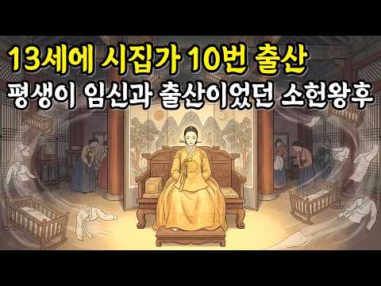
- 챕터: 0:00 열두 살 신부, 열 살 신랑 · 4:59 세자가 바뀌던 날 · 6:35 국모가 되던 날의 배 속 · 8:57 닫혔던 사건이 다시 열리다 · 11:50 조정이 그 딸을 두고 벌인 논쟁 · 16:04 왕비를 남긴 단 한 문장 · 19:13 스물두 해, 그 몸의 기록 · 26:59 이름은 남고, 목소리는 남지 않고
- 설명 앞부분: 📜 조선에서 대군을 가장 많이 낳은 왕비, 소헌왕후 심씨. '다산의 국모'라는 한 줄 뒤에, 우리가 배우지 않은 넉 달이 있습니다. 🕯 왕비가 되던 그날부터 세어보면, 이야기가 완전히 달라집니다. ⏱️ 타임라인
- 같은 채널 평소 대비 ×3,189.0 (채널 최근 롱폼 중앙값 82회) · 평소 영상: 조선시대 치킨 포계, 1450년대 요리책에 적힌 닭 한 마리 조리법 (85회) / 수양대군의 브레인 한명회, 실록이 기록한 '킹메이커'의 소름 돋는 진짜 모습 (79회)
- 대본 없음 (설명) — 음성인식이 끝나면 도입부·흐름이 들어감
- 댓글 79/79: 좋은 점 — 영상 0 · 감사·응원 0 · 더 알고 싶은 것 0 · 아쉬운 점 — 영상 1 · 반박·불만 — 의견 다름 0 · 정치·사회 1 · 경험 공유 3 · 구독·다음 기대 0
  - 경험 공유 👍31 “아이를 너무 많이 낳고 스트레스 받아 일찍 돌아가심. 남편은 후궁들에게 일찌감치 토스하고 그만 낳았어야 했다. 그리고 사돈이 외척세력이 될지 안될지 살짝 간을 본 것으로 느껴짐. 조금만 태종의 본질을 알았다면 아예 벼슬 내놓고 낙향하고 아들들도 당분간 관직에 나서지 …”
  - 경험 공유 👍29 “옛날을 지금과 비교하면 안된다고 생각합니다. 불과 5-60년 전에도 자녀를 10명 낳는 경우 꽤 있었습니다. 내가 아는 분도 11남매입니다. 이런 것을 출산기계라는 표현을 쓰는 것은 과해 보입니다.”

### 2. 조선시대 양반으로 살면 정말 편했을까?｜양반의 하루 일상 #조선시대 #조선 #조선역사 #양반 #하루일과 #한국사 #한국사이야기

- https://www.youtube.com/watch?v=9Ydk21vIkbc · 한국사공방 · 구독자 152 · 조회수 110,528 (×727.2, 하루 1,816.3) · 좋아요 614 (0.6%) · 20분 · 2026-08-21 · 주제 묶음 3. 조선 · 형식 브이로그·직접 해본 이야기 · 폴더 `W_9Ydk21vIkbc` (웹 승인)
- 썸네일: 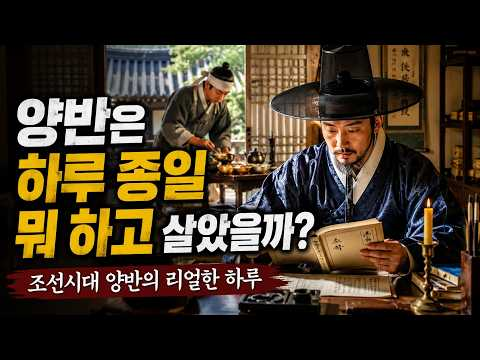
- 설명 앞부분: 조선시대 양반들은 하루를 어떻게 보냈을까요? 우리가 흔히 생각하는 양반은 한가롭게 앉아 책을 읽고, 하인들의 시중을 받으며 편하게 살아가는 모습입니다. 하지만 실제 양반의 하루에는 생각보다 많은 일과 규칙이 있었습니다. 새벽에 일어나 몸과 마음을 가다듬고, 책을 읽고 글을 쓰며, 손님을 맞이하고 집안일을 살피는 것은 물론 조상에 대한 예와 유교적 규범을 지키는 것도 중요한 일상이었습니다. 이번 영상에서는 조선시대 양반의 하루를 아침부터 밤까지 따라가 보며, 과연 양반들은 무엇을 먹고, 어떤 공부를 했으며, 어떻게 사람을 만나고, …
- 같은 채널 평소 대비 ×247.3 (채널 최근 롱폼 중앙값 447회) · 평소 영상: 400년 전 조선 땅에 외국인이 살고 있었다? 우리가 몰랐던 조선 속 이방인들의 이야기Ⅰ… (448회) / 조선시대 사람들이 가장 두려워했던 것 TOP10｜밤만 되면 공포에 떨었던 이유 ｜듣기편한… (446회)
- 대본 없음 (설명) — 음성인식이 끝나면 도입부·흐름이 들어감
- 댓글 11/13: 좋은 점 — 영상 0 · 감사·응원 0 · 더 알고 싶은 것 0 · 아쉬운 점 — 영상 1 · 반박·불만 — 의견 다름 0 · 정치·사회 1 · 경험 공유 0 · 구독·다음 기대 0
  - 아쉬운 점 — 영상 👍0 “으이구 AI 목소리로 들으니 톤과 억양이 너무 일직선인게 신물나고 역겹다 만드는놈 니목소리로 해라”
  - 정치·사회 👍3 “이러니 나라가 망하지ㅋㅋ 한가하게 책이나쳐읽고 도움되는게 하나도없네”

### 3. 진시황릉 안 여는 이유, 중국이 먼저 연 황제 무덤에 있었다

- https://www.youtube.com/watch?v=guOJNdkFSNk · 진실백과 · 구독자 519 · 조회수 373,128 (×718.9, 하루 21,924.5) · 좋아요 1,486 (0.4%) · 17분 · 2026-10-04 · 주제 묶음 6. 동양사 (중국·일본·몽골) · 형식 정보·해설 (그 밖) · 폴더 `W_guOJNdkFSNk` (웹 승인)
- 썸네일: 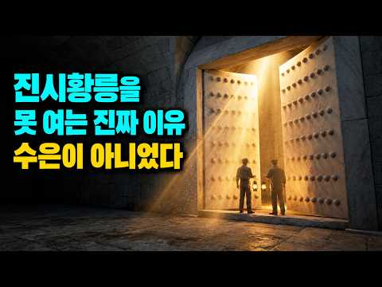
- 챕터: 0:00 진시황릉을 열지 못하는 진짜 이유 · 0:46 사마천이 기록한 수은 강의 비밀 · 2:27 시험 삼아 파 본 황제의 무덤, 정릉 · 3:35 지하궁전 입구를 찾다 · 4:31 꺼지지 않는 등불은 왜 꺼졌을까? · 5:46 며칠 만에 썩어 버린 비단옷 · 6:44 정릉의 관은 어디로 갔을까? · 7:43 측천무후 무덤을 열자는 계획 · 8:31 문화대혁명과 황제의 유골 · 10:21 발굴대장의 뒤늦은 후회 · 11:25 땅을 파지 않고 들여다본 진시황릉 · 12:18 하룻밤 만에 판 백제 왕의 무덤 · 13:16 돌판에 새겨진 이름 · 14:40 밤을 새운 발굴단 · 15:33 왜 아직도 진시황릉은 닫혀 있을까?
- 설명 앞부분: 진시황릉은 이천 년 넘게 닫혀 있습니다. 흔히 수은 때문이라고 하지만, 중국이 황제 무덤을 파지 않기로 한 건 진시황릉이 아니라 먼저 연 다른 황제 무덤에서 겪은 일 때문이었습니다. 중국은 명나라 만력제의 무덤 정릉을 시험 삼아 열었습니다. 문을 열자 금관과 비단옷이 그대로 남아 있었는데, 그 뒤 땅 위에서 세 가지가 차례로 사라졌습니다. 같은 일이 충청남도 공주의 백제 무령왕릉에서도 하룻밤 사이에 벌어졌습니다. 정릉에서 무엇이 어떤 순서로 사라졌는지, 그 뒤 중국이 진시황릉 앞에서 어떤 방침을 세웠는지, 무령왕릉 발굴단은 왜 열…
- 같은 채널 평소 대비 ×1,167.8 (채널 최근 롱폼 중앙값 320회) · 평소 영상: 오디세이 저승 장면, 놀란이 지운 사람들에겐 공통점이 있었다 (330회) / 세이렌의 노래, 오디세이가 감춘 목소리의 진짜 주인 (309회)
- 대본 없음 (설명) — 음성인식이 끝나면 도입부·흐름이 들어감
- 댓글 114/114: 좋은 점 — 영상 0 · 감사·응원 1 · 더 알고 싶은 것 1 · 아쉬운 점 — 영상 0 · 반박·불만 — 의견 다름 0 · 정치·사회 6 · 경험 공유 3 · 구독·다음 기대 0
  - 감사·응원 👍2 “진짜 궁금하고 의아했었습니다. 정말 감사드립니다.”
  - 더 알고 싶은 것 👍1 “진시왕릉 맞나요? 중국이나 일본이나 자기들 불리하면 공개 안하던데 상투는 동이의 흔적이다.”
  - 정치·사회 👍23 “발굴영상 본적이 있죠 시신은 버려져 들개들이 물고 다녔어요 황제가 중국인이 아닌겁니다 증거인멸 하는겁니다”
  - 정치·사회 👍10 “수은? 구라다. 이미 도굴을 당할만큼 당해서 그 무덤안에는 아무것도 없어..물론 수은이 없다는 말이 아니라 수은이 그토록 절대적일까? 진시황 영정의 무덤이 2천년넘게 존재했는데 그 약삭빠르고 돈이라면 환장한 중국인들이 도굴을 하지 않았다고 믿는다면 당신은 순진한 것이…”
  - 경험 공유 👍21 “예전 광산일 할때 발파 끝난뒤 옆쪽으로 천연동굴이 발견되었다 들어가보니 ,불빛에 반짝이는 석화 ,석순 ,종류석 너무 아름다워서 보석 방에 들어온것마냥 반작반짝 빛나는 모습에 ,,너도나도 자칫 손대면 가루가되는 석화는 냅두고 석순 ,종류석등을 깨가지고 나왔다 ,,헌데 …”
  - 경험 공유 👍2 “진짜 궁금하고 의아했었습니다. 정말 감사드립니다.”

### 4. 조선 궁궐 사람들은 한겨울을 어떻게 났을까? 실록에 남은 나인과 군사들의 혹독한 겨울

- https://www.youtube.com/watch?v=z_GZNlpBCEs · 인류 타임슬립 · 구독자 323 · 조회수 209,096 (×647.4, 하루 10,747.0) · 좋아요 478 (0.2%) · 13분 · 2026-10-01 · 주제 묶음 3. 조선 · 형식 정보·해설 (그 밖) · 폴더 `W_z_GZNlpBCEs` (웹 승인)
- 썸네일: 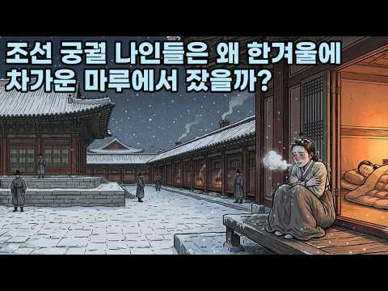
- 챕터: 0:00 궁궐 뜰에서 숨진 군사 · 0:32 인류 타임슬립 · 1:05 1425년, 성균관 유생들의 온돌 · 1:40 양반 큰 집에도 온돌은 한두 칸 · 2:10 1539년, 중종과 빈 가마니 · 3:15 1554년, 다시 대궐 뜰 · 3:43 1576년, 마루방에서 자려 한 선조 · 4:09 마루방에서 겨울을 난 나인들 · 5:02 1623년, 벌집처럼 늘어난 온돌 · 5:29 1624년, 이원익이 들은 나인들의 말 · 6:13 1636년, 윤황과 신하들의 말다툼 · 7:05 1636년, 솜옷을 나눠 주던 날 · 7:47 1647년, 한밤에 내보낸 사람들 · 8:49 1662년, 궁궐 땔나무의 값 · 9:48 1683년, 송시열의 청과 숙종 · 10:18 1692년, 눈보라 치는 밤 · 10:43 1746년, 온돌을 만들려는 군사들 · 11:12 1783년, 시험장이 된 온돌방 · 11:34 1790년, 정조가 한 말 · 12:07 다시 대궐 뜰
- 설명 앞부분: 1554년 12월, 조선 궁궐 뜰에서 밤을 지키던 군사 한 명이 숨집니다. 명종은 필시 얼어 죽었을 거라고 했어요. 같은 궁궐 안, 왕을 모시던 나인들은 옛 규례대로 온돌이 아니라 나무판을 깐 마루방에서 겨울을 났습니다. 세종이 성균관 유생들에게 내준 온돌, 중종이 문 앞 군사들에게 내준 빈 가마니, 벌집처럼 늘어난 궐 안 온돌을 두고 오간 신하들의 말, 송시열의 청과 숙종의 대답, 그리고 솜옷 한 벌까지 이름을 맞춰 가며 나눠 준 날의 기록까지. 조선 궁궐의 따뜻한 방이 누구 차지였는지 가장 오래된 기록부터 차례로 따라가 봅니다…
- 같은 채널 평소 대비 ×109.2 (채널 최근 롱폼 중앙값 1,916회) · 평소 영상: 조선 왕들 중 편식 1등은 누구였을까? 실록에 남은 왕들의 밥상 투정 (1,919회) / 하루 세 끼는 언제부터였을까? 17만 년 전 인류의 식사부터 따라가 봅니다 (1,912회)
- 대본 없음 (설명) — 음성인식이 끝나면 도입부·흐름이 들어감
- 댓글 32/40: 좋은 점 — 영상 0 · 감사·응원 0 · 더 알고 싶은 것 1 · 아쉬운 점 — 영상 0 · 반박·불만 — 의견 다름 1 · 정치·사회 1 · 경험 공유 1 · 구독·다음 기대 0
  - 정치·사회 👍6 “이게 다 신라 때문이야 신라의 사대주의 아니었으면 고구려 문명이 유지되어 훨씬 좋은 나라가 되었을텐데”
  - 경험 공유 👍9 “궁궐의 한옥이 잘못된 게 아니고 그 당시 전세계가 소 빙하기를 겪었습니다. 지구의 온도가 많이 내려가서 농작물 대흉작으로 많이들 굶어 죽었죠. 지금도 그렇지만 아파트에서도 난방 안 하면 춥듯이 원래부터 겨울은 춥게 지내는 게 일상이었고 당연하게 받아들였을 겁니다. 다…”

### 5. 한글날 100주년 ∣ 한글은 세종대왕이 만들었다. 그럼 한국어는 누가 만들었을까? #한글날 #세종대왕 #한국어역사

- https://www.youtube.com/watch?v=dSyAznnEIHw · 역사의 그날 · 구독자 210 · 조회수 128,993 (×614.2, 하루 10,077.5) · 좋아요 499 (0.4%) · 16.3분 · 2026-10-08 · 주제 묶음 1. 역사 일반·이야기 · 형식 정보·해설 (그 밖) · 폴더 `W_dSyAznnEIHw` (웹 승인)
- 썸네일: 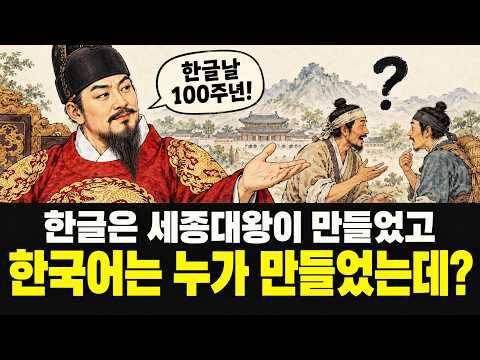
- 챕터: 0:00 한글보다 먼저 있었던 우리말 · 1:48 고려의 말을 받아 적은 사신 · 4:02 서동요와 삼국 사람들의 말 · 6:20 세종대왕 앞에 선다면 통할까 · 7:30 희미해지는 한국어의 과거 · 8:41 한국어는 누가 만들었을까 · 10:02 한글 창제와 최만리의 반대 · 12:46 원이 엄마가 남긴 한글 편지 · 14:02 한글날이 기념하는 것
- 설명 앞부분: 한글은 세종대왕이 만들었습니다. 그런데 세종대왕이 태어나던 날, 주변 사람들은 이미 우리말로 축하 인사를 건네고 있었습니다. 한글을 만들 사람이 이제 막 태어났는데, 그 사람들은 이 말을 누구에게 배웠을까요? 한글이 없던 시절의 우리말은 다른 글자를 빌려 적은 기록 속에 조각으로 남아 있습니다. 고려에 온 송나라 사신이 받아 적은 낱말, 신라의 골목에 퍼졌던 노래, 그리고 중국 역사책에 남은 삼국의 말 이야기까지. 그 흔적을 따라 한국어의 과거로 거슬러 올라가 봅니다. 타임라인 본 영상의 일부는 AI 기술을 활용하여 제작되었습니다.
- 같은 채널 평소 대비 ×542.0 (채널 최근 롱폼 중앙값 238회) · 평소 영상: 사과 한 알은 왜 전쟁이 되었나｜트로이 전쟁부터 귀향까지, 오디세우스의 진짜 이야기 (238회) / 왼손잡이가 다수였다면 세상은 어떻게 됐을까? (139회)
- 대본 없음 (설명) — 음성인식이 끝나면 도입부·흐름이 들어감
- 댓글 51/53: 좋은 점 — 영상 0 · 감사·응원 2 · 더 알고 싶은 것 1 · 아쉬운 점 — 영상 0 · 반박·불만 — 의견 다름 2 · 정치·사회 3 · 경험 공유 1 · 구독·다음 기대 0
  - 감사·응원 👍5 “감사합니다 잘보았습니다 ^^”
  - 감사·응원 👍2 “고맙습니다”
  - 더 알고 싶은 것 👍4 “세종대왕 같은 지도자가 언제 다시 나올까요?”
  - 반박·불만 — 의견 다름 👍2 “애초에 세종이 한글을 만들었다는 것은 틀렸음. 이상하게 어느 순간부터 세종 혼자서 만든 것으로 둔갑했는데 언어연구의 중요한 분야인 음운연구를 위하여 성삼문과 신숙주가 만주를 13번이나 갔다 왔음. 이들만 아니라 다른 집현전 학사들의 역할도 있었음. 물론 당시의 시대적…”
  - 반박·불만 — 의견 다름 👍0 “말은 자연 시작되며 변하는거 아닌가요 어느순간 탁 탄생되는건 아니죠”
  - 정치·사회 👍8 “영상 상당히 잘 만들었네요. 알타이 어족 이야기도 그대로 인정 안하고 사실 관계를 따지는 것과 집현전 학자들과 싸우면거 밀고 나간 이야기들… 결국 훈민정음 세계문화유산… 외국인들 진짜 최신의 본격 인공문자에 감탄하고 연구할듯…”
  - 정치·사회 👍1 “조선글은 세종대왕이 만들었고 충분히 자랑스러운 역사야,하지만 세종대왕이 뚝딱하고 무에서 유를 창조했다고 생각했다면 그건 당신들만의 착각. 조선글을 만드는 과정에서 중국한자를 참고했고 음 역시 중국어를 참고한거다,애초에 조선글을 만든 자체가 평민들을 중국인들과 교류해라…”

### 6. 13분만에 보는 518년의 조선 역사

- https://www.youtube.com/watch?v=earKPFklnV8 · 재미난역사이야기 · 구독자 171 · 조회수 96,043 (×561.6, 하루 6,682.1) · 좋아요 254 (0.3%) · 13.7분 · 2026-10-06 · 주제 묶음 1. 역사 일반·이야기 · 형식 정보·해설 (그 밖) · 폴더 `W_earKPFklnV8` (웹 승인)
- 썸네일: 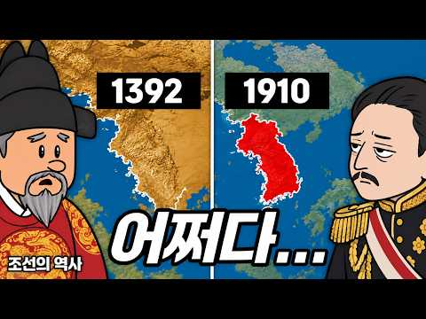
- 설명 앞부분: 1392년에 태어나 1910년에 사라진 조선. 27명의 왕이 518년 동안 다스린 이 나라는, 비가 많이 와서 강을 못 건넌 장군이 군대를 통째로 돌리면서 시작됐습니다. 나라 이름을 명나라 황제에게 골라 달라고 한 일, 아들이 동생들을 죽이고 왕이 된 일, 고기가 없으면 밥을 못 먹던 세종이 28글자를 만든 일, 13척으로 133척을 막은 이순신, 12만 대군 앞에서 47일을 버틴 남한산성, 커피에 아편을 탄 통역관까지. 조선이 어쩌다 한 왕조의 처음에서 끝까지 가게 됐는지, 13분 만에 쉽게 따라가 보세요. 혼일강리역대국도지도(…
- 대본 없음 (설명) — 음성인식이 끝나면 도입부·흐름이 들어감
- 댓글 27/42: 좋은 점 — 영상 0 · 감사·응원 0 · 더 알고 싶은 것 0 · 아쉬운 점 — 영상 0 · 반박·불만 — 의견 다름 0 · 정치·사회 2 · 경험 공유 1 · 구독·다음 기대 0
  - 정치·사회 👍3 “조선은 뿌리가 무신정권 이지요.”
  - 경험 공유 👍0 “내가 101번째 ㅎ”

### 7. 미국도 무너질까? 2000년동안 무너진 패권국들의 공통점 (10분 요약하려다 20분 요약 된 세계사)

- https://www.youtube.com/watch?v=e6jRgQdtI8M · 잡식이냥 · 구독자 2,220 · 조회수 1,090,952 (×491.4, 하루 42,092.1) · 좋아요 2,422 (0.2%) · 21.1분 · 2026-09-25 · 주제 묶음 5. 세계사·서양사 · 형식 정보·해설 (그 밖) · 폴더 `W_e6jRgQdtI8M` (웹 승인)
- 썸네일: 
- 챕터: 0:00 인트로 (세계패권의 역사) · 0:31 로마제국의 패권과 몰락 · 5:17 로마제국 이후 천년의 세월 · 7:01 스페인과 포루투갈의 패권과 몰락 · 9:30 네덜란드의 패권과 몰락 · 13:11 영국의 패권과 몰락 · 16:12 다음 세계 패권국이자 현재의 패권국 미국 · 20:12 마무리 정리 (세계패권은 이렇게 무너졌다.. 그럼 미…
- 설명 앞부분: 세계패권의 이동과 몰락에 대해 알아보쟈냥
- 같은 채널 평소 대비 ×2,387.2 (채널 최근 롱폼 중앙값 457회) · 평소 영상: 쉽게 이해하는 [이평선, 일목균형표, 볼린저밴드, 거래량, 매물대] (중학생용, 이것만 … (457회) / 대체 왜 여기서까지 벗는걸까? 알수록 흥미로운 이색문화 (459회)
- 대본 없음 (설명) — 음성인식이 끝나면 도입부·흐름이 들어감
- 댓글 438/442: 좋은 점 — 영상 4 · 감사·응원 7 · 더 알고 싶은 것 0 · 아쉬운 점 — 영상 5 · 반박·불만 — 의견 다름 11 · 정치·사회 54 · 경험 공유 18 · 구독·다음 기대 1
  - 감사·응원 👍2 “재미있게 잘 보았습니다. 감사합니다.”
  - 아쉬운 점 — 영상 👍0 “으 AI 묻었다... 내용 괜찮은데 굳이 사진 몇개만 짜집기해도 될걸 왜 AI 쓰는지 모르겠음 그냥 이런 유튜버는 그냥 신뢰가 안감”
  - 반박·불만 — 의견 다름 👍3 “30년전 고딩때 역사쌤이 패권은 계속 움직인다고 쭉 설명하면서 미국다음은 아시아니까 정신 차려야한다 했는데 중국한테 가기전에 우리가 먹어야한다고.. 그땐 말도안된다 생각했는데 요즘 미국보면 진짜 영원한건 없다😅”
  - 반박·불만 — 의견 다름 👍0 “미국 내려가면 누가 지구 no.1 자리 먹을건데? 핑핑이 독재 통제국가 빅브라더가 주인이 될 리는 없으니깐 방구석에서 헛소리 그만 짖어대고 꿈깨라..😂😂😂😂😂”
  - 정치·사회 👍11 “이후 패권국이 될만한 자격이 있는 나라가 없다는데 큰 문제가 있다! 그냥 우리나라가 패권국이 되는 수밖에”
  - 정치·사회 👍3 “헛소리들, 댓글다는 분들이 너무 미국을 모르는군요.미국의 Global 패권은 현재 탄탄합니다. 여타 제국들과 달리, 한두사람 제한된 이기주의에서 나오는 통치가 아니고, 다수 국민과 의회가 세계를 관리한다는 점에서 로마 몽골 사라센 영연방 제국과다릅니다. 대통령은 행동…”
  - 경험 공유 👍2 “내가 예언하지 미국은 세상의 종말이 오기 전까지 미국은 건제하다”
  - 구독·다음 기대 👍13 “와 내용 너무 좋네요 구독하고 갑니다”

### 8. 굶어 죽던 조선에 감자가 들어오자! 모두 미쳤다!

- https://www.youtube.com/watch?v=j0kJwAlyYyA · 음식야사 · 구독자 397 · 조회수 194,489 (×489.9, 하루 7,003.8) · 좋아요 533 (0.3%) · 14.4분 · 2026-09-23 · 주제 묶음 3. 조선 · 형식 브이로그·직접 해본 이야기 · 폴더 `W_j0kJwAlyYyA` (웹 승인)
- 썸네일: 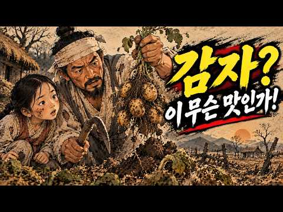
- 설명 앞부분: 조선 사람들은 감자를 심지 말라는 명령이 내려와도 몰래몰래 심었습니다. 그런데 고구마는 심으라고 권해도 사람들이 선뜻 나서지 않았죠. 같은 시대, 같은 조선 땅에 들어온 두 뿌리 작물 — 감자와 고구마. 하나는 막아도 퍼져나갔고, 하나는 밀어줘도 더디게 퍼졌습니다. 18세기 학자 이광려의 오랜 집념, 대마도에서 고구마를 발견한 조엄, 겨울마다 썩어가는 종자를 붙잡고 늘어진 사람들, 그리고 씨감자를 숨긴 백성과 소금을 내놓은 수령까지 — 지금은 흔하디흔한 이 두 뿌리가 우리 밥상에 오르기까지의 이야기를 들려드립니다.
- 같은 채널 평소 대비 ×582.3 (채널 최근 롱폼 중앙값 334회) · 평소 영상: 왜 한국에서만 김치가 발전했을까? 다른 나라에는 왜 없을까? (345회) / 조선시대 신분별로 완전히 달랐던 진짜 아침 식사 (323회)
- 대본 없음 (설명) — 음성인식이 끝나면 도입부·흐름이 들어감
- 댓글 138/143: 좋은 점 — 영상 0 · 감사·응원 1 · 더 알고 싶은 것 0 · 아쉬운 점 — 영상 1 · 반박·불만 — 의견 다름 0 · 정치·사회 3 · 경험 공유 1 · 구독·다음 기대 0
  - 감사·응원 👍1 “굶주린 조선 백성 위해 구황작물 들여 왔는데 일본 대마도에서 고구마를 훔쳐 왔는데 심을 줄 몰라 터득 하는데 몇년 걸렸다 해요! 조상님께 감사하세요! 지나다.”
  - 아쉬운 점 — 영상 👍3 “뭔가 러닝타임은 긴대 실 내용은 별거 없는것 같습니다 같은 내용이 반복되고 한번에 명확하게 끝낼수있는 내용을 대상에 대한 이야기가 진행되는 도중에 다른 대상으로 넘어가고 다시 도중에 원래 대상 예기로 돌아와서 내용이 어지럽고 문제의 이유나 설명이 단순하고 불명확하게 …”
  - 정치·사회 👍1 “대한민국은 감자를 가지고 반찬을 해먹고 전도 해먹고 녹말로 떡도 해먹는데 이렇게 전도 반찬도 덕도 해먹는 나라가 있나요 .”

### 9. 우리 선조는 왜 조상을 산에 모셨을까? 묘자리에 목숨까지 건 이유｜조선 선산의 역사

- https://www.youtube.com/watch?v=JPFrVw4I_Mw · 역사 아람 · 구독자 428 · 조회수 194,837 (×455.2, 하루 7,690.5) · 좋아요 925 (0.5%) · 23.6분 · 2026-09-25 · 주제 묶음 1. 역사 일반·이야기 · 형식 야담·옛날이야기 · 폴더 `W_JPFrVw4I_Mw` (웹 승인)
- 썸네일: 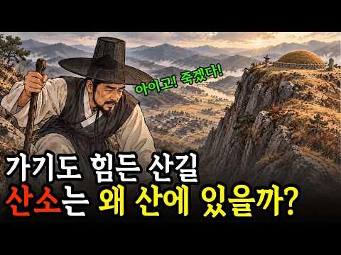
- 설명 앞부분: 🏔️ 왜 우리 조상은 산에 묻혔을까요? 신라 왕은 도읍 한복판에 누웠는데, 우리 할아버지는 왜 산 중턱에 계실까요? 화장을 금한 조선의 결정 하나가 어떻게 온 산을 무덤으로 바꿨는지, 그 600년의 이야기를 따라가 봅니다. 신라·고려·조선의 장례 문화가 어떻게 달랐는지 한눈에 정리됩니다 📖 풍수와 효 사상이 어떻게 얽혀 조선의 산송 분쟁으로 번졌는지 알게 됩니다 🌿 오늘날 화장률 94%의 시대, 우리 장례 문화가 어디서 와서 어디로 가는지 보입니다 벌초하러 산에 오르던 그 길이, 사실은 600년 역사가 쌓인 길이었습니다.
- 같은 채널 평소 대비 ×31.9 (채널 최근 롱폼 중앙값 6,114회) · 평소 영상: 조선시대에 지도 없이 부산에서 한양 가는 방법 ∣ 길에서 만난 사람들의 이야기 (6,114회) / 조선시대 과거 급제 후 마주한 냉혹한 현실｜사극에 안 나오는 과거 급제의 뒷모습 (6,785회)
- 대본 없음 (설명) — 음성인식이 끝나면 도입부·흐름이 들어감
- 댓글 54/54: 좋은 점 — 영상 1 · 감사·응원 1 · 더 알고 싶은 것 0 · 아쉬운 점 — 영상 1 · 반박·불만 — 의견 다름 1 · 정치·사회 2 · 경험 공유 0 · 구독·다음 기대 0
  - 좋은 점 — 영상 👍2 “양택풍수는 환경적 측면에서 공감이 가나 음택풍수는 너무나 문제가 많고 비합리적인 성리학적 도그마에 빠진 잘못된 선택이라고본다 육신이 분해되어 원자로 쪼개어지면 그이후는 인연따라 천지기상상태에 따라 모이고 흩어지는 것일 뿐이다!!!”
  - 감사·응원 👍0 “덕분에 공부 많이 하고 갑니다. 감사해요”
  - 정치·사회 👍0 “지금도 대통령 되면 집터 조상들 묘지가 티 비 나오지 않던가 그 것을 모르니 아무리 노력해도 그렇게 사는 것이여”

### 10. 조선은 이순신이 죽은 뒤 300년 더 만든 거북선을 왜 한 척도 남기지 못했을까 ∣ 칠천량 해전 ∣ 정조 귀선도설 ∣ 한국사 조선시대

- https://www.youtube.com/watch?v=3LSkFuV-1d0 · 역사썰방 · 구독자 1,920 · 조회수 855,836 (×445.8, 하루 21,448.7) · 좋아요 3,041 (0.4%) · 21분 · 2026-09-11 · 주제 묶음 3. 조선 · 형식 정보·해설 (그 밖) · 폴더 `W_3LSkFuV-1d0` (웹 승인)
- 썸네일: 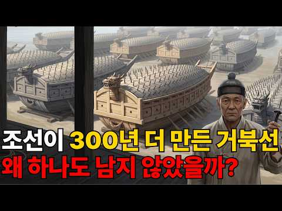
- 챕터: 0:00 일본 수군의 필승 공식과 통하지 않는 배 · 1:20 거북선은 이순신이 만들지 않았다 — 태종 13년의 기록 · 3:00 전쟁 두 달 전, 난중일기에 적힌 날짜 · 4:45 안에서는 밖이 보이고 밖에서는 안이 안 보인다 · 5:53 칠천량 — 하룻밤에 전부 가라앉다 · 7:37 명량에는 거북선이 없었다 · 8:31 전쟁이 끝나고 25년 뒤, 조정이 다시 만들라고 하다 · 11:21 크기가 커지는 것을 경계하라 — 1687년 김수항 · 12:15 표주박 두 개 값까지 적힌 유지비 · 13:03 궁궐 마루에 놓인 거북선 모형 · 15:06 대포 구멍이 여섯인데 왜 여덟인가 — 1751년 박문수 · 16:18 이충무공전서의 그림은 정조 때 배다 · 17:24 철갑선이었나 — 확인된 데까지 · 17:56 1895년, 통제영이 문을 닫다 · 19:28 지금 항구에 떠 있는 배는 어느 시절의 답인가
- 설명 앞부분: 1597년 칠천량에서 거북선은 한 척도 남지 않고 전부 가라앉았습니다. 그런데 조선은 그 뒤로 300년을 더 만들었습니다. 싸울 일이 한 번도 없었는데도요. 표주박 두 개 값까지 문서에 적어 가며 유지했고, 만들 때마다 원래 배에서 조금씩 멀어졌습니다. 우리가 교과서에서 본 그 거북선 그림은 이순신의 배가 아닙니다. 최근 알게된 의문에서 영상이 출발했습니다. 영상타임라인 📚 참고한 자료 『조선왕조실록』 태종 13년(1413)·15년(1415) — 거북선이 처음 나오는 기록 선조 30년(1597) — 칠천량 해전 광해군 14년(16…
- 같은 채널 평소 대비 ×1,501.5 (채널 최근 롱폼 중앙값 570회) · 평소 영상: "풍수 명당이라던 서울의 반전", 12년 방황 끝에 동전 하나로 정해진 600년 수도의 … (570회) / 전쟁 끝나고 다 귀국했는데, 이순신의 명나라 친구는 왜 조선에 뼈를 묻었을까? (613회)
- 대본 없음 (설명) — 음성인식이 끝나면 도입부·흐름이 들어감
- 댓글 208/208: 좋은 점 — 영상 0 · 감사·응원 0 · 더 알고 싶은 것 2 · 아쉬운 점 — 영상 0 · 반박·불만 — 의견 다름 6 · 정치·사회 12 · 경험 공유 10 · 구독·다음 기대 0
  - 더 알고 싶은 것 👍2 “저정도로 멍청이가 있을까요? 원균은 사실 일본의 스파이였을겁니다”
  - 반박·불만 — 의견 다름 👍4 “거제도 가면 박물관이있는데 원균을 완전 영웅처럼 여기면서 운영하는데 개 어이없더라!”
  - 반박·불만 — 의견 다름 👍2 “이순신 모든 전투에서 말도 안되는 장면도 좀 많기도 해서 반은 거의 허구일수 있다 입증 할 증거도 없고”
  - 정치·사회 👍3 “거북선은 조그만 돌격선입니다. 지금의 참수리호의 역활로 보면 될것같아요.그리고 조선시대에 나라가 보유하고 있는 화약은 철저히 관리되어지고 있었는데.해군에게만 화약을 저리 많이 지급할리가 없죠. 포대는 말그대로 초기에 소리로써 상대방기를 죽이는데.사용하죠. 대열을 흐트…”
  - 정치·사회 👍3 “거북선이 칠천량에서 패전 시 가라 앉았으면 판옥선이나 왜놈 배나 칠천량에서 뭔가 나와야 하는 데..나온 게 없어요..거기가 진해 하고 가까운 현 거제 칠천도예요..숟가락 몽디나 배 쪼가리 하나도 발견을 못했습니다..진해가 울나라 해군본부가 있는 곳인데 고박통시절 군사…”
  - 경험 공유 👍5 “원균을 엄청 욕했었는데 나이들어 다시 생각해 보니 상명하복의 전형적인 모범이잖아.”
  - 경험 공유 👍3 “거북선은 조그만 돌격선입니다. 지금의 참수리호의 역활로 보면 될것같아요.그리고 조선시대에 나라가 보유하고 있는 화약은 철저히 관리되어지고 있었는데.해군에게만 화약을 저리 많이 지급할리가 없죠. 포대는 말그대로 초기에 소리로써 상대방기를 죽이는데.사용하죠. 대열을 흐트…”

### 11. 전 세계가 매년 100조를 쓸 때 한국만 0원인 진짜 이유 세종대왕이 600년 전 심어놓은 공짜 시스템의 정체

- https://www.youtube.com/watch?v=uXPzRDWIFSA · 경제를 알리자 · 구독자 418 · 조회수 175,825 (×420.6, 하루 7,027.7) · 좋아요 380 (0.2%) · 19분 · 2026-09-26 · 주제 묶음 3. 조선 · 형식 정보·해설 (그 밖) · 폴더 `W_uXPzRDWIFSA` (웹 승인)
- 썸네일: 
- 챕터: 0:00 세계는 매년 100조, 한국만 0원인 이유 · 0:27 '글자값’이란 무엇인가 — 글자 없는 언어들의 비극 · 1:54 영어의 함정, 철자와 난독증이라는 보이지 않는 비용 · 3:42 중국어 한자와 일본어의 이중 부담 · 5:40 전 세계가 치르는 천문학적 '글자값’의 정체 · 6:20 한국만 0원인 진짜 이유 — 하루아침에 배우는 ‘아침… · 8:04 신하들의 반대를 무릅쓴 세종대왕의 파격적 결단 · 12:31 디지털 시대에 다시 태어난 한글, IT 강국의 숨은 … · 15:33 지구 반대편을 구한 한글 — 인도네시아 찌아찌아족 이… · 18:39 600년째 로열티 0원, 세종대왕이 남긴 선물
- 설명 앞부분: 세종대왕이 한글을 만들었다는 건 한국인이라면 누구나 아는 사실이죠. 그런데 그 한글이 지금도 우리에게 매년 수십조 원의 가치를 벌어다 주고 있다는 사실은 잘 모르셨을 겁니다. 전 세계 대부분의 나라가 ‘자기 나라 글자’ 때문에 해마다 어마어마한 비용을 치르고 있는데, 왜 유독 대한민국만 그 '글자값’이 0원일까요? 영어의 복잡한 철자, 중국어의 수천 개 한자와 입력 문제, 일본어의 이중 문자 부담부터, 600년 전 신하들의 반대를 무릅쓰고 백성을 위한 글자를 만든 세종대왕의 이야기, 그리고 오늘날 인도네시아 찌아찌아족까지 살린 한…
- 같은 채널 평소 대비 ×92.5 (채널 최근 롱폼 중앙값 1,901회) · 평소 영상: 전 세계 딱 3척뿐인 배, 한국이 두 번째까지 노린다…유럽이 긴장한 이유 (1,901회) / "이게 된다고?"서울대가 바닷물에서 도시가스를 만들어낸 방법 (2,435회)
- 대본 없음 (설명) — 음성인식이 끝나면 도입부·흐름이 들어감
- 댓글 36/36: 좋은 점 — 영상 2 · 감사·응원 3 · 더 알고 싶은 것 1 · 아쉬운 점 — 영상 0 · 반박·불만 — 의견 다름 0 · 정치·사회 1 · 경험 공유 3 · 구독·다음 기대 0
  - 좋은 점 — 영상 👍17 “곧 한글날이 다가 오네요 좋은 영상 감사합니다~~~”
  - 좋은 점 — 영상 👍0 “유익한영상 감사합니다”
  - 감사·응원 👍17 “곧 한글날이 다가 오네요 좋은 영상 감사합니다~~~”
  - 감사·응원 👍2 “킹세종대왕님 왕감사드립니다.”
  - 더 알고 싶은 것 👍0 “0:27 에서 "글자값이라는 게"를 소리나는대로 쓰면 "글자갑시라는 게" 라고 생각했는데, "글자가비라는 게"라고 하시네요. 이건 제가 잘못 알고 있는 건가요? 아니면 둘 다 맞나요? 아니면 사투리인가요? 생각 보다 많은 분들이 `가비`라고 해서 갑자기 궁금해졌어요.”
  - 정치·사회 👍1 “중국인이 한자를 키보드로 입력할 때 한자 한글자씩 찾아서 입력한다는 헛소리 제발 좀 그만해라. 아래는 제미나이를 통해 확인한 중국어 입력방식에 대한 설명임. 1. 전면 초성(簡拼, Jianpin) 입력 방식 문장 전체나 어절 단위의 초성만 쫙 치면, 입력기가 문맥을 …”
  - 경험 공유 👍1 “중국인이 한자를 키보드로 입력할 때 한자 한글자씩 찾아서 입력한다는 헛소리 제발 좀 그만해라. 아래는 제미나이를 통해 확인한 중국어 입력방식에 대한 설명임. 1. 전면 초성(簡拼, Jianpin) 입력 방식 문장 전체나 어절 단위의 초성만 쫙 치면, 입력기가 문맥을 …”
  - 경험 공유 👍0 “맞아요..예전에 중국계 싱가포리안들이 내가 휴대폰으로 문자 보내는거 보더니, 병음 안치고 그냥 알파벳 치듯이 치는거야? 라고 물어보면서 진심으로 부러워했어요..”

### 12. 이순신 장군에게 초코파이를 드렸더니…

- https://www.youtube.com/watch?v=As36MA96C-8 · 타임슬립극장 · 구독자 137 · 조회수 52,182 (×380.9, 하루 3,649.1) · 좋아요 321 (0.6%) · 7.7분 · 2026-10-07 · 주제 묶음 3. 조선 · 형식 정보·해설 (그 밖) · 폴더 `W_As36MA96C-8` (웹 승인)
- 썸네일: 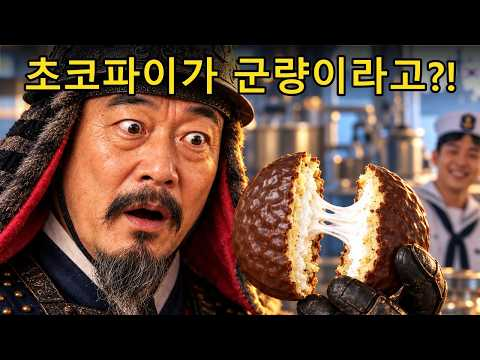
- 설명 앞부분: "노도 돛도 없는데, 어찌 나아가느냐?" 명량해전을 앞둔 1597년의 이순신 장군을 2026년 대한민국 해군기지에 모셔왔습니다. 쇠로 만든 군함, 수백 리 밖을 보는 레이더, 수병들과 함께 먹는 점심 한 끼. 그리고 배에 적힌 이름 하나. 여러분이라면 장군님께 무엇을 가장 먼저 보여드리고 싶나요? 다음엔 누구를 모셔올지도 댓글로 남겨주세요. ※ 본 영상은 AI를 활용해 제작한 시간여행 창작 영화입니다. 등장인물의 대사와 사건은 상상으로 구성했습니다.
- 대본 없음 (설명) — 음성인식이 끝나면 도입부·흐름이 들어감
- 댓글 30/32: 좋은 점 — 영상 0 · 감사·응원 1 · 더 알고 싶은 것 1 · 아쉬운 점 — 영상 0 · 반박·불만 — 의견 다름 1 · 정치·사회 0 · 경험 공유 0 · 구독·다음 기대 0
  - 감사·응원 👍10 “각박한 세상에 이순신 장군님 ai영상이 감동에 감격에 눈물나도록 만드네요 감사합니다”
  - 더 알고 싶은 것 👍1 “2차 동학 농민의 일본군사들과의 항쟁을 작품부탁드립니다”
  - 반박·불만 — 의견 다름 👍4 “와... 눈물 나뿌네 마지막에 ㅠㅠ 이런분이 100원 짜리에 계시는게 말도 안됨 ㅠㅠ”

### 13. "사극 국밥은 다 가짜?" 조선 사람들이 열광한 진짜 K-패스트푸드 l 조선시대주막에서팔던음식 l 국밥역사 l 조선시대음식

- https://www.youtube.com/watch?v=8AaUMqwdi00 · 알쓸역사 · 구독자 350 · 조회수 131,018 (×374.3, 하루 788.3) · 좋아요 554 (0.4%) · 17.2분 · 2026-05-08 · 주제 묶음 3. 조선 · 형식 정보·해설 (그 밖) · 폴더 `W_8AaUMqwdi00` (웹 승인)
- 썸네일: 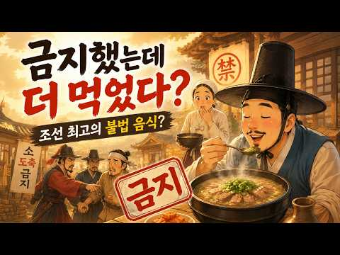
- 설명 앞부분: 사극 속 국밥은 진짜였을까? 🍲 사극에서 나그네가 주막에 앉아 국밥을 먹는 장면, 너무 익숙하죠. 그런데 조선 전기 200년 동안은 길 위에서 밥을 사 먹는 게 불가능했습니다. 그러면 국밥은 언제부터 팔기 시작했을까요? 소고기 도축이 금지된 나라에서, 어떻게 소고기 국밥이 유행할 수 있었을까요? 이 영상에서는 조선 시대 주막의 진짜 메뉴판을 펼쳐봅니다. 👇 이 영상에서 다루는 내용 ✅ 조선 시대 주막에서 실제로 팔았던 음식의 실체 ✅ 소고기 도축 금지(우금)와 성균관 현방의 비밀 ✅ 김홍도 풍속화 속 주막 장면 해부 ✅ 보부상과 …
- 같은 채널 평소 대비 ×251.5 (채널 최근 롱폼 중앙값 521회) · 평소 영상: 한명회, 압구정을 만든 남자가 부관참시 당한 이유 (521회) / 이완용은 살리고 고종은 왜 살리지 못했을까? ∣ 한국 최초의 의사 안상호 (523회)
- 대본 없음 (설명) — 음성인식이 끝나면 도입부·흐름이 들어감
- 댓글 105/105: 좋은 점 — 영상 0 · 감사·응원 0 · 더 알고 싶은 것 1 · 아쉬운 점 — 영상 1 · 반박·불만 — 의견 다름 0 · 정치·사회 2 · 경험 공유 1 · 구독·다음 기대 0
  - 더 알고 싶은 것 👍2 “사료에 근거한 이야기 아주 좋습니다.앞으로도 재밌는 얘기 부탁드립니다 ~~”
  - 아쉬운 점 — 영상 👍1 “어떻게 남의 채널과 제목만 다르고 내용이 똑같나....? 서로서로 베끼니까 나같이 이런거 많이 보는 사람들은 이상하게 자동으로 자꾸 걸리네....”
  - 정치·사회 👍8 “우리나라가 저런 외식 문화가 발전하지 않았던 거는 들고 다닐 수 있는 화폐가 없었기 때문이지 않을까? 실제 화폐가 등장한 게 조선 중기 성종 때고 실제 쓰임이 시작된 거는 대동법 이후니까 거의 후기 다 와서야 화폐로 가격을 치를 수가 있었으니까 화폐를 쓰기 이전에는 …”

### 14. 조선시대 장원급제하면 생기는 일 ∣ 잔치 빚부터 출근 첫날 신고식까지

- https://www.youtube.com/watch?v=7hixvj0cPrk · 역사잇수다 · 구독자 443 · 조회수 165,602 (×373.8, 하루 28,542.4) · 좋아요 797 (0.5%) · 9.4분 · 2026-10-15 · 주제 묶음 3. 조선 · 형식 브이로그·직접 해본 이야기 · 폴더 `W_7hixvj0cPrk` (웹 승인)
- 썸네일: 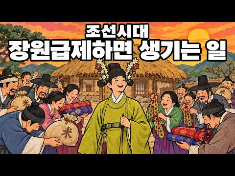
- 챕터: 0:00 장원급제하면 생기는 일 · 0:41 장원은 얼마나 대단했을까 · 1:50 잔치가 한 번이 아니라 두 번 · 2:39 과거에 붙어서 생긴 빚, 과채 수기 · 3:40 출근 첫날 신고식, 면신례 · 6:01 장원만의 결정적 차이 · 7:23 어머니가 건넨 문서, 별급문기 · 8:40 지금도 남아 있는 그 마음
- 설명 앞부분: 조선 최고의 시험에서 1등을 하면 정말 인생역전이었을까? 어떤 집은 그날부터 재산이 늘었고, 어떤 집은 바로 그날 때문에 빚 문서를 썼습니다. 실제로 남아 있는 조선의 문서로 장원급제한 집안의 살림을 따라가 봅니다. 조선시대 장원급제하면 정말 인생역전이었을까? 화려한 합격 뒤에 숨겨진 빚더미와 혹독한 신고식의 실체를 파헤쳐 봅니다. 조선 시대 과거 시험에서 1등을 차지한 장원급제자는 즉시 종6품 관직에 오르는 파격적인 특혜를 누렸습니다. 하지만 영광 뒤에는 현실적인 고충이 따랐습니다. 합격과 동시에 열어야 했던 성대한 잔치 때문에…
- 대본 없음 (설명) — 음성인식이 끝나면 도입부·흐름이 들어감
- 댓글 131/190: 좋은 점 — 영상 1 · 감사·응원 2 · 더 알고 싶은 것 0 · 아쉬운 점 — 영상 0 · 반박·불만 — 의견 다름 2 · 정치·사회 1 · 경험 공유 4 · 구독·다음 기대 2
  - 좋은 점 — 영상 👍1 “유익합니다. 근데 조금 질리네요. 비슷한 이야기가 되돌림하네요.”
  - 감사·응원 👍1 “첫영상이네? 앞으로 화이팅~!”
  - 감사·응원 👍1 “Ai의 발전 덕분에 흥미있는 소재와 재밌는 입담으로 정보를 소개해주는 채널이 늘어난 것같아 기쁘네요. 앞으로 영상 뜰때마다 무조건 좋아요 누르면서 시청할께요. 화이팅!”
  - 반박·불만 — 의견 다름 👍9 “닥전이죠. 조선시대도 인맥이 모든걸 좌우했습니다. 인맥이 얼마나 좋으냐에 관직은 물론 밥상에 오르는 반찬까지 달라집니다. 양반이 양반 행세하고 양반 대접 받을려면 양반 사회에서 인정이 필수였습니다. 역대 급제자들이 비겁하고 기개가 없어서 저런 면신례의 굴욕을 감내한게…”
  - 정치·사회 👍0 “조선은 애초에 오래 갈수 있는 나라가 아니었군요... 한국의 역사가 고난으로 가득했던 이유를 알것같습니다..”
  - 경험 공유 👍3 “제가 막 제대하자마 회사 입사하고 정직원 될때 주변선배들한테 과자ㆍ음료돌리고 외가 친척들한테 소고기 쏜것도 여기에 해당한것 같네요”
  - 경험 공유 👍1 “우리 집에서 장원이 나오면 이사가겠습니다.”
  - 구독·다음 기대 👍1 “재미있네요 다른영상 올라오면 볼수있게 구독박고 갑니다”
  - 구독·다음 기대 👍1 “재미있게 잘 봤습니다. 내용과 퀄리티가 좋아 구독자수가 많을줄 알았는데, 구독자수를 보고 놀랐네요. 저점매수 구독하고 갑니다~”

### 15. 임금인줄 모르고 훈수둔 10살 아이... 야사 / 야담/ 민담/ 시니어 오디오 북/ 옛날이야기

- https://www.youtube.com/watch?v=n9Bpb5j7ec8 · 토이야담 · 구독자 671 · 조회수 221,863 (×330.6, 하루 3,472.9) · 좋아요 1,473 (0.7%) · 32.3분 · 2026-08-18 · 주제 묶음 9. 야사·야담·옛날이야기 · 형식 수면·낭독 (잠잘 때 듣는) · 폴더 `W_n9Bpb5j7ec8` (웹 승인)
- 썸네일: 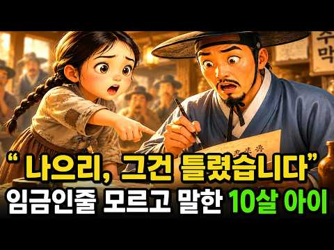
- 챕터: 0:00 도입 및 이야기 시작 · 1:06 청안골과 흉년의 기억 · 3:20 옥이의 등장과 성장 · 5:00 허생원과의 만남, 글자를 배우다 · 6:41 박 아전의 횡령과 의심 · 9:13 구휼미와 장부의 비밀 · 11:08 나그네의 등장과 글자 지적 · 21:32 임금의 정체와 진실 규명 · 29:00 정의 실현과 서당 설립
- 설명 앞부분: 🌙 **토이야담에 오신 것을 환영합니다. 오늘 이야기는 흉년에 부모를 잃고 주막에서 일하는 열 살 소녀 옥이. 어느 날, 주막에 묵은 나그네의 글자 오류를 지적하며 운명이 바뀐다. 그가 바로 세종대왕이었고, 옥이의 눈썰미가 관아의 곡식 횡령을 밝혀내는 결정적 단서가 된다. 과연 옥이는 백성들을 굶주림에서 구할 수 있을까요? 임금과 옥이의 특별한 만남, 그리고 따뜻한 야담 이야기를 지금 만나보세요. ⏱ 타임라인 / 챕터: ※ 본 채널의 영상은 직접 조사하고 구성한 창작 콘텐츠입니다. ※ 이미지와 음성 표현에는 AI 기술을 사용했습니…
- 같은 채널 평소 대비 ×538.5 (채널 최근 롱폼 중앙값 412회) · 평소 영상: 생후 10일 만에 갑자기 말을 한 갓난아기, 의문의 죽음이 서서히 밝혀지는데....? 야… (421회) / 쫒기는 임금인줄 모르고 구한 10살 약초 소녀...야사 / 야담/ 민담/ 시니어 오디오 … (403회)
- 대본 없음 (설명) — 음성인식이 끝나면 도입부·흐름이 들어감
- 댓글 83/83: 좋은 점 — 영상 1 · 감사·응원 4 · 더 알고 싶은 것 0 · 아쉬운 점 — 영상 1 · 반박·불만 — 의견 다름 2 · 정치·사회 0 · 경험 공유 1 · 구독·다음 기대 0
  - 감사·응원 👍2 “일본에서 듣고있어요 감사합니다 27:51”
  - 감사·응원 👍2 “야담은 늘 ~ 재미와 감동(?)-을 잔잔하게 가져다 준다 고맙고 감사하다 신의 눈”
  - 아쉬운 점 — 영상 👍2 “자막이 엉망진창이오”
  - 반박·불만 — 의견 다름 👍1 “야담이래도 너무 허술함 임금이 하루쯤 잠행을 할수는 있겠지만 조선시대같은 왕조국가에서 임금이라는 존재가 곧 국가였는데 왕이 대궐을떠나 며칠씩 지방주막에 머물다니 말도 안되는 소리.”
  - 반박·불만 — 의견 다름 👍1 “스릴러야??24:09초 손은 누구거여?? 내건아닌데?세개가 다 다르네~~”
  - 경험 공유 👍3 “토이 넘 이뽀 나도 팻으로 키우고 싶어지네 잘 듣고 있습니다.”

### 16. 충격적인 명나라 후궁의 삶

- https://www.youtube.com/watch?v=OYKLljbuJTc · 오래된서랍 · 구독자 331 · 조회수 107,366 (×324.4, 하루 664.5) · 좋아요 903 (0.8%) · 15.8분 · 2026-05-12 · 주제 묶음 6. 동양사 (중국·일본·몽골) · 형식 정보·해설 (그 밖) · 폴더 `W_OYKLljbuJTc` (웹 승인)
- 썸네일: 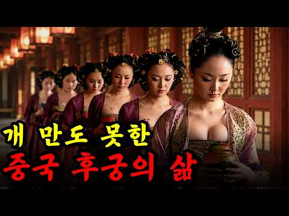
- 설명 앞부분: 오래된서랍은 과거의 기록을 꺼내 현재로 이어주는 공간으로, 세계사·한국사·전쟁사·미스터리 이야기를 담았습니다 🕯 잊혀진 기록과 진실을 하나씩 꺼내며 과거를 새롭게 마주해 보세요 📜
- 같은 채널 평소 대비 ×130.1 (채널 최근 롱폼 중앙값 825회) · 평소 영상: 개 만도 못한 중세 고문관, 얼마나 최악일까? (870회) / 중세 귀족 여성의 개만도 못한 최악의 삶 (780회)
- 대본 없음 (설명) — 음성인식이 끝나면 도입부·흐름이 들어감
- 댓글 24/24: 좋은 점 — 영상 0 · 감사·응원 0 · 더 알고 싶은 것 1 · 아쉬운 점 — 영상 0 · 반박·불만 — 의견 다름 0 · 정치·사회 0 · 경험 공유 1 · 구독·다음 기대 0
  - 더 알고 싶은 것 👍1 “1. 전족은 4~5세 정도의 어린 아이의 발로 해야 의미가 있지 11~12세는 이미 발이 커서 의미가 없을 텐데 확인 바랍니다. 2. 전족은 일하는 계층에서는 할 수 없는 것으로, 하급 궁녀가 방닦이 같은 육체노동을 했다면 전족을 한 상태로는 아니었을 것 같습니다. …”
  - 경험 공유 👍0 “중국 인 부모들은 아무리 가난 했어도 자기 자식들을 몇냥에 팔아 버렸어요. 그래서 여아들을 선호 했었다고 들었어요.”

### 17. [이두로 읽는 한일고대사 1화

- https://www.youtube.com/watch?v=oziUkAAOReY · 희망의 나라 만들기 · 구독자 73 · 조회수 31,599 (×316.0, 하루 286.6) · 좋아요 3 (0.0%) · 4.2분 · 2026-07-03 · 주제 묶음 2. 한국 고대·삼국·고려 · 형식 정보·해설 (그 밖) · 폴더 `W_oziUkAAOReY` (웹 승인)
- 썸네일: 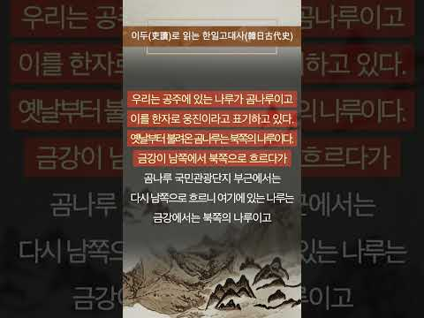
- 설명 앞부분: 옛 문헌에 기록된 사람 이름과 지명, 나라 이름은 과연 지금과 같은 방식으로 읽혔을까요? 1화에서는 한자의 음과 뜻을 빌려 우리말을 표현한 ‘이두’의 특징을 살펴보고, 이두식 해석이 한일 고대사를 이해하는 데 어떤 의미를 갖는지 알아봅니다. ※ 본 영상은 「이두로 읽는 한일고대사」의 관점과 해석을 바탕으로 제작되었습니다.
- 대본 없음 (설명) — 음성인식이 끝나면 도입부·흐름이 들어감
- 댓글 0/0: 좋은 점 — 영상 0 · 감사·응원 0 · 더 알고 싶은 것 0 · 아쉬운 점 — 영상 0 · 반박·불만 — 의견 다름 0 · 정치·사회 0 · 경험 공유 0 · 구독·다음 기대 0

### 18. 사극에는 절대 나올 수 없는 조선 주막의 적나라한 민낯

- https://www.youtube.com/watch?v=cE8_zCNVONE · 한끗역사 · 구독자 3,260 · 조회수 1,016,540 (×311.8, 하루 7,040.1) · 좋아요 5,373 (0.5%) · 29.4분 · 2026-05-29 · 주제 묶음 3. 조선 · 형식 정보·해설 (그 밖) · 폴더 `W_cE8_zCNVONE` (웹 승인)
- 썸네일: 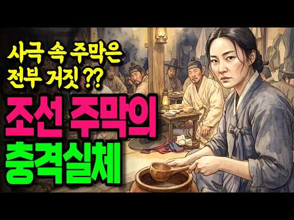
- 설명 앞부분: 사극 속 주막은 전부 거짓말이었다! 넓고 깔끔한 공간에서 국밥을 먹고 회포를 푸는 낭만적인 장소? 실제 주막은 가로 2.5m, 세로 1.8m 방에 10명이 엉켜 자고, 바닥 온도가 39도까지 올라가고, 벽 하나 너머에서 말이 싸우는 곳이었습니다. 그런데 이 허름한 초가삼간이 조선 전국에 12만 개. 지금 편의점 세 체인을 합쳐도 5만 5천인데, 그 두 배가 넘었습니다. 🔹 2000대 1 경쟁률, 과거시험을 앞둔 선비들은 왜 오직 문경새재만 고집했을까? 🔹 주막에서 술을 마신 5명은 합격하고, 안 마신 1명은 떨어진 전설의 진실 🔹…
- 같은 채널 평소 대비 ×512.2 (채널 최근 롱폼 중앙값 1,984회) · 평소 영상: 알고보면 소름돋는 비밀이 숨겨져 있다? 조선시대 겸재 정선의 '이 그림' (2,027회) / 교과서가 숨긴 불편한 진실! 세종의 휘황찬란한 업적은 전부 다른 사람 성과를 가로챈것이었… (1,942회)
- 대본 없음 (설명) — 음성인식이 끝나면 도입부·흐름이 들어감
- 댓글 271/273: 좋은 점 — 영상 6 · 감사·응원 4 · 더 알고 싶은 것 3 · 아쉬운 점 — 영상 2 · 반박·불만 — 의견 다름 1 · 정치·사회 7 · 경험 공유 8 · 구독·다음 기대 1
  - 좋은 점 — 영상 👍8 “역사를 아는 유익함과 동시에 현재 대한민국에 태어난 사람으로서 조선 시대는 사람이 인간으로서 너무 살기 힘들었겠다 싶다”
  - 좋은 점 — 영상 👍4 “19:25 거꾸로 생각해 보면 말입니다 조선에서도 여성의 사회 진출이 시작되고 있었고 자영업자들의 경제활동도 생각보다 활발했다는 점도 짐작해 볼 수 있겠습니다 우리가 생각하는 것만큼 꽉 막힌 사회가 아니였다는 추론도 가능 미국도 1920년이 되어서야 여성에게 투표권이…”
  - 감사·응원 👍8 “감사합니다 구독 좋아요 했어요”
  - 감사·응원 👍3 “좋은영상 감사합니다. 구독누르고 갑니다”
  - 더 알고 싶은 것 👍3 “여러분들은 중요한 일이 있을 때 지키는 나만의 징크스같은게 있으신가요? 댓글로 알려주세요”
  - 아쉬운 점 — 영상 👍2 “몇번본거 짜집기 😂”
  - 아쉬운 점 — 영상 👍1 “차단 ㅉㅉ 잘못된정보 투성 뇌피셜”
  - 반박·불만 — 의견 다름 👍1 “ㅠㅠㅠ, 큰 시험보는날 아침 , 아 글쎄 마눌님이 미역국, 보기좋게 꽝! 고마워 마눌님.”
  - 정치·사회 👍10 “6만명에 고작 33명 합격이면 금을 캐는 광부보다 곡갱이.삽.호미를 파는 사람이 돈을 벌었네요 현대판 장원급재인 사법고시를 없앤 노무현을 싫어합니다 그는 중국인에게 영주권 과 투표권까지 팔아먹은 놈 이었습니다 ~~~”
  - 경험 공유 👍38 “어릴 때 시골 온돌방 경험했었는데 진짜 뜨거워서 못 잠”
  - 경험 공유 👍9 “주막은 몸도 팔고 술도 팔고 노래도 팔았다. 내가 어릴 때까지도 그랬다.”
  - 구독·다음 기대 👍3 “좋은영상 감사합니다. 구독누르고 갑니다”

### 19. 다 같은 '스탄'인데 뭐가 다른걸까? 중앙아시아 5개 스탄국의 비밀｜역사｜세계사｜소련

- https://www.youtube.com/watch?v=nE1aAbOYw0I · 다시만난역사 · 구독자 3,400 · 조회수 1,039,525 (×305.7, 하루 46,502.7) · 좋아요 5,897 (0.6%) · 27.9분 · 2026-09-28 · 주제 묶음 5. 세계사·서양사 · 형식 정보·해설 (그 밖) · 폴더 `W_nE1aAbOYw0I` (웹 승인)
- 썸네일: 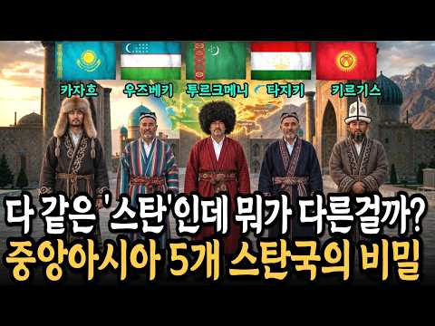
- 설명 앞부분: 카자흐스탄, 우즈베키스탄, 타지키스탄, 키르기스스탄, 투르크메니스탄. 이름 끝이 하나같이 '스탄'으로 끝나는 중앙아시아 다섯 나라. 우리는 흔히 이들을 '한 뿌리에서 나온 형제 나라'라고 생각합니다. 하지만 이 다섯 나라는 사는 방식도, 언어도, 심지어 민족의 뿌리마저 서로 다른 사람들이었습니다. 이번 영상에서는 '스탄'이라는 이름의 진짜 뜻부터 시작해, 유목민과 정주민의 차이, 다섯 나라 중 유일하게 페르시아계인 타지키스탄의 비밀, 그리고 1924년 소련이 이 땅에 국경선을 그은 결정적 사건까지 낱낱이 풀어드립니다. 실크로드의 …
- 대본 없음 (설명) — 음성인식이 끝나면 도입부·흐름이 들어감
- 댓글 258/259: 좋은 점 — 영상 7 · 감사·응원 11 · 더 알고 싶은 것 2 · 아쉬운 점 — 영상 2 · 반박·불만 — 의견 다름 3 · 정치·사회 5 · 경험 공유 5 · 구독·다음 기대 0
  - 좋은 점 — 영상 👍12 “좋은 내용 입니다.”
  - 좋은 점 — 영상 👍5 “좋은 정보 감사합니다 ❤”
  - 감사·응원 👍8 “이렇게 푸르고 아름다운 돔이 있는 건축물이 오래 남아 있는 것은 타일로 구워서 붙였다는 것입니다. 돌로 세우고 타일로 붙여 만든 건축물을 우리가 볼 수 있는 것에 감사함을 느낍니다. 직접 보았을 때 너무 황홀하고 아름다웠습니다.”
  - 감사·응원 👍5 “2 중앙아시마 다녀왔는데 더 관심있게들었습니다. 감사합니다.”
  - 더 알고 싶은 것 👍6 “여러 측면에서 상당히 사실에 가깝고 현지인들이 느끼는 정체성에도 가장 근접한 내용인 듯 싶습니다. 아무리 중앙아 전문가라하여도 대부분은 다수 민족이 얽혀 있는 복잡한 역사로 인해 중앙아에 대해 정확한 이해하기가 어렵고, 더욱이 중앙아 각국과의 교류나 축적된 지식도 많…”
  - 더 알고 싶은 것 👍1 “하나도 안궁금합니다~”
  - 아쉬운 점 — 영상 👍1 “말이 너무 많고 사설이 너무길어요~ 집중하고 펙트만 있게 하면 훨 많은 사람이 구독할듯요~ 인기있는 체널의 흐름과 편잡을 보시는게 좋을듯 홥니다 항상 좋은내용이나 너무 루즈라고 집중하기 힘들어요”
  - 아쉬운 점 — 영상 👍0 “같은말 계속하지 말고 좀 쪽쪽 나가자 무슨 했든말 또하고 그래 설명이 너무길어”
  - 반박·불만 — 의견 다름 👍3 “과거의 결과를 현재의 시각으로 해석한 궤변. 먼저 타지키스탄의 타지크족은 패트시아혈통의 부족이 맞는데, 중요한 것은 사산조 페르시아가 아랍 이슬람에게 정복당했고 문화적으로는 아랍보다 높았기 때문에 아랍제국에서 학문, 문화적인 영향력이 있었을 뿐 정치, 경제적인 힘은 …”
  - 정치·사회 👍31 “스탄처럼 이아도 마찬가지입니다. 게르마니아, 슬로바키아, 슬로베니아, 세르비아, 크로아티아, 보스니아, 헤르체고비나, 마케도니아, 알바니아, 로마니아, 불가리아, 에스토니아, 라트비아, 리투아니아, 갈리아, 아르메니아, 조지아, 콜롬비아, 아르헨티나, 볼리비아, 라이…”
  - 정치·사회 👍13 “이런스토리 너무잼나요. 2번이나 들었네요. 그런데 타지키스탄은 이란과 상당히 떨어저 있는데 폐르시아계가 되었을까요?사이에는 아프칸 우즈벡 투르크 3나라가 끼었는데”
  - 경험 공유 👍0 “전혀 모르던 스탄5개 나라들 총정리 설명 감사합니다 실크로드 중앙 아시아 예전부터 신비스럽다 고 생각했었는데 이런 역사적인 배경이 있었군요”
  - 경험 공유 👍0 “저 국가들이 하나로 통합해서 하나의 국가가 되는 날이 올 수 있을까??? 스스로 그런 선택을 하는 것이 경쟁력 있는 미래를 만드는 방법일 듯 한데... 개별 정체성이 너무 확고해지기 전에 시도해보는 것은 어떨까??? 내가 너무 국제 정치를 모르는 순진하고 바보 같은 …”

### 20. “아무도 오지 않았다” 16살 단종, 영월에서 홀로 버틴 4개월

- https://www.youtube.com/watch?v=uezr9s1ffZM · 조선 비화록 · 구독자 21 · 조회수 28,539 (×285.4, 하루 771.8) · 좋아요 44 (0.1%) · 24.8분 · 2026-09-14 · 주제 묶음 기타 · 형식 정보·해설 (그 밖) · 폴더 `W_uezr9s1ffZM` (웹 승인)
- 썸네일: 
- 설명 앞부분: “아무도 오지 않았다” 16살 단종, 영월에서 홀로 버틴 4개월 왕좌에서 내려온 열여섯 살 소년왕 단종. 한때 수많은 신하와 궁녀들에 둘러싸여 살았던 어린 왕은 하루아침에 왕위를 빼앗기고, 깊은 산골 영월로 유배됩니다. 청령포의 작은 어소에서 홀로 지내며 산나물로 끼니를 이어가고, 절벽에 올라 한양을 바라보고, 사랑하는 아내 정순왕후를 그리워하며 돌 하나하나를 쌓았다는 이야기. 그가 남긴 망향탑과 관음송, 그리고 영월 사람들의 가슴속에 전해 내려온 수많은 이야기들. 우리는 역사책에서 단종의 폐위와 사약, 사육신의 충절은 배웠지만,…
- 같은 채널 평소 대비 ×3,567.4 (채널 최근 롱폼 중앙값 8회) · 평소 영상: 단종이 죽자 절벽에서 뛰어내린 10명의 궁녀… 그들은 왜 죽음을 선택했나 (8회) / 문종은 정말 병으로 죽었을까? 죽기 이틀 전까지 호전됐던 왕의 충격적인 죽음 (7회)
- 대본 없음 (설명) — 음성인식이 끝나면 도입부·흐름이 들어감
- 댓글 3/3: 좋은 점 — 영상 0 · 감사·응원 0 · 더 알고 싶은 것 0 · 아쉬운 점 — 영상 0 · 반박·불만 — 의견 다름 0 · 정치·사회 0 · 경험 공유 0 · 구독·다음 기대 0

### 21. 세종대왕 아들 8명 거의 전멸한 진짜 이유 ∣ 세종아들비극 ∣ 천재DNA가부른저주

- https://www.youtube.com/watch?v=REHceL3oduo · 요모조모역사 · 구독자 601 · 조회수 170,243 (×283.3, 하루 1,270.6) · 좋아요 1,194 (0.7%) · 23.7분 · 2026-06-09 · 주제 묶음 3. 조선 · 형식 정보·해설 (그 밖) · 폴더 `W_REHceL3oduo` (웹 승인)
- 썸네일: 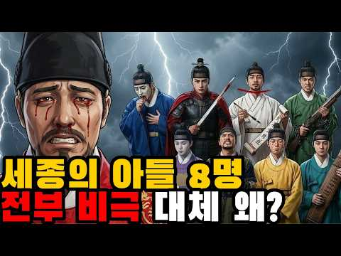
- 설명 앞부분: 세종대왕 아들 8명의 비극적 결말을 정리했습니다. 조선 최고의 성군 세종대왕, 그의 아들 8명 중 50세까지 산 사람은 단 2명뿐입니다. 세종 아들 전멸의 진짜 이유를 파헤칩니다. 세종대왕은 한글을 창제하고 조선의 황금기를 이끈 위대한 왕이었지만, 아버지로서의 삶은 비극 그 자체였습니다. 아들을 잃고, 아내를 잃고, 눈마저 잃어가며 말년을 보낸 세종. 그리고 세종 사후 3년 만에 아들들은 서로에게 칼을 겨눕니다. 문종 39세 병사, 안평대군 유배 8일 만에 사약, 금성대군 단종 복위 실패 후 사약, 광평대군 20세 요절, 평원대군…
- 같은 채널 평소 대비 ×387.8 (채널 최근 롱폼 중앙값 439회) · 평소 영상: 이완용은 약과였다… 조선 최악의 배신자 TOP5 ∣ 교과서가 숨긴 이름들 (439회) / 조선시대 직업의 세계: 돈을 쓸어 담았던 사람들 (384회)
- 대본 없음 (설명) — 음성인식이 끝나면 도입부·흐름이 들어감
- 댓글 158/159: 좋은 점 — 영상 0 · 감사·응원 0 · 더 알고 싶은 것 1 · 아쉬운 점 — 영상 0 · 반박·불만 — 의견 다름 0 · 정치·사회 9 · 경험 공유 2 · 구독·다음 기대 0
  - 정치·사회 👍26 “가장 큰 비극은 수양의 계유정난 찬탈이 부른 피의 결과 아닐까요? 강건했던 군주 문종의 사후 어린 왕 단종의 출현에. 왕을 보호하고 섭전해줄 안주인의 부재에...수양 일파가 이르킨 피의 숙청 계유정난에 당대 명필로 이름 높았던 안평대군의 죽음이...단종의 유모였던 혜…”
  - 정치·사회 👍4 “수양이 안그랬음 김종서의 나라가 되지않았을까?”
  - 경험 공유 👍0 “대군으로 자랐으니 평범한 두뇌도 똑똑해 집니다. 천민의 자식도 최고의 스승을 두면 똑똑해 지듯이 천재와 저능아로 태어나지 않는 한 두되는 거의 비슷합니다. 자라면서 좋은 교육환경으로 기초 배경지식을 쌓아 줬느냐에 따라 달라집니다. 제가 교육을 해 본 경험으로는 ᆢ.”
  - 경험 공유 👍0 “이미 비극은 이성계때부터 시작됬다 왕위를 무력으로 피를보며 뺏었는데 …윗 세대가 잘못을하면 아랫세대가 죄값을받는다 죄를짓지말고 남에게 해꼬지도하면 내가족들에게 그대로갑니다 왕건…대통령되고 탄핵되고 교도소가고 권력을탐하면 망가진다”

### 22. 넬슨 13전 8승, 이 사람은 23전 23승, 백만 미국인이 이순신 앞에서 침묵한 순간. "조선은 하나의 세계관이다".

- https://www.youtube.com/watch?v=J3I-shhMdAw · 알쓸이슈 · 구독자 353 · 조회수 98,233 (×278.3, 하루 2,731.2) · 좋아요 1,179 (1.2%) · 25.7분 · 2026-09-15 · 주제 묶음 3. 조선 · 형식 브이로그·직접 해본 이야기 · 폴더 `W_J3I-shhMdAw` (웹 승인)
- 썸네일: 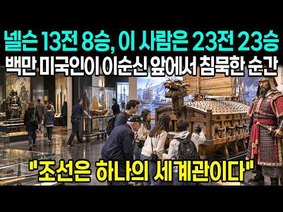
- 설명 앞부분: 시끄러운 이슈 속에서 핵심만 담담하게 전하는 채널, 알쓸이슈입니다. 본 채널은 실제 기사, 공식 발표 및 공개 자료를 바탕으로 콘텐츠를 제작합니다. 영상의 일부 이미지와 장면은 내용 이해를 돕기 위해 AI 기술을 활용할 수 있습니다. 경제·정책·통계 수치는 발표 시점과 자료 기준에 따라 달라질 수 있습니다.
- 같은 채널 평소 대비 ×640.0 (채널 최근 롱폼 중앙값 154회) · 평소 영상: 토네이도도 10만명을 못 막았다… 폭풍 속 BTS 볼티모어 콘서트. “폭풍이 와도 오늘은… (181회) / 산유국 러시아가 한국 경유를 사 갔다. 우크라이나가 한국 기름 공개 저격. 케냐 매체까지… (126회)
- 대본 없음 (설명) — 음성인식이 끝나면 도입부·흐름이 들어감
- 댓글 69/69: 좋은 점 — 영상 0 · 감사·응원 2 · 더 알고 싶은 것 0 · 아쉬운 점 — 영상 2 · 반박·불만 — 의견 다름 1 · 정치·사회 4 · 경험 공유 0 · 구독·다음 기대 0
  - 감사·응원 👍3 “❤이순신장군❤님조선을지켜주셔서감사합니다❤대한민국❤파 이팅❤😂🎉😢😮😅😊”
  - 감사·응원 👍0 “❤대한민국❤파 이팅😂코리아🎉화이팅😢한국만 세😮무궁화😅삼 천리😊❤😂🎉😢😮😅😊”
  - 아쉬운 점 — 영상 👍1 “요즘 다들 AI 음성 자동 해설로 다 채우는 그런 쓰레기들이 많은데 이렇게 사람이 직접 얘기하니 정말 참 좋군.”
  - 아쉬운 점 — 영상 👍0 “갑자기 이 몇일 사이에 이순신 장군에 관한 영상들이 우후죽순으로 유튜브에 업로드 되고잇는데..거의 대부분이 AI로 만든 그럴싸한 국뽕까지 첨가 조횟수 올리려는 낚시질,,”
  - 반박·불만 — 의견 다름 👍0 “글쎄 포장을 꼭 해야하는지? 있는 그대로 보여주면 될것을!”
  - 정치·사회 👍2 “세종대와.이순신장군.박정희대통령의 공통점 = 자주,자조,자립하는 국방을 만들어라.주변국가는 우리나라의 이웃이 아니다. 라는 것을 알려 주신 우리민족의 3대 영웅❤이시다”
  - 정치·사회 👍1 “일본이 쑈는 잘하지. 별것도 없는 나라가”

### 23. [세계사] 고대 이집트인들은 폭염 속에서도 왜 가발을 쓰고 다녔을까?💡

- https://www.youtube.com/watch?v=NoE9j2eaocE · 역사리뷰룸 · 구독자 3,140 · 조회수 830,818 (×264.6, 하루 13,560.2) · 좋아요 2,267 (0.3%) · 16.8분 · 2026-08-21 · 주제 묶음 5. 세계사·서양사 · 형식 오디오북·낭독 (명언·인생조언) · 폴더 `W_NoE9j2eaocE` (웹 승인)
- 썸네일: 
- 챕터: 0:00 뜨거운 사막과 가발의 수수께끼 · 2:03 이집트의 환경과 머리 관리 · 5:17 머리를 밀고 다시 가발을 쓴 이유 · 6:44 고대 가발의 제작 과정과 유물 · 9:02 기록으로 살펴본 이집트 풍습 · 10:21 연회와 독특한 머리 장식 · 13:29 가발로 드러낸 신분과 권위
- 설명 앞부분: 🏺사막에서 머리를 밀고, 그 위에 다시 가발을 썼다고? 상식적으로 말이 안 되는 이 행동에는 3천 년을 버텨온 이집트인들의 놀라운 지혜가 숨어 있었습니다. 😮 우리가 벽화에서 본 이집트인들의 그 반듯하고 풍성한 머리카락… 사실 대부분 진짜 머리가 아니었다는 사실, 알고 계셨나요? 오늘 영상에서 그 진실을 낱낱이 파헤쳐 봅니다. 🎞️영상 타임라인🎞 본 영상은 생성형 AI로 제작되었습니다.
- 같은 채널 평소 대비 ×1,010.7 (채널 최근 롱폼 중앙값 822회) · 평소 영상: [세계사] 튀르키예 산속에 나타난 거대한 배의 정체는 정말 노아의 방주일까?💡 (822회) / [세계사] 지구의 얼음이 전부 녹으면 해수면은 무려 몇 m 올라갈까?💡 (799회)
- 대본 없음 (설명) — 음성인식이 끝나면 도입부·흐름이 들어감
- 댓글 84/84: 좋은 점 — 영상 1 · 감사·응원 0 · 더 알고 싶은 것 1 · 아쉬운 점 — 영상 1 · 반박·불만 — 의견 다름 1 · 정치·사회 0 · 경험 공유 0 · 구독·다음 기대 0
  - 좋은 점 — 영상 👍0 “잘 배워 갑니다”
  - 더 알고 싶은 것 👍24 “이집트, 로마 뿐만아니라 고구려, 고조선에 대한 재미 있는 이야기도 해주길.”
  - 아쉬운 점 — 영상 👍0 “아 못보겠다 무한반복..”
  - 반박·불만 — 의견 다름 👍0 “21세기에 이집트의 습하고 더운 사막기후가 갑자기 바뀐것도 아닌데 이젠 머리도 안밀고 가발도 안쓰는 이유가 이슬람 때문?”

### 24. [3부작] 이순신의 실제 얼굴을 찾아서(최종회)

- https://www.youtube.com/watch?v=B5Yqnj_CfVg · 페이스 아카이브 · 구독자 1,560 · 조회수 409,542 (×262.5, 하루 8,937.9) · 좋아요 4,113 (1.0%) · 13.7분 · 2026-09-05 · 주제 묶음 3. 조선 · 형식 애니메이션·지도 · 폴더 `W_B5Yqnj_CfVg` (웹 승인)
- 썸네일: 
- 챕터: 0:00 오프닝 및 시리즈 요약 · 2:15 무과형 초상화 분석 흐름 · 4:30 문과형 초상화 계보 정리 · 7:10 직계 후손 초상 및 사진 비교 (이봉상, 이달해, 이… · 10:50 인공지능 교차 복원을 통한 최종 얼굴 재현 · 12:20 에필로그 및 클로징
- 설명 앞부분: "우리가 알던 이순신 장군의 모습, 과연 진짜 얼굴일까요?" 안타깝게도 지금까지 여러 차례 이순신과 관련된 그림들이 등장했지만 장군의 진짜 얼굴은 여전히 오리무중입니다. 진짜 이순신 얼굴 찾기 방구석 프로젝트! 현존하는 이순신 관련 초상화 20여 점을 분석한 1, 2부에 이어 3부에서는 이순신 직계 후손들의 초상화를 분석하고, 그 유형을 무과형과 문과형, 후손형으로 나누어, 실제 이순신의 얼굴을 AI로 복원해 보았습니다. 많은 응원 댓글로 부탁드리며 오류 또한 남겨 주시면 수정하겠습니다. Time stamp 참고자료 목록 1. 전…
- 같은 채널 평소 대비 ×6.5 (채널 최근 롱폼 중앙값 63,032회) · 평소 영상: 고구려는 페라리, 백제는 올칼라, 일본은 맨발? 1400년 전 동아시아 사신 외모 품평전… (63,032회) / [3부작] 이순신의 실제 얼굴을 찾아서1 #이순신후손 (63,894회)
- 대본 없음 (설명) — 음성인식이 끝나면 도입부·흐름이 들어감
- 댓글 925/925: 좋은 점 — 영상 5 · 감사·응원 33 · 더 알고 싶은 것 7 · 아쉬운 점 — 영상 1 · 반박·불만 — 의견 다름 10 · 정치·사회 54 · 경험 공유 28 · 구독·다음 기대 2
  - 좋은 점 — 영상 👍11 “멋지고 이미지도 멋지네요 좋은 영상 가슴 벅차오르는 영상 감사합니다”
  - 좋은 점 — 영상 👍2 “아우내님의 후반부 멘트가 너무 와닿습니다. 성웅 이순신장군님은 유구한 한반도 역사가 빚어낸 무수한 별 중 최고의 별이라 생각해요. 시간이 되신다면.. 고구려, 고려의 영웅들의 초상도 그려내 주시길^^!”
  - 감사·응원 👍232 “이순신 장군 후손들이 독립운동하신 걸 오늘 처음 알았습니다. 대단한 가문이군요. 고맙습니다.”
  - 감사·응원 👍23 “진짜 이국종 교수님인데 ㅋㅋㅋㅋㅋㅋㅋㅋㅋㅋㅋㅋㅋㅋㅋ AI 의 올바른 활용 감사합니다. !”
  - 더 알고 싶은 것 👍3 “모계의 특징을 간과할수 없을겁니다 수십대에 걸쳐 어머니들의 특성이 섞이면 과연 같을 수 있을까요?”
  - 더 알고 싶은 것 👍0 “결과물 들고 진짜 과거로 가서 이분 누군지 아냐고 물어보고싶다. 신기하고 궁금하다”
  - 아쉬운 점 — 영상 👍3 “아, 2:17 부근에 등장한 초상화의 주인공은 윤두서가 아니라 윤증 선생님이십니다. 다음 영상에서라도 정정 정보를 주셨으면 합니다. 영상은 잘 보았습니다.”
  - 반박·불만 — 의견 다름 👍3 “무과형 얼굴을 설명하면서 정이 안간다고? 웃기는 쉒이네... 내가 볼 때는 아주 지적이고 강단있게 보이는 잘생긴 얼굴인데...”
  - 반박·불만 — 의견 다름 👍1 “얼마나 말도 안되는 논거인가.... 할말하않.”
  - 정치·사회 👍9 “내란범한테 대통령이라는 말은 쓰지 않는 걸로 합시다. 예우박탈이 원칙입니다. 국가전복 시도한 반역자로서 국민정서에도 맞지 않고요”
  - 정치·사회 👍7 “지금 대통령도 있는데 굳이 무시하고 “윤석열 대통령님” 찾고, 다음 대통령 찾으시는 걸 보니… 정치색이 은근히 드러나는 것 같아 많이 많이 많이 아쉽네요… 내란이나 안 일어났으면 몰라도 국가전복이 시도된 게 불과 2년 전인데…”
  - 경험 공유 👍156 “잘 보고 갑니다. 이순신 장군님 현존 남자 직계 후손들 약 100명 정도의 얼굴을 촬영하고 계측하여 데이터베이스화 해 놓은게 있습니다. 이순신 연구소 뭐 그런 기관에서 진행했습니다. 3~4년 정도 전에 제작 진행 된 걸로 기억합니다. 저도 데이터를 제공했습니다. 후손…”
  - 경험 공유 👍79 “이국종 교수님이 덕수 이씨인지 검색해봤네요. 교수님은 전주이씨네요”
  - 구독·다음 기대 👍4 “다음 프로젝트가 벌써 기대됩니다👏👏👏”

### 25. 하수도도 없던 조선, 여름은 왜 지옥이 됐을까 ∣ 성종도 두려워한 한양의 장마 ∣ 조선생활사

- https://www.youtube.com/watch?v=ZsqcB6lCi0A · 역사 한 소절 · 구독자 1,600 · 조회수 415,575 (×259.7, 하루 4,618.7) · 좋아요 1,217 (0.3%) · 26.9분 · 2026-07-23 · 주제 묶음 3. 조선 · 형식 정보·해설 (그 밖) · 폴더 `W_ZsqcB6lCi0A` (웹 승인)
- 썸네일: 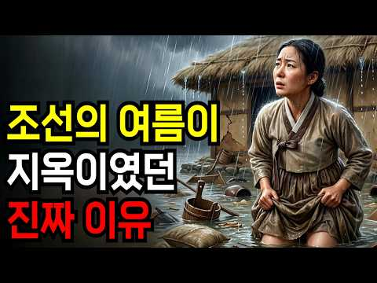
- 설명 앞부분: 하수구도, 배수 시설도 제대로 없던 조선. 장마철 큰비가 쏟아지면 한양은 그야말로 물바다가 됐습니다. 산에서 쓸려 내려온 토사가 개천 바닥을 메우고, 빗물과 오수가 뒤섞인 흙탕물이 도심 저지대로 역류했죠. 담장 하나를 사이에 두고, 누군가는 무너져가는 흙벽 집에서 물과 사투를 벌였고, 누군가는 물 한 방울 들지 않는 방 안에 있었습니다. 같은 비, 같은 여름이었지만 사람들이 겪는 여름은 완전히 달랐습니다. 임금 성종은 그 밤, 편한 잠자리를 마다하고 맨바닥으로 내려왔습니다. 그가 그렇게까지 한 이유는 무엇이었을까요? 그리고 담장 …
- 같은 채널 평소 대비 ×754.2 (채널 최근 롱폼 중앙값 551회) · 평소 영상: 조선 백성 90%가 신던 짚신, 어쩌다 순식간에 사라졌을까? (551회) / 토사구팽된 류성룡이 피땀 흘려 만든 문서 ∣ 조선은 내다 버리고, 일본은 300년을 탐독… (563회)
- 대본 없음 (설명) — 음성인식이 끝나면 도입부·흐름이 들어감
- 댓글 219/220: 좋은 점 — 영상 3 · 감사·응원 5 · 더 알고 싶은 것 1 · 아쉬운 점 — 영상 2 · 반박·불만 — 의견 다름 5 · 정치·사회 29 · 경험 공유 7 · 구독·다음 기대 1
  - 감사·응원 👍23 “경북 사람입니다. 매년 장마철만되면 물난리나서 동네잠기고 난리났었습니다. 이명박대통령의 4대강 정비사업이후 홍수걱정은 아예 사라젓습니다. 정치여야를 떠나 이명박대통령께 고맙고 참 감사합니다.”
  - 감사·응원 👍18 “6.25 전쟁 이후 폐허에서 세계 어느 나라와 비교해도 살기 좋은 대한민국을 만든 윗 분들 존경하고 지금도 보이지 않는 곳에서 묵묵히 땀 흘린 블루칼라 분들께 감사함을 전합니다.”
  - 더 알고 싶은 것 👍1 “일제시대 이전 조선은 국민의 90프로가 개거지 처럼 살고 양반들의 멍석말이가 끊이질 않고 여자들은 양반들의 노리개였는데 독립군 이순신 같은 영화만 틀어주면 눈물 흘리고 조선은 위대하다!하는 인간들은 양반들의 멍석말이가 그립고 여자들은 양반들의 노리개가 그리워서 그러는…”
  - 아쉬운 점 — 영상 👍9 “박정희와 이먕박이 치수 하기 전에는 매년 홍수 가뭄의 반복이었음”
  - 아쉬운 점 — 영상 👍0 “아 문맥이 너무 지루하게 이어지네”
  - 반박·불만 — 의견 다름 👍1 “선조들의 지혜 헛소리하는데 일반서민들은 지옥 그자체였다~~~”
  - 정치·사회 👍40 “이명박 대통령 이전만 해도 당시에 주력언론 방송3사는 해마다 장마가 시작되면 수재의연금 모금 했었습니다 이명박정부 욕하는 사람들은 뇌가 없는것들 입니다 토목 공사비도 왼전 저가로 한것으로 알고 있습니다 공사업체들이 남는게없다고들 했었습니다”
  - 정치·사회 👍23 “경북 사람입니다. 매년 장마철만되면 물난리나서 동네잠기고 난리났었습니다. 이명박대통령의 4대강 정비사업이후 홍수걱정은 아예 사라젓습니다. 정치여야를 떠나 이명박대통령께 고맙고 참 감사합니다.”
  - 경험 공유 👍40 “이명박 대통령 이전만 해도 당시에 주력언론 방송3사는 해마다 장마가 시작되면 수재의연금 모금 했었습니다 이명박정부 욕하는 사람들은 뇌가 없는것들 입니다 토목 공사비도 왼전 저가로 한것으로 알고 있습니다 공사업체들이 남는게없다고들 했었습니다”
  - 경험 공유 👍10 “1980년대까지도 서울 수도권 경기도 물난리 겪었지. 한강 넘치고 ~”

### 26. 고대 전투에서 맨 앞줄은 누가 섰을까?

- https://www.youtube.com/watch?v=8nGtdAH4vHw · 궁금하단말이야 · 구독자 7,390 · 조회수 1,881,593 (×254.6, 하루 75,332.2) · 좋아요 4,891 (0.3%) · 6.4분 · 2026-09-26 · 주제 묶음 7. 전쟁·군사사 · 형식 정보·해설 (그 밖) · 폴더 `W_8nGtdAH4vHw` (웹 승인)
- 썸네일: 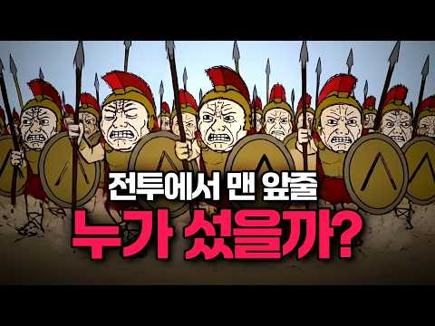
- 설명 앞부분: 영화 '300'에서 스파르타 병사들이 맨 앞줄에서 창을 맞대던 장면, 다들 한 번쯤 봤을 겁니다. 그 장면만 보면 맨 앞줄은 곧 죽음을 예약한 자리처럼 보이죠. ■ 참고자료 위키백과: 팔랑크스(Phalanx) 위키백과: 호플리테스(Hoplite) 위키백과: 오티스모스(Othismos) 브리태니커 백과사전: 고대 그리스 전쟁(Ancient Greek Warfare) 항목 고대 그리스 군사사 관련 역사 개론서 고대 전투의 맨 앞줄에 서는 것은 정말 가장 위험한 일이었을까요? 영화 300에서 묘사된 스파르타 팔랑크스 전술의 진실을 파헤…
- 같은 채널 평소 대비 ×303.4 (채널 최근 롱폼 중앙값 6,202회) · 평소 영상: 내가 18세기 영국 범선의 징집병이라면? (6,202회) / 아마존 탐험대는 성공했을까? (3,402회)
- 대본 없음 (설명) — 음성인식이 끝나면 도입부·흐름이 들어감
- 댓글 713/761: 좋은 점 — 영상 4 · 감사·응원 4 · 더 알고 싶은 것 1 · 아쉬운 점 — 영상 3 · 반박·불만 — 의견 다름 15 · 정치·사회 43 · 경험 공유 24 · 구독·다음 기대 1
  - 좋은 점 — 영상 👍1 “흠...유익했습니다.”
  - 감사·응원 👍0 “ㅋㅋ 응원한다 궁게이야 이맛이지 괜히남들눈치본다고 영상 ㅈ박아서 두마리토끼다놓치지말고 요대로가라”
  - 아쉬운 점 — 영상 👍1 “대본 왤케 ai같냐 6분짜리 영상의 어느부분도 사람이 쓴것 같지가 않음”
  - 반박·불만 — 의견 다름 👍3 “전경나온분들께 들은 카더라로는 첫시위막을때누 시위대가 던지는게 과일이어서 나중에 그거 주워다먹고 그랬는데 그다음 시위때는 과일이아니라 양파였는데 이게 눈에 들어가면 지옥이었답니다. 오죽하면 진압명령내려오면 다 조져버리겠다고 이를갈며 버텼다네요. 또 카더라는 시위대가 …”
  - 반박·불만 — 의견 다름 👍0 “이 영상 결론은 당연히 ai돌린 수준에 맞는 헛소리지. 대열이 무너진다는거 자체가 앞줄이 죽어나갔다는 거니까”
  - 정치·사회 👍0 “근데 그리스인 체제가 맞음 적어도 미필은 대통령 X 군대를 나온사람만 투표권 줘야함 여성인사람은 출산의고통을 겪으신분들에게만 왜냐하면 군대를가면 애국심이생기고 출산하시면 애를 좋은나라에 살게할려는마음이 잇어야함 남자인데 몸이불편하신분들이나 이러면 그냥 투표권 없는게맞…”
  - 정치·사회 👍0 “더 좋은 무기와 갑옷을 어떻게 지급 받아요? 저 때는 돈 주고 사와야하는 시대인데? 무기를 정부가 지급해주는 시기가 얼마 안됐다는 걸 몰라요?”
  - 경험 공유 👍0 “제가 보병 전문가고 사람 좋아하는 인류애로 옛날 고대시대 전투 자료 찾아보고 연구를 해봤는데”
  - 경험 공유 👍0 “사실 총이야 서로 멀리서 치고박고하니 숨어있는다는 심리적인 먼가있지만 ... 저때는 진검 진창 앞에 선다는건 일단 대단한 멘탈이라봄 .. 그래서 진짜 훈련 엄청했을것으로 판단됨.. 군대에서도 각개전투니 유격이니 빡씨게 땅바닥 구르다보면 햐 이정신으로 사회나가면 머든 …”
  - 구독·다음 기대 👍4 “구독했습니다~ 내용도 좋고 영상도 개성있네요❤ ㅋㅋㅋ”

### 27. 인더스 문명은 왜 아무도 못 읽는 글자만 남기고 사라졌을까

- https://www.youtube.com/watch?v=wDoiDBjy-JM · 인류미터기 · 구독자 645 · 조회수 162,342 (×251.7, 하루 2,408.7) · 좋아요 133 (0.1%) · 18.4분 · 2026-08-14 · 주제 묶음 8. 문명·고고학 · 형식 정보·해설 (그 밖) · 폴더 `W_wDoiDBjy-JM` (웹 승인)
- 썸네일: 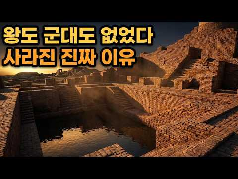
- 챕터: 0:00 왕 없는 문명, 인더스의 시작 · 2:30 로마보다 2000년 앞선 하수도의 충격 · 5:20 모두를 위한 '수영장', 평등한 도시의 증거 · 8:10 100년째 읽을 수 없는 400개의 문자 · 11:00 칼이 아닌 비가 무너뜨린 문명 · 14:30 철도 자갈이 된 유네스코 유산
- 설명 앞부분: 🏙️ 왕도, 군대도, 전쟁도 없었다. 4500년 전, 인더스 강가에 세워진 인류 최초의 '평등 도시'. 격자무늬 거리, 표준화된 벽돌, 로마보다 2000년 앞선 하수도, 집집마다 달린 화장실까지. 그런데 이 거대한 문명을 이끈 왕의 흔적은 어디에도 없습니다. 문명의 진짜 사라진 이유와, 100년째 아무도 해독하지 못한 인더스 문자의 비밀까지. 인류의 기원에서 가장 조용하고, 가장 놀라운 문명 이야기를 파헤쳐봅니다. 이어서 보기 — 사라진 문명 타임라인 🚕 인류미터기는 인류의 모든 이야기를 목적지로 삼는 택시입니다. 오늘도 뒷자리 …
- 같은 채널 평소 대비 ×222.4 (채널 최근 롱폼 중앙값 730회) · 평소 영상: 아무도 찾을 수 없는 곳, 칭기즈칸은 왜 자신의 흔적을 지웠나? (748회) / 인류 역사상 가장 오래된 신전, 괴베클리 테페의 진실 (712회)
- 대본 없음 (설명) — 음성인식이 끝나면 도입부·흐름이 들어감
- 댓글 32/32: 좋은 점 — 영상 1 · 감사·응원 1 · 더 알고 싶은 것 0 · 아쉬운 점 — 영상 0 · 반박·불만 — 의견 다름 0 · 정치·사회 0 · 경험 공유 1 · 구독·다음 기대 0
  - 좋은 점 — 영상 👍2 “좋은 영상 감사합니다😊 인더스문명은 관심 없었는데 관심이 생기네요”
  - 감사·응원 👍2 “좋은 영상 감사합니다😊 인더스문명은 관심 없었는데 관심이 생기네요”
  - 경험 공유 👍5 “일종의 주소, 문패 즉 위치를 알려주는거 아닐까ᆢ 물고기는 항구 근처에서, 곡식은 밭을 지나 5개 구역 위 소조각 있는 곳이 내가 사 는곳이다 ᆢ 뭐 그런뜻”

### 28. 고려에 조공하던 여진족은 어떻게 중국을 두 번 지배했을까? 그 후손은 지금 어디에

- https://www.youtube.com/watch?v=EwZnhWBu_-Y · Damir Merzhalimov · 구독자 961 · 조회수 229,163 (×238.5, 하루 9,039.2) · 좋아요 1,439 (0.6%) · 98.4분 · 2026-09-25 · 주제 묶음 2. 한국 고대·삼국·고려 · 형식 수면·낭독 (잠잘 때 듣는) · 폴더 `W_EwZnhWBu_-Y` (웹 승인)
- 썸네일: 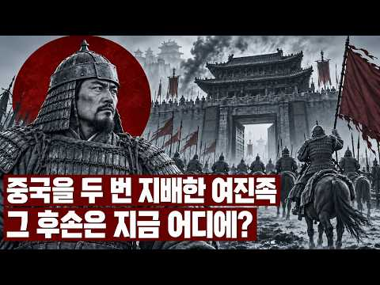
- 챕터: 0:00 오늘 밤의 이야기 · 3:59 숙신에서 발해까지 — 숲의 사람들 · 10:23 거란의 그늘 — 해동청과 은패천사 · 16:18 고려와 여진 — 윤관과 동북 9성 · 26:04 『금사』의 한 줄 — 시조 함보는 고려에서 왔다 · 29:13 아골타와 금나라의 탄생 · 39:03 정강의 변 — 끌려간 두 황제와 고려의 선택 · 46:49 여진 문자 — 훈민정음보다 300년 앞선 글자 · 52:38 한화와 몽골 — 금나라의 끝 · 60:07 명과 조선 사이 — 이지란, 4군 6진, 누르하치의 … · 67:48 누르하치와 사르후 전투, 후금에서 청으로 · 75:57 정묘·병자호란 — 남한산성, 삼전도, 소현세자 · 88:09 여진의 후손은 지금 어디에 — 만주족, 시버족, 나나… · 95:14 마지막 이야기
- 설명 앞부분: 고려에 모피를 바치던 숲의 사람들이 어떻게 중국을 두 번이나 지배하게 되었을까요? 송나라 황제 두 명을 북쪽 끝까지 끌고 간 금나라, 그리고 오백 년 뒤 삼전도에서 조선의 임금을 무릎 꿇린 청나라. 두 제국을 세운 사람들은 모두 같은 숲에서 나온 여진족이었습니다. 그리고 두 번 모두, 한반도가 바로 그 옆에 서 있었습니다. 금나라의 역사서 『금사』는 황실의 시조 함보가 "고려에서 왔다"고 적었습니다. 훈민정음보다 300년 앞서 자기 문자를 만든 사람들, 윤관의 동북 9성, 정강의 변, 사르후 전투, 병자호란과 소현세자까지 — 천 …
- 같은 채널 평소 대비 ×163.2 (채널 최근 롱폼 중앙값 1,404회) · 평소 영상: 흉노에 쫓겨난 유목민이 어떻게 인도에서 제국을 세웠을까? 한국 불상의 얼굴은 어디서 왔나 (1,697회) / 물리학의 한계를 넘어선 우주 최대의 별 (1,112회)
- 대본 없음 (설명) — 음성인식이 끝나면 도입부·흐름이 들어감
- 댓글 70/83: 좋은 점 — 영상 1 · 감사·응원 1 · 더 알고 싶은 것 0 · 아쉬운 점 — 영상 2 · 반박·불만 — 의견 다름 2 · 정치·사회 5 · 경험 공유 1 · 구독·다음 기대 0
  - 좋은 점 — 영상 👍9 “아는 내용이겠거니 했는데 깊이있는 유익한 내용이었어여 다만 만주족이란 단어는 안쓰는게 좋지않나 싶어여 이유는 만주가 지들꺼라는 발칙한 생각이 저변에 깔려있는 단어니까여 그냥 여진족입니다.”
  - 감사·응원 👍3 “다 보는데 시간이 좀 걸렸습니다. 만주의 역사는 몇 번 들어도 들을때뿐 듣고나면 머리에 남지 않습니다. 그 중 제일 아쉬운 대목은 후금의 정체를 그리 몰랐을 까요.. 인정하지 않는다고 사라질까요?? 소현세자, 북벌계획 그리고 중화, 소중화, 송시열... 임진왜란과 함…”
  - 아쉬운 점 — 영상 👍0 “나의 개똥철학관으로 역사책 던지고 싶은 1순위는 많은분들이 공감하는 연남생의 배신이고 2위는 윤관의 여진정벌때 고려에 우호적인 추장들을 몇백명 독살했다는 점이다. 이사건으로 여진족은 흑수말갈 중심으로 뭉치고 우리민족과는 완전히 남남이 되어버렸음 이들을 고려가 흡수했으…”
  - 아쉬운 점 — 영상 👍0 “너무길어요”
  - 반박·불만 — 의견 다름 👍2 “중국을 2번 지배한게 아니고 1번이죠... 금나라 때는 금나라에서 송나라를 가려면 중간에 고려가 있었어요... 우리사서 중국 사서 연구하셔야죠. 금나라는 북경을 지배한적이 없죠.. 고려의 수도가 하북성에 있었는데.. 개경을 개성이라고 우기면 안되요.. 개성에 고려 왕…”
  - 반박·불만 — 의견 다름 👍0 “두번째는 1636년이 아니죠. 누르하치가 청이나 만주가 아니라 후금을 건국한건 1616년입니다. 그후 그의 아들 홍타이지가 청으로 바꾸었고요!”
  - 정치·사회 👍3 “여진은 대부분 중국인 되었지만 고구려와 발해의 후손 여진족 이성계가 조선으로 내려와 고려를 멸망시키고 조선을 건국하어 대한민국이 고구려의 명맥을 이어옴”
  - 정치·사회 👍2 “너는 좌파냐 우파냐”
  - 경험 공유 👍0 “어느 다큐에서 만주족이 200만도 안 남았다고 나온 걸 본 기억이 나는데, 1000만 명이 넘게 있다고요? 히야.... 다행이네요 그나마. 만주족이 혹시 중공이 붕괴되면 한국과 통합하고 싶어할 수 있다고, 한국이 그들과 잘 친해 놓고 그들을 녹여들이는 게 필요하다는 …”

### 29. Ep.03_전북 정읍시 ∣ 조선 역사의 비극과 민중의 함성이 공존하는 도시

- https://www.youtube.com/watch?v=Fpwz5nqZTgk · 팔도유남 Paldoyunam · 구독자 223 · 조회수 51,622 (×231.5, 하루 356.7) · 좋아요 722 (1.4%) · 15.7분 · 2026-05-29 · 주제 묶음 1. 역사 일반·이야기 · 형식 야담·옛날이야기 · 폴더 `W_Fpwz5nqZTgk` (웹 승인)
- 썸네일: 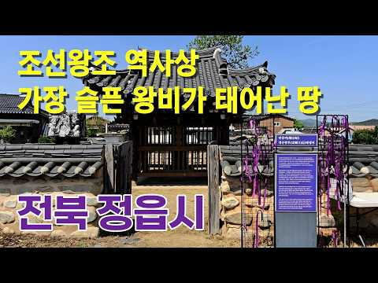
- 챕터: 0:00 인트로_정읍여행의 시작 · 1:26 정읍시 주요 현황 · 3:43 정읍맛집, 백학정 · 5:15 무성서원 · 6:44 단종비 정순왕후 태생지 · 8:25 쌍화차거리 · 10:35 각시다리공원 & 각시다리설화 · 13:04 동학농민혁명기념공원(황토현전적, 동학농민혁명기념관, … · 15:01 아웃트로_정읍여행의 마무리
- 설명 앞부분: 인구 10만 소도시 전북 정읍의 역사와 설화, 맛을 이 영상 하나에 담았습니다. ☑️ 한우 암소 떡갈비 맛집 백학정 ☑️ 유네스코 세계문화유산, 무성서원 ☑️ 왕과 사는 남자 단종의 비, 정순왕후 태생지 ☑️ 전국 유일 쌍화차거리 ☑️ 이름 없는 각시의 한이 맺힌 설화 여행지, 각시다리 ☑️ 동학농민혁명의 핵심 현장, 황토현전적·기념관·박물관
- 같은 채널 평소 대비 ×71.7 (채널 최근 롱폼 중앙값 720회) · 평소 영상: Ep.05 경남 하동군ㅣ여름휴가는 하동이면 충분합니다ㅣ차 시배지 정금차밭부터 지리산 계곡… (1,197회) / Ep.02_충북 옥천군 ∣ 국내 당일치기 여행지, 일출 명소로 알려진 용암사부터 향수의 … (1,212회)
- 대본 없음 (설명) — 음성인식이 끝나면 도입부·흐름이 들어감
- 댓글 59/59: 좋은 점 — 영상 0 · 감사·응원 6 · 더 알고 싶은 것 1 · 아쉬운 점 — 영상 0 · 반박·불만 — 의견 다름 0 · 정치·사회 0 · 경험 공유 3 · 구독·다음 기대 0
  - 감사·응원 👍27 “지척 에 살면서 알지 못한 지식 좋은 지식을 알려 주어 감사 합니다”
  - 감사·응원 👍5 “감사합니다 고향이 정읍인데 정순황후 태생지가 정읍인줄 이제 알았습니다... 😘😍🥰 행상 나간 남편이 오래 돌아오지 않자, 아내가 달에게 남편의 안전과 무사 귀환을 비는 노래로 유명한 정읍사 공원도 인근에 있는데 다음번에는 정읍사 공원도 소개부탁드립니다. 감사합니다”
  - 더 알고 싶은 것 👍5 “감사합니다 고향이 정읍인데 정순황후 태생지가 정읍인줄 이제 알았습니다... 😘😍🥰 행상 나간 남편이 오래 돌아오지 않자, 아내가 달에게 남편의 안전과 무사 귀환을 비는 노래로 유명한 정읍사 공원도 인근에 있는데 다음번에는 정읍사 공원도 소개부탁드립니다. 감사합니다”
  - 경험 공유 👍43 “저희 조상 태인 박씨 입향조 마을 태인현. 고려 공민왕 시절. 홍건적 침입으로 경남 밀양에서 이곳 태인으로 이주한 밀양박씨 관향. 이곳에는중국 성씨인 여산 송씨 정순왕후 집안도 정착하고 있었다. 여산은 지금의 익산. 중국에도 똑같은 지명이 있다. 세조의 왕위 찬탈로 …”
  - 경험 공유 👍4 “처음에 나온 유허비각이 있는동네가 제가사는 동네입니다 심지어 유허비각 옆의 빈터는 제가 태어나서 살았던곳이네요...맨날 보는데가 인터넷에 나오다니 참 느낌이 새롭네요”

### 30. 암행어사 박문수 "암행어사 출두요!" 탐관오리를 쓸어버리다 ∣ 조선 사극 사이다

- https://www.youtube.com/watch?v=4C7JI9SwK1o · 영화 말본 · 구독자 1,080 · 조회수 245,366 (×227.2, 하루 4,323.8) · 좋아요 611 (0.2%) · 13분 · 2026-08-25 · 주제 묶음 3. 조선 · 형식 정보·해설 (그 밖) · 폴더 `W_4C7JI9SwK1o` (웹 승인)
- 썸네일: 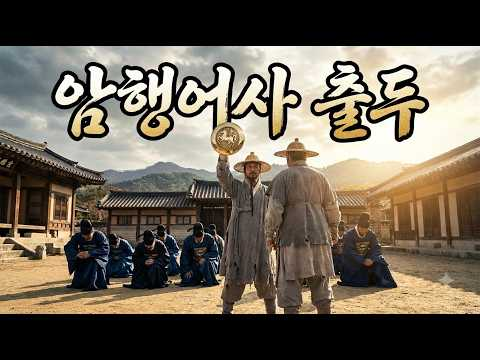
- 챕터: 0:00 1장 거지 어사 — 썩은 고을에 잠입하다 · 2:21 2장 탐관오리 — 잔칫상 위의 피 · 4:28 3장 밝혀지는 비리 — 장부 한 권 · 6:27 4장 위기 — 한 백성이 숨겨주다 · 8:33 5장 암행어사 출두 — 마패가 번뜩이다 · 10:32 6장 진짜 배후 — 한양의 거물
- 설명 앞부분: 암행어사 박문수 — "암행어사 출두요!" 탐관오리를 쓸어버리다 ∣ 조선 사극 사이다 거지 행색으로 고을에 잠입한 암행어사 박문수. 굶주린 백성을 쥐어짜는 탐관 사또와 토호의 비리를 파헤친다. 결정적 순간, 마패를 꺼내 든다 — "암행어사 출두요!" 허나 세곡을 빨아들인 진짜 배후는, 한양 중앙의 거물 김 대감이었다. 문수는 대감의 위협에도 굴하지 않고, 국법 앞에 그를 세운다. 낡은 민초의 잿빛과 관아의 붉은빛이 대비되는 조선 사극. 백성을 위한 정의와 통쾌한 응징을 그린 단편입니다. ※ 본 영상은 AI로 제작된 창작 사극 단편입…
- 같은 채널 평소 대비 ×95.6 (채널 최근 롱폼 중앙값 2,566회) · 평소 영상: 철권(鐵拳) 맨주먹의 표사 (2,566회) / 빙백검(氷魄劍) 설산의 여검 ∣ 조선 설산 여협 다크 무협 액션 (2,716회)
- 대본 없음 (설명) — 음성인식이 끝나면 도입부·흐름이 들어감
- 댓글 30/58: 좋은 점 — 영상 0 · 감사·응원 0 · 더 알고 싶은 것 0 · 아쉬운 점 — 영상 0 · 반박·불만 — 의견 다름 0 · 정치·사회 3 · 경험 공유 0 · 구독·다음 기대 0
  - 정치·사회 👍1 “조선시대 윤석열”
  - 정치·사회 👍0 “지금도 이정권과 똑같네요 왜적보다 더못한 정치을 한 옛날이나 지금이나ᆢ 한심하다 이나라”

### 31. 🥣 조선 주막이 뒤집혔다 🔥 조선시대 DJ의 가야금 EDM 대축제

- https://www.youtube.com/watch?v=soKbFyG1ES8 · 트롯가인 황진이 · 구독자 1,590 · 조회수 358,324 (×225.4, 하루 2,785.0) · 좋아요 1,137 (0.3%) · 7.7분 · 2026-06-14 · 주제 묶음 3. 조선 · 형식 정보·해설 (그 밖) · 폴더 `W_soKbFyG1ES8` (웹 승인)
- 썸네일: 
- 챕터: 0:00 Gayageum Intro · 0:30 Verse 1 · 1:10 Chorus · 1:50 Verse 2 · 2:35 Chorus · 3:20 Dance Break · 4:05 Gayageum Solo · 4:55 Verse 3 · 5:40 Big Chorus · 6:25 Final Chorus · 7:05 Outro
- 설명 앞부분: 가야금EDM,조선시대DJ,주막댄스,타임슬립음악,트로트댄스,가야금댄스,조선주막,EDM트로트,여성보컬,축제음악 조선시대 주막에 떨어진 여성 DJ. 가야금과 EDM이 만나 조선팔도를 뒤흔든 흥겨운 이야기. 전통 가야금 사운드와 현대 EDM 비트가 결합된 타임슬립 댄스 뮤직을 즐겨보세요. 동영상 길이 : 7분 39초 영상 : 그록AI 음악 : 수노AI 가야금 EDM,조선시대 음악,주막 EDM,타임슬립 DJ,한국 전통음악,EDM 트로트,가야금 댄스,조선 축제,여성보컬 EDM,Korean Gayageum EDM 타임라인 고정댓글 여러분이 타…
- 같은 채널 평소 대비 ×171.0 (채널 최근 롱폼 중앙값 2,095회) · 평소 영상: 조선 주막 대박 났는데 전국 지명수배 ∣ 사또 피해 현대로 튄 남자 ∣ Tradition… (2,490회) / 🌹 찔레꽃 그녀 ∣ 이게 진짜 뽕짝이지! 뽕끼 충만 100% 탑재 💃 정통 트롯 (1,700회)
- 대본 없음 (설명) — 음성인식이 끝나면 도입부·흐름이 들어감
- 댓글 60/60: 좋은 점 — 영상 0 · 감사·응원 5 · 더 알고 싶은 것 0 · 아쉬운 점 — 영상 0 · 반박·불만 — 의견 다름 0 · 정치·사회 0 · 경험 공유 0 · 구독·다음 기대 0
  - 감사·응원 👍2 “감사합니다 오늘하루도 화이팅 ❤”
  - 감사·응원 👍2 “😂😂😂😂😂😂😂😂😂 👍 👍 👍 👍 👍 👍 👍 👍 🎶 🎵 🎶 🎵 🎶 🎵 🎶 🎵 매일매일 ~잘♡듣고 있습니다 감사합니다 ~❤❤❤❤❤”

### 32. 13살 소년왕이 조선 최고 책사 한명회를 손끝 하나 안 대고 무너뜨린 방법 ∣ 조선왕조실록이 감춘 성종의 진짜 얼굴 ∣ 한국사이야기 ∣ 조선역사 ∣ 조선왕 ∣ …

- https://www.youtube.com/watch?v=BrJfH7HySwo · 역사비 · 구독자 3,140 · 조회수 702,967 (×223.9, 하루 7,395.8) · 좋아요 5,326 (0.8%) · 40분 · 2026-07-18 · 주제 묶음 3. 조선 · 형식 정보·해설 (그 밖) · 폴더 `W_BrJfH7HySwo` (웹 승인)
- 썸네일: 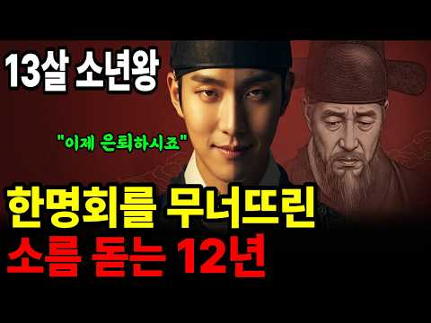
- 설명 앞부분: 계유정난의 설계자, 조선 최대의 권신 한명회를 손끝 하나 안 대고 무너뜨린 왕 — 우리가 "온화한 성군"으로 기억하는 조선 9대 성종의 진짜 얼굴. 1469년 음력 11월 28일, 진시. 경복궁 자미당에서 조선의 왕이 눈을 감았습니다. 그리고 해가 지기 전, 열세 살 소년이 그 자리에 앉았습니다. 단 하루 만에, 나라의 주인이 바뀌었습니다. 왕위 계승 순서로는 세 번째, 네 번째. 죽은 할아버지 세조의 말 한마디가, 그 소년을 왕으로 만들었습니다. 그 뒤에는 계유정난의 설계자, 세조가 "나의 장자방"이라 부른 남자 — 한명회. 소…
- 같은 채널 평소 대비 ×823.6 (채널 최근 롱폼 중앙값 854회) · 평소 영상: 청나라 볼모에서 조선의 왕이 된 효종, 10년 북벌의 비극ㅣ인조는, 왜 아들 소현세자를 … (924회) / 조선 시대 여자로 태어난다는 것, 500년의 지옥 ∣ 그 지옥을 뚫은 여자들 ∣ 한국사 … (783회)
- 대본 없음 (설명) — 음성인식이 끝나면 도입부·흐름이 들어감
- 댓글 241/242: 좋은 점 — 영상 7 · 감사·응원 13 · 더 알고 싶은 것 2 · 아쉬운 점 — 영상 4 · 반박·불만 — 의견 다름 1 · 정치·사회 4 · 경험 공유 3 · 구독·다음 기대 3
  - 좋은 점 — 영상 👍28 “성종 대단한 왕이십니다.좋은이야기 잘봤습니다”
  - 좋은 점 — 영상 👍12 “유익한 내용이네요👍🏻 잘 봤습니다 ☺️”
  - 감사·응원 👍21 “성종에 대해서 많이 알게 되었습니다. 감사합니다.”
  - 감사·응원 👍12 “성종임금을 다시 보게 되는 영상이였습니다. 한명회는 끝까지 안 변했네요. 예나 지금이나 왕의 자리가 저렇게도 힘든 자리였네요. 성종의 지혜로운 발현이 있기까지 얼마나 고심하고 고심했을지 위로와 감사를 드리며 훌륭하십니다_()_”
  - 더 알고 싶은 것 👍3 “이렇게 멋지신 분인 줄 몰랐네요 영상으로나마 잘 알게 되어 감사합니다 강남구 선릉 맞나요? 현시대 좋은 장소에 계서서 다행입니다.”
  - 더 알고 싶은 것 👍1 “칼도 없었고, 사약도 없었습니다. 그런데 권력은 움직였습니다. 1481년 압구정 사건에서 성종은 한명회의 요구를 받아들이지 않았고, 결국 한명회를 추국하라는 명까지 내렸습니다. 여러분은 이 장면을 어떻게 보시나요? 온화한 성군의 원칙적인 대응이었을까요, 아니면 거대한…”
  - 아쉬운 점 — 영상 👍3 “성종임금님 칼을 대지 않고도 한명회를 처리 하였거늘 연산군 어머니도 그리 하였다면 어땠을까요. 역사에 만약이란 말은 부질멊지만요 그러나 후대 우리에게 가르침이 되거 늘 가설을 생각하며 아쉬움도 가져 봅니다”
  - 아쉬운 점 — 영상 👍1 “재미있긴 하지만 같은 내용이 계속 반복되다보니 살짝 몰입이 안되네요 ㅠㅠ”
  - 반박·불만 — 의견 다름 👍8 “이야~ 대단한 왕이였네요. 끈기만 있다고 되는 일이 아니죠. 판을 읽는 눈이 있어야하고 그 판을 자신에게 끌어 올수있는 지혜가 있어야하죠. 13살부터 그런 생각을 했다는건 한 마디로. 천재다!!”
  - 정치·사회 👍5 “조선은. 세종이 없었다면 태어나지 말아야할 왕조다. 백성 의 절반이. 종놈. 노비였다니 말이되나, 나라가 동족의 피를 뻘아먹 고 살아 온것이 아닌가, 조선이 지속 됐다면 국민의 절반이 노비, 종 놈이란 말 아닌가,”
  - 정치·사회 👍0 “역사를 재미있게 하기위해서 ...아니면 잘난척 하기위해서.../한명희가 나이몆에 출사를 했는대../조선은 세종시대부터 너무 평화로와./심심해서 자기들끼리 싸운거다./인간은 너무 평화로우면 자기들끼리 싸운다../그게 한국역사다.../지금도 한국은 자기들끼리 피터지게 잘…”
  - 경험 공유 👍89 “세조도 한명회도 자식들이 요절하는 지옥을 겪었네요. 인과응보겠지요.”
  - 경험 공유 👍57 “내가 생각 하는 조선의 최고의 왕이라면 세종 성종 정조 이렿게 봅니다 영상 잘봤습니다^^”
  - 구독·다음 기대 👍4 “사람은 착하게 살면 끝이 좋다라는 교훈, 역사를 통해서 배웁니다~다음영상도 기대합니다”
  - 구독·다음 기대 👍4 “잘 들었습니다 구독했습니다”

### 33. 양반도 부러워했다?! 백정의 충격적인 사생활!! ∣ 조선의 백정 ∣ 한국사

- https://www.youtube.com/watch?v=um-bKohXZK0 · 스토리퐁당 · 구독자 1,080 · 조회수 238,356 (×220.7, 하루 2,758.9) · 좋아요 1,153 (0.5%) · 26분 · 2026-07-26 · 주제 묶음 4. 한국 근현대사 · 형식 정보·해설 (그 밖) · 폴더 `W_um-bKohXZK0` (웹 승인)
- 썸네일: 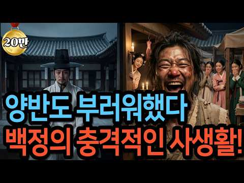
- 설명 앞부분: 조선에서 소 한 마리를 잡으면 집 한 채 값이 손에 들어왔습니다. 💰 그 돈을 만진 사람은 정승도, 판서도 아닌 바로 '백정'이었습니다. 길에서 마주치면 양반이 침을 뱉고 지나가던 사람. 죽어서 족보에 이름 석 자조차 올리지 못했던 사람. 그런데 그의 곳간에는 그를 무시하던 양반보다 더 많은 곡식이 쌓여 있었습니다. 🐂 가장 낮은 자리에 있던 사람이 어떻게 양반도 쉽게 만지지 못하던 돈을 손에 쥐게 됐을까요? 그리고 그렇게 돈을 벌고도 왜 죽을 때까지 그 신분을 벗어나지 못했을까요? 🤔 이 영상에서는 👇 백정이 사실은 노비가 아니…
- 같은 채널 평소 대비 ×868.3 (채널 최근 롱폼 중앙값 274회) · 평소 영상: 한국사 최강 인간병기 척준경! ∣ 그는 영웅인가? 역적인가? ∣ 척준경 ∣ 고려사 (282회) / 영국은 왜 4개국일까? 나라가 쪼개진 충격적 이유! ∣ 세계사 (267회)
- 대본 없음 (설명) — 음성인식이 끝나면 도입부·흐름이 들어감
- 댓글 96/96: 좋은 점 — 영상 1 · 감사·응원 1 · 더 알고 싶은 것 1 · 아쉬운 점 — 영상 0 · 반박·불만 — 의견 다름 5 · 정치·사회 3 · 경험 공유 0 · 구독·다음 기대 0
  - 감사·응원 👍1 “감사합니다❤❤”
  - 더 알고 싶은 것 👍13 “백정은 조선건국과 맞다아 있는 것 같습니다. 태조 이성계의 조상이 어디입니까? 북방 이민족이죠. 이들도 고려시대에서는 화척이였습니다. 하지만 이들은 세력을 가지고 성장하여 고려를 무너뜨리고 새로운 나라(조선)를 세웁니다. 그 조선에게서 (무장세력으로 강해질 수 있던)…”
  - 반박·불만 — 의견 다름 👍2 “글쎄요?”
  - 반박·불만 — 의견 다름 👍1 “무슨 말도 안돼. 백정이 얼마나 천시받고 굶주리고 살았는데---소가 전부 지 것인가. 남의 소 잡아주는 품삵 조금 더 받는정도인데. 소피를 가져오고 그걸 먹고.. 뭔 말도 안되는 소리가 곳간에 양식이 넘쳐 나다니..”
  - 정치·사회 👍12 “조선이라는 나라가 그냥 개막장 나라 였음.”
  - 정치·사회 👍1 “조선에서 저돈을 지킬수 있었을까? 잡아서 주리틀면 돈 다 뺏김 지금 국회의원 봐라 한자 못 읽으면 눈 뜨고 코베임 ai가 이상하게 알려주내”

### 34. 조선에는 원래 제사가 없었다? 제사는 언제부터 지냈나?

- https://www.youtube.com/watch?v=LMJeEzBPcwg · 인류의모든기록 · 구독자 380 · 조회수 83,435 (×219.6, 하루 2,697.0) · 좋아요 331 (0.4%) · 15.3분 · 2026-09-20 · 주제 묶음 3. 조선 · 형식 야담·옛날이야기 · 폴더 `W_LMJeEzBPcwg` (웹 승인)
- 썸네일: 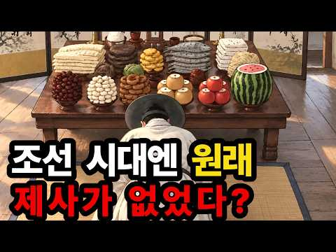
- 챕터: 0:00 제사가 처음엔 불법이었다? · 0:39 고려 사람들은 왜 절에 갔을까 · 1:34 아들만 제사 지내지 않았다? · 2:33 조선이 제사를 강요한 진짜 이유 · 4:16 제사 안 지내면 벌을 받았다고? · 6:09 왜 장남이 제사를 도맡게 됐을까 · 7:07 족보의 진짜 나이는 몇 살일까 · 9:09 성씨가 없던 사람들이 더 많았다? · 10:47 집성촌은 언제부터 생겨났을까 · 12:03 양반이 갑자기 늘어난 이유는? · 13:10 한국인이 가족 관계에 집착하는 이유 · 13:52 전통은 원래 변하는 것일까
- 설명 앞부분: 우리가 아주 오래된 전통이라 믿는 제사와 족보, 사실은 조선 왕조 나이의 절반도 안 됩니다. 태조부터 세종까지, 나라가 벌까지 내리겠다며 밀어붙이고 나서야 겨우 뿌리내린 이야기입니다. 고려 사람들은 조상이 돌아가시면 절에 갔습니다. 그런데 조선이 세워지고 나라가 사당을 세우고 제사를 지내라 명해도, 사대부들조차 몇십 년을 따르지 않았습니다. 현존하는 가장 오래된 족보는 조선이 세워진 지 팔십 년도 더 지난 1476년에야 만들어졌고, 그 무렵에도 인구 상당수는 성씨조차 없었습니다. 우리가 당연하게 여기는 제사와 족보, 집성촌이 실은…
- 같은 채널 평소 대비 ×77.7 (채널 최근 롱폼 중앙값 1,074회) · 평소 영상: 지구에 물이 어떻게 만들어 졌을까? 물의 기원 (1,074회) / 병원도 의사도 없던 시절, 고대인류는 쌍둥이를 어떻게 낳았을까? (1,059회)
- 대본 없음 (설명) — 음성인식이 끝나면 도입부·흐름이 들어감
- 댓글 50/50: 좋은 점 — 영상 0 · 감사·응원 0 · 더 알고 싶은 것 0 · 아쉬운 점 — 영상 0 · 반박·불만 — 의견 다름 2 · 정치·사회 1 · 경험 공유 0 · 구독·다음 기대 0
  - 반박·불만 — 의견 다름 👍8 “고려시대에는 절이 정교유착을 가져오니 유교를 받아들이는 조선은 종교를 배척해야 했고 그래서 이런 풍습으로 백성을 달랜다고 했지만 글쎄,,, 결론은 제사가 오래된 풍습도 아닌데 왜 그리 고부갈등의 근원이 되는지 무지몽매다.”
  - 반박·불만 — 의견 다름 👍2 “고려말 부터 제사를 지냈는데 자세히 알게 해주지 무조건 없다는식으로 이건 아니죠 지금식으로가 그시대로 지내는것이지 요즘 바나나 올리는것처럼”

### 35. 조선의 왕들이 단명한 이유, 매일 먹던 '이것'이 독이었던 충격적인 사실ㅣ조선왕평균수명46세

- https://www.youtube.com/watch?v=aDk8BnSRa5o · 역사MSG · 구독자 2,530 · 조회수 550,723 (×217.7, 하루 4,128.9) · 좋아요 4,923 (0.9%) · 25.3분 · 2026-06-09 · 주제 묶음 3. 조선 · 형식 정보·해설 (그 밖) · 폴더 `W_aDk8BnSRa5o` (웹 승인)
- 썸네일: 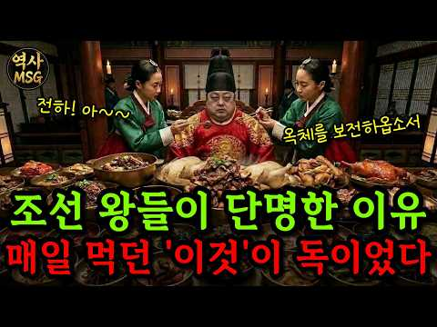
- 설명 앞부분: 🫅조선의 왕은 누구보다 잘 먹고, 최고의 의료와 보살핌을 받았습니다. 그런데 평균 사망 나이는 고작 46세. 같은 궁궐에서 소박하게 먹고 뛰어다닌 내시는 70세까지 살았는데 말이죠. 24년 차이, 대체 이유가 무엇일까요? 🍚세종의 식습관부터 정조의 종기, 영조의 83세 장수 비결까지 매일 먹던 밥상, 수라상이라는 시스템이 왕의 몸을 어떻게 망가뜨렸는지, 실록 기록으로 하나씩 풀어봤습니다. 🕛타임라인 [조선왕조실록 (朝鮮王朝實錄)] 세종실록 세종 30년 세조실록 문종실록 효종실록 정조실록 성종실록 [승정원일기 (承政院日記)] [의학…
- 같은 채널 평소 대비 ×1,408.5 (채널 최근 롱폼 중앙값 391회) · 평소 영상: 불멸의 여신을 버리고 늙은 아내에게 돌아간 남자, 오디세우스 ∣ 오디세이아 (391회) / 태어나자마자 엄마를 잃고 모두가 떠나 혼자였던 아이, 그 쓸쓸한 17년의 삶 ∣ 단종이홍… (418회)
- 대본 없음 (설명) — 음성인식이 끝나면 도입부·흐름이 들어감
- 댓글 593/593: 좋은 점 — 영상 5 · 감사·응원 2 · 더 알고 싶은 것 4 · 아쉬운 점 — 영상 4 · 반박·불만 — 의견 다름 8 · 정치·사회 5 · 경험 공유 6 · 구독·다음 기대 0
  - 좋은 점 — 영상 👍1 “아주 좋은 내용인 것 같네요.”
  - 좋은 점 — 영상 👍0 “소식이 장수하는데 도움되는건 맞음”
  - 감사·응원 👍4 “감사합니다 ㆍ귀농해서80세이나에 텃밭농부로삽니다 아파트생활62세에치우고 시골생활ㆍ건강비결입니다ㆍ호미ᆢ 텃밭살길입니다ᆢ”
  - 감사·응원 👍0 “미국 동남부며 성경적 삶의 방향으로 살고있습니다. 시아버지가 90세로 키는 약 168cm 에 55kg 이 채 안돼세요. 평생 그 몸무게 유지되시는게, 식사량 자체가 소식에 부지런하셨습니다. 왜 소식이 답인가? 를 보니 원래 우리몸이 그리 많은 열량을 필요로 하지않는답…”
  - 더 알고 싶은 것 👍41 “왕이 100보 이상 걸을 일이 있을까요? 가마타고 댕기지~ 그리고 대부분 종기로 단명했는데, 옷을 잔뜩 껴입고 온종일 앉아있고, 결정적으로 잘 안 씻어서 그렇습니다. 비누가 수십억의 인류를 살렸다는 말이 있죠~”
  - 아쉬운 점 — 영상 👍0 “무지지루하네서론이너무길어”
  - 아쉬운 점 — 영상 👍0 “어영부영 장황 ... 중언부언 ... 조회수 낚시 ...”
  - 반박·불만 — 의견 다름 👍2 “일찍죽은 이유는 딱 한가지다. 목욕을 안하니까 일찍 죽은거다. 우리도 60.70년대 한달에 한번 대중 목욕탕가서 목욕하던시절 등에 종기가 나 '이명래고약' 붙이고살던 시절이 있었다. 조선시대에는 수십년 목욕을 안하니 늘 종기에 죽었지.. 저 종기가 알콜 몃방울이면 낫…”
  - 반박·불만 — 의견 다름 👍1 “조선시대에 항생제가 없었던 것이 아닙니다. 약초나 침으로 균을 잡았는데 균종에 적합한 약재를 찾지 못한거지요.”
  - 정치·사회 👍0 “나라가 망했으니 뭔짓을 못하겠어요.”
  - 정치·사회 👍0 “수라상이 문제가 아니라 항상 무예를 수련하고 첩들을 멀리하고 탐관오리들을 가까이 아니하고 충신들과 항상 교류하며 암행어사들을 파견하여 민정을 살피고 육군과 수군을 기르고 정사를 펼치면 성군이 될수있고 수명도 장수할수 있다 임금은 모든것을 잘할수는 없다 오직 인재를 등…”
  - 경험 공유 👍0 “왕들도 몰랐던 의학 지식을 내가 세상에 전한 게 아닐까? "아는 것이 힘이다." 건강 유지 방법에 대해서도 잘 알아야 되고 적들에 대해서도 잘 알아야 한다.”
  - 경험 공유 👍0 “내가 이렇게 된게… 우리 할머니때문인거랑 같은거구나…”

### 36. “누가 이순신을 사?” 미국서 무시당한 청년…결국 25만 부 팔아치웠다

- https://www.youtube.com/watch?v=olrlcl1HoCo · 최기훈TV · 구독자 611 · 조회수 131,931 (×215.9, 하루 4,522.4) · 좋아요 964 (0.7%) · 17.4분 · 2026-09-22 · 주제 묶음 3. 조선 · 형식 애니메이션·지도 · 폴더 `W_olrlcl1HoCo` (웹 승인)
- 썸네일: 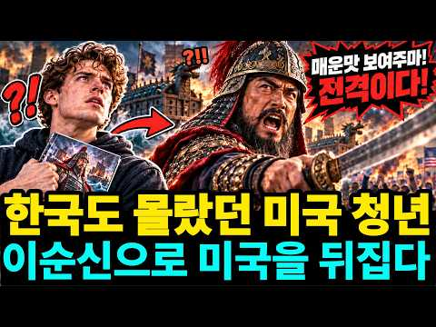
- 챕터: 0:00 이순신 만화로 미국을 뒤집은 청년 · 1:28 평범한 청년 온리 콤판의 새로운 도전 · 3:18 철저한 역사 고증과 글로벌 제작진 · 4:43 냉혹한 미국 만화 시장의 문전박대 · 6:44 자동차 트렁크에서 시작된 정면 돌파 · 9:21 이순신 만화 25만 부 판매의 비밀 · 13:02 대한민국으로 역수입된 이순신 만화 · 14:17 한 이방인이 보여준 K콘텐츠의 힘
- 설명 앞부분: “초능력도 없는 400년 전 조선 장군을 어떤 미국인이 돈 주고 사겠습니까?” 한국어도 못하고 한국에 가본 적도 없었던 미국 청년 온리 콤판. 그는 우연히 드라마 「불멸의 이순신」을 접한 뒤, 충무공 이순신의 삶에 완전히 매료됩니다. 하지만 이순신 장군을 주인공으로 만든 만화는 미국의 유명 출판사들로부터 연이어 거절당했습니다. 스파이더맨과 배트맨이 지배하는 미국 만화 시장에서 낯선 조선의 장군은 “절대 팔리지 않을 소재”로 평가받았기 때문입니다. 그러나 콤판은 포기하지 않았습니다. 직접 독립 출판사를 세우고 자동차 트렁크에 만화책…
- 같은 채널 평소 대비 ×669.7 (채널 최근 롱폼 중앙값 197회) · 평소 영상: 천 원짜리 팔아 4천억 남긴 다이소… 5천억 원을 한 번에 쓴 이유 (279회) / 군부대는 그대로인데 가게는 문을 닫는다… ‘부대 앞 불패 신화’가 끝난 이유 (287회)
- 대본 없음 (설명) — 음성인식이 끝나면 도입부·흐름이 들어감
- 댓글 24/28: 좋은 점 — 영상 0 · 감사·응원 4 · 더 알고 싶은 것 1 · 아쉬운 점 — 영상 0 · 반박·불만 — 의견 다름 0 · 정치·사회 1 · 경험 공유 0 · 구독·다음 기대 0
  - 감사·응원 👍11 “온리 콤판은 참으로 대단한 분이군요. 우리의 영웅을 세계에 알려주어서 고맙습니다. 한국에서도 이 분을 위해서 무엇인가 해주었으면 합니다. 교보문고에서 찾아보니까 품절이네요. 한국에서도 이 분 작품 구할 수 있는지 모르겠습니다.”
  - 감사·응원 👍10 “대단하네요 이순신 장군님 을 아려주셨어 감사합니다”
  - 더 알고 싶은 것 👍6 “한국판 번역본 어디서 살수 있나요?”
  - 정치·사회 👍19 “불멸의 이순신 사극은 남자라면 안볼수 없게끔 만든 전쟁 정치 명작이고 외국인도 감동받을꺼다 이 대작 드라마를 넷플릭스에 올려야 한다”

### 37. [미스터리] 1803년 일본 해안에 UFO가 내렸다? 붉은 머리 여인과 끝내 열리지 않은 상자

- https://www.youtube.com/watch?v=dJJri3JiE_0 · 미스터리세상 · 구독자 324 · 조회수 68,155 (×210.3, 하루 6,213.2) · 좋아요 240 (0.4%) · 13.4분 · 2026-10-10 · 주제 묶음 1. 역사 일반·이야기 · 형식 정보·해설 (그 밖) · 폴더 `W_dJJri3JiE_0` (웹 승인)
- 썸네일: 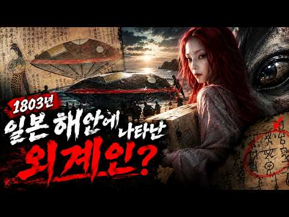
- 챕터: 0:00 바다에서 온 둥근 그림자 · 1:28 그녀는 상자를 놓지 않았다 · 3:18 어느 나라 사람도 아니었다 · 4:38 노인이 말한 상자 속의 것 · 6:45 7년 전에도 같은 배가 있었다 · 8:07 기록마다 달라지는 얼굴 · 9:55 천이백 년 전의 금색 공주 · 11:28 UFO가 아니라 바다였다
- 설명 앞부분: 1803년 2월 22일, 일본 히타치의 바닷가. 돛도 노도 없는 둥근 배가 파도를 타고 곧장 해안으로 밀려왔습니다. 유리창 너머에는 붉은 머리, 붉은 눈썹의 낯선 여인이 있었고, 그녀는 두 팔로 네모난 흰 상자를 끝까지 놓지 않았습니다. 사람들은 이 배를 우츠로부네, 속이 텅 빈 배라고 불렀습니다. 그리고 20세기, 누군가는 이 기록을 전혀 다른 눈으로 읽기 시작했습니다. 에도 시대의 UFO 사건이라고요. 이 영상에서는 에도 시대 문헌에 남은 기록만을 따라가 봅니다. 그녀는 어느 나라 사람이었는지, 상자 속에는 무엇이 있었는지, …
- 같은 채널 평소 대비 ×619.6 (채널 최근 롱폼 중앙값 110회) · 평소 영상: [미스터리]전문가들이 경악한 동굴 속 흉터의 정체, 그들은 대체 무엇을 가두려 했는가? (114회) / 검은 눈의 아이들, 전 세계 목격담의 실체 (106회)
- 대본 없음 (설명) — 음성인식이 끝나면 도입부·흐름이 들어감
- 댓글 12/15: 좋은 점 — 영상 0 · 감사·응원 0 · 더 알고 싶은 것 0 · 아쉬운 점 — 영상 0 · 반박·불만 — 의견 다름 1 · 정치·사회 0 · 경험 공유 0 · 구독·다음 기대 0

### 38. 사극에서 절대 보여주지 않는 조선 노비의 진짜 밥상 ∣ 정사 ∣ 야사

- https://www.youtube.com/watch?v=N6THuYELTWU · 역사 만화경 · 구독자 574 · 조회수 117,596 (×204.9, 하루 771.2) · 좋아요 884 (0.8%) · 12.8분 · 2026-05-21 · 주제 묶음 3. 조선 · 형식 애니메이션·지도 · 폴더 `W_N6THuYELTWU` (웹 승인)
- 썸네일: 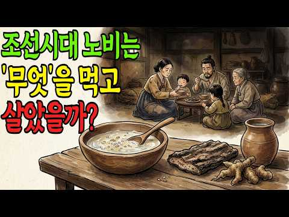
- 설명 앞부분: 사극을 보면 노비는 늘 부엌 한구석에 쪼그려 앉아 있습니다. 주인상을 물리고 식은 밥 한 덩이를 급하게 삼키는 모습. 틀린 장면은 아닙니다. 하지만 그게 전부였을까요? 조선 시대, 사람 셋 중 하나는 누군가의 재산이었습니다. 그 수백만 명이 매일 아침 무엇으로 배를 채웠는지, 조선왕조실록과 고문서 속에 남은 기록을 통해 들여다봅니다. 주인과 똑같은 솥에서 밥을 푸던 노비가 있었고, 자기 땅에서 거둔 곡식으로 가족의 밥상을 차리던 노비도 있었습니다. 반대로, 풀뿌리와 나무껍질로 한 해를 버티다 끝내 흙을 퍼먹은 노비도 있었습니다. …
- 같은 채널 평소 대비 ×319.6 (채널 최근 롱폼 중앙값 368회) · 평소 영상: 감기 한 번에 가족을 잃던 시대 ∣ 조선시대 사람들은 아프면 어떻게 했을까? (368회) / 왕비가 된 지 3년 만에 사약을 받은 연산군의 어머니 폐비 윤씨의 처참한 최후 ∣ 조선왕… (258회)
- 대본 없음 (설명) — 음성인식이 끝나면 도입부·흐름이 들어감
- 댓글 161/161: 좋은 점 — 영상 1 · 감사·응원 8 · 더 알고 싶은 것 1 · 아쉬운 점 — 영상 2 · 반박·불만 — 의견 다름 4 · 정치·사회 9 · 경험 공유 5 · 구독·다음 기대 0
  - 좋은 점 — 영상 👍3 “그렇습니다 보리고개를 모르는사람들은 이해할수 없을것입니다 개떡과 겨빵을 먹어므ㅗ지않은사람들은 믿지못할것입니다 참 유익한 내용입니다 우리는 이시대에 감사함으로 살아야합니다 나누고 도우며 함께사는 마음을 지녀야합니다”
  - 감사·응원 👍24 “먹을것이풍족한시대,에태어난것만으로도축복이다.감사하면서사새요!”
  - 감사·응원 👍5 “모든 게 귀한 시절이었지요 잊혀져 가는 우리의 생활사 감사드립니다”
  - 아쉬운 점 — 영상 👍1 “아무리 찍어내는 ai라지만 제대로 분석좀 하고 올리셨으면 합니다 ai에 다시 검증 해봐 한줄만다시 적어도, 그리고 네이버에만 검색 해봐도 정확한 정보가 나오는데 잘못된 정보가 너무 많네요”
  - 반박·불만 — 의견 다름 👍0 “노비의 일상적인 밥은 보리밥에 고봉밥임... 죽 헛소리”
  - 정치·사회 👍4 “조선시대 세금은 양반.평민.노비 할것없이 5~10%였습니다.식사는 쌀이나 보리와함께 조.수수.피 등 을 혼합해서 먹었고 밥의 양 은 현대인의 3~4배 를 먹었습니다.이런 자료를 어디서 보고 영상 을 올렸는지 모르지만 가뭄에나 힘들었지 못먹고살지 않았습니다.나라에서 구…”
  - 정치·사회 👍4 “자기 동족을 노예로 부리는 나라가 조선”
  - 경험 공유 👍3 “'피죽도 못 먹은 얼굴'이라는 표현이 떠오르는 내용이네요. 벼들 사이로 삐죽 나온 볼품없는 풀떼기 같은 피를 다 먹었었다니 죽을 때까지 그런 배고픔은 안 겪고 싶다는.”
  - 경험 공유 👍0 “80년대 저희집시골논농사가 80마지기 넘게 농사를짓다보니 보리밥을 안먹어봄 지금도 부모님이 농사일하시는데 힘들어하시네요”

### 39. 75 충격적인 역사 사진, 꼭 보세요!

- https://www.youtube.com/watch?v=wT9qEomWsew · 사진으로 보는 역사 · 구독자 3,510 · 조회수 717,547 (×204.4, 하루 69,593.2) · 좋아요 3,982 (0.5%) · 30.8분 · 2026-10-11 · 주제 묶음 1. 역사 일반·이야기 · 형식 정보·해설 (그 밖) · 폴더 `W_wT9qEomWsew` (웹 승인)
- 썸네일: 
- 설명 앞부분: 시청해 주셔서 감사합니다. 📜 사진으로 보는 역사**는 한 장의 사진 속에 담긴 시대의 흔적과 사람들의 이야기를 통해 과거를 새롭게 발견하는 역사 다큐멘터리 채널입니다. 모든 영상은 역사 자료 조사, 사실관계 검증, 세심한 기록물 분석 및 신중한 디지털 복원 작업을 바탕으로 제작됩니다. 역사 사진과 원본 문서, 각종 기록 자료를 면밀히 조사하여 가능한 한 정확하게 촬영 장소와 연도, 역사적 사건, 그리고 시대를 살아간 인물들을 밝혀내고자 합니다. 시간의 흐름 속에서 희미해진 사진의 세부적인 흔적은 디지털 복원 기술을 통해 조심스럽…
- 대본 없음 (설명) — 음성인식이 끝나면 도입부·흐름이 들어감
- 댓글 31/38: 좋은 점 — 영상 0 · 감사·응원 0 · 더 알고 싶은 것 0 · 아쉬운 점 — 영상 0 · 반박·불만 — 의견 다름 1 · 정치·사회 2 · 경험 공유 0 · 구독·다음 기대 0
  - 정치·사회 👍6 “좌파적 성격을 띄지 않기 ᆢ”
  - 정치·사회 👍1 “🕷️우크라이나 현실 전쟁이 수년간 지속되면서 국방비와 세수 확보가 절실해진 우크라이나 정부는 최근 온라인 성인물(포르노) 산업의 합법화 및 비범죄화를 본격적으로 논의하기 시작했습니다.우크라이나 현실 전쟁이 수년간 지속되면서 국방비와 세수 확보가 절실해진 우크라이나 정…”

### 40. 예수는 실존 인물이었을까? 역사학이 답한 충격적인 진실

- https://www.youtube.com/watch?v=xDel5Oig1HQ · 에덴코덱스 · 구독자 256 · 조회수 51,289 (×200.3, 하루 404.0) · 좋아요 370 (0.7%) · 13.4분 · 2026-06-16 · 주제 묶음 1. 역사 일반·이야기 · 형식 정보·해설 (그 밖) · 폴더 `W_xDel5Oig1HQ` (웹 승인)
- 썸네일: 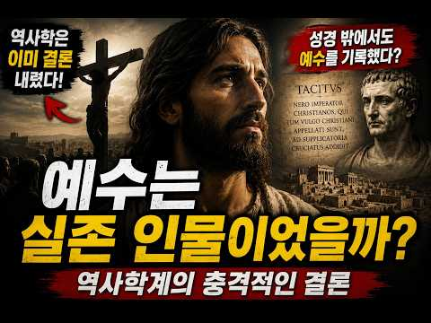
- 설명 앞부분: 예수는 정말 실존 인물이었을까요? 많은 사람들은 아직도 예수의 실존 여부가 논쟁 중이라고 생각합니다. 하지만 놀랍게도 현재 역사학계의 주류 견해는 이미 어느 정도 결론에 도달해 있습니다. 이번 영상에서는 종교적 믿음을 떠나 역사학, 고고학, 문헌학의 관점에서 예수의 실존 여부를 살펴봅니다. 로마 역사가 타키투스의 기록 유대 역사가 요세푸스의 증언 초기 기독교 운동의 역사적 흔적 예수 신화론이 학계에서 받아들여지지 않는 이유 역사학이 인정하는 것과 인정하지 않는 것 예수는 실제로 존재했을까요? 그리고 역사학은 어디까지 답할 수 있을…
- 같은 채널 평소 대비 ×378.5 (채널 최근 롱폼 중앙값 136회) · 평소 영상: 성경 밖에서 발견된 예언자 이사야? 2700년 전 인장 자국의 비밀 (140회) / 3000년 전 항아리에 적힌 이름… 히브리어의 역사를 바꿨나? (131회)
- 대본 없음 (설명) — 음성인식이 끝나면 도입부·흐름이 들어감
- 댓글 59/59: 좋은 점 — 영상 0 · 감사·응원 1 · 더 알고 싶은 것 1 · 아쉬운 점 — 영상 1 · 반박·불만 — 의견 다름 1 · 정치·사회 1 · 경험 공유 3 · 구독·다음 기대 0
  - 더 알고 싶은 것 👍3 “예수님을부정하는자들의머리속에는과연 뇌가있을까 그것이궁금하다”
  - 아쉬운 점 — 영상 👍2 “예수가 불교를 공부했을 가능성은 1,000%,,,,,다,,,,,아니,,,, 1만 프로가 넘는다,,, 또한 요셉과 세례 요한이 인도 종교의 영향을 받은 엣세네파의 일원이었다는 것을 증명하는 사건은 예수가 세례 요한에게 세례를 받았다는 것이다, 엣세네파 일원이었던 요셉등…”
  - 반박·불만 — 의견 다름 👍2 “예수가 불교를 공부했을 가능성은 1,000%,,,,,다,,,,,아니,,,, 1만 프로가 넘는다,,, 또한 요셉과 세례 요한이 인도 종교의 영향을 받은 엣세네파의 일원이었다는 것을 증명하는 사건은 예수가 세례 요한에게 세례를 받았다는 것이다, 엣세네파 일원이었던 요셉등…”
  - 경험 공유 👍4 “영적 지식은 의문을 던져서 알게 되는 것이 아니다. 믿음으로 시작해야 올바른 지식을 취득할 수 있다. 기왕에 나도 모른 채 알게 된 지식이라면, 인간이 머리에서 생겨나지 않았다는 사실을 깨닫는 데서 출발한다.”
  - 경험 공유 👍2 “예수가 불교를 공부했을 가능성은 1,000%,,,,,다,,,,,아니,,,, 1만 프로가 넘는다,,, 또한 요셉과 세례 요한이 인도 종교의 영향을 받은 엣세네파의 일원이었다는 것을 증명하는 사건은 예수가 세례 요한에게 세례를 받았다는 것이다, 엣세네파 일원이었던 요셉등…”

