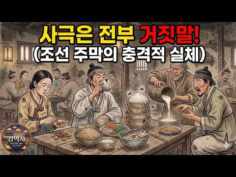
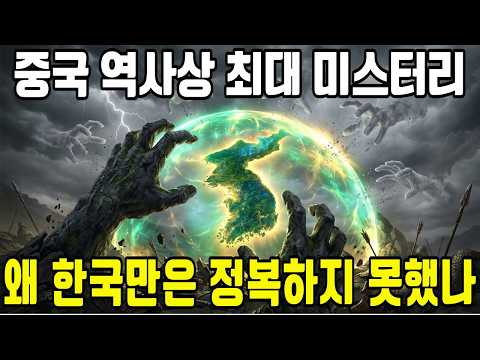
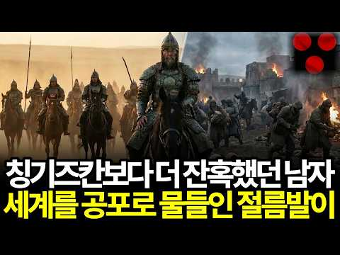
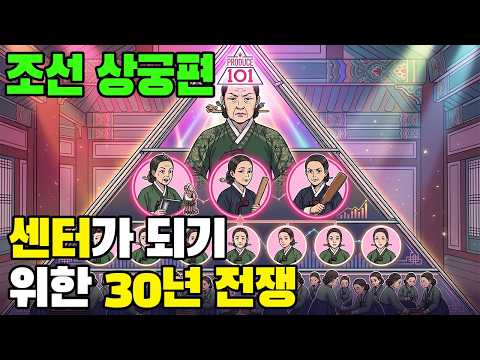
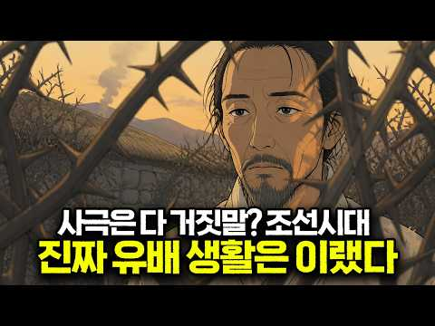
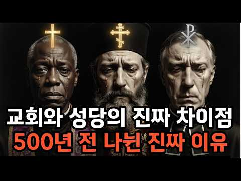
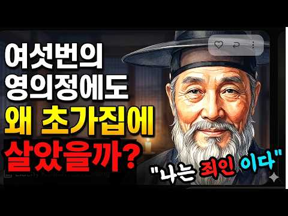
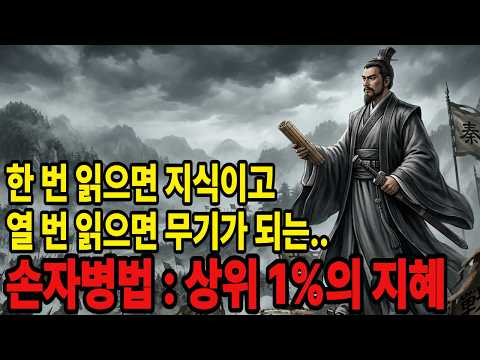

# 역사 — 성공 사례 분석: 사례별 자세히 #1–#40

`analysis.md` 의 9번 (같은 # 번호). 자동 생성 — `tools/success_analysis.py` v1.4.1 (2026-10-16 10:16 UTC). ※ 연구·교육용 — 투자 권유가 아님.

### 1. 미국도 무너질까? 2000년동안 무너진 패권국들의 공통점 (10분 요약하려다 20분 요약 된 세계사)

- https://www.youtube.com/watch?v=e6jRgQdtI8M · 잡식이냥 · 구독자 2,220 · 조회수 1,079,330 (×486.2, 하루 51,308.7) · 좋아요 2,382 (0.2%) · 21.1분 · 2026-09-25 · 주제 묶음 5. 세계사·서양사 · 형식 정보·해설 (그 밖) · 폴더 `W_e6jRgQdtI8M` (웹 승인)
- 썸네일: 
- 챕터: 0:00 인트로 (세계패권의 역사) · 0:31 로마제국의 패권과 몰락 · 5:17 로마제국 이후 천년의 세월 · 7:01 스페인과 포루투갈의 패권과 몰락 · 9:30 네덜란드의 패권과 몰락 · 13:11 영국의 패권과 몰락 · 16:12 다음 세계 패권국이자 현재의 패권국 미국 · 20:12 마무리 정리 (세계패권은 이렇게 무너졌다.. 그럼 미…
- 설명 앞부분: 세계패권의 이동과 몰락에 대해 알아보쟈냥
- 같은 채널 평소 대비 ×2,361.8 (채널 최근 롱폼 중앙값 457회) · 평소 영상: 쉽게 이해하는 [이평선, 일목균형표, 볼린저밴드, 거래량, 매물대] (중학생용, 이것만 … (457회) / 대체 왜 여기서까지 벗는걸까? 알수록 흥미로운 이색문화 (459회)
- 대본 없음 (설명) — 음성인식이 끝나면 도입부·흐름이 들어감
- 댓글 438/438: 좋은 점 — 영상 4 · 감사·응원 7 · 더 알고 싶은 것 0 · 아쉬운 점 — 영상 5 · 반박·불만 — 의견 다름 11 · 정치·사회 54 · 경험 공유 18 · 구독·다음 기대 1
  - 감사·응원 👍2 “재미있게 잘 보았습니다. 감사합니다.”
  - 아쉬운 점 — 영상 👍0 “으 AI 묻었다... 내용 괜찮은데 굳이 사진 몇개만 짜집기해도 될걸 왜 AI 쓰는지 모르겠음 그냥 이런 유튜버는 그냥 신뢰가 안감”
  - 반박·불만 — 의견 다름 👍3 “30년전 고딩때 역사쌤이 패권은 계속 움직인다고 쭉 설명하면서 미국다음은 아시아니까 정신 차려야한다 했는데 중국한테 가기전에 우리가 먹어야한다고.. 그땐 말도안된다 생각했는데 요즘 미국보면 진짜 영원한건 없다😅”
  - 반박·불만 — 의견 다름 👍0 “미국 내려가면 누가 지구 no.1 자리 먹을건데? 핑핑이 독재 통제국가 빅브라더가 주인이 될 리는 없으니깐 방구석에서 헛소리 그만 짖어대고 꿈깨라..😂😂😂😂😂”
  - 정치·사회 👍11 “이후 패권국이 될만한 자격이 있는 나라가 없다는데 큰 문제가 있다! 그냥 우리나라가 패권국이 되는 수밖에”
  - 정치·사회 👍3 “헛소리들, 댓글다는 분들이 너무 미국을 모르는군요.미국의 Global 패권은 현재 탄탄합니다. 여타 제국들과 달리, 한두사람 제한된 이기주의에서 나오는 통치가 아니고, 다수 국민과 의회가 세계를 관리한다는 점에서 로마 몽골 사라센 영연방 제국과다릅니다. 대통령은 행동…”
  - 경험 공유 👍2 “내가 예언하지 미국은 세상의 종말이 오기 전까지 미국은 건제하다”
  - 구독·다음 기대 👍13 “와 내용 너무 좋네요 구독하고 갑니다”

### 2. 사극에는 절대 나올 수 없는 조선 주막의 적나라한 민낯

- https://www.youtube.com/watch?v=cE8_zCNVONE · 한끗역사 · 구독자 3,260 · 조회수 989,304 (×303.5, 하루 7,091.2) · 좋아요 5,342 (0.5%) · 29.4분 · 2026-05-29 · 주제 묶음 3. 조선 · 형식 정보·해설 (그 밖) · 폴더 `W_cE8_zCNVONE` (웹 승인)
- 썸네일: 
- 설명 앞부분: 사극 속 주막은 전부 거짓말이었다! 넓고 깔끔한 공간에서 국밥을 먹고 회포를 푸는 낭만적인 장소? 실제 주막은 가로 2.5m, 세로 1.8m 방에 10명이 엉켜 자고, 바닥 온도가 39도까지 올라가고, 벽 하나 너머에서 말이 싸우는 곳이었습니다. 그런데 이 허름한 초가삼간이 조선 전국에 12만 개. 지금 편의점 세 체인을 합쳐도 5만 5천인데, 그 두 배가 넘었습니다. 🔹 2000대 1 경쟁률, 과거시험을 앞둔 선비들은 왜 오직 문경새재만 고집했을까? 🔹 주막에서 술을 마신 5명은 합격하고, 안 마신 1명은 떨어진 전설의 진실 🔹…
- 같은 채널 평소 대비 ×498.5 (채널 최근 롱폼 중앙값 1,984회) · 평소 영상: 알고보면 소름돋는 비밀이 숨겨져 있다? 조선시대 겸재 정선의 '이 그림' (2,027회) / 교과서가 숨긴 불편한 진실! 세종의 휘황찬란한 업적은 전부 다른 사람 성과를 가로챈것이었… (1,942회)
- 대본 없음 (설명) — 음성인식이 끝나면 도입부·흐름이 들어감
- 댓글 271/271: 좋은 점 — 영상 6 · 감사·응원 4 · 더 알고 싶은 것 3 · 아쉬운 점 — 영상 2 · 반박·불만 — 의견 다름 1 · 정치·사회 7 · 경험 공유 8 · 구독·다음 기대 1
  - 좋은 점 — 영상 👍8 “역사를 아는 유익함과 동시에 현재 대한민국에 태어난 사람으로서 조선 시대는 사람이 인간으로서 너무 살기 힘들었겠다 싶다”
  - 좋은 점 — 영상 👍4 “19:25 거꾸로 생각해 보면 말입니다 조선에서도 여성의 사회 진출이 시작되고 있었고 자영업자들의 경제활동도 생각보다 활발했다는 점도 짐작해 볼 수 있겠습니다 우리가 생각하는 것만큼 꽉 막힌 사회가 아니였다는 추론도 가능 미국도 1920년이 되어서야 여성에게 투표권이…”
  - 감사·응원 👍8 “감사합니다 구독 좋아요 했어요”
  - 감사·응원 👍3 “좋은영상 감사합니다. 구독누르고 갑니다”
  - 더 알고 싶은 것 👍3 “여러분들은 중요한 일이 있을 때 지키는 나만의 징크스같은게 있으신가요? 댓글로 알려주세요”
  - 아쉬운 점 — 영상 👍2 “몇번본거 짜집기 😂”
  - 아쉬운 점 — 영상 👍1 “차단 ㅉㅉ 잘못된정보 투성 뇌피셜”
  - 반박·불만 — 의견 다름 👍1 “ㅠㅠㅠ, 큰 시험보는날 아침 , 아 글쎄 마눌님이 미역국, 보기좋게 꽝! 고마워 마눌님.”
  - 정치·사회 👍10 “6만명에 고작 33명 합격이면 금을 캐는 광부보다 곡갱이.삽.호미를 파는 사람이 돈을 벌었네요 현대판 장원급재인 사법고시를 없앤 노무현을 싫어합니다 그는 중국인에게 영주권 과 투표권까지 팔아먹은 놈 이었습니다 ~~~”
  - 경험 공유 👍38 “어릴 때 시골 온돌방 경험했었는데 진짜 뜨거워서 못 잠”
  - 경험 공유 👍9 “주막은 몸도 팔고 술도 팔고 노래도 팔았다. 내가 어릴 때까지도 그랬다.”
  - 구독·다음 기대 👍3 “좋은영상 감사합니다. 구독누르고 갑니다”

### 3. 다 같은 '스탄'인데 뭐가 다른걸까? 중앙아시아 5개 스탄국의 비밀｜역사｜세계사｜소련

- https://www.youtube.com/watch?v=nE1aAbOYw0I · 다시만난역사 · 구독자 3,400 · 조회수 993,716 (×292.3, 하루 56,875.3) · 좋아요 5,765 (0.6%) · 27.9분 · 2026-09-28 · 주제 묶음 5. 세계사·서양사 · 형식 정보·해설 (그 밖) · 폴더 `W_nE1aAbOYw0I` (웹 승인)
- 썸네일: 
- 설명 앞부분: 카자흐스탄, 우즈베키스탄, 타지키스탄, 키르기스스탄, 투르크메니스탄. 이름 끝이 하나같이 '스탄'으로 끝나는 중앙아시아 다섯 나라. 우리는 흔히 이들을 '한 뿌리에서 나온 형제 나라'라고 생각합니다. 하지만 이 다섯 나라는 사는 방식도, 언어도, 심지어 민족의 뿌리마저 서로 다른 사람들이었습니다. 이번 영상에서는 '스탄'이라는 이름의 진짜 뜻부터 시작해, 유목민과 정주민의 차이, 다섯 나라 중 유일하게 페르시아계인 타지키스탄의 비밀, 그리고 1924년 소련이 이 땅에 국경선을 그은 결정적 사건까지 낱낱이 풀어드립니다. 실크로드의 …
- 대본 없음 (설명) — 음성인식이 끝나면 도입부·흐름이 들어감
- 댓글 258/258: 좋은 점 — 영상 7 · 감사·응원 11 · 더 알고 싶은 것 2 · 아쉬운 점 — 영상 2 · 반박·불만 — 의견 다름 3 · 정치·사회 5 · 경험 공유 5 · 구독·다음 기대 0
  - 좋은 점 — 영상 👍12 “좋은 내용 입니다.”
  - 좋은 점 — 영상 👍5 “좋은 정보 감사합니다 ❤”
  - 감사·응원 👍8 “이렇게 푸르고 아름다운 돔이 있는 건축물이 오래 남아 있는 것은 타일로 구워서 붙였다는 것입니다. 돌로 세우고 타일로 붙여 만든 건축물을 우리가 볼 수 있는 것에 감사함을 느낍니다. 직접 보았을 때 너무 황홀하고 아름다웠습니다.”
  - 감사·응원 👍5 “2 중앙아시마 다녀왔는데 더 관심있게들었습니다. 감사합니다.”
  - 더 알고 싶은 것 👍6 “여러 측면에서 상당히 사실에 가깝고 현지인들이 느끼는 정체성에도 가장 근접한 내용인 듯 싶습니다. 아무리 중앙아 전문가라하여도 대부분은 다수 민족이 얽혀 있는 복잡한 역사로 인해 중앙아에 대해 정확한 이해하기가 어렵고, 더욱이 중앙아 각국과의 교류나 축적된 지식도 많…”
  - 더 알고 싶은 것 👍1 “하나도 안궁금합니다~”
  - 아쉬운 점 — 영상 👍1 “말이 너무 많고 사설이 너무길어요~ 집중하고 펙트만 있게 하면 훨 많은 사람이 구독할듯요~ 인기있는 체널의 흐름과 편잡을 보시는게 좋을듯 홥니다 항상 좋은내용이나 너무 루즈라고 집중하기 힘들어요”
  - 아쉬운 점 — 영상 👍0 “같은말 계속하지 말고 좀 쪽쪽 나가자 무슨 했든말 또하고 그래 설명이 너무길어”
  - 반박·불만 — 의견 다름 👍3 “과거의 결과를 현재의 시각으로 해석한 궤변. 먼저 타지키스탄의 타지크족은 패트시아혈통의 부족이 맞는데, 중요한 것은 사산조 페르시아가 아랍 이슬람에게 정복당했고 문화적으로는 아랍보다 높았기 때문에 아랍제국에서 학문, 문화적인 영향력이 있었을 뿐 정치, 경제적인 힘은 …”
  - 정치·사회 👍31 “스탄처럼 이아도 마찬가지입니다. 게르마니아, 슬로바키아, 슬로베니아, 세르비아, 크로아티아, 보스니아, 헤르체고비나, 마케도니아, 알바니아, 로마니아, 불가리아, 에스토니아, 라트비아, 리투아니아, 갈리아, 아르메니아, 조지아, 콜롬비아, 아르헨티나, 볼리비아, 라이…”
  - 정치·사회 👍13 “이런스토리 너무잼나요. 2번이나 들었네요. 그런데 타지키스탄은 이란과 상당히 떨어저 있는데 폐르시아계가 되었을까요?사이에는 아프칸 우즈벡 투르크 3나라가 끼었는데”
  - 경험 공유 👍0 “전혀 모르던 스탄5개 나라들 총정리 설명 감사합니다 실크로드 중앙 아시아 예전부터 신비스럽다 고 생각했었는데 이런 역사적인 배경이 있었군요”
  - 경험 공유 👍0 “저 국가들이 하나로 통합해서 하나의 국가가 되는 날이 올 수 있을까??? 스스로 그런 선택을 하는 것이 경쟁력 있는 미래를 만드는 방법일 듯 한데... 개별 정체성이 너무 확고해지기 전에 시도해보는 것은 어떨까??? 내가 너무 국제 정치를 모르는 순진하고 바보 같은 …”

### 4. 13분만에 보는 518년의 조선 역사

- https://www.youtube.com/watch?v=earKPFklnV8 · 재미난역사이야기 · 구독자 171 · 조회수 47,735 (×279.1, 하루 5,029.6) · 좋아요 136 (0.3%) · 13.7분 · 2026-10-06 · 주제 묶음 1. 역사 일반·이야기 · 형식 정보·해설 (그 밖) · 폴더 `W_earKPFklnV8` (웹 승인)
- 썸네일: 
- 설명 앞부분: 1392년에 태어나 1910년에 사라진 조선. 27명의 왕이 518년 동안 다스린 이 나라는, 비가 많이 와서 강을 못 건넌 장군이 군대를 통째로 돌리면서 시작됐습니다. 나라 이름을 명나라 황제에게 골라 달라고 한 일, 아들이 동생들을 죽이고 왕이 된 일, 고기가 없으면 밥을 못 먹던 세종이 28글자를 만든 일, 13척으로 133척을 막은 이순신, 12만 대군 앞에서 47일을 버틴 남한산성, 커피에 아편을 탄 통역관까지. 조선이 어쩌다 한 왕조의 처음에서 끝까지 가게 됐는지, 13분 만에 쉽게 따라가 보세요. 혼일강리역대국도지도(…
- 대본 없음 (설명) — 음성인식이 끝나면 도입부·흐름이 들어감
- 댓글 27/27: 좋은 점 — 영상 0 · 감사·응원 0 · 더 알고 싶은 것 0 · 아쉬운 점 — 영상 0 · 반박·불만 — 의견 다름 0 · 정치·사회 2 · 경험 공유 1 · 구독·다음 기대 0
  - 정치·사회 👍3 “조선은 뿌리가 무신정권 이지요.”
  - 경험 공유 👍0 “내가 101번째 ㅎ”

### 5. [세계사] 고대 이집트인들은 폭염 속에서도 왜 가발을 쓰고 다녔을까?💡

- https://www.youtube.com/watch?v=NoE9j2eaocE · 역사리뷰룸 · 구독자 3,140 · 조회수 814,787 (×259.5, 하루 14,450.1) · 좋아요 2,243 (0.3%) · 16.8분 · 2026-08-21 · 주제 묶음 5. 세계사·서양사 · 형식 오디오북·낭독 (명언·인생조언) · 폴더 `W_NoE9j2eaocE` (웹 승인)
- 썸네일: 
- 챕터: 0:00 뜨거운 사막과 가발의 수수께끼 · 2:03 이집트의 환경과 머리 관리 · 5:17 머리를 밀고 다시 가발을 쓴 이유 · 6:44 고대 가발의 제작 과정과 유물 · 9:02 기록으로 살펴본 이집트 풍습 · 10:21 연회와 독특한 머리 장식 · 13:29 가발로 드러낸 신분과 권위
- 설명 앞부분: 🏺사막에서 머리를 밀고, 그 위에 다시 가발을 썼다고? 상식적으로 말이 안 되는 이 행동에는 3천 년을 버텨온 이집트인들의 놀라운 지혜가 숨어 있었습니다. 😮 우리가 벽화에서 본 이집트인들의 그 반듯하고 풍성한 머리카락… 사실 대부분 진짜 머리가 아니었다는 사실, 알고 계셨나요? 오늘 영상에서 그 진실을 낱낱이 파헤쳐 봅니다. 🎞️영상 타임라인🎞 본 영상은 생성형 AI로 제작되었습니다.
- 같은 채널 평소 대비 ×991.2 (채널 최근 롱폼 중앙값 822회) · 평소 영상: [세계사] 튀르키예 산속에 나타난 거대한 배의 정체는 정말 노아의 방주일까?💡 (822회) / [세계사] 지구의 얼음이 전부 녹으면 해수면은 무려 몇 m 올라갈까?💡 (799회)
- 대본 없음 (설명) — 음성인식이 끝나면 도입부·흐름이 들어감
- 댓글 84/84: 좋은 점 — 영상 1 · 감사·응원 0 · 더 알고 싶은 것 1 · 아쉬운 점 — 영상 1 · 반박·불만 — 의견 다름 1 · 정치·사회 0 · 경험 공유 0 · 구독·다음 기대 0
  - 좋은 점 — 영상 👍0 “잘 배워 갑니다”
  - 더 알고 싶은 것 👍24 “이집트, 로마 뿐만아니라 고구려, 고조선에 대한 재미 있는 이야기도 해주길.”
  - 아쉬운 점 — 영상 👍0 “아 못보겠다 무한반복..”
  - 반박·불만 — 의견 다름 👍0 “21세기에 이집트의 습하고 더운 사막기후가 갑자기 바뀐것도 아닌데 이젠 머리도 안밀고 가발도 안쓰는 이유가 이슬람 때문?”

### 6. 13살 소년왕이 조선 최고 책사 한명회를 손끝 하나 안 대고 무너뜨린 방법 ∣ 조선왕조실록이 감춘 성종의 진짜 얼굴 ∣ 한국사이야기 ∣ 조선역사 ∣ 조선왕 ∣ …

- https://www.youtube.com/watch?v=BrJfH7HySwo · 역사비 · 구독자 3,140 · 조회수 647,951 (×206.3, 하루 7,186.1) · 좋아요 5,283 (0.8%) · 40분 · 2026-07-18 · 주제 묶음 3. 조선 · 형식 정보·해설 (그 밖) · 폴더 `W_BrJfH7HySwo` (웹 승인)
- 썸네일: 
- 설명 앞부분: 계유정난의 설계자, 조선 최대의 권신 한명회를 손끝 하나 안 대고 무너뜨린 왕 — 우리가 "온화한 성군"으로 기억하는 조선 9대 성종의 진짜 얼굴. 1469년 음력 11월 28일, 진시. 경복궁 자미당에서 조선의 왕이 눈을 감았습니다. 그리고 해가 지기 전, 열세 살 소년이 그 자리에 앉았습니다. 단 하루 만에, 나라의 주인이 바뀌었습니다. 왕위 계승 순서로는 세 번째, 네 번째. 죽은 할아버지 세조의 말 한마디가, 그 소년을 왕으로 만들었습니다. 그 뒤에는 계유정난의 설계자, 세조가 "나의 장자방"이라 부른 남자 — 한명회. 소…
- 같은 채널 평소 대비 ×759.2 (채널 최근 롱폼 중앙값 854회) · 평소 영상: 청나라 볼모에서 조선의 왕이 된 효종, 10년 북벌의 비극ㅣ인조는, 왜 아들 소현세자를 … (924회) / 조선 시대 여자로 태어난다는 것, 500년의 지옥 ∣ 그 지옥을 뚫은 여자들 ∣ 한국사 … (783회)
- 대본 없음 (설명) — 음성인식이 끝나면 도입부·흐름이 들어감
- 댓글 241/241: 좋은 점 — 영상 8 · 감사·응원 14 · 더 알고 싶은 것 3 · 아쉬운 점 — 영상 4 · 반박·불만 — 의견 다름 1 · 정치·사회 4 · 경험 공유 3 · 구독·다음 기대 3
  - 좋은 점 — 영상 👍28 “성종 대단한 왕이십니다.좋은이야기 잘봤습니다”
  - 좋은 점 — 영상 👍12 “유익한 내용이네요👍🏻 잘 봤습니다 ☺️”
  - 감사·응원 👍21 “성종에 대해서 많이 알게 되었습니다. 감사합니다.”
  - 감사·응원 👍12 “성종임금을 다시 보게 되는 영상이였습니다. 한명회는 끝까지 안 변했네요. 예나 지금이나 왕의 자리가 저렇게도 힘든 자리였네요. 성종의 지혜로운 발현이 있기까지 얼마나 고심하고 고심했을지 위로와 감사를 드리며 훌륭하십니다_()_”
  - 더 알고 싶은 것 👍3 “이렇게 멋지신 분인 줄 몰랐네요 영상으로나마 잘 알게 되어 감사합니다 강남구 선릉 맞나요? 현시대 좋은 장소에 계서서 다행입니다.”
  - 더 알고 싶은 것 👍1 “칼도 없었고, 사약도 없었습니다. 그런데 권력은 움직였습니다. 1481년 압구정 사건에서 성종은 한명회의 요구를 받아들이지 않았고, 결국 한명회를 추국하라는 명까지 내렸습니다. 여러분은 이 장면을 어떻게 보시나요? 온화한 성군의 원칙적인 대응이었을까요, 아니면 거대한…”
  - 아쉬운 점 — 영상 👍3 “성종임금님 칼을 대지 않고도 한명회를 처리 하였거늘 연산군 어머니도 그리 하였다면 어땠을까요. 역사에 만약이란 말은 부질멊지만요 그러나 후대 우리에게 가르침이 되거 늘 가설을 생각하며 아쉬움도 가져 봅니다”
  - 아쉬운 점 — 영상 👍1 “재미있긴 하지만 같은 내용이 계속 반복되다보니 살짝 몰입이 안되네요 ㅠㅠ”
  - 반박·불만 — 의견 다름 👍8 “이야~ 대단한 왕이였네요. 끈기만 있다고 되는 일이 아니죠. 판을 읽는 눈이 있어야하고 그 판을 자신에게 끌어 올수있는 지혜가 있어야하죠. 13살부터 그런 생각을 했다는건 한 마디로. 천재다!!”
  - 정치·사회 👍5 “조선은. 세종이 없었다면 태어나지 말아야할 왕조다. 백성 의 절반이. 종놈. 노비였다니 말이되나, 나라가 동족의 피를 뻘아먹 고 살아 온것이 아닌가, 조선이 지속 됐다면 국민의 절반이 노비, 종 놈이란 말 아닌가,”
  - 정치·사회 👍0 “역사를 재미있게 하기위해서 ...아니면 잘난척 하기위해서.../한명희가 나이몆에 출사를 했는대../조선은 세종시대부터 너무 평화로와./심심해서 자기들끼리 싸운거다./인간은 너무 평화로우면 자기들끼리 싸운다../그게 한국역사다.../지금도 한국은 자기들끼리 피터지게 잘…”
  - 경험 공유 👍89 “세조도 한명회도 자식들이 요절하는 지옥을 겪었네요. 인과응보겠지요.”
  - 경험 공유 👍57 “내가 생각 하는 조선의 최고의 왕이라면 세종 성종 정조 이렿게 봅니다 영상 잘봤습니다^^”
  - 구독·다음 기대 👍4 “사람은 착하게 살면 끝이 좋다라는 교훈, 역사를 통해서 배웁니다~다음영상도 기대합니다”
  - 구독·다음 기대 👍4 “잘 들었습니다 구독했습니다”

### 7. 조선 선비는 과거 보러 400km를 어떻게 걸어갔을까 ∣ 국밥·엿·주막에 숨은 놀라운 이야기∣사극은 거짓말? 과거 보러 가는 조선의 길에는 산적도 호랑이도 없었다

- https://www.youtube.com/watch?v=PmKbdO0FcnE · 어게인역사 · 구독자 5,640 · 조회수 1,079,338 (×191.4, 하루 28,049.1) · 좋아요 1,654 (0.1%) · 12분 · 2026-09-07 · 주제 묶음 3. 조선 · 형식 정보·해설 (그 밖) · 폴더 `W_PmKbdO0FcnE` (웹 승인)
- 썸네일: 
- 챕터: 0:00 천 리 길, 걸어서 보름의 여정 · 2:52 조선의 길과 문경새재의 비밀 · 2:52 나라가 세운 숙소 '원'과 지명의 유래 · 4:58 나그네를 재운 주막과 조선의 인심 · 6:19 밤샘 공부와 합격을 비는 엿 · 7:44 길 위에서 태어난 국밥과 토렴 · 10:01 서양인이 놀란 온돌, 그리고 남겨진 발자국
- 설명 앞부분: 🚶 부산에서 한양까지 380km, 걸어서 꼬박 보름. 조선의 선비들은 과거 시험 하나를 위해 두 발로 그 머나먼 길을 걸었습니다. 🏞️ 사극에서 본 것처럼 산적과 호랑이가 우글대는 험한 길이었을까요? 🏠 그들은 밤이 되면 어디서 잠을 자고, 무엇을 먹었을까요? 우리가 매일 지나치는 '인덕원', '이태원'이라는 지명 속에, 무심코 말아 먹는 '국밥 한 그릇' 속에, 시험 앞에서 건네는 '엿 한 봉지' 속에 수백 년 전 옛사람들의 발자국이 그대로 남아 있습니다. 🔥 온돌에 깜짝 놀란 서양인들의 기록, 🍚 찬밥을 데우는 '토렴'에서 태…
- 같은 채널 평소 대비 ×821.1 (채널 최근 롱폼 중앙값 1,314회) · 평소 영상: 조선 여인의 저고리가 300년 동안 3분의 2가 사라진 이유ㅣ영조도 정조도 막지 못한 조… (1,322회) / 왕의 사랑을 15년 거절한 궁녀, 그런데 정조는 더 사랑했다∣궁녀는 왜 정조를 15년이나… (1,307회)
- 대본 없음 (설명) — 음성인식이 끝나면 도입부·흐름이 들어감
- 댓글 202/202: 좋은 점 — 영상 2 · 감사·응원 4 · 더 알고 싶은 것 2 · 아쉬운 점 — 영상 1 · 반박·불만 — 의견 다름 4 · 정치·사회 2 · 경험 공유 5 · 구독·다음 기대 1
  - 좋은 점 — 영상 👍6 “아주 재미있게 보고 있습니다. 유익하고 흥미롭습니다.”
  - 좋은 점 — 영상 👍2 “조상님들의 오랜 이야기를, 한 명의 시점에서 알려주니 이해가 잘 되고 정말 흥미로운 컨텐츠였습니다. 너무 재미있게 잘 봤습니다, 감사합니다 :)”
  - 감사·응원 👍2 “조상님들의 오랜 이야기를, 한 명의 시점에서 알려주니 이해가 잘 되고 정말 흥미로운 컨텐츠였습니다. 너무 재미있게 잘 봤습니다, 감사합니다 :)”
  - 감사·응원 👍2 “난 이 조선이 난 이 대한민국이 그저.. 그저.. 너무나 좋다 , 난 대한민국 사람 중에 하나라 너무나.. 너무나 참 다행이라 생각한다. 감사합니다. 우리의 선조분들 그리고 우리 자유민주주의 국가 대한민국 그저 감사합니다. 나 또한 대한민국을 위해 이 한 목숨 말로만…”
  - 더 알고 싶은 것 👍0 “안녕하세요 배경음악이 너무 좋네요.. 배경음악이 뭔지 좀 알려주세요.. ^^”
  - 더 알고 싶은 것 👍0 “멘탈은 언제나가나요?”
  - 아쉬운 점 — 영상 👍0 “인덕원 이태원 말할때는 왜 AI음성이 버벅거리는거지??”
  - 반박·불만 — 의견 다름 👍4 “길이도 길인데 길찾아가는게 더힘들듯 지도가 있는것도아니고 네비가 있는것도 아닌데”
  - 반박·불만 — 의견 다름 👍0 “저 시대에 과거는 선택이 아닙니다. 가문을 일으키는 유일한 수단이지.”
  - 정치·사회 👍8 “지금도 부산에서 서울 올공까지 전한길쌤과 많은 분들이 부정선거재선거를 위해서 걷고 있습니다.”
  - 정치·사회 👍0 “능력되도 무서워서 못가겟다 저당시 마라톤 나갓으면 우리나라가 싹쓸이햇겟다”
  - 경험 공유 👍10 “나도 국민학교때 8k 산길을 걸어다녔지”
  - 경험 공유 👍0 “과거시험도 자기 일생운명과 관련되니 걷는거다. 나도 탈북할때 일생운명문제라 중국까지 1500키로를 걸었다”
  - 구독·다음 기대 👍0 “정말로 알고싶어을 물음인데 여기서 그물음에 궁금증이 해소되었습니다 구독누르고 잘보고갑니다”

### 8. 어떻게 이 나라 하나가 전 세계 80억명을 먹여살리는걸까?｜인산염｜역사｜지리학｜세계사

- https://www.youtube.com/watch?v=JU4AtsLwYPQ · 다시만난역사 · 구독자 3,400 · 조회수 528,123 (×155.3, 하루 42,218.4) · 좋아요 3,492 (0.7%) · 17.7분 · 2026-10-03 · 주제 묶음 5. 세계사·서양사 · 형식 정보·해설 (그 밖) · 폴더 `W_JU4AtsLwYPQ` (웹 승인)
- 썸네일: 
- 설명 앞부분: 전 세계 식량의 운명을 쥐고 있는 하얀 가루가 있습니다. 바로 '인산염'입니다. 그리고 이 자원의 무려 70%가 단 하나의 나라, 모로코 땅속에 묻혀 있습니다. 비료의 핵심 원료인 인은 생명과 농업에 반드시 필요하지만 다른 것으로 대체할 수 없는 자원입니다. 그렇다면 왜 하필 모로코일까요? 그 답은 하늘이 아니라, 수천만 년 전 사라진 고대 바다에 있었습니다. 이 영상에서는 인산염이 어떻게 만들어지는지, 왜 모로코에만 세계 최대 매장량이 집중됐는지, 그리고 이 자원이 우리의 밥 한 그릇과 어떻게 연결되는지를 지질학과 역사, 그리고…
- 대본 없음 (설명) — 음성인식이 끝나면 도입부·흐름이 들어감
- 댓글 89/89: 좋은 점 — 영상 3 · 감사·응원 6 · 더 알고 싶은 것 1 · 아쉬운 점 — 영상 1 · 반박·불만 — 의견 다름 0 · 정치·사회 1 · 경험 공유 1 · 구독·다음 기대 0
  - 좋은 점 — 영상 👍15 “유익한 정보 감사합니다 잘 듣고 갑니다”
  - 좋은 점 — 영상 👍8 “유익한 영상이군요. 지브롤터 해협을 끼고있는 북아프리카 대륙 서쪽 쩟번째나라죠 2차대전때 사막전투의 무대라 관심을 갖다보니 서에서 동으로 모알튀리이 이렇게 외웠었어요. 아프리카 대륙전체가 생명이 넘치던 앝은 바다였다는걸 처음 알게됐습니다.”
  - 감사·응원 👍15 “유익한 정보 감사합니다 잘 듣고 갑니다”
  - 감사·응원 👍3 “알게 돼 감사합니다. 싯사 중 언제나 모로코의 인을 떠올리겠군요”
  - 더 알고 싶은 것 👍2 “비슷한조건에서 한쪽은 석유 한쪽은 인산염 맞나요?”
  - 아쉬운 점 — 영상 👍2 “너무 서두가 길어 지루하다”
  - 정치·사회 👍0 “정작 모로코가 잘사는 나라가 아니라는 거지”
  - 경험 공유 👍0 “제가 알기로는 자연적으로 공급되는 성분이 있고 그렇치 않은 성분이 있다는 것입니다 그중 인은 자연에서 공급되는 양보다 소모되는 양이 많기 때문에 인위적으로 공급해야 한다는것이 팩트 입니다.”

### 9. 단종보다 10배 더 슬픈 광해군의 19년 생지옥… 원수의 파멸을 두 눈으로 지켜본 늙은 왕!

- https://www.youtube.com/watch?v=P9nHouyJ1Hg · 근본한국사 · 구독자 3,030 · 조회수 422,969 (×139.6, 하루 2,601.9) · 좋아요 2,859 (0.7%) · 13.9분 · 2026-05-06 · 주제 묶음 3. 조선 · 형식 사연·드라마 · 폴더 `W_P9nHouyJ1Hg` (웹 승인)
- 썸네일: 
- 챕터: 0:00 💀 1641년, 제주도의 비참한 노인 (도입) · 1:08 👑 단종 vs 광해군 — 누가 더 비참했나 · 1:55 ⚔️ 18살 영웅의 등장 — 임진왜란과 광해군 · 3:30 🏯 33살, 천신만고 끝에 오른 피 묻은 용상 · 4:25 🎭 천재적 양다리 외교와 사대부의 분노 · 5:50 🔥 1623년 그믐밤, 인조반정의 서막 · 7:00 🌵 강화도 위리안치 — 70일 땅굴과 가족의 몰살 · 9:30 🌊 제주도 유배 — "이 또한 다 지나가느니라" · 11:15 ❄️ 인조의 업보 — 병자호란과 삼전도 굴욕 · 12:30 🕯️ 1641년 7월 1일 — 늙은 왕의 마지막 복수극 · 13:30 📜 역사가 끝내 들어준 광해군의 손 (마무리)
- 설명 앞부분: 조선 광해군 비참한 최후, 단종보다 더 슬픈 19년 유배 생지옥의 충격 실화입니다. 인조반정으로 쫓겨난 폐주 광해군이 강화도와 제주도에서 가족을 모두 잃고 살아남은 19년의 진실. 원수 인조의 삼전도 굴욕과 비참한 자멸을 끝까지 지켜본 조선 역사상 가장 서늘한 복수극. 🏯 1641년, 칼바람이 살점을 에는 제주도의 어느 낡은 초가집. 다 해진 누더기를 덮은 67세 노인이 피를 토하며 홀로 숨을 거둡니다. 아내, 아들, 며느리, 어린 손주들까지 두 눈앞에서 끔찍하게 몰살당한 채로요. 이 비참한 노인은 한때 조선 팔도를 호령하던 15…
- 같은 채널 평소 대비 ×377.3 (채널 최근 롱폼 중앙값 1,121회) · 평소 영상: 형제를 죽인 이방원, 그가 유일하게 두려워한 적은 친아버지 이성계였다 ∣ 왕자의 난·조사… (1,121회) / 흥선대원군이 뒤엎은 60년 세도정치 ∣ 상갓집 개는 연기였다 (1,143회)
- 대본 없음 (설명) — 음성인식이 끝나면 도입부·흐름이 들어감
- 댓글 586/586: 좋은 점 — 영상 5 · 감사·응원 6 · 더 알고 싶은 것 5 · 아쉬운 점 — 영상 3 · 반박·불만 — 의견 다름 5 · 정치·사회 25 · 경험 공유 15 · 구독·다음 기대 0
  - 좋은 점 — 영상 👍7 “역사를 알아야 미래도있다는말 공감합니다 지금이 역사의 반복과 같네요”
  - 좋은 점 — 영상 👍1 “광해군의 이야기가 궁금했는데 이해하기 쉽게 설명도 잘되어있어서 집중하면서봤습니다 덕분에 도움이됬습니다 감사합니다”
  - 감사·응원 👍5 “저도 광해군 이야기를 들으면 어찌이리도 슬픈지 ㅠ 전쟁의 현장에서 백성들과도 함께했던.. 영상 감사합니다”
  - 감사·응원 👍2 “너무 잘 들었습니다 너무 감사하게 공감해서 좋아요와 구독을 눌렀고 지금부터 다 볼려구합니다😂”
  - 더 알고 싶은 것 👍1 “그외 패륜도 10개만 더 알려주세요”
  - 더 알고 싶은 것 👍1 “근데 조선 5백년 역사상 제대로 된왕이 몄명이나 되나요 ?”
  - 아쉬운 점 — 영상 👍10 “현재 상황이랑 비슷하게 역사는 반복되네 .”
  - 아쉬운 점 — 영상 👍1 “이때 홍타이지가 인조를 폐위시키고 광해군을 다시 복위시겻다면 역사가 얼마나 재미잇어졋을까요 아쉽네요.”
  - 반박·불만 — 의견 다름 👍2 “조선 최악의 왕 인조...미치광이 아버지 정원군을 광해군이 죽인것에 앙심품고 말도 안되는 반정으로 왕이 되어 나라를 파멸로 이끈 연산군보다 나쁜놈!”
  - 반박·불만 — 의견 다름 👍1 “허나 광해도 완벽은 아닌것이 대표적으로 궁궐 건축한답시고 화약 소모에 백성들 힘들게 한것을 생각하면,, 글쎄?,,”
  - 정치·사회 👍15 “연산은 폭군이 맞지만 광해는 기득권 세력들이 조작한 폭군아닌 성군 세종 광해 효종 소현세자 정조 이런 군주만 있었으면 조선이 좀더 발전된 나라가 되었을텐데...”
  - 정치·사회 👍4 “절만 받고 돌아갈게 아니라 명분만을 앞세워 청에 적대적 이었던 인조를 마땅히 폐위 시키고 등거리 실리 외교로 청에 우호적 이였던 광해군을 재옹립 시켰어야 역사가 달라졌을 텐데 홍타이지의 오판으로 하나같이 왕답지도 않은 무능한 왕으로 계보가 이어지게 됨에따라 종당엔 식…”
  - 경험 공유 👍5 “저도 광해군 이야기를 들으면 어찌이리도 슬픈지 ㅠ 전쟁의 현장에서 백성들과도 함께했던.. 영상 감사합니다”
  - 경험 공유 👍3 “나도 이분광해군이 19년이란세월을 힘들게살아온 광해군이단종보다불쌍했어요”

### 10. [김역사의 한국사] 사극이 철저히 숨긴 조선시대 '주막'의 충격적인 진짜 모습 정사 ㅣ 야사

- https://www.youtube.com/watch?v=76GoBExdKA8 · 김역사 · 구독자 6,810 · 조회수 896,839 (×131.7, 하루 5,092.9) · 좋아요 11,481 (1.3%) · 19.3분 · 2026-04-23 · 주제 묶음 3. 조선 · 형식 정보·해설 (그 밖) · 폴더 `W_76GoBExdKA8` (웹 승인)
- 썸네일: 
- 설명 앞부분: 사극 속에서 주인공들이 삼삼오오 모여 국밥을 먹고 회포를 풀던 낭만적인 공간, 주막. 하지만 역사적 기록에 남은 주막의 실제 모습은 우리의 상상과는 완전히 달랐습니다. 이 영상에서는 18세기 상품 경제 발달과 함께 조선 자영업의 25%를 차지할 정도로 거대하게 성장했던 '주막 산업'의 모든 것을 파헤칩니다 이런 놀라운 사실들을 알고 계셨나요? 조선판 여행자 수표: 당시 조선의 동전은 너무 무거워 여행 경비가 25kg에 달했습니다 . 이를 해결하기 위해 주막들은 영수증 하나로 전국 어디서나 현금처럼 결제하고 마지막 주막에서 잔액을 …
- 대본 없음 (설명) — 음성인식이 끝나면 도입부·흐름이 들어감
- 댓글 845/845: 좋은 점 — 영상 28 · 감사·응원 28 · 더 알고 싶은 것 15 · 아쉬운 점 — 영상 10 · 반박·불만 — 의견 다름 20 · 정치·사회 37 · 경험 공유 22 · 구독·다음 기대 6
  - 좋은 점 — 영상 👍346 “AI영상이지만 잘 만든 것 같습니다. AI에 의지하는 영상과 AI를 이용하는 영상은 극과 극이죠. 정말 감동적인 내용이었습니다. 앞으로 좋은 영상 기대할께요.”
  - 좋은 점 — 영상 👍63 “단순한 술집인 줄 알았는데 조선의 신용 결제 시스템과 정보 교환의 중심지였다니 정말 놀랍네요. 역사를 보는 눈이 넓어졌습니다. 좋은 영상 감사합니다!”
  - 감사·응원 👍318 “이세상 제일 살기좋은 시대가 지금입니다.감사합니다.”
  - 감사·응원 👍63 “단순한 술집인 줄 알았는데 조선의 신용 결제 시스템과 정보 교환의 중심지였다니 정말 놀랍네요. 역사를 보는 눈이 넓어졌습니다. 좋은 영상 감사합니다!”
  - 더 알고 싶은 것 👍7 “전국의 주막이 네트웍으로 연결돼 있었다는 문서자료가 있을까요? 조선시대 중후기에 전국적으로 신용거래가 가능했다는 게 믿어지지 않네요.”
  - 더 알고 싶은 것 👍5 “주막이 10만개?당시 우리나라 인구가 몇명인지 아나요??”
  - 아쉬운 점 — 영상 👍2 “이랫을것 몰랏다는게 더 신기함. 사람사는게 뻔한것 아닌가? 설마 사극보고 그걸 곧이 곧대로 믿는다는게 신기하네”
  - 아쉬운 점 — 영상 👍2 “서론이 너무길어 핵심은 간단한데”
  - 반박·불만 — 의견 다름 👍13 “천관은 유녀가 아닙니다. 그 이름 천자에서도 나오듯이 무녀입니다. 그리고 당시의 무녀는 지금과는 다른 높은 신분이었지요. 천관을 버린 김유신을 미화시키기 위해서 천관을 유녀로 치부한거죠”
  - 반박·불만 — 의견 다름 👍9 “기생집은 따로있었는데 고관대작 양반들이 드나들던곳 그곳은 일반주막이 아닌데.. 여각에머물다..주막또는원이라고불렸으며 숙식을함께 해결할수있는곳..그리고 가벼운 반주를 곁들수있었던곳..엄연히 기생집은 여급을 앉혀놓고 아무나드나들수없었던곳 소위 돈많은 양반.중인들이 돈푼꽤…”
  - 정치·사회 👍15 “우리나라 사극은 전부 거짓말이다 모든나라가 역사적인 사실에 대해서는 어떠한 경우에도 왜곡하지 않는다”
  - 정치·사회 👍14 “주막이 불편함은 누구의기준 ?? 외국인의기준으로 불편했다하면안되지.. ㅐ나는 온돌방생활하다가 우연히 오성급호텔 침대에 자보니 불편해서 잠이 안왔음 ..”
  - 경험 공유 👍6 “우리집 시골인데 이직도 닭들이 낮이건 밤이건 울어댄다. 사람사는 동네다~ 라는 뜻이다.”
  - 경험 공유 👍4 “나도 못믿지요.... 아무리 배웠ㅇ어도.. 내가 한국인이라도....처음 가는 후진국 국가에서...추레한 주모가 종이에 붓으로 쓴 신용장을 준다면 누가 믿어요.. 당연히 현재의 한국인 이라도 못믿죠.. 믿는 사람들은 그 시대의 조선시대 사람 뿐입니다. 왜냐하면 그들은 …”
  - 구독·다음 기대 👍6 “와우~나레이션이 매우 마음을 적셔주는 감동이 있습니다. 내용도, 지식전달도, 훌륭하디고 개인적인 소견을 전합니다. 구독누르고 자주 찾아오겠습니다. 계속 알차고, 풍요롭고, 신선한 주제를 선정하여 우리를 즐겁게 해주십시오. 오늘 기분좋게 '좋아요'를 누를 수있는 콘텐츠…”
  - 구독·다음 기대 👍1 “이나라에 존재했던 그 전통술들이 족바리들에 의해 사라진것이 너무 안타까운 역사. 생각지도않던 이 내용들을 다시 알게해준데 대해 감사합니다. 구독하고 갑니다.”

### 11. [역사한줄] 조선시대 실제군인이 작성한 일기내용 #조선역사 #한국사 #부북일기

- https://www.youtube.com/watch?v=eY_TrTKsIJ0 · 역사한줄 · 구독자 3,500 · 조회수 427,781 (×122.2, 하루 2,874.4) · 좋아요 3,477 (0.8%) · 16.8분 · 2026-05-20 · 주제 묶음 3. 조선 · 형식 정보·해설 (그 밖) · 폴더 `W_eY_TrTKsIJ0` (웹 승인)
- 썸네일: 
- 설명 앞부분: 울산 박씨 문중에서 대대로 내려오던 조상님의 일기. 후손들이 학자에게 번역을 맡겼는데, 학자의 눈이 점점 커졌습니다. 공개하기 곤란하다며 논문 형식으로 세상에 처음 소개됐어요. 기생 모녀와 군관 부자의 40년 인연까지. 사극이 절대 보여줄 수 없었던 조선 군인의 진짜 일상입니다. 📺 이 영상에서 다루는 내용 후손들이 가보로 모시던 일기의 진짜 내용 부방길에서 만난 전사자의 시체 — 목숨을 건 국경 근무 400년 전 조선 무사의 헌팅 멘트가 일기에 그대로 적혀 있다 동료 목숨값을 송아지와 흥정한 400년 전 군대 유머 욕 퍼붓는 동…
- 같은 채널 평소 대비 ×73.5 (채널 최근 롱폼 중앙값 5,822회) · 평소 영상: [역사한줄] 교과서에 없는 역사기록 12대를 이어온 조선시대 부자가문 풀스토리 ∣ 경주최… (5,822회) / [역사한줄] 조선시대 양반들의 실체, 5억을 쓰고도 관직이 없었다? #한국사 #조선역사 (6,037회)
- 대본 없음 (설명) — 음성인식이 끝나면 도입부·흐름이 들어감
- 댓글 321/321: 좋은 점 — 영상 2 · 감사·응원 3 · 더 알고 싶은 것 3 · 아쉬운 점 — 영상 0 · 반박·불만 — 의견 다름 3 · 정치·사회 10 · 경험 공유 6 · 구독·다음 기대 0
  - 좋은 점 — 영상 👍93 “솔직하게 써서 시대상이 정말 적나라하게 드러났네, 조선사회 연구에 큰 도움이 될 자료입니다.”
  - 좋은 점 — 영상 👍0 “AI가 만든 그림과 글 어디까지가 사실이고, 꾸밈인지 구분이 어려운 영상 아무런 도움이 되지않을 소설같은 글 다시는 안 볼겁니다 (그래도 나름 만드느라 애썻을터이니 가능한 부드러운 말로 안좋았다는 표현을 합니다)”
  - 감사·응원 👍3 “저런 어려운 상황에서도 세계에서 가장 오래된 국경선인 압록강~두만강 경계를 굳건히 지켜주신 조상님들께 깊은 감사의 마음을 가집니다. 조선의 조정과 변방의 군인들 뿐만 아니라 험난하고 위험한 그 땅에서 차별과 수탈을 견뎌가며 삶을 영위해 가신 모든 민중들(그 중에는 귀…”
  - 감사·응원 👍2 “사학과 출신인데... 정말 좋은 유튜브채널이군요.^^ 감사합니다.^^ 구독자 100만 가시기를 축원합니다.❤”
  - 더 알고 싶은 것 👍16 “난중일기에 조선시대 장군들 보급품인 공노비 여자를 잘 사용하는내용도 부탁해요 충분한 얘기꺼리가 될겁니다”
  - 정치·사회 👍80 “평균연령 40살에 비위생에 영양결핍에 호랑이가동네마다 있던시기에 계속 나라가이어져온건 진짜 열심히했단거지”
  - 정치·사회 👍15 “모든 나라가 동일 선상에 있었지. 꼭 조선만 아니라 다른 나라도 전쟁으로 많은 남자들이 죽으면 남는 여자들은 누굴 책임져 줄까?”
  - 경험 공유 👍6 “임진난후 7년차로군, 말타고 80일 노러갔나?걸어가도 3번은 왕복하겠군.”
  - 경험 공유 👍1 “우리 조상님들 ㄸ 하신 이야기 들으니 후손된 입장에서 덕분에 우리가 있습니다 말씀 올리고싶네요 나도 후손들 탄생지속을 위해 급 ㄸ 하고싶어집니다 조상님들”

### 12. 돼지는 114일, 토끼는 단 한 달… 그런데 한국인은 왜 안 먹을까? 충격적인 5가지 이유 ∣ 역사 이야기

- https://www.youtube.com/watch?v=hf9t-gKqdjg · 몰랐던 세상 · 구독자 1,590 · 조회수 183,318 (×115.3, 하루 30,328.4) · 좋아요 945 (0.5%) · 10.8분 · 2026-10-10 · 주제 묶음 1. 역사 일반·이야기 · 형식 수면·낭독 (잠잘 때 듣는) · 폴더 `W_hf9t-gKqdjg` (웹 승인)
- 썸네일: 
- 챕터: 0:00 토끼는 번식력이 뛰어난데 왜 한국에서는 잘 먹지 않을… · 0:59 토끼고기의 영양과 맛, 유럽에서 즐겨 먹는 이유 · 1:53 놀라운 번식력과 전쟁 중 토끼 사육의 역사 · 2:39 첫 번째 이유: 닭고기와 돼지고기의 거대한 산업 · 3:36 두 번째 이유: 예민한 건강 상태와 까다로운 사육 환경 · 4:29 세 번째 이유: 토끼고기를 활용하는 한국 요리가 부족… · 5:44 네 번째 이유: 식용보다 친근한 동물로 인식되는 토끼 · 6:55 다섯 번째 이유: 지방이 적은 고기가 한국인의 입맛과… · 7:59 과거 한국의 토끼고기 문화와 유럽의 소비 감소 · 9:01 토끼고기가 대중화되지 못한 다섯 가지 이유와 결론
- 설명 앞부분: 토끼는 번식력이 뛰어나고 단백질도 풍부한데, 왜 한국인의 밥상에서는 보기 어려울까요? 이번 역사 이야기에서는 토끼고기가 한국에서 대중화되지 못한 5가지 이유를 살펴봅니다. 닭고기와 돼지고기의 강력한 경쟁, 까다로운 사육 환경, 부족한 요리 문화부터 토끼를 바라보는 인식과 기름기 적은 고기의 특징까지 알아봅니다. 유럽에서는 익숙한 음식이었던 토끼고기가 왜 한국에서는 특별한 별미로 남았을까요? 흥미로운 역사 이야기와 음식 문화 속 숨겨진 이유를 영상 끝까지 확인해 보세요. 여러분은 토끼고기를 드셔 보셨나요? 먹어 본 경험이나 생각을 …
- 같은 채널 평소 대비 ×48.4 (채널 최근 롱폼 중앙값 3,790회) · 평소 영상: 일본인은 왜 배수로 물고기를 절대 먹지 않을까? 깨끗한 물에도 숨겨진 진짜 이유 ∣ 문화… (3,790회) / 독일인은 왜 생돼지고기를 빵에 발라 먹을까? 충격적인 매트의 역사 이야기 (4,266회)
- 대본 없음 (설명) — 음성인식이 끝나면 도입부·흐름이 들어감
- 댓글 330/330: 좋은 점 — 영상 2 · 감사·응원 2 · 더 알고 싶은 것 2 · 아쉬운 점 — 영상 3 · 반박·불만 — 의견 다름 2 · 정치·사회 0 · 경험 공유 11 · 구독·다음 기대 0
  - 감사·응원 👍1 “토끼 한번도 먹어본적 없는데 저런이유로 국내에서 유통이 안되고 있는거군요.. 혹시 나중에 기회되면 거위도 영상 올려주시면 감사하겠습니다! 외국에서는 많이 먹는거 같던데 우리나라에는 거위고기 보기가 어려워서 궁금하네요!”
  - 더 알고 싶은 것 👍1 “토끼 한번도 먹어본적 없는데 저런이유로 국내에서 유통이 안되고 있는거군요.. 혹시 나중에 기회되면 거위도 영상 올려주시면 감사하겠습니다! 외국에서는 많이 먹는거 같던데 우리나라에는 거위고기 보기가 어려워서 궁금하네요!”
  - 더 알고 싶은 것 👍0 “궁금해서 먹었는데 닭도리탕같이 해주던데 질겨서 그돈이면 닭도리탕먹는게 낫다”
  - 아쉬운 점 — 영상 👍40 “한국인이 토끼고기를 잘 안먹는 이유를 알려고 눌렀는데, 서론이 너무 길어서 숏츠 보려고 나간다 ㅠ”
  - 아쉬운 점 — 영상 👍0 “흠.... 토끼... 예전에 야생 산토끼 먹었던 기억이 있는데 누린내 엄청 심했었는데.... 기대하다가 먹고 엄청 실망했었던 기억이 있어서.....”
  - 반박·불만 — 의견 다름 👍0 “헛소리”
  - 반박·불만 — 의견 다름 👍0 “북한도 가죽만 팔고 고기 구경도 못하는데 뭔 헛소리하네.”
  - 경험 공유 👍5 “내가 어렸을때 우리부친을따라 자주 사냥을갔었다 그러다가 토끼를 잡아서 그자리에서 가죽을벳기고 버터칠해서 구워먹었던 경험이있다 너무나 맛있었다 멧돼지 고기도 일반 돼지고기보다는 향긋하고 맛있었다 반대로 노루고기는 싱거윘던 경험이있다 더불어 한컵을 억지로 마셔야했던 노루…”
  - 경험 공유 👍1 “60년대 부터 80년대 초반까지 우리나라 섬유산업의 부산물로 갑자기 유행이 되었던 고기들이 오리고기하고 토끼고기 였었다 70년대 말에서ㅠ80년대 초까지 겨울에ㅠ오리털 파카라고 이게 유했했었는데 지금은 구스페딩이나 덕페딩ㅍ같은 것 과거와ㅠ다른점은 구스페딩같은건 거의 1…”

### 13. 이거 하나면 그리스 신화 아는 척 가능 ⚡ 신들의 막장 족보 총정리 (제우스부터 오디세우스까지)

- https://www.youtube.com/watch?v=sq8Un9KgH9g · 재미난 역사여행 · 구독자 5,220 · 조회수 591,711 (×113.3, 하루 9,946.2) · 좋아요 5,150 (0.9%) · 49.8분 · 2026-08-17 · 주제 묶음 5. 세계사·서양사 · 형식 정보·해설 (그 밖) · 폴더 `W_sq8Un9KgH9g` (웹 승인)
- 썸네일: 
- 챕터: 0:00 오프닝 — 세상에서 가장 막장인 집안 족보 · 2:30 태초의 어둠 카오스, 그리고 하늘과 땅의 시작 · 4:47 자식을 삼킨 아버지, 그 끔찍한 이유 · 9:26 하늘·바다·저승, 세 형제의 제비뽑기 · 10:42 올림포스로 — 신들의 왕과 여왕의 결혼 · 19:00 반은 신, 반은 인간 — 영웅들의 시대 · 20:38 최고의 영웅, 그가 짊어진 무거운 죄 · 28:20 사과 한 알에서 시작된 트로이 전쟁 · 36:59 지혜의 장수 오디세우스와 트로이 목마 · 46:02 모든 족보를 한 줄로 — 그리고 마지막 질문
- 설명 앞부분: ⚡ 3천 년 동안 사랑받은 그리스 로마 신화, 이 영상 하나로 완벽하게 끝냅니다! 세상에서 가장 막장인 집안 족보가 있습니다. 아버지를 끌어내린 아들, 자식을 삼킨 아버지, 바람 잘 날 없는 부부싸움까지… 👑 바로 그리스 신들의 이야기입니다. 이 영상에서는 태초의 혼돈(카오스)부터 시작해 크로노스, 제우스, 헤라를 거쳐 헤라클레스 같은 영웅들, 그리고 트로이 전쟁과 오디세우스의 20년 귀향까지 — 복잡하게 얽힌 신화의 족보를 딱 한 줄기로 쉽게 풀어드립니다. 😊 🏛️ 어려운 이름과 복잡한 관계, 걱정 마세요. 천천히, 차근차근, …
- 같은 채널 평소 대비 ×965.3 (채널 최근 롱폼 중앙값 613회) · 평소 영상: 친일파들은 어떻게 대한민국의 상위 1% 부자가 되었을까? (613회) / 세계 군사학자들도 경악한 전술, 13척으로 330척을 찢어발긴 명량해전의 진실 ∣ 이순신 (607회)
- 대본 없음 (설명) — 음성인식이 끝나면 도입부·흐름이 들어감
- 댓글 295/295: 좋은 점 — 영상 7 · 감사·응원 7 · 더 알고 싶은 것 2 · 아쉬운 점 — 영상 1 · 반박·불만 — 의견 다름 1 · 정치·사회 2 · 경험 공유 4 · 구독·다음 기대 2
  - 좋은 점 — 영상 👍19 “귀에 쏙쏙 요약 정리로 복잡한 그리스신화 잘 이해했습니다. 멋진영상 몀쾌한설명 감사합니다.”
  - 좋은 점 — 영상 👍9 “좋은 영상 감사합니다~”
  - 감사·응원 👍19 “귀에 쏙쏙 요약 정리로 복잡한 그리스신화 잘 이해했습니다. 멋진영상 몀쾌한설명 감사합니다.”
  - 감사·응원 👍13 “그리스신화를 제대로 이해한 영상. 고맙습니다.”
  - 더 알고 싶은 것 👍1 “제우스 알고싶어요”
  - 더 알고 싶은 것 👍1 “오디세우스는 몇살까지 살았는지 궁금하네요~”
  - 아쉬운 점 — 영상 👍2 “반복되는 여러분, ~입니까?라는 질문형식으로 이야기풀이가 듣는 사람의 집중력을 더 떨어뜨리는 느낌이 들었어요..”
  - 반박·불만 — 의견 다름 👍1 “그리스 신와는 신화보다 왕가인듯해요 예전 왕가는 친족끼리 결혼을 많이 했거든요 울나라 신라 고려도 그랬는데 울나라만이 아닙니다 신들이 결혼을 했을가요?”
  - 정치·사회 👍1 “그리스는 단순히 그리스 신화의 나라가 아닙니다. 그리스는 민주주의, 정치학, 스포츠 정신, 체육관과 올림픽, 연극(희극과 비극), 현대 의학 및 병원과 히포크라테스 선서, 국제 과학 용어, 세계 최초의 대학, 세계 최초의 컴퓨터(안티키테라 기계), 세계 최초의 화폐(…”
  - 정치·사회 👍1 “에초에 근친혼 자체가 이상한거임 근데 충격적이게도 유럽이나 우리나라가 이딴거 하다 대가 끊어진 나라와 가문이있다는거지”
  - 경험 공유 👍8 “트로이 목마 옛날에 내가 고등하교 시절 알았는데 이런 얘기가 있는줄은 60년후 이제 모두 알았네요 79세 할매인데 역시 배우는것이 행복 합니다,선생님 감사 합니다 극장에 영화구경 가자합니다 딸이 아닌 외손녀 여고생 입니다 서생님 잘배우고 있어요 감사 해요🎉🎉❤❤❤”
  - 경험 공유 👍0 “하아..난..이걸 보고 너무 속상하네..난 버린자식이야..아버지께서..내가 천국에 가면 여자에게 왕좌를 뺏길까봐..난..난..버린자식이야..아버지 께서도 날 인정하지 않으신거야..작은 내가 두려우셨던거야..속상하네..계속 싸울꺼야..아버지와 나는 계속 싸우게 되겠지.…”
  - 구독·다음 기대 👍5 “그토록 복잡해서 이름 외우고 의미 새기며 읽다 포기하고, 또 미련두었던 그리스신화! 끝까지 정주행 했는데.. 이제서야 맥락을 이해하게 되었네요. 무엇이든 맥락.흐름을 아는게 이래서 중요하지요. 티탄신, 2,3세대 신, 님프 통틀어 나는 딱 하나 고른다면, 오디세우스가…”
  - 구독·다음 기대 👍1 “좋아요로는 부족해서 구독하고 갑니다”

### 14. 충격실화! 조선시대 꿀보직 TOP5 — 일 안 해도 나라에서 월급 줬습니다

- https://www.youtube.com/watch?v=F708KFpG_5U · 역사 뒷풀이 · 구독자 1,720 · 조회수 191,829 (×111.5, 하루 1,236.1) · 좋아요 1,767 (0.9%) · 11.4분 · 2026-05-14 · 주제 묶음 3. 조선 · 형식 정보·해설 (그 밖) · 폴더 `W_F708KFpG_5U` (웹 승인)
- 썸네일: 
- 설명 앞부분: 일 안 해도 월급 나오고, 출근 안 해도 품계는 인정받고, 심지어 9급인데 정승도 잡아들였습니다. 황당하지만 전부 경국대전에 기록된 조선 공식 제도였습니다. 도대체 어떤 자리였을까요? 1위까지 보시면 조선이 다르게 보이실 겁니다.
- 같은 채널 평소 대비 ×138.6 (채널 최근 롱폼 중앙값 1,384회) · 평소 영상: 대감집 숨은 권력자들 ─ 조선시대 실세 하인 TOP5 │한국사│조선역사 (1,384회) / 충격실화! 조선시대 땅부자 TOP 5 ─ 현재 가치로 계산해봤습니다 (1,259회)
- 대본 없음 (설명) — 음성인식이 끝나면 도입부·흐름이 들어감
- 댓글 154/154: 좋은 점 — 영상 0 · 감사·응원 1 · 더 알고 싶은 것 1 · 아쉬운 점 — 영상 2 · 반박·불만 — 의견 다름 1 · 정치·사회 16 · 경험 공유 3 · 구독·다음 기대 0
  - 감사·응원 👍0 “평양감사는요? 얼마나 꿀보직이면 평양감사도 저싫으면그만 속담까지있을까요?”
  - 더 알고 싶은 것 👍0 “평양감사는요? 얼마나 꿀보직이면 평양감사도 저싫으면그만 속담까지있을까요?”
  - 아쉬운 점 — 영상 👍0 “내용은 참 흥미롭고 좋은데 짧은 주기로 계속 반복되는 BGM이 너무 거슬려요 ㅠㅠ”
  - 아쉬운 점 — 영상 👍0 “유교 재상 정치는 그냥 공산주의 와 같아 약간 모자란 자들이 이런 꿈속세계를 믿는대 조선초기에 이천년전 공자시대를 따라간 것이다 미친자들이야 이미 중극은 수나라때 대규모 토목공사로 국가경영에 눈을 떳는대 한반도에 사이비 주역음양을 제왕학에 기초로 삼아 신정정치를 햇다…”
  - 반박·불만 — 의견 다름 👍4 “죄송하나 참봉의 직책은 지금의 9급 공무원. 쉽지 않았고 돈은 글쎄?”
  - 정치·사회 👍22 “지금과 비교하면 국회의원 자리네 자리 다 빼자”
  - 정치·사회 👍19 “1위와 3위는 그냥 보면 놀고먹는 꿀보직으로 보이지만... 예우는 하되 실권을 대부분 뺏는.. 권력 중앙에서 밀어내는 좌천성 인사로도 볼수있겠네요 장관 , 국회의원 하다 밀려난 사람을 무슨무슨 단체 명예회장 으로 보내는 느낌”
  - 경험 공유 👍2 “0:54 권지는 일부러 그것만 고집하는 사람이 있었다. 자리가 나도 일부러 관직에 안 나갔다. 브라질 축구선수인 *카를로스 카이저* 마냥 타이틀은 갖고 싶은데 해당 업무는 하기 싫어하는 놈이 어디나 존재했다. 4:56 검교는 임진왜란이 끝나자 무더기로 쏟아져 나왔다.…”
  - 경험 공유 👍0 “나를 보는것같네. 내가. 조선시대 에서. 일했던. 곳이요. 하하하”

### 15. 왕이 수저를 놓는 순간, 궁궐의 진짜 전쟁이 시작된다. '궁녀들의 서열' ∣ 한국사 ∣ 조선역사

- https://www.youtube.com/watch?v=isuVlVJmmeA · 역사빚다 · 구독자 3,550 · 조회수 359,294 (×101.2, 하루 2,100.0) · 좋아요 2,359 (0.7%) · 11.4분 · 2026-04-28 · 주제 묶음 4. 한국 근현대사 · 형식 정보·해설 (그 밖) · 폴더 `W_isuVlVJmmeA` (웹 승인)
- 썸네일: 
- 챕터: 0:00 오프닝 · 0:28 왕의 하루 5끼와 수라상의 위엄 · 2:02 기미상궁 · 3:32 '퇴선(退膳)' · 4:39 퇴선간 · 5:25 밥상 앞에서 드러나는 궁녀들의 서열 · 6:36 '사찬(賜饌)' · 8:11 나라의 안위와 직결된 왕의 밥상 · 9:04 수백 명 나인들의 위계와 궁중의 삶 · 10:15 아웃트로
- 설명 앞부분: 왕이 수저를 놓는 순간, 궁궐 안에서는 아무도 모르는 싸움이 시작됩니다. 조선의 왕은 하루 다섯 번 상을 받았습니다. 팔도에서 올라온 진상품으로 가득 찬 수라상. 그러나 왕이 그 음식을 입에 대기 전, 먼저 먹어야 하는 사람이 있었습니다. 목숨을 걸고 독을 확인하는 기미상궁이었습니다. 왕이 수저를 놓으면, 남은 음식은 퇴선이 되었습니다. 그리고 그 퇴선을 누가 먼저 받느냐를 두고, 수백 명의 나인들 사이에 보이지 않는 서열이 작동했습니다. 왕의 밥상 가까이에 있다는 것. 그것 자체가 권력이었습니다. 왕이 신하에게 음식을 내리는 사…
- 같은 채널 평소 대비 ×259.9 (채널 최근 롱폼 중앙값 1,382회) · 평소 영상: 조선이 궁녀에게 유독 잔인했던 이유 : '임금의 여자'라는 이름의 가혹한 굴레 ∣ 한국사… (1,806회) / 몽유도원도, 조선 최고의 그림이 살생부가 된 진실 ∣안평대군 ∣ 왕과사는남자 ∣ 한국사 … (959회)
- 대본 없음 (설명) — 음성인식이 끝나면 도입부·흐름이 들어감
- 댓글 349/349: 좋은 점 — 영상 6 · 감사·응원 8 · 더 알고 싶은 것 2 · 아쉬운 점 — 영상 1 · 반박·불만 — 의견 다름 6 · 정치·사회 5 · 경험 공유 14 · 구독·다음 기대 1
  - 좋은 점 — 영상 👍2 “차분한 목소리가 듣기 좋네요 :)”
  - 좋은 점 — 영상 👍2 “전혀 알수없는 귀한 사료를 아주 이해하기 쉽게 잘 설명되어 임금과 궁녀들의 궁중 생활을 잘 알수 있게 되었다.”
  - 감사·응원 👍2 “유익한 정보 감사합니다 😂❤”
  - 감사·응원 👍2 “감사합니다”
  - 더 알고 싶은 것 👍2 “안녕하세요 부산남포동명당구장입니다 죄송합니다 져는 홍보메니져 입니다 자갈치마캣 이번출구 맞은펀 동현빌딩 사층에위치하고있으며 미정횟집 락휴 도있어요 언제나 환영합니다 언제나 화이팅입니다 감사합니다 구독좋아요 홍보부탁 드립니다 대박성공하세요 선생님 모두부자 되세요 백억부…”
  - 더 알고 싶은 것 👍1 “이렇게 먹는다는걸 40이 넘어서야 알게되다니. 어떤 기록을 근거로 말하는건지 심히 궁금하다”
  - 아쉬운 점 — 영상 👍1 “에이 제가 수라상을 전생에 직접 받아봤는데요 틀린 정보가 많네요😅”
  - 반박·불만 — 의견 다름 👍1 “무슨 나인이었었는데 궁중요리 계승자~인간 문화재란다. ㅎㅎ 그 딸의 딸도. 어이없다. 진짜 왕의 요리는 남자였다. 역사 왜곡.”
  - 반박·불만 — 의견 다름 👍0 “왕족이라니..참 말도안되는 문명 덜떨어진 시대었지 조선까진”
  - 정치·사회 👍1 “참 썩어빠진 개병신같은 나라가 조선이다”
  - 정치·사회 👍1 “반락으로 집권한 북한 같은 나라가 조선....”
  - 경험 공유 👍3 “내가 왕이었다면, 왕은 별도로 진상품 요리를 한꺼번에 말고 요일별로 나눠서 적당히 먹고, 나머지 궁인들은 별도로 뷔페식으로 차려서 양 만큼 그릇에 갖다 먹도록 했을텐데 ㅋㅋㅋㅋ”
  - 경험 공유 👍2 “군대 있을때 왕고들 라면 먹고 치우라고 하면 쫄병들 씻으러 가서 허겁지겁 먹는게 일상이었음 옛날은 군대에서 라면 먹는일이 귀한것 이었음 제일 나쁜늠은 그 국물에 담배를 끄는 늠이었음 내 친구는 그때 이야기를 했음 저걸 먹을까 말까.....결국 꽁초 주변을 덜어내고 먹…”
  - 구독·다음 기대 👍1 “귀에 쏙쏙들어오고 좋네요.. 좋은채널 구독하고 갑니다.”

### 16. CCTV 없던 조선, 주모는 어떻게 그많은 사람들을 만족시켰을까? l 역사이야기 l 조선시대 한국사

- https://www.youtube.com/watch?v=X46M1yoKC8s · 역사원탑 · 구독자 5,520 · 조회수 523,437 (×94.8, 하루 4,189.9) · 좋아요 6,246 (1.2%) · 29분 · 2026-06-13 · 주제 묶음 1. 역사 일반·이야기 · 형식 정보·해설 (그 밖) · 폴더 `W_X46M1yoKC8s` (웹 승인)
- 썸네일: 
- 챕터: 0:00 인트로 · 0:39 도입 - 술집인 줄 알았던 주막, 그리고 모든 걸 본… · 2:13 주모의 진짜 정체 · 5:17 주모가 본 하루 · 7:35 주막이란 어떤 곳이었나 + 기원 · 9:53 길 위의 주막 - 스무 날 여정 · 11:24 정보·소문·범죄의 길목 · 14:11 주막의 밥상, 국밥의 정체 · 16:55 사극 속 주모 로맨스의 진실 · 18:53 봉놋방 하룻밤 · 21:01 떠도는 썰 검증 (10만 개·은행설) · 23:55 마지막 주막, 삼강주막 · 25:43 현대 연결 · 27:36 결론 - 정보의 길목
- 설명 앞부분: 거리마다 CCTV가 달리고, 차에는 블랙박스가 도는 지금. 그런데 그런 기계가 단 하나도 없던 조선에서, 누가 도둑이고 누가 큰돈을 만졌는지 '모든 걸 본 사람'이 딱 한 명 있었습니다. 바로 — 주막의 주모예요. 양반의 소문도, 장사꾼의 정보도, 도둑의 장물 거래까지. 조선 팔도의 모든 사람과 모든 비밀이 하룻밤은 반드시 거쳐 가던 곳, 주막. 그 한가운데 앉아 모든 걸 보고 들은 주모는, 사극 속 '정 많은 아주머니'가 아니라 조선에서 가장 많은 비밀을 알던 사람이었습니다. 1. 이 영상에서는 사료를 한 장씩 펼쳐 이렇게 풀어…
- 같은 채널 평소 대비 ×18.2 (채널 최근 롱폼 중앙값 28,770회) · 평소 영상: 🔥 "여름철 야심한밤 참을 수 있을까?" 무더위를 참지못한 조선평민 남성과 여성은 밤마다… (44,823회) / "그렇게 먹고 오래 살겠나?" 조선 왕들을 죽인 범인의 충격적인 정체 l 역사이야기 (12,716회)
- 대본 없음 (설명) — 음성인식이 끝나면 도입부·흐름이 들어감
- 댓글 327/327: 좋은 점 — 영상 0 · 감사·응원 3 · 더 알고 싶은 것 1 · 아쉬운 점 — 영상 13 · 반박·불만 — 의견 다름 7 · 정치·사회 7 · 경험 공유 3 · 구독·다음 기대 0
  - 감사·응원 👍2 “매우매우 응원합니다 🎁 🎁 🎁 👍”
  - 감사·응원 👍1 “수능시험을 폐지하고, 중고 6년간 한 과목의 모의고사 점수로 대학에 입학하여 사교육비 줄이고, 기뻐하고 감사하며 사랑하는 영성산업으로 세계통일하여 기아,난민, 전쟁을 종식하자.”
  - 더 알고 싶은 것 👍0 “당시 국밥은 지금 보다 맛이 있었을까요? 궁금합니다.”
  - 아쉬운 점 — 영상 👍9 “13:05 영조4년 자막이 왜 저래 ?”
  - 아쉬운 점 — 영상 👍3 “왜이렇게 지루해요 반복 반복 ㅡㅡㅡㅡ”
  - 반박·불만 — 의견 다름 👍2 “내용중에 모주는 실제론 전국적으로 먹었단 내용은 없고 전주지역에서 주로 먹었단 내용만 있슴 중간중간 짜깁기로 사실이 아닌데 사실인거처럼 얘기하는게 섞여있음”
  - 반박·불만 — 의견 다름 👍0 “바다도 아닌데 왠 낚시???”
  - 정치·사회 👍9 “대한민국 전대통령 부인의 전직업 !😅”
  - 정치·사회 👍1 “인간의 호기심 이용한 어그로네 ㅋㅋ조선족 AI 작품”
  - 경험 공유 👍20 “내 어릴적 우리 집에도 보부상이 자고 가곤 ...”

### 17. 조선의 역대급 변절자 신숙주, 성삼문 아내를 노비로 들인 충격적인 이유

- https://www.youtube.com/watch?v=RdzPp1O7PW8 · 왕조의 숨은 이야기 · 구독자 1,550 · 조회수 130,932 (×84.5, 하루 1,259.1) · 좋아요 1,209 (0.9%) · 19.9분 · 2026-07-04 · 주제 묶음 3. 조선 · 형식 정보·해설 (그 밖) · 폴더 `W_RdzPp1O7PW8` (웹 승인)
- 썸네일: 
- 같은 채널 평소 대비 ×157.1 (채널 최근 롱폼 중앙값 834회) · 평소 영상: 조선 후궁의 말년, 궁에서 쫓겨난 뒤 짐승만도 못했던 비참한 삶 (863회) / 왕과 사는 남자 실제 역사 ∣ 엄흥도는 왜 사라졌나, 영화가 감춘 570년의 진실 (804회)
- 대본 없음 (없음) — 음성인식이 끝나면 도입부·흐름이 들어감
- 댓글 91/89: 좋은 점 — 영상 0 · 감사·응원 0 · 더 알고 싶은 것 2 · 아쉬운 점 — 영상 5 · 반박·불만 — 의견 다름 2 · 정치·사회 3 · 경험 공유 4 · 구독·다음 기대 0
  - 더 알고 싶은 것 👍8 “조선왕조실록 한글판이 전자책으로 국립도서관에 있습니다 수양대군 실록에 계유정난 으로 하사받은 공신들의 노비명단이 있으니 역사적 사실을 영상으로 만들어주세요”
  - 더 알고 싶은 것 👍4 “이 채널 차단 어떻게 하는지요? 최소한의 문법 맞춤 노력도 안하는게 자꾸 뜨네요.”
  - 아쉬운 점 — 영상 👍20 “자막이나 제대로 확인하고 영상올리길”
  - 아쉬운 점 — 영상 👍6 “자막이 엉망이네요.. 좀 수정해서 올리면 훨씬 보기 편하겠어요. 너무 많이 틀리니까 불편해서 보다 말았어요”
  - 반박·불만 — 의견 다름 👍9 “세종대학게서 당직스면서 책을 읽으면서 자고 있는 자를 용포로 덮어주는 자는 신숙주였습니다. 성삼문이 아닙니다”
  - 반박·불만 — 의견 다름 👍1 “말도 안되는 클릭수 늘릴려는 매우 어이없는 내용입니다 ㅉㅉ”
  - 정치·사회 👍12 “중국인이요 글자가 영 어획이 엉망이군요 검수도 안하고 내 보내는 건가요”
  - 정치·사회 👍1 “엉떠리. 중국인작품”
  - 경험 공유 👍0 “숙주나물이 잘 변하지 그걸 얘기해봤자 의미가 없는 세상에서”
  - 경험 공유 👍0 “나도 신숙주로 배워는데 성삼문 신숙주 두사람 한것도 같고”

### 18. 크메르 제국의 앙코르와트는 왜 밀림에 묻혔나?:세계에서 가장 넓었던 신의 도시가 버려진 이유!

- https://www.youtube.com/watch?v=F-tooKrghZ0 · 율리의역사 [YULY'S HISTORY] · 구독자 1,020 · 조회수 70,099 (×68.7, 하루 7,814.8) · 좋아요 220 (0.3%) · 18.3분 · 2026-10-07 · 주제 묶음 11. 황제·왕·인물 · 형식 정보·해설 (그 밖) · 폴더 `W_F-tooKrghZ0` (웹 승인)
- 썸네일: 
- 챕터: 0:00 정글 속의 기적 · 1:31 오늘의 이야기 · 2:05 살아 있는 신 · 3:26 코끼리 위로 뛰어오른 왕 · 5:30 40킬로미터의 돌 · 7:16 더 큰 사원, 더 무거운 짐 · 8:05 주달관이 본 황금의 도시 · 9:26 새로운 불교 · 11:27 1431년, 아유타야의 침공 · 13:55 마지막 폭우 · 15:35 밀림과 미소 · 17:33 마무리
- 설명 앞부분: 800여 년 전, 캄보디아 밀림 한가운데에는 세계에서 가장 넓은 도시가 있었습니다. 왕은 스스로 살아 있는 신이 되었고, 백성은 수십 킬로미터 밖 산에서 거대한 돌을 끌어 와 신전을 쌓았습니다. 그런데 이 거대한 도시는 왜 끝내 밀림에 묻혔을까요? 1113년 전투 코끼리 위에서 왕좌를 차지한 수리야바르만 2세가 앙코르와트를 세우기까지, 주달관이 본 황금의 도시, 1431년 아유타야의 공격, 무너진 물길까지 — 신왕의 도시 앙코르가 쇠퇴해 간 길을 따라갑니다. [참고한 기록] 반탓 비문 — 수리야바르만 2세가 적왕의 전투 코끼리 위…
- 같은 채널 평소 대비 ×123.0 (채널 최근 롱폼 중앙값 570회) · 평소 영상: 역사상 가장 비극적인 재앙: 폼페이의 마지막 하루 (570회) / 1905년 미국이 조선을 일본에 넘긴 배신의 역사! (471회)
- 대본 없음 (설명) — 음성인식이 끝나면 도입부·흐름이 들어감
- 댓글 30/30: 좋은 점 — 영상 1 · 감사·응원 0 · 더 알고 싶은 것 0 · 아쉬운 점 — 영상 0 · 반박·불만 — 의견 다름 0 · 정치·사회 4 · 경험 공유 1 · 구독·다음 기대 0
  - 좋은 점 — 영상 👍0 “리얼하고 역동적인 영상. 낭낭한 미녀의 목소리로 드려주는. 깔끔하고 정리된 역사테마. 모든것이 신선하다. 짱 !”
  - 정치·사회 👍1 “그게 다아 이정부가 만듬겁니다 저도 들었어 집사지말고 주식사라고 지금 어떻게 되었죠...?”
  - 정치·사회 👍0 “앙코르는 침입자들이 붙친 이름이고 COREA JOSEON 의 진납이다 불교식 이름 진납이다 3100년 전부터 동쪽에서 서쪽으로 옮긴 천자 안동 김 왕들과 백성들이 건설한 궁전과 백성들의 도시다 진납(캄보디아) 뿐만이 아니라 인도네시와 태국과 라오스 뉴- 베트남등…… …”
  - 경험 공유 👍1 “그게 다아 이정부가 만듬겁니다 저도 들었어 집사지말고 주식사라고 지금 어떻게 되었죠...?”

### 19. 중국도 일본도 아닙니다 단군과 고조선의 기록을 지우려한 정체

- https://www.youtube.com/watch?v=VYoPhgs3WfU · 역사얘기 · 구독자 1,930 · 조회수 130,459 (×67.6, 하루 1,676.1) · 좋아요 2,732 (2.1%) · 16.8분 · 2026-07-30 · 주제 묶음 2. 한국 고대·삼국·고려 · 형식 정보·해설 (그 밖) · 폴더 `W_VYoPhgs3WfU` (웹 승인)
- 썸네일: 
- 설명 앞부분: 단군과 고조선의 기록을 지우라고 가장 먼저 명령한 나라는 일본이 아니라 조선이었습니다. 1457년 세조의 수서령부터 1921년 단군고, 2002년 동북공정까지 570년의 밤을 따라갑니다. 국사책에서 고조선이 반 페이지로 끝났던 건, 실수가 아니었습니다. 1457년 5월, 고조선비사를 비롯한 책들이 관아로 거둬져 간 뒤 오늘까지 단 한 권도 세상에 나오지 않았습니다. 이 영상은 570년 동안 세 번 반복된 '지우기'를, 명령을 받은 백성의 눈으로 다시 읽습니다. 책을 지고 관아로 걸어간 사람, 역병 속에서 사당을 되찾은 마을, 단군…
- 같은 채널 평소 대비 ×61.1 (채널 최근 롱폼 중앙값 2,136회) · 평소 영상: 중국 역사상 가장 뛰어난 천재.. 제자는 단 4명뿐, 하지만 그 4명이 전국시대를 삼킨 … (2,136회) / 세종이 인정한 천재 김시습 이야기 (793회)
- 대본 없음 (설명) — 음성인식이 끝나면 도입부·흐름이 들어감
- 댓글 656/656: 좋은 점 — 영상 5 · 감사·응원 5 · 더 알고 싶은 것 4 · 아쉬운 점 — 영상 4 · 반박·불만 — 의견 다름 16 · 정치·사회 78 · 경험 공유 10 · 구독·다음 기대 0
  - 좋은 점 — 영상 👍0 “이씨 조선은 도대체 도움이 그닥”
  - 좋은 점 — 영상 👍0 “영상은 실제 역사 사료(실록, 삼국유사 원문)와 식민사학 비판, 어원 분석 등을 바탕으로 유익한 정보를 많이 담고 있습니다. 다만, 제목이나 도입부처럼 "조선 왕조가 고조선 기록을 의도적으로 지우려 했다"는 식의 극적 연출 및 일부 재야사학적 프레임은 역사적 사실을 …”
  - 감사·응원 👍2 “우리에게 역전의 기회는 올 수 있을까요?? 님과 같은 분이 많이 활동을 해야 하는데.... 걱정이 많습니다... 강단사학이란 너무 큰 벽에 조금 이나마 균열을 낼 수 있는 계기가 될 수 있으면 좋겠습니다.. 응원합니다... 그리고 조상신들께 기도합니다......”
  - 감사·응원 👍1 “<조선> 🔥이성계: 지리의 학설이 분명치 못해 음양산정도감을 설치하여 교정함. (조선왕조실록) 🔥이성계가 고려 공민왕의 금인을 명나라 주원장에게 바치고, 자신의 이름을 ‘旦(단)’으로 고쳐 달라고 청함.(명실록) 🔥이성계: 정도전 등에게 '고려사' 수찬. (조선왕조실…”
  - 더 알고 싶은 것 👍9 “⁠ 제보 !! 구글어스가 처음 나왔을때 궁금해서 사용해 보는데 시안에 피라미드가 엄청 많이 보이는겁니다 그래서 확대를 해 봤는데 그 피라미드 하나하나에 구분을위해 넘버가 붙어 있는데 전부 앞쪽에 corea + 세자리 넘버가 예를들면 corea 264 이런식으로 붙어 …”
  - 더 알고 싶은 것 👍2 “우리에게 역전의 기회는 올 수 있을까요?? 님과 같은 분이 많이 활동을 해야 하는데.... 걱정이 많습니다... 강단사학이란 너무 큰 벽에 조금 이나마 균열을 낼 수 있는 계기가 될 수 있으면 좋겠습니다.. 응원합니다... 그리고 조상신들께 기도합니다......”
  - 아쉬운 점 — 영상 👍2 “일제의 식민사관을 배운자들이 교수가 되고 학생을 가르치고 반복되고 그것으로 공직에서 세금을 받으니 통탄할 노릇이다 어떻게 깨끗이 해야하나”
  - 아쉬운 점 — 영상 👍0 “언어학자들은 지구상에 사는 어느 부족이나 오래 전부터 사용해온 기본적인 낱말(하늘, 해, 달, 나, 너, 꽃 등)이 있으며 이 낱말은 270개 가량 된다고 한다. 인류학에서는 이 기본 낱말들을 일컬어 ‘스와디시 차트(Swardish Chart)’ 라고 부르는데, 이 …”
  - 반박·불만 — 의견 다름 👍12 “망할놈의 전주 이씨왕권 때문에 고려사와 상고사가 망가지고 불태워지고 자료가 없어짐. 때문에 한반도 고대역사는 증거가 없다는 이유로 일베문화에 빠진 어린 세대가 사기, 거짓말이라고 비웃는 웃기는 상황이 되어버림. 타국은 명확한 증거가 없어도 설화, 민담, 과거의 기록 …”
  - 반박·불만 — 의견 다름 👍2 “고조선을 한반도 안에서만 찾는 것도...... 웃기는 일이지. 삼위태백이 어디에 있는가? https://youtube.com/shorts/tNJ2_6CMH18?si=l-hvd9glMmehnSKG”
  - 정치·사회 👍99 “이씨조선은..책임 져야 한다.. 역사를 지우고. 팔아먹고 누구맘데로.. 이씨조선은 정통 왕족도 아니면서 쿠테타로 정권 잡고,, 우리 역사를 다 태우냐 ???부끄러운줄 알아야지 후손들이라도 책임져라!!... 일본에 가 있는 우리 역사책 다 찾아와라..!!@@@”
  - 정치·사회 👍25 “이성계는 여진족출신 이다 구데타로 정권잡고 고려를 지우고 명나라 에 의지할려고 사대했다 우리 역사와 땅을 한반도 안으로 끌고 들어왔다 금나라 와 청나라 를 개국한 아골타 와 누루아치는 신라 유민 이었다 방대한땅들을 중국대륙 으로 끌어들였다 환단고기는 하늘이 내려주신 …”
  - 경험 공유 👍17 “중국의 요순시대...내가 여러종류의 역사책을 읽어본바에 의하면 그거 우리역사다.”
  - 경험 공유 👍5 “개조선때문에 이성계부터 성종까지 역사책을 다 모아 태워없앴다. 고려의 영토가 중국,만주,한반도에 이르거늘. 명나라 건국 주원장도 동이족사람이고 고려에게 건국한다고 승인받았었는데, 개성계가 스스로 알아서 바닥을 기는짓거리를 하고 한족구석에서 조선이라 골목대장이라 칭했으…”

### 20. 세계 3분의 1이 왼쪽으로 달리는 이유

- https://www.youtube.com/watch?v=QftIZGkR9MM · 세계사쇼 · 구독자 22,200 · 조회수 1,391,510 (×62.7, 하루 56,096.6) · 좋아요 2,632 (0.2%) · 18.3분 · 2026-09-21 · 주제 묶음 5. 세계사·서양사 · 형식 정보·해설 (그 밖) · 폴더 `W_QftIZGkR9MM` (웹 승인)
- 썸네일: 
- 챕터: 0:00 세계 3분의 1은 왼쪽으로 달린다 · 1:05 원래 기본값은 왼쪽, 칼과 말의 시대 · 2:30 미국의 대형 마차가 오른쪽을 만들다 · 4:05 나폴레옹 왼손잡이설과 프랑스 혁명의 진실 · 5:45 오스트리아와 체코슬로바키아, 점령군이 끝낸 전환 · 7:34 판을 굳힌 미국산 자동차, 일본이 왼쪽인 이유 · 9:30 스웨덴 다겐 H, 83% 반대를 뚫은 10분 · 11:42 사모아, 중고차 값 때문에 반대로 바꾸다 · 13:40 어느 쪽이 더 안전한가, 엇갈린 연구 · 15:48 왜 세계는 하나로 통일하지 않는가
- 설명 앞부분: 전 세계 75개 나라와 지역, 세계 인구의 3분의 1은 왼쪽 차선으로 달립니다. 원래 인류의 기본값은 오른손잡이가 칼을 왼쪽 허리에 찬 왼쪽 통행이었고, 미국의 대형 마차와 프랑스 혁명, 좌핸들 미국산 자동차가 유럽 대륙을 오른쪽으로 돌려세웠습니다. 영국은 바다 덕에, 일본은 영국이 놓아 준 철도 덕에 왼쪽에 남았고, 국민 83%가 반대한 스웨덴은 1967년 하룻밤에 우측통행으로 바꿨습니다. 타임라인:
- 같은 채널 평소 대비 ×285.4 (채널 최근 롱폼 중앙값 4,875회) · 평소 영상: 십자군 전쟁의 진짜 목적은 무엇이었을까? (4,875회) / 종교와 과학계에서는 신의 존재를 어떻게 증명할까? (4,993회)
- 대본 없음 (설명) — 음성인식이 끝나면 도입부·흐름이 들어감
- 댓글 437/437: 좋은 점 — 영상 12 · 감사·응원 9 · 더 알고 싶은 것 3 · 아쉬운 점 — 영상 3 · 반박·불만 — 의견 다름 9 · 정치·사회 17 · 경험 공유 12 · 구독·다음 기대 0
  - 좋은 점 — 영상 👍10 “너무 좋은 영상입니다. 내용이 좋으면 시간은 상관 없다는 것을 다시 느끼게 되었습니다. 감사합니다.”
  - 좋은 점 — 영상 👍4 “항상 궁금했던 건데 쉽게 설명해 주셨네요. 감사합니다.”
  - 감사·응원 👍10 “너무 좋은 영상입니다. 내용이 좋으면 시간은 상관 없다는 것을 다시 느끼게 되었습니다. 감사합니다.”
  - 감사·응원 👍7 “궁금했던 주제인데 감사해요”
  - 더 알고 싶은 것 👍0 “좋은 내용 잘 봤습니다. 혹시 시간 되시면 자동차 주유구 위치, 운전석 아니면 반대쪽도 한번 조사해서 알려 주세요😊”
  - 더 알고 싶은 것 👍0 “알고싶지않다 그렇게 돈벌어먹고 싶나 왼쪽으로 다니든 오른쪽으로 다니든 뭐가 그리 궁금한데”
  - 아쉬운 점 — 영상 👍0 “인구수가 1/5도 안되는데 어그로아님 100만뷰/20만 좋댓구 됫을듯”
  - 아쉬운 점 — 영상 👍0 “오른손 잡이인데 낚시 릴은 좌핸인데”
  - 반박·불만 — 의견 다름 👍4 “이건 진짜 말도 안되는 소리.ㅎㅎㅎㅎ 무슨 말을 왼쪽 오른쪽… 2분보다 어이가 없네요.. 왜.. 외각을 벽처럼 유도하시나요? 이해가 안되네..”
  - 반박·불만 — 의견 다름 👍2 “러시아 블라디보스톡에 가보니 러시아는 우측통행 나라인데, 승용차는 대부분 일본에서 들어온 중고차들이라 우핸들로 운행해서 다니고, 시내버스는 한국에서 수입한 중고 시내버스들이 대부분이라 좌핸들로 다니고 있었음. 나라는 부자인데 국민들은 가난해서 벌어지는 웃기는 상황이죠…”
  - 정치·사회 👍17 “솔직히 우측통행이든 좌측통행이든 중요하지는 않음 다만, 우리나라나 프랑스처럼 도로는 우측통행인데 철도는 좌측통행인 나라가 꽤 많다는게 그게 더 관건임 😂😂😂😂😂😂”
  - 정치·사회 👍4 “많은 나라가 우측통행을 하는 이유는 계단 때문임 오른손잡이가 90%인 세상에서 계단을 오르내릴때 오른손으로 계단 손잡이를 잡고 가는게 편함 그리고 그런규칙이 있어서 오르고 내리는 사람들의 길이 서로 맞부딪히지않음 이런 사회적통용 범용규칙들은 책을 읽는 방법인 좌에서 …”
  - 경험 공유 👍3 “우핸들 차량 소유자입니다 마차나 사무라이 칼따윈 그냥 웃자고 하는 스토리입니다 일본은 1868년 메이지 유신 하면서 나라 전체를 영국화한것이지 칼하곤 상관없답니다 일본이 사무라이와 꼭 연관시켜 주장을 고집하는 최대이유는, 좀 있어보이려고 미화하려고 하는것. 영국 따라…”
  - 경험 공유 👍0 “재미있는 역사네요, 잘 봤습니다. 감사합니다. 20년째 호주에 살고 있는데요 처음에 도로가 한국하고 반대라서 어떻게 운전할까 넘 무서웠는데 요즘은 가끔 한국에 가면 운전하다 헷갈려서 실수 할까봐 아예 운전을 안하죠”

### 21. 인류 최초의 문명 수메르, 그들은 대체 어디서 왔을까? l 세계사 l 역사 l 메소포타미아

- https://www.youtube.com/watch?v=if6WN6ejRYo · 역사의 그림자  · 구독자 722 · 조회수 45,246 (×62.7, 하루 286.1) · 좋아요 609 (1.4%) · 16.7분 · 2026-05-11 · 주제 묶음 5. 세계사·서양사 · 형식 인터뷰·강연·대담 · 폴더 `W_if6WN6ejRYo` (웹 승인)
- 썸네일: 
- 설명 앞부분: 5000년 전, 티그리스강과 유프라테스강 사이에서 인류 최초의 도시 문명이 탄생했습니다. 그들은 최초의 문자, 최초의 법, 최초의 학교, 바퀴, 60진법을 만들었고, 오늘날 우리가 쓰는 시간 체계와 문명의 기초를 남겼습니다. 그 사람들을 우리는 수메르인이라고 부릅니다. 하지만 이상한 점이 있습니다. 수메르인들이 어디서 왔는지는 아직도 명확히 밝혀지지 않았습니다. 그들의 언어는 주변 민족과 달랐고, 그들이 남긴 쐐기 문자와 도시 문명은 이후 아카드, 바빌로니아, 메소포타미아 문명 전체에 거대한 영향을 남겼습니다. 이번 영상에서는 수…
- 같은 채널 평소 대비 ×29.9 (채널 최근 롱폼 중앙값 1,511회) · 평소 영상: 왜 사막 한가운데 거대한 왕국이 탄생했을까?｜사바 왕국｜시바의 여왕｜마립 댐｜고대문명 (1,511회) / 수메르를 연결한 숨겨진 중심은 누구였을까?｜옥수스 문명｜고대문명ㅣ메소포터미아 (1,709회)
- 대본 없음 (설명) — 음성인식이 끝나면 도입부·흐름이 들어감
- 댓글 44/44: 좋은 점 — 영상 1 · 감사·응원 0 · 더 알고 싶은 것 0 · 아쉬운 점 — 영상 1 · 반박·불만 — 의견 다름 0 · 정치·사회 0 · 경험 공유 1 · 구독·다음 기대 0
  - 좋은 점 — 영상 👍1 “유익합니다”
  - 아쉬운 점 — 영상 👍1 “AI 음성인가 문자를 문짜로 읽지 않고 글자대로 읽는데... 몇가지 어색함 빼면 흥미롭네요.”

### 22. 조선시대 사람들이 30살에 이가 다 빠져버린 소름돋는 이유는? ∣ 조선역사 ∣ 한국사 ∣ 조선왕조실록 ∣

- https://www.youtube.com/watch?v=5vBTGmcYA5w · 시대를 훔친 이야기 · 구독자 3,250 · 조회수 184,553 (×56.8, 하루 1,398.5) · 좋아요 2,468 (1.3%) · 18.4분 · 2026-06-06 · 주제 묶음 3. 조선 · 형식 정보·해설 (그 밖) · 폴더 `W_5vBTGmcYA5w` (웹 승인)
- 썸네일: 
- 챕터: 0:00 👑 영조의 한숨 "양치할 때마다 한숨이 나온다" · 1:00 ⚰️ 조선 충치율 단 1~5%의 충격 · 1:36 🌿 '양치질' 어원과 버드나무 가지의 비밀 · 3:40 🎎 신분별 양치 도구 (왕실·양반·평민·빈민) · 5:46 🍚 진짜 범인은 '매일 먹던 밥'이었다 · 7:21 💎 에나멜질도 못 이긴 모래의 위력 · 8:09 🔥 풍치(風齒)의 정체, 현대의 치주염 · 9:19 👑 임금 영조는 왜 같은 시기에 무너졌을까 · 10:42 📖 동의보감 속 충격의 치통 처방 · 12:00 🔨 대장간 집게로 이를 뽑던 조선의 치과 · 13:18 🤔 21세기 우리는 정말 이기고 있을까? · 15:15 🍰 우리의 적은 '너무 부드러운 음식' · 16:21 🧠 조선은 몰라서 졌고, 우리는 알면서도 진다 · 17:11 🪞 오늘 밤 거울 앞에서 30초만…
- 설명 앞부분: 🦷 조선시대 사람들은 왜 서른만 넘으면 이가 다 빠졌을까요? 조선에서 가장 오래 산 왕, 영조. 여든셋까지 살았던 그가 서른일곱에 이미 잇몸이 무너지고 있었습니다. 😱 어의가 매일 진맥하고, 치아 전담 여의까지 있었던 임금. 말린 벚꽃잎과 소금으로 만든 왕실 전용 양치 가루까지 썼던 그 사람의 입 속이, 왜 그렇게 빨리 무너졌을까요? 🔍 이 영상에서 다루는 이야기 ✅ 조선시대 충치율이 단 1~5%였던 충격적인 진실 ✅ 충치도 없는데 이가 다 빠진 진짜 이유 ✅ '양치질'이라는 단어의 어원, 버드나무 가지의 비밀 🌿 ✅ 왕실 · 양…
- 같은 채널 평소 대비 ×314.4 (채널 최근 롱폼 중앙값 587회) · 평소 영상: 조선왕조실록에 "이것"까지 낱낱히 적었다? 왕들이 끝까지 감추고 싶었던 비밀 TOP3 (587회) / 왜? 추석의 송편을 먹는 걸까? 송편의 충격진실ㅣ송편유래ㅣ추석역사 (591회)
- 대본 없음 (설명) — 음성인식이 끝나면 도입부·흐름이 들어감
- 댓글 522/522: 좋은 점 — 영상 2 · 감사·응원 5 · 더 알고 싶은 것 3 · 아쉬운 점 — 영상 4 · 반박·불만 — 의견 다름 12 · 정치·사회 1 · 경험 공유 25 · 구독·다음 기대 0
  - 좋은 점 — 영상 👍2 “지인이 알려준 꿀팁 아침에 일어나서 수돗물 말고 정수물 한컵에 아무기름(식용유.들.참기름.올리브)이나 한두방울 떨어뜨려 젖가락으로 저은다음 가글해 보세요 저도 실천하고 입냄새 잇몸튼튼 놀라운 효과 보고 있어요 돈드는것도 아니고 조금만 부지런하면 잇몸염증 충치균에 좋아…”
  - 감사·응원 👍19 “이 시대에 대한민국에 태어난거에 감사하다”
  - 감사·응원 👍2 “의미있는 흥미로운 정보 감사히 잘 봤습니다. ^^”
  - 더 알고 싶은 것 👍4 “46세.. 살아온 동안 양치 4일에 한번만 해온 저로서 1년전 치아 2개 소실, 잇몸 말랑말랑하다 못해 어금니가 뒤틀렸다 바로 돌아올 정도로 안좋아 치과가니 노인보다 안좋아하며 모든 치아가 흔들린다 벼랑 끝이이시다.라고 하여 먹고나면 꼭 음파칫솔 쓰고 했더니 아주 건…”
  - 더 알고 싶은 것 👍2 “돌가루 때문에 잇몸병이 생겼다는건 납득이 안갑니다. 저도 어렸을때 벼를 절구에 갈아 먹고는 했는데 모래를 씹어 이가 상했던 기억은 없어요. 조리로 잘 행구면 가끔 돌이 들어가는 경우는 있어도 모래가 항시 씹는 느낌은 없었습니다. 근본적인 것은 영양 부족으로 치아 자체…”
  - 아쉬운 점 — 영상 👍2 “너무 영상을 길게 만들어서 참고 끝까지 보기가 힘듭니다. 이런 영상은 너무 길면 역효과 납니다.”
  - 아쉬운 점 — 영상 👍1 “광고가 넘 많다”
  - 반박·불만 — 의견 다름 👍8 “조선시대에 밥에 모래가 있다는것에 동의 안합니다. 쌀을 씻을때 조리로 돌을 걸러서 밥을 지었는데 말이 안됩니다.”
  - 반박·불만 — 의견 다름 👍4 “46세.. 살아온 동안 양치 4일에 한번만 해온 저로서 1년전 치아 2개 소실, 잇몸 말랑말랑하다 못해 어금니가 뒤틀렸다 바로 돌아올 정도로 안좋아 치과가니 노인보다 안좋아하며 모든 치아가 흔들린다 벼랑 끝이이시다.라고 하여 먹고나면 꼭 음파칫솔 쓰고 했더니 아주 건…”
  - 정치·사회 👍6 “쌀을 주식으로 하는 나라가 한두 개도 아니고 도정기술이 마찬기지로 안 좋았던 옛날에 모두들 서른 전후로 이가 다 빠지기 시작햇단 말임??”
  - 경험 공유 👍11 “내가 늘 말하길 사람답게 산 건 얼마 안 되었다고 혔지 내가 어렸을 때만 해도 밥 억다 돌을 씹을 때가 자주 있었지 여기선 조선이라는건 그 시대를 말하는 거지 전 세계가 다 그랬지”
  - 경험 공유 👍3 “저희 모친은 60이신데 치과에서 치료받은이가 단하나도 없어요 양치를 자기전에 한번만 하시고 소금물로 가글을 하십니다”

### 23. 중국 역사상 최대 미스터리 왜 한국만은 정복하지 못했나

- https://www.youtube.com/watch?v=utBggJ670VU · 역사탐사실 · 구독자 18,600 · 조회수 945,425 (×50.8, 하루 8,118.4) · 좋아요 10,600 (1.1%) · 34.7분 · 2026-06-21 · 주제 묶음 1. 역사 일반·이야기 · 형식 정보·해설 (그 밖) · 폴더 `W_utBggJ670VU` (웹 승인)
- 썸네일: 
- 설명 앞부분: 📜 영상 설명란 흉노, 선비, 갈, 저. 한때 중국 대륙을 호령했던 거대한 민족들이지만, 지금은 그 이름조차 남아 있지 않습니다. 거란도, 서하도 마찬가지죠. 🏯 그런데 단 하나, 압록강 건너 손바닥만 한 이 작은 반도만은 이천 년 동안 단 한 번도 완전히 삼켜지지 않았습니다. 수나라 113만 대군도, 천하의 당 태종도, 세계를 정복한 몽골도, 조선을 무릎 꿇린 청나라도 끝내 이 땅을 소화시키지 못했죠. ⚔ 세계 절반을 집어삼킨 그 거대한 위장은 왜 유독 이 작은 반도 하나만은 끝내 삼키지 못했을까요? 🤔 이 영상에서는 살수대첩의…
- 같은 채널 평소 대비 ×443.7 (채널 최근 롱폼 중앙값 2,131회) · 평소 영상: 종기 하나로 죽었다고? 정조 죽음의 14일, 기록이 말해주는 진실 ∣ 정조이산마지막유언수… (2,131회) / 사랑이 아니라 광기였다? 인조와 조귀인 관계의 충격적 결말 ∣ 조귀인자작극저주사건 ∣ 조… (2,123회)
- 대본 없음 (설명) — 음성인식이 끝나면 도입부·흐름이 들어감
- 댓글 1,006/1,006: 좋은 점 — 영상 12 · 감사·응원 9 · 더 알고 싶은 것 5 · 아쉬운 점 — 영상 4 · 반박·불만 — 의견 다름 20 · 정치·사회 77 · 경험 공유 14 · 구독·다음 기대 1
  - 좋은 점 — 영상 👍2 “좋은내용 감사합니다. 단지, 고구려나 고려, 신라 그리고 발해가 그냥 좁은땅에 활약해서 그냥 둔건지는 좀... 중국땅에 고구려나 고려에 대한 지명이 많다고 봤는데 그것도 알려주시면 감사하겠습니다.”
  - 좋은 점 — 영상 👍1 “서하는 저는 첨 들어요 재밌고 유익해요”
  - 감사·응원 👍46 “흉노 ..헝가리 / 한국이 안 막아 줬으면 중국은 절반이 일본에 점령 당했을 거다. 한국이 임진왜란으로 막아 준거에 감사해라”
  - 감사·응원 👍3 “국뽕은 끝이 없네 한나라 , 당나라, 명나라, 청나라 모두 한반도에 있는 우리나라를 정복했거나 멸망시킨 중국 나라인데 그이후 일본의 식민지배도 받고, 하여튼 우리나라의 정신승리는 청나라에 머리 터져라 땅에 박고 절하며 살려달라구걸 해놓고 항복이 아닌 화친이라 말하는 …”
  - 더 알고 싶은 것 👍2 “근데 살수가 청천강 맞나요 ? 논란이 많던데”
  - 더 알고 싶은 것 👍2 “좋은내용 감사합니다. 단지, 고구려나 고려, 신라 그리고 발해가 그냥 좁은땅에 활약해서 그냥 둔건지는 좀... 중국땅에 고구려나 고려에 대한 지명이 많다고 봤는데 그것도 알려주시면 감사하겠습니다.”
  - 아쉬운 점 — 영상 👍7 “서해 바다가 있었기 때문이다. 바다를 걸어 올 수는 없었으니까. 압록강 을 넘어 오려면 보급 선이 너무 길어 진다.”
  - 아쉬운 점 — 영상 👍4 “압록강너머가 무슨말인가요 요하,변하 로 정정해야지 기본도 정리하지 못하고 나면 나머지는 허구로 들리지요”
  - 반박·불만 — 의견 다름 👍53 “●●그당시 압록강은 지금의 압록강이 아닙니다”
  - 반박·불만 — 의견 다름 👍50 “앞록강은 북한에있는 압록강이 아니죠!!! 요동의 압록강이죠 기자는잘못 알고 있습니다”
  - 정치·사회 👍244 “미스터리는 뭔 미스터리야 원래 만주까지 포함된 나라에서 만주를 빼앗기고 반토막이되고 또 남북갈라져 반에반토막된 나라가 대한민국이구만”
  - 정치·사회 👍54 “고구려는 작은 나라가 아니었다 고구려의 성들중 대부분은 중국땅에 있었다 그리고 발해와 고려가 고구려를 이어 받았다 헌재 우리는 코리아라고 불린다”
  - 경험 공유 👍1 “피를 흘려가며 지킨것 ~ 오천년전의 역사를 찾아야 한다 ᆢ 한국의 역사학자 외 일본ㆍ필리핀학자까지 ,중국의 국도서관은 공안에 의해 출입못하고 있다 ᆢ. 그 이유가 거기 있을텐데 ᆢ, 시경ㆍ서경ㆍ공자가 좋아했던 고대소설을 쓴 사람이 한반도의 최초의 왕 ,ㆍ 한 후 ~란…”
  - 경험 공유 👍1 “내가알고있는 주관적인 사실은 중국은 우리 남북한이 힘을합해도 감당하기 어려운나라다. 그래서 고구려까지를 제외하고 우리는 중국과 잘 지내려 애썼다.심지어 조공을바쳐왔다. 물론 우리 조상들이 나라를 지키려애썼지만 중국이 모든국력을 다해 쳐들어왔다면 우리의 운명을 장담하진…”
  - 구독·다음 기대 👍1 “식견이 정말 대단하십니다 구독합니다 역사는 심장과 같습니다 머지않은 시간에 남북이 통일이 되어 온전한 한반도로 더 발전하는 대한민국이 되길 기원해 봅니다”

### 24. 조선 왕조 실록 1대 태조부터 27대 순종까지 한번에 몰아보기 ∣ 27명의 임금 중 진짜 왕이 단 5명뿐인 소름 돋는 이유

- https://www.youtube.com/watch?v=DY0tRfuxRhQ · 새벽이 깨운 역사 · 구독자 9,750 · 조회수 424,229 (×43.5, 하루 3,341.2) · 좋아요 7,355 (1.7%) · 64.6분 · 2026-06-11 · 주제 묶음 3. 조선 · 형식 몰아보기·통합본 (긴 영상) · 폴더 `W_DY0tRfuxRhQ` (웹 승인)
- 썸네일: 
- 챕터: 0:00 오프닝 — 왕은 27명, 진짜 왕은 몇 명일까 · 2:33 태조 이성계 · 정도전과 1차 왕자의 난 · 6:35 태종 이방원 — 피로 닦은 왕좌 · 10:00 세종과 문종 — 두 저울을 다 채운 왕 · 15:30 단종과 세조 · 사육신의 죽음 · 21:39 성종과 연산군 — 두 얼굴의 권력 · 26:21 중종 · 명종 · 외척 문정왕후 · 30:33 선조 · 임진왜란과 이순신 · 36:03 광해군 · 인조 · 삼전도의 굴욕 · 41:44 효종 · 숙종 · 경종 · 46:33 영조 · 사도세자의 뒤주 · 정조 · 51:07 순조 · 철종 · 세도정치 60년 · 54:59 고종 · 대한제국 · 순종, 그리고 1910년 · 61:01 결론 — 진짜 왕은 단 5명이었다
- 설명 앞부분: 조선왕조실록 518년, 27명의 왕을 단 하나의 영상에 모두 담았습니다. 그런데 그 27명 중, 진짜 왕은 단 5명뿐이었습니다. 1392년 태조 이성계의 위화도 회군부터 1910년 순종까지. 이 영상은 조선의 모든 왕을 '정통성'과 '실권'이라는 두 개의 저울 위에 올려놓고, 한 명씩 그 무게를 달아본 조선왕조실록 완벽 몰아보기입니다. 떳떳하게 왕위에 오른 자는 왜 일찍 무너졌고, 강한 권력을 쥔 자는 왜 그 자리를 빼앗아 온 자였을까요? 임진왜란과 병자호란, 삼전도의 굴욕, 사도세자의 뒤주, 세도정치와 대한제국의 멸망까지. 조선…
- 같은 채널 평소 대비 ×315.6 (채널 최근 롱폼 중앙값 1,344회) · 평소 영상: 고구려 멸망, 수십만 당나라 대군을 막고도 무너진 진짜 이유 (1,379회) / 김이박이 인구 절반인 이유 ∣ 조선 후기, 신분에는 가격표가 붙어 있었다 (1,309회)
- 대본 없음 (설명) — 음성인식이 끝나면 도입부·흐름이 들어감
- 댓글 319/319: 좋은 점 — 영상 2 · 감사·응원 9 · 더 알고 싶은 것 1 · 아쉬운 점 — 영상 5 · 반박·불만 — 의견 다름 4 · 정치·사회 18 · 경험 공유 9 · 구독·다음 기대 0
  - 좋은 점 — 영상 👍30 “518년을 짧은 시간에 명쾌하게- 쉽게 잘 설명해주셔서 대단히 감사합니다 감명깊게 잘 들었습니다”
  - 좋은 점 — 영상 👍4 “광해군, 세종,성종, 정조..재미있고 유익한 영상 감사합니다”
  - 감사·응원 👍49 “저는 북한에서 왔어요.한국에와서 사극을 보면서 우리나라 역사에 관심을 갖기시작했어요.그 관심이 왕족실록 왕비실록 책을사서 보기시작했고 우리 조상들이 위대함에대하여 제대로 알기시작했어요.이젠 눈이 아파 유트브에서 역사를 듣기시작했어요.이젠 그냥 나이 들어가는 평범한 아…”
  - 감사·응원 👍30 “518년을 짧은 시간에 명쾌하게- 쉽게 잘 설명해주셔서 대단히 감사합니다 감명깊게 잘 들었습니다”
  - 더 알고 싶은 것 👍2 “저는 78세, 허리가 얼마나 아파야 하는지 모르겠지만 조금 심합나다. 어떻게 알려 주실수 있으신지요?”
  - 아쉬운 점 — 영상 👍32 “가장 아까운 사람이 문종과 정조였음. 두분 다 똑똑했는데 더 오래 다스리지 못래서 아쉬웠고 일찍 가시는 바람에 단종비화가 발생했고 조선후기 세도정치로 조선이 망가졌지..”
  - 아쉬운 점 — 영상 👍4 “조선의 27대 임금 가운데, 실질적인 왕권과 통치권을 확고하게 행사한 군주는 **태종, 세종, 성종, 숙종, 영조, 정조** 여섯 명이라고 생각합니다. 물론 **문종**도 여기에 포함될 가능성은 있습니다. 그러나 건강이 좋지 않아 즉위 후 재위 기간이 매우 짧았고, …”
  - 반박·불만 — 의견 다름 👍4 “조선건국의 일등공신은 이방원을 세자로 봉해야지 영웅호걸인 이성계도 강비와 정도전에게 휘둘려 코흐리개 막내인 강비소생에게 세자로 봉한 대가가 그 소생과 정도전의 일당이 방원에게 다 도륙당했지 정도전. 참 아까운 인물이다😢 조선 27명 왕들 공이 있는 왕은 祖. 덕이 있…”
  - 반박·불만 — 의견 다름 👍2 “와위에 오르면 빙신도 왕이 되는법입니다 무슨 헛소리하는가요 사실 연산군과 광해군도 왕입니다 종묘에 안올린건 그당시 사림파들 때문이지요 반역자는 중종과 인조입니다 중종은 그대마 명분이 서지만 인조는 명분이 없어요”
  - 정치·사회 👍4 “백성을 위한 왕이 누구였던가? 조선은 역사에 없어야 할 왕조다. 정도전의 백성을 위한 정치가 펼쳤졌다면 이 나라가 일찍 근대화되고 발전 되었을 것이라 생각해본다.”
  - 정치·사회 👍3 “현시대에서도 진짜 대한민국에 역대 대통령중에 진짜 대통령은? (이승만,박정희) 입니다”
  - 경험 공유 👍4 “조선의 27대 임금 가운데, 실질적인 왕권과 통치권을 확고하게 행사한 군주는 **태종, 세종, 성종, 숙종, 영조, 정조** 여섯 명이라고 생각합니다. 물론 **문종**도 여기에 포함될 가능성은 있습니다. 그러나 건강이 좋지 않아 즉위 후 재위 기간이 매우 짧았고, …”
  - 경험 공유 👍1 “저당시, 내가 있엇다면..? 조선은 지금 일본하고 북한까지..접수해서..영토강 국으로..”

### 25. 조선시대 주막의 충격적인 하룻밤, 사극에서 절대 안 보여준 진짜 모습

- https://www.youtube.com/watch?v=PgkTnWeBMyA · 역사트리 · 구독자 10,100 · 조회수 438,894 (×43.5, 하루 6,064.9) · 좋아요 2,141 (0.5%) · 17.7분 · 2026-08-05 · 주제 묶음 3. 조선 · 형식 정보·해설 (그 밖) · 폴더 `W_PgkTnWeBMyA` (웹 승인)
- 썸네일: 
- 설명 앞부분: 조선시대 주막의 충격적인 하룻밤, 사극에서 절대 안 보여준 진짜 모습 🏚 화장실보다 좁은 방에 모르는 사람 10명, 바닥 온도 39도, 창문은 열 수도 없었습니다. 그런데 이 주막에는 돈 한 푼 없이도 전국을 여행할 수 있는 미친 시스템이 숨어 있었습니다 🤯 양반이 큰소리쳤다가 파직당한 이유, 영국 여행가가 "군단"이라 표현한 것의 정체, 25kg 동전을 끝까지 짊어진 외국인의 최후까지. 사극이 만들어낸 깨끗한 주막, 그 안에서 진짜 벌어진 일을 알면 다시는 똑같이 못 봅니다 🔥
- 같은 채널 평소 대비 ×171.5 (채널 최근 롱폼 중앙값 2,558회) · 평소 영상: 왕도 눈치 본 궁녀, 첫 번째 교육이 숨 참는 법이었습니다 (2,573회) / 형제 죽인 조선 왕 5명의 후손에게 벌어진 일, 태종, 세조, 영조까지 ∣ 조선역사 오디… (2,544회)
- 대본 없음 (설명) — 음성인식이 끝나면 도입부·흐름이 들어감
- 댓글 195/195: 좋은 점 — 영상 0 · 감사·응원 3 · 더 알고 싶은 것 2 · 아쉬운 점 — 영상 0 · 반박·불만 — 의견 다름 2 · 정치·사회 7 · 경험 공유 2 · 구독·다음 기대 0
  - 감사·응원 👍15 “우리 조상님들 잘싯지도 못하고 양치도 못하고 그좁은 주막에서 땀흘리며 추위에 떨며 잘 버티셧구나 감사합니다 이시대에 태어나게 해주셔서 ㅠㅠ”
  - 감사·응원 👍2 “차박을 할수있는 시대에 사는건 축복이다 감사하자”
  - 더 알고 싶은 것 👍5 “주막에서 잘때 화장실은 어떻게 했을까요? 전 그게 궁금함..”
  - 더 알고 싶은 것 👍1 “영상이 진실이고 AI아니라면 좋을텐덴데. 맞나요?”
  - 정치·사회 👍12 “폴라드작가 심정이 이해가 가는게 겁나후진국에서 저런시스템을 외국인한테도 제대로 적용시킬지는 믿기힘들지.”
  - 정치·사회 👍1 “하루 12키로가는데 보름 걸린다고? 서울에서 부산 간다며,,,그것도 직선거리도 아니고 산넘고 물건너 갈텐데,,,, 이런 나래이션으로 이동영상을 믿으라고?”
  - 경험 공유 👍31 “저도 1번 죽기싫으면 저기들어가 자야지요! 설악 중천대피소 생각이 납니다! 발냄새 땀냄새 술냄새 소주반병에 라면 버너로 삶아서 먹고 눈감았다뜨면 새벽산행 준비하는소리로 시끌벅적! 재미지겠네요!”

### 26. 유럽을 공포에 떨게 한 600년 이슬람 제국은 왜 흔적도 없이 사라졌을까? ∣ 오스만 제국사 풀스토리

- https://www.youtube.com/watch?v=EjRxsCOhmGY · 달빛 세계사 · 구독자 18,000 · 조회수 735,547 (×40.9, 하루 14,732.1) · 좋아요 2,697 (0.4%) · 77.4분 · 2026-08-27 · 주제 묶음 6. 동양사 (중국·일본·몽골) · 형식 수면·낭독 (잠잘 때 듣는) · 폴더 `W_EjRxsCOhmGY` (웹 승인)
- 썸네일: 
- 챕터: 0:00 인트로: 세 대륙을 호령한 푸른 눈의 이슬람 제국 · 1:29 아나톨리아의 유목민에서 발칸의 패자로 · 12:13 앙카라 전투의 파멸과 부활 · 20:22 1453년 콘스탄티노플 함락과 메흐메트 2세 · 29:35 이슬람 세계를 하나로 묶은 셀림 1세 · 37:29 쉴레이만 대제와 록셀라나의 암투 · 48:51 빈의 성벽과 윙드 후사르, 꺾여버린 초승달 · 57:44 '유럽의 병자'와 피의 개혁 · 67:05 갈리폴리의 기적과 제국의 장례식 · 75:07 에필로그: 역사 속에서 마주한 질문
- 설명 앞부분: 중앙아시아의 거친 바람을 피해 흘러들어온 이름 없는 작은 유목 부족. 말안장 위에서 태어난 이들은 어떻게 천년 로마의 심장을 도려내고, 아시아·유럽·아프리카 3대 대륙을 호령하는 거대한 패자가 되었을까요? 기독교 소년들을 강철 전사로 개조한 공포의 군단 '예니체리', 왕위에 오른 자는 형제들을 목 졸라 죽여야 했던 잔혹한 '형제 살해법', 배를 끌고 산을 넘어 콘스탄티노플을 무너뜨린 21세 정복자 메흐메트 2세, 그리고 제국의 영광 뒤편에서 피비린내 나는 암투를 벌인 하렘의 여인들까지. 세 대륙을 호령하던 찬란한 황금기부터 '유럽…
- 같은 채널 평소 대비 ×13.4 (채널 최근 롱폼 중앙값 54,701회) · 평소 영상: 지구상에서 8,000만 명이 사라진 이유: 인류 최악의 전쟁사 [제2차 세계대전 몰아보기] (56,509회) / 초고대문명, 세계 최초의 완벽한 도시가 사라진 이유, 인더스 문명 5,000년의 수수께끼… (52,893회)
- 대본 없음 (설명) — 음성인식이 끝나면 도입부·흐름이 들어감
- 댓글 66/65: 좋은 점 — 영상 1 · 감사·응원 9 · 더 알고 싶은 것 0 · 아쉬운 점 — 영상 1 · 반박·불만 — 의견 다름 1 · 정치·사회 3 · 경험 공유 2 · 구독·다음 기대 1
  - 좋은 점 — 영상 👍6 “오스만 제국 초기부터 중기와 말기까지 상세한 설명을 잘 시청하였습니다.”
  - 감사·응원 👍33 “위대한 세기를 재밌게 봤었는데 대충은 알았지만 자세하게 제국의 멸망까지 설명해주니 고맙습니다”
  - 감사·응원 👍9 “잘보았습니다 ~감사를 드립니다😊”
  - 아쉬운 점 — 영상 👍3 “광고가 너무 자주 하네요. 어떻게 보기싫을 정도로 몇분에 한번씩 하나요. 보기싫어서 나갑니다.”
  - 정치·사회 👍0 “미국에 이익이 된다해도, 미국이 이 세상의 지도자 나라가 되기를 원합니다. 본래의 창조주 하나님을 두려워할 줄 아는 사람들이 세웠던 그 정신을 더 강하게 세워갈 줄 아는 지도자로 굳게 상승하기를 바랍니다. 딥스가요? , 중 공산당이요?, 테러 독재 중동이요? 오스만 …”
  - 경험 공유 👍6 “정말 재밌게. 잘들었습니다 발음도 정확하고 목소리도좋네요 오스만의역사 궁금했었는데 잘들었습니다 감사해용~~”
  - 구독·다음 기대 👍2 “진짜 너무 재및네요 바로 구독합니다”

### 27. 칭기즈칸보다 잔혹했던 절름발이 몸으로 유라시아를 떨게 한 공포의 정복자 티무르

- https://www.youtube.com/watch?v=XI61XGQiilU · 역사를읽다 · 구독자 15,800 · 조회수 561,644 (×35.5, 하루 3,173.7) · 좋아요 6,463 (1.1%) · 36.9분 · 2026-04-22 · 주제 묶음 6. 동양사 (중국·일본·몽골) · 형식 정보·해설 (그 밖) · 폴더 `W_XI61XGQiilU` (웹 승인)
- 썸네일: 
- 챕터: 0:00 인트로 · 0:42 친기즈칸을 넘어선 공포 · 2:18 절름발이 전사의 탄생 · 4:35 배신과 권력 장악 · 6:20 해골탑의 진짜 목적 · 9:10 학살과 창조의 두 얼굴 · 12:45 번개 술탄과의 세기의 대결 · 17:00 저주받은 무덤의 비밀
- 설명 앞부분: 해골 탑을 백오십 개 넘게 쌓은 남자. 절름발이 몸으로 유라시아 절반을 정복한 공포의 정복자 티무르의 모든 것을 파헤칩니다. 이스파한에서 이십만 명을 학살하고, 오스만 제국의 번개 바예지드를 철창에 가둔 남자. 그런데 같은 손으로 세계에서 가장 아름다운 도시 사마르칸트를 세우고 타지마할의 원형을 만들어낸 사람. 그리고 오백 년 뒤 그의 무덤이 열리자 이틀 만에 제 2차 세계대전이 시작됐다는 소름 돋는 우연까지. 모순의 거인 티무르의 핏빛 드라마, 지금 시작합니다. 여러분은 티무르를 악마로 기억하시겠습니까, 아니면 비운의 천재로 기…
- 같은 채널 평소 대비 ×56.7 (채널 최근 롱폼 중앙값 9,908회) · 평소 영상: 알렉산드리아 도서관은 카이사르가 불태운게 아니다 인류 지식을 지운 진짜 주범들 인류 지식… (9,908회) / 인구 절반을 몰살시킨 흑사병 매달 받는 월급의 시초였다 (8,855회)
- 대본 없음 (설명) — 음성인식이 끝나면 도입부·흐름이 들어감
- 댓글 383/383: 좋은 점 — 영상 8 · 감사·응원 4 · 더 알고 싶은 것 0 · 아쉬운 점 — 영상 0 · 반박·불만 — 의견 다름 3 · 정치·사회 24 · 경험 공유 3 · 구독·다음 기대 0
  - 좋은 점 — 영상 👍43 “명나라와 붙기 전에 죽었기에 결국 중동사 내에서의 인물이 되어버려 한국 입장에서는 접점이 없어서 자연스럽게 인지도가 떨어짐... 심지어 국가 운영 능력에서의 차이도 그렇고 모든 종교에 관대했던 칭기스칸과는 달리 티무르는 골수 이슬람 신자다보니 인간적인 매력도 그리 와…”
  - 좋은 점 — 영상 👍3 “와. 재미있어서 끝까지 잘보았고 많은 생각을 하게됩니다~~명나라와 오늘날 이스탄불 바그다드~~정말 흥미진진 했어요~~좋은영상 잘보았네요 감사합니다”
  - 감사·응원 👍3 “와. 재미있어서 끝까지 잘보았고 많은 생각을 하게됩니다~~명나라와 오늘날 이스탄불 바그다드~~정말 흥미진진 했어요~~좋은영상 잘보았네요 감사합니다”
  - 감사·응원 👍2 “위대한티무르에대해잘재밌게경청했습니다감사함니다영원한것은없다”
  - 반박·불만 — 의견 다름 👍1 “글쎄요...티무르가 1200만~1700만명을 죽였다고 주장하는 사람들 출처는 단 한곳에서도 그 증거가 없다는겁니다.. 무엇보다 1200만명 혹은 1500만명 그리고 1700만명이라 주장한사람들 각각 개인이였고 이를 긍정적으로 바라본 학자는 없다는것이 팩트입니다.. 많…”
  - 정치·사회 👍13 “2003년의 일자리 절반도 안되는 2026년에 외국인고용이 300만명이 정상이 아닙니다 모든 분야에서 1등한 사람이 공사와 일를 도급한후에 외국인만을 고용하고 한국사회의 강자가 약자를 짓밦는사회현상은 한국인1000만명실직시켜서 정신이 피페하게 정신병걸리고 범죄하게하고…”
  - 정치·사회 👍8 “그래서 김정숙이 대통령 전용기 타고 그곳에 갔구나”
  - 경험 공유 👍0 “2천만명의 사람을 죽인건 악마나 하는 짓이다. 정복자는 무슨! 악마세끼구만! 내가 제일 싫어하는 인물들이다, 역사적 인물이든, 현세의 인물인든! 한명회 히틀러 같은 놈들은 초기에 제거해야 한다.”

### 28. [세계사] 한 아버지의 한 손짓이 유대교, 기독교, 이슬람교인 43억 명의 운명을 가른 충격적 이유 ∣ 아브라함, 이삭, 이스마엘, 43억 ∣ 종교사

- https://www.youtube.com/watch?v=MlHcNPc7h-A · 역사로그 · 구독자 21,500 · 조회수 751,520 (×35.0, 하루 4,464.2) · 좋아요 7,840 (1.0%) · 23.5분 · 2026-05-01 · 주제 묶음 5. 세계사·서양사 · 형식 정보·해설 (그 밖) · 폴더 `W_MlHcNPc7h-A` (웹 승인)
- 썸네일: 
- 챕터: 0:00 4천년 전 한 새벽 — 한 아버지의 손짓 · 1:06 우르의 한 천막, 함무라비 법전 §146과 사라의 결정 · 3:00 광야의 하갈, 신에게 이름을 붙인 유일한 인물 · 6:36 예수와 바울 — 기독교가 유대교에서 갈라진 첫 줄 · 8:34 AD 70 성전 파괴와 통곡의 벽 · 9:56 325 니케아 공의회 — 콘스탄티누스 친서의 낙인 · 10:51 무함마드와 메디나 헌장 — 한 도시의 짧은 공존 · 13:13 예루살렘 0.9km² — 한 바위 두 신앙 · 13:55 1095 클레르몽 + 1096 라인란트 학살 · 15:13 1099년 7월 15일, 회당의 불 · 16:07 1187년 살라딘 — 88년 만의 다른 선택 · 17:29 추방의 천년 — 1290 영국, 1306 프랑스, 1… · 18:31 1215 노란 표식이 600년 뒤 가스실 문까지 · 18:51 1896 헤르츨, 1917 벨푸어, 1947 UN 결… · 19:51 1948 나크바 — 530개 마을이 사라진 봄 · 20:32 1967 6일 전쟁 — 통곡의 벽 70세대 만의 회귀 · 20:54 1993 오슬로와 1995 라빈 암살 · 21:38 2024 ICJ — "이스라엘 점령은 불법" · 22:14 그 새벽이 오늘 가자에서 아직 멈추지 않는 이유
- 설명 앞부분: 아브라함(BC 2100~1900경)은 유대교·기독교·이슬람교 세 종교가 공통의 조상으로 받드는 인물로, 그의 두 아들 이삭과 이스마엘이 갈라진 사건이 세 종교 분기의 시작점이다. 오늘 지구에 사는 두 명 중 한 명, 약 43억 명이 그 두 아들 중 한 명을 자기 조상으로 부른다. 4천년 전 한 새벽, 한 아버지가 두 아들 중 한 명을 광야로 보냈습니다. 그 손짓 한 번이 천년 뒤 한 회당의 문을 잠갔고, 어제 가자의 한 사진까지 한 번도 멈춘 적이 없습니다. 같은 아버지, 같은 신, 같은 첫 책 — 그런데 왜 한 뿌리에서 시작된 …
- 같은 채널 평소 대비 ×7.9 (채널 최근 롱폼 중앙값 94,719회) · 평소 영상: [세계사] 유럽을 300년간 떨게 한 바이킹은 왜 흔적도 없이 사라졌나?｜당신이 아는 바… (94,719회) / [세계사] 나라 없는 세계 최대 민족, 쿠르드족의 모든 것 ∣ 쿠르드족 버림받은 민족 3… (97,120회)
- 대본 없음 (설명) — 음성인식이 끝나면 도입부·흐름이 들어감
- 댓글 909/909: 좋은 점 — 영상 9 · 감사·응원 17 · 더 알고 싶은 것 7 · 아쉬운 점 — 영상 10 · 반박·불만 — 의견 다름 38 · 정치·사회 7 · 경험 공유 21 · 구독·다음 기대 2
  - 좋은 점 — 영상 👍68 “유익한영상입니다.제작하시느라고생하셨습니다.감사합니다.”
  - 좋은 점 — 영상 👍7 “유익한 정보에 감사드립니다. 다음의 정보도 기대됩니다.”
  - 감사·응원 👍68 “유익한영상입니다.제작하시느라고생하셨습니다.감사합니다.”
  - 감사·응원 👍38 “방대한 역사를 아주 알기 쉽게 간략히 요약해 주셨습니다. 귀한 수고에 감사드립니다,^^ ❤❤”
  - 더 알고 싶은 것 👍5 “하갈이 나갈 때 이스마엘의 나이는 몇살인가요? 이 점을 유의 하여 이야기를 하시기 바랍니다. 그림과 아울러...”
  - 더 알고 싶은 것 👍0 “기왕에수고하시는거정확한정보로방송부탁합니다”
  - 아쉬운 점 — 영상 👍7 “유산 문제? 낳아 준 이는 아브라함인데, 유산은 하늘 아버지가 말씀 한마디로 뭉뚱그려서 얘기했는데, 해석은 또 지들 마음대로 해서리... 다 부질없는 짓이구만~ 그 명분 아래 죽어간 신같은 인간들의 숫자가 하늘의 별만큼 많으니. 우주에 떠도는 그 원성이 헤아릴 길이 …”
  - 아쉬운 점 — 영상 👍1 “이 AI 음성, 너무너무 싫어!!!”
  - 반박·불만 — 의견 다름 👍34 “여든여섯의 아브라함이 하갈을 통해서 이스마엘을 얻었는데 사라가 아흔이 넘어서 아이를 낳았다고 했으니 이 때 사라의 나이도 76세 정도인가요? 당시에 결혼을 해서 2년 동안 아이가 없으면 여종에게서 아이를 본다고 법에 있었다는데 젊은 나이에 결혼을 해서 사라가 질투가 …”
  - 반박·불만 — 의견 다름 👍33 “아랍의 후손은 이스마엘 자손에게서만 나온게 아닙니다. 노아홍수 후 3아들에게서 나온 자손이 엄청납니다. 셈 함 야벳의 자손까지 생각해야 합니다. 셈족 중 아브라함은 작은 씨족에 불과하고 아람족을 비롯한 많은 족속이 나오고 함의 후손에게서 가나안 족속과 아프리카 족속이…”
  - 정치·사회 👍0 “내용이 전부 팩트를 전혀모르고 있군요 사실 히브리인과 아랍은 이복지간으로 지금도 형제로 생각합니다 십자군전쟁이나 지금의 중동을 보면 히브리인과 아랍이 싸운다고 보면 정말 잘못 본것 입니다. 이방인과 아랍이 싸운 겁니다. 지금의 이스라엘의 인구 구조를 보면 현 정권을 …”
  - 정치·사회 👍0 “환웅이 신단수 아래 내려와 나라를 열고 다스린 나라가 배달국이다. 배달국은 수메르 지역이며 금성이 빛나고 초생달이 뜨는 시기에 나라를 열고 다섯개의 신전을 지어 신을 모셨다. 몽골과 카자흐스탄 국기에서 잘 나타난다. 중동 국가들이 금성과 초승달을 국기로 신성시 하는 …”
  - 경험 공유 👍6 “간단하게 설명해줌. 야훼를 숭배하는 유대교가 있음. 그런데 어느날 예수라는 사이비 교주가 나타나서는 내가 야훼의 아들이라고 함. 나를 안통하면 천국에 못간다고 함. 유대교 입장에서는 이건 완전 미틴넘이고 이단중의 이단임. 그래서 죽임. 그랬더니 예수 숭배자들이 예수 …”
  - 경험 공유 👍2 “웃기는 종교다... 하느님을 두고 인간들 특히 금력 권력 종교권력을 쥔 인간들끼리... 지랄병을 했다는 거네... 아직도 서로 처 싸우고 있고... 내가 불교를 믿기를 잘한 선택인거 같다...”
  - 구독·다음 기대 👍7 “유익한 정보에 감사드립니다. 다음의 정보도 기대됩니다.”
  - 구독·다음 기대 👍1 “너네들 조상족보나 좀 챙겨봐라!”

### 29. 15살에 66세 영조와 결혼한 정순왕후, 그날 밤 영조가 잠을 못 잤다 [조선왕조실록]

- https://www.youtube.com/watch?v=gwmPtcxsmYE · 조선왕조실록이야기 · 구독자 19,500 · 조회수 675,428 (×34.6, 하루 8,662.7) · 좋아요 14,492 (2.1%) · 49.2분 · 2026-07-30 · 주제 묶음 3. 조선 · 형식 정보·해설 (그 밖) · 폴더 `W_gwmPtcxsmYE` (웹 승인)
- 썸네일: 
- 챕터: 0:00 1759년, 66세 영조와 15세 소녀의 51살 차이… · 1:55 왜 아무도 딸을 왕비 후보로 내놓지 않았는가 (영조의… · 4:22 왕비 간택의 현실적인 계산과 위험 요소들 · 5:17 금혼령 선포와 간택 단자를 올리는 과정의 뒷이야기 · 8:54 간택의 정식 절차: 초간택, 재간택, 삼간택과 면접 … · 11:45 삼간택에 오른 처녀들의 가혹한 운명 · 12:24 정순왕후의 지혜가 돋보인 전설적인 문답 (방석, 가장… · 17:08 정순왕후의 집안 배경: 경주 김씨 가문과 영조의 정치… · 21:05 15세 소녀가 감당해야 했던 국모라는 자리의 무게 · 23:53 영조가 명분과 실리를 모두 갖춘 집안을 선택한 이유 · 28:32 화려했던 혼례 행렬과 사치를 경계하던 영조의 변화 · 32:21 기록에는 없는 첫날밤 이야기와 정순왕후의 기개 · 35:31 15세 국모가 마주한 궁궐의 기묘한 가족 관계 (사도… · 36:53 300년 만에 부활시킨 친잠례: 조선의 역사를 뒤진 … · 41:42 자식이 없었던 왕비의 쓸쓸함과 임오화변(사도세자의 죽… · 44:25 영조의 죽음과 홀로 남겨진 32세 정순왕후의 삶 · 45:20 정조 즉위와 친정 가문의 몰락, 그리고 정조와의 관계 · 47:45 사후에야 영조 곁에 묻히게 된 정순왕후의 마지막 이야기
- 설명 앞부분: 열다섯 살 소녀가 예순여섯 살의 조선 왕 영조와 혼인했습니다. 쉰한 살의 나이 차이. 조선 역사상 가장 큰 나이 차이의 국혼이었습니다. 그런데 이상한 일이 있습니다. 왕비 자리는 온 나라가 탐낼 자리인데, 딸을 내겠다고 나선 집이 서른 집도 되지 않았습니다. 명문가들은 딸의 나이를 속이고, 아프다고 둘러대고, 아예 종이를 내지 않았습니다. 왜 모두가 도망친 자리에 벼슬 하나 없는 집안의 딸이 홀로 걸어 들어왔을까요? 금혼령 대상은 열여섯에서 스무 살이었는데 뽑힌 아이는 열다섯이었습니다. 규정에 들지도 않는 아이가 어떻게 왕비가 되…
- 같은 채널 평소 대비 ×64.6 (채널 최근 롱폼 중앙값 10,448회) · 평소 영상: 역대 조선 왕들의 진짜 인성과 몰랐던 사생활 조선왕조실록 재밌는 이야기 (10,448회) / 12살에 팔려간 기생, 그녀가 조선의 법을 깨버렸다 [조선왕조실록] (10,166회)
- 대본 없음 (설명) — 음성인식이 끝나면 도입부·흐름이 들어감
- 댓글 3,815/3,814: 좋은 점 — 영상 120 · 감사·응원 304 · 더 알고 싶은 것 31 · 아쉬운 점 — 영상 29 · 반박·불만 — 의견 다름 9 · 정치·사회 11 · 경험 공유 20 · 구독·다음 기대 16
  - 좋은 점 — 영상 👍21 “너무재미있게 새벽이지나갔어요.좋은영상 감사합니다. 15살 소녀야 고생많았어”
  - 좋은 점 — 영상 👍21 “역사를 이렇게 쉽게 설명해주시니 재미있게 들었습니다 수고 하셨어요 ❤”
  - 감사·응원 👍43 “역사를 알수있게 해주셔서 감사합니다 고생 하셨 습니다 좋은날 되세요”
  - 감사·응원 👍40 “대단하신 일을 하셨습니다. 시간을 거슬러 한획을 긋는 새로운 역사의 시간을 익혔습니다. 감사합니다. 귀하게 시청했습니다.”
  - 더 알고 싶은 것 👍2 “혼자만의 시간이 얼마나 고독하고 무서웠을까요? 고작 15살인데 안타갑네요~~”
  - 더 알고 싶은 것 👍2 “오늘 역사공부 잘 했습니다🎉 앞으로도 잘 부탁드려요^^”
  - 아쉬운 점 — 영상 👍239 “그 시대에 없던집안의 딸로 태어나서 집안을 위해 희생된 여인. 얼마나 남몰래 울었을지..감히 상상도 못하겠네요. 영조가 정조에게 빨리 넘기고 혼례를 안했다면 더 좋았을지도... 기록이 조금만 더 자세히 남아있었더라면 하는 아쉬움이 늘 남네요! 더운데 고생하셨습니다!!”
  - 아쉬운 점 — 영상 👍9 “정순왕후가 간택된 이유를 알았습니다. 그런데 자식이 없어 아쉽네요.”
  - 반박·불만 — 의견 다름 👍10 “영조의나라에 행운의 여인 그녀에겐... 글쎄요 얼마나 무섭고 외로웠을까 ;;”
  - 반박·불만 — 의견 다름 👍3 “오늘날의 시각으로 보면 이해가 안 되지만 조선의 왕비는 처녀만 가능했으므로 어쩔 수 없었습니다. 당시 양반가 규수 결혼 적령기를 생각하면 어린것이 아니죠. 참고로 선조의 계비 인목왕후가 임진 왜란으로 혼인이 늦어져 간택 당시 19세었는데 상당히 드문 케이스었죠”
  - 정치·사회 👍85 “불행했다 !, 앞으로도 그런혼례는 없어져야 한다 !, 영조가 죽은후, 나중에 정순왕후, 경주김씨가 세도를 잡고, 반대편 정치편을 모조리 죽이고, 결국,또 정치사화가 일어나고,많은 사람이 죽고, 나라가 피폐해지고, 못다누린 권력을, 쥐고 흔들고, 정조대까지 당파싸움에 …”
  - 정치·사회 👍21 “그렇니 나라가 풍비 박산되어 나라가 망조 들어 백성이 고생들했지~”
  - 경험 공유 👍70 “쇼츠만 보던 내가 이 긴 영상을 다 봤다.”
  - 경험 공유 👍8 “역사를 전공한 저도 몰랐던 얘기가 참 많네요. 아주 훌륭한 내용 잘 들었습니다. 구독, 좋아요.”
  - 구독·다음 기대 👍3 “15세에 간택되어 왕비가 되었으니 행운입니다. 더우기 3명 중에서 뽑히지 않았으면 어차피 결혼도 하지 못 하고 평생을 고독하게 살았어야 했으니 왕비가 살게 됨이 어찌 행운이라고 말하지 않을 수가 있으리요. 설명하시는 말투도 참 좋으시고요 목소리 또한 또박 또박 발음도…”
  - 구독·다음 기대 👍2 “고생하셨습니다. 잘 보고 구독합니다. 감사합니다.”

### 30. 조선 궁궐의 그림자 정부: 상궁들의 치열한 서열과 권력 관계 ∣ 한국사 ∣ 조선역사

- https://www.youtube.com/watch?v=SfyXkieRomg · 역사빚다 · 구독자 3,550 · 조회수 115,974 (×32.7, 하루 654.9) · 좋아요 670 (0.6%) · 15.6분 · 2026-04-22 · 주제 묶음 4. 한국 근현대사 · 형식 정보·해설 (그 밖) · 폴더 `W_SfyXkieRomg` (웹 승인)
- 썸네일: 
- 챕터: 0:00 도입: 왕의 그림자 · 0:40 궁궐의 여인들 · 1:09 첫 번째 문: 아기나인 · 2:19 15년의 인내와 관례 · 3:13 두 번째 문: 상궁의 무게 · 3:46 상궁의 5대 핵심 보직 · 6:03 특별한 존재, 승은상궁 · 6:20 세 번째 문: 처소 권력 · 7:36 네 번째 문: 보이지 않는 기싸움 · 10:10 다섯 번째 문: 왕을 움직인 여인 · 12:23 김개시의 몰락과 최후 · 12:55 여섯 번째 문: 화려한 감옥 · 14:24 맺음말: 이름 없는 묘비
- 설명 앞부분: 화려한 비단 저고리 뒤에 숨겨진 잔혹한 서열 전쟁, 여러분은 조선시대 상궁들의 진짜 권력을 알고 계시나요? 단순히 왕실의 수발을 드는 여인이 아니었습니다. 때로는 영의정보다 힘이 셌고, 때로는 왕의 귀와 입을 통제하며 정치를 주물렀던 조선의 ‘비선 실세’들! 상궁 이야기 입니다🔥 💟타임라인
- 같은 채널 평소 대비 ×83.9 (채널 최근 롱폼 중앙값 1,382회) · 평소 영상: 조선이 궁녀에게 유독 잔인했던 이유 : '임금의 여자'라는 이름의 가혹한 굴레 ∣ 한국사… (1,806회) / 몽유도원도, 조선 최고의 그림이 살생부가 된 진실 ∣안평대군 ∣ 왕과사는남자 ∣ 한국사 … (959회)
- 대본 없음 (설명) — 음성인식이 끝나면 도입부·흐름이 들어감
- 댓글 76/76: 좋은 점 — 영상 2 · 감사·응원 2 · 더 알고 싶은 것 0 · 아쉬운 점 — 영상 1 · 반박·불만 — 의견 다름 0 · 정치·사회 1 · 경험 공유 0 · 구독·다음 기대 0
  - 좋은 점 — 영상 👍5 “좋은 내용 감사합니다 복색이 조금 다르네요 조선은 복색으로 신분 고하를 알수있기에 복색이 중요한 요소입니다 Ai에 한계일테지만 처음 보는 아이들을 위해 설명은 필요한것 같습니다!”
  - 감사·응원 👍5 “좋은 내용 감사합니다 복색이 조금 다르네요 조선은 복색으로 신분 고하를 알수있기에 복색이 중요한 요소입니다 Ai에 한계일테지만 처음 보는 아이들을 위해 설명은 필요한것 같습니다!”
  - 아쉬운 점 — 영상 👍2 “의복이며 가채하며 제조상궁 앉는 자리묘사며 영상자체 수정하셔야할듯 역사적 정보를 전달하는건데 잘못된 정보 전달할봐엔 다시만드는게”
  - 정치·사회 👍7 “모든걸 하지 않았고 선조 말때 나라가 혼란한 틈을 이용했습니다. 광해군 중반까지 권력 유지 됐으나 여자가 인사에 개입한다는 상소가 많았습니다”

### 31. 조선시대에 유배를 당한 사람들은 어떻게 살았을까? #역사 #조선시대 #역사이야기

- https://www.youtube.com/watch?v=BL2vtVh5qWg · 담너머 조선 이야기 · 구독자 4,560 · 조회수 136,187 (×29.9, 하루 1,584.3) · 좋아요 883 (0.7%) · 19.1분 · 2026-07-22 · 주제 묶음 1. 역사 일반·이야기 · 형식 정보·해설 (그 밖) · 폴더 `W_BL2vtVh5qWg` (웹 승인)
- 썸네일: 
- 설명 앞부분: 드라마나 영화 속 유배는 한가롭게 글을 읽거나 시를 읊는 낭만적인 모습으로 그려지곤 합니다. 하지만 조선시대 진짜 유배 생활의 실상은 상상을 초월할 정도로 처참하고 혹독했습니다. 왕족이나 고위 관료라 할지라도 유배길에 오르는 순간 죄인 신분으로 전락하여 가시 울타리 속에 갇히는 위리안치나, 먼 섬으로 쫓겨나는 절도안치 같은 가혹한 형벌을 받아야 했습니다. 현지에 도착해서도 삶은 결코 녹록지 않았습니다. 집주인에게 얹혀살며 끼니를 구걸해야 하는 가시밭길이 펼쳐졌고, 낯선 풍토병과 극심한 고독감은 유배자들의 몸과 마음을 끊임없이 갉아…
- 같은 채널 평소 대비 ×15.6 (채널 최근 롱폼 중앙값 8,740회) · 평소 영상: 사극에서는 보여주지 않는 조선시대 백정의 삶 #조선시대 #조선역사 #역사이야기 (8,740회) / 약과와 유과는 꿈도 못 꾸던 조선 백성들은 간식으로 뭘 먹었을까? #조선시대 #조선역사 … (7,274회)
- 대본 없음 (설명) — 음성인식이 끝나면 도입부·흐름이 들어감
- 댓글 71/71: 좋은 점 — 영상 1 · 감사·응원 3 · 더 알고 싶은 것 0 · 아쉬운 점 — 영상 0 · 반박·불만 — 의견 다름 0 · 정치·사회 4 · 경험 공유 0 · 구독·다음 기대 0
  - 좋은 점 — 영상 👍1 “실록담 좋아요 좋은 내용으로 재미있게 역사 공부를 할수 있어 좋아요”
  - 감사·응원 👍2 “112번째 like 👍 감사합니다요 ! 지금시대에 꼭 필요한 것입니다요 ! 항상 건행하십시요 !”
  - 감사·응원 👍1 “재미있게 잘봤습니다, 감사합니다”
  - 정치·사회 👍12 “제발 전과자는 국회의원안되게하자 그게 기본이아니냐?”
  - 정치·사회 👍6 “지금은 민노총 좌파들이 방송국.언론을 장악해서 TV는 사극뿐 아니라 모든 드라마 심지어 뉴스도 다 거짓...”

### 32. [세계사] 교회(개신교)와 성당(카톨릭)의 진짜 차이, 그들이 500년 전 나뉜 진짜 이유 ∣ 천주교 정교회 개신교 기독교

- https://www.youtube.com/watch?v=YqDWoNyHmgI · 역사로그 · 구독자 21,500 · 조회수 582,081 (×27.1, 하루 3,603.0) · 좋아요 6,635 (1.1%) · 46.7분 · 2026-05-07 · 주제 묶음 5. 세계사·서양사 · 형식 정보·해설 (그 밖) · 폴더 `W_YqDWoNyHmgI` (웹 승인)
- 썸네일: 
- 챕터: 0:00 도입부 — 길에서 본 십자가의 작은 차이 · 3:44 1세기~11세기, 천 년 동안 한 줄기였던 기독교 · 5:57 마태복음 16장 — 두 문장의 폭발력 · 9:59 1054년 균열의 지층 — 8세기부터 250년의 응축 · 11:59 하기아 소피아의 그날 — 훔베르트와 케룰라리오스 · 15:23 표면의 4가지 쟁점 — 빵·필리오케·결혼·교황권 · 17:44 진짜 이유 — 두 도시의 자존심 · 19:13 1204년 콘스탄티노플 약탈, 진짜 분기점 · 24:48 1517년 — 비텐베르크 성문의 95개조 · 26:12 면죄부 뒤의 세 사람 — 메디치·알브레히트·테첼 · 28:55 보름스→바르트부르크 — 독일어 성경의 탄생 · 32:33 1534년 영국 — 헨리 8세와 수장령 · 34:27 정리 — 한 줄기에서 세 줄기로 · 39:02 현대의 화해 — 바티칸2·JDDJ·룬드 · 41:18 현대의 분열 — 우크라이나와 키릴 · 43:50 결론 — 십자가 앞의 마지막 질문
- 설명 앞부분: 가톨릭(약 13억)·정교회(약 3억 1,700만)·개신교(약 9억 8,000만)는 1세기 한 줄기에서 출발해 1054년 동서대분열과 1517년 종교개혁을 거치며 셋으로 갈라진 23억 기독교인의 세 갈래다. 오늘 길에서 마주치는 매단 십자가와 빈 십자가, 마리아상의 유무, 성찬 빵 한 조각, 손으로 긋는 십자성호 방향까지 — 그 작은 차이 하나하나가 모두 그 1,000년 분열의 흔적이다. 지금 가까운 교회 십자가에 예수님이 매달려 계신가요, 아니면 십자가만 비어 있나요. 이 질문 하나로 시작합니다. 1054년 7월 16일 토요일 오…
- 같은 채널 평소 대비 ×6.1 (채널 최근 롱폼 중앙값 94,719회) · 평소 영상: [세계사] 유럽을 300년간 떨게 한 바이킹은 왜 흔적도 없이 사라졌나?｜당신이 아는 바… (94,719회) / [세계사] 나라 없는 세계 최대 민족, 쿠르드족의 모든 것 ∣ 쿠르드족 버림받은 민족 3… (97,120회)
- 대본 없음 (설명) — 음성인식이 끝나면 도입부·흐름이 들어감
- 댓글 935/935: 좋은 점 — 영상 17 · 감사·응원 25 · 더 알고 싶은 것 23 · 아쉬운 점 — 영상 8 · 반박·불만 — 의견 다름 67 · 정치·사회 13 · 경험 공유 66 · 구독·다음 기대 1
  - 좋은 점 — 영상 👍14 “최고점드립니다. 모든게 인간.즉 사람 문제인걸요. 요즘 우리나라의 종교 현실이 똑같다는 것을 알수있는 좋은 영상이군요.역사는늘 돌고 도는군요. 목사나.신부나 모두다 똑같은 광인들이지요. 신자들은요?”
  - 좋은 점 — 영상 👍8 “기독교는 왜 기독교이고, 천주교는 왜 천주교인가 한국 사회에서는 종종 "개신교는 가톨릭에서 분리되어 나온 종교"라는 설명이 당연한 역사적 사실처럼 반복된다. 그러나 이 표현이 과연 얼마나 정확한지, 그리고 그 안에 어떤 전제가 숨어 있는지 한 번쯤 생각해 볼 필요가 …”
  - 감사·응원 👍11 “종교 역사, 고맙습니다 마음이 아프기도 합니다만🌍🌎🌏”
  - 감사·응원 👍9 “여고시절(개신교미션스쿨)에 매주월요일 마다 듣던 종교철학 강의내용입니다. 덕분에 교리는 확실하게 알게됐고, 그때문에 지금은 개종하여 천주교신자로 살고 있습니다. 행복하고, 편안합니다. ❤하느님 구원해주셔서 감사합니다 아멘❤”
  - 더 알고 싶은 것 👍2 “몇가지 오류가 있어서 말씀드립니다. 저들의 갈등에 신학은 없고 인간만이 있다고 하셨는데 마르틴 루터는 목숨을 걸어가며 신학을 지키려고 종교개혁을 반박문을 써내려 갔습니다. 또 모든 사람이 하나님의 말씀을 읽을 수 있도록 번역을 해나갔습니다. 인간의 욕심이 종교를 분열…”
  - 더 알고 싶은 것 👍2 “수고하셨습니다 고맙고 감사합니다 얼마나 기억할지 몰라도 참 소중한 말씀 감사합니다 천주님 보호안에서 건강하시고 행복하세요 아멘🙏😌😂천주교 신자라서 행복합니다😂😂성모님을 함부로 말하지 마세요 개신교 분들 제발요 예수님 어머니 시잔아요 얼마전깢는 개신교 십자가 보면 고개…”
  - 아쉬운 점 — 영상 👍2 “몇가지 오류가 있어서 말씀드립니다. 저들의 갈등에 신학은 없고 인간만이 있다고 하셨는데 마르틴 루터는 목숨을 걸어가며 신학을 지키려고 종교개혁을 반박문을 써내려 갔습니다. 또 모든 사람이 하나님의 말씀을 읽을 수 있도록 번역을 해나갔습니다. 인간의 욕심이 종교를 분열…”
  - 아쉬운 점 — 영상 👍0 “흥미롭긴한데 잘못된 정보 잘못된 비유들이 있네요”
  - 반박·불만 — 의견 다름 👍24 “개신교나 천주고. 예수님 믿는거는 동일 합니다 마리아는 예수님어머니 일뿐 믿거나 숭배하는건 아닙니다 개신교 다니는 님들 제발 우상이니. 지옥들어가니 맘대로 잣대를 지어 말하지 않았으면 좋겠어요 심판은 하나님이 하십니다. 삼위일체. 믿는건 동일합니다”
  - 반박·불만 — 의견 다름 👍9 “숫자부터 오류가 있습니다. 계신교 신자는 6억명 정도 입니다. 하지만 교파는 10,000개가 넘지요. 문제의 중심에 카톨릭을 두고 설명하신것 같습니다. 카톨릭이던 정교회든 문제가 없다고 할 수는 없겠지요. 과거를 반성하는 현재의 모습은 매우 중요합니다. 초기교회부터 …”
  - 정치·사회 👍1 “예수가없어요 어리석은 양반 종교 따지지말고 남대문 사공회 비밀 알어봤요 어리석은 종교 인들 나라가 다넘어갔어요”
  - 정치·사회 👍1 “어차피 빵은 똑같이 육의떡이다 의미는 예수를 기억하라는 의미 형식 기독교는 말씀의 종교다 윤정부는 탐욕의 떡으로 무너진 가짜 가면 교만 오만 위장위선 가면들 가라지 자칭보수 모든사이비 도둑이다”
  - 경험 공유 👍6 “대부분의 교리와 형식, 예식은 저희 인간들이 대부분 해석하여 정하였으니 그만큼 마음(본질)이 더 중요하다고 생각합니다.”
  - 경험 공유 👍5 “" 마리아의 아들 예수야 ! 네가 사람들에게 말하기를 내가 너고 네가 바로 나라고 말하고 다녔느뇨? " 예수님이 대답했다 " 그렇게 말하지 않았고 감히 그렇게 말할 수도 없습니다 " 인간들에 의해서 선지자 예수는 졸지에 하느님이 되었고 .. 아리우스파가 싸움판에서 이…”

### 33. [역사 이야기] 흑염소 찾는 사람은 늘었는데 가격은 폭락? 한국인이 염소고기를 덜 먹는 충격적인 이유

- https://www.youtube.com/watch?v=UmJpb4Bco8g · 몰랐던 세상 · 구독자 1,590 · 조회수 42,377 (×26.6, 하루 8,407.1) · 좋아요 193 (0.5%) · 10.8분 · 2026-10-11 · 주제 묶음 1. 역사 일반·이야기 · 형식 수면·낭독 (잠잘 때 듣는) · 폴더 `W_UmJpb4Bco8g` (웹 승인)
- 썸네일: 
- 챕터: 0:00 흑염소를 찾는 사람은 늘었는데 가격은 왜 폭락했을까? · 0:59 염소고기는 왜 한국인의 식탁에서 보기 힘들까? · 1:16 전 세계 11억 마리, 그런데 소고기보다 적은 생산량 · 2:22 한국에서 흑염소가 보양식으로 자리 잡은 이유 · 2:42 염소고기가 대량 생산에 불리한 다섯 가지 이유 · 3:36 사육의 어려움과 높은 폐사율, 열악한 유통 구조 · 5:36 익숙하지 않은 맛과 냄새가 만든 소비의 장벽 · 7:15 염소가 척박한 땅에서 살아남은 놀라운 비결 · 8:10 흑염소 수요 증가와 호주산 수입육의 급증 · 9:14 원산지 확인부터 흑염소 진액의 오해까지
- 설명 앞부분: 흑염소를 찾는 사람은 늘었는데, 왜 농가의 염소 가격은 오히려 폭락했을까요? 삼겹살과 치킨은 익숙하지만 염소고기는 낯선 한국의 식문화. 그 뒤에는 사육의 어려움, 유통 구조, 소비자의 입맛, 수입산 염소고기 증가라는 복잡한 이유가 숨어 있습니다. 📚 이번 역사 이야기에서는 전 세계 염소 사육 현황부터 한국인이 염소고기를 덜 먹는 이유, 흑염소 산업의 현실까지 살펴봅니다. 역사 이야기 속에서 발견하는 축산업의 변화와 흥미로운 경제 구조도 함께 알아보세요. 🔎 염소는 정말 키우기 쉬운 가축일까요? 수요가 늘어도 국내 농가가 어려움을 …
- 같은 채널 평소 대비 ×11.2 (채널 최근 롱폼 중앙값 3,790회) · 평소 영상: 일본인은 왜 배수로 물고기를 절대 먹지 않을까? 깨끗한 물에도 숨겨진 진짜 이유 ∣ 문화… (3,790회) / 독일인은 왜 생돼지고기를 빵에 발라 먹을까? 충격적인 매트의 역사 이야기 (4,266회)
- 대본 없음 (설명) — 음성인식이 끝나면 도입부·흐름이 들어감
- 댓글 75/75: 좋은 점 — 영상 1 · 감사·응원 1 · 더 알고 싶은 것 0 · 아쉬운 점 — 영상 0 · 반박·불만 — 의견 다름 0 · 정치·사회 0 · 경험 공유 4 · 구독·다음 기대 0
  - 좋은 점 — 영상 👍2 “옛날 여름에 땀나고비실비실할때 개고기보양탕 보신탕 한그릇먹어면 눈이번쩍뜨이고 아무리먹어도 소화도 잘되고했는데 못먹게하니 어저나”
  - 감사·응원 👍2 “감사합니다!”
  - 경험 공유 👍8 “염소 수육 먹고 싶네요, 냄새요? 깻잎과 먹으면 전 전혀 못느꼇는걸요. 제가 느끼기에 염소는 양념으로 먹는것보다 수육으로 먹되 쌈체소가 중요한거 같아요.”
  - 경험 공유 👍3 “비싸니 안 먹지 안 팔리니 손님에게서 빼내려고 비싸게 파는(임대료,인건비) 업주들이 문제다 치킨처럼 딱 정해져봐라 염소가 덩치도 있는데 치킨 보다 비쌀 이유가 없다 그런데 문제는 노린내인데... 비위가 약한 나도 흑염소 육회를 맛있게... 그런데 치킨집이 그리 많은데…”

### 34. 《중국 역사》 거지에서 명나라 황제가 되기까지, 주원장의 파란만장한 삶 l 역사 인물 l 고전

- https://www.youtube.com/watch?v=ma9nDAg_3mY ·  역사 산책: 동양편 · 구독자 2,770 · 조회수 66,961 (×24.2, 하루 858.3) · 좋아요 460 (0.7%) · 16.3분 · 2026-07-30 · 주제 묶음 6. 동양사 (중국·일본·몽골) · 형식 정보·해설 (그 밖) · 폴더 `W_ma9nDAg_3mY` (웹 승인)
- 썸네일: 
- 같은 채널 평소 대비 ×10.4 (채널 최근 롱폼 중앙값 6,426회) · 평소 영상: 《삼국지》 유비는 왜 동문 공손찬의 등에 칼을 꽂았을까? l 역사 인물 l 고전 (7,251회) / 《삼국지》 조조의 손자 조예, 위나라를 파멸로 몰았던 이유는? l 역사 인물 l 고전 (5,600회)
- 대본 없음 (없음) — 음성인식이 끝나면 도입부·흐름이 들어감
- 댓글 23/23: 좋은 점 — 영상 0 · 감사·응원 0 · 더 알고 싶은 것 1 · 아쉬운 점 — 영상 0 · 반박·불만 — 의견 다름 0 · 정치·사회 0 · 경험 공유 0 · 구독·다음 기대 0
  - 더 알고 싶은 것 👍0 “한족이 새운 나라는 한나라 명나라만 있는데 250만에 새운 나라???? 어떤 나라 얘기 하시나요?”

### 35. 영의정만 6번 지낸 조선 최고의 천재가 죽기 직전 자신을 '죄인'이라 부른 진짜 이유∣오리 이원익,청백리,조선사

- https://www.youtube.com/watch?v=n_nHYw8fWkY · 거꾸로한국사 · 구독자 17,000 · 조회수 405,643 (×23.9, 하루 3,286.5) · 좋아요 7,954 (2.0%) · 43.8분 · 2026-06-15 · 주제 묶음 3. 조선 · 형식 정보·해설 (그 밖) · 폴더 `W_n_nHYw8fWkY` (웹 승인)
- 썸네일: 
- 챕터: 0:00 프롤로그: 비 새는 초가집에 사는 영의정 · 4:15 굽 높은 나막신을 벗어던진 137cm의 청년 · 9:30 율곡 이이의 발탁, 그리고 조선을 덮친 임진왜란 · 14:50 명나라 장수를 놀라게 한 평양성 탈환 작전 · 20:10 "이순신을 죽이려거든 나를 먼저 베시옵소서" · 26:45 백성을 살린 세금 혁명, 대동법의 시작 · 31:20 일흔 노인의 유배 생활과 거절당한 짚 돗자리 · 36:40 임금도 울어버린 두 칸 초가집과 관감당의 진실 · 40:15 "나는 백성 앞에 죄인이다" 400년을 이어온 부모님…
- 설명 앞부분: 조선 오백 년 역사상 유일하게 영의정을 여섯 번이나 지낸 오리 이원익 대감. 이순신 장군을 죽음의 문턱에서 살려내고 백성을 위한 대동법을 처음 시행한 위대한 재상이었지만, 그가 평생 살았던 곳은 비가 새는 두 칸 초가집이었습니다. 임금마저 눈물짓게 한 그의 삶과 마지막 유언에 담긴 진짜 의미는 무엇이었을까요? 평생을 묵묵히 희생하며 늙어서도 자식에게 짐이 되지 않으려 홀로 버티시는 우리네 부모님의 모습과 너무도 닮아있는 400년 전 작은 거인의 먹먹한 이야기를 전해드립니다. 타임라인 『조선왕조실록』 (선조실록, 광해군일기, 인조실…
- 같은 채널 평소 대비 ×23.9 (채널 최근 롱폼 중앙값 16,943회) · 평소 영상: 정승 15년에 나물 밥상과 낡은 관복을 고집한 청백리 전쟁 영웅 ∣ 오성 이항복,조선청백리 (16,943회) / 한국인이 꼭 알아야 하는 조선을 망친 최악의 왕비 5명 ∣ 조선역사,승정원일기,조선왕조실록 (19,237회)
- 대본 없음 (설명) — 음성인식이 끝나면 도입부·흐름이 들어감
- 댓글 444/444: 좋은 점 — 영상 6 · 감사·응원 28 · 더 알고 싶은 것 1 · 아쉬운 점 — 영상 0 · 반박·불만 — 의견 다름 6 · 정치·사회 26 · 경험 공유 12 · 구독·다음 기대 0
  - 좋은 점 — 영상 👍29 “오리대감에 대해 정사거나 야사던 조선시대에 대단한 청백리라는 사실을 알려주셔서 감사합니다”
  - 좋은 점 — 영상 👍5 “청백리 황희, 맹사성, 이원익, 정승 공감합니다. 지금 한국은 범죄인이 호의호식 하는 나라입니다.”
  - 감사·응원 👍55 “이원익대감님 고맙습니다~^^”
  - 감사·응원 👍43 “감동입니다 감사합니다 이런인물을 몰랐다니”
  - 반박·불만 — 의견 다름 👍1 “황희는 절대 청백리가 아닙니다. 조선 3대 청백리 이원익, 맹사성, 박수량”
  - 반박·불만 — 의견 다름 👍0 “쌍놈에 후손 선조가 이순신을 시기 한거지 누가 비틀어 쌍놈후손'선조에게 보고한게 아닌데”
  - 정치·사회 👍38 “국회의원 나라국자쓰는 의원 조심조심살아라 원로”
  - 정치·사회 👍9 “국회의원들 꼭.읽어라 국가원로회의 특보”
  - 경험 공유 👍2 “예나 지금이나 고위 관직은 그냥 고위 관직이 아니에요. 정확한 명칭은 "돈 벌 기회" 에요. 어디를 개발할 지, 국가가 무슨 산업에 돈을 투자할지... 그거 결정하는 사람들이니 그시기에 부동산 사고, 주식 사면 그냥 땅짚고 헤엄치기로 돈 벌지요. 옛날이라고 달랐을까.…”
  - 경험 공유 👍2 “중국 주 은 래 , 피델 카스트로< 유 언 ,비석도 세우지 말고 화장 하라.이름도 어디에도 남기지 말고 우상 화 금지 법안 통과. 공산 주의 답 다.>체게 바라< 쿠 바 국가 은행 장 하면서도 쉬는 날 이면 노동자?<근로인지 노동인지 ?>들 과 같이 일 하며 지냄>.…”

### 36. 그리스 로마 신화 완벽 정리 : 태초의 창세부터 올림포스 12신, 트로이 전쟁의 종말까지 [🌙꿀잠 오디오북]

- https://www.youtube.com/watch?v=_KdSJr42TXI · 달빛 세계사 · 구독자 18,000 · 조회수 411,168 (×22.8, 하루 5,341.9) · 좋아요 2,826 (0.7%) · 80.3분 · 2026-07-31 · 주제 묶음 10. 수면·낭독 · 형식 수면·낭독 (잠잘 때 듣는) · 폴더 `W__KdSJr42TXI` (웹 승인)
- 썸네일: 
- 챕터: 0:00 아버지를 삼킨 신들 : 카오스, 우라노스, 그리고 크… · 8:29 거인들의 대격돌 : 티타노마키아와 올림포스 핵심 신들… · 16:56 인간의 탄생과 대홍수 : 프로메테우스의 불꽃과 데우칼… · 27:20 올림포스의 밀실 : 사계절의 기원과 디오니소스의 비극 · 35:08 신의 영역을 침범한 자들 : 메두사, 아라크네, 그리… · 43:20 영웅들의 수난사 (상) : 페르세우스의 모험과 헤라클… · 54:23 영웅들의 수난사 (하) : 테세우스의 미궁과 이아손의… · 65:06 황금사과와 10년의 전쟁 : 불화의 여신과 트로이의 … · 71:38 트로이의 목마와 영웅들의 종말 : 아킬레우스의 비극과…
- 설명 앞부분: 태초의 혼돈 카오스에서 시작된 세상을 바꾼 위대한 창세 신화, 올림포스 12신의 치열한 권력 투쟁과 신의 피를 물려받은 영웅들의 거대한 수난사, 그리고 지상에서 신들의 시대가 막을 내리는 트로이 전쟁의 거대한 불꽃까지. 그리스 로마 신화의 전체 궤적과 핵심 서사를 빠짐없이 담아낸 통합 풀버전입니다. 차분하고 정갈한 스토리텔링과 함께 고대 신화가 오늘날 우리 삶과 운명에 던지는 깊은 인문학적 통찰을 느껴보시기 바랍니다. ⏱️ 타임라인 [에필로그] 신화가 인간에게 던지는 질문 : 오만, 운명, 그리고 삶의 본질 [콘텐츠 안내] 본 영…
- 같은 채널 평소 대비 ×7.5 (채널 최근 롱폼 중앙값 54,701회) · 평소 영상: 지구상에서 8,000만 명이 사라진 이유: 인류 최악의 전쟁사 [제2차 세계대전 몰아보기] (56,509회) / 초고대문명, 세계 최초의 완벽한 도시가 사라진 이유, 인더스 문명 5,000년의 수수께끼… (52,893회)
- 대본 없음 (설명) — 음성인식이 끝나면 도입부·흐름이 들어감
- 댓글 91/91: 좋은 점 — 영상 3 · 감사·응원 6 · 더 알고 싶은 것 3 · 아쉬운 점 — 영상 1 · 반박·불만 — 의견 다름 1 · 정치·사회 0 · 경험 공유 5 · 구독·다음 기대 1
  - 좋은 점 — 영상 👍9 “너무 유익하게 잘들었습니다”
  - 좋은 점 — 영상 👍8 “어제 오디세이를 보고 호기심 해결했습니다. 너무 유익하게 잘 들었습니다. 감사합니다.”
  - 감사·응원 👍12 “오디세이 보고 전체적인 맥락이 궁금해서 찾아봤어요... 많은 이해가 되었습니다. 자세한 설명과 그림에 감사드려요..❤”
  - 감사·응원 👍8 “어제 오디세이를 보고 호기심 해결했습니다. 너무 유익하게 잘 들었습니다. 감사합니다.”
  - 더 알고 싶은 것 👍12 “오디세이 보고 전체적인 맥락이 궁금해서 찾아봤어요... 많은 이해가 되었습니다. 자세한 설명과 그림에 감사드려요..❤”
  - 더 알고 싶은 것 👍4 “근데 오디세이에서 키클롭스는 포세이돈의 아들이랬는데 여기서는 우라노스의 아들이라고 하시는데 뭐가 맞는건가요??”
  - 아쉬운 점 — 영상 👍0 “광고가 너무길다”
  - 반박·불만 — 의견 다름 👍2 “말도안돼는스토리”
  - 경험 공유 👍84 “제가 어렸을적 계몽사 라는 출판사에서 50권짜리 세계명작전집이 집에 있었습니다 . 1권이 그리스신화 2권이 호머이야기였던가 .. 그 호머이야기가 트로이전쟁을 소재로했던거같은데 어릴때 읽기는읽었지만 내용을 온전히 이해하지못한채 전쟁장면묘사에 집중했던거같네요 .. 어릴때…”
  - 경험 공유 👍0 “내가 우지호를 낳았다.”
  - 구독·다음 기대 👍2 “오디세이 영화보고 바로 정주행 시간이 가는줄 모르고 과자 3봉지 순삭 감사합니다 😊”

### 37. 💥💥💥저작권등록💥💥💥인생에서 10번은 반복해야 할 손자병법 풀스토리입니다'🌙수면용 세계사

- https://www.youtube.com/watch?v=sTVP1T4HjKU · 잠결에듣는세계사 · 구독자 38,500 · 조회수 869,216 (×22.6, 하루 4,969.5) · 좋아요 15,154 (1.7%) · 75분 · 2026-04-24 · 주제 묶음 5. 세계사·서양사 · 형식 수면·낭독 (잠잘 때 듣는) · 폴더 `W_sTVP1T4HjKU` (웹 승인)
- 썸네일: 
- 설명 앞부분: 인생이라는 거대한 전쟁터에서 상처받지 않고 승리하는 법, 2,500년 전 천재 전략가 손무가 남긴 최고의 지혜 『손자병법』을 깊이 있는 해설과 함께 담았습니다. 싸우지 않고 이기는 것이 최선이라는 그의 철학은 오늘날 인간관계와 사회생활에 지친 우리에게 가장 필요한 휴식과 통찰을 제공합니다. 깊은 밤, 차분한 목소리로 전하는 고전의 정수를 듣다 보면 어느새 복잡했던 마음이 정리되고 내일을 살아갈 강력한 전략이 세워질 것입니다. 지금, 당신의 삶을 바꿀 고요한 지혜 속으로 빠져보세요.
- 같은 채널 평소 대비 ×51.5 (채널 최근 롱폼 중앙값 16,862회) · 평소 영상: 💥저작권등록💥 '조선 역사상 가장 고독했던 천재, 정조대왕 풀스토리'입니다 (16,862회) / 💥저작권등록💥 '20년의 시련을 뚫고 끝내 집으로 돌아간 오디세이아 풀스토리' (20,030회)
- 대본 없음 (설명) — 음성인식이 끝나면 도입부·흐름이 들어감
- 댓글 229/229: 좋은 점 — 영상 4 · 감사·응원 24 · 더 알고 싶은 것 1 · 아쉬운 점 — 영상 3 · 반박·불만 — 의견 다름 0 · 정치·사회 3 · 경험 공유 1 · 구독·다음 기대 1
  - 좋은 점 — 영상 👍32 “손자병법은 현대인의 삶에도 도움되는 이론이네요.❤”
  - 감사·응원 👍32 “히스토리 매력에 빠지다~내가 잊고있었던 기억 더듬어 배움에 푹 빠진 타이밍~ 또 다른 하루가 시작된 새벽이다. 멈춤^ 감사합니다. 가만히 손모아 저는 새벽기도 시간입니다.”
  - 감사·응원 👍12 “열흘째 듣고 있는 데 불면증에 너무 좋습니다 감사합니다”
  - 더 알고 싶은 것 👍1 “손자병법 전체 보고 싶습니다. 방법 알려주세요”
  - 아쉬운 점 — 영상 👍4 “과장 광고가아니길~”
  - 아쉬운 점 — 영상 👍2 “너무 길어요. 10분씩 끈어서 영상을 만들면 듣는사람이 자기상황과 대비하며 생각할 시간이 필요해요. 아무리 좋은 말이라도 길어지면 지루하고 활용하기 힘들어요.”
  - 정치·사회 👍5 “지금의 이란독재 멸망은 트럼프 대통령 쩐의 전쟁으로 적의 숨겨진 은신처 탐색후 막강한 군사력 집중포화 후방기지 차단은 기필코 필승의 전략전술 인 것입니다 🎉❤”
  - 정치·사회 👍0 “듣다가 듣다가 "이서씀니다" 는 첨 듣는다 짱깨야?”
  - 경험 공유 👍32 “히스토리 매력에 빠지다~내가 잊고있었던 기억 더듬어 배움에 푹 빠진 타이밍~ 또 다른 하루가 시작된 새벽이다. 멈춤^ 감사합니다. 가만히 손모아 저는 새벽기도 시간입니다.”
  - 구독·다음 기대 👍0 “구독과 좋아요 누르고 갑니다 알림설정두요”

### 38. 제자 4명이 전국시대를 지배했다ㅣ2500년간 금서였던 귀곡자 완전해부 ∣ 역사 ∣ 세계사 ∣ 숨겨진 중국역사 ∣ 귀곡자 ∣ 손자병법 ∣ 역사인물 ∣ 오디오북

- https://www.youtube.com/watch?v=nxTN1r6q7FE · 역사깨침 · 구독자 29,800 · 조회수 626,376 (×21.0, 하루 5,854.0) · 좋아요 7,846 (1.2%) · 44.5분 · 2026-07-01 · 주제 묶음 10. 수면·낭독 · 형식 수면·낭독 (잠잘 때 듣는) · 폴더 `W_nxTN1r6q7FE` (웹 승인)
- 썸네일: 
- 설명 앞부분: 공자에게는 제자가 3000명, 이 스승에게는 4명뿐이었습니다. 그런데 그 4명이 전국시대의 외교와 전쟁을 통째로 뒤흔들었습니다. 소진은 6국의 재상을 동시에 겸임하며 진나라를 15년간 봉쇄했고, 장의는 세 치 혀 하나로 그 동맹을 해체해 진나라 천하통일의 길을 열었습니다. 손빈은 두 무릎이 잘린 몸으로 천하무적 방연을 마릉 계곡에서 끝장냈고, 방연은 자기 이름이 새겨진 나무 아래서 스스로 목숨을 끊었습니다. 이 네 사람의 스승, 귀곡자. 그가 남긴 책 『귀곡자』 12편에는 사람의 마음을 읽고 움직이는 기술이 적혀 있었고, 역대 중…
- 같은 채널 평소 대비 ×10.9 (채널 최근 롱폼 중앙값 57,388회) · 평소 영상: 왜 어떤 사람 곁엔 귀인이 모이고, 어떤 사람은 배신만 당할까 ∣ 『사기』가 2000년 … (63,365회) / 칭기즈칸보다 더 무서운 정복자, 한쪽 다리를 절면서도 어떻게 세계를 떨게 했나? ∣ 35… (51,411회)
- 대본 없음 (설명) — 음성인식이 끝나면 도입부·흐름이 들어감
- 댓글 283/283: 좋은 점 — 영상 8 · 감사·응원 7 · 더 알고 싶은 것 5 · 아쉬운 점 — 영상 1 · 반박·불만 — 의견 다름 1 · 정치·사회 8 · 경험 공유 7 · 구독·다음 기대 0
  - 좋은 점 — 영상 👍5 “좋은 영상을 볼 수 있게 되어서 감사드립니다.”
  - 좋은 점 — 영상 👍2 “이런 걸 보면 늦은 나이라도 성경을 읽게 된 것이 얼마나 복된가. 어릴 때 춘추전국 시대 이야기를 제일 좋아했는데 귀곡선생 제자들 이야기도 재밌게 읽었다. 성경을 읽고보니 소진이나 장의나 다 부질 없고 악하고 악한 인간들의 복마전에 이용된 불쌍한 존재들이다. 인간의 …”
  - 감사·응원 👍50 “소진. "뭉치면 살고 흩어지면 죽는다." 더하고 합치고, 탐욕으로 배터져 죽는 돼지로 살고파요.ㅎ 왕비와 사랑은 종말의 일부 아닌가 싶고요. 사랑에는 죄가 없습니다. 소진, 장의, 방연, 손빈 스승이 '귀곡자'라는 역사, 이 영상으로 알게되었습니다. '귀곡자' 무협지…”
  - 감사·응원 👍5 “좋은 영상을 볼 수 있게 되어서 감사드립니다.”
  - 더 알고 싶은 것 👍1 “조나탄 분신 까지 Before Life Count 하면 무한인데 꼭 잡아주세요 . 부탁드립니다.”
  - 더 알고 싶은 것 👍0 “왜 영상 중간 중간에 나오는 이상한 소리가 나오나요? 텍스트 작성할때 오타가 영향을 준건가요? 이유가 뭔지 궁금하네요”
  - 반박·불만 — 의견 다름 👍3 “제자가 멍청하면 스승이 아무리 뛰어나도 빛을 발하지 못합니다. 청출어람이란 말이 괜히 있는게 아니죠. 여튼 이론을 실제로 펼쳐 행했다면 4명의 제자는 분명 그 빛을 발한 존재들임을”
  - 정치·사회 👍2 “군주의 영토욕심에 수백만의 백성이 죽는다 그중에는 어린아이도 있을 것이다 그리고 병법이란게 죄다 속임수인데 단기간에는 이익 일수 있으나 길게 보면 손해다 중국인들이 아직도 거짓말을 잘하고 사기 잘치는게 저런거의 영향이다 그렇게 병법에 능한 한족이 역사의 대부분을 북방…”
  - 정치·사회 👍0 “기록을 남기는 사람이나 나라가 승자임.손자병법 당대 권력자들은 필수 학문이라는거😅.김유신부터 삼국시대 귀족들은 필수 학문이었을거임.킹덤 이목 제거할라고 간자가 이목왕 만세 ㅋ 이목 전쟁은 이겨도 정치가 제거하게 만드는”
  - 경험 공유 👍7 “내가 죄를 저질렀어도 끝까지 결백을 주장하라. 그리고 쌩까라. 맹째맹”
  - 경험 공유 👍1 “내가 다 아는 내용을 디지털 ai로? 손 쉽네.”

### 39. 400년 전 명나라에서 건너온 성씨들, 지금 10만 명입니다

- https://www.youtube.com/watch?v=hjoWlvuU9AA · 교과서엔 없는 역사 · 구독자 38,100 · 조회수 650,794 (×17.1, 하루 3,971.3) · 좋아요 5,143 (0.8%) · 9.9분 · 2026-05-05 · 주제 묶음 6. 동양사 (중국·일본·몽골) · 형식 사연·드라마 · 폴더 `W_hjoWlvuU9AA` (웹 승인)
- 썸네일: 
- 챕터: 0:00 10만 한국인의 뿌리, 임진왜란 · 0:29 전쟁 후 조선에 남은 사람들 · 1:00 임진왜란 귀화 5대 성씨 대공개 · 1:17 비극의 해주 석(石)씨, 조선을 구하고... · 2:43 이순신과 싸운 장수의 후손, 진(陳)씨 · 3:45 시성 두보 후손, 고국을 그리워하다 · 5:06 본관에 새긴 고국, 절강 편(片)씨 · 6:45 10만 후손의 시작, 영양 천(千)씨 · 8:48 400년의 시간, 명나라에서 한국인으로
- 설명 앞부분: 대한민국에 살고 있는 수많은 성씨들. 그중에는 조선시대 거대한 전란 속에서 바다를 건너와 이곳에 뿌리를 내린 사람들이 있습니다. **임진왜란** 당시 명나라에서 건너와 지금까지 역사를 이어가고 있는 가문들의 사연은 무엇일까요? 이 영상에서는 전쟁 중 파병을 오거나 멸망하는 나라를 등지고 조선으로 망명해 온 **[명나라 귀화 성씨]** 5곳의 기상천외하고 은밀한 정착기를 다룹니다. 조상들의 생생한 발자취를 지금 바로 확인해 보세요. 임진왜란 당시 조선을 구하기 위해 압록강을 건넜던 수많은 **명나라 군인들**. 그러나 그들 중 일부…
- 대본 없음 (설명) — 음성인식이 끝나면 도입부·흐름이 들어감
- 댓글 790/790: 좋은 점 — 영상 2 · 감사·응원 15 · 더 알고 싶은 것 12 · 아쉬운 점 — 영상 4 · 반박·불만 — 의견 다름 14 · 정치·사회 79 · 경험 공유 32 · 구독·다음 기대 0
  - 좋은 점 — 영상 👍2 “좋은 정보 감사합니다~.”
  - 감사·응원 👍155 “갈송 할아버지 17대손입니다 이렇게 다뤄주시니 감사하네요! 절강편씨는 원래 이씨입니다 당나라 황실 후예입니다 명나라 황제가 후궁에 빠져 나라가 도탄에 빠지자 충절의 상소문을 올려 옥에 갇히게 되었는데 일편단심 4글자를 황제에게 올려서 황제가 감복하여 옥에서 풀려나 일…”
  - 감사·응원 👍81 “훌륭하고고마운후손분들이네요 고맙습니다”
  - 더 알고 싶은 것 👍4 “그냥 명 식민지 조선이 일본 공격 받으니 조선이라는 재산 지키느라 싸운거지 영웅화 오ㅈ네 조선이 명에게 바치던 공물과 공녀 노비도 소개해주세요”
  - 더 알고 싶은 것 👍3 “안동댐강간범은 어떻게 되나요?”
  - 아쉬운 점 — 영상 👍2 “소위 상놈의 성씨라고 알려진 천방지추마골피. 가장 잘못 알려진 헛소리입니다. 이순신 장군의 부인이 지씨였는데 그러면 이순신 장군이 상놈의 집안과 혼인을 했다는말이 됩니다. 천씨는 명나라 장수의 후손으로 조선에서 높은 관직을 지냈습니다. 그런데도 상놈의 성씨라고 한다면…”
  - 반박·불만 — 의견 다름 👍23 “근데 웃기는건 명나라를 중국으로 알고있다는거. 상고시대 이후 중국한족은 없어. 실체가없는 허상이 바로 한족이야. 죄다 북방 유목왕조들이야.”
  - 반박·불만 — 의견 다름 👍2 “소위 상놈의 성씨라고 알려진 천방지추마골피. 가장 잘못 알려진 헛소리입니다. 이순신 장군의 부인이 지씨였는데 그러면 이순신 장군이 상놈의 집안과 혼인을 했다는말이 됩니다. 천씨는 명나라 장수의 후손으로 조선에서 높은 관직을 지냈습니다. 그런데도 상놈의 성씨라고 한다면…”
  - 정치·사회 👍155 “갈송 할아버지 17대손입니다 이렇게 다뤄주시니 감사하네요! 절강편씨는 원래 이씨입니다 당나라 황실 후예입니다 명나라 황제가 후궁에 빠져 나라가 도탄에 빠지자 충절의 상소문을 올려 옥에 갇히게 되었는데 일편단심 4글자를 황제에게 올려서 황제가 감복하여 옥에서 풀려나 일…”
  - 정치·사회 👍10 “제 성씨는 할아버지 말씀으론 송나라때 사신으로 왔는데 나라가 남쪽으로 밀려나는 바람에 돌아갈 길이 없어져서 그대로 귀화했다고 했네요 그리고 조상들 중에 서예가, 의병, 현감, 조정에서 일했던 분들도 계셨는데 못난 후손인 저는 그냥 집에 앉아서 유튜브나 보고 있습니다😂”
  - 경험 공유 👍76 “무지했던 사람들이 천씨를 비하했었죠... 명문가 입니다...”
  - 경험 공유 👍9 “내가 군생활 할때 우리 소대 휘귀성 집합소 편해근,봉일청,동성호,선우정,선씨가 아니고 선우씨임”

### 40. 1시간이면 완벽 이해 조선왕조실록 1대부터 27대까지 몰아보기ㅣ건국부터 멸망까지 한번에 자면서 들으세요

- https://www.youtube.com/watch?v=YfPUeVAhmfw · 한밤의 한국사 · 구독자 46,600 · 조회수 768,087 (×16.5, 하루 7,113.9) · 좋아요 7,776 (1.0%) · 69.5분 · 2026-06-30 · 주제 묶음 3. 조선 · 형식 수면·낭독 (잠잘 때 듣는) · 폴더 `W_YfPUeVAhmfw` (웹 승인)
- 썸네일: 
- 챕터: 0:00 오프닝 – 27명의 임금, 519년의 드라마 · 0:56 건국 – 이성계와 정도전 · 9:22 형제의 피로 쌓은 왕좌 – 태종 · 15:36 조선의 황금기 – 세종 · 21:25 빼앗긴 왕좌 – 단종과 세조 · 27:25 폭군과 개혁가 – 연산군과 조광조 · 32:41 임금이 도망친 전쟁 – 선조와 임진왜란 · 37:56 능력 있는 왕의 몰락 – 광해군 0 · 42:27 임금이 무릎 꿇은 날 – 인조와 병자호란 · 47:44 마지막 르네상스 – 영조와 정조 · 52:54 왕이 사라진 시대 – 세도 정치 · 57:52 저무는 나라 – 고종과 개항 · 63:10 500년의 끝 – 대한제국 멸망
- 설명 앞부분: 조선의 임금 스물일곱 명 중, 제 명에 편히 눈감은 왕은 과연 몇이나 될까요? 1392년 이성계의 건국부터 1910년 대한제국의 멸망까지, 519년 조선 왕조의 흥망성쇠를 단 한 편에 담았습니다. 형제를 죽인 왕, 조카의 왕좌를 빼앗은 왕, 아들을 뒤주에 가둔 왕, 전쟁 앞에서 백성을 버린 왕, 적장 앞에 무릎 꿇은 왕, 그리고 끝내 나라를 빼앗긴 왕까지. 조선 27명의 임금이 내린 선택이 어떻게 나라의 운명을 갈랐는지, 조선 역사 전체를 처음부터 끝까지 따라가 봅니다. 조선 건국과 정도전의 설계, 세종의 황금기, 단종과 세조의 …
- 같은 채널 평소 대비 ×12.2 (채널 최근 롱폼 중앙값 63,009회) · 평소 영상: 한국사 총정리 몰아보기ㅣ고조선부터 대한민국까지 5000년 풀스토리ㅣ자면서 들으세요 (63,009회) / 한명회도 울고 갈 조선 최악의 간신ㅣ조선왕조실록이 '소인 중의 소인'이라 부른 단 한 사… (69,488회)
- 대본 없음 (설명) — 음성인식이 끝나면 도입부·흐름이 들어감
- 댓글 126/126: 좋은 점 — 영상 8 · 감사·응원 27 · 더 알고 싶은 것 1 · 아쉬운 점 — 영상 1 · 반박·불만 — 의견 다름 0 · 정치·사회 7 · 경험 공유 2 · 구독·다음 기대 2
  - 좋은 점 — 영상 👍88 “휴가3일 내내 영상봅니다. 세종대왕의 마누라 신빈 김씨 돌아가신 년도까지 외워지네 방금 고려역사 1시간40분짜리 정주행후 잘시간에 또 봅니다. AI목소리가 듣기 좋아요”
  - 좋은 점 — 영상 👍30 “단종부터 시작하여 조선의 역사공부를 계속하며 여기까지 왔습니다.들어온 내용들이 이로써 정리가 잘 되는 큰깨달음에 깊은 감사드립니다.~”
  - 감사·응원 👍30 “단종부터 시작하여 조선의 역사공부를 계속하며 여기까지 왔습니다.들어온 내용들이 이로써 정리가 잘 되는 큰깨달음에 깊은 감사드립니다.~”
  - 감사·응원 👍27 “역사의 흐름을 알게 해주셔서 감사합니다”
  - 더 알고 싶은 것 👍2 “조선왕들 중에 제대로된 왕이 몇명이 될까요 ? 썩은왕이 매우 많은듯”
  - 아쉬운 점 — 영상 👍88 “휴가3일 내내 영상봅니다. 세종대왕의 마누라 신빈 김씨 돌아가신 년도까지 외워지네 방금 고려역사 1시간40분짜리 정주행후 잘시간에 또 봅니다. AI목소리가 듣기 좋아요”
  - 정치·사회 👍20 “기가 막힌 우리 이씨조선의 역사를 아픈 마음으로 다 봤고 힘이 없는 나라는 굴욕의 종알이 온다는 것 그래서 우리는 언제나 힘을 길러야 합니다 나와 너 여와 야 그런 모든 것 위에 내나라가 강대국으로 버티고 있어야 하는 것이 절체절명의 진리!!!! 오직 대-한-민-국 …”
  - 정치·사회 👍4 “나라가 너무썩었음 리셋코리아”
  - 경험 공유 👍3 “빠진 임금도 있지만 나름 연대별로 조선왕의 공과를 잘 들었습니다. 1910.8.29 한일합방되어 35년간의 일제강점기 거쳐 스스로의 힘(일부는 인정)이 아닌 외세에 의해 겨우 1945.8.15 독립을 맞이하자 마자 15년간의 좌우 이념 싸움 끝에 하나의 나라 기틀을 …”
  - 구독·다음 기대 👍88 “휴가3일 내내 영상봅니다. 세종대왕의 마누라 신빈 김씨 돌아가신 년도까지 외워지네 방금 고려역사 1시간40분짜리 정주행후 잘시간에 또 봅니다. AI목소리가 듣기 좋아요”
  - 구독·다음 기대 👍3 “역사 공부 세삼스럽습니다. 현제 정치인들은 조선의 역사문화를 기역하고 국민을 위한 정치 기대합니다.”

