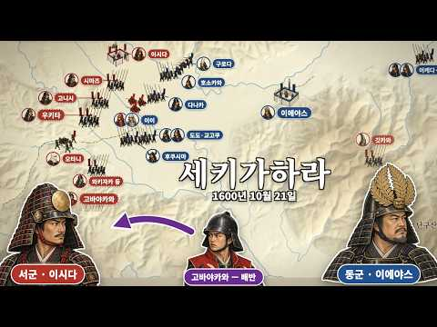
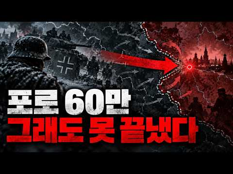

# 역사 — 성공 사례 분석: 사례별 자세히 #41–#80

`analysis.md` 의 9번 (같은 # 번호). 자동 생성 — `tools/success_analysis.py` v1.6 (2026-10-28 10:03 UTC). ※ 연구·교육용 — 투자 권유가 아님.

### 41. 매일 최고의 밥상을 받던 조선 왕이 47세를 못 넘긴 이유, 수라상은 차라리 고문이었다

- https://www.youtube.com/watch?v=XWuNVZCf8yM · 역사 한 소절 · 구독자 1,630 · 조회수 361,044 (×221.5, 하루 6,437.5) · 좋아요 865 (0.2%) · 23.3분 · 2026-09-02 · 주제 묶음 3. 조선 · 형식 정보·해설 (그 밖) · 폴더 `W_XWuNVZCf8yM` (웹 승인)
- 썸네일: 
- 설명 앞부분: 세상 부러울 것 없던 조선의 임금이, 왜 하나같이 마흔일곱을 넘기지 못했을까요? 매일 열두 첩 수라상을 받고, 팔도의 진귀한 음식을 누리고, 최고의 어의가 곁을 지켰던 사람들. 그런데도 조선 왕의 평균수명은 겨우 47세였습니다. 정작 그 밥상을 나르던 내시들은 일흔까지 살았죠. 가장 좋은 걸 먹고, 가장 먼저 죽었습니다. 기미상궁은 매일 은침으로 독을 검사했지만, 임금을 무너뜨린 진짜 독은 단 한 번도 은침에 걸리지 않았어요. 그 독은 음식 속에 든 게 아니었으니까요. 하루 다섯 끼의 과식, 담장 밖으로 나갈 일 없던 삶, 그리고…
- 같은 채널 평소 대비 ×641.3 (채널 최근 롱폼 중앙값 563회) · 평소 영상: 토사구팽된 류성룡이 피땀 흘려 만든 문서 ∣ 조선은 내다 버리고, 일본은 300년을 탐독… (563회) / 조선 백성 90%가 신던 짚신, 어쩌다 순식간에 사라졌을까? (556회)
- 대본 없음 (설명) — 음성인식이 끝나면 도입부·흐름이 들어감
- 댓글 271/271: 좋은 점 — 영상 1 · 감사·응원 0 · 더 알고 싶은 것 1 · 아쉬운 점 — 영상 4 · 반박·불만 — 의견 다름 4 · 정치·사회 4 · 경험 공유 6 · 구독·다음 기대 1
  - 좋은 점 — 영상 👍0 “우리나라 임금님들이 수명이 짧았던 이유가 하루 5끼나 나오는 식단에 있었네요 상도 맘데로 물릴수가 없었던 왕이라는 자리..어찌보면 참 불쌍하게 살다 짧은 나이에 병으로 돌아가셨네요 취미생활로 말도 타고 사냥도 하고 운동도 하고 살면 즐거웠을텐데..고작 정원 뜰이나 산…”
  - 더 알고 싶은 것 👍1 “동의보감은 업데이트 언제 되나요?”
  - 아쉬운 점 — 영상 👍1 “서론이 너무길고 재없네요”
  - 아쉬운 점 — 영상 👍1 “내용 정말 지루하게 질질 끄네. 같은 말 반복하고”
  - 반박·불만 — 의견 다름 👍1 “뷔페 간다고 뷔페음식 다먹는거 아니죠”
  - 반박·불만 — 의견 다름 👍1 “역사공부는 제대로 해야지...세계사도 같이...말도 안되는 사관으로 헛소리 하는 인간들이 있네...”
  - 정치·사회 👍9 “백성은 노예라 굶고 임금이란자는 산해진미 처먹으니 나라가 망했다 노예들은 일만하다 지옥처럼 살고 왕이란자는 잘처먹고 배터져 죽다 조선임금수명이 50이면 장수로다 신하수명 40이면 좋은거먹은거다 백성수명 30이면 일찍늙어죽었다 조선 음식이 세계최고의 음식이다”
  - 정치·사회 👍1 “어쩌다보니 한국이 미국이 힘으로 일본이 돈으로 지켜줘서 여기까지 오긴 했는데.. 1,2년내에 더 도약하느냐 그냥 끝장이 날것이냐가 이런 극적인 상황이 결정될거임 이게 저 조선이란 나라를 잘못알고 해석해서 벌어진거임 조선은 현재 북한과 같은 시스템으로 결국 누군가는 누…”
  - 경험 공유 👍1 “어쩌다보니 한국이 미국이 힘으로 일본이 돈으로 지켜줘서 여기까지 오긴 했는데.. 1,2년내에 더 도약하느냐 그냥 끝장이 날것이냐가 이런 극적인 상황이 결정될거임 이게 저 조선이란 나라를 잘못알고 해석해서 벌어진거임 조선은 현재 북한과 같은 시스템으로 결국 누군가는 누…”
  - 경험 공유 👍0 “그냥 조선시대 평균수명이 35세에서 45세였음 그래서 부모님이 일찍돌아가시면 내자식키우기도 버거운데 동생들까지 내가 키워야하니 환장할 노릇이었죠”
  - 구독·다음 기대 👍1 “잘봤어요 ㅎ 재밌네요 구독할게요”

### 42. 양반도 부러워했다?! 백정의 충격적인 사생활!! ∣ 조선의 백정 ∣ 한국사

- https://www.youtube.com/watch?v=um-bKohXZK0 · 스토리퐁당 · 구독자 1,080 · 조회수 238,500 (×220.8, 하루 2,551.2) · 좋아요 1,155 (0.5%) · 26분 · 2026-07-26 · 주제 묶음 4. 한국 근현대사 · 형식 정보·해설 (그 밖) · 폴더 `W_um-bKohXZK0` (웹 승인)
- 썸네일: 
- 설명 앞부분: 조선에서 소 한 마리를 잡으면 집 한 채 값이 손에 들어왔습니다. 💰 그 돈을 만진 사람은 정승도, 판서도 아닌 바로 '백정'이었습니다. 길에서 마주치면 양반이 침을 뱉고 지나가던 사람. 죽어서 족보에 이름 석 자조차 올리지 못했던 사람. 그런데 그의 곳간에는 그를 무시하던 양반보다 더 많은 곡식이 쌓여 있었습니다. 🐂 가장 낮은 자리에 있던 사람이 어떻게 양반도 쉽게 만지지 못하던 돈을 손에 쥐게 됐을까요? 그리고 그렇게 돈을 벌고도 왜 죽을 때까지 그 신분을 벗어나지 못했을까요? 🤔 이 영상에서는 👇 백정이 사실은 노비가 아니…
- 같은 채널 평소 대비 ×825.3 (채널 최근 롱폼 중앙값 289회) · 평소 영상: 고려시대 vs 조선시대 - 우리나라는 언제 잘살았나? ∣ 고려와 조선의 삶 비교 ∣ 계층… (295회) / 한국사 최강 인간병기 척준경! ∣ 그는 영웅인가? 역적인가? ∣ 척준경 ∣ 고려사 (283회)
- 대본 없음 (설명) — 음성인식이 끝나면 도입부·흐름이 들어감
- 댓글 96/96: 좋은 점 — 영상 1 · 감사·응원 1 · 더 알고 싶은 것 1 · 아쉬운 점 — 영상 0 · 반박·불만 — 의견 다름 5 · 정치·사회 3 · 경험 공유 0 · 구독·다음 기대 0
  - 감사·응원 👍1 “감사합니다❤❤”
  - 더 알고 싶은 것 👍13 “백정은 조선건국과 맞다아 있는 것 같습니다. 태조 이성계의 조상이 어디입니까? 북방 이민족이죠. 이들도 고려시대에서는 화척이였습니다. 하지만 이들은 세력을 가지고 성장하여 고려를 무너뜨리고 새로운 나라(조선)를 세웁니다. 그 조선에게서 (무장세력으로 강해질 수 있던)…”
  - 반박·불만 — 의견 다름 👍2 “글쎄요?”
  - 반박·불만 — 의견 다름 👍1 “무슨 말도 안돼. 백정이 얼마나 천시받고 굶주리고 살았는데---소가 전부 지 것인가. 남의 소 잡아주는 품삵 조금 더 받는정도인데. 소피를 가져오고 그걸 먹고.. 뭔 말도 안되는 소리가 곳간에 양식이 넘쳐 나다니..”
  - 정치·사회 👍12 “조선이라는 나라가 그냥 개막장 나라 였음.”
  - 정치·사회 👍1 “조선에서 저돈을 지킬수 있었을까? 잡아서 주리틀면 돈 다 뺏김 지금 국회의원 봐라 한자 못 읽으면 눈 뜨고 코베임 ai가 이상하게 알려주내”

### 43. 조선의 왕들이 단명한 이유, 매일 먹던 '이것'이 독이었던 충격적인 사실ㅣ조선왕평균수명46세

- https://www.youtube.com/watch?v=aDk8BnSRa5o · 역사MSG · 구독자 2,530 · 조회수 550,878 (×217.7, 하루 3,921.5) · 좋아요 4,923 (0.9%) · 25.3분 · 2026-06-09 · 주제 묶음 3. 조선 · 형식 정보·해설 (그 밖) · 폴더 `W_aDk8BnSRa5o` (웹 승인)
- 썸네일: 
- 설명 앞부분: 🫅조선의 왕은 누구보다 잘 먹고, 최고의 의료와 보살핌을 받았습니다. 그런데 평균 사망 나이는 고작 46세. 같은 궁궐에서 소박하게 먹고 뛰어다닌 내시는 70세까지 살았는데 말이죠. 24년 차이, 대체 이유가 무엇일까요? 🍚세종의 식습관부터 정조의 종기, 영조의 83세 장수 비결까지 매일 먹던 밥상, 수라상이라는 시스템이 왕의 몸을 어떻게 망가뜨렸는지, 실록 기록으로 하나씩 풀어봤습니다. 🕛타임라인 [조선왕조실록 (朝鮮王朝實錄)] 세종실록 세종 30년 세조실록 문종실록 효종실록 정조실록 성종실록 [승정원일기 (承政院日記)] [의학…
- 같은 채널 평소 대비 ×1,405.3 (채널 최근 롱폼 중앙값 392회) · 평소 영상: 불멸의 여신을 버리고 늙은 아내에게 돌아간 남자, 오디세우스 ∣ 오디세이아 (392회) / '15분' 틀렸다고 곤장 맞은 조선 기상청 천문학자, 그 뒤에 벌어진 일 ∣ 세종의 시간… (374회)
- 대본 없음 (설명) — 음성인식이 끝나면 도입부·흐름이 들어감
- 댓글 593/593: 좋은 점 — 영상 5 · 감사·응원 2 · 더 알고 싶은 것 4 · 아쉬운 점 — 영상 4 · 반박·불만 — 의견 다름 8 · 정치·사회 5 · 경험 공유 6 · 구독·다음 기대 0
  - 좋은 점 — 영상 👍1 “아주 좋은 내용인 것 같네요.”
  - 좋은 점 — 영상 👍0 “소식이 장수하는데 도움되는건 맞음”
  - 감사·응원 👍4 “감사합니다 ㆍ귀농해서80세이나에 텃밭농부로삽니다 아파트생활62세에치우고 시골생활ㆍ건강비결입니다ㆍ호미ᆢ 텃밭살길입니다ᆢ”
  - 감사·응원 👍0 “미국 동남부며 성경적 삶의 방향으로 살고있습니다. 시아버지가 90세로 키는 약 168cm 에 55kg 이 채 안돼세요. 평생 그 몸무게 유지되시는게, 식사량 자체가 소식에 부지런하셨습니다. 왜 소식이 답인가? 를 보니 원래 우리몸이 그리 많은 열량을 필요로 하지않는답…”
  - 더 알고 싶은 것 👍41 “왕이 100보 이상 걸을 일이 있을까요? 가마타고 댕기지~ 그리고 대부분 종기로 단명했는데, 옷을 잔뜩 껴입고 온종일 앉아있고, 결정적으로 잘 안 씻어서 그렇습니다. 비누가 수십억의 인류를 살렸다는 말이 있죠~”
  - 아쉬운 점 — 영상 👍0 “무지지루하네서론이너무길어”
  - 아쉬운 점 — 영상 👍0 “어영부영 장황 ... 중언부언 ... 조회수 낚시 ...”
  - 반박·불만 — 의견 다름 👍2 “일찍죽은 이유는 딱 한가지다. 목욕을 안하니까 일찍 죽은거다. 우리도 60.70년대 한달에 한번 대중 목욕탕가서 목욕하던시절 등에 종기가 나 '이명래고약' 붙이고살던 시절이 있었다. 조선시대에는 수십년 목욕을 안하니 늘 종기에 죽었지.. 저 종기가 알콜 몃방울이면 낫…”
  - 반박·불만 — 의견 다름 👍1 “조선시대에 항생제가 없었던 것이 아닙니다. 약초나 침으로 균을 잡았는데 균종에 적합한 약재를 찾지 못한거지요.”
  - 정치·사회 👍0 “나라가 망했으니 뭔짓을 못하겠어요.”
  - 정치·사회 👍0 “수라상이 문제가 아니라 항상 무예를 수련하고 첩들을 멀리하고 탐관오리들을 가까이 아니하고 충신들과 항상 교류하며 암행어사들을 파견하여 민정을 살피고 육군과 수군을 기르고 정사를 펼치면 성군이 될수있고 수명도 장수할수 있다 임금은 모든것을 잘할수는 없다 오직 인재를 등…”
  - 경험 공유 👍0 “왕들도 몰랐던 의학 지식을 내가 세상에 전한 게 아닐까? "아는 것이 힘이다." 건강 유지 방법에 대해서도 잘 알아야 되고 적들에 대해서도 잘 알아야 한다.”
  - 경험 공유 👍0 “내가 이렇게 된게… 우리 할머니때문인거랑 같은거구나…”

### 44. 암행어사 박문수 "암행어사 출두요!" 탐관오리를 쓸어버리다 ∣ 조선 사극 사이다

- https://www.youtube.com/watch?v=4C7JI9SwK1o · 영화 말본 · 구독자 1,270 · 조회수 272,333 (×214.4, 하루 4,265.4) · 좋아요 675 (0.2%) · 13분 · 2026-08-25 · 주제 묶음 3. 조선 · 형식 정보·해설 (그 밖) · 폴더 `W_4C7JI9SwK1o` (웹 승인)
- 썸네일: 
- 챕터: 0:00 1장 거지 어사 — 썩은 고을에 잠입하다 · 2:21 2장 탐관오리 — 잔칫상 위의 피 · 4:28 3장 밝혀지는 비리 — 장부 한 권 · 6:27 4장 위기 — 한 백성이 숨겨주다 · 8:33 5장 암행어사 출두 — 마패가 번뜩이다 · 10:32 6장 진짜 배후 — 한양의 거물
- 설명 앞부분: 암행어사 박문수 — "암행어사 출두요!" 탐관오리를 쓸어버리다 ∣ 조선 사극 사이다 거지 행색으로 고을에 잠입한 암행어사 박문수. 굶주린 백성을 쥐어짜는 탐관 사또와 토호의 비리를 파헤친다. 결정적 순간, 마패를 꺼내 든다 — "암행어사 출두요!" 허나 세곡을 빨아들인 진짜 배후는, 한양 중앙의 거물 김 대감이었다. 문수는 대감의 위협에도 굴하지 않고, 국법 앞에 그를 세운다. 낡은 민초의 잿빛과 관아의 붉은빛이 대비되는 조선 사극. 백성을 위한 정의와 통쾌한 응징을 그린 단편입니다. ※ 본 영상은 AI로 제작된 창작 사극 단편입…
- 같은 채널 평소 대비 ×21.3 (채널 최근 롱폼 중앙값 12,807회) · 평소 영상: [침검(鍼劍) 3화] 떠도는 여의원 - 가짜 명의 (12,807회) / [침검(鍼劍) 4화] 떠도는 여의원 - 소금꽃 바다 (8,327회)
- 대본 없음 (설명) — 음성인식이 끝나면 도입부·흐름이 들어감
- 댓글 30/60: 좋은 점 — 영상 0 · 감사·응원 0 · 더 알고 싶은 것 0 · 아쉬운 점 — 영상 0 · 반박·불만 — 의견 다름 0 · 정치·사회 3 · 경험 공유 0 · 구독·다음 기대 0
  - 정치·사회 👍1 “조선시대 윤석열”
  - 정치·사회 👍0 “지금도 이정권과 똑같네요 왜적보다 더못한 정치을 한 옛날이나 지금이나ᆢ 한심하다 이나라”

### 45. 🥣 조선 주막이 뒤집혔다 🔥 조선시대 DJ의 가야금 EDM 대축제

- https://www.youtube.com/watch?v=soKbFyG1ES8 · 트롯가인 황진이 · 구독자 1,790 · 조회수 380,857 (×212.8, 하루 2,805.3) · 좋아요 1,165 (0.3%) · 7.7분 · 2026-06-14 · 주제 묶음 3. 조선 · 형식 정보·해설 (그 밖) · 폴더 `W_soKbFyG1ES8` (웹 승인)
- 썸네일: 
- 챕터: 0:00 Gayageum Intro · 0:30 Verse 1 · 1:10 Chorus · 1:50 Verse 2 · 2:35 Chorus · 3:20 Dance Break · 4:05 Gayageum Solo · 4:55 Verse 3 · 5:40 Big Chorus · 6:25 Final Chorus · 7:05 Outro
- 설명 앞부분: 가야금EDM,조선시대DJ,주막댄스,타임슬립음악,트로트댄스,가야금댄스,조선주막,EDM트로트,여성보컬,축제음악 조선시대 주막에 떨어진 여성 DJ. 가야금과 EDM이 만나 조선팔도를 뒤흔든 흥겨운 이야기. 전통 가야금 사운드와 현대 EDM 비트가 결합된 타임슬립 댄스 뮤직을 즐겨보세요. 동영상 길이 : 7분 39초 영상 : 그록AI 음악 : 수노AI 가야금 EDM,조선시대 음악,주막 EDM,타임슬립 DJ,한국 전통음악,EDM 트로트,가야금 댄스,조선 축제,여성보컬 EDM,Korean Gayageum EDM 타임라인 고정댓글 여러분이 타…
- 같은 채널 평소 대비 ×122.5 (채널 최근 롱폼 중앙값 3,109회) · 평소 영상: 🕺[텐션 폭발] 저승사자도 갓 벗어던지고 밤새 춤추는 역대급 조선 국악 EDM 🪘💥 (3,167회) / 🍂🪗 평생 참아온 눈물이 터지는 밤 ∣ 가슴을 후벼 파는 사나이의 한 곡조 ∣ 아코디언 … (3,051회)
- 대본 없음 (설명) — 음성인식이 끝나면 도입부·흐름이 들어감
- 댓글 60/61: 좋은 점 — 영상 0 · 감사·응원 5 · 더 알고 싶은 것 0 · 아쉬운 점 — 영상 0 · 반박·불만 — 의견 다름 0 · 정치·사회 0 · 경험 공유 0 · 구독·다음 기대 0
  - 감사·응원 👍2 “감사합니다 오늘하루도 화이팅 ❤”
  - 감사·응원 👍2 “😂😂😂😂😂😂😂😂😂 👍 👍 👍 👍 👍 👍 👍 👍 🎶 🎵 🎶 🎵 🎶 🎵 🎶 🎵 매일매일 ~잘♡듣고 있습니다 감사합니다 ~❤❤❤❤❤”

### 46. 사극에서 절대 보여주지 않는 조선 노비의 진짜 밥상 ∣ 정사 ∣ 야사

- https://www.youtube.com/watch?v=N6THuYELTWU · 역사 만화경 · 구독자 572 · 조회수 119,797 (×209.4, 하루 750.7) · 좋아요 890 (0.7%) · 12.8분 · 2026-05-21 · 주제 묶음 3. 조선 · 형식 애니메이션·지도 · 폴더 `W_N6THuYELTWU` (웹 승인)
- 썸네일: 
- 설명 앞부분: 사극을 보면 노비는 늘 부엌 한구석에 쪼그려 앉아 있습니다. 주인상을 물리고 식은 밥 한 덩이를 급하게 삼키는 모습. 틀린 장면은 아닙니다. 하지만 그게 전부였을까요? 조선 시대, 사람 셋 중 하나는 누군가의 재산이었습니다. 그 수백만 명이 매일 아침 무엇으로 배를 채웠는지, 조선왕조실록과 고문서 속에 남은 기록을 통해 들여다봅니다. 주인과 똑같은 솥에서 밥을 푸던 노비가 있었고, 자기 땅에서 거둔 곡식으로 가족의 밥상을 차리던 노비도 있었습니다. 반대로, 풀뿌리와 나무껍질로 한 해를 버티다 끝내 흙을 퍼먹은 노비도 있었습니다. …
- 같은 채널 평소 대비 ×316.1 (채널 최근 롱폼 중앙값 379회) · 평소 영상: 감기 한 번에 가족을 잃던 시대 ∣ 조선시대 사람들은 아프면 어떻게 했을까? (379회) / 왕비가 된 지 3년 만에 사약을 받은 연산군의 어머니 폐비 윤씨의 처참한 최후 ∣ 조선왕… (263회)
- 대본 없음 (설명) — 음성인식이 끝나면 도입부·흐름이 들어감
- 댓글 161/162: 좋은 점 — 영상 1 · 감사·응원 8 · 더 알고 싶은 것 1 · 아쉬운 점 — 영상 2 · 반박·불만 — 의견 다름 4 · 정치·사회 9 · 경험 공유 5 · 구독·다음 기대 0
  - 좋은 점 — 영상 👍3 “그렇습니다 보리고개를 모르는사람들은 이해할수 없을것입니다 개떡과 겨빵을 먹어므ㅗ지않은사람들은 믿지못할것입니다 참 유익한 내용입니다 우리는 이시대에 감사함으로 살아야합니다 나누고 도우며 함께사는 마음을 지녀야합니다”
  - 감사·응원 👍24 “먹을것이풍족한시대,에태어난것만으로도축복이다.감사하면서사새요!”
  - 감사·응원 👍5 “모든 게 귀한 시절이었지요 잊혀져 가는 우리의 생활사 감사드립니다”
  - 아쉬운 점 — 영상 👍1 “아무리 찍어내는 ai라지만 제대로 분석좀 하고 올리셨으면 합니다 ai에 다시 검증 해봐 한줄만다시 적어도, 그리고 네이버에만 검색 해봐도 정확한 정보가 나오는데 잘못된 정보가 너무 많네요”
  - 반박·불만 — 의견 다름 👍0 “노비의 일상적인 밥은 보리밥에 고봉밥임... 죽 헛소리”
  - 정치·사회 👍4 “조선시대 세금은 양반.평민.노비 할것없이 5~10%였습니다.식사는 쌀이나 보리와함께 조.수수.피 등 을 혼합해서 먹었고 밥의 양 은 현대인의 3~4배 를 먹었습니다.이런 자료를 어디서 보고 영상 을 올렸는지 모르지만 가뭄에나 힘들었지 못먹고살지 않았습니다.나라에서 구…”
  - 정치·사회 👍4 “자기 동족을 노예로 부리는 나라가 조선”
  - 경험 공유 👍3 “'피죽도 못 먹은 얼굴'이라는 표현이 떠오르는 내용이네요. 벼들 사이로 삐죽 나온 볼품없는 풀떼기 같은 피를 다 먹었었다니 죽을 때까지 그런 배고픔은 안 겪고 싶다는.”
  - 경험 공유 👍0 “80년대 저희집시골논농사가 80마지기 넘게 농사를짓다보니 보리밥을 안먹어봄 지금도 부모님이 농사일하시는데 힘들어하시네요”

### 47. “누가 이순신을 사?” 미국서 무시당한 청년…결국 25만 부 팔아치웠다

- https://www.youtube.com/watch?v=olrlcl1HoCo · 최기훈TV · 구독자 631 · 조회수 132,027 (×209.2, 하루 3,639.9) · 좋아요 964 (0.7%) · 17.4분 · 2026-09-22 · 주제 묶음 3. 조선 · 형식 애니메이션·지도 · 폴더 `W_olrlcl1HoCo` (웹 승인)
- 썸네일: 
- 챕터: 0:00 이순신 만화로 미국을 뒤집은 청년 · 1:28 평범한 청년 온리 콤판의 새로운 도전 · 3:18 철저한 역사 고증과 글로벌 제작진 · 4:43 냉혹한 미국 만화 시장의 문전박대 · 6:44 자동차 트렁크에서 시작된 정면 돌파 · 9:21 이순신 만화 25만 부 판매의 비밀 · 13:02 대한민국으로 역수입된 이순신 만화 · 14:17 한 이방인이 보여준 K콘텐츠의 힘
- 설명 앞부분: “초능력도 없는 400년 전 조선 장군을 어떤 미국인이 돈 주고 사겠습니까?” 한국어도 못하고 한국에 가본 적도 없었던 미국 청년 온리 콤판. 그는 우연히 드라마 「불멸의 이순신」을 접한 뒤, 충무공 이순신의 삶에 완전히 매료됩니다. 하지만 이순신 장군을 주인공으로 만든 만화는 미국의 유명 출판사들로부터 연이어 거절당했습니다. 스파이더맨과 배트맨이 지배하는 미국 만화 시장에서 낯선 조선의 장군은 “절대 팔리지 않을 소재”로 평가받았기 때문입니다. 그러나 콤판은 포기하지 않았습니다. 직접 독립 출판사를 세우고 자동차 트렁크에 만화책…
- 같은 채널 평소 대비 ×3,772.2 (채널 최근 롱폼 중앙값 35회) · 평소 영상: “돈이 있어도 못 산다” 미국이 4년을 기다려도 한국 변압기만 찾는 진짜 이유 (35회) / “고속도로가 활주로였다” 외국인이 놀란 한국 고속도로에 숨겨진 비밀 기능 (57회)
- 대본 없음 (설명) — 음성인식이 끝나면 도입부·흐름이 들어감
- 댓글 24/28: 좋은 점 — 영상 0 · 감사·응원 4 · 더 알고 싶은 것 1 · 아쉬운 점 — 영상 0 · 반박·불만 — 의견 다름 0 · 정치·사회 1 · 경험 공유 0 · 구독·다음 기대 0
  - 감사·응원 👍11 “온리 콤판은 참으로 대단한 분이군요. 우리의 영웅을 세계에 알려주어서 고맙습니다. 한국에서도 이 분을 위해서 무엇인가 해주었으면 합니다. 교보문고에서 찾아보니까 품절이네요. 한국에서도 이 분 작품 구할 수 있는지 모르겠습니다.”
  - 감사·응원 👍10 “대단하네요 이순신 장군님 을 아려주셨어 감사합니다”
  - 더 알고 싶은 것 👍6 “한국판 번역본 어디서 살수 있나요?”
  - 정치·사회 👍19 “불멸의 이순신 사극은 남자라면 안볼수 없게끔 만든 전쟁 정치 명작이고 외국인도 감동받을꺼다 이 대작 드라마를 넷플릭스에 올려야 한다”

### 48. 75 충격적인 역사 사진, 꼭 보세요!

- https://www.youtube.com/watch?v=wT9qEomWsew · 사진으로 보는 역사 · 구독자 3,510 · 조회수 732,897 (×208.8, 하루 42,111.3) · 좋아요 4,019 (0.5%) · 30.8분 · 2026-10-11 · 주제 묶음 1. 역사 일반·이야기 · 형식 정보·해설 (그 밖) · 폴더 `W_wT9qEomWsew` (웹 승인)
- 썸네일: 
- 설명 앞부분: 시청해 주셔서 감사합니다. 📜 사진으로 보는 역사**는 한 장의 사진 속에 담긴 시대의 흔적과 사람들의 이야기를 통해 과거를 새롭게 발견하는 역사 다큐멘터리 채널입니다. 모든 영상은 역사 자료 조사, 사실관계 검증, 세심한 기록물 분석 및 신중한 디지털 복원 작업을 바탕으로 제작됩니다. 역사 사진과 원본 문서, 각종 기록 자료를 면밀히 조사하여 가능한 한 정확하게 촬영 장소와 연도, 역사적 사건, 그리고 시대를 살아간 인물들을 밝혀내고자 합니다. 시간의 흐름 속에서 희미해진 사진의 세부적인 흔적은 디지털 복원 기술을 통해 조심스럽…
- 같은 채널 평소 대비 ×9.6 (채널 최근 롱폼 중앙값 76,232회) · 평소 영상: 80 정말 인상 깊은 잘 알려지지 않은 역사 사진 (76,232회) / 90 희귀한 레트로 사진, 대중의 눈에서 숨겨진 (74,572회)
- 대본 없음 (설명) — 음성인식이 끝나면 도입부·흐름이 들어감
- 댓글 31/38: 좋은 점 — 영상 0 · 감사·응원 0 · 더 알고 싶은 것 0 · 아쉬운 점 — 영상 0 · 반박·불만 — 의견 다름 1 · 정치·사회 2 · 경험 공유 0 · 구독·다음 기대 0
  - 정치·사회 👍6 “좌파적 성격을 띄지 않기 ᆢ”
  - 정치·사회 👍1 “🕷️우크라이나 현실 전쟁이 수년간 지속되면서 국방비와 세수 확보가 절실해진 우크라이나 정부는 최근 온라인 성인물(포르노) 산업의 합법화 및 비범죄화를 본격적으로 논의하기 시작했습니다.우크라이나 현실 전쟁이 수년간 지속되면서 국방비와 세수 확보가 절실해진 우크라이나 정…”

### 49. AI로 되살린 조선 옛 기록 속 이상한 동물들, 그 정체를 추적해 봤습니다

- https://www.youtube.com/watch?v=yCYBW9qayVY · 키치스토리 · 구독자 1,370 · 조회수 277,722 (×202.7, 하루 13,180.8) · 좋아요 611 (0.2%) · 13.6분 · 2026-10-07 · 주제 묶음 3. 조선 · 형식 정보·해설 (그 밖) · 폴더 `W_yCYBW9qayVY` (웹 승인)
- 썸네일: 
- 챕터: 0:00 인트로 · 0:16 1. 딱새가 낳은 산비둘기 (세종실록, 1445) · 1:52 2. 어책 속의 인어 (고운당필기, 1796) · 3:38 3. 이름 없는 짐승 복록 (세종실록, 1419) · 4:46 4. 붕어 대신 걸린 것 (명종실록, 1565) · 6:06 5. 흙 속으로 뛰어든 물고기 (세종실록, 1446) · 7:08 6. 상광어 (자산어보, 1814) · 8:22 7. 소주만 마시는 망아지 (청장관전서) · 9:10 8. 두꺼비 전쟁 (숙종실록 외, 1601~1677) · 10:30 9. 수탉이 된 암탉 (세종실록·중종실록) · 11:48 10. 불 속의 백 근 쥐 (성호사설) · 13:14 마무리
- 설명 앞부분: 조선 사람들은 처음 보는 동물을 만나면, 본 그대로 글로 적어 두었습니다. 산비둘기만 한 딱새 새끼, 인천 어책에 걸린 인어, 이름이 없어 황제가 이름을 지어 준 짐승, 70년 동안 실록에 오른 두꺼비 전쟁. 실록과 옛 책에 남은 이상한 동물 10가지를 기록 문장 그대로 AI로 되살려 보고, 단서를 따라 그 정체를 추적했습니다. 옛 기록의 원문은 조선왕조실록과 한국고전종합DB에서 직접 대조했습니다. 6번 자산어보는 한국민족문화대백과사전의 번역으로 확인했습니다. 영상은 정체를 확정하지 않습니다. 모두 「유력한 후보」로만 말했고, 맞…
- 같은 채널 평소 대비 ×56.6 (채널 최근 롱폼 중앙값 4,910회) · 평소 영상: 세상에는 이런 일도 벌어졌습니다｜실제로 있었던 이상한 사건들 27편 (5,181회) / 세상에는 이런 일도 벌어졌습니다｜실제로 있었던 이상한 사건들 28편 (4,639회)
- 대본 없음 (설명) — 음성인식이 끝나면 도입부·흐름이 들어감
- 댓글 23/40: 좋은 점 — 영상 0 · 감사·응원 0 · 더 알고 싶은 것 0 · 아쉬운 점 — 영상 0 · 반박·불만 — 의견 다름 0 · 정치·사회 0 · 경험 공유 2 · 구독·다음 기대 0
  - 경험 공유 👍4 “4번도 흰돌고래 벨루가를 닮은 상괭이임, 옛날엔 바다에 가까운 민물 계곡에 상괭이 무리가 들어오기도 했었음 5번은 수수미꾸리? 산해경은 도교에서도 인용하는 경우가 많은 신화 지리 이물들에 대한 고전이라 비유나 은유가 많다고 봐야죠”
  - 경험 공유 👍0 “혹시 암닭도 수컷이 될수잇나요? 어쩐지 조금 수컷처럼 볏이 커졋거든요 혹시 수컷처럼 울어대는지 제가없는 시간대나 새벽에 울지않을까요? 들어볹ㅓㄱ은없어서요 오래전에 죽엇지만요 명이다되서”

### 50. 조선에서 돌아온 일본 장수들은 왜 2년 만에 세키가하라에서 싸웠나? ∣ 지도로 보는 임진왜란 그 후 1편

- https://www.youtube.com/watch?v=RXflUwO13U8 · Terra Scripta · 구독자 1,820 · 조회수 368,076 (×202.2, 하루 29,802.7) · 좋아요 530 (0.1%) · 12.1분 · 2026-10-16 · 주제 묶음 3. 조선 · 형식 애니메이션·지도 · 폴더 `W_RXflUwO13U8` (웹 승인)
- 썸네일: 
- 챕터: 0:00 질문 — 같은 편이던 장수들은 왜 서로 칼을 겨눴나 · 0:46 히데요시의 죽음 · 1:36 조선에서 생긴 원한 · 2:59 1600년 여름, 두 편으로 갈라지다 · 4:03 세키가하라 분지 · 4:51 안개 속의 포진 · 5:48 개전 · 6:27 세 갈래의 격전 · 7:20 마쓰오산의 배반 · 8:18 무너지는 서군 · 8:59 시마즈의 퇴각 · 9:50 조선에서 싸운 장수들의 운명 · 10:59 정리 · 11:43 엔딩
- 설명 앞부분: 1600년 10월 21일, 교토와 에도 사이의 작은 분지 세키가하라. 안개 속에서 마주 선 두 군대에는 임진왜란 때 조선을 침략했던 장수들이 있었습니다. 고니시 유키나가와 우키타 히데이에는 이시다 미쓰나리의 서군에, 구로다 나가마사와 후쿠시마 마사노리는 도쿠가와 이에야스의 동군에 섰습니다. 조선에서 같은 편으로 싸웠던 장수들은 왜 2년 만에 서로에게 칼을 겨눴을까요? 히데요시의 죽음, 울산성 보고가 남긴 원한, 칠장 사건, 두 편으로 갈라진 1600년 여름, 그리고 세키가하라의 포진과 고바야카와의 배반, 시마즈의 퇴각까지 지도 위…
- 같은 채널 평소 대비 ×28.1 (채널 최근 롱폼 중앙값 13,096회) · 평소 영상: 명나라는 어떻게 2년 만에 요하 동쪽을 잃었나? 개원·철령·심양·요양 함락 ∣ 지도로 보… (15,150회) / 임진왜란 뒤 조선은 왜 원수의 나라에 200년 동안 사신을 보냈나? ∣ 지도로 보는 임진… (11,042회)
- 대본 없음 (설명) — 음성인식이 끝나면 도입부·흐름이 들어감
- 댓글 48/50: 좋은 점 — 영상 0 · 감사·응원 1 · 더 알고 싶은 것 0 · 아쉬운 점 — 영상 1 · 반박·불만 — 의견 다름 1 · 정치·사회 3 · 경험 공유 3 · 구독·다음 기대 0
  - 감사·응원 👍7 “햐 , 이 엄청난 콘텐츠를 우연히 보게 되었네요 😂 감사해요 ~”
  - 아쉬운 점 — 영상 👍1 “사실 이에야스는 아이즈에 100만석 넘는 우에스기랑 시나노에 사나다 달아놓고 세키가하라부터 달려온 셈이라 이시다 지부노쇼가 좀만 더 인망이 있었어도, 단번에 어이없게 결착만 안났어도 장성한 히데요리의 천하를 볼수 있었다는게 좀 아쉬움”
  - 반박·불만 — 의견 다름 👍1 “사실 이에야스는 아이즈에 100만석 넘는 우에스기랑 시나노에 사나다 달아놓고 세키가하라부터 달려온 셈이라 이시다 지부노쇼가 좀만 더 인망이 있었어도, 단번에 어이없게 결착만 안났어도 장성한 히데요리의 천하를 볼수 있었다는게 좀 아쉬움”
  - 정치·사회 👍1 “정작 세키가하라 전투에서 이에야스의 본대인 히데타다가 이끄는 병력은 전투 끝나고 사후수습 다 끝나고 나서야 도착했다는거 그리고 정작 세키가하라 전투에서 초장에 서로 죽어라 싸우던 장수들은 아이러니하게도 히데요시의 총신들 문신파와 무신파들이죠 저기 동군 배치된 장수중에…”
  - 경험 공유 👍2 “히데요시 사후 히데요시 추종세력과 이에야스와의 패권 쟁탈전이 바로 세끼가하라 전투다. 히데요시가 죽은 이상 이에야스에 대적할 놈은 없다. 나머지 전부 오합지졸들이다. 이에야스는 히데요시가 오늘 내일 한다는 사실을 알고 있었고 디질때까지 참고 인내하고 아부를 떨고 있었…”
  - 경험 공유 👍1 “정작 세키가하라 전투에서 이에야스의 본대인 히데타다가 이끄는 병력은 전투 끝나고 사후수습 다 끝나고 나서야 도착했다는거 그리고 정작 세키가하라 전투에서 초장에 서로 죽어라 싸우던 장수들은 아이러니하게도 히데요시의 총신들 문신파와 무신파들이죠 저기 동군 배치된 장수중에…”

### 51. 측천무후 무덤을 절대 열지 않는 이유, 입구를 한 번 찾았다가 벌어진 일

- https://www.youtube.com/watch?v=H2CA284tnpw · 지식세이렌 · 구독자 1,890 · 조회수 381,637 (×201.9, 하루 50,792.9) · 좋아요 770 (0.2%) · 15.3분 · 2026-10-20 · 주제 묶음 기타 · 형식 정보·해설 (그 밖) · 폴더 `W_H2CA284tnpw` (웹 승인)
- 썸네일: 
- 챕터: 0:00 오프닝: 곡괭이 끝에 걸린 쇳물 봉인 돌문 · 1:39 열네 살 소녀가 중국 유일의 여황제가 되기까지 · 4:21 산 하나가 통째로 무덤, 건릉 · 5:15 1,300년 동안 열리지 않은 세 가지 이유 · 7:43 쇳물로 엮은 63미터 돌벽의 정체 · 9:11 털리고 남은 공주의 무덤이 말해 주는 것 · 10:55 입구를 찾고도 다시 덮은 이유 · 12:52 글자 없는 비석과 마지막 유언 · 14:50 마무리: 황제인가, 황후인가
- 설명 앞부분: 1,300년 동안 단 한 번도 열리지 않은 여황제의 무덤, 건릉. 1958년, 돌을 캐던 마을 사람들이 쇳물로 봉인된 입구를 찾아냈지만 중국은 그 문을 다시 흙으로 덮어 버렸습니다. 당나라 황제릉이 거의 다 털리는 동안 이 무덤만 살아남은 이유, 그리고 입구를 찾고도 열지 않는 진짜 이유를 측천무후의 일생과 함께 파헤쳐 봅니다.
- 대본 없음 (설명) — 음성인식이 끝나면 도입부·흐름이 들어감
- 댓글 29/38: 좋은 점 — 영상 1 · 감사·응원 1 · 더 알고 싶은 것 1 · 아쉬운 점 — 영상 1 · 반박·불만 — 의견 다름 0 · 정치·사회 4 · 경험 공유 1 · 구독·다음 기대 0
  - 좋은 점 — 영상 👍6 “유익한 도움에 감사 드립니다.!!🙏🙆‍♂️🙋‍♂️💕💕”
  - 감사·응원 👍6 “유익한 도움에 감사 드립니다.!!🙏🙆‍♂️🙋‍♂️💕💕”
  - 아쉬운 점 — 영상 👍4 “측천무후를 드라마로 흥미롭게 관람 했었는데 그런사연이 있었군요 지루하지 않게 해설을 잘해주셔서 도움 됐습니다 AI 목소리가 아니여서 더 편한마음 으로 잘들었고 구독,좋아요 꾸욱 누르고 갑니다..수고하셨습니다”
  - 경험 공유 👍4 “측천무후를 드라마로 흥미롭게 관람 했었는데 그런사연이 있었군요 지루하지 않게 해설을 잘해주셔서 도움 됐습니다 AI 목소리가 아니여서 더 편한마음 으로 잘들었고 구독,좋아요 꾸욱 누르고 갑니다..수고하셨습니다”

### 52. 예수는 실존 인물이었을까? 역사학이 답한 충격적인 진실

- https://www.youtube.com/watch?v=xDel5Oig1HQ · 에덴코덱스 · 구독자 255 · 조회수 51,432 (×201.7, 하루 383.7) · 좋아요 371 (0.7%) · 13.4분 · 2026-06-16 · 주제 묶음 1. 역사 일반·이야기 · 형식 정보·해설 (그 밖) · 폴더 `W_xDel5Oig1HQ` (웹 승인)
- 썸네일: 
- 설명 앞부분: 예수는 정말 실존 인물이었을까요? 많은 사람들은 아직도 예수의 실존 여부가 논쟁 중이라고 생각합니다. 하지만 놀랍게도 현재 역사학계의 주류 견해는 이미 어느 정도 결론에 도달해 있습니다. 이번 영상에서는 종교적 믿음을 떠나 역사학, 고고학, 문헌학의 관점에서 예수의 실존 여부를 살펴봅니다. 로마 역사가 타키투스의 기록 유대 역사가 요세푸스의 증언 초기 기독교 운동의 역사적 흔적 예수 신화론이 학계에서 받아들여지지 않는 이유 역사학이 인정하는 것과 인정하지 않는 것 예수는 실제로 존재했을까요? 그리고 역사학은 어디까지 답할 수 있을…
- 같은 채널 평소 대비 ×372.7 (채널 최근 롱폼 중앙값 138회) · 평소 영상: 성경 밖에서 발견된 예언자 이사야? 2700년 전 인장 자국의 비밀 (143회) / 3000년 전 항아리에 적힌 이름… 히브리어의 역사를 바꿨나? (133회)
- 대본 없음 (설명) — 음성인식이 끝나면 도입부·흐름이 들어감
- 댓글 59/59: 좋은 점 — 영상 0 · 감사·응원 1 · 더 알고 싶은 것 1 · 아쉬운 점 — 영상 1 · 반박·불만 — 의견 다름 1 · 정치·사회 1 · 경험 공유 3 · 구독·다음 기대 0
  - 더 알고 싶은 것 👍3 “예수님을부정하는자들의머리속에는과연 뇌가있을까 그것이궁금하다”
  - 아쉬운 점 — 영상 👍2 “예수가 불교를 공부했을 가능성은 1,000%,,,,,다,,,,,아니,,,, 1만 프로가 넘는다,,, 또한 요셉과 세례 요한이 인도 종교의 영향을 받은 엣세네파의 일원이었다는 것을 증명하는 사건은 예수가 세례 요한에게 세례를 받았다는 것이다, 엣세네파 일원이었던 요셉등…”
  - 반박·불만 — 의견 다름 👍2 “예수가 불교를 공부했을 가능성은 1,000%,,,,,다,,,,,아니,,,, 1만 프로가 넘는다,,, 또한 요셉과 세례 요한이 인도 종교의 영향을 받은 엣세네파의 일원이었다는 것을 증명하는 사건은 예수가 세례 요한에게 세례를 받았다는 것이다, 엣세네파 일원이었던 요셉등…”
  - 경험 공유 👍4 “영적 지식은 의문을 던져서 알게 되는 것이 아니다. 믿음으로 시작해야 올바른 지식을 취득할 수 있다. 기왕에 나도 모른 채 알게 된 지식이라면, 인간이 머리에서 생겨나지 않았다는 사실을 깨닫는 데서 출발한다.”
  - 경험 공유 👍2 “예수가 불교를 공부했을 가능성은 1,000%,,,,,다,,,,,아니,,,, 1만 프로가 넘는다,,, 또한 요셉과 세례 요한이 인도 종교의 영향을 받은 엣세네파의 일원이었다는 것을 증명하는 사건은 예수가 세례 요한에게 세례를 받았다는 것이다, 엣세네파 일원이었던 요셉등…”

### 53. 조선 선비는 과거 보러 400km를 어떻게 걸어갔을까 ∣ 국밥·엿·주막에 숨은 놀라운 이야기∣사극은 거짓말? 과거 보러 가는 조선의 길에는 산적도 호랑이도 없었다

- https://www.youtube.com/watch?v=PmKbdO0FcnE · 어게인역사 · 구독자 6,070 · 조회수 1,197,848 (×197.3, 하루 23,737.8) · 좋아요 1,837 (0.1%) · 12분 · 2026-09-07 · 주제 묶음 3. 조선 · 형식 정보·해설 (그 밖) · 폴더 `W_PmKbdO0FcnE` (웹 승인)
- 썸네일: 
- 챕터: 0:00 천 리 길, 걸어서 보름의 여정 · 2:52 조선의 길과 문경새재의 비밀 · 2:52 나라가 세운 숙소 '원'과 지명의 유래 · 4:58 나그네를 재운 주막과 조선의 인심 · 6:19 밤샘 공부와 합격을 비는 엿 · 7:44 길 위에서 태어난 국밥과 토렴 · 10:01 서양인이 놀란 온돌, 그리고 남겨진 발자국
- 설명 앞부분: 🚶 부산에서 한양까지 380km, 걸어서 꼬박 보름. 조선의 선비들은 과거 시험 하나를 위해 두 발로 그 머나먼 길을 걸었습니다. 🏞️ 사극에서 본 것처럼 산적과 호랑이가 우글대는 험한 길이었을까요? 🏠 그들은 밤이 되면 어디서 잠을 자고, 무엇을 먹었을까요? 우리가 매일 지나치는 '인덕원', '이태원'이라는 지명 속에, 무심코 말아 먹는 '국밥 한 그릇' 속에, 시험 앞에서 건네는 '엿 한 봉지' 속에 수백 년 전 옛사람들의 발자국이 그대로 남아 있습니다. 🔥 온돌에 깜짝 놀란 서양인들의 기록, 🍚 찬밥을 데우는 '토렴'에서 태…
- 같은 채널 평소 대비 ×851.0 (채널 최근 롱폼 중앙값 1,408회) · 평소 영상: 물 한 모금도 무서워한 덕혜옹주… 고종은 정말 독살당했을까? ∣ 그날 밤 궁에 있던 어의… (1,444회) / 오늘 아침 쓴 그 비누 / 시작은 조선 궁녀였다 ㅣ삼천 명이 살던 궁궐 / 화장실은 단 … (1,371회)
- 대본 없음 (설명) — 음성인식이 끝나면 도입부·흐름이 들어감
- 댓글 202/217: 좋은 점 — 영상 2 · 감사·응원 4 · 더 알고 싶은 것 2 · 아쉬운 점 — 영상 1 · 반박·불만 — 의견 다름 4 · 정치·사회 2 · 경험 공유 5 · 구독·다음 기대 1
  - 좋은 점 — 영상 👍6 “아주 재미있게 보고 있습니다. 유익하고 흥미롭습니다.”
  - 좋은 점 — 영상 👍2 “조상님들의 오랜 이야기를, 한 명의 시점에서 알려주니 이해가 잘 되고 정말 흥미로운 컨텐츠였습니다. 너무 재미있게 잘 봤습니다, 감사합니다 :)”
  - 감사·응원 👍2 “조상님들의 오랜 이야기를, 한 명의 시점에서 알려주니 이해가 잘 되고 정말 흥미로운 컨텐츠였습니다. 너무 재미있게 잘 봤습니다, 감사합니다 :)”
  - 감사·응원 👍2 “난 이 조선이 난 이 대한민국이 그저.. 그저.. 너무나 좋다 , 난 대한민국 사람 중에 하나라 너무나.. 너무나 참 다행이라 생각한다. 감사합니다. 우리의 선조분들 그리고 우리 자유민주주의 국가 대한민국 그저 감사합니다. 나 또한 대한민국을 위해 이 한 목숨 말로만…”
  - 더 알고 싶은 것 👍0 “안녕하세요 배경음악이 너무 좋네요.. 배경음악이 뭔지 좀 알려주세요.. ^^”
  - 더 알고 싶은 것 👍0 “멘탈은 언제나가나요?”
  - 아쉬운 점 — 영상 👍0 “인덕원 이태원 말할때는 왜 AI음성이 버벅거리는거지??”
  - 반박·불만 — 의견 다름 👍4 “길이도 길인데 길찾아가는게 더힘들듯 지도가 있는것도아니고 네비가 있는것도 아닌데”
  - 반박·불만 — 의견 다름 👍0 “저 시대에 과거는 선택이 아닙니다. 가문을 일으키는 유일한 수단이지.”
  - 정치·사회 👍8 “지금도 부산에서 서울 올공까지 전한길쌤과 많은 분들이 부정선거재선거를 위해서 걷고 있습니다.”
  - 정치·사회 👍0 “능력되도 무서워서 못가겟다 저당시 마라톤 나갓으면 우리나라가 싹쓸이햇겟다”
  - 경험 공유 👍10 “나도 국민학교때 8k 산길을 걸어다녔지”
  - 경험 공유 👍0 “과거시험도 자기 일생운명과 관련되니 걷는거다. 나도 탈북할때 일생운명문제라 중국까지 1500키로를 걸었다”
  - 구독·다음 기대 👍0 “정말로 알고싶어을 물음인데 여기서 그물음에 궁금증이 해소되었습니다 구독누르고 잘보고갑니다”

### 54. 왕비가 후궁보다 아기를 못낳는 충격적인 이유∣ 조선 왕실 합궁 규칙의 함정

- https://www.youtube.com/watch?v=MGvKBHt5020 · 역사샘 · 구독자 130 · 조회수 25,534 (×196.4, 하루 223.0) · 좋아요 276 (1.1%) · 17.9분 · 2026-07-05 · 주제 묶음 3. 조선 · 형식 정보·해설 (그 밖) · 폴더 `W_MGvKBHt5020` (웹 승인)
- 썸네일: 
- 설명 앞부분: 완벽했던 조선 왕실의 합궁 규칙, 그런데 그 규칙이 오히려 왕조의 발목을 잡았습니다. 왕비 42명 중 20명은 자식이 없었고, 조선의 왕 27명 중 적장자 출신은 단 7명뿐이었습니다. 후사를 위해 만든 그 촘촘하고 엄격한 규칙이, 어째서 정반대의 결과를 불러왔을까요? 이 영상에서는 경복궁 교태전과 강녕전에서 벌어진 왕과 왕비의 밤, 관상감이 정한 길일과 상궁들의 감시 속 합궁 절차, 그리고 그와 대비되는 후궁 승은의 밤을 들여다봅니다. 나아가 정조와 의빈 성씨의 이야기, 네 명의 왕비를 두고도 후사를 얻지 못한 숙종과 환국의 소용…
- 같은 채널 평소 대비 ×70.0 (채널 최근 롱폼 중앙값 365회) · 평소 영상: 숙종이 중전을 계속 바꾼 소름돋는 이유｜장희빈은 진짜 악녀였나 (365회) / 사도세자의 아들에서 조선 최고의 왕이 된 정조의 일생｜비극적이었던 인간 이산의 삶 (396회)
- 대본 없음 (설명) — 음성인식이 끝나면 도입부·흐름이 들어감
- 댓글 36/36: 좋은 점 — 영상 0 · 감사·응원 0 · 더 알고 싶은 것 1 · 아쉬운 점 — 영상 0 · 반박·불만 — 의견 다름 0 · 정치·사회 0 · 경험 공유 0 · 구독·다음 기대 0
  - 더 알고 싶은 것 👍8 “이런 합궁 규칙이 언제 생긴건지 누가 만든건지 중국에도 있었는지 ? 나쁜 규칙이라고 생각됩니다.이런 분위기에서 임신이 되겠습니까?그러니까 대군이 임금이 된것이 7번 밖에 없지요.”

### 55. 조선 왕들이 일찍 죽은 진짜 이유｜매일 먹던 수라상에 충격적인 답이 있었다

- https://www.youtube.com/watch?v=MvFehJWoeAU · 조선의 시간 · 구독자 32 · 조회수 18,794 (×187.9, 하루 232.4) · 좋아요 47 (0.2%) · 14.2분 · 2026-08-08 · 주제 묶음 3. 조선 · 형식 정보·해설 (그 밖) · 폴더 `W_MvFehJWoeAU` (웹 승인)
- 썸네일: 
- 설명 앞부분: 조선의 왕들은 최고의 음식을 먹고 최고의 의원에게 진료받았지만, 평균 수명은 불과 46세였습니다. 굶주림도 없었던 왕들은 왜 그렇게 일찍 세상을 떠났을까요? 하루 다섯 번 차려진 화려한 수라상, 스무 가지가 넘는 반찬과 고기 요리, 흰쌀밥과 떡, 젓갈과 장아찌까지. 이번 영상에서는 조선 왕실의 실제 식생활을 통해 세종과 숙종이 겪었던 만성질환의 흔적과 왕의 수라상이 건강에 어떤 부담을 주었는지 살펴봅니다. 특히 조선 왕 가운데 83세까지 장수한 영조는 왜 달랐을까요? 화려한 음식을 절제하고 소식했던 영조의 식습관을 다른 왕들과 비…
- 같은 채널 평소 대비 ×133.8 (채널 최근 롱폼 중앙값 140회) · 평소 영상: 조선 천재 간신의 충격적인 최후｜한명회도 탄핵하고 아들 넷을 도살대에 올린 아버지 (154회) / 조선시대 평민의 여름｜왜 지옥보다 끔찍했을까? 교과서가 숨긴 진짜 이유 (127회)
- 대본 없음 (설명) — 음성인식이 끝나면 도입부·흐름이 들어감
- 댓글 3/3: 좋은 점 — 영상 0 · 감사·응원 0 · 더 알고 싶은 것 0 · 아쉬운 점 — 영상 0 · 반박·불만 — 의견 다름 0 · 정치·사회 0 · 경험 공유 0 · 구독·다음 기대 0

### 56. 실제로 존재했던 충격적인 역사 사진 30선

- https://www.youtube.com/watch?v=q9VFXgtvKHc · 숨겨진역사 · 구독자 53 · 조회수 18,735 (×187.3, 하루 156.6) · 좋아요 103 (0.5%) · 10분 · 2026-06-30 · 주제 묶음 1. 역사 일반·이야기 · 형식 정보·해설 (그 밖) · 폴더 `W_q9VFXgtvKHc` (웹 승인)
- 썸네일: 
- 설명 앞부분: 우리가 알고 있는 역사는 극히 일부에 불과합니다. 이번 영상에서는 교과서에서는 쉽게 볼 수 없는 희귀한 역사 사진들을 소개합니다. 사진 한 장 속에는 당시 사람들의 삶과 시대상이 그대로 담겨 있습니다. 믿기 어려운 장면들이지만 모두 실제 기록으로 남아 있는 역사입니다. 사진이 촬영된 배경과 숨겨진 이야기를 함께 살펴보세요. 시간이 흘러도 잊혀서는 안 될 순간들을 만나볼 수 있습니다. 역사를 좋아하는 분이라면 끝까지 시청해 보세요. 가장 놀라웠던 사진이 있다면 댓글로 남겨주세요. 끝까지 시청하시면 더욱 놀라운 사진들도 확인하실 수 …
- 대본 없음 (설명) — 음성인식이 끝나면 도입부·흐름이 들어감
- 댓글 5/5: 좋은 점 — 영상 0 · 감사·응원 1 · 더 알고 싶은 것 0 · 아쉬운 점 — 영상 1 · 반박·불만 — 의견 다름 0 · 정치·사회 0 · 경험 공유 0 · 구독·다음 기대 0
  - 감사·응원 👍2 “귀한자료 감사합니다 세상이 꼭 앞으로만 가지는 않네요~”
  - 아쉬운 점 — 영상 👍1 “썸네일 낚시🤦”

### 57. 조선 주막 방값은 공짜, 대신 목숨을 걸었다 ∣ 승정원일기·실록으로 본 조선 주막

- https://www.youtube.com/watch?v=6UEopLVwlag · 조상님 클라쓰 · 구독자 5,350 · 조회수 987,616 (×184.6, 하루 73,225.6) · 좋아요 2,442 (0.2%) · 11.5분 · 2026-10-14 · 주제 묶음 3. 조선 · 형식 정보·해설 (그 밖) · 폴더 `W_6UEopLVwlag` (웹 승인)
- 썸네일: 
- 챕터: 0:00 손님만 죽었다 · 0:34 오늘 가져가실 네 가지 · 1:01 해 질 녘, 노상추 · 1:40 장대 끝의 간판, 원에서 주막으로 · 2:34 짐승과 사람이 한데 · 3:09 밥값이 곧 잠값 · 3:59 열 명, 한 방 · 4:43 이 방에서 가장 무서운 것 · 5:51 도적이 머무는 집 · 7:09 나라가 본 주막 · 8:15 40도의 밤 · 9:09 주막이 품은 사람들 · 9:41 새벽, 다시 길로 · 10:16 사라진 불빛 · 10:38 지금도 남은 외상 장부
- 설명 앞부분: 1638년, 한양 코앞 파주. 관아 문 바로 앞 주막에서 재물을 지닌 나그네들이 전부터 여러 번 목숨을 잃었습니다. 조정의 보고는 이렇게 끝납니다. "손님은 죽었는데 주인은 다치지 않았다. 이 또한 의심스럽다." 그런데도 조선의 나그네들은 해만 지면 주막을 찾아 들어갔습니다. 밥만 사 먹으면 잠은 공짜였던 주막, 모르는 사람 열 명이 한 방에 눕던 봉놋방, 도적과 반란군과 떠도는 아이들이 함께 밤을 나던 그 지붕 아래를 3D로 따라가 봅니다. 1638 파주 탄막 사건: 승정원일기 인조 16년 2월 27일. 범인은 명화적, 조정은 …
- 같은 채널 평소 대비 ×87.7 (채널 최근 롱폼 중앙값 11,265회) · 평소 영상: 제주 땅을 310m 뚫어도 바닥이 없었다 ∣ 한라산 아래 숨은 네 개의 층 (11,265회) / 조선판 오디세우스, 148일간의 사투 ∣ 표류한 관리 최부의 실제 기록 (10,830회)
- 대본 없음 (설명) — 음성인식이 끝나면 도입부·흐름이 들어감
- 댓글 154/224: 좋은 점 — 영상 0 · 감사·응원 2 · 더 알고 싶은 것 3 · 아쉬운 점 — 영상 0 · 반박·불만 — 의견 다름 1 · 정치·사회 4 · 경험 공유 3 · 구독·다음 기대 0
  - 감사·응원 👍14 “옛날에 태어나지 않은것에 감사”
  - 감사·응원 👍0 “진짜 너무 미개하다 조선인들은 미개한 조선을 개화시켜준 대일본제국에게 항상 감사히 생각하며 살아야한다”
  - 더 알고 싶은 것 👍1 “동학농민운동도 다뤄주셨으면 좋겠어요❤”
  - 더 알고 싶은 것 👍0 “지금 현대의 사람들이 어떻게 조선시대 주막에서 하룻밤을 잘 수가 있을까요? 좁아터진 방, 흙 방바닥에 거적대기 위에 이불도 없고 베개는 딱딱한 목침, 벌레는 들끓고 냄새나는 이방인과 다닥다닥 붙어서 방 온도는 40도를 넘나드는 사우나인 방. 근데 바깥에서 얼어죽을 바…”
  - 정치·사회 👍0 “조선시대에 1. 외국인 2. 여자 3. 주막 4. 하룻밤 참 신빙성이 있네요”
  - 정치·사회 👍0 “7:55 중국인도 주막을열였던것에대해선 흥미롭네요”
  - 경험 공유 👍5 “당연히 1번이죠. 제가 뭐 몇십억씩 있는 현대판 양반도 아니고, 내 주제에 뭘 이런데서 못자겠습니까.. 1번”

### 58. 조선시대엔 네비게이션도 없이 어떻게 한양까지 갔을까?선비들만 아는 지름길이 있었나?∣김정호∣대동여지도∣한국사

- https://www.youtube.com/watch?v=AXj7fbQkVos · 역사 밤샘토크 · 구독자 756 · 조회수 139,502 (×184.5, 하루 1,431.0) · 좋아요 1,408 (1.0%) · 33.4분 · 2026-07-22 · 주제 묶음 3. 조선 · 형식 정보·해설 (그 밖) · 폴더 `W_AXj7fbQkVos` (웹 승인)
- 썸네일: 
- 챕터: 0:00 해 질 녘 갈림길에 선 나그네 (인트로) · 2:10 오해 깨기 – 조선엔 정말 지도가 없었을까? · 4:30 단서 1 – 길가의 이정표, 장승의 진짜 정체 · 7:40 단서 2 – 사람에게 묻는 '살아 있는 내비게이션' · 10:30 국가 시스템 – 194개 역참과 3대로 · 14:00 봉수와 파발, 조선의 정보 고속도로 · 17:30 여행자의 하루 – 주막, 노잣돈, 그리고 밤길의 공포 · 21:20 노정기 – 조선판 손글씨 내비게이션 · 23:10 도로고와 대동여지도, 길을 데이터로 묶다 · 24:23 [반전] 김정호 옥사설은 누가, 왜 만들었나 · 30:20 오늘까지 살아남은 옛길의 흔적
- 설명 앞부분: 지도도, 내비게이션도 없던 조선 시대. 그런데 사람들은 부산에서 한양까지, 어떻게 단 한 번도 길을 잃지 않았을까요? 표지판도 없고 물어볼 사람도 없는 갈림길 앞에서 조선 사람들이 길을 찾은 진짜 비결을 하나씩 파헤쳐 봅니다. 길가의 장승부터 역참·파발·봉수, 그리고 신경준의 도로고와 김정호의 대동여지도까지. 그리고 영상 마지막. 우리가 교과서에서 눈물 흘리며 배운 '김정호 옥사설'이 사실은 통째로 지어낸 이야기였다는 충격적인 반전이 기다리고 있습니다. 그 이야기를 누가, 왜 만들었는지까지 끝까지 확인해 보세요. 타임라인 지도 없…
- 같은 채널 평소 대비 ×472.9 (채널 최근 롱폼 중앙값 295회) · 평소 영상: 조선 사람들은 왜 마흔을 넘기지 못했을까 ∣ 기록이 말하는 진실∣잠잘때 듣는 역사 (295회) / 조선 최고의 의문사, 정조의 마지막 48시간∣ 정조 죽던 날, 그가 마지막으로 부른 이름… (224회)
- 대본 없음 (설명) — 음성인식이 끝나면 도입부·흐름이 들어감
- 댓글 60/60: 좋은 점 — 영상 0 · 감사·응원 2 · 더 알고 싶은 것 1 · 아쉬운 점 — 영상 1 · 반박·불만 — 의견 다름 0 · 정치·사회 0 · 경험 공유 1 · 구독·다음 기대 0
  - 감사·응원 👍0 “구독과 좋아요 보내줄께 힘내서 잘 찾아가라😂”
  - 감사·응원 👍0 “덕분입니다 감사합니다 투표는전자투표가 답이다”
  - 더 알고 싶은 것 👍1 “조선 시대 지식을 더 알 수 있도록 동영상 많이 만들어주세요”
  - 아쉬운 점 — 영상 👍0 “이야기 전개가 지루해요”
  - 경험 공유 👍0 “내비게이션 생긴 지는 얼마 되지 않았지요. 제가 아는 사람은 사회과 부도 보고 여행한 사람도 있었답니다.”

### 59. 청나라 멸망 후, 500만 만주족에게 벌어진 일 ∣ 청나라 감춰진 역사 이야기

- https://www.youtube.com/watch?v=PmeHs6CH_ro · 그날의 재발견 · 구독자 1,370 · 조회수 250,824 (×183.1, 하루 2,946.6) · 좋아요 1,482 (0.6%) · 14.1분 · 2026-08-04 · 주제 묶음 1. 역사 일반·이야기 · 형식 정보·해설 (그 밖) · 폴더 `W_PmeHs6CH_ro` (웹 승인)
- 썸네일: 
- 설명 앞부분: 300년간 대륙을 호령했던 청나라의 황족과 만주족들. 하지만 1912년 청나라가 멸망하고 신해혁명의 바람이 불어닥치자, 이들의 삶은 하루아침에 바뀝니다. 대륙의 주인에서 도망자로 만주족의 숨겨진 비화를 역사 드라마로 전해드립니다. 오늘도 시청해 주셔서 감사합니다. 본 영상의 제작에 생성형 AI 기술을 활용하였습니다.
- 같은 채널 평소 대비 ×512.9 (채널 최근 롱폼 중앙값 489회) · 평소 영상: 조선 최대 규모 역모 발생. 공포에 질린 숙종. 금단의 예언서 정감록의 충격적 실체 (513회) / 한무제는 왜 태어난 지 몇 달 된 증손자를 감옥에 넣었나 (465회)
- 대본 없음 (설명) — 음성인식이 끝나면 도입부·흐름이 들어감
- 댓글 591/592: 좋은 점 — 영상 9 · 감사·응원 4 · 더 알고 싶은 것 3 · 아쉬운 점 — 영상 0 · 반박·불만 — 의견 다름 5 · 정치·사회 46 · 경험 공유 52 · 구독·다음 기대 0
  - 좋은 점 — 영상 👍16 “정말 귀한 정보네요. 좋은 영상 잘봤습니다. 감사~~^^”
  - 좋은 점 — 영상 👍2 “중국어에 만주어를 배울수없어서. 한족어를 12년 배웠습니다 꽤 재미있군요 세세”
  - 감사·응원 👍16 “정말 귀한 정보네요. 좋은 영상 잘봤습니다. 감사~~^^”
  - 감사·응원 👍1 “감사합니다”
  - 더 알고 싶은 것 👍1 “09:58 아이신기오로(愛新覺羅)를 김씨(金)나 조씨 (趙)? 김은 이해가 되는데, 조는 무슨 무엇으로?...구체적 설명을 부탁드립니다.”
  - 더 알고 싶은 것 👍1 “만주국은 어떤 언어를 공용어로 썼나요?”
  - 반박·불만 — 의견 다름 👍2 “멸만흥한의 기치하에 수많은 만주족이 학살을 피해 조선으로 숨어들어서 한국인이 됐다. 기록에도 북한지역에 만주족들의 집단거주지가 있었다. 일부는 몽골로 도망을 가기도 했으나 대부분의 만주족은 패가망신되서 하류층으로 전락했다. 마지막 황제 부이도 경비원인가 하다 공산당이…”
  - 정치·사회 👍62 “만주국이 망하고 만주족으로 초중고교의 교육을 못하게 한족들이 막았어요. 그러니 언어와 문화를 잃었죠. 이제는 시진핑이 몽고 티베트 조선족의 언어교육도 말살을 하려고 해요. 그러면 자기들 고유한 언어를 잃어버리죠”
  - 정치·사회 👍8 “병자호란에 패배를 해서 조선 백성 60만명이 포로가 되어서 노비 종넘으로 강제로 청나라 심양으로 끌려 갔었다고 혀제에 ~? 나라가 강력한 무력이 없으면은 국민이 종 노예로 짐승처럼 고생을 혀게 되제에 ~?”
  - 경험 공유 👍1 “혈통적으로 유전학적으로 우리 민족과 가장 가까운 민족이 만주족이라는 내용을 본 적이 있습니다. 제가 최근 중국어를 배우면서 알게 된 중국의 과거 동시대에 가장 유명한 가수였던 왕비(왕페이)와 나영(나잉)을 비교해 보면 한족인 왕비보다 만주족인 나영이 한국인의 얼굴과 …”
  - 경험 공유 👍1 “신라기록에개기일식해보면수도가나옴헝가리그리스터키이란인도칠래필리핀일본땅을통치했었다수도는이란에샤한이라고기록되있다”

### 60. 선풍기도 없던 그 시절, 우리 조상들은 삼복더위를 어떻게 버텼을까?

- https://www.youtube.com/watch?v=HlQtkDG94ZM · 지구본클럽 · 구독자 1,720 · 조회수 314,200 (×182.7, 하루 2,879.5) · 좋아요 1,621 (0.5%) · 21.8분 · 2026-07-11 · 주제 묶음 1. 역사 일반·이야기 · 형식 정보·해설 (그 밖) · 폴더 `W_HlQtkDG94ZM` (웹 승인)
- 썸네일: 
- 설명 앞부분: 모기장 밖에서 들려오는 모기 소리에 잠 못 이루시던 여름밤, 한 번쯤 겪어 보셨지요? 그런데 이백 년 전, 조선 최고의 천재 실학자 다산 정약용 선생도 이 모기 소리 앞에서는 붓을 들고 하소연을 했다고 합니다. 에어컨은커녕 선풍기 한 대, 시원한 얼음 한 조각도 귀했던 조선시대. 💦 그 시절의 여름은 그저 덥기만 한 것이 아니라, 자칫하면 목숨을 잃을 수도 있는 무서운 계절이었습니다. 에어컨 없이도 뙤약볕을 지혜롭게 이겨낸 우리 선조들의 이야기. 그 뭉클하고도 놀라운 여름 생존기를 지금 영상으로 만나보시지요. 👀✨ 우물가에서 등목…
- 같은 채널 평소 대비 ×135.2 (채널 최근 롱폼 중앙값 2,324회) · 평소 영상: 조선 인구 100만 명이 사라진 최악의 흉년과 기막힌 생존 식단 ∣ '찢어지게 가난하다'… (2,324회) / "왕의 목을 지켜라." 정조가 숨겨둔 조선 제일 검의 정체 (1,316회)
- 대본 없음 (설명) — 음성인식이 끝나면 도입부·흐름이 들어감
- 댓글 169/172: 좋은 점 — 영상 2 · 감사·응원 0 · 더 알고 싶은 것 0 · 아쉬운 점 — 영상 1 · 반박·불만 — 의견 다름 1 · 정치·사회 2 · 경험 공유 7 · 구독·다음 기대 3
  - 좋은 점 — 영상 👍33 “수색대대 최전방 부대 근무중 말라리아 걸려봤음. 저게 모기 몰린다고 바로 걸리는게 아님. 잠복기가 3개월~6개월인데 여름에 물린게 겨울에 증상발병이 되서 추운겨울에 오한발열이 생깁니다. 열이40도가 넘어 가는데 한겨울 홀닥 벗겨놓고 알코올로 거즈마사지합니다. 대대 목…”
  - 좋은 점 — 영상 👍1 “너무 좋은 내용이네요... 내일 우리딸 보여줘야 겠어요^^”
  - 아쉬운 점 — 영상 👍5 “퀄리티가 정말 좋은데요? 시간을 조금 줄이더라도 반복되는 내용이 없도록만 한다면 앞으로 엄청 발전할 수 있을 것 같습니다 구독 꾸욱 하고 갑니다~!”
  - 반박·불만 — 의견 다름 👍10 “ㅋㅋㅋ 저는 귓가에서 모기가 왱왱 거려서 못자다가 또 왱하길래 손을 휙 휘둘렀는데 글쎄 모기가 손바람에 밀려 귓속으로 들어간거예요. 밤새 귓속에서 왱왱 간질간질 이거 귓속을 물면 가려워 어쩌지? 하고 밤새 못자고 아침에 일찍 이비인후과 열기 전에 오픈런 간호사님 병원…”
  - 정치·사회 👍1 “이런걸 보면 조선의 계급체계(왕조)는 진작에 사라지는것이 맞았다 단 지금같은 대통령 체제가 없음 혼란이기도 했을것이고 아이러니 하다 없애는건 맞는데 우매한 사람들의 본능과 욕심을 억제할 방법또한 없기에 함부로 없앨수도 없고 큰변화가 일어나야만 바뀔수 있다니 안타깝네”
  - 경험 공유 👍73 “80년도에도 시골 가면 모깃불 태우고 연기로 모기 쫓음.그래도 모기가 백열등 켜고 있는 온돌방 들어오고 엄마 아빠는 우리들 모기 쐬지 못하게 모기장 켜고 시원하게 문열고 숙면 취함.지금 아무리 에어컨 신나게 켜도 항상 모깃불향에 그을린 냄새에 살포시 자던 국민학교 5…”
  - 경험 공유 👍3 “등목을 자주 했었던 기억이 남 요즘은 샤워하고 등목은 거의 안 하는듯”
  - 구독·다음 기대 👍8 “어허 크게 될 채널일세. 내 먼저 구독하고 보겠네”
  - 구독·다음 기대 👍7 “될성싶은 채널을 구독하고 갑니다”

### 61. 조선시대 왕비의 식사 — 12첩 반상인데 왜 맛이 없었을까

- https://www.youtube.com/watch?v=Ch-zCROKRo4 · 역사콕콕 · 구독자 493 · 조회수 89,373 (×181.3, 하루 572.9) · 좋아요 1,012 (1.1%) · 23.4분 · 2026-05-25 · 주제 묶음 3. 조선 · 형식 정보·해설 (그 밖) · 폴더 `W_Ch-zCROKRo4` (웹 승인)
- 썸네일: 
- 챕터: 0:00 교태전, 오전 열 시 — 왕비의 아침 · 2:30 간택된 날, 궁에 들어오는 순간 · 5:30 왕비의 12첩, 왕의 12첩과 같은 것이었을까 · 10:00 숙수 — 드라마와 다른 진짜 궁중 요리사 · 13:00 임신과 시어머니, 밥상에도 서열이 있었습니다 · 16:30 폐비의 밥상, 12첩이 사라지는 순간 · 20:00 화려한 감옥
- 설명 앞부분: 왕비의 식사 — 12첩 반상인데 왜 맛이 없었을까 "젓수십시오." 이 세 글자가 떨어져야 왕비는 수저를 들 수 있었습니다. 은수저로 독을 확인하고, 기미상궁이 목숨 걸고 먹어본 다음에야 시작되는 식사. 세 명이 지켜보는 앞에서, 혼자, 식어가는 밥을 먹어야 했던 여자. 🔹 간택날 처음 받은 건 밥이 아니라 다과상이었습니다 🔹 왕비의 12첩 반상, 그릇만 서른 개가 넘었는데 왜 맛이 없었을까 🔹 시어머니 혜경궁은 15그릇, 정조는 7그릇만 먹었습니다 🔹 인현왕후가 쫓겨난 날, 12첩 반상은 하루아침에 사라졌습니다 🔹 왕비에서 노비로…
- 같은 채널 평소 대비 ×338.5 (채널 최근 롱폼 중앙값 264회) · 평소 영상: 단종 죽인 세조가 딱 한 번 눈물 흘린 그날 밤 (282회) / 정희왕후 — 세조의 아내가 경혜공주를 살린 이유 (246회)
- 대본 없음 (설명) — 음성인식이 끝나면 도입부·흐름이 들어감
- 댓글 151/152: 좋은 점 — 영상 1 · 감사·응원 1 · 더 알고 싶은 것 2 · 아쉬운 점 — 영상 1 · 반박·불만 — 의견 다름 1 · 정치·사회 1 · 경험 공유 2 · 구독·다음 기대 0
  - 좋은 점 — 영상 👍2 “좋은 영상 감사합니다 화이팅!!”
  - 감사·응원 👍2 “좋은 영상 감사합니다 화이팅!!”
  - 더 알고 싶은 것 👍5 “멋진 영상 어떻게 만드나요 가르쳐 주세요”
  - 더 알고 싶은 것 👍1 “왕과 왕비는 방귀를 어떻게 뀌었는지 궁금해요 항상 궁녀가 있자나욯ㅎ”
  - 아쉬운 점 — 영상 👍2 “제목 어그로끌지말고 제대로 올리시기를”
  - 반박·불만 — 의견 다름 👍1 “사극은 2~3% 만 밑고 다 거짓 말입니다 그리고 조선시대 의상은 너무 현대적인입니다 말도 안되는 연출을 하고있습니다”
  - 정치·사회 👍3 “중국인이냐? 거짓말에 왕비는 여왕이고. 뇌피셜”
  - 경험 공유 👍0 “내가사랑하던여자가 간택되서 강제로 뺏기는건데 진짜 세상 ㅈ같았겠다 상상만해도 열받네”

### 62. [미스터리] 1803년 일본 해안에 UFO가 내렸다? 붉은 머리 여인과 끝내 열리지 않은 상자

- https://www.youtube.com/watch?v=dJJri3JiE_0 · 미스터리세상 · 구독자 404 · 조회수 73,013 (×180.7, 하루 4,042.2) · 좋아요 249 (0.3%) · 13.4분 · 2026-10-10 · 주제 묶음 1. 역사 일반·이야기 · 형식 정보·해설 (그 밖) · 폴더 `W_dJJri3JiE_0` (웹 승인)
- 썸네일: 
- 챕터: 0:00 바다에서 온 둥근 그림자 · 1:28 그녀는 상자를 놓지 않았다 · 3:18 어느 나라 사람도 아니었다 · 4:38 노인이 말한 상자 속의 것 · 6:45 7년 전에도 같은 배가 있었다 · 8:07 기록마다 달라지는 얼굴 · 9:55 천이백 년 전의 금색 공주 · 11:28 UFO가 아니라 바다였다
- 설명 앞부분: 1803년 2월 22일, 일본 히타치의 바닷가. 돛도 노도 없는 둥근 배가 파도를 타고 곧장 해안으로 밀려왔습니다. 유리창 너머에는 붉은 머리, 붉은 눈썹의 낯선 여인이 있었고, 그녀는 두 팔로 네모난 흰 상자를 끝까지 놓지 않았습니다. 사람들은 이 배를 우츠로부네, 속이 텅 빈 배라고 불렀습니다. 그리고 20세기, 누군가는 이 기록을 전혀 다른 눈으로 읽기 시작했습니다. 에도 시대의 UFO 사건이라고요. 이 영상에서는 에도 시대 문헌에 남은 기록만을 따라가 봅니다. 그녀는 어느 나라 사람이었는지, 상자 속에는 무엇이 있었는지, …
- 같은 채널 평소 대비 ×557.4 (채널 최근 롱폼 중앙값 131회) · 평소 영상: [미스터리] 세이메이가 상대했던 존재들은 어디까지였을까 - 2부 (134회) / [미스터리] 인류 최상층부가 숨겨온 악마의 의식 - 악마교 3부 (128회)
- 대본 없음 (설명) — 음성인식이 끝나면 도입부·흐름이 들어감
- 댓글 12/16: 좋은 점 — 영상 0 · 감사·응원 0 · 더 알고 싶은 것 0 · 아쉬운 점 — 영상 0 · 반박·불만 — 의견 다름 1 · 정치·사회 0 · 경험 공유 0 · 구독·다음 기대 0

### 63. 신데렐라 숙빈 최씨의 쓸쓸한 죽음 뒤에 숨겨진 실록의 충격적인 진실

- https://www.youtube.com/watch?v=ZtLWS2MvtyQ · 역사를 만나다 · 구독자 228 · 조회수 40,961 (×179.7, 하루 405.6) · 좋아요 458 (1.1%) · 17.1분 · 2026-07-19 · 주제 묶음 3. 조선 · 형식 정보·해설 (그 밖) · 폴더 `W_ZtLWS2MvtyQ` (웹 승인)
- 썸네일: 
- 챕터: 0:00 신데렐라의 쓸쓸한 마지막 · 0:45 궁궐 맨 밑바닥에서 시작된 삶 · 1:31 운명적인 만남과 첫 번째 전환점 · 2:18 목숨을 건 선택, 그리고 왕의 총애 · 3:02 정1품 빈을 향한 초고속 승진 · 3:40 희빈 장씨와의 피할 수 없는 대립 · 4:25 인현왕후의 죽음과 무고의 옥
- 설명 앞부분: 조선 역사상 가장 극적인 신분 상승을 이뤄낸 신데렐라, 숙빈 최씨. 하지만 그녀의 마지막은 궁궐 밖 쓸쓸한 사가였습니다. 실록에 단 몇 줄로만 기록된 그녀의 죽음 뒤에는 어떤 숨겨진 진실이 있을까요? 가장 낮은 곳에서 시작해 정1품 빈의 자리에 오르기까지의 파란만장한 삶과, 희빈 장씨와의 목숨을 건 암투, 그리고 아들 영조가 평생 가슴에 묻어야 했던 출생의 비밀까지. 조선 왕조를 뒤흔든 그날의 기록을 지금 확인해 보세요! ⏱ 타임라인 [음악] 🎵Music provided by 브금대통령 🎵Track : Circle of Insom…
- 같은 채널 평소 대비 ×121.0 (채널 최근 롱폼 중앙값 338회) · 평소 영상: 영조를 당황케 한 15세 신부의 충격적 정체, 정조가 죽자마자 300명을 처단한 이유 (350회) / 알고 보니 거대한 정치극, 기가 센 중전과 유약한 왕이 짜놓은 완벽한 함정 l 현종 (327회)
- 대본 없음 (설명) — 음성인식이 끝나면 도입부·흐름이 들어감
- 댓글 29/31: 좋은 점 — 영상 0 · 감사·응원 1 · 더 알고 싶은 것 0 · 아쉬운 점 — 영상 0 · 반박·불만 — 의견 다름 3 · 정치·사회 0 · 경험 공유 0 · 구독·다음 기대 1
  - 감사·응원 👍1 “귀중한 영상 올려주셔서 감사합니다 구독 좋아요 알림설정 신청합니다 ❤❤❤”
  - 반박·불만 — 의견 다름 👍9 “숙비외모를 저렇게 표현합니까 40대인데 어이없네요 80대노인을 만들다니”
  - 반박·불만 — 의견 다름 👍6 “말도 안되는 얘기를 그럴듯하게 만들었네..숙빈 최씨에 대해 검색만 해봐도 아는 사실을..”
  - 구독·다음 기대 👍1 “귀중한 영상 올려주셔서 감사합니다 구독 좋아요 알림설정 신청합니다 ❤❤❤”

### 64. 유럽인은 왜 수만 년 동안 검은 피부였을까 ∣ 고대문명

- https://www.youtube.com/watch?v=FivM7xayEWA · 고대문명 역사관 · 구독자 513 · 조회수 90,743 (×176.9, 하루 1,973.3) · 좋아요 369 (0.4%) · 17.7분 · 2026-09-12 · 주제 묶음 8. 문명·고고학 · 형식 정보·해설 (그 밖) · 폴더 `W_FivM7xayEWA` (웹 승인)
- 썸네일: 
- 챕터: 0:00 유럽인은 원래 검은 피부였다? 충격적인 시작 · 0:33 햇빛만으로는 설명되지 않는 피부색의 비밀 · 1:17 이누이트의 식단이 밝혀낸 결정적 단서 · 4:10 7천 년 전 유럽인의 DNA, 파란 눈과 짙은 피부 · 6:53 고대 DNA 수백 명이 밝혀낸 피부색의 변화 · 8:29 수만 년 동안 유지된 피부색이 바뀐 진짜 이유 · 9:00 농업혁명과 함께 완전히 달라진 유럽인의 밥상 · 12:41 유럽과 동아시아, 같은 피부색에 다른 유전자 · 15:06 피부색에 새겨진 인류의 생존 기록
- 설명 앞부분: 유럽인은 왜 수만 년 동안 검은 피부였을까 ∣ 고대문명 유럽인은 원래부터 하얀 피부였을까요? 수만 년 전 유럽인은 짙은 피부와 파란 눈을 가지고 있었습니다. 그런데 농업의 시작과 함께 밥상이 바뀌면서 피부색도 달라지기 시작했습니다. 이번 영상에서는 고대문명 이전부터 이어진 인류의 피부색 변화와 음식, 햇빛, 유전자의 놀라운 관계를 알아봅니다. 여러분의 피부에 남아 있는 조상들의 생존 기록, 고대문명 속 인류의 역사를 함께 확인해 보세요. 🔥 📜 고대문명 역사관 ∣ 채널 소개 고대문명 역사관은 지나온 세월 속에 숨겨진 고대문명의 이…
- 같은 채널 평소 대비 ×39.8 (채널 최근 롱폼 중앙값 2,279회) · 평소 영상: 한겨울에도 얼음 커피를 마시는 한국인, 이유가 따로 있었습니다 ∣ 고대문명이 남긴 ‘우리… (2,279회) / 고대문명 이집트 사람들은 왜 3,000년 동안 딱딱한 나무 베개를 베고 잤을까? 숨겨진 … (2,575회)
- 대본 없음 (설명) — 음성인식이 끝나면 도입부·흐름이 들어감
- 댓글 23/31: 좋은 점 — 영상 0 · 감사·응원 1 · 더 알고 싶은 것 0 · 아쉬운 점 — 영상 0 · 반박·불만 — 의견 다름 1 · 정치·사회 0 · 경험 공유 0 · 구독·다음 기대 0
  - 감사·응원 👍6 “새로운 설명 감사합니다 ! 호기심이 많이 해결 되는군요 !”
  - 반박·불만 — 의견 다름 👍6 “헛소리야. 네안데르탈인 30~70 만년전부터 유럽에 살았고 그들은 흰피부였어. 거짓말퍼뜨리지마. 네안데르탈인 dna가 유럽인들 몸과 동양에 다 퍼져있다고.”

### 65. 지구나이 45억년, 인류 이전 초거대 문명의 소름돋는 증거들

- https://www.youtube.com/watch?v=-FBIBpxt-FY · 어스릭스 · 구독자 4,990 · 조회수 872,641 (×174.9, 하루 6,820.4) · 좋아요 6,780 (0.8%) · 22.6분 · 2026-06-22 · 주제 묶음 8. 문명·고고학 · 형식 정보·해설 (그 밖) · 폴더 `W_-FBIBpxt-FY` (웹 승인)
- 썸네일: 
- 설명 앞부분: 지구나이 45억 년, 인류 이전에 초고도 문명이 존재했다면? NASA 과학자가 발표한 '실루리안 가설'을 통해 지구 지층 속 숨겨진 화학적 지문과 고대 문명의 미스터리를 추적합니다. ⚠️ 본 영상은 다양한 국내외 학술 데이터와 과학적 가설들을 기반으로 제작된 정보 제공 목적의 콘텐츠입니다. 영상에 포함된 역사적 사실과 격변, 진화 가설들은 지구의 역사를 탐구하기 위한 학술적 서사일 뿐이며, 특정 종교적 신념이나 정치적 견해, 특정 인종, 집단의 주장을 지지하거나 비하하려는 의도가 전혀 없음을 밝힙니다. 어스릭스는 인류와 행성의 거…
- 같은 채널 평소 대비 ×538.8 (채널 최근 롱폼 중앙값 1,620회) · 평소 영상: 지구 맨틀 깊은 곳(2,900km)에서 발견된 충격적인 '외계 행성의 시체' (1,752회) / 북미 대륙만 한 '마그마 바다'가 솟아오른다면? 옐로스톤 슈퍼 화산의 소름 돋는 타이머 (1,487회)
- 대본 없음 (설명) — 음성인식이 끝나면 도입부·흐름이 들어감
- 댓글 491/491: 좋은 점 — 영상 10 · 감사·응원 4 · 더 알고 싶은 것 2 · 아쉬운 점 — 영상 6 · 반박·불만 — 의견 다름 10 · 정치·사회 4 · 경험 공유 21 · 구독·다음 기대 1
  - 좋은 점 — 영상 👍41 “정말 기발한 발상입니다.이러한 생각에 정말 많이 공감합니다.”
  - 좋은 점 — 영상 👍11 “수준높은 좋은 영상이네요”
  - 감사·응원 👍2 “아주 좋은 내용의 글 입니다.많은 생각 을하게 하게 하는 내용의 글을 읽었습니다.감사합니다.”
  - 감사·응원 👍1 “맞습니다 응원합니다 파이팅”
  - 더 알고 싶은 것 👍0 “내일 또 출근해야됨.리셋은 언제 되나요?”
  - 더 알고 싶은 것 👍0 “억겁의 세월은 무슨. 그냥 억이겠죠. 숫자단위 아시나요. 영이 63개면 얼마나 돼나요? 저가 숫자단위 세어보죠 단, 십, 백, 천, 만, 십만, 백만, 천만, 억, 십억, 백억, 천억, 조, 십조, 백조, 천조, 경, 십경, 백경, 천경 해, 십해 백해, 천해, 자,…”
  - 아쉬운 점 — 영상 👍0 “지구의 문명은 번성했다가 소멸하고 다시 문명이 발생하고 소멸하기를 수백억 수천억년 동안 몇번이나 반복되었을까? 기독교의 창조설은 단순한 유아용 동화일 뿐이다”
  - 아쉬운 점 — 영상 👍0 “나래이션 목소리가 별로야”
  - 반박·불만 — 의견 다름 👍4 “나도 이런 생각 안한 것은 아닌데요 우리 이전의 수천가지의 문명이 있다고하더라도 지구를 돌고있는 인공위성을 쏘아올려 궤도에 올려놓은 문명은 우리밖에 없는 듯 합니다. 있다고한다면 우리가 인공위성을 쏘아올렸을 때 우리밖에 없었으니까요”
  - 반박·불만 — 의견 다름 👍2 “지구 즉 현상계는 진리와 법칙은 이세상을 떠받히고 있지만 생명은 지꼴리는대로 생존하고 삶을 살죠.. 적응하면 생존 틀라면 소멸이죠.. 우리세계는 3차원이며 인간자체도 육체와 에너지 기체 정신체 이 세가지 정기신이 유가적으로 관여되어 움직입니다.. 물론 그속의 핵심은 …”
  - 정치·사회 👍0 “대본 잘썼다, 하지만 현재 한국의 선거조작범들을 응징하는게 우선이다”
  - 정치·사회 👍0 “공룡도 화석으로 나오는 마당에 선대 문명이 있다면 왜 그 흔적이 없는 거지? 외계인처럼 정부가 숨기기라도 하나?”
  - 경험 공유 👍6 “졸래 멀리서 찾고있네 내가 간단히 찾는거 알려주께 구글 지도 아르헨티나 바다쪽 확대 해보면 문명의 흔적이 보인다 바다길 건물흔적 석상등 원시지구는 바다속에있다 지상은 물이 생긴 이후고 바닷속을 보면 고대 흔적이 보인다 거인족의 흔적일 확률이 높음”
  - 경험 공유 👍4 “나도 이런 생각 안한 것은 아닌데요 우리 이전의 수천가지의 문명이 있다고하더라도 지구를 돌고있는 인공위성을 쏘아올려 궤도에 올려놓은 문명은 우리밖에 없는 듯 합니다. 있다고한다면 우리가 인공위성을 쏘아올렸을 때 우리밖에 없었으니까요”
  - 구독·다음 기대 👍65 “설득력있고 상상해보고 물음표를 던져주는 내용이 아주 인상적입니다. 구독하고 시청합니다.”

### 66. 조선시대 장원급제하면 생기는 일 ∣ 잔치 빚부터 출근 첫날 신고식까지

- https://www.youtube.com/watch?v=7hixvj0cPrk · 역사잇수다 · 구독자 1,190 · 조회수 198,799 (×167.1, 하루 15,416.5) · 좋아요 882 (0.4%) · 9.4분 · 2026-10-15 · 주제 묶음 3. 조선 · 형식 브이로그·직접 해본 이야기 · 폴더 `W_7hixvj0cPrk` (웹 승인)
- 썸네일: 
- 챕터: 0:00 장원급제하면 생기는 일 · 0:41 장원은 얼마나 대단했을까 · 1:50 잔치가 한 번이 아니라 두 번 · 2:39 과거에 붙어서 생긴 빚, 과채 수기 · 3:40 출근 첫날 신고식, 면신례 · 6:01 장원만의 결정적 차이 · 7:23 어머니가 건넨 문서, 별급문기 · 8:40 지금도 남아 있는 그 마음
- 설명 앞부분: 조선 최고의 시험에서 1등을 하면 정말 인생역전이었을까? 어떤 집은 그날부터 재산이 늘었고, 어떤 집은 바로 그날 때문에 빚 문서를 썼습니다. 실제로 남아 있는 조선의 문서로 장원급제한 집안의 살림을 따라가 봅니다. 조선시대 장원급제하면 정말 인생역전이었을까? 화려한 합격 뒤에 숨겨진 빚더미와 혹독한 신고식의 실체를 파헤쳐 봅니다. 조선 시대 과거 시험에서 1등을 차지한 장원급제자는 즉시 종6품 관직에 오르는 파격적인 특혜를 누렸습니다. 하지만 영광 뒤에는 현실적인 고충이 따랐습니다. 합격과 동시에 열어야 했던 성대한 잔치 때문에…
- 대본 없음 (설명) — 음성인식이 끝나면 도입부·흐름이 들어감
- 댓글 131/201: 좋은 점 — 영상 1 · 감사·응원 2 · 더 알고 싶은 것 0 · 아쉬운 점 — 영상 0 · 반박·불만 — 의견 다름 2 · 정치·사회 1 · 경험 공유 4 · 구독·다음 기대 2
  - 좋은 점 — 영상 👍1 “유익합니다. 근데 조금 질리네요. 비슷한 이야기가 되돌림하네요.”
  - 감사·응원 👍1 “첫영상이네? 앞으로 화이팅~!”
  - 감사·응원 👍1 “Ai의 발전 덕분에 흥미있는 소재와 재밌는 입담으로 정보를 소개해주는 채널이 늘어난 것같아 기쁘네요. 앞으로 영상 뜰때마다 무조건 좋아요 누르면서 시청할께요. 화이팅!”
  - 반박·불만 — 의견 다름 👍9 “닥전이죠. 조선시대도 인맥이 모든걸 좌우했습니다. 인맥이 얼마나 좋으냐에 관직은 물론 밥상에 오르는 반찬까지 달라집니다. 양반이 양반 행세하고 양반 대접 받을려면 양반 사회에서 인정이 필수였습니다. 역대 급제자들이 비겁하고 기개가 없어서 저런 면신례의 굴욕을 감내한게…”
  - 정치·사회 👍0 “조선은 애초에 오래 갈수 있는 나라가 아니었군요... 한국의 역사가 고난으로 가득했던 이유를 알것같습니다..”
  - 경험 공유 👍3 “제가 막 제대하자마 회사 입사하고 정직원 될때 주변선배들한테 과자ㆍ음료돌리고 외가 친척들한테 소고기 쏜것도 여기에 해당한것 같네요”
  - 경험 공유 👍1 “우리 집에서 장원이 나오면 이사가겠습니다.”
  - 구독·다음 기대 👍1 “재미있네요 다른영상 올라오면 볼수있게 구독박고 갑니다”
  - 구독·다음 기대 👍1 “재미있게 잘 봤습니다. 내용과 퀄리티가 좋아 구독자수가 많을줄 알았는데, 구독자수를 보고 놀랐네요. 저점매수 구독하고 갑니다~”

### 67. 피라미드는 명함도 못 내미는 초고대 유적 ∣ 카라한테페의 정체

- https://www.youtube.com/watch?v=RKvtPoSMm6M · 역사줌 · 구독자 73 · 조회수 16,523 (×165.2, 하루 312.1) · 좋아요 120 (0.7%) · 18.5분 · 2026-09-05 · 주제 묶음 8. 문명·고고학 · 형식 정보·해설 (그 밖) · 폴더 `W_RKvtPoSMm6M` (웹 승인)
- 썸네일: 
- 챕터: 0:00 표범 등 위에 올라탄 사람 · 1:50 괴베클리보다 넓었던 자매 유적 · 4:08 얼굴 없던 신, 그 규칙이 깨지다 · 6:28 사이부르치, 여섯 손가락의 비밀 · 9:38 갈비뼈 사내와 봉인된 유물들 · 12:00 농사 없이 1,500년을 버틴 사람들 · 14:28 가장 깊은 방, 필라 신전의 비밀 · 16:47 표범 위의 사람은 누구였을까
- 설명 앞부분: 👇 재미있는 이야기 더 보러 가기 돌 벤치 위에 놓인 조각상 하나가 삽날 끝에 걸렸습니다. 사람이 표범 등 위에 올라탄 모습이었어요. 지금까지 이 유적에서 나온 조각상들은 하나같이 반대 자세였는데, 이번엔 정반대였습니다. 대체 이 사람은 누구였을까요. 이 조각상이 나온 곳은 괴베클리 테페의 자매 유적, 카라한테페입니다. 닮은 점이 많다고 알려졌지만 파고들수록 다른 점이 훨씬 많이 드러났어요. 얼굴 없던 신이 얼굴을 갖게 된 순간부터, 좁고 은밀한 방에 끝내 남지 않은 흔적까지, 이 언덕엔 우리가 아는 것보다 훨씬 복잡한 이야기가 …
- 같은 채널 평소 대비 ×32.2 (채널 최근 롱폼 중앙값 513회) · 평소 영상: 나스카 지상화가 감추고 있던 진짜 비밀 ∣ AI가 6개월 만에 찾아낸 303개의 그림들 (513회) / 피라미드보다 4천 년 앞선 인류 최초의 도시 ∣ 차탈회위크의 정체 (501회)
- 대본 없음 (설명) — 음성인식이 끝나면 도입부·흐름이 들어감
- 댓글 27/27: 좋은 점 — 영상 0 · 감사·응원 0 · 더 알고 싶은 것 2 · 아쉬운 점 — 영상 0 · 반박·불만 — 의견 다름 1 · 정치·사회 0 · 경험 공유 0 · 구독·다음 기대 0
  - 더 알고 싶은 것 👍0 “괴베클리테페와 카라한테페는 아주 다른점이 많군요 두곳 선후가 궁금하네요”
  - 더 알고 싶은 것 👍0 “괴베클리테페 보다 더 대단한 역사적 의미 지닌것 같네요 거주공간 인물상 남성중심 상 등등 괴베클리테페 가 더 많이 발굴되면 뮈가 나올지 궁금하네요”
  - 반박·불만 — 의견 다름 👍3 “T자 기둥에 몸통은 있는데 얼굴만 없었다면, 이시기의 철학은 저 기둥에 너의 얼굴을 넣어라라는 철학적 종교관이 있었던거고, 얼굴이 나타난 기둥시기는 개인 숭배와 개인주의 독재권력이 조장 선동이 되기 시작했다는 거라 분석이죠.”

### 68. 왕비는 왜 자기 아기에게 젖을 먹이지 못했을까? 왕실 유모 '봉보부인' 제도

- https://www.youtube.com/watch?v=YQV0bUQN9Ps · 과연누구인가 · 구독자 716 · 조회수 118,054 (×164.9, 하루 740.5) · 좋아요 1,688 (1.4%) · 32.9분 · 2026-05-21 · 주제 묶음 3. 조선 · 형식 정보·해설 (그 밖) · 폴더 `W_YQV0bUQN9Ps` (웹 승인)
- 썸네일: 
- 챕터: 0:00 태어난 지 21일 · 1:55 왕비가 직접 수유하지 않은 이유 · 5:24 왕실 유모의 선발 기준 · 7:17 "자식의 스승"으로 불린 유모 · 9:40 궁 밖에 남겨진 유모의 아이 · 11:57 봉보부인, 천인이 오를 수 있었던 최고 품계 · 15:47 성종의 유모 백씨 · 20:21 또 한 사람의 봉보부인 · 25:04 유럽 왕실의 유모 제도와 비교 · 29:41 정리: 오늘날의 돌봄 노동과 연결해 보기
- 설명 앞부분: 조선 왕실에서 왕자는 태어난 지 얼마 되지 않아 유모에게 맡겨졌습니다. 이 영상은 왕비가 직접 수유하지 않았던 제도적 배경과, 왕의 유모에게 내려진 '봉보부인' 작호를 조선왕조실록·경국대전과 관련 논문을 바탕으로 정리합니다. 천인 신분의 유모가 어떻게 종1품에 오를 수 있었는지, 그리고 그 대가로 유모의 친자식은 어떤 처지에 놓였는지도 함께 살펴봅니다. 참고 자료 조선왕조실록 (sillok.history.go.kr) 한국민족문화대백과사전 「봉보부인」 한희숙, 「조선 전기 봉보부인의 역할과 지위」, 『조선시대사학보』 43, 2007…
- 같은 채널 평소 대비 ×327.9 (채널 최근 롱폼 중앙값 360회) · 평소 영상: 사약은 숙종이 내렸지만, 장희빈을 악녀로 만든 사람은 따로 있었다 (360회) / 목숨걸고 왕 만들어놨더니 30일만에 후궁을 들였다 (364회)
- 대본 없음 (설명) — 음성인식이 끝나면 도입부·흐름이 들어감
- 댓글 97/97: 좋은 점 — 영상 0 · 감사·응원 1 · 더 알고 싶은 것 1 · 아쉬운 점 — 영상 0 · 반박·불만 — 의견 다름 2 · 정치·사회 0 · 경험 공유 0 · 구독·다음 기대 0
  - 감사·응원 👍3 “잘들었습니다 고맙습니다”
  - 더 알고 싶은 것 👍5 “유모 제안에 선택권이 있을까요? 싫어도 따라야했겠죠”
  - 반박·불만 — 의견 다름 👍37 “왕비들이 모유수유를 못하게 했다하니 어이없고 엄마의 모유에는 아이에게 필요한 영양가가 다 들어있는데 짜내고 약으로 멈추게 했다니 죽일놈이요 또한 유모는 뭘먹고 살았는지 모르는데 그래서 세자나 왕이 저항력이 떨어져서 단명할수 밖에 없지 않았나 싶다”

### 69. 세종의 나라로 돌아온 예언 적중 베스트셀러 작가, 김진명! 한글을 통한 또 다른 예언 ∣ 마당밖김재원 Ep.16 (김진명 작가)

- https://www.youtube.com/watch?v=6I_qpnaoM9Y · 마당 밖 김재원 · 구독자 4,240 · 조회수 684,488 (×161.4, 하루 36,049.6) · 좋아요 4,342 (0.6%) · 34.2분 · 2026-10-09 · 주제 묶음 3. 조선 · 형식 정보·해설 (그 밖) · 폴더 `W_6I_qpnaoM9Y` (웹 승인)
- 썸네일: 
- 설명 앞부분: 밀리언셀러 작가 김진명 작가! 그가 새 소설 '세종의 나라'로 돌아왔다. 혁명이라고 해도 과언이 아닌 세종대왕의 한글 창제! 그 뒤에 감춰진 이야기와 한반도를 둘러싼 국제적 위기를 타계할 수 있는 '우리의 생존 전략'은 무엇인지 함께 얘기 나눠 봅니다. 더불어 AI시대에 살아남을 수 있는 아주 중요한 생존 전략 두 가지를 공개합니다. 대한민국 최고의 인터뷰 채널 [마당 밖 김재원]은 지식과 정보, 감동을 전합니다. CIA 홈페이지 클릭!
- 같은 채널 평소 대비 ×185.2 (채널 최근 롱폼 중앙값 3,696회) · 평소 영상: 유키즈 정신과 교수, 신영철 박사의 스트레스 관계 처방전! ∣ 마당밖김재원 Ep.12 (… (4,773회) / 도스토옙스키 4대 장편 완역한 대한민국 최초의 번역가 ∣ 마당밖김재원 Ep.18 (김정아… (2,619회)
- 대본 없음 (설명) — 음성인식이 끝나면 도입부·흐름이 들어감
- 댓글 121/215: 좋은 점 — 영상 3 · 감사·응원 13 · 더 알고 싶은 것 1 · 아쉬운 점 — 영상 1 · 반박·불만 — 의견 다름 4 · 정치·사회 7 · 경험 공유 5 · 구독·다음 기대 2
  - 좋은 점 — 영상 👍9 “집현전 학자들에게 명해서 한글을 창제했다....라고 학교에서 배웠는데, 그러면서 의아했던 것이 일은 학자들이 했는데 왜 세종대왕이 한글 창제했다고 칭송하는지 이상하다고 생각했었습니다. 오늘 김진명 작가님이 확실하게, 집현전 학자들도 다 반대하고, 세종대왕님이 혼자 하…”
  - 좋은 점 — 영상 👍1 “많이 배웠습니다 감사합니다❤”
  - 감사·응원 👍52 “김진명님의 말씀 깊이새겨 책을 많이 읽어 마음을 살찌우겠습니다 자라나는 모든 이들 책을 많이 읽었으면 좋겠어요 훌륭한 한글 소중하게 아끼고 무엇보다 욕설 삼가하도록 해요 김진명 작가님 존경합니다 대단하십니다 고맙습니다”
  - 감사·응원 👍42 “김진명.당신의 헌신에 감사합니다.독자로서 항상 감사합니다.수고 하셨습니다.”
  - 더 알고 싶은 것 👍39 “존경하는 작가님❤ 고구려완성 기다리고 있어요 건강하셔서 오래오래 좋은글과 말씀부탁드려요”
  - 아쉬운 점 — 영상 👍2 “한글은 원래 존재하던 우리 민족의 문자였죠. 조선은 황제국 고려를 멸망시키고 대륙을 주원장에게 내어주고 한반도와 만주로 퇴주했죠. 자신들의 잘못을 덮기위해 고려시대이전의 영토를 한반도에 있었던 것처럼 날조하고 이전의 역사를 모두 불태워버린 비열한 왕조인데, 그 왕조를…”
  - 반박·불만 — 의견 다름 👍6 “중국이 아니죠~ 명나라라고 표현해 주셔야 맞는다고 생각합니다!^^”
  - 반박·불만 — 의견 다름 👍0 “글쎄요 한글이 세계로 뻗어나가는 요즘 현상은 우리의 경제발전과 기술발전 케비팝의 영향이크죠 모든게 경제발전의 밑받침이 중요한거죠”
  - 정치·사회 👍3 “세종시대는 중국이라는 나라가 없어는데 왜 중국과 다르다는 말이 있는지 이해가 않됩니다”
  - 정치·사회 👍3 “너무 편협한 한자에 대한 오해 ~ 언어의 뿌리와 고대 음운, 그리고 한자에 얽힌 역사적 통찰을 짚어주셨습니다. 말씀하신 내용은 단순한 문자 소속의 문제를 넘어, **동아시아 상고시대의 언어 공동체와 음운 이동**이라는 거대한 인류학적·언어학적 지평을 담고 있습니다. …”
  - 경험 공유 👍19 “감사합니다. 김진명. 작가님 김재원 아나운서님 응원합니다. 저도 '세종의 나라' 책 주문하겠습니다. 아이들에게도 홍보하고 읽히겠습니다. '무궁화 꽃이 피었습니다' 워낙. 감명깊게. 읽었고 그 내용을 지금도 또렷이. 기억하고 있습니다, 지금도. 가끔. 그때 핵 만들기를…”
  - 경험 공유 👍9 “집현전 학자들에게 명해서 한글을 창제했다....라고 학교에서 배웠는데, 그러면서 의아했던 것이 일은 학자들이 했는데 왜 세종대왕이 한글 창제했다고 칭송하는지 이상하다고 생각했었습니다. 오늘 김진명 작가님이 확실하게, 집현전 학자들도 다 반대하고, 세종대왕님이 혼자 하…”
  - 구독·다음 기대 👍25 “김진명작가님 답네요~~ 한글,. 한개의 글이 될수도,. 전세계 언어 하나만 남는다면 한개의 글,. 한글이 된다는,.. 어려서부터,. 전세계 공통어가 한글이 되길 소원한 1인으로서,. 이번 소설 또한 정주행 할 듯 합니다”
  - 구독·다음 기대 👍3 “대한민국 만세 입니다.. 요즘은 해와여행 보다 국내여행이.더 기대됩니다”

### 70. 하루 3톤의 똥, 경복궁은 어떻게 처리했을까? ∣ 조선판 극한직업의 진실

- https://www.youtube.com/watch?v=iBPuti_K5mk · 토키의역사속으로 · 구독자 1,390 · 조회수 223,391 (×160.7, 하루 1,314.6) · 좋아요 2,353 (1.1%) · 25.5분 · 2026-05-11 · 주제 묶음 3. 조선 · 형식 정보·해설 (그 밖) · 폴더 `W_iBPuti_K5mk` (웹 승인)
- 썸네일: 
- 설명 앞부분: 🚽 하루 3,000명이 살던 경복궁, 그 어마어마한 양의 배설물은 도대체 어디로 사라졌을까요? 🏯 똥을 함부로 버리면 곤장 50대를 맞아야 했던 조선의 법, 그리고 한양에서 흘러나온 분뇨가 어떻게 왕십리 미나리밭이 되어 다시 도성의 밥상으로 돌아왔는지. 💰 천대받았지만 결코 가난하지 않았던 조선판 극한직업 '똥장수’의 세계, 그리고 같은 시대 일본 에도의 분뇨 거래 시장과의 비교까지. 🌊 영조가 수만 명을 동원해 청계천 바닥을 퍼냈던 이유, 그리고 지금 우리가 산책하는 청계천 아래 흐르고 있는 580년의 시간. 📜 이사벨라 비숍,…
- 같은 채널 평소 대비 ×636.4 (채널 최근 롱폼 중앙값 351회) · 평소 영상: 나무는 알고 있었다 ∣ 칭기즈칸의 정복을 도운 15년 (362회) / 덕혜옹주의 진짜 이야기 ∣ 조선의 마지막 황녀 영화와 다른 실제 기록 (340회)
- 대본 없음 (설명) — 음성인식이 끝나면 도입부·흐름이 들어감
- 댓글 134/138: 좋은 점 — 영상 0 · 감사·응원 1 · 더 알고 싶은 것 1 · 아쉬운 점 — 영상 0 · 반박·불만 — 의견 다름 0 · 정치·사회 0 · 경험 공유 3 · 구독·다음 기대 0
  - 감사·응원 👍1 “옛날 에태어나지 않은게 하느님께 감사 드립니다”
  - 더 알고 싶은 것 👍0 “난 지금도 분뇨가 어떻게 처리되고 어디로 가는지 궁금합니다”
  - 경험 공유 👍7 “옛날에는 모두 채소밭에 거름으로 사용했고, 6•25사변 당시 한국전쟁때 한국에 왔던 미군들이 야채, 과일 등등.의 밭에다 사람의 똥을 뿌리는 모습을 보고 미군 상관들에게 보고를 하며 모든 야채 과일을 한국산은 죽어도 먹을수없다고 건의를 해서 모두 일본에서 공수해왔던 …”
  - 경험 공유 👍2 “60년대에 뛰어놀던, 지금은 할아버지 입니다. 어릴적 똥장수가 많지는 않았지만 동내에 가끔 나타나면 "똥장수 이저씨닷" 하며 놀리면서 피해서 도망가곤 했었죠. 소독차를 젤로 좋아했구요. 🤪”

### 71. 200개 문명이 '같은 날'을 기억하는 소름 돋는 이유 ㅣ 전 세계 200개 문명이 증언하는 대홍수, 과학자들도 인정한 충격적 사실

- https://www.youtube.com/watch?v=d1kg9gfbQkI · 역사로 가다 · 구독자 853 · 조회수 136,900 (×160.5, 하루 892.3) · 좋아요 1,771 (1.3%) · 36.6분 · 2026-05-27 · 주제 묶음 8. 문명·고고학 · 형식 정보·해설 (그 밖) · 폴더 `W_d1kg9gfbQkI` (웹 승인)
- 썸네일: 
- 챕터: 0:00 인트로 — 같은 날을 기억하는 일곱 개 문명 · 2:54 수메르 대홍수 신화 — 길가메시 서사시, 아트라하시스… · 7:58 과학 증거 — 슈루팍·우르 홍수 퇴적층 발굴 현장 · 10:45 인도 홍수 신화 — 마누와 물고기, 마츠야 푸라나 · 13:30 그리스 홍수 신화 — 제우스의 분노, 데우칼리온의 아… · 16:15 이집트 — 대홍수를 기록하지 않은 문명, 부재라는 단서 · 18:02 마야 홍수 신화 — 나무 인간, 포폴 부흐와 불탄 원본 · 21:25 중국 대홍수 — 곤과 우, 지시협곡 대홍수 과학적 증거 · 24:15 과학 증거 — 흑해 범람 가설, 버클 크레이터, 마다… · 23:30 히브리 창세기 — 노아의 방주와 두루프나르 유적 GP… · 26:30 마무리 — 신화인가, 데이터인가
- 설명 앞부분: 서로 만난 적 없는 일곱 개 문명에 같은 대홍수 이야기가 남아 있습니다. 수메르, 인도, 그리스, 마야, 중국, 이집트, 히브리, 길가메시 서사시의 홍수 점토판부터 노아의 방주 흔적이 의심되는 두루프나르 유적까지, 일곱 문명의 홍수 기록과 과학적 증거를 한 편에 담았습니다. 이 기록들은 신화일까요, 아니면 아직 다 읽지 못한 데이터일까요. 🔹 수메르, 인도, 그리스, 마야, 중국, 히브리 — 서로 만난 적 없는 여섯 문명이 왜 같은 홍수를 기록했을까? 🔹 피라미드를 쌓고 사후 세계를 설계한 이집트는 왜 이 이야기만 빠뜨렸을까? 🔹…
- 같은 채널 평소 대비 ×247.6 (채널 최근 롱폼 중앙값 553회) · 평소 영상: 고대 문명의 주사위에서 시작된 43억 2천만 년 — 지구 나이와 겹친 건 우연일까 (585회) / 다 같 영국인데, 잉글랜드·스코틀랜드·웨일스·북아일랜드는 대체 뭐가 다른 걸까? (521회)
- 대본 없음 (설명) — 음성인식이 끝나면 도입부·흐름이 들어감
- 댓글 370/370: 좋은 점 — 영상 2 · 감사·응원 2 · 더 알고 싶은 것 2 · 아쉬운 점 — 영상 5 · 반박·불만 — 의견 다름 4 · 정치·사회 1 · 경험 공유 3 · 구독·다음 기대 0
  - 좋은 점 — 영상 👍0 “우가 누구한테 배웠을까? 고조선의 태자부루로부터 배운거네”
  - 좋은 점 — 영상 👍0 “기원전 없다 단군조선으로 건국됐고 지구의 국호는 단군조선 이다 지구의 단군조선은 불교식 문명 뿐이고 다른 문명없다 지구의 단군조선 백성들은 천자문 문자로 문자와 말를 배웠고 지구의 인류들은 300년 전에 고려조선의 천자문 문자로 창제한 문자를 배웠고 불교 단어를 사용…”
  - 아쉬운 점 — 영상 👍3 “결국 성경은 동네 찌라시를 모아 짜집기한 책이란 얘기네”
  - 아쉬운 점 — 영상 👍2 “성경의 구약은 여기저기서 듣고 카피한 짜집기 소설임😊”
  - 반박·불만 — 의견 다름 👍7 “초기문명이 다합쳐도 200개가 안됨...그리고 그들문명에 전부 대홍수기록이 있다? 전세계 소수민족들 싹다모아야 200개 되려나? 그리고 그들이 기록이 있고 문자가있었나? 그걸 모두 해독했다? 말도안되는 개소리지 몇몇문명에 그런 비슷한 내용이 있어서 전세계로 모두 일반…”
  - 반박·불만 — 의견 다름 👍1 “대홍수는 없습니다. 과학적으로 불가능한 이야기입니다. 대홍수라는 범지구적 재앙이 아니더라도 홍수 전설이 각 문명에 존재하는건 사실 '당연한'일입니다. 1. 강을 끼고 발달한 고대 도시문명에게 '홍수'는 필연적인 재앙입니다. 현대처럼 치수 기술이 발달하지 못했기에 강이…”
  - 정치·사회 👍0 “그리고 노아의 홍수는 메소포타미아 길가메시 이야기를 카피한거고 이건 한국이 걱정할 일은 아닙니다. 산맥들이 뭉친 나라가 한반도라 노아의 홍수정도에도 산 꼭대기에 올라 살아남을 수 있으니까요. 평지만 있는 나라들은 살아남기 힘들 겁니다”
  - 경험 공유 👍0 “근데 무당 영매 천문학점성술 오컬트니 채널러 스타시드 등등 그런사람들은 잘 모르나? 아님 알면서 말해봤자 이해못하니 말안해주는건가? ㅋㅋ”

### 72. 13살 성종이 한명회의 권력을 빼앗은 진짜 방법 ∣ 재미진역사

- https://www.youtube.com/watch?v=EbGTavxpfHc · 역사 속 사람들 · 구독자 749 · 조회수 118,970 (×158.8, 하루 5,676.8) · 좋아요 827 (0.7%) · 63.4분 · 2026-10-07 · 주제 묶음 1. 역사 일반·이야기 · 형식 인터뷰·강연·대담 · 폴더 `W_EbGTavxpfHc` (웹 승인)
- 썸네일: 
- 챕터: 0:00 13살 성종과 조선 최고 권력자 한명회의 대립 · 4:08 성종 즉위와 정희왕후·한명회의 영향력 · 9:30 경연을 통해 조용히 사람과 정치를 배우기 시작한 성종 · 15:47 왕비의 죽음으로 성종과 한명회의 사적 연결이 약해지다 · 20:50 수렴청정 종료와 원상제 폐지로 왕권이 강화되다 · 22:45 홍문관·삼사·사림을 키우며 조정의 균형을 바꾸다 · 30:23 한명회의 앞구정 차일 요청과 성종의 단호한 거절 · 33:11 탄핵을 허용한 성종, 칼 없이 한명회의 권력을 내려놓…
- 설명 앞부분: 13살 성종이 한명회의 권력을 빼앗은 진짜 방법 ∣ 재미진역사 어린 성종은 칼을 들지 않고 조선 최고의 권력자 한명회를 흔들기 시작했습니다. 📜 재미진역사로 살펴보는 성종의 즉위와 수렴청정, 그리고 한명회의 막강한 권력. ⚖️ 성종은 원상제를 없애고 홍문관과 삼사를 키우며 조정의 균형을 조금씩 바꿔갔습니다. 🏛️ 재미진역사의 핵심 장면은 1481년 앞구정에서 벌어진 한명회의 차일 요청과 성종의 거절입니다. 🔥 단 한 번의 공격이 아니라 오랜 시간 쌓아온 제도와 사람으로 권력의 판을 바꾼 이야기, 재미진역사로 만나보세요. 📖 재미진…
- 같은 채널 평소 대비 ×26.9 (채널 최근 롱폼 중앙값 4,415회) · 평소 영상: 조선의 고봉밥은 왜 사라졌을까? 굶주림보다 뜻밖의 이유 ∣ 재미진역사 (4,415회) / 이름까지 가렸던 조선 과거, 공정한 시험이 무너진 진짜 이유 ∣ 재미진역사 (3,639회)
- 대본 없음 (설명) — 음성인식이 끝나면 도입부·흐름이 들어감
- 댓글 43/54: 좋은 점 — 영상 0 · 감사·응원 2 · 더 알고 싶은 것 0 · 아쉬운 점 — 영상 0 · 반박·불만 — 의견 다름 1 · 정치·사회 1 · 경험 공유 1 · 구독·다음 기대 0
  - 감사·응원 👍10 “역사공부 잘했습니다 감사드립니다”
  - 감사·응원 👍9 “성종때 책속에도리 현실속 도리 경연 남의비난을 참아내는 법 기억🎉🎉🎉 언론 홍문관 김종직🎉 매월당 김시습🎉🎉🎉 용과 봉황 경국대전 ㅡ 법🎉 제도를 바로세우다 ㆍ . 일월성좌🎉🎉🎉 감사합니다ㆍ🎉”
  - 반박·불만 — 의견 다름 👍0 “COREA JOSEON 지구의 대왕들이다 COREA JOSEON 은 지구의 국호 며 COREA JOSEON 장지나 왕국의 천자 안동 김 왕들께서는 COREA JOSEON 백성들의 부모였다 COREA JOSEON 의 역대 천자 안동 김 황제들께서는 COREA JOSEO…”
  - 정치·사회 👍4 “한명회가 중국에서 온 사신을 초대해서 잔치를 베풀려고 임금만이 사용을 하는 잔치에 필요한 궁중 물품을 빌려 주라고 했다는 것. 왕과 동일시 하다고 생각을 하지 않고서야 임금만이 사용한 물품을 자기가 사용을 하겟다는 것은 일반 관리가 그랫다면 역적으로 몰리고도 남을 큰…”
  - 경험 공유 👍4 “한명회가 중국에서 온 사신을 초대해서 잔치를 베풀려고 임금만이 사용을 하는 잔치에 필요한 궁중 물품을 빌려 주라고 했다는 것. 왕과 동일시 하다고 생각을 하지 않고서야 임금만이 사용한 물품을 자기가 사용을 하겟다는 것은 일반 관리가 그랫다면 역적으로 몰리고도 남을 큰…”

### 73. 웹소설 임진왜란 2072 - 제1부 노량대전 ( 제08장 귀선 부상 )

- https://www.youtube.com/watch?v=LUbqbOx35pA · 라이프 갤러리 · 구독자 1,090 · 조회수 169,970 (×155.9, 하루 2,471.0) · 좋아요 197 (0.1%) · 5.4분 · 2026-08-20 · 주제 묶음 3. 조선 · 형식 정보·해설 (그 밖) · 폴더 `W_LUbqbOx35pA` (웹 승인)
- 썸네일: 
- 설명 앞부분: 일본 제1기동함대는 대한민국 귀선전단의 모든 능동 신호가 사라지자 탐색망을 확대한다. 그러나 귀선 ‘현무·청룡·백호’는 이미 심해를 통해 적 함대의 중심부까지 은밀하게 접근한 상태였다. 이순신 대장의 명령이 떨어지는 순간, 세 척의 귀선이 거대한 물기둥을 일으키며 동시에 수면 위로 부상한다. 예상하지 못한 방향에서 등장한 귀선전단으로 인해 일본 함대의 진형과 지휘망은 순식간에 혼란에 빠진다. 선봉의 ‘현무’가 적 기함을 향해 돌진하고, ‘청룡’과 ‘백호’가 좌우 퇴로를 봉쇄한다. 심해의 침묵을 깨고 모습을 드러낸 귀선전단은 마침내…
- 같은 채널 평소 대비 ×23.0 (채널 최근 롱폼 중앙값 7,376회) · 평소 영상: 웹소설 임진왜란 2072 - 제1부 노량대전 ( 제19장 대한해협 ) (7,726회) / 웹소설 임진왜란 2072 - 제1부 노량대전 ( 제21장 검은 심해 ) (7,025회)
- 대본 없음 (설명) — 음성인식이 끝나면 도입부·흐름이 들어감
- 댓글 14/14: 좋은 점 — 영상 0 · 감사·응원 0 · 더 알고 싶은 것 0 · 아쉬운 점 — 영상 0 · 반박·불만 — 의견 다름 0 · 정치·사회 0 · 경험 공유 0 · 구독·다음 기대 0

### 74. 어떻게 이 나라 하나가 전 세계 80억명을 먹여살리는걸까?｜인산염｜역사｜지리학｜세계사

- https://www.youtube.com/watch?v=JU4AtsLwYPQ · 다시만난역사 · 구독자 3,570 · 조회수 551,155 (×154.4, 하루 22,504.6) · 좋아요 3,585 (0.7%) · 17.7분 · 2026-10-03 · 주제 묶음 5. 세계사·서양사 · 형식 정보·해설 (그 밖) · 폴더 `W_JU4AtsLwYPQ` (웹 승인)
- 썸네일: 
- 설명 앞부분: 전 세계 식량의 운명을 쥐고 있는 하얀 가루가 있습니다. 바로 '인산염'입니다. 그리고 이 자원의 무려 70%가 단 하나의 나라, 모로코 땅속에 묻혀 있습니다. 비료의 핵심 원료인 인은 생명과 농업에 반드시 필요하지만 다른 것으로 대체할 수 없는 자원입니다. 그렇다면 왜 하필 모로코일까요? 그 답은 하늘이 아니라, 수천만 년 전 사라진 고대 바다에 있었습니다. 이 영상에서는 인산염이 어떻게 만들어지는지, 왜 모로코에만 세계 최대 매장량이 집중됐는지, 그리고 이 자원이 우리의 밥 한 그릇과 어떻게 연결되는지를 지질학과 역사, 그리고…
- 같은 채널 평소 대비 ×144.4 (채널 최근 롱폼 중앙값 3,816회) · 평소 영상: 북한은 이미 알고있었다? 인천상륙작전, 알고도 당한 진짜 이유｜6.25전쟁｜한국사｜역사｜… (3,816회) / 영국 식민지에서 세계 1위로, 미국의 돈은 어떻게 세계의 주인이 되었나?｜세계사｜기축통화… (2,452회)
- 대본 없음 (설명) — 음성인식이 끝나면 도입부·흐름이 들어감
- 댓글 89/95: 좋은 점 — 영상 3 · 감사·응원 6 · 더 알고 싶은 것 1 · 아쉬운 점 — 영상 1 · 반박·불만 — 의견 다름 0 · 정치·사회 1 · 경험 공유 1 · 구독·다음 기대 0
  - 좋은 점 — 영상 👍15 “유익한 정보 감사합니다 잘 듣고 갑니다”
  - 좋은 점 — 영상 👍8 “유익한 영상이군요. 지브롤터 해협을 끼고있는 북아프리카 대륙 서쪽 쩟번째나라죠 2차대전때 사막전투의 무대라 관심을 갖다보니 서에서 동으로 모알튀리이 이렇게 외웠었어요. 아프리카 대륙전체가 생명이 넘치던 앝은 바다였다는걸 처음 알게됐습니다.”
  - 감사·응원 👍15 “유익한 정보 감사합니다 잘 듣고 갑니다”
  - 감사·응원 👍3 “알게 돼 감사합니다. 싯사 중 언제나 모로코의 인을 떠올리겠군요”
  - 더 알고 싶은 것 👍2 “비슷한조건에서 한쪽은 석유 한쪽은 인산염 맞나요?”
  - 아쉬운 점 — 영상 👍2 “너무 서두가 길어 지루하다”
  - 정치·사회 👍0 “정작 모로코가 잘사는 나라가 아니라는 거지”
  - 경험 공유 👍0 “제가 알기로는 자연적으로 공급되는 성분이 있고 그렇치 않은 성분이 있다는 것입니다 그중 인은 자연에서 공급되는 양보다 소모되는 양이 많기 때문에 인위적으로 공급해야 한다는것이 팩트 입니다.”

### 75. 청나라를 위협한 '미지의 제국', 백두산정계비를 세우게 만든 진짜 이유

- https://www.youtube.com/watch?v=tS5qj6B66kc · 그날의 재발견 · 구독자 1,370 · 조회수 207,398 (×151.4, 하루 4,525.3) · 좋아요 994 (0.5%) · 47.9분 · 2026-09-12 · 주제 묶음 6. 동양사 (중국·일본·몽골) · 형식 인터뷰·강연·대담 · 폴더 `W_tS5qj6B66kc` (웹 승인)
- 썸네일: 
- 설명 앞부분: "북간도는 정말 우리가 되찾아야 할 잃어버린 고토일까요?" 북간도가 어떻게 우리 영토라는 주장이 나오게 된걸까요? 그 경계선 뒤편에는 교과서가 미처 다루지 못한 수많은 역사적 기록과 숨겨진 제국의 흔적이 자리 잡고 있습니다. 본 영상의 제작에 생성형 AI 기술을 활용하였습니다.
- 같은 채널 평소 대비 ×424.1 (채널 최근 롱폼 중앙값 489회) · 평소 영상: 조선 최대 규모 역모 발생. 공포에 질린 숙종. 금단의 예언서 정감록의 충격적 실체 (513회) / 한무제는 왜 태어난 지 몇 달 된 증손자를 감옥에 넣었나 (465회)
- 대본 없음 (설명) — 음성인식이 끝나면 도입부·흐름이 들어감
- 댓글 487/511: 좋은 점 — 영상 2 · 감사·응원 4 · 더 알고 싶은 것 3 · 아쉬운 점 — 영상 2 · 반박·불만 — 의견 다름 8 · 정치·사회 36 · 경험 공유 12 · 구독·다음 기대 0
  - 감사·응원 👍9 “지금껏 만들어졌던 간도 관련 영상 중에서 최고입니다. 그동안 많은 국민들이 지금은 남의 땅이 된 간도를 아까워하고 안타까워했지만 근세 이후 어떻게 조상들의 이주와 개척과 개간으로 우리의 땅이 되었지만 다시금 중국으로 넘어가게 되었는지에 대해 그 경위와 내력을 자세히 …”
  - 감사·응원 👍2 “좋았요 대한민국 화이팅 1”
  - 더 알고 싶은 것 👍2 “많이!알려주세요!찾아야됨니다!🎉🎉🎉”
  - 더 알고 싶은 것 👍2 “고조선 고구려 발해의 직계 후예는 건주여진이죠. 그래서 만주는 건주여진의 땅입니다. 건주여진은 본인들이 고조선의 직계후예라고 하였죠. 그런 건주 여진을 우리는 오랑캐라 무시하였죠. 그러면서 북간도가 우리땅이다 외칠수가 있을까요?”
  - 반박·불만 — 의견 다름 👍17 “부국강병 만이 헛소리를 없앨 수 있다.”
  - 반박·불만 — 의견 다름 👍4 “옛날 kbs 드라마 북간도 애청을 했었는데 감회가 새롭네. 여기는 내고향 내고향도 아닌데~ 무엇을 바라며 어디로 가는가~ 고향 멀리 찬바람만 몰아 치는데~ 꿈에도 못잊을 나의 고향아~”
  - 정치·사회 👍38 “내가 아쉬운 건 청나라가 저렇게 영토를 넓혀 놓고 그걸 고스란히 중국인들에게 바친 꼴이 된다는 것. 만주, 몽골, 티베트를 다 중국에 내 줘 버림. 죽 쒀서 개 준 꼴.”
  - 정치·사회 👍19 “그나마 청나라가 연해주를 러시아로 넘긴걸 다행이라 생각해야 함.”
  - 경험 공유 👍38 “내가 아쉬운 건 청나라가 저렇게 영토를 넓혀 놓고 그걸 고스란히 중국인들에게 바친 꼴이 된다는 것. 만주, 몽골, 티베트를 다 중국에 내 줘 버림. 죽 쒀서 개 준 꼴.”
  - 경험 공유 👍9 “지금껏 만들어졌던 간도 관련 영상 중에서 최고입니다. 그동안 많은 국민들이 지금은 남의 땅이 된 간도를 아까워하고 안타까워했지만 근세 이후 어떻게 조상들의 이주와 개척과 개간으로 우리의 땅이 되었지만 다시금 중국으로 넘어가게 되었는지에 대해 그 경위와 내력을 자세히 …”

### 76. 김이박이 절반인 이유 ∣ 아무도 제대로 알려주지 않은 성씨의 역사

- https://www.youtube.com/watch?v=sgral4YYJWE · 우리 모두의 역사 · 구독자 5,560 · 조회수 835,720 (×150.3, 하루 13,276.8) · 좋아요 3,823 (0.5%) · 89분 · 2026-08-26 · 주제 묶음 1. 역사 일반·이야기 · 형식 정보·해설 (그 밖) · 폴더 `W_sgral4YYJWE` (웹 승인)
- 썸네일: 
- 챕터: 0:00 오프닝 후킹 · 기록이 끊기는 지점 · 1:54 천구백구년, 성을 고른 사람들 · 4:08 울진 봉평리 신라비 · 성이 없던 최고 귀족 · 7:26 삼국 왕실의 성씨와 건국 설화 · 8:18 백제 대성팔족은 왜 사라졌나 · 11:41 삼국사기 육부 사성 기록의 진실 · 14:27 신라 하대와 최치원 · 바다를 건넌 이름 · 17:56 호족의 시대와 왕건의 사성 정책 · 20:30 성이 없으면 과거도 볼 수 없었다 · 21:47 본관의 탄생과 전국 성씨 지도 · 24:05 왕실 족보 선원록과 왕의 이름 · 25:37 조선 전기 무성층의 세계 · 29:54 성화보 · 딸이 먼저 적힌 족보 · 33:22 부계 족보는 언제 만들어졌나 · 35:45 양란 이후 · 불타버린 신분 증명 · 38:08 공명첩과 유학, 장부 위의 신분 상승 · 39:13 족보 위조와 매매는 실제로 어디까지였나 · 41:28 대구부 호적대장 논쟁과 최근 연구 · 47:32 화성 공사 기록 속 이름들 · 49:35 성을 얻는 네 가지 길
- 설명 앞부분: 우리는 태어날 때부터 성을 하나씩 가지고 태어납니다. 김, 이, 박, 최, 정. 너무 당연해서 아무도 묻지 않는 질문이 있습니다. 우리 조상은 도대체 언제부터 성을 썼을까요. 6세기 신라의 비석에는 최고 귀족들조차 성을 쓰지 않았습니다. 고려의 태조는 신하들에게 성을 하사했고, 성이 없으면 과거 시험조차 볼 수 없는 시대가 열렸습니다. 조선 전기까지도 성 없이 살아간 사람이 수없이 많았고, 그들의 이름은 돌쇠와 막산과 개똥으로 장부에 올랐습니다. 그리고 1909년, 민적법이 시행되면서 이 땅의 모든 사람이 성과 본을 갖게 됩니다.…
- 같은 채널 평소 대비 ×48.7 (채널 최근 롱폼 중앙값 17,174회) · 평소 영상: 통일의 수도가 경주가 아니라 부여였다면 ∣ 백제 통일 시나리오 (18,619회) / 종소리 28번이 울리면 성문이 닫혔다 ∣ 조선의 밤이 무서웠던 진짜 이유 (15,730회)
- 대본 없음 (설명) — 음성인식이 끝나면 도입부·흐름이 들어감
- 댓글 78/84: 좋은 점 — 영상 2 · 감사·응원 7 · 더 알고 싶은 것 0 · 아쉬운 점 — 영상 0 · 반박·불만 — 의견 다름 3 · 정치·사회 1 · 경험 공유 5 · 구독·다음 기대 0
  - 좋은 점 — 영상 👍1 “혹시 오늘의 영상, 정리된 책이 있나요? 책을 읽으며 하나하나 차근차근 공부하고 싶네요. 😅😅😅”
  - 좋은 점 — 영상 👍1 “잘 배웠습니다 감사합니다”
  - 감사·응원 👍4 “잘 들었습니다. 감사합니다”
  - 감사·응원 👍1 “감사합니다 꼭베고 공부좀 하고싶습니다”
  - 반박·불만 — 의견 다름 👍9 “안타깝네. 성과 씨는 다른건데. 일제시대 창씨 이지 창성이 아닌데. 농경전. 중앙세력 형성에 따라 의미가 바뀌엇고.지금은 구별없지만 과거를 예기 할려면 알아야됨. 성은 독립국 황제가 봉토와 함께 하사하는 것.조선에서 성이란 중국 혈통을 말하는것. 왕이 하사하는건 씨.…”
  - 반박·불만 — 의견 다름 👍0 “헛소리. 김씨 이씨 박씨는 한나라 성씨 시간 흐름 개념 기본 틀이다. 금김(金)쇠, 나라 몸 중심 머리를 뜻해. 이(李)오얏나무, 나라 몸 주변 사지를 뜻해. 박(朴)후박나무, 아~내 나라 밖에서 사온 데릴사위들을 뜻한다. 먼저 李씨가 되고, 李李李李 서로 겨뤄 주변…”
  - 정치·사회 👍12 “저는 진주 정씨 입니다 진주에는 대표적인 성씨가 강씨 하씨 정씨가 주류를 이루죠 전래된 말에 의하면 옛날엔 강씨 하씨 정씨는 같은 핏줄로 같은 성씨로 혼인을 할 수 없었다는 말도 전해 옵니다 우리 정씨 초보 발간 연대를 보면 1,800년대입니다 진주 정씨는 본관은 같…”
  - 경험 공유 👍4 “왜정 때 총독부에서 대대적으로 족보 만들어 팔았다는 이야기를 내 아버님으로 부터 들었어오. 우리집은 왜정 때 독립운동 과 조금 연결되 집안이 몰락해서 아직도 필사본 족보 말고 인쇄 족보가 없어요. 왜정 때 인쇄술도 좋고 대량 만들어 팔았다고 했어요.”
  - 경험 공유 👍0 “저도 김해인데요 족보에 김수로왕 부터시작 되더군요 그역사가 천년도 않되니까요 영상을보니 새로운 지혜를 챙기는군요 감사합니다 ❤❤❤❤❤❤❤”

### 77. 2차세계대전 소련군을 박살내던 독일군은 왜 모스크바 앞에서 멈췄나

- https://www.youtube.com/watch?v=BMX7OmAc72s · 온갖역사 · 구독자 48 · 조회수 15,028 (×150.3, 하루 682.7) · 좋아요 42 (0.3%) · 10.5분 · 2026-10-06 · 주제 묶음 7. 전쟁·군사사 · 형식 정보·해설 (그 밖) · 폴더 `W_BMX7OmAc72s` (웹 승인)
- 썸네일: 
- 챕터: 0:00 129년 뒤, 같은 6월의 원정 · 0:40 '짧은 전쟁'이라는 계산 · 1:30 세 갈래 화살표 — 어디에 먼저 힘을 모을 것인가 · 2:08 초반의 대승, 그러나 끝나지 않는 전쟁 · 2:45 승리의 뒤쪽 — 선로 폭과 보급선 · 3:39 스몰렌스크 — 어긋나기 시작한 시간표 · 4:21 모스크바냐, 남쪽이냐 — 키이우 포위전 · 5:14 타이푼 작전과 모스크바의 위기 · 6:06 진창과 추위는 무엇을 바꿨나 · 6:56 그동안 소련은 무엇을 하고 있었나 · 8:01 모스크바 앞 — 멈춘 공세와 12월의 반격 · 9:04 왜 멈췄나 — 세 가지 조건 · 10:14 다음 지도: 1942년 여름, 남쪽으로
- 설명 앞부분: 초반의 포위전은 대승이었습니다. 전선은 모스크바 가까이까지 갔습니다. 그런데 왜, 독일군은 끝내 전쟁을 끝내지 못했을까요? 1941년 6월 22일, 바르바로사 작전. 나폴레옹이 네만강을 건넌 지 129년 뒤, 또 다른 군대가 동쪽으로 움직였습니다. 흔히 '겨울 때문에 멈춘 전쟁'으로 기억하지만, 계산은 눈이 내리기 훨씬 전부터 어긋나고 있었습니다. 몇 주에서 두세 달이면 끝난다는 짧은 전쟁의 계산. 전진할수록 길고 가늘어지는 보급선. 큰 패배를 거듭하고도 무너지지 않은 상대. 그리고 그 위에 겹친 가을의 진창과 겨울 추위. 이 영…
- 같은 채널 평소 대비 ×10.8 (채널 최근 롱폼 중앙값 1,397회) · 평소 영상: 소련군이 판 함정인 걸 알면서도 독일 기갑부대는 왜 돌진했을까 (1,397회) / 히틀러가 장담한 난공불락의 절벽 요새가 단 두 달 만에 붕괴한 이유 (2,376회)
- 대본 없음 (설명) — 음성인식이 끝나면 도입부·흐름이 들어감
- 댓글 12/12: 좋은 점 — 영상 0 · 감사·응원 0 · 더 알고 싶은 것 0 · 아쉬운 점 — 영상 0 · 반박·불만 — 의견 다름 0 · 정치·사회 0 · 경험 공유 0 · 구독·다음 기대 0

### 78. 일상속에 숨겨진 치명적인 독 조선시대 사람들이 40세 전에 쓰러진 진짜 이유 ∣ 역사 ∣ 한국사 ∣ 조선

- https://www.youtube.com/watch?v=G4WR44Mrbq8 · 시절담 · 구독자 2,390 · 조회수 356,089 (×149.0, 하루 2,694.1) · 좋아요 6,226 (1.8%) · 50.1분 · 2026-06-18 · 주제 묶음 3. 조선 · 형식 브이로그·직접 해본 이야기 · 폴더 `W_G4WR44Mrbq8` (웹 승인)
- 썸네일: 
- 설명 앞부분: 1659년 창덕궁, 조선의 왕 효종이 종기 하나에 목숨을 잃습니다 조선 최고의 어의가 24시간 대기하고 있었는데도요. 왕도 못 살린 시대, 백성들의 삶은 어땠을까요? 이 영상에서 다루는 내용 👇 ⏳ 평균수명 35세의 충격적인 진실 💧 물 한 잔이 목숨을 좌우하던 시대 🍚 냉장고 없는 밥상 위의 숨겨진 독 💀 경신대기근, 2년간 백만 명 사망 🏥 동의보감도 못 막은 전염병의 공포 👑 왕이 오히려 일찍 죽은 아이러니한 이유 📊 신분이 수명을 결정한 잔인한 현실 ✨ 35세에서 80세로, 기적의 100년 참고자료 • 조선왕조실록, 현종개…
- 같은 채널 평소 대비 ×731.9 (채널 최근 롱폼 중앙값 486회) · 평소 영상: 조선시대 겨울나기｜방바닥 41도와 판자 마루 사이, 조선 사람들은 한겨울 밤을 어떻게 잤… (513회) / 법에 없는 죄로 죽인 여자 ∣ 남자는 무죄, 여자는 사형 ∣ 인수대비가 어우동을 반드시 … (460회)
- 대본 없음 (설명) — 음성인식이 끝나면 도입부·흐름이 들어감
- 댓글 534/534: 좋은 점 — 영상 4 · 감사·응원 18 · 더 알고 싶은 것 3 · 아쉬운 점 — 영상 3 · 반박·불만 — 의견 다름 7 · 정치·사회 9 · 경험 공유 23 · 구독·다음 기대 0
  - 좋은 점 — 영상 👍12 “너무 잘 만들었습니다.그때였다면 저는 없을 것같네요.지금 태어 난게 다행이라고 할까? 현제의 삶에 감사와 고마움을 느낍니다.항상 좋은 영상 부탁드립니다.”
  - 좋은 점 — 영상 👍9 “유익한 영상 감사합니다 ~~^^”
  - 감사·응원 👍225 “지금시대 아무리 가난해도 조선시대 왕보다더 화려하고 좋은 환경에서 사는것에 감사하고 우리나라 잘지킵시다”
  - 감사·응원 👍12 “너무 잘 만들었습니다.그때였다면 저는 없을 것같네요.지금 태어 난게 다행이라고 할까? 현제의 삶에 감사와 고마움을 느낍니다.항상 좋은 영상 부탁드립니다.”
  - 더 알고 싶은 것 👍12 “너무 잘 만들었습니다.그때였다면 저는 없을 것같네요.지금 태어 난게 다행이라고 할까? 현제의 삶에 감사와 고마움을 느낍니다.항상 좋은 영상 부탁드립니다.”
  - 더 알고 싶은 것 👍4 “좋은글 주셔서 감사 드립니다 지금도 국민일부는 건강의 시각지대어서 생홠하는분이 많은것 같네요 압으로도 경각시이 될만한소재 부탁드립니다”
  - 아쉬운 점 — 영상 👍3 “너무길다무슨말이그리도기냐멸공”
  - 아쉬운 점 — 영상 👍0 “인트로가 너무 길다 치명적인 독”
  - 반박·불만 — 의견 다름 👍12 “수명이 짧은건 글쎄 부실한 의식주 그거아닌가 겨울엔 방안이 꽁꽁얼어 두툼한 이불을 덥고 군불 방바닥 그을도록ㆍ뜨겁게 지펴도 참을수 없었든 환경 그겄들이 단명을 불렀슬 껍니다😊”
  - 반박·불만 — 의견 다름 👍7 “우물 근처 빨래터는 도랑으로 연결되어 흘러 내립니다. 우물로 스며들지 않아요. 더구나 더러운 빨래는 대부분 냇가에서 했습니다. 조선 이전 삼국시대에도 도시에 하수도가 있었습니다. 그 도랑이 강으로 가고 강물을 떠먹던 사람들이 문제이지 우물이 문제는 아닌거죠. 그리고 …”
  - 정치·사회 👍11 “실용학문이 발전했더라면 훨씬 좋아지고, 발전했을 것이다. 틀에서 벗어나질 못하는 썩은 학문, 글줄이나 암기하는 학문이 국가와 백성들을 옭아메었기 때문이다. 지금은 좌편향 인간들이 신계급사회를 만들고 있다. 로스쿨폐지해야 한다. 붕어빵 교육과 붕어빵 경험만 한 자들이 …”
  - 정치·사회 👍0 “작금에 조선양반되려고 빨갱이질하는 빼찌 공무원 군인 검찰 법관 보안처 공수처 방송 언론 예술 문학 기자 시민단체 유공단체 공산주의 추종 족속이 드디어 토지개혁질 땅국가이전질을 하고있따... 바보궁민 일찍들아 너거들 부터 당해보거라.ㅋ”
  - 경험 공유 👍22 “수은이 큰 몫을 했을 것 같아요. 제가 어릴때 아버지꼐서 무좀에 좋다 하시면서 발에 바르시는 것을 도와 드렸던 기억이 납니다. 이때만 했어도 좋다면 독성을 모르고 그냥 시용을 했기에.”
  - 경험 공유 👍22 “옛날에는 대변에 기생충이 바글바글 큰 지렁이같은것이 나왓어요 저도대변에 나왓던것같아요 73세입니다”

### 79. 승은 한 번으로 조선을 뒤집은 5번의 밤 ∣ 왕의 침실에서 시작된 조선 500년의 나비효과 ∣ 한국사 ∣ 조선왕조실록 ∣

- https://www.youtube.com/watch?v=uFgU7xSrF9I · 역사 한 자락 · 구독자 596 · 조회수 86,640 (×145.4, 하루 591.4) · 좋아요 1,179 (1.4%) · 41.5분 · 2026-06-03 · 주제 묶음 3. 조선 · 형식 정보·해설 (그 밖) · 폴더 `W_uFgU7xSrF9I` (웹 승인)
- 썸네일: 
- 챕터: 0:00 손톱이 깎여 나간 궁녀의 밤 · 1:30 첫 번째 밤 — 숙빈 최씨, 7년을 기다린 칼 · 9:00 두 번째 밤 — 장희빈, 혜성과 함께 나타난 여자 · 19:00 세 번째 밤 — 공빈 김씨와 인빈 김씨, 침실 쟁탈전 · 26:00 네 번째 밤 — 폐비 윤씨, 연산군의 어머니 · 33:00 다섯 번째 밤 — 영빈 이씨, 25년을 기다린 여자 · 40:00 다섯 개의 밤이 남긴 것
- 설명 앞부분: 열일곱 살 궁녀의 손톱이 뿌리까지 깎여 나갔습니다. 왕의 옥체에 흠집 하나 낼 수 없도록. 그런데 이 여자가 들어간 방 안의 이야기는, 실록 1,893권 어디에도 단 한 글자도 없습니다. 🔹 물 긷던 무수리? — 실록에 '무수리'라는 단어는 단 한 줄도 없습니다 🔹 장희빈의 얼굴 — 472년 실록에서 사관이 직접 외모를 묘사한 거의 유일한 여자 🔹 하늘이 미리 경고했다 — 혜성이 뜬 그 밤, 사관이 남긴 소름 돋는 한 줄 🔹 왕비가 왕의 침소에 난입했다 — 조선 500년 단 한 번뿐인 기록 🔹 "내 아들을 죽여주소서" — 어머니가…
- 같은 채널 평소 대비 ×49.7 (채널 최근 롱폼 중앙값 1,745회) · 평소 영상: 조선시대 밤문화의 실체 ∣ 유교 법도 박살 낸 양반들의 은밀한 1급기밀 (2,313회) / 조선 3대 위인, 5천만 국민 속여온 500년 가스라이팅의 실체 ∣ 한국사 (1,177회)
- 대본 없음 (설명) — 음성인식이 끝나면 도입부·흐름이 들어감
- 댓글 116/116: 좋은 점 — 영상 0 · 감사·응원 1 · 더 알고 싶은 것 0 · 아쉬운 점 — 영상 0 · 반박·불만 — 의견 다름 0 · 정치·사회 0 · 경험 공유 2 · 구독·다음 기대 0
  - 감사·응원 👍2 “구독 좋아요 꾸욱 누르고 화이팅입니다 🎉”
  - 경험 공유 👍17 “무수리 라는 표현이 출신을 깎아 내리기 위한 거였다고 했었는데 뒤에는 대놓고 무수리 출신 이라고 나오네요....”
  - 경험 공유 👍6 “첫번째 밤에서 숙빈최씨가 무수리가 아니라면서 다섯째 밤에서 영조를 말할 때는 무수리라고 하네 그리고 이런 것을 내가 왜 지적하고 있을까? ㅋㅋ”

### 80. 크메르 제국의 앙코르와트는 왜 밀림에 묻혔나?:세계에서 가장 넓었던 신의 도시가 버려진 이유!

- https://www.youtube.com/watch?v=F-tooKrghZ0 · 율리의역사 [YULY'S HISTORY] · 구독자 1,020 · 조회수 147,628 (×144.7, 하루 9,313.9) · 좋아요 418 (0.3%) · 18.3분 · 2026-10-07 · 주제 묶음 11. 황제·왕·인물 · 형식 정보·해설 (그 밖) · 폴더 `W_F-tooKrghZ0` (웹 승인)
- 썸네일: 
- 챕터: 0:00 정글 속의 기적 · 1:31 오늘의 이야기 · 2:05 살아 있는 신 · 3:26 코끼리 위로 뛰어오른 왕 · 5:30 40킬로미터의 돌 · 7:16 더 큰 사원, 더 무거운 짐 · 8:05 주달관이 본 황금의 도시 · 9:26 새로운 불교 · 11:27 1431년, 아유타야의 침공 · 13:55 마지막 폭우 · 15:35 밀림과 미소 · 17:33 마무리
- 설명 앞부분: 800여 년 전, 캄보디아 밀림 한가운데에는 세계에서 가장 넓은 도시가 있었습니다. 왕은 스스로 살아 있는 신이 되었고, 백성은 수십 킬로미터 밖 산에서 거대한 돌을 끌어 와 신전을 쌓았습니다. 그런데 이 거대한 도시는 왜 끝내 밀림에 묻혔을까요? 1113년 전투 코끼리 위에서 왕좌를 차지한 수리야바르만 2세가 앙코르와트를 세우기까지, 주달관이 본 황금의 도시, 1431년 아유타야의 공격, 무너진 물길까지 — 신왕의 도시 앙코르가 쇠퇴해 간 길을 따라갑니다. [참고한 기록] 반탓 비문 — 수리야바르만 2세가 적왕의 전투 코끼리 위…
- 같은 채널 평소 대비 ×66.5 (채널 최근 롱폼 중앙값 2,219회) · 평소 영상: 적국 왕이 말 탈 때마다 밟고 오른 로마 황제 — 발레리아누스의 마지막 (2,219회) / 바다 밑으로 사라졌다던 전설의 고대도시 헬리케, 왜 2천 년 동안 아무도 못 찾았을까? (1,520회)
- 대본 없음 (설명) — 음성인식이 끝나면 도입부·흐름이 들어감
- 댓글 30/33: 좋은 점 — 영상 1 · 감사·응원 0 · 더 알고 싶은 것 0 · 아쉬운 점 — 영상 0 · 반박·불만 — 의견 다름 0 · 정치·사회 4 · 경험 공유 1 · 구독·다음 기대 0
  - 좋은 점 — 영상 👍0 “리얼하고 역동적인 영상. 낭낭한 미녀의 목소리로 드려주는. 깔끔하고 정리된 역사테마. 모든것이 신선하다. 짱 !”
  - 정치·사회 👍1 “그게 다아 이정부가 만듬겁니다 저도 들었어 집사지말고 주식사라고 지금 어떻게 되었죠...?”
  - 정치·사회 👍0 “앙코르는 침입자들이 붙친 이름이고 COREA JOSEON 의 진납이다 불교식 이름 진납이다 3100년 전부터 동쪽에서 서쪽으로 옮긴 천자 안동 김 왕들과 백성들이 건설한 궁전과 백성들의 도시다 진납(캄보디아) 뿐만이 아니라 인도네시와 태국과 라오스 뉴- 베트남등…… …”
  - 경험 공유 👍1 “그게 다아 이정부가 만듬겁니다 저도 들었어 집사지말고 주식사라고 지금 어떻게 되었죠...?”

