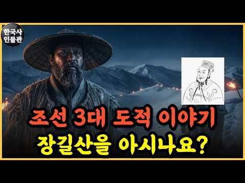
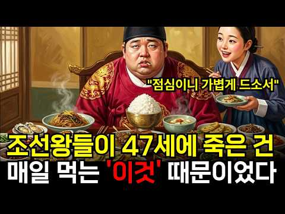
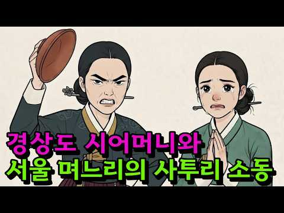

# 역사 — 성공 사례 분석: 사례별 자세히 #41–#80

`analysis.md` 의 9번 (같은 # 번호). 자동 생성 — `tools/success_analysis.py` v1.6 (2026-10-28 10:14 UTC). ※ 연구·교육용 — 투자 권유가 아님.

### 41. 이순신 장군님을 2026년 대한민국에 모셔왔습니다

- https://www.youtube.com/watch?v=Jb4mO-n0884 · 어디로든 연우 · 구독자 2,700 · 조회수 347,652 (×128.8, 하루 17,998.4) · 좋아요 1,660 (0.5%) · 6.4분 · 2026-10-09 · 주제 묶음 3. 조선 · 형식 정보·해설 (그 밖) · 폴더 `W_Jb4mO-n0884` (웹 승인)
- 썸네일: 
- 챕터: 0:00 장군님, 저랑 어디 좀 가요 ∣ Admiral, co… · 0:28 여기는 2026년 대한민국입니다 ∣ Welcome t… · 1:26 장군님의 첫 자동차 나들이 ∣ The admiral’… · 2:24 장군님, 하나 드셔보세요 ∣ Admiral, try … · 2:53 보여드리고 싶었던 배가 있어요 ∣ There’s a … · 3:14 지금 우리 바다를 지키는 군함 ∣ The warshi… · 4:35 함께 싸우던 이들이 생각나는구나 ∣ I remembe… · 5:03 장군님이 지키고 싶었던 일상 ∣ The everyda… · 5:56 다시 조선으로, 감사했습니다 ∣ Back to Jos… · 6:15 자, 하나씩 들게 ∣ Here, have one ea…
- 설명 앞부분: 이순신 장군님을 2026년 대한민국에 모셔 온 연우 🌊 장군님이 지켜낸 바다, 그 이후의 모습을 직접 보여드리고 싶었습니다. 처음 타보는 자동차부터 내비게이션, 영상과 음악, 달콤한 간식까지. 낯선 것투성이인 미래 나들이에 장군님의 반응은? 😂 그리고 마침내 마주한 대한민국 해군의 군함. 지금 이 바다를 지키는 이들을 만난 장군님은 함께 싸웠던 사람들을 떠올립니다. “이제는 저희가 지키겠습니다.” 시간을 넘어 만난 두 시대의 바다. 그 너머에서 평범한 하루를 살아가는 사람들을 보며, 장군님은 어떤 생각을 하셨을까요? 현실에는 없는…
- 대본 없음 (설명) — 음성인식이 끝나면 도입부·흐름이 들어감
- 댓글 248/313: 좋은 점 — 영상 3 · 감사·응원 14 · 더 알고 싶은 것 5 · 아쉬운 점 — 영상 2 · 반박·불만 — 의견 다름 1 · 정치·사회 14 · 경험 공유 8 · 구독·다음 기대 1
  - 좋은 점 — 영상 👍48 “안녕하세요 이순신 장군님의 후손입니다 저희 조상님을 통해서 좋은 영상 만들어주셔서 감사합니다 영상 잘보고있습니다😊”
  - 좋은 점 — 영상 👍2 “얼마전에 다른 유튜버분이 현대시대에 세종대왕님을 모신적이 있었는데 그 영상 댓글에 저도 이런걸 상상했던적이 있다고 댓글을 적었던적이 있습니다. 그때 상상했던 인물들이 세종대왕님과 이순신장군님이라고도 적었구요. 근데 그 상상했던 영상을 이렇게 빨리 보게될줄은 몰랐습니다…”
  - 감사·응원 👍256 “저는 현역 장교인 신분의 군인입니다. 나중에 혹시 괜찮으시면, 우리 국군의 날 행사 귀빈석에서 수많은 위인들이 우리 국군의 위용을 보시는 영상 한번 만들어주시면 감사하겠습니다. 불멸의 이순신 보고 군인의 꿈을 품었던 소년이 어느새 야전에서 부하들을 이끄는 군인이 되었…”
  - 감사·응원 👍48 “안녕하세요 이순신 장군님의 후손입니다 저희 조상님을 통해서 좋은 영상 만들어주셔서 감사합니다 영상 잘보고있습니다😊”
  - 더 알고 싶은 것 👍256 “저는 현역 장교인 신분의 군인입니다. 나중에 혹시 괜찮으시면, 우리 국군의 날 행사 귀빈석에서 수많은 위인들이 우리 국군의 위용을 보시는 영상 한번 만들어주시면 감사하겠습니다. 불멸의 이순신 보고 군인의 꿈을 품었던 소년이 어느새 야전에서 부하들을 이끄는 군인이 되었…”
  - 더 알고 싶은 것 👍2 “얼마전에 다른 유튜버분이 현대시대에 세종대왕님을 모신적이 있었는데 그 영상 댓글에 저도 이런걸 상상했던적이 있다고 댓글을 적었던적이 있습니다. 그때 상상했던 인물들이 세종대왕님과 이순신장군님이라고도 적었구요. 근데 그 상상했던 영상을 이렇게 빨리 보게될줄은 몰랐습니다…”
  - 아쉬운 점 — 영상 👍0 “기발한 생각은 맞는데 놀라는 장면이 너무 약해서 아쉽네요.😅 감격해서 눈물씬도 아쉽구요. ㅋ”
  - 아쉬운 점 — 영상 👍0 “아직은 오글거리기도 하고 ai티가 많이나긴 하는데 나중엔 진짜 구분 안되겠네;”
  - 반박·불만 — 의견 다름 👍0 “말도안되는 엽기적인 영웅 이순신!!”
  - 정치·사회 👍6 “조선을 지키기 위해 얼마나 싸웠던가, 임진왜란 이후, 일제강점기에 625 한국전쟁까지 나라가 두쪽나서 이순신 장군이 얼마나 슬퍼할까나,”
  - 정치·사회 👍1 “현재 제주는 중국인이 가득...”
  - 경험 공유 👍48 “안녕하세요 이순신 장군님의 후손입니다 저희 조상님을 통해서 좋은 영상 만들어주셔서 감사합니다 영상 잘보고있습니다😊”
  - 경험 공유 👍5 ““내가 지키고 싶었던 것도 이런 하루였네” 이 한마디 ㅜㅜㅜ 너무 뭉클함 ㅜㅜ”

### 42. “아무도 오지 않았다” 16살 단종, 영월에서 홀로 버틴 4개월

- https://www.youtube.com/watch?v=uezr9s1ffZM · 조선 비화록 · 구독자 21 · 조회수 28,549 (×285.5, 하루 647.8) · 좋아요 44 (0.1%) · 24.8분 · 2026-09-14 · 주제 묶음 기타 · 형식 정보·해설 (그 밖) · 폴더 `W_uezr9s1ffZM` (웹 승인)
- 썸네일: 
- 설명 앞부분: “아무도 오지 않았다” 16살 단종, 영월에서 홀로 버틴 4개월 왕좌에서 내려온 열여섯 살 소년왕 단종. 한때 수많은 신하와 궁녀들에 둘러싸여 살았던 어린 왕은 하루아침에 왕위를 빼앗기고, 깊은 산골 영월로 유배됩니다. 청령포의 작은 어소에서 홀로 지내며 산나물로 끼니를 이어가고, 절벽에 올라 한양을 바라보고, 사랑하는 아내 정순왕후를 그리워하며 돌 하나하나를 쌓았다는 이야기. 그가 남긴 망향탑과 관음송, 그리고 영월 사람들의 가슴속에 전해 내려온 수많은 이야기들. 우리는 역사책에서 단종의 폐위와 사약, 사육신의 충절은 배웠지만,…
- 같은 채널 평소 대비 ×3,568.6 (채널 최근 롱폼 중앙값 8회) · 평소 영상: “한 사발 더!” 조선시대 사약을 마시고도 죽지 않은 사람들 (9회) / 문종은 정말 병으로 죽었을까? 죽기 이틀 전까지 호전됐던 왕의 충격적인 죽음 (7회)
- 대본 없음 (설명) — 음성인식이 끝나면 도입부·흐름이 들어감
- 댓글 3/3: 좋은 점 — 영상 0 · 감사·응원 0 · 더 알고 싶은 것 0 · 아쉬운 점 — 영상 0 · 반박·불만 — 의견 다름 0 · 정치·사회 0 · 경험 공유 0 · 구독·다음 기대 0

### 43. 어떻게 이 나라 하나가 전 세계 80억명을 먹여살리는걸까?｜인산염｜역사｜지리학｜세계사

- https://www.youtube.com/watch?v=JU4AtsLwYPQ · 다시만난역사 · 구독자 3,570 · 조회수 551,155 (×154.4, 하루 22,504.6) · 좋아요 3,585 (0.7%) · 17.7분 · 2026-10-03 · 주제 묶음 5. 세계사·서양사 · 형식 정보·해설 (그 밖) · 폴더 `W_JU4AtsLwYPQ` (웹 승인)
- 썸네일: 
- 설명 앞부분: 전 세계 식량의 운명을 쥐고 있는 하얀 가루가 있습니다. 바로 '인산염'입니다. 그리고 이 자원의 무려 70%가 단 하나의 나라, 모로코 땅속에 묻혀 있습니다. 비료의 핵심 원료인 인은 생명과 농업에 반드시 필요하지만 다른 것으로 대체할 수 없는 자원입니다. 그렇다면 왜 하필 모로코일까요? 그 답은 하늘이 아니라, 수천만 년 전 사라진 고대 바다에 있었습니다. 이 영상에서는 인산염이 어떻게 만들어지는지, 왜 모로코에만 세계 최대 매장량이 집중됐는지, 그리고 이 자원이 우리의 밥 한 그릇과 어떻게 연결되는지를 지질학과 역사, 그리고…
- 같은 채널 평소 대비 ×144.4 (채널 최근 롱폼 중앙값 3,816회) · 평소 영상: 북한은 이미 알고있었다? 인천상륙작전, 알고도 당한 진짜 이유｜6.25전쟁｜한국사｜역사｜… (3,816회) / 영국 식민지에서 세계 1위로, 미국의 돈은 어떻게 세계의 주인이 되었나?｜세계사｜기축통화… (2,452회)
- 대본 없음 (설명) — 음성인식이 끝나면 도입부·흐름이 들어감
- 댓글 89/95: 좋은 점 — 영상 3 · 감사·응원 6 · 더 알고 싶은 것 1 · 아쉬운 점 — 영상 1 · 반박·불만 — 의견 다름 0 · 정치·사회 1 · 경험 공유 1 · 구독·다음 기대 0
  - 좋은 점 — 영상 👍15 “유익한 정보 감사합니다 잘 듣고 갑니다”
  - 좋은 점 — 영상 👍8 “유익한 영상이군요. 지브롤터 해협을 끼고있는 북아프리카 대륙 서쪽 쩟번째나라죠 2차대전때 사막전투의 무대라 관심을 갖다보니 서에서 동으로 모알튀리이 이렇게 외웠었어요. 아프리카 대륙전체가 생명이 넘치던 앝은 바다였다는걸 처음 알게됐습니다.”
  - 감사·응원 👍15 “유익한 정보 감사합니다 잘 듣고 갑니다”
  - 감사·응원 👍3 “알게 돼 감사합니다. 싯사 중 언제나 모로코의 인을 떠올리겠군요”
  - 더 알고 싶은 것 👍2 “비슷한조건에서 한쪽은 석유 한쪽은 인산염 맞나요?”
  - 아쉬운 점 — 영상 👍2 “너무 서두가 길어 지루하다”
  - 정치·사회 👍0 “정작 모로코가 잘사는 나라가 아니라는 거지”
  - 경험 공유 👍0 “제가 알기로는 자연적으로 공급되는 성분이 있고 그렇치 않은 성분이 있다는 것입니다 그중 인은 자연에서 공급되는 양보다 소모되는 양이 많기 때문에 인위적으로 공급해야 한다는것이 팩트 입니다.”

### 44. 넬슨 13전 8승, 이 사람은 23전 23승, 백만 미국인이 이순신 앞에서 침묵한 순간. "조선은 하나의 세계관이다".

- https://www.youtube.com/watch?v=J3I-shhMdAw · 알쓸이슈 · 구독자 382 · 조회수 98,433 (×257.7, 하루 2,286.0) · 좋아요 1,181 (1.2%) · 25.7분 · 2026-09-15 · 주제 묶음 3. 조선 · 형식 브이로그·직접 해본 이야기 · 폴더 `W_J3I-shhMdAw` (웹 승인)
- 썸네일: 
- 설명 앞부분: 시끄러운 이슈 속에서 핵심만 담담하게 전하는 채널, 알쓸이슈입니다. 본 채널은 실제 기사, 공식 발표 및 공개 자료를 바탕으로 콘텐츠를 제작합니다. 영상의 일부 이미지와 장면은 내용 이해를 돕기 위해 AI 기술을 활용할 수 있습니다. 경제·정책·통계 수치는 발표 시점과 자료 기준에 따라 달라질 수 있습니다.
- 같은 채널 평소 대비 ×264.2 (채널 최근 롱폼 중앙값 372회) · 평소 영상: 생일 미역국 앞에서 울어버린 미국 가장, 한국 식당 주인이 건넨 한 그릇의 의미. “밥은… (402회) / 뷔 사진 들고 남대문 골목 찾는 외국인들, 할머니 반지가 해외 Z세대 관심사로… (343회)
- 대본 없음 (설명) — 음성인식이 끝나면 도입부·흐름이 들어감
- 댓글 69/69: 좋은 점 — 영상 0 · 감사·응원 2 · 더 알고 싶은 것 0 · 아쉬운 점 — 영상 2 · 반박·불만 — 의견 다름 1 · 정치·사회 4 · 경험 공유 0 · 구독·다음 기대 0
  - 감사·응원 👍3 “❤이순신장군❤님조선을지켜주셔서감사합니다❤대한민국❤파 이팅❤😂🎉😢😮😅😊”
  - 감사·응원 👍0 “❤대한민국❤파 이팅😂코리아🎉화이팅😢한국만 세😮무궁화😅삼 천리😊❤😂🎉😢😮😅😊”
  - 아쉬운 점 — 영상 👍1 “요즘 다들 AI 음성 자동 해설로 다 채우는 그런 쓰레기들이 많은데 이렇게 사람이 직접 얘기하니 정말 참 좋군.”
  - 아쉬운 점 — 영상 👍0 “갑자기 이 몇일 사이에 이순신 장군에 관한 영상들이 우후죽순으로 유튜브에 업로드 되고잇는데..거의 대부분이 AI로 만든 그럴싸한 국뽕까지 첨가 조횟수 올리려는 낚시질,,”
  - 반박·불만 — 의견 다름 👍0 “글쎄 포장을 꼭 해야하는지? 있는 그대로 보여주면 될것을!”
  - 정치·사회 👍2 “세종대와.이순신장군.박정희대통령의 공통점 = 자주,자조,자립하는 국방을 만들어라.주변국가는 우리나라의 이웃이 아니다. 라는 것을 알려 주신 우리민족의 3대 영웅❤이시다”
  - 정치·사회 👍1 “일본이 쑈는 잘하지. 별것도 없는 나라가”

### 45. 조선에는 원래 제사가 없었다? 제사는 언제부터 지냈나?

- https://www.youtube.com/watch?v=LMJeEzBPcwg · 인류의모든기록 · 구독자 380 · 조회수 85,850 (×225.9, 하루 2,257.5) · 좋아요 338 (0.4%) · 15.3분 · 2026-09-20 · 주제 묶음 3. 조선 · 형식 야담·옛날이야기 · 폴더 `W_LMJeEzBPcwg` (웹 승인)
- 썸네일: 
- 챕터: 0:00 제사가 처음엔 불법이었다? · 0:39 고려 사람들은 왜 절에 갔을까 · 1:34 아들만 제사 지내지 않았다? · 2:33 조선이 제사를 강요한 진짜 이유 · 4:16 제사 안 지내면 벌을 받았다고? · 6:09 왜 장남이 제사를 도맡게 됐을까 · 7:07 족보의 진짜 나이는 몇 살일까 · 9:09 성씨가 없던 사람들이 더 많았다? · 10:47 집성촌은 언제부터 생겨났을까 · 12:03 양반이 갑자기 늘어난 이유는? · 13:10 한국인이 가족 관계에 집착하는 이유 · 13:52 전통은 원래 변하는 것일까
- 설명 앞부분: 우리가 아주 오래된 전통이라 믿는 제사와 족보, 사실은 조선 왕조 나이의 절반도 안 됩니다. 태조부터 세종까지, 나라가 벌까지 내리겠다며 밀어붙이고 나서야 겨우 뿌리내린 이야기입니다. 고려 사람들은 조상이 돌아가시면 절에 갔습니다. 그런데 조선이 세워지고 나라가 사당을 세우고 제사를 지내라 명해도, 사대부들조차 몇십 년을 따르지 않았습니다. 현존하는 가장 오래된 족보는 조선이 세워진 지 팔십 년도 더 지난 1476년에야 만들어졌고, 그 무렵에도 인구 상당수는 성씨조차 없었습니다. 우리가 당연하게 여기는 제사와 족보, 집성촌이 실은…
- 같은 채널 평소 대비 ×59.5 (채널 최근 롱폼 중앙값 1,444회) · 평소 영상: 바나나는 어떻게 아이슬란드를 부유하게 만들었을까 (1,444회) / 일본이 삼십 년을 버텨온 데는 다섯 가지 이유 (1,653회)
- 대본 없음 (설명) — 음성인식이 끝나면 도입부·흐름이 들어감
- 댓글 50/51: 좋은 점 — 영상 0 · 감사·응원 0 · 더 알고 싶은 것 0 · 아쉬운 점 — 영상 0 · 반박·불만 — 의견 다름 2 · 정치·사회 1 · 경험 공유 0 · 구독·다음 기대 0
  - 반박·불만 — 의견 다름 👍8 “고려시대에는 절이 정교유착을 가져오니 유교를 받아들이는 조선은 종교를 배척해야 했고 그래서 이런 풍습으로 백성을 달랜다고 했지만 글쎄,,, 결론은 제사가 오래된 풍습도 아닌데 왜 그리 고부갈등의 근원이 되는지 무지몽매다.”
  - 반박·불만 — 의견 다름 👍2 “고려말 부터 제사를 지냈는데 자세히 알게 해주지 무조건 없다는식으로 이건 아니죠 지금식으로가 그시대로 지내는것이지 요즘 바나나 올리는것처럼”

### 46. “누가 이순신을 사?” 미국서 무시당한 청년…결국 25만 부 팔아치웠다

- https://www.youtube.com/watch?v=olrlcl1HoCo · 최기훈TV · 구독자 631 · 조회수 132,027 (×209.2, 하루 3,639.9) · 좋아요 964 (0.7%) · 17.4분 · 2026-09-22 · 주제 묶음 3. 조선 · 형식 애니메이션·지도 · 폴더 `W_olrlcl1HoCo` (웹 승인)
- 썸네일: 
- 챕터: 0:00 이순신 만화로 미국을 뒤집은 청년 · 1:28 평범한 청년 온리 콤판의 새로운 도전 · 3:18 철저한 역사 고증과 글로벌 제작진 · 4:43 냉혹한 미국 만화 시장의 문전박대 · 6:44 자동차 트렁크에서 시작된 정면 돌파 · 9:21 이순신 만화 25만 부 판매의 비밀 · 13:02 대한민국으로 역수입된 이순신 만화 · 14:17 한 이방인이 보여준 K콘텐츠의 힘
- 설명 앞부분: “초능력도 없는 400년 전 조선 장군을 어떤 미국인이 돈 주고 사겠습니까?” 한국어도 못하고 한국에 가본 적도 없었던 미국 청년 온리 콤판. 그는 우연히 드라마 「불멸의 이순신」을 접한 뒤, 충무공 이순신의 삶에 완전히 매료됩니다. 하지만 이순신 장군을 주인공으로 만든 만화는 미국의 유명 출판사들로부터 연이어 거절당했습니다. 스파이더맨과 배트맨이 지배하는 미국 만화 시장에서 낯선 조선의 장군은 “절대 팔리지 않을 소재”로 평가받았기 때문입니다. 그러나 콤판은 포기하지 않았습니다. 직접 독립 출판사를 세우고 자동차 트렁크에 만화책…
- 같은 채널 평소 대비 ×3,772.2 (채널 최근 롱폼 중앙값 35회) · 평소 영상: “돈이 있어도 못 산다” 미국이 4년을 기다려도 한국 변압기만 찾는 진짜 이유 (35회) / “고속도로가 활주로였다” 외국인이 놀란 한국 고속도로에 숨겨진 비밀 기능 (57회)
- 대본 없음 (설명) — 음성인식이 끝나면 도입부·흐름이 들어감
- 댓글 24/28: 좋은 점 — 영상 0 · 감사·응원 4 · 더 알고 싶은 것 1 · 아쉬운 점 — 영상 0 · 반박·불만 — 의견 다름 0 · 정치·사회 1 · 경험 공유 0 · 구독·다음 기대 0
  - 감사·응원 👍11 “온리 콤판은 참으로 대단한 분이군요. 우리의 영웅을 세계에 알려주어서 고맙습니다. 한국에서도 이 분을 위해서 무엇인가 해주었으면 합니다. 교보문고에서 찾아보니까 품절이네요. 한국에서도 이 분 작품 구할 수 있는지 모르겠습니다.”
  - 감사·응원 👍10 “대단하네요 이순신 장군님 을 아려주셨어 감사합니다”
  - 더 알고 싶은 것 👍6 “한국판 번역본 어디서 살수 있나요?”
  - 정치·사회 👍19 “불멸의 이순신 사극은 남자라면 안볼수 없게끔 만든 전쟁 정치 명작이고 외국인도 감동받을꺼다 이 대작 드라마를 넷플릭스에 올려야 한다”

### 47. 임꺽정은 정말 의적이었을까? 조선 조정을 뒤흔든 도적의 실체와 비굴했던 최후

- https://www.youtube.com/watch?v=mfVPZP6s4Sw · 신박한 호기심 · 구독자 1,680 · 조회수 138,842 (×82.6, 하루 9,611.7) · 좋아요 499 (0.4%) · 14.3분 · 2026-10-13 · 주제 묶음 3. 조선 · 형식 야담·옛날이야기 · 폴더 `W_mfVPZP6s4Sw` (웹 승인)
- 썸네일: 
- 설명 앞부분: 조선시대 대표적인 의적으로 알려진 임꺽정. 가난한 백성을 돕고 탐관오리에 맞섰던 영웅으로 기억되지만, 실제 역사 기록에 등장하는 임꺽정의 모습은 우리가 알고 있는 이야기와 상당히 다릅니다. 백정 출신이었던 임꺽정은 어떻게 수많은 부하를 거느리는 도적 집단의 우두머리가 되었을까요? 황해도를 중심으로 활동하던 임꺽정 일당은 관아를 습격하고 관리들을 위협하며 조선 조정을 긴장시켰습니다. 조정은 이들을 토벌하기 위해 관군을 동원했고, 남치근을 중심으로 대대적인 추적과 수색에 나섰습니다. 그리고 임꺽정 일당의 내부 사정을 알고 있던 서림의…
- 같은 채널 평소 대비 ×63.2 (채널 최근 롱폼 중앙값 2,196회) · 평소 영상: 조정의 지원 없이 버틴 이순신 수군… 난중일기의 여성 ‘여진’은 누구였나? (2,646회) / 조선시대 사형수 가족들은 왜 망나니에게 돈을 바쳤을까? ∣ 조선의 사형 집행인 이야기 (2,659회)
- 대본 없음 (설명) — 음성인식이 끝나면 도입부·흐름이 들어감
- 댓글 48/93: 좋은 점 — 영상 0 · 감사·응원 0 · 더 알고 싶은 것 0 · 아쉬운 점 — 영상 0 · 반박·불만 — 의견 다름 2 · 정치·사회 10 · 경험 공유 2 · 구독·다음 기대 1
  - 정치·사회 👍12 “누구라도 저 암흑한 시대에 태어 났으면 산도적이 되었을것!!!! 2026년 현재 짜이밍이 정부에서 산도적이 되고 싶어도 못되는게............ ㅋ”
  - 정치·사회 👍9 “조선은 나쁜 놈들이 그냥 나쁜 짓하면서 살다가 폭망했다 결국 결말이 권선징악으로 귀결이라도 났지만 지금은 나쁜 놈들이 법기술자가 돼 대통령도 국회의원도 장관도 하면서 지들 수사재판하는 국가기관들을 파괴하거나 농락 함, 여튼 선과 악이 뒤죽박죽으로 혼재하면서 국민들을 …”
  - 경험 공유 👍4 “내가 고등학교때 국사시간에 선생님이 그랬슴 "홍길동 임꺽정 이런책은 커가는 애들에게 읽지 못하게 해야한다 신세한탄 불평불만 폭력난동만 배우게하는 불량 잡서다 " 이런 말씀이 백번 맞다고 본다 다른학교에서는 어떻게 가르쳤는지 모르지만 ....”
  - 경험 공유 👍3 “내가 임꺽정이라도 그리할듯”
  - 구독·다음 기대 👍1 “그냥 임꺽정드라마정주행 하는개 빠름 임꺽정 이봉학 배돌석 황천왕둥이 박유복 곽오주 길막봉 서림 오개도치”

### 48. 3D로 보는 조선시대 과거시험 250km 여정 ∣ 10년 낙방 무관 노상추의 7일

- https://www.youtube.com/watch?v=I9OuWbhZvzA · 조상님 클라쓰 · 구독자 5,350 · 조회수 452,108 (×84.5, 하루 27,772.7) · 좋아요 1,251 (0.3%) · 7.5분 · 2026-10-12 · 주제 묶음 3. 조선 · 형식 정보·해설 (그 밖) · 폴더 `W_I9OuWbhZvzA` (웹 승인)
- 썸네일: 
- 챕터: 0:00 강창나루의 새벽 · 0:21 끝까지 보시면 · 0:48 10년 낙방 · 1:36 밭 열두 마지기 · 2:04 산적과 호랑이? · 2:26 첫날, 함창 · 2:58 세 고개 · 3:31 문경새재를 넘다 · 3:43 '원'의 정체 · 4:19 원이 사라지다 · 4:36 주막의 밤 · 4:50 토렴 · 5:23 온돌 · 5:39 언 한강을 건너 · 5:57 시험장 · 6:41 열둘째 이름
- 설명 앞부분: 1780년 정월, 경상도 선산의 서른다섯 살 사내 노상추가 친척에게 밭 열두 마지기를 팔아 마련한 노잣돈을 들고 한양 무과 시험길에 오릅니다. 10년째 낙방, 이번에도 떨어지면 돌아갈 곳이 없습니다. 열일곱 살부터 여든넷까지 67년 동안 쓴 『노상추일기』 속 7일간, 약 250km의 과거길을 3D로 따라 걷습니다. 출발: 1780년(정조 4) 정월 21일 선산 강창나루 → 함창 덕통참 → 문경새재(조령) → 연풍 → 충주 → 죽산·용인 → 27일 서빙고 나루의 언 한강을 걸어 건너 숭례문 원(院): 대개 30리(약 12km)마다 …
- 같은 채널 평소 대비 ×40.1 (채널 최근 롱폼 중앙값 11,265회) · 평소 영상: 제주 땅을 310m 뚫어도 바닥이 없었다 ∣ 한라산 아래 숨은 네 개의 층 (11,265회) / 조선판 오디세우스, 148일간의 사투 ∣ 표류한 관리 최부의 실제 기록 (10,830회)
- 대본 없음 (설명) — 음성인식이 끝나면 도입부·흐름이 들어감
- 댓글 49/163: 좋은 점 — 영상 1 · 감사·응원 0 · 더 알고 싶은 것 1 · 아쉬운 점 — 영상 2 · 반박·불만 — 의견 다름 0 · 정치·사회 2 · 경험 공유 0 · 구독·다음 기대 0
  - 좋은 점 — 영상 👍4 “잼있고 산박하고 유익하네요. 굿 콘텐츠 상 수여함! ㅋㅋㅋ”
  - 더 알고 싶은 것 👍5 “재미있게 잘 봤습니다 조상님들의 사적행보, 생활이 재밌네요 또 부탁드립니다”
  - 아쉬운 점 — 영상 👍0 “설명 해주시는분...ai 음성 인가요?? 실제 사람 음성 인가요.....???아시는분 댓글좀...”
  - 정치·사회 👍0 “저 낙방에 낙방을 계속하다가 막판에 겨우 합격한 노상추가 윤석열로 환생한 건 아닐까? 윤석열도 9수나 하고 막판에 기적적으로 합격했다는데...ㅋㅋ 뭐 아님 말고”

### 49. "일본어 너무 잘해서 턱 빠질 뻔" 일제강점기 한국 드라마가 일본 넷플릭스 TOP10에 들자 일본 시청자들이 남긴 말

- https://www.youtube.com/watch?v=RPBvkCsjnSY · 왓더 · 구독자 3,290 · 조회수 211,213 (×64.2, 하루 15,663.3) · 좋아요 852 (0.4%) · 9.4분 · 2026-10-14 · 주제 묶음 4. 한국 근현대사 · 형식 정보·해설 (그 밖) · 폴더 `W_RPBvkCsjnSY` (웹 승인)
- 썸네일: 
- 설명 앞부분: 1932년 일제강점기 경성, 조선총독부를 무대로 한 한국 드라마 '100일의 거짓말'. 공개 전 일본에서는 반일 드라마라는 말이 나왔지만, 공개 사흘 만에 일본 넷플릭스 시리즈 TOP10에 들었습니다. 정무총감 사토 신이치를 연기한 진선규의 일본어에 "턱이 빠질 뻔했다"는 반응까지 나왔습니다. 일본 리뷰 사이트와 넷플릭스 예고편에 남은 일본 시청자들의 실제 반응을 정리했습니다. 순위·수치: 플릭스패트롤(10월 12~13일 기준), 닐슨코리아 전국 기준, 한국경제·TV리포트·나비콘 보도 배경음악: "Inspired" Kevin Ma…
- 같은 채널 평소 대비 ×62.3 (채널 최근 롱폼 중앙값 3,390회) · 평소 영상: "100년에 한 번 나올 선수" 17살 고등학생 김연경을 처음 본 일본 방송의 첫마디, … (3,513회) / "엄청난 기업이 이웃 나라에" 삼성은 안 산다던 일본에서 갤럭시가 품절되자, 일본 사람들… (3,268회)
- 대본 없음 (설명) — 음성인식이 끝나면 도입부·흐름이 들어감
- 댓글 105/134: 좋은 점 — 영상 0 · 감사·응원 1 · 더 알고 싶은 것 1 · 아쉬운 점 — 영상 0 · 반박·불만 — 의견 다름 3 · 정치·사회 11 · 경험 공유 5 · 구독·다음 기대 0
  - 정치·사회 👍5 “피해자인 우리나라가 반일 드라마 만들수도있는거지 뭘 맨날 그런거가지고 떠들어ㅋㅋ 개인적으로는 이런 드라마가 더더욱 넷플릭스에서 많이 나와야한다고 생각함 전세계에서 볼수있게. 드라마로 이러쿵 저러쿵 할시간에 교과서 탓하지말고 역사공부나하고왔으면..요즘같이 인터넷이랑 A…”
  - 정치·사회 👍1 “실제 일제 강점기를 몸소 겪었던 대부분의 일반적인국민이었던 할머니 할아버지 세대는 일본에 대한 반감이 없는데 이런 영화나 드라마에서는 독립운동을 했던 인물들은 모두 선한 역으로 나라를 위해서 희생한 것으로 그려지고 일본 군인들은 길거리에서 조선인들을 총으로 쏴도 아무…”
  - 경험 공유 👍11 “저도 배우들의 일본어가 완벽해서 깜짝 놀랐어요. 역시 대한민국의 배우님은 글로벌이예요~~”
  - 경험 공유 👍2 “연기 너무 못한다 내가 제일 잘나가 이러고 있는 것 같네 일반인 사이에 조증걸린 인간 같다 저 매력적인 캐릭터를 이따위로 해석하다니”

### 50. 임금인줄 모르고 훈수둔 10살 아이... 야사 / 야담/ 민담/ 시니어 오디오 북/ 옛날이야기

- https://www.youtube.com/watch?v=n9Bpb5j7ec8 · 토이야담 · 구독자 672 · 조회수 221,907 (×330.2, 하루 3,126.5) · 좋아요 1,473 (0.7%) · 32.3분 · 2026-08-18 · 주제 묶음 9. 야사·야담·옛날이야기 · 형식 수면·낭독 (잠잘 때 듣는) · 폴더 `W_n9Bpb5j7ec8` (웹 승인)
- 썸네일: 
- 챕터: 0:00 도입 및 이야기 시작 · 1:06 청안골과 흉년의 기억 · 3:20 옥이의 등장과 성장 · 5:00 허생원과의 만남, 글자를 배우다 · 6:41 박 아전의 횡령과 의심 · 9:13 구휼미와 장부의 비밀 · 11:08 나그네의 등장과 글자 지적 · 21:32 임금의 정체와 진실 규명 · 29:00 정의 실현과 서당 설립
- 설명 앞부분: 🌙 **토이야담에 오신 것을 환영합니다. 오늘 이야기는 흉년에 부모를 잃고 주막에서 일하는 열 살 소녀 옥이. 어느 날, 주막에 묵은 나그네의 글자 오류를 지적하며 운명이 바뀐다. 그가 바로 세종대왕이었고, 옥이의 눈썰미가 관아의 곡식 횡령을 밝혀내는 결정적 단서가 된다. 과연 옥이는 백성들을 굶주림에서 구할 수 있을까요? 임금과 옥이의 특별한 만남, 그리고 따뜻한 야담 이야기를 지금 만나보세요. ⏱ 타임라인 / 챕터: ※ 본 채널의 영상은 직접 조사하고 구성한 창작 콘텐츠입니다. ※ 이미지와 음성 표현에는 AI 기술을 사용했습니…
- 같은 채널 평소 대비 ×516.7 (채널 최근 롱폼 중앙값 430회) · 평소 영상: 생후 10일 만에 갑자기 말을 한 갓난아기, 의문의 죽음이 서서히 밝혀지는데....? 야… (438회) / 쫒기는 임금인줄 모르고 구한 10살 약초 소녀...야사 / 야담/ 민담/ 시니어 오디오 … (421회)
- 대본 없음 (설명) — 음성인식이 끝나면 도입부·흐름이 들어감
- 댓글 83/83: 좋은 점 — 영상 1 · 감사·응원 4 · 더 알고 싶은 것 0 · 아쉬운 점 — 영상 1 · 반박·불만 — 의견 다름 2 · 정치·사회 0 · 경험 공유 1 · 구독·다음 기대 0
  - 감사·응원 👍2 “일본에서 듣고있어요 감사합니다 27:51”
  - 감사·응원 👍2 “야담은 늘 ~ 재미와 감동(?)-을 잔잔하게 가져다 준다 고맙고 감사하다 신의 눈”
  - 아쉬운 점 — 영상 👍2 “자막이 엉망진창이오”
  - 반박·불만 — 의견 다름 👍1 “야담이래도 너무 허술함 임금이 하루쯤 잠행을 할수는 있겠지만 조선시대같은 왕조국가에서 임금이라는 존재가 곧 국가였는데 왕이 대궐을떠나 며칠씩 지방주막에 머물다니 말도 안되는 소리.”
  - 반박·불만 — 의견 다름 👍1 “스릴러야??24:09초 손은 누구거여?? 내건아닌데?세개가 다 다르네~~”
  - 경험 공유 👍3 “토이 넘 이뽀 나도 팻으로 키우고 싶어지네 잘 듣고 있습니다.”

### 51. [3부작] 이순신의 실제 얼굴을 찾아서(최종회)

- https://www.youtube.com/watch?v=B5Yqnj_CfVg · 페이스 아카이브 · 구독자 1,700 · 조회수 409,971 (×241.2, 하루 7,747.9) · 좋아요 4,121 (1.0%) · 13.7분 · 2026-09-05 · 주제 묶음 3. 조선 · 형식 애니메이션·지도 · 폴더 `W_B5Yqnj_CfVg` (웹 승인)
- 썸네일: 
- 챕터: 0:00 오프닝 및 시리즈 요약 · 2:15 무과형 초상화 분석 흐름 · 4:30 문과형 초상화 계보 정리 · 7:10 직계 후손 초상 및 사진 비교 (이봉상, 이달해, 이… · 10:50 인공지능 교차 복원을 통한 최종 얼굴 재현 · 12:20 에필로그 및 클로징
- 설명 앞부분: "우리가 알던 이순신 장군의 모습, 과연 진짜 얼굴일까요?" 안타깝게도 지금까지 여러 차례 이순신과 관련된 그림들이 등장했지만 장군의 진짜 얼굴은 여전히 오리무중입니다. 진짜 이순신 얼굴 찾기 방구석 프로젝트! 현존하는 이순신 관련 초상화 20여 점을 분석한 1, 2부에 이어 3부에서는 이순신 직계 후손들의 초상화를 분석하고, 그 유형을 무과형과 문과형, 후손형으로 나누어, 실제 이순신의 얼굴을 AI로 복원해 보았습니다. 많은 응원 댓글로 부탁드리며 오류 또한 남겨 주시면 수정하겠습니다. Time stamp 참고자료 목록 1. 전…
- 같은 채널 평소 대비 ×4.4 (채널 최근 롱폼 중앙값 93,170회) · 평소 영상: 복싱 100년사, 찬란하게 빛난 10명의 챔피언들! #한국권투명장면 #한국권투챔피언 (93,170회) / [3부작] 이순신의 실제 얼굴을 찾아서2 #이순신후손 (100,989회)
- 대본 없음 (설명) — 음성인식이 끝나면 도입부·흐름이 들어감
- 댓글 925/925: 좋은 점 — 영상 5 · 감사·응원 33 · 더 알고 싶은 것 7 · 아쉬운 점 — 영상 1 · 반박·불만 — 의견 다름 10 · 정치·사회 54 · 경험 공유 28 · 구독·다음 기대 2
  - 좋은 점 — 영상 👍11 “멋지고 이미지도 멋지네요 좋은 영상 가슴 벅차오르는 영상 감사합니다”
  - 좋은 점 — 영상 👍2 “아우내님의 후반부 멘트가 너무 와닿습니다. 성웅 이순신장군님은 유구한 한반도 역사가 빚어낸 무수한 별 중 최고의 별이라 생각해요. 시간이 되신다면.. 고구려, 고려의 영웅들의 초상도 그려내 주시길^^!”
  - 감사·응원 👍232 “이순신 장군 후손들이 독립운동하신 걸 오늘 처음 알았습니다. 대단한 가문이군요. 고맙습니다.”
  - 감사·응원 👍23 “진짜 이국종 교수님인데 ㅋㅋㅋㅋㅋㅋㅋㅋㅋㅋㅋㅋㅋㅋㅋ AI 의 올바른 활용 감사합니다. !”
  - 더 알고 싶은 것 👍3 “모계의 특징을 간과할수 없을겁니다 수십대에 걸쳐 어머니들의 특성이 섞이면 과연 같을 수 있을까요?”
  - 더 알고 싶은 것 👍0 “결과물 들고 진짜 과거로 가서 이분 누군지 아냐고 물어보고싶다. 신기하고 궁금하다”
  - 아쉬운 점 — 영상 👍3 “아, 2:17 부근에 등장한 초상화의 주인공은 윤두서가 아니라 윤증 선생님이십니다. 다음 영상에서라도 정정 정보를 주셨으면 합니다. 영상은 잘 보았습니다.”
  - 반박·불만 — 의견 다름 👍3 “무과형 얼굴을 설명하면서 정이 안간다고? 웃기는 쉒이네... 내가 볼 때는 아주 지적이고 강단있게 보이는 잘생긴 얼굴인데...”
  - 반박·불만 — 의견 다름 👍1 “얼마나 말도 안되는 논거인가.... 할말하않.”
  - 정치·사회 👍9 “내란범한테 대통령이라는 말은 쓰지 않는 걸로 합시다. 예우박탈이 원칙입니다. 국가전복 시도한 반역자로서 국민정서에도 맞지 않고요”
  - 정치·사회 👍7 “지금 대통령도 있는데 굳이 무시하고 “윤석열 대통령님” 찾고, 다음 대통령 찾으시는 걸 보니… 정치색이 은근히 드러나는 것 같아 많이 많이 많이 아쉽네요… 내란이나 안 일어났으면 몰라도 국가전복이 시도된 게 불과 2년 전인데…”
  - 경험 공유 👍156 “잘 보고 갑니다. 이순신 장군님 현존 남자 직계 후손들 약 100명 정도의 얼굴을 촬영하고 계측하여 데이터베이스화 해 놓은게 있습니다. 이순신 연구소 뭐 그런 기관에서 진행했습니다. 3~4년 정도 전에 제작 진행 된 걸로 기억합니다. 저도 데이터를 제공했습니다. 후손…”
  - 경험 공유 👍79 “이국종 교수님이 덕수 이씨인지 검색해봤네요. 교수님은 전주이씨네요”
  - 구독·다음 기대 👍4 “다음 프로젝트가 벌써 기대됩니다👏👏👏”

### 52. [한국사] 홍길동도 임꺽정도 잡혔다, 장길산은 어디로? ∣ 역사인물 ∣ 다큐 ∣ 야사 ∣ 비사

- https://www.youtube.com/watch?v=KGNklJiPzb8 · 한국사인물관 · 구독자 4,890 · 조회수 316,646 (×64.8, 하루 22,191.9) · 좋아요 984 (0.3%) · 27.5분 · 2026-10-14 · 주제 묶음 4. 한국 근현대사 · 형식 정보·해설 (그 밖) · 폴더 `W_KGNklJiPzb8` (웹 승인)
- 썸네일: 
- 설명 앞부분: 조선의 임금이 도적 하나를 10년째 못 잡았다고 직접 실토했습니다. 1697년 숙종의 전교에 이름이 오른 장길산, 그러나 조선왕조실록 어디에도 그가 붙잡혔다는 기록은 없습니다. 홍길동도 임꺽정도 체포 기사가 남았는데 조선 3대 도적 가운데 오직 한 사람만 마지막 줄이 비어 있습니다. 호적에도 오르지 못한 광대가 어떻게 포도청과 황해도 감사를 따돌렸는지, 을병대기근과 역모 고변 속에서 그 이름이 어떻게 전설이 되었는지 실록과 추안급국안 기록으로 따라갑니다. 끝까지 보시고 장길산의 마지막을 댓글로 남겨주세요. 안녕하세요, 한국사인물관…
- 같은 채널 평소 대비 ×106.2 (채널 최근 롱폼 중앙값 2,983회) · 평소 영상: [한국사] 이순신 장군은 몇 위일까? 임진왜란 명장 순위 TOP 8 ∣ 역사인물 ∣ 다큐… (2,983회) / [한국사] 안보면 후회하는 백제 700년, 삼천궁녀는 기록에 없다｜의자왕이 해동증자로 불… (2,980회)
- 대본 없음 (설명) — 음성인식이 끝나면 도입부·흐름이 들어감
- 댓글 22/23: 좋은 점 — 영상 0 · 감사·응원 0 · 더 알고 싶은 것 0 · 아쉬운 점 — 영상 0 · 반박·불만 — 의견 다름 0 · 정치·사회 0 · 경험 공유 0 · 구독·다음 기대 0

### 53. 역대 이순신 역할중 가장 싱크로율 높은 배우는? #이순신영화 #이순신실제모습

- https://www.youtube.com/watch?v=WrHgunG_gNc · 페이스 아카이브 · 구독자 1,700 · 조회수 168,199 (×98.9, 하루 7,098.5) · 좋아요 417 (0.2%) · 5.3분 · 2026-10-04 · 주제 묶음 3. 조선 · 형식 정보·해설 (그 밖) · 폴더 `W_WrHgunG_gNc` (웹 승인)
- 썸네일: 
- 챕터: 0:00 오프닝 · 0:08 역대 한국 영화·드라마 속 이순신 소개 (노량, 명량… · 0:23 기록 속 초상화 및 사료를 통한 이순신의 실제 외모 … · 0:54 1대 이순신: 1962년 유현목 감독 영화, 김승길 · 1:00 2대 이순신: 1968년 KBS 드라마 난중일기, 고… · 1:08 3대 이순신: 1971년 이규웅 감독 영화 성웅 이순… · 1:18 4대 이순신: 1972년 KBS 드라마 임진왜란, 주현 · 1:24 5대 이순신: 1977년 KBS 특집 단막극 이순신,… · 1:35 6대 이순신: 1985년 MBC 대하드라마 조선왕조 … · 1:55 7대 이순신: 2004년 KBS 드라마 불멸의 이순신… · 2:18 8대 이순신: 2005년 영화 천군, 박중훈 · 2:38 9대 이순신: 2014년 영화 명량, 최민식 · 2:55 10대 이순신: 2015년 드라마 징비록(선조와 유성… · 4:07 12대 이순신: 2022년 영화 한산: 용의 출현, … · 4:31 13대 이순신: 2023년 영화 노량: 죽음의 바다,… · 5:12 클로징: "내 마음속의 이순신을 댓글로 남겨 주세요!"
- 설명 앞부분: 1962년 영화부터 2023년 최신작까지, 한국 역사와 대중문화 속에서 그려진 역대 이순신 장군 캐릭터 13명의 변천사를 다룬 콘텐츠입니다. 각 시대별 영화와 드라마, 기록 속 초상화 및 역사적 묘사를 바탕으로 다양한 배우들이 연기한 이순신 장군의 모습을 비교하며, 진짜 이순신 장군의 모습과 가장 닮은 배우는 누구일지 흥미롭게 되짚어 봅니다. 타임 라인 KBS, MBC, SBS 드라마 홍보 영상 영화 이순신 3부작, 일부 홍보자료
- 같은 채널 평소 대비 ×1.8 (채널 최근 롱폼 중앙값 93,170회) · 평소 영상: 복싱 100년사, 찬란하게 빛난 10명의 챔피언들! #한국권투명장면 #한국권투챔피언 (93,170회) / [3부작] 이순신의 실제 얼굴을 찾아서2 #이순신후손 (100,989회)
- 대본 없음 (설명) — 음성인식이 끝나면 도입부·흐름이 들어감
- 댓글 398/402: 좋은 점 — 영상 1 · 감사·응원 1 · 더 알고 싶은 것 0 · 아쉬운 점 — 영상 2 · 반박·불만 — 의견 다름 5 · 정치·사회 4 · 경험 공유 14 · 구독·다음 기대 0
  - 좋은 점 — 영상 👍0 “박해일의 한산에서 장군의 어머니 말이 젤 가슴에 와닿는데...신아..! 너는 나라에 대한 忠이 어디를 향해야 한다고 보느냐 에서 장군의 시선이 피난 오는 백성을 돌아 보는 씬이 가장...닮은 얼굴은 요즘 AI로 복원한 이국종 교수 모습에 한표...”
  - 감사·응원 👍12 “앞으로도 수많은 이순신 배역을 맡은 사람이 나올것입니다. 그러나 우리 가슴속의 이순신은 영원히...김명민 배우님이실겁니다. 축구로 치면 전국민이 거리로 나와 응원하던 2002 한일 월드컵 같은 느낌?”
  - 아쉬운 점 — 영상 👍0 “03:26 자막이 이상한데”
  - 아쉬운 점 — 영상 👍0 “1985년 조선왕조오백년 임진왜란의 김무생 배우. 국뽕없고 전장의 대국을 볼줄 아는 전략가에요. 나는 불멸의 이순신부터 그 후에 이순신이 나온 임진왜란 드라마 영화는 다 극혐임 국뽕이 너무 많이 들어갔고 특히 불멸의 이순신은 노량해전에서 이순신 장군을 깎아내리는 방향…”
  - 반박·불만 — 의견 다름 👍2 “김명민 배우이상 이순신장군님을 제대로 연기한 배우는 없었습니다 연기력을 말하는 것이 아닙니다 딱 이순신장군님의 강직한면, 무너지는 면, 의지하려는 면, 그러인해 병이나 사경을 해메는 면 모두 이순신장군님을 멋있게만 그리고 맹장으로 그리는 것도 잘못된 것이고, 생각만 …”
  - 반박·불만 — 의견 다름 👍0 “이순신 제독은 실제로 완벽주의자로 엄청나게 꼼꼼하고 세심한 성격의 소유자. 그때문에 위장병을 달고 살았다는 기록이 있고.. 밤에도 잠을 잘 이루지 못했다. 준비 준비 준비.. 오로지 조선을 지켜야 한다는 일념. 그럼에도 조정에서는 말도 안되는 소리를 하고.. 억울하게…”
  - 정치·사회 👍1 “참나. 좌파 배우가 이순신을 하네?”
  - 정치·사회 👍0 “최수종이 제일 아니였음. 이순신 장군의 이름에 먹칠한 캐스팅임. 최수종은 중국인 역할이 맞음.”
  - 경험 공유 👍4 “앞서 보여준 사료로 볼때 가장 싱크로율 높은 배우는 1대와 7대의 김명민임 주현도 이순신 역할을 했었다는걸 알게 됐네요”
  - 경험 공유 👍2 “나도 역시 김명민 생각하고 들어왔는데,,,,”

### 54. [세계사] 고대 이집트인들은 폭염 속에서도 왜 가발을 쓰고 다녔을까?💡

- https://www.youtube.com/watch?v=NoE9j2eaocE · 역사리뷰룸 · 구독자 3,160 · 조회수 855,585 (×270.8, 하루 12,514.5) · 좋아요 2,320 (0.3%) · 16.8분 · 2026-08-21 · 주제 묶음 5. 세계사·서양사 · 형식 오디오북·낭독 (명언·인생조언) · 폴더 `W_NoE9j2eaocE` (웹 승인)
- 썸네일: 
- 챕터: 0:00 뜨거운 사막과 가발의 수수께끼 · 2:03 이집트의 환경과 머리 관리 · 5:17 머리를 밀고 다시 가발을 쓴 이유 · 6:44 고대 가발의 제작 과정과 유물 · 9:02 기록으로 살펴본 이집트 풍습 · 10:21 연회와 독특한 머리 장식 · 13:29 가발로 드러낸 신분과 권위
- 설명 앞부분: 🏺사막에서 머리를 밀고, 그 위에 다시 가발을 썼다고? 상식적으로 말이 안 되는 이 행동에는 3천 년을 버텨온 이집트인들의 놀라운 지혜가 숨어 있었습니다. 😮 우리가 벽화에서 본 이집트인들의 그 반듯하고 풍성한 머리카락… 사실 대부분 진짜 머리가 아니었다는 사실, 알고 계셨나요? 오늘 영상에서 그 진실을 낱낱이 파헤쳐 봅니다. 🎞️영상 타임라인🎞 본 영상은 생성형 AI로 제작되었습니다.
- 같은 채널 평소 대비 ×811.0 (채널 최근 롱폼 중앙값 1,055회) · 평소 영상: [세계사] 이름까지 지워진 왕 투탕카멘, 3천 년 뒤 화려하게 돌아온 이유는?😯 (1,055회) / [세계사] 지구의 얼음이 전부 녹으면 해수면은 무려 몇 m 올라갈까?💡 (1,066회)
- 대본 없음 (설명) — 음성인식이 끝나면 도입부·흐름이 들어감
- 댓글 84/85: 좋은 점 — 영상 1 · 감사·응원 0 · 더 알고 싶은 것 1 · 아쉬운 점 — 영상 1 · 반박·불만 — 의견 다름 1 · 정치·사회 0 · 경험 공유 0 · 구독·다음 기대 0
  - 좋은 점 — 영상 👍0 “잘 배워 갑니다”
  - 더 알고 싶은 것 👍24 “이집트, 로마 뿐만아니라 고구려, 고조선에 대한 재미 있는 이야기도 해주길.”
  - 아쉬운 점 — 영상 👍0 “아 못보겠다 무한반복..”
  - 반박·불만 — 의견 다름 👍0 “21세기에 이집트의 습하고 더운 사막기후가 갑자기 바뀐것도 아닌데 이젠 머리도 안밀고 가발도 안쓰는 이유가 이슬람 때문?”

### 55. 매일 최고의 밥상을 받던 조선 왕이 47세를 못 넘긴 이유, 수라상은 차라리 고문이었다

- https://www.youtube.com/watch?v=XWuNVZCf8yM · 역사 한 소절 · 구독자 1,630 · 조회수 361,044 (×221.5, 하루 6,437.5) · 좋아요 865 (0.2%) · 23.3분 · 2026-09-02 · 주제 묶음 3. 조선 · 형식 정보·해설 (그 밖) · 폴더 `W_XWuNVZCf8yM` (웹 승인)
- 썸네일: 
- 설명 앞부분: 세상 부러울 것 없던 조선의 임금이, 왜 하나같이 마흔일곱을 넘기지 못했을까요? 매일 열두 첩 수라상을 받고, 팔도의 진귀한 음식을 누리고, 최고의 어의가 곁을 지켰던 사람들. 그런데도 조선 왕의 평균수명은 겨우 47세였습니다. 정작 그 밥상을 나르던 내시들은 일흔까지 살았죠. 가장 좋은 걸 먹고, 가장 먼저 죽었습니다. 기미상궁은 매일 은침으로 독을 검사했지만, 임금을 무너뜨린 진짜 독은 단 한 번도 은침에 걸리지 않았어요. 그 독은 음식 속에 든 게 아니었으니까요. 하루 다섯 끼의 과식, 담장 밖으로 나갈 일 없던 삶, 그리고…
- 같은 채널 평소 대비 ×641.3 (채널 최근 롱폼 중앙값 563회) · 평소 영상: 토사구팽된 류성룡이 피땀 흘려 만든 문서 ∣ 조선은 내다 버리고, 일본은 300년을 탐독… (563회) / 조선 백성 90%가 신던 짚신, 어쩌다 순식간에 사라졌을까? (556회)
- 대본 없음 (설명) — 음성인식이 끝나면 도입부·흐름이 들어감
- 댓글 271/271: 좋은 점 — 영상 1 · 감사·응원 0 · 더 알고 싶은 것 1 · 아쉬운 점 — 영상 4 · 반박·불만 — 의견 다름 4 · 정치·사회 4 · 경험 공유 6 · 구독·다음 기대 1
  - 좋은 점 — 영상 👍0 “우리나라 임금님들이 수명이 짧았던 이유가 하루 5끼나 나오는 식단에 있었네요 상도 맘데로 물릴수가 없었던 왕이라는 자리..어찌보면 참 불쌍하게 살다 짧은 나이에 병으로 돌아가셨네요 취미생활로 말도 타고 사냥도 하고 운동도 하고 살면 즐거웠을텐데..고작 정원 뜰이나 산…”
  - 더 알고 싶은 것 👍1 “동의보감은 업데이트 언제 되나요?”
  - 아쉬운 점 — 영상 👍1 “서론이 너무길고 재없네요”
  - 아쉬운 점 — 영상 👍1 “내용 정말 지루하게 질질 끄네. 같은 말 반복하고”
  - 반박·불만 — 의견 다름 👍1 “뷔페 간다고 뷔페음식 다먹는거 아니죠”
  - 반박·불만 — 의견 다름 👍1 “역사공부는 제대로 해야지...세계사도 같이...말도 안되는 사관으로 헛소리 하는 인간들이 있네...”
  - 정치·사회 👍9 “백성은 노예라 굶고 임금이란자는 산해진미 처먹으니 나라가 망했다 노예들은 일만하다 지옥처럼 살고 왕이란자는 잘처먹고 배터져 죽다 조선임금수명이 50이면 장수로다 신하수명 40이면 좋은거먹은거다 백성수명 30이면 일찍늙어죽었다 조선 음식이 세계최고의 음식이다”
  - 정치·사회 👍1 “어쩌다보니 한국이 미국이 힘으로 일본이 돈으로 지켜줘서 여기까지 오긴 했는데.. 1,2년내에 더 도약하느냐 그냥 끝장이 날것이냐가 이런 극적인 상황이 결정될거임 이게 저 조선이란 나라를 잘못알고 해석해서 벌어진거임 조선은 현재 북한과 같은 시스템으로 결국 누군가는 누…”
  - 경험 공유 👍1 “어쩌다보니 한국이 미국이 힘으로 일본이 돈으로 지켜줘서 여기까지 오긴 했는데.. 1,2년내에 더 도약하느냐 그냥 끝장이 날것이냐가 이런 극적인 상황이 결정될거임 이게 저 조선이란 나라를 잘못알고 해석해서 벌어진거임 조선은 현재 북한과 같은 시스템으로 결국 누군가는 누…”
  - 경험 공유 👍0 “그냥 조선시대 평균수명이 35세에서 45세였음 그래서 부모님이 일찍돌아가시면 내자식키우기도 버거운데 동생들까지 내가 키워야하니 환장할 노릇이었죠”
  - 구독·다음 기대 👍1 “잘봤어요 ㅎ 재밌네요 구독할게요”

### 56. 조선 선비는 과거 보러 400km를 어떻게 걸어갔을까 ∣ 국밥·엿·주막에 숨은 놀라운 이야기∣사극은 거짓말? 과거 보러 가는 조선의 길에는 산적도 호랑이도 없었다

- https://www.youtube.com/watch?v=PmKbdO0FcnE · 어게인역사 · 구독자 6,070 · 조회수 1,197,848 (×197.3, 하루 23,737.8) · 좋아요 1,837 (0.1%) · 12분 · 2026-09-07 · 주제 묶음 3. 조선 · 형식 정보·해설 (그 밖) · 폴더 `W_PmKbdO0FcnE` (웹 승인)
- 썸네일: 
- 챕터: 0:00 천 리 길, 걸어서 보름의 여정 · 2:52 조선의 길과 문경새재의 비밀 · 2:52 나라가 세운 숙소 '원'과 지명의 유래 · 4:58 나그네를 재운 주막과 조선의 인심 · 6:19 밤샘 공부와 합격을 비는 엿 · 7:44 길 위에서 태어난 국밥과 토렴 · 10:01 서양인이 놀란 온돌, 그리고 남겨진 발자국
- 설명 앞부분: 🚶 부산에서 한양까지 380km, 걸어서 꼬박 보름. 조선의 선비들은 과거 시험 하나를 위해 두 발로 그 머나먼 길을 걸었습니다. 🏞️ 사극에서 본 것처럼 산적과 호랑이가 우글대는 험한 길이었을까요? 🏠 그들은 밤이 되면 어디서 잠을 자고, 무엇을 먹었을까요? 우리가 매일 지나치는 '인덕원', '이태원'이라는 지명 속에, 무심코 말아 먹는 '국밥 한 그릇' 속에, 시험 앞에서 건네는 '엿 한 봉지' 속에 수백 년 전 옛사람들의 발자국이 그대로 남아 있습니다. 🔥 온돌에 깜짝 놀란 서양인들의 기록, 🍚 찬밥을 데우는 '토렴'에서 태…
- 같은 채널 평소 대비 ×851.0 (채널 최근 롱폼 중앙값 1,408회) · 평소 영상: 물 한 모금도 무서워한 덕혜옹주… 고종은 정말 독살당했을까? ∣ 그날 밤 궁에 있던 어의… (1,444회) / 오늘 아침 쓴 그 비누 / 시작은 조선 궁녀였다 ㅣ삼천 명이 살던 궁궐 / 화장실은 단 … (1,371회)
- 대본 없음 (설명) — 음성인식이 끝나면 도입부·흐름이 들어감
- 댓글 202/217: 좋은 점 — 영상 2 · 감사·응원 4 · 더 알고 싶은 것 2 · 아쉬운 점 — 영상 1 · 반박·불만 — 의견 다름 4 · 정치·사회 2 · 경험 공유 5 · 구독·다음 기대 1
  - 좋은 점 — 영상 👍6 “아주 재미있게 보고 있습니다. 유익하고 흥미롭습니다.”
  - 좋은 점 — 영상 👍2 “조상님들의 오랜 이야기를, 한 명의 시점에서 알려주니 이해가 잘 되고 정말 흥미로운 컨텐츠였습니다. 너무 재미있게 잘 봤습니다, 감사합니다 :)”
  - 감사·응원 👍2 “조상님들의 오랜 이야기를, 한 명의 시점에서 알려주니 이해가 잘 되고 정말 흥미로운 컨텐츠였습니다. 너무 재미있게 잘 봤습니다, 감사합니다 :)”
  - 감사·응원 👍2 “난 이 조선이 난 이 대한민국이 그저.. 그저.. 너무나 좋다 , 난 대한민국 사람 중에 하나라 너무나.. 너무나 참 다행이라 생각한다. 감사합니다. 우리의 선조분들 그리고 우리 자유민주주의 국가 대한민국 그저 감사합니다. 나 또한 대한민국을 위해 이 한 목숨 말로만…”
  - 더 알고 싶은 것 👍0 “안녕하세요 배경음악이 너무 좋네요.. 배경음악이 뭔지 좀 알려주세요.. ^^”
  - 더 알고 싶은 것 👍0 “멘탈은 언제나가나요?”
  - 아쉬운 점 — 영상 👍0 “인덕원 이태원 말할때는 왜 AI음성이 버벅거리는거지??”
  - 반박·불만 — 의견 다름 👍4 “길이도 길인데 길찾아가는게 더힘들듯 지도가 있는것도아니고 네비가 있는것도 아닌데”
  - 반박·불만 — 의견 다름 👍0 “저 시대에 과거는 선택이 아닙니다. 가문을 일으키는 유일한 수단이지.”
  - 정치·사회 👍8 “지금도 부산에서 서울 올공까지 전한길쌤과 많은 분들이 부정선거재선거를 위해서 걷고 있습니다.”
  - 정치·사회 👍0 “능력되도 무서워서 못가겟다 저당시 마라톤 나갓으면 우리나라가 싹쓸이햇겟다”
  - 경험 공유 👍10 “나도 국민학교때 8k 산길을 걸어다녔지”
  - 경험 공유 👍0 “과거시험도 자기 일생운명과 관련되니 걷는거다. 나도 탈북할때 일생운명문제라 중국까지 1500키로를 걸었다”
  - 구독·다음 기대 👍0 “정말로 알고싶어을 물음인데 여기서 그물음에 궁금증이 해소되었습니다 구독누르고 잘보고갑니다”

### 57. 유럽인은 왜 수만 년 동안 검은 피부였을까 ∣ 고대문명

- https://www.youtube.com/watch?v=FivM7xayEWA · 고대문명 역사관 · 구독자 513 · 조회수 90,743 (×176.9, 하루 1,973.3) · 좋아요 369 (0.4%) · 17.7분 · 2026-09-12 · 주제 묶음 8. 문명·고고학 · 형식 정보·해설 (그 밖) · 폴더 `W_FivM7xayEWA` (웹 승인)
- 썸네일: 
- 챕터: 0:00 유럽인은 원래 검은 피부였다? 충격적인 시작 · 0:33 햇빛만으로는 설명되지 않는 피부색의 비밀 · 1:17 이누이트의 식단이 밝혀낸 결정적 단서 · 4:10 7천 년 전 유럽인의 DNA, 파란 눈과 짙은 피부 · 6:53 고대 DNA 수백 명이 밝혀낸 피부색의 변화 · 8:29 수만 년 동안 유지된 피부색이 바뀐 진짜 이유 · 9:00 농업혁명과 함께 완전히 달라진 유럽인의 밥상 · 12:41 유럽과 동아시아, 같은 피부색에 다른 유전자 · 15:06 피부색에 새겨진 인류의 생존 기록
- 설명 앞부분: 유럽인은 왜 수만 년 동안 검은 피부였을까 ∣ 고대문명 유럽인은 원래부터 하얀 피부였을까요? 수만 년 전 유럽인은 짙은 피부와 파란 눈을 가지고 있었습니다. 그런데 농업의 시작과 함께 밥상이 바뀌면서 피부색도 달라지기 시작했습니다. 이번 영상에서는 고대문명 이전부터 이어진 인류의 피부색 변화와 음식, 햇빛, 유전자의 놀라운 관계를 알아봅니다. 여러분의 피부에 남아 있는 조상들의 생존 기록, 고대문명 속 인류의 역사를 함께 확인해 보세요. 🔥 📜 고대문명 역사관 ∣ 채널 소개 고대문명 역사관은 지나온 세월 속에 숨겨진 고대문명의 이…
- 같은 채널 평소 대비 ×39.8 (채널 최근 롱폼 중앙값 2,279회) · 평소 영상: 한겨울에도 얼음 커피를 마시는 한국인, 이유가 따로 있었습니다 ∣ 고대문명이 남긴 ‘우리… (2,279회) / 고대문명 이집트 사람들은 왜 3,000년 동안 딱딱한 나무 베개를 베고 잤을까? 숨겨진 … (2,575회)
- 대본 없음 (설명) — 음성인식이 끝나면 도입부·흐름이 들어감
- 댓글 23/31: 좋은 점 — 영상 0 · 감사·응원 1 · 더 알고 싶은 것 0 · 아쉬운 점 — 영상 0 · 반박·불만 — 의견 다름 1 · 정치·사회 0 · 경험 공유 0 · 구독·다음 기대 0
  - 감사·응원 👍6 “새로운 설명 감사합니다 ! 호기심이 많이 해결 되는군요 !”
  - 반박·불만 — 의견 다름 👍6 “헛소리야. 네안데르탈인 30~70 만년전부터 유럽에 살았고 그들은 흰피부였어. 거짓말퍼뜨리지마. 네안데르탈인 dna가 유럽인들 몸과 동양에 다 퍼져있다고.”

### 58. 세키가하라 뒤에도 살아남은 도요토미 가문은 왜 15년 만에 무너졌나? ∣ 지도로 보는 임진왜란 그 후 3편

- https://www.youtube.com/watch?v=DohihpZrvjE · Terra Scripta · 구독자 1,820 · 조회수 80,768 (×44.4, 하루 6,875.1) · 좋아요 179 (0.2%) · 15.8분 · 2026-10-16 · 주제 묶음 3. 조선 · 형식 애니메이션·지도 · 폴더 `W_DohihpZrvjE` (웹 승인)
- 썸네일: 
- 챕터: 0:00 질문 — 덴노지의 돌격 · 0:39 오사카성에 남은 도요토미 · 1:27 쇼군 자리는 도쿠가와가 잇는다 · 2:11 니조성 회견과 잇따른 죽음 · 3:11 종에 새긴 여덟 글자 · 4:22 쫓겨난 가로와 모여든 낭인 · 5:02 다시 만난 임진왜란의 장수들 · 6:07 겨울 전투 — 사나다마루와 세 겹 해자 · 7:41 대포와 강화 — 해자를 메우다 · 9:07 여름 전투 — 안개 속 도묘지 · 10:47 같은 날, 야오와 와카에 · 11:40 덴노지 — 이에야스 본진으로 · 13:05 오사카성이 불탄 날 · 14:11 끝난 전쟁, 그리고 조선 · 15:24 엔딩
- 설명 앞부분: 1615년 6월, 오사카성 남쪽 덴노지 벌판에서 사나다 노부시게의 붉은 군대가 도쿠가와 이에야스의 본진으로 돌격했습니다. 세키가하라에서 이에야스가 이긴 지 15년, 도요토미 가문은 아직 오사카성에 남아 있었습니다. 세키가하라 뒤에도 살아남은 도요토미 가문은 왜 15년 만에 무너졌을까요? 니조성 회견과 가토 기요마사의 죽음, 종에 새긴 여덟 글자, 다시 만난 임진왜란의 장수들, 겨울 전투의 사나다마루와 겹겹의 해자, 해자를 메운 강화, 여름 전투의 도묘지·야오·와카에·덴노지, 그리고 오사카성이 불탄 날까지 지도 위에서 따라갑니다. …
- 같은 채널 평소 대비 ×6.2 (채널 최근 롱폼 중앙값 13,096회) · 평소 영상: 명나라는 어떻게 2년 만에 요하 동쪽을 잃었나? 개원·철령·심양·요양 함락 ∣ 지도로 보… (15,150회) / 임진왜란 뒤 조선은 왜 원수의 나라에 200년 동안 사신을 보냈나? ∣ 지도로 보는 임진… (11,042회)
- 대본 없음 (설명) — 음성인식이 끝나면 도입부·흐름이 들어감
- 댓글 23/23: 좋은 점 — 영상 1 · 감사·응원 0 · 더 알고 싶은 것 0 · 아쉬운 점 — 영상 1 · 반박·불만 — 의견 다름 0 · 정치·사회 1 · 경험 공유 1 · 구독·다음 기대 0
  - 좋은 점 — 영상 👍1 “목소리가 참 듣기좋고 집중이 잘 됩니다.”
  - 아쉬운 점 — 영상 👍5 “아니 근데 조약 이후로도 저렇게 될거 뻔한데 무슨 생각으로 해자를 자기손으로 메우냐 하다못해 그럴거면 대가리 박고 그냥 바닥에 기던가 이건 뭐 결사항전도 아니고 백기든것도 아니고 애매하게 굴다가 다 망했네”
  - 정치·사회 👍0 “지금 우리나라에서 벌어지고 있는 일이지 군사분계선에 지뢰 깔아놓으면서 계속 좁혀오는데도 대응 제대로 못하는 진보좌파매국노들”
  - 경험 공유 👍2 “남의 나라를 무단 침략해 수많은 조선인들을 학살하고 납치해간 살인귀 히데요시 결국 천벌을 받아 그 자손까지 완전 멸족 당하는군,, 아주 깨소금이다. 당한 조선들에게는 통쾌한 복수극 같다. 저도 곧 뒤질것을 모르는게 인간의 어리석음이어라”

### 59. 당신을 놀라게 할 희귀하고 놀라운 역사적 사진 모음!

- https://www.youtube.com/watch?v=fUvbh_dyakA · 사진으로 보는 역사 · 구독자 3,510 · 조회수 215,607 (×61.4, 하루 13,110.5) · 좋아요 2,031 (0.9%) · 31.9분 · 2026-10-11 · 주제 묶음 1. 역사 일반·이야기 · 형식 정보·해설 (그 밖) · 폴더 `W_fUvbh_dyakA` (웹 승인)
- 썸네일: 
- 설명 앞부분: 시청해 주셔서 감사합니다. 📜 사진으로 보는 역사**는 한 장의 사진 속에 담긴 시대의 흔적과 사람들의 이야기를 통해 과거를 새롭게 발견하는 역사 다큐멘터리 채널입니다. 모든 영상은 역사 자료 조사, 사실관계 검증, 세심한 기록물 분석 및 신중한 디지털 복원 작업을 바탕으로 제작됩니다. 역사 사진과 원본 문서, 각종 기록 자료를 면밀히 조사하여 가능한 한 정확하게 촬영 장소와 연도, 역사적 사건, 그리고 시대를 살아간 인물들을 밝혀내고자 합니다. 시간의 흐름 속에서 희미해진 사진의 세부적인 흔적은 디지털 복원 기술을 통해 조심스럽…
- 같은 채널 평소 대비 ×2.8 (채널 최근 롱폼 중앙값 76,232회) · 평소 영상: 80 정말 인상 깊은 잘 알려지지 않은 역사 사진 (76,232회) / 90 희귀한 레트로 사진, 대중의 눈에서 숨겨진 (74,572회)
- 대본 없음 (설명) — 음성인식이 끝나면 도입부·흐름이 들어감
- 댓글 14/14: 좋은 점 — 영상 1 · 감사·응원 1 · 더 알고 싶은 것 2 · 아쉬운 점 — 영상 2 · 반박·불만 — 의견 다름 0 · 정치·사회 0 · 경험 공유 0 · 구독·다음 기대 0
  - 좋은 점 — 영상 👍2 “열심히 일하시고 귀한 영상 올려주셔서 감사합니다. 자주 찾아올께요. 건강하시고 더 좋은 영상 기다릴께요.❤🎉”
  - 감사·응원 👍2 “열심히 일하시고 귀한 영상 올려주셔서 감사합니다. 자주 찾아올께요. 건강하시고 더 좋은 영상 기다릴께요.❤🎉”
  - 더 알고 싶은 것 👍22 “썸네일 사진은 어디에 있나요?”
  - 더 알고 싶은 것 👍10 “썸네일 사진이 궁금해서 끝까지 봤다. 내 두 번 다시 네놈의 동영상을 보지 않을 것이다. 엄지 거꾸로 콱 찍고 간다.”
  - 아쉬운 점 — 영상 👍0 “썸네일 사진은 낚시였다. 손모가지 꺼꾸로 한방.”
  - 아쉬운 점 — 영상 👍0 “썸네일 낚시영상 ㄱHㅈ같네....”

### 60. 이지스함으로 부족한가? 이지스함 vs KDDX #KDDX #세종대왕함 #이지스함

- https://www.youtube.com/watch?v=DRCG7mwqgik · NEXUS ROBO · 구독자 209 · 조회수 25,503 (×122.0, 하루 772.1) · 좋아요 237 (0.9%) · 9.8분 · 2026-09-25 · 주제 묶음 3. 조선 · 형식 정보·해설 (그 밖) · 폴더 `W_DRCG7mwqgik` (웹 승인)
- 썸네일: 
- 같은 채널 평소 대비 ×27.7 (채널 최근 롱폼 중앙값 920회) · 평소 영상: 공중침투의 필수템 EA-6B 프라울러 전자전공격기 #EA6B #프라울러 #전자전 #전자전… (920회) / 적 전차 3대가 다가온다… 시험용 전차의 첫 실전｜마지막 시제차 2화 · AI 전쟁드라마 (871회)
- 대본 없음 (없음) — 음성인식이 끝나면 도입부·흐름이 들어감
- 댓글 11/11: 좋은 점 — 영상 0 · 감사·응원 0 · 더 알고 싶은 것 0 · 아쉬운 점 — 영상 0 · 반박·불만 — 의견 다름 1 · 정치·사회 0 · 경험 공유 0 · 구독·다음 기대 0
  - 반박·불만 — 의견 다름 👍0 “아니 세종대왕급 다른 이지스함들 레이더만 업그레이드 해도 최고의 성능으로 사용할수 있고 KDDX사업으로 좋은 군함들 더 사용할수 있을텐데 왜 우리는 업그레이드를 안하는거야 못하는것도 아닌데....”

### 61. 경상도 시어머니와 서울며느리의 사투리 소동 ∣야담∣옛날이야기∣조선시대이야기∣재미있는이야기∣해학

- https://www.youtube.com/watch?v=_LOfSqknnI8 · 마당쇠야담 · 구독자 2,120 · 조회수 667,405 (×314.8, 하루 7,757.4) · 좋아요 4,983 (0.8%) · 35.3분 · 2026-08-03 · 주제 묶음 9. 야사·야담·옛날이야기 · 형식 수면·낭독 (잠잘 때 듣는) · 폴더 `W__LOfSqknnI8` (웹 승인)
- 썸네일: 
- 같은 채널 평소 대비 ×1,923.4 (채널 최근 롱폼 중앙값 347회) · 평소 영상: 짠돌이 남편의 숨겨진 사연 ∣야담 ∣옛날이야기 ∣재미있는이야기 ∣조선시대이야기 ∣해학 (347회) / 양반 아들, 상놈 아들 ∣야담∣옛날이야기∣재미있는이야기 (346회)
- 대본 없음 (없음) — 음성인식이 끝나면 도입부·흐름이 들어감
- 댓글 331/345: 좋은 점 — 영상 0 · 감사·응원 4 · 더 알고 싶은 것 0 · 아쉬운 점 — 영상 0 · 반박·불만 — 의견 다름 0 · 정치·사회 0 · 경험 공유 28 · 구독·다음 기대 0
  - 감사·응원 👍7 “재미지게 잘들었습니다. 감사합니다❤❤❤”
  - 감사·응원 👍5 “감사”
  - 경험 공유 👍76 “저도 서울에서만 살다 경상도 김천으로 시집을 왔는데요 어머니는 표준말을 모르고 전 경상도 말을 몰라 참 황당했던 시절ᆢ 일일이 알러주던 고마운 막내시누 참 어렵던 시절 ᆢ”
  - 경험 공유 👍35 “나 경상도 ㅋㅋㅋ ㅋㅋㅋㅋ ㅠ 인천에서 산지 몇십년 지금은 내가 들어도 웃겨서 가물가물 해서 새롭네”

### 62. 마지막 황손 이석의 아침 밥상은? 교과서에는 없는 대한제국 황실의 진짜 이야기｜황손 이석의 승광재의 아침

- https://www.youtube.com/watch?v=1bjVlbD1kCY · 승광재 · 구독자 1,940 · 조회수 261,131 (×134.6, 하루 6,829.3) · 좋아요 1,180 (0.4%) · 7.7분 · 2026-09-20 · 주제 묶음 4. 한국 근현대사 · 형식 야담·옛날이야기 · 폴더 `W_1bjVlbD1kCY` (웹 승인)
- 썸네일: 
- 설명 앞부분: 전주 한옥마을 승광재에 찾아온 평화로운 아침. 대한제국의 마지막 황손, 이석 할아버지가 정갈한 아침 밥상과 함께 그동안 어디서도 듣지 못했던 생생한 옛날이야기를 들려주십니다. 역사책 속 딱딱한 기록이 아닌, 아들의 시선으로 바라본 아버지 의친왕의 꼿꼿했던 모습, 그리고 격동의 근현대사 속에서 황실 가족들이 겪어야 했던 진짜 숨겨진 이야기들. 따뜻한 차 한 잔을 곁들여 승광재 마루에 마주 앉아 듣는 기분으로 끝까지 시청해 보세요. 황손 이석이 들려주는 조선 이야기, 승광재
- 같은 채널 평소 대비 ×4.6 (채널 최근 롱폼 중앙값 56,627회) · 평소 영상: 황손은 궁에서 어떻게 머리를 잘랐을까?｜고종의 손자 이석의 왕실 이야기 (56,627회) / 마지막 황손 이석이 궁궐 담 넘고 미 8군에서 노래 부른 사연 ㅣ워커힐 500만 원 거금… (57,479회)
- 대본 없음 (설명) — 음성인식이 끝나면 도입부·흐름이 들어감
- 댓글 195/196: 좋은 점 — 영상 2 · 감사·응원 5 · 더 알고 싶은 것 3 · 아쉬운 점 — 영상 1 · 반박·불만 — 의견 다름 2 · 정치·사회 4 · 경험 공유 7 · 구독·다음 기대 0
  - 좋은 점 — 영상 👍11 “안녕하세요. 황손님 ~ 이렇게 조선황실과 근현대사의 스토리를 직접 들을수 있어서 의미있는 영상이라 생각이 들어 몇자 남깁니다. 늘 건강 하시고… 이렇게 의미있는 행보 보여주시고 많이 남겨 주셨으면 먼 훗날 좋은 자료로 남겨 지지 않을까 생각이 듭니다.”
  - 좋은 점 — 영상 👍6 “황손이시라 인물 목소리 뭐든게 품위있으시고 벌써 틀리시네요 의친왕이신 아버님께선 노기남 대주교님이 대세받고 승하 하셨넹ᆢ 오래 오래 건강하게 살아주세요 좋은말씀 듣고 싶어요😊😊😊”
  - 감사·응원 👍9 “한글을 만들어주신 이씨조선이 없었다면 이대한민국은 없다..내비록 잘살지는못하지만..글을 읽고 쓸줄안다는건 내후손이 그만큼 발전할수있음을 고맘게 생각합니다.감사합니다”
  - 감사·응원 👍2 “미워도 우리 역사예요 ᆢ 그분이 알려주시는데 그게시르면 아니잖아요 ᆢ그분이리도 조선왕조 알려주시고 고맙잖아요”
  - 더 알고 싶은 것 👍15 “황손님 건강하세요. 100년 이야기 해주세요♡♡♡❤”
  - 더 알고 싶은 것 👍2 “나라에서 지원 부탁드립니다~^^”
  - 아쉬운 점 — 영상 👍1 “자막좀 신경써서 좀 쓰지... 맞춤법이나 자막이 틀린게 보여요..”
  - 반박·불만 — 의견 다름 👍11 “욕먹을 각오하고 댓글 달자면 무능한 주제에 헛소리나 하고ㅋㅋ 그냥 노친네”
  - 정치·사회 👍2 “** 8.15 광복후에 조선반도에 3개의 나라가 건국 ** 해방후 조선민족은 있었으나 국가는 없는상태로 소련군정,미군정임시정부는 충칭임시정부를 일개의 독립단체로만 인정했습니다.. 일제시대때 임시정부는 무려 9~12개정도로 임시정부가 난립한상태었습니다.. 북만주 고려의…”
  - 정치·사회 👍1 “* 좌파와 우파, 진보와 보수 사고방식의 차이 * 좌파는 노동자,민중이 평등한 세상, 노동자,농민을 중심으로 배급과 분배를 중시하는 평등사회주의를 지지하고 우파는 개인의 자유와 재산보호, 기업가를 중심으로 성장을 중시하는 자본주의를 지지하고, 지금은 성장의 시대가 끝…”
  - 경험 공유 👍11 “대학시절에 겸임교수로 잠깐봤었을때 그때 신기했었는데.. 벌써 10년이 넘었네요”

### 63. [한국사] 여든여덟에 목이 잘린 영의정은 왜 목이 잘렸나 ∣ 역사인물 ∣ 다큐 ∣ 야사 ∣ 비사

- https://www.youtube.com/watch?v=wFTPh8YhhLI · 한국사인물관 · 구독자 4,890 · 조회수 669,344 (×136.9, 하루 17,045.4) · 좋아요 2,927 (0.4%) · 36.4분 · 2026-09-19 · 주제 묶음 4. 한국 근현대사 · 형식 정보·해설 (그 밖) · 폴더 `W_wFTPh8YhhLI` (웹 승인)
- 썸네일: 
- 설명 앞부분: 여든여덟 살 영의정이 사약이 아닌 참형으로 생을 마쳤습니다. 1623년 인조반정에서 광해군은 목숨을 건졌는데, 정인홍은 왜 관례까지 깨가며 참수되었을까요. 쉰일곱에 재산을 털어 의병을 일으키고 낙동강 보급로를 끊었던 사람, 남명 조식의 칼을 물려받은 수제자 정인홍. 합천에서 팔백 리 밖 조정을 움직인 세월과 국문 닷새 만에 집행된 형, 그에게 씌워진 죄목 다섯 가지, 285년이 지나서야 회복된 이름까지 정인홍의 여든여덟 해를 차분히 따라갑니다. 끝까지 보시고 생각을 댓글로 남겨주세요. 안녕하세요, 한국사인물관입니다. 저희는 우리 …
- 같은 채널 평소 대비 ×224.4 (채널 최근 롱폼 중앙값 2,983회) · 평소 영상: [한국사] 이순신 장군은 몇 위일까? 임진왜란 명장 순위 TOP 8 ∣ 역사인물 ∣ 다큐… (2,983회) / [한국사] 안보면 후회하는 백제 700년, 삼천궁녀는 기록에 없다｜의자왕이 해동증자로 불… (2,980회)
- 대본 없음 (설명) — 음성인식이 끝나면 도입부·흐름이 들어감
- 댓글 100/129: 좋은 점 — 영상 2 · 감사·응원 2 · 더 알고 싶은 것 1 · 아쉬운 점 — 영상 1 · 반박·불만 — 의견 다름 0 · 정치·사회 5 · 경험 공유 1 · 구독·다음 기대 0
  - 좋은 점 — 영상 👍7 “가장 어린 사형수인 연산군의 아들들도 자세히 정리해주세요. 특히 영특하다고 실록에도 나오는 8살 폐세자 황의 안타까운 사연 알고 싶습니다.”
  - 감사·응원 👍22 “영상을 끝까지 본 결과 내암선생에 대해 매우 깊이 있고 정확하게 만드셨고 내용 또한 풍부하며 우려했던 편중된 내용이 전혀 보이지 않았습니다. 구독,좋아요 눌렀습니다. 존경하는 내암선생에 대해 이렇게 깊이 있고 정확하게 제작해 주신 점 감사드립니다. 인조반정이 일어나지…”
  - 감사·응원 👍2 “좋은 내용 감사합니다ㅡ남명 조식선생의 제자분들이 지금으로보면 진보였지요ㅡ입 선비가 아니고 나라가 위급할때 홀련히 목슴도 받쳐지요 합천ㅡ그 지역분들의 특징 ㆍ성격이 쉽개 타협 하지않고 불의는 못보더마ㆍ그리고 역사를 보니3.1만세운동도 합천에서 제일먼저 일어났더마 ㅡ조식…”
  - 더 알고 싶은 것 👍7 “가장 어린 사형수인 연산군의 아들들도 자세히 정리해주세요. 특히 영특하다고 실록에도 나오는 8살 폐세자 황의 안타까운 사연 알고 싶습니다.”
  - 정치·사회 👍3 “지금 으로보면 민주당이 반정세력이다”
  - 정치·사회 👍2 “좋은 내용 감사합니다ㅡ남명 조식선생의 제자분들이 지금으로보면 진보였지요ㅡ입 선비가 아니고 나라가 위급할때 홀련히 목슴도 받쳐지요 합천ㅡ그 지역분들의 특징 ㆍ성격이 쉽개 타협 하지않고 불의는 못보더마ㆍ그리고 역사를 보니3.1만세운동도 합천에서 제일먼저 일어났더마 ㅡ조식…”
  - 경험 공유 👍7 “인조반정후 북인세력은 철저하게 정계에서 소외됬지요 우리집안도 북인계열이라 할아버지들이 좌천되고...”

### 64. 황제 자리에서 끌려 내려온 고종, 그 뒤 12년 어떻게 살았을까?ㅣ여생록

- https://www.youtube.com/watch?v=7HJVltWXC2Q · 여생록 · 구독자 967 · 조회수 42,816 (×44.3, 하루 3,299.2) · 좋아요 270 (0.6%) · 22.4분 · 2026-10-15 · 주제 묶음 11. 황제·왕·인물 · 형식 정보·해설 (그 밖) · 폴더 `W_7HJVltWXC2Q` (웹 승인)
- 썸네일: 
- 챕터: 0:00 오프닝 · 1:21 서명하지 않은 황제 · 3:11 헤이그 · 4:21 열흘의 압박 · 5:34 대리인가, 양위인가 · 6:49 덕수궁이라는 이름 · 7:38 열 살의 아들 · 8:34 떠나려 한 황제 · 9:05 덕수궁 이태왕 · 10:28 이왕가의 세비 · 11:02 덕수궁의 나날 · 12:43 막내딸과 아들 · 13:58 기록과 전해지는 이야기 · 15:35 1919년 1월 21일 · 16:46 식혜와 소문 · 18:21 3월 3일 · 19:24 판 사람인가, 버틴 사람인가 · 21:34 이태왕의 12년
- 설명 앞부분: 1907년 7월, 헤이그 특사 사건 뒤 황제 자리에서 끌려 내려온 고종. 1919년 1월 덕수궁 함녕전에서 숨을 거두기까지 12년, 그는 어떻게 살았을까요? 이번 편은 어느 한쪽 편을 들지 않습니다. "나라를 판 건 고종이다"와 "고종은 끝까지 버텼다", 두 주장의 근거를 같은 무게로 놓고, 기록에 남은 것과 남지 않은 것을 나눠 보여 드립니다. 을사조약에 없는 황제의 서명, 루스벨트에게 보낸 친서, 헤이그 특사, 그리고 퇴위 조칙에 그가 쓴 단어 '대리'. 1910년 그는 '덕수궁 이태왕'이 되었고, 그의 살림은 조선총독이 감독…
- 같은 채널 평소 대비 ×2.2 (채널 최근 롱폼 중앙값 19,829회) · 평소 영상: 백범 김구를 쏜 남자는 그 뒤 47년을 어떻게 살았을까? 안두희ㅣ여생록 (19,829회) / 명성황후를 시해한 일본인들은 그 뒤 어떻게 살았을까?ㅣ여생록 (24,795회)
- 대본 없음 (설명) — 음성인식이 끝나면 도입부·흐름이 들어감
- 댓글 58/88: 좋은 점 — 영상 0 · 감사·응원 1 · 더 알고 싶은 것 1 · 아쉬운 점 — 영상 1 · 반박·불만 — 의견 다름 0 · 정치·사회 3 · 경험 공유 0 · 구독·다음 기대 0
  - 감사·응원 👍1 “여생록님 훌륭한 자료 몇번 반복 시청합니다. 고맙습니다.”
  - 더 알고 싶은 것 👍2 “2:59 고종이 보내려다가 못보낸 편지가 발견된 미국의 대학교 이름이 궁금합니다. 어느 대학교 인지 알려주세요...ㅠㅠ”
  - 정치·사회 👍12 “능력도 없었고 제국시대말 세계가 어떻게 돌아가는지 정확히 알지도 못한 왕. 황제가 되고 싶으면 그 밑에 제후국들인 왕들이 있어야 되는데 아무 제후국도 없이 혼자 황제라고 칭했으니 세계 어느나라가 그걸 인정 하냐. 고종 혼자 코메디 한것이지”
  - 정치·사회 👍1 “고종 이재명 김현지 누가 최악일까 단군이래”

### 65. 암행어사 박문수 "암행어사 출두요!" 탐관오리를 쓸어버리다 ∣ 조선 사극 사이다

- https://www.youtube.com/watch?v=4C7JI9SwK1o · 영화 말본 · 구독자 1,270 · 조회수 272,333 (×214.4, 하루 4,265.4) · 좋아요 675 (0.2%) · 13분 · 2026-08-25 · 주제 묶음 3. 조선 · 형식 정보·해설 (그 밖) · 폴더 `W_4C7JI9SwK1o` (웹 승인)
- 썸네일: 
- 챕터: 0:00 1장 거지 어사 — 썩은 고을에 잠입하다 · 2:21 2장 탐관오리 — 잔칫상 위의 피 · 4:28 3장 밝혀지는 비리 — 장부 한 권 · 6:27 4장 위기 — 한 백성이 숨겨주다 · 8:33 5장 암행어사 출두 — 마패가 번뜩이다 · 10:32 6장 진짜 배후 — 한양의 거물
- 설명 앞부분: 암행어사 박문수 — "암행어사 출두요!" 탐관오리를 쓸어버리다 ∣ 조선 사극 사이다 거지 행색으로 고을에 잠입한 암행어사 박문수. 굶주린 백성을 쥐어짜는 탐관 사또와 토호의 비리를 파헤친다. 결정적 순간, 마패를 꺼내 든다 — "암행어사 출두요!" 허나 세곡을 빨아들인 진짜 배후는, 한양 중앙의 거물 김 대감이었다. 문수는 대감의 위협에도 굴하지 않고, 국법 앞에 그를 세운다. 낡은 민초의 잿빛과 관아의 붉은빛이 대비되는 조선 사극. 백성을 위한 정의와 통쾌한 응징을 그린 단편입니다. ※ 본 영상은 AI로 제작된 창작 사극 단편입…
- 같은 채널 평소 대비 ×21.3 (채널 최근 롱폼 중앙값 12,807회) · 평소 영상: [침검(鍼劍) 3화] 떠도는 여의원 - 가짜 명의 (12,807회) / [침검(鍼劍) 4화] 떠도는 여의원 - 소금꽃 바다 (8,327회)
- 대본 없음 (설명) — 음성인식이 끝나면 도입부·흐름이 들어감
- 댓글 30/60: 좋은 점 — 영상 0 · 감사·응원 0 · 더 알고 싶은 것 0 · 아쉬운 점 — 영상 0 · 반박·불만 — 의견 다름 0 · 정치·사회 3 · 경험 공유 0 · 구독·다음 기대 0
  - 정치·사회 👍1 “조선시대 윤석열”
  - 정치·사회 👍0 “지금도 이정권과 똑같네요 왜적보다 더못한 정치을 한 옛날이나 지금이나ᆢ 한심하다 이나라”

### 66. [4K] 청량리에 홍릉이 있었다 ∣ 명성황후의 옛 홍릉터와 영휘원·숭인원

- https://www.youtube.com/watch?v=r7PovYPhfuc · HAPPA Lens(하빠렌즈) · 구독자 303 · 조회수 31,302 (×103.3, 하루 1,006.1) · 좋아요 110 (0.4%) · 23.1분 · 2026-09-27 · 주제 묶음 기타 · 형식 정보·해설 (그 밖) · 폴더 `W_r7PovYPhfuc` (웹 승인)
- 썸네일: 
- 설명 앞부분: 고대앞역에서 출발해 홍릉숲 입구를 지나 명성황후의 옛 홍릉터를 찾아보고, 영휘원과 숭인원까지 걸어보았습니다. 지금은 사라진 청량리의 옛 홍릉과 그 주변에 남아 있는 왕실 묘역을 따라 걸으며, 조선에서 대한제국으로 이어지는 역사와 황실 가족들의 이야기를 만나봅니다. Starting from Korea University Station, I walk past the entrance to Hongneung Forest and visit the former site of Hongneung, the royal tomb of Empress …
- 같은 채널 평소 대비 ×267.5 (채널 최근 롱폼 중앙값 117회) · 평소 영상: [4K] 마포걷고싶은길 8코스｜불광천·홍제천 따라 걷는 5km 산책길 (126회) / [4K] 길 위의 풍경 ∣ 일산역 → 파주시 와동교차로(Ilsan E-Mart Inter… (99회)
- 대본 없음 (설명) — 음성인식이 끝나면 도입부·흐름이 들어감
- 댓글 13/14: 좋은 점 — 영상 0 · 감사·응원 1 · 더 알고 싶은 것 0 · 아쉬운 점 — 영상 0 · 반박·불만 — 의견 다름 0 · 정치·사회 1 · 경험 공유 0 · 구독·다음 기대 0
  - 감사·응원 👍1 “과거에 갈비집으로 유명했고, 결혼한다고 몰려가 단체사진 찍었었던 곳 홍릉. 오늘은 happalens의 짭짤한 역사탐방 덕분에 잘 몰랐던 대한제국과 황실의 역사를 찬찬히 걷는 동안 잘 살펴보고 알게 되었습니다. 감사합니다. 👍”
  - 정치·사회 👍0 “고종황제의 릉호가 홍릉이 된되고 청량리에 있던 명성황후의 릉이 왜 남양주로 가게되었는 지에 대한 이유에 대해서는 잘 모르는 사람이 많더군요.. 순종의 유릉도 마찬가지로 같은 이유이지만 모르는 사람이 더 많습니다. 원래 조선의 예법에서는 왕비가 먼저 사망하면 능역을 조…”

### 67. 인더스 문명은 왜 아무도 못 읽는 글자만 남기고 사라졌을까

- https://www.youtube.com/watch?v=wDoiDBjy-JM · 인류미터기 · 구독자 658 · 조회수 162,370 (×246.8, 하루 2,179.7) · 좋아요 133 (0.1%) · 18.4분 · 2026-08-14 · 주제 묶음 8. 문명·고고학 · 형식 정보·해설 (그 밖) · 폴더 `W_wDoiDBjy-JM` (웹 승인)
- 썸네일: 
- 챕터: 0:00 왕 없는 문명, 인더스의 시작 · 2:30 로마보다 2000년 앞선 하수도의 충격 · 5:20 모두를 위한 '수영장', 평등한 도시의 증거 · 8:10 100년째 읽을 수 없는 400개의 문자 · 11:00 칼이 아닌 비가 무너뜨린 문명 · 14:30 철도 자갈이 된 유네스코 유산
- 설명 앞부분: 🏙️ 왕도, 군대도, 전쟁도 없었다. 4500년 전, 인더스 강가에 세워진 인류 최초의 '평등 도시'. 격자무늬 거리, 표준화된 벽돌, 로마보다 2000년 앞선 하수도, 집집마다 달린 화장실까지. 그런데 이 거대한 문명을 이끈 왕의 흔적은 어디에도 없습니다. 문명의 진짜 사라진 이유와, 100년째 아무도 해독하지 못한 인더스 문자의 비밀까지. 인류의 기원에서 가장 조용하고, 가장 놀라운 문명 이야기를 파헤쳐봅니다. 이어서 보기 — 사라진 문명 타임라인 🚕 인류미터기는 인류의 모든 이야기를 목적지로 삼는 택시입니다. 오늘도 뒷자리 …
- 같은 채널 평소 대비 ×223.3 (채널 최근 롱폼 중앙값 727회) · 평소 영상: 인류 역사상 가장 오래된 신전, 괴베클리 테페의 진실 (734회) / 진시황릉을 털었다는 말, 700년 동안 숫자만 불어난 이유 (720회)
- 대본 없음 (설명) — 음성인식이 끝나면 도입부·흐름이 들어감
- 댓글 32/32: 좋은 점 — 영상 1 · 감사·응원 1 · 더 알고 싶은 것 0 · 아쉬운 점 — 영상 0 · 반박·불만 — 의견 다름 0 · 정치·사회 0 · 경험 공유 1 · 구독·다음 기대 0
  - 좋은 점 — 영상 👍2 “좋은 영상 감사합니다😊 인더스문명은 관심 없었는데 관심이 생기네요”
  - 감사·응원 👍2 “좋은 영상 감사합니다😊 인더스문명은 관심 없었는데 관심이 생기네요”
  - 경험 공유 👍5 “일종의 주소, 문패 즉 위치를 알려주는거 아닐까ᆢ 물고기는 항구 근처에서, 곡식은 밭을 지나 5개 구역 위 소조각 있는 곳이 내가 사 는곳이다 ᆢ 뭐 그런뜻”

### 68. 청나라를 위협한 '미지의 제국', 백두산정계비를 세우게 만든 진짜 이유

- https://www.youtube.com/watch?v=tS5qj6B66kc · 그날의 재발견 · 구독자 1,370 · 조회수 207,398 (×151.4, 하루 4,525.3) · 좋아요 994 (0.5%) · 47.9분 · 2026-09-12 · 주제 묶음 6. 동양사 (중국·일본·몽골) · 형식 인터뷰·강연·대담 · 폴더 `W_tS5qj6B66kc` (웹 승인)
- 썸네일: 
- 설명 앞부분: "북간도는 정말 우리가 되찾아야 할 잃어버린 고토일까요?" 북간도가 어떻게 우리 영토라는 주장이 나오게 된걸까요? 그 경계선 뒤편에는 교과서가 미처 다루지 못한 수많은 역사적 기록과 숨겨진 제국의 흔적이 자리 잡고 있습니다. 본 영상의 제작에 생성형 AI 기술을 활용하였습니다.
- 같은 채널 평소 대비 ×424.1 (채널 최근 롱폼 중앙값 489회) · 평소 영상: 조선 최대 규모 역모 발생. 공포에 질린 숙종. 금단의 예언서 정감록의 충격적 실체 (513회) / 한무제는 왜 태어난 지 몇 달 된 증손자를 감옥에 넣었나 (465회)
- 대본 없음 (설명) — 음성인식이 끝나면 도입부·흐름이 들어감
- 댓글 487/511: 좋은 점 — 영상 2 · 감사·응원 4 · 더 알고 싶은 것 3 · 아쉬운 점 — 영상 2 · 반박·불만 — 의견 다름 8 · 정치·사회 36 · 경험 공유 12 · 구독·다음 기대 0
  - 감사·응원 👍9 “지금껏 만들어졌던 간도 관련 영상 중에서 최고입니다. 그동안 많은 국민들이 지금은 남의 땅이 된 간도를 아까워하고 안타까워했지만 근세 이후 어떻게 조상들의 이주와 개척과 개간으로 우리의 땅이 되었지만 다시금 중국으로 넘어가게 되었는지에 대해 그 경위와 내력을 자세히 …”
  - 감사·응원 👍2 “좋았요 대한민국 화이팅 1”
  - 더 알고 싶은 것 👍2 “많이!알려주세요!찾아야됨니다!🎉🎉🎉”
  - 더 알고 싶은 것 👍2 “고조선 고구려 발해의 직계 후예는 건주여진이죠. 그래서 만주는 건주여진의 땅입니다. 건주여진은 본인들이 고조선의 직계후예라고 하였죠. 그런 건주 여진을 우리는 오랑캐라 무시하였죠. 그러면서 북간도가 우리땅이다 외칠수가 있을까요?”
  - 반박·불만 — 의견 다름 👍17 “부국강병 만이 헛소리를 없앨 수 있다.”
  - 반박·불만 — 의견 다름 👍4 “옛날 kbs 드라마 북간도 애청을 했었는데 감회가 새롭네. 여기는 내고향 내고향도 아닌데~ 무엇을 바라며 어디로 가는가~ 고향 멀리 찬바람만 몰아 치는데~ 꿈에도 못잊을 나의 고향아~”
  - 정치·사회 👍38 “내가 아쉬운 건 청나라가 저렇게 영토를 넓혀 놓고 그걸 고스란히 중국인들에게 바친 꼴이 된다는 것. 만주, 몽골, 티베트를 다 중국에 내 줘 버림. 죽 쒀서 개 준 꼴.”
  - 정치·사회 👍19 “그나마 청나라가 연해주를 러시아로 넘긴걸 다행이라 생각해야 함.”
  - 경험 공유 👍38 “내가 아쉬운 건 청나라가 저렇게 영토를 넓혀 놓고 그걸 고스란히 중국인들에게 바친 꼴이 된다는 것. 만주, 몽골, 티베트를 다 중국에 내 줘 버림. 죽 쒀서 개 준 꼴.”
  - 경험 공유 👍9 “지금껏 만들어졌던 간도 관련 영상 중에서 최고입니다. 그동안 많은 국민들이 지금은 남의 땅이 된 간도를 아까워하고 안타까워했지만 근세 이후 어떻게 조상들의 이주와 개척과 개간으로 우리의 땅이 되었지만 다시금 중국으로 넘어가게 되었는지에 대해 그 경위와 내력을 자세히 …”

### 69. 이순신 장군을 2026년 해군기지에 모셔왔더니 벌어진 일

- https://www.youtube.com/watch?v=oE5KnPfgZQo · 로그북 · 구독자 429 · 조회수 30,745 (×71.7, 하루 1,407.5) · 좋아요 216 (0.7%) · 5.2분 · 2026-10-06 · 주제 묶음 3. 조선 · 형식 정보·해설 (그 밖) · 폴더 `W_oE5KnPfgZQo` (웹 승인)
- 썸네일: 
- 챕터: 0:00 이 배 한 척만 있었어도… · 0:10 광화문의 쇠로 된 장수 · 0:46 울산 조선소, 쇳덩이가 물에 뜬다고? · 1:33 제주 해군기지, 필승! · 2:11 세종대왕함 함교와 전투정보실 · 2:51 초코파이와 막내 수병 · 3:06 출항, 충무김밥과 열세 척 · 4:01 그 싸움은 어찌 끝났느냐 · 4:37 1597년 겨울, 아들 이회
- 설명 앞부분: 이순신 장군이 2026년 대한민국에 온다면? 자기 동상, 쇠로 만든 거대한 배, 이지스함 세종대왕함, 그리고 충무김밥까지. ※ 가상 이야기입니다. 인물의 대사와 장면은 창작이며 AI로 제작했습니다. ※ 실제 역사와 다른 부분이 있을 수 있습니다.
- 대본 없음 (설명) — 음성인식이 끝나면 도입부·흐름이 들어감
- 댓글 25/27: 좋은 점 — 영상 1 · 감사·응원 2 · 더 알고 싶은 것 0 · 아쉬운 점 — 영상 0 · 반박·불만 — 의견 다름 0 · 정치·사회 1 · 경험 공유 0 · 구독·다음 기대 0
  - 좋은 점 — 영상 👍10 “이질감속에 왠지 모를 찡함이 느껴집니다. 좋은 영상 감사합니다.”
  - 감사·응원 👍10 “이질감속에 왠지 모를 찡함이 느껴집니다. 좋은 영상 감사합니다.”
  - 감사·응원 👍0 “할아버지♡ 우리가 잘할께요. 고맙습니다~♬”
  - 정치·사회 👍2 “애국자 이재명 은 이순신의 환생”

### 70. 피라미드는 명함도 못 내미는 초고대 유적 ∣ 카라한테페의 정체

- https://www.youtube.com/watch?v=RKvtPoSMm6M · 역사줌 · 구독자 73 · 조회수 16,523 (×165.2, 하루 312.1) · 좋아요 120 (0.7%) · 18.5분 · 2026-09-05 · 주제 묶음 8. 문명·고고학 · 형식 정보·해설 (그 밖) · 폴더 `W_RKvtPoSMm6M` (웹 승인)
- 썸네일: 
- 챕터: 0:00 표범 등 위에 올라탄 사람 · 1:50 괴베클리보다 넓었던 자매 유적 · 4:08 얼굴 없던 신, 그 규칙이 깨지다 · 6:28 사이부르치, 여섯 손가락의 비밀 · 9:38 갈비뼈 사내와 봉인된 유물들 · 12:00 농사 없이 1,500년을 버틴 사람들 · 14:28 가장 깊은 방, 필라 신전의 비밀 · 16:47 표범 위의 사람은 누구였을까
- 설명 앞부분: 👇 재미있는 이야기 더 보러 가기 돌 벤치 위에 놓인 조각상 하나가 삽날 끝에 걸렸습니다. 사람이 표범 등 위에 올라탄 모습이었어요. 지금까지 이 유적에서 나온 조각상들은 하나같이 반대 자세였는데, 이번엔 정반대였습니다. 대체 이 사람은 누구였을까요. 이 조각상이 나온 곳은 괴베클리 테페의 자매 유적, 카라한테페입니다. 닮은 점이 많다고 알려졌지만 파고들수록 다른 점이 훨씬 많이 드러났어요. 얼굴 없던 신이 얼굴을 갖게 된 순간부터, 좁고 은밀한 방에 끝내 남지 않은 흔적까지, 이 언덕엔 우리가 아는 것보다 훨씬 복잡한 이야기가 …
- 같은 채널 평소 대비 ×32.2 (채널 최근 롱폼 중앙값 513회) · 평소 영상: 나스카 지상화가 감추고 있던 진짜 비밀 ∣ AI가 6개월 만에 찾아낸 303개의 그림들 (513회) / 피라미드보다 4천 년 앞선 인류 최초의 도시 ∣ 차탈회위크의 정체 (501회)
- 대본 없음 (설명) — 음성인식이 끝나면 도입부·흐름이 들어감
- 댓글 27/27: 좋은 점 — 영상 0 · 감사·응원 0 · 더 알고 싶은 것 2 · 아쉬운 점 — 영상 0 · 반박·불만 — 의견 다름 1 · 정치·사회 0 · 경험 공유 0 · 구독·다음 기대 0
  - 더 알고 싶은 것 👍0 “괴베클리테페와 카라한테페는 아주 다른점이 많군요 두곳 선후가 궁금하네요”
  - 더 알고 싶은 것 👍0 “괴베클리테페 보다 더 대단한 역사적 의미 지닌것 같네요 거주공간 인물상 남성중심 상 등등 괴베클리테페 가 더 많이 발굴되면 뮈가 나올지 궁금하네요”
  - 반박·불만 — 의견 다름 👍3 “T자 기둥에 몸통은 있는데 얼굴만 없었다면, 이시기의 철학은 저 기둥에 너의 얼굴을 넣어라라는 철학적 종교관이 있었던거고, 얼굴이 나타난 기둥시기는 개인 숭배와 개인주의 독재권력이 조장 선동이 되기 시작했다는 거라 분석이죠.”

### 71. 조선야담#20 어서 씻으라는 마님 # 옛날이야기 #민담 #전설

- https://www.youtube.com/watch?v=ItASrjGgMvo · 조선야사 · 구독자 2,370 · 조회수 156,143 (×65.9, 하루 7,374.4) · 좋아요 543 (0.4%) · 18.3분 · 2026-09-29 · 주제 묶음 9. 야사·야담·옛날이야기 · 형식 야담·옛날이야기 · 폴더 `W_ItASrjGgMvo` (웹 승인)
- 썸네일: 
- 설명 앞부분: 📜 조선 시대의 신비롭고 흥미진진한 야담, 역사 속 숨겨진 이야기, 그리고 전해 내려오는 전통 설화를 전해드립니다. 🏮 우리가 잘 몰랐던 옛이야기 속으로 떠나는 시간 여행에 여러분을 초대합니다. ⏳✨ 과거의 지혜와 재미가 담긴 이야기들을 매일 만나보세요! 🌙🐯
- 같은 채널 평소 대비 ×1,784.5 (채널 최근 롱폼 중앙값 88회) · 평소 영상: 조선야담🎉 오뉴월 서릿발 같은 여자의 한 이야기모음 #민담 #야담 #고전소설 #옛날이야기 (91회) / 조선야담 🎉애첩의 털과 바꾼 전재산 잠잘때 듣는 옛날 이야기 (91회)
- 대본 없음 (설명) — 음성인식이 끝나면 도입부·흐름이 들어감
- 댓글 4/5: 좋은 점 — 영상 0 · 감사·응원 0 · 더 알고 싶은 것 0 · 아쉬운 점 — 영상 0 · 반박·불만 — 의견 다름 0 · 정치·사회 0 · 경험 공유 0 · 구독·다음 기대 0

### 72. 사람을 밟아 죽이고 외딴섬으로 쫓겨났다, 조선 왕이 코끼리를 유배 보낸 사연

- https://www.youtube.com/watch?v=CdyTqgp82Fo · 역사한편 · 구독자 819 · 조회수 61,411 (×75.0, 하루 2,530.4) · 좋아요 118 (0.2%) · 17.6분 · 2026-10-04 · 주제 묶음 3. 조선 · 형식 사연·드라마 · 폴더 `W_CdyTqgp82Fo` (웹 승인)
- 썸네일: 
- 챕터: 0:00 코끼리는 왜 식탁에 없을까 · 0:43 일본이 보낸 낯선 선물 · 2:03 사람을 밟아 죽인 코끼리 · 2:46 처형 대신 섬 유배가 된 이유 · 4:11 초기 인류의 코끼리 해체 · 5:29 식용 가축이 될 수 없는 이유 · 6:43 세 고을이 나눈 사육 부담 · 9:55 인간과 함께 일한 동료 · 12:08 코끼리 마음을 본 과학 연구 · 15:34 코끼리 고기와 멸종 위기
- 설명 앞부분: 사람을 밟아 죽인 코끼리에게 조선 조정은 왜 죽음 대신 섬 유배를 내렸을까요. 600년 전 기록에는 일본의 외교 선물로 온 코끼리가 조선의 큰 부담이 되어 가는 과정이 담겨 있습니다. 먼 옛날 인류는 코끼리를 먹었는데, 오늘날 식탁에서 보기 어려운 이유는 무엇일까요. 조선의 기록과 현대 연구를 따라가며 이 거대한 동물을 바라보는 인간의 시선을 살펴봅니다.
- 같은 채널 평소 대비 ×44.2 (채널 최근 롱폼 중앙값 1,388회) · 평소 영상: 영하 40도 빙하기가 인간과 늑대를 묶었다, 혹한을 버텨낸 두 종족의 생존법 (1,388회) / 거대한 제국이 5개로 갈기갈기 찢어졌다, 소련 붕괴 후 탄생한 스탄국들의 정체 (1,506회)
- 대본 없음 (설명) — 음성인식이 끝나면 도입부·흐름이 들어감
- 댓글 20/42: 좋은 점 — 영상 0 · 감사·응원 0 · 더 알고 싶은 것 1 · 아쉬운 점 — 영상 0 · 반박·불만 — 의견 다름 1 · 정치·사회 0 · 경험 공유 0 · 구독·다음 기대 0
  - 더 알고 싶은 것 👍0 “맛이 궁금하네요..빙하기때 맘모스도 인간이 멸종시킨거란 가설도있던데..맛이 나쁘지 않은듯 한데..코끼리도 초식동물이기도하고..”
  - 반박·불만 — 의견 다름 👍1 “무슨 첨단 헛소리야? 사람이 코끼리를 왜 안 먹어?? 동남아에선 자주 먹는데~ 특히 태국에선 고깃집에서도 파는데. 아프리카에서도 코끼리사냥해서 잘 먹는데~! 아니 털코끼리였던 매머드가 없었다면 인류는 빙하기에 멸종해버렸을걸? 식량부족으로. 식량도 식량이지만, 덮고 잘…”

### 73. 사극에서 안 보여준 조선 백성의 진짜 밥상! 매일 밥을 산처럼 먹은 충격적인 이유 [한국사]

- https://www.youtube.com/watch?v=X91u0-AHvWA · 역사동굴 · 구독자 2,650 · 조회수 304,887 (×115.0, 하루 8,026.0) · 좋아요 653 (0.2%) · 15.8분 · 2026-09-20 · 주제 묶음 4. 한국 근현대사 · 형식 정보·해설 (그 밖) · 폴더 `W_X91u0-AHvWA` (웹 승인)
- 썸네일: 
- 챕터: 0:00 조선 시대에 밥을 아홉 그릇이나? · 1:16 밥을 그렇게 많이 먹은 이유 · 2:54 보릿고개와 서민의 밥상 · 4:36 발효, 조선의 지혜가 된 이유 · 5:11 왕의 수라상은 12첩이 맞을까? · 5:51 고추 없는 밥상, 언제부터일까? · 6:36 사극 속 소고기 산적의 진실 · 8:55 고기 구경이 힘들었던 시절 · 10:48 위기 때마다 기록된 백성의 밥상 · 12:11 국가가 정해준 밥그릇 규격 · 13:48 그 시절, 우리가 몰랐던 밥상 이야기
- 설명 앞부분: [한국사] 사극이 절대 안 보여주는 조선 서민의 진짜 밥상 ∣ 정사 ∣ 야사 사극은 거짓말이었다? 사극이 절대 안 보여주는 조선 서민의 진짜 밥상과 400년 전 조선 백성이 매일 밥을 산처럼 먹은 충격적인 이유를 정사와 야사로 알아봅니다. 조선시대 밥상은 왜 늘 밥이 산더미였을까요? 반찬 없이 잡곡밥으로 하루 열량을 채워야 했던 백성들의 실제 밥상을 실록과 이덕무의 기록으로 따라가 봅니다. 사극 속 소고기 산적은 완전한 거짓말은 아니었지만, 아무나 먹을 수 있는 게 아니었습니다. 신분별 반찬 가짓수의 진실, 고추 없던 시절 김치의…
- 같은 채널 평소 대비 ×196.6 (채널 최근 롱폼 중앙값 1,551회) · 평소 영상: 단종보다 슬픈 광해군의 19년 생지옥! 사도세자보다 잔인한 최후와 원수의 파멸 [역사이야… (1,551회) / 천하의 송시열도 꺾지 못한 천재, 왜 윤휴는 역사 속에서 지워졌나? [기사환국][사문난적] (1,549회)
- 대본 없음 (설명) — 음성인식이 끝나면 도입부·흐름이 들어감
- 댓글 53/87: 좋은 점 — 영상 1 · 감사·응원 2 · 더 알고 싶은 것 0 · 아쉬운 점 — 영상 1 · 반박·불만 — 의견 다름 0 · 정치·사회 1 · 경험 공유 3 · 구독·다음 기대 0
  - 좋은 점 — 영상 👍1 “정말 유익한 영상입니다 잘보고 갑니다 감사합니다”
  - 감사·응원 👍1 “정말 유익한 영상입니다 잘보고 갑니다 감사합니다”
  - 경험 공유 👍1 “많이 먹은게 아니다 그만큼 노동을했다 12시간식 지금 시대랑 다릅니다 저도 군대에서 7명이서 1400명 밥하는 취사병인데 저정도 먹은것 같습니다 그만큼 노동을 했으니까요.. 노동 많이하면 밥을 많이먹어요 에너지를 그만큼 소모했으니..”
  - 경험 공유 👍1 “명륜진사갈비가 필요했었어”

### 74. [자면서 듣는역사] 왜 그렇게 남편을 잃은 과부를 괴롭혔을까?

- https://www.youtube.com/watch?v=0NcpK50ihfw · 역사원탑 · 구독자 5,970 · 조회수 587,061 (×98.3, 하루 17,309.4) · 좋아요 2,397 (0.4%) · 29.5분 · 2026-09-24 · 주제 묶음 1. 역사 일반·이야기 · 형식 수면·낭독 (잠잘 때 듣는) · 폴더 `W_0NcpK50ihfw` (웹 승인)
- 썸네일: 
- 챕터: 0:00 재혼 금지? 법에는 그런 말이 없었다 (오프닝) · 1:31 강에 던져진 과부 — 1785년, 죽인 건 가족이었다 · 3:29 그 법에는 금지라는 말이 없었다 — 『경국대전』 · 5:46 마흔여섯 명의 회의 — 1477년 7월 17일 · 7:54 조선 전기, 과부는 재산가였다 · 10:25 평민은 왜 그 법을 몰랐나 · 12:17 수절에서 순절로 — 기준이 올라가다 · 15:04 죽음의 값 — 정려라는 행정 절차 · 18:36 향랑, 1702년 오태강 · 20:29 소문이 사람을 죽일 때 — 김은애 · 22:11 살아남은 과부들 — 바늘과 소지 · 25:22 보쌈, 그리고 417년 만의 한 줄 · 27:49 왜 그런 선택을 해야만 했을까 (엔딩)
- 설명 앞부분: 사극 속 조선의 과부는 늘 소복을 입고 홀로 늙어 갑니다. 재혼은 법으로 금지였다고 배웠죠. 그런데 조선에는 과부의 재혼을 처벌하는 법이 단 한 줄도 없었습니다. 대신 법은, 그 여자가 낳은 아들과 손자의 과거길을 막았습니다. 1785년, 소문 하나로 강에 던져진 과부 — 죽인 사람은 시숙과 친오라비였다 『경국대전』 예전 제과 조 — 벌을 받은 건 여자가 아니라 아들과 손자 1477년 7월 17일, 46명이 모인 회의 — 전면 금지를 주장한 건 열에 하나도 안 됐다 조선 전기의 과부는 재산가였다 — 1566년 「이이 남매 화회문기…
- 같은 채널 평소 대비 ×19.5 (채널 최근 롱폼 중앙값 30,122회) · 평소 영상: 🔥 "여름철 야심한밤 참을 수 있을까?" 무더위를 참지못한 조선평민 남성과 여성은 밤마다… (45,349회) / "그렇게 먹고 오래 살겠나?" 조선 왕들을 죽인 범인의 충격적인 정체 l 역사이야기 (14,896회)
- 대본 없음 (설명) — 음성인식이 끝나면 도입부·흐름이 들어감
- 댓글 263/305: 좋은 점 — 영상 3 · 감사·응원 4 · 더 알고 싶은 것 0 · 아쉬운 점 — 영상 5 · 반박·불만 — 의견 다름 3 · 정치·사회 12 · 경험 공유 4 · 구독·다음 기대 0
  - 좋은 점 — 영상 👍2 “넘 유익하고 재밌네요 이렇게 정리하신거 대단하세요”
  - 좋은 점 — 영상 👍1 “좋은내용 입니다”
  - 감사·응원 👍5 “헐~~ 조선을 망하게한 일본에 감사할일인가... 조선은 진짜 여자와일반백성이 살기에는 진짜 뭣같았네...”
  - 감사·응원 👍5 “우린 늘 일본에 감사함을 느끼고 살아야 한다 일본이 식민 지배 안 햇으면 생각만 해도 끔찍”
  - 아쉬운 점 — 영상 👍0 “조사만 4년을 끈다는 자막이 1조 4만 4년이라고 적혀있네요😂”
  - 아쉬운 점 — 영상 👍0 “조선은 너무 길게유지됐지”
  - 반박·불만 — 의견 다름 👍0 “재미있는 재목으로유튜브 올렸더니 비판만하는인간들 자기는아무이야기 소제도없으면서 남이올린것 판단만하는 웃기는인간 조금보다가재미없으면 다른데로가면되”
  - 정치·사회 👍2 “우리아버지 어머니는.. 내가 국민학교 2학년때쯤인가 효자효부상 받으셨는데 ㅎㅎ 요즘도 주나 몰라요?ㅋㅋ 이것도 나중에 들어보니 할아버지께서 625전쟁통에 빨갱이한테 점령당한 동네를 재탈환하는 과정에서 동네에 남아있던 남자들 총살시킬려고 가둬놓았는데 할아버지께서 당시 …”
  - 정치·사회 👍0 “저 과부에 관한 설명은 양반에 관한 설명같아 보임. 한줌 재밖에 안되는 양반 출신 과부를 조선시대 전체의 여성상으로 보긴 좀 그렇긴 하네요. 물론 여성의 삶이 차별받아온건 맞습니다. 저 조선시대뿐만 아니라 20세기 후반 이전의 모든 여성들이 차별을 받아왔습니다. 연차…”
  - 경험 공유 👍2 “우리아버지 어머니는.. 내가 국민학교 2학년때쯤인가 효자효부상 받으셨는데 ㅎㅎ 요즘도 주나 몰라요?ㅋㅋ 이것도 나중에 들어보니 할아버지께서 625전쟁통에 빨갱이한테 점령당한 동네를 재탈환하는 과정에서 동네에 남아있던 남자들 총살시킬려고 가둬놓았는데 할아버지께서 당시 …”
  - 경험 공유 👍2 “내가 이래서 조선을 역사에서 제일 싫어라 하지. 고려까지는 좋았는데. 조선은 처음부터 썩은 사회여서..”

### 75. 일본땅 오카야마에 '가야국'이 있었다! (임나일본부, 일본열도에서 그 흔적을 찾다 2편)

- https://www.youtube.com/watch?v=0jpGanPQC-U · 주간사과 - Weekly RA · 구독자 125 · 조회수 15,372 (×123.0, 하루 356.5) · 좋아요 68 (0.4%) · 9.8분 · 2026-09-15 · 주제 묶음 기타 · 형식 정보·해설 (그 밖) · 폴더 `W_0jpGanPQC-U` (웹 승인)
- 썸네일: 
- 설명 앞부분: 임나일본부를 둘러싼 기록에서 대표적으로 등장하는 인물 중 하나가 바로 ‘길비신‘입니다. 또한 『일본서기』에서는 ’하내직’이라는 인물도 등장합니다. 길비, 즉 기비는 오늘날의 오카야마현을 중심으로 한 지역입니다. 이곳에는 5세기 전후까지 야마토 정권과는 별개의 강력한 정치세력이 존재했던 곳입니다. 또한 하내, 즉 가와치는 오늘날 오사카부 동부 일대로, 고대부터 한반도와 활발한 교류가 이루어졌던 지역이었습니다. 자, 그렇다면 지금부터 길비신의 배경부터 살펴보겠습니다. 『일본서기』에 임나와 관련된 인물로 등장하는 길비신은, 기비 지역의…
- 같은 채널 평소 대비 ×111.4 (채널 최근 롱폼 중앙값 138회) · 평소 영상: 가야는 정말 연맹이었나? 가야의 충격적인 정체!｜열국시대 가야 이야기 3편 (141회) / 주간사과 인터뷰) “저는 천주교인이기에 차별금지법을 지지합니다“, 한 천주교인 청소년의 … (119회)
- 대본 없음 (설명) — 음성인식이 끝나면 도입부·흐름이 들어감
- 댓글 22/23: 좋은 점 — 영상 0 · 감사·응원 2 · 더 알고 싶은 것 1 · 아쉬운 점 — 영상 0 · 반박·불만 — 의견 다름 0 · 정치·사회 0 · 경험 공유 0 · 구독·다음 기대 0
  - 감사·응원 👍3 “노고에 감사드립니다.”
  - 감사·응원 👍3 “차분하고 자세한 설명 감사합니다 가야문명 더 많이 알려주세요”
  - 더 알고 싶은 것 👍3 “차분하고 자세한 설명 감사합니다 가야문명 더 많이 알려주세요”

### 76. 세종대왕이 2026년 응급실에 실려 왔더니 벌어진 일

- https://www.youtube.com/watch?v=B3nPKyxx39o · 로그북 · 구독자 429 · 조회수 24,727 (×57.6, 하루 1,206.9) · 좋아요 181 (0.7%) · 7.3분 · 2026-10-07 · 주제 묶음 3. 조선 · 형식 정보·해설 (그 밖) · 폴더 `W_B3nPKyxx39o` (웹 승인)
- 썸네일: 
- 챕터: 0:00 1444년 집현전, 전하가 쓰러지다 · 0:12 2026년 응급실에서 눈을 뜨다 · 0:52 여기선 제가 왕이에요 · 1:16 옆 침대의 청년 · 1:29 첫 번째 탈출 · 1:55 두 번째 탈출과 돌잔치 · 2:08 나랏말싸미… 정체가 들키다 · 2:26 해 뜨기 전까지의 거래 · 3:05 새벽 검사 · 4:03 세 번째 탈출 · 4:28 비상계단 · 4:50 훈맹정음 · 5:32 하루 만 보 · 5:50 누가 쓴 글이냐 · 6:10 다시 1444년, 최만리 상소 · 6:32 걸으면서 하는 경연 · 6:55 오늘은 일찍 자야겠다
- 설명 앞부분: 1444년, 한글을 만들던 세종대왕이 집현전에서 쓰러졌다. 눈을 떠 보니 2026년 대학병원 응급실. 해 뜨기 전에 돌아가 최만리의 상소를 막아야 하는데, 의사는 놓아주지 않는다. ※ 가상 이야기입니다. 인물의 대사와 장면은 창작이며 AI로 제작했습니다. ※ 실제 역사와 다른 부분이 있을 수 있습니다. ※ 훈맹정음은 1926년 박두성 선생이 만든 한글 점자입니다.
- 대본 없음 (설명) — 음성인식이 끝나면 도입부·흐름이 들어감
- 댓글 13/15: 좋은 점 — 영상 0 · 감사·응원 1 · 더 알고 싶은 것 0 · 아쉬운 점 — 영상 0 · 반박·불만 — 의견 다름 0 · 정치·사회 1 · 경험 공유 1 · 구독·다음 기대 0
  - 감사·응원 👍2 “지혜가 있는 영상 감사요^^”
  - 정치·사회 👍4 “세종대왕께서 영조만큼 오래 사셨다면 조선이 훨씬 살기 좋은 나라가 됐을 것이고, 수양 대군이 단종을 죽이지 못했을 것이고, 문종의 핏줄이 이어졌을 것이다.”
  - 경험 공유 👍6 “영실아! 내가 꿈에서 뭘 좀 많이 봤는데-”

### 77. 하수도도 없던 조선, 여름은 왜 지옥이 됐을까 ∣ 성종도 두려워한 한양의 장마 ∣ 조선생활사

- https://www.youtube.com/watch?v=ZsqcB6lCi0A · 역사 한 소절 · 구독자 1,630 · 조회수 440,683 (×270.4, 하루 4,539.9) · 좋아요 1,256 (0.3%) · 26.9분 · 2026-07-23 · 주제 묶음 3. 조선 · 형식 정보·해설 (그 밖) · 폴더 `W_ZsqcB6lCi0A` (웹 승인)
- 썸네일: 
- 설명 앞부분: 하수구도, 배수 시설도 제대로 없던 조선. 장마철 큰비가 쏟아지면 한양은 그야말로 물바다가 됐습니다. 산에서 쓸려 내려온 토사가 개천 바닥을 메우고, 빗물과 오수가 뒤섞인 흙탕물이 도심 저지대로 역류했죠. 담장 하나를 사이에 두고, 누군가는 무너져가는 흙벽 집에서 물과 사투를 벌였고, 누군가는 물 한 방울 들지 않는 방 안에 있었습니다. 같은 비, 같은 여름이었지만 사람들이 겪는 여름은 완전히 달랐습니다. 임금 성종은 그 밤, 편한 잠자리를 마다하고 맨바닥으로 내려왔습니다. 그가 그렇게까지 한 이유는 무엇이었을까요? 그리고 담장 …
- 같은 채널 평소 대비 ×782.7 (채널 최근 롱폼 중앙값 563회) · 평소 영상: 토사구팽된 류성룡이 피땀 흘려 만든 문서 ∣ 조선은 내다 버리고, 일본은 300년을 탐독… (563회) / 조선 백성 90%가 신던 짚신, 어쩌다 순식간에 사라졌을까? (556회)
- 대본 없음 (설명) — 음성인식이 끝나면 도입부·흐름이 들어감
- 댓글 219/219: 좋은 점 — 영상 3 · 감사·응원 5 · 더 알고 싶은 것 1 · 아쉬운 점 — 영상 2 · 반박·불만 — 의견 다름 5 · 정치·사회 29 · 경험 공유 7 · 구독·다음 기대 1
  - 감사·응원 👍23 “경북 사람입니다. 매년 장마철만되면 물난리나서 동네잠기고 난리났었습니다. 이명박대통령의 4대강 정비사업이후 홍수걱정은 아예 사라젓습니다. 정치여야를 떠나 이명박대통령께 고맙고 참 감사합니다.”
  - 감사·응원 👍18 “6.25 전쟁 이후 폐허에서 세계 어느 나라와 비교해도 살기 좋은 대한민국을 만든 윗 분들 존경하고 지금도 보이지 않는 곳에서 묵묵히 땀 흘린 블루칼라 분들께 감사함을 전합니다.”
  - 더 알고 싶은 것 👍1 “일제시대 이전 조선은 국민의 90프로가 개거지 처럼 살고 양반들의 멍석말이가 끊이질 않고 여자들은 양반들의 노리개였는데 독립군 이순신 같은 영화만 틀어주면 눈물 흘리고 조선은 위대하다!하는 인간들은 양반들의 멍석말이가 그립고 여자들은 양반들의 노리개가 그리워서 그러는…”
  - 아쉬운 점 — 영상 👍9 “박정희와 이먕박이 치수 하기 전에는 매년 홍수 가뭄의 반복이었음”
  - 아쉬운 점 — 영상 👍0 “아 문맥이 너무 지루하게 이어지네”
  - 반박·불만 — 의견 다름 👍1 “선조들의 지혜 헛소리하는데 일반서민들은 지옥 그자체였다~~~”
  - 정치·사회 👍40 “이명박 대통령 이전만 해도 당시에 주력언론 방송3사는 해마다 장마가 시작되면 수재의연금 모금 했었습니다 이명박정부 욕하는 사람들은 뇌가 없는것들 입니다 토목 공사비도 왼전 저가로 한것으로 알고 있습니다 공사업체들이 남는게없다고들 했었습니다”
  - 정치·사회 👍23 “경북 사람입니다. 매년 장마철만되면 물난리나서 동네잠기고 난리났었습니다. 이명박대통령의 4대강 정비사업이후 홍수걱정은 아예 사라젓습니다. 정치여야를 떠나 이명박대통령께 고맙고 참 감사합니다.”
  - 경험 공유 👍40 “이명박 대통령 이전만 해도 당시에 주력언론 방송3사는 해마다 장마가 시작되면 수재의연금 모금 했었습니다 이명박정부 욕하는 사람들은 뇌가 없는것들 입니다 토목 공사비도 왼전 저가로 한것으로 알고 있습니다 공사업체들이 남는게없다고들 했었습니다”
  - 경험 공유 👍10 “1980년대까지도 서울 수도권 경기도 물난리 겪었지. 한강 넘치고 ~”

### 78. 세종대왕을 2026년 대한민국에 모셔왔더니 벌어진 일

- https://www.youtube.com/watch?v=JfPvwN_MgGg · 세계관오류 · 구독자 17,200 · 조회수 1,226,295 (×71.3, 하루 47,101.1) · 좋아요 9,008 (0.7%) · 10.4분 · 2026-10-02 · 주제 묶음 3. 조선 · 형식 브이로그·직접 해본 이야기 · 폴더 `W_JfPvwN_MgGg` (웹 승인)
- 썸네일: 
- 설명 앞부분: “말도 없이 수레가 달리는구나.” 세종대왕을 2026년 대한민국에 모셔왔습니다. 거리를 채운 자동차부터 손안의 스마트폰까지. 조선의 임금에게는 우리가 당연하게 여기는 일상마저 놀라움의 연속입니다. 여러분이라면 세종대왕께 현대의 무엇을 가장 먼저 보여드리고 싶나요? 댓글로 남겨주세요. ※ 본 영상은 AI를 활용해 제작한 시간 여행 창작 영화입니다. 역사적 인물을 소재로 하며, 대사와 사건은 상상으로 구성했습니다. 🎵 음악 Water Prelude Enchanted Valley Touching Moments Four - Melody …
- 같은 채널 평소 대비 ×8.0 (채널 최근 롱폼 중앙값 153,989회) · 평소 영상: 조선에 롱패딩을 팔았다 (159,606회) / 조선에 냉동만두를 팔았더니 벌어진 일 (144,419회)
- 대본 없음 (설명) — 음성인식이 끝나면 도입부·흐름이 들어감
- 댓글 1,049/1,169: 좋은 점 — 영상 6 · 감사·응원 66 · 더 알고 싶은 것 21 · 아쉬운 점 — 영상 8 · 반박·불만 — 의견 다름 5 · 정치·사회 28 · 경험 공유 31 · 구독·다음 기대 1
  - 좋은 점 — 영상 👍0 “이렇게 보니까 우리가 어마어마한 미래에 살고 있다는게 새삼스럽게 와닿네요! 재미있게 잘 봤습니다”
  - 좋은 점 — 영상 👍0 “제가 윤동주 시인님을 제일 좋아하는데 윤동주 시인님 한 번 모셔와 주세요. 영상 너무 유익하고 재밌어요”
  - 감사·응원 👍406 “폐하 한글 만들어 주셔서 감사합니다 폐하께서 태어나신 5월 15일은 스승의 날이 됩니다 그리고 10월9일 한글날이 됩니다”
  - 감사·응원 👍377 “본인이 만든 글자를 몇백년이 지나도 후대가 쓰고있고 대한민국 국민모두가 세종대왕님께 감사함을 느끼고 있다는걸 알면 얼마나 기쁘실까 그리고 자신의 아들이 손자를 죽였다는것을 알면 얼마나 슬프실지.....”
  - 더 알고 싶은 것 👍4 “100년뒤 미래는 어떨지 궁금하다....”
  - 더 알고 싶은 것 👍3 “제가 지금껏 본 AI 영상 중, 이번 세종대왕편이 가장 감동스러웠어요. 600년 전 조선에서 온 세종대왕이 2026년의 서울(한양)을 본다면 아무리 천재적인 능력자라도 모든 게 놀랄 만한 물건들이겠지요. 세종대왕의 눈으로 본 현대 문명이 얼마나 대단한지 새삼 생각하게…”
  - 아쉬운 점 — 영상 👍4 “2:19 세종대왕님 어깨 끼일뻔한 사고날뻔 😢”
  - 아쉬운 점 — 영상 👍1 “나랏말싸미 듕귁에 달아문자와로 서르 사맛디 아니할쎄 이런 전차로 어린 백셩이 니르고져 홇베이셔도 마참네 제 뜨들 시러펴디 몯핧 노미하니아 내 이랄 윙하야 어엿비너겨 새로 스믈 여듫 짜랄 맹가노니사람마다 해여 수비니겨 날로 쑤메 뻔한킈 하고져 할따라미니라”
  - 반박·불만 — 의견 다름 👍2 “노비종모법 으로 노비 확산 원흉 노비 대왕 세종대왕 을 추앙 을 하다니 어이없음 역사 공부 를 다시 해야.”
  - 반박·불만 — 의견 다름 👍0 “우와 탐구할 것 천지다, 우히히. 하셨을 것 같다ㅋ 성삼문, 신숙주 다 필요없어. 쳇지피티, 제미나이 돌려. 얘들은 늙었다고 물러난단 말도 안할 거고, 사고도 안칠거고ㅋㅋ”
  - 정치·사회 👍1,523 “나라가 왜 반으로 쪼개졌어 샤갈 하고 우실 듯 ㅠㅠ”
  - 정치·사회 👍203 “솔직히 세종대왕이 원하는 나라가 지금의 모습일듯”
  - 경험 공유 👍42 “편식하지 마세요. 저도 시금치 정도는 먹습니다...”
  - 경험 공유 👍21 “4~5살 시기의 세손 홍위(훗날 단종)에게 미래에서 가져온 과자를 쥐어주시는 점과 수양대군이라는 군호를 보고 누구인지 바로 납득하는 부분과...미래 세계를 바라보며 신기해 하면서도 어딘지 쓸쓸해 보이시는 대왕님의 표정으로 보아 정황상 소헌왕후가 돌아가신 직후 시기의 …”
  - 구독·다음 기대 👍0 “그래 이렇게 찜찜하게 안끊으면 챙겨볼 맛 나지”

### 79. 중국 역사의 가장 잔혹한 시대 '오호십육국'은 정말 단순한 대혼란이었을까?

- https://www.youtube.com/watch?v=FGh1bXJM8x0 · 북방의 눈 · 구독자 1,540 · 조회수 134,627 (×87.4, 하루 4,208.7) · 좋아요 885 (0.7%) · 109분 · 2026-09-26 · 주제 묶음 1. 역사 일반·이야기 · 형식 정보·해설 (그 밖) · 폴더 `W_FGh1bXJM8x0` (웹 승인)
- 썸네일: 
- 설명 앞부분: 오호난화부터 수당 통일까지, 285년간 이어진 분열과 민족 융합의 역사를 심도 있게 분석합니다. 이민족과 한족이 어떻게 공존하며 새로운 제국의 기틀을 다졌는지 영상에서 바로 확인해 보세요.
- 같은 채널 평소 대비 ×17.2 (채널 최근 롱폼 중앙값 7,814회) · 평소 영상: 중국 당나라를 멸망시키고 오대십국을 지배한 최강의 전투민족, 사타족의 미스터리 (15,256회) / 칭기즈칸의 마지막 분노, 서하 탕구트족은 어떻게 역사 속에서 완전히 지워졌는가? (23,141회)
- 대본 없음 (설명) — 음성인식이 끝나면 도입부·흐름이 들어감
- 댓글 23/23: 좋은 점 — 영상 0 · 감사·응원 0 · 더 알고 싶은 것 0 · 아쉬운 점 — 영상 0 · 반박·불만 — 의견 다름 1 · 정치·사회 3 · 경험 공유 0 · 구독·다음 기대 1
  - 정치·사회 👍1 “염위가 잘못생각한 것은...주인을 배신한 인물이라는 것이 이민족들에게 그리고 한족에게도 전해진 것 임..한족들은 이민족 힘들어 하지만 배신한 염위를 더 싫어 하는 거임 그렇게 석호가 잘해주었는데도 배신 하고 갈족을 학살 했으니 한족들도 등돌렸고 그래서 염위가 정권 잡…”
  - 정치·사회 👍1 “사마씨(司馬氏)가 결국 유씨(劉氏)에게 몰락한 시대이죠. 유방(劉邦)의 후계자 자처한 유연(劉淵)은 국호를 한(漢)으로 고치고, 삼조오종(三祖五宗)의 종묘를 모셨지요. 삼조(三祖)는 "태조 유방", "세조 유수", "열조 유비", 오종(五宗)은 한나라의 유명한 황제 …”
  - 구독·다음 기대 👍3 “와 이런거 너무 좋아요 거란 선비 얘기도 정주행할게요❤❤❤❤”

### 80. [이두로 읽는 한일고대사 1화

- https://www.youtube.com/watch?v=oziUkAAOReY · 희망의 나라 만들기 · 구독자 73 · 조회수 31,602 (×316.0, 하루 269.3) · 좋아요 3 (0.0%) · 4.2분 · 2026-07-03 · 주제 묶음 2. 한국 고대·삼국·고려 · 형식 정보·해설 (그 밖) · 폴더 `W_oziUkAAOReY` (웹 승인)
- 썸네일: 
- 설명 앞부분: 옛 문헌에 기록된 사람 이름과 지명, 나라 이름은 과연 지금과 같은 방식으로 읽혔을까요? 1화에서는 한자의 음과 뜻을 빌려 우리말을 표현한 ‘이두’의 특징을 살펴보고, 이두식 해석이 한일 고대사를 이해하는 데 어떤 의미를 갖는지 알아봅니다. ※ 본 영상은 「이두로 읽는 한일고대사」의 관점과 해석을 바탕으로 제작되었습니다.
- 대본 없음 (설명) — 음성인식이 끝나면 도입부·흐름이 들어감
- 댓글 0/0: 좋은 점 — 영상 0 · 감사·응원 0 · 더 알고 싶은 것 0 · 아쉬운 점 — 영상 0 · 반박·불만 — 의견 다름 0 · 정치·사회 0 · 경험 공유 0 · 구독·다음 기대 0

