# 역사 — 성공 사례 분석: 사례별 자세히 #41–#80

`analysis.md` 의 9번 (같은 # 번호). 자동 생성 — `tools/success_analysis.py` v1.4.1 (2026-10-21 07:27 UTC). ※ 연구·교육용 — 투자 권유가 아님.

### 41. 왕비가 후궁보다 아기를 못낳는 충격적인 이유∣ 조선 왕실 합궁 규칙의 함정

- https://www.youtube.com/watch?v=MGvKBHt5020 · 역사샘 · 구독자 130 · 조회수 25,524 (×196.3, 하루 237.7) · 좋아요 276 (1.1%) · 17.9분 · 2026-07-05 · 주제 묶음 3. 조선 · 형식 정보·해설 (그 밖) · 폴더 `W_MGvKBHt5020` (웹 승인)
- 썸네일: 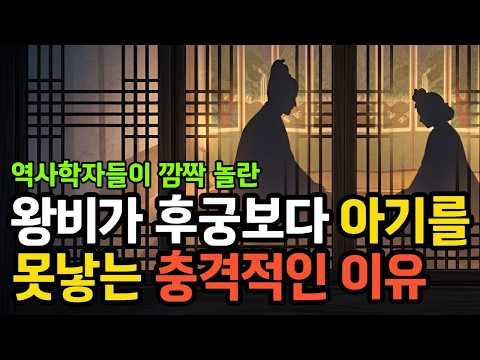
- 설명 앞부분: 완벽했던 조선 왕실의 합궁 규칙, 그런데 그 규칙이 오히려 왕조의 발목을 잡았습니다. 왕비 42명 중 20명은 자식이 없었고, 조선의 왕 27명 중 적장자 출신은 단 7명뿐이었습니다. 후사를 위해 만든 그 촘촘하고 엄격한 규칙이, 어째서 정반대의 결과를 불러왔을까요? 이 영상에서는 경복궁 교태전과 강녕전에서 벌어진 왕과 왕비의 밤, 관상감이 정한 길일과 상궁들의 감시 속 합궁 절차, 그리고 그와 대비되는 후궁 승은의 밤을 들여다봅니다. 나아가 정조와 의빈 성씨의 이야기, 네 명의 왕비를 두고도 후사를 얻지 못한 숙종과 환국의 소용…
- 같은 채널 평소 대비 ×70.1 (채널 최근 롱폼 중앙값 364회) · 평소 영상: 숙종이 중전을 계속 바꾼 소름돋는 이유｜장희빈은 진짜 악녀였나 (364회) / 사도세자의 아들에서 조선 최고의 왕이 된 정조의 일생｜비극적이었던 인간 이산의 삶 (396회)
- 대본 없음 (설명) — 음성인식이 끝나면 도입부·흐름이 들어감
- 댓글 36/36: 좋은 점 — 영상 0 · 감사·응원 0 · 더 알고 싶은 것 1 · 아쉬운 점 — 영상 0 · 반박·불만 — 의견 다름 0 · 정치·사회 0 · 경험 공유 0 · 구독·다음 기대 0
  - 더 알고 싶은 것 👍8 “이런 합궁 규칙이 언제 생긴건지 누가 만든건지 중국에도 있었는지 ? 나쁜 규칙이라고 생각됩니다.이런 분위기에서 임신이 되겠습니까?그러니까 대군이 임금이 된것이 7번 밖에 없지요.”

### 42. 조선 선비는 과거 보러 400km를 어떻게 걸어갔을까 ∣ 국밥·엿·주막에 숨은 놀라운 이야기∣사극은 거짓말? 과거 보러 가는 조선의 길에는 산적도 호랑이도 없었다

- https://www.youtube.com/watch?v=PmKbdO0FcnE · 어게인역사 · 구독자 5,640 · 조회수 1,101,676 (×195.3, 하루 25,406.1) · 좋아요 1,684 (0.1%) · 12분 · 2026-09-07 · 주제 묶음 3. 조선 · 형식 정보·해설 (그 밖) · 폴더 `W_PmKbdO0FcnE` (웹 승인)
- 썸네일: 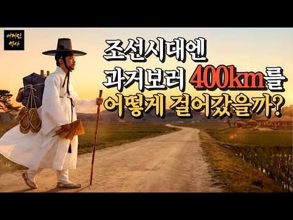
- 챕터: 0:00 천 리 길, 걸어서 보름의 여정 · 2:52 조선의 길과 문경새재의 비밀 · 2:52 나라가 세운 숙소 '원'과 지명의 유래 · 4:58 나그네를 재운 주막과 조선의 인심 · 6:19 밤샘 공부와 합격을 비는 엿 · 7:44 길 위에서 태어난 국밥과 토렴 · 10:01 서양인이 놀란 온돌, 그리고 남겨진 발자국
- 설명 앞부분: 🚶 부산에서 한양까지 380km, 걸어서 꼬박 보름. 조선의 선비들은 과거 시험 하나를 위해 두 발로 그 머나먼 길을 걸었습니다. 🏞️ 사극에서 본 것처럼 산적과 호랑이가 우글대는 험한 길이었을까요? 🏠 그들은 밤이 되면 어디서 잠을 자고, 무엇을 먹었을까요? 우리가 매일 지나치는 '인덕원', '이태원'이라는 지명 속에, 무심코 말아 먹는 '국밥 한 그릇' 속에, 시험 앞에서 건네는 '엿 한 봉지' 속에 수백 년 전 옛사람들의 발자국이 그대로 남아 있습니다. 🔥 온돌에 깜짝 놀란 서양인들의 기록, 🍚 찬밥을 데우는 '토렴'에서 태…
- 같은 채널 평소 대비 ×838.1 (채널 최근 롱폼 중앙값 1,314회) · 평소 영상: 조선 여인의 저고리가 300년 동안 3분의 2가 사라진 이유ㅣ영조도 정조도 막지 못한 조… (1,322회) / 왕의 사랑을 15년 거절한 궁녀, 그런데 정조는 더 사랑했다∣궁녀는 왜 정조를 15년이나… (1,307회)
- 대본 없음 (설명) — 음성인식이 끝나면 도입부·흐름이 들어감
- 댓글 202/206: 좋은 점 — 영상 2 · 감사·응원 4 · 더 알고 싶은 것 2 · 아쉬운 점 — 영상 1 · 반박·불만 — 의견 다름 4 · 정치·사회 2 · 경험 공유 5 · 구독·다음 기대 1
  - 좋은 점 — 영상 👍6 “아주 재미있게 보고 있습니다. 유익하고 흥미롭습니다.”
  - 좋은 점 — 영상 👍2 “조상님들의 오랜 이야기를, 한 명의 시점에서 알려주니 이해가 잘 되고 정말 흥미로운 컨텐츠였습니다. 너무 재미있게 잘 봤습니다, 감사합니다 :)”
  - 감사·응원 👍2 “조상님들의 오랜 이야기를, 한 명의 시점에서 알려주니 이해가 잘 되고 정말 흥미로운 컨텐츠였습니다. 너무 재미있게 잘 봤습니다, 감사합니다 :)”
  - 감사·응원 👍2 “난 이 조선이 난 이 대한민국이 그저.. 그저.. 너무나 좋다 , 난 대한민국 사람 중에 하나라 너무나.. 너무나 참 다행이라 생각한다. 감사합니다. 우리의 선조분들 그리고 우리 자유민주주의 국가 대한민국 그저 감사합니다. 나 또한 대한민국을 위해 이 한 목숨 말로만…”
  - 더 알고 싶은 것 👍0 “안녕하세요 배경음악이 너무 좋네요.. 배경음악이 뭔지 좀 알려주세요.. ^^”
  - 더 알고 싶은 것 👍0 “멘탈은 언제나가나요?”
  - 아쉬운 점 — 영상 👍0 “인덕원 이태원 말할때는 왜 AI음성이 버벅거리는거지??”
  - 반박·불만 — 의견 다름 👍4 “길이도 길인데 길찾아가는게 더힘들듯 지도가 있는것도아니고 네비가 있는것도 아닌데”
  - 반박·불만 — 의견 다름 👍0 “저 시대에 과거는 선택이 아닙니다. 가문을 일으키는 유일한 수단이지.”
  - 정치·사회 👍8 “지금도 부산에서 서울 올공까지 전한길쌤과 많은 분들이 부정선거재선거를 위해서 걷고 있습니다.”
  - 정치·사회 👍0 “능력되도 무서워서 못가겟다 저당시 마라톤 나갓으면 우리나라가 싹쓸이햇겟다”
  - 경험 공유 👍10 “나도 국민학교때 8k 산길을 걸어다녔지”
  - 경험 공유 👍0 “과거시험도 자기 일생운명과 관련되니 걷는거다. 나도 탈북할때 일생운명문제라 중국까지 1500키로를 걸었다”
  - 구독·다음 기대 👍0 “정말로 알고싶어을 물음인데 여기서 그물음에 궁금증이 해소되었습니다 구독누르고 잘보고갑니다”

### 43. 실제로 존재했던 충격적인 역사 사진 30선

- https://www.youtube.com/watch?v=q9VFXgtvKHc · 숨겨진역사 · 구독자 53 · 조회수 18,729 (×187.3, 하루 166.4) · 좋아요 103 (0.5%) · 10분 · 2026-06-30 · 주제 묶음 1. 역사 일반·이야기 · 형식 정보·해설 (그 밖) · 폴더 `W_q9VFXgtvKHc` (웹 승인)
- 썸네일: 
- 설명 앞부분: 우리가 알고 있는 역사는 극히 일부에 불과합니다. 이번 영상에서는 교과서에서는 쉽게 볼 수 없는 희귀한 역사 사진들을 소개합니다. 사진 한 장 속에는 당시 사람들의 삶과 시대상이 그대로 담겨 있습니다. 믿기 어려운 장면들이지만 모두 실제 기록으로 남아 있는 역사입니다. 사진이 촬영된 배경과 숨겨진 이야기를 함께 살펴보세요. 시간이 흘러도 잊혀서는 안 될 순간들을 만나볼 수 있습니다. 역사를 좋아하는 분이라면 끝까지 시청해 보세요. 가장 놀라웠던 사진이 있다면 댓글로 남겨주세요. 끝까지 시청하시면 더욱 놀라운 사진들도 확인하실 수 …
- 대본 없음 (설명) — 음성인식이 끝나면 도입부·흐름이 들어감
- 댓글 5/5: 좋은 점 — 영상 0 · 감사·응원 1 · 더 알고 싶은 것 0 · 아쉬운 점 — 영상 1 · 반박·불만 — 의견 다름 0 · 정치·사회 0 · 경험 공유 0 · 구독·다음 기대 0
  - 감사·응원 👍2 “귀한자료 감사합니다 세상이 꼭 앞으로만 가지는 않네요~”
  - 아쉬운 점 — 영상 👍1 “썸네일 낚시🤦”

### 44. 청나라 멸망 후, 500만 만주족에게 벌어진 일 ∣ 청나라 감춰진 역사 이야기

- https://www.youtube.com/watch?v=PmeHs6CH_ro · 그날의 재발견 · 구독자 1,340 · 조회수 250,331 (×186.8, 하루 3,208.2) · 좋아요 1,478 (0.6%) · 14.1분 · 2026-08-04 · 주제 묶음 1. 역사 일반·이야기 · 형식 정보·해설 (그 밖) · 폴더 `W_PmeHs6CH_ro` (웹 승인)
- 썸네일: 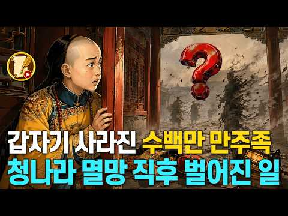
- 설명 앞부분: 300년간 대륙을 호령했던 청나라의 황족과 만주족들. 하지만 1912년 청나라가 멸망하고 신해혁명의 바람이 불어닥치자, 이들의 삶은 하루아침에 바뀝니다. 대륙의 주인에서 도망자로 만주족의 숨겨진 비화를 역사 드라마로 전해드립니다. 오늘도 시청해 주셔서 감사합니다. 본 영상의 제작에 생성형 AI 기술을 활용하였습니다.
- 같은 채널 평소 대비 ×518.8 (채널 최근 롱폼 중앙값 482회) · 평소 영상: 조선 최대 규모 역모 발생. 공포에 질린 숙종. 금단의 예언서 정감록의 충격적 실체 (506회) / 한무제는 왜 태어난 지 몇 달 된 증손자를 감옥에 넣었나 (459회)
- 대본 없음 (설명) — 음성인식이 끝나면 도입부·흐름이 들어감
- 댓글 591/591: 좋은 점 — 영상 9 · 감사·응원 4 · 더 알고 싶은 것 3 · 아쉬운 점 — 영상 0 · 반박·불만 — 의견 다름 5 · 정치·사회 46 · 경험 공유 52 · 구독·다음 기대 0
  - 좋은 점 — 영상 👍16 “정말 귀한 정보네요. 좋은 영상 잘봤습니다. 감사~~^^”
  - 좋은 점 — 영상 👍2 “중국어에 만주어를 배울수없어서. 한족어를 12년 배웠습니다 꽤 재미있군요 세세”
  - 감사·응원 👍16 “정말 귀한 정보네요. 좋은 영상 잘봤습니다. 감사~~^^”
  - 감사·응원 👍1 “감사합니다”
  - 더 알고 싶은 것 👍1 “09:58 아이신기오로(愛新覺羅)를 김씨(金)나 조씨 (趙)? 김은 이해가 되는데, 조는 무슨 무엇으로?...구체적 설명을 부탁드립니다.”
  - 더 알고 싶은 것 👍1 “만주국은 어떤 언어를 공용어로 썼나요?”
  - 반박·불만 — 의견 다름 👍2 “멸만흥한의 기치하에 수많은 만주족이 학살을 피해 조선으로 숨어들어서 한국인이 됐다. 기록에도 북한지역에 만주족들의 집단거주지가 있었다. 일부는 몽골로 도망을 가기도 했으나 대부분의 만주족은 패가망신되서 하류층으로 전락했다. 마지막 황제 부이도 경비원인가 하다 공산당이…”
  - 정치·사회 👍62 “만주국이 망하고 만주족으로 초중고교의 교육을 못하게 한족들이 막았어요. 그러니 언어와 문화를 잃었죠. 이제는 시진핑이 몽고 티베트 조선족의 언어교육도 말살을 하려고 해요. 그러면 자기들 고유한 언어를 잃어버리죠”
  - 정치·사회 👍8 “병자호란에 패배를 해서 조선 백성 60만명이 포로가 되어서 노비 종넘으로 강제로 청나라 심양으로 끌려 갔었다고 혀제에 ~? 나라가 강력한 무력이 없으면은 국민이 종 노예로 짐승처럼 고생을 혀게 되제에 ~?”
  - 경험 공유 👍1 “혈통적으로 유전학적으로 우리 민족과 가장 가까운 민족이 만주족이라는 내용을 본 적이 있습니다. 제가 최근 중국어를 배우면서 알게 된 중국의 과거 동시대에 가장 유명한 가수였던 왕비(왕페이)와 나영(나잉)을 비교해 보면 한족인 왕비보다 만주족인 나영이 한국인의 얼굴과 …”
  - 경험 공유 👍1 “신라기록에개기일식해보면수도가나옴헝가리그리스터키이란인도칠래필리핀일본땅을통치했었다수도는이란에샤한이라고기록되있다”

### 45. 조선시대엔 네비게이션도 없이 어떻게 한양까지 갔을까?선비들만 아는 지름길이 있었나?∣김정호∣대동여지도∣한국사

- https://www.youtube.com/watch?v=AXj7fbQkVos · 역사 밤샘토크 · 구독자 756 · 조회수 139,448 (×184.5, 하루 1,542.7) · 좋아요 1,408 (1.0%) · 33.4분 · 2026-07-22 · 주제 묶음 3. 조선 · 형식 정보·해설 (그 밖) · 폴더 `W_AXj7fbQkVos` (웹 승인)
- 썸네일: 
- 챕터: 0:00 해 질 녘 갈림길에 선 나그네 (인트로) · 2:10 오해 깨기 – 조선엔 정말 지도가 없었을까? · 4:30 단서 1 – 길가의 이정표, 장승의 진짜 정체 · 7:40 단서 2 – 사람에게 묻는 '살아 있는 내비게이션' · 10:30 국가 시스템 – 194개 역참과 3대로 · 14:00 봉수와 파발, 조선의 정보 고속도로 · 17:30 여행자의 하루 – 주막, 노잣돈, 그리고 밤길의 공포 · 21:20 노정기 – 조선판 손글씨 내비게이션 · 23:10 도로고와 대동여지도, 길을 데이터로 묶다 · 24:23 [반전] 김정호 옥사설은 누가, 왜 만들었나 · 30:20 오늘까지 살아남은 옛길의 흔적
- 설명 앞부분: 지도도, 내비게이션도 없던 조선 시대. 그런데 사람들은 부산에서 한양까지, 어떻게 단 한 번도 길을 잃지 않았을까요? 표지판도 없고 물어볼 사람도 없는 갈림길 앞에서 조선 사람들이 길을 찾은 진짜 비결을 하나씩 파헤쳐 봅니다. 길가의 장승부터 역참·파발·봉수, 그리고 신경준의 도로고와 김정호의 대동여지도까지. 그리고 영상 마지막. 우리가 교과서에서 눈물 흘리며 배운 '김정호 옥사설'이 사실은 통째로 지어낸 이야기였다는 충격적인 반전이 기다리고 있습니다. 그 이야기를 누가, 왜 만들었는지까지 끝까지 확인해 보세요. 타임라인 지도 없…
- 같은 채널 평소 대비 ×475.9 (채널 최근 롱폼 중앙값 293회) · 평소 영상: 조선 사람들은 왜 마흔을 넘기지 못했을까 ∣ 기록이 말하는 진실∣잠잘때 듣는 역사 (293회) / 정조가 가장 사랑한 천재 왕세자 문효세자의 비극∣정조 ∣의빈성씨 ∣성덕임∣옷소매붉은끝동∣… (392회)
- 대본 없음 (설명) — 음성인식이 끝나면 도입부·흐름이 들어감
- 댓글 60/60: 좋은 점 — 영상 0 · 감사·응원 2 · 더 알고 싶은 것 1 · 아쉬운 점 — 영상 1 · 반박·불만 — 의견 다름 0 · 정치·사회 0 · 경험 공유 1 · 구독·다음 기대 0
  - 감사·응원 👍0 “구독과 좋아요 보내줄께 힘내서 잘 찾아가라😂”
  - 감사·응원 👍0 “덕분입니다 감사합니다 투표는전자투표가 답이다”
  - 더 알고 싶은 것 👍1 “조선 시대 지식을 더 알 수 있도록 동영상 많이 만들어주세요”
  - 아쉬운 점 — 영상 👍0 “이야기 전개가 지루해요”
  - 경험 공유 👍0 “내비게이션 생긴 지는 얼마 되지 않았지요. 제가 아는 사람은 사회과 부도 보고 여행한 사람도 있었답니다.”

### 46. 유럽인은 왜 수만 년 동안 검은 피부였을까 ∣ 고대문명

- https://www.youtube.com/watch?v=FivM7xayEWA · 고대문명 역사관 · 구독자 410 · 조회수 74,959 (×182.8, 하루 1,927.4) · 좋아요 333 (0.4%) · 17.7분 · 2026-09-12 · 주제 묶음 8. 문명·고고학 · 형식 정보·해설 (그 밖) · 폴더 `W_FivM7xayEWA` (웹 승인)
- 썸네일: 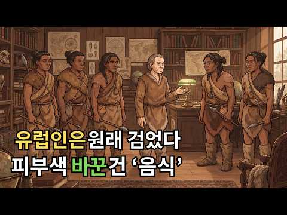
- 챕터: 0:00 유럽인은 원래 검은 피부였다? 충격적인 시작 · 0:33 햇빛만으로는 설명되지 않는 피부색의 비밀 · 1:17 이누이트의 식단이 밝혀낸 결정적 단서 · 4:10 7천 년 전 유럽인의 DNA, 파란 눈과 짙은 피부 · 6:53 고대 DNA 수백 명이 밝혀낸 피부색의 변화 · 8:29 수만 년 동안 유지된 피부색이 바뀐 진짜 이유 · 9:00 농업혁명과 함께 완전히 달라진 유럽인의 밥상 · 12:41 유럽과 동아시아, 같은 피부색에 다른 유전자 · 15:06 피부색에 새겨진 인류의 생존 기록
- 설명 앞부분: 유럽인은 왜 수만 년 동안 검은 피부였을까 ∣ 고대문명 유럽인은 원래부터 하얀 피부였을까요? 수만 년 전 유럽인은 짙은 피부와 파란 눈을 가지고 있었습니다. 그런데 농업의 시작과 함께 밥상이 바뀌면서 피부색도 달라지기 시작했습니다. 이번 영상에서는 고대문명 이전부터 이어진 인류의 피부색 변화와 음식, 햇빛, 유전자의 놀라운 관계를 알아봅니다. 여러분의 피부에 남아 있는 조상들의 생존 기록, 고대문명 속 인류의 역사를 함께 확인해 보세요. 🔥 📜 고대문명 역사관 ∣ 채널 소개 고대문명 역사관은 지나온 세월 속에 숨겨진 고대문명의 이…
- 같은 채널 평소 대비 ×40.4 (채널 최근 롱폼 중앙값 1,856회) · 평소 영상: 한겨울에도 얼음 커피를 마시는 한국인, 이유가 따로 있었습니다 ∣ 고대문명이 남긴 ‘우리… (1,856회) / 당신이 쉬는 숨의 절반은 '사막'이 만듭니다 ∣ 고대문명 (1,834회)
- 대본 없음 (설명) — 음성인식이 끝나면 도입부·흐름이 들어감
- 댓글 23/26: 좋은 점 — 영상 0 · 감사·응원 1 · 더 알고 싶은 것 0 · 아쉬운 점 — 영상 0 · 반박·불만 — 의견 다름 1 · 정치·사회 0 · 경험 공유 0 · 구독·다음 기대 0
  - 감사·응원 👍6 “새로운 설명 감사합니다 ! 호기심이 많이 해결 되는군요 !”
  - 반박·불만 — 의견 다름 👍6 “헛소리야. 네안데르탈인 30~70 만년전부터 유럽에 살았고 그들은 흰피부였어. 거짓말퍼뜨리지마. 네안데르탈인 dna가 유럽인들 몸과 동양에 다 퍼져있다고.”

### 47. 조선시대 왕비의 식사 — 12첩 반상인데 왜 맛이 없었을까

- https://www.youtube.com/watch?v=Ch-zCROKRo4 · 역사콕콕 · 구독자 491 · 조회수 89,277 (×181.8, 하루 599.5) · 좋아요 1,011 (1.1%) · 23.4분 · 2026-05-25 · 주제 묶음 3. 조선 · 형식 정보·해설 (그 밖) · 폴더 `W_Ch-zCROKRo4` (웹 승인)
- 썸네일: 
- 챕터: 0:00 교태전, 오전 열 시 — 왕비의 아침 · 2:30 간택된 날, 궁에 들어오는 순간 · 5:30 왕비의 12첩, 왕의 12첩과 같은 것이었을까 · 10:00 숙수 — 드라마와 다른 진짜 궁중 요리사 · 13:00 임신과 시어머니, 밥상에도 서열이 있었습니다 · 16:30 폐비의 밥상, 12첩이 사라지는 순간 · 20:00 화려한 감옥
- 설명 앞부분: 왕비의 식사 — 12첩 반상인데 왜 맛이 없었을까 "젓수십시오." 이 세 글자가 떨어져야 왕비는 수저를 들 수 있었습니다. 은수저로 독을 확인하고, 기미상궁이 목숨 걸고 먹어본 다음에야 시작되는 식사. 세 명이 지켜보는 앞에서, 혼자, 식어가는 밥을 먹어야 했던 여자. 🔹 간택날 처음 받은 건 밥이 아니라 다과상이었습니다 🔹 왕비의 12첩 반상, 그릇만 서른 개가 넘었는데 왜 맛이 없었을까 🔹 시어머니 혜경궁은 15그릇, 정조는 7그릇만 먹었습니다 🔹 인현왕후가 쫓겨난 날, 12첩 반상은 하루아침에 사라졌습니다 🔹 왕비에서 노비로…
- 같은 채널 평소 대비 ×338.2 (채널 최근 롱폼 중앙값 264회) · 평소 영상: 단종 죽인 세조가 딱 한 번 눈물 흘린 그날 밤 (282회) / 정희왕후 — 세조의 아내가 경혜공주를 살린 이유 (246회)
- 대본 없음 (설명) — 음성인식이 끝나면 도입부·흐름이 들어감
- 댓글 151/151: 좋은 점 — 영상 1 · 감사·응원 1 · 더 알고 싶은 것 2 · 아쉬운 점 — 영상 1 · 반박·불만 — 의견 다름 1 · 정치·사회 1 · 경험 공유 2 · 구독·다음 기대 0
  - 좋은 점 — 영상 👍2 “좋은 영상 감사합니다 화이팅!!”
  - 감사·응원 👍2 “좋은 영상 감사합니다 화이팅!!”
  - 더 알고 싶은 것 👍5 “멋진 영상 어떻게 만드나요 가르쳐 주세요”
  - 더 알고 싶은 것 👍1 “왕과 왕비는 방귀를 어떻게 뀌었는지 궁금해요 항상 궁녀가 있자나욯ㅎ”
  - 아쉬운 점 — 영상 👍2 “제목 어그로끌지말고 제대로 올리시기를”
  - 반박·불만 — 의견 다름 👍1 “사극은 2~3% 만 밑고 다 거짓 말입니다 그리고 조선시대 의상은 너무 현대적인입니다 말도 안되는 연출을 하고있습니다”
  - 정치·사회 👍3 “중국인이냐? 거짓말에 왕비는 여왕이고. 뇌피셜”
  - 경험 공유 👍0 “내가사랑하던여자가 간택되서 강제로 뺏기는건데 진짜 세상 ㅈ같았겠다 상상만해도 열받네”

### 48. 신데렐라 숙빈 최씨의 쓸쓸한 죽음 뒤에 숨겨진 실록의 충격적인 진실

- https://www.youtube.com/watch?v=ZtLWS2MvtyQ · 역사를 만나다 · 구독자 228 · 조회수 40,234 (×176.5, 하루 428.5) · 좋아요 457 (1.1%) · 17.1분 · 2026-07-19 · 주제 묶음 3. 조선 · 형식 정보·해설 (그 밖) · 폴더 `W_ZtLWS2MvtyQ` (웹 승인)
- 썸네일: 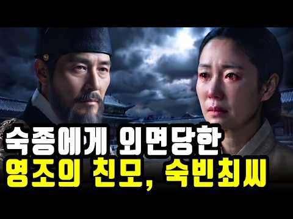
- 챕터: 0:00 신데렐라의 쓸쓸한 마지막 · 0:45 궁궐 맨 밑바닥에서 시작된 삶 · 1:31 운명적인 만남과 첫 번째 전환점 · 2:18 목숨을 건 선택, 그리고 왕의 총애 · 3:02 정1품 빈을 향한 초고속 승진 · 3:40 희빈 장씨와의 피할 수 없는 대립 · 4:25 인현왕후의 죽음과 무고의 옥
- 설명 앞부분: 조선 역사상 가장 극적인 신분 상승을 이뤄낸 신데렐라, 숙빈 최씨. 하지만 그녀의 마지막은 궁궐 밖 쓸쓸한 사가였습니다. 실록에 단 몇 줄로만 기록된 그녀의 죽음 뒤에는 어떤 숨겨진 진실이 있을까요? 가장 낮은 곳에서 시작해 정1품 빈의 자리에 오르기까지의 파란만장한 삶과, 희빈 장씨와의 목숨을 건 암투, 그리고 아들 영조가 평생 가슴에 묻어야 했던 출생의 비밀까지. 조선 왕조를 뒤흔든 그날의 기록을 지금 확인해 보세요! ⏱ 타임라인 [음악] 🎵Music provided by 브금대통령 🎵Track : Circle of Insom…
- 같은 채널 평소 대비 ×119.0 (채널 최근 롱폼 중앙값 338회) · 평소 영상: 영조를 당황케 한 15세 신부의 충격적 정체, 정조가 죽자마자 300명을 처단한 이유 (350회) / 알고 보니 거대한 정치극, 기가 센 중전과 유약한 왕이 짜놓은 완벽한 함정 l 현종 (326회)
- 대본 없음 (설명) — 음성인식이 끝나면 도입부·흐름이 들어감
- 댓글 29/29: 좋은 점 — 영상 0 · 감사·응원 1 · 더 알고 싶은 것 0 · 아쉬운 점 — 영상 0 · 반박·불만 — 의견 다름 3 · 정치·사회 0 · 경험 공유 0 · 구독·다음 기대 1
  - 감사·응원 👍1 “귀중한 영상 올려주셔서 감사합니다 구독 좋아요 알림설정 신청합니다 ❤❤❤”
  - 반박·불만 — 의견 다름 👍9 “숙비외모를 저렇게 표현합니까 40대인데 어이없네요 80대노인을 만들다니”
  - 반박·불만 — 의견 다름 👍6 “말도 안되는 얘기를 그럴듯하게 만들었네..숙빈 최씨에 대해 검색만 해봐도 아는 사실을..”
  - 구독·다음 기대 👍1 “귀중한 영상 올려주셔서 감사합니다 구독 좋아요 알림설정 신청합니다 ❤❤❤”

### 49. 지구나이 45억년, 인류 이전 초거대 문명의 소름돋는 증거들

- https://www.youtube.com/watch?v=-FBIBpxt-FY · 어스릭스 · 구독자 4,970 · 조회수 867,492 (×174.6, 하루 7,178.1) · 좋아요 6,768 (0.8%) · 22.6분 · 2026-06-22 · 주제 묶음 8. 문명·고고학 · 형식 정보·해설 (그 밖) · 폴더 `W_-FBIBpxt-FY` (웹 승인)
- 썸네일: 
- 설명 앞부분: 지구나이 45억 년, 인류 이전에 초고도 문명이 존재했다면? NASA 과학자가 발표한 '실루리안 가설'을 통해 지구 지층 속 숨겨진 화학적 지문과 고대 문명의 미스터리를 추적합니다. ⚠️ 본 영상은 다양한 국내외 학술 데이터와 과학적 가설들을 기반으로 제작된 정보 제공 목적의 콘텐츠입니다. 영상에 포함된 역사적 사실과 격변, 진화 가설들은 지구의 역사를 탐구하기 위한 학술적 서사일 뿐이며, 특정 종교적 신념이나 정치적 견해, 특정 인종, 집단의 주장을 지지하거나 비하하려는 의도가 전혀 없음을 밝힙니다. 어스릭스는 인류와 행성의 거…
- 같은 채널 평소 대비 ×537.5 (채널 최근 롱폼 중앙값 1,614회) · 평소 영상: 지구 맨틀 깊은 곳(2,900km)에서 발견된 충격적인 '외계 행성의 시체' (1,747회) / 북미 대륙만 한 '마그마 바다'가 솟아오른다면? 옐로스톤 슈퍼 화산의 소름 돋는 타이머 (1,481회)
- 대본 없음 (설명) — 음성인식이 끝나면 도입부·흐름이 들어감
- 댓글 491/493: 좋은 점 — 영상 10 · 감사·응원 4 · 더 알고 싶은 것 2 · 아쉬운 점 — 영상 6 · 반박·불만 — 의견 다름 10 · 정치·사회 4 · 경험 공유 21 · 구독·다음 기대 1
  - 좋은 점 — 영상 👍41 “정말 기발한 발상입니다.이러한 생각에 정말 많이 공감합니다.”
  - 좋은 점 — 영상 👍11 “수준높은 좋은 영상이네요”
  - 감사·응원 👍2 “아주 좋은 내용의 글 입니다.많은 생각 을하게 하게 하는 내용의 글을 읽었습니다.감사합니다.”
  - 감사·응원 👍1 “맞습니다 응원합니다 파이팅”
  - 더 알고 싶은 것 👍0 “내일 또 출근해야됨.리셋은 언제 되나요?”
  - 더 알고 싶은 것 👍0 “억겁의 세월은 무슨. 그냥 억이겠죠. 숫자단위 아시나요. 영이 63개면 얼마나 돼나요? 저가 숫자단위 세어보죠 단, 십, 백, 천, 만, 십만, 백만, 천만, 억, 십억, 백억, 천억, 조, 십조, 백조, 천조, 경, 십경, 백경, 천경 해, 십해 백해, 천해, 자,…”
  - 아쉬운 점 — 영상 👍0 “지구의 문명은 번성했다가 소멸하고 다시 문명이 발생하고 소멸하기를 수백억 수천억년 동안 몇번이나 반복되었을까? 기독교의 창조설은 단순한 유아용 동화일 뿐이다”
  - 아쉬운 점 — 영상 👍0 “나래이션 목소리가 별로야”
  - 반박·불만 — 의견 다름 👍4 “나도 이런 생각 안한 것은 아닌데요 우리 이전의 수천가지의 문명이 있다고하더라도 지구를 돌고있는 인공위성을 쏘아올려 궤도에 올려놓은 문명은 우리밖에 없는 듯 합니다. 있다고한다면 우리가 인공위성을 쏘아올렸을 때 우리밖에 없었으니까요”
  - 반박·불만 — 의견 다름 👍2 “지구 즉 현상계는 진리와 법칙은 이세상을 떠받히고 있지만 생명은 지꼴리는대로 생존하고 삶을 살죠.. 적응하면 생존 틀라면 소멸이죠.. 우리세계는 3차원이며 인간자체도 육체와 에너지 기체 정신체 이 세가지 정기신이 유가적으로 관여되어 움직입니다.. 물론 그속의 핵심은 …”
  - 정치·사회 👍0 “대본 잘썼다, 하지만 현재 한국의 선거조작범들을 응징하는게 우선이다”
  - 정치·사회 👍0 “공룡도 화석으로 나오는 마당에 선대 문명이 있다면 왜 그 흔적이 없는 거지? 외계인처럼 정부가 숨기기라도 하나?”
  - 경험 공유 👍6 “졸래 멀리서 찾고있네 내가 간단히 찾는거 알려주께 구글 지도 아르헨티나 바다쪽 확대 해보면 문명의 흔적이 보인다 바다길 건물흔적 석상등 원시지구는 바다속에있다 지상은 물이 생긴 이후고 바닷속을 보면 고대 흔적이 보인다 거인족의 흔적일 확률이 높음”
  - 경험 공유 👍4 “나도 이런 생각 안한 것은 아닌데요 우리 이전의 수천가지의 문명이 있다고하더라도 지구를 돌고있는 인공위성을 쏘아올려 궤도에 올려놓은 문명은 우리밖에 없는 듯 합니다. 있다고한다면 우리가 인공위성을 쏘아올렸을 때 우리밖에 없었으니까요”
  - 구독·다음 기대 👍65 “설득력있고 상상해보고 물음표를 던져주는 내용이 아주 인상적입니다. 구독하고 시청합니다.”

### 50. AI로 되살린 조선 옛 기록 속 이상한 동물들, 그 정체를 추적해 봤습니다

- https://www.youtube.com/watch?v=yCYBW9qayVY · 키치스토리 · 구독자 1,370 · 조회수 236,935 (×172.9, 하루 16,951.9) · 좋아요 534 (0.2%) · 13.6분 · 2026-10-07 · 주제 묶음 3. 조선 · 형식 정보·해설 (그 밖) · 폴더 `W_yCYBW9qayVY` (웹 승인)
- 썸네일: 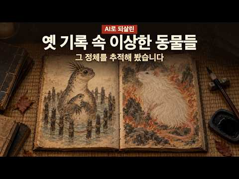
- 챕터: 0:00 인트로 · 0:16 1. 딱새가 낳은 산비둘기 (세종실록, 1445) · 1:52 2. 어책 속의 인어 (고운당필기, 1796) · 3:38 3. 이름 없는 짐승 복록 (세종실록, 1419) · 4:46 4. 붕어 대신 걸린 것 (명종실록, 1565) · 6:06 5. 흙 속으로 뛰어든 물고기 (세종실록, 1446) · 7:08 6. 상광어 (자산어보, 1814) · 8:22 7. 소주만 마시는 망아지 (청장관전서) · 9:10 8. 두꺼비 전쟁 (숙종실록 외, 1601~1677) · 10:30 9. 수탉이 된 암탉 (세종실록·중종실록) · 11:48 10. 불 속의 백 근 쥐 (성호사설) · 13:14 마무리
- 설명 앞부분: 조선 사람들은 처음 보는 동물을 만나면, 본 그대로 글로 적어 두었습니다. 산비둘기만 한 딱새 새끼, 인천 어책에 걸린 인어, 이름이 없어 황제가 이름을 지어 준 짐승, 70년 동안 실록에 오른 두꺼비 전쟁. 실록과 옛 책에 남은 이상한 동물 10가지를 기록 문장 그대로 AI로 되살려 보고, 단서를 따라 그 정체를 추적했습니다. 옛 기록의 원문은 조선왕조실록과 한국고전종합DB에서 직접 대조했습니다. 6번 자산어보는 한국민족문화대백과사전의 번역으로 확인했습니다. 영상은 정체를 확정하지 않습니다. 모두 「유력한 후보」로만 말했고, 맞…
- 같은 채널 평소 대비 ×42.6 (채널 최근 롱폼 중앙값 5,557회) · 평소 영상: 장난처럼 보이지만, 사람들은 전부 진지했습니다｜실제로 있었던 이상한 사건들 29편 (5,557회) / 달팽이도 소도 달걀도, 있을 리 없는 자리에 있었습니다｜실제로 있었던 이상한 사건들 25편 (5,835회)
- 대본 없음 (설명) — 음성인식이 끝나면 도입부·흐름이 들어감
- 댓글 23/31: 좋은 점 — 영상 0 · 감사·응원 0 · 더 알고 싶은 것 0 · 아쉬운 점 — 영상 0 · 반박·불만 — 의견 다름 0 · 정치·사회 0 · 경험 공유 2 · 구독·다음 기대 0
  - 경험 공유 👍4 “4번도 흰돌고래 벨루가를 닮은 상괭이임, 옛날엔 바다에 가까운 민물 계곡에 상괭이 무리가 들어오기도 했었음 5번은 수수미꾸리? 산해경은 도교에서도 인용하는 경우가 많은 신화 지리 이물들에 대한 고전이라 비유나 은유가 많다고 봐야죠”
  - 경험 공유 👍0 “혹시 암닭도 수컷이 될수잇나요? 어쩐지 조금 수컷처럼 볏이 커졋거든요 혹시 수컷처럼 울어대는지 제가없는 시간대나 새벽에 울지않을까요? 들어볹ㅓㄱ은없어서요 오래전에 죽엇지만요 명이다되서”

### 51. 조선 3대 고개, 도적보다 무서웠던 ‘이것’의 정체 ∣ 고대문명

- https://www.youtube.com/watch?v=Yeiowu79QM8 · 고대문명 역사관 · 구독자 410 · 조회수 70,573 (×172.1, 하루 2,835.6) · 좋아요 249 (0.4%) · 18.8분 · 2026-09-26 · 주제 묶음 3. 조선 · 형식 야담·옛날이야기 · 폴더 `W_Yeiowu79QM8` (웹 승인)
- 썸네일: 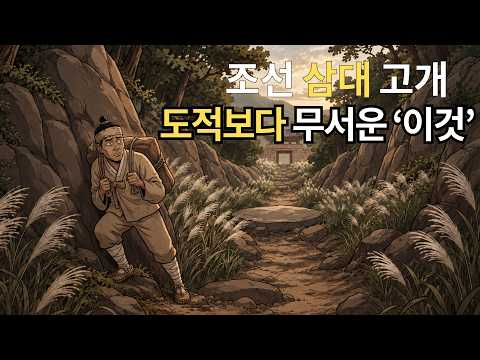
- 챕터: 0:00 조선 3대 험로 – 사람들이 가장 무서워한 세 고개 · 1:01 첫 번째 고개 문경새재 – 도적이 숨은 골짜기 · 4:34 두 번째 고개 추풍령 – 이름만으로 사람을 돌려세운 길 · 8:07 세 번째 고개 대관령 – 눈과 추위가 삼킨 아흔아홉 … · 12:09 세 고개를 넘어온 뒤 드러나는 진짜 정체 · 12:42 조선을 가장 많이 삼킨 것 – 호랑이 · 15:48 지금은 어떻게 되었을까 – 옛길의 오늘 · 17:17 고단한 걸음이 길이 된다 – 오늘을 위한 이야기
- 설명 앞부분: 조선 3대 고개, 도적보다 무서웠던 ‘이것’의 정체 ∣ 고대문명 조선의 3대 고개, 도적보다 더 무서웠던 ‘이것’의 정체는 무엇이었을까요? 문경새재·추풍령·대관령에 숨겨진 충격적인 역사와 호랑이 이야기를 만나보세요. 🐯 🏔️ 고대문명 속 옛길에 숨겨진 사람들의 삶과 비밀, 그리고 우리가 몰랐던 진짜 공포를 살펴봅니다. 고대문명의 이야기가 궁금하다면 끝까지 함께해 주세요! 📜 고대문명 역사관 ∣ 채널 소개 고대문명 역사관은 지나온 세월 속에 숨겨진 고대문명의 이야기를 쉽고 깊이 있게 전해드립니다. 우리가 잊고 지낸 한국역사부터 한국…
- 같은 채널 평소 대비 ×38.0 (채널 최근 롱폼 중앙값 1,856회) · 평소 영상: 한겨울에도 얼음 커피를 마시는 한국인, 이유가 따로 있었습니다 ∣ 고대문명이 남긴 ‘우리… (1,856회) / 당신이 쉬는 숨의 절반은 '사막'이 만듭니다 ∣ 고대문명 (1,834회)
- 대본 없음 (설명) — 음성인식이 끝나면 도입부·흐름이 들어감
- 댓글 4/5: 좋은 점 — 영상 0 · 감사·응원 0 · 더 알고 싶은 것 0 · 아쉬운 점 — 영상 0 · 반박·불만 — 의견 다름 0 · 정치·사회 0 · 경험 공유 0 · 구독·다음 기대 0

### 52. 조선 왕들이 일찍 죽은 진짜 이유｜매일 먹던 수라상에 충격적인 답이 있었다

- https://www.youtube.com/watch?v=MvFehJWoeAU · 조선의 시간 · 구독자 30 · 조회수 16,625 (×166.2, 하루 225.4) · 좋아요 45 (0.3%) · 14.2분 · 2026-08-08 · 주제 묶음 3. 조선 · 형식 정보·해설 (그 밖) · 폴더 `W_MvFehJWoeAU` (웹 승인)
- 썸네일: 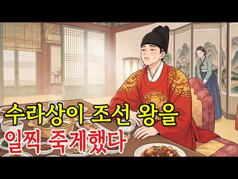
- 설명 앞부분: 조선의 왕들은 최고의 음식을 먹고 최고의 의원에게 진료받았지만, 평균 수명은 불과 46세였습니다. 굶주림도 없었던 왕들은 왜 그렇게 일찍 세상을 떠났을까요? 하루 다섯 번 차려진 화려한 수라상, 스무 가지가 넘는 반찬과 고기 요리, 흰쌀밥과 떡, 젓갈과 장아찌까지. 이번 영상에서는 조선 왕실의 실제 식생활을 통해 세종과 숙종이 겪었던 만성질환의 흔적과 왕의 수라상이 건강에 어떤 부담을 주었는지 살펴봅니다. 특히 조선 왕 가운데 83세까지 장수한 영조는 왜 달랐을까요? 화려한 음식을 절제하고 소식했던 영조의 식습관을 다른 왕들과 비…
- 같은 채널 평소 대비 ×123.6 (채널 최근 롱폼 중앙값 134회) · 평소 영상: 조선 천재 간신의 충격적인 최후｜한명회도 탄핵하고 아들 넷을 도살대에 올린 아버지 (149회) / 조선시대 평민의 여름｜왜 지옥보다 끔찍했을까? 교과서가 숨긴 진짜 이유 (120회)
- 대본 없음 (설명) — 음성인식이 끝나면 도입부·흐름이 들어감
- 댓글 3/3: 좋은 점 — 영상 0 · 감사·응원 0 · 더 알고 싶은 것 0 · 아쉬운 점 — 영상 0 · 반박·불만 — 의견 다름 0 · 정치·사회 0 · 경험 공유 0 · 구독·다음 기대 0

### 53. 피라미드는 명함도 못 내미는 초고대 유적 ∣ 카라한테페의 정체

- https://www.youtube.com/watch?v=RKvtPoSMm6M · 역사줌 · 구독자 73 · 조회수 16,487 (×164.9, 하루 359.6) · 좋아요 120 (0.7%) · 18.5분 · 2026-09-05 · 주제 묶음 8. 문명·고고학 · 형식 정보·해설 (그 밖) · 폴더 `W_RKvtPoSMm6M` (웹 승인)
- 썸네일: 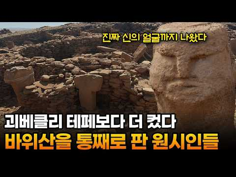
- 챕터: 0:00 표범 등 위에 올라탄 사람 · 1:50 괴베클리보다 넓었던 자매 유적 · 4:08 얼굴 없던 신, 그 규칙이 깨지다 · 6:28 사이부르치, 여섯 손가락의 비밀 · 9:38 갈비뼈 사내와 봉인된 유물들 · 12:00 농사 없이 1,500년을 버틴 사람들 · 14:28 가장 깊은 방, 필라 신전의 비밀 · 16:47 표범 위의 사람은 누구였을까
- 설명 앞부분: 👇 재미있는 이야기 더 보러 가기 돌 벤치 위에 놓인 조각상 하나가 삽날 끝에 걸렸습니다. 사람이 표범 등 위에 올라탄 모습이었어요. 지금까지 이 유적에서 나온 조각상들은 하나같이 반대 자세였는데, 이번엔 정반대였습니다. 대체 이 사람은 누구였을까요. 이 조각상이 나온 곳은 괴베클리 테페의 자매 유적, 카라한테페입니다. 닮은 점이 많다고 알려졌지만 파고들수록 다른 점이 훨씬 많이 드러났어요. 얼굴 없던 신이 얼굴을 갖게 된 순간부터, 좁고 은밀한 방에 끝내 남지 않은 흔적까지, 이 언덕엔 우리가 아는 것보다 훨씬 복잡한 이야기가 …
- 같은 채널 평소 대비 ×32.2 (채널 최근 롱폼 중앙값 512회) · 평소 영상: 나스카 지상화가 감추고 있던 진짜 비밀 ∣ AI가 6개월 만에 찾아낸 303개의 그림들 (512회) / 피라미드보다 4천 년 앞선 인류 최초의 도시 ∣ 차탈회위크의 정체 (493회)
- 대본 없음 (설명) — 음성인식이 끝나면 도입부·흐름이 들어감
- 댓글 27/27: 좋은 점 — 영상 0 · 감사·응원 0 · 더 알고 싶은 것 2 · 아쉬운 점 — 영상 0 · 반박·불만 — 의견 다름 1 · 정치·사회 0 · 경험 공유 0 · 구독·다음 기대 0
  - 더 알고 싶은 것 👍0 “괴베클리테페와 카라한테페는 아주 다른점이 많군요 두곳 선후가 궁금하네요”
  - 더 알고 싶은 것 👍0 “괴베클리테페 보다 더 대단한 역사적 의미 지닌것 같네요 거주공간 인물상 남성중심 상 등등 괴베클리테페 가 더 많이 발굴되면 뮈가 나올지 궁금하네요”
  - 반박·불만 — 의견 다름 👍3 “T자 기둥에 몸통은 있는데 얼굴만 없었다면, 이시기의 철학은 저 기둥에 너의 얼굴을 넣어라라는 철학적 종교관이 있었던거고, 얼굴이 나타난 기둥시기는 개인 숭배와 개인주의 독재권력이 조장 선동이 되기 시작했다는 거라 분석이죠.”

### 54. 왕비는 왜 자기 아기에게 젖을 먹이지 못했을까? 왕실 유모 '봉보부인' 제도

- https://www.youtube.com/watch?v=YQV0bUQN9Ps · 과연누구인가 · 구독자 716 · 조회수 118,049 (×164.9, 하루 774.9) · 좋아요 1,688 (1.4%) · 32.9분 · 2026-05-21 · 주제 묶음 3. 조선 · 형식 정보·해설 (그 밖) · 폴더 `W_YQV0bUQN9Ps` (웹 승인)
- 썸네일: 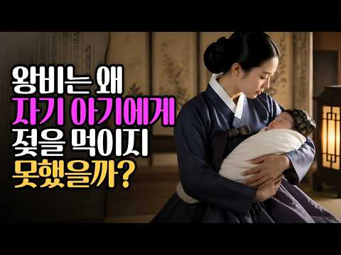
- 챕터: 0:00 태어난 지 21일 · 1:55 왕비가 직접 수유하지 않은 이유 · 5:24 왕실 유모의 선발 기준 · 7:17 "자식의 스승"으로 불린 유모 · 9:40 궁 밖에 남겨진 유모의 아이 · 11:57 봉보부인, 천인이 오를 수 있었던 최고 품계 · 15:47 성종의 유모 백씨 · 20:21 또 한 사람의 봉보부인 · 25:04 유럽 왕실의 유모 제도와 비교 · 29:41 정리: 오늘날의 돌봄 노동과 연결해 보기
- 설명 앞부분: 조선 왕실에서 왕자는 태어난 지 얼마 되지 않아 유모에게 맡겨졌습니다. 이 영상은 왕비가 직접 수유하지 않았던 제도적 배경과, 왕의 유모에게 내려진 '봉보부인' 작호를 조선왕조실록·경국대전과 관련 논문을 바탕으로 정리합니다. 천인 신분의 유모가 어떻게 종1품에 오를 수 있었는지, 그리고 그 대가로 유모의 친자식은 어떤 처지에 놓였는지도 함께 살펴봅니다. 참고 자료 조선왕조실록 (sillok.history.go.kr) 한국민족문화대백과사전 「봉보부인」 한희숙, 「조선 전기 봉보부인의 역할과 지위」, 『조선시대사학보』 43, 2007…
- 같은 채널 평소 대비 ×337.3 (채널 최근 롱폼 중앙값 350회) · 평소 영상: 목숨걸고 왕 만들어놨더니 30일만에 후궁을 들였다 (350회) / 석굴암 부처는 왜 24시간 에어컨을 맞고 있을까? 천년 석굴의 숨은 비밀 (350회)
- 대본 없음 (설명) — 음성인식이 끝나면 도입부·흐름이 들어감
- 댓글 97/97: 좋은 점 — 영상 0 · 감사·응원 1 · 더 알고 싶은 것 1 · 아쉬운 점 — 영상 0 · 반박·불만 — 의견 다름 2 · 정치·사회 0 · 경험 공유 0 · 구독·다음 기대 0
  - 감사·응원 👍3 “잘들었습니다 고맙습니다”
  - 더 알고 싶은 것 👍5 “유모 제안에 선택권이 있을까요? 싫어도 따라야했겠죠”
  - 반박·불만 — 의견 다름 👍37 “왕비들이 모유수유를 못하게 했다하니 어이없고 엄마의 모유에는 아이에게 필요한 영양가가 다 들어있는데 짜내고 약으로 멈추게 했다니 죽일놈이요 또한 유모는 뭘먹고 살았는지 모르는데 그래서 세자나 왕이 저항력이 떨어져서 단명할수 밖에 없지 않았나 싶다”

### 55. 200개 문명이 '같은 날'을 기억하는 소름 돋는 이유 ㅣ 전 세계 200개 문명이 증언하는 대홍수, 과학자들도 인정한 충격적 사실

- https://www.youtube.com/watch?v=d1kg9gfbQkI · 역사로 가다 · 구독자 847 · 조회수 136,844 (×161.6, 하루 935.2) · 좋아요 1,771 (1.3%) · 36.6분 · 2026-05-27 · 주제 묶음 8. 문명·고고학 · 형식 정보·해설 (그 밖) · 폴더 `W_d1kg9gfbQkI` (웹 승인)
- 썸네일: 
- 챕터: 0:00 인트로 — 같은 날을 기억하는 일곱 개 문명 · 2:54 수메르 대홍수 신화 — 길가메시 서사시, 아트라하시스… · 7:58 과학 증거 — 슈루팍·우르 홍수 퇴적층 발굴 현장 · 10:45 인도 홍수 신화 — 마누와 물고기, 마츠야 푸라나 · 13:30 그리스 홍수 신화 — 제우스의 분노, 데우칼리온의 아… · 16:15 이집트 — 대홍수를 기록하지 않은 문명, 부재라는 단서 · 18:02 마야 홍수 신화 — 나무 인간, 포폴 부흐와 불탄 원본 · 21:25 중국 대홍수 — 곤과 우, 지시협곡 대홍수 과학적 증거 · 24:15 과학 증거 — 흑해 범람 가설, 버클 크레이터, 마다… · 23:30 히브리 창세기 — 노아의 방주와 두루프나르 유적 GP… · 26:30 마무리 — 신화인가, 데이터인가
- 설명 앞부분: 서로 만난 적 없는 일곱 개 문명에 같은 대홍수 이야기가 남아 있습니다. 수메르, 인도, 그리스, 마야, 중국, 이집트, 히브리, 길가메시 서사시의 홍수 점토판부터 노아의 방주 흔적이 의심되는 두루프나르 유적까지, 일곱 문명의 홍수 기록과 과학적 증거를 한 편에 담았습니다. 이 기록들은 신화일까요, 아니면 아직 다 읽지 못한 데이터일까요. 🔹 수메르, 인도, 그리스, 마야, 중국, 히브리 — 서로 만난 적 없는 여섯 문명이 왜 같은 홍수를 기록했을까? 🔹 피라미드를 쌓고 사후 세계를 설계한 이집트는 왜 이 이야기만 빠뜨렸을까? 🔹…
- 같은 채널 평소 대비 ×265.7 (채널 최근 롱폼 중앙값 515회) · 평소 영상: 다 같 영국인데, 잉글랜드·스코틀랜드·웨일스·북아일랜드는 대체 뭐가 다른 걸까? (515회) / 고대 문명의 주사위에서 시작된 43억 2천만 년 — 지구 나이와 겹친 건 우연일까 (581회)
- 대본 없음 (설명) — 음성인식이 끝나면 도입부·흐름이 들어감
- 댓글 370/370: 좋은 점 — 영상 2 · 감사·응원 2 · 더 알고 싶은 것 2 · 아쉬운 점 — 영상 5 · 반박·불만 — 의견 다름 4 · 정치·사회 1 · 경험 공유 3 · 구독·다음 기대 0
  - 좋은 점 — 영상 👍0 “우가 누구한테 배웠을까? 고조선의 태자부루로부터 배운거네”
  - 좋은 점 — 영상 👍0 “기원전 없다 단군조선으로 건국됐고 지구의 국호는 단군조선 이다 지구의 단군조선은 불교식 문명 뿐이고 다른 문명없다 지구의 단군조선 백성들은 천자문 문자로 문자와 말를 배웠고 지구의 인류들은 300년 전에 고려조선의 천자문 문자로 창제한 문자를 배웠고 불교 단어를 사용…”
  - 아쉬운 점 — 영상 👍3 “결국 성경은 동네 찌라시를 모아 짜집기한 책이란 얘기네”
  - 아쉬운 점 — 영상 👍2 “성경의 구약은 여기저기서 듣고 카피한 짜집기 소설임😊”
  - 반박·불만 — 의견 다름 👍7 “초기문명이 다합쳐도 200개가 안됨...그리고 그들문명에 전부 대홍수기록이 있다? 전세계 소수민족들 싹다모아야 200개 되려나? 그리고 그들이 기록이 있고 문자가있었나? 그걸 모두 해독했다? 말도안되는 개소리지 몇몇문명에 그런 비슷한 내용이 있어서 전세계로 모두 일반…”
  - 반박·불만 — 의견 다름 👍1 “대홍수는 없습니다. 과학적으로 불가능한 이야기입니다. 대홍수라는 범지구적 재앙이 아니더라도 홍수 전설이 각 문명에 존재하는건 사실 '당연한'일입니다. 1. 강을 끼고 발달한 고대 도시문명에게 '홍수'는 필연적인 재앙입니다. 현대처럼 치수 기술이 발달하지 못했기에 강이…”
  - 정치·사회 👍0 “그리고 노아의 홍수는 메소포타미아 길가메시 이야기를 카피한거고 이건 한국이 걱정할 일은 아닙니다. 산맥들이 뭉친 나라가 한반도라 노아의 홍수정도에도 산 꼭대기에 올라 살아남을 수 있으니까요. 평지만 있는 나라들은 살아남기 힘들 겁니다”
  - 경험 공유 👍0 “근데 무당 영매 천문학점성술 오컬트니 채널러 스타시드 등등 그런사람들은 잘 모르나? 아님 알면서 말해봤자 이해못하니 말안해주는건가? ㅋㅋ”

### 56. 13살 성종이 한명회의 권력을 빼앗은 진짜 방법 ∣ 재미진역사

- https://www.youtube.com/watch?v=EbGTavxpfHc · 역사 속 사람들 · 구독자 707 · 조회수 111,265 (×157.4, 하루 8,025.5) · 좋아요 798 (0.7%) · 63.4분 · 2026-10-07 · 주제 묶음 1. 역사 일반·이야기 · 형식 인터뷰·강연·대담 · 폴더 `W_EbGTavxpfHc` (웹 승인)
- 썸네일: 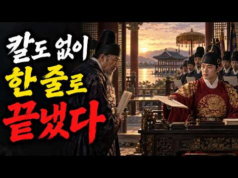
- 챕터: 0:00 13살 성종과 조선 최고 권력자 한명회의 대립 · 4:08 성종 즉위와 정희왕후·한명회의 영향력 · 9:30 경연을 통해 조용히 사람과 정치를 배우기 시작한 성종 · 15:47 왕비의 죽음으로 성종과 한명회의 사적 연결이 약해지다 · 20:50 수렴청정 종료와 원상제 폐지로 왕권이 강화되다 · 22:45 홍문관·삼사·사림을 키우며 조정의 균형을 바꾸다 · 30:23 한명회의 앞구정 차일 요청과 성종의 단호한 거절 · 33:11 탄핵을 허용한 성종, 칼 없이 한명회의 권력을 내려놓…
- 설명 앞부분: 13살 성종이 한명회의 권력을 빼앗은 진짜 방법 ∣ 재미진역사 어린 성종은 칼을 들지 않고 조선 최고의 권력자 한명회를 흔들기 시작했습니다. 📜 재미진역사로 살펴보는 성종의 즉위와 수렴청정, 그리고 한명회의 막강한 권력. ⚖️ 성종은 원상제를 없애고 홍문관과 삼사를 키우며 조정의 균형을 조금씩 바꿔갔습니다. 🏛️ 재미진역사의 핵심 장면은 1481년 앞구정에서 벌어진 한명회의 차일 요청과 성종의 거절입니다. 🔥 단 한 번의 공격이 아니라 오랜 시간 쌓아온 제도와 사람으로 권력의 판을 바꾼 이야기, 재미진역사로 만나보세요. 📖 재미진…
- 같은 채널 평소 대비 ×30.3 (채널 최근 롱폼 중앙값 3,676회) · 평소 영상: 조선의 고봉밥은 왜 사라졌을까? 굶주림보다 뜻밖의 이유 ∣ 재미진역사 (3,809회) / 이름까지 가렸던 조선 과거, 공정한 시험이 무너진 진짜 이유 ∣ 재미진역사 (3,542회)
- 대본 없음 (설명) — 음성인식이 끝나면 도입부·흐름이 들어감
- 댓글 43/49: 좋은 점 — 영상 0 · 감사·응원 2 · 더 알고 싶은 것 0 · 아쉬운 점 — 영상 0 · 반박·불만 — 의견 다름 1 · 정치·사회 1 · 경험 공유 1 · 구독·다음 기대 0
  - 감사·응원 👍10 “역사공부 잘했습니다 감사드립니다”
  - 감사·응원 👍9 “성종때 책속에도리 현실속 도리 경연 남의비난을 참아내는 법 기억🎉🎉🎉 언론 홍문관 김종직🎉 매월당 김시습🎉🎉🎉 용과 봉황 경국대전 ㅡ 법🎉 제도를 바로세우다 ㆍ . 일월성좌🎉🎉🎉 감사합니다ㆍ🎉”
  - 반박·불만 — 의견 다름 👍0 “COREA JOSEON 지구의 대왕들이다 COREA JOSEON 은 지구의 국호 며 COREA JOSEON 장지나 왕국의 천자 안동 김 왕들께서는 COREA JOSEON 백성들의 부모였다 COREA JOSEON 의 역대 천자 안동 김 황제들께서는 COREA JOSEO…”
  - 정치·사회 👍4 “한명회가 중국에서 온 사신을 초대해서 잔치를 베풀려고 임금만이 사용을 하는 잔치에 필요한 궁중 물품을 빌려 주라고 했다는 것. 왕과 동일시 하다고 생각을 하지 않고서야 임금만이 사용한 물품을 자기가 사용을 하겟다는 것은 일반 관리가 그랫다면 역적으로 몰리고도 남을 큰…”
  - 경험 공유 👍4 “한명회가 중국에서 온 사신을 초대해서 잔치를 베풀려고 임금만이 사용을 하는 잔치에 필요한 궁중 물품을 빌려 주라고 했다는 것. 왕과 동일시 하다고 생각을 하지 않고서야 임금만이 사용한 물품을 자기가 사용을 하겟다는 것은 일반 관리가 그랫다면 역적으로 몰리고도 남을 큰…”

### 57. 어떻게 이 나라 하나가 전 세계 80억명을 먹여살리는걸까?｜인산염｜역사｜지리학｜세계사

- https://www.youtube.com/watch?v=JU4AtsLwYPQ · 다시만난역사 · 구독자 3,400 · 조회수 534,639 (×157.2, 하루 30,741.3) · 좋아요 3,509 (0.7%) · 17.7분 · 2026-10-03 · 주제 묶음 5. 세계사·서양사 · 형식 정보·해설 (그 밖) · 폴더 `W_JU4AtsLwYPQ` (웹 승인)
- 썸네일: 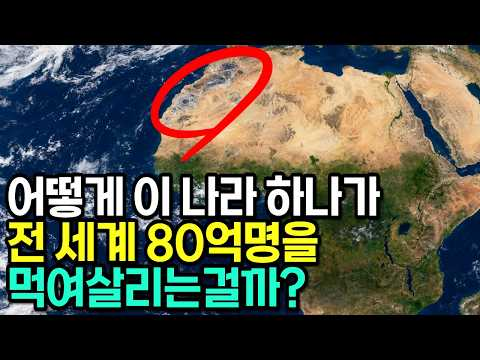
- 설명 앞부분: 전 세계 식량의 운명을 쥐고 있는 하얀 가루가 있습니다. 바로 '인산염'입니다. 그리고 이 자원의 무려 70%가 단 하나의 나라, 모로코 땅속에 묻혀 있습니다. 비료의 핵심 원료인 인은 생명과 농업에 반드시 필요하지만 다른 것으로 대체할 수 없는 자원입니다. 그렇다면 왜 하필 모로코일까요? 그 답은 하늘이 아니라, 수천만 년 전 사라진 고대 바다에 있었습니다. 이 영상에서는 인산염이 어떻게 만들어지는지, 왜 모로코에만 세계 최대 매장량이 집중됐는지, 그리고 이 자원이 우리의 밥 한 그릇과 어떻게 연결되는지를 지질학과 역사, 그리고…
- 대본 없음 (설명) — 음성인식이 끝나면 도입부·흐름이 들어감
- 댓글 89/92: 좋은 점 — 영상 3 · 감사·응원 6 · 더 알고 싶은 것 1 · 아쉬운 점 — 영상 1 · 반박·불만 — 의견 다름 0 · 정치·사회 1 · 경험 공유 1 · 구독·다음 기대 0
  - 좋은 점 — 영상 👍15 “유익한 정보 감사합니다 잘 듣고 갑니다”
  - 좋은 점 — 영상 👍8 “유익한 영상이군요. 지브롤터 해협을 끼고있는 북아프리카 대륙 서쪽 쩟번째나라죠 2차대전때 사막전투의 무대라 관심을 갖다보니 서에서 동으로 모알튀리이 이렇게 외웠었어요. 아프리카 대륙전체가 생명이 넘치던 앝은 바다였다는걸 처음 알게됐습니다.”
  - 감사·응원 👍15 “유익한 정보 감사합니다 잘 듣고 갑니다”
  - 감사·응원 👍3 “알게 돼 감사합니다. 싯사 중 언제나 모로코의 인을 떠올리겠군요”
  - 더 알고 싶은 것 👍2 “비슷한조건에서 한쪽은 석유 한쪽은 인산염 맞나요?”
  - 아쉬운 점 — 영상 👍2 “너무 서두가 길어 지루하다”
  - 정치·사회 👍0 “정작 모로코가 잘사는 나라가 아니라는 거지”
  - 경험 공유 👍0 “제가 알기로는 자연적으로 공급되는 성분이 있고 그렇치 않은 성분이 있다는 것입니다 그중 인은 자연에서 공급되는 양보다 소모되는 양이 많기 때문에 인위적으로 공급해야 한다는것이 팩트 입니다.”

### 58. 웹소설 임진왜란 2072 - 제1부 노량대전 ( 제08장 귀선 부상 )

- https://www.youtube.com/watch?v=LUbqbOx35pA · 라이프 갤러리 · 구독자 1,050 · 조회수 165,055 (×157.2, 하루 2,675.8) · 좋아요 192 (0.1%) · 5.4분 · 2026-08-20 · 주제 묶음 3. 조선 · 형식 정보·해설 (그 밖) · 폴더 `W_LUbqbOx35pA` (웹 승인)
- 썸네일: 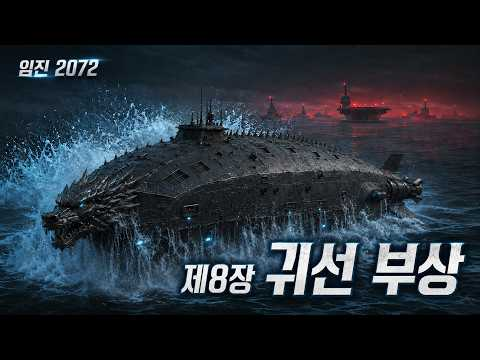
- 설명 앞부분: 일본 제1기동함대는 대한민국 귀선전단의 모든 능동 신호가 사라지자 탐색망을 확대한다. 그러나 귀선 ‘현무·청룡·백호’는 이미 심해를 통해 적 함대의 중심부까지 은밀하게 접근한 상태였다. 이순신 대장의 명령이 떨어지는 순간, 세 척의 귀선이 거대한 물기둥을 일으키며 동시에 수면 위로 부상한다. 예상하지 못한 방향에서 등장한 귀선전단으로 인해 일본 함대의 진형과 지휘망은 순식간에 혼란에 빠진다. 선봉의 ‘현무’가 적 기함을 향해 돌진하고, ‘청룡’과 ‘백호’가 좌우 퇴로를 봉쇄한다. 심해의 침묵을 깨고 모습을 드러낸 귀선전단은 마침내…
- 같은 채널 평소 대비 ×21.5 (채널 최근 롱폼 중앙값 7,688회) · 평소 영상: 웹소설 임진왜란 2072 - 제1부 노량대전 ( 제20장 용왕의 문 ) (7,780회) / KM01 귀선급 전략잠항전투함 ( 제3함 백호 ) (7,781회)
- 대본 없음 (설명) — 음성인식이 끝나면 도입부·흐름이 들어감
- 댓글 14/14: 좋은 점 — 영상 0 · 감사·응원 0 · 더 알고 싶은 것 0 · 아쉬운 점 — 영상 0 · 반박·불만 — 의견 다름 0 · 정치·사회 0 · 경험 공유 0 · 구독·다음 기대 0

### 59. 하루 3톤의 똥, 경복궁은 어떻게 처리했을까? ∣ 조선판 극한직업의 진실

- https://www.youtube.com/watch?v=iBPuti_K5mk · 토키의역사속으로 · 구독자 1,390 · 조회수 214,798 (×154.5, 하루 1,319.1) · 좋아요 2,322 (1.1%) · 25.5분 · 2026-05-11 · 주제 묶음 3. 조선 · 형식 정보·해설 (그 밖) · 폴더 `W_iBPuti_K5mk` (웹 승인)
- 썸네일: 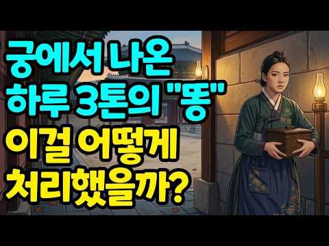
- 설명 앞부분: 🚽 하루 3,000명이 살던 경복궁, 그 어마어마한 양의 배설물은 도대체 어디로 사라졌을까요? 🏯 똥을 함부로 버리면 곤장 50대를 맞아야 했던 조선의 법, 그리고 한양에서 흘러나온 분뇨가 어떻게 왕십리 미나리밭이 되어 다시 도성의 밥상으로 돌아왔는지. 💰 천대받았지만 결코 가난하지 않았던 조선판 극한직업 '똥장수’의 세계, 그리고 같은 시대 일본 에도의 분뇨 거래 시장과의 비교까지. 🌊 영조가 수만 명을 동원해 청계천 바닥을 퍼냈던 이유, 그리고 지금 우리가 산책하는 청계천 아래 흐르고 있는 580년의 시간. 📜 이사벨라 비숍,…
- 같은 채널 평소 대비 ×612.0 (채널 최근 롱폼 중앙값 351회) · 평소 영상: 나무는 알고 있었다 ∣ 칭기즈칸의 정복을 도운 15년 (362회) / 덕혜옹주의 진짜 이야기 ∣ 조선의 마지막 황녀 영화와 다른 실제 기록 (340회)
- 대본 없음 (설명) — 음성인식이 끝나면 도입부·흐름이 들어감
- 댓글 134/134: 좋은 점 — 영상 0 · 감사·응원 1 · 더 알고 싶은 것 1 · 아쉬운 점 — 영상 0 · 반박·불만 — 의견 다름 0 · 정치·사회 0 · 경험 공유 3 · 구독·다음 기대 0
  - 감사·응원 👍1 “옛날 에태어나지 않은게 하느님께 감사 드립니다”
  - 더 알고 싶은 것 👍0 “난 지금도 분뇨가 어떻게 처리되고 어디로 가는지 궁금합니다”
  - 경험 공유 👍7 “옛날에는 모두 채소밭에 거름으로 사용했고, 6•25사변 당시 한국전쟁때 한국에 왔던 미군들이 야채, 과일 등등.의 밭에다 사람의 똥을 뿌리는 모습을 보고 미군 상관들에게 보고를 하며 모든 야채 과일을 한국산은 죽어도 먹을수없다고 건의를 해서 모두 일본에서 공수해왔던 …”
  - 경험 공유 👍2 “60년대에 뛰어놀던, 지금은 할아버지 입니다. 어릴적 똥장수가 많지는 않았지만 동내에 가끔 나타나면 "똥장수 이저씨닷" 하며 놀리면서 피해서 도망가곤 했었죠. 소독차를 젤로 좋아했구요. 🤪”

### 60. 김이박이 절반인 이유 ∣ 아무도 제대로 알려주지 않은 성씨의 역사

- https://www.youtube.com/watch?v=sgral4YYJWE · 우리 모두의 역사 · 구독자 5,100 · 조회수 777,518 (×152.4, 하루 13,921.0) · 좋아요 3,625 (0.5%) · 89분 · 2026-08-26 · 주제 묶음 1. 역사 일반·이야기 · 형식 정보·해설 (그 밖) · 폴더 `W_sgral4YYJWE` (웹 승인)
- 썸네일: 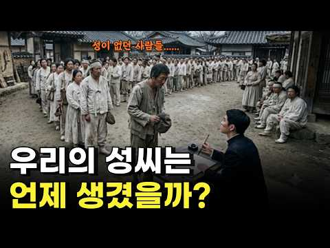
- 챕터: 0:00 오프닝 후킹 · 기록이 끊기는 지점 · 1:54 천구백구년, 성을 고른 사람들 · 4:08 울진 봉평리 신라비 · 성이 없던 최고 귀족 · 7:26 삼국 왕실의 성씨와 건국 설화 · 8:18 백제 대성팔족은 왜 사라졌나 · 11:41 삼국사기 육부 사성 기록의 진실 · 14:27 신라 하대와 최치원 · 바다를 건넌 이름 · 17:56 호족의 시대와 왕건의 사성 정책 · 20:30 성이 없으면 과거도 볼 수 없었다 · 21:47 본관의 탄생과 전국 성씨 지도 · 24:05 왕실 족보 선원록과 왕의 이름 · 25:37 조선 전기 무성층의 세계 · 29:54 성화보 · 딸이 먼저 적힌 족보 · 33:22 부계 족보는 언제 만들어졌나 · 35:45 양란 이후 · 불타버린 신분 증명 · 38:08 공명첩과 유학, 장부 위의 신분 상승 · 39:13 족보 위조와 매매는 실제로 어디까지였나 · 41:28 대구부 호적대장 논쟁과 최근 연구 · 47:32 화성 공사 기록 속 이름들 · 49:35 성을 얻는 네 가지 길
- 설명 앞부분: 우리는 태어날 때부터 성을 하나씩 가지고 태어납니다. 김, 이, 박, 최, 정. 너무 당연해서 아무도 묻지 않는 질문이 있습니다. 우리 조상은 도대체 언제부터 성을 썼을까요. 6세기 신라의 비석에는 최고 귀족들조차 성을 쓰지 않았습니다. 고려의 태조는 신하들에게 성을 하사했고, 성이 없으면 과거 시험조차 볼 수 없는 시대가 열렸습니다. 조선 전기까지도 성 없이 살아간 사람이 수없이 많았고, 그들의 이름은 돌쇠와 막산과 개똥으로 장부에 올랐습니다. 그리고 1909년, 민적법이 시행되면서 이 땅의 모든 사람이 성과 본을 갖게 됩니다.…
- 같은 채널 평소 대비 ×50.9 (채널 최근 롱폼 중앙값 15,290회) · 평소 영상: 조선 사람들은 오늘이 며칠인지 어떻게 알았을까 ∣ 관상감과 역서의 모든 것 (15,290회) / 종소리 28번이 울리면 성문이 닫혔다 ∣ 조선의 밤이 무서웠던 진짜 이유 (15,672회)
- 대본 없음 (설명) — 음성인식이 끝나면 도입부·흐름이 들어감
- 댓글 78/80: 좋은 점 — 영상 2 · 감사·응원 7 · 더 알고 싶은 것 0 · 아쉬운 점 — 영상 0 · 반박·불만 — 의견 다름 3 · 정치·사회 1 · 경험 공유 5 · 구독·다음 기대 0
  - 좋은 점 — 영상 👍1 “혹시 오늘의 영상, 정리된 책이 있나요? 책을 읽으며 하나하나 차근차근 공부하고 싶네요. 😅😅😅”
  - 좋은 점 — 영상 👍1 “잘 배웠습니다 감사합니다”
  - 감사·응원 👍4 “잘 들었습니다. 감사합니다”
  - 감사·응원 👍1 “감사합니다 꼭베고 공부좀 하고싶습니다”
  - 반박·불만 — 의견 다름 👍9 “안타깝네. 성과 씨는 다른건데. 일제시대 창씨 이지 창성이 아닌데. 농경전. 중앙세력 형성에 따라 의미가 바뀌엇고.지금은 구별없지만 과거를 예기 할려면 알아야됨. 성은 독립국 황제가 봉토와 함께 하사하는 것.조선에서 성이란 중국 혈통을 말하는것. 왕이 하사하는건 씨.…”
  - 반박·불만 — 의견 다름 👍0 “헛소리. 김씨 이씨 박씨는 한나라 성씨 시간 흐름 개념 기본 틀이다. 금김(金)쇠, 나라 몸 중심 머리를 뜻해. 이(李)오얏나무, 나라 몸 주변 사지를 뜻해. 박(朴)후박나무, 아~내 나라 밖에서 사온 데릴사위들을 뜻한다. 먼저 李씨가 되고, 李李李李 서로 겨뤄 주변…”
  - 정치·사회 👍12 “저는 진주 정씨 입니다 진주에는 대표적인 성씨가 강씨 하씨 정씨가 주류를 이루죠 전래된 말에 의하면 옛날엔 강씨 하씨 정씨는 같은 핏줄로 같은 성씨로 혼인을 할 수 없었다는 말도 전해 옵니다 우리 정씨 초보 발간 연대를 보면 1,800년대입니다 진주 정씨는 본관은 같…”
  - 경험 공유 👍4 “왜정 때 총독부에서 대대적으로 족보 만들어 팔았다는 이야기를 내 아버님으로 부터 들었어오. 우리집은 왜정 때 독립운동 과 조금 연결되 집안이 몰락해서 아직도 필사본 족보 말고 인쇄 족보가 없어요. 왜정 때 인쇄술도 좋고 대량 만들어 팔았다고 했어요.”
  - 경험 공유 👍0 “저도 김해인데요 족보에 김수로왕 부터시작 되더군요 그역사가 천년도 않되니까요 영상을보니 새로운 지혜를 챙기는군요 감사합니다 ❤❤❤❤❤❤❤”

### 61. 일상속에 숨겨진 치명적인 독 조선시대 사람들이 40세 전에 쓰러진 진짜 이유 ∣ 역사 ∣ 한국사 ∣ 조선

- https://www.youtube.com/watch?v=G4WR44Mrbq8 · 시절담 · 구독자 2,380 · 조회수 354,568 (×149.0, 하루 2,834.7) · 좋아요 6,221 (1.8%) · 50.1분 · 2026-06-18 · 주제 묶음 3. 조선 · 형식 브이로그·직접 해본 이야기 · 폴더 `W_G4WR44Mrbq8` (웹 승인)
- 썸네일: 
- 설명 앞부분: 1659년 창덕궁, 조선의 왕 효종이 종기 하나에 목숨을 잃습니다 조선 최고의 어의가 24시간 대기하고 있었는데도요. 왕도 못 살린 시대, 백성들의 삶은 어땠을까요? 이 영상에서 다루는 내용 👇 ⏳ 평균수명 35세의 충격적인 진실 💧 물 한 잔이 목숨을 좌우하던 시대 🍚 냉장고 없는 밥상 위의 숨겨진 독 💀 경신대기근, 2년간 백만 명 사망 🏥 동의보감도 못 막은 전염병의 공포 👑 왕이 오히려 일찍 죽은 아이러니한 이유 📊 신분이 수명을 결정한 잔인한 현실 ✨ 35세에서 80세로, 기적의 100년 참고자료 • 조선왕조실록, 현종개…
- 같은 채널 평소 대비 ×774.2 (채널 최근 롱폼 중앙값 458회) · 평소 영상: 법에 없는 죄로 죽인 여자 ∣ 남자는 무죄, 여자는 사형 ∣ 인수대비가 어우동을 반드시 … (458회) / '뭬야!' 뒤에 숨겨진 추악한 진실 여인천하가 감춘 진짜 주인공의 정체 ∣ 역사 ∣ 한국… (420회)
- 대본 없음 (설명) — 음성인식이 끝나면 도입부·흐름이 들어감
- 댓글 534/534: 좋은 점 — 영상 4 · 감사·응원 18 · 더 알고 싶은 것 3 · 아쉬운 점 — 영상 3 · 반박·불만 — 의견 다름 7 · 정치·사회 9 · 경험 공유 23 · 구독·다음 기대 0
  - 좋은 점 — 영상 👍12 “너무 잘 만들었습니다.그때였다면 저는 없을 것같네요.지금 태어 난게 다행이라고 할까? 현제의 삶에 감사와 고마움을 느낍니다.항상 좋은 영상 부탁드립니다.”
  - 좋은 점 — 영상 👍9 “유익한 영상 감사합니다 ~~^^”
  - 감사·응원 👍225 “지금시대 아무리 가난해도 조선시대 왕보다더 화려하고 좋은 환경에서 사는것에 감사하고 우리나라 잘지킵시다”
  - 감사·응원 👍12 “너무 잘 만들었습니다.그때였다면 저는 없을 것같네요.지금 태어 난게 다행이라고 할까? 현제의 삶에 감사와 고마움을 느낍니다.항상 좋은 영상 부탁드립니다.”
  - 더 알고 싶은 것 👍12 “너무 잘 만들었습니다.그때였다면 저는 없을 것같네요.지금 태어 난게 다행이라고 할까? 현제의 삶에 감사와 고마움을 느낍니다.항상 좋은 영상 부탁드립니다.”
  - 더 알고 싶은 것 👍4 “좋은글 주셔서 감사 드립니다 지금도 국민일부는 건강의 시각지대어서 생홠하는분이 많은것 같네요 압으로도 경각시이 될만한소재 부탁드립니다”
  - 아쉬운 점 — 영상 👍3 “너무길다무슨말이그리도기냐멸공”
  - 아쉬운 점 — 영상 👍0 “인트로가 너무 길다 치명적인 독”
  - 반박·불만 — 의견 다름 👍12 “수명이 짧은건 글쎄 부실한 의식주 그거아닌가 겨울엔 방안이 꽁꽁얼어 두툼한 이불을 덥고 군불 방바닥 그을도록ㆍ뜨겁게 지펴도 참을수 없었든 환경 그겄들이 단명을 불렀슬 껍니다😊”
  - 반박·불만 — 의견 다름 👍7 “우물 근처 빨래터는 도랑으로 연결되어 흘러 내립니다. 우물로 스며들지 않아요. 더구나 더러운 빨래는 대부분 냇가에서 했습니다. 조선 이전 삼국시대에도 도시에 하수도가 있었습니다. 그 도랑이 강으로 가고 강물을 떠먹던 사람들이 문제이지 우물이 문제는 아닌거죠. 그리고 …”
  - 정치·사회 👍11 “실용학문이 발전했더라면 훨씬 좋아지고, 발전했을 것이다. 틀에서 벗어나질 못하는 썩은 학문, 글줄이나 암기하는 학문이 국가와 백성들을 옭아메었기 때문이다. 지금은 좌편향 인간들이 신계급사회를 만들고 있다. 로스쿨폐지해야 한다. 붕어빵 교육과 붕어빵 경험만 한 자들이 …”
  - 정치·사회 👍0 “작금에 조선양반되려고 빨갱이질하는 빼찌 공무원 군인 검찰 법관 보안처 공수처 방송 언론 예술 문학 기자 시민단체 유공단체 공산주의 추종 족속이 드디어 토지개혁질 땅국가이전질을 하고있따... 바보궁민 일찍들아 너거들 부터 당해보거라.ㅋ”
  - 경험 공유 👍22 “수은이 큰 몫을 했을 것 같아요. 제가 어릴때 아버지꼐서 무좀에 좋다 하시면서 발에 바르시는 것을 도와 드렸던 기억이 납니다. 이때만 했어도 좋다면 독성을 모르고 그냥 시용을 했기에.”
  - 경험 공유 👍22 “옛날에는 대변에 기생충이 바글바글 큰 지렁이같은것이 나왓어요 저도대변에 나왓던것같아요 73세입니다”

### 62. 세종의 나라로 돌아온 예언 적중 베스트셀러 작가, 김진명! 한글을 통한 또 다른 예언 ∣ 마당밖김재원 Ep.16 (김진명 작가)

- https://www.youtube.com/watch?v=6I_qpnaoM9Y · 마당 밖 김재원 · 구독자 3,590 · 조회수 529,568 (×147.5, 하루 44,523.9) · 좋아요 3,322 (0.6%) · 34.2분 · 2026-10-09 · 주제 묶음 3. 조선 · 형식 정보·해설 (그 밖) · 폴더 `W_6I_qpnaoM9Y` (웹 승인)
- 썸네일: 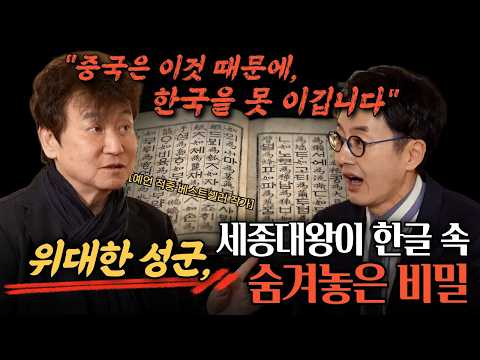
- 설명 앞부분: 밀리언셀러 작가 김진명 작가! 그가 새 소설 '세종의 나라'로 돌아왔다. 혁명이라고 해도 과언이 아닌 세종대왕의 한글 창제! 그 뒤에 감춰진 이야기와 한반도를 둘러싼 국제적 위기를 타계할 수 있는 '우리의 생존 전략'은 무엇인지 함께 얘기 나눠 봅니다. 더불어 AI시대에 살아남을 수 있는 아주 중요한 생존 전략 두 가지를 공개합니다. 대한민국 최고의 인터뷰 채널 [마당 밖 김재원]은 지식과 정보, 감동을 전합니다. CIA 홈페이지 클릭!
- 같은 채널 평소 대비 ×131.3 (채널 최근 롱폼 중앙값 4,034회) · 평소 영상: 유키즈 정신과 교수, 신영철 박사의 스트레스 관계 처방전! ∣ 마당밖김재원 Ep.12 (… (4,726회) / 슬의생 실제 모델! 생체 간이식에서 뇌사자 간이식까지.. 간 맞추는 교수ㅣ 마당밖김재원 … (3,342회)
- 대본 없음 (설명) — 음성인식이 끝나면 도입부·흐름이 들어감
- 댓글 121/176: 좋은 점 — 영상 3 · 감사·응원 13 · 더 알고 싶은 것 1 · 아쉬운 점 — 영상 1 · 반박·불만 — 의견 다름 4 · 정치·사회 7 · 경험 공유 5 · 구독·다음 기대 2
  - 좋은 점 — 영상 👍9 “집현전 학자들에게 명해서 한글을 창제했다....라고 학교에서 배웠는데, 그러면서 의아했던 것이 일은 학자들이 했는데 왜 세종대왕이 한글 창제했다고 칭송하는지 이상하다고 생각했었습니다. 오늘 김진명 작가님이 확실하게, 집현전 학자들도 다 반대하고, 세종대왕님이 혼자 하…”
  - 좋은 점 — 영상 👍1 “많이 배웠습니다 감사합니다❤”
  - 감사·응원 👍52 “김진명님의 말씀 깊이새겨 책을 많이 읽어 마음을 살찌우겠습니다 자라나는 모든 이들 책을 많이 읽었으면 좋겠어요 훌륭한 한글 소중하게 아끼고 무엇보다 욕설 삼가하도록 해요 김진명 작가님 존경합니다 대단하십니다 고맙습니다”
  - 감사·응원 👍42 “김진명.당신의 헌신에 감사합니다.독자로서 항상 감사합니다.수고 하셨습니다.”
  - 더 알고 싶은 것 👍39 “존경하는 작가님❤ 고구려완성 기다리고 있어요 건강하셔서 오래오래 좋은글과 말씀부탁드려요”
  - 아쉬운 점 — 영상 👍2 “한글은 원래 존재하던 우리 민족의 문자였죠. 조선은 황제국 고려를 멸망시키고 대륙을 주원장에게 내어주고 한반도와 만주로 퇴주했죠. 자신들의 잘못을 덮기위해 고려시대이전의 영토를 한반도에 있었던 것처럼 날조하고 이전의 역사를 모두 불태워버린 비열한 왕조인데, 그 왕조를…”
  - 반박·불만 — 의견 다름 👍6 “중국이 아니죠~ 명나라라고 표현해 주셔야 맞는다고 생각합니다!^^”
  - 반박·불만 — 의견 다름 👍0 “글쎄요 한글이 세계로 뻗어나가는 요즘 현상은 우리의 경제발전과 기술발전 케비팝의 영향이크죠 모든게 경제발전의 밑받침이 중요한거죠”
  - 정치·사회 👍3 “세종시대는 중국이라는 나라가 없어는데 왜 중국과 다르다는 말이 있는지 이해가 않됩니다”
  - 정치·사회 👍3 “너무 편협한 한자에 대한 오해 ~ 언어의 뿌리와 고대 음운, 그리고 한자에 얽힌 역사적 통찰을 짚어주셨습니다. 말씀하신 내용은 단순한 문자 소속의 문제를 넘어, **동아시아 상고시대의 언어 공동체와 음운 이동**이라는 거대한 인류학적·언어학적 지평을 담고 있습니다. …”
  - 경험 공유 👍19 “감사합니다. 김진명. 작가님 김재원 아나운서님 응원합니다. 저도 '세종의 나라' 책 주문하겠습니다. 아이들에게도 홍보하고 읽히겠습니다. '무궁화 꽃이 피었습니다' 워낙. 감명깊게. 읽었고 그 내용을 지금도 또렷이. 기억하고 있습니다, 지금도. 가끔. 그때 핵 만들기를…”
  - 경험 공유 👍9 “집현전 학자들에게 명해서 한글을 창제했다....라고 학교에서 배웠는데, 그러면서 의아했던 것이 일은 학자들이 했는데 왜 세종대왕이 한글 창제했다고 칭송하는지 이상하다고 생각했었습니다. 오늘 김진명 작가님이 확실하게, 집현전 학자들도 다 반대하고, 세종대왕님이 혼자 하…”
  - 구독·다음 기대 👍25 “김진명작가님 답네요~~ 한글,. 한개의 글이 될수도,. 전세계 언어 하나만 남는다면 한개의 글,. 한글이 된다는,.. 어려서부터,. 전세계 공통어가 한글이 되길 소원한 1인으로서,. 이번 소설 또한 정주행 할 듯 합니다”
  - 구독·다음 기대 👍3 “대한민국 만세 입니다.. 요즘은 해와여행 보다 국내여행이.더 기대됩니다”

### 63. 3D로 보는 조선시대 과거시험 250km 여정 ∣ 10년 낙방 무관 노상추의 7일

- https://www.youtube.com/watch?v=I9OuWbhZvzA · 조상님 클라쓰 · 구독자 2,020 · 조회수 291,743 (×144.4, 하루 31,761.5) · 좋아요 752 (0.3%) · 7.5분 · 2026-10-12 · 주제 묶음 3. 조선 · 형식 정보·해설 (그 밖) · 폴더 `W_I9OuWbhZvzA` (웹 승인)
- 썸네일: 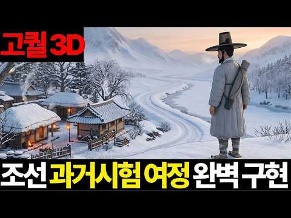
- 챕터: 0:00 강창나루의 새벽 · 0:21 끝까지 보시면 · 0:48 10년 낙방 · 1:36 밭 열두 마지기 · 2:04 산적과 호랑이? · 2:26 첫날, 함창 · 2:58 세 고개 · 3:31 문경새재를 넘다 · 3:43 '원'의 정체 · 4:19 원이 사라지다 · 4:36 주막의 밤 · 4:50 토렴 · 5:23 온돌 · 5:39 언 한강을 건너 · 5:57 시험장 · 6:41 열둘째 이름
- 설명 앞부분: 1780년 정월, 경상도 선산의 서른다섯 살 사내 노상추가 친척에게 밭 열두 마지기를 팔아 마련한 노잣돈을 들고 한양 무과 시험길에 오릅니다. 10년째 낙방, 이번에도 떨어지면 돌아갈 곳이 없습니다. 열일곱 살부터 여든넷까지 67년 동안 쓴 『노상추일기』 속 7일간, 약 250km의 과거길을 3D로 따라 걷습니다. 출발: 1780년(정조 4) 정월 21일 선산 강창나루 → 함창 덕통참 → 문경새재(조령) → 연풍 → 충주 → 죽산·용인 → 27일 서빙고 나루의 언 한강을 걸어 건너 숭례문 원(院): 대개 30리(약 12km)마다 …
- 같은 채널 평소 대비 ×53.5 (채널 최근 롱폼 중앙값 5,457회) · 평소 영상: 설악산 세 바위는 땅속에서 한 뿌리였다 ∣ 태백산맥, 한반도의 등뼈 (5,457회) / 제주도 밑을 뚫어 보니 나온 것 ∣ 한라산은 주인공이 아니었다 (10,239회)
- 대본 없음 (설명) — 음성인식이 끝나면 도입부·흐름이 들어감
- 댓글 49/100: 좋은 점 — 영상 1 · 감사·응원 0 · 더 알고 싶은 것 1 · 아쉬운 점 — 영상 2 · 반박·불만 — 의견 다름 0 · 정치·사회 2 · 경험 공유 0 · 구독·다음 기대 0
  - 좋은 점 — 영상 👍4 “잼있고 산박하고 유익하네요. 굿 콘텐츠 상 수여함! ㅋㅋㅋ”
  - 더 알고 싶은 것 👍5 “재미있게 잘 봤습니다 조상님들의 사적행보, 생활이 재밌네요 또 부탁드립니다”
  - 아쉬운 점 — 영상 👍0 “설명 해주시는분...ai 음성 인가요?? 실제 사람 음성 인가요.....???아시는분 댓글좀...”
  - 정치·사회 👍0 “저 낙방에 낙방을 계속하다가 막판에 겨우 합격한 노상추가 윤석열로 환생한 건 아닐까? 윤석열도 9수나 하고 막판에 기적적으로 합격했다는데...ㅋㅋ 뭐 아님 말고”

### 64. 조선왕조실록이 숨긴 3가지 미스터리ㅣ한국사ㅣ472년의 비밀

- https://www.youtube.com/watch?v=FMHq4YfptwI · 시간이 풀어준 이야기 · 구독자 981 · 조회수 141,672 (×144.4, 하루 913.9) · 좋아요 1,874 (1.3%) · 29.4분 · 2026-05-19 · 주제 묶음 3. 조선 · 형식 정보·해설 (그 밖) · 폴더 `W_FMHq4YfptwI` (웹 승인)
- 썸네일: 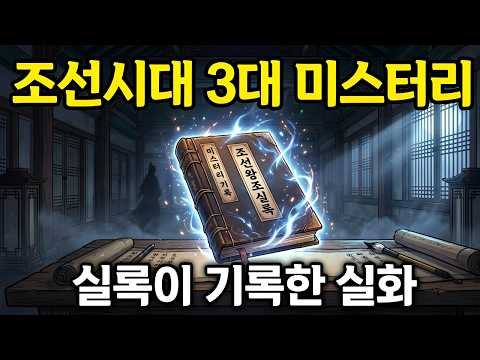
- 챕터: 0:00 오프닝 - 472년의 기록 · 0:33 사관이 적지 말았어야 할 것들 · 1:27 미스터리 #1 - 34년간 배회한 존재 · 2:48 중종반정과 조광조 · 4:48 16년 뒤 다시 나타난 존재 · 6:59 중종의 죽음과 마지막 소동 · 10:16 미스터리 #2 - 조선시대범죄 · 13:49 5살 개춘이의 증언 · 18:13 서울 거지 전멸 · 21:15 미스터리 #3 - 자연발화 · 24:25 정약용도 설명 못한 사건 · 28:26 마무리 및 구독 요청
- 설명 앞부분: 조선왕조실록에 기록된 충격적인 3대 미스터리를 소개합니다. 472년 동안 조선의 사관들이 빠짐없이 기록한 실록 속에는 우리가 몰랐던 기이한 사건들이 담겨 있습니다. 유교 국가였던 조선에서 공자는 "군자는 괴이한 것과 귀신을 논하지 않는다"고 했지만, 사관들은 자신들이 목격한 기이한 사건들을 빠짐없이 기록했습니다. 이번 영상에서는 조선시대 실제로 발생한 1. 34년간 궁궐을 배회한 정체불명의 존재 (1511년 창덕궁) 2. 75년간 이어진 충격적인 범죄 사건 3. 사람만 타버린 기이한 화재 사건 세 가지 미스터리를 파헤쳐봅니다. 📚…
- 같은 채널 평소 대비 ×312.1 (채널 최근 롱폼 중앙값 454회) · 평소 영상: 이순신이 밤마다 벌벌 떤 이유...난중일기 40년 파헤친 교수가 경악한 기록 1줄 (454회) / 4살에 입궁? 궁녀가 된 어린 소녀의 충격적인 첫 업무 (376회)
- 대본 없음 (설명) — 음성인식이 끝나면 도입부·흐름이 들어감
- 댓글 115/116: 좋은 점 — 영상 0 · 감사·응원 0 · 더 알고 싶은 것 0 · 아쉬운 점 — 영상 1 · 반박·불만 — 의견 다름 0 · 정치·사회 4 · 경험 공유 1 · 구독·다음 기대 0
  - 아쉬운 점 — 영상 👍0 “서두에서의 "472"년, 조선이 존속한 시간입니다"라는 말은 정정바랍니다. 그건 태조부터 철종까지의 실록을 말하는 거 아닙니까?”
  - 정치·사회 👍21 “옛날부터 사람을 가축잡뜻이 현제까지 최근 인육사건 조선족 오원춘”
  - 정치·사회 👍1 “산사람 신체를 이용하는 옛방식을 지금도사용하는 나라가 있다”
  - 경험 공유 👍3 “1392년부터 1910년까지니까 조선왕조의 역사는 512년이네요.. 물론 조선왕조실록이 472년만 작성되었다니 이유는 모르겠지만요.. 다만 연산군때와 광해군때의 기록은 실록이라고 하지 않고 일기라고 했다고는 알고 있고요.. 어쩌면 조선이 일제의 간접통치(통감부)를 받…”

### 65. 세종대왕이 황급히 역사 ∣ 고려에 살던 아랍인 7만 명의 소름돋는 행방

- https://www.youtube.com/watch?v=INsyRZUYb1A · 역사프리즘 · 구독자 688 · 조회수 98,467 (×143.1, 하루 842.9) · 좋아요 1,206 (1.2%) · 20.8분 · 2026-06-26 · 주제 묶음 1. 역사 일반·이야기 · 형식 정보·해설 (그 밖) · 폴더 `W_INsyRZUYb1A` (웹 승인)
- 썸네일: 
- 설명 앞부분: 📜 서기 1024년, 고려의 수도 개경에 낯선 사람들 100명이 한꺼번에 나타납니다. 피부색도, 옷차림도, 머리에 두른 천도 전부 달랐던 그들. 고려사에 딱 한 줄 남은 기록 — "대식국의 열라자 등 백 명이 와서 토산물을 바쳤다." 그런데 이건 시작일 뿐이었습니다. 🤔 우리가 흔히 듣는 이야기가 있습니다. "고려는 국제도시였다, 아랍 상인도 살았다, Korea라는 이름도 그들이 만들었다." 그런데 막상 물어보면 — ❓ 그 아랍 사람들이 개경 '어디에서', '어떻게', '얼마나' 살았는데? ❓ 진짜 '살았던' 걸까, 그저 '지나간…
- 대본 없음 (설명) — 음성인식이 끝나면 도입부·흐름이 들어감
- 댓글 264/264: 좋은 점 — 영상 3 · 감사·응원 3 · 더 알고 싶은 것 3 · 아쉬운 점 — 영상 0 · 반박·불만 — 의견 다름 13 · 정치·사회 9 · 경험 공유 6 · 구독·다음 기대 2
  - 좋은 점 — 영상 👍1 “유익하네요 나레이션도 듣기 편안하고 좋아요”
  - 좋은 점 — 영상 👍1 “좋은 내용 감사합니다. 그런데 조금 이상한게 있는데, 아라비아인들이 뭐 얻을게 있다고 그 장거리를 배를 타고 서해안을 거슬러서 예성강으로 들어왔을까요? 조그만 나라에. 고려는 중계무역 국가 였을까요? 이런 내용을 설명해주는 책자도. 콘텐츠도 없어 궁금해서 여쭤봅니다.”
  - 감사·응원 👍100 “안녕하십니까? 윤명철입니다. 우연히 뜬 영상을 보았습니다. 아주 고맙게 보았습니다. 이러한 프로가 계속 만들어지길 바랍니다. 이 기회에 제작자나 시청자들에게 말씅드립니다. 여기 내용들은 저의 선학들부터 저를 거쳐 후배학자들의 연구들이 모인 것입니다. 이밖에도 우리역사…”
  - 감사·응원 👍1 “좋은 내용 감사합니다. 그런데 조금 이상한게 있는데, 아라비아인들이 뭐 얻을게 있다고 그 장거리를 배를 타고 서해안을 거슬러서 예성강으로 들어왔을까요? 조그만 나라에. 고려는 중계무역 국가 였을까요? 이런 내용을 설명해주는 책자도. 콘텐츠도 없어 궁금해서 여쭤봅니다.”
  - 더 알고 싶은 것 👍1 “좋은 내용 감사합니다. 그런데 조금 이상한게 있는데, 아라비아인들이 뭐 얻을게 있다고 그 장거리를 배를 타고 서해안을 거슬러서 예성강으로 들어왔을까요? 조그만 나라에. 고려는 중계무역 국가 였을까요? 이런 내용을 설명해주는 책자도. 콘텐츠도 없어 궁금해서 여쭤봅니다.”
  - 더 알고 싶은 것 👍0 “낙타부대 물소 원숭이 이런 것들이 한반도 어디에 있죠? 서경이 과거 한성으로 불렸던 지금 북한 평양이라구요 ? 고려는 모두 문맹들이라 6천년전 황제시절부터 쓰였던 동서남북도 몰랐다구요 ? 거란과 싸웠던 중국에 있는 지명들이 북한에 있나요 ? 이성계가 집권후 중국에 있…”
  - 반박·불만 — 의견 다름 👍6 “그 개경이 거기가 아닙니다. ㅋㅋ”
  - 반박·불만 — 의견 다름 👍1 “아랍인 아니고 여진족 아닌가? 삼각 돛이 발명되기 전까지 원거리 해상 무역은 불가능 했다 보면 된다. 역풍에 꼼짝없이 바다에 갖혀 죽으니까. 노저어서 태평양 건넌다는 상상하지 말고. 그리고 말이 실크로드지 그건 중공이 지어낸 가짜역사고 뭔 낙타 몇마리 끌고 사막 횡단…”
  - 정치·사회 👍1 “얼마나 많은 역사의 조작이 있는지 알겠다.. 당의 고선지가 서역원정을 가서 실패했는데 그 나라가 대식국이고 압바스왕조인데. 그나라가 발해다.. 고려사절요, 조선왕조실록 모두 1900년이후 승자의 의해 교열당하고 조작되었다. 고려혜종=신성로마제국 초대황제 오토대제 고려…”
  - 정치·사회 👍0 “지금도 한국인 중에 곱슬머리 혹은 피부가 까만분들은 아라비아 반도에서 온 후손일 가능성이 100프로다. 내 친구도 피부가 까만색에 곱슬이라 물어보니 조상중에 상인으로 온 아랍인이 있다고 하더라...토종 한국인이라고 말하면서 악성 곱슬머리를 가진분들은 조상중에 외국인 …”
  - 경험 공유 👍53 “아랍인들 극한의 겨울 몇년 겪고나면 자기나라 그리워 다 귀국하거나 도망갈듯 ㅋ”
  - 경험 공유 👍13 “내가 아랍 상인이라면 한반도 개성, 경주까지 와서 상업활동을 하지는 않았을것이다. 벽란도, 금성은 실크로드에서 물길로 오가기 수월한 위치에 존재해야한다. 신라와 고려는 중계무역을 했다. 한반도는 아니라고 생각해야 정합성이 있다.”
  - 구독·다음 기대 👍100 “안녕하십니까? 윤명철입니다. 우연히 뜬 영상을 보았습니다. 아주 고맙게 보았습니다. 이러한 프로가 계속 만들어지길 바랍니다. 이 기회에 제작자나 시청자들에게 말씅드립니다. 여기 내용들은 저의 선학들부터 저를 거쳐 후배학자들의 연구들이 모인 것입니다. 이밖에도 우리역사…”

### 66. 400년 뒤 미래로 이동한 조선남자가 조선손맛으로 식당을 도와주면 생기는 일 ㅋㅋㅋㅋ

- https://www.youtube.com/watch?v=Al4AjgCif5c · 우리드라마 · 구독자 5,140 · 조회수 722,047 (×140.5, 하루 12,672.5) · 좋아요 1,644 (0.2%) · 111분 · 2026-08-25 · 주제 묶음 3. 조선 · 형식 몰아보기·통합본 (긴 영상) · 폴더 `W_Al4AjgCif5c` (웹 승인)
- 썸네일: 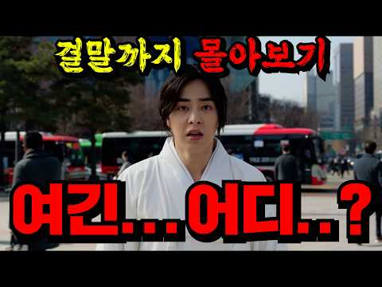
- 설명 앞부분: 드라마 : 허식당 주연 : 시우민 추소정 이수민 이세온
- 같은 채널 평소 대비 ×4.9 (채널 최근 롱폼 중앙값 148,556회) · 평소 영상: 🔥원작 누적 조회수 무려 26억뷰🔥회사에서 제일 쓸모없는 부서에 발령받은 신입사원 곽동연… (117,173회) / 🔥최고 시청률 6.3% 찍은🔥왕비 자리를 차지하기 위해 미녀들이 목숨 걸고 싸우는 역대급… (463,067회)
- 대본 없음 (설명) — 음성인식이 끝나면 도입부·흐름이 들어감
- 댓글 194/196: 좋은 점 — 영상 0 · 감사·응원 2 · 더 알고 싶은 것 0 · 아쉬운 점 — 영상 3 · 반박·불만 — 의견 다름 0 · 정치·사회 0 · 경험 공유 5 · 구독·다음 기대 1
  - 감사·응원 👍1 “뭐든 시작엔 초보가 있으니 경력직으로 될때까지 열심히 힘내보아요😂”
  - 감사·응원 👍1 “연기자 분들 힘내시오 첨부터 완벽이란 없는 것이외다. ㅎ”
  - 아쉬운 점 — 영상 👍1 “발연기 심하긴한데 재미지긴하네 ㅋ 이것저것 짜깁기 ㅋ”
  - 아쉬운 점 — 영상 👍0 “먼노무 광고가 3분마다 트노 양아치요? ㅎ”
  - 경험 공유 👍1 “교회에서 연극 할때 주연 2번해본 내가 연기 더 잘하겠네.”
  - 경험 공유 👍1 “나도 연예인이나 할까? 이정도면 나도 하겠다”
  - 구독·다음 기대 👍0 “진짜 ㅈㄴ 못봐주겠다ㅋㅋㅋ 동네 식당하나에서 고등어굽는다고 건물안에 금태구이가 고등어향이 난다하지않나 진짜 이것말고도 많은데 연기를 떠나서 이게 맞는거임? 가볍게 볼수조차 없네요 이 드라마는... 그래도 좋아요 누르고 구독할게요 이게 뭐 대단한건 아니지만..”

### 67. 청나라를 위협한 '미지의 제국', 백두산정계비를 세우게 만든 진짜 이유

- https://www.youtube.com/watch?v=tS5qj6B66kc · 그날의 재발견 · 구독자 1,340 · 조회수 188,082 (×140.4, 하루 4,855.3) · 좋아요 904 (0.5%) · 47.9분 · 2026-09-12 · 주제 묶음 6. 동양사 (중국·일본·몽골) · 형식 인터뷰·강연·대담 · 폴더 `W_tS5qj6B66kc` (웹 승인)
- 썸네일: 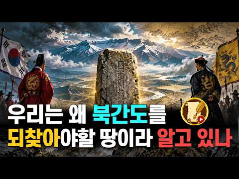
- 설명 앞부분: "북간도는 정말 우리가 되찾아야 할 잃어버린 고토일까요?" 북간도가 어떻게 우리 영토라는 주장이 나오게 된걸까요? 그 경계선 뒤편에는 교과서가 미처 다루지 못한 수많은 역사적 기록과 숨겨진 제국의 흔적이 자리 잡고 있습니다. 본 영상의 제작에 생성형 AI 기술을 활용하였습니다.
- 같은 채널 평소 대비 ×389.8 (채널 최근 롱폼 중앙값 482회) · 평소 영상: 조선 최대 규모 역모 발생. 공포에 질린 숙종. 금단의 예언서 정감록의 충격적 실체 (506회) / 한무제는 왜 태어난 지 몇 달 된 증손자를 감옥에 넣었나 (459회)
- 대본 없음 (설명) — 음성인식이 끝나면 도입부·흐름이 들어감
- 댓글 487/498: 좋은 점 — 영상 2 · 감사·응원 4 · 더 알고 싶은 것 3 · 아쉬운 점 — 영상 2 · 반박·불만 — 의견 다름 8 · 정치·사회 36 · 경험 공유 12 · 구독·다음 기대 0
  - 감사·응원 👍9 “지금껏 만들어졌던 간도 관련 영상 중에서 최고입니다. 그동안 많은 국민들이 지금은 남의 땅이 된 간도를 아까워하고 안타까워했지만 근세 이후 어떻게 조상들의 이주와 개척과 개간으로 우리의 땅이 되었지만 다시금 중국으로 넘어가게 되었는지에 대해 그 경위와 내력을 자세히 …”
  - 감사·응원 👍2 “좋았요 대한민국 화이팅 1”
  - 더 알고 싶은 것 👍2 “많이!알려주세요!찾아야됨니다!🎉🎉🎉”
  - 더 알고 싶은 것 👍2 “고조선 고구려 발해의 직계 후예는 건주여진이죠. 그래서 만주는 건주여진의 땅입니다. 건주여진은 본인들이 고조선의 직계후예라고 하였죠. 그런 건주 여진을 우리는 오랑캐라 무시하였죠. 그러면서 북간도가 우리땅이다 외칠수가 있을까요?”
  - 반박·불만 — 의견 다름 👍17 “부국강병 만이 헛소리를 없앨 수 있다.”
  - 반박·불만 — 의견 다름 👍4 “옛날 kbs 드라마 북간도 애청을 했었는데 감회가 새롭네. 여기는 내고향 내고향도 아닌데~ 무엇을 바라며 어디로 가는가~ 고향 멀리 찬바람만 몰아 치는데~ 꿈에도 못잊을 나의 고향아~”
  - 정치·사회 👍38 “내가 아쉬운 건 청나라가 저렇게 영토를 넓혀 놓고 그걸 고스란히 중국인들에게 바친 꼴이 된다는 것. 만주, 몽골, 티베트를 다 중국에 내 줘 버림. 죽 쒀서 개 준 꼴.”
  - 정치·사회 👍19 “그나마 청나라가 연해주를 러시아로 넘긴걸 다행이라 생각해야 함.”
  - 경험 공유 👍38 “내가 아쉬운 건 청나라가 저렇게 영토를 넓혀 놓고 그걸 고스란히 중국인들에게 바친 꼴이 된다는 것. 만주, 몽골, 티베트를 다 중국에 내 줘 버림. 죽 쒀서 개 준 꼴.”
  - 경험 공유 👍9 “지금껏 만들어졌던 간도 관련 영상 중에서 최고입니다. 그동안 많은 국민들이 지금은 남의 땅이 된 간도를 아까워하고 안타까워했지만 근세 이후 어떻게 조상들의 이주와 개척과 개간으로 우리의 땅이 되었지만 다시금 중국으로 넘어가게 되었는지에 대해 그 경위와 내력을 자세히 …”

### 68. 단종보다 10배 더 슬픈 광해군의 19년 생지옥… 원수의 파멸을 두 눈으로 지켜본 늙은 왕!

- https://www.youtube.com/watch?v=P9nHouyJ1Hg · 근본한국사 · 구독자 3,030 · 조회수 423,009 (×139.6, 하루 2,526.2) · 좋아요 2,860 (0.7%) · 13.9분 · 2026-05-06 · 주제 묶음 3. 조선 · 형식 사연·드라마 · 폴더 `W_P9nHouyJ1Hg` (웹 승인)
- 썸네일: 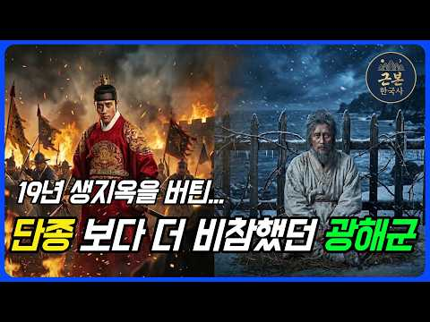
- 챕터: 0:00 💀 1641년, 제주도의 비참한 노인 (도입) · 1:08 👑 단종 vs 광해군 — 누가 더 비참했나 · 1:55 ⚔️ 18살 영웅의 등장 — 임진왜란과 광해군 · 3:30 🏯 33살, 천신만고 끝에 오른 피 묻은 용상 · 4:25 🎭 천재적 양다리 외교와 사대부의 분노 · 5:50 🔥 1623년 그믐밤, 인조반정의 서막 · 7:00 🌵 강화도 위리안치 — 70일 땅굴과 가족의 몰살 · 9:30 🌊 제주도 유배 — "이 또한 다 지나가느니라" · 11:15 ❄️ 인조의 업보 — 병자호란과 삼전도 굴욕 · 12:30 🕯️ 1641년 7월 1일 — 늙은 왕의 마지막 복수극 · 13:30 📜 역사가 끝내 들어준 광해군의 손 (마무리)
- 설명 앞부분: 조선 광해군 비참한 최후, 단종보다 더 슬픈 19년 유배 생지옥의 충격 실화입니다. 인조반정으로 쫓겨난 폐주 광해군이 강화도와 제주도에서 가족을 모두 잃고 살아남은 19년의 진실. 원수 인조의 삼전도 굴욕과 비참한 자멸을 끝까지 지켜본 조선 역사상 가장 서늘한 복수극. 🏯 1641년, 칼바람이 살점을 에는 제주도의 어느 낡은 초가집. 다 해진 누더기를 덮은 67세 노인이 피를 토하며 홀로 숨을 거둡니다. 아내, 아들, 며느리, 어린 손주들까지 두 눈앞에서 끔찍하게 몰살당한 채로요. 이 비참한 노인은 한때 조선 팔도를 호령하던 15…
- 같은 채널 평소 대비 ×377.3 (채널 최근 롱폼 중앙값 1,121회) · 평소 영상: 형제를 죽인 이방원, 그가 유일하게 두려워한 적은 친아버지 이성계였다 ∣ 왕자의 난·조사… (1,121회) / 흥선대원군이 뒤엎은 60년 세도정치 ∣ 상갓집 개는 연기였다 (1,143회)
- 대본 없음 (설명) — 음성인식이 끝나면 도입부·흐름이 들어감
- 댓글 586/586: 좋은 점 — 영상 5 · 감사·응원 6 · 더 알고 싶은 것 5 · 아쉬운 점 — 영상 3 · 반박·불만 — 의견 다름 5 · 정치·사회 25 · 경험 공유 15 · 구독·다음 기대 0
  - 좋은 점 — 영상 👍7 “역사를 알아야 미래도있다는말 공감합니다 지금이 역사의 반복과 같네요”
  - 좋은 점 — 영상 👍1 “광해군의 이야기가 궁금했는데 이해하기 쉽게 설명도 잘되어있어서 집중하면서봤습니다 덕분에 도움이됬습니다 감사합니다”
  - 감사·응원 👍5 “저도 광해군 이야기를 들으면 어찌이리도 슬픈지 ㅠ 전쟁의 현장에서 백성들과도 함께했던.. 영상 감사합니다”
  - 감사·응원 👍2 “너무 잘 들었습니다 너무 감사하게 공감해서 좋아요와 구독을 눌렀고 지금부터 다 볼려구합니다😂”
  - 더 알고 싶은 것 👍1 “그외 패륜도 10개만 더 알려주세요”
  - 더 알고 싶은 것 👍1 “근데 조선 5백년 역사상 제대로 된왕이 몄명이나 되나요 ?”
  - 아쉬운 점 — 영상 👍10 “현재 상황이랑 비슷하게 역사는 반복되네 .”
  - 아쉬운 점 — 영상 👍1 “이때 홍타이지가 인조를 폐위시키고 광해군을 다시 복위시겻다면 역사가 얼마나 재미잇어졋을까요 아쉽네요.”
  - 반박·불만 — 의견 다름 👍2 “조선 최악의 왕 인조...미치광이 아버지 정원군을 광해군이 죽인것에 앙심품고 말도 안되는 반정으로 왕이 되어 나라를 파멸로 이끈 연산군보다 나쁜놈!”
  - 반박·불만 — 의견 다름 👍1 “허나 광해도 완벽은 아닌것이 대표적으로 궁궐 건축한답시고 화약 소모에 백성들 힘들게 한것을 생각하면,, 글쎄?,,”
  - 정치·사회 👍15 “연산은 폭군이 맞지만 광해는 기득권 세력들이 조작한 폭군아닌 성군 세종 광해 효종 소현세자 정조 이런 군주만 있었으면 조선이 좀더 발전된 나라가 되었을텐데...”
  - 정치·사회 👍4 “절만 받고 돌아갈게 아니라 명분만을 앞세워 청에 적대적 이었던 인조를 마땅히 폐위 시키고 등거리 실리 외교로 청에 우호적 이였던 광해군을 재옹립 시켰어야 역사가 달라졌을 텐데 홍타이지의 오판으로 하나같이 왕답지도 않은 무능한 왕으로 계보가 이어지게 됨에따라 종당엔 식…”
  - 경험 공유 👍5 “저도 광해군 이야기를 들으면 어찌이리도 슬픈지 ㅠ 전쟁의 현장에서 백성들과도 함께했던.. 영상 감사합니다”
  - 경험 공유 👍3 “나도 이분광해군이 19년이란세월을 힘들게살아온 광해군이단종보다불쌍했어요”

### 69. 마지막 황손 이석의 아침 밥상은? 교과서에는 없는 대한제국 황실의 진짜 이야기｜황손 이석의 승광재의 아침

- https://www.youtube.com/watch?v=1bjVlbD1kCY · 승광재 · 구독자 1,870 · 조회수 259,695 (×138.9, 하루 8,338.7) · 좋아요 1,164 (0.4%) · 7.7분 · 2026-09-20 · 주제 묶음 4. 한국 근현대사 · 형식 야담·옛날이야기 · 폴더 `W_1bjVlbD1kCY` (웹 승인)
- 썸네일: 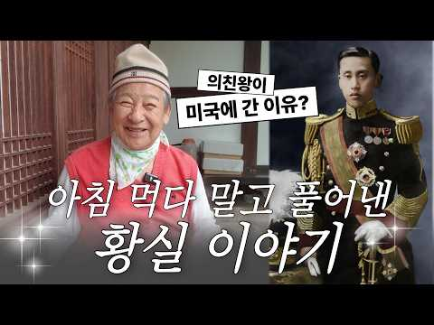
- 설명 앞부분: 전주 한옥마을 승광재에 찾아온 평화로운 아침. 대한제국의 마지막 황손, 이석 할아버지가 정갈한 아침 밥상과 함께 그동안 어디서도 듣지 못했던 생생한 옛날이야기를 들려주십니다. 역사책 속 딱딱한 기록이 아닌, 아들의 시선으로 바라본 아버지 의친왕의 꼿꼿했던 모습, 그리고 격동의 근현대사 속에서 황실 가족들이 겪어야 했던 진짜 숨겨진 이야기들. 따뜻한 차 한 잔을 곁들여 승광재 마루에 마주 앉아 듣는 기분으로 끝까지 시청해 보세요. 황손 이석이 들려주는 조선 이야기, 승광재
- 대본 없음 (설명) — 음성인식이 끝나면 도입부·흐름이 들어감
- 댓글 195/195: 좋은 점 — 영상 2 · 감사·응원 5 · 더 알고 싶은 것 3 · 아쉬운 점 — 영상 1 · 반박·불만 — 의견 다름 2 · 정치·사회 4 · 경험 공유 7 · 구독·다음 기대 0
  - 좋은 점 — 영상 👍11 “안녕하세요. 황손님 ~ 이렇게 조선황실과 근현대사의 스토리를 직접 들을수 있어서 의미있는 영상이라 생각이 들어 몇자 남깁니다. 늘 건강 하시고… 이렇게 의미있는 행보 보여주시고 많이 남겨 주셨으면 먼 훗날 좋은 자료로 남겨 지지 않을까 생각이 듭니다.”
  - 좋은 점 — 영상 👍6 “황손이시라 인물 목소리 뭐든게 품위있으시고 벌써 틀리시네요 의친왕이신 아버님께선 노기남 대주교님이 대세받고 승하 하셨넹ᆢ 오래 오래 건강하게 살아주세요 좋은말씀 듣고 싶어요😊😊😊”
  - 감사·응원 👍9 “한글을 만들어주신 이씨조선이 없었다면 이대한민국은 없다..내비록 잘살지는못하지만..글을 읽고 쓸줄안다는건 내후손이 그만큼 발전할수있음을 고맘게 생각합니다.감사합니다”
  - 감사·응원 👍2 “미워도 우리 역사예요 ᆢ 그분이 알려주시는데 그게시르면 아니잖아요 ᆢ그분이리도 조선왕조 알려주시고 고맙잖아요”
  - 더 알고 싶은 것 👍15 “황손님 건강하세요. 100년 이야기 해주세요♡♡♡❤”
  - 더 알고 싶은 것 👍2 “나라에서 지원 부탁드립니다~^^”
  - 아쉬운 점 — 영상 👍1 “자막좀 신경써서 좀 쓰지... 맞춤법이나 자막이 틀린게 보여요..”
  - 반박·불만 — 의견 다름 👍11 “욕먹을 각오하고 댓글 달자면 무능한 주제에 헛소리나 하고ㅋㅋ 그냥 노친네”
  - 정치·사회 👍2 “** 8.15 광복후에 조선반도에 3개의 나라가 건국 ** 해방후 조선민족은 있었으나 국가는 없는상태로 소련군정,미군정임시정부는 충칭임시정부를 일개의 독립단체로만 인정했습니다.. 일제시대때 임시정부는 무려 9~12개정도로 임시정부가 난립한상태었습니다.. 북만주 고려의…”
  - 정치·사회 👍1 “* 좌파와 우파, 진보와 보수 사고방식의 차이 * 좌파는 노동자,민중이 평등한 세상, 노동자,농민을 중심으로 배급과 분배를 중시하는 평등사회주의를 지지하고 우파는 개인의 자유와 재산보호, 기업가를 중심으로 성장을 중시하는 자본주의를 지지하고, 지금은 성장의 시대가 끝…”
  - 경험 공유 👍11 “대학시절에 겸임교수로 잠깐봤었을때 그때 신기했었는데.. 벌써 10년이 넘었네요”

### 70. 며느리보다 10살 어린 시어머니, 그녀는 조선을 뒤흔들었다

- https://www.youtube.com/watch?v=T8bS_yX629Y · 역사정복 · 구독자 414 · 조회수 57,339 (×138.5, 하루 1,282.1) · 좋아요 178 (0.3%) · 16.8분 · 2026-09-06 · 주제 묶음 3. 조선 · 형식 사연·드라마 · 폴더 `W_T8bS_yX629Y` (웹 승인)
- 썸네일: 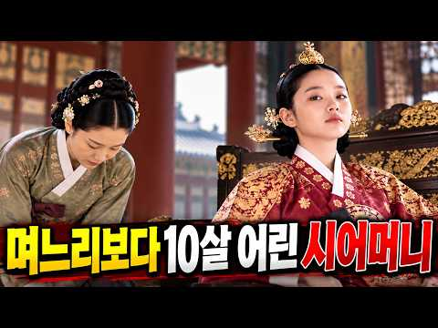
- 설명 앞부분: 66세 왕과 15세 신부, 나이 차 51년. 조선 519년 역사상 가장 극단적인 왕실 결혼이었습니다. 흔히 떠올리는 '불쌍한 어린 신부' 이야기는 여기서 끝나지 않습니다. 이 소녀는 훗날 정조가 세상을 떠난 뒤, 조선 정치를 뒤흔든 최고 권력자가 됩니다. 이 영상에서는 영조와 정순왕후의 결혼부터, 정조와의 미묘한 관계, 그리고 수렴청정을 통해 신유박해와 장용영 해체를 주도하는 과정까지 시간 순서로 따라갑니다. 정약용 형제의 운명이 어떻게 바뀌었는지, 그리고 51년이라는 나이 차이가 만들어낸 진짜 승자와 패자가 누구였는지를 확인하실…
- 같은 채널 평소 대비 ×125.5 (채널 최근 롱폼 중앙값 457회) · 평소 영상: 삼국지 최대 굴욕을 참은 남자의 소름 돋는 결말 (457회) / 왕보다 강했던 신하 한명회, 그의 집안에는 무슨 일이 있었나? (454회)
- 대본 없음 (설명) — 음성인식이 끝나면 도입부·흐름이 들어감
- 댓글 13/13: 좋은 점 — 영상 0 · 감사·응원 0 · 더 알고 싶은 것 0 · 아쉬운 점 — 영상 0 · 반박·불만 — 의견 다름 0 · 정치·사회 0 · 경험 공유 0 · 구독·다음 기대 0

### 71. 콘돔도 없던 조선시대, 기생은 어떻게 임신과 화류병을 막았나— 알려지지 않은 충격적인 진실#조선시대 #기생 #풍속화 #한국역사 #신윤복

- https://www.youtube.com/watch?v=mU274jAWlws · 조선의 호기심 · 구독자 1,730 · 조회수 236,633 (×136.8, 하루 1,679.4) · 좋아요 3,175 (1.3%) · 24.5분 · 2026-06-02 · 주제 묶음 3. 조선 · 형식 정보·해설 (그 밖) · 폴더 `W_mU274jAWlws` (웹 승인)
- 썸네일: 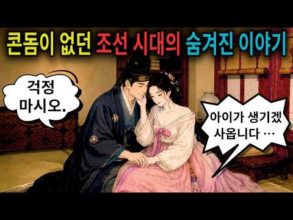
- 챕터: 0:00 오프닝 — 막지 못했다 · 1:00 세습기생 — 법이 만든 운명 · 4:00 아침 루틴 — 기생의 하루 · 7:00 피임법 — 창호지, 소금물, 뒤로 7걸음 · 12:00 두 달 후 — 임신 · 16:00 삼월의 냉정한 계산
- 설명 앞부분: 콘돔이 없던 시대, 기생들은 어떻게 임신을 막았을까. 어떻게 화류병을 막았을까. 답은 간단했다. 막지 못했다. 이 영상에서 다루는 내용 창호지 피임, 소금물, 뒤로 일곱 걸음. 그것이 조선 기생이 가진 전부였다. 기생의 딸은 기생이 된다. 팔리는 것도 아니었다. 법이 그냥 정해 놓았다. 태어나는 순간 이미 직업이 정해져 있었다. 외과 환자의 70~80%가 화류병 환자였다는 기록. 토복령이라는 약은 있었지만 너무 비쌌다. 그리고 더 위험한 선택도 있었다. 오늘은 어느 사극에도, 어느 역사책에도 나오지 않는 조선 기생들의 진짜 이야기…
- 같은 채널 평소 대비 ×292.1 (채널 최근 롱폼 중앙값 810회) · 평소 영상: 조선에서 남녀는 어떻게 결혼했나 —얼굴도 모르는 사람과 결혼해야 했던충격적인 혼인 풍습【… (810회) / 비누도 샴푸도 수돗물도 없었는데 조선인이 세계에서 가장 청결했던 충격적인 이유 【조선시대… (828회)
- 대본 없음 (설명) — 음성인식이 끝나면 도입부·흐름이 들어감
- 댓글 517/522: 좋은 점 — 영상 3 · 감사·응원 8 · 더 알고 싶은 것 6 · 아쉬운 점 — 영상 9 · 반박·불만 — 의견 다름 6 · 정치·사회 20 · 경험 공유 8 · 구독·다음 기대 1
  - 좋은 점 — 영상 👍80 “조선에서 노비였던 사람들이 해방된 것이 국가의 원동력이 된 듯..... 양반들은 여전히 국가에 도움이 안되니까..... 나머지 인간들이 현재의 국력이 됨...”
  - 좋은 점 — 영상 👍0 “제발 맞춤법 좀 고쳐주세요ㅠㅠㅠㅠ 한번 ai 돌리고 자막을 달아주세요 좋은 영상들인데 아이들도 볼 것 같아서요.”
  - 감사·응원 👍21 “저런 조선을 끝장내준 일본이 오히려 고맙게 느껴진다.”
  - 감사·응원 👍6 “조선시대 여인의 삶 고달프고 애닮다 이시대에 태어난걸 감사하게 돼네요”
  - 더 알고 싶은 것 👍13 “쌀때 밖에 싸라 하면 안되나요?”
  - 더 알고 싶은 것 👍11 “1.씹창 났다..라는 말의 어원을 아시나요? 말 그대로 여성성기(씹)에 (곪을)창이 난 겁니다 양반이 기생하고 하려는데 아래가 곪았어요. 그래서 못 하게 되었어요...이 때 하는 말이 "에이, 씹창 났다.." 조선시대 성병이 얼마나 많았는지 이해가 되시죠? 2. 정월…”
  - 아쉬운 점 — 영상 👍52 “컨텐츠는 좋은데 자막이 ai로 자동 생성한건지 너무 틀린 게 많이 보여서 거슬리네요”
  - 아쉬운 점 — 영상 👍21 “자막이 AI로 되어있어서 오타가 너무 많아요..”
  - 반박·불만 — 의견 다름 👍16 “기생을 매춘부로 설명했군 관기에 대한 설명도 엉망이고 역사는 해석이 다양하다는 모호한 말로 왜곡에 가까운 헛소리를 전파하지 마시죠”
  - 반박·불만 — 의견 다름 👍1 “웃기는 조선 불쌍한 조선인들”
  - 정치·사회 👍342 “저게 법이라니.. 나라가 나서서 여자들을 괴로운 삶으로 몰아넣었군요. 마음이 너무 아픕니다”
  - 정치·사회 👍191 “조선이 망한거 잘했다.임진왜란때 나라가 진즉 망하여 노예 기생 반상제도가 없어졌어야했다.”
  - 경험 공유 👍20 “일제 시대 위안부 비난할 입장이 아니네. 조선 시대가 더 개쓰레기였네. 나도 여자이고 딸을 키우는데...진짜 쌍욕이 나오는 조선.”
  - 경험 공유 👍0 “남자는 노동꾼으로 보내지고 여자는 그저 욕구해소용 도구였던 시절.. 잔인하다. 내가 누리는 자유라는게 그 당시엔 당연한것이 아니였다니.. 너무 슬프다 나는 그냥 운좋게 좋은 시대에 태어난 것 뿐이구나..”
  - 구독·다음 기대 👍1 “듣다보니 정말 슬프네요. 구독합니다. 그런데 ㅡ조선의 호기심 ㅡ 검색하니 또 있네요. (조선의호기심) 이렇게 띄어쓰기 안하니 채널명이 같은게 있어요.”

### 72. 조선 최고의 신랑감이 하루아침에 한양 제일의 망나니가 된 이유 /야담 조선야담 옛날이야기 오디오북 수면동화 전래동화

- https://www.youtube.com/watch?v=5tjsVKWQES0 · 썰톡 TV · 구독자 3,390 · 조회수 463,355 (×136.7, 하루 7,256.7) · 좋아요 7,457 (1.6%) · 87.1분 · 2026-08-18 · 주제 묶음 9. 야사·야담·옛날이야기 · 형식 수면·낭독 (잠잘 때 듣는) · 폴더 `W_5tjsVKWQES0` (웹 승인)
- 썸네일: 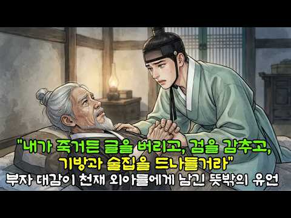
- 설명 앞부분: 📝 오늘의 이야기 미리보기 조선 최대 소금 객주이자 벼락 부자로 이름난 윤만석 대감. 그에게는 한 번 본 글을 잊지 않고 무예마저 출중한 ‘천재 외아들’ 시겸이 있었습니다. 도성의 명문가들이 앞다투어 사위로 삼으려던 장안 최고의 신랑감이었지요. 그런데 아비가 숨을 거두기 직전, 외아들의 손을 꼭 쥐고 남긴 유언은 기이하기 짝이 없었습니다. “아들아, 제발 망나니가 되어 살아라!” 평생 학문과 절제를 배우던 천재는 하루아침에 한양 최고의 '미친 망나니'가 되었습니다. 상복을 입은 채 술판을 벌이고, 기방에 은전을 뿌리며, 자신을 걱…
- 같은 채널 평소 대비 ×14,479.8 (채널 최근 롱폼 중앙값 32회) · 평소 영상: 첩에게 남편뺏기고 찾아간 무궁화밭에서 총각을 만났더니 가마가 줄줄이/야담 조선야담 옛날이… (32회) / 누명 쓰고 쫓겨난 계모 따라나선 본처딸 , 5년후 조선 최고 부자가 되어 나타나자 온 집… (31회)
- 대본 없음 (설명) — 음성인식이 끝나면 도입부·흐름이 들어감
- 댓글 123/124: 좋은 점 — 영상 0 · 감사·응원 9 · 더 알고 싶은 것 0 · 아쉬운 점 — 영상 0 · 반박·불만 — 의견 다름 0 · 정치·사회 1 · 경험 공유 0 · 구독·다음 기대 0
  - 감사·응원 👍18 “중국풍의 얘기보다 너무 잘 들었습니다. 맘으로 응원합니다”
  - 감사·응원 👍15 “광고업시. 끝까지 들려주어서. 감사감사해서요. 대박나시길 바랍니다.”
  - 정치·사회 👍0 “미국에 이익이 된다해도, 미국이 이 세상의 지도자 나라가 되기를 원합니다. 본래의 창조주 하나님을 두려워할 줄 아는 사람들이 세웠던 그 정신을 더 강하게 세워갈 줄 아는 지도자로 굳게 상승하기를 바랍니다. 딥스가요? , 중 공산당이요?, 테러 독재 중동이요? 사회주의…”

### 73. 조선시대 역적으로 몰린 양반 아내들, 노비로 전락한 충격적인 진실

- https://www.youtube.com/watch?v=mHF_-cRLwGQ · 조선 왕조의 비밀 · 구독자 1,530 · 조회수 208,691 (×136.4, 하루 1,817.4) · 좋아요 2,097 (1.0%) · 26.2분 · 2026-06-28 · 주제 묶음 3. 조선 · 형식 정보·해설 (그 밖) · 폴더 `W_mHF_-cRLwGQ` (웹 승인)
- 썸네일: 
- 설명 앞부분: 조선 시대 의금부 앞마당에서 벌어진 사육신 관련 여인들의 비극적 사건을 다룬 영상입니다. 단종 복위 사건 이후 남편을 잃은 353명의 여성들이 원수의 집으로 끌려가 노비로 전락하는 충격적인 현실 속에서, 한 이름 없는 여종이 모든 것을 바꿀 운명의 선택을 하게 됩니다. 이번 영상에서는 조선의 연좌제, 노비 제도, 그리고 인간의 존엄이 무너진 시대 속에서도 살아남기 위해 싸운 여성들의 처절한 생존 이야기를 깊이 있게 다룹니다. 특히 역사 속에서 기록되지 못한 한 여종의 희생과 기적 같은 결과는 큰 여운을 남깁니다.
- 같은 채널 평소 대비 ×1,056.7 (채널 최근 롱폼 중앙값 198회) · 평소 영상: 20살 천재 왕｜즉위 14개월 만에 갑자기 죽은 충격적인 이유는 무엇이었나? (212회) / 경혜공주｜단종의 친누나, 세조에게 조선 역사상 가장 잔인한 복수를 남기다 (183회)
- 대본 없음 (설명) — 음성인식이 끝나면 도입부·흐름이 들어감
- 댓글 146/146: 좋은 점 — 영상 0 · 감사·응원 0 · 더 알고 싶은 것 0 · 아쉬운 점 — 영상 8 · 반박·불만 — 의견 다름 1 · 정치·사회 8 · 경험 공유 0 · 구독·다음 기대 0
  - 아쉬운 점 — 영상 👍4 “자막좀정리”
  - 아쉬운 점 — 영상 👍3 “맞춤법도 안맞는 자막좀 치워라. 짜증난다.”
  - 반박·불만 — 의견 다름 👍0 “세월이 좋아 역적 석열이와 그무리들은 국민세금으로 잘먹고 잘살고 있는게 어이없다”
  - 정치·사회 👍2 “중국인이 운영하는 유튜브는 시청하지 맙시다”
  - 정치·사회 👍2 “조선은 빨리 망했어야 함 동족을 노비로 삼는 나라가 어디 있나”

### 74. [중국 전쟁사] 그 넓은 중국은 어쩌다 동해를 코앞에 두고 통로가 막혀버렸을까?｜기묘하게 꼬여버린 '북·중·러' 국경지대 역사 완벽 요약!

- https://www.youtube.com/watch?v=itVdxpo0sWQ · 역사순삭 · 구독자 73 · 조회수 13,456 (×134.6, 하루 153.1) · 좋아요 75 (0.6%) · 10.1분 · 2026-07-25 · 주제 묶음 7. 전쟁·군사사 · 형식 애니메이션·지도 · 폴더 `W_itVdxpo0sWQ` (웹 승인)
- 썸네일: 
- 설명 앞부분: [중국 전쟁사] 그 넓은 중국은 어쩌다 동해를 코앞에 두고 통로가 막혀버렸을까?｜기묘하게 꼬여버린 '북·중·러' 국경지대 역사 완벽 요약! 영토가 방대한 대국 중국은 어째서 동해를 불과 15km 앞두고 바다로 나갈 수 없게 된 걸까요? 과거 러시아의 영토 팽창과 일본의 무리한 전쟁 도발이 겹치면서, 중국은 두만강 하구를 통한 바다 출구를 완전히 봉쇄당하고 말았습니다. 현재 침체된 동북 3성의 경제를 살리고 미래 북극 항로의 주도권을 쥐기 위해 동해 진출이 절실한 중국에게 이는 가장 뼈아픈 지정학적 약점입니다. 심지어 북한과 러시아…
- 대본 없음 (설명) — 음성인식이 끝나면 도입부·흐름이 들어감
- 댓글 7/7: 좋은 점 — 영상 0 · 감사·응원 0 · 더 알고 싶은 것 0 · 아쉬운 점 — 영상 0 · 반박·불만 — 의견 다름 0 · 정치·사회 3 · 경험 공유 0 · 구독·다음 기대 0
  - 정치·사회 👍2 “흑룡강은 아무르강이라고도 하는데 저 강의 주인이 전체 강너머의 주인이라는 건 역사적인 팩트다. 오늘날 무슨 국제법이 등장하기 이전에는 강을 정복한 자가 천하를 정복했다. 그러면 지금 국경선 흑룡강의 실질 주인이 바로 조선이었다는 건 러시아가 스스로 나선정벌의 충격으로…”
  - 정치·사회 👍1 “야인토벌이 실록 전체에 나오는데 무슨 거기 청의 영토라고 하는가. 거기는 조선이 직접 기병 오백으로 여진 이만명을 토벌하던 그런 지역이다. 아무르강이 압록강이다. 그래서 러시아는 조선을 두려워했고 청과 네르친스크조약을 체결한 배경에 조선의 막강한 군사력이 있었고 이후…”

### 75. 크메르 제국의 앙코르와트는 왜 밀림에 묻혔나?:세계에서 가장 넓었던 신의 도시가 버려진 이유!

- https://www.youtube.com/watch?v=F-tooKrghZ0 · 율리의역사 [YULY'S HISTORY] · 구독자 1,020 · 조회수 136,177 (×133.5, 하루 9,830.6) · 좋아요 389 (0.3%) · 18.3분 · 2026-10-07 · 주제 묶음 11. 황제·왕·인물 · 형식 정보·해설 (그 밖) · 폴더 `W_F-tooKrghZ0` (웹 승인)
- 썸네일: 
- 챕터: 0:00 정글 속의 기적 · 1:31 오늘의 이야기 · 2:05 살아 있는 신 · 3:26 코끼리 위로 뛰어오른 왕 · 5:30 40킬로미터의 돌 · 7:16 더 큰 사원, 더 무거운 짐 · 8:05 주달관이 본 황금의 도시 · 9:26 새로운 불교 · 11:27 1431년, 아유타야의 침공 · 13:55 마지막 폭우 · 15:35 밀림과 미소 · 17:33 마무리
- 설명 앞부분: 800여 년 전, 캄보디아 밀림 한가운데에는 세계에서 가장 넓은 도시가 있었습니다. 왕은 스스로 살아 있는 신이 되었고, 백성은 수십 킬로미터 밖 산에서 거대한 돌을 끌어 와 신전을 쌓았습니다. 그런데 이 거대한 도시는 왜 끝내 밀림에 묻혔을까요? 1113년 전투 코끼리 위에서 왕좌를 차지한 수리야바르만 2세가 앙코르와트를 세우기까지, 주달관이 본 황금의 도시, 1431년 아유타야의 공격, 무너진 물길까지 — 신왕의 도시 앙코르가 쇠퇴해 간 길을 따라갑니다. [참고한 기록] 반탓 비문 — 수리야바르만 2세가 적왕의 전투 코끼리 위…
- 같은 채널 평소 대비 ×64.6 (채널 최근 롱폼 중앙값 2,108회) · 평소 영상: 사마의는 어떻게 삼국지 최후의 승자가 되었나? : 여인의 옷을 받고도 웃은 남자의 40년… (3,383회) / 칭기즈칸이 2년 만에 지워버린 사막의 부자 나라 호레즘 제국:성주 한 사람의 욕심이 제국… (834회)
- 대본 없음 (설명) — 음성인식이 끝나면 도입부·흐름이 들어감
- 댓글 30/33: 좋은 점 — 영상 1 · 감사·응원 0 · 더 알고 싶은 것 0 · 아쉬운 점 — 영상 0 · 반박·불만 — 의견 다름 0 · 정치·사회 4 · 경험 공유 1 · 구독·다음 기대 0
  - 좋은 점 — 영상 👍0 “리얼하고 역동적인 영상. 낭낭한 미녀의 목소리로 드려주는. 깔끔하고 정리된 역사테마. 모든것이 신선하다. 짱 !”
  - 정치·사회 👍1 “그게 다아 이정부가 만듬겁니다 저도 들었어 집사지말고 주식사라고 지금 어떻게 되었죠...?”
  - 정치·사회 👍0 “앙코르는 침입자들이 붙친 이름이고 COREA JOSEON 의 진납이다 불교식 이름 진납이다 3100년 전부터 동쪽에서 서쪽으로 옮긴 천자 안동 김 왕들과 백성들이 건설한 궁전과 백성들의 도시다 진납(캄보디아) 뿐만이 아니라 인도네시와 태국과 라오스 뉴- 베트남등…… …”
  - 경험 공유 👍1 “그게 다아 이정부가 만듬겁니다 저도 들었어 집사지말고 주식사라고 지금 어떻게 되었죠...?”

### 76. 가족을 모두 잃고 18년을 버틴 광해군 ∣ 왕에서 죄인이 된 비극적인 최후

- https://www.youtube.com/watch?v=KRTIB2WwIQw · 웅이 역사원정대 · 구독자 1,570 · 조회수 202,151 (×128.8, 하루 4,392.8) · 좋아요 2,442 (1.2%) · 48분 · 2026-09-05 · 주제 묶음 3. 조선 · 형식 정보·해설 (그 밖) · 폴더 `W_KRTIB2WwIQw` (웹 승인)
- 썸네일: 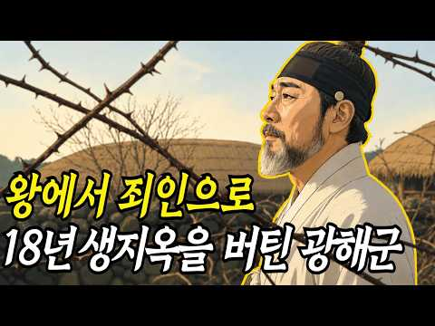
- 설명 앞부분: 왕좌에서 쫓겨난 뒤에도 18년이 넘는 유배 생활을 견뎌낸 조선의 왕이 있습니다. 조선의 제15대 국왕, 광해군입니다. 1623년 인조반정으로 하루아침에 왕의 자리에서 쫓겨난 광해군. 아들 폐세자 이지는 교동도의 가시 울타리 안에서 가위와 인두를 이용해 약 21미터의 땅굴을 팠습니다. 오늘날 아파트 7층 높이에 맞먹는 거리였어요. 그러나 목숨을 건 탈출은 실패했습니다. 며느리 박씨가 먼저 스스로 생을 마감했고, 한 달 뒤에는 폐세자에게 자진하라는 명이 내려졌습니다. 그해 윤10월에는 아내 유씨마저 유배지에서 세상을 떠났어요. 가족을…
- 같은 채널 평소 대비 ×43.9 (채널 최근 롱폼 중앙값 4,602회) · 평소 영상: 죽어야만 나갈 수 있을까? 우리가 미처 몰랐던 조선 궁녀들의 삶 #한국사 #역사이야기 (6,258회) / 조선시대 내시도 부부생활이 가능했을까? 실록에 남은 결혼과 성생활 ∣ 역사스토리텔링 (2,945회)
- 대본 없음 (설명) — 음성인식이 끝나면 도입부·흐름이 들어감
- 댓글 155/155: 좋은 점 — 영상 1 · 감사·응원 5 · 더 알고 싶은 것 0 · 아쉬운 점 — 영상 0 · 반박·불만 — 의견 다름 4 · 정치·사회 11 · 경험 공유 3 · 구독·다음 기대 0
  - 좋은 점 — 영상 👍3 “일체유심조! 인생은 맘먹기에 따른 것입니다. 오히려 광해군은 편안한 마음입니다. 그리고 광해군에게 영감이란 당시의 호칭은 오늘날 상대를 낮추는 멸칭이 아닙니다. 중앙에서 높은 직위에 있었던 사람들에게 쓰여진 존호였습니다. 좋은 영상 감사합니다 🎉”
  - 감사·응원 👍5 “덕분입니다 감사합니다”
  - 감사·응원 👍3 “너무나 광해군에 대해 설명을 놀랐만큼 잘 해주셔서 역사를 알게 되었습니다 감사합니다 존경합니다 나라를 위해 정직하게 하옵소서”
  - 반박·불만 — 의견 다름 👍4 “임진왜란과 병자호란 두개의 큰 변란은 강한 주변세력을 제대로 대처하지 못해서 일어난 사건으로 볼 수 있지요. 첫째는 지도자인 왕들이 매우 무능했고 둘째는 대신들이 옹졸하고 무능했기 때문으로 볼 수 있지요. 이율곡이 십만양병설을 제의했지만 무시하고 무사안일한 대처로 참…”
  - 반박·불만 — 의견 다름 👍3 “일체유심조! 인생은 맘먹기에 따른 것입니다. 오히려 광해군은 편안한 마음입니다. 그리고 광해군에게 영감이란 당시의 호칭은 오늘날 상대를 낮추는 멸칭이 아닙니다. 중앙에서 높은 직위에 있었던 사람들에게 쓰여진 존호였습니다. 좋은 영상 감사합니다 🎉”
  - 정치·사회 👍22 “광해군은 강대국 명ㆍ청사이에서 외교 국방을 잘한 🤴 👑왕입니다 국민(*백성)의 희생을 최소화한 임금🎉이었어요 ❤😂🎉 인조는 후금ㆍ청나라의 침략ㆍ병자호란1636을 유발해 백성이 많이 죽고 남한산성으로 피신해 길동?에서 삼배9고두례하고 소현세자와 수십만명(여성포함)을 인…”
  - 정치·사회 👍15 “광해군 뭐가 그리 잘못했나요 어느임금 손에 피안묻힌 왕있었나요 무능한인조 그러니 나라가 그꼰ㄷ났죠”
  - 경험 공유 👍2 “내가 보기엔 광해보다. 인조가. 더. 비참했다고. 생각함니다”
  - 경험 공유 👍0 “광해가뭔죽을만큼큰죄도아니건만!수양대군은친혈육까지도피를묻히고도발한자!조선은없었어야될역사다!특히선조인조의무능함은어찌말로다하리오!임진왜란병자호란겪고_소현세자등일반인공녀들반출등등심한백성들의피해가필설로다할수없네!광해는폐위되고도18년을버텼다니?비참한유배지에서친혈족은다죽고_뭘희망…”

### 77. [한국사] 여든여덟에 목이 잘린 영의정은 왜 목이 잘렸나 ∣ 역사인물 ∣ 다큐 ∣ 야사 ∣ 비사

- https://www.youtube.com/watch?v=wFTPh8YhhLI · 한국사인물관 · 구독자 4,330 · 조회수 554,910 (×128.2, 하루 17,246.7) · 좋아요 2,666 (0.5%) · 36.4분 · 2026-09-19 · 주제 묶음 4. 한국 근현대사 · 형식 정보·해설 (그 밖) · 폴더 `W_wFTPh8YhhLI` (웹 승인)
- 썸네일: 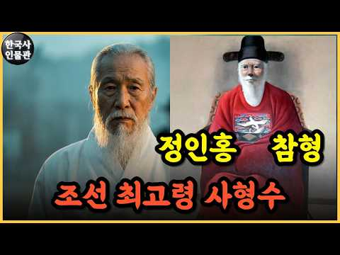
- 설명 앞부분: 여든여덟 살 영의정이 사약이 아닌 참형으로 생을 마쳤습니다. 1623년 인조반정에서 광해군은 목숨을 건졌는데, 정인홍은 왜 관례까지 깨가며 참수되었을까요. 쉰일곱에 재산을 털어 의병을 일으키고 낙동강 보급로를 끊었던 사람, 남명 조식의 칼을 물려받은 수제자 정인홍. 합천에서 팔백 리 밖 조정을 움직인 세월과 국문 닷새 만에 집행된 형, 그에게 씌워진 죄목 다섯 가지, 285년이 지나서야 회복된 이름까지 정인홍의 여든여덟 해를 차분히 따라갑니다. 끝까지 보시고 생각을 댓글로 남겨주세요. 안녕하세요, 한국사인물관입니다. 저희는 우리 …
- 같은 채널 평소 대비 ×354.1 (채널 최근 롱폼 중앙값 1,567회) · 평소 영상: [한국사] 조선이 버린 한 선비의 일기가 실록을 구했다 ∣ 역사인물 ∣ 다큐 ∣ 야사 ∣… (1,567회) / [한국사] 일본이 이순신보다 두려워 했던 조선의 영웅 ∣ 역사인물 ∣ 다큐 ∣ 야사 ∣ … (1,584회)
- 대본 없음 (설명) — 음성인식이 끝나면 도입부·흐름이 들어감
- 댓글 100/102: 좋은 점 — 영상 2 · 감사·응원 2 · 더 알고 싶은 것 1 · 아쉬운 점 — 영상 1 · 반박·불만 — 의견 다름 0 · 정치·사회 5 · 경험 공유 1 · 구독·다음 기대 0
  - 좋은 점 — 영상 👍7 “가장 어린 사형수인 연산군의 아들들도 자세히 정리해주세요. 특히 영특하다고 실록에도 나오는 8살 폐세자 황의 안타까운 사연 알고 싶습니다.”
  - 감사·응원 👍22 “영상을 끝까지 본 결과 내암선생에 대해 매우 깊이 있고 정확하게 만드셨고 내용 또한 풍부하며 우려했던 편중된 내용이 전혀 보이지 않았습니다. 구독,좋아요 눌렀습니다. 존경하는 내암선생에 대해 이렇게 깊이 있고 정확하게 제작해 주신 점 감사드립니다. 인조반정이 일어나지…”
  - 감사·응원 👍2 “좋은 내용 감사합니다ㅡ남명 조식선생의 제자분들이 지금으로보면 진보였지요ㅡ입 선비가 아니고 나라가 위급할때 홀련히 목슴도 받쳐지요 합천ㅡ그 지역분들의 특징 ㆍ성격이 쉽개 타협 하지않고 불의는 못보더마ㆍ그리고 역사를 보니3.1만세운동도 합천에서 제일먼저 일어났더마 ㅡ조식…”
  - 더 알고 싶은 것 👍7 “가장 어린 사형수인 연산군의 아들들도 자세히 정리해주세요. 특히 영특하다고 실록에도 나오는 8살 폐세자 황의 안타까운 사연 알고 싶습니다.”
  - 정치·사회 👍3 “지금 으로보면 민주당이 반정세력이다”
  - 정치·사회 👍2 “좋은 내용 감사합니다ㅡ남명 조식선생의 제자분들이 지금으로보면 진보였지요ㅡ입 선비가 아니고 나라가 위급할때 홀련히 목슴도 받쳐지요 합천ㅡ그 지역분들의 특징 ㆍ성격이 쉽개 타협 하지않고 불의는 못보더마ㆍ그리고 역사를 보니3.1만세운동도 합천에서 제일먼저 일어났더마 ㅡ조식…”
  - 경험 공유 👍7 “인조반정후 북인세력은 철저하게 정계에서 소외됬지요 우리집안도 북인계열이라 할아버지들이 좌천되고...”

### 78. 일본땅 오카야마에 '가야국'이 있었다! (임나일본부, 일본열도에서 그 흔적을 찾다 2편)

- https://www.youtube.com/watch?v=0jpGanPQC-U · 주간사과 - Weekly RA · 구독자 122 · 조회수 15,267 (×125.1, 하루 423.8) · 좋아요 66 (0.4%) · 9.8분 · 2026-09-15 · 주제 묶음 기타 · 형식 정보·해설 (그 밖) · 폴더 `W_0jpGanPQC-U` (웹 승인)
- 썸네일: 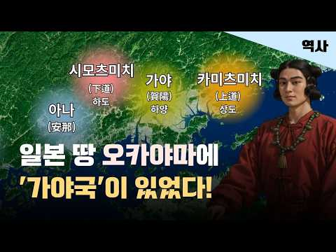
- 설명 앞부분: 임나일본부를 둘러싼 기록에서 대표적으로 등장하는 인물 중 하나가 바로 ‘길비신‘입니다. 또한 『일본서기』에서는 ’하내직’이라는 인물도 등장합니다. 길비, 즉 기비는 오늘날의 오카야마현을 중심으로 한 지역입니다. 이곳에는 5세기 전후까지 야마토 정권과는 별개의 강력한 정치세력이 존재했던 곳입니다. 또한 하내, 즉 가와치는 오늘날 오사카부 동부 일대로, 고대부터 한반도와 활발한 교류가 이루어졌던 지역이었습니다. 자, 그렇다면 지금부터 길비신의 배경부터 살펴보겠습니다. 『일본서기』에 임나와 관련된 인물로 등장하는 길비신은, 기비 지역의…
- 같은 채널 평소 대비 ×116.5 (채널 최근 롱폼 중앙값 131회) · 평소 영상: 가야는 정말 연맹이었나? 가야의 충격적인 정체!｜열국시대 가야 이야기 3편 (138회) / 허왕옥은 인도인이었나? 그녀가 남긴 역사적 의미｜ 열국시대 가야 이야기 6편 (119회)
- 대본 없음 (설명) — 음성인식이 끝나면 도입부·흐름이 들어감
- 댓글 22/22: 좋은 점 — 영상 0 · 감사·응원 2 · 더 알고 싶은 것 1 · 아쉬운 점 — 영상 0 · 반박·불만 — 의견 다름 0 · 정치·사회 0 · 경험 공유 0 · 구독·다음 기대 0
  - 감사·응원 👍3 “노고에 감사드립니다.”
  - 감사·응원 👍3 “차분하고 자세한 설명 감사합니다 가야문명 더 많이 알려주세요”
  - 더 알고 싶은 것 👍3 “차분하고 자세한 설명 감사합니다 가야문명 더 많이 알려주세요”

### 79. [애절한 중국 사극 노래] “나만의 폐하를 사랑하지요” ∣ 황제 무측천이 사랑한 단 하나의 태양 ∣ 성세천하 ost ∣ 이치원조 FMV ∣ 《명명 ∣ 明明》병음…

- https://www.youtube.com/watch?v=z6VcKlWaGoo · 사녀  · 구독자 1,170 · 조회수 145,784 (×124.6, 하루 1,231.5) · 좋아요 1,054 (0.7%) · 4.4분 · 2026-06-24 · 주제 묶음 3. 조선 · 형식 정보·해설 (그 밖) · 폴더 `W_z6VcKlWaGoo` (웹 승인)
- 썸네일: 
- 설명 앞부분: 취미로 만든 채널로 개인적인 수익 일절 없습니다. 의역/오역 다수. ←관련 피드백 환영. “전하께서 보시기에 저는 어떤 사람 같습니까?” “홀로 거센 눈보라에 맞서지만 정작 자신을 위해 우산을 펴는 건 늘 잊는 사람이지.” “제 마음속에는 늘 폐하가 있었습니다” “짐의 이 생은 아주 행복했소. 원조, 짐이 약조했었지. 그대와 함께 나아가겠다고. 그 약속은 지키지 못하게 되었소.” [무원조의 영원한 태양 이치] 해당 곡은 성세천하 인게임의 메인 테마 음악으로 나오는 영상도 모두 인게임 내 스토리 화면을 사용했습니다. 곡을 소개하는 …
- 대본 없음 (설명) — 음성인식이 끝나면 도입부·흐름이 들어감
- 댓글 107/110: 좋은 점 — 영상 0 · 감사·응원 2 · 더 알고 싶은 것 3 · 아쉬운 점 — 영상 1 · 반박·불만 — 의견 다름 5 · 정치·사회 1 · 경험 공유 5 · 구독·다음 기대 0
  - 감사·응원 👍5 “가사랑 한국어 발음까지 ㅠ 감사합니다ㅏ❤️”
  - 더 알고 싶은 것 👍1 “드라마 제목 알수있을까요?”
  - 경험 공유 👍196 “어떤 스트리머 하는 영상을 보는데 누가 이치만큼은 게임 중에 원조를 죽이지 않았다고, 계속 사랑했다고 채팅치더라🥹 그거 보고 진짜 이치가 찐사라는 생각 많이 했었지ㅠㅠ 그래 이치는 그랬네, 어떤 순간에도 원조를 해치지 않으려 했네....ㅠㅠ 배드엔딩이 뜨더라도 결국 …”

### 80. 이지스함으로 부족한가? 이지스함 vs KDDX #KDDX #세종대왕함 #이지스함

- https://www.youtube.com/watch?v=DRCG7mwqgik · NEXUS ROBO · 구독자 203 · 조회수 25,278 (×124.5, 하루 974.5) · 좋아요 233 (0.9%) · 9.8분 · 2026-09-25 · 주제 묶음 3. 조선 · 형식 정보·해설 (그 밖) · 폴더 `W_DRCG7mwqgik` (웹 승인)
- 썸네일: 
- 같은 채널 평소 대비 ×26.9 (채널 최근 롱폼 중앙값 938회) · 평소 영상: 세상에서 가장 아름다운 전투기 수호이 27 그런데 30? 35? #Su27 #Su30 #… (972회) / 공중침투의 필수템 EA-6B 프라울러 전자전공격기 #EA6B #프라울러 #전자전 #전자전… (905회)
- 대본 없음 (없음) — 음성인식이 끝나면 도입부·흐름이 들어감
- 댓글 11/11: 좋은 점 — 영상 0 · 감사·응원 0 · 더 알고 싶은 것 0 · 아쉬운 점 — 영상 0 · 반박·불만 — 의견 다름 1 · 정치·사회 0 · 경험 공유 0 · 구독·다음 기대 0
  - 반박·불만 — 의견 다름 👍0 “아니 세종대왕급 다른 이지스함들 레이더만 업그레이드 해도 최고의 성능으로 사용할수 있고 KDDX사업으로 좋은 군함들 더 사용할수 있을텐데 왜 우리는 업그레이드를 안하는거야 못하는것도 아닌데....”

