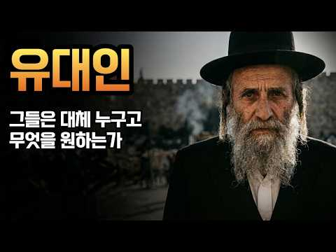
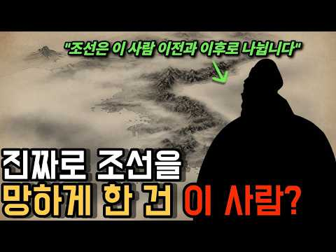
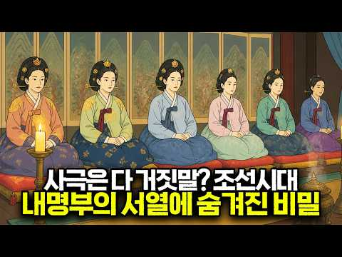
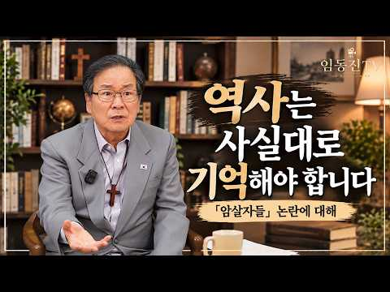

# 역사 — 성공 사례 분석: 사례별 자세히 #41–#54

`analysis.md` 의 9번 (같은 # 번호). 자동 생성 — `tools/success_analysis.py` v1.4.1 (2026-10-16 10:16 UTC). ※ 연구·교육용 — 투자 권유가 아님.

### 41. 조선왕조실록에 3000번 등장하는 단 한 사람ㅣ숙종의 사약을 세 사발이나 마신 노론 영수ㅣ우암 송시열

- https://www.youtube.com/watch?v=NRtLHrlkspU · 한밤의 한국사 · 구독자 46,600 · 조회수 735,768 (×15.8, 하루 5,110.6) · 좋아요 15,099 (2.1%) · 60.7분 · 2026-05-25 · 주제 묶음 3. 조선 · 형식 수면·낭독 (잠잘 때 듣는) · 폴더 `W_NRtLHrlkspU` (웹 승인)
- 썸네일: 
- 설명 앞부분: 조선왕조실록에 무려 3000번이나 등장하는 단 한 사람. 공자 다음의 '송자'라 불리며 살아서는 거유, 죽어서는 성인 반열에 오른 노학자. 그러나 83세에 사약을 세 사발이나 마시고 정읍 객사에서 비참하게 숨을 거둔 한 인간. 조선 후기 200년을 지배한 노론의 시조, 우암 송시열. 그는 성인이었을까요, 독재자였을까요. 이번 영상에서는 우암 송시열의 일생을 통해 예송논쟁, 사문난적 사건, 경신환국, 기사환국, 그리고 노론의 시작까지 조선 후기 정치사의 핵심을 한 번에 풀어드립니다. 📚 참고 자료 조선왕조실록 (효종실록·현종실록·숙…
- 같은 채널 평소 대비 ×11.7 (채널 최근 롱폼 중앙값 63,009회) · 평소 영상: 한국사 총정리 몰아보기ㅣ고조선부터 대한민국까지 5000년 풀스토리ㅣ자면서 들으세요 (63,009회) / 한명회도 울고 갈 조선 최악의 간신ㅣ조선왕조실록이 '소인 중의 소인'이라 부른 단 한 사… (69,488회)
- 대본 없음 (설명) — 음성인식이 끝나면 도입부·흐름이 들어감
- 댓글 635/635: 좋은 점 — 영상 10 · 감사·응원 9 · 더 알고 싶은 것 0 · 아쉬운 점 — 영상 3 · 반박·불만 — 의견 다름 9 · 정치·사회 46 · 경험 공유 11 · 구독·다음 기대 1
  - 좋은 점 — 영상 👍5 “학문이 인간의 삶에 유익을 끼쳐야 진정한 학문이지 삼년상이나 1년상인냐로 싸우는것이 무슨 학문인가?”
  - 좋은 점 — 영상 👍3 “조선사대부 !!!!!! 역사의 전진에 일도 도움이 안된다 !!”
  - 감사·응원 👍2 “역사는 안타까울 뿐이지. 쫑궈어도 명을 떠나 청으로 넘어가는데 안타까운 조선. 역사는 흐른다. 영원한 적도 영원한 우방도 없다. 힘내자. 대한민국!”
  - 감사·응원 👍2 “잘들어습니다 공부많이했습니다 감사합니다”
  - 아쉬운 점 — 영상 👍171 “스스로의 인문적 철학이(난 이것을 르네상스적 사고라 말한다) 없었으니 오로지 사대주의적 주자학에만 미쳐서 세상의 변화를 읽지못하다 결국 외세에 나라마저 뺏긴 조선의 역사! 500년의 역사라하여 미화만 할것이 아니라 잘못된 역사가 반복되지 않도록 철저히 반면교사로 삼아…”
  - 아쉬운 점 — 영상 👍0 “굴러먹다니 란 표현은 좀 지나치다 생각이드네요 정정하시라 말씀드리고 싶네요”
  - 반박·불만 — 의견 다름 👍1 “그리고 그 증명을 하듯 그들의 제자가 만든것이 만동묘인게 결코 우연은 아니죠. 이미 망한 명나라 황제를 섬겨서 무얼 깨닫고 무얼 얻는 게 있습니까? 결국 정신만 썩어 나가며 많은 학자가 서로 의견을 논하기 싫어 하게 만든 흐름을 굳힌거 아닙니까? 그래서 그가 비판이라…”
  - 반박·불만 — 의견 다름 👍1 “두말 필요없는 사대부의 독재자이죠. 비판이 없어지면 그 학문도 정신도 부패하고 변혁을 이끌수 없으니대깐요. 그 결과가 경술국치라고 부르기도 아까운 일제강점기니.나중에 대원군이 어찌해볼려 해도 암탉도 있었고 말입니다. 비판은 결코 욕이 아닙니다. 자신의 잘못을 알려주는…”
  - 정치·사회 👍134 “저런 정쟁, 당파싸움때문에 국민들 등만 터지는 지금의 나라가 되었다”
  - 정치·사회 👍72 “얍삽하노.저런넘들이 많으니 나라가 망했지”
  - 경험 공유 👍4 “송시열이 시조인데 그래서 그런가 나도 고집 엄청 센데.역시 피는 못 속이는구나ㅋ”
  - 경험 공유 👍2 “머리 좋은놈이 권력을 잡고. 무지한 신념에 빠지면서 오래살면서 제자를 길러내면서 확장하면... 가난과 고통과 어려운 것은 국민들. 민생이다. 권력 잡은 놈들은 자기 권력 계속 유지를 위해 정쟁할뿐이고~~ 내 살길은 내가 만들어야 한다. 과거도 지금도 미래에도 인간 본…”
  - 구독·다음 기대 👍32 “쥐새끼 처럼 궁궐에서 빤스런한 인조 설명이 너무나 감탄스럽습니다. 감동이기에 구독합니다~~”

### 42. 2000년간 쫓겨다닌 민족은 어떻게 세계를 주무르게 되었나

- https://www.youtube.com/watch?v=_Q9IE-9yuLQ · 세계사쇼 · 구독자 22,200 · 조회수 320,061 (×14.4, 하루 1,785.4) · 좋아요 4,849 (1.5%) · 17분 · 2026-04-20 · 주제 묶음 기타 · 형식 정보·해설 (그 밖) · 폴더 `W__Q9IE-9yuLQ` (웹 승인)
- 썸네일: 
- 챕터: 0:00 유대인이 세계를 지배한다? — 0.2%의 역설 · 1:19 오늘 영상의 핵심 질문 — 어떻게 이게 가능했는가 · 1:30 유대인은 민족인가, 종교인가 — 정의의 복잡함 · 2:09 유대인의 뿌리 — 아브라함에서 열두 지파까지 · 2:47 선민사상 — 생존의 심리적 엔진 · 3:48 다윗과 솔로몬 — 전설인가, 실제 역사인가 · 4:39 왕국의 분열과 멸망 — 북이스라엘과 유다 왕국 · 5:37 바빌론 유수 — 나라 없이 민족을 유지하는 법 · 6:43 페르시아·그리스·로마 — 끝없는 지배의 연속 · 6:51 로마와의 전쟁 — 예루살렘의 함락과 디아스포라의 시작 · 8:26 중세 유럽의 유대인 — 어디서도 환영받지 못한 민족 · 9:51 스페인 추방령 — 유대인을 쫓아낸 나라의 결말 · 10:13 금융업의 독점 — 강제된 선택이 만든 경쟁력 · 11:35 드레퓌스 사건 — 시오니즘의 씨앗 · 12:23 밸푸어 선언 — 같은 땅을 두 세력에게 약속하다 · 13:25 홀로코스트 — 인류 역사상 가장 계획적인 학살 · 14:07 유엔 분할안과 이스라엘 건국 선언 1948 · 15:04 건국 다음 날 — 다섯 나라의 동시 침공 · 15:57 나크바 — 이스라엘의 탄생과 팔레스타인의 비극 · 16:11 결론 — 2000년간의 생존이 현대의 경쟁력이 된 이유
- 설명 앞부분: 세계 인구의 0.2%에 불과한 민족이 노벨상의 22%, 경제학상의 42%를 차지하고, 골드만삭스·월스트리트·할리우드·실리콘밸리의 심장부에 서 있다. 조지 소로스, 마크 저커버그, 래리 엘리슨의 공통점은 단 하나 — 유대인. 그런데 이 민족은 지난 2000년 동안 지구에서 가장 혹독하게 쫓기고 학살당한 민족이었다. 십자군의 학살, 흑사병의 희생양, 스페인 추방령, 그리고 600만 명이 사라진 홀로코스트까지. 나라도 없이, 땅도 없이, 성전도 없이 2000년을 버텨온 유대인은 어떻게 자본주의의 승자가 됐는가. 바빌론 유수에서 디아스포…
- 같은 채널 평소 대비 ×65.7 (채널 최근 롱폼 중앙값 4,875회) · 평소 영상: 십자군 전쟁의 진짜 목적은 무엇이었을까? (4,875회) / 종교와 과학계에서는 신의 존재를 어떻게 증명할까? (4,993회)
- 대본 없음 (설명) — 음성인식이 끝나면 도입부·흐름이 들어감
- 댓글 800/800: 좋은 점 — 영상 6 · 감사·응원 17 · 더 알고 싶은 것 8 · 아쉬운 점 — 영상 4 · 반박·불만 — 의견 다름 33 · 정치·사회 51 · 경험 공유 23 · 구독·다음 기대 0
  - 좋은 점 — 영상 👍10 “좋은 영상이네요 속도감과 전달력이 남다릅니다 지치지 마시고 꾸준히 하시면 엄청난 채널이 될거예요 응원하겠습니다”
  - 좋은 점 — 영상 👍9 “편향되지 않은 시각에서 중립적으로 정보를 전달해주는 영상이네요 좋은 영상입니다”
  - 감사·응원 👍10 “좋은 영상이네요 속도감과 전달력이 남다릅니다 지치지 마시고 꾸준히 하시면 엄청난 채널이 될거예요 응원하겠습니다”
  - 감사·응원 👍1 “고맙고 감사합니다^^ 👍 👍 👍 👍 👍”
  - 더 알고 싶은 것 👍4 “수에즈 운하와 영국에 대해서도 궁금합니다”
  - 더 알고 싶은 것 👍3 “2차 세계대전 당시 히틀러가 유태인 대학살을 할 당시 어떤 배경, 어떤 상황이었는지. 좀 더 다른 시각으로 통찰력있는 분석 부탁드립니다.”
  - 아쉬운 점 — 영상 👍2 “05:23 136년 발음이 이상한데 AI 목소리인가요??”
  - 아쉬운 점 — 영상 👍0 “야훼와 관련된 종교는 지들 정치적 목적에 짜집기 된 것...”
  - 반박·불만 — 의견 다름 👍20 “그냥 단순히 "씨발 우리 부자좀 되게해주십쇼, 그게 신이던 악마던 미신이던 있던없던 할수있는건 다 하겠습니다" 이게 근본입니다. 쟤네들도 유대교니 카발라니 랍비니 영적인척하지만 신이없다는걸 누구보다 잘 알겁니다 하지만 부자들의 심리는 다릅니다 예를들어 한국의 대기업 …”
  - 반박·불만 — 의견 다름 👍13 “유대인이 머물던 곳은 늘 악이 창궐하니 박해와 핍박을 받을 수 밖에. 지금 이스라엘 하는 꼴을 보면 거대 자본에 의해 우리가 선동 당한 듯 미국과 더불어 악의 축일 뿐”
  - 정치·사회 👍25 “지금의 중국인 같은 느낌었을듯”
  - 정치·사회 👍21 “아몰라. 가짜뉴스로 이스라엘을 나치에 비교한 찢재명 괴뢰정권이나 제대로 손봐줘라.”
  - 경험 공유 👍964 “난 유대인이 엄청 불쌍한 민족이라고 생각했었는데..지금은 히틀러가 위인같다는.선경지명 대단하네..”
  - 경험 공유 👍86 “유대인은 애초에 고리대금업자들이였죠. 혐오가 생기지 않을 수가 없었던 존재들임. 고리대금업자가 과연 무고한 피해자기만 했을까? 모든 수를 써서 돈을 갚게 만드는게 고리대금업자인데? 2차 세계대전으로 세탁이 잘된거지 원래 전유럽 미국이 다 유대계 혐오했었음”

### 43. 조선 왕실 최악의 비극 ∣ 삼대가 죽어야 왕이 될 수 있었던 남자, 철종

- https://www.youtube.com/watch?v=_QrSVpBd6Tg · 역사아카이브 - History Archive KR · 구독자 24,200 · 조회수 343,173 (×14.2, 하루 3,150.7) · 좋아요 10,170 (3.0%) · 75.3분 · 2026-06-29 · 주제 묶음 3. 조선 · 형식 정보·해설 (그 밖) · 폴더 `W__QrSVpBd6Tg` (웹 승인)
- 썸네일: 
- 챕터: 0:00 도입부 - 강화도의 나무꾼 · 1:15 구독 안내 · 1:30 비극의 시작, 사도세자의 죽음 · 3:40 은언군의 빚과 첫 유배 · 5:50 상계군 옹립 사건과 죽음 · 8:10 신유박해, 일가의 몰락 · 11:00 원범의 탄생과 강화도 유배 · 14:20 헌종의 죽음과 왕실 혈통의 위기 · 17:00 강화도령, 즉위하다 · 19:30 안동 김씨의 세도정치 · 23:00 이하전 사건 · 25:30 임술농민봉기와 개혁의 좌절 · 28:40 동학의 등장 · 30:50 철종의 죽음과 고종의 즉위 · 33:00 마무리 - 비극의 본질
- 설명 앞부분: 강화도에서 나무를 하던 한 청년이 하루아침에 조선의 왕이 됩니다. 흔히 신데렐라 같은 행운의 이야기로 알려진 철종의 즉위는, 사실 할아버지의 사사와 큰어머니의 처형, 큰형의 죽음으로 이어지는 조선 왕실 역사상 가장 비극적인 가족사의 결말이었습니다. 사도세자의 죽음에서 시작된 이 비극이 어떻게 한 나무꾼을 왕좌에 앉히게 되었는지, 조선왕조실록과 한국민족문화대백과사전 등 공인된 사료를 바탕으로 추적합니다. 다음 영상으로 어떤 이야기를 듣고 싶으신가요? 댓글로 남겨주세요. 역사아카이브 멤버쉽 가입 : © 2025 [역사아카이브]. Al…
- 같은 채널 평소 대비 ×18.1 (채널 최근 롱폼 중앙값 18,910회) · 평소 영상: [5시간 연속재생] 조선시대 생활사 8번째 통합 ∣ 우리 조상들의 모습 (18,910회) / 황후의 치마를 들춘 남자｜이완용보다 오래 살아남은 진짜 매국노, 윤덕영 (18,031회)
- 대본 없음 (설명) — 음성인식이 끝나면 도입부·흐름이 들어감
- 댓글 192/192: 좋은 점 — 영상 1 · 감사·응원 7 · 더 알고 싶은 것 2 · 아쉬운 점 — 영상 3 · 반박·불만 — 의견 다름 2 · 정치·사회 12 · 경험 공유 6 · 구독·다음 기대 0
  - 좋은 점 — 영상 👍6 “잘 배우고 갑니다😊”
  - 감사·응원 👍18 “지금 우리나라 는 단군이 래 오천년 역사상 제일 잘 살고 있다고생각됩니다 미국편에 줄을 잘 선 건국 대통령 이승만 대통령 과 국민을 잘 살게 만들어 준 박정희 대통령 을 고맙게 생각해 야 합니다 다같이 잘 사는 국가를 만든다고 사회주의 공산주의 국가를 만든 북한 김일…”
  - 감사·응원 👍5 “잘 들었습니다 감사합니다.”
  - 더 알고 싶은 것 👍7 “실시간으로 보면서 느끼는 건데, 철종의 삶을 보면 권력의 정점이라는 왕의 자리가 오히려 한 인간의 자유를 완전히 앗아간 세상에서 가장 화려한 감옥이 아니었나 싶네요, 여러분은 어떻게 생각하시나요? 😥”
  - 더 알고 싶은 것 👍3 “이런거좀 하지맙시다. 100년 전도 모르는데 당신이 어떻게 알죠? 미리 소설이라고 말하세요 😅”
  - 아쉬운 점 — 영상 👍3 “선전. 너무 길어요”
  - 아쉬운 점 — 영상 👍0 “광고가 너무 빈번하게 등장하는군요.”
  - 반박·불만 — 의견 다름 👍0 “참어이없군요”
  - 정치·사회 👍18 “지금 우리나라 는 단군이 래 오천년 역사상 제일 잘 살고 있다고생각됩니다 미국편에 줄을 잘 선 건국 대통령 이승만 대통령 과 국민을 잘 살게 만들어 준 박정희 대통령 을 고맙게 생각해 야 합니다 다같이 잘 사는 국가를 만든다고 사회주의 공산주의 국가를 만든 북한 김일…”
  - 정치·사회 👍14 “슬픈 조선! 정조가 이뤄놓은 나라가 이 정도였나?”
  - 경험 공유 👍33 “슬퍼요 시작하자 마자요 한청년만 살아남아 살아가는 모습이여 얼마나 처절한 사연이 있을까 싶어지네요 저도 어느덧 청년이 되어서 아들이 있거든요”
  - 경험 공유 👍2 “안동김씨가. 망국의원인이었네요.조선왕조를500년을망하게했네요. 내가전주이씨인데.아마조상이 전주이씨라는 성씨를받기위해 돈으로산성씨인지도모르죠. 친정족보책은 봤습니다만. 효령대군의 자손이라고. 울.아부지는 엄청자부심을 가지고살았습니다만.역사를 뒤돌아볼때. 단종의죽음에 일…”

### 44. "조선을 병들게 한 장본인" 조선 역사는 이 사람 이전과 이후로 나뉩니다

- https://www.youtube.com/watch?v=kHamu2oW_1g · 한국사 다시읽기 · 구독자 28,200 · 조회수 386,579 (×13.7, 하루 2,928.9) · 좋아요 5,982 (1.6%) · 18.8분 · 2026-06-06 · 주제 묶음 1. 역사 일반·이야기 · 형식 정보·해설 (그 밖) · 폴더 `W_kHamu2oW_1g` (웹 승인)
- 썸네일: 
- 챕터: 0:00 ⛩️ 프롤로그 — 실록 속 삼천 번, 거두의 두 얼굴 · 1:42 ⚔️ 첫 번째 장면·북벌 — 기유독대, 효종과 어긋난… · 5:18 🍚 두 번째 장면·대동법 — 김육, 동전과 수레의 꿈 · 9:27 👘 세 번째 장면·예송논쟁 — 상복 한 벌에 걸린 왕권 · 12:03 🔥 사문난적 — 벗 윤휴를 향한 칼날 · 15:33 🥀 거두의 최후 — 기사환국과 남겨진 유산
- 설명 앞부분: 🏛️ 조선을 병들게 한 사람 동방 18현에 오른 최고의 대학자였지만, 후대는 그를 '조선을 병들게 한 사람'이라 부릅니다. ⏱️ 타임라인 📚 참고 문헌·자료 조선왕조실록(효종실록 외) — 국사편찬위원회 sillok.history.go.kr 우리역사넷 — 국사편찬위원회 한국민족문화대백과사전 — 한국학중앙연구원 송자대전(宋子大全) — 기축봉사·악대설화(기유독대) 관련 🖼️ 영상 속 일부 이미지는 이해를 돕기 위한 AI 생성 이미지이며, 실제 역사적 모습과 다를 수 있습니다.
- 같은 채널 평소 대비 ×78.6 (채널 최근 롱폼 중앙값 4,920회) · 평소 영상: '최대 1000명 숙청...' 남인의 핵심 정약용은 왜 살려둔 걸까? (5,110회) / "사극이 심은 환상" 암행어사가 기피 직업 1순위였던 이유 (4,731회)
- 대본 없음 (설명) — 음성인식이 끝나면 도입부·흐름이 들어감
- 댓글 1,143/1,143: 좋은 점 — 영상 9 · 감사·응원 11 · 더 알고 싶은 것 0 · 아쉬운 점 — 영상 8 · 반박·불만 — 의견 다름 17 · 정치·사회 141 · 경험 공유 22 · 구독·다음 기대 1
  - 좋은 점 — 영상 👍82 “공감합니다 우암 송시열이 역사의 쓰레기라는거....”
  - 좋은 점 — 영상 👍2 “송시열 같은 인간은 국민을 보살피지 않는다고 생각합니다. 말만 그럴싸하게 하면서 국민에게 도움이 되지 않는 쓰레기 인간성이라 생각합니다.”
  - 감사·응원 👍1 “요즘 시대 태어나서 얼마나 다행이고 감사한지 😊”
  - 감사·응원 👍1 “이 사람이 아녀도 자국민의 노비 비율이 50%가 넘었다는 헬조선은 진작에 망했어야죠 오히려 일제시대 개화된 문물 유입에 감사해야 했을만큼 낙후 되고 미개한 나라 였다고 합니다 백성의 고혈을 빨아 왕가과 양반 귀족들만 호의호식 하고 백성들은추위와 굶주림에 내던져 있던 …”
  - 아쉬운 점 — 영상 👍3 “지금보니 워해머 인류제국 신정정치랑 똑같다냐 숙종이 정국을 잡고 송시열부터 조진 이유가 있고만”
  - 아쉬운 점 — 영상 👍1 “신념의 광신도가 되면 역사는 반복된다. 대한민국을 보라! <혐오의 신념> 차고 넘친다! 역사 반복이다”
  - 반박·불만 — 의견 다름 👍16 “북벌을 만류한 건 치적이지. 당시 순치제 치세 그야말로 상승세의 청나라로 조선군이 쳐들어가면 결과는 너무 뻔했음. 그리고 대동법의 실행 찬/반은 선악의 문제로 볼 바가 아닙니다. 대동법은 세제만 바꾼다고 덜컥 되는게 아닙니다. 대동법이 제대로 작동 하려면 전국의 모든…”
  - 반박·불만 — 의견 다름 👍14 “옛날 카토릭이 망해갈무렵 바늘귀퉁이에 몇명의 천사가 올라앉을수있는지같은 웃기는 논쟁에 빠졌다던데 결국 나락으로 가게되었다네”
  - 정치·사회 👍22 “결국 이 사람도 극단적 가치추구자 아닌거? 무엇이든 극단적으로 치달으면 엄청난 부작용과 많은 사람이 쥭게 된다. 지금시대는 이란의 신정정치, 이슬람릐 극단적 사고 방식, 현 서구사회는 극단적 좌파 이데올로기 (페미니즘, LGBTQ , PC주의 해체주의 포스트모더니즘 …”
  - 정치·사회 👍9 “송시열이 문제가 아니라 조선이 주자의 나라 성리학의 나라가 된것 부터가 망조의 길로 간거임”
  - 경험 공유 👍1 “지금이라고 그런 사람이 없나요? 무엇이 지금 상황에서 최선 인지 열린 마음으로 듣지 않고 다양성을 부정하고 나와 다른 생각은 조금도 존중하지 않고 내 사상 내 믿음 내 종교만 옳고 내가 틀리고 상대가 맞을 수 있다 는 걸 인정할 줄 모르는 극우 극좌 지역주의 등등 경…”
  - 경험 공유 👍1 “내가 저 시절 왕이었음 시열이를 참수했을 것이다!ㅡ👹”
  - 구독·다음 기대 👍0 “송시열 송일국 송중기 뭘까요??? 저들이 태양의 후예라고요??? 전 송중기의 태앙의 후예 정주행 안 해서 그 당시 맘들과 대화가 안 됐죠...”

### 45. 📸 역사책에서 찾을 수 없었던 놀라운 순간들 ∣ 희귀 역사 사진들

- https://www.youtube.com/watch?v=BF7Kb1zcVTo · 고대의 메아리 · 구독자 1,020 · 조회수 13,550 (×13.3, 하루 2,689.5) · 좋아요 43 (0.3%) · 7.7분 · 2026-10-11 · 주제 묶음 1. 역사 일반·이야기 · 형식 정보·해설 (그 밖) · 폴더 `W_BF7Kb1zcVTo` (웹 승인)
- 썸네일: 
- 설명 앞부분: 안녕하세요! 희귀한 역사 사진과 잊혀진 과거의 이야기를 전하는 고대의 메아리에 오신 것을 환영합니다. 📸 이 채널에서는 희귀한 역사 사진, 오래된 흑백 사진, 빈티지 이미지, 1900년대의 기록을 통해 우리가 미처 알지 못했던 과거의 순간들을 만나봅니다. 유명한 역사적 사건뿐만 아니라, 평범한 사람들의 일상과 그 시대의 생생한 모습까지 사진으로 살펴봅니다. 📷 이 채널에서 만나볼 수 있는 콘텐츠 쉽게 접하기 어려운 희귀 역사 사진 20세기의 일상과 사람들의 삶 오래된 흑백 사진과 빈티지 이미지 잊혀진 역사적 순간과 숨겨진 이야기 …
- 같은 채널 평소 대비 ×4.3 (채널 최근 롱폼 중앙값 3,160회) · 평소 영상: 📸 실제였다는 게 믿기 힘든 과거의 순간들 (3,259회) / 🕯️ 시간이 멈춘 듯한 역사 사진들 ∣ 과거의 희귀한 순간 100장 (3,060회)
- 대본 없음 (설명) — 음성인식이 끝나면 도입부·흐름이 들어감
- 댓글 0/0: 좋은 점 — 영상 0 · 감사·응원 0 · 더 알고 싶은 것 0 · 아쉬운 점 — 영상 0 · 반박·불만 — 의견 다름 0 · 정치·사회 0 · 경험 공유 0 · 구독·다음 기대 0

### 46. 집을 반으로 갈라버린 조선의 노부부, 그런데 할아버지가 사라졌다

- https://www.youtube.com/watch?v=XBePem4Xz2g · 한국시대극 · 구독자 12,500 · 조회수 155,436 (×12.4, 하루 1,706.8) · 좋아요 1,350 (0.9%) · 4.8분 · 2026-07-17 · 주제 묶음 3. 조선 · 형식 브이로그·직접 해본 이야기 · 폴더 `W_XBePem4Xz2g` (웹 승인)
- 썸네일: 
- 설명 앞부분: 평생 한집에서 살아온 노부부가 어느 날 집과 살림을 정확히 반으로 나눠버렸습니다. 집안의 마지막 소가 사라졌고, 할아버지는 자신이 팔았다고 인정하면서도 이유만은 끝내 말하지 않았습니다. 화가 난 할머니는 마당 한가운데 선을 긋고 이불과 밥그릇, 국자와 닭까지 네 것과 내 것으로 나누기 시작했습니다. 수십 년을 함께 산 부부는 같은 집에 있으면서도 서로의 선을 넘지 않았고, 자존심 때문에 밥 한 끼도 함께 먹지 않았습니다. 하지만 할머니는 자신도 모르게 주먹밥을 두 개 만들었고, 그중 하나를 남편 쪽 경계선 너머에 몰래 놓았습니다.…
- 같은 채널 평소 대비 ×15.0 (채널 최근 롱폼 중앙값 10,330회) · 평소 영상: 혼례가마가 비어 있었는데, 시어머니는 혼례를 멈추지 않았다 (10,364회) / [본편] 남편이 죽은 뒤에도 그물은 매일 젖어 돌아왔다, 그런데 그는 살아 있었다 (10,296회)
- 대본 없음 (설명) — 음성인식이 끝나면 도입부·흐름이 들어감
- 댓글 39/39: 좋은 점 — 영상 0 · 감사·응원 1 · 더 알고 싶은 것 1 · 아쉬운 점 — 영상 0 · 반박·불만 — 의견 다름 0 · 정치·사회 0 · 경험 공유 0 · 구독·다음 기대 0
  - 감사·응원 👍0 “부부싸움은 칼로물베기랍니다ㆍ 알고보면 아무일도아닌것 글 감사드립니다ㆍ”
  - 더 알고 싶은 것 👍4 “4~5분 내외로 전래동화나 명작이나 재미있는 이야기나 전설의 고향같은 영상 만들어주세요^^ 어르신들에게 보여드리고 싶네요♡”

### 47. "야, 이 자식아. 전쟁 지면 너도 책임 있어" '산보하듯' 남침하자던 박헌영에게 잉크병 던진 김일성 [호준석의 역사전쟁 EP.30]

- https://www.youtube.com/watch?v=dg8J-vvh6ZM · 오늘의시각 · 구독자 38,200 · 조회수 363,028 (×9.5, 하루 2,085.2) · 좋아요 4,331 (1.2%) · 14.5분 · 2026-04-25 · 주제 묶음 1. 역사 일반·이야기 · 형식 정보·해설 (그 밖) · 폴더 `W_dg8J-vvh6ZM` (웹 승인)
- 썸네일: 
- 설명 앞부분: 1950년 11월 7일. 북한 수뇌부는 국군과 유엔군의 공세에 중국 접경지대까지 쫓겨 가 있었습니다. 인민군 최고사령부는 압록강 주변 고산진, 내각은 자강도 강계의 임시 방공호에서 업무를 봤습니다. 이날은 공산주의 소련을 탄생시킨 ‘러시아혁명 기념일’이었습니다. 이날 6.25전쟁 주범인 39세 김일성은 주위에서 주는 술을 다 받아먹었습니다. 패전의 분노를 삭이지 못하는 모습이었습니다.
- 같은 채널 평소 대비 ×9.7 (채널 최근 롱폼 중앙값 37,379회) · 평소 영상: 오늘의 대한민국을 만든 영웅들, 6.25전쟁 영웅 시리즈 몰아보기 [호준석의 역사전쟁 스… (41,223회) / 전쟁사업기념관의 '항미원조', 안규백 국방장관의 '마오쩌둥 좌우명' 논란... 6.25전… (33,535회)
- 대본 없음 (설명) — 음성인식이 끝나면 도입부·흐름이 들어감
- 댓글 679/680: 좋은 점 — 영상 5 · 감사·응원 11 · 더 알고 싶은 것 1 · 아쉬운 점 — 영상 1 · 반박·불만 — 의견 다름 9 · 정치·사회 121 · 경험 공유 13 · 구독·다음 기대 0
  - 좋은 점 — 영상 👍12 “좋은내용감사합니다.”
  - 좋은 점 — 영상 👍1 “좋은 영상 만들어주셔서 감사합니다”
  - 감사·응원 👍18 “세월호 무적화물 고철 7천톤 화주가 일으킨 더불어 공산당 무장폭동. 518 북조선 특수군 참전 무장폭동 .사전투표 뻥튀기 570만표 투표도둑질 반역도당 부정선거 무장폭동 카르텔 박멸시켜야 무장폭동과 적화통일 막는다구 데모하네요 감사합니다”
  - 감사·응원 👍12 “좋은내용감사합니다.”
  - 더 알고 싶은 것 👍0 “제주 4,3사건과 여수순천 사건이 북한이 저지른 소행인가요?.... 답변 부탁드립니다..”
  - 아쉬운 점 — 영상 👍3 “자료출처를 적어주시니 너무 좋습니다”
  - 반박·불만 — 의견 다름 👍124 “북한군이 남침 3일만에 서울을 집어 먹고서 계속 남하하지 않은체 서울에서 몇칠을 머문 덕분에 미군과 국군이 전열을 재 정비할 시간이 생겼었는데 왜 북한군이 계속 남하를 하지 않은 이유를 이 영상을 보고서 알았다.이유야 어떻든 하늘이 한국의 공산화를 막을 기회를 준것은…”
  - 반박·불만 — 의견 다름 👍15 “당시 북한도 남한도 민족주의자들이 선전선동해서 김구 연설만 들어봐도 민족주의 좌익색깔이 묻어나더만. 이승만이 그래서 김구와 멀어졌던거고.공산당과 민족주의는 결이 비슷해.”
  - 정치·사회 👍804 “제발 중국인 없는 세상서 살고싶다”
  - 정치·사회 👍205 “멸공 공산당된 국회”
  - 경험 공유 👍4 “4.3은 남로당 무장폭동인데, 산간주민들에게 빨치산에 협력하지 말고 산간에서 내려오라 여러차례 방송도 하고, 삐라도 뿌리고 했었고, 산간지역주민들이 빨치산과 같이 산에 숨어 들어갔으니 이들도 빨치산으로 간주 된것, 물론 빨치산들에게 강제로 따라가게 된 사람들도 있었고…”
  - 경험 공유 👍3 “21세기에 달탐험,ai,우주로 테마가 옮겨지는데 아직도 저런구닥다리 이념으로 실현가능하겠는가? 저런이념이 미래를 제시할수있는가?? 내가 생각하기엔 아니다! 그냥 구시대유물뿐이고 과거에 사는 사람들뿐 아닌가봄.”

### 48. 역사에 기록된 가장 멋있었던 죽음들

- https://www.youtube.com/watch?v=tMIab7lVg88 · 쉽게 설명해서! · 구독자 18,100 · 조회수 168,628 (×9.3, 하루 1,619.1) · 좋아요 1,398 (0.8%) · 19.1분 · 2026-07-04 · 주제 묶음 1. 역사 일반·이야기 · 형식 정보·해설 (그 밖) · 폴더 `W_tMIab7lVg88` (웹 승인)
- 썸네일: 
- 챕터: 0:00 벤케이, 서서 죽은 전설 · 4:34 레오니다스의 최후 · 8:35 두 눈을 잃은 지슈카 · 10:40 마지막 북소리와 이순신 · 15:39 벤 살로몬의 최후 · 18:35 아웃트로
- 설명 앞부분: 역사에 남은 마지막 순간들은 이상하게 오래 기억됩니다. 이번 편에서는 끝까지 물러서지 않았던 다섯 사람의 이야기를 가져왔습니다. 벤케이, 레오니다스, 얀 지슈카, 이순신, 그리고 벤 살로몬까지. 서로 다른 시대와 나라의 인물들이지만, 마지막 장면만큼은 묘하게 닮아 있습니다. 다음에 다뤘으면 하는 역사 이야기나, 기억에 남는 인물 있으면 댓글로 남겨주세요.
- 같은 채널 평소 대비 ×3.7 (채널 최근 롱폼 중앙값 45,620회) · 평소 영상: 독재자들의 특이한 집착들 Top6 (46,498회) / 역사상 가장 이상하고 엉뚱한 형별과 재판 Top10 (44,741회)
- 대본 없음 (설명) — 음성인식이 끝나면 도입부·흐름이 들어감
- 댓글 109/109: 좋은 점 — 영상 5 · 감사·응원 3 · 더 알고 싶은 것 3 · 아쉬운 점 — 영상 2 · 반박·불만 — 의견 다름 2 · 정치·사회 0 · 경험 공유 2 · 구독·다음 기대 0
  - 좋은 점 — 영상 👍23 “이순신 장군님은 레전드가 맞다.”
  - 좋은 점 — 영상 👍8 “여러 나라별로 영웅들 알려주셔서 너무 좋아요❤”
  - 감사·응원 👍1 “좋은 영상을 올려주셔서 감사합니다!”
  - 감사·응원 👍1 “감사합니다. 장군님ㅜㅜ”
  - 더 알고 싶은 것 👍6 “양규장군님과 김숙흥별장님도 그리고 황진장군님을 올려주셨으면 합니다. 구국의 영웅으로 백성을 지키기위해 용맹한 행동 숭고한 정신은 영상에 나오는 위인, 인물들과 나란히 소개하는 것이 좋을 것 같습니다. 우리가 우리의 훌륭한 선조를 기억할 수있길 바랍니다.”
  - 더 알고 싶은 것 👍3 “솔직히 '가장 멋있는 죽음'이라기보다는 무능한 윗선들 때문에 발생한 '가장 억울하고 안타까운 희생' 아닌가요? 특히 이순신 장군님은 선조만 아니었어도 끝까지 살아남아 조선을 재건하셨을 텐데 말이죠. 영웅답게 죽는 것보다 차라리 얀 지슈카처럼 무능한 권력에 맞서 끝까지…”
  - 아쉬운 점 — 영상 👍12 “양규장군님이 빠진게 좀 아쉽네요”
  - 아쉬운 점 — 영상 👍0 “설명이 조금 아쉬워요 전부 습니다로 끝나니까 초등학생이 국어책읽는 느낌이네여ㅠ "였죠" "였으나" 같은걸 섞어쓰면 좋을거같은데요 너무 습니다만 쓰니까 집중이안돼여”
  - 반박·불만 — 의견 다름 👍0 “말도 안되지..인간의 몸은 뇌가 죽으면 온몸이 헝겁처럼 흘러내려..절대 서있을수가 없어.원래 일본넘들도 중국넘처럼 뻥이 많다.”
  - 반박·불만 — 의견 다름 👍0 “입은 삐툴어져도 말은 바로 하라 그랬다고 이순신장군이 원균의 모함에 삭탈관직을 당한게 아닙니다. 왜군의 계략에 속아서 사지로 출동을 명했는데 이순신 장군이 이를 알고 출동을 거부했던것 입니다 그런데 그 계략에 속아 넘어간게 조정관료들이 이순신의 인기에 선조가 질투한다…”
  - 경험 공유 👍0 “백의종군은 그저 일개병사로의 강등이 아니라 실질적인 그 부대의 명예 고문같은 역활을 했었다고 아는데...”

### 49. [한국사] 조선의 노비들은 어떻게 살았을까? 대부분의 사람들은 몰랐던 충격적인 노비의 삶 ∣ 정사 ∣ 야사

- https://www.youtube.com/watch?v=gbQwCONfulQ · 역사꾼 · 구독자 12,900 · 조회수 114,757 (×8.9, 하루 659.3) · 좋아요 1,443 (1.3%) · 15.7분 · 2026-04-25 · 주제 묶음 4. 한국 근현대사 · 형식 정보·해설 (그 밖) · 폴더 `W_gbQwCONfulQ` (웹 승인)
- 썸네일: 
- 챕터: 0:00 인트로 – 사극이 보여주지 않은 진실 · 1:30 파트1 – 소 한 마리 값도 안 되던 목숨 · 8:00 파트2 – 흉년이 오면 딸을 팔았습니다 · 14:30 파트3 – 노비가 노비를 샀다 · 21:00 파트4 – 내 새끼들이 짐승처럼 나뉘어 갔습니다 · 27:30 파트5 – 족쇄를 차고도 삶을 지켜낸 생명력 · 33:00 아웃트로 – 당신의 가족 역사를 들려주세요
- 설명 앞부분: 소 한 마리 값도 안 되던 사람들, 조선 노비의 진짜 삶을 기록으로 파헤칩니다. 조선시대 노비 매매 문서를 펼쳐보면 충격적인 사실이 드러납니다. 건장한 성인 남자 한 명의 가격이 소 한 마리에도 미치지 못했습니다. 소는 밭을 갈 수 있으니 사람보다 비쌌던 겁니다. 사람을 셀 때도 '명'이 아닌 짐승을 세는 단위 '구'로 기록했습니다. 이게 조선의 현실이었습니다. 그런데 사극에서 보여주지 않는 장면이 있습니다. 주인과 수백 리 떨어진 곳에서 자기 집을 짓고 자기 땅을 일구던 외거노비, 악착같이 돈을 모아 기와집을 사고 심지어 다른 …
- 같은 채널 평소 대비 ×34.1 (채널 최근 롱폼 중앙값 3,365회) · 평소 영상: [한국사] 조선이 망할 수 밖에 없던 이유 ∣ 정사 ∣ 야사 (3,365회) / [한국사] 편의점보다 많았다! 조선 경제를 움직인 주모들의 기막힌 돈 버는 법 ∣ 정사 … (3,440회)
- 대본 없음 (설명) — 음성인식이 끝나면 도입부·흐름이 들어감
- 댓글 303/303: 좋은 점 — 영상 0 · 감사·응원 6 · 더 알고 싶은 것 1 · 아쉬운 점 — 영상 3 · 반박·불만 — 의견 다름 6 · 정치·사회 26 · 경험 공유 8 · 구독·다음 기대 0
  - 감사·응원 👍3 “일본한테 감사해라 일제강점기 아니었으면 지금도 저렇게 살고 있을꺼다 독립운동 그거. 대부분 초창기 때 양반들이 일본이들어와서 신분제 박살내고 노비 없애니까 다시 조선으로 돌아가서 노비부리며 살려고 한거 그이상이하도 아니였음”
  - 감사·응원 👍1 “음... 모두가 노비에 후손인걸 자랑스럽게 생각합시다. 또한 현대에 와서 찐노비 후손임을 몸에 문신으로 표시하는 멋쟁이들을 응원 합시다.”
  - 더 알고 싶은 것 👍0 “일본의 속국vs 조선시대 노비 어떤게 더 비참했을까요? 일제시대엔 어느신분이 싫었을까요?조선시대엔 누가 기득권이였을까요?이것만봐도 양반들이 얼마나 짐승이였는지 답이나옴 일본이나 양반이나 같은클라스”
  - 반박·불만 — 의견 다름 👍0 “유튜브에서 역사학자라는 인간이 조선시대 노비는 서양의 노예와 달랐다라고 선동하고 다니던거 생각나네. 자율성이 있었고, 일반백성과 별차이가 없었고 때로는 일부러 노비가 되기도 했다. 우리가 생각하는 노예와는 다른 살만한 계층이었다고 개소리 하는거 보고 어이가 없었음.지…”
  - 정치·사회 👍44 “자국민을 노비쓴 미친나라가 조선임ㅉㅉ보통 침략해서 다른 민족을 종으로 부리는데 우리는 같은 민족을 종으로 부림ㅋㅋ조선시대는 노비의 나라였음ㅋㅋ”
  - 정치·사회 👍37 “조선은 멸망 만이 답이 였음.신분을 깨부술수 없도록 나라가 건국됨. 자국민을 상대로 사람을 물건 취급한건 지구상 유일할것.아직 왕 양반 따지는 사람이 있더라만은”
  - 경험 공유 👍19 “악마이성계 세운나라 이성계.일본에합병때 신분제폐지하니 백성 7 평민천민 노비70%가 일본지배환영..오죽착당해 원한이갚엇으면 나라뺏어간일본통치를환영하갯냐..왕족 양반놈들은싫어해 저희들도 농사짓고 노동해야돼니..”
  - 경험 공유 👍0 “1804년에 작성된 우리집 호구단자( 지금의 주민등록등본)에 성도없는 수십여명의 노비들 후손들은 지금은 양반되어서 잘살고 있을겁니다”

### 50. 조선 내명부의 서열에 숨겨진 비밀 #조선시대 #역사이야기 #조선역사

- https://www.youtube.com/watch?v=z4-vBeFor6g · 담너머 조선 이야기 · 구독자 4,560 · 조회수 32,943 (×7.2, 하루 491.8) · 좋아요 195 (0.6%) · 16.1분 · 2026-08-10 · 주제 묶음 1. 역사 일반·이야기 · 형식 정보·해설 (그 밖) · 폴더 `W_z4-vBeFor6g` (웹 승인)
- 썸네일: 
- 설명 앞부분: 조선 왕실을 떠받치던 두 가지 거대한 축, 내명부의 철저한 위계질서와 세자의 엄격한 교육 과정. 왕비, 빈, 귀인, 소의부터 상궁과 나인에 이르기까지 품계에 따라 명확히 나누어졌던 내명부 여인들의 권력과 서열. 그리고 단 한 치의 오차도 허용되지 않았던 왕실 내부의 규율을 들여다봅니다. 조선 왕실의 품격 뒤에 숨겨진 서열의 세계와 최고의 리더를 만들어낸 교육의 진실을 영상에서 확인해 보세요.
- 같은 채널 평소 대비 ×3.8 (채널 최근 롱폼 중앙값 8,740회) · 평소 영상: 사극에서는 보여주지 않는 조선시대 백정의 삶 #조선시대 #조선역사 #역사이야기 (8,740회) / 약과와 유과는 꿈도 못 꾸던 조선 백성들은 간식으로 뭘 먹었을까? #조선시대 #조선역사 … (7,274회)
- 대본 없음 (설명) — 음성인식이 끝나면 도입부·흐름이 들어감
- 댓글 23/23: 좋은 점 — 영상 0 · 감사·응원 0 · 더 알고 싶은 것 0 · 아쉬운 점 — 영상 0 · 반박·불만 — 의견 다름 1 · 정치·사회 0 · 경험 공유 0 · 구독·다음 기대 0
  - 반박·불만 — 의견 다름 👍9 “3:00 품계 나오는데 뿜었네 ㅋㅋㅋㅋㅋㅋㅋㅋㅋㅋㅋㅋ 그냥 대충 지어내서 ai돌려서 만들었네 다 틀렸어 내용ㅋㅋㅋㅋㅋㅋㅋㅋㅋㅋㅋ 이딴거 만들어서 돈벌려고 하다니 너도 참 대단하다 이딴 기래기들이 만드는 가짜들 지긋지긋하다”

### 51. 왜 경기도 곤지암은 곤지암일까? ∣ 우리가 몰랐던 진짜이야기 ∣ 신립 ∣ 허난설헌 ∣ 탄금대 ∣ 나들목 ∣ 임진왜란 ∣ 조총 ∣ 문경새재 ∣ 남한산성 #민담 #…

- https://www.youtube.com/watch?v=soiH5GMxOqk · 땅 이름의 비밀 · 구독자 28,900 · 조회수 208,150 (×7.2, 하루 9,246.4) · 좋아요 1,196 (0.6%) · 17.2분 · 2026-09-23 · 주제 묶음 3. 조선 · 형식 야담·옛날이야기 · 폴더 `W_soiH5GMxOqk` (웹 승인)
- 썸네일: 
- 설명 앞부분: 📍 이름에 담긴 역사, 땅에 새겨진 이야기 우리가 매일 지나치는 산과 강, 마을과 도시의 이름에는 오랜 역사와 흥미로운 전설이 숨어 있습니다. 『땅이름의 비밀』**은 대한민국 곳곳의 지명이 어떻게 탄생했는지, 그 속에 담긴 역사와 문화, 민담과 설화를 쉽고 재미있는 이야기로 소개하는 채널입니다. 이번 영상에서는 한 지명의 유래를 따라가며 그 지역의 역사적 배경과 숨은 이야기를 함께 살펴봅니다. 익숙했던 지명이 새로운 의미로 다가오는 특별한 시간, 함께 떠나보세요. 이런 분들께 추천합니다. 우리나라 역사와 문화에 관심 있는 분 여행…
- 같은 채널 평소 대비 ×8.0 (채널 최근 롱폼 중앙값 26,096회) · 평소 영상: 왜 전라도 나주는 나주일까? 우리가 몰랐던 이야기 ∣ 왕건 ∣ 후삼국 ∣ 견훤 ∣ 궁예 … (26,096회) / 왜 경기도 양평 용문사는 용문사일까? 우리가 몰랐던 진짜 이야기 ∣ 은행나무 ∣ 마의태자… (25,290회)
- 대본 없음 (설명) — 음성인식이 끝나면 도입부·흐름이 들어감
- 댓글 46/46: 좋은 점 — 영상 0 · 감사·응원 2 · 더 알고 싶은 것 1 · 아쉬운 점 — 영상 2 · 반박·불만 — 의견 다름 1 · 정치·사회 4 · 경험 공유 0 · 구독·다음 기대 0
  - 감사·응원 👍2 “전설과함께 지명을 다시 접할수있어 감사드립니다. 감사합니다. 용인에서 시청합니다.”
  - 아쉬운 점 — 영상 👍22 “신립은 무식하고 용감한 장수였다 질것이 뻔한 싸움은 피하고 지연전을 펼쳤어야지”
  - 아쉬운 점 — 영상 👍0 “무능한 이씨조선이 나라를 망친거지 저 당시 급히 모은 오합지졸중에 탈영이 태반이고 조령산에 매복한들 추풍령 죽령으로 치고 올라온 일본군에 포위되어 몰살 당할것도 뻔한데 뭔 개소리 그냥 신립은 시간이라도 끌어 보려고 오합지졸 델꼬 목숨걸고 싸우다 전사한거임”
  - 반박·불만 — 의견 다름 👍21 “신립이 조선최고의 명장이라고 웃기는 소리 조선최고의 2대 등장(등신지랄육갑한 두사람) 신립과 원균 한놈은 육군기병 8천과 전투마 한놈은 130여척의 판옥선과 12.000여 수군을 자멸괘멸시킨 그것도 제대로 싸워보지도 못하고 예를들어 2차진주성전투는 못살 당했으나최선을…”
  - 정치·사회 👍17 “북상하던 왜군이 문경 새재(조령)에 개미새끼 한마리 없는 걸 보고 왜장이 깜작 놀랬다는 기록이 있다고 합니다. 이 좋은 천혜의 요새를 놔두고 어떤 이유로 신립장군은 탄금대에서 배수진을 치는 악수를 두고 제대로 싸워 보지도 못하고 전멸(?)했는지…이런 무능한 장수를 선…”
  - 정치·사회 👍13 “모지리 하나 때문에 죄없는 누군가에 자식 또 아버지 남편등 아까운 목숨들이 아무 의미없이 죽었지요 원균 윤석열”

### 52. 24년 인내 끝에 왕이 된 정조, 즉위 20일 만에 숙의 문씨를 처형한 역사적 비극

- https://www.youtube.com/watch?v=Yg9WfFY9xlc · 잊혀진한국사 · 구독자 14,200 · 조회수 81,980 (×5.8, 하루 495.3) · 좋아요 2,416 (2.9%) · 17.3분 · 2026-05-03 · 주제 묶음 1. 역사 일반·이야기 · 형식 인터뷰·강연·대담 · 폴더 `W_Yg9WfFY9xlc` (웹 승인)
- 썸네일: 
- 설명 앞부분: 🔻 오늘 들려드릴 역사 이야기 24년 인내 끝에 왕이 된 정조, 즉위 20일 만에 숙의 문씨를 처형한 역사적 비극 본 영상은 한국사의 다양한 시대와 인물, 사건을 바탕으로 제작된 역사 콘텐츠입니다. 조선왕조실록, 고려사, 삼국사기 등 신뢰할 수 있는 사료와 역사 자료를 참고하였으나, 일부 내용은 시청자의 이해를 돕기 위한 각색과 재구성이 포함되어 있습니다. 영상에 등장하는 인물, 대화, 상황은 실제 역사적 기록을 기반으로 하되, 서사적 표현과 해석이 가미된 경우가 있습니다. 따라서 모든 해석과 견해는 당시 사료와 연구 결과를 종합…
- 같은 채널 평소 대비 ×251.1 (채널 최근 롱폼 중앙값 326회) · 평소 영상: 조선 사람들의 혹독한 겨울 생존법, 난방도 의복도 돈도 없이 버틴 현실 기술 (357회) / 조선 후궁 숙의 홍씨, 역사상 가장 많은 자식을 낳은 그녀의 숨겨진 삶과 놀라운 비밀 (296회)
- 대본 없음 (설명) — 음성인식이 끝나면 도입부·흐름이 들어감
- 댓글 99/99: 좋은 점 — 영상 0 · 감사·응원 0 · 더 알고 싶은 것 1 · 아쉬운 점 — 영상 0 · 반박·불만 — 의견 다름 0 · 정치·사회 2 · 경험 공유 2 · 구독·다음 기대 0
  - 정치·사회 👍1 “숙의 문씨의 발음을 [수게 문씨]?!?!?!?!?!?!?!?!?!?! × ◇ 바른 발음: 발음 숙의[수긔/수기] 우리글도 못 읽는 이런 미개인.야만인보다도 더 무식한 이런 인간이 유튜버를 한다고?!?!?!?!?!?! 세종대왕께서 진노하신다! 우리말을 오염시켜 나라 개…”
  - 정치·사회 👍0 “조선 태조 이성계가 쿠테타로 수많은 사람을 죽이고 왕조를 세우고 고려의 풍습이나 제도를 완전히 박살을 내버리고 여자들 권리도 개박살 내버리고 왕실의 여이들응 정권을 이용해먹는 도구로 썼다 주자학을 받아들여 종교를 탄압하고 공자왈 맹자왈 하고 관혼상제를 새로만들어 남성…”
  - 경험 공유 👍4 “내가 아는 영조는 참 나쁨. 우리가 탕평책으로 아는 그런 임금 아님. 오로지 권력에 매달린 사람. 사람마다 생각은 다르나 자신의 자식을 죽이고 혼자 권력을 가지려한 사람이다. 지금으로 보니 윤건희. 알면 답해라. 억울하나?”

### 53. 역사는 사실대로 기억해야 합니다｜「암살자들」논란에 대한 생각 #임동진 #암살자들 #영화

- https://www.youtube.com/watch?v=mcOVtFOj-jk · 임동진TV · 구독자 24,200 · 조회수 94,251 (×3.9, 하루 10,385.3) · 좋아요 4,791 (5.1%) · 19분 · 2026-10-07 · 주제 묶음 1. 역사 일반·이야기 · 형식 정보·해설 (그 밖) · 폴더 `W_mcOVtFOj-jk` (웹 승인)
- 썸네일: 
- 설명 앞부분: 이번 영상에서는 최근 **영화 「암살자들」을 둘러싼 논란**을 계기로, 임동진이 생각하는 **역사와 기억**에 대한 이야기를 나눕니다. 한 시대를 직접 살아오며 보고 느낀 경험을 바탕으로 대한민국 현대사의 여러 순간을 되돌아보고, 역사를 바라보는 자신의 생각을 솔직하게 이야기합니다. 영화를 직접 관람한 감상이 아닌, 최근 제기되고 있는 논란을 접하며 떠올린 생각과 개인적인 견해를 담은 영상입니다. “역사는 사실대로 기억해야 합니다.” 임동진TV에서 임동진이 직접 들려주는 이야기를 만나보세요.
- 같은 채널 평소 대비 ×4.4 (채널 최근 롱폼 중앙값 21,199회) · 평소 영상: “엄마는 네 강아지가 되고 싶구나” 98세 어머니가 남긴 말｜추석에 생각하는 부모님의 사… (21,199회) / 임동진이 들려주는 아내와의 인연, 그리고 가족 이야기 #임동진 #배우인생 #가족이야기 (17,091회)
- 대본 없음 (설명) — 음성인식이 끝나면 도입부·흐름이 들어감
- 댓글 431/431: 좋은 점 — 영상 33 · 감사·응원 104 · 더 알고 싶은 것 5 · 아쉬운 점 — 영상 3 · 반박·불만 — 의견 다름 21 · 정치·사회 92 · 경험 공유 30 · 구독·다음 기대 1
  - 좋은 점 — 영상 👍135 “옳은 말씀 해주셔서 고맙습니다”
  - 좋은 점 — 영상 👍127 “목사님 말씀 잘듣고 기쁜 마음으로 돌아갑니다. 목사님의 말씀에 절대공감합니다. 감사드립니다!!”
  - 감사·응원 👍254 “어릴적부터 제일 좋아하는 남자탈렌트였던 분에서 지금은 정의로운 자유우파 목사님으로 그자리에 계시고 실망시키지 않으셨습니다.존경합니다.고맙고 감사드립니다.오래도록 건강하시기 바랍니다.”
  - 감사·응원 👍234 “진실을 말씀하셔서 감사합니다 ^^”
  - 더 알고 싶은 것 👍3 “좌편향 된 문화계와 홀로 싸우고 있으신 김규나작가님 이라는 분이 계십니다 많은 응원 부탁드립니다”
  - 더 알고 싶은 것 👍1 “개독박멸! 이만이사형! 목사님! 정신 차리세요! 아직도 연기 잘하시네요 그 가면 언제 벚으 실건가요?”
  - 아쉬운 점 — 영상 👍0 “아.....양만춘 장군님.....정정하신모습뵈니.....정말좋습니다......”
  - 아쉬운 점 — 영상 👍0 “목사님~~ 쓸데없는 헛소리 마시구 목회자의길이나 열심히 가세요 실망스럽습니다”
  - 반박·불만 — 의견 다름 👍5 “고맙습니다 저역시 그과정 을겪은 사람 입니다. 독재아닙니다 그때그렇게 안하셨음 간첩들이 난무하고 우린 초토화 됬을겁니다”
  - 반박·불만 — 의견 다름 👍4 “예술을 빙자한 선전선동에 이제껏 놀아난 게 정말 분하네요 옳은 말씀 감사합니다 임동진 목사님!”
  - 정치·사회 👍254 “어릴적부터 제일 좋아하는 남자탈렌트였던 분에서 지금은 정의로운 자유우파 목사님으로 그자리에 계시고 실망시키지 않으셨습니다.존경합니다.고맙고 감사드립니다.오래도록 건강하시기 바랍니다.”
  - 정치·사회 👍77 “누구는 조금만 껄끄러우면 드럼통 당하는데ᆢ 어쩌다 나라가 공산당들이 날뛰는 정부가되었는지ᆢ”
  - 경험 공유 👍83 “정말 공감이 됩니다 목사님. 제가 하고 싶은 얘기 시원하게 해주셔서 감사합니다.”
  - 경험 공유 👍12 “저도 공감 합니다 확실한 진실만 이야기 하시네요 감사합니다”
  - 구독·다음 기대 👍1 “감사합니다 ❤❤❤❤❤ 목소리 내주셔서 ㅠㅠㅠㅠㅠㅠ 구독하고 응원합니다 ❤❤❤❤❤❤ 존경하고 사랑합니다 🎉🎉🎉”

### 54. 부자 90%가 3대에 망할 때 로스차일드만 250년 간 진짜 이유

- https://www.youtube.com/watch?v=R57hAxs7SQ4 · 역사명탐정 · 구독자 23,300 · 조회수 86,164 (×3.7, 하루 584.9) · 좋아요 1,162 (1.4%) · 17.4분 · 2026-05-22 · 주제 묶음 기타 · 형식 정보·해설 (그 밖) · 폴더 `W_R57hAxs7SQ4` (웹 승인)
- 썸네일: 
- 챕터: 0:00 부자 삼대 못 간다 — 250년을 간 가문 · 0:30 70%가 2대에 망하고 90%가 3대에 사라진다 · 1:29 메디치·로마노프·밴더빌트가 무너진 자리에서 · 2:06 250년 전 게토의 한 남자, 마이어 암셸 · 4:01 다섯 아들 다섯 나라 — 5화살 분산 · 6:04 1812년 유언장, 250년 가는 헌법이 되다 · 7:17 딸 0원 조항의 진짜 정체 — 결혼 시장 설계 · 9:40 합스부르크는 망했는데 로스차일드는 왜 살았나 · 11:41 가족 은행 — 빌리고 갚는 시스템 · 12:42 경주 최부잣집 — 정반대의 같은 결과 · 13:50 보이지 않는다는 원칙 — 워털루 신화의 진실 · 16:13 2023년, 200년 전 유언이 그대로 작동 중
- 설명 앞부분: 그런데 250년, 7대째 그대로 살아남은 단 하나의 가문이 있습니다. 18세기 프랑크푸르트 유대인 게토 한 평짜리 점포에서 시작된 로스차일드. 그들의 진짜 비결은 돈이 아니라, 마이어 암셸이 임종 직전 종이 한 장에 적은 다섯 줄짜리 유언장이었습니다. 왜 딸들에겐 단 한 푼도 남기지 않았을까. 왜 외부인 운영을 영원히 금지했을까. 250년 전 한 남자가 설계한 시스템이 지금도 그대로 작동하고 있는 진짜 이유를 추적합니다. 타임라인 ※ 본 영상은 AI 기술을 활용하여 제작되었습니다.
- 같은 채널 평소 대비 ×11.1 (채널 최근 롱폼 중앙값 7,781회) · 평소 영상: 이란이 아랍이라고 하면 화내는 진짜 이유, 이것 모르면 절대 이해 못합니다 ∣ 종교가 아… (7,781회) / '북한은 잊어라' 트럼프가 진짜 무너뜨리려는 미국 코앞 145km 나라의 정체는? (7,585회)
- 대본 없음 (설명) — 음성인식이 끝나면 도입부·흐름이 들어감
- 댓글 86/86: 좋은 점 — 영상 2 · 감사·응원 2 · 더 알고 싶은 것 0 · 아쉬운 점 — 영상 2 · 반박·불만 — 의견 다름 0 · 정치·사회 2 · 경험 공유 0 · 구독·다음 기대 0
  - 좋은 점 — 영상 👍17 “부자는 3대를 못간다 ! 진리 입니다. 로스차일드가 300년간 세계 최고에 갑부에 자리를 지킬수 있었던 이유. 이가문은 음모론 단골 입니다. 사탄에 도움이 없이는 불가능해요! 음모론에서는 로스차일드가 재산을 대략 500경 넘게 추산하고 있음 . 한국 삼성가는 구멍가게…”
  - 좋은 점 — 영상 👍14 “사탄의 도움이 과연 언제까지일지 궁금하긴하네요..”
  - 감사·응원 👍2 “궁금증을 풀어주셔서 감사합니다😊”
  - 감사·응원 👍2 “감사합니다”
  - 아쉬운 점 — 영상 👍35 “아직 로스차일드를 잘 모르는듯. 그들은 자신들의 존재나 힘을 철저하게 숨긴다. 잘못 알려진게 아니고 부풀려진게 아니고 철저히 축소시킨다. 다른 재벌. 명문가문과는 차원이 달라. 네이썬의 얘기도 과장된게 아니라 일부러 철저히 숨기는것일뿐. CIA를 통해서 음모론이라는 …”
  - 아쉬운 점 — 영상 👍0 “이 눔의 ai 소리 젤 듣기 싫어. 말이 너무 많아. 개념 설명이 너무 지나쳐서 지루해. 이젠 목소리도 듣기 싫네. 시발”
  - 정치·사회 👍0 “전세계를 다 쥐어 잡은 건 사실이고.유럽과 미국은행과 정치까지 장악 후 미국을 통하여 전세계를 쥐락펴락. ㅎㅎㅎ 좋게 시작햇어도 결국. 돈이 많으면 악을 만드는 원천이니 ㅡㅡ이 방송은 ㅡ민주당처럼 그 쪽을 해방시켜주는 듯해서 찝찝하군요. 왜냐면??? 찰수황태자를. 손…”
  - 정치·사회 👍0 “이곳은 정치가 국민을 위해줬기에 가문이 살아남은겁니다. 우리나라 에서는 가문이 살아남을 수가없게 설계 했지요. 이것이 그들과의 차이점 입니다. 상속세 60%내면 2대만 흘러도 정부가 모두 가져가는 구조입니다. 그래도 좌빠리들은 이런구조를 좋다하지요? 그들은 대부분 돈…”

