# 역사 — 성공 사례 분석: 사례별 자세히 #41–#80

`analysis.md` 의 9번 (같은 # 번호). 자동 생성 — `tools/success_analysis.py` v1.6 (2026-11-12 04:34 UTC). ※ 연구·교육용 — 투자 권유가 아님.

### 41. 임꺽정은 정말 의적이었을까? 조선 조정을 뒤흔든 도적의 실체와 비굴했던 최후

- https://www.youtube.com/watch?v=mfVPZP6s4Sw · 신박한 호기심 · 구독자 1,800 · 조회수 184,450 (×102.5, 하루 6,660.5) · 좋아요 570 (0.3%) · 14.3분 · 2026-10-13 · 주제 묶음 3. 조선 · 형식 야담·옛날이야기 · 폴더 `W_mfVPZP6s4Sw` (웹 승인)
- 썸네일: 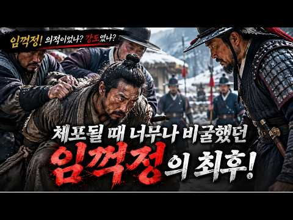
- 설명 앞부분: 조선시대 대표적인 의적으로 알려진 임꺽정. 가난한 백성을 돕고 탐관오리에 맞섰던 영웅으로 기억되지만, 실제 역사 기록에 등장하는 임꺽정의 모습은 우리가 알고 있는 이야기와 상당히 다릅니다. 백정 출신이었던 임꺽정은 어떻게 수많은 부하를 거느리는 도적 집단의 우두머리가 되었을까요? 황해도를 중심으로 활동하던 임꺽정 일당은 관아를 습격하고 관리들을 위협하며 조선 조정을 긴장시켰습니다. 조정은 이들을 토벌하기 위해 관군을 동원했고, 남치근을 중심으로 대대적인 추적과 수색에 나섰습니다. 그리고 임꺽정 일당의 내부 사정을 알고 있던 서림의…
- 같은 채널 평소 대비 ×153.3 (채널 최근 롱폼 중앙값 1,203회) · 평소 영상: 조선시대 범죄자들은 어떻게 살고 죽었을까? ∣ 검계·임꺽정·살인 사건·망나니 ∣ 조선 범… (1,203회) / 조선시대 월급쟁이들은 얼마나 받았을까? 월급 0원 공무원부터 화성 노동자까지.. 총정리.. (1,141회)
- 대본 없음 (설명) — 음성인식이 끝나면 도입부·흐름이 들어감
- 댓글 48/111: 좋은 점 — 영상 0 · 감사·응원 0 · 더 알고 싶은 것 0 · 아쉬운 점 — 영상 0 · 반박·불만 — 의견 다름 2 · 정치·사회 10 · 경험 공유 2 · 구독·다음 기대 1
  - 정치·사회 👍12 “누구라도 저 암흑한 시대에 태어 났으면 산도적이 되었을것!!!! 2026년 현재 짜이밍이 정부에서 산도적이 되고 싶어도 못되는게............ ㅋ”
  - 정치·사회 👍9 “조선은 나쁜 놈들이 그냥 나쁜 짓하면서 살다가 폭망했다 결국 결말이 권선징악으로 귀결이라도 났지만 지금은 나쁜 놈들이 법기술자가 돼 대통령도 국회의원도 장관도 하면서 지들 수사재판하는 국가기관들을 파괴하거나 농락 함, 여튼 선과 악이 뒤죽박죽으로 혼재하면서 국민들을 …”
  - 경험 공유 👍4 “내가 고등학교때 국사시간에 선생님이 그랬슴 "홍길동 임꺽정 이런책은 커가는 애들에게 읽지 못하게 해야한다 신세한탄 불평불만 폭력난동만 배우게하는 불량 잡서다 " 이런 말씀이 백번 맞다고 본다 다른학교에서는 어떻게 가르쳤는지 모르지만 ....”
  - 경험 공유 👍3 “내가 임꺽정이라도 그리할듯”
  - 구독·다음 기대 👍1 “그냥 임꺽정드라마정주행 하는개 빠름 임꺽정 이봉학 배돌석 황천왕둥이 박유복 곽오주 길막봉 서림 오개도치”

### 42. 경상도 시어머니와 서울며느리의 사투리 소동 ∣야담∣옛날이야기∣조선시대이야기∣재미있는이야기∣해학

- https://www.youtube.com/watch?v=_LOfSqknnI8 · 마당쇠야담 · 구독자 2,120 · 조회수 667,405 (×314.8, 하루 7,757.4) · 좋아요 4,983 (0.8%) · 35.3분 · 2026-08-03 · 주제 묶음 9. 야사·야담·옛날이야기 · 형식 수면·낭독 (잠잘 때 듣는) · 폴더 `W__LOfSqknnI8` (웹 승인)
- 썸네일: 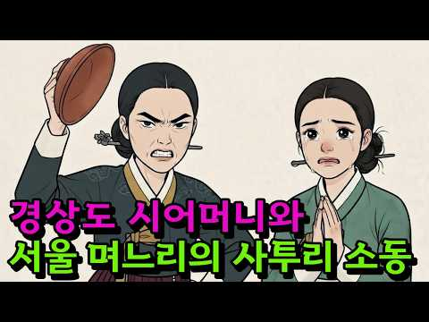
- 같은 채널 평소 대비 ×1,923.4 (채널 최근 롱폼 중앙값 347회) · 평소 영상: 짠돌이 남편의 숨겨진 사연 ∣야담 ∣옛날이야기 ∣재미있는이야기 ∣조선시대이야기 ∣해학 (347회) / 양반 아들, 상놈 아들 ∣야담∣옛날이야기∣재미있는이야기 (346회)
- 대본 없음 (없음) — 음성인식이 끝나면 도입부·흐름이 들어감
- 댓글 331/345: 좋은 점 — 영상 0 · 감사·응원 4 · 더 알고 싶은 것 0 · 아쉬운 점 — 영상 0 · 반박·불만 — 의견 다름 0 · 정치·사회 0 · 경험 공유 28 · 구독·다음 기대 0
  - 감사·응원 👍7 “재미지게 잘들었습니다. 감사합니다❤❤❤”
  - 감사·응원 👍5 “감사”
  - 경험 공유 👍76 “저도 서울에서만 살다 경상도 김천으로 시집을 왔는데요 어머니는 표준말을 모르고 전 경상도 말을 몰라 참 황당했던 시절ᆢ 일일이 알러주던 고마운 막내시누 참 어렵던 시절 ᆢ”
  - 경험 공유 👍35 “나 경상도 ㅋㅋㅋ ㅋㅋㅋㅋ ㅠ 인천에서 산지 몇십년 지금은 내가 들어도 웃겨서 가물가물 해서 새롭네”

### 43. 우리 선조는 왜 조상을 산에 모셨을까? 묘자리에 목숨까지 건 이유｜조선 선산의 역사

- https://www.youtube.com/watch?v=JPFrVw4I_Mw · 역사 아람 · 구독자 1,240 · 조회수 195,685 (×157.8, 하루 4,284.1) · 좋아요 935 (0.5%) · 23.6분 · 2026-09-25 · 주제 묶음 1. 역사 일반·이야기 · 형식 야담·옛날이야기 · 폴더 `W_JPFrVw4I_Mw` (웹 승인)
- 썸네일: 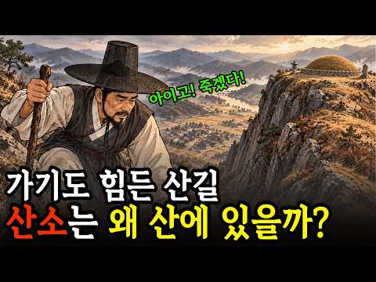
- 설명 앞부분: 🏔️ 왜 우리 조상은 산에 묻혔을까요? 신라 왕은 도읍 한복판에 누웠는데, 우리 할아버지는 왜 산 중턱에 계실까요? 화장을 금한 조선의 결정 하나가 어떻게 온 산을 무덤으로 바꿨는지, 그 600년의 이야기를 따라가 봅니다. 신라·고려·조선의 장례 문화가 어떻게 달랐는지 한눈에 정리됩니다 📖 풍수와 효 사상이 어떻게 얽혀 조선의 산송 분쟁으로 번졌는지 알게 됩니다 🌿 오늘날 화장률 94%의 시대, 우리 장례 문화가 어디서 와서 어디로 가는지 보입니다 벌초하러 산에 오르던 그 길이, 사실은 600년 역사가 쌓인 길이었습니다.
- 같은 채널 평소 대비 ×89.5 (채널 최근 롱폼 중앙값 2,186회) · 평소 영상: 조선 왕들이 마주한 극한의 스케쥴 ∣ 워라벨 없었던 조선 왕들의 진짜 하루 (2,186회) / 600년 전 한양이 불타버린 이유 │실록에서 밝혀진 한양 대화재의 진실과 119의 시초 (1,802회)
- 대본 없음 (설명) — 음성인식이 끝나면 도입부·흐름이 들어감
- 댓글 54/55: 좋은 점 — 영상 1 · 감사·응원 1 · 더 알고 싶은 것 0 · 아쉬운 점 — 영상 1 · 반박·불만 — 의견 다름 1 · 정치·사회 2 · 경험 공유 0 · 구독·다음 기대 0
  - 좋은 점 — 영상 👍2 “양택풍수는 환경적 측면에서 공감이 가나 음택풍수는 너무나 문제가 많고 비합리적인 성리학적 도그마에 빠진 잘못된 선택이라고본다 육신이 분해되어 원자로 쪼개어지면 그이후는 인연따라 천지기상상태에 따라 모이고 흩어지는 것일 뿐이다!!!”
  - 감사·응원 👍0 “덕분에 공부 많이 하고 갑니다. 감사해요”
  - 정치·사회 👍0 “지금도 대통령 되면 집터 조상들 묘지가 티 비 나오지 않던가 그 것을 모르니 아무리 노력해도 그렇게 사는 것이여”

### 44. [세계사] 고대 이집트인들은 폭염 속에서도 왜 가발을 쓰고 다녔을까?💡

- https://www.youtube.com/watch?v=NoE9j2eaocE · 역사리뷰룸 · 구독자 3,210 · 조회수 890,129 (×277.3, 하루 10,907.0) · 좋아요 2,432 (0.3%) · 16.8분 · 2026-08-21 · 주제 묶음 5. 세계사·서양사 · 형식 오디오북·낭독 (명언·인생조언) · 폴더 `W_NoE9j2eaocE` (웹 승인)
- 썸네일: 
- 챕터: 0:00 뜨거운 사막과 가발의 수수께끼 · 2:03 이집트의 환경과 머리 관리 · 5:17 머리를 밀고 다시 가발을 쓴 이유 · 6:44 고대 가발의 제작 과정과 유물 · 9:02 기록으로 살펴본 이집트 풍습 · 10:21 연회와 독특한 머리 장식 · 13:29 가발로 드러낸 신분과 권위
- 설명 앞부분: 🏺사막에서 머리를 밀고, 그 위에 다시 가발을 썼다고? 상식적으로 말이 안 되는 이 행동에는 3천 년을 버텨온 이집트인들의 놀라운 지혜가 숨어 있었습니다. 😮 우리가 벽화에서 본 이집트인들의 그 반듯하고 풍성한 머리카락… 사실 대부분 진짜 머리가 아니었다는 사실, 알고 계셨나요? 오늘 영상에서 그 진실을 낱낱이 파헤쳐 봅니다. 🎞️영상 타임라인🎞 본 영상은 생성형 AI로 제작되었습니다.
- 같은 채널 평소 대비 ×843.7 (채널 최근 롱폼 중앙값 1,055회) · 평소 영상: [세계사] 이름까지 지워진 왕 투탕카멘, 3천 년 뒤 화려하게 돌아온 이유는?😯 (1,055회) / [세계사] 지구의 얼음이 전부 녹으면 해수면은 무려 몇 m 올라갈까?💡 (1,066회)
- 대본 없음 (설명) — 음성인식이 끝나면 도입부·흐름이 들어감
- 댓글 84/86: 좋은 점 — 영상 1 · 감사·응원 0 · 더 알고 싶은 것 1 · 아쉬운 점 — 영상 1 · 반박·불만 — 의견 다름 1 · 정치·사회 0 · 경험 공유 0 · 구독·다음 기대 0
  - 좋은 점 — 영상 👍0 “잘 배워 갑니다”
  - 더 알고 싶은 것 👍24 “이집트, 로마 뿐만아니라 고구려, 고조선에 대한 재미 있는 이야기도 해주길.”
  - 아쉬운 점 — 영상 👍0 “아 못보겠다 무한반복..”
  - 반박·불만 — 의견 다름 👍0 “21세기에 이집트의 습하고 더운 사막기후가 갑자기 바뀐것도 아닌데 이젠 머리도 안밀고 가발도 안쓰는 이유가 이슬람 때문?”

### 45. 중국은 코앞에 두고도 못 가진 시베리아, 러시아는 어떻게 60년 만에 차지했을까

- https://www.youtube.com/watch?v=OullzLAZRic · 세계사한줌 · 구독자 6,630 · 조회수 114,788 (×17.3, 하루 21,219.7) · 좋아요 628 (0.5%) · 19.6분 · 2026-10-23 · 주제 묶음 6. 동양사 (중국·일본·몽골) · 형식 정보·해설 (그 밖) · 폴더 `W_OullzLAZRic` (웹 승인)
- 썸네일: 
- 챕터: 0:00 1686년 겨울, 흑룡강의 포위된 요새 · 2:02 말 한 마리 값의 털가죽, 담비 · 4:47 수백 명이 산을 넘다 · 8:52 담비를 따라 강을 건너, 태평양까지 · 12:16 흑룡강에서 처음 막히다 · 16:24 그 뒤 200년, 그리고 지금
- 설명 앞부분: 1686년 겨울, 아무르강(흑룡강) 가의 러시아 요새는 청나라 대군에 포위돼 700명 가운데 스무 명 남짓만 남았습니다. 3년 뒤 러시아는 그 강에서 물러났지만, 강 훨씬 북쪽으로 펼쳐진 숲 시베리아는 지금 러시아 땅입니다. 우랄산맥 너머 숲을 차지하기 시작한 지 60년도 안 돼 태평양에 닿은 러시아 사람들은 무엇을 찾아 그 숲을 건넜을까요. 러시아가 시베리아를 어떻게 차지했는지, 그 땅이 왜 지금도 비어 있는지를 시베리아 연대기와 관리들의 보고서, 청나라와 조선의 기록으로 따라갑니다. 이 영상에서 다루는 내용 좋은 가죽 한 장이…
- 같은 채널 평소 대비 ×5.8 (채널 최근 롱폼 중앙값 19,792회) · 평소 영상: 류큐 왕국은 어떻게 오키나와가 됐을까, 450년 동안 왕이 따로 있던 섬 (19,792회) / 아일랜드는 왜 감자 때문에 100만 명이 죽었을까, 바다가 코앞인 섬이었는데 (13,610회)
- 대본 없음 (설명) — 음성인식이 끝나면 도입부·흐름이 들어감
- 댓글 24/49: 좋은 점 — 영상 0 · 감사·응원 0 · 더 알고 싶은 것 0 · 아쉬운 점 — 영상 0 · 반박·불만 — 의견 다름 0 · 정치·사회 3 · 경험 공유 0 · 구독·다음 기대 0
  - 정치·사회 👍0 “청나라는 흙룡강 너머에 관심이 없었던거죠.. 원래 자기땅이 아니었으니까요.. 잘 생각해보세요, 청나라 여진족의 인구가 얼마였는지..130-200만명, 하지만 만주족으로 불리는 청나라 중심인구는 130만 내외인걸로 보입니다. 병자호란이후 조선과 명나라를 정벌후 거의 모…”
  - 정치·사회 👍0 “청나라가 쉽게 서방에 내주었던 조차지와 땅들은 원래 중국(청)의 땅이 아닌거로 보면 확실합니다.”

### 46. [3부작] 이순신의 실제 얼굴을 찾아서(최종회)

- https://www.youtube.com/watch?v=B5Yqnj_CfVg · 페이스 아카이브 · 구독자 1,990 · 조회수 411,738 (×206.9, 하루 6,223.1) · 좋아요 4,140 (1.0%) · 13.7분 · 2026-09-05 · 주제 묶음 3. 조선 · 형식 애니메이션·지도 · 폴더 `W_B5Yqnj_CfVg` (웹 승인)
- 썸네일: 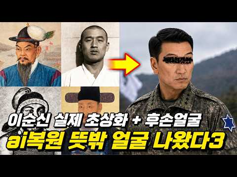
- 챕터: 0:00 오프닝 및 시리즈 요약 · 2:15 무과형 초상화 분석 흐름 · 4:30 문과형 초상화 계보 정리 · 7:10 직계 후손 초상 및 사진 비교 (이봉상, 이달해, 이… · 10:50 인공지능 교차 복원을 통한 최종 얼굴 재현 · 12:20 에필로그 및 클로징
- 설명 앞부분: "우리가 알던 이순신 장군의 모습, 과연 진짜 얼굴일까요?" 안타깝게도 지금까지 여러 차례 이순신과 관련된 그림들이 등장했지만 장군의 진짜 얼굴은 여전히 오리무중입니다. 진짜 이순신 얼굴 찾기 방구석 프로젝트! 현존하는 이순신 관련 초상화 20여 점을 분석한 1, 2부에 이어 3부에서는 이순신 직계 후손들의 초상화를 분석하고, 그 유형을 무과형과 문과형, 후손형으로 나누어, 실제 이순신의 얼굴을 AI로 복원해 보았습니다. 많은 응원 댓글로 부탁드리며 오류 또한 남겨 주시면 수정하겠습니다. Time stamp 참고자료 목록 1. 전…
- 같은 채널 평소 대비 ×5.2 (채널 최근 롱폼 중앙값 78,728회) · 평소 영상: 복싱 100년사, 찬란하게 빛난 10명의 챔피언들! #한국권투명장면 #한국권투챔피언 (93,170회) / [3부작] 이순신의 실제 얼굴을 찾아서1 #이순신후손 (64,286회)
- 대본 없음 (설명) — 음성인식이 끝나면 도입부·흐름이 들어감
- 댓글 925/929: 좋은 점 — 영상 5 · 감사·응원 33 · 더 알고 싶은 것 7 · 아쉬운 점 — 영상 1 · 반박·불만 — 의견 다름 10 · 정치·사회 54 · 경험 공유 28 · 구독·다음 기대 2
  - 좋은 점 — 영상 👍11 “멋지고 이미지도 멋지네요 좋은 영상 가슴 벅차오르는 영상 감사합니다”
  - 좋은 점 — 영상 👍2 “아우내님의 후반부 멘트가 너무 와닿습니다. 성웅 이순신장군님은 유구한 한반도 역사가 빚어낸 무수한 별 중 최고의 별이라 생각해요. 시간이 되신다면.. 고구려, 고려의 영웅들의 초상도 그려내 주시길^^!”
  - 감사·응원 👍232 “이순신 장군 후손들이 독립운동하신 걸 오늘 처음 알았습니다. 대단한 가문이군요. 고맙습니다.”
  - 감사·응원 👍23 “진짜 이국종 교수님인데 ㅋㅋㅋㅋㅋㅋㅋㅋㅋㅋㅋㅋㅋㅋㅋ AI 의 올바른 활용 감사합니다. !”
  - 더 알고 싶은 것 👍3 “모계의 특징을 간과할수 없을겁니다 수십대에 걸쳐 어머니들의 특성이 섞이면 과연 같을 수 있을까요?”
  - 더 알고 싶은 것 👍0 “결과물 들고 진짜 과거로 가서 이분 누군지 아냐고 물어보고싶다. 신기하고 궁금하다”
  - 아쉬운 점 — 영상 👍3 “아, 2:17 부근에 등장한 초상화의 주인공은 윤두서가 아니라 윤증 선생님이십니다. 다음 영상에서라도 정정 정보를 주셨으면 합니다. 영상은 잘 보았습니다.”
  - 반박·불만 — 의견 다름 👍3 “무과형 얼굴을 설명하면서 정이 안간다고? 웃기는 쉒이네... 내가 볼 때는 아주 지적이고 강단있게 보이는 잘생긴 얼굴인데...”
  - 반박·불만 — 의견 다름 👍1 “얼마나 말도 안되는 논거인가.... 할말하않.”
  - 정치·사회 👍9 “내란범한테 대통령이라는 말은 쓰지 않는 걸로 합시다. 예우박탈이 원칙입니다. 국가전복 시도한 반역자로서 국민정서에도 맞지 않고요”
  - 정치·사회 👍7 “지금 대통령도 있는데 굳이 무시하고 “윤석열 대통령님” 찾고, 다음 대통령 찾으시는 걸 보니… 정치색이 은근히 드러나는 것 같아 많이 많이 많이 아쉽네요… 내란이나 안 일어났으면 몰라도 국가전복이 시도된 게 불과 2년 전인데…”
  - 경험 공유 👍156 “잘 보고 갑니다. 이순신 장군님 현존 남자 직계 후손들 약 100명 정도의 얼굴을 촬영하고 계측하여 데이터베이스화 해 놓은게 있습니다. 이순신 연구소 뭐 그런 기관에서 진행했습니다. 3~4년 정도 전에 제작 진행 된 걸로 기억합니다. 저도 데이터를 제공했습니다. 후손…”
  - 경험 공유 👍79 “이국종 교수님이 덕수 이씨인지 검색해봤네요. 교수님은 전주이씨네요”
  - 구독·다음 기대 👍4 “다음 프로젝트가 벌써 기대됩니다👏👏👏”

### 47. 조선야담#20 어서 씻으라는 마님 # 옛날이야기 #민담 #전설

- https://www.youtube.com/watch?v=ItASrjGgMvo · 조선야사 · 구독자 2,370 · 조회수 156,143 (×65.9, 하루 7,374.4) · 좋아요 543 (0.4%) · 18.3분 · 2026-09-29 · 주제 묶음 9. 야사·야담·옛날이야기 · 형식 야담·옛날이야기 · 폴더 `W_ItASrjGgMvo` (웹 승인)
- 썸네일: 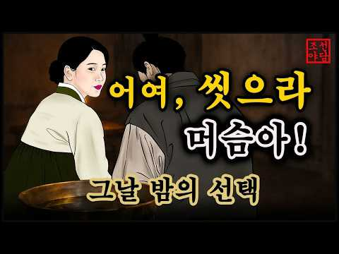
- 설명 앞부분: 📜 조선 시대의 신비롭고 흥미진진한 야담, 역사 속 숨겨진 이야기, 그리고 전해 내려오는 전통 설화를 전해드립니다. 🏮 우리가 잘 몰랐던 옛이야기 속으로 떠나는 시간 여행에 여러분을 초대합니다. ⏳✨ 과거의 지혜와 재미가 담긴 이야기들을 매일 만나보세요! 🌙🐯
- 같은 채널 평소 대비 ×1,784.5 (채널 최근 롱폼 중앙값 88회) · 평소 영상: 조선야담🎉 오뉴월 서릿발 같은 여자의 한 이야기모음 #민담 #야담 #고전소설 #옛날이야기 (91회) / 조선야담 🎉애첩의 털과 바꾼 전재산 잠잘때 듣는 옛날 이야기 (91회)
- 대본 없음 (설명) — 음성인식이 끝나면 도입부·흐름이 들어감
- 댓글 4/5: 좋은 점 — 영상 0 · 감사·응원 0 · 더 알고 싶은 것 0 · 아쉬운 점 — 영상 0 · 반박·불만 — 의견 다름 0 · 정치·사회 0 · 경험 공유 0 · 구독·다음 기대 0

### 48. 돼지는 114일, 토끼는 단 한 달… 그런데 한국인은 왜 안 먹을까? 충격적인 5가지 이유 ∣ 역사 이야기

- https://www.youtube.com/watch?v=hf9t-gKqdjg · 몰랐던 세상 · 구독자 2,150 · 조회수 186,592 (×86.8, 하루 5,967.4) · 좋아요 958 (0.5%) · 10.8분 · 2026-10-10 · 주제 묶음 1. 역사 일반·이야기 · 형식 수면·낭독 (잠잘 때 듣는) · 폴더 `W_hf9t-gKqdjg` (웹 승인)
- 썸네일: 
- 챕터: 0:00 토끼는 번식력이 뛰어난데 왜 한국에서는 잘 먹지 않을… · 0:59 토끼고기의 영양과 맛, 유럽에서 즐겨 먹는 이유 · 1:53 놀라운 번식력과 전쟁 중 토끼 사육의 역사 · 2:39 첫 번째 이유: 닭고기와 돼지고기의 거대한 산업 · 3:36 두 번째 이유: 예민한 건강 상태와 까다로운 사육 환경 · 4:29 세 번째 이유: 토끼고기를 활용하는 한국 요리가 부족… · 5:44 네 번째 이유: 식용보다 친근한 동물로 인식되는 토끼 · 6:55 다섯 번째 이유: 지방이 적은 고기가 한국인의 입맛과… · 7:59 과거 한국의 토끼고기 문화와 유럽의 소비 감소 · 9:01 토끼고기가 대중화되지 못한 다섯 가지 이유와 결론
- 설명 앞부분: 토끼는 번식력이 뛰어나고 단백질도 풍부한데, 왜 한국인의 밥상에서는 보기 어려울까요? 이번 역사 이야기에서는 토끼고기가 한국에서 대중화되지 못한 5가지 이유를 살펴봅니다. 닭고기와 돼지고기의 강력한 경쟁, 까다로운 사육 환경, 부족한 요리 문화부터 토끼를 바라보는 인식과 기름기 적은 고기의 특징까지 알아봅니다. 유럽에서는 익숙한 음식이었던 토끼고기가 왜 한국에서는 특별한 별미로 남았을까요? 흥미로운 역사 이야기와 음식 문화 속 숨겨진 이유를 영상 끝까지 확인해 보세요. 여러분은 토끼고기를 드셔 보셨나요? 먹어 본 경험이나 생각을 …
- 같은 채널 평소 대비 ×31.8 (채널 최근 롱폼 중앙값 5,870회) · 평소 영상: 일본에선 사라진 육회, 한국인은 왜 계속 먹을까? 충격적인 역사 이야기 (6,868회) / 인도 사람들은 왜 한 끼에 수십 가지를 먹을까? 충격적인 탈리의 비밀 ∣ 역사 이야기 (4,873회)
- 대본 없음 (설명) — 음성인식이 끝나면 도입부·흐름이 들어감
- 댓글 330/337: 좋은 점 — 영상 2 · 감사·응원 2 · 더 알고 싶은 것 2 · 아쉬운 점 — 영상 3 · 반박·불만 — 의견 다름 2 · 정치·사회 0 · 경험 공유 11 · 구독·다음 기대 0
  - 감사·응원 👍1 “토끼 한번도 먹어본적 없는데 저런이유로 국내에서 유통이 안되고 있는거군요.. 혹시 나중에 기회되면 거위도 영상 올려주시면 감사하겠습니다! 외국에서는 많이 먹는거 같던데 우리나라에는 거위고기 보기가 어려워서 궁금하네요!”
  - 더 알고 싶은 것 👍1 “토끼 한번도 먹어본적 없는데 저런이유로 국내에서 유통이 안되고 있는거군요.. 혹시 나중에 기회되면 거위도 영상 올려주시면 감사하겠습니다! 외국에서는 많이 먹는거 같던데 우리나라에는 거위고기 보기가 어려워서 궁금하네요!”
  - 더 알고 싶은 것 👍0 “궁금해서 먹었는데 닭도리탕같이 해주던데 질겨서 그돈이면 닭도리탕먹는게 낫다”
  - 아쉬운 점 — 영상 👍40 “한국인이 토끼고기를 잘 안먹는 이유를 알려고 눌렀는데, 서론이 너무 길어서 숏츠 보려고 나간다 ㅠ”
  - 아쉬운 점 — 영상 👍0 “흠.... 토끼... 예전에 야생 산토끼 먹었던 기억이 있는데 누린내 엄청 심했었는데.... 기대하다가 먹고 엄청 실망했었던 기억이 있어서.....”
  - 반박·불만 — 의견 다름 👍0 “헛소리”
  - 반박·불만 — 의견 다름 👍0 “북한도 가죽만 팔고 고기 구경도 못하는데 뭔 헛소리하네.”
  - 경험 공유 👍5 “내가 어렸을때 우리부친을따라 자주 사냥을갔었다 그러다가 토끼를 잡아서 그자리에서 가죽을벳기고 버터칠해서 구워먹었던 경험이있다 너무나 맛있었다 멧돼지 고기도 일반 돼지고기보다는 향긋하고 맛있었다 반대로 노루고기는 싱거윘던 경험이있다 더불어 한컵을 억지로 마셔야했던 노루…”
  - 경험 공유 👍1 “60년대 부터 80년대 초반까지 우리나라 섬유산업의 부산물로 갑자기 유행이 되었던 고기들이 오리고기하고 토끼고기 였었다 70년대 말에서ㅠ80년대 초까지 겨울에ㅠ오리털 파카라고 이게 유했했었는데 지금은 구스페딩이나 덕페딩ㅍ같은 것 과거와ㅠ다른점은 구스페딩같은건 거의 1…”

### 49. 인더스 문명은 왜 아무도 못 읽는 글자만 남기고 사라졌을까

- https://www.youtube.com/watch?v=wDoiDBjy-JM · 인류미터기 · 구독자 677 · 조회수 162,386 (×239.9, 하루 1,850.8) · 좋아요 132 (0.1%) · 18.4분 · 2026-08-14 · 주제 묶음 8. 문명·고고학 · 형식 정보·해설 (그 밖) · 폴더 `W_wDoiDBjy-JM` (웹 승인)
- 썸네일: 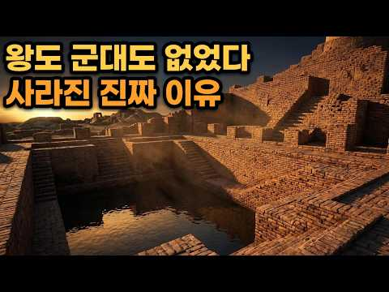
- 챕터: 0:00 왕 없는 문명, 인더스의 시작 · 2:30 로마보다 2000년 앞선 하수도의 충격 · 5:20 모두를 위한 '수영장', 평등한 도시의 증거 · 8:10 100년째 읽을 수 없는 400개의 문자 · 11:00 칼이 아닌 비가 무너뜨린 문명 · 14:30 철도 자갈이 된 유네스코 유산
- 설명 앞부분: 🏙️ 왕도, 군대도, 전쟁도 없었다. 4500년 전, 인더스 강가에 세워진 인류 최초의 '평등 도시'. 격자무늬 거리, 표준화된 벽돌, 로마보다 2000년 앞선 하수도, 집집마다 달린 화장실까지. 그런데 이 거대한 문명을 이끈 왕의 흔적은 어디에도 없습니다. 문명의 진짜 사라진 이유와, 100년째 아무도 해독하지 못한 인더스 문자의 비밀까지. 인류의 기원에서 가장 조용하고, 가장 놀라운 문명 이야기를 파헤쳐봅니다. 이어서 보기 — 사라진 문명 타임라인 🚕 인류미터기는 인류의 모든 이야기를 목적지로 삼는 택시입니다. 오늘도 뒷자리 …
- 같은 채널 평소 대비 ×221.2 (채널 최근 롱폼 중앙값 734회) · 평소 영상: 인류 역사상 가장 오래된 신전, 괴베클리 테페의 진실 (734회) / 진시황릉을 털었다는 말, 700년 동안 숫자만 불어난 이유 (720회)
- 대본 없음 (설명) — 음성인식이 끝나면 도입부·흐름이 들어감
- 댓글 32/32: 좋은 점 — 영상 1 · 감사·응원 1 · 더 알고 싶은 것 0 · 아쉬운 점 — 영상 0 · 반박·불만 — 의견 다름 0 · 정치·사회 0 · 경험 공유 1 · 구독·다음 기대 0
  - 좋은 점 — 영상 👍2 “좋은 영상 감사합니다😊 인더스문명은 관심 없었는데 관심이 생기네요”
  - 감사·응원 👍2 “좋은 영상 감사합니다😊 인더스문명은 관심 없었는데 관심이 생기네요”
  - 경험 공유 👍5 “일종의 주소, 문패 즉 위치를 알려주는거 아닐까ᆢ 물고기는 항구 근처에서, 곡식은 밭을 지나 5개 구역 위 소조각 있는 곳이 내가 사 는곳이다 ᆢ 뭐 그런뜻”

### 50. 청나라를 위협한 '미지의 제국', 백두산정계비를 세우게 만든 진짜 이유

- https://www.youtube.com/watch?v=tS5qj6B66kc · 그날의 재발견 · 구독자 1,450 · 조회수 230,271 (×158.8, 하루 3,897.6) · 좋아요 1,097 (0.5%) · 47.9분 · 2026-09-12 · 주제 묶음 6. 동양사 (중국·일본·몽골) · 형식 인터뷰·강연·대담 · 폴더 `W_tS5qj6B66kc` (웹 승인)
- 썸네일: 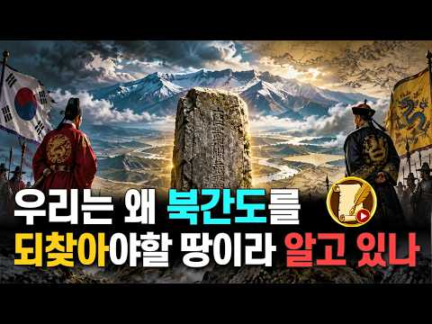
- 설명 앞부분: "북간도는 정말 우리가 되찾아야 할 잃어버린 고토일까요?" 북간도가 어떻게 우리 영토라는 주장이 나오게 된걸까요? 그 경계선 뒤편에는 교과서가 미처 다루지 못한 수많은 역사적 기록과 숨겨진 제국의 흔적이 자리 잡고 있습니다. 본 영상의 제작에 생성형 AI 기술을 활용하였습니다.
- 같은 채널 평소 대비 ×470.9 (채널 최근 롱폼 중앙값 489회) · 평소 영상: 조선 최대 규모 역모 발생. 공포에 질린 숙종. 금단의 예언서 정감록의 충격적 실체 (513회) / 한무제는 왜 태어난 지 몇 달 된 증손자를 감옥에 넣었나 (465회)
- 대본 없음 (설명) — 음성인식이 끝나면 도입부·흐름이 들어감
- 댓글 487/541: 좋은 점 — 영상 2 · 감사·응원 4 · 더 알고 싶은 것 3 · 아쉬운 점 — 영상 2 · 반박·불만 — 의견 다름 8 · 정치·사회 36 · 경험 공유 12 · 구독·다음 기대 0
  - 감사·응원 👍9 “지금껏 만들어졌던 간도 관련 영상 중에서 최고입니다. 그동안 많은 국민들이 지금은 남의 땅이 된 간도를 아까워하고 안타까워했지만 근세 이후 어떻게 조상들의 이주와 개척과 개간으로 우리의 땅이 되었지만 다시금 중국으로 넘어가게 되었는지에 대해 그 경위와 내력을 자세히 …”
  - 감사·응원 👍2 “좋았요 대한민국 화이팅 1”
  - 더 알고 싶은 것 👍2 “많이!알려주세요!찾아야됨니다!🎉🎉🎉”
  - 더 알고 싶은 것 👍2 “고조선 고구려 발해의 직계 후예는 건주여진이죠. 그래서 만주는 건주여진의 땅입니다. 건주여진은 본인들이 고조선의 직계후예라고 하였죠. 그런 건주 여진을 우리는 오랑캐라 무시하였죠. 그러면서 북간도가 우리땅이다 외칠수가 있을까요?”
  - 반박·불만 — 의견 다름 👍17 “부국강병 만이 헛소리를 없앨 수 있다.”
  - 반박·불만 — 의견 다름 👍4 “옛날 kbs 드라마 북간도 애청을 했었는데 감회가 새롭네. 여기는 내고향 내고향도 아닌데~ 무엇을 바라며 어디로 가는가~ 고향 멀리 찬바람만 몰아 치는데~ 꿈에도 못잊을 나의 고향아~”
  - 정치·사회 👍38 “내가 아쉬운 건 청나라가 저렇게 영토를 넓혀 놓고 그걸 고스란히 중국인들에게 바친 꼴이 된다는 것. 만주, 몽골, 티베트를 다 중국에 내 줘 버림. 죽 쒀서 개 준 꼴.”
  - 정치·사회 👍19 “그나마 청나라가 연해주를 러시아로 넘긴걸 다행이라 생각해야 함.”
  - 경험 공유 👍38 “내가 아쉬운 건 청나라가 저렇게 영토를 넓혀 놓고 그걸 고스란히 중국인들에게 바친 꼴이 된다는 것. 만주, 몽골, 티베트를 다 중국에 내 줘 버림. 죽 쒀서 개 준 꼴.”
  - 경험 공유 👍9 “지금껏 만들어졌던 간도 관련 영상 중에서 최고입니다. 그동안 많은 국민들이 지금은 남의 땅이 된 간도를 아까워하고 안타까워했지만 근세 이후 어떻게 조상들의 이주와 개척과 개간으로 우리의 땅이 되었지만 다시금 중국으로 넘어가게 되었는지에 대해 그 경위와 내력을 자세히 …”

### 51. 유럽인은 왜 수만 년 동안 검은 피부였을까 ∣ 고대문명

- https://www.youtube.com/watch?v=FivM7xayEWA · 고대문명 역사관 · 구독자 627 · 조회수 97,350 (×155.3, 하루 1,643.5) · 좋아요 394 (0.4%) · 17.7분 · 2026-09-12 · 주제 묶음 8. 문명·고고학 · 형식 정보·해설 (그 밖) · 폴더 `W_FivM7xayEWA` (웹 승인)
- 썸네일: 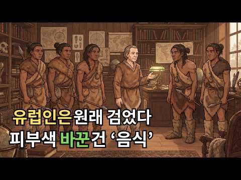
- 챕터: 0:00 유럽인은 원래 검은 피부였다? 충격적인 시작 · 0:33 햇빛만으로는 설명되지 않는 피부색의 비밀 · 1:17 이누이트의 식단이 밝혀낸 결정적 단서 · 4:10 7천 년 전 유럽인의 DNA, 파란 눈과 짙은 피부 · 6:53 고대 DNA 수백 명이 밝혀낸 피부색의 변화 · 8:29 수만 년 동안 유지된 피부색이 바뀐 진짜 이유 · 9:00 농업혁명과 함께 완전히 달라진 유럽인의 밥상 · 12:41 유럽과 동아시아, 같은 피부색에 다른 유전자 · 15:06 피부색에 새겨진 인류의 생존 기록
- 설명 앞부분: 유럽인은 왜 수만 년 동안 검은 피부였을까 ∣ 고대문명 유럽인은 원래부터 하얀 피부였을까요? 수만 년 전 유럽인은 짙은 피부와 파란 눈을 가지고 있었습니다. 그런데 농업의 시작과 함께 밥상이 바뀌면서 피부색도 달라지기 시작했습니다. 이번 영상에서는 고대문명 이전부터 이어진 인류의 피부색 변화와 음식, 햇빛, 유전자의 놀라운 관계를 알아봅니다. 여러분의 피부에 남아 있는 조상들의 생존 기록, 고대문명 속 인류의 역사를 함께 확인해 보세요. 🔥 📜 고대문명 역사관 ∣ 채널 소개 고대문명 역사관은 지나온 세월 속에 숨겨진 고대문명의 이…
- 같은 채널 평소 대비 ×52.0 (채널 최근 롱폼 중앙값 1,872회) · 평소 영상: 당신이 쉬는 숨의 절반은 '사막'이 만듭니다 ∣ 고대문명 (1,872회) / 만 년 전 나뭇잎은 왜 아직 썩지 않았을까 ∣ 고대문명 (1,774회)
- 대본 없음 (설명) — 음성인식이 끝나면 도입부·흐름이 들어감
- 댓글 23/32: 좋은 점 — 영상 0 · 감사·응원 1 · 더 알고 싶은 것 0 · 아쉬운 점 — 영상 0 · 반박·불만 — 의견 다름 1 · 정치·사회 0 · 경험 공유 0 · 구독·다음 기대 0
  - 감사·응원 👍6 “새로운 설명 감사합니다 ! 호기심이 많이 해결 되는군요 !”
  - 반박·불만 — 의견 다름 👍6 “헛소리야. 네안데르탈인 30~70 만년전부터 유럽에 살았고 그들은 흰피부였어. 거짓말퍼뜨리지마. 네안데르탈인 dna가 유럽인들 몸과 동양에 다 퍼져있다고.”

### 52. 조선 선비는 과거 보러 400km를 어떻게 걸어갔을까 ∣ 국밥·엿·주막에 숨은 놀라운 이야기∣사극은 거짓말? 과거 보러 가는 조선의 길에는 산적도 호랑이도 없었다

- https://www.youtube.com/watch?v=PmKbdO0FcnE · 어게인역사 · 구독자 7,430 · 조회수 1,222,932 (×164.6, 하루 19,197.0) · 좋아요 1,876 (0.1%) · 12분 · 2026-09-07 · 주제 묶음 3. 조선 · 형식 정보·해설 (그 밖) · 폴더 `W_PmKbdO0FcnE` (웹 승인)
- 썸네일: 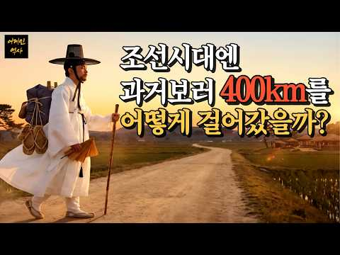
- 챕터: 0:00 천 리 길, 걸어서 보름의 여정 · 2:52 조선의 길과 문경새재의 비밀 · 2:52 나라가 세운 숙소 '원'과 지명의 유래 · 4:58 나그네를 재운 주막과 조선의 인심 · 6:19 밤샘 공부와 합격을 비는 엿 · 7:44 길 위에서 태어난 국밥과 토렴 · 10:01 서양인이 놀란 온돌, 그리고 남겨진 발자국
- 설명 앞부분: 🚶 부산에서 한양까지 380km, 걸어서 꼬박 보름. 조선의 선비들은 과거 시험 하나를 위해 두 발로 그 머나먼 길을 걸었습니다. 🏞️ 사극에서 본 것처럼 산적과 호랑이가 우글대는 험한 길이었을까요? 🏠 그들은 밤이 되면 어디서 잠을 자고, 무엇을 먹었을까요? 우리가 매일 지나치는 '인덕원', '이태원'이라는 지명 속에, 무심코 말아 먹는 '국밥 한 그릇' 속에, 시험 앞에서 건네는 '엿 한 봉지' 속에 수백 년 전 옛사람들의 발자국이 그대로 남아 있습니다. 🔥 온돌에 깜짝 놀란 서양인들의 기록, 🍚 찬밥을 데우는 '토렴'에서 태…
- 같은 채널 평소 대비 ×868.9 (채널 최근 롱폼 중앙값 1,408회) · 평소 영상: 물 한 모금도 무서워한 덕혜옹주… 고종은 정말 독살당했을까? ∣ 그날 밤 궁에 있던 어의… (1,444회) / 오늘 아침 쓴 그 비누 / 시작은 조선 궁녀였다 ㅣ삼천 명이 살던 궁궐 / 화장실은 단 … (1,371회)
- 대본 없음 (설명) — 음성인식이 끝나면 도입부·흐름이 들어감
- 댓글 202/224: 좋은 점 — 영상 2 · 감사·응원 4 · 더 알고 싶은 것 2 · 아쉬운 점 — 영상 1 · 반박·불만 — 의견 다름 4 · 정치·사회 2 · 경험 공유 5 · 구독·다음 기대 1
  - 좋은 점 — 영상 👍6 “아주 재미있게 보고 있습니다. 유익하고 흥미롭습니다.”
  - 좋은 점 — 영상 👍2 “조상님들의 오랜 이야기를, 한 명의 시점에서 알려주니 이해가 잘 되고 정말 흥미로운 컨텐츠였습니다. 너무 재미있게 잘 봤습니다, 감사합니다 :)”
  - 감사·응원 👍2 “조상님들의 오랜 이야기를, 한 명의 시점에서 알려주니 이해가 잘 되고 정말 흥미로운 컨텐츠였습니다. 너무 재미있게 잘 봤습니다, 감사합니다 :)”
  - 감사·응원 👍2 “난 이 조선이 난 이 대한민국이 그저.. 그저.. 너무나 좋다 , 난 대한민국 사람 중에 하나라 너무나.. 너무나 참 다행이라 생각한다. 감사합니다. 우리의 선조분들 그리고 우리 자유민주주의 국가 대한민국 그저 감사합니다. 나 또한 대한민국을 위해 이 한 목숨 말로만…”
  - 더 알고 싶은 것 👍0 “안녕하세요 배경음악이 너무 좋네요.. 배경음악이 뭔지 좀 알려주세요.. ^^”
  - 더 알고 싶은 것 👍0 “멘탈은 언제나가나요?”
  - 아쉬운 점 — 영상 👍0 “인덕원 이태원 말할때는 왜 AI음성이 버벅거리는거지??”
  - 반박·불만 — 의견 다름 👍4 “길이도 길인데 길찾아가는게 더힘들듯 지도가 있는것도아니고 네비가 있는것도 아닌데”
  - 반박·불만 — 의견 다름 👍0 “저 시대에 과거는 선택이 아닙니다. 가문을 일으키는 유일한 수단이지.”
  - 정치·사회 👍8 “지금도 부산에서 서울 올공까지 전한길쌤과 많은 분들이 부정선거재선거를 위해서 걷고 있습니다.”
  - 정치·사회 👍0 “능력되도 무서워서 못가겟다 저당시 마라톤 나갓으면 우리나라가 싹쓸이햇겟다”
  - 경험 공유 👍10 “나도 국민학교때 8k 산길을 걸어다녔지”
  - 경험 공유 👍0 “과거시험도 자기 일생운명과 관련되니 걷는거다. 나도 탈북할때 일생운명문제라 중국까지 1500키로를 걸었다”
  - 구독·다음 기대 👍0 “정말로 알고싶어을 물음인데 여기서 그물음에 궁금증이 해소되었습니다 구독누르고 잘보고갑니다”

### 53. 하수도도 없던 조선, 여름은 왜 지옥이 됐을까 ∣ 성종도 두려워한 한양의 장마 ∣ 조선생활사

- https://www.youtube.com/watch?v=ZsqcB6lCi0A · 역사 한 소절 · 구독자 1,710 · 조회수 481,865 (×281.8, 하루 4,367.9) · 좋아요 1,316 (0.3%) · 26.9분 · 2026-07-23 · 주제 묶음 3. 조선 · 형식 정보·해설 (그 밖) · 폴더 `W_ZsqcB6lCi0A` (웹 승인)
- 썸네일: 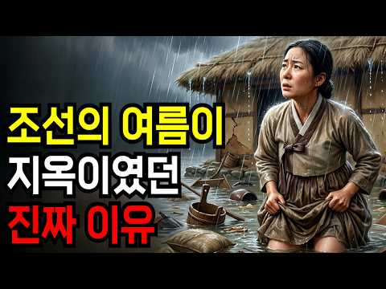
- 설명 앞부분: 하수구도, 배수 시설도 제대로 없던 조선. 장마철 큰비가 쏟아지면 한양은 그야말로 물바다가 됐습니다. 산에서 쓸려 내려온 토사가 개천 바닥을 메우고, 빗물과 오수가 뒤섞인 흙탕물이 도심 저지대로 역류했죠. 담장 하나를 사이에 두고, 누군가는 무너져가는 흙벽 집에서 물과 사투를 벌였고, 누군가는 물 한 방울 들지 않는 방 안에 있었습니다. 같은 비, 같은 여름이었지만 사람들이 겪는 여름은 완전히 달랐습니다. 임금 성종은 그 밤, 편한 잠자리를 마다하고 맨바닥으로 내려왔습니다. 그가 그렇게까지 한 이유는 무엇이었을까요? 그리고 담장 …
- 같은 채널 평소 대비 ×855.9 (채널 최근 롱폼 중앙값 563회) · 평소 영상: 토사구팽된 류성룡이 피땀 흘려 만든 문서 ∣ 조선은 내다 버리고, 일본은 300년을 탐독… (563회) / 조선 백성 90%가 신던 짚신, 어쩌다 순식간에 사라졌을까? (556회)
- 대본 없음 (설명) — 음성인식이 끝나면 도입부·흐름이 들어감
- 댓글 219/226: 좋은 점 — 영상 3 · 감사·응원 5 · 더 알고 싶은 것 1 · 아쉬운 점 — 영상 2 · 반박·불만 — 의견 다름 5 · 정치·사회 29 · 경험 공유 7 · 구독·다음 기대 1
  - 감사·응원 👍23 “경북 사람입니다. 매년 장마철만되면 물난리나서 동네잠기고 난리났었습니다. 이명박대통령의 4대강 정비사업이후 홍수걱정은 아예 사라젓습니다. 정치여야를 떠나 이명박대통령께 고맙고 참 감사합니다.”
  - 감사·응원 👍18 “6.25 전쟁 이후 폐허에서 세계 어느 나라와 비교해도 살기 좋은 대한민국을 만든 윗 분들 존경하고 지금도 보이지 않는 곳에서 묵묵히 땀 흘린 블루칼라 분들께 감사함을 전합니다.”
  - 더 알고 싶은 것 👍1 “일제시대 이전 조선은 국민의 90프로가 개거지 처럼 살고 양반들의 멍석말이가 끊이질 않고 여자들은 양반들의 노리개였는데 독립군 이순신 같은 영화만 틀어주면 눈물 흘리고 조선은 위대하다!하는 인간들은 양반들의 멍석말이가 그립고 여자들은 양반들의 노리개가 그리워서 그러는…”
  - 아쉬운 점 — 영상 👍9 “박정희와 이먕박이 치수 하기 전에는 매년 홍수 가뭄의 반복이었음”
  - 아쉬운 점 — 영상 👍0 “아 문맥이 너무 지루하게 이어지네”
  - 반박·불만 — 의견 다름 👍1 “선조들의 지혜 헛소리하는데 일반서민들은 지옥 그자체였다~~~”
  - 정치·사회 👍40 “이명박 대통령 이전만 해도 당시에 주력언론 방송3사는 해마다 장마가 시작되면 수재의연금 모금 했었습니다 이명박정부 욕하는 사람들은 뇌가 없는것들 입니다 토목 공사비도 왼전 저가로 한것으로 알고 있습니다 공사업체들이 남는게없다고들 했었습니다”
  - 정치·사회 👍23 “경북 사람입니다. 매년 장마철만되면 물난리나서 동네잠기고 난리났었습니다. 이명박대통령의 4대강 정비사업이후 홍수걱정은 아예 사라젓습니다. 정치여야를 떠나 이명박대통령께 고맙고 참 감사합니다.”
  - 경험 공유 👍40 “이명박 대통령 이전만 해도 당시에 주력언론 방송3사는 해마다 장마가 시작되면 수재의연금 모금 했었습니다 이명박정부 욕하는 사람들은 뇌가 없는것들 입니다 토목 공사비도 왼전 저가로 한것으로 알고 있습니다 공사업체들이 남는게없다고들 했었습니다”
  - 경험 공유 👍10 “1980년대까지도 서울 수도권 경기도 물난리 겪었지. 한강 넘치고 ~”

### 54. [한국사] 홍길동도 임꺽정도 잡혔다, 장길산은 어디로? ∣ 역사인물 ∣ 다큐 ∣ 야사 ∣ 비사

- https://www.youtube.com/watch?v=KGNklJiPzb8 · 한국사인물관 · 구독자 5,590 · 조회수 383,523 (×68.6, 하루 13,937.7) · 좋아요 1,146 (0.3%) · 27.5분 · 2026-10-14 · 주제 묶음 4. 한국 근현대사 · 형식 정보·해설 (그 밖) · 폴더 `W_KGNklJiPzb8` (웹 승인)
- 썸네일: 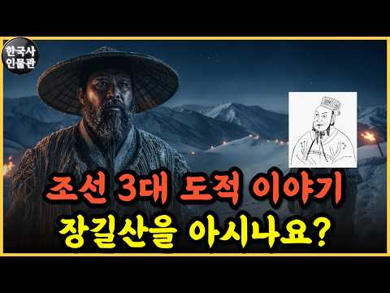
- 설명 앞부분: 조선의 임금이 도적 하나를 10년째 못 잡았다고 직접 실토했습니다. 1697년 숙종의 전교에 이름이 오른 장길산, 그러나 조선왕조실록 어디에도 그가 붙잡혔다는 기록은 없습니다. 홍길동도 임꺽정도 체포 기사가 남았는데 조선 3대 도적 가운데 오직 한 사람만 마지막 줄이 비어 있습니다. 호적에도 오르지 못한 광대가 어떻게 포도청과 황해도 감사를 따돌렸는지, 을병대기근과 역모 고변 속에서 그 이름이 어떻게 전설이 되었는지 실록과 추안급국안 기록으로 따라갑니다. 끝까지 보시고 장길산의 마지막을 댓글로 남겨주세요. 안녕하세요, 한국사인물관…
- 같은 채널 평소 대비 ×133.0 (채널 최근 롱폼 중앙값 2,884회) · 평소 영상: [한국사] 안보면 후회하는 백제 700년, 삼천궁녀는 기록에 없다｜의자왕이 해동증자로 불… (2,980회) / [한국사] 이순신 장군은 몇 위일까? 임진왜란 명장 순위 TOP 8 ∣ 역사인물 ∣ 다큐… (2,983회)
- 대본 없음 (설명) — 음성인식이 끝나면 도입부·흐름이 들어감
- 댓글 22/24: 좋은 점 — 영상 0 · 감사·응원 0 · 더 알고 싶은 것 0 · 아쉬운 점 — 영상 0 · 반박·불만 — 의견 다름 0 · 정치·사회 0 · 경험 공유 0 · 구독·다음 기대 0

### 55. [한국사] 여든여덟에 목이 잘린 영의정은 왜 목이 잘렸나 ∣ 역사인물 ∣ 다큐 ∣ 야사 ∣ 비사

- https://www.youtube.com/watch?v=wFTPh8YhhLI · 한국사인물관 · 구독자 5,590 · 조회수 730,007 (×130.6, 하루 13,900.5) · 좋아요 3,053 (0.4%) · 36.4분 · 2026-09-19 · 주제 묶음 4. 한국 근현대사 · 형식 정보·해설 (그 밖) · 폴더 `W_wFTPh8YhhLI` (웹 승인)
- 썸네일: 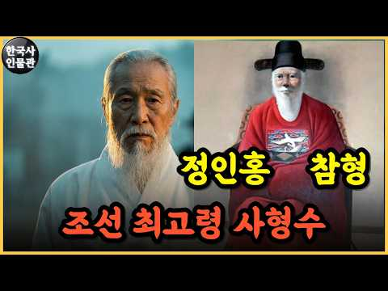
- 설명 앞부분: 여든여덟 살 영의정이 사약이 아닌 참형으로 생을 마쳤습니다. 1623년 인조반정에서 광해군은 목숨을 건졌는데, 정인홍은 왜 관례까지 깨가며 참수되었을까요. 쉰일곱에 재산을 털어 의병을 일으키고 낙동강 보급로를 끊었던 사람, 남명 조식의 칼을 물려받은 수제자 정인홍. 합천에서 팔백 리 밖 조정을 움직인 세월과 국문 닷새 만에 집행된 형, 그에게 씌워진 죄목 다섯 가지, 285년이 지나서야 회복된 이름까지 정인홍의 여든여덟 해를 차분히 따라갑니다. 끝까지 보시고 생각을 댓글로 남겨주세요. 안녕하세요, 한국사인물관입니다. 저희는 우리 …
- 같은 채널 평소 대비 ×253.2 (채널 최근 롱폼 중앙값 2,884회) · 평소 영상: [한국사] 안보면 후회하는 백제 700년, 삼천궁녀는 기록에 없다｜의자왕이 해동증자로 불… (2,980회) / [한국사] 이순신 장군은 몇 위일까? 임진왜란 명장 순위 TOP 8 ∣ 역사인물 ∣ 다큐… (2,983회)
- 대본 없음 (설명) — 음성인식이 끝나면 도입부·흐름이 들어감
- 댓글 100/132: 좋은 점 — 영상 2 · 감사·응원 2 · 더 알고 싶은 것 1 · 아쉬운 점 — 영상 1 · 반박·불만 — 의견 다름 0 · 정치·사회 5 · 경험 공유 1 · 구독·다음 기대 0
  - 좋은 점 — 영상 👍7 “가장 어린 사형수인 연산군의 아들들도 자세히 정리해주세요. 특히 영특하다고 실록에도 나오는 8살 폐세자 황의 안타까운 사연 알고 싶습니다.”
  - 감사·응원 👍22 “영상을 끝까지 본 결과 내암선생에 대해 매우 깊이 있고 정확하게 만드셨고 내용 또한 풍부하며 우려했던 편중된 내용이 전혀 보이지 않았습니다. 구독,좋아요 눌렀습니다. 존경하는 내암선생에 대해 이렇게 깊이 있고 정확하게 제작해 주신 점 감사드립니다. 인조반정이 일어나지…”
  - 감사·응원 👍2 “좋은 내용 감사합니다ㅡ남명 조식선생의 제자분들이 지금으로보면 진보였지요ㅡ입 선비가 아니고 나라가 위급할때 홀련히 목슴도 받쳐지요 합천ㅡ그 지역분들의 특징 ㆍ성격이 쉽개 타협 하지않고 불의는 못보더마ㆍ그리고 역사를 보니3.1만세운동도 합천에서 제일먼저 일어났더마 ㅡ조식…”
  - 더 알고 싶은 것 👍7 “가장 어린 사형수인 연산군의 아들들도 자세히 정리해주세요. 특히 영특하다고 실록에도 나오는 8살 폐세자 황의 안타까운 사연 알고 싶습니다.”
  - 정치·사회 👍3 “지금 으로보면 민주당이 반정세력이다”
  - 정치·사회 👍2 “좋은 내용 감사합니다ㅡ남명 조식선생의 제자분들이 지금으로보면 진보였지요ㅡ입 선비가 아니고 나라가 위급할때 홀련히 목슴도 받쳐지요 합천ㅡ그 지역분들의 특징 ㆍ성격이 쉽개 타협 하지않고 불의는 못보더마ㆍ그리고 역사를 보니3.1만세운동도 합천에서 제일먼저 일어났더마 ㅡ조식…”
  - 경험 공유 👍7 “인조반정후 북인세력은 철저하게 정계에서 소외됬지요 우리집안도 북인계열이라 할아버지들이 좌천되고...”

### 56. 왜 조선 사람들은 제일 낮고 편한 고개를 두고 험한 길로 돌아갔을까? ∣ 문경새재, 대관령, 옛길의 진짜 공포 ∣ 한국사 조선시대

- https://www.youtube.com/watch?v=0SfgHs91EZc · 안식한국사 · 구독자 3,890 · 조회수 463,305 (×119.1, 하루 9,455.7) · 좋아요 1,623 (0.4%) · 18.5분 · 2026-09-09 · 주제 묶음 3. 조선 · 형식 수면·낭독 (잠잘 때 듣는) · 폴더 `W_0SfgHs91EZc` (웹 승인)
- 썸네일: 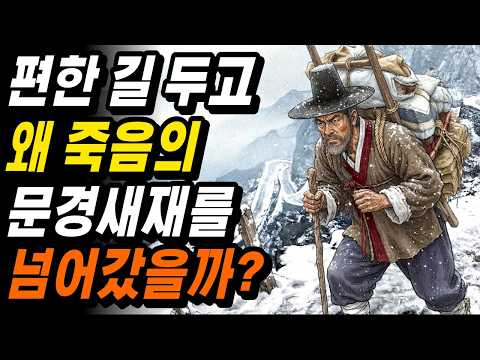
- 설명 앞부분: 조선시대에 문경새재와 대관령을 넘던 사람들은, 가장 편한 길을 놔두고 왜 목숨 걸고 이 험한 고개를 넘었을까요. 도적과 이름의 저주와 눈보라, 그리고 고갯길에서 사람을 가장 많이 죽인 진짜 정체까지, 조선 옛길의 진짜 공포를 따라갑니다. 이 영상에서 다루는 내용 나는 새도 넘기 힘들다던 문경새재, 도적은 대체 어디에 숨어 있었을까요 부산에서 한양까지, 조선 사람은 그 길을 며칠이나 걸어야 했을까요 셋 중 가장 낮고 편한 추풍령을 선비들이 굳이 피해서 돌아간 이유는 무엇일까요 추풍령의 추풍은 정말 가을바람이라는 뜻이 맞을까요 아흔아…
- 같은 채널 평소 대비 ×5.4 (채널 최근 롱폼 중앙값 85,688회) · 평소 영상: 조선 최연소 천재 병조판서를 사흘 만에 처형한 이유 (97,786회) / 조선시대 노비들은 어떻게 돈을 벌어서 양반보다 부자가 됐을까? ∣ 굶주린 양반들은 노비에… (73,590회)
- 대본 없음 (설명) — 음성인식이 끝나면 도입부·흐름이 들어감
- 댓글 102/106: 좋은 점 — 영상 2 · 감사·응원 3 · 더 알고 싶은 것 2 · 아쉬운 점 — 영상 1 · 반박·불만 — 의견 다름 3 · 정치·사회 1 · 경험 공유 2 · 구독·다음 기대 0
  - 아쉬운 점 — 영상 👍1 “이 혀짧은 AI 음성은 머지??? 정상적인 발음하는 AI는 없나???”
  - 반박·불만 — 의견 다름 👍25 “혼자 넘어가는 건 말도 안되고 반드시 여러사람들과 무리지어 넘어가야 합니다 . 호랑이의 경우는 무리지어 횃불을 들고 가면 화를 면할수 있더랬죠”
  - 반박·불만 — 의견 다름 👍18 “병자호란때 청군이 대관령을 넘었다는건 사실이 아닙니다. 상식적으로 그렇게 올 수가 없잖아요.”
  - 정치·사회 👍0 “말이 그렇지 만약 말 대로라면 관청에서 군데 군데 경계 분청이라도 만들어 운영을 했겠지!!!!!!! 조선은 그렇게 무지한 나라가 아니었다.”
  - 경험 공유 👍0 “내가 듣기로는 625전쟁 후까지 죽령에 산적이 있었다고 하더라 들었나 책에서 봤나 가물가물하다”

### 57. 마지막 황손 이석의 아침 밥상은? 교과서에는 없는 대한제국 황실의 진짜 이야기｜황손 이석의 승광재의 아침

- https://www.youtube.com/watch?v=1bjVlbD1kCY · 승광재 · 구독자 2,130 · 조회수 264,226 (×124.0, 하루 5,132.0) · 좋아요 1,201 (0.4%) · 7.7분 · 2026-09-20 · 주제 묶음 4. 한국 근현대사 · 형식 야담·옛날이야기 · 폴더 `W_1bjVlbD1kCY` (웹 승인)
- 썸네일: 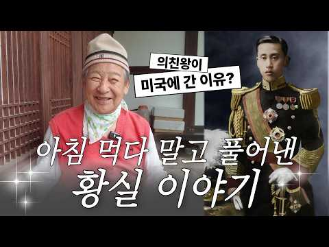
- 설명 앞부분: 전주 한옥마을 승광재에 찾아온 평화로운 아침. 대한제국의 마지막 황손, 이석 할아버지가 정갈한 아침 밥상과 함께 그동안 어디서도 듣지 못했던 생생한 옛날이야기를 들려주십니다. 역사책 속 딱딱한 기록이 아닌, 아들의 시선으로 바라본 아버지 의친왕의 꼿꼿했던 모습, 그리고 격동의 근현대사 속에서 황실 가족들이 겪어야 했던 진짜 숨겨진 이야기들. 따뜻한 차 한 잔을 곁들여 승광재 마루에 마주 앉아 듣는 기분으로 끝까지 시청해 보세요. 황손 이석이 들려주는 조선 이야기, 승광재
- 같은 채널 평소 대비 ×5.4 (채널 최근 롱폼 중앙값 48,495회) · 평소 영상: 황손은 궁에서 어떻게 머리를 잘랐을까?｜고종의 손자 이석의 왕실 이야기 (56,627회) / 마지막 황손 이석이 궁궐 담 넘고 미 8군에서 노래 부른 사연 ㅣ워커힐 500만 원 거금… (57,479회)
- 대본 없음 (설명) — 음성인식이 끝나면 도입부·흐름이 들어감
- 댓글 195/196: 좋은 점 — 영상 2 · 감사·응원 5 · 더 알고 싶은 것 3 · 아쉬운 점 — 영상 1 · 반박·불만 — 의견 다름 2 · 정치·사회 4 · 경험 공유 7 · 구독·다음 기대 0
  - 좋은 점 — 영상 👍11 “안녕하세요. 황손님 ~ 이렇게 조선황실과 근현대사의 스토리를 직접 들을수 있어서 의미있는 영상이라 생각이 들어 몇자 남깁니다. 늘 건강 하시고… 이렇게 의미있는 행보 보여주시고 많이 남겨 주셨으면 먼 훗날 좋은 자료로 남겨 지지 않을까 생각이 듭니다.”
  - 좋은 점 — 영상 👍6 “황손이시라 인물 목소리 뭐든게 품위있으시고 벌써 틀리시네요 의친왕이신 아버님께선 노기남 대주교님이 대세받고 승하 하셨넹ᆢ 오래 오래 건강하게 살아주세요 좋은말씀 듣고 싶어요😊😊😊”
  - 감사·응원 👍9 “한글을 만들어주신 이씨조선이 없었다면 이대한민국은 없다..내비록 잘살지는못하지만..글을 읽고 쓸줄안다는건 내후손이 그만큼 발전할수있음을 고맘게 생각합니다.감사합니다”
  - 감사·응원 👍2 “미워도 우리 역사예요 ᆢ 그분이 알려주시는데 그게시르면 아니잖아요 ᆢ그분이리도 조선왕조 알려주시고 고맙잖아요”
  - 더 알고 싶은 것 👍15 “황손님 건강하세요. 100년 이야기 해주세요♡♡♡❤”
  - 더 알고 싶은 것 👍2 “나라에서 지원 부탁드립니다~^^”
  - 아쉬운 점 — 영상 👍1 “자막좀 신경써서 좀 쓰지... 맞춤법이나 자막이 틀린게 보여요..”
  - 반박·불만 — 의견 다름 👍11 “욕먹을 각오하고 댓글 달자면 무능한 주제에 헛소리나 하고ㅋㅋ 그냥 노친네”
  - 정치·사회 👍2 “** 8.15 광복후에 조선반도에 3개의 나라가 건국 ** 해방후 조선민족은 있었으나 국가는 없는상태로 소련군정,미군정임시정부는 충칭임시정부를 일개의 독립단체로만 인정했습니다.. 일제시대때 임시정부는 무려 9~12개정도로 임시정부가 난립한상태었습니다.. 북만주 고려의…”
  - 정치·사회 👍1 “* 좌파와 우파, 진보와 보수 사고방식의 차이 * 좌파는 노동자,민중이 평등한 세상, 노동자,농민을 중심으로 배급과 분배를 중시하는 평등사회주의를 지지하고 우파는 개인의 자유와 재산보호, 기업가를 중심으로 성장을 중시하는 자본주의를 지지하고, 지금은 성장의 시대가 끝…”
  - 경험 공유 👍11 “대학시절에 겸임교수로 잠깐봤었을때 그때 신기했었는데.. 벌써 10년이 넘었네요”

### 58. 사극에서 안 보여준 조선 백성의 진짜 밥상! 매일 밥을 산처럼 먹은 충격적인 이유 [한국사]

- https://www.youtube.com/watch?v=X91u0-AHvWA · 역사동굴 · 구독자 2,760 · 조회수 333,535 (×120.8, 하루 6,509.8) · 좋아요 712 (0.2%) · 15.8분 · 2026-09-20 · 주제 묶음 4. 한국 근현대사 · 형식 정보·해설 (그 밖) · 폴더 `W_X91u0-AHvWA` (웹 승인)
- 썸네일: 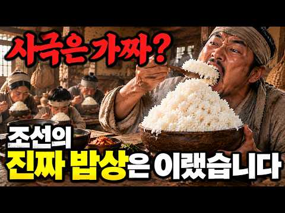
- 챕터: 0:00 조선 시대에 밥을 아홉 그릇이나? · 1:16 밥을 그렇게 많이 먹은 이유 · 2:54 보릿고개와 서민의 밥상 · 4:36 발효, 조선의 지혜가 된 이유 · 5:11 왕의 수라상은 12첩이 맞을까? · 5:51 고추 없는 밥상, 언제부터일까? · 6:36 사극 속 소고기 산적의 진실 · 8:55 고기 구경이 힘들었던 시절 · 10:48 위기 때마다 기록된 백성의 밥상 · 12:11 국가가 정해준 밥그릇 규격 · 13:48 그 시절, 우리가 몰랐던 밥상 이야기
- 설명 앞부분: [한국사] 사극이 절대 안 보여주는 조선 서민의 진짜 밥상 ∣ 정사 ∣ 야사 사극은 거짓말이었다? 사극이 절대 안 보여주는 조선 서민의 진짜 밥상과 400년 전 조선 백성이 매일 밥을 산처럼 먹은 충격적인 이유를 정사와 야사로 알아봅니다. 조선시대 밥상은 왜 늘 밥이 산더미였을까요? 반찬 없이 잡곡밥으로 하루 열량을 채워야 했던 백성들의 실제 밥상을 실록과 이덕무의 기록으로 따라가 봅니다. 사극 속 소고기 산적은 완전한 거짓말은 아니었지만, 아무나 먹을 수 있는 게 아니었습니다. 신분별 반찬 가짓수의 진실, 고추 없던 시절 김치의…
- 같은 채널 평소 대비 ×215.0 (채널 최근 롱폼 중앙값 1,551회) · 평소 영상: 단종보다 슬픈 광해군의 19년 생지옥! 사도세자보다 잔인한 최후와 원수의 파멸 [역사이야… (1,551회) / 천하의 송시열도 꺾지 못한 천재, 왜 윤휴는 역사 속에서 지워졌나? [기사환국][사문난적] (1,549회)
- 대본 없음 (설명) — 음성인식이 끝나면 도입부·흐름이 들어감
- 댓글 53/91: 좋은 점 — 영상 1 · 감사·응원 2 · 더 알고 싶은 것 0 · 아쉬운 점 — 영상 1 · 반박·불만 — 의견 다름 0 · 정치·사회 1 · 경험 공유 3 · 구독·다음 기대 0
  - 좋은 점 — 영상 👍1 “정말 유익한 영상입니다 잘보고 갑니다 감사합니다”
  - 감사·응원 👍1 “정말 유익한 영상입니다 잘보고 갑니다 감사합니다”
  - 경험 공유 👍1 “많이 먹은게 아니다 그만큼 노동을했다 12시간식 지금 시대랑 다릅니다 저도 군대에서 7명이서 1400명 밥하는 취사병인데 저정도 먹은것 같습니다 그만큼 노동을 했으니까요.. 노동 많이하면 밥을 많이먹어요 에너지를 그만큼 소모했으니..”
  - 경험 공유 👍1 “명륜진사갈비가 필요했었어”

### 59. 역대 이순신 역할중 가장 싱크로율 높은 배우는? #이순신영화 #이순신실제모습

- https://www.youtube.com/watch?v=WrHgunG_gNc · 페이스 아카이브 · 구독자 1,990 · 조회수 169,709 (×85.3, 하루 4,593.7) · 좋아요 421 (0.2%) · 5.3분 · 2026-10-04 · 주제 묶음 3. 조선 · 형식 정보·해설 (그 밖) · 폴더 `W_WrHgunG_gNc` (웹 승인)
- 썸네일: 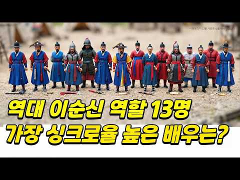
- 챕터: 0:00 오프닝 · 0:08 역대 한국 영화·드라마 속 이순신 소개 (노량, 명량… · 0:23 기록 속 초상화 및 사료를 통한 이순신의 실제 외모 … · 0:54 1대 이순신: 1962년 유현목 감독 영화, 김승길 · 1:00 2대 이순신: 1968년 KBS 드라마 난중일기, 고… · 1:08 3대 이순신: 1971년 이규웅 감독 영화 성웅 이순… · 1:18 4대 이순신: 1972년 KBS 드라마 임진왜란, 주현 · 1:24 5대 이순신: 1977년 KBS 특집 단막극 이순신,… · 1:35 6대 이순신: 1985년 MBC 대하드라마 조선왕조 … · 1:55 7대 이순신: 2004년 KBS 드라마 불멸의 이순신… · 2:18 8대 이순신: 2005년 영화 천군, 박중훈 · 2:38 9대 이순신: 2014년 영화 명량, 최민식 · 2:55 10대 이순신: 2015년 드라마 징비록(선조와 유성… · 4:07 12대 이순신: 2022년 영화 한산: 용의 출현, … · 4:31 13대 이순신: 2023년 영화 노량: 죽음의 바다,… · 5:12 클로징: "내 마음속의 이순신을 댓글로 남겨 주세요!"
- 설명 앞부분: 1962년 영화부터 2023년 최신작까지, 한국 역사와 대중문화 속에서 그려진 역대 이순신 장군 캐릭터 13명의 변천사를 다룬 콘텐츠입니다. 각 시대별 영화와 드라마, 기록 속 초상화 및 역사적 묘사를 바탕으로 다양한 배우들이 연기한 이순신 장군의 모습을 비교하며, 진짜 이순신 장군의 모습과 가장 닮은 배우는 누구일지 흥미롭게 되짚어 봅니다. 타임 라인 KBS, MBC, SBS 드라마 홍보 영상 영화 이순신 3부작, 일부 홍보자료
- 같은 채널 평소 대비 ×2.2 (채널 최근 롱폼 중앙값 78,728회) · 평소 영상: 복싱 100년사, 찬란하게 빛난 10명의 챔피언들! #한국권투명장면 #한국권투챔피언 (93,170회) / [3부작] 이순신의 실제 얼굴을 찾아서1 #이순신후손 (64,286회)
- 대본 없음 (설명) — 음성인식이 끝나면 도입부·흐름이 들어감
- 댓글 398/405: 좋은 점 — 영상 1 · 감사·응원 1 · 더 알고 싶은 것 0 · 아쉬운 점 — 영상 2 · 반박·불만 — 의견 다름 5 · 정치·사회 4 · 경험 공유 14 · 구독·다음 기대 0
  - 좋은 점 — 영상 👍0 “박해일의 한산에서 장군의 어머니 말이 젤 가슴에 와닿는데...신아..! 너는 나라에 대한 忠이 어디를 향해야 한다고 보느냐 에서 장군의 시선이 피난 오는 백성을 돌아 보는 씬이 가장...닮은 얼굴은 요즘 AI로 복원한 이국종 교수 모습에 한표...”
  - 감사·응원 👍12 “앞으로도 수많은 이순신 배역을 맡은 사람이 나올것입니다. 그러나 우리 가슴속의 이순신은 영원히...김명민 배우님이실겁니다. 축구로 치면 전국민이 거리로 나와 응원하던 2002 한일 월드컵 같은 느낌?”
  - 아쉬운 점 — 영상 👍0 “03:26 자막이 이상한데”
  - 아쉬운 점 — 영상 👍0 “1985년 조선왕조오백년 임진왜란의 김무생 배우. 국뽕없고 전장의 대국을 볼줄 아는 전략가에요. 나는 불멸의 이순신부터 그 후에 이순신이 나온 임진왜란 드라마 영화는 다 극혐임 국뽕이 너무 많이 들어갔고 특히 불멸의 이순신은 노량해전에서 이순신 장군을 깎아내리는 방향…”
  - 반박·불만 — 의견 다름 👍2 “김명민 배우이상 이순신장군님을 제대로 연기한 배우는 없었습니다 연기력을 말하는 것이 아닙니다 딱 이순신장군님의 강직한면, 무너지는 면, 의지하려는 면, 그러인해 병이나 사경을 해메는 면 모두 이순신장군님을 멋있게만 그리고 맹장으로 그리는 것도 잘못된 것이고, 생각만 …”
  - 반박·불만 — 의견 다름 👍0 “이순신 제독은 실제로 완벽주의자로 엄청나게 꼼꼼하고 세심한 성격의 소유자. 그때문에 위장병을 달고 살았다는 기록이 있고.. 밤에도 잠을 잘 이루지 못했다. 준비 준비 준비.. 오로지 조선을 지켜야 한다는 일념. 그럼에도 조정에서는 말도 안되는 소리를 하고.. 억울하게…”
  - 정치·사회 👍1 “참나. 좌파 배우가 이순신을 하네?”
  - 정치·사회 👍0 “최수종이 제일 아니였음. 이순신 장군의 이름에 먹칠한 캐스팅임. 최수종은 중국인 역할이 맞음.”
  - 경험 공유 👍4 “앞서 보여준 사료로 볼때 가장 싱크로율 높은 배우는 1대와 7대의 김명민임 주현도 이순신 역할을 했었다는걸 알게 됐네요”
  - 경험 공유 👍2 “나도 역시 김명민 생각하고 들어왔는데,,,,”

### 60. 13살 소년왕이 조선 최고 책사 한명회를 손끝 하나 안 대고 무너뜨린 방법 ∣ 조선왕조실록이 감춘 성종의 진짜 얼굴 ∣ 한국사이야기 ∣ 조선역사 ∣ 조선왕 ∣ …

- https://www.youtube.com/watch?v=BrJfH7HySwo · 역사비 · 구독자 3,280 · 조회수 845,034 (×257.6, 하루 7,323.2) · 좋아요 5,479 (0.7%) · 40분 · 2026-07-18 · 주제 묶음 3. 조선 · 형식 정보·해설 (그 밖) · 폴더 `W_BrJfH7HySwo` (웹 승인)
- 썸네일: 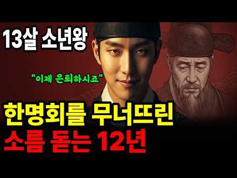
- 설명 앞부분: 계유정난의 설계자, 조선 최대의 권신 한명회를 손끝 하나 안 대고 무너뜨린 왕 — 우리가 "온화한 성군"으로 기억하는 조선 9대 성종의 진짜 얼굴. 1469년 음력 11월 28일, 진시. 경복궁 자미당에서 조선의 왕이 눈을 감았습니다. 그리고 해가 지기 전, 열세 살 소년이 그 자리에 앉았습니다. 단 하루 만에, 나라의 주인이 바뀌었습니다. 왕위 계승 순서로는 세 번째, 네 번째. 죽은 할아버지 세조의 말 한마디가, 그 소년을 왕으로 만들었습니다. 그 뒤에는 계유정난의 설계자, 세조가 "나의 장자방"이라 부른 남자 — 한명회. 소…
- 같은 채널 평소 대비 ×987.8 (채널 최근 롱폼 중앙값 856회) · 평소 영상: 청나라 볼모에서 조선의 왕이 된 효종, 10년 북벌의 비극ㅣ인조는, 왜 아들 소현세자를 … (924회) / 조선 시대 여자로 태어난다는 것, 500년의 지옥 ∣ 그 지옥을 뚫은 여자들 ∣ 한국사 … (787회)
- 대본 없음 (설명) — 음성인식이 끝나면 도입부·흐름이 들어감
- 댓글 241/252: 좋은 점 — 영상 8 · 감사·응원 14 · 더 알고 싶은 것 3 · 아쉬운 점 — 영상 4 · 반박·불만 — 의견 다름 1 · 정치·사회 4 · 경험 공유 3 · 구독·다음 기대 3
  - 좋은 점 — 영상 👍28 “성종 대단한 왕이십니다.좋은이야기 잘봤습니다”
  - 좋은 점 — 영상 👍12 “유익한 내용이네요👍🏻 잘 봤습니다 ☺️”
  - 감사·응원 👍21 “성종에 대해서 많이 알게 되었습니다. 감사합니다.”
  - 감사·응원 👍12 “성종임금을 다시 보게 되는 영상이였습니다. 한명회는 끝까지 안 변했네요. 예나 지금이나 왕의 자리가 저렇게도 힘든 자리였네요. 성종의 지혜로운 발현이 있기까지 얼마나 고심하고 고심했을지 위로와 감사를 드리며 훌륭하십니다_()_”
  - 더 알고 싶은 것 👍3 “이렇게 멋지신 분인 줄 몰랐네요 영상으로나마 잘 알게 되어 감사합니다 강남구 선릉 맞나요? 현시대 좋은 장소에 계서서 다행입니다.”
  - 더 알고 싶은 것 👍1 “칼도 없었고, 사약도 없었습니다. 그런데 권력은 움직였습니다. 1481년 압구정 사건에서 성종은 한명회의 요구를 받아들이지 않았고, 결국 한명회를 추국하라는 명까지 내렸습니다. 여러분은 이 장면을 어떻게 보시나요? 온화한 성군의 원칙적인 대응이었을까요, 아니면 거대한…”
  - 아쉬운 점 — 영상 👍3 “성종임금님 칼을 대지 않고도 한명회를 처리 하였거늘 연산군 어머니도 그리 하였다면 어땠을까요. 역사에 만약이란 말은 부질멊지만요 그러나 후대 우리에게 가르침이 되거 늘 가설을 생각하며 아쉬움도 가져 봅니다”
  - 아쉬운 점 — 영상 👍1 “재미있긴 하지만 같은 내용이 계속 반복되다보니 살짝 몰입이 안되네요 ㅠㅠ”
  - 반박·불만 — 의견 다름 👍8 “이야~ 대단한 왕이였네요. 끈기만 있다고 되는 일이 아니죠. 판을 읽는 눈이 있어야하고 그 판을 자신에게 끌어 올수있는 지혜가 있어야하죠. 13살부터 그런 생각을 했다는건 한 마디로. 천재다!!”
  - 정치·사회 👍5 “조선은. 세종이 없었다면 태어나지 말아야할 왕조다. 백성 의 절반이. 종놈. 노비였다니 말이되나, 나라가 동족의 피를 뻘아먹 고 살아 온것이 아닌가, 조선이 지속 됐다면 국민의 절반이 노비, 종 놈이란 말 아닌가,”
  - 정치·사회 👍0 “역사를 재미있게 하기위해서 ...아니면 잘난척 하기위해서.../한명희가 나이몆에 출사를 했는대../조선은 세종시대부터 너무 평화로와./심심해서 자기들끼리 싸운거다./인간은 너무 평화로우면 자기들끼리 싸운다../그게 한국역사다.../지금도 한국은 자기들끼리 피터지게 잘…”
  - 경험 공유 👍89 “세조도 한명회도 자식들이 요절하는 지옥을 겪었네요. 인과응보겠지요.”
  - 경험 공유 👍57 “내가 생각 하는 조선의 최고의 왕이라면 세종 성종 정조 이렿게 봅니다 영상 잘봤습니다^^”
  - 구독·다음 기대 👍4 “사람은 착하게 살면 끝이 좋다라는 교훈, 역사를 통해서 배웁니다~다음영상도 기대합니다”
  - 구독·다음 기대 👍4 “잘 들었습니다 구독했습니다”

### 61. "일본어 너무 잘해서 턱 빠질 뻔" 일제강점기 한국 드라마가 일본 넷플릭스 TOP10에 들자 일본 시청자들이 남긴 말

- https://www.youtube.com/watch?v=RPBvkCsjnSY · 왓더 · 구독자 3,620 · 조회수 215,345 (×59.5, 하루 8,055.5) · 좋아요 862 (0.4%) · 9.4분 · 2026-10-14 · 주제 묶음 4. 한국 근현대사 · 형식 정보·해설 (그 밖) · 폴더 `W_RPBvkCsjnSY` (웹 승인)
- 썸네일: 
- 설명 앞부분: 1932년 일제강점기 경성, 조선총독부를 무대로 한 한국 드라마 '100일의 거짓말'. 공개 전 일본에서는 반일 드라마라는 말이 나왔지만, 공개 사흘 만에 일본 넷플릭스 시리즈 TOP10에 들었습니다. 정무총감 사토 신이치를 연기한 진선규의 일본어에 "턱이 빠질 뻔했다"는 반응까지 나왔습니다. 일본 리뷰 사이트와 넷플릭스 예고편에 남은 일본 시청자들의 실제 반응을 정리했습니다. 순위·수치: 플릭스패트롤(10월 12~13일 기준), 닐슨코리아 전국 기준, 한국경제·TV리포트·나비콘 보도 배경음악: "Inspired" Kevin Ma…
- 같은 채널 평소 대비 ×63.5 (채널 최근 롱폼 중앙값 3,390회) · 평소 영상: "100년에 한 번 나올 선수" 17살 고등학생 김연경을 처음 본 일본 방송의 첫마디, … (3,513회) / "엄청난 기업이 이웃 나라에" 삼성은 안 산다던 일본에서 갤럭시가 품절되자, 일본 사람들… (3,268회)
- 대본 없음 (설명) — 음성인식이 끝나면 도입부·흐름이 들어감
- 댓글 105/124: 좋은 점 — 영상 0 · 감사·응원 1 · 더 알고 싶은 것 1 · 아쉬운 점 — 영상 0 · 반박·불만 — 의견 다름 3 · 정치·사회 11 · 경험 공유 5 · 구독·다음 기대 0
  - 정치·사회 👍5 “피해자인 우리나라가 반일 드라마 만들수도있는거지 뭘 맨날 그런거가지고 떠들어ㅋㅋ 개인적으로는 이런 드라마가 더더욱 넷플릭스에서 많이 나와야한다고 생각함 전세계에서 볼수있게. 드라마로 이러쿵 저러쿵 할시간에 교과서 탓하지말고 역사공부나하고왔으면..요즘같이 인터넷이랑 A…”
  - 정치·사회 👍1 “실제 일제 강점기를 몸소 겪었던 대부분의 일반적인국민이었던 할머니 할아버지 세대는 일본에 대한 반감이 없는데 이런 영화나 드라마에서는 독립운동을 했던 인물들은 모두 선한 역으로 나라를 위해서 희생한 것으로 그려지고 일본 군인들은 길거리에서 조선인들을 총으로 쏴도 아무…”
  - 경험 공유 👍11 “저도 배우들의 일본어가 완벽해서 깜짝 놀랐어요. 역시 대한민국의 배우님은 글로벌이예요~~”
  - 경험 공유 👍2 “연기 너무 못한다 내가 제일 잘나가 이러고 있는 것 같네 일반인 사이에 조증걸린 인간 같다 저 매력적인 캐릭터를 이따위로 해석하다니”

### 62. 사람을 밟아 죽이고 외딴섬으로 쫓겨났다, 조선 왕이 코끼리를 유배 보낸 사연

- https://www.youtube.com/watch?v=CdyTqgp82Fo · 역사한편 · 구독자 1,150 · 조회수 95,466 (×83.0, 하루 2,544.6) · 좋아요 176 (0.2%) · 17.6분 · 2026-10-04 · 주제 묶음 3. 조선 · 형식 사연·드라마 · 폴더 `W_CdyTqgp82Fo` (웹 승인)
- 썸네일: 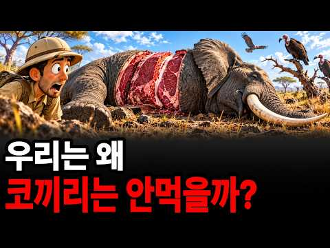
- 챕터: 0:00 코끼리는 왜 식탁에 없을까 · 0:43 일본이 보낸 낯선 선물 · 2:03 사람을 밟아 죽인 코끼리 · 2:46 처형 대신 섬 유배가 된 이유 · 4:11 초기 인류의 코끼리 해체 · 5:29 식용 가축이 될 수 없는 이유 · 6:43 세 고을이 나눈 사육 부담 · 9:55 인간과 함께 일한 동료 · 12:08 코끼리 마음을 본 과학 연구 · 15:34 코끼리 고기와 멸종 위기
- 설명 앞부분: 사람을 밟아 죽인 코끼리에게 조선 조정은 왜 죽음 대신 섬 유배를 내렸을까요. 600년 전 기록에는 일본의 외교 선물로 온 코끼리가 조선의 큰 부담이 되어 가는 과정이 담겨 있습니다. 먼 옛날 인류는 코끼리를 먹었는데, 오늘날 식탁에서 보기 어려운 이유는 무엇일까요. 조선의 기록과 현대 연구를 따라가며 이 거대한 동물을 바라보는 인간의 시선을 살펴봅니다.
- 같은 채널 평소 대비 ×71.7 (채널 최근 롱폼 중앙값 1,331회) · 평소 영상: 영하 40도 빙하기가 인간과 늑대를 묶었다, 혹한을 버텨낸 두 종족의 생존법 (1,388회) / 영하 50도 혹한에도 살아남았다, 그린란드 판잣집에 숨겨진 생존의 비밀 (1,274회)
- 대본 없음 (설명) — 음성인식이 끝나면 도입부·흐름이 들어감
- 댓글 20/55: 좋은 점 — 영상 0 · 감사·응원 0 · 더 알고 싶은 것 1 · 아쉬운 점 — 영상 0 · 반박·불만 — 의견 다름 1 · 정치·사회 0 · 경험 공유 0 · 구독·다음 기대 0
  - 더 알고 싶은 것 👍0 “맛이 궁금하네요..빙하기때 맘모스도 인간이 멸종시킨거란 가설도있던데..맛이 나쁘지 않은듯 한데..코끼리도 초식동물이기도하고..”
  - 반박·불만 — 의견 다름 👍1 “무슨 첨단 헛소리야? 사람이 코끼리를 왜 안 먹어?? 동남아에선 자주 먹는데~ 특히 태국에선 고깃집에서도 파는데. 아프리카에서도 코끼리사냥해서 잘 먹는데~! 아니 털코끼리였던 매머드가 없었다면 인류는 빙하기에 멸종해버렸을걸? 식량부족으로. 식량도 식량이지만, 덮고 잘…”

### 63. 3D로 보는 조선시대 과거시험 250km 여정 ∣ 10년 낙방 무관 노상추의 7일

- https://www.youtube.com/watch?v=I9OuWbhZvzA · 조상님 클라쓰 · 구독자 8,640 · 조회수 554,058 (×64.1, 하루 18,764.2) · 좋아요 1,554 (0.3%) · 7.5분 · 2026-10-12 · 주제 묶음 3. 조선 · 형식 정보·해설 (그 밖) · 폴더 `W_I9OuWbhZvzA` (웹 승인)
- 썸네일: 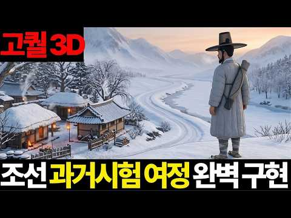
- 챕터: 0:00 강창나루의 새벽 · 0:21 끝까지 보시면 · 0:48 10년 낙방 · 1:36 밭 열두 마지기 · 2:04 산적과 호랑이? · 2:26 첫날, 함창 · 2:58 세 고개 · 3:31 문경새재를 넘다 · 3:43 '원'의 정체 · 4:19 원이 사라지다 · 4:36 주막의 밤 · 4:50 토렴 · 5:23 온돌 · 5:39 언 한강을 건너 · 5:57 시험장 · 6:41 열둘째 이름
- 설명 앞부분: 1780년 정월, 경상도 선산의 서른다섯 살 사내 노상추가 친척에게 밭 열두 마지기를 팔아 마련한 노잣돈을 들고 한양 무과 시험길에 오릅니다. 10년째 낙방, 이번에도 떨어지면 돌아갈 곳이 없습니다. 열일곱 살부터 여든넷까지 67년 동안 쓴 『노상추일기』 속 7일간, 약 250km의 과거길을 3D로 따라 걷습니다. 출발: 1780년(정조 4) 정월 21일 선산 강창나루 → 함창 덕통참 → 문경새재(조령) → 연풍 → 충주 → 죽산·용인 → 27일 서빙고 나루의 언 한강을 걸어 건너 숭례문 원(院): 대개 30리(약 12km)마다 …
- 같은 채널 평소 대비 ×58.1 (채널 최근 롱폼 중앙값 9,540회) · 평소 영상: 조선판 오디세우스, 148일간의 사투 ∣ 표류한 관리 최부의 실제 기록 (10,830회) / 설악산 세 바위는 땅속에서 한 뿌리였다 ∣ 태백산맥, 한반도의 등뼈 (8,251회)
- 대본 없음 (설명) — 음성인식이 끝나면 도입부·흐름이 들어감
- 댓글 49/189: 좋은 점 — 영상 1 · 감사·응원 0 · 더 알고 싶은 것 1 · 아쉬운 점 — 영상 2 · 반박·불만 — 의견 다름 0 · 정치·사회 2 · 경험 공유 0 · 구독·다음 기대 0
  - 좋은 점 — 영상 👍4 “잼있고 산박하고 유익하네요. 굿 콘텐츠 상 수여함! ㅋㅋㅋ”
  - 더 알고 싶은 것 👍5 “재미있게 잘 봤습니다 조상님들의 사적행보, 생활이 재밌네요 또 부탁드립니다”
  - 아쉬운 점 — 영상 👍0 “설명 해주시는분...ai 음성 인가요?? 실제 사람 음성 인가요.....???아시는분 댓글좀...”
  - 정치·사회 👍0 “저 낙방에 낙방을 계속하다가 막판에 겨우 합격한 노상추가 윤석열로 환생한 건 아닐까? 윤석열도 9수나 하고 막판에 기적적으로 합격했다는데...ㅋㅋ 뭐 아님 말고”

### 64. 조선 최고의 신랑감이 하루아침에 한양 제일의 망나니가 된 이유 /야담 조선야담 옛날이야기 오디오북 수면동화 전래동화

- https://www.youtube.com/watch?v=5tjsVKWQES0 · 썰톡 TV · 구독자 3,390 · 조회수 470,944 (×138.9, 하루 7,151.8) · 좋아요 7,534 (1.6%) · 87.1분 · 2026-08-18 · 주제 묶음 9. 야사·야담·옛날이야기 · 형식 수면·낭독 (잠잘 때 듣는) · 폴더 `W_5tjsVKWQES0` (웹 승인)
- 썸네일: 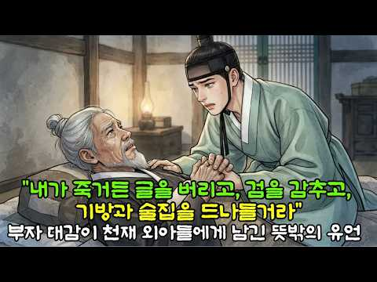
- 설명 앞부분: 📝 오늘의 이야기 미리보기 조선 최대 소금 객주이자 벼락 부자로 이름난 윤만석 대감. 그에게는 한 번 본 글을 잊지 않고 무예마저 출중한 ‘천재 외아들’ 시겸이 있었습니다. 도성의 명문가들이 앞다투어 사위로 삼으려던 장안 최고의 신랑감이었지요. 그런데 아비가 숨을 거두기 직전, 외아들의 손을 꼭 쥐고 남긴 유언은 기이하기 짝이 없었습니다. “아들아, 제발 망나니가 되어 살아라!” 평생 학문과 절제를 배우던 천재는 하루아침에 한양 최고의 '미친 망나니'가 되었습니다. 상복을 입은 채 술판을 벌이고, 기방에 은전을 뿌리며, 자신을 걱…
- 같은 채널 평소 대비 ×16,239.4 (채널 최근 롱폼 중앙값 29회) · 평소 영상: 행방불명된 딸을 찾던 조선 최고 부자가 딸 묘지서 통곡하는 여인을 본 순간 /야담 조선야… (29회) / 눈보라 속 백구가 전해준 보따리, 산골 과부의 운명을 통째로 뒤바꾼 15년 /야담 조선야… (29회)
- 대본 없음 (설명) — 음성인식이 끝나면 도입부·흐름이 들어감
- 댓글 123/126: 좋은 점 — 영상 0 · 감사·응원 9 · 더 알고 싶은 것 0 · 아쉬운 점 — 영상 0 · 반박·불만 — 의견 다름 0 · 정치·사회 0 · 경험 공유 0 · 구독·다음 기대 0
  - 감사·응원 👍18 “중국풍의 얘기보다 너무 잘 들었습니다. 맘으로 응원합니다”
  - 감사·응원 👍15 “광고업시. 끝까지 들려주어서. 감사감사해서요. 대박나시길 바랍니다.”

### 65. 사극에는 절대 나올 수 없는 조선 주막의 적나라한 민낯

- https://www.youtube.com/watch?v=cE8_zCNVONE · 한끗역사 · 구독자 3,450 · 조회수 1,197,068 (×347.0, 하루 7,266.6) · 좋아요 5,570 (0.5%) · 29.4분 · 2026-05-29 · 주제 묶음 3. 조선 · 형식 정보·해설 (그 밖) · 폴더 `W_cE8_zCNVONE` (웹 승인)
- 썸네일: 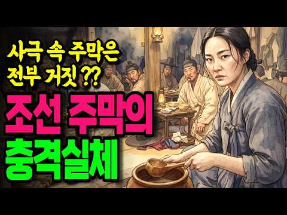
- 설명 앞부분: 사극 속 주막은 전부 거짓말이었다! 넓고 깔끔한 공간에서 국밥을 먹고 회포를 푸는 낭만적인 장소? 실제 주막은 가로 2.5m, 세로 1.8m 방에 10명이 엉켜 자고, 바닥 온도가 39도까지 올라가고, 벽 하나 너머에서 말이 싸우는 곳이었습니다. 그런데 이 허름한 초가삼간이 조선 전국에 12만 개. 지금 편의점 세 체인을 합쳐도 5만 5천인데, 그 두 배가 넘었습니다. 🔹 2000대 1 경쟁률, 과거시험을 앞둔 선비들은 왜 오직 문경새재만 고집했을까? 🔹 주막에서 술을 마신 5명은 합격하고, 안 마신 1명은 떨어진 전설의 진실 🔹…
- 같은 채널 평소 대비 ×514.5 (채널 최근 롱폼 중앙값 2,326회) · 평소 영상: 교과서가 숨긴 불편한 진실! 세종의 휘황찬란한 업적은 전부 다른 사람 성과를 가로챈것이었… (2,485회) / 알고보면 소름돋는 비밀이 숨겨져 있다? 조선시대 겸재 정선의 '이 그림' (2,168회)
- 대본 없음 (설명) — 음성인식이 끝나면 도입부·흐름이 들어감
- 댓글 271/290: 좋은 점 — 영상 6 · 감사·응원 4 · 더 알고 싶은 것 3 · 아쉬운 점 — 영상 2 · 반박·불만 — 의견 다름 1 · 정치·사회 7 · 경험 공유 8 · 구독·다음 기대 1
  - 좋은 점 — 영상 👍8 “역사를 아는 유익함과 동시에 현재 대한민국에 태어난 사람으로서 조선 시대는 사람이 인간으로서 너무 살기 힘들었겠다 싶다”
  - 좋은 점 — 영상 👍4 “19:25 거꾸로 생각해 보면 말입니다 조선에서도 여성의 사회 진출이 시작되고 있었고 자영업자들의 경제활동도 생각보다 활발했다는 점도 짐작해 볼 수 있겠습니다 우리가 생각하는 것만큼 꽉 막힌 사회가 아니였다는 추론도 가능 미국도 1920년이 되어서야 여성에게 투표권이…”
  - 감사·응원 👍8 “감사합니다 구독 좋아요 했어요”
  - 감사·응원 👍3 “좋은영상 감사합니다. 구독누르고 갑니다”
  - 더 알고 싶은 것 👍3 “여러분들은 중요한 일이 있을 때 지키는 나만의 징크스같은게 있으신가요? 댓글로 알려주세요”
  - 아쉬운 점 — 영상 👍2 “몇번본거 짜집기 😂”
  - 아쉬운 점 — 영상 👍1 “차단 ㅉㅉ 잘못된정보 투성 뇌피셜”
  - 반박·불만 — 의견 다름 👍1 “ㅠㅠㅠ, 큰 시험보는날 아침 , 아 글쎄 마눌님이 미역국, 보기좋게 꽝! 고마워 마눌님.”
  - 정치·사회 👍10 “6만명에 고작 33명 합격이면 금을 캐는 광부보다 곡갱이.삽.호미를 파는 사람이 돈을 벌었네요 현대판 장원급재인 사법고시를 없앤 노무현을 싫어합니다 그는 중국인에게 영주권 과 투표권까지 팔아먹은 놈 이었습니다 ~~~”
  - 경험 공유 👍38 “어릴 때 시골 온돌방 경험했었는데 진짜 뜨거워서 못 잠”
  - 경험 공유 👍9 “주막은 몸도 팔고 술도 팔고 노래도 팔았다. 내가 어릴 때까지도 그랬다.”
  - 구독·다음 기대 👍3 “좋은영상 감사합니다. 구독누르고 갑니다”

### 66. 며느리보다 10살 어린 시어머니, 그녀는 조선을 뒤흔들었다

- https://www.youtube.com/watch?v=T8bS_yX629Y · 역사정복 · 구독자 422 · 조회수 57,363 (×135.9, 하루 881.7) · 좋아요 178 (0.3%) · 16.8분 · 2026-09-06 · 주제 묶음 3. 조선 · 형식 사연·드라마 · 폴더 `W_T8bS_yX629Y` (웹 승인)
- 썸네일: 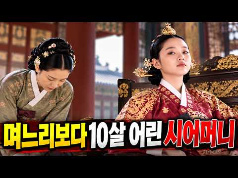
- 설명 앞부분: 66세 왕과 15세 신부, 나이 차 51년. 조선 519년 역사상 가장 극단적인 왕실 결혼이었습니다. 흔히 떠올리는 '불쌍한 어린 신부' 이야기는 여기서 끝나지 않습니다. 이 소녀는 훗날 정조가 세상을 떠난 뒤, 조선 정치를 뒤흔든 최고 권력자가 됩니다. 이 영상에서는 영조와 정순왕후의 결혼부터, 정조와의 미묘한 관계, 그리고 수렴청정을 통해 신유박해와 장용영 해체를 주도하는 과정까지 시간 순서로 따라갑니다. 정약용 형제의 운명이 어떻게 바뀌었는지, 그리고 51년이라는 나이 차이가 만들어낸 진짜 승자와 패자가 누구였는지를 확인하실…
- 같은 채널 평소 대비 ×126.4 (채널 최근 롱폼 중앙값 454회) · 평소 영상: 왕보다 강했던 신하 한명회, 그의 집안에는 무슨 일이 있었나? (454회) / 삼국지 최대 굴욕을 참은 남자의 소름 돋는 결말 (458회)
- 대본 없음 (설명) — 음성인식이 끝나면 도입부·흐름이 들어감
- 댓글 13/13: 좋은 점 — 영상 0 · 감사·응원 0 · 더 알고 싶은 것 0 · 아쉬운 점 — 영상 0 · 반박·불만 — 의견 다름 0 · 정치·사회 0 · 경험 공유 0 · 구독·다음 기대 0

### 67. 양반도 부러워했다?! 백정의 충격적인 사생활!! ∣ 조선의 백정 ∣ 한국사

- https://www.youtube.com/watch?v=um-bKohXZK0 · 스토리퐁당 · 구독자 1,080 · 조회수 238,575 (×220.9, 하루 2,235.2) · 좋아요 1,155 (0.5%) · 26분 · 2026-07-26 · 주제 묶음 4. 한국 근현대사 · 형식 정보·해설 (그 밖) · 폴더 `W_um-bKohXZK0` (웹 승인)
- 썸네일: 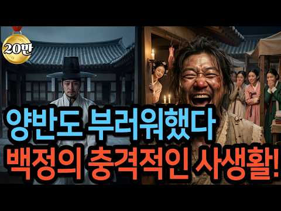
- 설명 앞부분: 조선에서 소 한 마리를 잡으면 집 한 채 값이 손에 들어왔습니다. 💰 그 돈을 만진 사람은 정승도, 판서도 아닌 바로 '백정'이었습니다. 길에서 마주치면 양반이 침을 뱉고 지나가던 사람. 죽어서 족보에 이름 석 자조차 올리지 못했던 사람. 그런데 그의 곳간에는 그를 무시하던 양반보다 더 많은 곡식이 쌓여 있었습니다. 🐂 가장 낮은 자리에 있던 사람이 어떻게 양반도 쉽게 만지지 못하던 돈을 손에 쥐게 됐을까요? 그리고 그렇게 돈을 벌고도 왜 죽을 때까지 그 신분을 벗어나지 못했을까요? 🤔 이 영상에서는 👇 백정이 사실은 노비가 아니…
- 같은 채널 평소 대비 ×890.2 (채널 최근 롱폼 중앙값 268회) · 평소 영상: 영국은 왜 4개국일까? 나라가 쪼개진 충격적 이유! ∣ 세계사 (268회) / 한국사 최강 인간병기 척준경! ∣ 그는 영웅인가? 역적인가? ∣ 척준경 ∣ 고려사 (283회)
- 대본 없음 (설명) — 음성인식이 끝나면 도입부·흐름이 들어감
- 댓글 96/96: 좋은 점 — 영상 1 · 감사·응원 1 · 더 알고 싶은 것 1 · 아쉬운 점 — 영상 0 · 반박·불만 — 의견 다름 5 · 정치·사회 3 · 경험 공유 0 · 구독·다음 기대 0
  - 감사·응원 👍1 “감사합니다❤❤”
  - 더 알고 싶은 것 👍13 “백정은 조선건국과 맞다아 있는 것 같습니다. 태조 이성계의 조상이 어디입니까? 북방 이민족이죠. 이들도 고려시대에서는 화척이였습니다. 하지만 이들은 세력을 가지고 성장하여 고려를 무너뜨리고 새로운 나라(조선)를 세웁니다. 그 조선에게서 (무장세력으로 강해질 수 있던)…”
  - 반박·불만 — 의견 다름 👍2 “글쎄요?”
  - 반박·불만 — 의견 다름 👍1 “무슨 말도 안돼. 백정이 얼마나 천시받고 굶주리고 살았는데---소가 전부 지 것인가. 남의 소 잡아주는 품삵 조금 더 받는정도인데. 소피를 가져오고 그걸 먹고.. 뭔 말도 안되는 소리가 곳간에 양식이 넘쳐 나다니..”
  - 정치·사회 👍12 “조선이라는 나라가 그냥 개막장 나라 였음.”
  - 정치·사회 👍1 “조선에서 저돈을 지킬수 있었을까? 잡아서 주리틀면 돈 다 뺏김 지금 국회의원 봐라 한자 못 읽으면 눈 뜨고 코베임 ai가 이상하게 알려주내”

### 68. 청나라 멸망 후, 500만 만주족에게 벌어진 일 ∣ 청나라 감춰진 역사 이야기

- https://www.youtube.com/watch?v=PmeHs6CH_ro · 그날의 재발견 · 구독자 1,450 · 조회수 250,824 (×173.0, 하루 2,946.6) · 좋아요 1,482 (0.6%) · 14.1분 · 2026-08-04 · 주제 묶음 1. 역사 일반·이야기 · 형식 정보·해설 (그 밖) · 폴더 `W_PmeHs6CH_ro` (웹 승인)
- 썸네일: 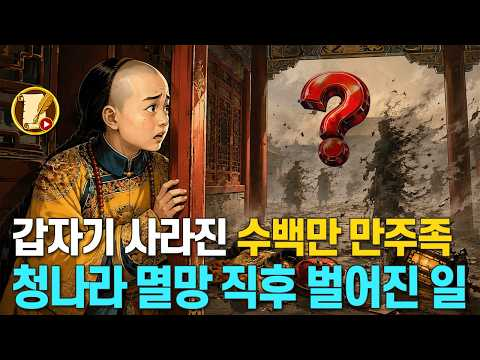
- 설명 앞부분: 300년간 대륙을 호령했던 청나라의 황족과 만주족들. 하지만 1912년 청나라가 멸망하고 신해혁명의 바람이 불어닥치자, 이들의 삶은 하루아침에 바뀝니다. 대륙의 주인에서 도망자로 만주족의 숨겨진 비화를 역사 드라마로 전해드립니다. 오늘도 시청해 주셔서 감사합니다. 본 영상의 제작에 생성형 AI 기술을 활용하였습니다.
- 같은 채널 평소 대비 ×512.9 (채널 최근 롱폼 중앙값 489회) · 평소 영상: 조선 최대 규모 역모 발생. 공포에 질린 숙종. 금단의 예언서 정감록의 충격적 실체 (513회) / 한무제는 왜 태어난 지 몇 달 된 증손자를 감옥에 넣었나 (465회)
- 대본 없음 (설명) — 음성인식이 끝나면 도입부·흐름이 들어감
- 댓글 591/592: 좋은 점 — 영상 9 · 감사·응원 4 · 더 알고 싶은 것 3 · 아쉬운 점 — 영상 0 · 반박·불만 — 의견 다름 5 · 정치·사회 46 · 경험 공유 52 · 구독·다음 기대 0
  - 좋은 점 — 영상 👍16 “정말 귀한 정보네요. 좋은 영상 잘봤습니다. 감사~~^^”
  - 좋은 점 — 영상 👍2 “중국어에 만주어를 배울수없어서. 한족어를 12년 배웠습니다 꽤 재미있군요 세세”
  - 감사·응원 👍16 “정말 귀한 정보네요. 좋은 영상 잘봤습니다. 감사~~^^”
  - 감사·응원 👍1 “감사합니다”
  - 더 알고 싶은 것 👍1 “09:58 아이신기오로(愛新覺羅)를 김씨(金)나 조씨 (趙)? 김은 이해가 되는데, 조는 무슨 무엇으로?...구체적 설명을 부탁드립니다.”
  - 더 알고 싶은 것 👍1 “만주국은 어떤 언어를 공용어로 썼나요?”
  - 반박·불만 — 의견 다름 👍2 “멸만흥한의 기치하에 수많은 만주족이 학살을 피해 조선으로 숨어들어서 한국인이 됐다. 기록에도 북한지역에 만주족들의 집단거주지가 있었다. 일부는 몽골로 도망을 가기도 했으나 대부분의 만주족은 패가망신되서 하류층으로 전락했다. 마지막 황제 부이도 경비원인가 하다 공산당이…”
  - 정치·사회 👍62 “만주국이 망하고 만주족으로 초중고교의 교육을 못하게 한족들이 막았어요. 그러니 언어와 문화를 잃었죠. 이제는 시진핑이 몽고 티베트 조선족의 언어교육도 말살을 하려고 해요. 그러면 자기들 고유한 언어를 잃어버리죠”
  - 정치·사회 👍8 “병자호란에 패배를 해서 조선 백성 60만명이 포로가 되어서 노비 종넘으로 강제로 청나라 심양으로 끌려 갔었다고 혀제에 ~? 나라가 강력한 무력이 없으면은 국민이 종 노예로 짐승처럼 고생을 혀게 되제에 ~?”
  - 경험 공유 👍1 “혈통적으로 유전학적으로 우리 민족과 가장 가까운 민족이 만주족이라는 내용을 본 적이 있습니다. 제가 최근 중국어를 배우면서 알게 된 중국의 과거 동시대에 가장 유명한 가수였던 왕비(왕페이)와 나영(나잉)을 비교해 보면 한족인 왕비보다 만주족인 나영이 한국인의 얼굴과 …”
  - 경험 공유 👍1 “신라기록에개기일식해보면수도가나옴헝가리그리스터키이란인도칠래필리핀일본땅을통치했었다수도는이란에샤한이라고기록되있다”

### 69. 세종대왕 아들 8명 거의 전멸한 진짜 이유 ∣ 세종아들비극 ∣ 천재DNA가부른저주

- https://www.youtube.com/watch?v=REHceL3oduo · 요모조모역사 · 구독자 649 · 조회수 197,733 (×304.7, 하루 1,281.2) · 좋아요 1,289 (0.7%) · 23.7분 · 2026-06-09 · 주제 묶음 3. 조선 · 형식 정보·해설 (그 밖) · 폴더 `W_REHceL3oduo` (웹 승인)
- 썸네일: 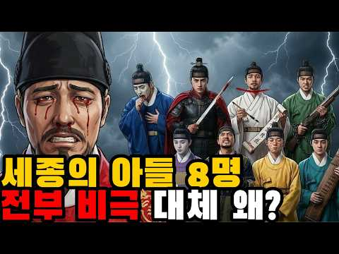
- 설명 앞부분: 세종대왕 아들 8명의 비극적 결말을 정리했습니다. 조선 최고의 성군 세종대왕, 그의 아들 8명 중 50세까지 산 사람은 단 2명뿐입니다. 세종 아들 전멸의 진짜 이유를 파헤칩니다. 세종대왕은 한글을 창제하고 조선의 황금기를 이끈 위대한 왕이었지만, 아버지로서의 삶은 비극 그 자체였습니다. 아들을 잃고, 아내를 잃고, 눈마저 잃어가며 말년을 보낸 세종. 그리고 세종 사후 3년 만에 아들들은 서로에게 칼을 겨눕니다. 문종 39세 병사, 안평대군 유배 8일 만에 사약, 금성대군 단종 복위 실패 후 사약, 광평대군 20세 요절, 평원대군…
- 같은 채널 평소 대비 ×508.3 (채널 최근 롱폼 중앙값 389회) · 평소 영상: 조선시대 직업의 세계: 돈을 쓸어 담았던 사람들 (389회) / 원경왕후, 왕비가 됐더니 동생 넷이 죽었다 ∣ 남편 태종은 왜 처남 4명을 죽여야 했을까? (349회)
- 대본 없음 (설명) — 음성인식이 끝나면 도입부·흐름이 들어감
- 댓글 158/173: 좋은 점 — 영상 0 · 감사·응원 0 · 더 알고 싶은 것 1 · 아쉬운 점 — 영상 0 · 반박·불만 — 의견 다름 0 · 정치·사회 9 · 경험 공유 2 · 구독·다음 기대 0
  - 정치·사회 👍26 “가장 큰 비극은 수양의 계유정난 찬탈이 부른 피의 결과 아닐까요? 강건했던 군주 문종의 사후 어린 왕 단종의 출현에. 왕을 보호하고 섭전해줄 안주인의 부재에...수양 일파가 이르킨 피의 숙청 계유정난에 당대 명필로 이름 높았던 안평대군의 죽음이...단종의 유모였던 혜…”
  - 정치·사회 👍4 “수양이 안그랬음 김종서의 나라가 되지않았을까?”
  - 경험 공유 👍0 “대군으로 자랐으니 평범한 두뇌도 똑똑해 집니다. 천민의 자식도 최고의 스승을 두면 똑똑해 지듯이 천재와 저능아로 태어나지 않는 한 두되는 거의 비슷합니다. 자라면서 좋은 교육환경으로 기초 배경지식을 쌓아 줬느냐에 따라 달라집니다. 제가 교육을 해 본 경험으로는 ᆢ.”
  - 경험 공유 👍0 “이미 비극은 이성계때부터 시작됬다 왕위를 무력으로 피를보며 뺏었는데 …윗 세대가 잘못을하면 아랫세대가 죄값을받는다 죄를짓지말고 남에게 해꼬지도하면 내가족들에게 그대로갑니다 왕건…대통령되고 탄핵되고 교도소가고 권력을탐하면 망가진다”

### 70. 몽골은 왜 다시 일어서지 못했을까, 명나라 황제를 사로잡은 날도 있었다

- https://www.youtube.com/watch?v=rx7pvJRwaTI · 세계사한줌 · 구독자 6,630 · 조회수 321,912 (×48.5, 하루 13,058.0) · 좋아요 1,226 (0.4%) · 26.5분 · 2026-10-17 · 주제 묶음 6. 동양사 (중국·일본·몽골) · 형식 정보·해설 (그 밖) · 폴더 `W_rx7pvJRwaTI` (웹 승인)
- 썸네일: 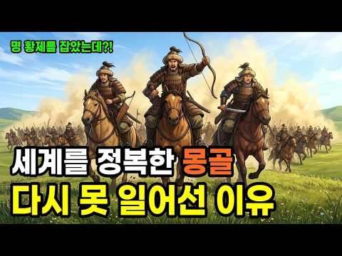
- 챕터: 0:00 1368년, 북쪽 성문이 열린 밤 · 1:39 초원의 나라가 넷으로 갈라지다 · 4:53 원나라 안에서 먼저 무너진 것들 · 11:10 첫 번째 기회, 명나라 황제를 사로잡다 · 14:50 두 번째 기회, 왕비 만두하이와 여덟 살 칸 · 19:40 세 번째 기회, 마지막 칸 링단 · 23:19 잘게 나뉜 초원, 그리고 지금
- 설명 앞부분: 1368년 9월 10일 밤, 원나라 황제가 대도(지금의 베이징)의 북쪽 성문을 나서 초원으로 떠났습니다. 흔히 몽골은 중국 땅에서 편하게 살다 약해졌다고 하지만, 초원으로 돌아간 몽골은 80년 뒤 명나라 황제를 사로잡았습니다. 그런데도 몽골이 왜 다시 한 나라로 일어서지 못했는지를 원나라와 명나라의 역사책, 몽골 사람들이 남긴 연대기로 따라갑니다. 이 영상에서 다루는 내용 칭기즈칸의 자손만 칸이 될 수 있다는 규칙과 아들들에게 백성을 나눠 준 일에서 시작해, 1260년 형제 다툼으로 넷으로 갈라진 몽골과 종이돈 500장으로 좁쌀 …
- 같은 채널 평소 대비 ×16.3 (채널 최근 롱폼 중앙값 19,792회) · 평소 영상: 류큐 왕국은 어떻게 오키나와가 됐을까, 450년 동안 왕이 따로 있던 섬 (19,792회) / 아일랜드는 왜 감자 때문에 100만 명이 죽었을까, 바다가 코앞인 섬이었는데 (13,610회)
- 대본 없음 (설명) — 음성인식이 끝나면 도입부·흐름이 들어감
- 댓글 63/77: 좋은 점 — 영상 0 · 감사·응원 1 · 더 알고 싶은 것 1 · 아쉬운 점 — 영상 0 · 반박·불만 — 의견 다름 1 · 정치·사회 1 · 경험 공유 1 · 구독·다음 기대 0
  - 더 알고 싶은 것 👍2 “몽골이 다시 일어서지 못한 게 정말 군사력이 약해져서였을까요? 명나라 황제까지 사로잡았던 민족인데 말이죠. 어쩌면 몽골이 몰락한 게 아니라, 세상이 변했는데 과거의 승리 방식에서 벗어나지 못했던 건 아닐까요? 여러분은 어떻게 생각하시나요?”
  - 반박·불만 — 의견 다름 👍14 “징기스칸은 몽골인들에게 위인이 아닙니다. 그는 세계사에 큰 민폐를 끼친 악인입니다. 징기스칸은 유럽인들을 구해준 은인일 뿐입니다. 징기스칸과 몽골로 인해 유럽에 화약과 문물을 전파해주었고 그것으로 인해 유럽은 군사력을 키워 동양을 침략하고 아프리카, 아메리카 사람들을…”
  - 정치·사회 👍0 “대한민국서 애국하면 학교도 제대로 못다니거나 도망다니며 살다 죽기나하고 나랄 배반하고 간신짓하고 살면 귀족으로 살며 학교도 잘다녀 의사 변호사 판검사 대통령해서 대대손손 잘사는게 대한민국인거다”

### 71. 조선신궁, 일본은 왜 해방 이튿날 스스로 허물었을까

- https://www.youtube.com/watch?v=j6mMmV4VyFU · 센이의 도토리창고 · 구독자 7,260 · 조회수 266,784 (×36.8, 하루 13,896.3) · 좋아요 657 (0.2%) · 4.2분 · 2026-10-22 · 주제 묶음 3. 조선 · 형식 정보·해설 (그 밖) · 폴더 `W_j6mMmV4VyFU` (웹 승인)
- 썸네일: 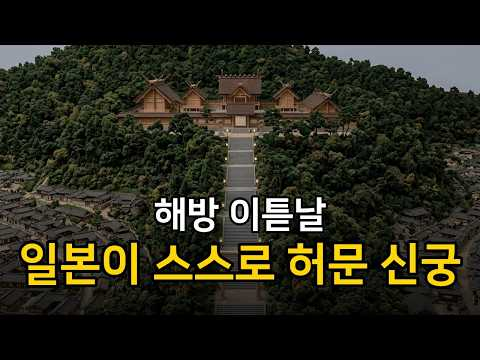
- 설명 앞부분: 서울 남산 서쪽 기슭, 백범광장에서 안중근의사기념관으로 오르는 언덕은 일제강점기 조선에서 가장 높은 서열의 신사, 조선신궁 자리였습니다. 1925년 한양도성 성벽을 허물고 완공해 1942년 한 해에만 약 265만 명이 참배했고, 해방 이튿날인 1945년 8월 16일 승신식을 연 뒤 일본인들이 직접 해체하고 태웠습니다. 빈자리에는 이승만 동상, 남산 식물원, 안중근의사기념관이 차례로 들어섰고, 2014년 발굴에서 신궁 배전 기초 바로 아래 한양도성 성벽이 함께 나왔습니다. 서울시는 둘 다 남겨 2020년 한양도성 유적전시관을 열었습…
- 대본 없음 (설명) — 음성인식이 끝나면 도입부·흐름이 들어감
- 댓글 6/155: 좋은 점 — 영상 0 · 감사·응원 0 · 더 알고 싶은 것 0 · 아쉬운 점 — 영상 0 · 반박·불만 — 의견 다름 0 · 정치·사회 1 · 경험 공유 0 · 구독·다음 기대 0

### 72. [자면서 듣는역사] 왜 그렇게 남편을 잃은 과부를 괴롭혔을까?

- https://www.youtube.com/watch?v=0NcpK50ihfw · 역사원탑 · 구독자 7,380 · 조회수 663,349 (×89.9, 하루 14,066.4) · 좋아요 2,808 (0.4%) · 29.5분 · 2026-09-24 · 주제 묶음 1. 역사 일반·이야기 · 형식 수면·낭독 (잠잘 때 듣는) · 폴더 `W_0NcpK50ihfw` (웹 승인)
- 썸네일: 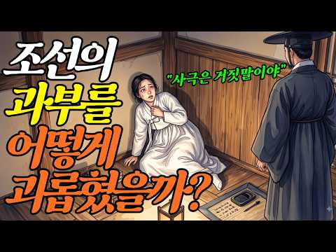
- 챕터: 0:00 재혼 금지? 법에는 그런 말이 없었다 (오프닝) · 1:31 강에 던져진 과부 — 1785년, 죽인 건 가족이었다 · 3:29 그 법에는 금지라는 말이 없었다 — 『경국대전』 · 5:46 마흔여섯 명의 회의 — 1477년 7월 17일 · 7:54 조선 전기, 과부는 재산가였다 · 10:25 평민은 왜 그 법을 몰랐나 · 12:17 수절에서 순절로 — 기준이 올라가다 · 15:04 죽음의 값 — 정려라는 행정 절차 · 18:36 향랑, 1702년 오태강 · 20:29 소문이 사람을 죽일 때 — 김은애 · 22:11 살아남은 과부들 — 바늘과 소지 · 25:22 보쌈, 그리고 417년 만의 한 줄 · 27:49 왜 그런 선택을 해야만 했을까 (엔딩)
- 설명 앞부분: 사극 속 조선의 과부는 늘 소복을 입고 홀로 늙어 갑니다. 재혼은 법으로 금지였다고 배웠죠. 그런데 조선에는 과부의 재혼을 처벌하는 법이 단 한 줄도 없었습니다. 대신 법은, 그 여자가 낳은 아들과 손자의 과거길을 막았습니다. 1785년, 소문 하나로 강에 던져진 과부 — 죽인 사람은 시숙과 친오라비였다 『경국대전』 예전 제과 조 — 벌을 받은 건 여자가 아니라 아들과 손자 1477년 7월 17일, 46명이 모인 회의 — 전면 금지를 주장한 건 열에 하나도 안 됐다 조선 전기의 과부는 재산가였다 — 1566년 「이이 남매 화회문기…
- 같은 채널 평소 대비 ×22.0 (채널 최근 롱폼 중앙값 30,122회) · 평소 영상: 🔥 "여름철 야심한밤 참을 수 있을까?" 무더위를 참지못한 조선평민 남성과 여성은 밤마다… (45,349회) / "그렇게 먹고 오래 살겠나?" 조선 왕들을 죽인 범인의 충격적인 정체 l 역사이야기 (14,896회)
- 대본 없음 (설명) — 음성인식이 끝나면 도입부·흐름이 들어감
- 댓글 263/348: 좋은 점 — 영상 3 · 감사·응원 4 · 더 알고 싶은 것 0 · 아쉬운 점 — 영상 5 · 반박·불만 — 의견 다름 3 · 정치·사회 12 · 경험 공유 4 · 구독·다음 기대 0
  - 좋은 점 — 영상 👍2 “넘 유익하고 재밌네요 이렇게 정리하신거 대단하세요”
  - 좋은 점 — 영상 👍1 “좋은내용 입니다”
  - 감사·응원 👍5 “헐~~ 조선을 망하게한 일본에 감사할일인가... 조선은 진짜 여자와일반백성이 살기에는 진짜 뭣같았네...”
  - 감사·응원 👍5 “우린 늘 일본에 감사함을 느끼고 살아야 한다 일본이 식민 지배 안 햇으면 생각만 해도 끔찍”
  - 아쉬운 점 — 영상 👍0 “조사만 4년을 끈다는 자막이 1조 4만 4년이라고 적혀있네요😂”
  - 아쉬운 점 — 영상 👍0 “조선은 너무 길게유지됐지”
  - 반박·불만 — 의견 다름 👍0 “재미있는 재목으로유튜브 올렸더니 비판만하는인간들 자기는아무이야기 소제도없으면서 남이올린것 판단만하는 웃기는인간 조금보다가재미없으면 다른데로가면되”
  - 정치·사회 👍2 “우리아버지 어머니는.. 내가 국민학교 2학년때쯤인가 효자효부상 받으셨는데 ㅎㅎ 요즘도 주나 몰라요?ㅋㅋ 이것도 나중에 들어보니 할아버지께서 625전쟁통에 빨갱이한테 점령당한 동네를 재탈환하는 과정에서 동네에 남아있던 남자들 총살시킬려고 가둬놓았는데 할아버지께서 당시 …”
  - 정치·사회 👍0 “저 과부에 관한 설명은 양반에 관한 설명같아 보임. 한줌 재밖에 안되는 양반 출신 과부를 조선시대 전체의 여성상으로 보긴 좀 그렇긴 하네요. 물론 여성의 삶이 차별받아온건 맞습니다. 저 조선시대뿐만 아니라 20세기 후반 이전의 모든 여성들이 차별을 받아왔습니다. 연차…”
  - 경험 공유 👍2 “우리아버지 어머니는.. 내가 국민학교 2학년때쯤인가 효자효부상 받으셨는데 ㅎㅎ 요즘도 주나 몰라요?ㅋㅋ 이것도 나중에 들어보니 할아버지께서 625전쟁통에 빨갱이한테 점령당한 동네를 재탈환하는 과정에서 동네에 남아있던 남자들 총살시킬려고 가둬놓았는데 할아버지께서 당시 …”
  - 경험 공유 👍2 “내가 이래서 조선을 역사에서 제일 싫어라 하지. 고려까지는 좋았는데. 조선은 처음부터 썩은 사회여서..”

### 73. 조선시대엔 네비게이션도 없이 어떻게 한양까지 갔을까?선비들만 아는 지름길이 있었나?∣김정호∣대동여지도∣한국사

- https://www.youtube.com/watch?v=AXj7fbQkVos · 역사 밤샘토크 · 구독자 756 · 조회수 139,502 (×184.5, 하루 1,431.0) · 좋아요 1,408 (1.0%) · 33.4분 · 2026-07-22 · 주제 묶음 3. 조선 · 형식 정보·해설 (그 밖) · 폴더 `W_AXj7fbQkVos` (웹 승인)
- 썸네일: 
- 챕터: 0:00 해 질 녘 갈림길에 선 나그네 (인트로) · 2:10 오해 깨기 – 조선엔 정말 지도가 없었을까? · 4:30 단서 1 – 길가의 이정표, 장승의 진짜 정체 · 7:40 단서 2 – 사람에게 묻는 '살아 있는 내비게이션' · 10:30 국가 시스템 – 194개 역참과 3대로 · 14:00 봉수와 파발, 조선의 정보 고속도로 · 17:30 여행자의 하루 – 주막, 노잣돈, 그리고 밤길의 공포 · 21:20 노정기 – 조선판 손글씨 내비게이션 · 23:10 도로고와 대동여지도, 길을 데이터로 묶다 · 24:23 [반전] 김정호 옥사설은 누가, 왜 만들었나 · 30:20 오늘까지 살아남은 옛길의 흔적
- 설명 앞부분: 지도도, 내비게이션도 없던 조선 시대. 그런데 사람들은 부산에서 한양까지, 어떻게 단 한 번도 길을 잃지 않았을까요? 표지판도 없고 물어볼 사람도 없는 갈림길 앞에서 조선 사람들이 길을 찾은 진짜 비결을 하나씩 파헤쳐 봅니다. 길가의 장승부터 역참·파발·봉수, 그리고 신경준의 도로고와 김정호의 대동여지도까지. 그리고 영상 마지막. 우리가 교과서에서 눈물 흘리며 배운 '김정호 옥사설'이 사실은 통째로 지어낸 이야기였다는 충격적인 반전이 기다리고 있습니다. 그 이야기를 누가, 왜 만들었는지까지 끝까지 확인해 보세요. 타임라인 지도 없…
- 같은 채널 평소 대비 ×622.8 (채널 최근 롱폼 중앙값 224회) · 평소 영상: 조선 최고의 의문사, 정조의 마지막 48시간∣ 정조 죽던 날, 그가 마지막으로 부른 이름… (224회) / 한국사∣“전 세계가 열광한 '오디세이’는 신화… 근데 이게 조선에서 진짜 있었다 (붓 하… (216회)
- 대본 없음 (설명) — 음성인식이 끝나면 도입부·흐름이 들어감
- 댓글 60/60: 좋은 점 — 영상 0 · 감사·응원 2 · 더 알고 싶은 것 1 · 아쉬운 점 — 영상 1 · 반박·불만 — 의견 다름 0 · 정치·사회 0 · 경험 공유 1 · 구독·다음 기대 0
  - 감사·응원 👍0 “구독과 좋아요 보내줄께 힘내서 잘 찾아가라😂”
  - 감사·응원 👍0 “덕분입니다 감사합니다 투표는전자투표가 답이다”
  - 더 알고 싶은 것 👍1 “조선 시대 지식을 더 알 수 있도록 동영상 많이 만들어주세요”
  - 아쉬운 점 — 영상 👍0 “이야기 전개가 지루해요”
  - 경험 공유 👍0 “내비게이션 생긴 지는 얼마 되지 않았지요. 제가 아는 사람은 사회과 부도 보고 여행한 사람도 있었답니다.”

### 74. 가족을 모두 잃고 18년을 버틴 광해군 ∣ 왕에서 죄인이 된 비극적인 최후

- https://www.youtube.com/watch?v=KRTIB2WwIQw · 웅이 역사원정대 · 구독자 1,820 · 조회수 228,152 (×125.4, 하루 3,438.1) · 좋아요 2,931 (1.3%) · 48분 · 2026-09-05 · 주제 묶음 3. 조선 · 형식 정보·해설 (그 밖) · 폴더 `W_KRTIB2WwIQw` (웹 승인)
- 썸네일: 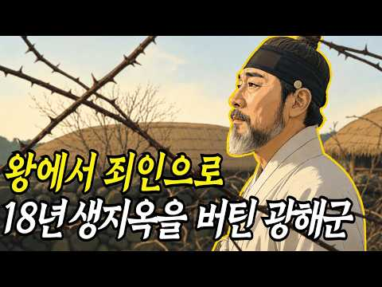
- 설명 앞부분: 왕좌에서 쫓겨난 뒤에도 18년이 넘는 유배 생활을 견뎌낸 조선의 왕이 있습니다. 조선의 제15대 국왕, 광해군입니다. 1623년 인조반정으로 하루아침에 왕의 자리에서 쫓겨난 광해군. 아들 폐세자 이지는 교동도의 가시 울타리 안에서 가위와 인두를 이용해 약 21미터의 땅굴을 팠습니다. 오늘날 아파트 7층 높이에 맞먹는 거리였어요. 그러나 목숨을 건 탈출은 실패했습니다. 며느리 박씨가 먼저 스스로 생을 마감했고, 한 달 뒤에는 폐세자에게 자진하라는 명이 내려졌습니다. 그해 윤10월에는 아내 유씨마저 유배지에서 세상을 떠났어요. 가족을…
- 같은 채널 평소 대비 ×49.3 (채널 최근 롱폼 중앙값 4,632회) · 평소 영상: 죽어야만 나갈 수 있을까? 우리가 미처 몰랐던 조선 궁녀들의 삶 #한국사 #역사이야기 (6,297회) / 조선시대 내시도 부부생활이 가능했을까? 실록에 남은 결혼과 성생활 ∣ 역사스토리텔링 (2,967회)
- 대본 없음 (설명) — 음성인식이 끝나면 도입부·흐름이 들어감
- 댓글 155/165: 좋은 점 — 영상 1 · 감사·응원 5 · 더 알고 싶은 것 0 · 아쉬운 점 — 영상 0 · 반박·불만 — 의견 다름 4 · 정치·사회 11 · 경험 공유 3 · 구독·다음 기대 0
  - 좋은 점 — 영상 👍3 “일체유심조! 인생은 맘먹기에 따른 것입니다. 오히려 광해군은 편안한 마음입니다. 그리고 광해군에게 영감이란 당시의 호칭은 오늘날 상대를 낮추는 멸칭이 아닙니다. 중앙에서 높은 직위에 있었던 사람들에게 쓰여진 존호였습니다. 좋은 영상 감사합니다 🎉”
  - 감사·응원 👍5 “덕분입니다 감사합니다”
  - 감사·응원 👍3 “너무나 광해군에 대해 설명을 놀랐만큼 잘 해주셔서 역사를 알게 되었습니다 감사합니다 존경합니다 나라를 위해 정직하게 하옵소서”
  - 반박·불만 — 의견 다름 👍4 “임진왜란과 병자호란 두개의 큰 변란은 강한 주변세력을 제대로 대처하지 못해서 일어난 사건으로 볼 수 있지요. 첫째는 지도자인 왕들이 매우 무능했고 둘째는 대신들이 옹졸하고 무능했기 때문으로 볼 수 있지요. 이율곡이 십만양병설을 제의했지만 무시하고 무사안일한 대처로 참…”
  - 반박·불만 — 의견 다름 👍3 “일체유심조! 인생은 맘먹기에 따른 것입니다. 오히려 광해군은 편안한 마음입니다. 그리고 광해군에게 영감이란 당시의 호칭은 오늘날 상대를 낮추는 멸칭이 아닙니다. 중앙에서 높은 직위에 있었던 사람들에게 쓰여진 존호였습니다. 좋은 영상 감사합니다 🎉”
  - 정치·사회 👍22 “광해군은 강대국 명ㆍ청사이에서 외교 국방을 잘한 🤴 👑왕입니다 국민(*백성)의 희생을 최소화한 임금🎉이었어요 ❤😂🎉 인조는 후금ㆍ청나라의 침략ㆍ병자호란1636을 유발해 백성이 많이 죽고 남한산성으로 피신해 길동?에서 삼배9고두례하고 소현세자와 수십만명(여성포함)을 인…”
  - 정치·사회 👍15 “광해군 뭐가 그리 잘못했나요 어느임금 손에 피안묻힌 왕있었나요 무능한인조 그러니 나라가 그꼰ㄷ났죠”
  - 경험 공유 👍2 “내가 보기엔 광해보다. 인조가. 더. 비참했다고. 생각함니다”
  - 경험 공유 👍0 “광해가뭔죽을만큼큰죄도아니건만!수양대군은친혈육까지도피를묻히고도발한자!조선은없었어야될역사다!특히선조인조의무능함은어찌말로다하리오!임진왜란병자호란겪고_소현세자등일반인공녀들반출등등심한백성들의피해가필설로다할수없네!광해는폐위되고도18년을버텼다니?비참한유배지에서친혈족은다죽고_뭘희망…”

### 75. 중국 역사의 가장 잔혹한 시대 '오호십육국'은 정말 단순한 대혼란이었을까?

- https://www.youtube.com/watch?v=FGh1bXJM8x0 · 북방의 눈 · 구독자 1,590 · 조회수 134,829 (×84.8, 하루 2,980.6) · 좋아요 885 (0.7%) · 109분 · 2026-09-26 · 주제 묶음 1. 역사 일반·이야기 · 형식 정보·해설 (그 밖) · 폴더 `W_FGh1bXJM8x0` (웹 승인)
- 썸네일: 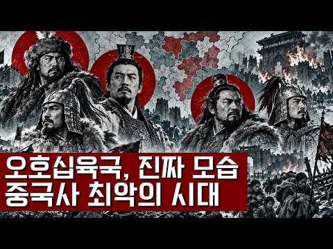
- 설명 앞부분: 오호난화부터 수당 통일까지, 285년간 이어진 분열과 민족 융합의 역사를 심도 있게 분석합니다. 이민족과 한족이 어떻게 공존하며 새로운 제국의 기틀을 다졌는지 영상에서 바로 확인해 보세요.
- 같은 채널 평소 대비 ×473.9 (채널 최근 롱폼 중앙값 284회) · 평소 영상: 초원의 굶주린 늑대에서 천하의 주인이 되기까지, 청나라 황제들의 조상 여진족 이야기 (372회) / 14억 한족은 어떻게 탄생했는가: 고대 DNA와 1만 년 역사가 말해주는 혈통의 진실 (197회)
- 대본 없음 (설명) — 음성인식이 끝나면 도입부·흐름이 들어감
- 댓글 23/23: 좋은 점 — 영상 0 · 감사·응원 0 · 더 알고 싶은 것 0 · 아쉬운 점 — 영상 0 · 반박·불만 — 의견 다름 1 · 정치·사회 3 · 경험 공유 0 · 구독·다음 기대 1
  - 정치·사회 👍1 “염위가 잘못생각한 것은...주인을 배신한 인물이라는 것이 이민족들에게 그리고 한족에게도 전해진 것 임..한족들은 이민족 힘들어 하지만 배신한 염위를 더 싫어 하는 거임 그렇게 석호가 잘해주었는데도 배신 하고 갈족을 학살 했으니 한족들도 등돌렸고 그래서 염위가 정권 잡…”
  - 정치·사회 👍1 “사마씨(司馬氏)가 결국 유씨(劉氏)에게 몰락한 시대이죠. 유방(劉邦)의 후계자 자처한 유연(劉淵)은 국호를 한(漢)으로 고치고, 삼조오종(三祖五宗)의 종묘를 모셨지요. 삼조(三祖)는 "태조 유방", "세조 유수", "열조 유비", 오종(五宗)은 한나라의 유명한 황제 …”
  - 구독·다음 기대 👍3 “와 이런거 너무 좋아요 거란 선비 얘기도 정주행할게요❤❤❤❤”

### 76. 웹소설 임진왜란 2072 - 제1부 노량대전 ( 제08장 귀선 부상 )

- https://www.youtube.com/watch?v=LUbqbOx35pA · 라이프 갤러리 · 구독자 1,150 · 조회수 175,683 (×152.8, 하루 2,141.8) · 좋아요 201 (0.1%) · 5.4분 · 2026-08-20 · 주제 묶음 3. 조선 · 형식 정보·해설 (그 밖) · 폴더 `W_LUbqbOx35pA` (웹 승인)
- 썸네일: 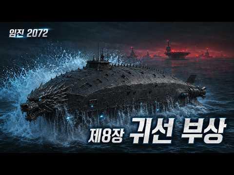
- 설명 앞부분: 일본 제1기동함대는 대한민국 귀선전단의 모든 능동 신호가 사라지자 탐색망을 확대한다. 그러나 귀선 ‘현무·청룡·백호’는 이미 심해를 통해 적 함대의 중심부까지 은밀하게 접근한 상태였다. 이순신 대장의 명령이 떨어지는 순간, 세 척의 귀선이 거대한 물기둥을 일으키며 동시에 수면 위로 부상한다. 예상하지 못한 방향에서 등장한 귀선전단으로 인해 일본 함대의 진형과 지휘망은 순식간에 혼란에 빠진다. 선봉의 ‘현무’가 적 기함을 향해 돌진하고, ‘청룡’과 ‘백호’가 좌우 퇴로를 봉쇄한다. 심해의 침묵을 깨고 모습을 드러낸 귀선전단은 마침내…
- 같은 채널 평소 대비 ×34.8 (채널 최근 롱폼 중앙값 5,043회) · 평소 영상: 웹소설 임진왜란 2072 - 제2부 대한해협 전쟁 ( 제05장 심해의 결투 ) (5,349회) / 웹소설 임진왜란 2072 - 제2부 대한해협 전쟁 ( 제01장 오로치 ) (4,737회)
- 대본 없음 (설명) — 음성인식이 끝나면 도입부·흐름이 들어감
- 댓글 14/14: 좋은 점 — 영상 0 · 감사·응원 0 · 더 알고 싶은 것 0 · 아쉬운 점 — 영상 0 · 반박·불만 — 의견 다름 0 · 정치·사회 0 · 경험 공유 0 · 구독·다음 기대 0

### 77. 400년 뒤 미래로 이동한 조선남자가 조선손맛으로 식당을 도와주면 생기는 일 ㅋㅋㅋㅋ

- https://www.youtube.com/watch?v=Al4AjgCif5c · 우리드라마 · 구독자 6,140 · 조회수 732,409 (×119.3, 하루 11,431.3) · 좋아요 1,663 (0.2%) · 111분 · 2026-08-25 · 주제 묶음 3. 조선 · 형식 몰아보기·통합본 (긴 영상) · 폴더 `W_Al4AjgCif5c` (웹 승인)
- 썸네일: 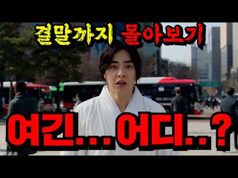
- 설명 앞부분: 드라마 : 허식당 주연 : 시우민 추소정 이수민 이세온
- 같은 채널 평소 대비 ×5.5 (채널 최근 롱폼 중앙값 133,919회) · 평소 영상: 🔥원작 누적 조회수 무려 26억뷰🔥회사에서 제일 쓸모없는 부서에 발령받은 신입사원 곽동연… (147,181회) / 🔥수학여행 갔는데 갑자기 휴대폰에 ‘마피아 게임’이 설치됐다🔥넷플릭스 한국 TOP10에 … (120,657회)
- 대본 없음 (설명) — 음성인식이 끝나면 도입부·흐름이 들어감
- 댓글 194/197: 좋은 점 — 영상 0 · 감사·응원 2 · 더 알고 싶은 것 0 · 아쉬운 점 — 영상 3 · 반박·불만 — 의견 다름 0 · 정치·사회 0 · 경험 공유 5 · 구독·다음 기대 1
  - 감사·응원 👍1 “뭐든 시작엔 초보가 있으니 경력직으로 될때까지 열심히 힘내보아요😂”
  - 감사·응원 👍1 “연기자 분들 힘내시오 첨부터 완벽이란 없는 것이외다. ㅎ”
  - 아쉬운 점 — 영상 👍1 “발연기 심하긴한데 재미지긴하네 ㅋ 이것저것 짜깁기 ㅋ”
  - 아쉬운 점 — 영상 👍0 “먼노무 광고가 3분마다 트노 양아치요? ㅎ”
  - 경험 공유 👍1 “교회에서 연극 할때 주연 2번해본 내가 연기 더 잘하겠네.”
  - 경험 공유 👍1 “나도 연예인이나 할까? 이정도면 나도 하겠다”
  - 구독·다음 기대 👍0 “진짜 ㅈㄴ 못봐주겠다ㅋㅋㅋ 동네 식당하나에서 고등어굽는다고 건물안에 금태구이가 고등어향이 난다하지않나 진짜 이것말고도 많은데 연기를 떠나서 이게 맞는거임? 가볍게 볼수조차 없네요 이 드라마는... 그래도 좋아요 누르고 구독할게요 이게 뭐 대단한건 아니지만..”

### 78. 김이박이 절반인 이유 ∣ 아무도 제대로 알려주지 않은 성씨의 역사

- https://www.youtube.com/watch?v=sgral4YYJWE · 우리 모두의 역사 · 구독자 6,570 · 조회수 886,678 (×135.0, 하루 11,637.1) · 좋아요 4,010 (0.4%) · 89분 · 2026-08-26 · 주제 묶음 1. 역사 일반·이야기 · 형식 정보·해설 (그 밖) · 폴더 `W_sgral4YYJWE` (웹 승인)
- 썸네일: 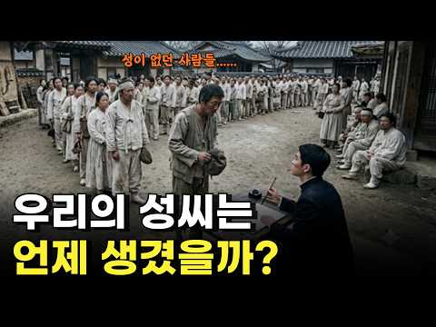
- 챕터: 0:00 오프닝 후킹 · 기록이 끊기는 지점 · 1:54 천구백구년, 성을 고른 사람들 · 4:08 울진 봉평리 신라비 · 성이 없던 최고 귀족 · 7:26 삼국 왕실의 성씨와 건국 설화 · 8:18 백제 대성팔족은 왜 사라졌나 · 11:41 삼국사기 육부 사성 기록의 진실 · 14:27 신라 하대와 최치원 · 바다를 건넌 이름 · 17:56 호족의 시대와 왕건의 사성 정책 · 20:30 성이 없으면 과거도 볼 수 없었다 · 21:47 본관의 탄생과 전국 성씨 지도 · 24:05 왕실 족보 선원록과 왕의 이름 · 25:37 조선 전기 무성층의 세계 · 29:54 성화보 · 딸이 먼저 적힌 족보 · 33:22 부계 족보는 언제 만들어졌나 · 35:45 양란 이후 · 불타버린 신분 증명 · 38:08 공명첩과 유학, 장부 위의 신분 상승 · 39:13 족보 위조와 매매는 실제로 어디까지였나 · 41:28 대구부 호적대장 논쟁과 최근 연구 · 47:32 화성 공사 기록 속 이름들 · 49:35 성을 얻는 네 가지 길
- 설명 앞부분: 우리는 태어날 때부터 성을 하나씩 가지고 태어납니다. 김, 이, 박, 최, 정. 너무 당연해서 아무도 묻지 않는 질문이 있습니다. 우리 조상은 도대체 언제부터 성을 썼을까요. 6세기 신라의 비석에는 최고 귀족들조차 성을 쓰지 않았습니다. 고려의 태조는 신하들에게 성을 하사했고, 성이 없으면 과거 시험조차 볼 수 없는 시대가 열렸습니다. 조선 전기까지도 성 없이 살아간 사람이 수없이 많았고, 그들의 이름은 돌쇠와 막산과 개똥으로 장부에 올랐습니다. 그리고 1909년, 민적법이 시행되면서 이 땅의 모든 사람이 성과 본을 갖게 됩니다.…
- 같은 채널 평소 대비 ×51.6 (채널 최근 롱폼 중앙값 17,174회) · 평소 영상: 통일의 수도가 경주가 아니라 부여였다면 ∣ 백제 통일 시나리오 (18,619회) / 종소리 28번이 울리면 성문이 닫혔다 ∣ 조선의 밤이 무서웠던 진짜 이유 (15,730회)
- 대본 없음 (설명) — 음성인식이 끝나면 도입부·흐름이 들어감
- 댓글 78/88: 좋은 점 — 영상 2 · 감사·응원 7 · 더 알고 싶은 것 0 · 아쉬운 점 — 영상 0 · 반박·불만 — 의견 다름 3 · 정치·사회 1 · 경험 공유 5 · 구독·다음 기대 0
  - 좋은 점 — 영상 👍1 “혹시 오늘의 영상, 정리된 책이 있나요? 책을 읽으며 하나하나 차근차근 공부하고 싶네요. 😅😅😅”
  - 좋은 점 — 영상 👍1 “잘 배웠습니다 감사합니다”
  - 감사·응원 👍4 “잘 들었습니다. 감사합니다”
  - 감사·응원 👍1 “감사합니다 꼭베고 공부좀 하고싶습니다”
  - 반박·불만 — 의견 다름 👍9 “안타깝네. 성과 씨는 다른건데. 일제시대 창씨 이지 창성이 아닌데. 농경전. 중앙세력 형성에 따라 의미가 바뀌엇고.지금은 구별없지만 과거를 예기 할려면 알아야됨. 성은 독립국 황제가 봉토와 함께 하사하는 것.조선에서 성이란 중국 혈통을 말하는것. 왕이 하사하는건 씨.…”
  - 반박·불만 — 의견 다름 👍0 “헛소리. 김씨 이씨 박씨는 한나라 성씨 시간 흐름 개념 기본 틀이다. 금김(金)쇠, 나라 몸 중심 머리를 뜻해. 이(李)오얏나무, 나라 몸 주변 사지를 뜻해. 박(朴)후박나무, 아~내 나라 밖에서 사온 데릴사위들을 뜻한다. 먼저 李씨가 되고, 李李李李 서로 겨뤄 주변…”
  - 정치·사회 👍12 “저는 진주 정씨 입니다 진주에는 대표적인 성씨가 강씨 하씨 정씨가 주류를 이루죠 전래된 말에 의하면 옛날엔 강씨 하씨 정씨는 같은 핏줄로 같은 성씨로 혼인을 할 수 없었다는 말도 전해 옵니다 우리 정씨 초보 발간 연대를 보면 1,800년대입니다 진주 정씨는 본관은 같…”
  - 경험 공유 👍4 “왜정 때 총독부에서 대대적으로 족보 만들어 팔았다는 이야기를 내 아버님으로 부터 들었어오. 우리집은 왜정 때 독립운동 과 조금 연결되 집안이 몰락해서 아직도 필사본 족보 말고 인쇄 족보가 없어요. 왜정 때 인쇄술도 좋고 대량 만들어 팔았다고 했어요.”
  - 경험 공유 👍0 “저도 김해인데요 족보에 김수로왕 부터시작 되더군요 그역사가 천년도 않되니까요 영상을보니 새로운 지혜를 챙기는군요 감사합니다 ❤❤❤❤❤❤❤”

### 79. 전문가도 설명하지 못한 역사상 가장 미스터리한 유물 20가지 ∣ 잠잘 때 듣는 역사

- https://www.youtube.com/watch?v=2XIKqVkU9QU · 푸른 태양 · 구독자 2,040 · 조회수 143,792 (×70.5, 하루 3,518.9) · 좋아요 488 (0.3%) · 116.6분 · 2026-09-17 · 주제 묶음 1. 역사 일반·이야기 · 형식 수면·낭독 (잠잘 때 듣는) · 폴더 `W_2XIKqVkU9QU` (웹 승인)
- 썸네일: 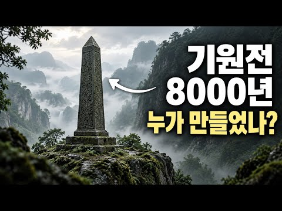
- 설명 앞부분: 2500년을 땅속에 묻혀 있었는데 종이 다발을 그대로 베어 버리는 검, 5000년 전 무덤에서 나온 프로펠러를 닮은 돌 원반. 시대를 벗어난 듯한 고대 유물 20가지를 하나씩 차분하게 살펴봅니다. 무덤 깊은 곳에서, 흙더미 아래에서, 수천 년 동안 바닷속에서 잠들어 있던 유물들. 그중에는 아직도 용도조차 밝혀지지 않은 것들이 있습니다. 1936년 이집트 사부 왕자의 무덤에서 발견된 얇은 돌 원반은 자동차 핸들과 프로펠러를 합쳐 놓은 듯한 모습이라 지금까지도 의식용인지 기계 부품인지 결론이 나지 않았습니다. 1965년 중국 후베이에…
- 같은 채널 평소 대비 ×20.5 (채널 최근 롱폼 중앙값 7,008회) · 평소 영상: 아직도 분류조차 못 한 발굴 유물 100가지, 고고학자들도 답을 모른다 (7,008회) / 외부 세계와 단절된 채 봉인된 가장 무서운 고대 미스터리 3시간 몰아보기 (6,575회)
- 대본 없음 (설명) — 음성인식이 끝나면 도입부·흐름이 들어감
- 댓글 8/8: 좋은 점 — 영상 0 · 감사·응원 0 · 더 알고 싶은 것 0 · 아쉬운 점 — 영상 0 · 반박·불만 — 의견 다름 0 · 정치·사회 0 · 경험 공유 0 · 구독·다음 기대 0

### 80. 조선 팔도 사람들의 진짜 성격, 조선 팔도 사람 기질의 비밀 500년 정도전이 말한 팔도 사람들의 진짜 성격

- https://www.youtube.com/watch?v=HzK-wrKO-eI · 사실과 기록 · 구독자 9,520 · 조회수 925,505 (×97.2, 하루 15,844.8) · 좋아요 7,345 (0.8%) · 26.4분 · 2026-09-13 · 주제 묶음 3. 조선 · 형식 정보·해설 (그 밖) · 폴더 `W_HzK-wrKO-eI` (웹 승인)
- 썸네일: 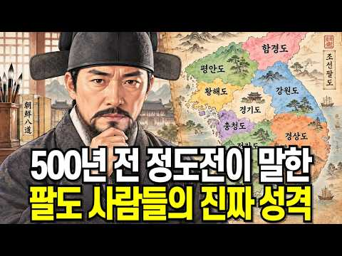
- 설명 앞부분: 📜 조선 팔도 사람들의 진짜 성격, 그 500년의 비밀 놀라운 건, 야사 속 정도전의 관찰과 정사 속 이중환의 기록이 결국 같은 이야기를 하고 있었다는 겁니다. 이 영상에서 다루는 내용 정도전이 남긴 팔도 사람 여덟 글자 평 (야사) 이중환 『택리지』에 담긴 팔도 관찰 (정사) 조선 팔도 이름의 유래 (경상도·전라도·충청도·강원도·경기도·황해도·평안도·함경도) 이시애의 난과 홍경래의 난이 남긴 지역 정서의 흔적 600년 전 태종의 팔도가 지금 우리 주소에 살아 있는 이유 지역으로 사람을 판단해도 되는가에 대한 진지한 질문. 『조선…
- 같은 채널 평소 대비 ×118.7 (채널 최근 롱폼 중앙값 7,796회) · 평소 영상: 조선 왕노릇 하느라 애쓴 역사가 외면한 무능한 인조 삼전도에서 일어난 일 ∣ 조선의 항복 (8,520회) / 조선시대 궁녀들은 어떻게 살아았을까? 궁궐을 쥐고 흔드는 왕비도 눈치 보는 '이 여자' … (7,071회)
- 대본 없음 (설명) — 음성인식이 끝나면 도입부·흐름이 들어감
- 댓글 1,725/1,952: 좋은 점 — 영상 9 · 감사·응원 8 · 더 알고 싶은 것 4 · 아쉬운 점 — 영상 10 · 반박·불만 — 의견 다름 34 · 정치·사회 158 · 경험 공유 58 · 구독·다음 기대 0
  - 좋은 점 — 영상 👍3 “아하! 처음 알았습니다 재밌는 사실이네요 귀에 쏙쏙 ~ 유익한 정보 잘 들었습니다 하프 누르고 갑니다^^”
  - 좋은 점 — 영상 👍1 “팔도 지역환경. 사람들 성격 지역지명을 논리적으로 이해 쉽게 잘 설명해 주셔서 새로운 역사.민화 .환경.재미있게 보았습니다.”
  - 감사·응원 👍7 “땅은 사람이다 그러나 땅에의지하여 사람을정하는건 사람의그본과본질을 모르기때문이다 사람은 땅에 하늘의정기를 불어넣어사 사람이됐다 그래서 우리는 하늘의자손이다 사람에게서 영성을 빼면 짐승의격으로 내려가는것이다 만물중에 사람이귀한것은 그격이 다르기때문이다 우리민족은 모진고…”
  - 감사·응원 👍1 “설명해주시는,선생님의말씀이,부드럽고따뜻해요,내마음도,부드러워진듯,새로운역사,감사합니다😊”
  - 더 알고 싶은 것 👍5 “전라도는 아직까지 우덜끼리 문화가 존재합니다. 호남향우회만봐도 그렇지요. 식당ㆍ술집ㆍ노래방 지들끼리 하는곳만가요. 그럼 동내에서 어떻게 바라 보겠나요?? 말과 행동이 다르고 우덜끼리 문화가 바뀌지 않은이상 전라도 바라보는건 변하지가 않습니다.”
  - 아쉬운 점 — 영상 👍3 “26분? 너무 길어요.”
  - 아쉬운 점 — 영상 👍1 “핵심적인 내용을 말해야지, 불 필요한 설명이 너무 많고, 지루해서 더 이상 못 보겠다.”
  - 반박·불만 — 의견 다름 👍67 “정이 많다고? 웃기는 소리.”
  - 반박·불만 — 의견 다름 👍25 “백제, 신라, 고려, 심지어 왕의 조상이 그짝 출신이 조선까지 그짝동네에 대한 평가는 일관됨. 간사하고 신용이 없고 도덕성이 떨어진다. 현재도 그렇고 차별,편견이 아니라 과학이란 소리 정도전도 풍전세류로 표현..바람 앞에 흔들리는 가는 버드나무 가지..누가봐도 좋은 …”
  - 정치·사회 👍219 “지금 민주당 국개들 보면 답 나오잖아 어느지역출신이 젤 많은지..”
  - 정치·사회 👍24 “라도가아무리발부동치도대통령은전부경상도”
  - 경험 공유 👍191 “내가 경험한 전라남도와 광주 사람들~~~~! 간과 쓸개 다 빼줄듯이 하다가도 자기 이익 앞에서는 망설임없이 뒤통수 친다~~~!!!! 거의 90%가 그랬음~~~!!!!!”
  - 경험 공유 👍33 “내가 살면서, 딱 한번 1억 사기당했다. 젊은시절 큰 돈이었지. 그 놈이 그 짝 출신이더라. 피해의식 쪄는 그 쪽 사람들. 지금은 그 피해의식으로 포장해서, 세금슈킹을 제일 많이하는 곳이 됬더라”

