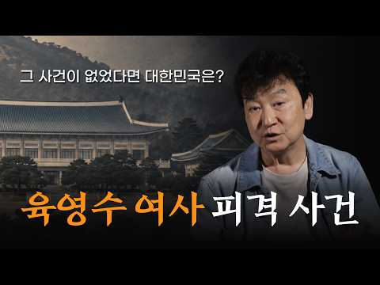
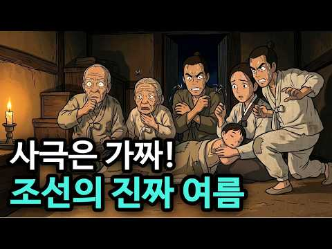
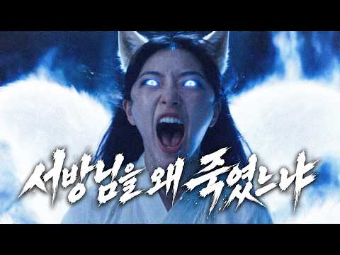

# 역사 — 성공 사례 분석: 사례별 자세히 #81–#120

`analysis.md` 의 9번 (같은 # 번호). 자동 생성 — `tools/success_analysis.py` v1.6 (2026-10-28 10:14 UTC). ※ 연구·교육용 — 투자 권유가 아님.

### 81. 며느리보다 10살 어린 시어머니, 그녀는 조선을 뒤흔들었다

- https://www.youtube.com/watch?v=T8bS_yX629Y · 역사정복 · 구독자 416 · 조회수 57,357 (×137.9, 하루 1,107.0) · 좋아요 178 (0.3%) · 16.8분 · 2026-09-06 · 주제 묶음 3. 조선 · 형식 사연·드라마 · 폴더 `W_T8bS_yX629Y` (웹 승인)
- 썸네일: 
- 설명 앞부분: 66세 왕과 15세 신부, 나이 차 51년. 조선 519년 역사상 가장 극단적인 왕실 결혼이었습니다. 흔히 떠올리는 '불쌍한 어린 신부' 이야기는 여기서 끝나지 않습니다. 이 소녀는 훗날 정조가 세상을 떠난 뒤, 조선 정치를 뒤흔든 최고 권력자가 됩니다. 이 영상에서는 영조와 정순왕후의 결혼부터, 정조와의 미묘한 관계, 그리고 수렴청정을 통해 신유박해와 장용영 해체를 주도하는 과정까지 시간 순서로 따라갑니다. 정약용 형제의 운명이 어떻게 바뀌었는지, 그리고 51년이라는 나이 차이가 만들어낸 진짜 승자와 패자가 누구였는지를 확인하실…
- 같은 채널 평소 대비 ×125.2 (채널 최근 롱폼 중앙값 458회) · 평소 영상: 삼국지 최대 굴욕을 참은 남자의 소름 돋는 결말 (458회) / 왕보다 강했던 신하 한명회, 그의 집안에는 무슨 일이 있었나? (454회)
- 대본 없음 (설명) — 음성인식이 끝나면 도입부·흐름이 들어감
- 댓글 13/13: 좋은 점 — 영상 0 · 감사·응원 0 · 더 알고 싶은 것 0 · 아쉬운 점 — 영상 0 · 반박·불만 — 의견 다름 0 · 정치·사회 0 · 경험 공유 0 · 구독·다음 기대 0

### 82. 조선에 편의점을 열었더니 벌어진 일

- https://www.youtube.com/watch?v=t68eLyT7a-s · 세계관오류 · 구독자 17,200 · 조회수 1,399,663 (×81.4, 하루 44,661.6) · 좋아요 3,983 (0.3%) · 4.1분 · 2026-09-27 · 주제 묶음 3. 조선 · 형식 정보·해설 (그 밖) · 폴더 `W_t68eLyT7a-s` (웹 승인)
- 썸네일: 
- 설명 앞부분: 조선 한복판에 편의점을 열었다. 평생 처음 맛보는 컵라면, 밤에도 환하게 빛나는 가게. 낯선 편의점을 기웃거리던 조선 사람들이 하나둘 손님이 되고, 어느새 가게 앞에는 긴 줄이 늘어서기 시작하는데… 조선에서 시작한 편의점 장사, 과연 어디까지 잘될까? 본 영상은 AI를 활용해 제작한 창작 이야기입니다.
- 같은 채널 평소 대비 ×9.1 (채널 최근 롱폼 중앙값 153,989회) · 평소 영상: 조선에 롱패딩을 팔았다 (159,606회) / 조선에 냉동만두를 팔았더니 벌어진 일 (144,419회)
- 대본 없음 (설명) — 음성인식이 끝나면 도입부·흐름이 들어감
- 댓글 350/404: 좋은 점 — 영상 0 · 감사·응원 2 · 더 알고 싶은 것 4 · 아쉬운 점 — 영상 2 · 반박·불만 — 의견 다름 1 · 정치·사회 2 · 경험 공유 6 · 구독·다음 기대 1
  - 감사·응원 👍14 “오늘 처음 봤는데 너무 잘 만들고 내용도 재미있으면서 신선해서 계속 처음부터 돌려보는중. 감사!”
  - 감사·응원 👍2 “제가 처음 댓글 달았을때가 고작 3일전이고 그때 구독자가 700명정도로 기억하는데 벌써 1200명 돌파시네요! 구독자가 나날이 늘고있는 모습을 보니 초창기 팬(?)으로서 뿌듯하면서도 자랑스럽습니다! 영상 퀄이 워낙 좋고 내용도 참신해서 노력에 대한 결과가 나오고 있으…”
  - 더 알고 싶은 것 👍5 “대형마트, 약국, 화장품가게, 서양식/양한방 병원이 조선에 열었다면 어떻게 되었을까요?”
  - 더 알고 싶은 것 👍1 “옥의 티 발견! 2:29 그들은 밖에 있는데 어떻게... 라면을...? 3:07 밖에는...ㅎㄷㄱㅁ이...ㅎㅎ 앞으로 계속해서 만들어주세요 참신하고 재밌어요”
  - 아쉬운 점 — 영상 👍0 “저시대 사람들은 라면 처음 먹었을때 맵게느껴졌을텐데 디테일이 아쉽네요”
  - 아쉬운 점 — 영상 👍0 “그릇을 들고 먹는 문화 햇반그릇은 나또그릇 같고 동전을 트레이에 놓는 것도. 엄청 잘만들어졌으나 아쉬움도 ㅎ”
  - 반박·불만 — 의견 다름 👍0 “좀이 아닌데ㅋㅋ 2:09”
  - 정치·사회 👍1 “1.편의점에 냄시와 벌레로 가득 차서 ㅈ댐 2.조선시대 사람들 그 날 저녁부터 배 아프고 설사하고 난리나기 시작, 몇 달만 지나면 각종 전염병,위생으로 나라가 휘청 3.그 전에 관군에게 화살 맞고 디짐 4.그 전에 편의점 건물과 사람이 시공간을 뛰어 넘었는데 전기가 …”
  - 정치·사회 👍0 “일단 현실적으로 나라가 가계 가만 안두겠지만 이건 재미로 만든 거니 현실예기 삼가 부탁”
  - 경험 공유 👍2 “제가 처음 댓글 달았을때가 고작 3일전이고 그때 구독자가 700명정도로 기억하는데 벌써 1200명 돌파시네요! 구독자가 나날이 늘고있는 모습을 보니 초창기 팬(?)으로서 뿌듯하면서도 자랑스럽습니다! 영상 퀄이 워낙 좋고 내용도 참신해서 노력에 대한 결과가 나오고 있으…”
  - 경험 공유 👍1 “내가 작가면 지금 당장 이거 단편 드라마 로 만든다 ㅋㅋ”
  - 구독·다음 기대 👍2 “왜 빠져서 보게 되는 ㅎㅎㅎㅎㅎㅎㅎ 구독하고 갑니다”

### 83. 왜 조선 사람들은 제일 낮고 편한 고개를 두고 험한 길로 돌아갔을까? ∣ 문경새재, 대관령, 옛길의 진짜 공포 ∣ 한국사 조선시대

- https://www.youtube.com/watch?v=0SfgHs91EZc · 안식한국사 · 구독자 3,740 · 조회수 463,305 (×123.9, 하루 9,455.7) · 좋아요 1,623 (0.4%) · 18.5분 · 2026-09-09 · 주제 묶음 3. 조선 · 형식 수면·낭독 (잠잘 때 듣는) · 폴더 `W_0SfgHs91EZc` (웹 승인)
- 썸네일: 
- 설명 앞부분: 조선시대에 문경새재와 대관령을 넘던 사람들은, 가장 편한 길을 놔두고 왜 목숨 걸고 이 험한 고개를 넘었을까요. 도적과 이름의 저주와 눈보라, 그리고 고갯길에서 사람을 가장 많이 죽인 진짜 정체까지, 조선 옛길의 진짜 공포를 따라갑니다. 이 영상에서 다루는 내용 나는 새도 넘기 힘들다던 문경새재, 도적은 대체 어디에 숨어 있었을까요 부산에서 한양까지, 조선 사람은 그 길을 며칠이나 걸어야 했을까요 셋 중 가장 낮고 편한 추풍령을 선비들이 굳이 피해서 돌아간 이유는 무엇일까요 추풍령의 추풍은 정말 가을바람이라는 뜻이 맞을까요 아흔아…
- 같은 채널 평소 대비 ×4.7 (채널 최근 롱폼 중앙값 97,786회) · 평소 영상: 조선 최연소 천재 병조판서를 사흘 만에 처형한 이유 (97,786회) / 공자도 좋아한 그 맛, 조선 선비들이 강가에 모여 회를 먹던 진짜 이유 ∣ 조선 회식은 … (119,887회)
- 대본 없음 (설명) — 음성인식이 끝나면 도입부·흐름이 들어감
- 댓글 102/106: 좋은 점 — 영상 2 · 감사·응원 3 · 더 알고 싶은 것 2 · 아쉬운 점 — 영상 1 · 반박·불만 — 의견 다름 3 · 정치·사회 1 · 경험 공유 2 · 구독·다음 기대 0
  - 아쉬운 점 — 영상 👍1 “이 혀짧은 AI 음성은 머지??? 정상적인 발음하는 AI는 없나???”
  - 반박·불만 — 의견 다름 👍25 “혼자 넘어가는 건 말도 안되고 반드시 여러사람들과 무리지어 넘어가야 합니다 . 호랑이의 경우는 무리지어 횃불을 들고 가면 화를 면할수 있더랬죠”
  - 반박·불만 — 의견 다름 👍18 “병자호란때 청군이 대관령을 넘었다는건 사실이 아닙니다. 상식적으로 그렇게 올 수가 없잖아요.”
  - 정치·사회 👍0 “말이 그렇지 만약 말 대로라면 관청에서 군데 군데 경계 분청이라도 만들어 운영을 했겠지!!!!!!! 조선은 그렇게 무지한 나라가 아니었다.”
  - 경험 공유 👍0 “내가 듣기로는 625전쟁 후까지 죽령에 산적이 있었다고 하더라 들었나 책에서 봤나 가물가물하다”

### 84. 육영수 여사 피격 사건이 없었다면?ㅣ김진명 작가가 들려주는 근현대사

- https://www.youtube.com/watch?v=R-DGnnRUGwo · 김진명의 사적인 대화 · 구독자 17,400 · 조회수 527,506 (×30.3, 하루 43,908.3) · 좋아요 5,926 (1.1%) · 16.1분 · 2026-10-16 · 주제 묶음 4. 한국 근현대사 · 형식 인터뷰·강연·대담 · 폴더 `W_R-DGnnRUGwo` (웹 승인)
- 썸네일: 
- 설명 앞부분: 대한민국 대표 소설가 김진명의 공식 유튜브 채널 [김진명의 사적인 대화]입니다. 2부｜박정희는 왜 죽어야만 했나? 육영수 여사 피격 사건이 없었다면? 해당 사건을 소설로 써달라는 제안을 받았던 김진명 작가의 실제 경험을 시작으로 그날 이후 청와대와 한국 정치사에 불어닥친 결정적 변화들을 돌아봅니다. ‘청와대 안의 야당’이라 불렸던 육영수 여사의 진짜 역할, 10·26 사건으로 이어지는 김재규와 차지철의 권력 갈등, 문세광의 행적과 사건 수사를 둘러싼 미스터리까지! '누구의 총탄이었는가'라는 질문을 넘어, 그날의 총성이 대한민국 근…
- 대본 없음 (설명) — 음성인식이 끝나면 도입부·흐름이 들어감
- 댓글 238/271: 좋은 점 — 영상 7 · 감사·응원 31 · 더 알고 싶은 것 8 · 아쉬운 점 — 영상 1 · 반박·불만 — 의견 다름 3 · 정치·사회 39 · 경험 공유 14 · 구독·다음 기대 9
  - 좋은 점 — 영상 👍54 “매우 유익하고 흥미로운 영상입니다. 감사합니다😂❤”
  - 좋은 점 — 영상 👍42 “정말 차갑게 잘 정리된 이야기들 좋아요!”
  - 감사·응원 👍118 “건강하세요 선생님❤ 감사합니다🎉”
  - 감사·응원 👍110 “채널이 만들어졌군요 감사합니다 구독했어요 응원합니다”
  - 더 알고 싶은 것 👍30 “정형돈 제목없음TV보고 왔어요. 작가님 채널 구독하고 영상 보고 있어요. 좋은 글과 영상 부탁드립니다. 건강도 잘 챙기시길 바랍니다.^^”
  - 더 알고 싶은 것 👍29 “선생님께서 쓰신 글들을 통해 역사에 관심을 갖게 되었습니다. 유튜브로도 많은 가르침 부탁드립니다.”
  - 반박·불만 — 의견 다름 👍57 “독재 독재하는데 북한놈들이랑 전쟁끝난지 몇년되지도 않아서 김영삼 김대중이 대학생들 선동해서 대한민국 북한에 갖다바치려하는데 멀쩡한 사람이고 군인이면 당연히 통제할수밖에 없다고 생각함.”
  - 반박·불만 — 의견 다름 👍8 “그래도 고인의 인격을. 모독하면 안되지요. 지금의 풍요를 누릴 수 잇는 모태가 됐는데..암살자 영화는 어이없어요 옛날에 강의 많이 들었어요 존경합니다”
  - 정치·사회 👍53 “누가 뭐래도.... 그때 그 시절 한 대통령이 오래 통치하면서 대한민국 경제가 선진국 수준으로 발전할 토대를 구축한 건 부인 할 수 없는 일..”
  - 정치·사회 👍46 “작가님을 좋아하는 사람입니다. 또한 박정희 전대통령을 좋아하는 사람입니다. 물론 박정희대통령이 과도 있습니다만 공도 많은분이라고 생각합니다. 그렇다면 적어도 이름보다 존칭은 쓰면서 역사에 대한 설명을 하신다면 더 작가님의 깊이가 느껴지지않을까 생각합니다.”
  - 경험 공유 👍82 “정형돈의.제목없음 티비 보고 저도 작가님 채널 놀러왔습니다! 다음 영상 업로드 너무 기다려집니다! 제목없음 티비도 꼭 다시 나와주세요👍”
  - 경험 공유 👍32 “저도 작가님 책을 수 많은 작품들 읽으면서 감동이고 최초의 <무궁화 꽃이 피었습니다> 두 권 이야기가 실제 사건으로 바탕이 충격이 크게 느껴져요 작가님에게 무궁화꽃이란 무엇입니까??”
  - 구독·다음 기대 👍110 “채널이 만들어졌군요 감사합니다 구독했어요 응원합니다”
  - 구독·다음 기대 👍82 “정형돈의.제목없음 티비 보고 저도 작가님 채널 놀러왔습니다! 다음 영상 업로드 너무 기다려집니다! 제목없음 티비도 꼭 다시 나와주세요👍”

### 85. 가족을 모두 잃고 18년을 버틴 광해군 ∣ 왕에서 죄인이 된 비극적인 최후

- https://www.youtube.com/watch?v=KRTIB2WwIQw · 웅이 역사원정대 · 구독자 1,580 · 조회수 202,651 (×128.3, 하루 3,815.5) · 좋아요 2,452 (1.2%) · 48분 · 2026-09-05 · 주제 묶음 3. 조선 · 형식 정보·해설 (그 밖) · 폴더 `W_KRTIB2WwIQw` (웹 승인)
- 썸네일: 
- 설명 앞부분: 왕좌에서 쫓겨난 뒤에도 18년이 넘는 유배 생활을 견뎌낸 조선의 왕이 있습니다. 조선의 제15대 국왕, 광해군입니다. 1623년 인조반정으로 하루아침에 왕의 자리에서 쫓겨난 광해군. 아들 폐세자 이지는 교동도의 가시 울타리 안에서 가위와 인두를 이용해 약 21미터의 땅굴을 팠습니다. 오늘날 아파트 7층 높이에 맞먹는 거리였어요. 그러나 목숨을 건 탈출은 실패했습니다. 며느리 박씨가 먼저 스스로 생을 마감했고, 한 달 뒤에는 폐세자에게 자진하라는 명이 내려졌습니다. 그해 윤10월에는 아내 유씨마저 유배지에서 세상을 떠났어요. 가족을…
- 같은 채널 평소 대비 ×43.8 (채널 최근 롱폼 중앙값 4,622회) · 평소 영상: 죽어야만 나갈 수 있을까? 우리가 미처 몰랐던 조선 궁녀들의 삶 #한국사 #역사이야기 (6,277회) / 조선시대 내시도 부부생활이 가능했을까? 실록에 남은 결혼과 성생활 ∣ 역사스토리텔링 (2,967회)
- 대본 없음 (설명) — 음성인식이 끝나면 도입부·흐름이 들어감
- 댓글 155/156: 좋은 점 — 영상 1 · 감사·응원 5 · 더 알고 싶은 것 0 · 아쉬운 점 — 영상 0 · 반박·불만 — 의견 다름 4 · 정치·사회 11 · 경험 공유 3 · 구독·다음 기대 0
  - 좋은 점 — 영상 👍3 “일체유심조! 인생은 맘먹기에 따른 것입니다. 오히려 광해군은 편안한 마음입니다. 그리고 광해군에게 영감이란 당시의 호칭은 오늘날 상대를 낮추는 멸칭이 아닙니다. 중앙에서 높은 직위에 있었던 사람들에게 쓰여진 존호였습니다. 좋은 영상 감사합니다 🎉”
  - 감사·응원 👍5 “덕분입니다 감사합니다”
  - 감사·응원 👍3 “너무나 광해군에 대해 설명을 놀랐만큼 잘 해주셔서 역사를 알게 되었습니다 감사합니다 존경합니다 나라를 위해 정직하게 하옵소서”
  - 반박·불만 — 의견 다름 👍4 “임진왜란과 병자호란 두개의 큰 변란은 강한 주변세력을 제대로 대처하지 못해서 일어난 사건으로 볼 수 있지요. 첫째는 지도자인 왕들이 매우 무능했고 둘째는 대신들이 옹졸하고 무능했기 때문으로 볼 수 있지요. 이율곡이 십만양병설을 제의했지만 무시하고 무사안일한 대처로 참…”
  - 반박·불만 — 의견 다름 👍3 “일체유심조! 인생은 맘먹기에 따른 것입니다. 오히려 광해군은 편안한 마음입니다. 그리고 광해군에게 영감이란 당시의 호칭은 오늘날 상대를 낮추는 멸칭이 아닙니다. 중앙에서 높은 직위에 있었던 사람들에게 쓰여진 존호였습니다. 좋은 영상 감사합니다 🎉”
  - 정치·사회 👍22 “광해군은 강대국 명ㆍ청사이에서 외교 국방을 잘한 🤴 👑왕입니다 국민(*백성)의 희생을 최소화한 임금🎉이었어요 ❤😂🎉 인조는 후금ㆍ청나라의 침략ㆍ병자호란1636을 유발해 백성이 많이 죽고 남한산성으로 피신해 길동?에서 삼배9고두례하고 소현세자와 수십만명(여성포함)을 인…”
  - 정치·사회 👍15 “광해군 뭐가 그리 잘못했나요 어느임금 손에 피안묻힌 왕있었나요 무능한인조 그러니 나라가 그꼰ㄷ났죠”
  - 경험 공유 👍2 “내가 보기엔 광해보다. 인조가. 더. 비참했다고. 생각함니다”
  - 경험 공유 👍0 “광해가뭔죽을만큼큰죄도아니건만!수양대군은친혈육까지도피를묻히고도발한자!조선은없었어야될역사다!특히선조인조의무능함은어찌말로다하리오!임진왜란병자호란겪고_소현세자등일반인공녀들반출등등심한백성들의피해가필설로다할수없네!광해는폐위되고도18년을버텼다니?비참한유배지에서친혈족은다죽고_뭘희망…”

### 86. 김이박이 절반인 이유 ∣ 아무도 제대로 알려주지 않은 성씨의 역사

- https://www.youtube.com/watch?v=sgral4YYJWE · 우리 모두의 역사 · 구독자 5,560 · 조회수 835,720 (×150.3, 하루 13,276.8) · 좋아요 3,823 (0.5%) · 89분 · 2026-08-26 · 주제 묶음 1. 역사 일반·이야기 · 형식 정보·해설 (그 밖) · 폴더 `W_sgral4YYJWE` (웹 승인)
- 썸네일: 
- 챕터: 0:00 오프닝 후킹 · 기록이 끊기는 지점 · 1:54 천구백구년, 성을 고른 사람들 · 4:08 울진 봉평리 신라비 · 성이 없던 최고 귀족 · 7:26 삼국 왕실의 성씨와 건국 설화 · 8:18 백제 대성팔족은 왜 사라졌나 · 11:41 삼국사기 육부 사성 기록의 진실 · 14:27 신라 하대와 최치원 · 바다를 건넌 이름 · 17:56 호족의 시대와 왕건의 사성 정책 · 20:30 성이 없으면 과거도 볼 수 없었다 · 21:47 본관의 탄생과 전국 성씨 지도 · 24:05 왕실 족보 선원록과 왕의 이름 · 25:37 조선 전기 무성층의 세계 · 29:54 성화보 · 딸이 먼저 적힌 족보 · 33:22 부계 족보는 언제 만들어졌나 · 35:45 양란 이후 · 불타버린 신분 증명 · 38:08 공명첩과 유학, 장부 위의 신분 상승 · 39:13 족보 위조와 매매는 실제로 어디까지였나 · 41:28 대구부 호적대장 논쟁과 최근 연구 · 47:32 화성 공사 기록 속 이름들 · 49:35 성을 얻는 네 가지 길
- 설명 앞부분: 우리는 태어날 때부터 성을 하나씩 가지고 태어납니다. 김, 이, 박, 최, 정. 너무 당연해서 아무도 묻지 않는 질문이 있습니다. 우리 조상은 도대체 언제부터 성을 썼을까요. 6세기 신라의 비석에는 최고 귀족들조차 성을 쓰지 않았습니다. 고려의 태조는 신하들에게 성을 하사했고, 성이 없으면 과거 시험조차 볼 수 없는 시대가 열렸습니다. 조선 전기까지도 성 없이 살아간 사람이 수없이 많았고, 그들의 이름은 돌쇠와 막산과 개똥으로 장부에 올랐습니다. 그리고 1909년, 민적법이 시행되면서 이 땅의 모든 사람이 성과 본을 갖게 됩니다.…
- 같은 채널 평소 대비 ×48.7 (채널 최근 롱폼 중앙값 17,174회) · 평소 영상: 통일의 수도가 경주가 아니라 부여였다면 ∣ 백제 통일 시나리오 (18,619회) / 종소리 28번이 울리면 성문이 닫혔다 ∣ 조선의 밤이 무서웠던 진짜 이유 (15,730회)
- 대본 없음 (설명) — 음성인식이 끝나면 도입부·흐름이 들어감
- 댓글 78/84: 좋은 점 — 영상 2 · 감사·응원 7 · 더 알고 싶은 것 0 · 아쉬운 점 — 영상 0 · 반박·불만 — 의견 다름 3 · 정치·사회 1 · 경험 공유 5 · 구독·다음 기대 0
  - 좋은 점 — 영상 👍1 “혹시 오늘의 영상, 정리된 책이 있나요? 책을 읽으며 하나하나 차근차근 공부하고 싶네요. 😅😅😅”
  - 좋은 점 — 영상 👍1 “잘 배웠습니다 감사합니다”
  - 감사·응원 👍4 “잘 들었습니다. 감사합니다”
  - 감사·응원 👍1 “감사합니다 꼭베고 공부좀 하고싶습니다”
  - 반박·불만 — 의견 다름 👍9 “안타깝네. 성과 씨는 다른건데. 일제시대 창씨 이지 창성이 아닌데. 농경전. 중앙세력 형성에 따라 의미가 바뀌엇고.지금은 구별없지만 과거를 예기 할려면 알아야됨. 성은 독립국 황제가 봉토와 함께 하사하는 것.조선에서 성이란 중국 혈통을 말하는것. 왕이 하사하는건 씨.…”
  - 반박·불만 — 의견 다름 👍0 “헛소리. 김씨 이씨 박씨는 한나라 성씨 시간 흐름 개념 기본 틀이다. 금김(金)쇠, 나라 몸 중심 머리를 뜻해. 이(李)오얏나무, 나라 몸 주변 사지를 뜻해. 박(朴)후박나무, 아~내 나라 밖에서 사온 데릴사위들을 뜻한다. 먼저 李씨가 되고, 李李李李 서로 겨뤄 주변…”
  - 정치·사회 👍12 “저는 진주 정씨 입니다 진주에는 대표적인 성씨가 강씨 하씨 정씨가 주류를 이루죠 전래된 말에 의하면 옛날엔 강씨 하씨 정씨는 같은 핏줄로 같은 성씨로 혼인을 할 수 없었다는 말도 전해 옵니다 우리 정씨 초보 발간 연대를 보면 1,800년대입니다 진주 정씨는 본관은 같…”
  - 경험 공유 👍4 “왜정 때 총독부에서 대대적으로 족보 만들어 팔았다는 이야기를 내 아버님으로 부터 들었어오. 우리집은 왜정 때 독립운동 과 조금 연결되 집안이 몰락해서 아직도 필사본 족보 말고 인쇄 족보가 없어요. 왜정 때 인쇄술도 좋고 대량 만들어 팔았다고 했어요.”
  - 경험 공유 👍0 “저도 김해인데요 족보에 김수로왕 부터시작 되더군요 그역사가 천년도 않되니까요 영상을보니 새로운 지혜를 챙기는군요 감사합니다 ❤❤❤❤❤❤❤”

### 87. 13살 소년왕이 조선 최고 책사 한명회를 손끝 하나 안 대고 무너뜨린 방법 ∣ 조선왕조실록이 감춘 성종의 진짜 얼굴 ∣ 한국사이야기 ∣ 조선역사 ∣ 조선왕 ∣ …

- https://www.youtube.com/watch?v=BrJfH7HySwo · 역사비 · 구독자 3,190 · 조회수 776,629 (×243.5, 하루 7,602.9) · 좋아요 5,380 (0.7%) · 40분 · 2026-07-18 · 주제 묶음 3. 조선 · 형식 정보·해설 (그 밖) · 폴더 `W_BrJfH7HySwo` (웹 승인)
- 썸네일: 
- 설명 앞부분: 계유정난의 설계자, 조선 최대의 권신 한명회를 손끝 하나 안 대고 무너뜨린 왕 — 우리가 "온화한 성군"으로 기억하는 조선 9대 성종의 진짜 얼굴. 1469년 음력 11월 28일, 진시. 경복궁 자미당에서 조선의 왕이 눈을 감았습니다. 그리고 해가 지기 전, 열세 살 소년이 그 자리에 앉았습니다. 단 하루 만에, 나라의 주인이 바뀌었습니다. 왕위 계승 순서로는 세 번째, 네 번째. 죽은 할아버지 세조의 말 한마디가, 그 소년을 왕으로 만들었습니다. 그 뒤에는 계유정난의 설계자, 세조가 "나의 장자방"이라 부른 남자 — 한명회. 소…
- 같은 채널 평소 대비 ×907.8 (채널 최근 롱폼 중앙값 856회) · 평소 영상: 청나라 볼모에서 조선의 왕이 된 효종, 10년 북벌의 비극ㅣ인조는, 왜 아들 소현세자를 … (924회) / 조선 시대 여자로 태어난다는 것, 500년의 지옥 ∣ 그 지옥을 뚫은 여자들 ∣ 한국사 … (787회)
- 대본 없음 (설명) — 음성인식이 끝나면 도입부·흐름이 들어감
- 댓글 241/245: 좋은 점 — 영상 8 · 감사·응원 14 · 더 알고 싶은 것 3 · 아쉬운 점 — 영상 4 · 반박·불만 — 의견 다름 1 · 정치·사회 4 · 경험 공유 3 · 구독·다음 기대 3
  - 좋은 점 — 영상 👍28 “성종 대단한 왕이십니다.좋은이야기 잘봤습니다”
  - 좋은 점 — 영상 👍12 “유익한 내용이네요👍🏻 잘 봤습니다 ☺️”
  - 감사·응원 👍21 “성종에 대해서 많이 알게 되었습니다. 감사합니다.”
  - 감사·응원 👍12 “성종임금을 다시 보게 되는 영상이였습니다. 한명회는 끝까지 안 변했네요. 예나 지금이나 왕의 자리가 저렇게도 힘든 자리였네요. 성종의 지혜로운 발현이 있기까지 얼마나 고심하고 고심했을지 위로와 감사를 드리며 훌륭하십니다_()_”
  - 더 알고 싶은 것 👍3 “이렇게 멋지신 분인 줄 몰랐네요 영상으로나마 잘 알게 되어 감사합니다 강남구 선릉 맞나요? 현시대 좋은 장소에 계서서 다행입니다.”
  - 더 알고 싶은 것 👍1 “칼도 없었고, 사약도 없었습니다. 그런데 권력은 움직였습니다. 1481년 압구정 사건에서 성종은 한명회의 요구를 받아들이지 않았고, 결국 한명회를 추국하라는 명까지 내렸습니다. 여러분은 이 장면을 어떻게 보시나요? 온화한 성군의 원칙적인 대응이었을까요, 아니면 거대한…”
  - 아쉬운 점 — 영상 👍3 “성종임금님 칼을 대지 않고도 한명회를 처리 하였거늘 연산군 어머니도 그리 하였다면 어땠을까요. 역사에 만약이란 말은 부질멊지만요 그러나 후대 우리에게 가르침이 되거 늘 가설을 생각하며 아쉬움도 가져 봅니다”
  - 아쉬운 점 — 영상 👍1 “재미있긴 하지만 같은 내용이 계속 반복되다보니 살짝 몰입이 안되네요 ㅠㅠ”
  - 반박·불만 — 의견 다름 👍8 “이야~ 대단한 왕이였네요. 끈기만 있다고 되는 일이 아니죠. 판을 읽는 눈이 있어야하고 그 판을 자신에게 끌어 올수있는 지혜가 있어야하죠. 13살부터 그런 생각을 했다는건 한 마디로. 천재다!!”
  - 정치·사회 👍5 “조선은. 세종이 없었다면 태어나지 말아야할 왕조다. 백성 의 절반이. 종놈. 노비였다니 말이되나, 나라가 동족의 피를 뻘아먹 고 살아 온것이 아닌가, 조선이 지속 됐다면 국민의 절반이 노비, 종 놈이란 말 아닌가,”
  - 정치·사회 👍0 “역사를 재미있게 하기위해서 ...아니면 잘난척 하기위해서.../한명희가 나이몆에 출사를 했는대../조선은 세종시대부터 너무 평화로와./심심해서 자기들끼리 싸운거다./인간은 너무 평화로우면 자기들끼리 싸운다../그게 한국역사다.../지금도 한국은 자기들끼리 피터지게 잘…”
  - 경험 공유 👍89 “세조도 한명회도 자식들이 요절하는 지옥을 겪었네요. 인과응보겠지요.”
  - 경험 공유 👍57 “내가 생각 하는 조선의 최고의 왕이라면 세종 성종 정조 이렿게 봅니다 영상 잘봤습니다^^”
  - 구독·다음 기대 👍4 “사람은 착하게 살면 끝이 좋다라는 교훈, 역사를 통해서 배웁니다~다음영상도 기대합니다”
  - 구독·다음 기대 👍4 “잘 들었습니다 구독했습니다”

### 88. 양반도 부러워했다?! 백정의 충격적인 사생활!! ∣ 조선의 백정 ∣ 한국사

- https://www.youtube.com/watch?v=um-bKohXZK0 · 스토리퐁당 · 구독자 1,080 · 조회수 238,500 (×220.8, 하루 2,551.2) · 좋아요 1,155 (0.5%) · 26분 · 2026-07-26 · 주제 묶음 4. 한국 근현대사 · 형식 정보·해설 (그 밖) · 폴더 `W_um-bKohXZK0` (웹 승인)
- 썸네일: 
- 설명 앞부분: 조선에서 소 한 마리를 잡으면 집 한 채 값이 손에 들어왔습니다. 💰 그 돈을 만진 사람은 정승도, 판서도 아닌 바로 '백정'이었습니다. 길에서 마주치면 양반이 침을 뱉고 지나가던 사람. 죽어서 족보에 이름 석 자조차 올리지 못했던 사람. 그런데 그의 곳간에는 그를 무시하던 양반보다 더 많은 곡식이 쌓여 있었습니다. 🐂 가장 낮은 자리에 있던 사람이 어떻게 양반도 쉽게 만지지 못하던 돈을 손에 쥐게 됐을까요? 그리고 그렇게 돈을 벌고도 왜 죽을 때까지 그 신분을 벗어나지 못했을까요? 🤔 이 영상에서는 👇 백정이 사실은 노비가 아니…
- 같은 채널 평소 대비 ×825.3 (채널 최근 롱폼 중앙값 289회) · 평소 영상: 고려시대 vs 조선시대 - 우리나라는 언제 잘살았나? ∣ 고려와 조선의 삶 비교 ∣ 계층… (295회) / 한국사 최강 인간병기 척준경! ∣ 그는 영웅인가? 역적인가? ∣ 척준경 ∣ 고려사 (283회)
- 대본 없음 (설명) — 음성인식이 끝나면 도입부·흐름이 들어감
- 댓글 96/96: 좋은 점 — 영상 1 · 감사·응원 1 · 더 알고 싶은 것 1 · 아쉬운 점 — 영상 0 · 반박·불만 — 의견 다름 5 · 정치·사회 3 · 경험 공유 0 · 구독·다음 기대 0
  - 감사·응원 👍1 “감사합니다❤❤”
  - 더 알고 싶은 것 👍13 “백정은 조선건국과 맞다아 있는 것 같습니다. 태조 이성계의 조상이 어디입니까? 북방 이민족이죠. 이들도 고려시대에서는 화척이였습니다. 하지만 이들은 세력을 가지고 성장하여 고려를 무너뜨리고 새로운 나라(조선)를 세웁니다. 그 조선에게서 (무장세력으로 강해질 수 있던)…”
  - 반박·불만 — 의견 다름 👍2 “글쎄요?”
  - 반박·불만 — 의견 다름 👍1 “무슨 말도 안돼. 백정이 얼마나 천시받고 굶주리고 살았는데---소가 전부 지 것인가. 남의 소 잡아주는 품삵 조금 더 받는정도인데. 소피를 가져오고 그걸 먹고.. 뭔 말도 안되는 소리가 곳간에 양식이 넘쳐 나다니..”
  - 정치·사회 👍12 “조선이라는 나라가 그냥 개막장 나라 였음.”
  - 정치·사회 👍1 “조선에서 저돈을 지킬수 있었을까? 잡아서 주리틀면 돈 다 뺏김 지금 국회의원 봐라 한자 못 읽으면 눈 뜨고 코베임 ai가 이상하게 알려주내”

### 89. 조선 왕들이 일찍 죽은 진짜 이유｜매일 먹던 수라상에 충격적인 답이 있었다

- https://www.youtube.com/watch?v=MvFehJWoeAU · 조선의 시간 · 구독자 32 · 조회수 18,794 (×187.9, 하루 232.4) · 좋아요 47 (0.2%) · 14.2분 · 2026-08-08 · 주제 묶음 3. 조선 · 형식 정보·해설 (그 밖) · 폴더 `W_MvFehJWoeAU` (웹 승인)
- 썸네일: 
- 설명 앞부분: 조선의 왕들은 최고의 음식을 먹고 최고의 의원에게 진료받았지만, 평균 수명은 불과 46세였습니다. 굶주림도 없었던 왕들은 왜 그렇게 일찍 세상을 떠났을까요? 하루 다섯 번 차려진 화려한 수라상, 스무 가지가 넘는 반찬과 고기 요리, 흰쌀밥과 떡, 젓갈과 장아찌까지. 이번 영상에서는 조선 왕실의 실제 식생활을 통해 세종과 숙종이 겪었던 만성질환의 흔적과 왕의 수라상이 건강에 어떤 부담을 주었는지 살펴봅니다. 특히 조선 왕 가운데 83세까지 장수한 영조는 왜 달랐을까요? 화려한 음식을 절제하고 소식했던 영조의 식습관을 다른 왕들과 비…
- 같은 채널 평소 대비 ×133.8 (채널 최근 롱폼 중앙값 140회) · 평소 영상: 조선 천재 간신의 충격적인 최후｜한명회도 탄핵하고 아들 넷을 도살대에 올린 아버지 (154회) / 조선시대 평민의 여름｜왜 지옥보다 끔찍했을까? 교과서가 숨긴 진짜 이유 (127회)
- 대본 없음 (설명) — 음성인식이 끝나면 도입부·흐름이 들어감
- 댓글 3/3: 좋은 점 — 영상 0 · 감사·응원 0 · 더 알고 싶은 것 0 · 아쉬운 점 — 영상 0 · 반박·불만 — 의견 다름 0 · 정치·사회 0 · 경험 공유 0 · 구독·다음 기대 0

### 90. 웹소설 임진왜란 2072 - 제1부 노량대전 ( 제08장 귀선 부상 )

- https://www.youtube.com/watch?v=LUbqbOx35pA · 라이프 갤러리 · 구독자 1,090 · 조회수 169,970 (×155.9, 하루 2,471.0) · 좋아요 197 (0.1%) · 5.4분 · 2026-08-20 · 주제 묶음 3. 조선 · 형식 정보·해설 (그 밖) · 폴더 `W_LUbqbOx35pA` (웹 승인)
- 썸네일: 
- 설명 앞부분: 일본 제1기동함대는 대한민국 귀선전단의 모든 능동 신호가 사라지자 탐색망을 확대한다. 그러나 귀선 ‘현무·청룡·백호’는 이미 심해를 통해 적 함대의 중심부까지 은밀하게 접근한 상태였다. 이순신 대장의 명령이 떨어지는 순간, 세 척의 귀선이 거대한 물기둥을 일으키며 동시에 수면 위로 부상한다. 예상하지 못한 방향에서 등장한 귀선전단으로 인해 일본 함대의 진형과 지휘망은 순식간에 혼란에 빠진다. 선봉의 ‘현무’가 적 기함을 향해 돌진하고, ‘청룡’과 ‘백호’가 좌우 퇴로를 봉쇄한다. 심해의 침묵을 깨고 모습을 드러낸 귀선전단은 마침내…
- 같은 채널 평소 대비 ×23.0 (채널 최근 롱폼 중앙값 7,376회) · 평소 영상: 웹소설 임진왜란 2072 - 제1부 노량대전 ( 제19장 대한해협 ) (7,726회) / 웹소설 임진왜란 2072 - 제1부 노량대전 ( 제21장 검은 심해 ) (7,025회)
- 대본 없음 (설명) — 음성인식이 끝나면 도입부·흐름이 들어감
- 댓글 14/14: 좋은 점 — 영상 0 · 감사·응원 0 · 더 알고 싶은 것 0 · 아쉬운 점 — 영상 0 · 반박·불만 — 의견 다름 0 · 정치·사회 0 · 경험 공유 0 · 구독·다음 기대 0

### 91. 임진왜란 의병장이 88세에 역적으로 참형당한 진짜 이유 ∣ 재미진역사

- https://www.youtube.com/watch?v=GhH9jUSqkF0 · 역사 속 사람들 · 구독자 749 · 조회수 52,210 (×69.7, 하루 1,686.2) · 좋아요 351 (0.7%) · 62.9분 · 2026-09-27 · 주제 묶음 3. 조선 · 형식 인터뷰·강연·대담 · 폴더 `W_GhH9jUSqkF0` (웹 승인)
- 썸네일: 
- 챕터: 0:00 조선 최고의 의병장 정인홍, 88세에 참형당한 충격적… · 2:30 남명 조식의 제자로 성장하며 강직한 신념을 갖게 된 … · 10:38 임진왜란 발발, 합천 의병을 일으켜 낙동강을 지킨 활약 · 17:43 전쟁 영웅에서 광해군 시대 정치 중심으로 올라선 과정 · 23:09 광해군 즉위와 함께 권력을 얻은 정인홍의 선택과 갈등 · 30:39 계축옥사와 폐모론 논란, 역사의 평가가 갈린 이유 · 38:02 인조반정 발생, 정권 교체와 함께 역적으로 몰린 정인홍 · 41:32 88세 노인의 참형, 의병장과 역적이라는 두 얼굴의 …
- 설명 앞부분: 임진왜란 의병장이 88세에 역적으로 참형당한 진짜 이유 ∣ 재미진역사 이번 재미진역사 영상에서는 남명 조식의 가르침부터 의병 활동, 광해군 시대의 정치 갈등, 그리고 인조반정 이후 맞이한 비극적인 결말까지 살펴봅니다. 🔥 재미진역사 이야기를 통해 한 인물이 어떻게 영웅과 논란의 인물이라는 두 평가를 동시에 받게 되었는지 확인해 보세요. 🏯 재미진역사 속 숨겨진 기록과 조선 정치의 복잡한 흐름을 쉽고 흥미롭게 전달합니다. 📖 재미진역사 콘텐츠는 우리가 몰랐던 역사 속 인물들의 선택과 운명을 다시 생각하게 합니다. ✨ 재미진역사와 함…
- 같은 채널 평소 대비 ×11.8 (채널 최근 롱폼 중앙값 4,415회) · 평소 영상: 조선의 고봉밥은 왜 사라졌을까? 굶주림보다 뜻밖의 이유 ∣ 재미진역사 (4,415회) / 이름까지 가렸던 조선 과거, 공정한 시험이 무너진 진짜 이유 ∣ 재미진역사 (3,639회)
- 대본 없음 (설명) — 음성인식이 끝나면 도입부·흐름이 들어감
- 댓글 42/43: 좋은 점 — 영상 0 · 감사·응원 1 · 더 알고 싶은 것 0 · 아쉬운 점 — 영상 0 · 반박·불만 — 의견 다름 1 · 정치·사회 1 · 경험 공유 1 · 구독·다음 기대 0
  - 감사·응원 👍6 “의병장과 역적이라는 두 이름. 정여립. 그의 삶을 발 봤습니다. 감사합니다”
  - 반박·불만 — 의견 다름 👍1 “말을 하려거든 좀 제대로 알고 해라. 도리와 사리와 경중과 완급도 제대로 모르면서 무슨 말도 안되는 소리를 찌꺼리고 있나. 원인과 결과가 없을 수 없으니 나중에 천벌을 받을 것이다.”

### 92. 400년 뒤 미래로 이동한 조선남자가 조선손맛으로 식당을 도와주면 생기는 일 ㅋㅋㅋㅋ

- https://www.youtube.com/watch?v=Al4AjgCif5c · 우리드라마 · 구독자 5,140 · 조회수 732,409 (×142.5, 하루 11,431.3) · 좋아요 1,663 (0.2%) · 111분 · 2026-08-25 · 주제 묶음 3. 조선 · 형식 몰아보기·통합본 (긴 영상) · 폴더 `W_Al4AjgCif5c` (웹 승인)
- 썸네일: 
- 설명 앞부분: 드라마 : 허식당 주연 : 시우민 추소정 이수민 이세온
- 같은 채널 평소 대비 ×4.9 (채널 최근 롱폼 중앙값 149,062회) · 평소 영상: 🔥원작 누적 조회수 무려 26억뷰🔥회사에서 제일 쓸모없는 부서에 발령받은 신입사원 곽동연… (147,181회) / 🔥수학여행 갔는데 갑자기 휴대폰에 ‘마피아 게임’이 설치됐다🔥넷플릭스 한국 TOP10에 … (120,657회)
- 대본 없음 (설명) — 음성인식이 끝나면 도입부·흐름이 들어감
- 댓글 194/197: 좋은 점 — 영상 0 · 감사·응원 2 · 더 알고 싶은 것 0 · 아쉬운 점 — 영상 3 · 반박·불만 — 의견 다름 0 · 정치·사회 0 · 경험 공유 5 · 구독·다음 기대 1
  - 감사·응원 👍1 “뭐든 시작엔 초보가 있으니 경력직으로 될때까지 열심히 힘내보아요😂”
  - 감사·응원 👍1 “연기자 분들 힘내시오 첨부터 완벽이란 없는 것이외다. ㅎ”
  - 아쉬운 점 — 영상 👍1 “발연기 심하긴한데 재미지긴하네 ㅋ 이것저것 짜깁기 ㅋ”
  - 아쉬운 점 — 영상 👍0 “먼노무 광고가 3분마다 트노 양아치요? ㅎ”
  - 경험 공유 👍1 “교회에서 연극 할때 주연 2번해본 내가 연기 더 잘하겠네.”
  - 경험 공유 👍1 “나도 연예인이나 할까? 이정도면 나도 하겠다”
  - 구독·다음 기대 👍0 “진짜 ㅈㄴ 못봐주겠다ㅋㅋㅋ 동네 식당하나에서 고등어굽는다고 건물안에 금태구이가 고등어향이 난다하지않나 진짜 이것말고도 많은데 연기를 떠나서 이게 맞는거임? 가볍게 볼수조차 없네요 이 드라마는... 그래도 좋아요 누르고 구독할게요 이게 뭐 대단한건 아니지만..”

### 93. 사극에는 절대 나올 수 없는 조선 주막의 적나라한 민낯

- https://www.youtube.com/watch?v=cE8_zCNVONE · 한끗역사 · 구독자 3,320 · 조회수 1,108,009 (×333.7, 하루 7,313.9) · 좋아요 5,485 (0.5%) · 29.4분 · 2026-05-29 · 주제 묶음 3. 조선 · 형식 정보·해설 (그 밖) · 폴더 `W_cE8_zCNVONE` (웹 승인)
- 썸네일: 
- 설명 앞부분: 사극 속 주막은 전부 거짓말이었다! 넓고 깔끔한 공간에서 국밥을 먹고 회포를 푸는 낭만적인 장소? 실제 주막은 가로 2.5m, 세로 1.8m 방에 10명이 엉켜 자고, 바닥 온도가 39도까지 올라가고, 벽 하나 너머에서 말이 싸우는 곳이었습니다. 그런데 이 허름한 초가삼간이 조선 전국에 12만 개. 지금 편의점 세 체인을 합쳐도 5만 5천인데, 그 두 배가 넘었습니다. 🔹 2000대 1 경쟁률, 과거시험을 앞둔 선비들은 왜 오직 문경새재만 고집했을까? 🔹 주막에서 술을 마신 5명은 합격하고, 안 마신 1명은 떨어진 전설의 진실 🔹…
- 같은 채널 평소 대비 ×476.3 (채널 최근 롱폼 중앙값 2,326회) · 평소 영상: 교과서가 숨긴 불편한 진실! 세종의 휘황찬란한 업적은 전부 다른 사람 성과를 가로챈것이었… (2,485회) / 알고보면 소름돋는 비밀이 숨겨져 있다? 조선시대 겸재 정선의 '이 그림' (2,168회)
- 대본 없음 (설명) — 음성인식이 끝나면 도입부·흐름이 들어감
- 댓글 271/281: 좋은 점 — 영상 6 · 감사·응원 4 · 더 알고 싶은 것 3 · 아쉬운 점 — 영상 2 · 반박·불만 — 의견 다름 1 · 정치·사회 7 · 경험 공유 8 · 구독·다음 기대 1
  - 좋은 점 — 영상 👍8 “역사를 아는 유익함과 동시에 현재 대한민국에 태어난 사람으로서 조선 시대는 사람이 인간으로서 너무 살기 힘들었겠다 싶다”
  - 좋은 점 — 영상 👍4 “19:25 거꾸로 생각해 보면 말입니다 조선에서도 여성의 사회 진출이 시작되고 있었고 자영업자들의 경제활동도 생각보다 활발했다는 점도 짐작해 볼 수 있겠습니다 우리가 생각하는 것만큼 꽉 막힌 사회가 아니였다는 추론도 가능 미국도 1920년이 되어서야 여성에게 투표권이…”
  - 감사·응원 👍8 “감사합니다 구독 좋아요 했어요”
  - 감사·응원 👍3 “좋은영상 감사합니다. 구독누르고 갑니다”
  - 더 알고 싶은 것 👍3 “여러분들은 중요한 일이 있을 때 지키는 나만의 징크스같은게 있으신가요? 댓글로 알려주세요”
  - 아쉬운 점 — 영상 👍2 “몇번본거 짜집기 😂”
  - 아쉬운 점 — 영상 👍1 “차단 ㅉㅉ 잘못된정보 투성 뇌피셜”
  - 반박·불만 — 의견 다름 👍1 “ㅠㅠㅠ, 큰 시험보는날 아침 , 아 글쎄 마눌님이 미역국, 보기좋게 꽝! 고마워 마눌님.”
  - 정치·사회 👍10 “6만명에 고작 33명 합격이면 금을 캐는 광부보다 곡갱이.삽.호미를 파는 사람이 돈을 벌었네요 현대판 장원급재인 사법고시를 없앤 노무현을 싫어합니다 그는 중국인에게 영주권 과 투표권까지 팔아먹은 놈 이었습니다 ~~~”
  - 경험 공유 👍38 “어릴 때 시골 온돌방 경험했었는데 진짜 뜨거워서 못 잠”
  - 경험 공유 👍9 “주막은 몸도 팔고 술도 팔고 노래도 팔았다. 내가 어릴 때까지도 그랬다.”
  - 구독·다음 기대 👍3 “좋은영상 감사합니다. 구독누르고 갑니다”

### 94. 조선 팔도 사람들의 진짜 성격, 조선 팔도 사람 기질의 비밀 500년 정도전이 말한 팔도 사람들의 진짜 성격

- https://www.youtube.com/watch?v=HzK-wrKO-eI · 사실과 기록 · 구독자 8,920 · 조회수 883,732 (×99.1, 하루 19,567.8) · 좋아요 7,031 (0.8%) · 26.4분 · 2026-09-13 · 주제 묶음 3. 조선 · 형식 정보·해설 (그 밖) · 폴더 `W_HzK-wrKO-eI` (웹 승인)
- 썸네일: 
- 설명 앞부분: 📜 조선 팔도 사람들의 진짜 성격, 그 500년의 비밀 놀라운 건, 야사 속 정도전의 관찰과 정사 속 이중환의 기록이 결국 같은 이야기를 하고 있었다는 겁니다. 이 영상에서 다루는 내용 정도전이 남긴 팔도 사람 여덟 글자 평 (야사) 이중환 『택리지』에 담긴 팔도 관찰 (정사) 조선 팔도 이름의 유래 (경상도·전라도·충청도·강원도·경기도·황해도·평안도·함경도) 이시애의 난과 홍경래의 난이 남긴 지역 정서의 흔적 600년 전 태종의 팔도가 지금 우리 주소에 살아 있는 이유 지역으로 사람을 판단해도 되는가에 대한 진지한 질문. 『조선…
- 같은 채널 평소 대비 ×113.4 (채널 최근 롱폼 중앙값 7,796회) · 평소 영상: 조선 왕노릇 하느라 애쓴 역사가 외면한 무능한 인조 삼전도에서 일어난 일 ∣ 조선의 항복 (8,520회) / 조선시대 궁녀들은 어떻게 살아았을까? 궁궐을 쥐고 흔드는 왕비도 눈치 보는 '이 여자' … (7,071회)
- 대본 없음 (설명) — 음성인식이 끝나면 도입부·흐름이 들어감
- 댓글 1,725/1,879: 좋은 점 — 영상 9 · 감사·응원 8 · 더 알고 싶은 것 4 · 아쉬운 점 — 영상 10 · 반박·불만 — 의견 다름 34 · 정치·사회 158 · 경험 공유 58 · 구독·다음 기대 0
  - 좋은 점 — 영상 👍3 “아하! 처음 알았습니다 재밌는 사실이네요 귀에 쏙쏙 ~ 유익한 정보 잘 들었습니다 하프 누르고 갑니다^^”
  - 좋은 점 — 영상 👍1 “팔도 지역환경. 사람들 성격 지역지명을 논리적으로 이해 쉽게 잘 설명해 주셔서 새로운 역사.민화 .환경.재미있게 보았습니다.”
  - 감사·응원 👍7 “땅은 사람이다 그러나 땅에의지하여 사람을정하는건 사람의그본과본질을 모르기때문이다 사람은 땅에 하늘의정기를 불어넣어사 사람이됐다 그래서 우리는 하늘의자손이다 사람에게서 영성을 빼면 짐승의격으로 내려가는것이다 만물중에 사람이귀한것은 그격이 다르기때문이다 우리민족은 모진고…”
  - 감사·응원 👍1 “설명해주시는,선생님의말씀이,부드럽고따뜻해요,내마음도,부드러워진듯,새로운역사,감사합니다😊”
  - 더 알고 싶은 것 👍5 “전라도는 아직까지 우덜끼리 문화가 존재합니다. 호남향우회만봐도 그렇지요. 식당ㆍ술집ㆍ노래방 지들끼리 하는곳만가요. 그럼 동내에서 어떻게 바라 보겠나요?? 말과 행동이 다르고 우덜끼리 문화가 바뀌지 않은이상 전라도 바라보는건 변하지가 않습니다.”
  - 아쉬운 점 — 영상 👍3 “26분? 너무 길어요.”
  - 아쉬운 점 — 영상 👍1 “핵심적인 내용을 말해야지, 불 필요한 설명이 너무 많고, 지루해서 더 이상 못 보겠다.”
  - 반박·불만 — 의견 다름 👍67 “정이 많다고? 웃기는 소리.”
  - 반박·불만 — 의견 다름 👍25 “백제, 신라, 고려, 심지어 왕의 조상이 그짝 출신이 조선까지 그짝동네에 대한 평가는 일관됨. 간사하고 신용이 없고 도덕성이 떨어진다. 현재도 그렇고 차별,편견이 아니라 과학이란 소리 정도전도 풍전세류로 표현..바람 앞에 흔들리는 가는 버드나무 가지..누가봐도 좋은 …”
  - 정치·사회 👍219 “지금 민주당 국개들 보면 답 나오잖아 어느지역출신이 젤 많은지..”
  - 정치·사회 👍24 “라도가아무리발부동치도대통령은전부경상도”
  - 경험 공유 👍191 “내가 경험한 전라남도와 광주 사람들~~~~! 간과 쓸개 다 빼줄듯이 하다가도 자기 이익 앞에서는 망설임없이 뒤통수 친다~~~!!!! 거의 90%가 그랬음~~~!!!!!”
  - 경험 공유 👍33 “내가 살면서, 딱 한번 1억 사기당했다. 젊은시절 큰 돈이었지. 그 놈이 그 짝 출신이더라. 피해의식 쪄는 그 쪽 사람들. 지금은 그 피해의식으로 포장해서, 세금슈킹을 제일 많이하는 곳이 됬더라”

### 95. 청나라 멸망 후, 500만 만주족에게 벌어진 일 ∣ 청나라 감춰진 역사 이야기

- https://www.youtube.com/watch?v=PmeHs6CH_ro · 그날의 재발견 · 구독자 1,370 · 조회수 250,824 (×183.1, 하루 2,946.6) · 좋아요 1,482 (0.6%) · 14.1분 · 2026-08-04 · 주제 묶음 1. 역사 일반·이야기 · 형식 정보·해설 (그 밖) · 폴더 `W_PmeHs6CH_ro` (웹 승인)
- 썸네일: 
- 설명 앞부분: 300년간 대륙을 호령했던 청나라의 황족과 만주족들. 하지만 1912년 청나라가 멸망하고 신해혁명의 바람이 불어닥치자, 이들의 삶은 하루아침에 바뀝니다. 대륙의 주인에서 도망자로 만주족의 숨겨진 비화를 역사 드라마로 전해드립니다. 오늘도 시청해 주셔서 감사합니다. 본 영상의 제작에 생성형 AI 기술을 활용하였습니다.
- 같은 채널 평소 대비 ×512.9 (채널 최근 롱폼 중앙값 489회) · 평소 영상: 조선 최대 규모 역모 발생. 공포에 질린 숙종. 금단의 예언서 정감록의 충격적 실체 (513회) / 한무제는 왜 태어난 지 몇 달 된 증손자를 감옥에 넣었나 (465회)
- 대본 없음 (설명) — 음성인식이 끝나면 도입부·흐름이 들어감
- 댓글 591/592: 좋은 점 — 영상 9 · 감사·응원 4 · 더 알고 싶은 것 3 · 아쉬운 점 — 영상 0 · 반박·불만 — 의견 다름 5 · 정치·사회 46 · 경험 공유 52 · 구독·다음 기대 0
  - 좋은 점 — 영상 👍16 “정말 귀한 정보네요. 좋은 영상 잘봤습니다. 감사~~^^”
  - 좋은 점 — 영상 👍2 “중국어에 만주어를 배울수없어서. 한족어를 12년 배웠습니다 꽤 재미있군요 세세”
  - 감사·응원 👍16 “정말 귀한 정보네요. 좋은 영상 잘봤습니다. 감사~~^^”
  - 감사·응원 👍1 “감사합니다”
  - 더 알고 싶은 것 👍1 “09:58 아이신기오로(愛新覺羅)를 김씨(金)나 조씨 (趙)? 김은 이해가 되는데, 조는 무슨 무엇으로?...구체적 설명을 부탁드립니다.”
  - 더 알고 싶은 것 👍1 “만주국은 어떤 언어를 공용어로 썼나요?”
  - 반박·불만 — 의견 다름 👍2 “멸만흥한의 기치하에 수많은 만주족이 학살을 피해 조선으로 숨어들어서 한국인이 됐다. 기록에도 북한지역에 만주족들의 집단거주지가 있었다. 일부는 몽골로 도망을 가기도 했으나 대부분의 만주족은 패가망신되서 하류층으로 전락했다. 마지막 황제 부이도 경비원인가 하다 공산당이…”
  - 정치·사회 👍62 “만주국이 망하고 만주족으로 초중고교의 교육을 못하게 한족들이 막았어요. 그러니 언어와 문화를 잃었죠. 이제는 시진핑이 몽고 티베트 조선족의 언어교육도 말살을 하려고 해요. 그러면 자기들 고유한 언어를 잃어버리죠”
  - 정치·사회 👍8 “병자호란에 패배를 해서 조선 백성 60만명이 포로가 되어서 노비 종넘으로 강제로 청나라 심양으로 끌려 갔었다고 혀제에 ~? 나라가 강력한 무력이 없으면은 국민이 종 노예로 짐승처럼 고생을 혀게 되제에 ~?”
  - 경험 공유 👍1 “혈통적으로 유전학적으로 우리 민족과 가장 가까운 민족이 만주족이라는 내용을 본 적이 있습니다. 제가 최근 중국어를 배우면서 알게 된 중국의 과거 동시대에 가장 유명한 가수였던 왕비(왕페이)와 나영(나잉)을 비교해 보면 한족인 왕비보다 만주족인 나영이 한국인의 얼굴과 …”
  - 경험 공유 👍1 “신라기록에개기일식해보면수도가나옴헝가리그리스터키이란인도칠래필리핀일본땅을통치했었다수도는이란에샤한이라고기록되있다”

### 96. "사극 국밥은 다 가짜?" 조선 사람들이 열광한 진짜 K-패스트푸드 l 조선시대주막에서팔던음식 l 국밥역사 l 조선시대음식

- https://www.youtube.com/watch?v=8AaUMqwdi00 · 알쓸역사 · 구독자 354 · 조회수 131,102 (×370.3, 하루 756.5) · 좋아요 554 (0.4%) · 17.2분 · 2026-05-08 · 주제 묶음 3. 조선 · 형식 정보·해설 (그 밖) · 폴더 `W_8AaUMqwdi00` (웹 승인)
- 썸네일: 
- 설명 앞부분: 사극 속 국밥은 진짜였을까? 🍲 사극에서 나그네가 주막에 앉아 국밥을 먹는 장면, 너무 익숙하죠. 그런데 조선 전기 200년 동안은 길 위에서 밥을 사 먹는 게 불가능했습니다. 그러면 국밥은 언제부터 팔기 시작했을까요? 소고기 도축이 금지된 나라에서, 어떻게 소고기 국밥이 유행할 수 있었을까요? 이 영상에서는 조선 시대 주막의 진짜 메뉴판을 펼쳐봅니다. 👇 이 영상에서 다루는 내용 ✅ 조선 시대 주막에서 실제로 팔았던 음식의 실체 ✅ 소고기 도축 금지(우금)와 성균관 현방의 비밀 ✅ 김홍도 풍속화 속 주막 장면 해부 ✅ 보부상과 …
- 같은 채널 평소 대비 ×248.3 (채널 최근 롱폼 중앙값 528회) · 평소 영상: 이완용은 살리고 고종은 왜 살리지 못했을까? ∣ 한국 최초의 의사 안상호 (528회) / 한명회, 압구정을 만든 남자가 부관참시 당한 이유 (523회)
- 대본 없음 (설명) — 음성인식이 끝나면 도입부·흐름이 들어감
- 댓글 105/105: 좋은 점 — 영상 0 · 감사·응원 0 · 더 알고 싶은 것 1 · 아쉬운 점 — 영상 1 · 반박·불만 — 의견 다름 0 · 정치·사회 2 · 경험 공유 1 · 구독·다음 기대 0
  - 더 알고 싶은 것 👍2 “사료에 근거한 이야기 아주 좋습니다.앞으로도 재밌는 얘기 부탁드립니다 ~~”
  - 아쉬운 점 — 영상 👍1 “어떻게 남의 채널과 제목만 다르고 내용이 똑같나....? 서로서로 베끼니까 나같이 이런거 많이 보는 사람들은 이상하게 자동으로 자꾸 걸리네....”
  - 정치·사회 👍8 “우리나라가 저런 외식 문화가 발전하지 않았던 거는 들고 다닐 수 있는 화폐가 없었기 때문이지 않을까? 실제 화폐가 등장한 게 조선 중기 성종 때고 실제 쓰임이 시작된 거는 대동법 이후니까 거의 후기 다 와서야 화폐로 가격을 치를 수가 있었으니까 화폐를 쓰기 이전에는 …”

### 97. '중국으로부터 조선을 지켜야 했다" 조선 최고의 두뇌, 세종의 한글 창제 속사정 [김진명 작가 통합본] #한글날

- https://www.youtube.com/watch?v=o2KlUqYjzR0 · 광화문로 · 구독자 5,520 · 조회수 225,743 (×40.9, 하루 11,658.7) · 좋아요 0 (0.0%) · 37.4분 · 2026-10-09 · 주제 묶음 3. 조선 · 형식 몰아보기·통합본 (긴 영상) · 폴더 `W_o2KlUqYjzR0` (웹 승인)
- 썸네일: 
- 설명 앞부분: 수다쟁이 변호사들의 법과 문화(Law&Culture)이야기『로컬수다』 '한글날 특집' 📖김진명 작가와 함께하는 우리가 몰랐던 세종 이야기📖 한글 창제를 결심한 세종의 진짜 이유 세종은 집현전 학자들을 피해 숨어서 한글을 만들었다? 세종이 중국을 견제할 수 밖에 없던 속사정 한글이 세계에서 가장 과학적인 문자가 된 배경 출연자 및 타인을 향한 비난, 욕설 등 불쾌감을 줄 수 있는 댓글은 안내 없이 삭제될 수 있습니다.
- 같은 채널 평소 대비 ×9.1 (채널 최근 롱폼 중앙값 24,696회) · 평소 영상: "AI 데이터센터가 대한민국 1년치 전기의 80%를 씁니다" ⚡충격적인 대한민국 전력 전… (24,696회) / '5억 아파트 분담금을 5억이나 더 내라고요?' 재건축·재개발 이것 모르고 투자하면 평생… (25,961회)
- 대본 없음 (설명) — 음성인식이 끝나면 도입부·흐름이 들어감
- 댓글 105/111: 좋은 점 — 영상 0 · 감사·응원 5 · 더 알고 싶은 것 1 · 아쉬운 점 — 영상 1 · 반박·불만 — 의견 다름 5 · 정치·사회 5 · 경험 공유 1 · 구독·다음 기대 0
  - 감사·응원 👍24 “한국역사 5천년 중 조선은 가장 쇄국적이고, 사대주의적, 붕당정치 폐해가 많아 별로 안 좋아하지만 한자로부터 해방 시켜준 것 하나만으로도 감사함.”
  - 감사·응원 👍19 “한국에는 김진명작가님이 있어서 참 다행이라고 생각합니다 존경하고 응원합니다 감사합니다”
  - 반박·불만 — 의견 다름 👍1 “훈민정음 혜례본 앞 장에 이르길. 중국은 황제계신 곳이니 우리나랏 상담에 강남이라 하느니라.. 뭔 말인가? 우리나라 안에 중국이 있고 이글을 쓰는 우리가 있다는 뜻 아닌가? 이따구 조작된 역사를 논하니 미리 규정해 반포했거늘 뭣 헛소리들을 해댈까 ... 어찌 생각합니…”
  - 반박·불만 — 의견 다름 👍1 “조선은 명나라의 속국이었는데 뭔 헛소리!!! 이성계-이방원-세종은 원나라에서 이주한 지 얼마 안되는 원나라에서 귀화한 자들임. 개소리도 적당히...”
  - 정치·사회 👍3 “세종대왕께서 지금 대통령이셨다면, 후손을위해, 미ㆍ중 쪼개기 작업에 들어가셨을것! 중국을 쪼개기위해선, 중동을 무장시키고, 미국을 쪼개려면, 케나다중남미 무장시켜야”
  - 정치·사회 👍3 “한글의 위대함은 과학성이지,한국만이 고유문자 만들었다는 식으로 과장하면 안 됨.우리가 오랑캐라고 깔보던 거란,여진 전부 문자 만들었었음.일본도 마찬가지. 또 세종이 자주성을 위해 그랬다?그것도 과한 이야기.조선의 성리학 교조주의 그 기틀을 놓은 게 세종임. 세종이 만…”
  - 경험 공유 👍0 “나랏말싸미 듕귁에 달아 문자와로 서로 사맛디 아니할씨 이런 젼차로 여린 빅셩이 니르고져 홀베이셔도 마참 내제뜻을 시려펴지 못하노미라. 내!!!!!!이를 어엿비녀겨 날로 쓰메 편안게 하고저 할 따람이니라... 내 이를 어엿비녀겨... 내... 내가... 내가 보기에..…”

### 98. 조선 최고의 신랑감이 하루아침에 한양 제일의 망나니가 된 이유 /야담 조선야담 옛날이야기 오디오북 수면동화 전래동화

- https://www.youtube.com/watch?v=5tjsVKWQES0 · 썰톡 TV · 구독자 3,390 · 조회수 470,944 (×138.9, 하루 7,151.8) · 좋아요 7,534 (1.6%) · 87.1분 · 2026-08-18 · 주제 묶음 9. 야사·야담·옛날이야기 · 형식 수면·낭독 (잠잘 때 듣는) · 폴더 `W_5tjsVKWQES0` (웹 승인)
- 썸네일: 
- 설명 앞부분: 📝 오늘의 이야기 미리보기 조선 최대 소금 객주이자 벼락 부자로 이름난 윤만석 대감. 그에게는 한 번 본 글을 잊지 않고 무예마저 출중한 ‘천재 외아들’ 시겸이 있었습니다. 도성의 명문가들이 앞다투어 사위로 삼으려던 장안 최고의 신랑감이었지요. 그런데 아비가 숨을 거두기 직전, 외아들의 손을 꼭 쥐고 남긴 유언은 기이하기 짝이 없었습니다. “아들아, 제발 망나니가 되어 살아라!” 평생 학문과 절제를 배우던 천재는 하루아침에 한양 최고의 '미친 망나니'가 되었습니다. 상복을 입은 채 술판을 벌이고, 기방에 은전을 뿌리며, 자신을 걱…
- 같은 채널 평소 대비 ×16,239.4 (채널 최근 롱폼 중앙값 29회) · 평소 영상: 행방불명된 딸을 찾던 조선 최고 부자가 딸 묘지서 통곡하는 여인을 본 순간 /야담 조선야… (29회) / 눈보라 속 백구가 전해준 보따리, 산골 과부의 운명을 통째로 뒤바꾼 15년 /야담 조선야… (29회)
- 대본 없음 (설명) — 음성인식이 끝나면 도입부·흐름이 들어감
- 댓글 123/126: 좋은 점 — 영상 0 · 감사·응원 9 · 더 알고 싶은 것 0 · 아쉬운 점 — 영상 0 · 반박·불만 — 의견 다름 0 · 정치·사회 0 · 경험 공유 0 · 구독·다음 기대 0
  - 감사·응원 👍18 “중국풍의 얘기보다 너무 잘 들었습니다. 맘으로 응원합니다”
  - 감사·응원 👍15 “광고업시. 끝까지 들려주어서. 감사감사해서요. 대박나시길 바랍니다.”

### 99. 세종대왕 아들 8명 거의 전멸한 진짜 이유 ∣ 세종아들비극 ∣ 천재DNA가부른저주

- https://www.youtube.com/watch?v=REHceL3oduo · 요모조모역사 · 구독자 612 · 조회수 180,960 (×295.7, 하루 1,282.7) · 좋아요 1,226 (0.7%) · 23.7분 · 2026-06-09 · 주제 묶음 3. 조선 · 형식 정보·해설 (그 밖) · 폴더 `W_REHceL3oduo` (웹 승인)
- 썸네일: 
- 설명 앞부분: 세종대왕 아들 8명의 비극적 결말을 정리했습니다. 조선 최고의 성군 세종대왕, 그의 아들 8명 중 50세까지 산 사람은 단 2명뿐입니다. 세종 아들 전멸의 진짜 이유를 파헤칩니다. 세종대왕은 한글을 창제하고 조선의 황금기를 이끈 위대한 왕이었지만, 아버지로서의 삶은 비극 그 자체였습니다. 아들을 잃고, 아내를 잃고, 눈마저 잃어가며 말년을 보낸 세종. 그리고 세종 사후 3년 만에 아들들은 서로에게 칼을 겨눕니다. 문종 39세 병사, 안평대군 유배 8일 만에 사약, 금성대군 단종 복위 실패 후 사약, 광평대군 20세 요절, 평원대군…
- 같은 채널 평소 대비 ×409.4 (채널 최근 롱폼 중앙값 442회) · 평소 영상: 이완용은 약과였다… 조선 최악의 배신자 TOP5 ∣ 교과서가 숨긴 이름들 (442회) / 조선시대 직업의 세계: 돈을 쓸어 담았던 사람들 (389회)
- 대본 없음 (설명) — 음성인식이 끝나면 도입부·흐름이 들어감
- 댓글 158/165: 좋은 점 — 영상 0 · 감사·응원 0 · 더 알고 싶은 것 1 · 아쉬운 점 — 영상 0 · 반박·불만 — 의견 다름 0 · 정치·사회 9 · 경험 공유 2 · 구독·다음 기대 0
  - 정치·사회 👍26 “가장 큰 비극은 수양의 계유정난 찬탈이 부른 피의 결과 아닐까요? 강건했던 군주 문종의 사후 어린 왕 단종의 출현에. 왕을 보호하고 섭전해줄 안주인의 부재에...수양 일파가 이르킨 피의 숙청 계유정난에 당대 명필로 이름 높았던 안평대군의 죽음이...단종의 유모였던 혜…”
  - 정치·사회 👍4 “수양이 안그랬음 김종서의 나라가 되지않았을까?”
  - 경험 공유 👍0 “대군으로 자랐으니 평범한 두뇌도 똑똑해 집니다. 천민의 자식도 최고의 스승을 두면 똑똑해 지듯이 천재와 저능아로 태어나지 않는 한 두되는 거의 비슷합니다. 자라면서 좋은 교육환경으로 기초 배경지식을 쌓아 줬느냐에 따라 달라집니다. 제가 교육을 해 본 경험으로는 ᆢ.”
  - 경험 공유 👍0 “이미 비극은 이성계때부터 시작됬다 왕위를 무력으로 피를보며 뺏었는데 …윗 세대가 잘못을하면 아랫세대가 죄값을받는다 죄를짓지말고 남에게 해꼬지도하면 내가족들에게 그대로갑니다 왕건…대통령되고 탄핵되고 교도소가고 권력을탐하면 망가진다”

### 100. 충격적인 명나라 후궁의 삶

- https://www.youtube.com/watch?v=OYKLljbuJTc · 오래된서랍 · 구독자 331 · 조회수 107,448 (×324.6, 하루 637.1) · 좋아요 902 (0.8%) · 15.8분 · 2026-05-12 · 주제 묶음 6. 동양사 (중국·일본·몽골) · 형식 정보·해설 (그 밖) · 폴더 `W_OYKLljbuJTc` (웹 승인)
- 썸네일: 
- 설명 앞부분: 오래된서랍은 과거의 기록을 꺼내 현재로 이어주는 공간으로, 세계사·한국사·전쟁사·미스터리 이야기를 담았습니다 🕯 잊혀진 기록과 진실을 하나씩 꺼내며 과거를 새롭게 마주해 보세요 📜
- 같은 채널 평소 대비 ×126.0 (채널 최근 롱폼 중앙값 852회) · 평소 영상: 개 만도 못한 중세 고문관, 얼마나 최악일까? (878회) / 중세 귀족 여성의 개만도 못한 최악의 삶 (827회)
- 대본 없음 (설명) — 음성인식이 끝나면 도입부·흐름이 들어감
- 댓글 24/24: 좋은 점 — 영상 0 · 감사·응원 0 · 더 알고 싶은 것 1 · 아쉬운 점 — 영상 0 · 반박·불만 — 의견 다름 0 · 정치·사회 0 · 경험 공유 1 · 구독·다음 기대 0
  - 더 알고 싶은 것 👍1 “1. 전족은 4~5세 정도의 어린 아이의 발로 해야 의미가 있지 11~12세는 이미 발이 커서 의미가 없을 텐데 확인 바랍니다. 2. 전족은 일하는 계층에서는 할 수 없는 것으로, 하급 궁녀가 방닦이 같은 육체노동을 했다면 전족을 한 상태로는 아니었을 것 같습니다. …”
  - 경험 공유 👍0 “중국 인 부모들은 아무리 가난 했어도 자기 자식들을 몇냥에 팔아 버렸어요. 그래서 여아들을 선호 했었다고 들었어요.”

### 101. 조선시대엔 네비게이션도 없이 어떻게 한양까지 갔을까?선비들만 아는 지름길이 있었나?∣김정호∣대동여지도∣한국사

- https://www.youtube.com/watch?v=AXj7fbQkVos · 역사 밤샘토크 · 구독자 756 · 조회수 139,502 (×184.5, 하루 1,431.0) · 좋아요 1,408 (1.0%) · 33.4분 · 2026-07-22 · 주제 묶음 3. 조선 · 형식 정보·해설 (그 밖) · 폴더 `W_AXj7fbQkVos` (웹 승인)
- 썸네일: 
- 챕터: 0:00 해 질 녘 갈림길에 선 나그네 (인트로) · 2:10 오해 깨기 – 조선엔 정말 지도가 없었을까? · 4:30 단서 1 – 길가의 이정표, 장승의 진짜 정체 · 7:40 단서 2 – 사람에게 묻는 '살아 있는 내비게이션' · 10:30 국가 시스템 – 194개 역참과 3대로 · 14:00 봉수와 파발, 조선의 정보 고속도로 · 17:30 여행자의 하루 – 주막, 노잣돈, 그리고 밤길의 공포 · 21:20 노정기 – 조선판 손글씨 내비게이션 · 23:10 도로고와 대동여지도, 길을 데이터로 묶다 · 24:23 [반전] 김정호 옥사설은 누가, 왜 만들었나 · 30:20 오늘까지 살아남은 옛길의 흔적
- 설명 앞부분: 지도도, 내비게이션도 없던 조선 시대. 그런데 사람들은 부산에서 한양까지, 어떻게 단 한 번도 길을 잃지 않았을까요? 표지판도 없고 물어볼 사람도 없는 갈림길 앞에서 조선 사람들이 길을 찾은 진짜 비결을 하나씩 파헤쳐 봅니다. 길가의 장승부터 역참·파발·봉수, 그리고 신경준의 도로고와 김정호의 대동여지도까지. 그리고 영상 마지막. 우리가 교과서에서 눈물 흘리며 배운 '김정호 옥사설'이 사실은 통째로 지어낸 이야기였다는 충격적인 반전이 기다리고 있습니다. 그 이야기를 누가, 왜 만들었는지까지 끝까지 확인해 보세요. 타임라인 지도 없…
- 같은 채널 평소 대비 ×472.9 (채널 최근 롱폼 중앙값 295회) · 평소 영상: 조선 사람들은 왜 마흔을 넘기지 못했을까 ∣ 기록이 말하는 진실∣잠잘때 듣는 역사 (295회) / 조선 최고의 의문사, 정조의 마지막 48시간∣ 정조 죽던 날, 그가 마지막으로 부른 이름… (224회)
- 대본 없음 (설명) — 음성인식이 끝나면 도입부·흐름이 들어감
- 댓글 60/60: 좋은 점 — 영상 0 · 감사·응원 2 · 더 알고 싶은 것 1 · 아쉬운 점 — 영상 1 · 반박·불만 — 의견 다름 0 · 정치·사회 0 · 경험 공유 1 · 구독·다음 기대 0
  - 감사·응원 👍0 “구독과 좋아요 보내줄께 힘내서 잘 찾아가라😂”
  - 감사·응원 👍0 “덕분입니다 감사합니다 투표는전자투표가 답이다”
  - 더 알고 싶은 것 👍1 “조선 시대 지식을 더 알 수 있도록 동영상 많이 만들어주세요”
  - 아쉬운 점 — 영상 👍0 “이야기 전개가 지루해요”
  - 경험 공유 👍0 “내비게이션 생긴 지는 얼마 되지 않았지요. 제가 아는 사람은 사회과 부도 보고 여행한 사람도 있었답니다.”

### 102. 세종대왕을 만나면 말이 통할까, 우리말은 500년 동안 얼마나 변했나

- https://www.youtube.com/watch?v=jiV-fQ_-uyE · 역사한줌 · 구독자 4,870 · 조회수 324,339 (×66.6, 하루 9,182.6) · 좋아요 933 (0.3%) · 29.4분 · 2026-09-23 · 주제 묶음 3. 조선 · 형식 정보·해설 (그 밖) · 폴더 `W_jiV-fQ_-uyE` (웹 승인)
- 썸네일: 
- 챕터: 0:00 440년 전 편지의 첫 줄 · 0:50 100년 전의 목소리 · 3:35 무덤에서 나온 편지와 사극 말투 · 7:55 세종의 한 문장 · 13:22 소리가 넘어온 길 · 17:06 고려의 손과 발, 신라의 달 · 21:18 세종을 만나면 통할까, 그리고 지금 우리 말
- 설명 앞부분: 지금 세종대왕 앞에 선다면 우리는 말이 통할까요? 100년 전 파리에서 녹음된 목소리, 440년 전 무덤에서 나온 아내의 편지, 누구나 외운 훈민정음 첫 문장, 900년 전 송나라 사신이 받아 적은 고려말을 차례로 읽어 가며 우리말이 어디서 끊기고 어디서 이어지는지를 한 칸씩 확인합니다. 이 영상을 보고 나면 사극 말투가 왜 어느 시대의 말도 아닌지, 그리고 지금 우리 입에서 어떤 소리가 사라지고 있는지 알게 됩니다. ⏱ 타임스탬프 MBC 뉴스데스크 — "조선 글씨는 28자 올시다" 최초 한글 음성 자료 한국어문교육연구회 어문연구…
- 같은 채널 평소 대비 ×8.4 (채널 최근 롱폼 중앙값 38,398회) · 평소 영상: 우리 조상의 피부는 원래 무슨 색이었을까? 한국인의 피부색은 어디서 왔나 (38,398회) / 넷 중 셋이 조선 사람이던 땅, 만주 간도의 역사 (39,041회)
- 대본 없음 (설명) — 음성인식이 끝나면 도입부·흐름이 들어감
- 댓글 120/134: 좋은 점 — 영상 3 · 감사·응원 2 · 더 알고 싶은 것 0 · 아쉬운 점 — 영상 1 · 반박·불만 — 의견 다름 0 · 정치·사회 1 · 경험 공유 6 · 구독·다음 기대 1
  - 좋은 점 — 영상 👍5 “아직도 호남의 일부 지역에서는 남편을 자네라고 합니다 ! 좋은 영상 감사합니다 😊😊😊”
  - 좋은 점 — 영상 👍1 “궁금한게 있는데 누가 처음으로 언어를 말했을까? 글이 없을때도 말을 하고 이해를 했다는데 다른 나라도 그렇고 어떻게 배웠을까”
  - 감사·응원 👍7 “목소리랑 영상은 AI딸깍인데 내용은 기존에 유튜브에서 커버하지 않던것이니 대본마저 AI로 딸깍 썼다하더라도 감사하게 듣겠습니다”
  - 감사·응원 👍5 “아직도 호남의 일부 지역에서는 남편을 자네라고 합니다 ! 좋은 영상 감사합니다 😊😊😊”
  - 아쉬운 점 — 영상 👍0 “근데 자막이랑 음성이랑 다르게 읽으신 게 있어서 ㅠ 듕귁에달아 > 둑귕에 달아, 빋싸다 > 빧사다 라고 읽으셨는데 뭐가 맞는 걸까요”
  - 정치·사회 👍0 “북한사람 조선족 고려인 전부 말이 통하잖아 무조건 말통해”
  - 경험 공유 👍25 “40대인 나도 지금 10대들 이야기 하는거보면 특이한 말투가 있다”
  - 경험 공유 👍2 “우리 말이 스펙터클하게 백년도 안되어 바뀌었다면 어떻게 스페인과 남미는 말이 통하며 영국과 호주는 또 말이 통할까? 아무리 서로 교류한다 하더라도 빈번한 교류가 아니며 각 사회는 다루게 발전했을텐데... 내가 생각하기에 글은 말을 그대로 표현하지 못한다고 생각한다. …”

### 103. 전문가도 설명하지 못한 역사상 가장 미스터리한 유물 20가지 ∣ 잠잘 때 듣는 역사

- https://www.youtube.com/watch?v=2XIKqVkU9QU · 푸른 태양 · 구독자 1,900 · 조회수 143,792 (×75.7, 하루 3,518.9) · 좋아요 488 (0.3%) · 116.6분 · 2026-09-17 · 주제 묶음 1. 역사 일반·이야기 · 형식 수면·낭독 (잠잘 때 듣는) · 폴더 `W_2XIKqVkU9QU` (웹 승인)
- 썸네일: 
- 설명 앞부분: 2500년을 땅속에 묻혀 있었는데 종이 다발을 그대로 베어 버리는 검, 5000년 전 무덤에서 나온 프로펠러를 닮은 돌 원반. 시대를 벗어난 듯한 고대 유물 20가지를 하나씩 차분하게 살펴봅니다. 무덤 깊은 곳에서, 흙더미 아래에서, 수천 년 동안 바닷속에서 잠들어 있던 유물들. 그중에는 아직도 용도조차 밝혀지지 않은 것들이 있습니다. 1936년 이집트 사부 왕자의 무덤에서 발견된 얇은 돌 원반은 자동차 핸들과 프로펠러를 합쳐 놓은 듯한 모습이라 지금까지도 의식용인지 기계 부품인지 결론이 나지 않았습니다. 1965년 중국 후베이에…
- 같은 채널 평소 대비 ×14.7 (채널 최근 롱폼 중앙값 9,762회) · 평소 영상: 레이저도 없이 1km에 1m 기울기... 설명이 안 되는 고대 미스터리 3시간 (10,261회) / 고대 문명의 연대를 다시 쓰게 만든 발견 100가지 ∣ 잠들기 전에 듣는 고고학 이야기 (9,264회)
- 대본 없음 (설명) — 음성인식이 끝나면 도입부·흐름이 들어감
- 댓글 8/8: 좋은 점 — 영상 0 · 감사·응원 0 · 더 알고 싶은 것 0 · 아쉬운 점 — 영상 0 · 반박·불만 — 의견 다름 0 · 정치·사회 0 · 경험 공유 0 · 구독·다음 기대 0

### 104. [조선 다잇소] 2화 : 세종대왕의 만성 두통을 타이레놀로 고쳐버렸다.

- https://www.youtube.com/watch?v=r-JOlwuvsDA · 다잇소 스튜디오 · 구독자 1,410 · 조회수 54,125 (×38.4, 하루 2,589.7) · 좋아요 384 (0.7%) · 7.7분 · 2026-10-07 · 주제 묶음 3. 조선 · 형식 정보·해설 (그 밖) · 폴더 `W_r-JOlwuvsDA` (웹 승인)
- 썸네일: 
- 챕터: 0:00 관아에서 돌아온 현우와 주모의 재회 · 0:57 조선 저잣거리를 강타한 신라면 & 안성탕면 & 육개장 · 2:16 깊은 밤, 은밀하게 찾아온 도승지 김돈 · 3:42 세종대왕과의 첫 알현과 지독한 편두통 · 4:03 타이레놀과 열내림 냉각 시트의 기적 · 5:07 흐릿하던 글자를 띄워준 돋보기안경 · 5:52 과인이 지켜주마, 어명패 하사와 대궐 별채 입주 · 6:26 별채에서 꺼낸 현대 공구들 (줄자, 드라이버) · 6:44 천재 과학자 장영실의 방문과 풀리지 않는 고민 · 7:23 [3화 예고] 세종의 실신, 그리고 모습을 드러낸 왕…
- 설명 앞부분: [조선 다잇소] 2화 : 세종대왕의 만성 두통을 타이레놀로 고쳐버렸다. 대궐 나으리의 치통을 단숨에 잠재우고 '납품 허가'를 따낸 현우! 주막으로 돌아와 얼큰하고 칼칼한 '신라면'과 '육개장 사발면'을 개시하며 한양 사람들의 입맛을 뒤흔든다. 하지만 그날 밤, 도승지 김돈이 다시 현우를 은밀히 찾아오는데... 그가 이끌려 도착한 곳은 다름 아닌 조선 제4대 국왕, 세종대왕의 편전?! 평생을 옥죄어온 극심한 편두통과 안질로 고통받던 세종대왕. 침도 탕약도 듣지 않던 어전에서 현우가 꺼내든 것은 다름 아닌 만병통치약 '타이레놀'과 이…
- 같은 채널 평소 대비 ×2.1 (채널 최근 롱폼 중앙값 26,308회) · 평소 영상: [조선 다잇소] 3화 : 편전에서 쓰러진 세종대왕, 조선 제일검 앞에서도 주사기를 꺼내든… (30,202회) / [조선 다잇소] 6화 : 조선에 기근이 들자 세종대왕 앞에 '이 작물'을 꺼내든 현우 (22,414회)
- 대본 없음 (설명) — 음성인식이 끝나면 도입부·흐름이 들어감
- 댓글 26/29: 좋은 점 — 영상 0 · 감사·응원 0 · 더 알고 싶은 것 0 · 아쉬운 점 — 영상 0 · 반박·불만 — 의견 다름 0 · 정치·사회 0 · 경험 공유 0 · 구독·다음 기대 0

### 105. 조선왕조 500년｜잠들기 전 듣는 조선 역사 3시간 7분 완전 몰아보기｜태조부터 순종까지

- https://www.youtube.com/watch?v=zoqHzODexwM · 스페셜스토리 · 구독자 1,370 · 조회수 82,680 (×60.4, 하루 2,510.1) · 좋아요 721 (0.9%) · 187.1분 · 2026-09-25 · 주제 묶음 3. 조선 · 형식 수면·낭독 (잠잘 때 듣는) · 폴더 `W_zoqHzODexwM` (웹 승인)
- 썸네일: 
- 설명 앞부분: 1392년 태조 이성계의 조선 건국부터 1910년 대한제국의 마지막까지. 518년의 역사, 27명의 왕이 남긴 이야기를 3시간 7분에 담았습니다. 왕자의 난과 세종대왕의 훈민정음 창제, 단종과 세조의 왕위 다툼, 임진왜란과 이순신, 병자호란과 삼전도의 굴욕, 영조와 사도세자의 비극, 정조의 개혁 그리고 조선의 마지막 왕 순종까지. 조선의 왕들은 어떻게 나라를 세우고 지켜왔으며, 500년 넘게 이어진 왕조는 왜 막을 내리게 되었을까요? 복잡한 연도와 사건을 외우기보다는 한 편의 긴 역사 이야기처럼 자연스럽게 들을 수 있도록 구성했습…
- 같은 채널 평소 대비 ×213.6 (채널 최근 롱폼 중앙값 387회) · 평소 영상: MH370 사라진 진실｜239명을 태운 비행기는 왜 흔적도 없이 사라졌을까? (잠들기 전… (387회) / 삼국지연의 4편 ∣ 여인들의 이야기와 조조의 흔들림 (376회)
- 대본 없음 (설명) — 음성인식이 끝나면 도입부·흐름이 들어감
- 댓글 34/39: 좋은 점 — 영상 0 · 감사·응원 0 · 더 알고 싶은 것 0 · 아쉬운 점 — 영상 0 · 반박·불만 — 의견 다름 0 · 정치·사회 0 · 경험 공유 0 · 구독·다음 기대 0

### 106. 사극은 다 거짓말! 술집이 아니었던 조선 주막의 진짜 얼굴 ∣ 조선의 편의점 주막, 국밥 한 그릇에 잠은 왜 공짜였을까? ∣ 한국역사 조선이야기

- https://www.youtube.com/watch?v=1E2leMJjfqM · 신기한 역사 · 구독자 1,800 · 조회수 84,909 (×47.2, 하루 3,256.8) · 좋아요 149 (0.2%) · 18.4분 · 2026-10-02 · 주제 묶음 1. 역사 일반·이야기 · 형식 정보·해설 (그 밖) · 폴더 `W_1E2leMJjfqM` (웹 승인)
- 썸네일: 
- 설명 앞부분: 우리가 사극에서 본 정겨운 술집, 주막. 그런데 주막은 술보다 밥을, 밥보다 잠자리를 팔던 곳이었습니다. 돈 한 푼 받지 않고 나그네를 재워 준 공짜 잠의 정체, 국밥 한 그릇 값, 그리고 돈까지 맡아 준 조선 주막의 숨은 얼굴을 따라가 봅니다. 이 영상에서 다루는 내용 술집이던 주막이 '밥·잠'을 파는 곳으로 바뀐 이유 (대동법·장시·역원의 쇠퇴) 황윤석의 일기 '이재난고'에 적힌 국밥 한 그릇 값과 그 시절 물가 밥값만 내면 잠은 공짜였던 진짜 셈법과 흙바닥 봉놋방의 혼숙 양반의 '봉제사 접빈객' 전통이 여관업을 가로막은 역설…
- 같은 채널 평소 대비 ×55.7 (채널 최근 롱폼 중앙값 1,525회) · 평소 영상: 철로 세상과 거래하던 부자 나라, 가야는 왜 가장 먼저 지워졌을까? ∣ 한국사 ∣ 삼국 … (1,525회) / 하늘을 볼 수 없었던 남자, 방랑 시인 김삿갓은 왜 평생 삿갓을 썼을까? ∣ 조선시대 역… (1,283회)
- 대본 없음 (설명) — 음성인식이 끝나면 도입부·흐름이 들어감
- 댓글 13/13: 좋은 점 — 영상 0 · 감사·응원 1 · 더 알고 싶은 것 0 · 아쉬운 점 — 영상 0 · 반박·불만 — 의견 다름 0 · 정치·사회 0 · 경험 공유 1 · 구독·다음 기대 0
  - 감사·응원 👍3 “세계사에만 관심이 있었는데 국사에 재미를 주게 되어서 감사합니다~^^”
  - 경험 공유 👍0 “나도 오늘 하룻밤은 마음놓고 쉬어보자~~”

### 107. 🔥최고 시청률 6.3% 찍은🔥왕비 자리를 차지하기 위해 미녀들이 목숨 걸고 싸우는 역대급 궁중 암투극!

- https://www.youtube.com/watch?v=JEqNYtNRvWs · 우리드라마 · 구독자 5,140 · 조회수 488,373 (×95.0, 하루 9,220.7) · 좋아요 1,267 (0.3%) · 230.1분 · 2026-09-05 · 주제 묶음 11. 황제·왕·인물 · 형식 몰아보기·통합본 (긴 영상) · 폴더 `W_JEqNYtNRvWs` (웹 승인)
- 썸네일: 
- 설명 앞부분: 드라마 : 간택 주연 : 진세연 김민규 도상우 이열음 이화겸
- 같은 채널 평소 대비 ×3.3 (채널 최근 롱폼 중앙값 149,062회) · 평소 영상: 🔥원작 누적 조회수 무려 26억뷰🔥회사에서 제일 쓸모없는 부서에 발령받은 신입사원 곽동연… (147,181회) / 🔥수학여행 갔는데 갑자기 휴대폰에 ‘마피아 게임’이 설치됐다🔥넷플릭스 한국 TOP10에 … (120,657회)
- 대본 없음 (설명) — 음성인식이 끝나면 도입부·흐름이 들어감
- 댓글 21/22: 좋은 점 — 영상 0 · 감사·응원 1 · 더 알고 싶은 것 0 · 아쉬운 점 — 영상 1 · 반박·불만 — 의견 다름 0 · 정치·사회 0 · 경험 공유 0 · 구독·다음 기대 0
  - 감사·응원 👍0 “감사합니다 감상 잘했습니다”
  - 아쉬운 점 — 영상 👍8 “광고가 없었어 넘 잘 봤어요 고마워요 ~~”

### 108. 신데렐라 숙빈 최씨의 쓸쓸한 죽음 뒤에 숨겨진 실록의 충격적인 진실

- https://www.youtube.com/watch?v=ZtLWS2MvtyQ · 역사를 만나다 · 구독자 228 · 조회수 40,961 (×179.7, 하루 405.6) · 좋아요 458 (1.1%) · 17.1분 · 2026-07-19 · 주제 묶음 3. 조선 · 형식 정보·해설 (그 밖) · 폴더 `W_ZtLWS2MvtyQ` (웹 승인)
- 썸네일: 
- 챕터: 0:00 신데렐라의 쓸쓸한 마지막 · 0:45 궁궐 맨 밑바닥에서 시작된 삶 · 1:31 운명적인 만남과 첫 번째 전환점 · 2:18 목숨을 건 선택, 그리고 왕의 총애 · 3:02 정1품 빈을 향한 초고속 승진 · 3:40 희빈 장씨와의 피할 수 없는 대립 · 4:25 인현왕후의 죽음과 무고의 옥
- 설명 앞부분: 조선 역사상 가장 극적인 신분 상승을 이뤄낸 신데렐라, 숙빈 최씨. 하지만 그녀의 마지막은 궁궐 밖 쓸쓸한 사가였습니다. 실록에 단 몇 줄로만 기록된 그녀의 죽음 뒤에는 어떤 숨겨진 진실이 있을까요? 가장 낮은 곳에서 시작해 정1품 빈의 자리에 오르기까지의 파란만장한 삶과, 희빈 장씨와의 목숨을 건 암투, 그리고 아들 영조가 평생 가슴에 묻어야 했던 출생의 비밀까지. 조선 왕조를 뒤흔든 그날의 기록을 지금 확인해 보세요! ⏱ 타임라인 [음악] 🎵Music provided by 브금대통령 🎵Track : Circle of Insom…
- 같은 채널 평소 대비 ×121.0 (채널 최근 롱폼 중앙값 338회) · 평소 영상: 영조를 당황케 한 15세 신부의 충격적 정체, 정조가 죽자마자 300명을 처단한 이유 (350회) / 알고 보니 거대한 정치극, 기가 센 중전과 유약한 왕이 짜놓은 완벽한 함정 l 현종 (327회)
- 대본 없음 (설명) — 음성인식이 끝나면 도입부·흐름이 들어감
- 댓글 29/31: 좋은 점 — 영상 0 · 감사·응원 1 · 더 알고 싶은 것 0 · 아쉬운 점 — 영상 0 · 반박·불만 — 의견 다름 3 · 정치·사회 0 · 경험 공유 0 · 구독·다음 기대 1
  - 감사·응원 👍1 “귀중한 영상 올려주셔서 감사합니다 구독 좋아요 알림설정 신청합니다 ❤❤❤”
  - 반박·불만 — 의견 다름 👍9 “숙비외모를 저렇게 표현합니까 40대인데 어이없네요 80대노인을 만들다니”
  - 반박·불만 — 의견 다름 👍6 “말도 안되는 얘기를 그럴듯하게 만들었네..숙빈 최씨에 대해 검색만 해봐도 아는 사실을..”
  - 구독·다음 기대 👍1 “귀중한 영상 올려주셔서 감사합니다 구독 좋아요 알림설정 신청합니다 ❤❤❤”

### 109. 왕비가 후궁보다 아기를 못낳는 충격적인 이유∣ 조선 왕실 합궁 규칙의 함정

- https://www.youtube.com/watch?v=MGvKBHt5020 · 역사샘 · 구독자 130 · 조회수 25,534 (×196.4, 하루 223.0) · 좋아요 276 (1.1%) · 17.9분 · 2026-07-05 · 주제 묶음 3. 조선 · 형식 정보·해설 (그 밖) · 폴더 `W_MGvKBHt5020` (웹 승인)
- 썸네일: 
- 설명 앞부분: 완벽했던 조선 왕실의 합궁 규칙, 그런데 그 규칙이 오히려 왕조의 발목을 잡았습니다. 왕비 42명 중 20명은 자식이 없었고, 조선의 왕 27명 중 적장자 출신은 단 7명뿐이었습니다. 후사를 위해 만든 그 촘촘하고 엄격한 규칙이, 어째서 정반대의 결과를 불러왔을까요? 이 영상에서는 경복궁 교태전과 강녕전에서 벌어진 왕과 왕비의 밤, 관상감이 정한 길일과 상궁들의 감시 속 합궁 절차, 그리고 그와 대비되는 후궁 승은의 밤을 들여다봅니다. 나아가 정조와 의빈 성씨의 이야기, 네 명의 왕비를 두고도 후사를 얻지 못한 숙종과 환국의 소용…
- 같은 채널 평소 대비 ×70.0 (채널 최근 롱폼 중앙값 365회) · 평소 영상: 숙종이 중전을 계속 바꾼 소름돋는 이유｜장희빈은 진짜 악녀였나 (365회) / 사도세자의 아들에서 조선 최고의 왕이 된 정조의 일생｜비극적이었던 인간 이산의 삶 (396회)
- 대본 없음 (설명) — 음성인식이 끝나면 도입부·흐름이 들어감
- 댓글 36/36: 좋은 점 — 영상 0 · 감사·응원 0 · 더 알고 싶은 것 1 · 아쉬운 점 — 영상 0 · 반박·불만 — 의견 다름 0 · 정치·사회 0 · 경험 공유 0 · 구독·다음 기대 0
  - 더 알고 싶은 것 👍8 “이런 합궁 규칙이 언제 생긴건지 누가 만든건지 중국에도 있었는지 ? 나쁜 규칙이라고 생각됩니다.이런 분위기에서 임신이 되겠습니까?그러니까 대군이 임금이 된것이 7번 밖에 없지요.”

### 110. 이거 하나면 그리스 신화 아는 척 가능 ⚡ 신들의 막장 족보 총정리 (제우스부터 오디세우스까지)

- https://www.youtube.com/watch?v=sq8Un9KgH9g · 재미난 역사여행 · 구독자 5,220 · 조회수 594,302 (×113.8, 하루 8,954.2) · 좋아요 5,164 (0.9%) · 49.8분 · 2026-08-17 · 주제 묶음 5. 세계사·서양사 · 형식 정보·해설 (그 밖) · 폴더 `W_sq8Un9KgH9g` (웹 승인)
- 썸네일: 
- 챕터: 0:00 오프닝 — 세상에서 가장 막장인 집안 족보 · 2:30 태초의 어둠 카오스, 그리고 하늘과 땅의 시작 · 4:47 자식을 삼킨 아버지, 그 끔찍한 이유 · 9:26 하늘·바다·저승, 세 형제의 제비뽑기 · 10:42 올림포스로 — 신들의 왕과 여왕의 결혼 · 19:00 반은 신, 반은 인간 — 영웅들의 시대 · 20:38 최고의 영웅, 그가 짊어진 무거운 죄 · 28:20 사과 한 알에서 시작된 트로이 전쟁 · 36:59 지혜의 장수 오디세우스와 트로이 목마 · 46:02 모든 족보를 한 줄로 — 그리고 마지막 질문
- 설명 앞부분: ⚡ 3천 년 동안 사랑받은 그리스 로마 신화, 이 영상 하나로 완벽하게 끝냅니다! 세상에서 가장 막장인 집안 족보가 있습니다. 아버지를 끌어내린 아들, 자식을 삼킨 아버지, 바람 잘 날 없는 부부싸움까지… 👑 바로 그리스 신들의 이야기입니다. 이 영상에서는 태초의 혼돈(카오스)부터 시작해 크로노스, 제우스, 헤라를 거쳐 헤라클레스 같은 영웅들, 그리고 트로이 전쟁과 오디세우스의 20년 귀향까지 — 복잡하게 얽힌 신화의 족보를 딱 한 줄기로 쉽게 풀어드립니다. 😊 🏛️ 어려운 이름과 복잡한 관계, 걱정 마세요. 천천히, 차근차근, …
- 같은 채널 평소 대비 ×970.3 (채널 최근 롱폼 중앙값 612회) · 평소 영상: 친일파들은 어떻게 대한민국의 상위 1% 부자가 되었을까? (618회) / 세계 군사학자들도 경악한 전술, 13척으로 330척을 찢어발긴 명량해전의 진실 ∣ 이순신 (607회)
- 대본 없음 (설명) — 음성인식이 끝나면 도입부·흐름이 들어감
- 댓글 295/296: 좋은 점 — 영상 7 · 감사·응원 7 · 더 알고 싶은 것 2 · 아쉬운 점 — 영상 1 · 반박·불만 — 의견 다름 1 · 정치·사회 2 · 경험 공유 4 · 구독·다음 기대 2
  - 좋은 점 — 영상 👍19 “귀에 쏙쏙 요약 정리로 복잡한 그리스신화 잘 이해했습니다. 멋진영상 몀쾌한설명 감사합니다.”
  - 좋은 점 — 영상 👍9 “좋은 영상 감사합니다~”
  - 감사·응원 👍19 “귀에 쏙쏙 요약 정리로 복잡한 그리스신화 잘 이해했습니다. 멋진영상 몀쾌한설명 감사합니다.”
  - 감사·응원 👍13 “그리스신화를 제대로 이해한 영상. 고맙습니다.”
  - 더 알고 싶은 것 👍1 “제우스 알고싶어요”
  - 더 알고 싶은 것 👍1 “오디세우스는 몇살까지 살았는지 궁금하네요~”
  - 아쉬운 점 — 영상 👍2 “반복되는 여러분, ~입니까?라는 질문형식으로 이야기풀이가 듣는 사람의 집중력을 더 떨어뜨리는 느낌이 들었어요..”
  - 반박·불만 — 의견 다름 👍1 “그리스 신와는 신화보다 왕가인듯해요 예전 왕가는 친족끼리 결혼을 많이 했거든요 울나라 신라 고려도 그랬는데 울나라만이 아닙니다 신들이 결혼을 했을가요?”
  - 정치·사회 👍1 “그리스는 단순히 그리스 신화의 나라가 아닙니다. 그리스는 민주주의, 정치학, 스포츠 정신, 체육관과 올림픽, 연극(희극과 비극), 현대 의학 및 병원과 히포크라테스 선서, 국제 과학 용어, 세계 최초의 대학, 세계 최초의 컴퓨터(안티키테라 기계), 세계 최초의 화폐(…”
  - 정치·사회 👍1 “에초에 근친혼 자체가 이상한거임 근데 충격적이게도 유럽이나 우리나라가 이딴거 하다 대가 끊어진 나라와 가문이있다는거지”
  - 경험 공유 👍8 “트로이 목마 옛날에 내가 고등하교 시절 알았는데 이런 얘기가 있는줄은 60년후 이제 모두 알았네요 79세 할매인데 역시 배우는것이 행복 합니다,선생님 감사 합니다 극장에 영화구경 가자합니다 딸이 아닌 외손녀 여고생 입니다 서생님 잘배우고 있어요 감사 해요🎉🎉❤❤❤”
  - 경험 공유 👍0 “하아..난..이걸 보고 너무 속상하네..난 버린자식이야..아버지께서..내가 천국에 가면 여자에게 왕좌를 뺏길까봐..난..난..버린자식이야..아버지 께서도 날 인정하지 않으신거야..작은 내가 두려우셨던거야..속상하네..계속 싸울꺼야..아버지와 나는 계속 싸우게 되겠지.…”
  - 구독·다음 기대 👍5 “그토록 복잡해서 이름 외우고 의미 새기며 읽다 포기하고, 또 미련두었던 그리스신화! 끝까지 정주행 했는데.. 이제서야 맥락을 이해하게 되었네요. 무엇이든 맥락.흐름을 아는게 이래서 중요하지요. 티탄신, 2,3세대 신, 님프 통틀어 나는 딱 하나 고른다면, 오디세우스가…”
  - 구독·다음 기대 👍1 “좋아요로는 부족해서 구독하고 갑니다”

### 111. 네팔의 비극 뒤에 숨겨진 역사… 중국이 히말라야에 묻어둔 230조 원짜리 덫의 정체

- https://www.youtube.com/watch?v=C13y7E8GstI · 역사책방 · 구독자 4,110 · 조회수 344,197 (×83.8, 하루 7,045.7) · 좋아요 1,709 (0.5%) · 18.1분 · 2026-09-09 · 주제 묶음 1. 역사 일반·이야기 · 형식 정보·해설 (그 밖) · 폴더 `W_C13y7E8GstI` (웹 승인)
- 썸네일: 
- 챕터: 0:00 1950년 티베트 현대사와 국경선의 재편 · 3:26 1962년 히말라야 분쟁: 악사이친 도로와 고원 지정학 · 7:02 메콩강의 생태 보고서: 톤레사프 호수와 메콩 삼각주의… · 10:41 얄룽창포강 대협곡: 판구조론으로 본 활성단층대와 수력… · 14:06 1997 유엔 국제수로 협약과 21세기 수자원 거버넌…
- 설명 앞부분: 흔히 ‘세계의 지붕’ 또는 ‘아시아의 천연 급수탑’이라 불리는 티베트고원. 이곳 히말라야 만년설과 빙하에서 발원한 거대한 물줄기들은 황허, 양쯔, 메콩, 브라마푸트라, 인더스강을 거쳐 아시아 20억 인구의 삶과 문명을 지탱해 왔습니다. 하지만 21세기 기후변화와 대규모 인프라 건설이 맞물리면서, 하나의 산맥에서 시작된 물길은 단순한 자연환경을 넘어 현대 지정학의 핵심 축이자 국제 거버넌스의 시험대로 떠오르고 있습니다. 이번 영상에서는 1950년대 티베트 고원을 둘러싼 현대사의 굴곡과 1962년 국경 분쟁의 역사적 기원을 되짚어보고…
- 같은 채널 평소 대비 ×204.6 (채널 최근 롱폼 중앙값 1,682회) · 평소 영상: "11년 전에도 터졌다" 북한군이 DMZ에 '1m 간격'으로 묻어둔 덫의 소름돋는 정체 (1,682회) / 믿었던 미국의 손절… 사우디를 불바다로 만든 후티는 누가 키웠을까? 반군의 숨겨진 정체 (1,373회)
- 대본 없음 (설명) — 음성인식이 끝나면 도입부·흐름이 들어감
- 댓글 91/91: 좋은 점 — 영상 2 · 감사·응원 1 · 더 알고 싶은 것 0 · 아쉬운 점 — 영상 1 · 반박·불만 — 의견 다름 0 · 정치·사회 7 · 경험 공유 1 · 구독·다음 기대 0
  - 좋은 점 — 영상 👍17 “한국의 인간존엄은 인간을 이롭게 하라 맞는 말씀이십니다”
  - 좋은 점 — 영상 👍13 “저런 나라를 지척에 두고 버티고 있는 북한은... 뭔가요? 그리고 중국이라는 나라에 대해 이렇게 하나 더 배워갑니다.”
  - 감사·응원 👍5 “고맙씁니다 존경합니다 대한민국 🇰🇷 횟팅 👏👍❤”
  - 아쉬운 점 — 영상 👍1 “하... 어쩌다 이지경ㅜㅜ 이 지경이 되도록 다들 뭐하고 있었나? 정말 실망스럽다”
  - 정치·사회 👍6 “훗날 땜이터져서 중국인구 쓸어가야 정신차려요 그전에는 아무말도 소용없어요”
  - 정치·사회 👍2 “중국인 다수는 말종 중의 상 말종.. 천하의 개호로자슥들.. 중국과는 좋은 말이나 협상 필요없고.. 귀싸대기 날리며.. 강한 무력으로 잔인하게 제압하는 방법 외엔 없다.. 14억 인구가.. 국민성을 상당 부분 입증해내는 축구라는 스포츠에서 우레이 같은 등쉰을 앞세워 …”
  - 경험 공유 👍67 “햐 .그래서 하늘에 노여움으로 몇년째 해마다. 태풍으로 인간들의 욕심으로 자연재해로 국민들이 고통을 받는이유였네.”

### 112. 세계 3분의 1이 왼쪽으로 달리는 이유

- https://www.youtube.com/watch?v=QftIZGkR9MM · 세계사쇼 · 구독자 22,200 · 조회수 1,392,275 (×62.7, 하루 37,846.9) · 좋아요 2,632 (0.2%) · 18.3분 · 2026-09-21 · 주제 묶음 5. 세계사·서양사 · 형식 정보·해설 (그 밖) · 폴더 `W_QftIZGkR9MM` (웹 승인)
- 썸네일: 
- 챕터: 0:00 세계 3분의 1은 왼쪽으로 달린다 · 1:05 원래 기본값은 왼쪽, 칼과 말의 시대 · 2:30 미국의 대형 마차가 오른쪽을 만들다 · 4:05 나폴레옹 왼손잡이설과 프랑스 혁명의 진실 · 5:45 오스트리아와 체코슬로바키아, 점령군이 끝낸 전환 · 7:34 판을 굳힌 미국산 자동차, 일본이 왼쪽인 이유 · 9:30 스웨덴 다겐 H, 83% 반대를 뚫은 10분 · 11:42 사모아, 중고차 값 때문에 반대로 바꾸다 · 13:40 어느 쪽이 더 안전한가, 엇갈린 연구 · 15:48 왜 세계는 하나로 통일하지 않는가
- 설명 앞부분: 전 세계 75개 나라와 지역, 세계 인구의 3분의 1은 왼쪽 차선으로 달립니다. 원래 인류의 기본값은 오른손잡이가 칼을 왼쪽 허리에 찬 왼쪽 통행이었고, 미국의 대형 마차와 프랑스 혁명, 좌핸들 미국산 자동차가 유럽 대륙을 오른쪽으로 돌려세웠습니다. 영국은 바다 덕에, 일본은 영국이 놓아 준 철도 덕에 왼쪽에 남았고, 국민 83%가 반대한 스웨덴은 1967년 하룻밤에 우측통행으로 바꿨습니다. 타임라인:
- 같은 채널 평소 대비 ×285.1 (채널 최근 롱폼 중앙값 4,883회) · 평소 영상: 십자군 전쟁의 진짜 목적은 무엇이었을까? (4,883회) / 종교와 과학계에서는 신의 존재를 어떻게 증명할까? (5,003회)
- 대본 없음 (설명) — 음성인식이 끝나면 도입부·흐름이 들어감
- 댓글 437/437: 좋은 점 — 영상 12 · 감사·응원 9 · 더 알고 싶은 것 3 · 아쉬운 점 — 영상 3 · 반박·불만 — 의견 다름 9 · 정치·사회 17 · 경험 공유 12 · 구독·다음 기대 0
  - 좋은 점 — 영상 👍10 “너무 좋은 영상입니다. 내용이 좋으면 시간은 상관 없다는 것을 다시 느끼게 되었습니다. 감사합니다.”
  - 좋은 점 — 영상 👍4 “항상 궁금했던 건데 쉽게 설명해 주셨네요. 감사합니다.”
  - 감사·응원 👍10 “너무 좋은 영상입니다. 내용이 좋으면 시간은 상관 없다는 것을 다시 느끼게 되었습니다. 감사합니다.”
  - 감사·응원 👍7 “궁금했던 주제인데 감사해요”
  - 더 알고 싶은 것 👍0 “좋은 내용 잘 봤습니다. 혹시 시간 되시면 자동차 주유구 위치, 운전석 아니면 반대쪽도 한번 조사해서 알려 주세요😊”
  - 더 알고 싶은 것 👍0 “알고싶지않다 그렇게 돈벌어먹고 싶나 왼쪽으로 다니든 오른쪽으로 다니든 뭐가 그리 궁금한데”
  - 아쉬운 점 — 영상 👍0 “인구수가 1/5도 안되는데 어그로아님 100만뷰/20만 좋댓구 됫을듯”
  - 아쉬운 점 — 영상 👍0 “오른손 잡이인데 낚시 릴은 좌핸인데”
  - 반박·불만 — 의견 다름 👍4 “이건 진짜 말도 안되는 소리.ㅎㅎㅎㅎ 무슨 말을 왼쪽 오른쪽… 2분보다 어이가 없네요.. 왜.. 외각을 벽처럼 유도하시나요? 이해가 안되네..”
  - 반박·불만 — 의견 다름 👍2 “러시아 블라디보스톡에 가보니 러시아는 우측통행 나라인데, 승용차는 대부분 일본에서 들어온 중고차들이라 우핸들로 운행해서 다니고, 시내버스는 한국에서 수입한 중고 시내버스들이 대부분이라 좌핸들로 다니고 있었음. 나라는 부자인데 국민들은 가난해서 벌어지는 웃기는 상황이죠…”
  - 정치·사회 👍17 “솔직히 우측통행이든 좌측통행이든 중요하지는 않음 다만, 우리나라나 프랑스처럼 도로는 우측통행인데 철도는 좌측통행인 나라가 꽤 많다는게 그게 더 관건임 😂😂😂😂😂😂”
  - 정치·사회 👍4 “많은 나라가 우측통행을 하는 이유는 계단 때문임 오른손잡이가 90%인 세상에서 계단을 오르내릴때 오른손으로 계단 손잡이를 잡고 가는게 편함 그리고 그런규칙이 있어서 오르고 내리는 사람들의 길이 서로 맞부딪히지않음 이런 사회적통용 범용규칙들은 책을 읽는 방법인 좌에서 …”
  - 경험 공유 👍3 “우핸들 차량 소유자입니다 마차나 사무라이 칼따윈 그냥 웃자고 하는 스토리입니다 일본은 1868년 메이지 유신 하면서 나라 전체를 영국화한것이지 칼하곤 상관없답니다 일본이 사무라이와 꼭 연관시켜 주장을 고집하는 최대이유는, 좀 있어보이려고 미화하려고 하는것. 영국 따라…”
  - 경험 공유 👍0 “재미있는 역사네요, 잘 봤습니다. 감사합니다. 20년째 호주에 살고 있는데요 처음에 도로가 한국하고 반대라서 어떻게 운전할까 넘 무서웠는데 요즘은 가끔 한국에 가면 운전하다 헷갈려서 실수 할까봐 아예 운전을 안하죠”

### 113. [친일파와 식민지 근대화론] 일제가 조선을 먹여 살렸다는 기막힌 헛소리 팩트체크 포함 1시간 몰아보기

- https://www.youtube.com/watch?v=LwjbMRyBWZ8 · 기웃기웃 김기욱 · 구독자 1,740 · 조회수 196,692 (×113.0, 하루 2,938.1) · 좋아요 1,516 (0.8%) · 62.7분 · 2026-08-22 · 주제 묶음 3. 조선 · 형식 수면·낭독 (잠잘 때 듣는) · 폴더 `W_LwjbMRyBWZ8` (웹 승인)
- 썸네일: 
- 설명 앞부분: 일본이 조선을 근대화시켰다? 식민지 근대화론의 소름 돋는 모순과 친일파들이 나라를 팔아먹는 과정을 1시간으로 정리했습니다. 우리가 교과서에서 배우지 못한 아픈 역사, 이완용과 친일파들이 어떻게 권력을 탐하고 나라를 넘겼는지 그 비하인드 스토리를 파헤칩니다.
- 같은 채널 평소 대비 ×157.6 (채널 최근 롱폼 중앙값 1,248회) · 평소 영상: 추석특집 정일영 교수의 마라맛 입담 1시간 총집편! (1,573회) / 제주연인 사건으로 보는 대한민국 교제범죄의 현실 ep.01 ∣ 허민숙 입법조사관 X 김기욱 (923회)
- 대본 없음 (설명) — 음성인식이 끝나면 도입부·흐름이 들어감
- 댓글 1,036/1,046: 좋은 점 — 영상 8 · 감사·응원 15 · 더 알고 싶은 것 11 · 아쉬운 점 — 영상 3 · 반박·불만 — 의견 다름 42 · 정치·사회 120 · 경험 공유 43 · 구독·다음 기대 0
  - 좋은 점 — 영상 👍14 “재원쌤꺼는 그냥 봐야지 머리에 쏙쏙 들어옴”
  - 좋은 점 — 영상 👍9 “민초가 알기쉽게 설명 잘 해주셨습니다❤ 짝짝짝~~^감사”
  - 감사·응원 👍9 “민초가 알기쉽게 설명 잘 해주셨습니다❤ 짝짝짝~~^감사”
  - 감사·응원 👍2 “어느날 집에 도둑놈이 도둑질을 하려고 사다리를 가져다 와서 도둑질을 하고는 사다리를 놔두고 갔습니다. 그렇다면 일반적인 사람으로써는 '도둑놈이 도둑질을 했다' 라고 하지 '도둑놈이 사다리를 놔두고 가서 감사하다' 라고하는 하지 않습니다.”
  - 더 알고 싶은 것 👍2 “일제 이전의 조선인의 삶이랑 비교를 해보면 인구 50%의 노비의 차별은 어떻게 생각하시는지 ㅋㅋ.. 윤서인씨랑 토론을 부탁합니다”
  - 더 알고 싶은 것 👍1 “역사에는 객관적이라는 개념이 적용될수없다고 생각합니다 현재를 살아가는 이들이 해석하는대로 역사는 쓰여질수밖에 없겠지요.. 그래서 더욱더 바른 잣대를 가지고 봐라봐야 하겠습니다 최대한쉽게 선생님이 설명해주시니 참 좋네요 .. 친일파 청산문제를 조금더 다뤄주시면 감사하겠…”
  - 아쉬운 점 — 영상 👍5 “김재원 곡학아세란 이야기를 아시는지 일제 36년간 수탈만 당했다면 조선인은 바보냐 빼았길게 뻔한데 일하게 조선시대는 경제성장률이 마이너스잖아 한말 홍경래의난 이재수의난 진주민란 동학난은 먼데 살기 좋았다면 왜 일어났을까 동학을 진압하기 위해 외세를 끌어들인게 누군데 …”
  - 아쉬운 점 — 영상 👍4 “역사학자라면 중요한게 이완용보다 조선사편수회 이병도 신석호(스승 쓰다소키치 이마니시류) 매국식민사관 언급 청산은 안하나?광복후 친일청산안한 무능한 이승만정부, 양심있으면 진실만 말하고 헛소리말고 식민사관이나 언급하고 양심발언하자! 한사군 위치가 아직도 반도고?살수대첩…”
  - 반박·불만 — 의견 다름 👍8 “지겹다 친일파논란 일본하고 경제공동체하고 중국의 초한전에 대비해야하는데 아직도 이런 친중사대적인 마인드를 가진자가 선동을 하고있으니 중국이 착취한거는 얘기도 못하는것들이”
  - 반박·불만 — 의견 다름 👍4 “역사학자라면 중요한게 이완용보다 조선사편수회 이병도 신석호(스승 쓰다소키치 이마니시류) 매국식민사관 언급 청산은 안하나?광복후 친일청산안한 무능한 이승만정부, 양심있으면 진실만 말하고 헛소리말고 식민사관이나 언급하고 양심발언하자! 한사군 위치가 아직도 반도고?살수대첩…”
  - 정치·사회 👍21 “친일파 후손 국회 정치권에 엄청많잖아 노무현때 열었다가 닫았지”
  - 정치·사회 👍16 “이게 그당시의 왕조시스템을 감안 해야함. 이완용은 결정권자가 아님. 예를 들어 북조선 김정일이 화페개혁을 단행 북인민의 반감을 삼. 김정일이 밑에놈을 내밀며 책임을 물었고, 인민들은 찢어죽이자며 분노함. 연좌제 가동 수십명 처형으로 마무리 됨. 을사조약 당일날, 신문…”
  - 경험 공유 👍207 “당시 조선 상황에서 중일러 가운데 어느 한 나라에 먹힐 수밖에 없었고 그래서 일본에 먹힌건데 뭐 잘못됐냐는 주장이 있는데 그 말은 강도살인범이 셋이 있었는데 어차피 넌 그 강도들 중 한 넘한테 찔려죽을 운명이었고 그래서 내가 널 찔러죽였는데 내가 무슨 죄야? 라는 것…”
  - 경험 공유 👍16 “이게 그당시의 왕조시스템을 감안 해야함. 이완용은 결정권자가 아님. 예를 들어 북조선 김정일이 화페개혁을 단행 북인민의 반감을 삼. 김정일이 밑에놈을 내밀며 책임을 물었고, 인민들은 찢어죽이자며 분노함. 연좌제 가동 수십명 처형으로 마무리 됨. 을사조약 당일날, 신문…”

### 114. 선풍기도 없던 그 시절, 우리 조상들은 삼복더위를 어떻게 버텼을까?

- https://www.youtube.com/watch?v=HlQtkDG94ZM · 지구본클럽 · 구독자 1,720 · 조회수 314,200 (×182.7, 하루 2,879.5) · 좋아요 1,621 (0.5%) · 21.8분 · 2026-07-11 · 주제 묶음 1. 역사 일반·이야기 · 형식 정보·해설 (그 밖) · 폴더 `W_HlQtkDG94ZM` (웹 승인)
- 썸네일: 
- 설명 앞부분: 모기장 밖에서 들려오는 모기 소리에 잠 못 이루시던 여름밤, 한 번쯤 겪어 보셨지요? 그런데 이백 년 전, 조선 최고의 천재 실학자 다산 정약용 선생도 이 모기 소리 앞에서는 붓을 들고 하소연을 했다고 합니다. 에어컨은커녕 선풍기 한 대, 시원한 얼음 한 조각도 귀했던 조선시대. 💦 그 시절의 여름은 그저 덥기만 한 것이 아니라, 자칫하면 목숨을 잃을 수도 있는 무서운 계절이었습니다. 에어컨 없이도 뙤약볕을 지혜롭게 이겨낸 우리 선조들의 이야기. 그 뭉클하고도 놀라운 여름 생존기를 지금 영상으로 만나보시지요. 👀✨ 우물가에서 등목…
- 같은 채널 평소 대비 ×135.2 (채널 최근 롱폼 중앙값 2,324회) · 평소 영상: 조선 인구 100만 명이 사라진 최악의 흉년과 기막힌 생존 식단 ∣ '찢어지게 가난하다'… (2,324회) / "왕의 목을 지켜라." 정조가 숨겨둔 조선 제일 검의 정체 (1,316회)
- 대본 없음 (설명) — 음성인식이 끝나면 도입부·흐름이 들어감
- 댓글 169/172: 좋은 점 — 영상 2 · 감사·응원 0 · 더 알고 싶은 것 0 · 아쉬운 점 — 영상 1 · 반박·불만 — 의견 다름 1 · 정치·사회 2 · 경험 공유 7 · 구독·다음 기대 3
  - 좋은 점 — 영상 👍33 “수색대대 최전방 부대 근무중 말라리아 걸려봤음. 저게 모기 몰린다고 바로 걸리는게 아님. 잠복기가 3개월~6개월인데 여름에 물린게 겨울에 증상발병이 되서 추운겨울에 오한발열이 생깁니다. 열이40도가 넘어 가는데 한겨울 홀닥 벗겨놓고 알코올로 거즈마사지합니다. 대대 목…”
  - 좋은 점 — 영상 👍1 “너무 좋은 내용이네요... 내일 우리딸 보여줘야 겠어요^^”
  - 아쉬운 점 — 영상 👍5 “퀄리티가 정말 좋은데요? 시간을 조금 줄이더라도 반복되는 내용이 없도록만 한다면 앞으로 엄청 발전할 수 있을 것 같습니다 구독 꾸욱 하고 갑니다~!”
  - 반박·불만 — 의견 다름 👍10 “ㅋㅋㅋ 저는 귓가에서 모기가 왱왱 거려서 못자다가 또 왱하길래 손을 휙 휘둘렀는데 글쎄 모기가 손바람에 밀려 귓속으로 들어간거예요. 밤새 귓속에서 왱왱 간질간질 이거 귓속을 물면 가려워 어쩌지? 하고 밤새 못자고 아침에 일찍 이비인후과 열기 전에 오픈런 간호사님 병원…”
  - 정치·사회 👍1 “이런걸 보면 조선의 계급체계(왕조)는 진작에 사라지는것이 맞았다 단 지금같은 대통령 체제가 없음 혼란이기도 했을것이고 아이러니 하다 없애는건 맞는데 우매한 사람들의 본능과 욕심을 억제할 방법또한 없기에 함부로 없앨수도 없고 큰변화가 일어나야만 바뀔수 있다니 안타깝네”
  - 경험 공유 👍73 “80년도에도 시골 가면 모깃불 태우고 연기로 모기 쫓음.그래도 모기가 백열등 켜고 있는 온돌방 들어오고 엄마 아빠는 우리들 모기 쐬지 못하게 모기장 켜고 시원하게 문열고 숙면 취함.지금 아무리 에어컨 신나게 켜도 항상 모깃불향에 그을린 냄새에 살포시 자던 국민학교 5…”
  - 경험 공유 👍3 “등목을 자주 했었던 기억이 남 요즘은 샤워하고 등목은 거의 안 하는듯”
  - 구독·다음 기대 👍8 “어허 크게 될 채널일세. 내 먼저 구독하고 보겠네”
  - 구독·다음 기대 👍7 “될성싶은 채널을 구독하고 갑니다”

### 115. 이무기가 왕이 된 조선 - 구미호와 여우 구슬 ∣ 찬룡 EP.10

- https://www.youtube.com/watch?v=YgZ8AZOq1js · 투모로우 TO:MORROW · 구독자 15,600 · 조회수 337,969 (×21.7, 하루 26,022.9) · 좋아요 1,389 (0.4%) · 11분 · 2026-10-15 · 주제 묶음 3. 조선 · 형식 야담·옛날이야기 · 폴더 `W_YgZ8AZOq1js` (웹 승인)
- 썸네일: 
- 설명 앞부분: 선녀와 나무꾼, 그 이야기의 끝. 선녀의 정체를 알게 된 칼새와 대호, 봉산. 그리고 마침내 모습을 드러낸 구미호. 오래전부터 이어져 온 칼새와 설화의 인연, 감춰져 있던 과거와 복수가 이번 화에서 본격적으로 드러납니다. 안녕하세요! AI 시네마틱 드라마 ‘찬룡’을 연재 중인 TO:MORROW의 모로우입니다. 찬룡은 용상을 차지한 이무기로 인해 변해버린 조선의 설화와 민담, 괴담을 바탕으로 새롭게 각색한 판타지 액션 드라마입니다. 항상 시청해주셔서 감사합니다. Written & Directed by MORROW Produced b…
- 같은 채널 평소 대비 ×2.4 (채널 최근 롱폼 중앙값 140,923회) · 평소 영상: 이무기가 왕이 된 조선 - 풀려버린 봉인 ∣ 찬룡 EP.1 (144,427회) / 이무기가 왕이 된 조선 - 귀신 잡는 전설의 탈 ∣ 찬룡 EP.6 (137,419회)
- 대본 없음 (설명) — 음성인식이 끝나면 도입부·흐름이 들어감
- 댓글 314/403: 좋은 점 — 영상 1 · 감사·응원 12 · 더 알고 싶은 것 6 · 아쉬운 점 — 영상 4 · 반박·불만 — 의견 다름 1 · 정치·사회 0 · 경험 공유 8 · 구독·다음 기대 6
  - 좋은 점 — 영상 👍2 “액션은 나날이 퀄러티나 스토리가 좋아지는 것같습니다~ 너무나 많은 시행착오가 있으셨을텐데 고생많으셨습니다. 지금도 너무 좋은결과물인거 같습니다 ㅎ 스스로 원하시는바가 크실것이기에 항상 응원하겠습니다. 오늘은 소주가 당기지는 않으나 그냥 너무 감사합니다~~ 즐거움으로 …”
  - 감사·응원 👍2 “너무 슬퍼요 ㅠㅠ 일주일을 기다리는게 너무 힘드네요~ 작가님 화이팅”
  - 감사·응원 👍2 “너무너무 재밌어요 감사합니다😄”
  - 더 알고 싶은 것 👍2 “액션은 나날이 퀄러티나 스토리가 좋아지는 것같습니다~ 너무나 많은 시행착오가 있으셨을텐데 고생많으셨습니다. 지금도 너무 좋은결과물인거 같습니다 ㅎ 스스로 원하시는바가 크실것이기에 항상 응원하겠습니다. 오늘은 소주가 당기지는 않으나 그냥 너무 감사합니다~~ 즐거움으로 …”
  - 더 알고 싶은 것 👍2 “다음화도 빠르게 부탁드려요ㅎ”
  - 아쉬운 점 — 영상 👍2 “이반화 액션은 기존에서 아쉬웠던 부분들이 대부븐 보완된 멋진 시퀀스였습니다. 음악도 다른화 대비 영상에 몰입하는데 큰역할을 해 주고요. 다음이야기인 금도끼은도끼 떡밥까지~ 잘 봤습니다! 👍 👍 👍”
  - 아쉬운 점 — 영상 👍1 “잘봤습니다...재미있게 보고 있습니다.....액션씬이 좀더 많이 있었음 좋겠어요 ㅎㅎ많이 아쉬워요~”
  - 반박·불만 — 의견 다름 👍1 “꼭 정의 어쩌구 저쩌구 저럴때는 뭐하러 말리냐? 쓸데없는 정의감 지들은 안그런거처럼 말리는게 개우습다.. 웃기는 개소리시전 짜증나네.. 요괴보다 사람이 더 그지같아 가식적인 주관 이번편은 여우 응원한다.. 악질들은 바듯이 응징해야지 선량한 사람을 죽였는데.. 정작 여…”
  - 경험 공유 👍5 “흑선봉명록과 이 작품이 내가 본 ai 중 퀄리티가 너무 좋고 스토리도 좋고 액션씬들이 장난 아님❤❤”
  - 경험 공유 👍2 “내가 좋아하는 드라마중에 흑선 봉명록 707 특임대 삼중세계 그리고 찬룡 👍👍👍”
  - 구독·다음 기대 👍4 “1편부터 재미있게 봤습니다. 특히 노래가 정말 찰떡이네용!! 다음편도 기대합니다.~~~”
  - 구독·다음 기대 👍1 “1편부터 정주행 했습니다. 뒤로 갈수록 실력이 느는게 보이네요. 너무 재미있게 잘보고 있습니다.”

### 116. 이집트인이 머리를 민 이유

- https://www.youtube.com/watch?v=Sj1WbyliNRA · 역사얘기 · 구독자 1,940 · 조회수 74,388 (×38.3, 하루 3,204.8) · 좋아요 121 (0.2%) · 16.1분 · 2026-10-05 · 주제 묶음 8. 문명·고고학 · 형식 정보·해설 (그 밖) · 폴더 `W_Sj1WbyliNRA` (웹 승인)
- 썸네일: 
- 설명 앞부분: 한낮 45도의 사막에서, 2천 년 넘게 머리를 밀고 그 위에 다시 가발을 쓰고 다닌 사람들이 있습니다. 더워서 밀었다면 맨머리로 다니면 되고, 덮을 거였다면 밀 필요가 없었을 텐데 — 이집트인들은 왜 밀고, 다시 덮었을까요? 5천 년 된 서캐, 3,700년 전 빗에 새겨진 '이 퇴치' 기도문, 녹지 않는 밀랍 가발, 2019년 무덤에서 처음 나온 머리 위 원뿔까지. 여러분이라면 45도의 사막에서 가발을 쓰시겠습니까, 맨머리로 버티시겠습니까? 댓글로 들려주세요. 이 영상은 역사 기록과 학술 자료를 바탕으로 제작되었습니다. 가설과 확…
- 같은 채널 평소 대비 ×50.8 (채널 최근 롱폼 중앙값 1,465회) · 평소 영상: 중국 역사상 가장 뛰어난 천재.. 제자는 단 4명뿐, 하지만 그 4명이 전국시대를 삼킨 … (2,137회) / 동남아 여행 한국인 급감 진짜 이유 (2,693회)
- 대본 없음 (설명) — 음성인식이 끝나면 도입부·흐름이 들어감
- 댓글 10/10: 좋은 점 — 영상 0 · 감사·응원 0 · 더 알고 싶은 것 0 · 아쉬운 점 — 영상 0 · 반박·불만 — 의견 다름 0 · 정치·사회 0 · 경험 공유 0 · 구독·다음 기대 0

### 117. 인류 이전에 문명이 있었다면, 우리는 그 흔적을 알아볼 수 있을까

- https://www.youtube.com/watch?v=sw1GnKwEuU0 · 밤의 지식 도서관 · 구독자 228 · 조회수 20,193 (×88.6, 하루 374.0) · 좋아요 89 (0.4%) · 19.7분 · 2026-09-04 · 주제 묶음 8. 문명·고고학 · 형식 정보·해설 (그 밖) · 폴더 `W_sw1GnKwEuU0` (웹 승인)
- 썸네일: 
- 챕터: 0:00 괴베클리 테페 밀 씨앗도, 토기도, 바퀴도 없던 수렵… · 1:16 농경 이전에 세워진 신전 · 3:45 채찍이 아니라 배급 장부 · 6:08 사료가 침묵할 때 · 11:10 대홍수, 하나의 재난인가 여러 재난인가 · 15:43 침묵하는 기록 앞에서 · 17:56 그러니 우리가 초고대 문명을 향해 던졌던 질문은, 결…
- 설명 앞부분: 🔥 초고대문명 — 튀르키예 남동부 언덕 밑에 묻힌 20톤 거석 원형 신전 괴베클리 테페는 우르크보다 6천 년 앞선 기원전 9600년경 세워졌습니다. 농경도 토기도 문자도 없던 수렵채집인들이 남긴 이 유적 앞에서 '문명'이라는 단어 자체가 흔들립니다. 2018년 NASA 기후학자들은 여기서 한 걸음 더 나아가 물었습니다 — 인류 이전 문명이 있었다 해도, 우리가 그 흔적을 알아볼 수 있는가. 오늘 밤 우리는 이 질문이 사료·고고학·기후과학의 어디까지 인정받고 어디에서 침묵당하는지 따라갑니다. 우리는 오랫동안 문명을 '농경·토기·문자…
- 같은 채널 평소 대비 ×157.8 (채널 최근 롱폼 중앙값 128회) · 평소 영상: 선원만 사라진 유령선 메리 셀레스트호, 1872년 법정 기록은 왜 전설과 달랐을까 ∣ 세… (130회) / 플루타르코스 영웅전, 짝마다 '누가 더 나은 인간이었나' 판결을 내린 책 ∣ 세계사 수면… (126회)
- 대본 없음 (설명) — 음성인식이 끝나면 도입부·흐름이 들어감
- 댓글 7/7: 좋은 점 — 영상 0 · 감사·응원 0 · 더 알고 싶은 것 0 · 아쉬운 점 — 영상 0 · 반박·불만 — 의견 다름 0 · 정치·사회 1 · 경험 공유 0 · 구독·다음 기대 0
  - 정치·사회 👍0 “중국 🇨🇳 짱깨들이 만들었나. 6백년을 여섯백년..돌았네”

### 118. 이무기가 왕이 된 조선 - 기생과 암살자 ∣ 찬룡 EP.4

- https://www.youtube.com/watch?v=3k3Qi9yy7HQ · 투모로우 TO:MORROW · 구독자 15,600 · 조회수 1,524,669 (×97.7, 하루 24,596.5) · 좋아요 2,476 (0.2%) · 10.3분 · 2026-08-27 · 주제 묶음 3. 조선 · 형식 정보·해설 (그 밖) · 폴더 `W_3k3Qi9yy7HQ` (웹 승인)
- 썸네일: 
- 설명 앞부분: 조선에서 가장 아름다운 여인들만 모인다는 기생집 ‘화월루’ 그 곳에는 조선 제일미를 자랑하는 기생 ‘소월’이 있었다. 그 날도 어김없이 양반댁 손님들의 부름이 있었고 소월은 자랑하는 가야금 실력을 뽐 내고 있었고 갑자기 화월루 곳곳에 비명소리가 들리기 시작하고 문 틈 사이로 거대한 돼지의 형상을 한 요괴가 모습을 드러내는데... 인간과 요괴, 그리고 무너져가는 조선을 지키려는 자들의 이야기. 시네마틱 판타지 드라마 〈찬룡 篡龍〉 EP.04 — 기생 소월 Written & Directed by MORROW Produced by TO…
- 같은 채널 평소 대비 ×10.8 (채널 최근 롱폼 중앙값 140,923회) · 평소 영상: 이무기가 왕이 된 조선 - 풀려버린 봉인 ∣ 찬룡 EP.1 (144,427회) / 이무기가 왕이 된 조선 - 귀신 잡는 전설의 탈 ∣ 찬룡 EP.6 (137,419회)
- 대본 없음 (설명) — 음성인식이 끝나면 도입부·흐름이 들어감
- 댓글 218/237: 좋은 점 — 영상 1 · 감사·응원 5 · 더 알고 싶은 것 5 · 아쉬운 점 — 영상 2 · 반박·불만 — 의견 다름 0 · 정치·사회 0 · 경험 공유 2 · 구독·다음 기대 3
  - 감사·응원 👍4 “❤와우 너무 잼나게 보아요 응원합니다 화이팅 ❤😆😆👍❤️🇰🇷”
  - 감사·응원 👍1 “오우 한지 씬은 제가 본 유툽중에 제일 잘 만드신 장면같습니다...존경스럽네요 구독 박고 응원드리겠습니다 ㅠㅠ”
  - 더 알고 싶은 것 👍2 “재미있네요! 영상도좋고 특히 사운드도 신경 많이 쓰신거 같아요! 계속 올려주세요~ 대박나시길^^”
  - 더 알고 싶은 것 👍1 “1화 부터서 보고있는데 시간가는줄 모르고 보고있네요 ^^ 영상 기가 막힙니다 영상 많이 많이 만들어주세요~~~”
  - 아쉬운 점 — 영상 👍15 “겁나 자연스릅네요..아무리 잘만들어도 다른 시댄스 들마는 ai티 나던디 이건 그냥 직접찍은것 같아서 ㅎㄷㄷ”
  - 아쉬운 점 — 영상 👍8 “그냥 한명의 유튜브가 ai 시대에 맞춰서 재미로 만던 작품이라면 아주 훌륭한 작품. 다른 작품들에 비해 훨씬 더 실사같은 느낌이 강함. 표현 등은 좋고 스토리도 좋음 다만, 많이 아쉬운 점은 퀄리티와 능력에 비하여 디테일이 많이 부족함. 1. 첫번째 등장한 돈괴의 등…”
  - 경험 공유 👍1 “오우 한지 씬은 제가 본 유툽중에 제일 잘 만드신 장면같습니다...존경스럽네요 구독 박고 응원드리겠습니다 ㅠㅠ”
  - 경험 공유 👍1 “잘만들었네요 ..한편에 돈은 얼마나 들던가요? 저도 해보고싶지만 ..너무 후덜덜해서 ...ㅠㅠ”
  - 구독·다음 기대 👍2 “구독하고갑니다… 얼마나 수정하고 디테일을 체크하셨을지 감도 안오네요😮 10만 구독 올해 안에 기원드립니다🎉”
  - 구독·다음 기대 👍1 “구독하고 좋아요 누르고 갑니다 ❤”

### 119. 🥣 조선 주막이 뒤집혔다 🔥 조선시대 DJ의 가야금 EDM 대축제

- https://www.youtube.com/watch?v=soKbFyG1ES8 · 트롯가인 황진이 · 구독자 1,790 · 조회수 380,857 (×212.8, 하루 2,805.3) · 좋아요 1,165 (0.3%) · 7.7분 · 2026-06-14 · 주제 묶음 3. 조선 · 형식 정보·해설 (그 밖) · 폴더 `W_soKbFyG1ES8` (웹 승인)
- 썸네일: 
- 챕터: 0:00 Gayageum Intro · 0:30 Verse 1 · 1:10 Chorus · 1:50 Verse 2 · 2:35 Chorus · 3:20 Dance Break · 4:05 Gayageum Solo · 4:55 Verse 3 · 5:40 Big Chorus · 6:25 Final Chorus · 7:05 Outro
- 설명 앞부분: 가야금EDM,조선시대DJ,주막댄스,타임슬립음악,트로트댄스,가야금댄스,조선주막,EDM트로트,여성보컬,축제음악 조선시대 주막에 떨어진 여성 DJ. 가야금과 EDM이 만나 조선팔도를 뒤흔든 흥겨운 이야기. 전통 가야금 사운드와 현대 EDM 비트가 결합된 타임슬립 댄스 뮤직을 즐겨보세요. 동영상 길이 : 7분 39초 영상 : 그록AI 음악 : 수노AI 가야금 EDM,조선시대 음악,주막 EDM,타임슬립 DJ,한국 전통음악,EDM 트로트,가야금 댄스,조선 축제,여성보컬 EDM,Korean Gayageum EDM 타임라인 고정댓글 여러분이 타…
- 같은 채널 평소 대비 ×122.5 (채널 최근 롱폼 중앙값 3,109회) · 평소 영상: 🕺[텐션 폭발] 저승사자도 갓 벗어던지고 밤새 춤추는 역대급 조선 국악 EDM 🪘💥 (3,167회) / 🍂🪗 평생 참아온 눈물이 터지는 밤 ∣ 가슴을 후벼 파는 사나이의 한 곡조 ∣ 아코디언 … (3,051회)
- 대본 없음 (설명) — 음성인식이 끝나면 도입부·흐름이 들어감
- 댓글 60/61: 좋은 점 — 영상 0 · 감사·응원 5 · 더 알고 싶은 것 0 · 아쉬운 점 — 영상 0 · 반박·불만 — 의견 다름 0 · 정치·사회 0 · 경험 공유 0 · 구독·다음 기대 0
  - 감사·응원 👍2 “감사합니다 오늘하루도 화이팅 ❤”
  - 감사·응원 👍2 “😂😂😂😂😂😂😂😂😂 👍 👍 👍 👍 👍 👍 👍 👍 🎶 🎵 🎶 🎵 🎶 🎵 🎶 🎵 매일매일 ~잘♡듣고 있습니다 감사합니다 ~❤❤❤❤❤”

### 120. 실제로 존재했던 충격적인 역사 사진 30선

- https://www.youtube.com/watch?v=q9VFXgtvKHc · 숨겨진역사 · 구독자 53 · 조회수 18,735 (×187.3, 하루 156.6) · 좋아요 103 (0.5%) · 10분 · 2026-06-30 · 주제 묶음 1. 역사 일반·이야기 · 형식 정보·해설 (그 밖) · 폴더 `W_q9VFXgtvKHc` (웹 승인)
- 썸네일: 
- 설명 앞부분: 우리가 알고 있는 역사는 극히 일부에 불과합니다. 이번 영상에서는 교과서에서는 쉽게 볼 수 없는 희귀한 역사 사진들을 소개합니다. 사진 한 장 속에는 당시 사람들의 삶과 시대상이 그대로 담겨 있습니다. 믿기 어려운 장면들이지만 모두 실제 기록으로 남아 있는 역사입니다. 사진이 촬영된 배경과 숨겨진 이야기를 함께 살펴보세요. 시간이 흘러도 잊혀서는 안 될 순간들을 만나볼 수 있습니다. 역사를 좋아하는 분이라면 끝까지 시청해 보세요. 가장 놀라웠던 사진이 있다면 댓글로 남겨주세요. 끝까지 시청하시면 더욱 놀라운 사진들도 확인하실 수 …
- 대본 없음 (설명) — 음성인식이 끝나면 도입부·흐름이 들어감
- 댓글 5/5: 좋은 점 — 영상 0 · 감사·응원 1 · 더 알고 싶은 것 0 · 아쉬운 점 — 영상 1 · 반박·불만 — 의견 다름 0 · 정치·사회 0 · 경험 공유 0 · 구독·다음 기대 0
  - 감사·응원 👍2 “귀한자료 감사합니다 세상이 꼭 앞으로만 가지는 않네요~”
  - 아쉬운 점 — 영상 👍1 “썸네일 낚시🤦”

