# 역사 — 성공 사례 분석: 사례별 자세히 #81–#120

`analysis.md` 의 9번 (같은 # 번호). 자동 생성 — `tools/success_analysis.py` v1.5.1 (2026-10-22 07:33 UTC). ※ 연구·교육용 — 투자 권유가 아님.

### 81. 왜 조선 사람들은 제일 낮고 편한 고개를 두고 험한 길로 돌아갔을까? ∣ 문경새재, 대관령, 옛길의 진짜 공포 ∣ 한국사 조선시대

- https://www.youtube.com/watch?v=0SfgHs91EZc · 안식한국사 · 구독자 3,570 · 조회수 443,213 (×124.2, 하루 10,329.3) · 좋아요 1,571 (0.4%) · 18.5분 · 2026-09-09 · 주제 묶음 3. 조선 · 형식 수면·낭독 (잠잘 때 듣는) · 폴더 `W_0SfgHs91EZc` (웹 승인)
- 썸네일: 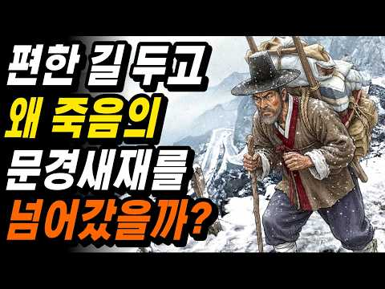
- 설명 앞부분: 조선시대에 문경새재와 대관령을 넘던 사람들은, 가장 편한 길을 놔두고 왜 목숨 걸고 이 험한 고개를 넘었을까요. 도적과 이름의 저주와 눈보라, 그리고 고갯길에서 사람을 가장 많이 죽인 진짜 정체까지, 조선 옛길의 진짜 공포를 따라갑니다. 이 영상에서 다루는 내용 나는 새도 넘기 힘들다던 문경새재, 도적은 대체 어디에 숨어 있었을까요 부산에서 한양까지, 조선 사람은 그 길을 며칠이나 걸어야 했을까요 셋 중 가장 낮고 편한 추풍령을 선비들이 굳이 피해서 돌아간 이유는 무엇일까요 추풍령의 추풍은 정말 가을바람이라는 뜻이 맞을까요 아흔아…
- 같은 채널 평소 대비 ×4.6 (채널 최근 롱폼 중앙값 95,776회) · 평소 영상: 조선 최연소 천재 병조판서를 사흘 만에 처형한 이유 ∣ 모든 걸 가졌던 천재 무사가 왜 … (95,776회) / 공자도 좋아한 그 맛, 조선 선비들이 강가에 모여 회를 먹던 진짜 이유 ∣ 조선 회식은 … (106,220회)
- 대본 없음 (설명) — 음성인식이 끝나면 도입부·흐름이 들어감
- 댓글 102/105: 좋은 점 — 영상 2 · 감사·응원 3 · 더 알고 싶은 것 2 · 아쉬운 점 — 영상 1 · 반박·불만 — 의견 다름 3 · 정치·사회 1 · 경험 공유 2 · 구독·다음 기대 0
  - 아쉬운 점 — 영상 👍1 “이 혀짧은 AI 음성은 머지??? 정상적인 발음하는 AI는 없나???”
  - 반박·불만 — 의견 다름 👍25 “혼자 넘어가는 건 말도 안되고 반드시 여러사람들과 무리지어 넘어가야 합니다 . 호랑이의 경우는 무리지어 횃불을 들고 가면 화를 면할수 있더랬죠”
  - 반박·불만 — 의견 다름 👍18 “병자호란때 청군이 대관령을 넘었다는건 사실이 아닙니다. 상식적으로 그렇게 올 수가 없잖아요.”
  - 정치·사회 👍0 “말이 그렇지 만약 말 대로라면 관청에서 군데 군데 경계 분청이라도 만들어 운영을 했겠지!!!!!!! 조선은 그렇게 무지한 나라가 아니었다.”
  - 경험 공유 👍0 “내가 듣기로는 625전쟁 후까지 죽령에 산적이 있었다고 하더라 들었나 책에서 봤나 가물가물하다”

### 82. [역사한줄] 조선시대 실제군인이 작성한 일기내용 #조선역사 #한국사 #부북일기

- https://www.youtube.com/watch?v=eY_TrTKsIJ0 · 역사한줄 · 구독자 3,500 · 조회수 427,895 (×122.3, 하루 2,765.8) · 좋아요 3,478 (0.8%) · 16.8분 · 2026-05-20 · 주제 묶음 3. 조선 · 형식 정보·해설 (그 밖) · 폴더 `W_eY_TrTKsIJ0` (웹 승인)
- 썸네일: 
- 설명 앞부분: 울산 박씨 문중에서 대대로 내려오던 조상님의 일기. 후손들이 학자에게 번역을 맡겼는데, 학자의 눈이 점점 커졌습니다. 공개하기 곤란하다며 논문 형식으로 세상에 처음 소개됐어요. 기생 모녀와 군관 부자의 40년 인연까지. 사극이 절대 보여줄 수 없었던 조선 군인의 진짜 일상입니다. 📺 이 영상에서 다루는 내용 후손들이 가보로 모시던 일기의 진짜 내용 부방길에서 만난 전사자의 시체 — 목숨을 건 국경 근무 400년 전 조선 무사의 헌팅 멘트가 일기에 그대로 적혀 있다 동료 목숨값을 송아지와 흥정한 400년 전 군대 유머 욕 퍼붓는 동…
- 같은 채널 평소 대비 ×73.5 (채널 최근 롱폼 중앙값 5,822회) · 평소 영상: [역사한줄] 교과서에 없는 역사기록 12대를 이어온 조선시대 부자가문 풀스토리 ∣ 경주최… (5,822회) / [역사한줄] 조선시대 양반들의 실체, 5억을 쓰고도 관직이 없었다? #한국사 #조선역사 (6,037회)
- 대본 없음 (설명) — 음성인식이 끝나면 도입부·흐름이 들어감
- 댓글 321/322: 좋은 점 — 영상 2 · 감사·응원 3 · 더 알고 싶은 것 3 · 아쉬운 점 — 영상 0 · 반박·불만 — 의견 다름 3 · 정치·사회 10 · 경험 공유 6 · 구독·다음 기대 0
  - 좋은 점 — 영상 👍93 “솔직하게 써서 시대상이 정말 적나라하게 드러났네, 조선사회 연구에 큰 도움이 될 자료입니다.”
  - 좋은 점 — 영상 👍0 “AI가 만든 그림과 글 어디까지가 사실이고, 꾸밈인지 구분이 어려운 영상 아무런 도움이 되지않을 소설같은 글 다시는 안 볼겁니다 (그래도 나름 만드느라 애썻을터이니 가능한 부드러운 말로 안좋았다는 표현을 합니다)”
  - 감사·응원 👍3 “저런 어려운 상황에서도 세계에서 가장 오래된 국경선인 압록강~두만강 경계를 굳건히 지켜주신 조상님들께 깊은 감사의 마음을 가집니다. 조선의 조정과 변방의 군인들 뿐만 아니라 험난하고 위험한 그 땅에서 차별과 수탈을 견뎌가며 삶을 영위해 가신 모든 민중들(그 중에는 귀…”
  - 감사·응원 👍2 “사학과 출신인데... 정말 좋은 유튜브채널이군요.^^ 감사합니다.^^ 구독자 100만 가시기를 축원합니다.❤”
  - 더 알고 싶은 것 👍16 “난중일기에 조선시대 장군들 보급품인 공노비 여자를 잘 사용하는내용도 부탁해요 충분한 얘기꺼리가 될겁니다”
  - 정치·사회 👍80 “평균연령 40살에 비위생에 영양결핍에 호랑이가동네마다 있던시기에 계속 나라가이어져온건 진짜 열심히했단거지”
  - 정치·사회 👍15 “모든 나라가 동일 선상에 있었지. 꼭 조선만 아니라 다른 나라도 전쟁으로 많은 남자들이 죽으면 남는 여자들은 누굴 책임져 줄까?”
  - 경험 공유 👍6 “임진난후 7년차로군, 말타고 80일 노러갔나?걸어가도 3번은 왕복하겠군.”
  - 경험 공유 👍1 “우리 조상님들 ㄸ 하신 이야기 들으니 후손된 입장에서 덕분에 우리가 있습니다 말씀 올리고싶네요 나도 후손들 탄생지속을 위해 급 ㄸ 하고싶어집니다 조상님들”

### 83. "13살 노비, 30년 후 정1품" 세종의 곁을 지킨 신빈 김씨, 조선판 신데렐라의 진짜 결말

- https://www.youtube.com/watch?v=Qof4DjCKdgE · 그날의역사 · 구독자 7,060 · 조회수 853,688 (×120.9, 하루 4,788.1) · 좋아요 9,150 (1.1%) · 43.7분 · 2026-04-27 · 주제 묶음 3. 조선 · 형식 정보·해설 (그 밖) · 폴더 `W_Qof4DjCKdgE` (웹 승인)
- 썸네일: 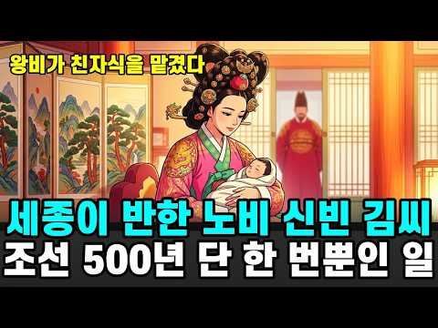
- 설명 앞부분: 1418년 봄, 열세 살의 관청 여종 한 아이가 궁으로 불려 갔습니다. 그로부터 마흔여섯 해. 세종의 아들 여섯을 낳고, 왕비가 친자식을 맡겼으며, 조선 500년 동안 단 한 명뿐인 여종 출신 정1품 빈에 오른 여인. 이름은 신빈 김씨. 내자시 쌀가마와 간장 항아리 사이에서 시작된 하루가, 어떻게 대수 장식을 쓴 한복 차림으로 바뀌어 갔는지. 두 왕조를 거쳐 한 여인이 걸어간 길을 한 걸음씩 따라갑니다. 이 영상에서 다루는 이야기 청주 공노비 집안의 열세 살 아이가 1418년 내자시로 입궁한 배경 태종비 원경왕후가 중궁전 지밀나인…
- 같은 채널 평소 대비 ×1,726.4 (채널 최근 롱폼 중앙값 494회) · 평소 영상: 정조가 즉위 20일 만에 처단한 숙의 문씨, 그 악녀를 키운 건 영조였다 (510회) / 영화가 보여주지 않은 인간 이순신의 진짜 얼굴ㅣ한국사ㅣ임진왜란 (479회)
- 대본 없음 (설명) — 음성인식이 끝나면 도입부·흐름이 들어감
- 댓글 648/652: 좋은 점 — 영상 12 · 감사·응원 25 · 더 알고 싶은 것 10 · 아쉬운 점 — 영상 6 · 반박·불만 — 의견 다름 7 · 정치·사회 9 · 경험 공유 9 · 구독·다음 기대 3
  - 좋은 점 — 영상 👍50 “이야기를 풀어나간 낱말과 문장에서 깊이와 품격, 그리고 감동을 느꼈습니다. 오백 수십 년 전의 궁궐 속, 한 어린 여종의 현명한 처신이 이전에 없던 역사를 써내려 갔군요. 그 여인을 고른 사람이 태종비, 세종비, 세종임금이니 사람의 마음을 이끌어내는 오롯함과 진실함 …”
  - 좋은 점 — 영상 👍15 “사람의 인생은 그 사람의 성품이 좌우한다는 말을 듣고 와닿았었는데, 이 영상 말미에서도 같은 말을 하는군요.... 🙏”
  - 감사·응원 👍120 “참 대단한 영상 입니다 소중하고 정셩이 가득한 이 영상을 많은 사람들이 함께 하였으면 좋겠습니다 제작하신 노고에 깊은 감사드립니다”
  - 감사·응원 👍50 “이야기를 풀어나간 낱말과 문장에서 깊이와 품격, 그리고 감동을 느꼈습니다. 오백 수십 년 전의 궁궐 속, 한 어린 여종의 현명한 처신이 이전에 없던 역사를 써내려 갔군요. 그 여인을 고른 사람이 태종비, 세종비, 세종임금이니 사람의 마음을 이끌어내는 오롯함과 진실함 …”
  - 더 알고 싶은 것 👍8 “천만감독 장항준 감독님 신빈김씨 일대기를 드라마로 만들어 주세요.”
  - 더 알고 싶은 것 👍8 “내용 잘 들었습니다. 신빈김씨의 삶이 어쩌면 우리들이 끊임없이 이어가고 있는 우리들의 어머니상이 아닐까 생각합니다. 제작자께 부탁드립니다. 긴 시간 동안 들으면서 내용이 중첩되고 혼란스럽다는 점입니다. 그런 탓에 머리 속에 쉽게 들어오지 않았습니다. 다시한번 문장을 …”
  - 아쉬운 점 — 영상 👍33 “설명이 너무 길어요 비슷하고 같은말을 반복하는게, 사연의 감동을 감소시키고 있습니다.”
  - 아쉬운 점 — 영상 👍5 “한편의 드라마를 본 듯...긴 영상이었지만 지루하지않게 잘 봤습니다. 영상과 나레이션이 좋아선지..”
  - 반박·불만 — 의견 다름 👍33 “그야말로 웃기는 신빈김씨 조선역사상 가장 잔인한 세조를 돌보았고 그아들들 단종왕을 찬탈하고 죽이는대 일조한 자식들 혜빈양씨와 자식들은 단종을 지키려다 죽은 충신들 너무 비교가 됩니다”
  - 반박·불만 — 의견 다름 👍6 “신빈김씨 아들 계양군 부인 한확 딸, 수양 장남 도원군 부인 한확 막내딸 인수대비. 예종 비 장순왕후 한명회 딸. 그들만의 카르텔이 너무 투명함. 신빈김씨가 수양을 안키웠으면 계유정난 글쎄 모르는 일이지 않을까.”
  - 정치·사회 👍1 “《파묘!,조선왕조"실체"공개》현재국사 韓국사가 우리역사 조작,왜곡의 최대주범이란 충격적 사실을 공개합니다. 다~아시다시피,韓국사는"조선왕조"중심인바,李조선왕조의 실체는,고려말 귀화외노자,중국인화하족 이자춘(DNA확인)가족 (이성계,이방원)의"위화도쿠데타"로,고려황실이…”
  - 정치·사회 👍0 “신빈신씨는 고려말 망한 귀족자제로 알고 있었는데 아닌가봐요?.나라가 망하면서 노비가 된, 그냥 무지랭이 천출이 아니라고 알고있는데 잘못 알고 있었나봐요.”
  - 경험 공유 👍35 “어디서 들었는데 세종 후궁이자 단종을 키운 혜빈양씨는 끝까지 단종을 지키다가 죽임을당하고 그 아들들도 다 죽었단다 신빈김씨는 세조에 딱 붙어서 자식들도 다 살았다고...자식과 본인을 위한 선택이나(나도 어떤선택했을지 모른다) 많이 씁쓸하다 그래서인지 신빈 김씨를 세종…”
  - 경험 공유 👍13 “내가 이분의 자손중 한명이라는것이 자랑스럽습니다^^”
  - 구독·다음 기대 👍0 “대본 직접 쓰신 건가요? 내용이 정말 좋습니다. 구독했어요.”

### 84. 조선야담#52 남겨진 머슴과 과부마님. 옛날이야기. 야담. 야사,

- https://www.youtube.com/watch?v=4jEcvypcCuQ · 조선의 밤 · 구독자 109 · 조회수 13,036 (×119.6, 하루 766.8) · 좋아요 85 (0.7%) · 18.2분 · 2026-10-05 · 주제 묶음 9. 야사·야담·옛날이야기 · 형식 수면·낭독 (잠잘 때 듣는) · 폴더 `W_4jEcvypcCuQ` (웹 승인)
- 썸네일: 
- 설명 앞부분: 조선 시대를 배경으로 한 흥미로운 야담과 민담, 그리고 사람들의 삶을 담은 감동적인 이야기를 전해드립니다. 신분을 뛰어넘는 사랑, 과부와 머슴의 운명, 주막에서 시작된 인연, 왕실의 비밀, 숨겨진 진실, 가슴 아픈 가족 이야기, 인생의 교훈까지. 매주 새로운 조선 야담과 옛날이야기를 만나보세요.
- 같은 채널 평소 대비 ×62.5 (채널 최근 롱폼 중앙값 208회) · 평소 영상: 조선야담#36 등잔밑이 어둡다더니... # 옛날이야기 #야담 #민담 (212회) / 조선야담#48 어머니의 한냥의 빚 # 민담 #야사 #야담 (205회)
- 대본 없음 (설명) — 음성인식이 끝나면 도입부·흐름이 들어감
- 댓글 1/2: 좋은 점 — 영상 0 · 감사·응원 0 · 더 알고 싶은 것 0 · 아쉬운 점 — 영상 0 · 반박·불만 — 의견 다름 0 · 정치·사회 0 · 경험 공유 0 · 구독·다음 기대 0

### 85. 돼지는 114일, 토끼는 단 한 달… 그런데 한국인은 왜 안 먹을까? 충격적인 5가지 이유 ∣ 역사 이야기

- https://www.youtube.com/watch?v=hf9t-gKqdjg · 몰랐던 세상 · 구독자 1,590 · 조회수 184,736 (×116.2, 하루 15,483.7) · 좋아요 951 (0.5%) · 10.8분 · 2026-10-10 · 주제 묶음 1. 역사 일반·이야기 · 형식 수면·낭독 (잠잘 때 듣는) · 폴더 `W_hf9t-gKqdjg` (웹 승인)
- 썸네일: 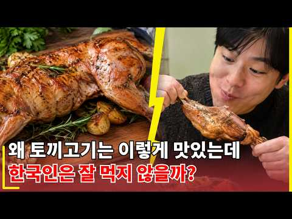
- 챕터: 0:00 토끼는 번식력이 뛰어난데 왜 한국에서는 잘 먹지 않을… · 0:59 토끼고기의 영양과 맛, 유럽에서 즐겨 먹는 이유 · 1:53 놀라운 번식력과 전쟁 중 토끼 사육의 역사 · 2:39 첫 번째 이유: 닭고기와 돼지고기의 거대한 산업 · 3:36 두 번째 이유: 예민한 건강 상태와 까다로운 사육 환경 · 4:29 세 번째 이유: 토끼고기를 활용하는 한국 요리가 부족… · 5:44 네 번째 이유: 식용보다 친근한 동물로 인식되는 토끼 · 6:55 다섯 번째 이유: 지방이 적은 고기가 한국인의 입맛과… · 7:59 과거 한국의 토끼고기 문화와 유럽의 소비 감소 · 9:01 토끼고기가 대중화되지 못한 다섯 가지 이유와 결론
- 설명 앞부분: 토끼는 번식력이 뛰어나고 단백질도 풍부한데, 왜 한국인의 밥상에서는 보기 어려울까요? 이번 역사 이야기에서는 토끼고기가 한국에서 대중화되지 못한 5가지 이유를 살펴봅니다. 닭고기와 돼지고기의 강력한 경쟁, 까다로운 사육 환경, 부족한 요리 문화부터 토끼를 바라보는 인식과 기름기 적은 고기의 특징까지 알아봅니다. 유럽에서는 익숙한 음식이었던 토끼고기가 왜 한국에서는 특별한 별미로 남았을까요? 흥미로운 역사 이야기와 음식 문화 속 숨겨진 이유를 영상 끝까지 확인해 보세요. 여러분은 토끼고기를 드셔 보셨나요? 먹어 본 경험이나 생각을 …
- 같은 채널 평소 대비 ×43.3 (채널 최근 롱폼 중앙값 4,266회) · 평소 영상: 독일인은 왜 생돼지고기를 빵에 발라 먹을까? 충격적인 매트의 역사 이야기 (4,266회) / 일본인은 왜 배수로 물고기를 절대 먹지 않을까? 깨끗한 물에도 숨겨진 진짜 이유 ∣ 문화… (3,790회)
- 대본 없음 (설명) — 음성인식이 끝나면 도입부·흐름이 들어감
- 댓글 330/333: 좋은 점 — 영상 2 · 감사·응원 2 · 더 알고 싶은 것 2 · 아쉬운 점 — 영상 3 · 반박·불만 — 의견 다름 2 · 정치·사회 0 · 경험 공유 11 · 구독·다음 기대 0
  - 감사·응원 👍1 “토끼 한번도 먹어본적 없는데 저런이유로 국내에서 유통이 안되고 있는거군요.. 혹시 나중에 기회되면 거위도 영상 올려주시면 감사하겠습니다! 외국에서는 많이 먹는거 같던데 우리나라에는 거위고기 보기가 어려워서 궁금하네요!”
  - 더 알고 싶은 것 👍1 “토끼 한번도 먹어본적 없는데 저런이유로 국내에서 유통이 안되고 있는거군요.. 혹시 나중에 기회되면 거위도 영상 올려주시면 감사하겠습니다! 외국에서는 많이 먹는거 같던데 우리나라에는 거위고기 보기가 어려워서 궁금하네요!”
  - 더 알고 싶은 것 👍0 “궁금해서 먹었는데 닭도리탕같이 해주던데 질겨서 그돈이면 닭도리탕먹는게 낫다”
  - 아쉬운 점 — 영상 👍40 “한국인이 토끼고기를 잘 안먹는 이유를 알려고 눌렀는데, 서론이 너무 길어서 숏츠 보려고 나간다 ㅠ”
  - 아쉬운 점 — 영상 👍0 “흠.... 토끼... 예전에 야생 산토끼 먹었던 기억이 있는데 누린내 엄청 심했었는데.... 기대하다가 먹고 엄청 실망했었던 기억이 있어서.....”
  - 반박·불만 — 의견 다름 👍0 “헛소리”
  - 반박·불만 — 의견 다름 👍0 “북한도 가죽만 팔고 고기 구경도 못하는데 뭔 헛소리하네.”
  - 경험 공유 👍5 “내가 어렸을때 우리부친을따라 자주 사냥을갔었다 그러다가 토끼를 잡아서 그자리에서 가죽을벳기고 버터칠해서 구워먹었던 경험이있다 너무나 맛있었다 멧돼지 고기도 일반 돼지고기보다는 향긋하고 맛있었다 반대로 노루고기는 싱거윘던 경험이있다 더불어 한컵을 억지로 마셔야했던 노루…”
  - 경험 공유 👍1 “60년대 부터 80년대 초반까지 우리나라 섬유산업의 부산물로 갑자기 유행이 되었던 고기들이 오리고기하고 토끼고기 였었다 70년대 말에서ㅠ80년대 초까지 겨울에ㅠ오리털 파카라고 이게 유했했었는데 지금은 구스페딩이나 덕페딩ㅍ같은 것 과거와ㅠ다른점은 구스페딩같은건 거의 1…”

### 86. 🔥조선 영의정의 외아들🔥이 갑자기 노비로 전락하면 벌어지는 일...

- https://www.youtube.com/watch?v=Kj46XmMz4u0 · 드라마상점 · 구독자 4,770 · 조회수 551,219 (×115.6, 하루 3,403.5) · 좋아요 2,555 (0.5%) · 23.5분 · 2026-05-13 · 주제 묶음 3. 조선 · 형식 사극·드라마·영화 리뷰 · 폴더 `W_Kj46XmMz4u0` (웹 승인)
- 썸네일: 
- 설명 앞부분: 제목은 화면 왼쪽 위를 참고해주세요 영상 시청 감사합니다 🙂
- 같은 채널 평소 대비 ×1.7 (채널 최근 롱폼 중앙값 332,655회) · 평소 영상: 🔥가족 중 누군가가 날 죽이려 한다🔥 500억 유산을 둘러싼 김혜준 주연의 치열한 상속싸… (655,181회)
- 대본 없음 (설명) — 음성인식이 끝나면 도입부·흐름이 들어감
- 댓글 142/143: 좋은 점 — 영상 0 · 감사·응원 0 · 더 알고 싶은 것 2 · 아쉬운 점 — 영상 0 · 반박·불만 — 의견 다름 2 · 정치·사회 6 · 경험 공유 4 · 구독·다음 기대 0
  - 더 알고 싶은 것 👍39 “언제의 드라마죠? 못본거같은데 재밋네요..”
  - 더 알고 싶은 것 👍0 “언제고 그런 날이 오겠죠?”
  - 반박·불만 — 의견 다름 👍1 “아무리 드라마여도 판타지를 만들어 놨네.. 조선시대가 어떤나라인데 저런 말도 안되는 사극을 만드냐??”
  - 정치·사회 👍2 “그놈이 대통령이 되었으니 .참..”
  - 정치·사회 👍0 “그런 날이 왔더니 불펴안 가득한 불임세대가 왔네요. 외노자 없으면 나라가 안 돌아가네요.”
  - 경험 공유 👍82 “권율장군도 불혹이될때까지 한량짓을하고돌아다녔다고합니다 심지어 사위인 백사이항복이 먼저등과했습니다 영의정이었던 그의부친께서 임종하시며 그를 물끄러미보다가 ,너를 내가낳았구나, 라고말하고 임종했다고합니다 이에 감발된 권율이 왜란 십년전인1582년 등과해 훗날 류성룡 이순…”
  - 경험 공유 👍2 “조우진이 여기에도 출연 했었네 ㅎ”

### 87. 《불교 역사》 인도의 괴짜 승려 달마는 누구인가? l 역사 인물 l 고전

- https://www.youtube.com/watch?v=N4v1knO4AEw ·  역사 산책: 동양편 · 구독자 2,770 · 조회수 319,472 (×115.3, 하루 3,981.9) · 좋아요 2,254 (0.7%) · 23.2분 · 2026-08-03 · 주제 묶음 1. 역사 일반·이야기 · 형식 정보·해설 (그 밖) · 폴더 `W_N4v1knO4AEw` (웹 승인)
- 썸네일: 
- 같은 채널 평소 대비 ×49.7 (채널 최근 롱폼 중앙값 6,426회) · 평소 영상: 《삼국지》 유비는 왜 동문 공손찬의 등에 칼을 꽂았을까? l 역사 인물 l 고전 (7,251회) / 《삼국지》 조조의 손자 조예, 위나라를 파멸로 몰았던 이유는? l 역사 인물 l 고전 (5,600회)
- 대본 없음 (없음) — 음성인식이 끝나면 도입부·흐름이 들어감
- 댓글 126/126: 좋은 점 — 영상 0 · 감사·응원 3 · 더 알고 싶은 것 1 · 아쉬운 점 — 영상 1 · 반박·불만 — 의견 다름 1 · 정치·사회 0 · 경험 공유 0 · 구독·다음 기대 0
  - 감사·응원 👍0 “감사합니다!”
  - 감사·응원 👍0 “고맙습니다.”
  - 더 알고 싶은 것 👍1 “그게 가능한가요? 그 당시 평균수명이 몇세인데 출가를 하고 반야다라밑에서 40년을 수행하고 67년을 기다리고 3년에 걸쳐 중국에 가고 9년 면벽수행을 하고..... 당신같으면 가능한가요? 솔방울로 수류탄 만드는 수준이잖아요? 혹시 죽었을때 방광현상은 안 일어 났고 공…”
  - 아쉬운 점 — 영상 👍6 “이런 영상 참 좋아요, ai는 아니시죠? 제발 ai 음성으로 하지 말아주세요”
  - 반박·불만 — 의견 다름 👍0 “실존 인물이 아닙니다.”

### 88. 이거 하나면 그리스 신화 아는 척 가능 ⚡ 신들의 막장 족보 총정리 (제우스부터 오디세우스까지)

- https://www.youtube.com/watch?v=sq8Un9KgH9g · 재미난 역사여행 · 구독자 5,220 · 조회수 593,483 (×113.7, 하루 9,077.8) · 좋아요 5,160 (0.9%) · 49.8분 · 2026-08-17 · 주제 묶음 5. 세계사·서양사 · 형식 정보·해설 (그 밖) · 폴더 `W_sq8Un9KgH9g` (웹 승인)
- 썸네일: 
- 챕터: 0:00 오프닝 — 세상에서 가장 막장인 집안 족보 · 2:30 태초의 어둠 카오스, 그리고 하늘과 땅의 시작 · 4:47 자식을 삼킨 아버지, 그 끔찍한 이유 · 9:26 하늘·바다·저승, 세 형제의 제비뽑기 · 10:42 올림포스로 — 신들의 왕과 여왕의 결혼 · 19:00 반은 신, 반은 인간 — 영웅들의 시대 · 20:38 최고의 영웅, 그가 짊어진 무거운 죄 · 28:20 사과 한 알에서 시작된 트로이 전쟁 · 36:59 지혜의 장수 오디세우스와 트로이 목마 · 46:02 모든 족보를 한 줄로 — 그리고 마지막 질문
- 설명 앞부분: ⚡ 3천 년 동안 사랑받은 그리스 로마 신화, 이 영상 하나로 완벽하게 끝냅니다! 세상에서 가장 막장인 집안 족보가 있습니다. 아버지를 끌어내린 아들, 자식을 삼킨 아버지, 바람 잘 날 없는 부부싸움까지… 👑 바로 그리스 신들의 이야기입니다. 이 영상에서는 태초의 혼돈(카오스)부터 시작해 크로노스, 제우스, 헤라를 거쳐 헤라클레스 같은 영웅들, 그리고 트로이 전쟁과 오디세우스의 20년 귀향까지 — 복잡하게 얽힌 신화의 족보를 딱 한 줄기로 쉽게 풀어드립니다. 😊 🏛️ 어려운 이름과 복잡한 관계, 걱정 마세요. 천천히, 차근차근, …
- 같은 채널 평소 대비 ×968.2 (채널 최근 롱폼 중앙값 613회) · 평소 영상: 친일파들은 어떻게 대한민국의 상위 1% 부자가 되었을까? (613회) / 세계 군사학자들도 경악한 전술, 13척으로 330척을 찢어발긴 명량해전의 진실 ∣ 이순신 (607회)
- 대본 없음 (설명) — 음성인식이 끝나면 도입부·흐름이 들어감
- 댓글 295/296: 좋은 점 — 영상 7 · 감사·응원 7 · 더 알고 싶은 것 2 · 아쉬운 점 — 영상 1 · 반박·불만 — 의견 다름 1 · 정치·사회 2 · 경험 공유 4 · 구독·다음 기대 2
  - 좋은 점 — 영상 👍19 “귀에 쏙쏙 요약 정리로 복잡한 그리스신화 잘 이해했습니다. 멋진영상 몀쾌한설명 감사합니다.”
  - 좋은 점 — 영상 👍9 “좋은 영상 감사합니다~”
  - 감사·응원 👍19 “귀에 쏙쏙 요약 정리로 복잡한 그리스신화 잘 이해했습니다. 멋진영상 몀쾌한설명 감사합니다.”
  - 감사·응원 👍13 “그리스신화를 제대로 이해한 영상. 고맙습니다.”
  - 더 알고 싶은 것 👍1 “제우스 알고싶어요”
  - 더 알고 싶은 것 👍1 “오디세우스는 몇살까지 살았는지 궁금하네요~”
  - 아쉬운 점 — 영상 👍2 “반복되는 여러분, ~입니까?라는 질문형식으로 이야기풀이가 듣는 사람의 집중력을 더 떨어뜨리는 느낌이 들었어요..”
  - 반박·불만 — 의견 다름 👍1 “그리스 신와는 신화보다 왕가인듯해요 예전 왕가는 친족끼리 결혼을 많이 했거든요 울나라 신라 고려도 그랬는데 울나라만이 아닙니다 신들이 결혼을 했을가요?”
  - 정치·사회 👍1 “그리스는 단순히 그리스 신화의 나라가 아닙니다. 그리스는 민주주의, 정치학, 스포츠 정신, 체육관과 올림픽, 연극(희극과 비극), 현대 의학 및 병원과 히포크라테스 선서, 국제 과학 용어, 세계 최초의 대학, 세계 최초의 컴퓨터(안티키테라 기계), 세계 최초의 화폐(…”
  - 정치·사회 👍1 “에초에 근친혼 자체가 이상한거임 근데 충격적이게도 유럽이나 우리나라가 이딴거 하다 대가 끊어진 나라와 가문이있다는거지”
  - 경험 공유 👍8 “트로이 목마 옛날에 내가 고등하교 시절 알았는데 이런 얘기가 있는줄은 60년후 이제 모두 알았네요 79세 할매인데 역시 배우는것이 행복 합니다,선생님 감사 합니다 극장에 영화구경 가자합니다 딸이 아닌 외손녀 여고생 입니다 서생님 잘배우고 있어요 감사 해요🎉🎉❤❤❤”
  - 경험 공유 👍0 “하아..난..이걸 보고 너무 속상하네..난 버린자식이야..아버지께서..내가 천국에 가면 여자에게 왕좌를 뺏길까봐..난..난..버린자식이야..아버지 께서도 날 인정하지 않으신거야..작은 내가 두려우셨던거야..속상하네..계속 싸울꺼야..아버지와 나는 계속 싸우게 되겠지.…”
  - 구독·다음 기대 👍5 “그토록 복잡해서 이름 외우고 의미 새기며 읽다 포기하고, 또 미련두었던 그리스신화! 끝까지 정주행 했는데.. 이제서야 맥락을 이해하게 되었네요. 무엇이든 맥락.흐름을 아는게 이래서 중요하지요. 티탄신, 2,3세대 신, 님프 통틀어 나는 딱 하나 고른다면, 오디세우스가…”
  - 구독·다음 기대 👍1 “좋아요로는 부족해서 구독하고 갑니다”

### 89. 단종의 친누나 경혜공주, 세조에게 한 조선 역사상 가장 잔인한 복수

- https://www.youtube.com/watch?v=wX-80QWb2tg · 시간책방 · 구독자 8,520 · 조회수 965,539 (×113.3, 하루 7,108.5) · 좋아요 23,356 (2.4%) · 36.6분 · 2026-06-08 · 주제 묶음 1. 역사 일반·이야기 · 형식 정보·해설 (그 밖) · 폴더 `W_wX-80QWb2tg` (웹 승인)
- 썸네일: 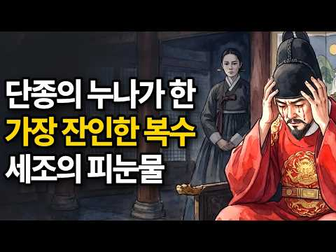
- 챕터: 0:00 내 가족을 죽인 사람에게 아이를 맡길 수 있습니까? · 2:15 경혜공주의 탄생과 어머니의 비극 · 6:00 인생에서 가장 빛나던 2년 · 7:40 계유정난 — 누나 집에서 끌려간 동생 · 8:55 남편 유배와 경혜공주의 첫 번째 저항 · 12:45 사육신 사건과 연쇄 비극 · 17:15 칼 없는 복수의 시작 — 아이를 원수에게 보내다 · 24:15 세조의 유언 — 감옥의 문을 잠그다 · 25:50 단종의 저주, 세조 집안에 드리운 그림자 · 27:30 4대에 걸친 설계 — 정미수의 등용 · 31:25 어머니를 닮은 아들 · 31:50 경혜공주의 죽음과 정순왕후의 64년 침묵 · 35:55 570년 뒤, 당신에게 묻습니다
- 설명 앞부분: 왕의 딸에서 노비로. 남편은 사지가 찢겨 죽고, 남동생은 열일곱에 세상을 떠났습니다. 그런데 이 여자는 칼을 들지 않았습니다. 대신 여섯 살 아들을 원수의 궁궐로 보냈습니다. 그 선택 하나가 세조의 가슴에 가시가 되어 박혔고, 그 가시는 4대의 왕이 바뀌는 동안에도 끝내 빠지지 않았습니다. 조선왕조 500년, 공주에서 노비로 떨어진 유일한 기록. 경혜공주의 이야기입니다. ⏱️ 타임스탬프 이 영상은 조선왕조실록, 성종실록, 세조실록 등의 사료를 바탕으로 재구성하였습니다.
- 같은 채널 평소 대비 ×622.1 (채널 최근 롱폼 중앙값 1,552회) · 평소 영상: 조선 왕들은 왜 46세에 죽었나? 경복궁 흙이 밝힌 충격적 진실 (1,633회) / 세조는 왜 친동생 안평대군을 죽였나? 조선 최고의 천재가 사라진 진짜 이유 (1,471회)
- 대본 없음 (설명) — 음성인식이 끝나면 도입부·흐름이 들어감
- 댓글 864/882: 좋은 점 — 영상 11 · 감사·응원 23 · 더 알고 싶은 것 6 · 아쉬운 점 — 영상 6 · 반박·불만 — 의견 다름 4 · 정치·사회 23 · 경험 공유 11 · 구독·다음 기대 0
  - 좋은 점 — 영상 👍27 “영화 왕과사는남자를 보고 말씀을 들으니 더 마음이 아프네요... 귀에 쏙~ 들어오면서 역사공부를 제대로 하였습니다... 감사합니다”
  - 좋은 점 — 영상 👍10 “좋은영상 잘 보았습니다. 감사합니다 ~”
  - 감사·응원 👍122 “이야기 너무 생생하게 잘 전달해 주셔서 감사합니다 경혜공주, 정말 대단한 어머니이네요 아름다운 영상으로 보여주니 더 생생하게 다가옵니다 감사합니다”
  - 감사·응원 👍40 “중간에 광고없이 듣게 돼서 너무 감사 했어요 .설명도 잘 이해 할수있도록 부연설명해주시고 …”
  - 더 알고 싶은 것 👍40 “(권순임)현덕왕후님.경혜 공주님과.임금이신 단종을 두시고 어떻게 눈을 감으셨나요?참으로 가슴이 찢어지게 아파 옵니다.그리고 하염없이 눈물이 흘러 내립니다.현덕 왕후님 이제는 하늘에세 편안하게 쉬세요.🙏🙏🙏🎉🎉🎉”
  - 더 알고 싶은 것 👍7 “정미수의 여동생은 어떻게 되었나요?”
  - 아쉬운 점 — 영상 👍5 “내용 너무 좋아요. 진짜 잘 보고 갑니다. 근데 ai이미지에서 결혼안한 아이가 상투를 틀고 있다던가 팔이 세개가 있다던가 하는 부분들이 아쉬워요ㅜㅜㅜ”
  - 아쉬운 점 — 영상 👍4 “유익하고 조선왕조 실록 등 사료에 충실하게 영상 제작해주셔서 고맙습니다. 저는 해주정씨 종파 후손입니다. 즉 영양위 할아버지와 경혜공주 할머니의 직계후손입니다. 경혜공주 할머니의 자애로운 모성과 미수할아버지의 효심과 선행을 잘 표현해 주셔서 특히 고맙습니다. 한가지 …”
  - 반박·불만 — 의견 다름 👍35 “세조, 이유. 이 인물은 사람 아닙니다. 작금의 누구하고 비슷하죠.. 악마의 화신들..ㅎㅎ”
  - 반박·불만 — 의견 다름 👍1 “요새도 말도 안되는 한방이 치료랍시고 하는것 보면 참 한심해. 궁궐에서도 저리 쉽게 죽는거도 못 막으면서 무슨 치료한답시고 설치는지. 사기좀 그만 치면 그나마 나을텐데.”
  - 정치·사회 👍8 “세조의 잔인성이 이재명한테 옮겨붙었구나...”
  - 정치·사회 👍2 “세조는 천벌을 받았고 경혜공주의 복수는 성공했다 지금의 정권은 귀담아들어라”
  - 경험 공유 👍5 “이 이야기에 나오는 여자들의 한 뿐만 아니라, 그 외의 많은 여자들의 한이 쌓이고 쌓여 조선왕조의 저주가 줄줄이 이어지고, 그 결과가 순종에서 끝나고, 그 저주는 단명과 무능으로 시착되어 결국 망국에 이르고, 그 폐혜는 모두 온국민이 감당했습니다. 저는 개인적으로 '…”
  - 경험 공유 👍4 “문종에게 아들 딸이 있엇다는건 나도 알고 있었죠. 문종 단종으로 대가 이어졌다면 역사도 달라졌지요. 세종 문종 단종으로이어졌던.대가.”

### 90. 고조선 이전_또 다른 문명이 있었다

- https://www.youtube.com/watch?v=u_tS1xBdjn8 · 리워크531(REWORK 531) · 구독자 221 · 조회수 25,010 (×113.2, 하루 148.3) · 좋아요 452 (1.8%) · 12.2분 · 2026-05-06 · 주제 묶음 2. 한국 고대·삼국·고려 · 형식 정보·해설 (그 밖) · 폴더 `W_u_tS1xBdjn8` (웹 승인)
- 썸네일: 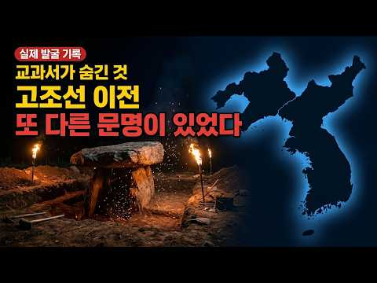
- 설명 앞부분: 교과서는 단군조선부터 가르칩니다. 그런데 그 이전 5,667년은 어디에 있을까요. 유물이 말하고 있습니다. 발굴지가 말하고 있습니다. DNA가 말하고 있습니다. 오늘은 아무도 가르쳐주지 않은 한반도 잃어버린 왕조의 진실을 파헤쳐 봅니다. 이 영상에서 다루는 핵심 증거들 ▸ 전 세계 고인돌 40,000개 — 한반도 집중 분포 ▸ 기원전 2333년 — 4대 문명 절정과 동시에 기록된 단군조선 ▸ 홍산문화 유물 — 곰 토템·빗살무늬·적석총이 한국과 동일 ▸ 고대 DNA 분석 — 8,000년 전 신석기인과 현재 한국인의 직계 연결 ▸ 다…
- 같은 채널 평소 대비 ×338.0 (채널 최근 롱폼 중앙값 74회) · 평소 영상: 5년간 아무도 몰랐다 커튼 속 그 얼굴의 정체 (74회) / 금기를 깨다_죽은 자를 부르는 AI (51회)
- 대본 없음 (설명) — 음성인식이 끝나면 도입부·흐름이 들어감
- 댓글 47/47: 좋은 점 — 영상 0 · 감사·응원 1 · 더 알고 싶은 것 1 · 아쉬운 점 — 영상 0 · 반박·불만 — 의견 다름 1 · 정치·사회 1 · 경험 공유 1 · 구독·다음 기대 0
  - 감사·응원 👍37 “이런 역사적인 사실을 더 연구하고 밝히는것은 역사학자들의 의무일진데 거꾸로 배달국 단군의 진실을 얘기하면 환빠 유사역사학으로 매도하면서 폄화하는 대한민국강단사학자들은 비난받아 마땅한자들입니다 우실하교수님 이덕일교수님의 강의는 진실을 알려주는 열쇠입니다 채널작가님의 관…”
  - 더 알고 싶은 것 👍0 “저 유물은 어디에 있나요? 이거 실화입니까?”
  - 반박·불만 — 의견 다름 👍1 “또 헛소리 하고있네 어째 홍산문화 대부분의 고구려 발해 등등 이 우리 역사냐 깊이 생각 안해본 모양이네 쇄뇌 됐어”
  - 정치·사회 👍19 “대한민국 한국인들의 99퍼센트가 모르는 지금 중국의 한자는 원래 동이족이 만든 은나라가 만든 은자이며 은자라고 이름이 지어져야 합니다 은나라의 은허에 무덤들은 모두 지금의 발해만 만주를 바라보며 지어져 있고 중국인들이 발굴하다가 멈추고 덮었습니다 갑골문자 은자가 현재…”
  - 경험 공유 👍11 “이 AI는 그냥 있었던 역사적 발굴상황만을 시대별로 나레이팅을 할 뿐이다. 그리고 이런 유물의 발굴은 실제 있었던 상황이다. 그런데 여기에 무슨 환빠가 있는가? 홍산문명에 대한 입증은 중공이 먼저했었고 그리고 발굴은 지금도 이어지고 있다. 홍산에서 나온 옥의 성분과 …”

### 91. 이순신 장군님을 2026년 대한민국에 모셔왔습니다

- https://www.youtube.com/watch?v=Jb4mO-n0884 · 어디로든 연우 · 구독자 2,460 · 조회수 278,314 (×113.1, 하루 21,042.1) · 좋아요 1,445 (0.5%) · 6.4분 · 2026-10-09 · 주제 묶음 3. 조선 · 형식 정보·해설 (그 밖) · 폴더 `W_Jb4mO-n0884` (웹 승인)
- 썸네일: 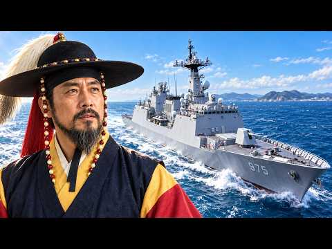
- 챕터: 0:00 장군님, 저랑 어디 좀 가요 ∣ Admiral, co… · 0:28 여기는 2026년 대한민국입니다 ∣ Welcome t… · 1:26 장군님의 첫 자동차 나들이 ∣ The admiral’… · 2:24 장군님, 하나 드셔보세요 ∣ Admiral, try … · 2:53 보여드리고 싶었던 배가 있어요 ∣ There’s a … · 3:14 지금 우리 바다를 지키는 군함 ∣ The warshi… · 4:35 함께 싸우던 이들이 생각나는구나 ∣ I remembe… · 5:03 장군님이 지키고 싶었던 일상 ∣ The everyda… · 5:56 다시 조선으로, 감사했습니다 ∣ Back to Jos… · 6:15 자, 하나씩 들게 ∣ Here, have one ea…
- 설명 앞부분: 이순신 장군님을 2026년 대한민국에 모셔 온 연우 🌊 장군님이 지켜낸 바다, 그 이후의 모습을 직접 보여드리고 싶었습니다. 처음 타보는 자동차부터 내비게이션, 영상과 음악, 달콤한 간식까지. 낯선 것투성이인 미래 나들이에 장군님의 반응은? 😂 그리고 마침내 마주한 대한민국 해군의 군함. 지금 이 바다를 지키는 이들을 만난 장군님은 함께 싸웠던 사람들을 떠올립니다. “이제는 저희가 지키겠습니다.” 시간을 넘어 만난 두 시대의 바다. 그 너머에서 평범한 하루를 살아가는 사람들을 보며, 장군님은 어떤 생각을 하셨을까요? 현실에는 없는…
- 대본 없음 (설명) — 음성인식이 끝나면 도입부·흐름이 들어감
- 댓글 248/266: 좋은 점 — 영상 3 · 감사·응원 14 · 더 알고 싶은 것 5 · 아쉬운 점 — 영상 2 · 반박·불만 — 의견 다름 1 · 정치·사회 14 · 경험 공유 8 · 구독·다음 기대 1
  - 좋은 점 — 영상 👍48 “안녕하세요 이순신 장군님의 후손입니다 저희 조상님을 통해서 좋은 영상 만들어주셔서 감사합니다 영상 잘보고있습니다😊”
  - 좋은 점 — 영상 👍2 “얼마전에 다른 유튜버분이 현대시대에 세종대왕님을 모신적이 있었는데 그 영상 댓글에 저도 이런걸 상상했던적이 있다고 댓글을 적었던적이 있습니다. 그때 상상했던 인물들이 세종대왕님과 이순신장군님이라고도 적었구요. 근데 그 상상했던 영상을 이렇게 빨리 보게될줄은 몰랐습니다…”
  - 감사·응원 👍256 “저는 현역 장교인 신분의 군인입니다. 나중에 혹시 괜찮으시면, 우리 국군의 날 행사 귀빈석에서 수많은 위인들이 우리 국군의 위용을 보시는 영상 한번 만들어주시면 감사하겠습니다. 불멸의 이순신 보고 군인의 꿈을 품었던 소년이 어느새 야전에서 부하들을 이끄는 군인이 되었…”
  - 감사·응원 👍48 “안녕하세요 이순신 장군님의 후손입니다 저희 조상님을 통해서 좋은 영상 만들어주셔서 감사합니다 영상 잘보고있습니다😊”
  - 더 알고 싶은 것 👍256 “저는 현역 장교인 신분의 군인입니다. 나중에 혹시 괜찮으시면, 우리 국군의 날 행사 귀빈석에서 수많은 위인들이 우리 국군의 위용을 보시는 영상 한번 만들어주시면 감사하겠습니다. 불멸의 이순신 보고 군인의 꿈을 품었던 소년이 어느새 야전에서 부하들을 이끄는 군인이 되었…”
  - 더 알고 싶은 것 👍2 “얼마전에 다른 유튜버분이 현대시대에 세종대왕님을 모신적이 있었는데 그 영상 댓글에 저도 이런걸 상상했던적이 있다고 댓글을 적었던적이 있습니다. 그때 상상했던 인물들이 세종대왕님과 이순신장군님이라고도 적었구요. 근데 그 상상했던 영상을 이렇게 빨리 보게될줄은 몰랐습니다…”
  - 아쉬운 점 — 영상 👍0 “기발한 생각은 맞는데 놀라는 장면이 너무 약해서 아쉽네요.😅 감격해서 눈물씬도 아쉽구요. ㅋ”
  - 아쉬운 점 — 영상 👍0 “아직은 오글거리기도 하고 ai티가 많이나긴 하는데 나중엔 진짜 구분 안되겠네;”
  - 반박·불만 — 의견 다름 👍0 “말도안되는 엽기적인 영웅 이순신!!”
  - 정치·사회 👍6 “조선을 지키기 위해 얼마나 싸웠던가, 임진왜란 이후, 일제강점기에 625 한국전쟁까지 나라가 두쪽나서 이순신 장군이 얼마나 슬퍼할까나,”
  - 정치·사회 👍1 “현재 제주는 중국인이 가득...”
  - 경험 공유 👍48 “안녕하세요 이순신 장군님의 후손입니다 저희 조상님을 통해서 좋은 영상 만들어주셔서 감사합니다 영상 잘보고있습니다😊”
  - 경험 공유 👍5 ““내가 지키고 싶었던 것도 이런 하루였네” 이 한마디 ㅜㅜㅜ 너무 뭉클함 ㅜㅜ”

### 92. [친일파와 식민지 근대화론] 일제가 조선을 먹여 살렸다는 기막힌 헛소리 팩트체크 포함 1시간 몰아보기

- https://www.youtube.com/watch?v=LwjbMRyBWZ8 · 기웃기웃 김기욱 · 구독자 1,730 · 조회수 194,998 (×112.7, 하루 3,204.2) · 좋아요 1,505 (0.8%) · 62.7분 · 2026-08-22 · 주제 묶음 3. 조선 · 형식 수면·낭독 (잠잘 때 듣는) · 폴더 `W_LwjbMRyBWZ8` (웹 승인)
- 썸네일: 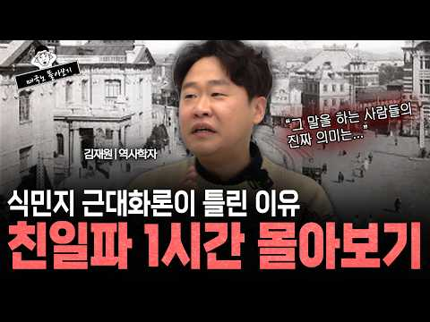
- 설명 앞부분: 일본이 조선을 근대화시켰다? 식민지 근대화론의 소름 돋는 모순과 친일파들이 나라를 팔아먹는 과정을 1시간으로 정리했습니다. 우리가 교과서에서 배우지 못한 아픈 역사, 이완용과 친일파들이 어떻게 권력을 탐하고 나라를 넘겼는지 그 비하인드 스토리를 파헤칩니다.
- 같은 채널 평소 대비 ×180.5 (채널 최근 롱폼 중앙값 1,080회) · 평소 영상: 추석특집 정일영 교수의 마라맛 입담 1시간 총집편! (1,245회) / 제주연인 사건으로 보는 대한민국 교제범죄의 현실 ep.01 ∣ 허민숙 입법조사관 X 김기욱 (916회)
- 대본 없음 (설명) — 음성인식이 끝나면 도입부·흐름이 들어감
- 댓글 1,036/1,039: 좋은 점 — 영상 8 · 감사·응원 15 · 더 알고 싶은 것 11 · 아쉬운 점 — 영상 3 · 반박·불만 — 의견 다름 42 · 정치·사회 120 · 경험 공유 43 · 구독·다음 기대 0
  - 좋은 점 — 영상 👍14 “재원쌤꺼는 그냥 봐야지 머리에 쏙쏙 들어옴”
  - 좋은 점 — 영상 👍9 “민초가 알기쉽게 설명 잘 해주셨습니다❤ 짝짝짝~~^감사”
  - 감사·응원 👍9 “민초가 알기쉽게 설명 잘 해주셨습니다❤ 짝짝짝~~^감사”
  - 감사·응원 👍2 “어느날 집에 도둑놈이 도둑질을 하려고 사다리를 가져다 와서 도둑질을 하고는 사다리를 놔두고 갔습니다. 그렇다면 일반적인 사람으로써는 '도둑놈이 도둑질을 했다' 라고 하지 '도둑놈이 사다리를 놔두고 가서 감사하다' 라고하는 하지 않습니다.”
  - 더 알고 싶은 것 👍2 “일제 이전의 조선인의 삶이랑 비교를 해보면 인구 50%의 노비의 차별은 어떻게 생각하시는지 ㅋㅋ.. 윤서인씨랑 토론을 부탁합니다”
  - 더 알고 싶은 것 👍1 “역사에는 객관적이라는 개념이 적용될수없다고 생각합니다 현재를 살아가는 이들이 해석하는대로 역사는 쓰여질수밖에 없겠지요.. 그래서 더욱더 바른 잣대를 가지고 봐라봐야 하겠습니다 최대한쉽게 선생님이 설명해주시니 참 좋네요 .. 친일파 청산문제를 조금더 다뤄주시면 감사하겠…”
  - 아쉬운 점 — 영상 👍5 “김재원 곡학아세란 이야기를 아시는지 일제 36년간 수탈만 당했다면 조선인은 바보냐 빼았길게 뻔한데 일하게 조선시대는 경제성장률이 마이너스잖아 한말 홍경래의난 이재수의난 진주민란 동학난은 먼데 살기 좋았다면 왜 일어났을까 동학을 진압하기 위해 외세를 끌어들인게 누군데 …”
  - 아쉬운 점 — 영상 👍4 “역사학자라면 중요한게 이완용보다 조선사편수회 이병도 신석호(스승 쓰다소키치 이마니시류) 매국식민사관 언급 청산은 안하나?광복후 친일청산안한 무능한 이승만정부, 양심있으면 진실만 말하고 헛소리말고 식민사관이나 언급하고 양심발언하자! 한사군 위치가 아직도 반도고?살수대첩…”
  - 반박·불만 — 의견 다름 👍8 “지겹다 친일파논란 일본하고 경제공동체하고 중국의 초한전에 대비해야하는데 아직도 이런 친중사대적인 마인드를 가진자가 선동을 하고있으니 중국이 착취한거는 얘기도 못하는것들이”
  - 반박·불만 — 의견 다름 👍4 “역사학자라면 중요한게 이완용보다 조선사편수회 이병도 신석호(스승 쓰다소키치 이마니시류) 매국식민사관 언급 청산은 안하나?광복후 친일청산안한 무능한 이승만정부, 양심있으면 진실만 말하고 헛소리말고 식민사관이나 언급하고 양심발언하자! 한사군 위치가 아직도 반도고?살수대첩…”
  - 정치·사회 👍21 “친일파 후손 국회 정치권에 엄청많잖아 노무현때 열었다가 닫았지”
  - 정치·사회 👍16 “이게 그당시의 왕조시스템을 감안 해야함. 이완용은 결정권자가 아님. 예를 들어 북조선 김정일이 화페개혁을 단행 북인민의 반감을 삼. 김정일이 밑에놈을 내밀며 책임을 물었고, 인민들은 찢어죽이자며 분노함. 연좌제 가동 수십명 처형으로 마무리 됨. 을사조약 당일날, 신문…”
  - 경험 공유 👍207 “당시 조선 상황에서 중일러 가운데 어느 한 나라에 먹힐 수밖에 없었고 그래서 일본에 먹힌건데 뭐 잘못됐냐는 주장이 있는데 그 말은 강도살인범이 셋이 있었는데 어차피 넌 그 강도들 중 한 넘한테 찔려죽을 운명이었고 그래서 내가 널 찔러죽였는데 내가 무슨 죄야? 라는 것…”
  - 경험 공유 👍16 “이게 그당시의 왕조시스템을 감안 해야함. 이완용은 결정권자가 아님. 예를 들어 북조선 김정일이 화페개혁을 단행 북인민의 반감을 삼. 김정일이 밑에놈을 내밀며 책임을 물었고, 인민들은 찢어죽이자며 분노함. 연좌제 가동 수십명 처형으로 마무리 됨. 을사조약 당일날, 신문…”

### 93. 조선시대 유배객들이 실제로 겪은 일 ∣ 교과서가 숨긴 진짜 유배의 실체 ∣ 조선역사 ∣ 조선왕조실록 ∣ 한국사

- https://www.youtube.com/watch?v=U2MgGktKryE · 역사딴지 · 구독자 1,150 · 조회수 129,596 (×112.7, 하루 1,779.2) · 좋아요 1,187 (0.9%) · 13.9분 · 2026-08-10 · 주제 묶음 3. 조선 · 형식 수면·낭독 (잠잘 때 듣는) · 폴더 `W_U2MgGktKryE` (웹 승인)
- 썸네일: 
- 챕터: 0:00 송시열, 마지막 잔을 들다 · 1:01 유배 전 먼저 맞은 곤장 · 1:50 하루 30km, 끝없이 걸어야 했던 길 · 2:51 돈에 따라 달랐던 유배길 · 3:28 도착 후 시작된 감시와 위리안치 · 5:21 절반도 못 돌아온 제주 유배 · 6:04 정약용, 절망을 학문으로 바꾸다 · 8:19 김정희와 세한도 · 10:30 오늘날의 위리안치, 그리고 결말
- 설명 앞부분: 조선시대 유배, 위리안치, 정약용 목민심서 — 사극에서는 유배를 소달구지에 실려 흙먼지 날리는 시골길을 걷는, 사형보다는 가벼운 벌로 그립니다. 하지만 이건 절반만 진실입니다. 조선 유배형은 떠나기 전 먼저 곤장부터 맞아야 했던 형벌이었습니다. 최대 3천 리, 하루 30km 넘게 걸으면서도 숙박비와 호송관 밥값까지 자기 돈으로 치러야 했습니다. 그리고 유배 중 가장 가혹한 형벌, 위리안치가 그들을 기다리고 있었습니다. 이 영상에서는 조선 유배형의 실제 절차와 정약용·정약전·김정희가 그 절망 속에서 남긴 것들을 함께 들여다봅니다. …
- 같은 채널 평소 대비 ×186.7 (채널 최근 롱폼 중앙값 694회) · 평소 영상: 왕이 가장 위험한 자리였던 이유, 사극이 보여주지 않는 조선 왕 5명의 죽음 ∣ 조선역사… (694회) / 나무꾼에서 왕이 된 철종, 신데렐라가 아니라 꼭두각시였다 ∣ 안동김씨가 그를 고른 진짜 … (753회)
- 대본 없음 (설명) — 음성인식이 끝나면 도입부·흐름이 들어감
- 댓글 76/76: 좋은 점 — 영상 1 · 감사·응원 1 · 더 알고 싶은 것 0 · 아쉬운 점 — 영상 0 · 반박·불만 — 의견 다름 1 · 정치·사회 2 · 경험 공유 0 · 구독·다음 기대 0
  - 좋은 점 — 영상 👍4 “몰랐던 사실 배우고 갑니다”
  - 감사·응원 👍1 “감사합니다.”
  - 반박·불만 — 의견 다름 👍3 “영화나 드라마는 그냥 재미로 보는거지 그것을 실화로 보는 사람이 웃기는거지..”
  - 정치·사회 👍3 “조선시대의 유배 제도는 표면적으로는 국법을 어긴 죄인을 다스리는 사법적 형벌의 형식을 취하고 있으나, 그 내면을 들여다보면 왕권과 신권의 권력 다툼, 붕당 간의 피비린내 나는 정쟁, 그리고 철저한 유교적 명분론이 맞물려 작동하던 고도의 정치적 생존 게임이었다. ​실제…”

### 94. 한국인은 왜 양고기를 거의 안 먹을까? 돼지고기와 100배 차이, 숨겨진 역사 이야기

- https://www.youtube.com/watch?v=T9z8nPsgfvc · 몰랐던 세상 · 구독자 1,590 · 조회수 178,852 (×112.5, 하루 13,842.5) · 좋아요 1,033 (0.6%) · 12.8분 · 2026-10-09 · 주제 묶음 1. 역사 일반·이야기 · 형식 수면·낭독 (잠잘 때 듣는) · 폴더 `W_T9z8nPsgfvc` (웹 승인)
- 썸네일: 
- 챕터: 0:00 한국인은 왜 양고기를 거의 먹지 않을까? · 0:54 양고기를 많이 먹는 나라들의 공통점과 건조한 기후 · 2:04 장마와 논농사가 발달한 한반도, 양고기가 낯설어진 이유 · 3:52 세계적으로도 양고기 소비가 특정 지역에 집중된 이유 · 4:22 중동과 중국에서 양고기가 사랑받는 역사와 문화 · 6:16 양고기 특유의 냄새와 익숙한 음식이 입맛에 미치는 영향 · 8:02 수입 중심의 유통 구조와 한국의 양고기 소비 변화 · 9:46 양고기가 한국인의 일상 식탁에 자리 잡기 어려웠던 5… · 10:32 처음 양고기를 먹는다면? 냄새를 줄이는 선택과 조리 팁
- 설명 앞부분: 한국인은 왜 돼지고기와 소고기는 자주 먹으면서 양고기는 상대적으로 덜 먹을까요? 그 이유는 단순히 냄새나 입맛 때문만은 아닙니다. 한반도의 기후와 농업 환경, 수천 년의 역사, 종교와 음식 문화, 유통 구조까지 다양한 요인이 얽혀 있습니다. 📖 이번 역사 이야기에서는 중동과 중국에서 양고기가 사랑받게 된 배경부터 조선시대 왕실 제사와 한국인의 식탁에 양고기가 자리 잡지 못한 이유까지 살펴봅니다. 🌏 한 가지 음식에도 그 나라의 자연환경과 생활 방식이 담겨 있습니다. 흥미로운 역사 이야기를 통해 우리가 익숙하게 먹어 온 음식과 다른…
- 같은 채널 평소 대비 ×41.9 (채널 최근 롱폼 중앙값 4,266회) · 평소 영상: 독일인은 왜 생돼지고기를 빵에 발라 먹을까? 충격적인 매트의 역사 이야기 (4,266회) / 일본인은 왜 배수로 물고기를 절대 먹지 않을까? 깨끗한 물에도 숨겨진 진짜 이유 ∣ 문화… (3,790회)
- 대본 없음 (설명) — 음성인식이 끝나면 도입부·흐름이 들어감
- 댓글 253/255: 좋은 점 — 영상 0 · 감사·응원 0 · 더 알고 싶은 것 0 · 아쉬운 점 — 영상 1 · 반박·불만 — 의견 다름 3 · 정치·사회 5 · 경험 공유 6 · 구독·다음 기대 0
  - 반박·불만 — 의견 다름 👍7 “비싸도 맛있으면 먹게 되는데 비싸다고 느낄 정도는 아닙니다. 하지만 특유에 냄새가 나서 각종 향신료를 들이 부어도 도저히 못 먹겠더라구요..”
  - 반박·불만 — 의견 다름 👍0 “양고기는 무신... 한국에 양이 없다고 해도 과언이 아닌데... 제주도에서 말고기 먹는다고 타 지역도 다 말고기 먹어야 되남? 양양 하지마라 냐옹이가 냥냥한다.”
  - 정치·사회 👍2 “요즘 조선족과 중국인 몰려오면서 양꼬치집 엄청 생겨남..전부 수입산 양고기..곧 양고기가 메이저 고기로 등장할것...”
  - 정치·사회 👍0 “70년대 돼지고기 파동이ㅠ일어났을때 정부에서 양고기를 수입해서 풀어논적있었음 음식 잘하시는 어머니도 양고기는 포기했음 온갖양념으로 잡내를 잡으려 했지만 불발 ..”
  - 경험 공유 👍0 “내가 1년에 돼지고기를 30kg밖에 안먹는다고? 100kg도 더 먹을것 같은데?”

### 95. 충격실화! 조선시대 꿀보직 TOP5 — 일 안 해도 나라에서 월급 줬습니다

- https://www.youtube.com/watch?v=F708KFpG_5U · 역사 뒷풀이 · 구독자 1,720 · 조회수 191,856 (×111.5, 하루 1,191.1) · 좋아요 1,767 (0.9%) · 11.4분 · 2026-05-14 · 주제 묶음 3. 조선 · 형식 정보·해설 (그 밖) · 폴더 `W_F708KFpG_5U` (웹 승인)
- 썸네일: 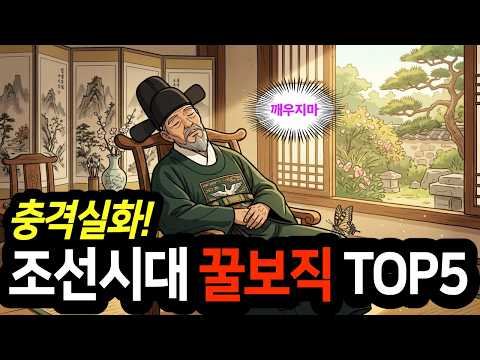
- 설명 앞부분: 일 안 해도 월급 나오고, 출근 안 해도 품계는 인정받고, 심지어 9급인데 정승도 잡아들였습니다. 황당하지만 전부 경국대전에 기록된 조선 공식 제도였습니다. 도대체 어떤 자리였을까요? 1위까지 보시면 조선이 다르게 보이실 겁니다.
- 같은 채널 평소 대비 ×138.6 (채널 최근 롱폼 중앙값 1,384회) · 평소 영상: 대감집 숨은 권력자들 ─ 조선시대 실세 하인 TOP5 │한국사│조선역사 (1,384회) / 충격실화! 조선시대 땅부자 TOP 5 ─ 현재 가치로 계산해봤습니다 (1,259회)
- 대본 없음 (설명) — 음성인식이 끝나면 도입부·흐름이 들어감
- 댓글 154/154: 좋은 점 — 영상 0 · 감사·응원 1 · 더 알고 싶은 것 1 · 아쉬운 점 — 영상 2 · 반박·불만 — 의견 다름 1 · 정치·사회 16 · 경험 공유 3 · 구독·다음 기대 0
  - 감사·응원 👍0 “평양감사는요? 얼마나 꿀보직이면 평양감사도 저싫으면그만 속담까지있을까요?”
  - 더 알고 싶은 것 👍0 “평양감사는요? 얼마나 꿀보직이면 평양감사도 저싫으면그만 속담까지있을까요?”
  - 아쉬운 점 — 영상 👍0 “내용은 참 흥미롭고 좋은데 짧은 주기로 계속 반복되는 BGM이 너무 거슬려요 ㅠㅠ”
  - 아쉬운 점 — 영상 👍0 “유교 재상 정치는 그냥 공산주의 와 같아 약간 모자란 자들이 이런 꿈속세계를 믿는대 조선초기에 이천년전 공자시대를 따라간 것이다 미친자들이야 이미 중극은 수나라때 대규모 토목공사로 국가경영에 눈을 떳는대 한반도에 사이비 주역음양을 제왕학에 기초로 삼아 신정정치를 햇다…”
  - 반박·불만 — 의견 다름 👍4 “죄송하나 참봉의 직책은 지금의 9급 공무원. 쉽지 않았고 돈은 글쎄?”
  - 정치·사회 👍22 “지금과 비교하면 국회의원 자리네 자리 다 빼자”
  - 정치·사회 👍19 “1위와 3위는 그냥 보면 놀고먹는 꿀보직으로 보이지만... 예우는 하되 실권을 대부분 뺏는.. 권력 중앙에서 밀어내는 좌천성 인사로도 볼수있겠네요 장관 , 국회의원 하다 밀려난 사람을 무슨무슨 단체 명예회장 으로 보내는 느낌”
  - 경험 공유 👍2 “0:54 권지는 일부러 그것만 고집하는 사람이 있었다. 자리가 나도 일부러 관직에 안 나갔다. 브라질 축구선수인 *카를로스 카이저* 마냥 타이틀은 갖고 싶은데 해당 업무는 하기 싫어하는 놈이 어디나 존재했다. 4:56 검교는 임진왜란이 끝나자 무더기로 쏟아져 나왔다.…”
  - 경험 공유 👍0 “나를 보는것같네. 내가. 조선시대 에서. 일했던. 곳이요. 하하하”

### 96. 왕의 밥상을 차리던 수라간 궁녀들, 그 산더미 같은 '남은 반찬'은 어떻게 처리 했을까? ∣ 한국사 ∣ 조선왕조실록 ∣ 역사 ∣ 세계사

- https://www.youtube.com/watch?v=i88zvql3pbc · 시대산책 · 구독자 1,590 · 조회수 177,277 (×111.5, 하루 1,094.4) · 좋아요 3,384 (1.9%) · 47.9분 · 2026-05-13 · 주제 묶음 3. 조선 · 형식 정보·해설 (그 밖) · 폴더 `W_i88zvql3pbc` (웹 승인)
- 썸네일: 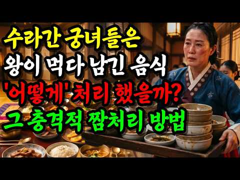
- 챕터: 0:00 경종 독살설과 게장 한 그릇 · 1:30 12첩 반상의 함정 · 4:00 수라상 세 개의 상차림 · 6:30 사옹원과 400명의 궁중 주방 시스템 · 9:00 대장금의 거짓 — 수라간은 남자들의 공간이었다 · 11:30 기미상궁과 은수저, 이중 독 검사 시스템 · 14:00 상물림 — 남은 음식은 어디로 갔을까 · 16:30 조선 vs 청나라, 같은 밥상의 다른 운명 · 18:30 4시간짜리 점심시간, 관아의 상물림 · 20:00 영조의 감선, 정조의 절제, 연산군의 폭식 · 23:00 수라상은 왕의 거울이었다
- 설명 앞부분: 조선 왕의 밥상, 그 뒤에 숨겨진 충격적인 진실, 수라상의 비밀 ∣ 한국사 ∣ 조선왕조실록 ∣ 역사 ∣ 세계사 1724년 8월, 경종이 게장과 생감을 먹고 닷새 만에 사망했습니다. 그 게장을 올리라고 지시한 사람은 바로 다음 왕, 영조였죠. 영조는 52년간 "게장으로 형을 죽인 왕"이라는 의혹에 시달렸습니다. 밥상 하나가 사람을 죽이고, 정치를 흔들고, 한 왕조의 운명을 바꿨습니다. 한 끼에 30가지, 하루 다섯 끼. 호텔 뷔페 풀코스를 매일 두 번씩 받는 셈인 왕의 수라상. 그런데 정작 세종조차 그 절반을 비우지 못했다고 합니다…
- 같은 채널 평소 대비 ×674.1 (채널 최근 롱폼 중앙값 263회) · 평소 영상: 83세 장수한 영조는 이걸 뒤집었습니다. 조선 왕실 밥상의 충격적 진실 ∣ 수라상 ∣ 한… (263회) / 중국이 둘로 쪼개지자 백제가 웃은 이유? 대륙의 혼란을 이용한 소름 돋는 꿀빨기 전략 (270회)
- 대본 없음 (설명) — 음성인식이 끝나면 도입부·흐름이 들어감
- 댓글 140/140: 좋은 점 — 영상 1 · 감사·응원 1 · 더 알고 싶은 것 1 · 아쉬운 점 — 영상 1 · 반박·불만 — 의견 다름 1 · 정치·사회 3 · 경험 공유 3 · 구독·다음 기대 0
  - 좋은 점 — 영상 👍5 “하루 3번 먹어요 정보 유익하네요”
  - 감사·응원 👍1 “왕을 위해 차린 음식을 나누어 먹었다니 역시 정이 많은 민족입니다. 소주방에서 일하는 사람들도 즐겁게 일했을 거같아요. 결국 자신들을 위한 밥상이니까요. 몰랐던 지식을 나누어 주셔서 고맙습니다. 역사를 배울수록 궁궐안의 사람들은 모두 극한 직업 같습니다. 왕을 비롯하…”
  - 더 알고 싶은 것 👍12 “궁중 역사공부 잘 들었습니다 얼마나 힘들었을까요???”
  - 아쉬운 점 — 영상 👍1 “재있는채널이긴한데 좀 길어요 지루하다고해야할까요 구독은 좀 고민 ㅜㅜ”
  - 반박·불만 — 의견 다름 👍13 “아닌데...임금의밥상이 오히려 검소했다는 기록이 있는데.”
  - 정치·사회 👍1 “움직이지도 않으면서. 뭘 그리 치 드셨을까? 어이없다 왕 정권하에. 우리나라 백성. 참. 불쌍했다 전쟁이. 국민 살렸다 지금은 얼마나 좋은가??”
  - 정치·사회 👍1 “궁궐이. 먹는데. 쓸데없이 돈을 썼네 일자리 창출도 있었을까? 하긴. 나라가. 자기네꺼니까 즉. 모든게 내꺼 몇 천 년 동안이나”
  - 경험 공유 👍23 “수라상이 고도의 정치도구였다니...재밌어요!몇년전 고궁박물관에서 왕가의 밥상인가? 전시회가 있었는데 그대로 재현했었거든요,,”
  - 경험 공유 👍5 “내가 왕이라면, 매일 가까운 근처의 가난한 행실 좋은 백성을 불러서 식사를 같이 하겠습니다”

### 97. [일본반응] 일본이 숨기고 싶었던 잔혹한 역사 한국 드라마로 넷플릭스 공개되자 일본이 발칵 뒤집혔다. 오히려 "한국 역사 다시 공부하자" 반전 분위기

- https://www.youtube.com/watch?v=iBsJYAMwbOI · 초코티비 · 구독자 7,260 · 조회수 794,961 (×109.5, 하루 116,474.6) · 좋아요 5,403 (0.7%) · 8.4분 · 2026-10-15 · 주제 묶음 1. 역사 일반·이야기 · 형식 정보·해설 (그 밖) · 폴더 `W_iBsJYAMwbOI` (웹 승인)
- 썸네일: 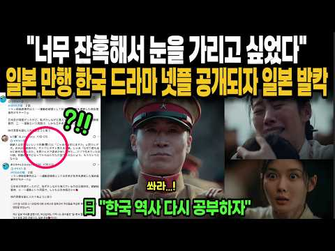
- 설명 앞부분: 한국 드라마 '100일의 거짓말' 전세계 넷플릭스 공개되자 난리난 상황 대한민국의 초특급 소식을 전하는 초코티비입니다. 시청해 주셔서 감사합니다!
- 같은 채널 평소 대비 ×12.4 (채널 최근 롱폼 중앙값 63,909회) · 평소 영상: "아들, 한국온거 엄마한테 비밀로 하자" 60년 인생 첫 한국에 온 일본아빠 경악한 충격… (63,909회) / "아내 몰래 먹으러 왔는데, 미쳤네요!" 방송 40년 일본 국민 개그맨 한국 최고급 한우… (64,908회)
- 대본 없음 (설명) — 음성인식이 끝나면 도입부·흐름이 들어감
- 댓글 259/717: 좋은 점 — 영상 3 · 감사·응원 4 · 더 알고 싶은 것 1 · 아쉬운 점 — 영상 1 · 반박·불만 — 의견 다름 7 · 정치·사회 23 · 경험 공유 13 · 구독·다음 기대 1
  - 좋은 점 — 영상 👍22 “좋은영상 감사합니다. 저 또 한 열사님들의 역사를 배워갑니다”
  - 감사·응원 👍22 “좋은영상 감사합니다. 저 또 한 열사님들의 역사를 배워갑니다”
  - 감사·응원 👍2 “알고는 있었지만 지우고 싶은 역사 미국이랑도 친했지만 지들이 들어 받고 보이 두방 맞고 자친 역사를 만든 그들 8.15를 종전기념일이라고 자위하고 있는 그들 하지만 그 드라마 역할에 충실하신 배우님. 욕하지 마세요(나이든분들은 드라마 보고 욕하심) 그저 역할에 충실하…”
  - 더 알고 싶은 것 👍10 “조선놈들이 반일 히스테리에 빠지는 이유... 일제시대 전후의 역사가 너무 추악했기 때문에 남탓하기 급급해서이지. 일제시대前: 평균수명 30도 안되는 자기민족을 노예화 시킨고, 당파싸움에서 지면 3족의멸, 멸문지화 당하면서 애기들까지 죽어나간 시대 일제시대後: 한국전쟁…”
  - 반박·불만 — 의견 다름 👍0 “글쎄. 다른 많은 채널에서는 반일 역사왜곡이라고 온갖 악담과 비난을 퍼붓고 있을껄.”
  - 반박·불만 — 의견 다름 👍0 “또 역사왜곡 반일선동 세뇌 드라마냐? ㅋㅋㅋㅋㅋㅋㅋㅋㅋㅋㅋㅋㅋㅋㅋㅋㅋㅋㅋㅋㅋㅋㅋㅋㅋㅋㅋ”
  - 정치·사회 👍12 “진심으로 여명의 눈동자를 리메이크 해야 한다 일제 강점기 일본놈들의 만행과 당시 서구 열강들의 만행. 그리고 광복과 한국전쟁 거치면서 벌어진 시대의 부조리들. 이런게 다시 다뤄져서 우리 아이들과 외국인들이 그 시절에 대해서 알아야 함”
  - 정치·사회 👍8 “윤석열은 역사 교육을 다시 받아야 한다. 피가 거꾸로 솟는다. 일제 강제동원(징용) 피해자 ‘제3자 변제안’ 추진 (2023년) 내용: 2018년 대법원이 일본 피고 기업(미쓰비시중공업, 일본제철 등)에 판결한 배상금을 일본 기업 대신 행정안전부 산하 ‘일제강제동원피…”
  - 경험 공유 👍25 “어린 딸이 총맞는장면 이현주씨가 오열하는 장면보고 저도 같이 오열했어요 가슴도 미어지더라구요ㅜㅜ”
  - 경험 공유 👍7 “우리 할아버지는 1919년 3.1만세운동 독립유공자임.. 아버지는 할아버지가 만세운동에 참여했다가 옆동네 지인이 일본 헌병이 쏜 총에 맞아 돌아가셔서 장례에 참여했는데 일본 헌병이 장례 행렬에 와서 또 총을 쏘고 할아버지는 일본 헌병에게 끌려가서 살이 터질정도로 많이…”
  - 구독·다음 기대 👍0 “여명의 눈동자 ㅋㅋ. 지금 풀면 mz세대 덕분에 확실히 제대로 터질듯..근데 리메이크는 찬성인데 캐릭터가...야인시대를 정주행 해본 결과 차라리 건드리지 말고 그냥 디지털복원이 정답일지도?”

### 98. 고대 이집트의 잃어버린 도시, 마침내 발견되다

- https://www.youtube.com/watch?v=-j9jOJl_ERU · 시간의 단면 · 구독자 572 · 조회수 62,585 (×109.4, 하루 534.8) · 좋아요 642 (1.0%) · 24.1분 · 2026-06-27 · 주제 묶음 8. 문명·고고학 · 형식 정보·해설 (그 밖) · 폴더 `W_-j9jOJl_ERU` (웹 승인)
- 썸네일: 
- 설명 앞부분: 이천 년 넘게 전설로만 여겨졌던 도시가 실제로 존재했습니다. 고대 그리스 역사가 헤로도토스가 기록했던 헤라클레이온. 수세기 동안 수많은 학자들이 그 흔적을 찾았지만, 누구도 발견하지 못했습니다. 결국 사람들은 그것이 신화일 뿐이라고 믿기 시작했습니다. 하지만 모든 것은 프랑스 해양 고고학자 프랑크 고디오의 우연한 탐사에서 바뀌었습니다. 지중해 아부키르만 해저에서 모습을 드러낸 것은 거대한 신전과 항구, 운하, 수천 점의 유물, 그리고 완전한 고대 도시였습니다. 이 영상에서는 헤라클레이온이 어떻게 고대 이집트 최대의 무역 도시가 되…
- 같은 채널 평소 대비 ×153.2 (채널 최근 롱폼 중앙값 408회) · 평소 영상: 이집트의 아틀란티스, 사라진 도시 타니스의 충격적인 진실 (412회) / 인류 역사에서 지워진 거인 (405회)
- 대본 없음 (설명) — 음성인식이 끝나면 도입부·흐름이 들어감
- 댓글 18/18: 좋은 점 — 영상 0 · 감사·응원 1 · 더 알고 싶은 것 0 · 아쉬운 점 — 영상 0 · 반박·불만 — 의견 다름 1 · 정치·사회 0 · 경험 공유 0 · 구독·다음 기대 0
  - 감사·응원 👍2 “않아서이른귀힌것을보게해주셔서감사함니다”
  - 반박·불만 — 의견 다름 👍3 “이집트가 아닙니다 ㅡㅡㅡㅡㅡㅡㅡㅡ아틀란타 ㅡ 입니다”

### 99. 이무기가 왕이 된 조선 - 기생과 암살자 ∣ 찬룡 EP.4

- https://www.youtube.com/watch?v=3k3Qi9yy7HQ · 투모로우 TO:MORROW · 구독자 12,900 · 조회수 1,406,423 (×109.0, 하루 25,160.5) · 좋아요 2,338 (0.2%) · 10.3분 · 2026-08-27 · 주제 묶음 3. 조선 · 형식 정보·해설 (그 밖) · 폴더 `W_3k3Qi9yy7HQ` (웹 승인)
- 썸네일: 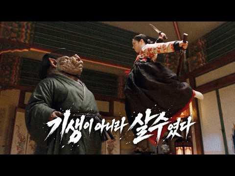
- 설명 앞부분: 조선에서 가장 아름다운 여인들만 모인다는 기생집 ‘화월루’ 그 곳에는 조선 제일미를 자랑하는 기생 ‘소월’이 있었다. 그 날도 어김없이 양반댁 손님들의 부름이 있었고 소월은 자랑하는 가야금 실력을 뽐 내고 있었고 갑자기 화월루 곳곳에 비명소리가 들리기 시작하고 문 틈 사이로 거대한 돼지의 형상을 한 요괴가 모습을 드러내는데... 인간과 요괴, 그리고 무너져가는 조선을 지키려는 자들의 이야기. 시네마틱 판타지 드라마 〈찬룡 篡龍〉 EP.04 — 기생 소월 Written & Directed by MORROW Produced by TO…
- 같은 채널 평소 대비 ×15.4 (채널 최근 롱폼 중앙값 91,447회) · 평소 영상: 이무기가 왕이 된 조선 - 선녀와 나무꾼 ∣ 찬룡 EP.9 (91,447회) / 이무기가 왕이 된 조선 - 효녀 심청의 죽음 ∣ 찬룡 EP.7 (88,760회)
- 대본 없음 (설명) — 음성인식이 끝나면 도입부·흐름이 들어감
- 댓글 218/229: 좋은 점 — 영상 1 · 감사·응원 5 · 더 알고 싶은 것 5 · 아쉬운 점 — 영상 2 · 반박·불만 — 의견 다름 0 · 정치·사회 0 · 경험 공유 2 · 구독·다음 기대 3
  - 감사·응원 👍4 “❤와우 너무 잼나게 보아요 응원합니다 화이팅 ❤😆😆👍❤️🇰🇷”
  - 감사·응원 👍1 “오우 한지 씬은 제가 본 유툽중에 제일 잘 만드신 장면같습니다...존경스럽네요 구독 박고 응원드리겠습니다 ㅠㅠ”
  - 더 알고 싶은 것 👍2 “재미있네요! 영상도좋고 특히 사운드도 신경 많이 쓰신거 같아요! 계속 올려주세요~ 대박나시길^^”
  - 더 알고 싶은 것 👍1 “1화 부터서 보고있는데 시간가는줄 모르고 보고있네요 ^^ 영상 기가 막힙니다 영상 많이 많이 만들어주세요~~~”
  - 아쉬운 점 — 영상 👍15 “겁나 자연스릅네요..아무리 잘만들어도 다른 시댄스 들마는 ai티 나던디 이건 그냥 직접찍은것 같아서 ㅎㄷㄷ”
  - 아쉬운 점 — 영상 👍8 “그냥 한명의 유튜브가 ai 시대에 맞춰서 재미로 만던 작품이라면 아주 훌륭한 작품. 다른 작품들에 비해 훨씬 더 실사같은 느낌이 강함. 표현 등은 좋고 스토리도 좋음 다만, 많이 아쉬운 점은 퀄리티와 능력에 비하여 디테일이 많이 부족함. 1. 첫번째 등장한 돈괴의 등…”
  - 경험 공유 👍1 “오우 한지 씬은 제가 본 유툽중에 제일 잘 만드신 장면같습니다...존경스럽네요 구독 박고 응원드리겠습니다 ㅠㅠ”
  - 경험 공유 👍1 “잘만들었네요 ..한편에 돈은 얼마나 들던가요? 저도 해보고싶지만 ..너무 후덜덜해서 ...ㅠㅠ”
  - 구독·다음 기대 👍2 “구독하고갑니다… 얼마나 수정하고 디테일을 체크하셨을지 감도 안오네요😮 10만 구독 올해 안에 기원드립니다🎉”
  - 구독·다음 기대 👍1 “구독하고 좋아요 누르고 갑니다 ❤”

### 100. 역대 이순신 역할중 가장 싱크로율 높은 배우는? #이순신영화 #이순신실제모습

- https://www.youtube.com/watch?v=WrHgunG_gNc · 페이스 아카이브 · 구독자 1,560 · 조회수 165,826 (×106.3, 하루 9,418.5) · 좋아요 413 (0.2%) · 5.3분 · 2026-10-04 · 주제 묶음 3. 조선 · 형식 정보·해설 (그 밖) · 폴더 `W_WrHgunG_gNc` (웹 승인)
- 썸네일: 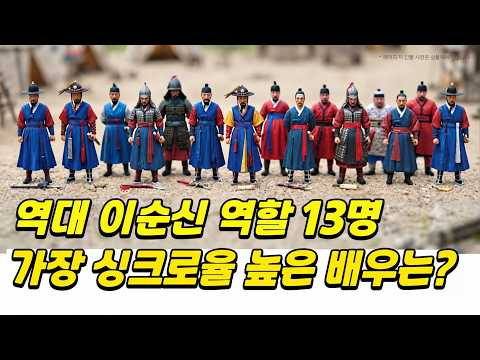
- 챕터: 0:00 오프닝 · 0:08 역대 한국 영화·드라마 속 이순신 소개 (노량, 명량… · 0:23 기록 속 초상화 및 사료를 통한 이순신의 실제 외모 … · 0:54 1대 이순신: 1962년 유현목 감독 영화, 김승길 · 1:00 2대 이순신: 1968년 KBS 드라마 난중일기, 고… · 1:08 3대 이순신: 1971년 이규웅 감독 영화 성웅 이순… · 1:18 4대 이순신: 1972년 KBS 드라마 임진왜란, 주현 · 1:24 5대 이순신: 1977년 KBS 특집 단막극 이순신,… · 1:35 6대 이순신: 1985년 MBC 대하드라마 조선왕조 … · 1:55 7대 이순신: 2004년 KBS 드라마 불멸의 이순신… · 2:18 8대 이순신: 2005년 영화 천군, 박중훈 · 2:38 9대 이순신: 2014년 영화 명량, 최민식 · 2:55 10대 이순신: 2015년 드라마 징비록(선조와 유성… · 4:07 12대 이순신: 2022년 영화 한산: 용의 출현, … · 4:31 13대 이순신: 2023년 영화 노량: 죽음의 바다,… · 5:12 클로징: "내 마음속의 이순신을 댓글로 남겨 주세요!"
- 설명 앞부분: 1962년 영화부터 2023년 최신작까지, 한국 역사와 대중문화 속에서 그려진 역대 이순신 장군 캐릭터 13명의 변천사를 다룬 콘텐츠입니다. 각 시대별 영화와 드라마, 기록 속 초상화 및 역사적 묘사를 바탕으로 다양한 배우들이 연기한 이순신 장군의 모습을 비교하며, 진짜 이순신 장군의 모습과 가장 닮은 배우는 누구일지 흥미롭게 되짚어 봅니다. 타임 라인 KBS, MBC, SBS 드라마 홍보 영상 영화 이순신 3부작, 일부 홍보자료
- 같은 채널 평소 대비 ×2.6 (채널 최근 롱폼 중앙값 63,032회) · 평소 영상: 고구려는 페라리, 백제는 올칼라, 일본은 맨발? 1400년 전 동아시아 사신 외모 품평전… (63,032회) / [3부작] 이순신의 실제 얼굴을 찾아서1 #이순신후손 (63,894회)
- 대본 없음 (설명) — 음성인식이 끝나면 도입부·흐름이 들어감
- 댓글 398/401: 좋은 점 — 영상 1 · 감사·응원 1 · 더 알고 싶은 것 0 · 아쉬운 점 — 영상 2 · 반박·불만 — 의견 다름 5 · 정치·사회 4 · 경험 공유 14 · 구독·다음 기대 0
  - 좋은 점 — 영상 👍0 “박해일의 한산에서 장군의 어머니 말이 젤 가슴에 와닿는데...신아..! 너는 나라에 대한 忠이 어디를 향해야 한다고 보느냐 에서 장군의 시선이 피난 오는 백성을 돌아 보는 씬이 가장...닮은 얼굴은 요즘 AI로 복원한 이국종 교수 모습에 한표...”
  - 감사·응원 👍12 “앞으로도 수많은 이순신 배역을 맡은 사람이 나올것입니다. 그러나 우리 가슴속의 이순신은 영원히...김명민 배우님이실겁니다. 축구로 치면 전국민이 거리로 나와 응원하던 2002 한일 월드컵 같은 느낌?”
  - 아쉬운 점 — 영상 👍0 “03:26 자막이 이상한데”
  - 아쉬운 점 — 영상 👍0 “1985년 조선왕조오백년 임진왜란의 김무생 배우. 국뽕없고 전장의 대국을 볼줄 아는 전략가에요. 나는 불멸의 이순신부터 그 후에 이순신이 나온 임진왜란 드라마 영화는 다 극혐임 국뽕이 너무 많이 들어갔고 특히 불멸의 이순신은 노량해전에서 이순신 장군을 깎아내리는 방향…”
  - 반박·불만 — 의견 다름 👍2 “김명민 배우이상 이순신장군님을 제대로 연기한 배우는 없었습니다 연기력을 말하는 것이 아닙니다 딱 이순신장군님의 강직한면, 무너지는 면, 의지하려는 면, 그러인해 병이나 사경을 해메는 면 모두 이순신장군님을 멋있게만 그리고 맹장으로 그리는 것도 잘못된 것이고, 생각만 …”
  - 반박·불만 — 의견 다름 👍0 “이순신 제독은 실제로 완벽주의자로 엄청나게 꼼꼼하고 세심한 성격의 소유자. 그때문에 위장병을 달고 살았다는 기록이 있고.. 밤에도 잠을 잘 이루지 못했다. 준비 준비 준비.. 오로지 조선을 지켜야 한다는 일념. 그럼에도 조정에서는 말도 안되는 소리를 하고.. 억울하게…”
  - 정치·사회 👍1 “참나. 좌파 배우가 이순신을 하네?”
  - 정치·사회 👍0 “최수종이 제일 아니였음. 이순신 장군의 이름에 먹칠한 캐스팅임. 최수종은 중국인 역할이 맞음.”
  - 경험 공유 👍4 “앞서 보여준 사료로 볼때 가장 싱크로율 높은 배우는 1대와 7대의 김명민임 주현도 이순신 역할을 했었다는걸 알게 됐네요”
  - 경험 공유 👍2 “나도 역시 김명민 생각하고 들어왔는데,,,,”

### 101. 조선 후궁의 진짜 삶, 사극은 거짓말이었습니다

- https://www.youtube.com/watch?v=evU7LnkasQA · 발칙한조선 · 구독자 1,230 · 조회수 130,272 (×105.9, 하루 736.1) · 좋아요 839 (0.6%) · 19.6분 · 2026-04-28 · 주제 묶음 3. 조선 · 형식 정보·해설 (그 밖) · 폴더 `W_evU7LnkasQA` (웹 승인)
- 썸네일: 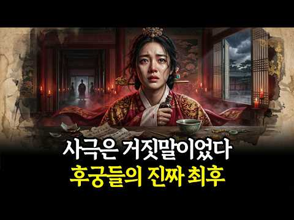
- 설명 앞부분: 조선 후궁의 삶은 우리가 아는 화려한 사극과 전혀 달랐습니다. 조선 후궁들은 왕의 사랑을 얻기 위해 권력투쟁에 뛰어들었고, 왕비와 정치 세력 사이에서 목숨을 건 생존게임을 벌였습니다. 조선 후궁 중에는 폐비 윤씨처럼 사약을 받은 인물도 있었고, 장희빈처럼 왕비 자리에 올랐다 몰락한 인물도 있었습니다. 조선 후궁의 진짜 현실과 궁궐 권력의 민낯을 지금 공개합니다. 단정하고 엄숙했던 조선은 잊어라! 실록 너머, 은밀하고 기막힌 진짜 이야기 안녕하세요. 교과서에서는 절대 알려주지 않는 500년 왕조의 뒷담화, 발칙한 조선입니다. 근엄한…
- 같은 채널 평소 대비 ×1,147.8 (채널 최근 롱폼 중앙값 114회) · 평소 영상: 넷플릭스 《동궁》보다 무서운 실화｜조선 궁궐에서 벌어진 저주와 살인 (119회) / 교과서가 숨긴 안용복 항해의 진실, 일본은 이미 4개월 전에 섬을 포기했었다 (108회)
- 대본 없음 (설명) — 음성인식이 끝나면 도입부·흐름이 들어감
- 댓글 56/56: 좋은 점 — 영상 0 · 감사·응원 0 · 더 알고 싶은 것 0 · 아쉬운 점 — 영상 1 · 반박·불만 — 의견 다름 0 · 정치·사회 3 · 경험 공유 0 · 구독·다음 기대 0
  - 정치·사회 👍0 “후궁에 대한 자세한 글은 그리 많지 않아요 상상에 산물이죠 진실과 허구의 줄다리기 영상이죠..😊삼천궁녀는 일본의 언플이고 이런 영상도 나라가 왕이 잘못햇네 이정도 ..이것만 알면 돼죠 그시대 우리조상은 국가가 다른 어떤 나라보다 오랜 나라를 지켯다는걸😊😊”
  - 정치·사회 👍0 “세계 역사를 보면 그 당시 사정은 자 똑같다. 유럽 북미 더 하면 더 했지 덜하지 않았다. 유럽 북미 등등 ...오히려 그 시대는 그랬는데 조선과 우리의 근본을 까고 있다. 새씨 스파이고 짱깨 싸이트다 조선시대는 암흑이고 다른 나라는 행복? 계네들도 똑같았다”

### 102. 조선 최고의 검술은 어디서 시작되었나? 기록되지 않은 조선제일검의 계보 [아무도 들려주지 않는 조선왕조실록]

- https://www.youtube.com/watch?v=-Yturcnh4j8 · 몰래 듣는 조선의 비밀 · 구독자 1,220 · 조회수 127,868 (×104.8, 하루 955.3) · 좋아요 936 (0.7%) · 17.9분 · 2026-06-10 · 주제 묶음 3. 조선 · 형식 정보·해설 (그 밖) · 폴더 `W_-Yturcnh4j8` (웹 승인)
- 썸네일: 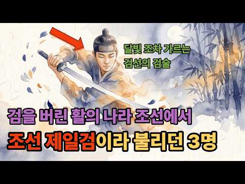
- 챕터: 0:00 시작 · 1:12 활의 나라, 칼 없는 조선 · 4:00 임진왜란 — 칼을 다시 잡다 · 7:00 김체건 — 왜관에 노비로 숨어든 군교 · 10:48 김광택 — 칼에 몸을 숨긴 관노의 아들 · 14:00 백동수 — 서얼 무사가 만든 칼의 백과사전 · 16:24 본국검 — 잃어버린 조선의 칼을 되찾다 · 19:00 전기수의 한 줄
- 설명 앞부분: 조선의 무과 시험에 검술이 없었습니다. 활만 쏘면 됐습니다. 칼잡이는 이름조차 남기지 못한 나라. 그런 나라에서 한 군교가 왜관에 노비로 숨어들어 3년간 칼을 훔쳐 배웠고, 그 아들은 칼에 몸을 숨기는 경지에 올랐으며, 서얼 무사가 24가지 무예를 한 권의 책에 담았습니다. 오늘의 전기수는 활의 나라 조선이 칼을 되찾기까지, 김체건·김광택·백동수 세 검객과 200년의 이야기를 풀어봅니다. ▣ 챕터 ▣ 채널 소개 ▷ 정사 조선왕조실록 (태조실록, 선조실록, 숙종실록, 영조실록, 정조실록) 승정원일기 (숙종·영조·정조대) ▷ 무예서·…
- 같은 채널 평소 대비 ×358.2 (채널 최근 롱폼 중앙값 357회) · 평소 영상: 7년간 전쟁을 이끈 남자가 쫓겨나서 쓴 반성문 16권 [조선인물 탐구생활] (357회) / 조선 최강이라 불린 장수, 적이 아니라 임금의 매에 죽으며 비운의 장수로 남다. [조선 … (333회)
- 대본 없음 (설명) — 음성인식이 끝나면 도입부·흐름이 들어감
- 댓글 120/120: 좋은 점 — 영상 3 · 감사·응원 7 · 더 알고 싶은 것 1 · 아쉬운 점 — 영상 1 · 반박·불만 — 의견 다름 6 · 정치·사회 1 · 경험 공유 1 · 구독·다음 기대 0
  - 좋은 점 — 영상 👍7 “유익하고 재밌는 조선시대 역사이야기네요!”
  - 좋은 점 — 영상 👍2 “좋은 영상 고맙습니다 특히 인상 깊은게 다른이들은 영상 음성 AI로 제작했으면서 마치 자신이 만든거 같이 생성 출처를 밝히지 않은 아둔한 분들이 많던데 이분은 제작 출처를 밝히므로 거부감없이 감사할 수 있었습니다”
  - 감사·응원 👍3 “안녕 하십니까?평안도 감사 박엽장군,감사합니다.🤗👍”
  - 감사·응원 👍2 “좋은 영상 고맙습니다 특히 인상 깊은게 다른이들은 영상 음성 AI로 제작했으면서 마치 자신이 만든거 같이 생성 출처를 밝히지 않은 아둔한 분들이 많던데 이분은 제작 출처를 밝히므로 거부감없이 감사할 수 있었습니다”
  - 더 알고 싶은 것 👍5 “아주 재밌게 듣고 있습니다 조선야사 이야기 더 많이 올려주세요”
  - 아쉬운 점 — 영상 👍2 “좋은 영상 고맙습니다 특히 인상 깊은게 다른이들은 영상 음성 AI로 제작했으면서 마치 자신이 만든거 같이 생성 출처를 밝히지 않은 아둔한 분들이 많던데 이분은 제작 출처를 밝히므로 거부감없이 감사할 수 있었습니다”
  - 반박·불만 — 의견 다름 👍43 “전쟁터나 실전에서 가장 위력적이고 많이 쓰인건 창이지 검이 아닙니다 검은 보조무기일 뿐 일본 전국시대 유명한 사무라이들도 주력 무기는 창이었음 그 다음 위력적인 무기는 부월 (큰 도끼) 큰 도끼를 쓰면서 무쌍 찍은 무장들은 실제로 역사에 많이 기록이 돼 있는데 십자군…”
  - 반박·불만 — 의견 다름 👍5 “말도 안되는 소리 일본검술이 최고 란 소리 또 처음들어보네”
  - 정치·사회 👍2 “그러니 나라가 망하지 총기술 발달시켜야지 총포앞에서 칼질을 왜 하는데”

### 103. 사극은 거짓말이었다 ∣ 조선 백성이 매일 먹던 진짜 밥상 ∣ 조선 사람들이 산처럼 먹은 충격적인 이유 🍙l400년 전 밥상의 충격적인 진실 🍚

- https://www.youtube.com/watch?v=Ez3nyrXxl7o · 어게인역사 · 구독자 5,640 · 조회수 589,211 (×104.5, 하루 4,519.3) · 좋아요 3,930 (0.7%) · 21분 · 2026-06-13 · 주제 묶음 3. 조선 · 형식 정보·해설 (그 밖) · 폴더 `W_Ez3nyrXxl7o` (웹 승인)
- 썸네일: 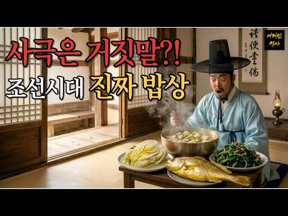
- 챕터: 0:00 새벽 부엌, 잡곡밥 한 솥 · 1:30 왕의 수라상 vs 백성의 밥상 · 3:00 점심은 원래 끼니가 아니었다 · 4:30 빨간 김치는 언제 생겼나 · 6:00 경신대기근, 1년 만에 무너진 밥상 · 8:00 많이 먹은 건 풍요가 아니었다
- 설명 앞부분: 🍚 조선시대 사람들은 매일 무엇을 먹고 살았을까요? 밥상 위엔 흰 쌀밥이 아닌 거무튀튀한 잡곡밥이 고봉으로 쌓여 있었습니다. 🥢 우리가 아는 빨간 김치도, 고추장도, 소고기 반찬도… 조선 백성의 밥상엔 없었습니다. 된장 한 종지, 나물 한 접시, 김치 한 보시기. 이 소박한 밥상으로 조선 백성들은 어떻게 하루를 버텼을까요? 🤔 이 영상에서 다루는 이야기 조선시대 빨간 김치가 없었던 진짜 이유 🌶 하루 두 끼만 먹던 조선, '점심'은 끼니가 아니었다 왕도 막지 못한 금지된 고기, 우금령의 진실 🐂 한 끼에 세 공기 반… 많이 먹은 …
- 같은 채널 평소 대비 ×448.2 (채널 최근 롱폼 중앙값 1,314회) · 평소 영상: 조선 여인의 저고리가 300년 동안 3분의 2가 사라진 이유ㅣ영조도 정조도 막지 못한 조… (1,322회) / 왕의 사랑을 15년 거절한 궁녀, 그런데 정조는 더 사랑했다∣궁녀는 왜 정조를 15년이나… (1,307회)
- 대본 없음 (설명) — 음성인식이 끝나면 도입부·흐름이 들어감
- 댓글 735/737: 좋은 점 — 영상 9 · 감사·응원 15 · 더 알고 싶은 것 5 · 아쉬운 점 — 영상 7 · 반박·불만 — 의견 다름 14 · 정치·사회 15 · 경험 공유 32 · 구독·다음 기대 0
  - 좋은 점 — 영상 👍5 “재밌고 유익합니다!~”
  - 좋은 점 — 영상 👍4 “좋은 영상 고맙습니다”
  - 감사·응원 👍35 “진짜 힘든 시대에서 태어나 억척같이 이겨내 잘 살아남아주셔서 감사합니다..”
  - 감사·응원 👍8 “7번째 like 👍 감사합니다요 ! 항상 건행하십시요 !”
  - 더 알고 싶은 것 👍0 “고추가 들어 온 건 너희 조상 코 베어갈려고 산에 숨은 사람들 잡기 위해 연기 피우기 위해서란다 제대로 가르쳐 주세요~ 그리고 일본은 고추를 먹지 않았단다...소 이야기는 너희 조상을 계속 바보로 만드는데 일부러 죽이고 보고 했다고 한다...일제시대에 소고기는 전부 …”
  - 더 알고 싶은 것 👍0 “AI영상좀 줄여주세요. 제발 부탁드립니다. ㅜㅜ”
  - 아쉬운 점 — 영상 👍7 “고증 오류 너무 많음 제대로 잘 공부하고 만드세요 너무 오류가 많지만 대표적으로 배추 의 경우 결구 배추로 김치로 만든것은 우장춘의 종자 개량이후 그전에는 비결구배추 ㅡ 봄동과 비슷ㅡ로 만듬 일반적으로 알려진 고추의 유래등 에 대하여서만 짜집기했지 제대로 된 자료 수…”
  - 아쉬운 점 — 영상 👍0 “정말 많은 내용에서 역사적 사실과 매우 틀린내용이 많아보입니다. 우리 조상들은 고기를 자주섭취하지 못하지도, 여타 단백질을 부족하게 섭취하지도, 어폐류와 생선을 섭취 못 하지도 않았습니다. 조선500년 역사에서 빠짐없이 민간에서 백성들은 제철 채소, 들나물, 강이나 …”
  - 반박·불만 — 의견 다름 👍0 “정말 많은 내용에서 역사적 사실과 매우 틀린내용이 많아보입니다. 우리 조상들은 고기를 자주섭취하지 못하지도, 여타 단백질을 부족하게 섭취하지도, 어폐류와 생선을 섭취 못 하지도 않았습니다. 조선500년 역사에서 빠짐없이 민간에서 백성들은 제철 채소, 들나물, 강이나 …”
  - 반박·불만 — 의견 다름 👍0 “오늘 안동권씨 유연정에 다녀왔는데 이 영상이 알고리즘에 뜨네요. (내 키를 자랑하려는 것은 아닙니다.) 190에달하는 내 키 때문인지 유연정 정문의 지붕이 눈 앞 높이에 보이더군요. 한참을 숙여야 들어갈 수 있겠더군요. 조선시대 신장이 161cm 라는 것을 보니 대문…”
  - 정치·사회 👍37 “서양도 고기 못먹은건 마찮가지다. 불과 2백년전까지 유럽인들 고기 구경 제대로 못했고 주식이 감자 귀리같은 곡류고 맛도 없음. 중국인들 1980년대까지 점심 때 빵한조각하고 시레기국이 다 였음. 막노동 하는 열량 많이 필요한 사람도 그렇게 먹음 그냥 한국인이 먹고 노…”
  - 정치·사회 👍9 “외국인이 보부상의 지게짐의 무게를 잿는데 250KG이라네요😅😅”
  - 경험 공유 👍80 “내가 81년생인데 나 어렸을때 공깃밥 그릇크기 생각해보면 지금 밥그릇은 진짜 간장종지 수준임 ...”
  - 경험 공유 👍61 “내가 어렸을때만 해도 밥그릇 크기가 지금의 두배 이상 이였다”

### 104. [4K] 청량리에 홍릉이 있었다 ∣ 명성황후의 옛 홍릉터와 영휘원·숭인원

- https://www.youtube.com/watch?v=r7PovYPhfuc · HAPPA Lens(하빠렌즈) · 구독자 300 · 조회수 31,015 (×103.4, 하루 1,239.4) · 좋아요 109 (0.4%) · 23.1분 · 2026-09-27 · 주제 묶음 기타 · 형식 정보·해설 (그 밖) · 폴더 `W_r7PovYPhfuc` (웹 승인)
- 썸네일: 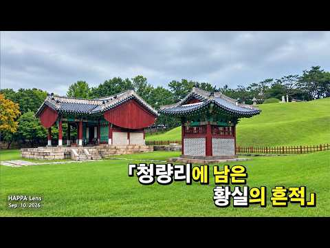
- 설명 앞부분: 고대앞역에서 출발해 홍릉숲 입구를 지나 명성황후의 옛 홍릉터를 찾아보고, 영휘원과 숭인원까지 걸어보았습니다. 지금은 사라진 청량리의 옛 홍릉과 그 주변에 남아 있는 왕실 묘역을 따라 걸으며, 조선에서 대한제국으로 이어지는 역사와 황실 가족들의 이야기를 만나봅니다. Starting from Korea University Station, I walk past the entrance to Hongneung Forest and visit the former site of Hongneung, the royal tomb of Empress …
- 같은 채널 평소 대비 ×252.2 (채널 최근 롱폼 중앙값 123회) · 평소 영상: [4K] 마포걷고싶은길 8코스｜불광천·홍제천 따라 걷는 5km 산책길 (125회) / [4K] 길 위의 풍경∣내부순환도로 홍은사거리 JC→북부간선도로 JC(Hong-eun I… (133회)
- 대본 없음 (설명) — 음성인식이 끝나면 도입부·흐름이 들어감
- 댓글 13/14: 좋은 점 — 영상 0 · 감사·응원 1 · 더 알고 싶은 것 0 · 아쉬운 점 — 영상 0 · 반박·불만 — 의견 다름 0 · 정치·사회 1 · 경험 공유 0 · 구독·다음 기대 0
  - 감사·응원 👍1 “과거에 갈비집으로 유명했고, 결혼한다고 몰려가 단체사진 찍었었던 곳 홍릉. 오늘은 happalens의 짭짤한 역사탐방 덕분에 잘 몰랐던 대한제국과 황실의 역사를 찬찬히 걷는 동안 잘 살펴보고 알게 되었습니다. 감사합니다. 👍”
  - 정치·사회 👍0 “고종황제의 릉호가 홍릉이 된되고 청량리에 있던 명성황후의 릉이 왜 남양주로 가게되었는 지에 대한 이유에 대해서는 잘 모르는 사람이 많더군요.. 순종의 유릉도 마찬가지로 같은 이유이지만 모르는 사람이 더 많습니다. 원래 조선의 예법에서는 왕비가 먼저 사망하면 능역을 조…”

### 105. 제주도는 원래 우리나라가 아니었다고? ∣한국사}탐라국}제주도의역사∣오디오북

- https://www.youtube.com/watch?v=Knxr-xtwiKw · 오늘역사 · 구독자 890 · 조회수 91,126 (×102.4, 하루 674.9) · 좋아요 1,756 (1.9%) · 34.7분 · 2026-06-09 · 주제 묶음 10. 수면·낭독 · 형식 수면·낭독 (잠잘 때 듣는) · 폴더 `W_Knxr-xtwiKw` (웹 승인)
- 썸네일: 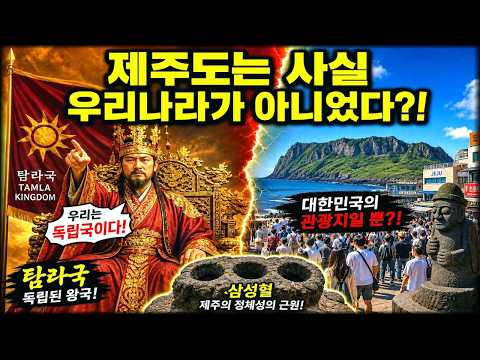
- 설명 앞부분: 탐라는 왜 한반도 남쪽에서 사라졌을까요? 7세기 독립국 탐라의 역사와 제주도가 고려의 땅이 된 과정을 정리했습니다. 동아시아 역사서에 당당히 기록된 독립국 탐라는 왕이 아닌 별의 주인이 다스리던 나라였습니다. 이 영상은 탐라가 어떤 과정을 거쳐 국가의 면모를 유지했는지, 그리고 왜 하루아침에 역사 속으로 사라지게 되었는지 그 배경을 추적합니다. 1368년 원나라가 멸망하고 고려가 명나라와 복잡한 정세 속에 놓였을 때, 제주도에서 일어난 목호의 난은 탐라의 운명을 바꾸는 결정적인 사건이었습니다. 이번 영상을 통해 원나라의 지배를 받…
- 같은 채널 평소 대비 ×246.6 (채널 최근 롱폼 중앙값 370회) · 평소 영상: 성공확률 5000분의 1, 인천상륙작전 성공은 왜 기적이었나 ∣한국사∣맥아더∣오디오북 (398회) / 최악의 무능으로 최고 비호감인 조선의 왕 3인은?∣한국사∣오디오북∣무능한왕∣ (341회)
- 대본 없음 (설명) — 음성인식이 끝나면 도입부·흐름이 들어감
- 댓글 127/127: 좋은 점 — 영상 1 · 감사·응원 1 · 더 알고 싶은 것 0 · 아쉬운 점 — 영상 1 · 반박·불만 — 의견 다름 4 · 정치·사회 11 · 경험 공유 3 · 구독·다음 기대 0
  - 반박·불만 — 의견 다름 👍11 “제주도 사람들은 한반도 육지사람들이랑 인종자체가 다릅니다ㅠ 뭔 고씨 부씨 양씨가 중국 계열이라 한반도에서 흘러갔다는 엉터리같은..제주 창도신화가 단군보다 앞섭니다. 그리고 제주도 토착민들 보면 실제로 한반도 사람들과 외형적인 모습 차이가 매우 큽니다. 체형도 작고 이…”
  - 반박·불만 — 의견 다름 👍5 “먼개소리임? 탐라국 건국신화에 부계는 양고부 삼성이 나오는뎅 이3개의 성씨는 대표적인 고구려계성씨 임니다만. 양만춘, 고선지, 부여씨 이렇게 대표적인 고구려의 3개의 성입니다만. 글쿠 고조선의 흔적이 남아잇어 한라산의 원래 이름이 한울산 즉 하나님의 산, 즉 환웅의 …”
  - 정치·사회 👍20 “저는 탐라국 시조 고을라 왕의 98대 손입니다. 지금은 100대가 넘었으니 4500년이나 됩니다. 보통 한대를 잇기를 45년 정도 봅니다. 그리고 삼신인 고을라, 양을라, 부을라 가 각각 세명의 일본 공주를 부인으로 맞이 했다고 하는데. 일본이 아니라. 벽락국 입니다…”
  - 정치·사회 👍13 “옛날에 라고 하면 독립국 아닌 나라가 세상에 어디 있나요?”
  - 경험 공유 👍7 “제가 아는 제주도 아저씨가 있었는데 이목구비가 뚜렷한 서구적인 미남상이었습니다. 제주도 토박이인지는 모르겠지만, 이것도 관련이 있는 건지?”

### 106. 같은 해 두 달 차이로 사라진 두 여인, 인현왕후 vs 장희빈, 진짜 악녀는 누구였나

- https://www.youtube.com/watch?v=mU85T1GMwSc · 역사선생김선생 · 구독자 64 · 조회수 10,219 (×102.2, 하루 62.3) · 좋아요 51 (0.5%) · 19.4분 · 2026-05-11 · 주제 묶음 3. 조선 · 형식 정보·해설 (그 밖) · 폴더 `W_mU85T1GMwSc` (웹 승인)
- 썸네일: 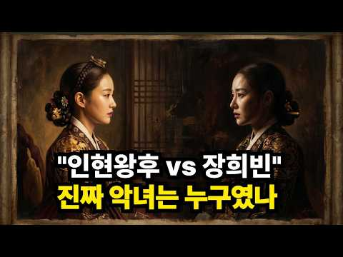
- 설명 앞부분: 1701년 가을, 한 임금이 두 여인을 잃었습니다. 한 사람은 8월에 병으로, 다른 한 사람은 두 달 뒤 자진을 명받고요. 이 영상은 사람의 역사 채널 6편 — 시리즈 1차 매듭(1~5편) 직후의 톤 전환입니다. 같은 시대를 같은 카메라로 본 5편의 부자 비극에서, 6편은 카메라를 한 번 옆으로 옮겨 같은 시대를 여성의 자리에서 봅니다. 후세는 두 사람을 정실과 첩, 인덕과 악첩, 성녀와 악녀로 그렸습니다. 사극은 그 두 사람을 아홉 번이나 영상화했고, 우리는 그 이분법을 한 번도 의심해 본 적이 없습니다. 그런데 1701년 음력…
- 같은 채널 평소 대비 ×102.2 (채널 최근 롱폼 중앙값 100회) · 평소 영상: "숨이 아직 끊어지지 않았는데" 고려장의 증거라는 그 한 줄, 끝까지 읽으면 정반대가 나… (100회) / "관을 가르고 머리를 베어 왔다" 죽은 지 17년 된 한명회의 무덤을 나라가 판 진짜 이유 (97회)
- 대본 없음 (설명) — 음성인식이 끝나면 도입부·흐름이 들어감
- 댓글 7/7: 좋은 점 — 영상 0 · 감사·응원 0 · 더 알고 싶은 것 0 · 아쉬운 점 — 영상 0 · 반박·불만 — 의견 다름 1 · 정치·사회 0 · 경험 공유 1 · 구독·다음 기대 0
  - 반박·불만 — 의견 다름 👍12 “저는 인현왕후 악녀는 아닙니다 단지 인현왕후 만만한 왕비 아님을 언젠가 강하게 느꼈습니다 인현왕후 침묵으로 삶을 버틴 왕비 그게 보통 여자는 그렇게 못 살아요”
  - 경험 공유 👍3 “환국을 두 번이나 겪었는데 당시 대신들의 정치싸움이 어디 보콩이었을까 남린세력의 아들 경종이 왕이 되는 걸 노론 소론이 보면서 가만히만 있었읆까 영조의 어머니도 자기 아들을 왕으로 만들기 위해 무슨 일을 했을지 모르는 거 아닌가”

### 107. 조선 과부의 삶｜남편을 잃은 조선 여인들은 대체 어떻게 살아남았을까?

- https://www.youtube.com/watch?v=LhuDHX7Mx38 · 숨은 조선사 · 구독자 403 · 조회수 41,016 (×101.8, 하루 554.9) · 좋아요 490 (1.2%) · 15.4분 · 2026-08-09 · 주제 묶음 3. 조선 · 형식 정보·해설 (그 밖) · 폴더 `W_LhuDHX7Mx38` (웹 승인)
- 썸네일: 
- 설명 앞부분: 남편을 잃은 조선시대 여성들은 어떻게 살아남았을까요? 조선의 과부에게 남편의 죽음은 단순한 슬픔이 아니라 생존과 재혼, 자식의 미래까지 걸린 가혹한 현실이었습니다. 성리학과 삼종지도, 성종 시대 강화된 재혼 억제 정책과 재가자손금고법, 열녀와 정려문 제도부터 생계를 위해 농사와 삼베 짜기, 삯바느질, 장사까지 감당해야 했던 이름 없는 여성들의 삶을 따라갑니다. 또한 정약용과 박지원의 비판, 병자호란 이후 여성들이 겪은 고통, 과부들의 민원과 생존 방식, 그리고 1894년 동학농민운동과 갑오개혁을 거치며 재혼의 자유가 인정되기까지의…
- 같은 채널 평소 대비 ×69.6 (채널 최근 롱폼 중앙값 589회) · 평소 영상: 조선 과거 시험의 모든 것, 21만 명이 몰려 목숨 걸고 싸웠던 충격적인 그날 (589회) / 400년 전 조선 사람들은 밥상에 뭘 올리고 살았을까? 왕과 백성의 식탁 차이 (528회)
- 대본 없음 (설명) — 음성인식이 끝나면 도입부·흐름이 들어감
- 댓글 24/24: 좋은 점 — 영상 0 · 감사·응원 1 · 더 알고 싶은 것 0 · 아쉬운 점 — 영상 0 · 반박·불만 — 의견 다름 1 · 정치·사회 0 · 경험 공유 0 · 구독·다음 기대 0
  - 감사·응원 👍1 “166번째 like 👍 감사합니다요 ! 항상 건행하십시요 !”
  - 반박·불만 — 의견 다름 👍8 “유교사상이 세상에 전부는 아닌데 참 답답한 조선시대”

### 108. 왕이 수저를 놓는 순간, 궁궐의 진짜 전쟁이 시작된다. '궁녀들의 서열' ∣ 한국사 ∣ 조선역사

- https://www.youtube.com/watch?v=isuVlVJmmeA · 역사빚다 · 구독자 3,550 · 조회수 359,417 (×101.2, 하루 2,030.8) · 좋아요 2,360 (0.7%) · 11.4분 · 2026-04-28 · 주제 묶음 4. 한국 근현대사 · 형식 정보·해설 (그 밖) · 폴더 `W_isuVlVJmmeA` (웹 승인)
- 썸네일: 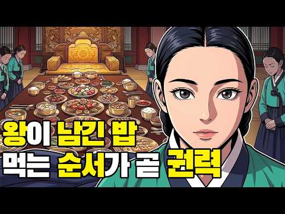
- 챕터: 0:00 오프닝 · 0:28 왕의 하루 5끼와 수라상의 위엄 · 2:02 기미상궁 · 3:32 '퇴선(退膳)' · 4:39 퇴선간 · 5:25 밥상 앞에서 드러나는 궁녀들의 서열 · 6:36 '사찬(賜饌)' · 8:11 나라의 안위와 직결된 왕의 밥상 · 9:04 수백 명 나인들의 위계와 궁중의 삶 · 10:15 아웃트로
- 설명 앞부분: 왕이 수저를 놓는 순간, 궁궐 안에서는 아무도 모르는 싸움이 시작됩니다. 조선의 왕은 하루 다섯 번 상을 받았습니다. 팔도에서 올라온 진상품으로 가득 찬 수라상. 그러나 왕이 그 음식을 입에 대기 전, 먼저 먹어야 하는 사람이 있었습니다. 목숨을 걸고 독을 확인하는 기미상궁이었습니다. 왕이 수저를 놓으면, 남은 음식은 퇴선이 되었습니다. 그리고 그 퇴선을 누가 먼저 받느냐를 두고, 수백 명의 나인들 사이에 보이지 않는 서열이 작동했습니다. 왕의 밥상 가까이에 있다는 것. 그것 자체가 권력이었습니다. 왕이 신하에게 음식을 내리는 사…
- 같은 채널 평소 대비 ×260.0 (채널 최근 롱폼 중앙값 1,382회) · 평소 영상: 조선이 궁녀에게 유독 잔인했던 이유 : '임금의 여자'라는 이름의 가혹한 굴레 ∣ 한국사… (1,806회) / 몽유도원도, 조선 최고의 그림이 살생부가 된 진실 ∣안평대군 ∣ 왕과사는남자 ∣ 한국사 … (959회)
- 대본 없음 (설명) — 음성인식이 끝나면 도입부·흐름이 들어감
- 댓글 349/349: 좋은 점 — 영상 6 · 감사·응원 8 · 더 알고 싶은 것 2 · 아쉬운 점 — 영상 1 · 반박·불만 — 의견 다름 6 · 정치·사회 5 · 경험 공유 14 · 구독·다음 기대 1
  - 좋은 점 — 영상 👍2 “차분한 목소리가 듣기 좋네요 :)”
  - 좋은 점 — 영상 👍2 “전혀 알수없는 귀한 사료를 아주 이해하기 쉽게 잘 설명되어 임금과 궁녀들의 궁중 생활을 잘 알수 있게 되었다.”
  - 감사·응원 👍2 “유익한 정보 감사합니다 😂❤”
  - 감사·응원 👍2 “감사합니다”
  - 더 알고 싶은 것 👍2 “안녕하세요 부산남포동명당구장입니다 죄송합니다 져는 홍보메니져 입니다 자갈치마캣 이번출구 맞은펀 동현빌딩 사층에위치하고있으며 미정횟집 락휴 도있어요 언제나 환영합니다 언제나 화이팅입니다 감사합니다 구독좋아요 홍보부탁 드립니다 대박성공하세요 선생님 모두부자 되세요 백억부…”
  - 더 알고 싶은 것 👍1 “이렇게 먹는다는걸 40이 넘어서야 알게되다니. 어떤 기록을 근거로 말하는건지 심히 궁금하다”
  - 아쉬운 점 — 영상 👍1 “에이 제가 수라상을 전생에 직접 받아봤는데요 틀린 정보가 많네요😅”
  - 반박·불만 — 의견 다름 👍1 “무슨 나인이었었는데 궁중요리 계승자~인간 문화재란다. ㅎㅎ 그 딸의 딸도. 어이없다. 진짜 왕의 요리는 남자였다. 역사 왜곡.”
  - 반박·불만 — 의견 다름 👍0 “왕족이라니..참 말도안되는 문명 덜떨어진 시대었지 조선까진”
  - 정치·사회 👍1 “참 썩어빠진 개병신같은 나라가 조선이다”
  - 정치·사회 👍1 “반락으로 집권한 북한 같은 나라가 조선....”
  - 경험 공유 👍3 “내가 왕이었다면, 왕은 별도로 진상품 요리를 한꺼번에 말고 요일별로 나눠서 적당히 먹고, 나머지 궁인들은 별도로 뷔페식으로 차려서 양 만큼 그릇에 갖다 먹도록 했을텐데 ㅋㅋㅋㅋ”
  - 경험 공유 👍2 “군대 있을때 왕고들 라면 먹고 치우라고 하면 쫄병들 씻으러 가서 허겁지겁 먹는게 일상이었음 옛날은 군대에서 라면 먹는일이 귀한것 이었음 제일 나쁜늠은 그 국물에 담배를 끄는 늠이었음 내 친구는 그때 이야기를 했음 저걸 먹을까 말까.....결국 꽁초 주변을 덜어내고 먹…”
  - 구독·다음 기대 👍1 “귀에 쏙쏙들어오고 좋네요.. 좋은채널 구독하고 갑니다.”

### 109. 종기하나에 왜 조선 왕들은 줄줄이 목숨을 잃었을까? 조선왕조실록 속 숨겨진 비밀

- https://www.youtube.com/watch?v=9pevoSr0BEk · 스티브잡학 · 구독자 1,500 · 조회수 150,235 (×100.2, 하루 910.8) · 좋아요 1,111 (0.7%) · 14.4분 · 2026-05-10 · 주제 묶음 3. 조선 · 형식 정보·해설 (그 밖) · 폴더 `W_9pevoSr0BEk` (웹 승인)
- 썸네일: 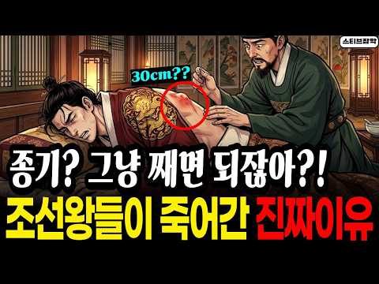
- 챕터: 0:00 천하를 쥔 왕조차 꼼짝 못한 병. · 0:45 왕의 지옥, 종기가 뭐길래 · 2:24 30센티미터 고름 주머니의 공포 · 4:20 걸어 다니는 세균 배양기, 곤룡포의 비밀 · 5:56 하루 다섯 끼, 걷기는 0분 · 7:31 칼을 들고도 찌르지 못한 의원들 · 9:29 백성은 살고 왕은 죽는 조선 · 11:13 고름 한 덩어리가 무너뜨린 나라 · 13:13 조선왕과 현재
- 설명 앞부분: '종기' 하나에 왜 최고 권력자인 조선왕들은 줄줄이 죽음을 맞이했을까요? 조선왕조실록을 샅샅이 뒤져보면, 조선의 역대 왕 27명 중 무려 12명이 종기로 끔찍한 고통을 겪었습니다. 그리고 피의군주 세조를 비롯, 준비된 성군이었던 문종과 개혁 군주 정조를 포함한 무려 5명의 왕이 결국 이 병을 이기지 못하고 세상을 떠났죠. 우리가 몰랐던 곤룡포의 치명적인 단점부터, 어의의 수전증이 부른 어처구니없는 참사까지, 역사 비하인드 스토리를 지금 영상으로 확인하세요! 🍿 타임라인 《조선왕조실록(朝鮮王朝實錄)》 《승정원일기(承政院日記)》 《효…
- 같은 채널 평소 대비 ×1,164.6 (채널 최근 롱폼 중앙값 129회) · 평소 영상: 왕의 술주정? 조선시대 왕들의 사생활, 눈물겨운 스트레스 해소법 (129회) / 합격률 0.02%의 지옥..조선 500년 과거시험 역사상 최고의 천재는? (122회)
- 대본 없음 (설명) — 음성인식이 끝나면 도입부·흐름이 들어감
- 댓글 218/218: 좋은 점 — 영상 0 · 감사·응원 1 · 더 알고 싶은 것 0 · 아쉬운 점 — 영상 0 · 반박·불만 — 의견 다름 3 · 정치·사회 1 · 경험 공유 5 · 구독·다음 기대 0
  - 감사·응원 👍7 “이것만 보면 왕이란 직업은 그냥 국가를 위한 희생자들. 하지만 그 직업 밑에서 일하던 수없이 많던 직업들과 가족 이웃. 참으로 우리나라란...고맙습니다. 조상님들. 잘 살아주셔서. 힘드셨을 텐데.”
  - 반박·불만 — 의견 다름 👍0 “혹시 2차감염? 무섭습니다. 현대의학에서 별거아닌것이 아닙니다. 2차 감염(봉화직염) 때문에 다리를 자를뻔했습니다. 결국 일주일동안 가장강한 항염제를 쓰고 여러번 고생했습니다.”
  - 반박·불만 — 의견 다름 👍0 “1번 2번 댓글은 살짝 무의미.... 요즘은 적어도 '왕사남' 때문이라도, 1번에 마음이 가는 사람이 많을 수 밖에요.... 현대인들의 마음은.... 조선 초기냐, 중후기냐, 이런 문제가 아니죠. 종기라는게 결국은 세포가 죽어서 고이는 질환인건데... 외과 치료에 소…”
  - 정치·사회 👍0 “조선은 왕의 나라가 아니었음. 사대부의 나라였음. 등, 사타구니, 두피등 땀이 많이 차는 곳에 주로 생기고 씻지않고 그냥 말리면 세균번식으로 뾰루지, 종기가 많이 생김. 땀이 많은 체질에 잘생김.”
  - 경험 공유 👍34 “1970년대까지만 해도 종기가 다반사였어. 나도 초등학교 때 눈두덩이에 밤톨만한 종기로 고생하다가 외과에 가서 마취도 없이 칼로 째고 나았지. 왜 마취도 없이 쨌나 몰라. 너무 상처가 심해서 마취가 의미가 없었는지도 몰라. 하여간 그래도 나았다. 조선시대 태어났다면 …”
  - 경험 공유 👍9 “문종에게 한표 던집니다. 5년만 더 살았어도 단종은 성군이 되고 역사는 바뀌었을텐데.. 저도 초딩때 무릎종기로 고생했던 기억이ㅠㅠ 무릎 성할날 없던 어린 시절이지만 그립네요😂”

### 110. 같은 근친혼, 왜 한쪽만 망했을까? ∣ 유전자 복권의 진실

- https://www.youtube.com/watch?v=8Bsvg1loL0c · 역사 보따리 · 구독자 318 · 조회수 31,031 (×97.6, 하루 180.7) · 좋아요 250 (0.8%) · 10.6분 · 2026-05-03 · 주제 묶음 1. 역사 일반·이야기 · 형식 수면·낭독 (잠잘 때 듣는) · 폴더 `W_8Bsvg1loL0c` (웹 승인)
- 썸네일: 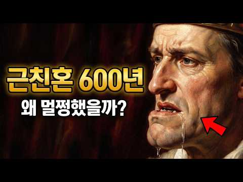
- 챕터: 0:00 침을 질질 흘린 왕 · 0:47 역사가 흐르는 밤 · 1:10 합스부르크, 결혼으로 제국을 만들다 · 2:36 카를로스 2세, 저주받은 마지막 왕 · 4:26 투탕카멘, 파라오도 피할 수 없었다 · 5:46 로스차일드, 같은 선택 다른 결과 · 7:54 창시자 효과, 운명을 가른 유전자 · 9:46 같은 근친혼, 왜 한쪽만 망했을까
- 설명 앞부분: 합스부르크 근친혼 유전병 로스차일드 비밀 ∣ 역사가 숨긴 유전자의 진실 600년간 근친혼을 반복한 합스부르크 왕가. 마지막 왕 카를로스 2세는 밥도 씹지 못하고 침을 흘리며 살다 39살에 숨졌습니다. 그런데 같은 시기, 로스차일드 가문은 71% 이상이 집안끼리 결혼했는데도 유전병이 하나도 나타나지 않았습니다. 같은 근친혼인데 왜 결과가 이렇게 달랐을까요? 유전학이 밝혀낸 '창시자 효과'의 비밀을 파헤칩니다. 🌙 역사가 흐르는 밤은 잠들기 전, 편안하게 들을 수 있는 역사 인물 이야기를 들려드리는 채널입니다.
- 같은 채널 평소 대비 ×795.7 (채널 최근 롱폼 중앙값 39회) · 평소 영상: 빨간 김치는 사실 250년밖에 안 되었다고?!세종대왕도 못 먹은 김치 (39회) / 내시는 거세를 안 했다? — 조선 환관이 결혼하고 자식까지 둔 진짜 이유 (37회)
- 대본 없음 (설명) — 음성인식이 끝나면 도입부·흐름이 들어감
- 댓글 13/13: 좋은 점 — 영상 0 · 감사·응원 0 · 더 알고 싶은 것 0 · 아쉬운 점 — 영상 0 · 반박·불만 — 의견 다름 0 · 정치·사회 1 · 경험 공유 1 · 구독·다음 기대 0
  - 정치·사회 👍1 “한국인은 절대적 근친혼이 불가한국가인데.. 턱이 긴 현ㅈ는 내가볼땐.. 중국인 화교출신인듯..”
  - 경험 공유 👍1 “한국인은 절대적 근친혼이 불가한국가인데.. 턱이 긴 현ㅈ는 내가볼땐.. 중국인 화교출신인듯..”

### 111. 소름 끼치게 놀라운 AI로 재현해 본 조선 왕 27인의 실제 모습 ∣ 우리가 몰랐던 진짜 성격

- https://www.youtube.com/watch?v=BIvwX_N1iPs · 비밀야담 보관소 · 구독자 2,580 · 조회수 251,479 (×97.5, 하루 2,220.5) · 좋아요 2,072 (0.8%) · 18분 · 2026-07-01 · 주제 묶음 3. 조선 · 형식 야담·옛날이야기 · 폴더 `W_BIvwX_N1iPs` (웹 승인)
- 썸네일: 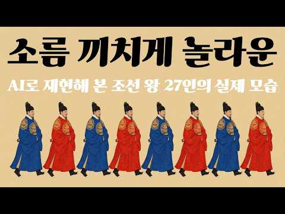
- 설명 앞부분: 조선 시대의 이야기를 만들면 만들수록, '조선 왕들의 실제 모습은 과연 어떠했을까'라는 궁금증이 점점 커져만 갔습니다. 27명 임금들의 어진이 전쟁과 화재로 소실되지 않고 온전히 남아있었다면 얼마나 좋았을까라는 안타까움도 참 컸습니다. 간혹 몇몇 남아있는 어진들을 보며 상상의 나래를 펼쳐왔지만 늘 안타까움이 남았고, 결국 이번 기회에 역사적 기록과 AI 기술을 동원해 직접 재현을 시도해 보았습니다. 특히 영상의 시작과 끝에는 조선 왕조의 엄숙한 예법과 왕권을 상징하는 의궤, 그리고 왕의 뒤를 지키던 일월오봉도를 직접 구현하여 배치…
- 같은 채널 평소 대비 ×1,416.8 (채널 최근 롱폼 중앙값 178회) · 평소 영상: 조선 땅에 괴수가 나타나 조정 대신을 밟아 죽이고 유배를 떠났다 #코끼리유배 #태종이방원… (187회) / 망나니, 사람의 목을 베고 살아야 했던 자들 #망나니 #조선시대 #역사다큐 #비밀야담보관소 (168회)
- 대본 없음 (설명) — 음성인식이 끝나면 도입부·흐름이 들어감
- 댓글 139/140: 좋은 점 — 영상 1 · 감사·응원 1 · 더 알고 싶은 것 1 · 아쉬운 점 — 영상 2 · 반박·불만 — 의견 다름 4 · 정치·사회 4 · 경험 공유 2 · 구독·다음 기대 0
  - 좋은 점 — 영상 👍7 “효종은 굉장히 미화된 면이 있는 왕입니다. 알면 알수록, 학생때 배웠던 모습과 굉장히 괴리가 있음. 무능하고 시샘이 가득한 아버지에 의해 형이 독살을 당하고 죄없는 형수와 조카들이 죽음을 당했는데도 손하나 까딱 안한 사람입니다. 인조가 살아있을 때는 어쩔 수 없다고 …”
  - 더 알고 싶은 것 👍7 “AI로 재현한 것이 어떻게 실제 모습인가요?”
  - 아쉬운 점 — 영상 👍29 “조선시대 왕들의 어진들이 불타버린 게 너무 아쉽습니다.”
  - 아쉬운 점 — 영상 👍5 “이름도안넣고 심지어 자막이 얼굴부분을 가림ㅋㅋ”
  - 정치·사회 👍5 “이재명이 세종대왕 일하는 스타일이 비슷하네요?”
  - 정치·사회 👍1 “고려시대 어진은? 없나요? 언젠간 대한민국 시대가 끝나면 대통령 사진 다 없앨건가?”
  - 경험 공유 👍4 “세종... 지폐에 그 얼굴생각한 내가 이상한건가ㅋ”
  - 경험 공유 👍2 “오... 저도 작업해보던 거라 반갑습니다 ㅎㅎ 잘 뽑으셨네요”

### 112. 조선 팔도 사람들의 진짜 성격, 조선 팔도 사람 기질의 비밀 500년 정도전이 말한 팔도 사람들의 진짜 성격

- https://www.youtube.com/watch?v=HzK-wrKO-eI · 사실과 기록 · 구독자 8,670 · 조회수 832,279 (×96.0, 하루 21,300.5) · 좋아요 6,812 (0.8%) · 26.4분 · 2026-09-13 · 주제 묶음 3. 조선 · 형식 정보·해설 (그 밖) · 폴더 `W_HzK-wrKO-eI` (웹 승인)
- 썸네일: 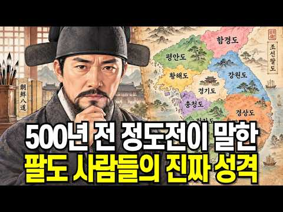
- 설명 앞부분: 📜 조선 팔도 사람들의 진짜 성격, 그 500년의 비밀 놀라운 건, 야사 속 정도전의 관찰과 정사 속 이중환의 기록이 결국 같은 이야기를 하고 있었다는 겁니다. 이 영상에서 다루는 내용 정도전이 남긴 팔도 사람 여덟 글자 평 (야사) 이중환 『택리지』에 담긴 팔도 관찰 (정사) 조선 팔도 이름의 유래 (경상도·전라도·충청도·강원도·경기도·황해도·평안도·함경도) 이시애의 난과 홍경래의 난이 남긴 지역 정서의 흔적 600년 전 태종의 팔도가 지금 우리 주소에 살아 있는 이유 지역으로 사람을 판단해도 되는가에 대한 진지한 질문. 『조선…
- 같은 채널 평소 대비 ×117.3 (채널 최근 롱폼 중앙값 7,098회) · 평소 영상: 조선 왕노릇 하느라 애쓴 역사가 외면한 무능한 인조 삼전도에서 일어난 일 ∣ 조선의 항복 (8,301회) / 조선에도 과연 복지제도가 있었을까? 조선 거지가 지금 노숙자보다 더 잘 살았다 (5,895회)
- 대본 없음 (설명) — 음성인식이 끝나면 도입부·흐름이 들어감
- 댓글 1,725/1,746: 좋은 점 — 영상 9 · 감사·응원 8 · 더 알고 싶은 것 4 · 아쉬운 점 — 영상 10 · 반박·불만 — 의견 다름 34 · 정치·사회 158 · 경험 공유 58 · 구독·다음 기대 0
  - 좋은 점 — 영상 👍3 “아하! 처음 알았습니다 재밌는 사실이네요 귀에 쏙쏙 ~ 유익한 정보 잘 들었습니다 하프 누르고 갑니다^^”
  - 좋은 점 — 영상 👍1 “팔도 지역환경. 사람들 성격 지역지명을 논리적으로 이해 쉽게 잘 설명해 주셔서 새로운 역사.민화 .환경.재미있게 보았습니다.”
  - 감사·응원 👍7 “땅은 사람이다 그러나 땅에의지하여 사람을정하는건 사람의그본과본질을 모르기때문이다 사람은 땅에 하늘의정기를 불어넣어사 사람이됐다 그래서 우리는 하늘의자손이다 사람에게서 영성을 빼면 짐승의격으로 내려가는것이다 만물중에 사람이귀한것은 그격이 다르기때문이다 우리민족은 모진고…”
  - 감사·응원 👍1 “설명해주시는,선생님의말씀이,부드럽고따뜻해요,내마음도,부드러워진듯,새로운역사,감사합니다😊”
  - 더 알고 싶은 것 👍5 “전라도는 아직까지 우덜끼리 문화가 존재합니다. 호남향우회만봐도 그렇지요. 식당ㆍ술집ㆍ노래방 지들끼리 하는곳만가요. 그럼 동내에서 어떻게 바라 보겠나요?? 말과 행동이 다르고 우덜끼리 문화가 바뀌지 않은이상 전라도 바라보는건 변하지가 않습니다.”
  - 아쉬운 점 — 영상 👍3 “26분? 너무 길어요.”
  - 아쉬운 점 — 영상 👍1 “핵심적인 내용을 말해야지, 불 필요한 설명이 너무 많고, 지루해서 더 이상 못 보겠다.”
  - 반박·불만 — 의견 다름 👍67 “정이 많다고? 웃기는 소리.”
  - 반박·불만 — 의견 다름 👍25 “백제, 신라, 고려, 심지어 왕의 조상이 그짝 출신이 조선까지 그짝동네에 대한 평가는 일관됨. 간사하고 신용이 없고 도덕성이 떨어진다. 현재도 그렇고 차별,편견이 아니라 과학이란 소리 정도전도 풍전세류로 표현..바람 앞에 흔들리는 가는 버드나무 가지..누가봐도 좋은 …”
  - 정치·사회 👍219 “지금 민주당 국개들 보면 답 나오잖아 어느지역출신이 젤 많은지..”
  - 정치·사회 👍24 “라도가아무리발부동치도대통령은전부경상도”
  - 경험 공유 👍191 “내가 경험한 전라남도와 광주 사람들~~~~! 간과 쓸개 다 빼줄듯이 하다가도 자기 이익 앞에서는 망설임없이 뒤통수 친다~~~!!!! 거의 90%가 그랬음~~~!!!!!”
  - 경험 공유 👍33 “내가 살면서, 딱 한번 1억 사기당했다. 젊은시절 큰 돈이었지. 그 놈이 그 짝 출신이더라. 피해의식 쪄는 그 쪽 사람들. 지금은 그 피해의식으로 포장해서, 세금슈킹을 제일 많이하는 곳이 됬더라”

### 113. CCTV 없던 조선, 주모는 어떻게 그많은 사람들을 만족시켰을까? l 역사이야기 l 조선시대 한국사

- https://www.youtube.com/watch?v=X46M1yoKC8s · 역사원탑 · 구독자 5,520 · 조회수 528,843 (×95.8, 하루 4,042.7) · 좋아요 6,284 (1.2%) · 29분 · 2026-06-13 · 주제 묶음 1. 역사 일반·이야기 · 형식 정보·해설 (그 밖) · 폴더 `W_X46M1yoKC8s` (웹 승인)
- 썸네일: 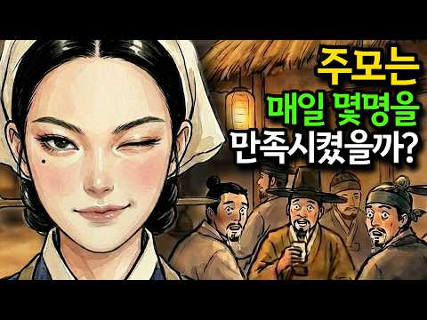
- 챕터: 0:00 인트로 · 0:39 도입 - 술집인 줄 알았던 주막, 그리고 모든 걸 본… · 2:13 주모의 진짜 정체 · 5:17 주모가 본 하루 · 7:35 주막이란 어떤 곳이었나 + 기원 · 9:53 길 위의 주막 - 스무 날 여정 · 11:24 정보·소문·범죄의 길목 · 14:11 주막의 밥상, 국밥의 정체 · 16:55 사극 속 주모 로맨스의 진실 · 18:53 봉놋방 하룻밤 · 21:01 떠도는 썰 검증 (10만 개·은행설) · 23:55 마지막 주막, 삼강주막 · 25:43 현대 연결 · 27:36 결론 - 정보의 길목
- 설명 앞부분: 거리마다 CCTV가 달리고, 차에는 블랙박스가 도는 지금. 그런데 그런 기계가 단 하나도 없던 조선에서, 누가 도둑이고 누가 큰돈을 만졌는지 '모든 걸 본 사람'이 딱 한 명 있었습니다. 바로 — 주막의 주모예요. 양반의 소문도, 장사꾼의 정보도, 도둑의 장물 거래까지. 조선 팔도의 모든 사람과 모든 비밀이 하룻밤은 반드시 거쳐 가던 곳, 주막. 그 한가운데 앉아 모든 걸 보고 들은 주모는, 사극 속 '정 많은 아주머니'가 아니라 조선에서 가장 많은 비밀을 알던 사람이었습니다. 1. 이 영상에서는 사료를 한 장씩 펼쳐 이렇게 풀어…
- 같은 채널 평소 대비 ×18.4 (채널 최근 롱폼 중앙값 28,770회) · 평소 영상: 🔥 "여름철 야심한밤 참을 수 있을까?" 무더위를 참지못한 조선평민 남성과 여성은 밤마다… (44,823회) / "그렇게 먹고 오래 살겠나?" 조선 왕들을 죽인 범인의 충격적인 정체 l 역사이야기 (12,716회)
- 대본 없음 (설명) — 음성인식이 끝나면 도입부·흐름이 들어감
- 댓글 327/329: 좋은 점 — 영상 0 · 감사·응원 3 · 더 알고 싶은 것 1 · 아쉬운 점 — 영상 13 · 반박·불만 — 의견 다름 7 · 정치·사회 7 · 경험 공유 3 · 구독·다음 기대 0
  - 감사·응원 👍2 “매우매우 응원합니다 🎁 🎁 🎁 👍”
  - 감사·응원 👍1 “수능시험을 폐지하고, 중고 6년간 한 과목의 모의고사 점수로 대학에 입학하여 사교육비 줄이고, 기뻐하고 감사하며 사랑하는 영성산업으로 세계통일하여 기아,난민, 전쟁을 종식하자.”
  - 더 알고 싶은 것 👍0 “당시 국밥은 지금 보다 맛이 있었을까요? 궁금합니다.”
  - 아쉬운 점 — 영상 👍9 “13:05 영조4년 자막이 왜 저래 ?”
  - 아쉬운 점 — 영상 👍3 “왜이렇게 지루해요 반복 반복 ㅡㅡㅡㅡ”
  - 반박·불만 — 의견 다름 👍2 “내용중에 모주는 실제론 전국적으로 먹었단 내용은 없고 전주지역에서 주로 먹었단 내용만 있슴 중간중간 짜깁기로 사실이 아닌데 사실인거처럼 얘기하는게 섞여있음”
  - 반박·불만 — 의견 다름 👍0 “바다도 아닌데 왠 낚시???”
  - 정치·사회 👍9 “대한민국 전대통령 부인의 전직업 !😅”
  - 정치·사회 👍1 “인간의 호기심 이용한 어그로네 ㅋㅋ조선족 AI 작품”
  - 경험 공유 👍20 “내 어릴적 우리 집에도 보부상이 자고 가곤 ...”

### 114. 세종대왕이 사랑한 단 한 여자, 노비에서 정1품 빈이 된 숨겨진 사랑 이야기

- https://www.youtube.com/watch?v=SbAPKCB9hbk · 힛토리 · 구독자 677 · 조회수 64,450 (×95.2, 하루 381.6) · 좋아요 450 (0.7%) · 21.8분 · 2026-05-06 · 주제 묶음 3. 조선 · 형식 정보·해설 (그 밖) · 폴더 `W_SbAPKCB9hbk` (웹 승인)
- 썸네일: 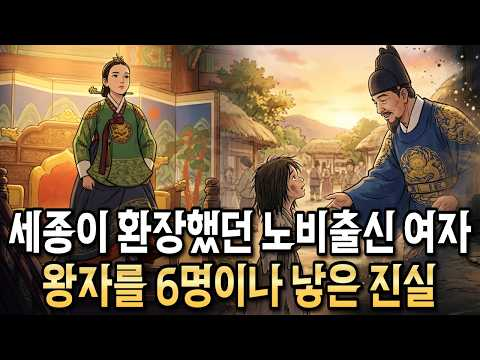
- 설명 앞부분: “이름 없던 노비 소녀… 결국 조선 왕실을 뒤흔들었다” 세종대왕의 곁에는 언제나 조용히 차를 올리고 먹을 갈던 한 여인이 있었습니다. 하지만 그녀의 시작은 화려한 왕족도, 명문가 규수도 아니었습니다. 이름조차 제대로 불리지 못하던 공노비의 딸. 이 영상은 조선 오백 년 역사상 가장 극적인 신분 상승으로 불리는 신빈 김씨의 숨겨진 이야기에서 출발합니다. 왜 세종은 수많은 양반가 규수들을 두고 천민 출신의 여인에게 마음을 주었을까요. 이 영상에서는 세종이 그녀의 외모가 아니라 꺾이지 않는 성품과 따뜻한 배려에 끌렸다는 점, 그리고 그…
- 같은 채널 평소 대비 ×339.2 (채널 최근 롱폼 중앙값 190회) · 평소 영상: 조선을 건국한 이성계가 혼자가 된 이유? (190회) / 왕의 온돌 아래 숨겨진 지옥… 조선 궁궐 난방의 민낯 (189회)
- 대본 없음 (설명) — 음성인식이 끝나면 도입부·흐름이 들어감
- 댓글 52/52: 좋은 점 — 영상 0 · 감사·응원 1 · 더 알고 싶은 것 0 · 아쉬운 점 — 영상 1 · 반박·불만 — 의견 다름 1 · 정치·사회 1 · 경험 공유 0 · 구독·다음 기대 0
  - 감사·응원 👍2 “새로운 사실을 알았네요ᆢ 감사합니다ㆍ”
  - 아쉬운 점 — 영상 👍0 “썸네일에 '세종이 환장했던'이 뭡니까?! 꼭 저렇게 자극적이고 격떨어지는 제목으로 어그로 끌어야 합니까? 내용을 떠나서 그래도 역사를 다루는 컨텐츠에서.. 흥미를 첨가해서 관심유발하고 많은 사람들의 역사지식이 쌓이는 건 바람직하다고 보는데.. 꼭 저런 천박한 자극적인…”
  - 정치·사회 👍0 “남성의 지위와 상관없이 노비여자가 낳은 자식은 자동으로 노비다. 세종이 만든 법이다. 그전까지는 양반 아버지를 아버지라 부르며 중인 위치지만 세종이후로 대감님으로 불러야하며 졸지에 종신세로 전락했다. 그러므로 세종의 총애를 받은 저 노비의 세종자식은 노비여야 맞다. …”

### 115. 사극에서 안 보여준 조선 백성의 진짜 밥상! 매일 밥을 산처럼 먹은 충격적인 이유 [한국사]

- https://www.youtube.com/watch?v=X91u0-AHvWA · 역사동굴 · 구독자 2,470 · 조회수 232,590 (×94.2, 하루 7,291.7) · 좋아요 536 (0.2%) · 15.8분 · 2026-09-20 · 주제 묶음 4. 한국 근현대사 · 형식 정보·해설 (그 밖) · 폴더 `W_X91u0-AHvWA` (웹 승인)
- 썸네일: 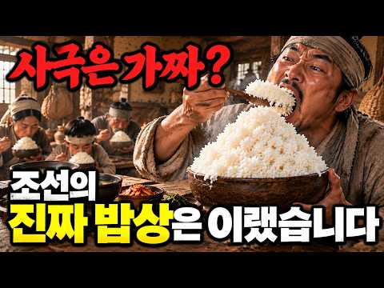
- 챕터: 0:00 조선 시대에 밥을 아홉 그릇이나? · 1:16 밥을 그렇게 많이 먹은 이유 · 2:54 보릿고개와 서민의 밥상 · 4:36 발효, 조선의 지혜가 된 이유 · 5:11 왕의 수라상은 12첩이 맞을까? · 5:51 고추 없는 밥상, 언제부터일까? · 6:36 사극 속 소고기 산적의 진실 · 8:55 고기 구경이 힘들었던 시절 · 10:48 위기 때마다 기록된 백성의 밥상 · 12:11 국가가 정해준 밥그릇 규격 · 13:48 그 시절, 우리가 몰랐던 밥상 이야기
- 설명 앞부분: [한국사] 사극이 절대 안 보여주는 조선 서민의 진짜 밥상 ∣ 정사 ∣ 야사 사극은 거짓말이었다? 사극이 절대 안 보여주는 조선 서민의 진짜 밥상과 400년 전 조선 백성이 매일 밥을 산처럼 먹은 충격적인 이유를 정사와 야사로 알아봅니다. 조선시대 밥상은 왜 늘 밥이 산더미였을까요? 반찬 없이 잡곡밥으로 하루 열량을 채워야 했던 백성들의 실제 밥상을 실록과 이덕무의 기록으로 따라가 봅니다. 사극 속 소고기 산적은 완전한 거짓말은 아니었지만, 아무나 먹을 수 있는 게 아니었습니다. 신분별 반찬 가짓수의 진실, 고추 없던 시절 김치의…
- 같은 채널 평소 대비 ×151.1 (채널 최근 롱폼 중앙값 1,539회) · 평소 영상: 천하의 송시열도 꺾지 못한 천재, 왜 윤휴는 역사 속에서 지워졌나? [기사환국][사문난적] (1,539회) / 단종보다 슬픈 광해군의 19년 생지옥! 사도세자보다 잔인한 최후와 원수의 파멸 [역사이야… (1,518회)
- 대본 없음 (설명) — 음성인식이 끝나면 도입부·흐름이 들어감
- 댓글 53/66: 좋은 점 — 영상 1 · 감사·응원 2 · 더 알고 싶은 것 0 · 아쉬운 점 — 영상 1 · 반박·불만 — 의견 다름 0 · 정치·사회 1 · 경험 공유 3 · 구독·다음 기대 0
  - 좋은 점 — 영상 👍1 “정말 유익한 영상입니다 잘보고 갑니다 감사합니다”
  - 감사·응원 👍1 “정말 유익한 영상입니다 잘보고 갑니다 감사합니다”
  - 경험 공유 👍1 “많이 먹은게 아니다 그만큼 노동을했다 12시간식 지금 시대랑 다릅니다 저도 군대에서 7명이서 1400명 밥하는 취사병인데 저정도 먹은것 같습니다 그만큼 노동을 했으니까요.. 노동 많이하면 밥을 많이먹어요 에너지를 그만큼 소모했으니..”
  - 경험 공유 👍1 “명륜진사갈비가 필요했었어”

### 116. 최강 일본도를 깨부순 조선의 무기, 그건 농기구였다.

- https://www.youtube.com/watch?v=VU7nOsg3tDw · 피의역사썰 · 구독자 2,960 · 조회수 277,588 (×93.8, 하루 4,207.4) · 좋아요 1,392 (0.5%) · 12.8분 · 2026-08-17 · 주제 묶음 3. 조선 · 형식 정보·해설 (그 밖) · 폴더 `W_VU7nOsg3tDw` (웹 승인)
- 썸네일: 
- 설명 앞부분: 1592년, 경기도 고양 땅에 명회라는 농부가 있었습니다. 벼슬도 없고 무예를 배운 적도 없는 사람이었습니다. 그는 눈앞에서 아버지가 일본군의 칼에 쓰러지는 것을 보았지만, 그의 집에는 칼도 활도 없었습니다. 마당을 훑던 그의 시선이 멈춘 곳에는 평생 붙잡고 살아온 나무 도리깨 한 자루가 세워져 있었습니다. "칼을 쥐여 줘도 쓸 줄 모르는 것이 가장 큰 문제였는데, 도리깨질은 백성이라면 누구나 한다." 쇠를 천 겹으로 접고 진흙을 발라 담금질한 동양 최고의 칼, 일본도. 그 앞에 조선이 내민 것은 가을 마당에서 보리를 두들기던 농…
- 같은 채널 평소 대비 ×220.8 (채널 최근 롱폼 중앙값 1,257회) · 평소 영상: 조선을 위해 싸운 푸른 눈의 정 (1,257회) / 거란보다 무서웠던 건 고려 사람들이었다｜현종 피란길 실화 (1,241회)
- 대본 없음 (설명) — 음성인식이 끝나면 도입부·흐름이 들어감
- 댓글 230/230: 좋은 점 — 영상 2 · 감사·응원 5 · 더 알고 싶은 것 3 · 아쉬운 점 — 영상 3 · 반박·불만 — 의견 다름 8 · 정치·사회 6 · 경험 공유 3 · 구독·다음 기대 0
  - 좋은 점 — 영상 👍16 “임진왜란이후 정조의 명으로 편찬된 무예도보통지에 보면은 기마병들은 활,화살,환도,편곤이 필수 무장이었죠 임란때 편곤의 위력을 실감하곤 이후 필수템이 된거임 안되면 되는방법을 찿았던 선조들의 지혜를 볼수있네요 좋은영상 잘봤습니다^^ 우리역사속 활의 활약상도 기대해 봅니…”
  - 감사·응원 👍1 “재미있게 잘 보았습니다 감사합니다 ^^”
  - 감사·응원 👍1 “명희명인 조상님 감사합니다”
  - 아쉬운 점 — 영상 👍48 “멋진 내용 잘봤습니다 근데 농부들이 도리깨를 곡괭이처럼 사용하는 부분은 좀아쉽네요^^”
  - 아쉬운 점 — 영상 👍0 “도리깨를 남자들이 사용하는 방법은 끝이 회전을 하면서 가속도를 이용하여 타격을 하고, 여자들은 원투낚시 할 때 처럼 뒤로 살짝 제쳐졌다고 다시 앞으로 가속도를 주면서 타격을 하더라 난 고등학생때에 사용했는데 남자들이 사용하는 방법으로는 도리깨가 무거워서 하지 못하고 …”
  - 반박·불만 — 의견 다름 👍6 “칠지도는 의례용 칼이였고 일본 카타나는 중국 당나라의 기술과 영감을 받은 칼입니다. 대륙과 반도에서 전해진 것은 맞습니다.전적으로 우리나라에서 건너 갔다는 이야기는 아니죠.”
  - 반박·불만 — 의견 다름 👍2 “일본도는 잘부러지는게 아니고 잘휩니다. 부러지는건 잘못제작된겁니다. 게다가 속에 들어가는 쇠와 바깥에 쓰는쇠가 다릅니다. 그리고 환도역시 하몬이라는 외부 연마를 안했을뿐이라 나오지않은것뿐입니다. 그리고 칼이 짧기때문에 부러지는 일이 적은데다 전투에 적합하지않아 노획해…”
  - 정치·사회 👍2 “150년간 전쟁만 하며 전쟁 기술을 연마하던 나라가 200년간 전쟁 없이 살던 나라를 침략해서 이기지 못하고 전멸하다 시피하며 도망간게 임진 왜란이다. 그만큼 일본은 한심했고, 우리는 허술해 보였지만 강했다. 이건 즉 우리가 마음만 먹으면 얼마든지 일본을 침략해서 식…”
  - 정치·사회 👍1 “도래인들이 만든 나라가 일본 이라해도 무방할것 같습니다. 일본인이쓴 일본사기에 토착왜인들보다 도래인이 많았다고기록. 일 교토 전방후원고분, 전남해안가 전방후원고분. 북 함경도,거제도,울산,부산,전남,제주 삼한시대 토착왜인들이 살았던 지역.”
  - 경험 공유 👍3 “제가 생각해도 일본인 중 동양인 외모에 훤칠하고 체격 좋고 덧니 심하게 없는 사람 조상은 일본으로 넘어간 백제인일 확률이 꽤 높다고 생각합니다..”

### 117. 인류 이전에 문명이 있었다면, 우리는 그 흔적을 알아볼 수 있을까

- https://www.youtube.com/watch?v=sw1GnKwEuU0 · 밤의 지식 도서관 · 구독자 220 · 조회수 20,190 (×91.8, 하루 421.5) · 좋아요 89 (0.4%) · 19.7분 · 2026-09-04 · 주제 묶음 8. 문명·고고학 · 형식 정보·해설 (그 밖) · 폴더 `W_sw1GnKwEuU0` (웹 승인)
- 썸네일: 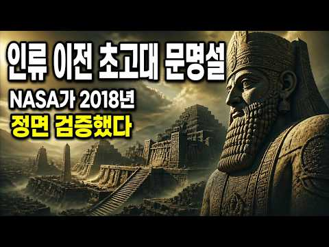
- 챕터: 0:00 괴베클리 테페 밀 씨앗도, 토기도, 바퀴도 없던 수렵… · 1:16 농경 이전에 세워진 신전 · 3:45 채찍이 아니라 배급 장부 · 6:08 사료가 침묵할 때 · 11:10 대홍수, 하나의 재난인가 여러 재난인가 · 15:43 침묵하는 기록 앞에서 · 17:56 그러니 우리가 초고대 문명을 향해 던졌던 질문은, 결…
- 설명 앞부분: 🔥 초고대문명 — 튀르키예 남동부 언덕 밑에 묻힌 20톤 거석 원형 신전 괴베클리 테페는 우르크보다 6천 년 앞선 기원전 9600년경 세워졌습니다. 농경도 토기도 문자도 없던 수렵채집인들이 남긴 이 유적 앞에서 '문명'이라는 단어 자체가 흔들립니다. 2018년 NASA 기후학자들은 여기서 한 걸음 더 나아가 물었습니다 — 인류 이전 문명이 있었다 해도, 우리가 그 흔적을 알아볼 수 있는가. 오늘 밤 우리는 이 질문이 사료·고고학·기후과학의 어디까지 인정받고 어디에서 침묵당하는지 따라갑니다. 우리는 오랫동안 문명을 '농경·토기·문자…
- 같은 채널 평소 대비 ×99.7 (채널 최근 롱폼 중앙값 202회) · 평소 영상: 중세 교회는 정말 마녀를 불태웠나, 마녀사냥의 진짜 역사 총정리 ∣ 세계사 수면 다큐 (207회) / 1871년 슐리만이 호메로스의 트로이라 파낸 성벽, 실은 천 년 더 오래된 도시였다 ∣ … (198회)
- 대본 없음 (설명) — 음성인식이 끝나면 도입부·흐름이 들어감
- 댓글 7/7: 좋은 점 — 영상 0 · 감사·응원 0 · 더 알고 싶은 것 0 · 아쉬운 점 — 영상 0 · 반박·불만 — 의견 다름 0 · 정치·사회 1 · 경험 공유 0 · 구독·다음 기대 0
  - 정치·사회 👍0 “중국 🇨🇳 짱깨들이 만들었나. 6백년을 여섯백년..돌았네”

### 118. [자면서 듣는역사] 왜 그렇게 남편을 잃은 과부를 괴롭혔을까?

- https://www.youtube.com/watch?v=0NcpK50ihfw · 역사원탑 · 구독자 5,520 · 조회수 500,516 (×90.7, 하루 17,990.6) · 좋아요 2,133 (0.4%) · 29.5분 · 2026-09-24 · 주제 묶음 1. 역사 일반·이야기 · 형식 수면·낭독 (잠잘 때 듣는) · 폴더 `W_0NcpK50ihfw` (웹 승인)
- 썸네일: 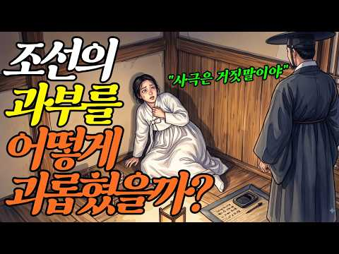
- 챕터: 0:00 재혼 금지? 법에는 그런 말이 없었다 (오프닝) · 1:31 강에 던져진 과부 — 1785년, 죽인 건 가족이었다 · 3:29 그 법에는 금지라는 말이 없었다 — 『경국대전』 · 5:46 마흔여섯 명의 회의 — 1477년 7월 17일 · 7:54 조선 전기, 과부는 재산가였다 · 10:25 평민은 왜 그 법을 몰랐나 · 12:17 수절에서 순절로 — 기준이 올라가다 · 15:04 죽음의 값 — 정려라는 행정 절차 · 18:36 향랑, 1702년 오태강 · 20:29 소문이 사람을 죽일 때 — 김은애 · 22:11 살아남은 과부들 — 바늘과 소지 · 25:22 보쌈, 그리고 417년 만의 한 줄 · 27:49 왜 그런 선택을 해야만 했을까 (엔딩)
- 설명 앞부분: 사극 속 조선의 과부는 늘 소복을 입고 홀로 늙어 갑니다. 재혼은 법으로 금지였다고 배웠죠. 그런데 조선에는 과부의 재혼을 처벌하는 법이 단 한 줄도 없었습니다. 대신 법은, 그 여자가 낳은 아들과 손자의 과거길을 막았습니다. 1785년, 소문 하나로 강에 던져진 과부 — 죽인 사람은 시숙과 친오라비였다 『경국대전』 예전 제과 조 — 벌을 받은 건 여자가 아니라 아들과 손자 1477년 7월 17일, 46명이 모인 회의 — 전면 금지를 주장한 건 열에 하나도 안 됐다 조선 전기의 과부는 재산가였다 — 1566년 「이이 남매 화회문기…
- 같은 채널 평소 대비 ×17.4 (채널 최근 롱폼 중앙값 28,770회) · 평소 영상: 🔥 "여름철 야심한밤 참을 수 있을까?" 무더위를 참지못한 조선평민 남성과 여성은 밤마다… (44,823회) / "그렇게 먹고 오래 살겠나?" 조선 왕들을 죽인 범인의 충격적인 정체 l 역사이야기 (12,716회)
- 대본 없음 (설명) — 음성인식이 끝나면 도입부·흐름이 들어감
- 댓글 263/273: 좋은 점 — 영상 3 · 감사·응원 4 · 더 알고 싶은 것 0 · 아쉬운 점 — 영상 5 · 반박·불만 — 의견 다름 3 · 정치·사회 12 · 경험 공유 4 · 구독·다음 기대 0
  - 좋은 점 — 영상 👍2 “넘 유익하고 재밌네요 이렇게 정리하신거 대단하세요”
  - 좋은 점 — 영상 👍1 “좋은내용 입니다”
  - 감사·응원 👍5 “헐~~ 조선을 망하게한 일본에 감사할일인가... 조선은 진짜 여자와일반백성이 살기에는 진짜 뭣같았네...”
  - 감사·응원 👍5 “우린 늘 일본에 감사함을 느끼고 살아야 한다 일본이 식민 지배 안 햇으면 생각만 해도 끔찍”
  - 아쉬운 점 — 영상 👍0 “조사만 4년을 끈다는 자막이 1조 4만 4년이라고 적혀있네요😂”
  - 아쉬운 점 — 영상 👍0 “조선은 너무 길게유지됐지”
  - 반박·불만 — 의견 다름 👍0 “재미있는 재목으로유튜브 올렸더니 비판만하는인간들 자기는아무이야기 소제도없으면서 남이올린것 판단만하는 웃기는인간 조금보다가재미없으면 다른데로가면되”
  - 정치·사회 👍2 “우리아버지 어머니는.. 내가 국민학교 2학년때쯤인가 효자효부상 받으셨는데 ㅎㅎ 요즘도 주나 몰라요?ㅋㅋ 이것도 나중에 들어보니 할아버지께서 625전쟁통에 빨갱이한테 점령당한 동네를 재탈환하는 과정에서 동네에 남아있던 남자들 총살시킬려고 가둬놓았는데 할아버지께서 당시 …”
  - 정치·사회 👍0 “저 과부에 관한 설명은 양반에 관한 설명같아 보임. 한줌 재밖에 안되는 양반 출신 과부를 조선시대 전체의 여성상으로 보긴 좀 그렇긴 하네요. 물론 여성의 삶이 차별받아온건 맞습니다. 저 조선시대뿐만 아니라 20세기 후반 이전의 모든 여성들이 차별을 받아왔습니다. 연차…”
  - 경험 공유 👍2 “우리아버지 어머니는.. 내가 국민학교 2학년때쯤인가 효자효부상 받으셨는데 ㅎㅎ 요즘도 주나 몰라요?ㅋㅋ 이것도 나중에 들어보니 할아버지께서 625전쟁통에 빨갱이한테 점령당한 동네를 재탈환하는 과정에서 동네에 남아있던 남자들 총살시킬려고 가둬놓았는데 할아버지께서 당시 …”
  - 경험 공유 👍2 “내가 이래서 조선을 역사에서 제일 싫어라 하지. 고려까지는 좋았는데. 조선은 처음부터 썩은 사회여서..”

### 119. 🔥최고 시청률 6.3% 찍은🔥왕비 자리를 차지하기 위해 미녀들이 목숨 걸고 싸우는 역대급 궁중 암투극!

- https://www.youtube.com/watch?v=JEqNYtNRvWs · 우리드라마 · 구독자 5,140 · 조회수 463,067 (×90.1, 하루 9,878.6) · 좋아요 1,216 (0.3%) · 230.1분 · 2026-09-05 · 주제 묶음 11. 황제·왕·인물 · 형식 몰아보기·통합본 (긴 영상) · 폴더 `W_JEqNYtNRvWs` (웹 승인)
- 썸네일: 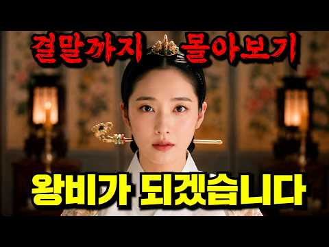
- 설명 앞부분: 드라마 : 간택 주연 : 진세연 김민규 도상우 이열음 이화겸
- 같은 채널 평소 대비 ×3.1 (채널 최근 롱폼 중앙값 148,556회) · 평소 영상: 🔥원작 누적 조회수 무려 26억뷰🔥회사에서 제일 쓸모없는 부서에 발령받은 신입사원 곽동연… (117,173회) / 400년 뒤 미래로 이동한 조선남자가 조선손맛으로 식당을 도와주면 생기는 일 ㅋㅋㅋㅋ (722,047회)
- 대본 없음 (설명) — 음성인식이 끝나면 도입부·흐름이 들어감
- 댓글 21/21: 좋은 점 — 영상 0 · 감사·응원 1 · 더 알고 싶은 것 0 · 아쉬운 점 — 영상 1 · 반박·불만 — 의견 다름 0 · 정치·사회 0 · 경험 공유 0 · 구독·다음 기대 0
  - 감사·응원 👍0 “감사합니다 감상 잘했습니다”
  - 아쉬운 점 — 영상 👍8 “광고가 없었어 넘 잘 봤어요 고마워요 ~~”

### 120. 조선시대 진짜 밥상의 비밀, 우리가 알던 건 다 틀렸다. 400년 전 조선 사람들은 도대체 뭘 먹었을까?

- https://www.youtube.com/watch?v=gimD7JtQT68 · 흥미진진 한국사 · 구독자 1,070 · 조회수 95,806 (×89.5, 하루 557.3) · 좋아요 667 (0.7%) · 9.2분 · 2026-05-03 · 주제 묶음 3. 조선 · 형식 정보·해설 (그 밖) · 폴더 `W_gimD7JtQT68` (웹 승인)
- 썸네일: 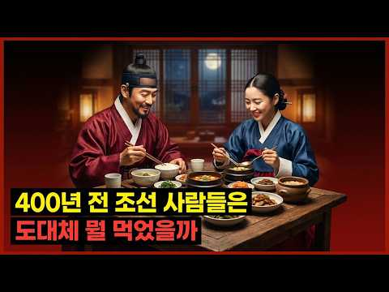
- 챕터: 0:00 소개 · 1:30 조선시대 식사 패턴 · 3:00 김치의 역사 · 5:00 백성의 밥상 · 6:00 왕의 수라상 · 7:00 주막과 국밥의 탄생 · 8:00 오늘날과의 비교 · 9:00 마무리
- 설명 앞부분: 조선시대의 두 끼 식사 패턴 김치의 진짜 모습과 역사 백성의 식탁과 왕의 수라상 차이 이 영상은 우리가 당연하게 여기는 음식이 얼마나 소중한 것인지를 다시 한번 생각해보게 합니다. 400년 전 그들의 삶을 통해 현재를 돌아보는 기회가 되길 바랍니다. 타임라인
- 같은 채널 평소 대비 ×887.1 (채널 최근 롱폼 중앙값 108회) · 평소 영상: 하늘을 날던 새도 떨어뜨리던 한명회, 그의 다섯 자식은 왜 모두 울며 죽어갔나 (115회) / 조선의 여름 전쟁은 왜 한겨울에 시작됐을까? 얼음 13만 덩어리의 비밀 (101회)
- 대본 없음 (설명) — 음성인식이 끝나면 도입부·흐름이 들어감
- 댓글 84/84: 좋은 점 — 영상 0 · 감사·응원 0 · 더 알고 싶은 것 1 · 아쉬운 점 — 영상 0 · 반박·불만 — 의견 다름 3 · 정치·사회 0 · 경험 공유 0 · 구독·다음 기대 0
  - 더 알고 싶은 것 👍1 “맞나요? 세종대왕은 고기좋아하셨고 궁궐에 닭고기도 늘 있었다던데”
  - 반박·불만 — 의견 다름 👍4 “난 아직도 의문인게 나포함 여태 주위사람들 하루 세끼 먹는사람 거의 본적이 없어...왜 하루에 식사를 세끼라고 말하는걸까...솔직히 아침먹으면 점심까지 배 안꺼짐...그리고 아침에 인나서 별로 먹고싶은 맘도 없음..글고 아침먹고 점심까지 3~4시간인데 멀 또 먹어. …”
  - 반박·불만 — 의견 다름 👍1 “아닙니다. 조선초기인 15세기 세종때 향약집성방과 식료찬요에 이미 고추장을 먹었다는 기록이 있고 이수광의 지봉유설에 나오는 매운 풀은 와사비일 가능성이 높습니다.”

