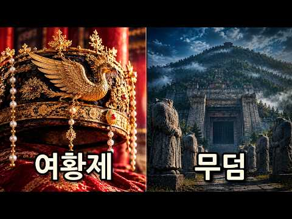
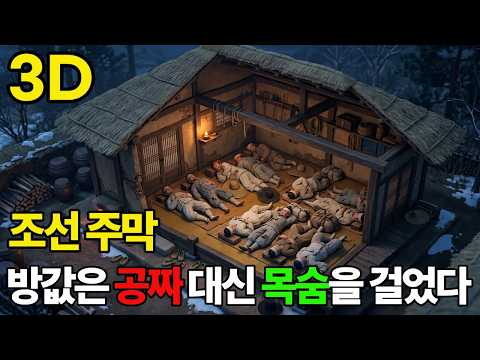
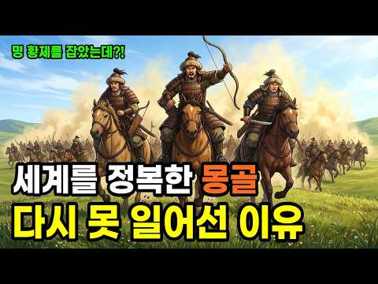

# 역사 — 성공 사례 분석: 사례별 자세히 #81–#120

`analysis.md` 의 9번 (같은 # 번호). 자동 생성 — `tools/success_analysis.py` v1.5.1 (2026-10-24 07:34 UTC). ※ 연구·교육용 — 투자 권유가 아님.

### 81. 단종보다 10배 더 슬픈 광해군의 19년 생지옥… 원수의 파멸을 두 눈으로 지켜본 늙은 왕!

- https://www.youtube.com/watch?v=P9nHouyJ1Hg · 근본한국사 · 구독자 3,020 · 조회수 423,053 (×140.1, 하루 2,482.0) · 좋아요 2,859 (0.7%) · 13.9분 · 2026-05-06 · 주제 묶음 3. 조선 · 형식 사연·드라마 · 폴더 `W_P9nHouyJ1Hg` (웹 승인)
- 썸네일: 
- 챕터: 0:00 💀 1641년, 제주도의 비참한 노인 (도입) · 1:08 👑 단종 vs 광해군 — 누가 더 비참했나 · 1:55 ⚔️ 18살 영웅의 등장 — 임진왜란과 광해군 · 3:30 🏯 33살, 천신만고 끝에 오른 피 묻은 용상 · 4:25 🎭 천재적 양다리 외교와 사대부의 분노 · 5:50 🔥 1623년 그믐밤, 인조반정의 서막 · 7:00 🌵 강화도 위리안치 — 70일 땅굴과 가족의 몰살 · 9:30 🌊 제주도 유배 — "이 또한 다 지나가느니라" · 11:15 ❄️ 인조의 업보 — 병자호란과 삼전도 굴욕 · 12:30 🕯️ 1641년 7월 1일 — 늙은 왕의 마지막 복수극 · 13:30 📜 역사가 끝내 들어준 광해군의 손 (마무리)
- 설명 앞부분: 조선 광해군 비참한 최후, 단종보다 더 슬픈 19년 유배 생지옥의 충격 실화입니다. 인조반정으로 쫓겨난 폐주 광해군이 강화도와 제주도에서 가족을 모두 잃고 살아남은 19년의 진실. 원수 인조의 삼전도 굴욕과 비참한 자멸을 끝까지 지켜본 조선 역사상 가장 서늘한 복수극. 🏯 1641년, 칼바람이 살점을 에는 제주도의 어느 낡은 초가집. 다 해진 누더기를 덮은 67세 노인이 피를 토하며 홀로 숨을 거둡니다. 아내, 아들, 며느리, 어린 손주들까지 두 눈앞에서 끔찍하게 몰살당한 채로요. 이 비참한 노인은 한때 조선 팔도를 호령하던 15…
- 같은 채널 평소 대비 ×377.4 (채널 최근 롱폼 중앙값 1,121회) · 평소 영상: 형제를 죽인 이방원, 그가 유일하게 두려워한 적은 친아버지 이성계였다 ∣ 왕자의 난·조사… (1,121회) / 연산군 중종반정의 숨겨진 진실, 진성대군은 정말 몰랐을까? (소름주의) (1,105회)
- 대본 없음 (설명) — 음성인식이 끝나면 도입부·흐름이 들어감
- 댓글 586/586: 좋은 점 — 영상 5 · 감사·응원 6 · 더 알고 싶은 것 5 · 아쉬운 점 — 영상 3 · 반박·불만 — 의견 다름 5 · 정치·사회 25 · 경험 공유 15 · 구독·다음 기대 0
  - 좋은 점 — 영상 👍7 “역사를 알아야 미래도있다는말 공감합니다 지금이 역사의 반복과 같네요”
  - 좋은 점 — 영상 👍1 “광해군의 이야기가 궁금했는데 이해하기 쉽게 설명도 잘되어있어서 집중하면서봤습니다 덕분에 도움이됬습니다 감사합니다”
  - 감사·응원 👍5 “저도 광해군 이야기를 들으면 어찌이리도 슬픈지 ㅠ 전쟁의 현장에서 백성들과도 함께했던.. 영상 감사합니다”
  - 감사·응원 👍2 “너무 잘 들었습니다 너무 감사하게 공감해서 좋아요와 구독을 눌렀고 지금부터 다 볼려구합니다😂”
  - 더 알고 싶은 것 👍1 “그외 패륜도 10개만 더 알려주세요”
  - 더 알고 싶은 것 👍1 “근데 조선 5백년 역사상 제대로 된왕이 몄명이나 되나요 ?”
  - 아쉬운 점 — 영상 👍10 “현재 상황이랑 비슷하게 역사는 반복되네 .”
  - 아쉬운 점 — 영상 👍1 “이때 홍타이지가 인조를 폐위시키고 광해군을 다시 복위시겻다면 역사가 얼마나 재미잇어졋을까요 아쉽네요.”
  - 반박·불만 — 의견 다름 👍2 “조선 최악의 왕 인조...미치광이 아버지 정원군을 광해군이 죽인것에 앙심품고 말도 안되는 반정으로 왕이 되어 나라를 파멸로 이끈 연산군보다 나쁜놈!”
  - 반박·불만 — 의견 다름 👍1 “허나 광해도 완벽은 아닌것이 대표적으로 궁궐 건축한답시고 화약 소모에 백성들 힘들게 한것을 생각하면,, 글쎄?,,”
  - 정치·사회 👍15 “연산은 폭군이 맞지만 광해는 기득권 세력들이 조작한 폭군아닌 성군 세종 광해 효종 소현세자 정조 이런 군주만 있었으면 조선이 좀더 발전된 나라가 되었을텐데...”
  - 정치·사회 👍4 “절만 받고 돌아갈게 아니라 명분만을 앞세워 청에 적대적 이었던 인조를 마땅히 폐위 시키고 등거리 실리 외교로 청에 우호적 이였던 광해군을 재옹립 시켰어야 역사가 달라졌을 텐데 홍타이지의 오판으로 하나같이 왕답지도 않은 무능한 왕으로 계보가 이어지게 됨에따라 종당엔 식…”
  - 경험 공유 👍5 “저도 광해군 이야기를 들으면 어찌이리도 슬픈지 ㅠ 전쟁의 현장에서 백성들과도 함께했던.. 영상 감사합니다”
  - 경험 공유 👍3 “나도 이분광해군이 19년이란세월을 힘들게살아온 광해군이단종보다불쌍했어요”

### 82. 청나라를 위협한 '미지의 제국', 백두산정계비를 세우게 만든 진짜 이유

- https://www.youtube.com/watch?v=tS5qj6B66kc · 그날의 재발견 · 구독자 1,370 · 조회수 191,150 (×139.5, 하루 4,579.3) · 좋아요 914 (0.5%) · 47.9분 · 2026-09-12 · 주제 묶음 6. 동양사 (중국·일본·몽골) · 형식 인터뷰·강연·대담 · 폴더 `W_tS5qj6B66kc` (웹 승인)
- 썸네일: 
- 설명 앞부분: "북간도는 정말 우리가 되찾아야 할 잃어버린 고토일까요?" 북간도가 어떻게 우리 영토라는 주장이 나오게 된걸까요? 그 경계선 뒤편에는 교과서가 미처 다루지 못한 수많은 역사적 기록과 숨겨진 제국의 흔적이 자리 잡고 있습니다. 본 영상의 제작에 생성형 AI 기술을 활용하였습니다.
- 같은 채널 평소 대비 ×396.2 (채널 최근 롱폼 중앙값 482회) · 평소 영상: 조선 최대 규모 역모 발생. 공포에 질린 숙종. 금단의 예언서 정감록의 충격적 실체 (506회) / 한무제는 왜 태어난 지 몇 달 된 증손자를 감옥에 넣었나 (459회)
- 대본 없음 (설명) — 음성인식이 끝나면 도입부·흐름이 들어감
- 댓글 487/502: 좋은 점 — 영상 2 · 감사·응원 4 · 더 알고 싶은 것 3 · 아쉬운 점 — 영상 2 · 반박·불만 — 의견 다름 8 · 정치·사회 36 · 경험 공유 12 · 구독·다음 기대 0
  - 감사·응원 👍9 “지금껏 만들어졌던 간도 관련 영상 중에서 최고입니다. 그동안 많은 국민들이 지금은 남의 땅이 된 간도를 아까워하고 안타까워했지만 근세 이후 어떻게 조상들의 이주와 개척과 개간으로 우리의 땅이 되었지만 다시금 중국으로 넘어가게 되었는지에 대해 그 경위와 내력을 자세히 …”
  - 감사·응원 👍2 “좋았요 대한민국 화이팅 1”
  - 더 알고 싶은 것 👍2 “많이!알려주세요!찾아야됨니다!🎉🎉🎉”
  - 더 알고 싶은 것 👍2 “고조선 고구려 발해의 직계 후예는 건주여진이죠. 그래서 만주는 건주여진의 땅입니다. 건주여진은 본인들이 고조선의 직계후예라고 하였죠. 그런 건주 여진을 우리는 오랑캐라 무시하였죠. 그러면서 북간도가 우리땅이다 외칠수가 있을까요?”
  - 반박·불만 — 의견 다름 👍17 “부국강병 만이 헛소리를 없앨 수 있다.”
  - 반박·불만 — 의견 다름 👍4 “옛날 kbs 드라마 북간도 애청을 했었는데 감회가 새롭네. 여기는 내고향 내고향도 아닌데~ 무엇을 바라며 어디로 가는가~ 고향 멀리 찬바람만 몰아 치는데~ 꿈에도 못잊을 나의 고향아~”
  - 정치·사회 👍38 “내가 아쉬운 건 청나라가 저렇게 영토를 넓혀 놓고 그걸 고스란히 중국인들에게 바친 꼴이 된다는 것. 만주, 몽골, 티베트를 다 중국에 내 줘 버림. 죽 쒀서 개 준 꼴.”
  - 정치·사회 👍19 “그나마 청나라가 연해주를 러시아로 넘긴걸 다행이라 생각해야 함.”
  - 경험 공유 👍38 “내가 아쉬운 건 청나라가 저렇게 영토를 넓혀 놓고 그걸 고스란히 중국인들에게 바친 꼴이 된다는 것. 만주, 몽골, 티베트를 다 중국에 내 줘 버림. 죽 쒀서 개 준 꼴.”
  - 경험 공유 👍9 “지금껏 만들어졌던 간도 관련 영상 중에서 최고입니다. 그동안 많은 국민들이 지금은 남의 땅이 된 간도를 아까워하고 안타까워했지만 근세 이후 어떻게 조상들의 이주와 개척과 개간으로 우리의 땅이 되었지만 다시금 중국으로 넘어가게 되었는지에 대해 그 경위와 내력을 자세히 …”

### 83. 조선 최고의 신랑감이 하루아침에 한양 제일의 망나니가 된 이유 /야담 조선야담 옛날이야기 오디오북 수면동화 전래동화

- https://www.youtube.com/watch?v=5tjsVKWQES0 · 썰톡 TV · 구독자 3,390 · 조회수 470,944 (×138.9, 하루 7,044.1) · 좋아요 7,534 (1.6%) · 87.1분 · 2026-08-18 · 주제 묶음 9. 야사·야담·옛날이야기 · 형식 수면·낭독 (잠잘 때 듣는) · 폴더 `W_5tjsVKWQES0` (웹 승인)
- 썸네일: 
- 설명 앞부분: 📝 오늘의 이야기 미리보기 조선 최대 소금 객주이자 벼락 부자로 이름난 윤만석 대감. 그에게는 한 번 본 글을 잊지 않고 무예마저 출중한 ‘천재 외아들’ 시겸이 있었습니다. 도성의 명문가들이 앞다투어 사위로 삼으려던 장안 최고의 신랑감이었지요. 그런데 아비가 숨을 거두기 직전, 외아들의 손을 꼭 쥐고 남긴 유언은 기이하기 짝이 없었습니다. “아들아, 제발 망나니가 되어 살아라!” 평생 학문과 절제를 배우던 천재는 하루아침에 한양 최고의 '미친 망나니'가 되었습니다. 상복을 입은 채 술판을 벌이고, 기방에 은전을 뿌리며, 자신을 걱…
- 같은 채널 평소 대비 ×16,239.4 (채널 최근 롱폼 중앙값 29회) · 평소 영상: 행방불명된 딸을 찾던 조선 최고 부자가 딸 묘지서 통곡하는 여인을 본 순간 /야담 조선야… (29회) / 눈보라 속 백구가 전해준 보따리, 산골 과부의 운명을 통째로 뒤바꾼 15년 /야담 조선야… (29회)
- 대본 없음 (설명) — 음성인식이 끝나면 도입부·흐름이 들어감
- 댓글 123/126: 좋은 점 — 영상 0 · 감사·응원 9 · 더 알고 싶은 것 0 · 아쉬운 점 — 영상 0 · 반박·불만 — 의견 다름 0 · 정치·사회 1 · 경험 공유 0 · 구독·다음 기대 0
  - 감사·응원 👍18 “중국풍의 얘기보다 너무 잘 들었습니다. 맘으로 응원합니다”
  - 감사·응원 👍15 “광고업시. 끝까지 들려주어서. 감사감사해서요. 대박나시길 바랍니다.”
  - 정치·사회 👍0 “미국에 이익이 된다해도, 미국이 이 세상의 지도자 나라가 되기를 원합니다. 본래의 창조주 하나님을 두려워할 줄 아는 사람들이 세웠던 그 정신을 더 강하게 세워갈 줄 아는 지도자로 굳게 상승하기를 바랍니다. 딥스가요? , 중 공산당이요?, 테러 독재 중동이요? 사회주의…”

### 84. 측천무후 무덤을 절대 열지 않는 이유, 입구를 한 번 찾았다가 벌어진 일

- https://www.youtube.com/watch?v=H2CA284tnpw · 지식세이렌 · 구독자 1,890 · 조회수 261,856 (×138.6, 하루 76,582.0) · 좋아요 552 (0.2%) · 15.3분 · 2026-10-20 · 주제 묶음 기타 · 형식 정보·해설 (그 밖) · 폴더 `W_H2CA284tnpw` (웹 승인)
- 썸네일: 
- 챕터: 0:00 오프닝: 곡괭이 끝에 걸린 쇳물 봉인 돌문 · 1:39 열네 살 소녀가 중국 유일의 여황제가 되기까지 · 4:21 산 하나가 통째로 무덤, 건릉 · 5:15 1,300년 동안 열리지 않은 세 가지 이유 · 7:43 쇳물로 엮은 63미터 돌벽의 정체 · 9:11 털리고 남은 공주의 무덤이 말해 주는 것 · 10:55 입구를 찾고도 다시 덮은 이유 · 12:52 글자 없는 비석과 마지막 유언 · 14:50 마무리: 황제인가, 황후인가
- 설명 앞부분: 1,300년 동안 단 한 번도 열리지 않은 여황제의 무덤, 건릉. 1958년, 돌을 캐던 마을 사람들이 쇳물로 봉인된 입구를 찾아냈지만 중국은 그 문을 다시 흙으로 덮어 버렸습니다. 당나라 황제릉이 거의 다 털리는 동안 이 무덤만 살아남은 이유, 그리고 입구를 찾고도 열지 않는 진짜 이유를 측천무후의 일생과 함께 파헤쳐 봅니다.
- 대본 없음 (설명) — 음성인식이 끝나면 도입부·흐름이 들어감
- 댓글 29/29: 좋은 점 — 영상 1 · 감사·응원 1 · 더 알고 싶은 것 1 · 아쉬운 점 — 영상 1 · 반박·불만 — 의견 다름 0 · 정치·사회 4 · 경험 공유 1 · 구독·다음 기대 0
  - 좋은 점 — 영상 👍6 “유익한 도움에 감사 드립니다.!!🙏🙆‍♂️🙋‍♂️💕💕”
  - 감사·응원 👍6 “유익한 도움에 감사 드립니다.!!🙏🙆‍♂️🙋‍♂️💕💕”
  - 아쉬운 점 — 영상 👍4 “측천무후를 드라마로 흥미롭게 관람 했었는데 그런사연이 있었군요 지루하지 않게 해설을 잘해주셔서 도움 됐습니다 AI 목소리가 아니여서 더 편한마음 으로 잘들었고 구독,좋아요 꾸욱 누르고 갑니다..수고하셨습니다”
  - 경험 공유 👍4 “측천무후를 드라마로 흥미롭게 관람 했었는데 그런사연이 있었군요 지루하지 않게 해설을 잘해주셔서 도움 됐습니다 AI 목소리가 아니여서 더 편한마음 으로 잘들었고 구독,좋아요 꾸욱 누르고 갑니다..수고하셨습니다”

### 85. 며느리보다 10살 어린 시어머니, 그녀는 조선을 뒤흔들었다

- https://www.youtube.com/watch?v=T8bS_yX629Y · 역사정복 · 구독자 416 · 조회수 57,350 (×137.9, 하루 1,201.7) · 좋아요 178 (0.3%) · 16.8분 · 2026-09-06 · 주제 묶음 3. 조선 · 형식 사연·드라마 · 폴더 `W_T8bS_yX629Y` (웹 승인)
- 썸네일: 
- 설명 앞부분: 66세 왕과 15세 신부, 나이 차 51년. 조선 519년 역사상 가장 극단적인 왕실 결혼이었습니다. 흔히 떠올리는 '불쌍한 어린 신부' 이야기는 여기서 끝나지 않습니다. 이 소녀는 훗날 정조가 세상을 떠난 뒤, 조선 정치를 뒤흔든 최고 권력자가 됩니다. 이 영상에서는 영조와 정순왕후의 결혼부터, 정조와의 미묘한 관계, 그리고 수렴청정을 통해 신유박해와 장용영 해체를 주도하는 과정까지 시간 순서로 따라갑니다. 정약용 형제의 운명이 어떻게 바뀌었는지, 그리고 51년이라는 나이 차이가 만들어낸 진짜 승자와 패자가 누구였는지를 확인하실…
- 같은 채널 평소 대비 ×125.9 (채널 최근 롱폼 중앙값 456회) · 평소 영상: 삼국지 최대 굴욕을 참은 남자의 소름 돋는 결말 (457회) / 왕보다 강했던 신하 한명회, 그의 집안에는 무슨 일이 있었나? (454회)
- 대본 없음 (설명) — 음성인식이 끝나면 도입부·흐름이 들어감
- 댓글 13/13: 좋은 점 — 영상 0 · 감사·응원 0 · 더 알고 싶은 것 0 · 아쉬운 점 — 영상 0 · 반박·불만 — 의견 다름 0 · 정치·사회 0 · 경험 공유 0 · 구독·다음 기대 0

### 86. 조선시대 역적으로 몰린 양반 아내들, 노비로 전락한 충격적인 진실

- https://www.youtube.com/watch?v=mHF_-cRLwGQ · 조선 왕조의 비밀 · 구독자 1,530 · 조회수 208,707 (×136.4, 하루 1,771.2) · 좋아요 2,097 (1.0%) · 26.2분 · 2026-06-28 · 주제 묶음 3. 조선 · 형식 정보·해설 (그 밖) · 폴더 `W_mHF_-cRLwGQ` (웹 승인)
- 썸네일: 
- 설명 앞부분: 조선 시대 의금부 앞마당에서 벌어진 사육신 관련 여인들의 비극적 사건을 다룬 영상입니다. 단종 복위 사건 이후 남편을 잃은 353명의 여성들이 원수의 집으로 끌려가 노비로 전락하는 충격적인 현실 속에서, 한 이름 없는 여종이 모든 것을 바꿀 운명의 선택을 하게 됩니다. 이번 영상에서는 조선의 연좌제, 노비 제도, 그리고 인간의 존엄이 무너진 시대 속에서도 살아남기 위해 싸운 여성들의 처절한 생존 이야기를 깊이 있게 다룹니다. 특히 역사 속에서 기록되지 못한 한 여종의 희생과 기적 같은 결과는 큰 여운을 남깁니다.
- 같은 채널 평소 대비 ×1,056.7 (채널 최근 롱폼 중앙값 198회) · 평소 영상: 20살 천재 왕｜즉위 14개월 만에 갑자기 죽은 충격적인 이유는 무엇이었나? (212회) / 경혜공주｜단종의 친누나, 세조에게 조선 역사상 가장 잔인한 복수를 남기다 (183회)
- 대본 없음 (설명) — 음성인식이 끝나면 도입부·흐름이 들어감
- 댓글 146/146: 좋은 점 — 영상 0 · 감사·응원 0 · 더 알고 싶은 것 0 · 아쉬운 점 — 영상 8 · 반박·불만 — 의견 다름 1 · 정치·사회 8 · 경험 공유 0 · 구독·다음 기대 0
  - 아쉬운 점 — 영상 👍4 “자막좀정리”
  - 아쉬운 점 — 영상 👍3 “맞춤법도 안맞는 자막좀 치워라. 짜증난다.”
  - 반박·불만 — 의견 다름 👍0 “세월이 좋아 역적 석열이와 그무리들은 국민세금으로 잘먹고 잘살고 있는게 어이없다”
  - 정치·사회 👍2 “중국인이 운영하는 유튜브는 시청하지 맙시다”
  - 정치·사회 👍2 “조선은 빨리 망했어야 함 동족을 노비로 삼는 나라가 어디 있나”

### 87. 조선 주막 방값은 공짜, 대신 목숨을 걸었다 ∣ 승정원일기·실록으로 본 조선 주막

- https://www.youtube.com/watch?v=6UEopLVwlag · 조상님 클라쓰 · 구독자 5,350 · 조회수 725,170 (×135.6, 하루 77,156.8) · 좋아요 1,826 (0.2%) · 11.5분 · 2026-10-14 · 주제 묶음 3. 조선 · 형식 정보·해설 (그 밖) · 폴더 `W_6UEopLVwlag` (웹 승인)
- 썸네일: 
- 챕터: 0:00 손님만 죽었다 · 0:34 오늘 가져가실 네 가지 · 1:01 해 질 녘, 노상추 · 1:40 장대 끝의 간판, 원에서 주막으로 · 2:34 짐승과 사람이 한데 · 3:09 밥값이 곧 잠값 · 3:59 열 명, 한 방 · 4:43 이 방에서 가장 무서운 것 · 5:51 도적이 머무는 집 · 7:09 나라가 본 주막 · 8:15 40도의 밤 · 9:09 주막이 품은 사람들 · 9:41 새벽, 다시 길로 · 10:16 사라진 불빛 · 10:38 지금도 남은 외상 장부
- 설명 앞부분: 1638년, 한양 코앞 파주. 관아 문 바로 앞 주막에서 재물을 지닌 나그네들이 전부터 여러 번 목숨을 잃었습니다. 조정의 보고는 이렇게 끝납니다. "손님은 죽었는데 주인은 다치지 않았다. 이 또한 의심스럽다." 그런데도 조선의 나그네들은 해만 지면 주막을 찾아 들어갔습니다. 밥만 사 먹으면 잠은 공짜였던 주막, 모르는 사람 열 명이 한 방에 눕던 봉놋방, 도적과 반란군과 떠도는 아이들이 함께 밤을 나던 그 지붕 아래를 3D로 따라가 봅니다. 1638 파주 탄막 사건: 승정원일기 인조 16년 2월 27일. 범인은 명화적, 조정은 …
- 같은 채널 평소 대비 ×92.4 (채널 최근 롱폼 중앙값 7,848회) · 평소 영상: 제주도 밑을 뚫어 보니 나온 것 ∣ 한라산은 주인공이 아니었다 (10,239회) / 설악산 세 바위는 땅속에서 한 뿌리였다 ∣ 태백산맥, 한반도의 등뼈 (5,457회)
- 대본 없음 (설명) — 음성인식이 끝나면 도입부·흐름이 들어감
- 댓글 154/154: 좋은 점 — 영상 0 · 감사·응원 2 · 더 알고 싶은 것 3 · 아쉬운 점 — 영상 0 · 반박·불만 — 의견 다름 1 · 정치·사회 4 · 경험 공유 3 · 구독·다음 기대 0
  - 감사·응원 👍14 “옛날에 태어나지 않은것에 감사”
  - 감사·응원 👍0 “진짜 너무 미개하다 조선인들은 미개한 조선을 개화시켜준 대일본제국에게 항상 감사히 생각하며 살아야한다”
  - 더 알고 싶은 것 👍1 “동학농민운동도 다뤄주셨으면 좋겠어요❤”
  - 더 알고 싶은 것 👍0 “지금 현대의 사람들이 어떻게 조선시대 주막에서 하룻밤을 잘 수가 있을까요? 좁아터진 방, 흙 방바닥에 거적대기 위에 이불도 없고 베개는 딱딱한 목침, 벌레는 들끓고 냄새나는 이방인과 다닥다닥 붙어서 방 온도는 40도를 넘나드는 사우나인 방. 근데 바깥에서 얼어죽을 바…”
  - 정치·사회 👍0 “조선시대에 1. 외국인 2. 여자 3. 주막 4. 하룻밤 참 신빙성이 있네요”
  - 정치·사회 👍0 “7:55 중국인도 주막을열였던것에대해선 흥미롭네요”
  - 경험 공유 👍5 “당연히 1번이죠. 제가 뭐 몇십억씩 있는 현대판 양반도 아니고, 내 주제에 뭘 이런데서 못자겠습니까.. 1번”

### 88. 콘돔도 없던 조선시대, 기생은 어떻게 임신과 화류병을 막았나— 알려지지 않은 충격적인 진실#조선시대 #기생 #풍속화 #한국역사 #신윤복

- https://www.youtube.com/watch?v=mU274jAWlws · 조선의 호기심 · 구독자 1,750 · 조회수 237,094 (×135.5, 하루 1,647.6) · 좋아요 3,175 (1.3%) · 24.5분 · 2026-06-02 · 주제 묶음 3. 조선 · 형식 정보·해설 (그 밖) · 폴더 `W_mU274jAWlws` (웹 승인)
- 썸네일: 
- 챕터: 0:00 오프닝 — 막지 못했다 · 1:00 세습기생 — 법이 만든 운명 · 4:00 아침 루틴 — 기생의 하루 · 7:00 피임법 — 창호지, 소금물, 뒤로 7걸음 · 12:00 두 달 후 — 임신 · 16:00 삼월의 냉정한 계산
- 설명 앞부분: 콘돔이 없던 시대, 기생들은 어떻게 임신을 막았을까. 어떻게 화류병을 막았을까. 답은 간단했다. 막지 못했다. 이 영상에서 다루는 내용 창호지 피임, 소금물, 뒤로 일곱 걸음. 그것이 조선 기생이 가진 전부였다. 기생의 딸은 기생이 된다. 팔리는 것도 아니었다. 법이 그냥 정해 놓았다. 태어나는 순간 이미 직업이 정해져 있었다. 외과 환자의 70~80%가 화류병 환자였다는 기록. 토복령이라는 약은 있었지만 너무 비쌌다. 그리고 더 위험한 선택도 있었다. 오늘은 어느 사극에도, 어느 역사책에도 나오지 않는 조선 기생들의 진짜 이야기…
- 같은 채널 평소 대비 ×292.7 (채널 최근 롱폼 중앙값 810회) · 평소 영상: 조선에서 남녀는 어떻게 결혼했나 —얼굴도 모르는 사람과 결혼해야 했던충격적인 혼인 풍습【… (810회) / 비누도 샴푸도 수돗물도 없었는데 조선인이 세계에서 가장 청결했던 충격적인 이유 【조선시대… (828회)
- 대본 없음 (설명) — 음성인식이 끝나면 도입부·흐름이 들어감
- 댓글 517/522: 좋은 점 — 영상 3 · 감사·응원 8 · 더 알고 싶은 것 6 · 아쉬운 점 — 영상 9 · 반박·불만 — 의견 다름 6 · 정치·사회 20 · 경험 공유 8 · 구독·다음 기대 1
  - 좋은 점 — 영상 👍80 “조선에서 노비였던 사람들이 해방된 것이 국가의 원동력이 된 듯..... 양반들은 여전히 국가에 도움이 안되니까..... 나머지 인간들이 현재의 국력이 됨...”
  - 좋은 점 — 영상 👍0 “제발 맞춤법 좀 고쳐주세요ㅠㅠㅠㅠ 한번 ai 돌리고 자막을 달아주세요 좋은 영상들인데 아이들도 볼 것 같아서요.”
  - 감사·응원 👍21 “저런 조선을 끝장내준 일본이 오히려 고맙게 느껴진다.”
  - 감사·응원 👍6 “조선시대 여인의 삶 고달프고 애닮다 이시대에 태어난걸 감사하게 돼네요”
  - 더 알고 싶은 것 👍13 “쌀때 밖에 싸라 하면 안되나요?”
  - 더 알고 싶은 것 👍11 “1.씹창 났다..라는 말의 어원을 아시나요? 말 그대로 여성성기(씹)에 (곪을)창이 난 겁니다 양반이 기생하고 하려는데 아래가 곪았어요. 그래서 못 하게 되었어요...이 때 하는 말이 "에이, 씹창 났다.." 조선시대 성병이 얼마나 많았는지 이해가 되시죠? 2. 정월…”
  - 아쉬운 점 — 영상 👍52 “컨텐츠는 좋은데 자막이 ai로 자동 생성한건지 너무 틀린 게 많이 보여서 거슬리네요”
  - 아쉬운 점 — 영상 👍21 “자막이 AI로 되어있어서 오타가 너무 많아요..”
  - 반박·불만 — 의견 다름 👍16 “기생을 매춘부로 설명했군 관기에 대한 설명도 엉망이고 역사는 해석이 다양하다는 모호한 말로 왜곡에 가까운 헛소리를 전파하지 마시죠”
  - 반박·불만 — 의견 다름 👍1 “웃기는 조선 불쌍한 조선인들”
  - 정치·사회 👍342 “저게 법이라니.. 나라가 나서서 여자들을 괴로운 삶으로 몰아넣었군요. 마음이 너무 아픕니다”
  - 정치·사회 👍191 “조선이 망한거 잘했다.임진왜란때 나라가 진즉 망하여 노예 기생 반상제도가 없어졌어야했다.”
  - 경험 공유 👍20 “일제 시대 위안부 비난할 입장이 아니네. 조선 시대가 더 개쓰레기였네. 나도 여자이고 딸을 키우는데...진짜 쌍욕이 나오는 조선.”
  - 경험 공유 👍0 “남자는 노동꾼으로 보내지고 여자는 그저 욕구해소용 도구였던 시절.. 잔인하다. 내가 누리는 자유라는게 그 당시엔 당연한것이 아니였다니.. 너무 슬프다 나는 그냥 운좋게 좋은 시대에 태어난 것 뿐이구나..”
  - 구독·다음 기대 👍1 “듣다보니 정말 슬프네요. 구독합니다. 그런데 ㅡ조선의 호기심 ㅡ 검색하니 또 있네요. (조선의호기심) 이렇게 띄어쓰기 안하니 채널명이 같은게 있어요.”

### 89. [중국 전쟁사] 그 넓은 중국은 어쩌다 동해를 코앞에 두고 통로가 막혀버렸을까?｜기묘하게 꼬여버린 '북·중·러' 국경지대 역사 완벽 요약!

- https://www.youtube.com/watch?v=itVdxpo0sWQ · 역사순삭 · 구독자 73 · 조회수 13,457 (×134.6, 하루 148.0) · 좋아요 75 (0.6%) · 10.1분 · 2026-07-25 · 주제 묶음 7. 전쟁·군사사 · 형식 애니메이션·지도 · 폴더 `W_itVdxpo0sWQ` (웹 승인)
- 썸네일: 
- 설명 앞부분: [중국 전쟁사] 그 넓은 중국은 어쩌다 동해를 코앞에 두고 통로가 막혀버렸을까?｜기묘하게 꼬여버린 '북·중·러' 국경지대 역사 완벽 요약! 영토가 방대한 대국 중국은 어째서 동해를 불과 15km 앞두고 바다로 나갈 수 없게 된 걸까요? 과거 러시아의 영토 팽창과 일본의 무리한 전쟁 도발이 겹치면서, 중국은 두만강 하구를 통한 바다 출구를 완전히 봉쇄당하고 말았습니다. 현재 침체된 동북 3성의 경제를 살리고 미래 북극 항로의 주도권을 쥐기 위해 동해 진출이 절실한 중국에게 이는 가장 뼈아픈 지정학적 약점입니다. 심지어 북한과 러시아…
- 대본 없음 (설명) — 음성인식이 끝나면 도입부·흐름이 들어감
- 댓글 7/7: 좋은 점 — 영상 0 · 감사·응원 0 · 더 알고 싶은 것 0 · 아쉬운 점 — 영상 0 · 반박·불만 — 의견 다름 0 · 정치·사회 3 · 경험 공유 0 · 구독·다음 기대 0
  - 정치·사회 👍2 “흑룡강은 아무르강이라고도 하는데 저 강의 주인이 전체 강너머의 주인이라는 건 역사적인 팩트다. 오늘날 무슨 국제법이 등장하기 이전에는 강을 정복한 자가 천하를 정복했다. 그러면 지금 국경선 흑룡강의 실질 주인이 바로 조선이었다는 건 러시아가 스스로 나선정벌의 충격으로…”
  - 정치·사회 👍1 “야인토벌이 실록 전체에 나오는데 무슨 거기 청의 영토라고 하는가. 거기는 조선이 직접 기병 오백으로 여진 이만명을 토벌하던 그런 지역이다. 아무르강이 압록강이다. 그래서 러시아는 조선을 두려워했고 청과 네르친스크조약을 체결한 배경에 조선의 막강한 군사력이 있었고 이후…”

### 90. 마지막 황손 이석의 아침 밥상은? 교과서에는 없는 대한제국 황실의 진짜 이야기｜황손 이석의 승광재의 아침

- https://www.youtube.com/watch?v=1bjVlbD1kCY · 승광재 · 구독자 1,940 · 조회수 260,194 (×134.1, 하루 7,619.5) · 좋아요 1,170 (0.4%) · 7.7분 · 2026-09-20 · 주제 묶음 4. 한국 근현대사 · 형식 야담·옛날이야기 · 폴더 `W_1bjVlbD1kCY` (웹 승인)
- 썸네일: 
- 설명 앞부분: 전주 한옥마을 승광재에 찾아온 평화로운 아침. 대한제국의 마지막 황손, 이석 할아버지가 정갈한 아침 밥상과 함께 그동안 어디서도 듣지 못했던 생생한 옛날이야기를 들려주십니다. 역사책 속 딱딱한 기록이 아닌, 아들의 시선으로 바라본 아버지 의친왕의 꼿꼿했던 모습, 그리고 격동의 근현대사 속에서 황실 가족들이 겪어야 했던 진짜 숨겨진 이야기들. 따뜻한 차 한 잔을 곁들여 승광재 마루에 마주 앉아 듣는 기분으로 끝까지 시청해 보세요. 황손 이석이 들려주는 조선 이야기, 승광재
- 대본 없음 (설명) — 음성인식이 끝나면 도입부·흐름이 들어감
- 댓글 195/195: 좋은 점 — 영상 2 · 감사·응원 5 · 더 알고 싶은 것 3 · 아쉬운 점 — 영상 1 · 반박·불만 — 의견 다름 2 · 정치·사회 4 · 경험 공유 7 · 구독·다음 기대 0
  - 좋은 점 — 영상 👍11 “안녕하세요. 황손님 ~ 이렇게 조선황실과 근현대사의 스토리를 직접 들을수 있어서 의미있는 영상이라 생각이 들어 몇자 남깁니다. 늘 건강 하시고… 이렇게 의미있는 행보 보여주시고 많이 남겨 주셨으면 먼 훗날 좋은 자료로 남겨 지지 않을까 생각이 듭니다.”
  - 좋은 점 — 영상 👍6 “황손이시라 인물 목소리 뭐든게 품위있으시고 벌써 틀리시네요 의친왕이신 아버님께선 노기남 대주교님이 대세받고 승하 하셨넹ᆢ 오래 오래 건강하게 살아주세요 좋은말씀 듣고 싶어요😊😊😊”
  - 감사·응원 👍9 “한글을 만들어주신 이씨조선이 없었다면 이대한민국은 없다..내비록 잘살지는못하지만..글을 읽고 쓸줄안다는건 내후손이 그만큼 발전할수있음을 고맘게 생각합니다.감사합니다”
  - 감사·응원 👍2 “미워도 우리 역사예요 ᆢ 그분이 알려주시는데 그게시르면 아니잖아요 ᆢ그분이리도 조선왕조 알려주시고 고맙잖아요”
  - 더 알고 싶은 것 👍15 “황손님 건강하세요. 100년 이야기 해주세요♡♡♡❤”
  - 더 알고 싶은 것 👍2 “나라에서 지원 부탁드립니다~^^”
  - 아쉬운 점 — 영상 👍1 “자막좀 신경써서 좀 쓰지... 맞춤법이나 자막이 틀린게 보여요..”
  - 반박·불만 — 의견 다름 👍11 “욕먹을 각오하고 댓글 달자면 무능한 주제에 헛소리나 하고ㅋㅋ 그냥 노친네”
  - 정치·사회 👍2 “** 8.15 광복후에 조선반도에 3개의 나라가 건국 ** 해방후 조선민족은 있었으나 국가는 없는상태로 소련군정,미군정임시정부는 충칭임시정부를 일개의 독립단체로만 인정했습니다.. 일제시대때 임시정부는 무려 9~12개정도로 임시정부가 난립한상태었습니다.. 북만주 고려의…”
  - 정치·사회 👍1 “* 좌파와 우파, 진보와 보수 사고방식의 차이 * 좌파는 노동자,민중이 평등한 세상, 노동자,농민을 중심으로 배급과 분배를 중시하는 평등사회주의를 지지하고 우파는 개인의 자유와 재산보호, 기업가를 중심으로 성장을 중시하는 자본주의를 지지하고, 지금은 성장의 시대가 끝…”
  - 경험 공유 👍11 “대학시절에 겸임교수로 잠깐봤었을때 그때 신기했었는데.. 벌써 10년이 넘었네요”

### 91. [애절한 중국 사극 노래] “나만의 폐하를 사랑하지요” ∣ 황제 무측천이 사랑한 단 하나의 태양 ∣ 성세천하 ost ∣ 이치원조 FMV ∣ 《명명 ∣ 明明》병음…

- https://www.youtube.com/watch?v=z6VcKlWaGoo · 사녀  · 구독자 1,170 · 조회수 150,709 (×128.8, 하루 1,241.6) · 좋아요 1,072 (0.7%) · 4.4분 · 2026-06-24 · 주제 묶음 3. 조선 · 형식 정보·해설 (그 밖) · 폴더 `W_z6VcKlWaGoo` (웹 승인)
- 썸네일: 
- 설명 앞부분: 취미로 만든 채널로 개인적인 수익 일절 없습니다. 의역/오역 다수. ←관련 피드백 환영. “전하께서 보시기에 저는 어떤 사람 같습니까?” “홀로 거센 눈보라에 맞서지만 정작 자신을 위해 우산을 펴는 건 늘 잊는 사람이지.” “제 마음속에는 늘 폐하가 있었습니다” “짐의 이 생은 아주 행복했소. 원조, 짐이 약조했었지. 그대와 함께 나아가겠다고. 그 약속은 지키지 못하게 되었소.” [무원조의 영원한 태양 이치] 해당 곡은 성세천하 인게임의 메인 테마 음악으로 나오는 영상도 모두 인게임 내 스토리 화면을 사용했습니다. 곡을 소개하는 …
- 대본 없음 (설명) — 음성인식이 끝나면 도입부·흐름이 들어감
- 댓글 107/110: 좋은 점 — 영상 0 · 감사·응원 2 · 더 알고 싶은 것 3 · 아쉬운 점 — 영상 1 · 반박·불만 — 의견 다름 5 · 정치·사회 1 · 경험 공유 5 · 구독·다음 기대 0
  - 감사·응원 👍5 “가사랑 한국어 발음까지 ㅠ 감사합니다ㅏ❤️”
  - 더 알고 싶은 것 👍1 “드라마 제목 알수있을까요?”
  - 경험 공유 👍196 “어떤 스트리머 하는 영상을 보는데 누가 이치만큼은 게임 중에 원조를 죽이지 않았다고, 계속 사랑했다고 채팅치더라🥹 그거 보고 진짜 이치가 찐사라는 생각 많이 했었지ㅠㅠ 그래 이치는 그랬네, 어떤 순간에도 원조를 해치지 않으려 했네....ㅠㅠ 배드엔딩이 뜨더라도 결국 …”

### 92. 가족을 모두 잃고 18년을 버틴 광해군 ∣ 왕에서 죄인이 된 비극적인 최후

- https://www.youtube.com/watch?v=KRTIB2WwIQw · 웅이 역사원정대 · 구독자 1,580 · 조회수 202,312 (×128.1, 하루 4,126.8) · 좋아요 2,444 (1.2%) · 48분 · 2026-09-05 · 주제 묶음 3. 조선 · 형식 정보·해설 (그 밖) · 폴더 `W_KRTIB2WwIQw` (웹 승인)
- 썸네일: 
- 설명 앞부분: 왕좌에서 쫓겨난 뒤에도 18년이 넘는 유배 생활을 견뎌낸 조선의 왕이 있습니다. 조선의 제15대 국왕, 광해군입니다. 1623년 인조반정으로 하루아침에 왕의 자리에서 쫓겨난 광해군. 아들 폐세자 이지는 교동도의 가시 울타리 안에서 가위와 인두를 이용해 약 21미터의 땅굴을 팠습니다. 오늘날 아파트 7층 높이에 맞먹는 거리였어요. 그러나 목숨을 건 탈출은 실패했습니다. 며느리 박씨가 먼저 스스로 생을 마감했고, 한 달 뒤에는 폐세자에게 자진하라는 명이 내려졌습니다. 그해 윤10월에는 아내 유씨마저 유배지에서 세상을 떠났어요. 가족을…
- 같은 채널 평소 대비 ×43.9 (채널 최근 롱폼 중앙값 4,606회) · 평소 영상: 죽어야만 나갈 수 있을까? 우리가 미처 몰랐던 조선 궁녀들의 삶 #한국사 #역사이야기 (6,268회) / 조선시대 내시도 부부생활이 가능했을까? 실록에 남은 결혼과 성생활 ∣ 역사스토리텔링 (2,945회)
- 대본 없음 (설명) — 음성인식이 끝나면 도입부·흐름이 들어감
- 댓글 155/155: 좋은 점 — 영상 1 · 감사·응원 5 · 더 알고 싶은 것 0 · 아쉬운 점 — 영상 0 · 반박·불만 — 의견 다름 4 · 정치·사회 11 · 경험 공유 3 · 구독·다음 기대 0
  - 좋은 점 — 영상 👍3 “일체유심조! 인생은 맘먹기에 따른 것입니다. 오히려 광해군은 편안한 마음입니다. 그리고 광해군에게 영감이란 당시의 호칭은 오늘날 상대를 낮추는 멸칭이 아닙니다. 중앙에서 높은 직위에 있었던 사람들에게 쓰여진 존호였습니다. 좋은 영상 감사합니다 🎉”
  - 감사·응원 👍5 “덕분입니다 감사합니다”
  - 감사·응원 👍3 “너무나 광해군에 대해 설명을 놀랐만큼 잘 해주셔서 역사를 알게 되었습니다 감사합니다 존경합니다 나라를 위해 정직하게 하옵소서”
  - 반박·불만 — 의견 다름 👍4 “임진왜란과 병자호란 두개의 큰 변란은 강한 주변세력을 제대로 대처하지 못해서 일어난 사건으로 볼 수 있지요. 첫째는 지도자인 왕들이 매우 무능했고 둘째는 대신들이 옹졸하고 무능했기 때문으로 볼 수 있지요. 이율곡이 십만양병설을 제의했지만 무시하고 무사안일한 대처로 참…”
  - 반박·불만 — 의견 다름 👍3 “일체유심조! 인생은 맘먹기에 따른 것입니다. 오히려 광해군은 편안한 마음입니다. 그리고 광해군에게 영감이란 당시의 호칭은 오늘날 상대를 낮추는 멸칭이 아닙니다. 중앙에서 높은 직위에 있었던 사람들에게 쓰여진 존호였습니다. 좋은 영상 감사합니다 🎉”
  - 정치·사회 👍22 “광해군은 강대국 명ㆍ청사이에서 외교 국방을 잘한 🤴 👑왕입니다 국민(*백성)의 희생을 최소화한 임금🎉이었어요 ❤😂🎉 인조는 후금ㆍ청나라의 침략ㆍ병자호란1636을 유발해 백성이 많이 죽고 남한산성으로 피신해 길동?에서 삼배9고두례하고 소현세자와 수십만명(여성포함)을 인…”
  - 정치·사회 👍15 “광해군 뭐가 그리 잘못했나요 어느임금 손에 피안묻힌 왕있었나요 무능한인조 그러니 나라가 그꼰ㄷ났죠”
  - 경험 공유 👍2 “내가 보기엔 광해보다. 인조가. 더. 비참했다고. 생각함니다”
  - 경험 공유 👍0 “광해가뭔죽을만큼큰죄도아니건만!수양대군은친혈육까지도피를묻히고도발한자!조선은없었어야될역사다!특히선조인조의무능함은어찌말로다하리오!임진왜란병자호란겪고_소현세자등일반인공녀들반출등등심한백성들의피해가필설로다할수없네!광해는폐위되고도18년을버텼다니?비참한유배지에서친혈족은다죽고_뭘희망…”

### 93. [한국사] 여든여덟에 목이 잘린 영의정은 왜 목이 잘렸나 ∣ 역사인물 ∣ 다큐 ∣ 야사 ∣ 비사

- https://www.youtube.com/watch?v=wFTPh8YhhLI · 한국사인물관 · 구독자 4,890 · 조회수 615,687 (×125.9, 하루 17,501.2) · 좋아요 2,828 (0.5%) · 36.4분 · 2026-09-19 · 주제 묶음 4. 한국 근현대사 · 형식 정보·해설 (그 밖) · 폴더 `W_wFTPh8YhhLI` (웹 승인)
- 썸네일: 
- 설명 앞부분: 여든여덟 살 영의정이 사약이 아닌 참형으로 생을 마쳤습니다. 1623년 인조반정에서 광해군은 목숨을 건졌는데, 정인홍은 왜 관례까지 깨가며 참수되었을까요. 쉰일곱에 재산을 털어 의병을 일으키고 낙동강 보급로를 끊었던 사람, 남명 조식의 칼을 물려받은 수제자 정인홍. 합천에서 팔백 리 밖 조정을 움직인 세월과 국문 닷새 만에 집행된 형, 그에게 씌워진 죄목 다섯 가지, 285년이 지나서야 회복된 이름까지 정인홍의 여든여덟 해를 차분히 따라갑니다. 끝까지 보시고 생각을 댓글로 남겨주세요. 안녕하세요, 한국사인물관입니다. 저희는 우리 …
- 같은 채널 평소 대비 ×390.8 (채널 최근 롱폼 중앙값 1,576회) · 평소 영상: [한국사] 일본이 이순신보다 두려워 했던 조선의 영웅 ∣ 역사인물 ∣ 다큐 ∣ 야사 ∣ … (1,584회) / [한국사] 조선이 버린 한 선비의 일기가 실록을 구했다 ∣ 역사인물 ∣ 다큐 ∣ 야사 ∣… (1,567회)
- 대본 없음 (설명) — 음성인식이 끝나면 도입부·흐름이 들어감
- 댓글 100/124: 좋은 점 — 영상 2 · 감사·응원 2 · 더 알고 싶은 것 1 · 아쉬운 점 — 영상 1 · 반박·불만 — 의견 다름 0 · 정치·사회 5 · 경험 공유 1 · 구독·다음 기대 0
  - 좋은 점 — 영상 👍7 “가장 어린 사형수인 연산군의 아들들도 자세히 정리해주세요. 특히 영특하다고 실록에도 나오는 8살 폐세자 황의 안타까운 사연 알고 싶습니다.”
  - 감사·응원 👍22 “영상을 끝까지 본 결과 내암선생에 대해 매우 깊이 있고 정확하게 만드셨고 내용 또한 풍부하며 우려했던 편중된 내용이 전혀 보이지 않았습니다. 구독,좋아요 눌렀습니다. 존경하는 내암선생에 대해 이렇게 깊이 있고 정확하게 제작해 주신 점 감사드립니다. 인조반정이 일어나지…”
  - 감사·응원 👍2 “좋은 내용 감사합니다ㅡ남명 조식선생의 제자분들이 지금으로보면 진보였지요ㅡ입 선비가 아니고 나라가 위급할때 홀련히 목슴도 받쳐지요 합천ㅡ그 지역분들의 특징 ㆍ성격이 쉽개 타협 하지않고 불의는 못보더마ㆍ그리고 역사를 보니3.1만세운동도 합천에서 제일먼저 일어났더마 ㅡ조식…”
  - 더 알고 싶은 것 👍7 “가장 어린 사형수인 연산군의 아들들도 자세히 정리해주세요. 특히 영특하다고 실록에도 나오는 8살 폐세자 황의 안타까운 사연 알고 싶습니다.”
  - 정치·사회 👍3 “지금 으로보면 민주당이 반정세력이다”
  - 정치·사회 👍2 “좋은 내용 감사합니다ㅡ남명 조식선생의 제자분들이 지금으로보면 진보였지요ㅡ입 선비가 아니고 나라가 위급할때 홀련히 목슴도 받쳐지요 합천ㅡ그 지역분들의 특징 ㆍ성격이 쉽개 타협 하지않고 불의는 못보더마ㆍ그리고 역사를 보니3.1만세운동도 합천에서 제일먼저 일어났더마 ㅡ조식…”
  - 경험 공유 👍7 “인조반정후 북인세력은 철저하게 정계에서 소외됬지요 우리집안도 북인계열이라 할아버지들이 좌천되고...”

### 94. 일본땅 오카야마에 '가야국'이 있었다! (임나일본부, 일본열도에서 그 흔적을 찾다 2편)

- https://www.youtube.com/watch?v=0jpGanPQC-U · 주간사과 - Weekly RA · 구독자 125 · 조회수 15,311 (×122.5, 하루 392.3) · 좋아요 66 (0.4%) · 9.8분 · 2026-09-15 · 주제 묶음 기타 · 형식 정보·해설 (그 밖) · 폴더 `W_0jpGanPQC-U` (웹 승인)
- 썸네일: 
- 설명 앞부분: 임나일본부를 둘러싼 기록에서 대표적으로 등장하는 인물 중 하나가 바로 ‘길비신‘입니다. 또한 『일본서기』에서는 ’하내직’이라는 인물도 등장합니다. 길비, 즉 기비는 오늘날의 오카야마현을 중심으로 한 지역입니다. 이곳에는 5세기 전후까지 야마토 정권과는 별개의 강력한 정치세력이 존재했던 곳입니다. 또한 하내, 즉 가와치는 오늘날 오사카부 동부 일대로, 고대부터 한반도와 활발한 교류가 이루어졌던 지역이었습니다. 자, 그렇다면 지금부터 길비신의 배경부터 살펴보겠습니다. 『일본서기』에 임나와 관련된 인물로 등장하는 길비신은, 기비 지역의…
- 같은 채널 평소 대비 ×116.9 (채널 최근 롱폼 중앙값 131회) · 평소 영상: 가야는 정말 연맹이었나? 가야의 충격적인 정체!｜열국시대 가야 이야기 3편 (138회) / 허왕옥은 인도인이었나? 그녀가 남긴 역사적 의미｜ 열국시대 가야 이야기 6편 (119회)
- 대본 없음 (설명) — 음성인식이 끝나면 도입부·흐름이 들어감
- 댓글 22/23: 좋은 점 — 영상 0 · 감사·응원 2 · 더 알고 싶은 것 1 · 아쉬운 점 — 영상 0 · 반박·불만 — 의견 다름 0 · 정치·사회 0 · 경험 공유 0 · 구독·다음 기대 0
  - 감사·응원 👍3 “노고에 감사드립니다.”
  - 감사·응원 👍3 “차분하고 자세한 설명 감사합니다 가야문명 더 많이 알려주세요”
  - 더 알고 싶은 것 👍3 “차분하고 자세한 설명 감사합니다 가야문명 더 많이 알려주세요”

### 95. 이지스함으로 부족한가? 이지스함 vs KDDX #KDDX #세종대왕함 #이지스함

- https://www.youtube.com/watch?v=DRCG7mwqgik · NEXUS ROBO · 구독자 209 · 조회수 25,384 (×121.5, 하루 877.0) · 좋아요 235 (0.9%) · 9.8분 · 2026-09-25 · 주제 묶음 3. 조선 · 형식 정보·해설 (그 밖) · 폴더 `W_DRCG7mwqgik` (웹 승인)
- 썸네일: 
- 같은 채널 평소 대비 ×28.0 (채널 최근 롱폼 중앙값 905회) · 평소 영상: 공중침투의 필수템 EA-6B 프라울러 전자전공격기 #EA6B #프라울러 #전자전 #전자전… (905회) / 세상에서 가장 아름다운 전투기 수호이 27 그런데 30? 35? #Su27 #Su30 #… (972회)
- 대본 없음 (없음) — 음성인식이 끝나면 도입부·흐름이 들어감
- 댓글 11/11: 좋은 점 — 영상 0 · 감사·응원 0 · 더 알고 싶은 것 0 · 아쉬운 점 — 영상 0 · 반박·불만 — 의견 다름 1 · 정치·사회 0 · 경험 공유 0 · 구독·다음 기대 0
  - 반박·불만 — 의견 다름 👍0 “아니 세종대왕급 다른 이지스함들 레이더만 업그레이드 해도 최고의 성능으로 사용할수 있고 KDDX사업으로 좋은 군함들 더 사용할수 있을텐데 왜 우리는 업그레이드를 안하는거야 못하는것도 아닌데....”

### 96. [역사한줄] 조선시대 실제군인이 작성한 일기내용 #조선역사 #한국사 #부북일기

- https://www.youtube.com/watch?v=eY_TrTKsIJ0 · 역사한줄 · 구독자 3,530 · 조회수 428,074 (×121.3, 하루 2,731.6) · 좋아요 3,481 (0.8%) · 16.8분 · 2026-05-20 · 주제 묶음 3. 조선 · 형식 정보·해설 (그 밖) · 폴더 `W_eY_TrTKsIJ0` (웹 승인)
- 썸네일: 
- 설명 앞부분: 울산 박씨 문중에서 대대로 내려오던 조상님의 일기. 후손들이 학자에게 번역을 맡겼는데, 학자의 눈이 점점 커졌습니다. 공개하기 곤란하다며 논문 형식으로 세상에 처음 소개됐어요. 기생 모녀와 군관 부자의 40년 인연까지. 사극이 절대 보여줄 수 없었던 조선 군인의 진짜 일상입니다. 📺 이 영상에서 다루는 내용 후손들이 가보로 모시던 일기의 진짜 내용 부방길에서 만난 전사자의 시체 — 목숨을 건 국경 근무 400년 전 조선 무사의 헌팅 멘트가 일기에 그대로 적혀 있다 동료 목숨값을 송아지와 흥정한 400년 전 군대 유머 욕 퍼붓는 동…
- 같은 채널 평소 대비 ×72.8 (채널 최근 롱폼 중앙값 5,881회) · 평소 영상: [역사한줄] 교과서에 없는 역사기록 12대를 이어온 조선시대 부자가문 풀스토리 ∣ 경주최… (5,881회) / [역사한줄] 조선시대 양반들의 실체, 5억을 쓰고도 관직이 없었다? #한국사 #조선역사 (6,052회)
- 대본 없음 (설명) — 음성인식이 끝나면 도입부·흐름이 들어감
- 댓글 321/322: 좋은 점 — 영상 2 · 감사·응원 3 · 더 알고 싶은 것 3 · 아쉬운 점 — 영상 0 · 반박·불만 — 의견 다름 3 · 정치·사회 10 · 경험 공유 6 · 구독·다음 기대 0
  - 좋은 점 — 영상 👍93 “솔직하게 써서 시대상이 정말 적나라하게 드러났네, 조선사회 연구에 큰 도움이 될 자료입니다.”
  - 좋은 점 — 영상 👍0 “AI가 만든 그림과 글 어디까지가 사실이고, 꾸밈인지 구분이 어려운 영상 아무런 도움이 되지않을 소설같은 글 다시는 안 볼겁니다 (그래도 나름 만드느라 애썻을터이니 가능한 부드러운 말로 안좋았다는 표현을 합니다)”
  - 감사·응원 👍3 “저런 어려운 상황에서도 세계에서 가장 오래된 국경선인 압록강~두만강 경계를 굳건히 지켜주신 조상님들께 깊은 감사의 마음을 가집니다. 조선의 조정과 변방의 군인들 뿐만 아니라 험난하고 위험한 그 땅에서 차별과 수탈을 견뎌가며 삶을 영위해 가신 모든 민중들(그 중에는 귀…”
  - 감사·응원 👍2 “사학과 출신인데... 정말 좋은 유튜브채널이군요.^^ 감사합니다.^^ 구독자 100만 가시기를 축원합니다.❤”
  - 더 알고 싶은 것 👍16 “난중일기에 조선시대 장군들 보급품인 공노비 여자를 잘 사용하는내용도 부탁해요 충분한 얘기꺼리가 될겁니다”
  - 정치·사회 👍80 “평균연령 40살에 비위생에 영양결핍에 호랑이가동네마다 있던시기에 계속 나라가이어져온건 진짜 열심히했단거지”
  - 정치·사회 👍15 “모든 나라가 동일 선상에 있었지. 꼭 조선만 아니라 다른 나라도 전쟁으로 많은 남자들이 죽으면 남는 여자들은 누굴 책임져 줄까?”
  - 경험 공유 👍6 “임진난후 7년차로군, 말타고 80일 노러갔나?걸어가도 3번은 왕복하겠군.”
  - 경험 공유 👍1 “우리 조상님들 ㄸ 하신 이야기 들으니 후손된 입장에서 덕분에 우리가 있습니다 말씀 올리고싶네요 나도 후손들 탄생지속을 위해 급 ㄸ 하고싶어집니다 조상님들”

### 97. 왜 조선 사람들은 제일 낮고 편한 고개를 두고 험한 길로 돌아갔을까? ∣ 문경새재, 대관령, 옛길의 진짜 공포 ∣ 한국사 조선시대

- https://www.youtube.com/watch?v=0SfgHs91EZc · 안식한국사 · 구독자 3,740 · 조회수 450,380 (×120.4, 하루 10,028.8) · 좋아요 1,589 (0.4%) · 18.5분 · 2026-09-09 · 주제 묶음 3. 조선 · 형식 수면·낭독 (잠잘 때 듣는) · 폴더 `W_0SfgHs91EZc` (웹 승인)
- 썸네일: 
- 설명 앞부분: 조선시대에 문경새재와 대관령을 넘던 사람들은, 가장 편한 길을 놔두고 왜 목숨 걸고 이 험한 고개를 넘었을까요. 도적과 이름의 저주와 눈보라, 그리고 고갯길에서 사람을 가장 많이 죽인 진짜 정체까지, 조선 옛길의 진짜 공포를 따라갑니다. 이 영상에서 다루는 내용 나는 새도 넘기 힘들다던 문경새재, 도적은 대체 어디에 숨어 있었을까요 부산에서 한양까지, 조선 사람은 그 길을 며칠이나 걸어야 했을까요 셋 중 가장 낮고 편한 추풍령을 선비들이 굳이 피해서 돌아간 이유는 무엇일까요 추풍령의 추풍은 정말 가을바람이라는 뜻이 맞을까요 아흔아…
- 같은 채널 평소 대비 ×4.7 (채널 최근 롱폼 중앙값 95,776회) · 평소 영상: 조선 최연소 천재 병조판서를 사흘 만에 처형한 이유 ∣ 모든 걸 가졌던 천재 무사가 왜 … (95,776회) / 공자도 좋아한 그 맛, 조선 선비들이 강가에 모여 회를 먹던 진짜 이유 ∣ 조선 회식은 … (106,220회)
- 대본 없음 (설명) — 음성인식이 끝나면 도입부·흐름이 들어감
- 댓글 102/106: 좋은 점 — 영상 2 · 감사·응원 3 · 더 알고 싶은 것 2 · 아쉬운 점 — 영상 1 · 반박·불만 — 의견 다름 3 · 정치·사회 1 · 경험 공유 2 · 구독·다음 기대 0
  - 아쉬운 점 — 영상 👍1 “이 혀짧은 AI 음성은 머지??? 정상적인 발음하는 AI는 없나???”
  - 반박·불만 — 의견 다름 👍25 “혼자 넘어가는 건 말도 안되고 반드시 여러사람들과 무리지어 넘어가야 합니다 . 호랑이의 경우는 무리지어 횃불을 들고 가면 화를 면할수 있더랬죠”
  - 반박·불만 — 의견 다름 👍18 “병자호란때 청군이 대관령을 넘었다는건 사실이 아닙니다. 상식적으로 그렇게 올 수가 없잖아요.”
  - 정치·사회 👍0 “말이 그렇지 만약 말 대로라면 관청에서 군데 군데 경계 분청이라도 만들어 운영을 했겠지!!!!!!! 조선은 그렇게 무지한 나라가 아니었다.”
  - 경험 공유 👍0 “내가 듣기로는 625전쟁 후까지 죽령에 산적이 있었다고 하더라 들었나 책에서 봤나 가물가물하다”

### 98. 이순신 장군님을 2026년 대한민국에 모셔왔습니다

- https://www.youtube.com/watch?v=Jb4mO-n0884 · 어디로든 연우 · 구독자 2,700 · 조회수 311,765 (×115.5, 하루 20,474.5) · 좋아요 1,550 (0.5%) · 6.4분 · 2026-10-09 · 주제 묶음 3. 조선 · 형식 정보·해설 (그 밖) · 폴더 `W_Jb4mO-n0884` (웹 승인)
- 썸네일: 
- 챕터: 0:00 장군님, 저랑 어디 좀 가요 ∣ Admiral, co… · 0:28 여기는 2026년 대한민국입니다 ∣ Welcome t… · 1:26 장군님의 첫 자동차 나들이 ∣ The admiral’… · 2:24 장군님, 하나 드셔보세요 ∣ Admiral, try … · 2:53 보여드리고 싶었던 배가 있어요 ∣ There’s a … · 3:14 지금 우리 바다를 지키는 군함 ∣ The warshi… · 4:35 함께 싸우던 이들이 생각나는구나 ∣ I remembe… · 5:03 장군님이 지키고 싶었던 일상 ∣ The everyda… · 5:56 다시 조선으로, 감사했습니다 ∣ Back to Jos… · 6:15 자, 하나씩 들게 ∣ Here, have one ea…
- 설명 앞부분: 이순신 장군님을 2026년 대한민국에 모셔 온 연우 🌊 장군님이 지켜낸 바다, 그 이후의 모습을 직접 보여드리고 싶었습니다. 처음 타보는 자동차부터 내비게이션, 영상과 음악, 달콤한 간식까지. 낯선 것투성이인 미래 나들이에 장군님의 반응은? 😂 그리고 마침내 마주한 대한민국 해군의 군함. 지금 이 바다를 지키는 이들을 만난 장군님은 함께 싸웠던 사람들을 떠올립니다. “이제는 저희가 지키겠습니다.” 시간을 넘어 만난 두 시대의 바다. 그 너머에서 평범한 하루를 살아가는 사람들을 보며, 장군님은 어떤 생각을 하셨을까요? 현실에는 없는…
- 대본 없음 (설명) — 음성인식이 끝나면 도입부·흐름이 들어감
- 댓글 248/287: 좋은 점 — 영상 3 · 감사·응원 14 · 더 알고 싶은 것 5 · 아쉬운 점 — 영상 2 · 반박·불만 — 의견 다름 1 · 정치·사회 14 · 경험 공유 8 · 구독·다음 기대 1
  - 좋은 점 — 영상 👍48 “안녕하세요 이순신 장군님의 후손입니다 저희 조상님을 통해서 좋은 영상 만들어주셔서 감사합니다 영상 잘보고있습니다😊”
  - 좋은 점 — 영상 👍2 “얼마전에 다른 유튜버분이 현대시대에 세종대왕님을 모신적이 있었는데 그 영상 댓글에 저도 이런걸 상상했던적이 있다고 댓글을 적었던적이 있습니다. 그때 상상했던 인물들이 세종대왕님과 이순신장군님이라고도 적었구요. 근데 그 상상했던 영상을 이렇게 빨리 보게될줄은 몰랐습니다…”
  - 감사·응원 👍256 “저는 현역 장교인 신분의 군인입니다. 나중에 혹시 괜찮으시면, 우리 국군의 날 행사 귀빈석에서 수많은 위인들이 우리 국군의 위용을 보시는 영상 한번 만들어주시면 감사하겠습니다. 불멸의 이순신 보고 군인의 꿈을 품었던 소년이 어느새 야전에서 부하들을 이끄는 군인이 되었…”
  - 감사·응원 👍48 “안녕하세요 이순신 장군님의 후손입니다 저희 조상님을 통해서 좋은 영상 만들어주셔서 감사합니다 영상 잘보고있습니다😊”
  - 더 알고 싶은 것 👍256 “저는 현역 장교인 신분의 군인입니다. 나중에 혹시 괜찮으시면, 우리 국군의 날 행사 귀빈석에서 수많은 위인들이 우리 국군의 위용을 보시는 영상 한번 만들어주시면 감사하겠습니다. 불멸의 이순신 보고 군인의 꿈을 품었던 소년이 어느새 야전에서 부하들을 이끄는 군인이 되었…”
  - 더 알고 싶은 것 👍2 “얼마전에 다른 유튜버분이 현대시대에 세종대왕님을 모신적이 있었는데 그 영상 댓글에 저도 이런걸 상상했던적이 있다고 댓글을 적었던적이 있습니다. 그때 상상했던 인물들이 세종대왕님과 이순신장군님이라고도 적었구요. 근데 그 상상했던 영상을 이렇게 빨리 보게될줄은 몰랐습니다…”
  - 아쉬운 점 — 영상 👍0 “기발한 생각은 맞는데 놀라는 장면이 너무 약해서 아쉽네요.😅 감격해서 눈물씬도 아쉽구요. ㅋ”
  - 아쉬운 점 — 영상 👍0 “아직은 오글거리기도 하고 ai티가 많이나긴 하는데 나중엔 진짜 구분 안되겠네;”
  - 반박·불만 — 의견 다름 👍0 “말도안되는 엽기적인 영웅 이순신!!”
  - 정치·사회 👍6 “조선을 지키기 위해 얼마나 싸웠던가, 임진왜란 이후, 일제강점기에 625 한국전쟁까지 나라가 두쪽나서 이순신 장군이 얼마나 슬퍼할까나,”
  - 정치·사회 👍1 “현재 제주는 중국인이 가득...”
  - 경험 공유 👍48 “안녕하세요 이순신 장군님의 후손입니다 저희 조상님을 통해서 좋은 영상 만들어주셔서 감사합니다 영상 잘보고있습니다😊”
  - 경험 공유 👍5 ““내가 지키고 싶었던 것도 이런 하루였네” 이 한마디 ㅜㅜㅜ 너무 뭉클함 ㅜㅜ”

### 99. 《불교 역사》 인도의 괴짜 승려 달마는 누구인가? l 역사 인물 l 고전

- https://www.youtube.com/watch?v=N4v1knO4AEw ·  역사 산책: 동양편 · 구독자 2,770 · 조회수 319,472 (×115.3, 하루 3,885.0) · 좋아요 2,254 (0.7%) · 23.2분 · 2026-08-03 · 주제 묶음 1. 역사 일반·이야기 · 형식 정보·해설 (그 밖) · 폴더 `W_N4v1knO4AEw` (웹 승인)
- 썸네일: 
- 같은 채널 평소 대비 ×49.7 (채널 최근 롱폼 중앙값 6,426회) · 평소 영상: 《삼국지》 유비는 왜 동문 공손찬의 등에 칼을 꽂았을까? l 역사 인물 l 고전 (7,251회) / 《삼국지》 조조의 손자 조예, 위나라를 파멸로 몰았던 이유는? l 역사 인물 l 고전 (5,600회)
- 대본 없음 (없음) — 음성인식이 끝나면 도입부·흐름이 들어감
- 댓글 126/126: 좋은 점 — 영상 0 · 감사·응원 3 · 더 알고 싶은 것 1 · 아쉬운 점 — 영상 1 · 반박·불만 — 의견 다름 1 · 정치·사회 0 · 경험 공유 0 · 구독·다음 기대 0
  - 감사·응원 👍0 “감사합니다!”
  - 감사·응원 👍0 “고맙습니다.”
  - 더 알고 싶은 것 👍1 “그게 가능한가요? 그 당시 평균수명이 몇세인데 출가를 하고 반야다라밑에서 40년을 수행하고 67년을 기다리고 3년에 걸쳐 중국에 가고 9년 면벽수행을 하고..... 당신같으면 가능한가요? 솔방울로 수류탄 만드는 수준이잖아요? 혹시 죽었을때 방광현상은 안 일어 났고 공…”
  - 아쉬운 점 — 영상 👍6 “이런 영상 참 좋아요, ai는 아니시죠? 제발 ai 음성으로 하지 말아주세요”
  - 반박·불만 — 의견 다름 👍0 “실존 인물이 아닙니다.”

### 100. 이거 하나면 그리스 신화 아는 척 가능 ⚡ 신들의 막장 족보 총정리 (제우스부터 오디세우스까지)

- https://www.youtube.com/watch?v=sq8Un9KgH9g · 재미난 역사여행 · 구독자 5,220 · 조회수 594,302 (×113.8, 하루 8,820.4) · 좋아요 5,164 (0.9%) · 49.8분 · 2026-08-17 · 주제 묶음 5. 세계사·서양사 · 형식 정보·해설 (그 밖) · 폴더 `W_sq8Un9KgH9g` (웹 승인)
- 썸네일: 
- 챕터: 0:00 오프닝 — 세상에서 가장 막장인 집안 족보 · 2:30 태초의 어둠 카오스, 그리고 하늘과 땅의 시작 · 4:47 자식을 삼킨 아버지, 그 끔찍한 이유 · 9:26 하늘·바다·저승, 세 형제의 제비뽑기 · 10:42 올림포스로 — 신들의 왕과 여왕의 결혼 · 19:00 반은 신, 반은 인간 — 영웅들의 시대 · 20:38 최고의 영웅, 그가 짊어진 무거운 죄 · 28:20 사과 한 알에서 시작된 트로이 전쟁 · 36:59 지혜의 장수 오디세우스와 트로이 목마 · 46:02 모든 족보를 한 줄로 — 그리고 마지막 질문
- 설명 앞부분: ⚡ 3천 년 동안 사랑받은 그리스 로마 신화, 이 영상 하나로 완벽하게 끝냅니다! 세상에서 가장 막장인 집안 족보가 있습니다. 아버지를 끌어내린 아들, 자식을 삼킨 아버지, 바람 잘 날 없는 부부싸움까지… 👑 바로 그리스 신들의 이야기입니다. 이 영상에서는 태초의 혼돈(카오스)부터 시작해 크로노스, 제우스, 헤라를 거쳐 헤라클레스 같은 영웅들, 그리고 트로이 전쟁과 오디세우스의 20년 귀향까지 — 복잡하게 얽힌 신화의 족보를 딱 한 줄기로 쉽게 풀어드립니다. 😊 🏛️ 어려운 이름과 복잡한 관계, 걱정 마세요. 천천히, 차근차근, …
- 같은 채널 평소 대비 ×961.7 (채널 최근 롱폼 중앙값 618회) · 평소 영상: 친일파들은 어떻게 대한민국의 상위 1% 부자가 되었을까? (618회) / 세계 군사학자들도 경악한 전술, 13척으로 330척을 찢어발긴 명량해전의 진실 ∣ 이순신 (607회)
- 대본 없음 (설명) — 음성인식이 끝나면 도입부·흐름이 들어감
- 댓글 295/296: 좋은 점 — 영상 7 · 감사·응원 7 · 더 알고 싶은 것 2 · 아쉬운 점 — 영상 1 · 반박·불만 — 의견 다름 1 · 정치·사회 2 · 경험 공유 4 · 구독·다음 기대 2
  - 좋은 점 — 영상 👍19 “귀에 쏙쏙 요약 정리로 복잡한 그리스신화 잘 이해했습니다. 멋진영상 몀쾌한설명 감사합니다.”
  - 좋은 점 — 영상 👍9 “좋은 영상 감사합니다~”
  - 감사·응원 👍19 “귀에 쏙쏙 요약 정리로 복잡한 그리스신화 잘 이해했습니다. 멋진영상 몀쾌한설명 감사합니다.”
  - 감사·응원 👍13 “그리스신화를 제대로 이해한 영상. 고맙습니다.”
  - 더 알고 싶은 것 👍1 “제우스 알고싶어요”
  - 더 알고 싶은 것 👍1 “오디세우스는 몇살까지 살았는지 궁금하네요~”
  - 아쉬운 점 — 영상 👍2 “반복되는 여러분, ~입니까?라는 질문형식으로 이야기풀이가 듣는 사람의 집중력을 더 떨어뜨리는 느낌이 들었어요..”
  - 반박·불만 — 의견 다름 👍1 “그리스 신와는 신화보다 왕가인듯해요 예전 왕가는 친족끼리 결혼을 많이 했거든요 울나라 신라 고려도 그랬는데 울나라만이 아닙니다 신들이 결혼을 했을가요?”
  - 정치·사회 👍1 “그리스는 단순히 그리스 신화의 나라가 아닙니다. 그리스는 민주주의, 정치학, 스포츠 정신, 체육관과 올림픽, 연극(희극과 비극), 현대 의학 및 병원과 히포크라테스 선서, 국제 과학 용어, 세계 최초의 대학, 세계 최초의 컴퓨터(안티키테라 기계), 세계 최초의 화폐(…”
  - 정치·사회 👍1 “에초에 근친혼 자체가 이상한거임 근데 충격적이게도 유럽이나 우리나라가 이딴거 하다 대가 끊어진 나라와 가문이있다는거지”
  - 경험 공유 👍8 “트로이 목마 옛날에 내가 고등하교 시절 알았는데 이런 얘기가 있는줄은 60년후 이제 모두 알았네요 79세 할매인데 역시 배우는것이 행복 합니다,선생님 감사 합니다 극장에 영화구경 가자합니다 딸이 아닌 외손녀 여고생 입니다 서생님 잘배우고 있어요 감사 해요🎉🎉❤❤❤”
  - 경험 공유 👍0 “하아..난..이걸 보고 너무 속상하네..난 버린자식이야..아버지께서..내가 천국에 가면 여자에게 왕좌를 뺏길까봐..난..난..버린자식이야..아버지 께서도 날 인정하지 않으신거야..작은 내가 두려우셨던거야..속상하네..계속 싸울꺼야..아버지와 나는 계속 싸우게 되겠지.…”
  - 구독·다음 기대 👍5 “그토록 복잡해서 이름 외우고 의미 새기며 읽다 포기하고, 또 미련두었던 그리스신화! 끝까지 정주행 했는데.. 이제서야 맥락을 이해하게 되었네요. 무엇이든 맥락.흐름을 아는게 이래서 중요하지요. 티탄신, 2,3세대 신, 님프 통틀어 나는 딱 하나 고른다면, 오디세우스가…”
  - 구독·다음 기대 👍1 “좋아요로는 부족해서 구독하고 갑니다”

### 101. 고조선 이전_또 다른 문명이 있었다

- https://www.youtube.com/watch?v=u_tS1xBdjn8 · 리워크531(REWORK 531) · 구독자 220 · 조회수 25,021 (×113.7, 하루 146.6) · 좋아요 452 (1.8%) · 12.2분 · 2026-05-06 · 주제 묶음 2. 한국 고대·삼국·고려 · 형식 정보·해설 (그 밖) · 폴더 `W_u_tS1xBdjn8` (웹 승인)
- 썸네일: 
- 설명 앞부분: 교과서는 단군조선부터 가르칩니다. 그런데 그 이전 5,667년은 어디에 있을까요. 유물이 말하고 있습니다. 발굴지가 말하고 있습니다. DNA가 말하고 있습니다. 오늘은 아무도 가르쳐주지 않은 한반도 잃어버린 왕조의 진실을 파헤쳐 봅니다. 이 영상에서 다루는 핵심 증거들 ▸ 전 세계 고인돌 40,000개 — 한반도 집중 분포 ▸ 기원전 2333년 — 4대 문명 절정과 동시에 기록된 단군조선 ▸ 홍산문화 유물 — 곰 토템·빗살무늬·적석총이 한국과 동일 ▸ 고대 DNA 분석 — 8,000년 전 신석기인과 현재 한국인의 직계 연결 ▸ 다…
- 같은 채널 평소 대비 ×338.1 (채널 최근 롱폼 중앙값 74회) · 평소 영상: 5년간 아무도 몰랐다 커튼 속 그 얼굴의 정체 (74회) / 금기를 깨다_죽은 자를 부르는 AI (51회)
- 대본 없음 (설명) — 음성인식이 끝나면 도입부·흐름이 들어감
- 댓글 47/47: 좋은 점 — 영상 0 · 감사·응원 1 · 더 알고 싶은 것 1 · 아쉬운 점 — 영상 0 · 반박·불만 — 의견 다름 1 · 정치·사회 1 · 경험 공유 1 · 구독·다음 기대 0
  - 감사·응원 👍37 “이런 역사적인 사실을 더 연구하고 밝히는것은 역사학자들의 의무일진데 거꾸로 배달국 단군의 진실을 얘기하면 환빠 유사역사학으로 매도하면서 폄화하는 대한민국강단사학자들은 비난받아 마땅한자들입니다 우실하교수님 이덕일교수님의 강의는 진실을 알려주는 열쇠입니다 채널작가님의 관…”
  - 더 알고 싶은 것 👍0 “저 유물은 어디에 있나요? 이거 실화입니까?”
  - 반박·불만 — 의견 다름 👍1 “또 헛소리 하고있네 어째 홍산문화 대부분의 고구려 발해 등등 이 우리 역사냐 깊이 생각 안해본 모양이네 쇄뇌 됐어”
  - 정치·사회 👍19 “대한민국 한국인들의 99퍼센트가 모르는 지금 중국의 한자는 원래 동이족이 만든 은나라가 만든 은자이며 은자라고 이름이 지어져야 합니다 은나라의 은허에 무덤들은 모두 지금의 발해만 만주를 바라보며 지어져 있고 중국인들이 발굴하다가 멈추고 덮었습니다 갑골문자 은자가 현재…”
  - 경험 공유 👍11 “이 AI는 그냥 있었던 역사적 발굴상황만을 시대별로 나레이팅을 할 뿐이다. 그리고 이런 유물의 발굴은 실제 있었던 상황이다. 그런데 여기에 무슨 환빠가 있는가? 홍산문명에 대한 입증은 중공이 먼저했었고 그리고 발굴은 지금도 이어지고 있다. 홍산에서 나온 옥의 성분과 …”

### 102. 조선시대 유배객들이 실제로 겪은 일 ∣ 교과서가 숨긴 진짜 유배의 실체 ∣ 조선역사 ∣ 조선왕조실록 ∣ 한국사

- https://www.youtube.com/watch?v=U2MgGktKryE · 역사딴지 · 구독자 1,150 · 조회수 129,886 (×112.9, 하루 1,735.5) · 좋아요 1,187 (0.9%) · 13.9분 · 2026-08-10 · 주제 묶음 3. 조선 · 형식 수면·낭독 (잠잘 때 듣는) · 폴더 `W_U2MgGktKryE` (웹 승인)
- 썸네일: 
- 챕터: 0:00 송시열, 마지막 잔을 들다 · 1:01 유배 전 먼저 맞은 곤장 · 1:50 하루 30km, 끝없이 걸어야 했던 길 · 2:51 돈에 따라 달랐던 유배길 · 3:28 도착 후 시작된 감시와 위리안치 · 5:21 절반도 못 돌아온 제주 유배 · 6:04 정약용, 절망을 학문으로 바꾸다 · 8:19 김정희와 세한도 · 10:30 오늘날의 위리안치, 그리고 결말
- 설명 앞부분: 조선시대 유배, 위리안치, 정약용 목민심서 — 사극에서는 유배를 소달구지에 실려 흙먼지 날리는 시골길을 걷는, 사형보다는 가벼운 벌로 그립니다. 하지만 이건 절반만 진실입니다. 조선 유배형은 떠나기 전 먼저 곤장부터 맞아야 했던 형벌이었습니다. 최대 3천 리, 하루 30km 넘게 걸으면서도 숙박비와 호송관 밥값까지 자기 돈으로 치러야 했습니다. 그리고 유배 중 가장 가혹한 형벌, 위리안치가 그들을 기다리고 있었습니다. 이 영상에서는 조선 유배형의 실제 절차와 정약용·정약전·김정희가 그 절망 속에서 남긴 것들을 함께 들여다봅니다. …
- 같은 채널 평소 대비 ×187.2 (채널 최근 롱폼 중앙값 694회) · 평소 영상: 왕이 가장 위험한 자리였던 이유, 사극이 보여주지 않는 조선 왕 5명의 죽음 ∣ 조선역사… (694회) / 나무꾼에서 왕이 된 철종, 신데렐라가 아니라 꼭두각시였다 ∣ 안동김씨가 그를 고른 진짜 … (753회)
- 대본 없음 (설명) — 음성인식이 끝나면 도입부·흐름이 들어감
- 댓글 76/77: 좋은 점 — 영상 1 · 감사·응원 1 · 더 알고 싶은 것 0 · 아쉬운 점 — 영상 0 · 반박·불만 — 의견 다름 1 · 정치·사회 2 · 경험 공유 0 · 구독·다음 기대 0
  - 좋은 점 — 영상 👍4 “몰랐던 사실 배우고 갑니다”
  - 감사·응원 👍1 “감사합니다.”
  - 반박·불만 — 의견 다름 👍3 “영화나 드라마는 그냥 재미로 보는거지 그것을 실화로 보는 사람이 웃기는거지..”
  - 정치·사회 👍3 “조선시대의 유배 제도는 표면적으로는 국법을 어긴 죄인을 다스리는 사법적 형벌의 형식을 취하고 있으나, 그 내면을 들여다보면 왕권과 신권의 권력 다툼, 붕당 간의 피비린내 나는 정쟁, 그리고 철저한 유교적 명분론이 맞물려 작동하던 고도의 정치적 생존 게임이었다. ​실제…”

### 103. [친일파와 식민지 근대화론] 일제가 조선을 먹여 살렸다는 기막힌 헛소리 팩트체크 포함 1시간 몰아보기

- https://www.youtube.com/watch?v=LwjbMRyBWZ8 · 기웃기웃 김기욱 · 구독자 1,740 · 조회수 195,561 (×112.4, 하루 3,111.2) · 좋아요 1,508 (0.8%) · 62.7분 · 2026-08-22 · 주제 묶음 3. 조선 · 형식 수면·낭독 (잠잘 때 듣는) · 폴더 `W_LwjbMRyBWZ8` (웹 승인)
- 썸네일: 
- 설명 앞부분: 일본이 조선을 근대화시켰다? 식민지 근대화론의 소름 돋는 모순과 친일파들이 나라를 팔아먹는 과정을 1시간으로 정리했습니다. 우리가 교과서에서 배우지 못한 아픈 역사, 이완용과 친일파들이 어떻게 권력을 탐하고 나라를 넘겼는지 그 비하인드 스토리를 파헤칩니다.
- 같은 채널 평소 대비 ×181.0 (채널 최근 롱폼 중앙값 1,080회) · 평소 영상: 추석특집 정일영 교수의 마라맛 입담 1시간 총집편! (1,245회) / 제주연인 사건으로 보는 대한민국 교제범죄의 현실 ep.01 ∣ 허민숙 입법조사관 X 김기욱 (916회)
- 대본 없음 (설명) — 음성인식이 끝나면 도입부·흐름이 들어감
- 댓글 1,036/1,040: 좋은 점 — 영상 8 · 감사·응원 15 · 더 알고 싶은 것 11 · 아쉬운 점 — 영상 3 · 반박·불만 — 의견 다름 42 · 정치·사회 120 · 경험 공유 43 · 구독·다음 기대 0
  - 좋은 점 — 영상 👍14 “재원쌤꺼는 그냥 봐야지 머리에 쏙쏙 들어옴”
  - 좋은 점 — 영상 👍9 “민초가 알기쉽게 설명 잘 해주셨습니다❤ 짝짝짝~~^감사”
  - 감사·응원 👍9 “민초가 알기쉽게 설명 잘 해주셨습니다❤ 짝짝짝~~^감사”
  - 감사·응원 👍2 “어느날 집에 도둑놈이 도둑질을 하려고 사다리를 가져다 와서 도둑질을 하고는 사다리를 놔두고 갔습니다. 그렇다면 일반적인 사람으로써는 '도둑놈이 도둑질을 했다' 라고 하지 '도둑놈이 사다리를 놔두고 가서 감사하다' 라고하는 하지 않습니다.”
  - 더 알고 싶은 것 👍2 “일제 이전의 조선인의 삶이랑 비교를 해보면 인구 50%의 노비의 차별은 어떻게 생각하시는지 ㅋㅋ.. 윤서인씨랑 토론을 부탁합니다”
  - 더 알고 싶은 것 👍1 “역사에는 객관적이라는 개념이 적용될수없다고 생각합니다 현재를 살아가는 이들이 해석하는대로 역사는 쓰여질수밖에 없겠지요.. 그래서 더욱더 바른 잣대를 가지고 봐라봐야 하겠습니다 최대한쉽게 선생님이 설명해주시니 참 좋네요 .. 친일파 청산문제를 조금더 다뤄주시면 감사하겠…”
  - 아쉬운 점 — 영상 👍5 “김재원 곡학아세란 이야기를 아시는지 일제 36년간 수탈만 당했다면 조선인은 바보냐 빼았길게 뻔한데 일하게 조선시대는 경제성장률이 마이너스잖아 한말 홍경래의난 이재수의난 진주민란 동학난은 먼데 살기 좋았다면 왜 일어났을까 동학을 진압하기 위해 외세를 끌어들인게 누군데 …”
  - 아쉬운 점 — 영상 👍4 “역사학자라면 중요한게 이완용보다 조선사편수회 이병도 신석호(스승 쓰다소키치 이마니시류) 매국식민사관 언급 청산은 안하나?광복후 친일청산안한 무능한 이승만정부, 양심있으면 진실만 말하고 헛소리말고 식민사관이나 언급하고 양심발언하자! 한사군 위치가 아직도 반도고?살수대첩…”
  - 반박·불만 — 의견 다름 👍8 “지겹다 친일파논란 일본하고 경제공동체하고 중국의 초한전에 대비해야하는데 아직도 이런 친중사대적인 마인드를 가진자가 선동을 하고있으니 중국이 착취한거는 얘기도 못하는것들이”
  - 반박·불만 — 의견 다름 👍4 “역사학자라면 중요한게 이완용보다 조선사편수회 이병도 신석호(스승 쓰다소키치 이마니시류) 매국식민사관 언급 청산은 안하나?광복후 친일청산안한 무능한 이승만정부, 양심있으면 진실만 말하고 헛소리말고 식민사관이나 언급하고 양심발언하자! 한사군 위치가 아직도 반도고?살수대첩…”
  - 정치·사회 👍21 “친일파 후손 국회 정치권에 엄청많잖아 노무현때 열었다가 닫았지”
  - 정치·사회 👍16 “이게 그당시의 왕조시스템을 감안 해야함. 이완용은 결정권자가 아님. 예를 들어 북조선 김정일이 화페개혁을 단행 북인민의 반감을 삼. 김정일이 밑에놈을 내밀며 책임을 물었고, 인민들은 찢어죽이자며 분노함. 연좌제 가동 수십명 처형으로 마무리 됨. 을사조약 당일날, 신문…”
  - 경험 공유 👍207 “당시 조선 상황에서 중일러 가운데 어느 한 나라에 먹힐 수밖에 없었고 그래서 일본에 먹힌건데 뭐 잘못됐냐는 주장이 있는데 그 말은 강도살인범이 셋이 있었는데 어차피 넌 그 강도들 중 한 넘한테 찔려죽을 운명이었고 그래서 내가 널 찔러죽였는데 내가 무슨 죄야? 라는 것…”
  - 경험 공유 👍16 “이게 그당시의 왕조시스템을 감안 해야함. 이완용은 결정권자가 아님. 예를 들어 북조선 김정일이 화페개혁을 단행 북인민의 반감을 삼. 김정일이 밑에놈을 내밀며 책임을 물었고, 인민들은 찢어죽이자며 분노함. 연좌제 가동 수십명 처형으로 마무리 됨. 을사조약 당일날, 신문…”

### 104. 왕의 밥상을 차리던 수라간 궁녀들, 그 산더미 같은 '남은 반찬'은 어떻게 처리 했을까? ∣ 한국사 ∣ 조선왕조실록 ∣ 역사 ∣ 세계사

- https://www.youtube.com/watch?v=i88zvql3pbc · 시대산책 · 구독자 1,580 · 조회수 177,475 (×112.3, 하루 1,082.3) · 좋아요 3,387 (1.9%) · 47.9분 · 2026-05-13 · 주제 묶음 3. 조선 · 형식 정보·해설 (그 밖) · 폴더 `W_i88zvql3pbc` (웹 승인)
- 썸네일: 
- 챕터: 0:00 경종 독살설과 게장 한 그릇 · 1:30 12첩 반상의 함정 · 4:00 수라상 세 개의 상차림 · 6:30 사옹원과 400명의 궁중 주방 시스템 · 9:00 대장금의 거짓 — 수라간은 남자들의 공간이었다 · 11:30 기미상궁과 은수저, 이중 독 검사 시스템 · 14:00 상물림 — 남은 음식은 어디로 갔을까 · 16:30 조선 vs 청나라, 같은 밥상의 다른 운명 · 18:30 4시간짜리 점심시간, 관아의 상물림 · 20:00 영조의 감선, 정조의 절제, 연산군의 폭식 · 23:00 수라상은 왕의 거울이었다
- 설명 앞부분: 조선 왕의 밥상, 그 뒤에 숨겨진 충격적인 진실, 수라상의 비밀 ∣ 한국사 ∣ 조선왕조실록 ∣ 역사 ∣ 세계사 1724년 8월, 경종이 게장과 생감을 먹고 닷새 만에 사망했습니다. 그 게장을 올리라고 지시한 사람은 바로 다음 왕, 영조였죠. 영조는 52년간 "게장으로 형을 죽인 왕"이라는 의혹에 시달렸습니다. 밥상 하나가 사람을 죽이고, 정치를 흔들고, 한 왕조의 운명을 바꿨습니다. 한 끼에 30가지, 하루 다섯 끼. 호텔 뷔페 풀코스를 매일 두 번씩 받는 셈인 왕의 수라상. 그런데 정작 세종조차 그 절반을 비우지 못했다고 합니다…
- 같은 채널 평소 대비 ×708.5 (채널 최근 롱폼 중앙값 250회) · 평소 영상: 83세 장수한 영조는 이걸 뒤집었습니다. 조선 왕실 밥상의 충격적 진실 ∣ 수라상 ∣ 한… (263회) / 양반에게 월급 주며 살았던 노비들의 충격적인 재테크 ∣ 조선시대 ∣ 노비 ∣ 한국사 ∣ … (238회)
- 대본 없음 (설명) — 음성인식이 끝나면 도입부·흐름이 들어감
- 댓글 140/140: 좋은 점 — 영상 1 · 감사·응원 1 · 더 알고 싶은 것 1 · 아쉬운 점 — 영상 1 · 반박·불만 — 의견 다름 1 · 정치·사회 3 · 경험 공유 3 · 구독·다음 기대 0
  - 좋은 점 — 영상 👍5 “하루 3번 먹어요 정보 유익하네요”
  - 감사·응원 👍1 “왕을 위해 차린 음식을 나누어 먹었다니 역시 정이 많은 민족입니다. 소주방에서 일하는 사람들도 즐겁게 일했을 거같아요. 결국 자신들을 위한 밥상이니까요. 몰랐던 지식을 나누어 주셔서 고맙습니다. 역사를 배울수록 궁궐안의 사람들은 모두 극한 직업 같습니다. 왕을 비롯하…”
  - 더 알고 싶은 것 👍12 “궁중 역사공부 잘 들었습니다 얼마나 힘들었을까요???”
  - 아쉬운 점 — 영상 👍1 “재있는채널이긴한데 좀 길어요 지루하다고해야할까요 구독은 좀 고민 ㅜㅜ”
  - 반박·불만 — 의견 다름 👍13 “아닌데...임금의밥상이 오히려 검소했다는 기록이 있는데.”
  - 정치·사회 👍1 “움직이지도 않으면서. 뭘 그리 치 드셨을까? 어이없다 왕 정권하에. 우리나라 백성. 참. 불쌍했다 전쟁이. 국민 살렸다 지금은 얼마나 좋은가??”
  - 정치·사회 👍1 “궁궐이. 먹는데. 쓸데없이 돈을 썼네 일자리 창출도 있었을까? 하긴. 나라가. 자기네꺼니까 즉. 모든게 내꺼 몇 천 년 동안이나”
  - 경험 공유 👍23 “수라상이 고도의 정치도구였다니...재밌어요!몇년전 고궁박물관에서 왕가의 밥상인가? 전시회가 있었는데 그대로 재현했었거든요,,”
  - 경험 공유 👍5 “내가 왕이라면, 매일 가까운 근처의 가난한 행실 좋은 백성을 불러서 식사를 같이 하겠습니다”

### 105. 🔥조선 영의정의 외아들🔥이 갑자기 노비로 전락하면 벌어지는 일...

- https://www.youtube.com/watch?v=Kj46XmMz4u0 · 드라마상점 · 구독자 4,990 · 조회수 557,467 (×111.7, 하루 3,400.1) · 좋아요 2,566 (0.5%) · 23.5분 · 2026-05-13 · 주제 묶음 3. 조선 · 형식 사극·드라마·영화 리뷰 · 폴더 `W_Kj46XmMz4u0` (웹 승인)
- 썸네일: 
- 설명 앞부분: 제목은 화면 왼쪽 위를 참고해주세요 영상 시청 감사합니다 🙂
- 같은 채널 평소 대비 ×1.7 (채널 최근 롱폼 중앙값 332,655회) · 평소 영상: 🔥가족 중 누군가가 날 죽이려 한다🔥 500억 유산을 둘러싼 김혜준 주연의 치열한 상속싸… (655,181회)
- 대본 없음 (설명) — 음성인식이 끝나면 도입부·흐름이 들어감
- 댓글 142/143: 좋은 점 — 영상 0 · 감사·응원 0 · 더 알고 싶은 것 2 · 아쉬운 점 — 영상 0 · 반박·불만 — 의견 다름 2 · 정치·사회 6 · 경험 공유 4 · 구독·다음 기대 0
  - 더 알고 싶은 것 👍39 “언제의 드라마죠? 못본거같은데 재밋네요..”
  - 더 알고 싶은 것 👍0 “언제고 그런 날이 오겠죠?”
  - 반박·불만 — 의견 다름 👍1 “아무리 드라마여도 판타지를 만들어 놨네.. 조선시대가 어떤나라인데 저런 말도 안되는 사극을 만드냐??”
  - 정치·사회 👍2 “그놈이 대통령이 되었으니 .참..”
  - 정치·사회 👍0 “그런 날이 왔더니 불펴안 가득한 불임세대가 왔네요. 외노자 없으면 나라가 안 돌아가네요.”
  - 경험 공유 👍82 “권율장군도 불혹이될때까지 한량짓을하고돌아다녔다고합니다 심지어 사위인 백사이항복이 먼저등과했습니다 영의정이었던 그의부친께서 임종하시며 그를 물끄러미보다가 ,너를 내가낳았구나, 라고말하고 임종했다고합니다 이에 감발된 권율이 왜란 십년전인1582년 등과해 훗날 류성룡 이순…”
  - 경험 공유 👍2 “조우진이 여기에도 출연 했었네 ㅎ”

### 106. 충격실화! 조선시대 꿀보직 TOP5 — 일 안 해도 나라에서 월급 줬습니다

- https://www.youtube.com/watch?v=F708KFpG_5U · 역사 뒷풀이 · 구독자 1,720 · 조회수 191,881 (×111.6, 하루 1,176.7) · 좋아요 1,767 (0.9%) · 11.4분 · 2026-05-14 · 주제 묶음 3. 조선 · 형식 정보·해설 (그 밖) · 폴더 `W_F708KFpG_5U` (웹 승인)
- 썸네일: 
- 설명 앞부분: 일 안 해도 월급 나오고, 출근 안 해도 품계는 인정받고, 심지어 9급인데 정승도 잡아들였습니다. 황당하지만 전부 경국대전에 기록된 조선 공식 제도였습니다. 도대체 어떤 자리였을까요? 1위까지 보시면 조선이 다르게 보이실 겁니다.
- 같은 채널 평소 대비 ×137.9 (채널 최근 롱폼 중앙값 1,391회) · 평소 영상: 대감집 숨은 권력자들 ─ 조선시대 실세 하인 TOP5 │한국사│조선역사 (1,391회) / 충격실화! 조선시대 땅부자 TOP 5 ─ 현재 가치로 계산해봤습니다 (1,271회)
- 대본 없음 (설명) — 음성인식이 끝나면 도입부·흐름이 들어감
- 댓글 154/154: 좋은 점 — 영상 0 · 감사·응원 1 · 더 알고 싶은 것 1 · 아쉬운 점 — 영상 2 · 반박·불만 — 의견 다름 1 · 정치·사회 16 · 경험 공유 3 · 구독·다음 기대 0
  - 감사·응원 👍0 “평양감사는요? 얼마나 꿀보직이면 평양감사도 저싫으면그만 속담까지있을까요?”
  - 더 알고 싶은 것 👍0 “평양감사는요? 얼마나 꿀보직이면 평양감사도 저싫으면그만 속담까지있을까요?”
  - 아쉬운 점 — 영상 👍0 “내용은 참 흥미롭고 좋은데 짧은 주기로 계속 반복되는 BGM이 너무 거슬려요 ㅠㅠ”
  - 아쉬운 점 — 영상 👍0 “유교 재상 정치는 그냥 공산주의 와 같아 약간 모자란 자들이 이런 꿈속세계를 믿는대 조선초기에 이천년전 공자시대를 따라간 것이다 미친자들이야 이미 중극은 수나라때 대규모 토목공사로 국가경영에 눈을 떳는대 한반도에 사이비 주역음양을 제왕학에 기초로 삼아 신정정치를 햇다…”
  - 반박·불만 — 의견 다름 👍4 “죄송하나 참봉의 직책은 지금의 9급 공무원. 쉽지 않았고 돈은 글쎄?”
  - 정치·사회 👍22 “지금과 비교하면 국회의원 자리네 자리 다 빼자”
  - 정치·사회 👍19 “1위와 3위는 그냥 보면 놀고먹는 꿀보직으로 보이지만... 예우는 하되 실권을 대부분 뺏는.. 권력 중앙에서 밀어내는 좌천성 인사로도 볼수있겠네요 장관 , 국회의원 하다 밀려난 사람을 무슨무슨 단체 명예회장 으로 보내는 느낌”
  - 경험 공유 👍2 “0:54 권지는 일부러 그것만 고집하는 사람이 있었다. 자리가 나도 일부러 관직에 안 나갔다. 브라질 축구선수인 *카를로스 카이저* 마냥 타이틀은 갖고 싶은데 해당 업무는 하기 싫어하는 놈이 어디나 존재했다. 4:56 검교는 임진왜란이 끝나자 무더기로 쏟아져 나왔다.…”
  - 경험 공유 👍0 “나를 보는것같네. 내가. 조선시대 에서. 일했던. 곳이요. 하하하”

### 107. 단종의 친누나 경혜공주, 세조에게 한 조선 역사상 가장 잔인한 복수

- https://www.youtube.com/watch?v=wX-80QWb2tg · 시간책방 · 구독자 8,850 · 조회수 978,445 (×110.6, 하루 7,098.9) · 좋아요 23,517 (2.4%) · 36.6분 · 2026-06-08 · 주제 묶음 1. 역사 일반·이야기 · 형식 정보·해설 (그 밖) · 폴더 `W_wX-80QWb2tg` (웹 승인)
- 썸네일: 
- 챕터: 0:00 내 가족을 죽인 사람에게 아이를 맡길 수 있습니까? · 2:15 경혜공주의 탄생과 어머니의 비극 · 6:00 인생에서 가장 빛나던 2년 · 7:40 계유정난 — 누나 집에서 끌려간 동생 · 8:55 남편 유배와 경혜공주의 첫 번째 저항 · 12:45 사육신 사건과 연쇄 비극 · 17:15 칼 없는 복수의 시작 — 아이를 원수에게 보내다 · 24:15 세조의 유언 — 감옥의 문을 잠그다 · 25:50 단종의 저주, 세조 집안에 드리운 그림자 · 27:30 4대에 걸친 설계 — 정미수의 등용 · 31:25 어머니를 닮은 아들 · 31:50 경혜공주의 죽음과 정순왕후의 64년 침묵 · 35:55 570년 뒤, 당신에게 묻습니다
- 설명 앞부분: 왕의 딸에서 노비로. 남편은 사지가 찢겨 죽고, 남동생은 열일곱에 세상을 떠났습니다. 그런데 이 여자는 칼을 들지 않았습니다. 대신 여섯 살 아들을 원수의 궁궐로 보냈습니다. 그 선택 하나가 세조의 가슴에 가시가 되어 박혔고, 그 가시는 4대의 왕이 바뀌는 동안에도 끝내 빠지지 않았습니다. 조선왕조 500년, 공주에서 노비로 떨어진 유일한 기록. 경혜공주의 이야기입니다. ⏱️ 타임스탬프 이 영상은 조선왕조실록, 성종실록, 세조실록 등의 사료를 바탕으로 재구성하였습니다.
- 같은 채널 평소 대비 ×629.8 (채널 최근 롱폼 중앙값 1,554회) · 평소 영상: 조선 왕들은 왜 46세에 죽었나? 경복궁 흙이 밝힌 충격적 진실 (1,636회) / 세조는 왜 친동생 안평대군을 죽였나? 조선 최고의 천재가 사라진 진짜 이유 (1,471회)
- 대본 없음 (설명) — 음성인식이 끝나면 도입부·흐름이 들어감
- 댓글 864/883: 좋은 점 — 영상 11 · 감사·응원 23 · 더 알고 싶은 것 6 · 아쉬운 점 — 영상 6 · 반박·불만 — 의견 다름 4 · 정치·사회 23 · 경험 공유 11 · 구독·다음 기대 0
  - 좋은 점 — 영상 👍27 “영화 왕과사는남자를 보고 말씀을 들으니 더 마음이 아프네요... 귀에 쏙~ 들어오면서 역사공부를 제대로 하였습니다... 감사합니다”
  - 좋은 점 — 영상 👍10 “좋은영상 잘 보았습니다. 감사합니다 ~”
  - 감사·응원 👍122 “이야기 너무 생생하게 잘 전달해 주셔서 감사합니다 경혜공주, 정말 대단한 어머니이네요 아름다운 영상으로 보여주니 더 생생하게 다가옵니다 감사합니다”
  - 감사·응원 👍40 “중간에 광고없이 듣게 돼서 너무 감사 했어요 .설명도 잘 이해 할수있도록 부연설명해주시고 …”
  - 더 알고 싶은 것 👍40 “(권순임)현덕왕후님.경혜 공주님과.임금이신 단종을 두시고 어떻게 눈을 감으셨나요?참으로 가슴이 찢어지게 아파 옵니다.그리고 하염없이 눈물이 흘러 내립니다.현덕 왕후님 이제는 하늘에세 편안하게 쉬세요.🙏🙏🙏🎉🎉🎉”
  - 더 알고 싶은 것 👍7 “정미수의 여동생은 어떻게 되었나요?”
  - 아쉬운 점 — 영상 👍5 “내용 너무 좋아요. 진짜 잘 보고 갑니다. 근데 ai이미지에서 결혼안한 아이가 상투를 틀고 있다던가 팔이 세개가 있다던가 하는 부분들이 아쉬워요ㅜㅜㅜ”
  - 아쉬운 점 — 영상 👍4 “유익하고 조선왕조 실록 등 사료에 충실하게 영상 제작해주셔서 고맙습니다. 저는 해주정씨 종파 후손입니다. 즉 영양위 할아버지와 경혜공주 할머니의 직계후손입니다. 경혜공주 할머니의 자애로운 모성과 미수할아버지의 효심과 선행을 잘 표현해 주셔서 특히 고맙습니다. 한가지 …”
  - 반박·불만 — 의견 다름 👍35 “세조, 이유. 이 인물은 사람 아닙니다. 작금의 누구하고 비슷하죠.. 악마의 화신들..ㅎㅎ”
  - 반박·불만 — 의견 다름 👍1 “요새도 말도 안되는 한방이 치료랍시고 하는것 보면 참 한심해. 궁궐에서도 저리 쉽게 죽는거도 못 막으면서 무슨 치료한답시고 설치는지. 사기좀 그만 치면 그나마 나을텐데.”
  - 정치·사회 👍8 “세조의 잔인성이 이재명한테 옮겨붙었구나...”
  - 정치·사회 👍2 “세조는 천벌을 받았고 경혜공주의 복수는 성공했다 지금의 정권은 귀담아들어라”
  - 경험 공유 👍5 “이 이야기에 나오는 여자들의 한 뿐만 아니라, 그 외의 많은 여자들의 한이 쌓이고 쌓여 조선왕조의 저주가 줄줄이 이어지고, 그 결과가 순종에서 끝나고, 그 저주는 단명과 무능으로 시착되어 결국 망국에 이르고, 그 폐혜는 모두 온국민이 감당했습니다. 저는 개인적으로 '…”
  - 경험 공유 👍4 “문종에게 아들 딸이 있엇다는건 나도 알고 있었죠. 문종 단종으로 대가 이어졌다면 역사도 달라졌지요. 세종 문종 단종으로이어졌던.대가.”

### 108. 고대 이집트의 잃어버린 도시, 마침내 발견되다

- https://www.youtube.com/watch?v=-j9jOJl_ERU · 시간의 단면 · 구독자 571 · 조회수 62,592 (×109.6, 하루 525.9) · 좋아요 642 (1.0%) · 24.1분 · 2026-06-27 · 주제 묶음 8. 문명·고고학 · 형식 정보·해설 (그 밖) · 폴더 `W_-j9jOJl_ERU` (웹 승인)
- 썸네일: 
- 설명 앞부분: 이천 년 넘게 전설로만 여겨졌던 도시가 실제로 존재했습니다. 고대 그리스 역사가 헤로도토스가 기록했던 헤라클레이온. 수세기 동안 수많은 학자들이 그 흔적을 찾았지만, 누구도 발견하지 못했습니다. 결국 사람들은 그것이 신화일 뿐이라고 믿기 시작했습니다. 하지만 모든 것은 프랑스 해양 고고학자 프랑크 고디오의 우연한 탐사에서 바뀌었습니다. 지중해 아부키르만 해저에서 모습을 드러낸 것은 거대한 신전과 항구, 운하, 수천 점의 유물, 그리고 완전한 고대 도시였습니다. 이 영상에서는 헤라클레이온이 어떻게 고대 이집트 최대의 무역 도시가 되…
- 같은 채널 평소 대비 ×153.2 (채널 최근 롱폼 중앙값 408회) · 평소 영상: 이집트의 아틀란티스, 사라진 도시 타니스의 충격적인 진실 (412회) / 인류 역사에서 지워진 거인 (405회)
- 대본 없음 (설명) — 음성인식이 끝나면 도입부·흐름이 들어감
- 댓글 18/18: 좋은 점 — 영상 0 · 감사·응원 1 · 더 알고 싶은 것 0 · 아쉬운 점 — 영상 0 · 반박·불만 — 의견 다름 1 · 정치·사회 0 · 경험 공유 0 · 구독·다음 기대 0
  - 감사·응원 👍2 “않아서이른귀힌것을보게해주셔서감사함니다”
  - 반박·불만 — 의견 다름 👍3 “이집트가 아닙니다 ㅡㅡㅡㅡㅡㅡㅡㅡ아틀란타 ㅡ 입니다”

### 109. 몽골은 왜 다시 일어서지 못했을까, 명나라 황제를 사로잡은 날도 있었다

- https://www.youtube.com/watch?v=rx7pvJRwaTI · 세계사한줌 · 구독자 2,090 · 조회수 223,158 (×106.8, 하루 30,506.6) · 좋아요 911 (0.4%) · 26.5분 · 2026-10-17 · 주제 묶음 6. 동양사 (중국·일본·몽골) · 형식 정보·해설 (그 밖) · 폴더 `W_rx7pvJRwaTI` (웹 승인)
- 썸네일: 
- 챕터: 0:00 1368년, 북쪽 성문이 열린 밤 · 1:39 초원의 나라가 넷으로 갈라지다 · 4:53 원나라 안에서 먼저 무너진 것들 · 11:10 첫 번째 기회, 명나라 황제를 사로잡다 · 14:50 두 번째 기회, 왕비 만두하이와 여덟 살 칸 · 19:40 세 번째 기회, 마지막 칸 링단 · 23:19 잘게 나뉜 초원, 그리고 지금
- 설명 앞부분: 1368년 9월 10일 밤, 원나라 황제가 대도(지금의 베이징)의 북쪽 성문을 나서 초원으로 떠났습니다. 흔히 몽골은 중국 땅에서 편하게 살다 약해졌다고 하지만, 초원으로 돌아간 몽골은 80년 뒤 명나라 황제를 사로잡았습니다. 그런데도 몽골이 왜 다시 한 나라로 일어서지 못했는지를 원나라와 명나라의 역사책, 몽골 사람들이 남긴 연대기로 따라갑니다. 이 영상에서 다루는 내용 칭기즈칸의 자손만 칸이 될 수 있다는 규칙과 아들들에게 백성을 나눠 준 일에서 시작해, 1260년 형제 다툼으로 넷으로 갈라진 몽골과 종이돈 500장으로 좁쌀 …
- 같은 채널 평소 대비 ×3.9 (채널 최근 롱폼 중앙값 57,847회) · 평소 영상: 청나라가 망한 뒤 500만 만주족은 어디로 갔을까, 성씨까지 바꾼 사람들의 70년 (86,054회) / 중국도 일본도 스스로 부른 적 없는 이름, 차이나와 재팬은 누가 붙였을까? (91,446회)
- 대본 없음 (설명) — 음성인식이 끝나면 도입부·흐름이 들어감
- 댓글 63/63: 좋은 점 — 영상 0 · 감사·응원 1 · 더 알고 싶은 것 1 · 아쉬운 점 — 영상 0 · 반박·불만 — 의견 다름 1 · 정치·사회 1 · 경험 공유 1 · 구독·다음 기대 0
  - 더 알고 싶은 것 👍2 “몽골이 다시 일어서지 못한 게 정말 군사력이 약해져서였을까요? 명나라 황제까지 사로잡았던 민족인데 말이죠. 어쩌면 몽골이 몰락한 게 아니라, 세상이 변했는데 과거의 승리 방식에서 벗어나지 못했던 건 아닐까요? 여러분은 어떻게 생각하시나요?”
  - 반박·불만 — 의견 다름 👍14 “징기스칸은 몽골인들에게 위인이 아닙니다. 그는 세계사에 큰 민폐를 끼친 악인입니다. 징기스칸은 유럽인들을 구해준 은인일 뿐입니다. 징기스칸과 몽골로 인해 유럽에 화약과 문물을 전파해주었고 그것으로 인해 유럽은 군사력을 키워 동양을 침략하고 아프리카, 아메리카 사람들을…”
  - 정치·사회 👍0 “대한민국서 애국하면 학교도 제대로 못다니거나 도망다니며 살다 죽기나하고 나랄 배반하고 간신짓하고 살면 귀족으로 살며 학교도 잘다녀 의사 변호사 판검사 대통령해서 대대손손 잘사는게 대한민국인거다”

### 110. 조선 후궁의 진짜 삶, 사극은 거짓말이었습니다

- https://www.youtube.com/watch?v=evU7LnkasQA · 발칙한조선 · 구독자 1,230 · 조회수 130,277 (×105.9, 하루 727.9) · 좋아요 839 (0.6%) · 19.6분 · 2026-04-28 · 주제 묶음 3. 조선 · 형식 정보·해설 (그 밖) · 폴더 `W_evU7LnkasQA` (웹 승인)
- 썸네일: 
- 설명 앞부분: 조선 후궁의 삶은 우리가 아는 화려한 사극과 전혀 달랐습니다. 조선 후궁들은 왕의 사랑을 얻기 위해 권력투쟁에 뛰어들었고, 왕비와 정치 세력 사이에서 목숨을 건 생존게임을 벌였습니다. 조선 후궁 중에는 폐비 윤씨처럼 사약을 받은 인물도 있었고, 장희빈처럼 왕비 자리에 올랐다 몰락한 인물도 있었습니다. 조선 후궁의 진짜 현실과 궁궐 권력의 민낯을 지금 공개합니다. 단정하고 엄숙했던 조선은 잊어라! 실록 너머, 은밀하고 기막힌 진짜 이야기 안녕하세요. 교과서에서는 절대 알려주지 않는 500년 왕조의 뒷담화, 발칙한 조선입니다. 근엄한…
- 같은 채널 평소 대비 ×1,147.8 (채널 최근 롱폼 중앙값 114회) · 평소 영상: 넷플릭스 《동궁》보다 무서운 실화｜조선 궁궐에서 벌어진 저주와 살인 (119회) / 교과서가 숨긴 안용복 항해의 진실, 일본은 이미 4개월 전에 섬을 포기했었다 (108회)
- 대본 없음 (설명) — 음성인식이 끝나면 도입부·흐름이 들어감
- 댓글 56/56: 좋은 점 — 영상 0 · 감사·응원 0 · 더 알고 싶은 것 0 · 아쉬운 점 — 영상 1 · 반박·불만 — 의견 다름 0 · 정치·사회 3 · 경험 공유 0 · 구독·다음 기대 0
  - 정치·사회 👍0 “후궁에 대한 자세한 글은 그리 많지 않아요 상상에 산물이죠 진실과 허구의 줄다리기 영상이죠..😊삼천궁녀는 일본의 언플이고 이런 영상도 나라가 왕이 잘못햇네 이정도 ..이것만 알면 돼죠 그시대 우리조상은 국가가 다른 어떤 나라보다 오랜 나라를 지켯다는걸😊😊”
  - 정치·사회 👍0 “세계 역사를 보면 그 당시 사정은 자 똑같다. 유럽 북미 더 하면 더 했지 덜하지 않았다. 유럽 북미 등등 ...오히려 그 시대는 그랬는데 조선과 우리의 근본을 까고 있다. 새씨 스파이고 짱깨 싸이트다 조선시대는 암흑이고 다른 나라는 행복? 계네들도 똑같았다”

### 111. [일본반응] 일본이 숨기고 싶었던 잔혹한 역사 한국 드라마로 넷플릭스 공개되자 일본이 발칵 뒤집혔다. 오히려 "한국 역사 다시 공부하자" 반전 분위기

- https://www.youtube.com/watch?v=iBsJYAMwbOI · 초코티비 · 구독자 7,900 · 조회수 833,662 (×105.5, 하루 94,459.4) · 좋아요 5,543 (0.7%) · 8.4분 · 2026-10-15 · 주제 묶음 1. 역사 일반·이야기 · 형식 정보·해설 (그 밖) · 폴더 `W_iBsJYAMwbOI` (웹 승인)
- 썸네일: 
- 설명 앞부분: 한국 드라마 '100일의 거짓말' 전세계 넷플릭스 공개되자 난리난 상황 대한민국의 초특급 소식을 전하는 초코티비입니다. 시청해 주셔서 감사합니다!
- 같은 채널 평소 대비 ×13.0 (채널 최근 롱폼 중앙값 63,909회) · 평소 영상: "아들, 한국온거 엄마한테 비밀로 하자" 60년 인생 첫 한국에 온 일본아빠 경악한 충격… (63,909회) / "아내 몰래 먹으러 왔는데, 미쳤네요!" 방송 40년 일본 국민 개그맨 한국 최고급 한우… (64,908회)
- 대본 없음 (설명) — 음성인식이 끝나면 도입부·흐름이 들어감
- 댓글 259/709: 좋은 점 — 영상 3 · 감사·응원 4 · 더 알고 싶은 것 1 · 아쉬운 점 — 영상 1 · 반박·불만 — 의견 다름 7 · 정치·사회 23 · 경험 공유 13 · 구독·다음 기대 1
  - 좋은 점 — 영상 👍22 “좋은영상 감사합니다. 저 또 한 열사님들의 역사를 배워갑니다”
  - 감사·응원 👍22 “좋은영상 감사합니다. 저 또 한 열사님들의 역사를 배워갑니다”
  - 감사·응원 👍2 “알고는 있었지만 지우고 싶은 역사 미국이랑도 친했지만 지들이 들어 받고 보이 두방 맞고 자친 역사를 만든 그들 8.15를 종전기념일이라고 자위하고 있는 그들 하지만 그 드라마 역할에 충실하신 배우님. 욕하지 마세요(나이든분들은 드라마 보고 욕하심) 그저 역할에 충실하…”
  - 더 알고 싶은 것 👍10 “조선놈들이 반일 히스테리에 빠지는 이유... 일제시대 전후의 역사가 너무 추악했기 때문에 남탓하기 급급해서이지. 일제시대前: 평균수명 30도 안되는 자기민족을 노예화 시킨고, 당파싸움에서 지면 3족의멸, 멸문지화 당하면서 애기들까지 죽어나간 시대 일제시대後: 한국전쟁…”
  - 반박·불만 — 의견 다름 👍0 “글쎄. 다른 많은 채널에서는 반일 역사왜곡이라고 온갖 악담과 비난을 퍼붓고 있을껄.”
  - 반박·불만 — 의견 다름 👍0 “또 역사왜곡 반일선동 세뇌 드라마냐? ㅋㅋㅋㅋㅋㅋㅋㅋㅋㅋㅋㅋㅋㅋㅋㅋㅋㅋㅋㅋㅋㅋㅋㅋㅋㅋㅋ”
  - 정치·사회 👍12 “진심으로 여명의 눈동자를 리메이크 해야 한다 일제 강점기 일본놈들의 만행과 당시 서구 열강들의 만행. 그리고 광복과 한국전쟁 거치면서 벌어진 시대의 부조리들. 이런게 다시 다뤄져서 우리 아이들과 외국인들이 그 시절에 대해서 알아야 함”
  - 정치·사회 👍8 “윤석열은 역사 교육을 다시 받아야 한다. 피가 거꾸로 솟는다. 일제 강제동원(징용) 피해자 ‘제3자 변제안’ 추진 (2023년) 내용: 2018년 대법원이 일본 피고 기업(미쓰비시중공업, 일본제철 등)에 판결한 배상금을 일본 기업 대신 행정안전부 산하 ‘일제강제동원피…”
  - 경험 공유 👍25 “어린 딸이 총맞는장면 이현주씨가 오열하는 장면보고 저도 같이 오열했어요 가슴도 미어지더라구요ㅜㅜ”
  - 경험 공유 👍7 “우리 할아버지는 1919년 3.1만세운동 독립유공자임.. 아버지는 할아버지가 만세운동에 참여했다가 옆동네 지인이 일본 헌병이 쏜 총에 맞아 돌아가셔서 장례에 참여했는데 일본 헌병이 장례 행렬에 와서 또 총을 쏘고 할아버지는 일본 헌병에게 끌려가서 살이 터질정도로 많이…”
  - 구독·다음 기대 👍0 “여명의 눈동자 ㅋㅋ. 지금 풀면 mz세대 덕분에 확실히 제대로 터질듯..근데 리메이크는 찬성인데 캐릭터가...야인시대를 정주행 해본 결과 차라리 건드리지 말고 그냥 디지털복원이 정답일지도?”

### 112. 조선 최고의 검술은 어디서 시작되었나? 기록되지 않은 조선제일검의 계보 [아무도 들려주지 않는 조선왕조실록]

- https://www.youtube.com/watch?v=-Yturcnh4j8 · 몰래 듣는 조선의 비밀 · 구독자 1,220 · 조회수 128,022 (×104.9, 하루 942.3) · 좋아요 936 (0.7%) · 17.9분 · 2026-06-10 · 주제 묶음 3. 조선 · 형식 정보·해설 (그 밖) · 폴더 `W_-Yturcnh4j8` (웹 승인)
- 썸네일: 
- 챕터: 0:00 시작 · 1:12 활의 나라, 칼 없는 조선 · 4:00 임진왜란 — 칼을 다시 잡다 · 7:00 김체건 — 왜관에 노비로 숨어든 군교 · 10:48 김광택 — 칼에 몸을 숨긴 관노의 아들 · 14:00 백동수 — 서얼 무사가 만든 칼의 백과사전 · 16:24 본국검 — 잃어버린 조선의 칼을 되찾다 · 19:00 전기수의 한 줄
- 설명 앞부분: 조선의 무과 시험에 검술이 없었습니다. 활만 쏘면 됐습니다. 칼잡이는 이름조차 남기지 못한 나라. 그런 나라에서 한 군교가 왜관에 노비로 숨어들어 3년간 칼을 훔쳐 배웠고, 그 아들은 칼에 몸을 숨기는 경지에 올랐으며, 서얼 무사가 24가지 무예를 한 권의 책에 담았습니다. 오늘의 전기수는 활의 나라 조선이 칼을 되찾기까지, 김체건·김광택·백동수 세 검객과 200년의 이야기를 풀어봅니다. ▣ 챕터 ▣ 채널 소개 ▷ 정사 조선왕조실록 (태조실록, 선조실록, 숙종실록, 영조실록, 정조실록) 승정원일기 (숙종·영조·정조대) ▷ 무예서·…
- 같은 채널 평소 대비 ×358.6 (채널 최근 롱폼 중앙값 357회) · 평소 영상: 7년간 전쟁을 이끈 남자가 쫓겨나서 쓴 반성문 16권 [조선인물 탐구생활] (357회) / 조선 최강이라 불린 장수, 적이 아니라 임금의 매에 죽으며 비운의 장수로 남다. [조선 … (333회)
- 대본 없음 (설명) — 음성인식이 끝나면 도입부·흐름이 들어감
- 댓글 120/120: 좋은 점 — 영상 3 · 감사·응원 7 · 더 알고 싶은 것 1 · 아쉬운 점 — 영상 1 · 반박·불만 — 의견 다름 6 · 정치·사회 1 · 경험 공유 1 · 구독·다음 기대 0
  - 좋은 점 — 영상 👍7 “유익하고 재밌는 조선시대 역사이야기네요!”
  - 좋은 점 — 영상 👍2 “좋은 영상 고맙습니다 특히 인상 깊은게 다른이들은 영상 음성 AI로 제작했으면서 마치 자신이 만든거 같이 생성 출처를 밝히지 않은 아둔한 분들이 많던데 이분은 제작 출처를 밝히므로 거부감없이 감사할 수 있었습니다”
  - 감사·응원 👍3 “안녕 하십니까?평안도 감사 박엽장군,감사합니다.🤗👍”
  - 감사·응원 👍2 “좋은 영상 고맙습니다 특히 인상 깊은게 다른이들은 영상 음성 AI로 제작했으면서 마치 자신이 만든거 같이 생성 출처를 밝히지 않은 아둔한 분들이 많던데 이분은 제작 출처를 밝히므로 거부감없이 감사할 수 있었습니다”
  - 더 알고 싶은 것 👍5 “아주 재밌게 듣고 있습니다 조선야사 이야기 더 많이 올려주세요”
  - 아쉬운 점 — 영상 👍2 “좋은 영상 고맙습니다 특히 인상 깊은게 다른이들은 영상 음성 AI로 제작했으면서 마치 자신이 만든거 같이 생성 출처를 밝히지 않은 아둔한 분들이 많던데 이분은 제작 출처를 밝히므로 거부감없이 감사할 수 있었습니다”
  - 반박·불만 — 의견 다름 👍43 “전쟁터나 실전에서 가장 위력적이고 많이 쓰인건 창이지 검이 아닙니다 검은 보조무기일 뿐 일본 전국시대 유명한 사무라이들도 주력 무기는 창이었음 그 다음 위력적인 무기는 부월 (큰 도끼) 큰 도끼를 쓰면서 무쌍 찍은 무장들은 실제로 역사에 많이 기록이 돼 있는데 십자군…”
  - 반박·불만 — 의견 다름 👍5 “말도 안되는 소리 일본검술이 최고 란 소리 또 처음들어보네”
  - 정치·사회 👍2 “그러니 나라가 망하지 총기술 발달시켜야지 총포앞에서 칼질을 왜 하는데”

### 113. [4K] 청량리에 홍릉이 있었다 ∣ 명성황후의 옛 홍릉터와 영휘원·숭인원

- https://www.youtube.com/watch?v=r7PovYPhfuc · HAPPA Lens(하빠렌즈) · 구독자 303 · 조회수 31,239 (×103.1, 하루 1,156.0) · 좋아요 110 (0.4%) · 23.1분 · 2026-09-27 · 주제 묶음 기타 · 형식 정보·해설 (그 밖) · 폴더 `W_r7PovYPhfuc` (웹 승인)
- 썸네일: 
- 설명 앞부분: 고대앞역에서 출발해 홍릉숲 입구를 지나 명성황후의 옛 홍릉터를 찾아보고, 영휘원과 숭인원까지 걸어보았습니다. 지금은 사라진 청량리의 옛 홍릉과 그 주변에 남아 있는 왕실 묘역을 따라 걸으며, 조선에서 대한제국으로 이어지는 역사와 황실 가족들의 이야기를 만나봅니다. Starting from Korea University Station, I walk past the entrance to Hongneung Forest and visit the former site of Hongneung, the royal tomb of Empress …
- 같은 채널 평소 대비 ×249.9 (채널 최근 롱폼 중앙값 125회) · 평소 영상: [4K] 마포걷고싶은길 8코스｜불광천·홍제천 따라 걷는 5km 산책길 (125회) / [4K] 길 위의 풍경∣내부순환도로 홍은사거리 JC→북부간선도로 JC(Hong-eun I… (133회)
- 대본 없음 (설명) — 음성인식이 끝나면 도입부·흐름이 들어감
- 댓글 13/14: 좋은 점 — 영상 0 · 감사·응원 1 · 더 알고 싶은 것 0 · 아쉬운 점 — 영상 0 · 반박·불만 — 의견 다름 0 · 정치·사회 1 · 경험 공유 0 · 구독·다음 기대 0
  - 감사·응원 👍1 “과거에 갈비집으로 유명했고, 결혼한다고 몰려가 단체사진 찍었었던 곳 홍릉. 오늘은 happalens의 짭짤한 역사탐방 덕분에 잘 몰랐던 대한제국과 황실의 역사를 찬찬히 걷는 동안 잘 살펴보고 알게 되었습니다. 감사합니다. 👍”
  - 정치·사회 👍0 “고종황제의 릉호가 홍릉이 된되고 청량리에 있던 명성황후의 릉이 왜 남양주로 가게되었는 지에 대한 이유에 대해서는 잘 모르는 사람이 많더군요.. 순종의 유릉도 마찬가지로 같은 이유이지만 모르는 사람이 더 많습니다. 원래 조선의 예법에서는 왕비가 먼저 사망하면 능역을 조…”

### 114. 사극에서 안 보여준 조선 백성의 진짜 밥상! 매일 밥을 산처럼 먹은 충격적인 이유 [한국사]

- https://www.youtube.com/watch?v=X91u0-AHvWA · 역사동굴 · 구독자 2,650 · 조회수 272,231 (×102.7, 하루 8,030.8) · 좋아요 600 (0.2%) · 15.8분 · 2026-09-20 · 주제 묶음 4. 한국 근현대사 · 형식 정보·해설 (그 밖) · 폴더 `W_X91u0-AHvWA` (웹 승인)
- 썸네일: 
- 챕터: 0:00 조선 시대에 밥을 아홉 그릇이나? · 1:16 밥을 그렇게 많이 먹은 이유 · 2:54 보릿고개와 서민의 밥상 · 4:36 발효, 조선의 지혜가 된 이유 · 5:11 왕의 수라상은 12첩이 맞을까? · 5:51 고추 없는 밥상, 언제부터일까? · 6:36 사극 속 소고기 산적의 진실 · 8:55 고기 구경이 힘들었던 시절 · 10:48 위기 때마다 기록된 백성의 밥상 · 12:11 국가가 정해준 밥그릇 규격 · 13:48 그 시절, 우리가 몰랐던 밥상 이야기
- 설명 앞부분: [한국사] 사극이 절대 안 보여주는 조선 서민의 진짜 밥상 ∣ 정사 ∣ 야사 사극은 거짓말이었다? 사극이 절대 안 보여주는 조선 서민의 진짜 밥상과 400년 전 조선 백성이 매일 밥을 산처럼 먹은 충격적인 이유를 정사와 야사로 알아봅니다. 조선시대 밥상은 왜 늘 밥이 산더미였을까요? 반찬 없이 잡곡밥으로 하루 열량을 채워야 했던 백성들의 실제 밥상을 실록과 이덕무의 기록으로 따라가 봅니다. 사극 속 소고기 산적은 완전한 거짓말은 아니었지만, 아무나 먹을 수 있는 게 아니었습니다. 신분별 반찬 가짓수의 진실, 고추 없던 시절 김치의…
- 같은 채널 평소 대비 ×176.9 (채널 최근 롱폼 중앙값 1,539회) · 평소 영상: 천하의 송시열도 꺾지 못한 천재, 왜 윤휴는 역사 속에서 지워졌나? [기사환국][사문난적] (1,539회) / 단종보다 슬픈 광해군의 19년 생지옥! 사도세자보다 잔인한 최후와 원수의 파멸 [역사이야… (1,518회)
- 대본 없음 (설명) — 음성인식이 끝나면 도입부·흐름이 들어감
- 댓글 53/75: 좋은 점 — 영상 1 · 감사·응원 2 · 더 알고 싶은 것 0 · 아쉬운 점 — 영상 1 · 반박·불만 — 의견 다름 0 · 정치·사회 1 · 경험 공유 3 · 구독·다음 기대 0
  - 좋은 점 — 영상 👍1 “정말 유익한 영상입니다 잘보고 갑니다 감사합니다”
  - 감사·응원 👍1 “정말 유익한 영상입니다 잘보고 갑니다 감사합니다”
  - 경험 공유 👍1 “많이 먹은게 아니다 그만큼 노동을했다 12시간식 지금 시대랑 다릅니다 저도 군대에서 7명이서 1400명 밥하는 취사병인데 저정도 먹은것 같습니다 그만큼 노동을 했으니까요.. 노동 많이하면 밥을 많이먹어요 에너지를 그만큼 소모했으니..”
  - 경험 공유 👍1 “명륜진사갈비가 필요했었어”

### 115. 제주도는 원래 우리나라가 아니었다고? ∣한국사}탐라국}제주도의역사∣오디오북

- https://www.youtube.com/watch?v=Knxr-xtwiKw · 오늘역사 · 구독자 889 · 조회수 91,230 (×102.6, 하루 665.8) · 좋아요 1,756 (1.9%) · 34.7분 · 2026-06-09 · 주제 묶음 10. 수면·낭독 · 형식 수면·낭독 (잠잘 때 듣는) · 폴더 `W_Knxr-xtwiKw` (웹 승인)
- 썸네일: 
- 설명 앞부분: 탐라는 왜 한반도 남쪽에서 사라졌을까요? 7세기 독립국 탐라의 역사와 제주도가 고려의 땅이 된 과정을 정리했습니다. 동아시아 역사서에 당당히 기록된 독립국 탐라는 왕이 아닌 별의 주인이 다스리던 나라였습니다. 이 영상은 탐라가 어떤 과정을 거쳐 국가의 면모를 유지했는지, 그리고 왜 하루아침에 역사 속으로 사라지게 되었는지 그 배경을 추적합니다. 1368년 원나라가 멸망하고 고려가 명나라와 복잡한 정세 속에 놓였을 때, 제주도에서 일어난 목호의 난은 탐라의 운명을 바꾸는 결정적인 사건이었습니다. 이번 영상을 통해 원나라의 지배를 받…
- 같은 채널 평소 대비 ×246.9 (채널 최근 롱폼 중앙값 370회) · 평소 영상: 성공확률 5000분의 1, 인천상륙작전 성공은 왜 기적이었나 ∣한국사∣맥아더∣오디오북 (398회) / 최악의 무능으로 최고 비호감인 조선의 왕 3인은?∣한국사∣오디오북∣무능한왕∣ (341회)
- 대본 없음 (설명) — 음성인식이 끝나면 도입부·흐름이 들어감
- 댓글 127/127: 좋은 점 — 영상 1 · 감사·응원 1 · 더 알고 싶은 것 0 · 아쉬운 점 — 영상 1 · 반박·불만 — 의견 다름 4 · 정치·사회 11 · 경험 공유 3 · 구독·다음 기대 0
  - 반박·불만 — 의견 다름 👍11 “제주도 사람들은 한반도 육지사람들이랑 인종자체가 다릅니다ㅠ 뭔 고씨 부씨 양씨가 중국 계열이라 한반도에서 흘러갔다는 엉터리같은..제주 창도신화가 단군보다 앞섭니다. 그리고 제주도 토착민들 보면 실제로 한반도 사람들과 외형적인 모습 차이가 매우 큽니다. 체형도 작고 이…”
  - 반박·불만 — 의견 다름 👍5 “먼개소리임? 탐라국 건국신화에 부계는 양고부 삼성이 나오는뎅 이3개의 성씨는 대표적인 고구려계성씨 임니다만. 양만춘, 고선지, 부여씨 이렇게 대표적인 고구려의 3개의 성입니다만. 글쿠 고조선의 흔적이 남아잇어 한라산의 원래 이름이 한울산 즉 하나님의 산, 즉 환웅의 …”
  - 정치·사회 👍20 “저는 탐라국 시조 고을라 왕의 98대 손입니다. 지금은 100대가 넘었으니 4500년이나 됩니다. 보통 한대를 잇기를 45년 정도 봅니다. 그리고 삼신인 고을라, 양을라, 부을라 가 각각 세명의 일본 공주를 부인으로 맞이 했다고 하는데. 일본이 아니라. 벽락국 입니다…”
  - 정치·사회 👍13 “옛날에 라고 하면 독립국 아닌 나라가 세상에 어디 있나요?”
  - 경험 공유 👍7 “제가 아는 제주도 아저씨가 있었는데 이목구비가 뚜렷한 서구적인 미남상이었습니다. 제주도 토박이인지는 모르겠지만, 이것도 관련이 있는 건지?”

### 116. 같은 해 두 달 차이로 사라진 두 여인, 인현왕후 vs 장희빈, 진짜 악녀는 누구였나

- https://www.youtube.com/watch?v=mU85T1GMwSc · 역사선생김선생 · 구독자 64 · 조회수 10,228 (×102.3, 하루 61.7) · 좋아요 51 (0.5%) · 19.4분 · 2026-05-11 · 주제 묶음 3. 조선 · 형식 정보·해설 (그 밖) · 폴더 `W_mU85T1GMwSc` (웹 승인)
- 썸네일: 
- 설명 앞부분: 1701년 가을, 한 임금이 두 여인을 잃었습니다. 한 사람은 8월에 병으로, 다른 한 사람은 두 달 뒤 자진을 명받고요. 이 영상은 사람의 역사 채널 6편 — 시리즈 1차 매듭(1~5편) 직후의 톤 전환입니다. 같은 시대를 같은 카메라로 본 5편의 부자 비극에서, 6편은 카메라를 한 번 옆으로 옮겨 같은 시대를 여성의 자리에서 봅니다. 후세는 두 사람을 정실과 첩, 인덕과 악첩, 성녀와 악녀로 그렸습니다. 사극은 그 두 사람을 아홉 번이나 영상화했고, 우리는 그 이분법을 한 번도 의심해 본 적이 없습니다. 그런데 1701년 음력…
- 같은 채널 평소 대비 ×98.3 (채널 최근 롱폼 중앙값 104회) · 평소 영상: "삼일천하가 아니었습니다" 조선을 바꾸겠다던 정부가 버틴 46시간과 죽은 백성 95명 (108회) / "숨이 아직 끊어지지 않았는데" 고려장의 증거라는 그 한 줄, 끝까지 읽으면 정반대가 나… (100회)
- 대본 없음 (설명) — 음성인식이 끝나면 도입부·흐름이 들어감
- 댓글 7/7: 좋은 점 — 영상 0 · 감사·응원 0 · 더 알고 싶은 것 0 · 아쉬운 점 — 영상 0 · 반박·불만 — 의견 다름 1 · 정치·사회 0 · 경험 공유 1 · 구독·다음 기대 0
  - 반박·불만 — 의견 다름 👍12 “저는 인현왕후 악녀는 아닙니다 단지 인현왕후 만만한 왕비 아님을 언젠가 강하게 느꼈습니다 인현왕후 침묵으로 삶을 버틴 왕비 그게 보통 여자는 그렇게 못 살아요”
  - 경험 공유 👍3 “환국을 두 번이나 겪었는데 당시 대신들의 정치싸움이 어디 보콩이었을까 남린세력의 아들 경종이 왕이 되는 걸 노론 소론이 보면서 가만히만 있었읆까 영조의 어머니도 자기 아들을 왕으로 만들기 위해 무슨 일을 했을지 모르는 거 아닌가”

### 117. 돼지는 114일, 토끼는 단 한 달… 그런데 한국인은 왜 안 먹을까? 충격적인 5가지 이유 ∣ 역사 이야기

- https://www.youtube.com/watch?v=hf9t-gKqdjg · 몰랐던 세상 · 구독자 1,820 · 조회수 184,957 (×101.6, 하루 13,276.2) · 좋아요 951 (0.5%) · 10.8분 · 2026-10-10 · 주제 묶음 1. 역사 일반·이야기 · 형식 수면·낭독 (잠잘 때 듣는) · 폴더 `W_hf9t-gKqdjg` (웹 승인)
- 썸네일: 
- 챕터: 0:00 토끼는 번식력이 뛰어난데 왜 한국에서는 잘 먹지 않을… · 0:59 토끼고기의 영양과 맛, 유럽에서 즐겨 먹는 이유 · 1:53 놀라운 번식력과 전쟁 중 토끼 사육의 역사 · 2:39 첫 번째 이유: 닭고기와 돼지고기의 거대한 산업 · 3:36 두 번째 이유: 예민한 건강 상태와 까다로운 사육 환경 · 4:29 세 번째 이유: 토끼고기를 활용하는 한국 요리가 부족… · 5:44 네 번째 이유: 식용보다 친근한 동물로 인식되는 토끼 · 6:55 다섯 번째 이유: 지방이 적은 고기가 한국인의 입맛과… · 7:59 과거 한국의 토끼고기 문화와 유럽의 소비 감소 · 9:01 토끼고기가 대중화되지 못한 다섯 가지 이유와 결론
- 설명 앞부분: 토끼는 번식력이 뛰어나고 단백질도 풍부한데, 왜 한국인의 밥상에서는 보기 어려울까요? 이번 역사 이야기에서는 토끼고기가 한국에서 대중화되지 못한 5가지 이유를 살펴봅니다. 닭고기와 돼지고기의 강력한 경쟁, 까다로운 사육 환경, 부족한 요리 문화부터 토끼를 바라보는 인식과 기름기 적은 고기의 특징까지 알아봅니다. 유럽에서는 익숙한 음식이었던 토끼고기가 왜 한국에서는 특별한 별미로 남았을까요? 흥미로운 역사 이야기와 음식 문화 속 숨겨진 이유를 영상 끝까지 확인해 보세요. 여러분은 토끼고기를 드셔 보셨나요? 먹어 본 경험이나 생각을 …
- 같은 채널 평소 대비 ×38.4 (채널 최근 롱폼 중앙값 4,813회) · 평소 영상: 독일인은 왜 생돼지고기를 빵에 발라 먹을까? 충격적인 매트의 역사 이야기 (4,813회) / 프랑스 대통령의 마지막 만찬…얼굴을 가리고 먹은 잔혹한 요리의 충격적인 진실 ∣ 역사 이… (4,124회)
- 대본 없음 (설명) — 음성인식이 끝나면 도입부·흐름이 들어감
- 댓글 330/333: 좋은 점 — 영상 2 · 감사·응원 2 · 더 알고 싶은 것 2 · 아쉬운 점 — 영상 3 · 반박·불만 — 의견 다름 2 · 정치·사회 0 · 경험 공유 11 · 구독·다음 기대 0
  - 감사·응원 👍1 “토끼 한번도 먹어본적 없는데 저런이유로 국내에서 유통이 안되고 있는거군요.. 혹시 나중에 기회되면 거위도 영상 올려주시면 감사하겠습니다! 외국에서는 많이 먹는거 같던데 우리나라에는 거위고기 보기가 어려워서 궁금하네요!”
  - 더 알고 싶은 것 👍1 “토끼 한번도 먹어본적 없는데 저런이유로 국내에서 유통이 안되고 있는거군요.. 혹시 나중에 기회되면 거위도 영상 올려주시면 감사하겠습니다! 외국에서는 많이 먹는거 같던데 우리나라에는 거위고기 보기가 어려워서 궁금하네요!”
  - 더 알고 싶은 것 👍0 “궁금해서 먹었는데 닭도리탕같이 해주던데 질겨서 그돈이면 닭도리탕먹는게 낫다”
  - 아쉬운 점 — 영상 👍40 “한국인이 토끼고기를 잘 안먹는 이유를 알려고 눌렀는데, 서론이 너무 길어서 숏츠 보려고 나간다 ㅠ”
  - 아쉬운 점 — 영상 👍0 “흠.... 토끼... 예전에 야생 산토끼 먹었던 기억이 있는데 누린내 엄청 심했었는데.... 기대하다가 먹고 엄청 실망했었던 기억이 있어서.....”
  - 반박·불만 — 의견 다름 👍0 “헛소리”
  - 반박·불만 — 의견 다름 👍0 “북한도 가죽만 팔고 고기 구경도 못하는데 뭔 헛소리하네.”
  - 경험 공유 👍5 “내가 어렸을때 우리부친을따라 자주 사냥을갔었다 그러다가 토끼를 잡아서 그자리에서 가죽을벳기고 버터칠해서 구워먹었던 경험이있다 너무나 맛있었다 멧돼지 고기도 일반 돼지고기보다는 향긋하고 맛있었다 반대로 노루고기는 싱거윘던 경험이있다 더불어 한컵을 억지로 마셔야했던 노루…”
  - 경험 공유 👍1 “60년대 부터 80년대 초반까지 우리나라 섬유산업의 부산물로 갑자기 유행이 되었던 고기들이 오리고기하고 토끼고기 였었다 70년대 말에서ㅠ80년대 초까지 겨울에ㅠ오리털 파카라고 이게 유했했었는데 지금은 구스페딩이나 덕페딩ㅍ같은 것 과거와ㅠ다른점은 구스페딩같은건 거의 1…”

### 118. 조선 과부의 삶｜남편을 잃은 조선 여인들은 대체 어떻게 살아남았을까?

- https://www.youtube.com/watch?v=LhuDHX7Mx38 · 숨은 조선사 · 구독자 404 · 조회수 41,052 (×101.6, 하루 540.7) · 좋아요 490 (1.2%) · 15.4분 · 2026-08-09 · 주제 묶음 3. 조선 · 형식 정보·해설 (그 밖) · 폴더 `W_LhuDHX7Mx38` (웹 승인)
- 썸네일: 
- 설명 앞부분: 남편을 잃은 조선시대 여성들은 어떻게 살아남았을까요? 조선의 과부에게 남편의 죽음은 단순한 슬픔이 아니라 생존과 재혼, 자식의 미래까지 걸린 가혹한 현실이었습니다. 성리학과 삼종지도, 성종 시대 강화된 재혼 억제 정책과 재가자손금고법, 열녀와 정려문 제도부터 생계를 위해 농사와 삼베 짜기, 삯바느질, 장사까지 감당해야 했던 이름 없는 여성들의 삶을 따라갑니다. 또한 정약용과 박지원의 비판, 병자호란 이후 여성들이 겪은 고통, 과부들의 민원과 생존 방식, 그리고 1894년 동학농민운동과 갑오개혁을 거치며 재혼의 자유가 인정되기까지의…
- 같은 채널 평소 대비 ×69.7 (채널 최근 롱폼 중앙값 589회) · 평소 영상: 조선 과거 시험의 모든 것, 21만 명이 몰려 목숨 걸고 싸웠던 충격적인 그날 (589회) / 400년 전 조선 사람들은 밥상에 뭘 올리고 살았을까? 왕과 백성의 식탁 차이 (528회)
- 대본 없음 (설명) — 음성인식이 끝나면 도입부·흐름이 들어감
- 댓글 24/24: 좋은 점 — 영상 0 · 감사·응원 1 · 더 알고 싶은 것 0 · 아쉬운 점 — 영상 0 · 반박·불만 — 의견 다름 1 · 정치·사회 0 · 경험 공유 0 · 구독·다음 기대 0
  - 감사·응원 👍1 “166번째 like 👍 감사합니다요 ! 항상 건행하십시요 !”
  - 반박·불만 — 의견 다름 👍8 “유교사상이 세상에 전부는 아닌데 참 답답한 조선시대”

### 119. 왕이 수저를 놓는 순간, 궁궐의 진짜 전쟁이 시작된다. '궁녀들의 서열' ∣ 한국사 ∣ 조선역사

- https://www.youtube.com/watch?v=isuVlVJmmeA · 역사빚다 · 구독자 3,550 · 조회수 359,538 (×101.3, 하루 2,008.8) · 좋아요 2,360 (0.7%) · 11.4분 · 2026-04-28 · 주제 묶음 4. 한국 근현대사 · 형식 정보·해설 (그 밖) · 폴더 `W_isuVlVJmmeA` (웹 승인)
- 썸네일: 
- 챕터: 0:00 오프닝 · 0:28 왕의 하루 5끼와 수라상의 위엄 · 2:02 기미상궁 · 3:32 '퇴선(退膳)' · 4:39 퇴선간 · 5:25 밥상 앞에서 드러나는 궁녀들의 서열 · 6:36 '사찬(賜饌)' · 8:11 나라의 안위와 직결된 왕의 밥상 · 9:04 수백 명 나인들의 위계와 궁중의 삶 · 10:15 아웃트로
- 설명 앞부분: 왕이 수저를 놓는 순간, 궁궐 안에서는 아무도 모르는 싸움이 시작됩니다. 조선의 왕은 하루 다섯 번 상을 받았습니다. 팔도에서 올라온 진상품으로 가득 찬 수라상. 그러나 왕이 그 음식을 입에 대기 전, 먼저 먹어야 하는 사람이 있었습니다. 목숨을 걸고 독을 확인하는 기미상궁이었습니다. 왕이 수저를 놓으면, 남은 음식은 퇴선이 되었습니다. 그리고 그 퇴선을 누가 먼저 받느냐를 두고, 수백 명의 나인들 사이에 보이지 않는 서열이 작동했습니다. 왕의 밥상 가까이에 있다는 것. 그것 자체가 권력이었습니다. 왕이 신하에게 음식을 내리는 사…
- 같은 채널 평소 대비 ×259.5 (채널 최근 롱폼 중앙값 1,386회) · 평소 영상: 조선이 궁녀에게 유독 잔인했던 이유 : '임금의 여자'라는 이름의 가혹한 굴레 ∣ 한국사… (1,808회) / 몽유도원도, 조선 최고의 그림이 살생부가 된 진실 ∣안평대군 ∣ 왕과사는남자 ∣ 한국사 … (963회)
- 대본 없음 (설명) — 음성인식이 끝나면 도입부·흐름이 들어감
- 댓글 349/349: 좋은 점 — 영상 6 · 감사·응원 8 · 더 알고 싶은 것 2 · 아쉬운 점 — 영상 1 · 반박·불만 — 의견 다름 6 · 정치·사회 5 · 경험 공유 14 · 구독·다음 기대 1
  - 좋은 점 — 영상 👍2 “차분한 목소리가 듣기 좋네요 :)”
  - 좋은 점 — 영상 👍2 “전혀 알수없는 귀한 사료를 아주 이해하기 쉽게 잘 설명되어 임금과 궁녀들의 궁중 생활을 잘 알수 있게 되었다.”
  - 감사·응원 👍2 “유익한 정보 감사합니다 😂❤”
  - 감사·응원 👍2 “감사합니다”
  - 더 알고 싶은 것 👍2 “안녕하세요 부산남포동명당구장입니다 죄송합니다 져는 홍보메니져 입니다 자갈치마캣 이번출구 맞은펀 동현빌딩 사층에위치하고있으며 미정횟집 락휴 도있어요 언제나 환영합니다 언제나 화이팅입니다 감사합니다 구독좋아요 홍보부탁 드립니다 대박성공하세요 선생님 모두부자 되세요 백억부…”
  - 더 알고 싶은 것 👍1 “이렇게 먹는다는걸 40이 넘어서야 알게되다니. 어떤 기록을 근거로 말하는건지 심히 궁금하다”
  - 아쉬운 점 — 영상 👍1 “에이 제가 수라상을 전생에 직접 받아봤는데요 틀린 정보가 많네요😅”
  - 반박·불만 — 의견 다름 👍1 “무슨 나인이었었는데 궁중요리 계승자~인간 문화재란다. ㅎㅎ 그 딸의 딸도. 어이없다. 진짜 왕의 요리는 남자였다. 역사 왜곡.”
  - 반박·불만 — 의견 다름 👍0 “왕족이라니..참 말도안되는 문명 덜떨어진 시대었지 조선까진”
  - 정치·사회 👍1 “참 썩어빠진 개병신같은 나라가 조선이다”
  - 정치·사회 👍1 “반락으로 집권한 북한 같은 나라가 조선....”
  - 경험 공유 👍3 “내가 왕이었다면, 왕은 별도로 진상품 요리를 한꺼번에 말고 요일별로 나눠서 적당히 먹고, 나머지 궁인들은 별도로 뷔페식으로 차려서 양 만큼 그릇에 갖다 먹도록 했을텐데 ㅋㅋㅋㅋ”
  - 경험 공유 👍2 “군대 있을때 왕고들 라면 먹고 치우라고 하면 쫄병들 씻으러 가서 허겁지겁 먹는게 일상이었음 옛날은 군대에서 라면 먹는일이 귀한것 이었음 제일 나쁜늠은 그 국물에 담배를 끄는 늠이었음 내 친구는 그때 이야기를 했음 저걸 먹을까 말까.....결국 꽁초 주변을 덜어내고 먹…”
  - 구독·다음 기대 👍1 “귀에 쏙쏙들어오고 좋네요.. 좋은채널 구독하고 갑니다.”

### 120. 사극은 거짓말이었다 ∣ 조선 백성이 매일 먹던 진짜 밥상 ∣ 조선 사람들이 산처럼 먹은 충격적인 이유 🍙l400년 전 밥상의 충격적인 진실 🍚

- https://www.youtube.com/watch?v=Ez3nyrXxl7o · 어게인역사 · 구독자 6,070 · 조회수 611,050 (×100.7, 하루 4,616.0) · 좋아요 3,985 (0.7%) · 21분 · 2026-06-13 · 주제 묶음 3. 조선 · 형식 정보·해설 (그 밖) · 폴더 `W_Ez3nyrXxl7o` (웹 승인)
- 썸네일: 
- 챕터: 0:00 새벽 부엌, 잡곡밥 한 솥 · 1:30 왕의 수라상 vs 백성의 밥상 · 3:00 점심은 원래 끼니가 아니었다 · 4:30 빨간 김치는 언제 생겼나 · 6:00 경신대기근, 1년 만에 무너진 밥상 · 8:00 많이 먹은 건 풍요가 아니었다
- 설명 앞부분: 🍚 조선시대 사람들은 매일 무엇을 먹고 살았을까요? 밥상 위엔 흰 쌀밥이 아닌 거무튀튀한 잡곡밥이 고봉으로 쌓여 있었습니다. 🥢 우리가 아는 빨간 김치도, 고추장도, 소고기 반찬도… 조선 백성의 밥상엔 없었습니다. 된장 한 종지, 나물 한 접시, 김치 한 보시기. 이 소박한 밥상으로 조선 백성들은 어떻게 하루를 버텼을까요? 🤔 이 영상에서 다루는 이야기 조선시대 빨간 김치가 없었던 진짜 이유 🌶 하루 두 끼만 먹던 조선, '점심'은 끼니가 아니었다 왕도 막지 못한 금지된 고기, 우금령의 진실 🐂 한 끼에 세 공기 반… 많이 먹은 …
- 같은 채널 평소 대비 ×446.3 (채널 최근 롱폼 중앙값 1,369회) · 평소 영상: 오늘 아침 쓴 그 비누 / 시작은 조선 궁녀였다 ㅣ삼천 명이 살던 궁궐 / 화장실은 단 … (1,371회) / 조선 여인의 저고리가 300년 동안 3분의 2가 사라진 이유ㅣ영조도 정조도 막지 못한 조… (1,367회)
- 대본 없음 (설명) — 음성인식이 끝나면 도입부·흐름이 들어감
- 댓글 735/743: 좋은 점 — 영상 9 · 감사·응원 15 · 더 알고 싶은 것 5 · 아쉬운 점 — 영상 7 · 반박·불만 — 의견 다름 14 · 정치·사회 15 · 경험 공유 32 · 구독·다음 기대 0
  - 좋은 점 — 영상 👍5 “재밌고 유익합니다!~”
  - 좋은 점 — 영상 👍4 “좋은 영상 고맙습니다”
  - 감사·응원 👍35 “진짜 힘든 시대에서 태어나 억척같이 이겨내 잘 살아남아주셔서 감사합니다..”
  - 감사·응원 👍8 “7번째 like 👍 감사합니다요 ! 항상 건행하십시요 !”
  - 더 알고 싶은 것 👍0 “고추가 들어 온 건 너희 조상 코 베어갈려고 산에 숨은 사람들 잡기 위해 연기 피우기 위해서란다 제대로 가르쳐 주세요~ 그리고 일본은 고추를 먹지 않았단다...소 이야기는 너희 조상을 계속 바보로 만드는데 일부러 죽이고 보고 했다고 한다...일제시대에 소고기는 전부 …”
  - 더 알고 싶은 것 👍0 “AI영상좀 줄여주세요. 제발 부탁드립니다. ㅜㅜ”
  - 아쉬운 점 — 영상 👍7 “고증 오류 너무 많음 제대로 잘 공부하고 만드세요 너무 오류가 많지만 대표적으로 배추 의 경우 결구 배추로 김치로 만든것은 우장춘의 종자 개량이후 그전에는 비결구배추 ㅡ 봄동과 비슷ㅡ로 만듬 일반적으로 알려진 고추의 유래등 에 대하여서만 짜집기했지 제대로 된 자료 수…”
  - 아쉬운 점 — 영상 👍0 “정말 많은 내용에서 역사적 사실과 매우 틀린내용이 많아보입니다. 우리 조상들은 고기를 자주섭취하지 못하지도, 여타 단백질을 부족하게 섭취하지도, 어폐류와 생선을 섭취 못 하지도 않았습니다. 조선500년 역사에서 빠짐없이 민간에서 백성들은 제철 채소, 들나물, 강이나 …”
  - 반박·불만 — 의견 다름 👍0 “정말 많은 내용에서 역사적 사실과 매우 틀린내용이 많아보입니다. 우리 조상들은 고기를 자주섭취하지 못하지도, 여타 단백질을 부족하게 섭취하지도, 어폐류와 생선을 섭취 못 하지도 않았습니다. 조선500년 역사에서 빠짐없이 민간에서 백성들은 제철 채소, 들나물, 강이나 …”
  - 반박·불만 — 의견 다름 👍0 “오늘 안동권씨 유연정에 다녀왔는데 이 영상이 알고리즘에 뜨네요. (내 키를 자랑하려는 것은 아닙니다.) 190에달하는 내 키 때문인지 유연정 정문의 지붕이 눈 앞 높이에 보이더군요. 한참을 숙여야 들어갈 수 있겠더군요. 조선시대 신장이 161cm 라는 것을 보니 대문…”
  - 정치·사회 👍37 “서양도 고기 못먹은건 마찮가지다. 불과 2백년전까지 유럽인들 고기 구경 제대로 못했고 주식이 감자 귀리같은 곡류고 맛도 없음. 중국인들 1980년대까지 점심 때 빵한조각하고 시레기국이 다 였음. 막노동 하는 열량 많이 필요한 사람도 그렇게 먹음 그냥 한국인이 먹고 노…”
  - 정치·사회 👍9 “외국인이 보부상의 지게짐의 무게를 잿는데 250KG이라네요😅😅”
  - 경험 공유 👍80 “내가 81년생인데 나 어렸을때 공깃밥 그릇크기 생각해보면 지금 밥그릇은 진짜 간장종지 수준임 ...”
  - 경험 공유 👍61 “내가 어렸을때만 해도 밥그릇 크기가 지금의 두배 이상 이였다”

