# 역사 — 성공 사례 분석: 사례별 자세히 #81–#120

`analysis.md` 의 9번 (같은 # 번호). 자동 생성 — `tools/success_analysis.py` v1.6 (2026-11-12 04:34 UTC). ※ 연구·교육용 — 투자 권유가 아님.

### 81. 세종대왕을 2026년 대한민국에 모셔왔더니 벌어진 일

- https://www.youtube.com/watch?v=JfPvwN_MgGg · 세계관오류 · 구독자 22,000 · 조회수 1,435,535 (×65.2, 하루 36,542.9) · 좋아요 9,815 (0.7%) · 10.4분 · 2026-10-02 · 주제 묶음 3. 조선 · 형식 브이로그·직접 해본 이야기 · 폴더 `W_JfPvwN_MgGg` (웹 승인)
- 썸네일: 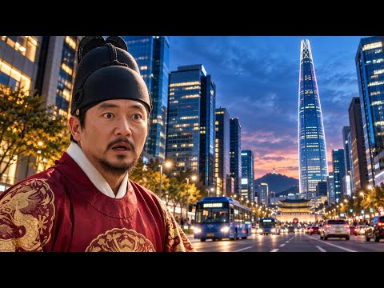
- 설명 앞부분: “말도 없이 수레가 달리는구나.” 세종대왕을 2026년 대한민국에 모셔왔습니다. 거리를 채운 자동차부터 손안의 스마트폰까지. 조선의 임금에게는 우리가 당연하게 여기는 일상마저 놀라움의 연속입니다. 여러분이라면 세종대왕께 현대의 무엇을 가장 먼저 보여드리고 싶나요? 댓글로 남겨주세요. ※ 본 영상은 AI를 활용해 제작한 시간 여행 창작 영화입니다. 역사적 인물을 소재로 하며, 대사와 사건은 상상으로 구성했습니다. 🎵 음악 Water Prelude Enchanted Valley Touching Moments Four - Melody …
- 같은 채널 평소 대비 ×10.2 (채널 최근 롱폼 중앙값 140,878회) · 평소 영상: 조선에 냉동만두를 팔았더니 벌어진 일 (163,546회) / 단종에게 챗GPT를 줬더니, 삼촌보다 먼저 움직였다 (118,209회)
- 대본 없음 (설명) — 음성인식이 끝나면 도입부·흐름이 들어감
- 댓글 1,049/1,301: 좋은 점 — 영상 6 · 감사·응원 66 · 더 알고 싶은 것 21 · 아쉬운 점 — 영상 8 · 반박·불만 — 의견 다름 5 · 정치·사회 28 · 경험 공유 31 · 구독·다음 기대 1
  - 좋은 점 — 영상 👍0 “이렇게 보니까 우리가 어마어마한 미래에 살고 있다는게 새삼스럽게 와닿네요! 재미있게 잘 봤습니다”
  - 좋은 점 — 영상 👍0 “제가 윤동주 시인님을 제일 좋아하는데 윤동주 시인님 한 번 모셔와 주세요. 영상 너무 유익하고 재밌어요”
  - 감사·응원 👍406 “폐하 한글 만들어 주셔서 감사합니다 폐하께서 태어나신 5월 15일은 스승의 날이 됩니다 그리고 10월9일 한글날이 됩니다”
  - 감사·응원 👍377 “본인이 만든 글자를 몇백년이 지나도 후대가 쓰고있고 대한민국 국민모두가 세종대왕님께 감사함을 느끼고 있다는걸 알면 얼마나 기쁘실까 그리고 자신의 아들이 손자를 죽였다는것을 알면 얼마나 슬프실지.....”
  - 더 알고 싶은 것 👍4 “100년뒤 미래는 어떨지 궁금하다....”
  - 더 알고 싶은 것 👍3 “제가 지금껏 본 AI 영상 중, 이번 세종대왕편이 가장 감동스러웠어요. 600년 전 조선에서 온 세종대왕이 2026년의 서울(한양)을 본다면 아무리 천재적인 능력자라도 모든 게 놀랄 만한 물건들이겠지요. 세종대왕의 눈으로 본 현대 문명이 얼마나 대단한지 새삼 생각하게…”
  - 아쉬운 점 — 영상 👍4 “2:19 세종대왕님 어깨 끼일뻔한 사고날뻔 😢”
  - 아쉬운 점 — 영상 👍1 “나랏말싸미 듕귁에 달아문자와로 서르 사맛디 아니할쎄 이런 전차로 어린 백셩이 니르고져 홇베이셔도 마참네 제 뜨들 시러펴디 몯핧 노미하니아 내 이랄 윙하야 어엿비너겨 새로 스믈 여듫 짜랄 맹가노니사람마다 해여 수비니겨 날로 쑤메 뻔한킈 하고져 할따라미니라”
  - 반박·불만 — 의견 다름 👍2 “노비종모법 으로 노비 확산 원흉 노비 대왕 세종대왕 을 추앙 을 하다니 어이없음 역사 공부 를 다시 해야.”
  - 반박·불만 — 의견 다름 👍0 “우와 탐구할 것 천지다, 우히히. 하셨을 것 같다ㅋ 성삼문, 신숙주 다 필요없어. 쳇지피티, 제미나이 돌려. 얘들은 늙었다고 물러난단 말도 안할 거고, 사고도 안칠거고ㅋㅋ”
  - 정치·사회 👍1,523 “나라가 왜 반으로 쪼개졌어 샤갈 하고 우실 듯 ㅠㅠ”
  - 정치·사회 👍203 “솔직히 세종대왕이 원하는 나라가 지금의 모습일듯”
  - 경험 공유 👍42 “편식하지 마세요. 저도 시금치 정도는 먹습니다...”
  - 경험 공유 👍21 “4~5살 시기의 세손 홍위(훗날 단종)에게 미래에서 가져온 과자를 쥐어주시는 점과 수양대군이라는 군호를 보고 누구인지 바로 납득하는 부분과...미래 세계를 바라보며 신기해 하면서도 어딘지 쓸쓸해 보이시는 대왕님의 표정으로 보아 정황상 소헌왕후가 돌아가신 직후 시기의 …”
  - 구독·다음 기대 👍0 “그래 이렇게 찜찜하게 안끊으면 챙겨볼 맛 나지”

### 82. 당신을 놀라게 할 희귀하고 놀라운 역사적 사진 모음!

- https://www.youtube.com/watch?v=fUvbh_dyakA · 사진으로 보는 역사 · 구독자 8,050 · 조회수 215,607 (×26.8, 하루 13,110.5) · 좋아요 2,031 (0.9%) · 31.9분 · 2026-10-11 · 주제 묶음 1. 역사 일반·이야기 · 형식 정보·해설 (그 밖) · 폴더 `W_fUvbh_dyakA` (웹 승인)
- 썸네일: 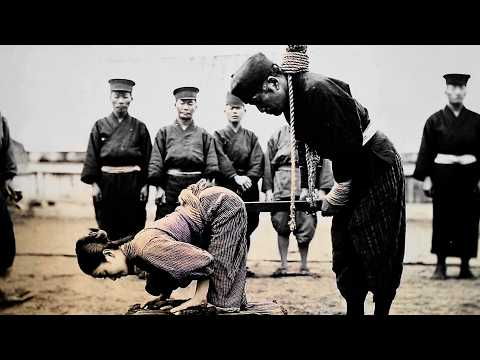
- 설명 앞부분: 시청해 주셔서 감사합니다. 📜 사진으로 보는 역사**는 한 장의 사진 속에 담긴 시대의 흔적과 사람들의 이야기를 통해 과거를 새롭게 발견하는 역사 다큐멘터리 채널입니다. 모든 영상은 역사 자료 조사, 사실관계 검증, 세심한 기록물 분석 및 신중한 디지털 복원 작업을 바탕으로 제작됩니다. 역사 사진과 원본 문서, 각종 기록 자료를 면밀히 조사하여 가능한 한 정확하게 촬영 장소와 연도, 역사적 사건, 그리고 시대를 살아간 인물들을 밝혀내고자 합니다. 시간의 흐름 속에서 희미해진 사진의 세부적인 흔적은 디지털 복원 기술을 통해 조심스럽…
- 같은 채널 평소 대비 ×2.9 (채널 최근 롱폼 중앙값 74,572회) · 평소 영상: 90 희귀한 레트로 사진, 대중의 눈에서 숨겨진 (74,572회) / 80 정말 인상 깊은 잘 알려지지 않은 역사 사진 (76,232회)
- 대본 없음 (설명) — 음성인식이 끝나면 도입부·흐름이 들어감
- 댓글 14/14: 좋은 점 — 영상 1 · 감사·응원 1 · 더 알고 싶은 것 2 · 아쉬운 점 — 영상 2 · 반박·불만 — 의견 다름 0 · 정치·사회 0 · 경험 공유 0 · 구독·다음 기대 0
  - 좋은 점 — 영상 👍2 “열심히 일하시고 귀한 영상 올려주셔서 감사합니다. 자주 찾아올께요. 건강하시고 더 좋은 영상 기다릴께요.❤🎉”
  - 감사·응원 👍2 “열심히 일하시고 귀한 영상 올려주셔서 감사합니다. 자주 찾아올께요. 건강하시고 더 좋은 영상 기다릴께요.❤🎉”
  - 더 알고 싶은 것 👍22 “썸네일 사진은 어디에 있나요?”
  - 더 알고 싶은 것 👍10 “썸네일 사진이 궁금해서 끝까지 봤다. 내 두 번 다시 네놈의 동영상을 보지 않을 것이다. 엄지 거꾸로 콱 찍고 간다.”
  - 아쉬운 점 — 영상 👍0 “썸네일 사진은 낚시였다. 손모가지 꺼꾸로 한방.”
  - 아쉬운 점 — 영상 👍0 “썸네일 낚시영상 ㄱHㅈ같네....”

### 83. 이집트인이 머리를 민 이유

- https://www.youtube.com/watch?v=Sj1WbyliNRA · 역사얘기 · 구독자 1,970 · 조회수 74,388 (×37.8, 하루 3,204.8) · 좋아요 121 (0.2%) · 16.1분 · 2026-10-05 · 주제 묶음 8. 문명·고고학 · 형식 정보·해설 (그 밖) · 폴더 `W_Sj1WbyliNRA` (웹 승인)
- 썸네일: 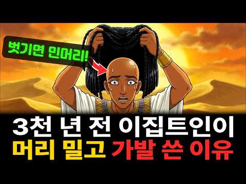
- 설명 앞부분: 한낮 45도의 사막에서, 2천 년 넘게 머리를 밀고 그 위에 다시 가발을 쓰고 다닌 사람들이 있습니다. 더워서 밀었다면 맨머리로 다니면 되고, 덮을 거였다면 밀 필요가 없었을 텐데 — 이집트인들은 왜 밀고, 다시 덮었을까요? 5천 년 된 서캐, 3,700년 전 빗에 새겨진 '이 퇴치' 기도문, 녹지 않는 밀랍 가발, 2019년 무덤에서 처음 나온 머리 위 원뿔까지. 여러분이라면 45도의 사막에서 가발을 쓰시겠습니까, 맨머리로 버티시겠습니까? 댓글로 들려주세요. 이 영상은 역사 기록과 학술 자료를 바탕으로 제작되었습니다. 가설과 확…
- 같은 채널 평소 대비 ×93.8 (채널 최근 롱폼 중앙값 793회) · 평소 영상: 세종이 인정한 천재 김시습 이야기 (793회) / 133척 앞에서 12척이 물러났다… 명량, 바다에 홀로 남은 이순신의 대장선 (780회)
- 대본 없음 (설명) — 음성인식이 끝나면 도입부·흐름이 들어감
- 댓글 10/10: 좋은 점 — 영상 0 · 감사·응원 0 · 더 알고 싶은 것 0 · 아쉬운 점 — 영상 0 · 반박·불만 — 의견 다름 0 · 정치·사회 0 · 경험 공유 0 · 구독·다음 기대 0

### 84. 선풍기도 없던 그 시절, 우리 조상들은 삼복더위를 어떻게 버텼을까?

- https://www.youtube.com/watch?v=HlQtkDG94ZM · 지구본클럽 · 구독자 1,880 · 조회수 373,319 (×198.6, 하루 3,051.0) · 좋아요 1,707 (0.5%) · 21.8분 · 2026-07-11 · 주제 묶음 1. 역사 일반·이야기 · 형식 정보·해설 (그 밖) · 폴더 `W_HlQtkDG94ZM` (웹 승인)
- 썸네일: 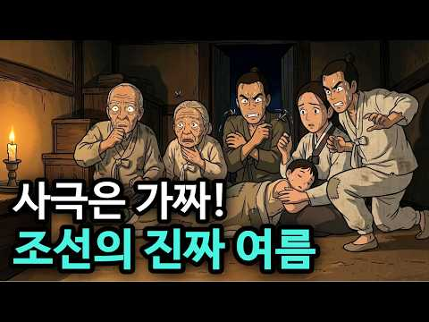
- 설명 앞부분: 모기장 밖에서 들려오는 모기 소리에 잠 못 이루시던 여름밤, 한 번쯤 겪어 보셨지요? 그런데 이백 년 전, 조선 최고의 천재 실학자 다산 정약용 선생도 이 모기 소리 앞에서는 붓을 들고 하소연을 했다고 합니다. 에어컨은커녕 선풍기 한 대, 시원한 얼음 한 조각도 귀했던 조선시대. 💦 그 시절의 여름은 그저 덥기만 한 것이 아니라, 자칫하면 목숨을 잃을 수도 있는 무서운 계절이었습니다. 에어컨 없이도 뙤약볕을 지혜롭게 이겨낸 우리 선조들의 이야기. 그 뭉클하고도 놀라운 여름 생존기를 지금 영상으로 만나보시지요. 👀✨ 우물가에서 등목…
- 같은 채널 평소 대비 ×160.6 (채널 최근 롱폼 중앙값 2,324회) · 평소 영상: 조선 인구 100만 명이 사라진 최악의 흉년과 기막힌 생존 식단 ∣ '찢어지게 가난하다'… (2,324회) / "왕의 목을 지켜라." 정조가 숨겨둔 조선 제일 검의 정체 (1,316회)
- 대본 없음 (설명) — 음성인식이 끝나면 도입부·흐름이 들어감
- 댓글 169/180: 좋은 점 — 영상 2 · 감사·응원 0 · 더 알고 싶은 것 0 · 아쉬운 점 — 영상 1 · 반박·불만 — 의견 다름 1 · 정치·사회 2 · 경험 공유 7 · 구독·다음 기대 3
  - 좋은 점 — 영상 👍33 “수색대대 최전방 부대 근무중 말라리아 걸려봤음. 저게 모기 몰린다고 바로 걸리는게 아님. 잠복기가 3개월~6개월인데 여름에 물린게 겨울에 증상발병이 되서 추운겨울에 오한발열이 생깁니다. 열이40도가 넘어 가는데 한겨울 홀닥 벗겨놓고 알코올로 거즈마사지합니다. 대대 목…”
  - 좋은 점 — 영상 👍1 “너무 좋은 내용이네요... 내일 우리딸 보여줘야 겠어요^^”
  - 아쉬운 점 — 영상 👍5 “퀄리티가 정말 좋은데요? 시간을 조금 줄이더라도 반복되는 내용이 없도록만 한다면 앞으로 엄청 발전할 수 있을 것 같습니다 구독 꾸욱 하고 갑니다~!”
  - 반박·불만 — 의견 다름 👍10 “ㅋㅋㅋ 저는 귓가에서 모기가 왱왱 거려서 못자다가 또 왱하길래 손을 휙 휘둘렀는데 글쎄 모기가 손바람에 밀려 귓속으로 들어간거예요. 밤새 귓속에서 왱왱 간질간질 이거 귓속을 물면 가려워 어쩌지? 하고 밤새 못자고 아침에 일찍 이비인후과 열기 전에 오픈런 간호사님 병원…”
  - 정치·사회 👍1 “이런걸 보면 조선의 계급체계(왕조)는 진작에 사라지는것이 맞았다 단 지금같은 대통령 체제가 없음 혼란이기도 했을것이고 아이러니 하다 없애는건 맞는데 우매한 사람들의 본능과 욕심을 억제할 방법또한 없기에 함부로 없앨수도 없고 큰변화가 일어나야만 바뀔수 있다니 안타깝네”
  - 경험 공유 👍73 “80년도에도 시골 가면 모깃불 태우고 연기로 모기 쫓음.그래도 모기가 백열등 켜고 있는 온돌방 들어오고 엄마 아빠는 우리들 모기 쐬지 못하게 모기장 켜고 시원하게 문열고 숙면 취함.지금 아무리 에어컨 신나게 켜도 항상 모깃불향에 그을린 냄새에 살포시 자던 국민학교 5…”
  - 경험 공유 👍3 “등목을 자주 했었던 기억이 남 요즘은 샤워하고 등목은 거의 안 하는듯”
  - 구독·다음 기대 👍8 “어허 크게 될 채널일세. 내 먼저 구독하고 보겠네”
  - 구독·다음 기대 👍7 “될성싶은 채널을 구독하고 갑니다”

### 85. 사극은 다 거짓말! 술집이 아니었던 조선 주막의 진짜 얼굴 ∣ 조선의 편의점 주막, 국밥 한 그릇에 잠은 왜 공짜였을까? ∣ 한국역사 조선이야기

- https://www.youtube.com/watch?v=1E2leMJjfqM · 신기한 역사 · 구독자 2,060 · 조회수 84,909 (×41.2, 하루 3,256.8) · 좋아요 149 (0.2%) · 18.4분 · 2026-10-02 · 주제 묶음 1. 역사 일반·이야기 · 형식 정보·해설 (그 밖) · 폴더 `W_1E2leMJjfqM` (웹 승인)
- 썸네일: 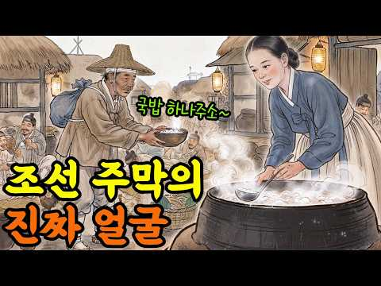
- 설명 앞부분: 우리가 사극에서 본 정겨운 술집, 주막. 그런데 주막은 술보다 밥을, 밥보다 잠자리를 팔던 곳이었습니다. 돈 한 푼 받지 않고 나그네를 재워 준 공짜 잠의 정체, 국밥 한 그릇 값, 그리고 돈까지 맡아 준 조선 주막의 숨은 얼굴을 따라가 봅니다. 이 영상에서 다루는 내용 술집이던 주막이 '밥·잠'을 파는 곳으로 바뀐 이유 (대동법·장시·역원의 쇠퇴) 황윤석의 일기 '이재난고'에 적힌 국밥 한 그릇 값과 그 시절 물가 밥값만 내면 잠은 공짜였던 진짜 셈법과 흙바닥 봉놋방의 혼숙 양반의 '봉제사 접빈객' 전통이 여관업을 가로막은 역설…
- 같은 채널 평소 대비 ×48.0 (채널 최근 롱폼 중앙값 1,770회) · 평소 영상: 문정왕후, 왕의 무덤을 통째로 옮기고도 남편 곁에 눕지 못한 이유 ∣ 왕의 무덤을 통째로… (2,016회) / 철로 세상과 거래하던 부자 나라, 가야는 왜 가장 먼저 지워졌을까? ∣ 한국사 ∣ 삼국 … (1,525회)
- 대본 없음 (설명) — 음성인식이 끝나면 도입부·흐름이 들어감
- 댓글 13/13: 좋은 점 — 영상 0 · 감사·응원 1 · 더 알고 싶은 것 0 · 아쉬운 점 — 영상 0 · 반박·불만 — 의견 다름 0 · 정치·사회 0 · 경험 공유 1 · 구독·다음 기대 0
  - 감사·응원 👍3 “세계사에만 관심이 있었는데 국사에 재미를 주게 되어서 감사합니다~^^”
  - 경험 공유 👍0 “나도 오늘 하룻밤은 마음놓고 쉬어보자~~”

### 86. 《불교 역사》 인도의 괴짜 승려 달마는 누구인가? l 역사 인물 l 고전

- https://www.youtube.com/watch?v=N4v1knO4AEw ·  역사 산책: 동양편 · 구독자 2,770 · 조회수 319,472 (×115.3, 하루 4,247.0) · 좋아요 2,254 (0.7%) · 23.2분 · 2026-08-03 · 주제 묶음 1. 역사 일반·이야기 · 형식 정보·해설 (그 밖) · 폴더 `W_N4v1knO4AEw` (웹 승인)
- 썸네일: 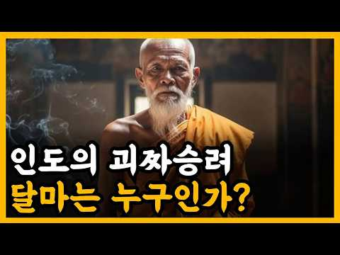
- 같은 채널 평소 대비 ×49.7 (채널 최근 롱폼 중앙값 6,426회) · 평소 영상: 《삼국지》 유비는 왜 동문 공손찬의 등에 칼을 꽂았을까? l 역사 인물 l 고전 (7,251회) / 《삼국지》 조조의 손자 조예, 위나라를 파멸로 몰았던 이유는? l 역사 인물 l 고전 (5,600회)
- 대본 없음 (없음) — 음성인식이 끝나면 도입부·흐름이 들어감
- 댓글 126/126: 좋은 점 — 영상 0 · 감사·응원 3 · 더 알고 싶은 것 1 · 아쉬운 점 — 영상 1 · 반박·불만 — 의견 다름 1 · 정치·사회 0 · 경험 공유 0 · 구독·다음 기대 0
  - 감사·응원 👍0 “감사합니다!”
  - 감사·응원 👍0 “고맙습니다.”
  - 더 알고 싶은 것 👍1 “그게 가능한가요? 그 당시 평균수명이 몇세인데 출가를 하고 반야다라밑에서 40년을 수행하고 67년을 기다리고 3년에 걸쳐 중국에 가고 9년 면벽수행을 하고..... 당신같으면 가능한가요? 솔방울로 수류탄 만드는 수준이잖아요? 혹시 죽었을때 방광현상은 안 일어 났고 공…”
  - 아쉬운 점 — 영상 👍6 “이런 영상 참 좋아요, ai는 아니시죠? 제발 ai 음성으로 하지 말아주세요”
  - 반박·불만 — 의견 다름 👍0 “실존 인물이 아닙니다.”

### 87. 세키가하라 뒤에도 살아남은 도요토미 가문은 왜 15년 만에 무너졌나? ∣ 지도로 보는 임진왜란 그 후 3편

- https://www.youtube.com/watch?v=DohihpZrvjE · Terra Scripta · 구독자 2,320 · 조회수 88,469 (×38.1, 하루 3,540.1) · 좋아요 192 (0.2%) · 15.8분 · 2026-10-16 · 주제 묶음 3. 조선 · 형식 애니메이션·지도 · 폴더 `W_DohihpZrvjE` (웹 승인)
- 썸네일: 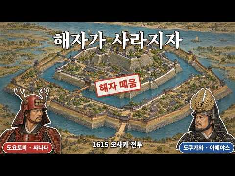
- 챕터: 0:00 질문 — 덴노지의 돌격 · 0:39 오사카성에 남은 도요토미 · 1:27 쇼군 자리는 도쿠가와가 잇는다 · 2:11 니조성 회견과 잇따른 죽음 · 3:11 종에 새긴 여덟 글자 · 4:22 쫓겨난 가로와 모여든 낭인 · 5:02 다시 만난 임진왜란의 장수들 · 6:07 겨울 전투 — 사나다마루와 세 겹 해자 · 7:41 대포와 강화 — 해자를 메우다 · 9:07 여름 전투 — 안개 속 도묘지 · 10:47 같은 날, 야오와 와카에 · 11:40 덴노지 — 이에야스 본진으로 · 13:05 오사카성이 불탄 날 · 14:11 끝난 전쟁, 그리고 조선 · 15:24 엔딩
- 설명 앞부분: 1615년 6월, 오사카성 남쪽 덴노지 벌판에서 사나다 노부시게의 붉은 군대가 도쿠가와 이에야스의 본진으로 돌격했습니다. 세키가하라에서 이에야스가 이긴 지 15년, 도요토미 가문은 아직 오사카성에 남아 있었습니다. 세키가하라 뒤에도 살아남은 도요토미 가문은 왜 15년 만에 무너졌을까요? 니조성 회견과 가토 기요마사의 죽음, 종에 새긴 여덟 글자, 다시 만난 임진왜란의 장수들, 겨울 전투의 사나다마루와 겹겹의 해자, 해자를 메운 강화, 여름 전투의 도묘지·야오·와카에·덴노지, 그리고 오사카성이 불탄 날까지 지도 위에서 따라갑니다. …
- 같은 채널 평소 대비 ×8.4 (채널 최근 롱폼 중앙값 10,475회) · 평소 영상: 원수가 된 두 나라, 에도 막부와 조선은 어떻게 다시 국교를 열었나? ∣ 지도로 보는 임… (10,475회) / 임진왜란 뒤 조선은 왜 원수의 나라에 200년 동안 사신을 보냈나? ∣ 지도로 보는 임진… (11,364회)
- 대본 없음 (설명) — 음성인식이 끝나면 도입부·흐름이 들어감
- 댓글 23/30: 좋은 점 — 영상 1 · 감사·응원 0 · 더 알고 싶은 것 0 · 아쉬운 점 — 영상 1 · 반박·불만 — 의견 다름 0 · 정치·사회 1 · 경험 공유 1 · 구독·다음 기대 0
  - 좋은 점 — 영상 👍1 “목소리가 참 듣기좋고 집중이 잘 됩니다.”
  - 아쉬운 점 — 영상 👍5 “아니 근데 조약 이후로도 저렇게 될거 뻔한데 무슨 생각으로 해자를 자기손으로 메우냐 하다못해 그럴거면 대가리 박고 그냥 바닥에 기던가 이건 뭐 결사항전도 아니고 백기든것도 아니고 애매하게 굴다가 다 망했네”
  - 정치·사회 👍0 “지금 우리나라에서 벌어지고 있는 일이지 군사분계선에 지뢰 깔아놓으면서 계속 좁혀오는데도 대응 제대로 못하는 진보좌파매국노들”
  - 경험 공유 👍2 “남의 나라를 무단 침략해 수많은 조선인들을 학살하고 납치해간 살인귀 히데요시 결국 천벌을 받아 그 자손까지 완전 멸족 당하는군,, 아주 깨소금이다. 당한 조선들에게는 통쾌한 복수극 같다. 저도 곧 뒤질것을 모르는게 인간의 어리석음이어라”

### 88. 조선에 편의점을 열었더니 벌어진 일

- https://www.youtube.com/watch?v=t68eLyT7a-s · 세계관오류 · 구독자 22,000 · 조회수 1,472,492 (×66.9, 하루 33,024.8) · 좋아요 4,214 (0.3%) · 4.1분 · 2026-09-27 · 주제 묶음 3. 조선 · 형식 정보·해설 (그 밖) · 폴더 `W_t68eLyT7a-s` (웹 승인)
- 썸네일: 
- 설명 앞부분: 조선 한복판에 편의점을 열었다. 평생 처음 맛보는 컵라면, 밤에도 환하게 빛나는 가게. 낯선 편의점을 기웃거리던 조선 사람들이 하나둘 손님이 되고, 어느새 가게 앞에는 긴 줄이 늘어서기 시작하는데… 조선에서 시작한 편의점 장사, 과연 어디까지 잘될까? 본 영상은 AI를 활용해 제작한 창작 이야기입니다.
- 같은 채널 평소 대비 ×10.5 (채널 최근 롱폼 중앙값 140,878회) · 평소 영상: 조선에 냉동만두를 팔았더니 벌어진 일 (163,546회) / 단종에게 챗GPT를 줬더니, 삼촌보다 먼저 움직였다 (118,209회)
- 대본 없음 (설명) — 음성인식이 끝나면 도입부·흐름이 들어감
- 댓글 350/423: 좋은 점 — 영상 0 · 감사·응원 2 · 더 알고 싶은 것 4 · 아쉬운 점 — 영상 2 · 반박·불만 — 의견 다름 1 · 정치·사회 2 · 경험 공유 6 · 구독·다음 기대 1
  - 감사·응원 👍14 “오늘 처음 봤는데 너무 잘 만들고 내용도 재미있으면서 신선해서 계속 처음부터 돌려보는중. 감사!”
  - 감사·응원 👍2 “제가 처음 댓글 달았을때가 고작 3일전이고 그때 구독자가 700명정도로 기억하는데 벌써 1200명 돌파시네요! 구독자가 나날이 늘고있는 모습을 보니 초창기 팬(?)으로서 뿌듯하면서도 자랑스럽습니다! 영상 퀄이 워낙 좋고 내용도 참신해서 노력에 대한 결과가 나오고 있으…”
  - 더 알고 싶은 것 👍5 “대형마트, 약국, 화장품가게, 서양식/양한방 병원이 조선에 열었다면 어떻게 되었을까요?”
  - 더 알고 싶은 것 👍1 “옥의 티 발견! 2:29 그들은 밖에 있는데 어떻게... 라면을...? 3:07 밖에는...ㅎㄷㄱㅁ이...ㅎㅎ 앞으로 계속해서 만들어주세요 참신하고 재밌어요”
  - 아쉬운 점 — 영상 👍0 “저시대 사람들은 라면 처음 먹었을때 맵게느껴졌을텐데 디테일이 아쉽네요”
  - 아쉬운 점 — 영상 👍0 “그릇을 들고 먹는 문화 햇반그릇은 나또그릇 같고 동전을 트레이에 놓는 것도. 엄청 잘만들어졌으나 아쉬움도 ㅎ”
  - 반박·불만 — 의견 다름 👍0 “좀이 아닌데ㅋㅋ 2:09”
  - 정치·사회 👍1 “1.편의점에 냄시와 벌레로 가득 차서 ㅈ댐 2.조선시대 사람들 그 날 저녁부터 배 아프고 설사하고 난리나기 시작, 몇 달만 지나면 각종 전염병,위생으로 나라가 휘청 3.그 전에 관군에게 화살 맞고 디짐 4.그 전에 편의점 건물과 사람이 시공간을 뛰어 넘었는데 전기가 …”
  - 정치·사회 👍0 “일단 현실적으로 나라가 가계 가만 안두겠지만 이건 재미로 만든 거니 현실예기 삼가 부탁”
  - 경험 공유 👍2 “제가 처음 댓글 달았을때가 고작 3일전이고 그때 구독자가 700명정도로 기억하는데 벌써 1200명 돌파시네요! 구독자가 나날이 늘고있는 모습을 보니 초창기 팬(?)으로서 뿌듯하면서도 자랑스럽습니다! 영상 퀄이 워낙 좋고 내용도 참신해서 노력에 대한 결과가 나오고 있으…”
  - 경험 공유 👍1 “내가 작가면 지금 당장 이거 단편 드라마 로 만든다 ㅋㅋ”
  - 구독·다음 기대 👍2 “왜 빠져서 보게 되는 ㅎㅎㅎㅎㅎㅎㅎ 구독하고 갑니다”

### 89. [친일파와 식민지 근대화론] 일제가 조선을 먹여 살렸다는 기막힌 헛소리 팩트체크 포함 1시간 몰아보기

- https://www.youtube.com/watch?v=LwjbMRyBWZ8 · 기웃기웃 김기욱 · 구독자 1,740 · 조회수 200,364 (×115.2, 하루 2,498.5) · 좋아요 1,527 (0.8%) · 62.7분 · 2026-08-22 · 주제 묶음 3. 조선 · 형식 수면·낭독 (잠잘 때 듣는) · 폴더 `W_LwjbMRyBWZ8` (웹 승인)
- 썸네일: 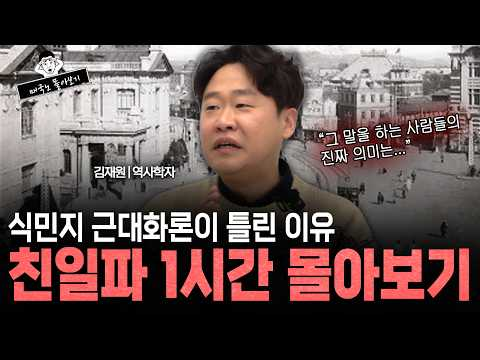
- 설명 앞부분: 일본이 조선을 근대화시켰다? 식민지 근대화론의 소름 돋는 모순과 친일파들이 나라를 팔아먹는 과정을 1시간으로 정리했습니다. 우리가 교과서에서 배우지 못한 아픈 역사, 이완용과 친일파들이 어떻게 권력을 탐하고 나라를 넘겼는지 그 비하인드 스토리를 파헤칩니다.
- 같은 채널 평소 대비 ×160.5 (채널 최근 롱폼 중앙값 1,248회) · 평소 영상: 추석특집 정일영 교수의 마라맛 입담 1시간 총집편! (1,573회) / 제주연인 사건으로 보는 대한민국 교제범죄의 현실 ep.01 ∣ 허민숙 입법조사관 X 김기욱 (923회)
- 대본 없음 (설명) — 음성인식이 끝나면 도입부·흐름이 들어감
- 댓글 1,036/1,076: 좋은 점 — 영상 8 · 감사·응원 15 · 더 알고 싶은 것 11 · 아쉬운 점 — 영상 3 · 반박·불만 — 의견 다름 42 · 정치·사회 120 · 경험 공유 43 · 구독·다음 기대 0
  - 좋은 점 — 영상 👍14 “재원쌤꺼는 그냥 봐야지 머리에 쏙쏙 들어옴”
  - 좋은 점 — 영상 👍9 “민초가 알기쉽게 설명 잘 해주셨습니다❤ 짝짝짝~~^감사”
  - 감사·응원 👍9 “민초가 알기쉽게 설명 잘 해주셨습니다❤ 짝짝짝~~^감사”
  - 감사·응원 👍2 “어느날 집에 도둑놈이 도둑질을 하려고 사다리를 가져다 와서 도둑질을 하고는 사다리를 놔두고 갔습니다. 그렇다면 일반적인 사람으로써는 '도둑놈이 도둑질을 했다' 라고 하지 '도둑놈이 사다리를 놔두고 가서 감사하다' 라고하는 하지 않습니다.”
  - 더 알고 싶은 것 👍2 “일제 이전의 조선인의 삶이랑 비교를 해보면 인구 50%의 노비의 차별은 어떻게 생각하시는지 ㅋㅋ.. 윤서인씨랑 토론을 부탁합니다”
  - 더 알고 싶은 것 👍1 “역사에는 객관적이라는 개념이 적용될수없다고 생각합니다 현재를 살아가는 이들이 해석하는대로 역사는 쓰여질수밖에 없겠지요.. 그래서 더욱더 바른 잣대를 가지고 봐라봐야 하겠습니다 최대한쉽게 선생님이 설명해주시니 참 좋네요 .. 친일파 청산문제를 조금더 다뤄주시면 감사하겠…”
  - 아쉬운 점 — 영상 👍5 “김재원 곡학아세란 이야기를 아시는지 일제 36년간 수탈만 당했다면 조선인은 바보냐 빼았길게 뻔한데 일하게 조선시대는 경제성장률이 마이너스잖아 한말 홍경래의난 이재수의난 진주민란 동학난은 먼데 살기 좋았다면 왜 일어났을까 동학을 진압하기 위해 외세를 끌어들인게 누군데 …”
  - 아쉬운 점 — 영상 👍4 “역사학자라면 중요한게 이완용보다 조선사편수회 이병도 신석호(스승 쓰다소키치 이마니시류) 매국식민사관 언급 청산은 안하나?광복후 친일청산안한 무능한 이승만정부, 양심있으면 진실만 말하고 헛소리말고 식민사관이나 언급하고 양심발언하자! 한사군 위치가 아직도 반도고?살수대첩…”
  - 반박·불만 — 의견 다름 👍8 “지겹다 친일파논란 일본하고 경제공동체하고 중국의 초한전에 대비해야하는데 아직도 이런 친중사대적인 마인드를 가진자가 선동을 하고있으니 중국이 착취한거는 얘기도 못하는것들이”
  - 반박·불만 — 의견 다름 👍4 “역사학자라면 중요한게 이완용보다 조선사편수회 이병도 신석호(스승 쓰다소키치 이마니시류) 매국식민사관 언급 청산은 안하나?광복후 친일청산안한 무능한 이승만정부, 양심있으면 진실만 말하고 헛소리말고 식민사관이나 언급하고 양심발언하자! 한사군 위치가 아직도 반도고?살수대첩…”
  - 정치·사회 👍21 “친일파 후손 국회 정치권에 엄청많잖아 노무현때 열었다가 닫았지”
  - 정치·사회 👍16 “이게 그당시의 왕조시스템을 감안 해야함. 이완용은 결정권자가 아님. 예를 들어 북조선 김정일이 화페개혁을 단행 북인민의 반감을 삼. 김정일이 밑에놈을 내밀며 책임을 물었고, 인민들은 찢어죽이자며 분노함. 연좌제 가동 수십명 처형으로 마무리 됨. 을사조약 당일날, 신문…”
  - 경험 공유 👍207 “당시 조선 상황에서 중일러 가운데 어느 한 나라에 먹힐 수밖에 없었고 그래서 일본에 먹힌건데 뭐 잘못됐냐는 주장이 있는데 그 말은 강도살인범이 셋이 있었는데 어차피 넌 그 강도들 중 한 넘한테 찔려죽을 운명이었고 그래서 내가 널 찔러죽였는데 내가 무슨 죄야? 라는 것…”
  - 경험 공유 👍16 “이게 그당시의 왕조시스템을 감안 해야함. 이완용은 결정권자가 아님. 예를 들어 북조선 김정일이 화페개혁을 단행 북인민의 반감을 삼. 김정일이 밑에놈을 내밀며 책임을 물었고, 인민들은 찢어죽이자며 분노함. 연좌제 가동 수십명 처형으로 마무리 됨. 을사조약 당일날, 신문…”

### 90. 조선의 왕들이 단명한 이유, 매일 먹던 '이것'이 독이었던 충격적인 사실ㅣ조선왕평균수명46세

- https://www.youtube.com/watch?v=aDk8BnSRa5o · 역사MSG · 구독자 2,520 · 조회수 550,997 (×218.7, 하루 3,584.3) · 좋아요 4,923 (0.9%) · 25.3분 · 2026-06-09 · 주제 묶음 3. 조선 · 형식 정보·해설 (그 밖) · 폴더 `W_aDk8BnSRa5o` (웹 승인)
- 썸네일: 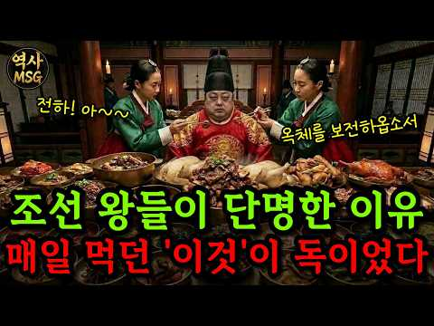
- 설명 앞부분: 🫅조선의 왕은 누구보다 잘 먹고, 최고의 의료와 보살핌을 받았습니다. 그런데 평균 사망 나이는 고작 46세. 같은 궁궐에서 소박하게 먹고 뛰어다닌 내시는 70세까지 살았는데 말이죠. 24년 차이, 대체 이유가 무엇일까요? 🍚세종의 식습관부터 정조의 종기, 영조의 83세 장수 비결까지 매일 먹던 밥상, 수라상이라는 시스템이 왕의 몸을 어떻게 망가뜨렸는지, 실록 기록으로 하나씩 풀어봤습니다. 🕛타임라인 [조선왕조실록 (朝鮮王朝實錄)] 세종실록 세종 30년 세조실록 문종실록 효종실록 정조실록 성종실록 [승정원일기 (承政院日記)] [의학…
- 같은 채널 평소 대비 ×1,405.6 (채널 최근 롱폼 중앙값 392회) · 평소 영상: 불멸의 여신을 버리고 늙은 아내에게 돌아간 남자, 오디세우스 ∣ 오디세이아 (392회) / '15분' 틀렸다고 곤장 맞은 조선 기상청 천문학자, 그 뒤에 벌어진 일 ∣ 세종의 시간… (374회)
- 대본 없음 (설명) — 음성인식이 끝나면 도입부·흐름이 들어감
- 댓글 593/593: 좋은 점 — 영상 5 · 감사·응원 2 · 더 알고 싶은 것 4 · 아쉬운 점 — 영상 4 · 반박·불만 — 의견 다름 8 · 정치·사회 5 · 경험 공유 6 · 구독·다음 기대 0
  - 좋은 점 — 영상 👍1 “아주 좋은 내용인 것 같네요.”
  - 좋은 점 — 영상 👍0 “소식이 장수하는데 도움되는건 맞음”
  - 감사·응원 👍4 “감사합니다 ㆍ귀농해서80세이나에 텃밭농부로삽니다 아파트생활62세에치우고 시골생활ㆍ건강비결입니다ㆍ호미ᆢ 텃밭살길입니다ᆢ”
  - 감사·응원 👍0 “미국 동남부며 성경적 삶의 방향으로 살고있습니다. 시아버지가 90세로 키는 약 168cm 에 55kg 이 채 안돼세요. 평생 그 몸무게 유지되시는게, 식사량 자체가 소식에 부지런하셨습니다. 왜 소식이 답인가? 를 보니 원래 우리몸이 그리 많은 열량을 필요로 하지않는답…”
  - 더 알고 싶은 것 👍41 “왕이 100보 이상 걸을 일이 있을까요? 가마타고 댕기지~ 그리고 대부분 종기로 단명했는데, 옷을 잔뜩 껴입고 온종일 앉아있고, 결정적으로 잘 안 씻어서 그렇습니다. 비누가 수십억의 인류를 살렸다는 말이 있죠~”
  - 아쉬운 점 — 영상 👍0 “무지지루하네서론이너무길어”
  - 아쉬운 점 — 영상 👍0 “어영부영 장황 ... 중언부언 ... 조회수 낚시 ...”
  - 반박·불만 — 의견 다름 👍2 “일찍죽은 이유는 딱 한가지다. 목욕을 안하니까 일찍 죽은거다. 우리도 60.70년대 한달에 한번 대중 목욕탕가서 목욕하던시절 등에 종기가 나 '이명래고약' 붙이고살던 시절이 있었다. 조선시대에는 수십년 목욕을 안하니 늘 종기에 죽었지.. 저 종기가 알콜 몃방울이면 낫…”
  - 반박·불만 — 의견 다름 👍1 “조선시대에 항생제가 없었던 것이 아닙니다. 약초나 침으로 균을 잡았는데 균종에 적합한 약재를 찾지 못한거지요.”
  - 정치·사회 👍0 “나라가 망했으니 뭔짓을 못하겠어요.”
  - 정치·사회 👍0 “수라상이 문제가 아니라 항상 무예를 수련하고 첩들을 멀리하고 탐관오리들을 가까이 아니하고 충신들과 항상 교류하며 암행어사들을 파견하여 민정을 살피고 육군과 수군을 기르고 정사를 펼치면 성군이 될수있고 수명도 장수할수 있다 임금은 모든것을 잘할수는 없다 오직 인재를 등…”
  - 경험 공유 👍0 “왕들도 몰랐던 의학 지식을 내가 세상에 전한 게 아닐까? "아는 것이 힘이다." 건강 유지 방법에 대해서도 잘 알아야 되고 적들에 대해서도 잘 알아야 한다.”
  - 경험 공유 👍0 “내가 이렇게 된게… 우리 할머니때문인거랑 같은거구나…”

### 91. Ep.03_전북 정읍시 ∣ 조선 역사의 비극과 민중의 함성이 공존하는 도시

- https://www.youtube.com/watch?v=Fpwz5nqZTgk · 팔도유남 Paldoyunam · 구독자 227 · 조회수 53,198 (×234.3, 하루 322.3) · 좋아요 725 (1.4%) · 15.7분 · 2026-05-29 · 주제 묶음 1. 역사 일반·이야기 · 형식 야담·옛날이야기 · 폴더 `W_Fpwz5nqZTgk` (웹 승인)
- 썸네일: 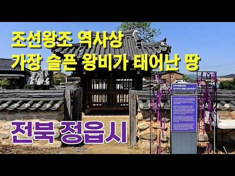
- 챕터: 0:00 인트로_정읍여행의 시작 · 1:26 정읍시 주요 현황 · 3:43 정읍맛집, 백학정 · 5:15 무성서원 · 6:44 단종비 정순왕후 태생지 · 8:25 쌍화차거리 · 10:35 각시다리공원 & 각시다리설화 · 13:04 동학농민혁명기념공원(황토현전적, 동학농민혁명기념관, … · 15:01 아웃트로_정읍여행의 마무리
- 설명 앞부분: 인구 10만 소도시 전북 정읍의 역사와 설화, 맛을 이 영상 하나에 담았습니다. ☑️ 한우 암소 떡갈비 맛집 백학정 ☑️ 유네스코 세계문화유산, 무성서원 ☑️ 왕과 사는 남자 단종의 비, 정순왕후 태생지 ☑️ 전국 유일 쌍화차거리 ☑️ 이름 없는 각시의 한이 맺힌 설화 여행지, 각시다리 ☑️ 동학농민혁명의 핵심 현장, 황토현전적·기념관·박물관
- 같은 채널 평소 대비 ×155.1 (채널 최근 롱폼 중앙값 343회) · 평소 영상: Ep.06-2 충북 충주시 2편ㅣ악어봉 재도전 성공! 등산 싫어하는 제가 다시 올라간 이… (343회) / Ep.01_강원 동해시ㅣ선화공주의 소원이 이루어진 감추사부터 아름다운 건축미를 자랑하는 … (191회)
- 대본 없음 (설명) — 음성인식이 끝나면 도입부·흐름이 들어감
- 댓글 59/59: 좋은 점 — 영상 0 · 감사·응원 6 · 더 알고 싶은 것 1 · 아쉬운 점 — 영상 0 · 반박·불만 — 의견 다름 0 · 정치·사회 0 · 경험 공유 3 · 구독·다음 기대 0
  - 감사·응원 👍27 “지척 에 살면서 알지 못한 지식 좋은 지식을 알려 주어 감사 합니다”
  - 감사·응원 👍5 “감사합니다 고향이 정읍인데 정순황후 태생지가 정읍인줄 이제 알았습니다... 😘😍🥰 행상 나간 남편이 오래 돌아오지 않자, 아내가 달에게 남편의 안전과 무사 귀환을 비는 노래로 유명한 정읍사 공원도 인근에 있는데 다음번에는 정읍사 공원도 소개부탁드립니다. 감사합니다”
  - 더 알고 싶은 것 👍5 “감사합니다 고향이 정읍인데 정순황후 태생지가 정읍인줄 이제 알았습니다... 😘😍🥰 행상 나간 남편이 오래 돌아오지 않자, 아내가 달에게 남편의 안전과 무사 귀환을 비는 노래로 유명한 정읍사 공원도 인근에 있는데 다음번에는 정읍사 공원도 소개부탁드립니다. 감사합니다”
  - 경험 공유 👍43 “저희 조상 태인 박씨 입향조 마을 태인현. 고려 공민왕 시절. 홍건적 침입으로 경남 밀양에서 이곳 태인으로 이주한 밀양박씨 관향. 이곳에는중국 성씨인 여산 송씨 정순왕후 집안도 정착하고 있었다. 여산은 지금의 익산. 중국에도 똑같은 지명이 있다. 세조의 왕위 찬탈로 …”
  - 경험 공유 👍4 “처음에 나온 유허비각이 있는동네가 제가사는 동네입니다 심지어 유허비각 옆의 빈터는 제가 태어나서 살았던곳이네요...맨날 보는데가 인터넷에 나오다니 참 느낌이 새롭네요”

### 92. 예수는 실존 인물이었을까? 역사학이 답한 충격적인 진실

- https://www.youtube.com/watch?v=xDel5Oig1HQ · 에덴코덱스 · 구독자 255 · 조회수 51,687 (×202.7, 하루 350.9) · 좋아요 372 (0.7%) · 13.4분 · 2026-06-16 · 주제 묶음 1. 역사 일반·이야기 · 형식 정보·해설 (그 밖) · 폴더 `W_xDel5Oig1HQ` (웹 승인)
- 썸네일: 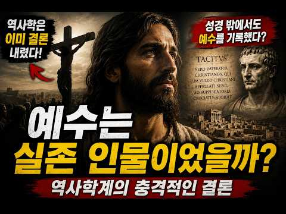
- 설명 앞부분: 예수는 정말 실존 인물이었을까요? 많은 사람들은 아직도 예수의 실존 여부가 논쟁 중이라고 생각합니다. 하지만 놀랍게도 현재 역사학계의 주류 견해는 이미 어느 정도 결론에 도달해 있습니다. 이번 영상에서는 종교적 믿음을 떠나 역사학, 고고학, 문헌학의 관점에서 예수의 실존 여부를 살펴봅니다. 로마 역사가 타키투스의 기록 유대 역사가 요세푸스의 증언 초기 기독교 운동의 역사적 흔적 예수 신화론이 학계에서 받아들여지지 않는 이유 역사학이 인정하는 것과 인정하지 않는 것 예수는 실제로 존재했을까요? 그리고 역사학은 어디까지 답할 수 있을…
- 같은 채널 평소 대비 ×374.5 (채널 최근 롱폼 중앙값 138회) · 평소 영상: 성경 밖에서 발견된 예언자 이사야? 2700년 전 인장 자국의 비밀 (143회) / 3000년 전 항아리에 적힌 이름… 히브리어의 역사를 바꿨나? (133회)
- 대본 없음 (설명) — 음성인식이 끝나면 도입부·흐름이 들어감
- 댓글 59/60: 좋은 점 — 영상 0 · 감사·응원 1 · 더 알고 싶은 것 1 · 아쉬운 점 — 영상 1 · 반박·불만 — 의견 다름 1 · 정치·사회 1 · 경험 공유 3 · 구독·다음 기대 0
  - 더 알고 싶은 것 👍3 “예수님을부정하는자들의머리속에는과연 뇌가있을까 그것이궁금하다”
  - 아쉬운 점 — 영상 👍2 “예수가 불교를 공부했을 가능성은 1,000%,,,,,다,,,,,아니,,,, 1만 프로가 넘는다,,, 또한 요셉과 세례 요한이 인도 종교의 영향을 받은 엣세네파의 일원이었다는 것을 증명하는 사건은 예수가 세례 요한에게 세례를 받았다는 것이다, 엣세네파 일원이었던 요셉등…”
  - 반박·불만 — 의견 다름 👍2 “예수가 불교를 공부했을 가능성은 1,000%,,,,,다,,,,,아니,,,, 1만 프로가 넘는다,,, 또한 요셉과 세례 요한이 인도 종교의 영향을 받은 엣세네파의 일원이었다는 것을 증명하는 사건은 예수가 세례 요한에게 세례를 받았다는 것이다, 엣세네파 일원이었던 요셉등…”
  - 경험 공유 👍4 “영적 지식은 의문을 던져서 알게 되는 것이 아니다. 믿음으로 시작해야 올바른 지식을 취득할 수 있다. 기왕에 나도 모른 채 알게 된 지식이라면, 인간이 머리에서 생겨나지 않았다는 사실을 깨닫는 데서 출발한다.”
  - 경험 공유 👍2 “예수가 불교를 공부했을 가능성은 1,000%,,,,,다,,,,,아니,,,, 1만 프로가 넘는다,,, 또한 요셉과 세례 요한이 인도 종교의 영향을 받은 엣세네파의 일원이었다는 것을 증명하는 사건은 예수가 세례 요한에게 세례를 받았다는 것이다, 엣세네파 일원이었던 요셉등…”

### 93. 이거 하나면 그리스 신화 아는 척 가능 ⚡ 신들의 막장 족보 총정리 (제우스부터 오디세우스까지)

- https://www.youtube.com/watch?v=sq8Un9KgH9g · 재미난 역사여행 · 구독자 5,240 · 조회수 597,912 (×114.1, 하루 7,057.9) · 좋아요 5,184 (0.9%) · 49.8분 · 2026-08-17 · 주제 묶음 5. 세계사·서양사 · 형식 정보·해설 (그 밖) · 폴더 `W_sq8Un9KgH9g` (웹 승인)
- 썸네일: 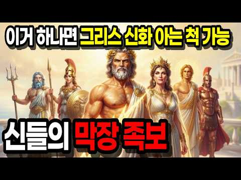
- 챕터: 0:00 오프닝 — 세상에서 가장 막장인 집안 족보 · 2:30 태초의 어둠 카오스, 그리고 하늘과 땅의 시작 · 4:47 자식을 삼킨 아버지, 그 끔찍한 이유 · 9:26 하늘·바다·저승, 세 형제의 제비뽑기 · 10:42 올림포스로 — 신들의 왕과 여왕의 결혼 · 19:00 반은 신, 반은 인간 — 영웅들의 시대 · 20:38 최고의 영웅, 그가 짊어진 무거운 죄 · 28:20 사과 한 알에서 시작된 트로이 전쟁 · 36:59 지혜의 장수 오디세우스와 트로이 목마 · 46:02 모든 족보를 한 줄로 — 그리고 마지막 질문
- 설명 앞부분: ⚡ 3천 년 동안 사랑받은 그리스 로마 신화, 이 영상 하나로 완벽하게 끝냅니다! 세상에서 가장 막장인 집안 족보가 있습니다. 아버지를 끌어내린 아들, 자식을 삼킨 아버지, 바람 잘 날 없는 부부싸움까지… 👑 바로 그리스 신들의 이야기입니다. 이 영상에서는 태초의 혼돈(카오스)부터 시작해 크로노스, 제우스, 헤라를 거쳐 헤라클레스 같은 영웅들, 그리고 트로이 전쟁과 오디세우스의 20년 귀향까지 — 복잡하게 얽힌 신화의 족보를 딱 한 줄기로 쉽게 풀어드립니다. 😊 🏛️ 어려운 이름과 복잡한 관계, 걱정 마세요. 천천히, 차근차근, …
- 같은 채널 평소 대비 ×976.2 (채널 최근 롱폼 중앙값 612회) · 평소 영상: 친일파들은 어떻게 대한민국의 상위 1% 부자가 되었을까? (618회) / 세계 군사학자들도 경악한 전술, 13척으로 330척을 찢어발긴 명량해전의 진실 ∣ 이순신 (607회)
- 대본 없음 (설명) — 음성인식이 끝나면 도입부·흐름이 들어감
- 댓글 295/296: 좋은 점 — 영상 7 · 감사·응원 7 · 더 알고 싶은 것 2 · 아쉬운 점 — 영상 1 · 반박·불만 — 의견 다름 1 · 정치·사회 2 · 경험 공유 4 · 구독·다음 기대 2
  - 좋은 점 — 영상 👍19 “귀에 쏙쏙 요약 정리로 복잡한 그리스신화 잘 이해했습니다. 멋진영상 몀쾌한설명 감사합니다.”
  - 좋은 점 — 영상 👍9 “좋은 영상 감사합니다~”
  - 감사·응원 👍19 “귀에 쏙쏙 요약 정리로 복잡한 그리스신화 잘 이해했습니다. 멋진영상 몀쾌한설명 감사합니다.”
  - 감사·응원 👍13 “그리스신화를 제대로 이해한 영상. 고맙습니다.”
  - 더 알고 싶은 것 👍1 “제우스 알고싶어요”
  - 더 알고 싶은 것 👍1 “오디세우스는 몇살까지 살았는지 궁금하네요~”
  - 아쉬운 점 — 영상 👍2 “반복되는 여러분, ~입니까?라는 질문형식으로 이야기풀이가 듣는 사람의 집중력을 더 떨어뜨리는 느낌이 들었어요..”
  - 반박·불만 — 의견 다름 👍1 “그리스 신와는 신화보다 왕가인듯해요 예전 왕가는 친족끼리 결혼을 많이 했거든요 울나라 신라 고려도 그랬는데 울나라만이 아닙니다 신들이 결혼을 했을가요?”
  - 정치·사회 👍1 “그리스는 단순히 그리스 신화의 나라가 아닙니다. 그리스는 민주주의, 정치학, 스포츠 정신, 체육관과 올림픽, 연극(희극과 비극), 현대 의학 및 병원과 히포크라테스 선서, 국제 과학 용어, 세계 최초의 대학, 세계 최초의 컴퓨터(안티키테라 기계), 세계 최초의 화폐(…”
  - 정치·사회 👍1 “에초에 근친혼 자체가 이상한거임 근데 충격적이게도 유럽이나 우리나라가 이딴거 하다 대가 끊어진 나라와 가문이있다는거지”
  - 경험 공유 👍8 “트로이 목마 옛날에 내가 고등하교 시절 알았는데 이런 얘기가 있는줄은 60년후 이제 모두 알았네요 79세 할매인데 역시 배우는것이 행복 합니다,선생님 감사 합니다 극장에 영화구경 가자합니다 딸이 아닌 외손녀 여고생 입니다 서생님 잘배우고 있어요 감사 해요🎉🎉❤❤❤”
  - 경험 공유 👍0 “하아..난..이걸 보고 너무 속상하네..난 버린자식이야..아버지께서..내가 천국에 가면 여자에게 왕좌를 뺏길까봐..난..난..버린자식이야..아버지 께서도 날 인정하지 않으신거야..작은 내가 두려우셨던거야..속상하네..계속 싸울꺼야..아버지와 나는 계속 싸우게 되겠지.…”
  - 구독·다음 기대 👍5 “그토록 복잡해서 이름 외우고 의미 새기며 읽다 포기하고, 또 미련두었던 그리스신화! 끝까지 정주행 했는데.. 이제서야 맥락을 이해하게 되었네요. 무엇이든 맥락.흐름을 아는게 이래서 중요하지요. 티탄신, 2,3세대 신, 님프 통틀어 나는 딱 하나 고른다면, 오디세우스가…”
  - 구독·다음 기대 👍1 “좋아요로는 부족해서 구독하고 갑니다”

### 94. 🔥최고 시청률 6.3% 찍은🔥왕비 자리를 차지하기 위해 미녀들이 목숨 걸고 싸우는 역대급 궁중 암투극!

- https://www.youtube.com/watch?v=JEqNYtNRvWs · 우리드라마 · 구독자 6,140 · 조회수 523,498 (×85.3, 하루 7,906.2) · 좋아요 1,337 (0.3%) · 230.1분 · 2026-09-05 · 주제 묶음 11. 황제·왕·인물 · 형식 몰아보기·통합본 (긴 영상) · 폴더 `W_JEqNYtNRvWs` (웹 승인)
- 썸네일: 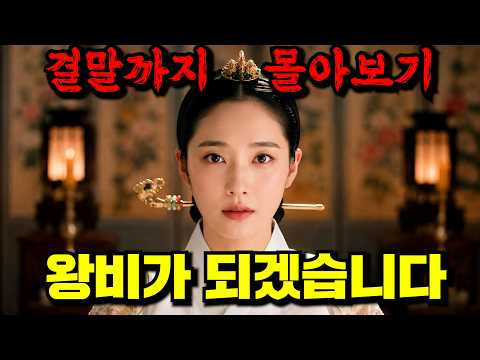
- 설명 앞부분: 드라마 : 간택 주연 : 진세연 김민규 도상우 이열음 이화겸
- 같은 채널 평소 대비 ×3.9 (채널 최근 롱폼 중앙값 133,919회) · 평소 영상: 🔥원작 누적 조회수 무려 26억뷰🔥회사에서 제일 쓸모없는 부서에 발령받은 신입사원 곽동연… (147,181회) / 🔥수학여행 갔는데 갑자기 휴대폰에 ‘마피아 게임’이 설치됐다🔥넷플릭스 한국 TOP10에 … (120,657회)
- 대본 없음 (설명) — 음성인식이 끝나면 도입부·흐름이 들어감
- 댓글 21/22: 좋은 점 — 영상 0 · 감사·응원 1 · 더 알고 싶은 것 0 · 아쉬운 점 — 영상 1 · 반박·불만 — 의견 다름 0 · 정치·사회 0 · 경험 공유 0 · 구독·다음 기대 0
  - 감사·응원 👍0 “감사합니다 감상 잘했습니다”
  - 아쉬운 점 — 영상 👍8 “광고가 없었어 넘 잘 봤어요 고마워요 ~~”

### 95. 세계 3분의 1이 왼쪽으로 달리는 이유

- https://www.youtube.com/watch?v=QftIZGkR9MM · 세계사쇼 · 구독자 22,200 · 조회수 1,392,617 (×62.7, 하루 27,835.7) · 좋아요 2,632 (0.2%) · 18.3분 · 2026-09-21 · 주제 묶음 5. 세계사·서양사 · 형식 정보·해설 (그 밖) · 폴더 `W_QftIZGkR9MM` (웹 승인)
- 썸네일: 
- 챕터: 0:00 세계 3분의 1은 왼쪽으로 달린다 · 1:05 원래 기본값은 왼쪽, 칼과 말의 시대 · 2:30 미국의 대형 마차가 오른쪽을 만들다 · 4:05 나폴레옹 왼손잡이설과 프랑스 혁명의 진실 · 5:45 오스트리아와 체코슬로바키아, 점령군이 끝낸 전환 · 7:34 판을 굳힌 미국산 자동차, 일본이 왼쪽인 이유 · 9:30 스웨덴 다겐 H, 83% 반대를 뚫은 10분 · 11:42 사모아, 중고차 값 때문에 반대로 바꾸다 · 13:40 어느 쪽이 더 안전한가, 엇갈린 연구 · 15:48 왜 세계는 하나로 통일하지 않는가
- 설명 앞부분: 전 세계 75개 나라와 지역, 세계 인구의 3분의 1은 왼쪽 차선으로 달립니다. 원래 인류의 기본값은 오른손잡이가 칼을 왼쪽 허리에 찬 왼쪽 통행이었고, 미국의 대형 마차와 프랑스 혁명, 좌핸들 미국산 자동차가 유럽 대륙을 오른쪽으로 돌려세웠습니다. 영국은 바다 덕에, 일본은 영국이 놓아 준 철도 덕에 왼쪽에 남았고, 국민 83%가 반대한 스웨덴은 1967년 하룻밤에 우측통행으로 바꿨습니다. 타임라인:
- 같은 채널 평소 대비 ×285.2 (채널 최근 롱폼 중앙값 4,883회) · 평소 영상: 십자군 전쟁의 진짜 목적은 무엇이었을까? (4,883회) / 종교와 과학계에서는 신의 존재를 어떻게 증명할까? (5,003회)
- 대본 없음 (설명) — 음성인식이 끝나면 도입부·흐름이 들어감
- 댓글 437/437: 좋은 점 — 영상 12 · 감사·응원 9 · 더 알고 싶은 것 3 · 아쉬운 점 — 영상 3 · 반박·불만 — 의견 다름 9 · 정치·사회 17 · 경험 공유 12 · 구독·다음 기대 0
  - 좋은 점 — 영상 👍10 “너무 좋은 영상입니다. 내용이 좋으면 시간은 상관 없다는 것을 다시 느끼게 되었습니다. 감사합니다.”
  - 좋은 점 — 영상 👍4 “항상 궁금했던 건데 쉽게 설명해 주셨네요. 감사합니다.”
  - 감사·응원 👍10 “너무 좋은 영상입니다. 내용이 좋으면 시간은 상관 없다는 것을 다시 느끼게 되었습니다. 감사합니다.”
  - 감사·응원 👍7 “궁금했던 주제인데 감사해요”
  - 더 알고 싶은 것 👍0 “좋은 내용 잘 봤습니다. 혹시 시간 되시면 자동차 주유구 위치, 운전석 아니면 반대쪽도 한번 조사해서 알려 주세요😊”
  - 더 알고 싶은 것 👍0 “알고싶지않다 그렇게 돈벌어먹고 싶나 왼쪽으로 다니든 오른쪽으로 다니든 뭐가 그리 궁금한데”
  - 아쉬운 점 — 영상 👍0 “인구수가 1/5도 안되는데 어그로아님 100만뷰/20만 좋댓구 됫을듯”
  - 아쉬운 점 — 영상 👍0 “오른손 잡이인데 낚시 릴은 좌핸인데”
  - 반박·불만 — 의견 다름 👍4 “이건 진짜 말도 안되는 소리.ㅎㅎㅎㅎ 무슨 말을 왼쪽 오른쪽… 2분보다 어이가 없네요.. 왜.. 외각을 벽처럼 유도하시나요? 이해가 안되네..”
  - 반박·불만 — 의견 다름 👍2 “러시아 블라디보스톡에 가보니 러시아는 우측통행 나라인데, 승용차는 대부분 일본에서 들어온 중고차들이라 우핸들로 운행해서 다니고, 시내버스는 한국에서 수입한 중고 시내버스들이 대부분이라 좌핸들로 다니고 있었음. 나라는 부자인데 국민들은 가난해서 벌어지는 웃기는 상황이죠…”
  - 정치·사회 👍17 “솔직히 우측통행이든 좌측통행이든 중요하지는 않음 다만, 우리나라나 프랑스처럼 도로는 우측통행인데 철도는 좌측통행인 나라가 꽤 많다는게 그게 더 관건임 😂😂😂😂😂😂”
  - 정치·사회 👍4 “많은 나라가 우측통행을 하는 이유는 계단 때문임 오른손잡이가 90%인 세상에서 계단을 오르내릴때 오른손으로 계단 손잡이를 잡고 가는게 편함 그리고 그런규칙이 있어서 오르고 내리는 사람들의 길이 서로 맞부딪히지않음 이런 사회적통용 범용규칙들은 책을 읽는 방법인 좌에서 …”
  - 경험 공유 👍3 “우핸들 차량 소유자입니다 마차나 사무라이 칼따윈 그냥 웃자고 하는 스토리입니다 일본은 1868년 메이지 유신 하면서 나라 전체를 영국화한것이지 칼하곤 상관없답니다 일본이 사무라이와 꼭 연관시켜 주장을 고집하는 최대이유는, 좀 있어보이려고 미화하려고 하는것. 영국 따라…”
  - 경험 공유 👍0 “재미있는 역사네요, 잘 봤습니다. 감사합니다. 20년째 호주에 살고 있는데요 처음에 도로가 한국하고 반대라서 어떻게 운전할까 넘 무서웠는데 요즘은 가끔 한국에 가면 운전하다 헷갈려서 실수 할까봐 아예 운전을 안하죠”

### 96. 사극에서 절대 보여주지 않는 조선 노비의 진짜 밥상 ∣ 정사 ∣ 야사

- https://www.youtube.com/watch?v=N6THuYELTWU · 역사 만화경 · 구독자 574 · 조회수 124,254 (×216.5, 하루 719.0) · 좋아요 900 (0.7%) · 12.8분 · 2026-05-21 · 주제 묶음 3. 조선 · 형식 애니메이션·지도 · 폴더 `W_N6THuYELTWU` (웹 승인)
- 썸네일: 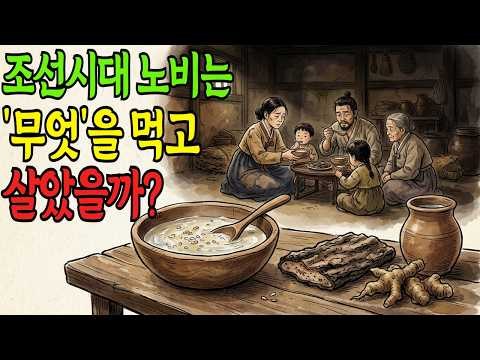
- 설명 앞부분: 사극을 보면 노비는 늘 부엌 한구석에 쪼그려 앉아 있습니다. 주인상을 물리고 식은 밥 한 덩이를 급하게 삼키는 모습. 틀린 장면은 아닙니다. 하지만 그게 전부였을까요? 조선 시대, 사람 셋 중 하나는 누군가의 재산이었습니다. 그 수백만 명이 매일 아침 무엇으로 배를 채웠는지, 조선왕조실록과 고문서 속에 남은 기록을 통해 들여다봅니다. 주인과 똑같은 솥에서 밥을 푸던 노비가 있었고, 자기 땅에서 거둔 곡식으로 가족의 밥상을 차리던 노비도 있었습니다. 반대로, 풀뿌리와 나무껍질로 한 해를 버티다 끝내 흙을 퍼먹은 노비도 있었습니다. …
- 같은 채널 평소 대비 ×327.8 (채널 최근 롱폼 중앙값 379회) · 평소 영상: 감기 한 번에 가족을 잃던 시대 ∣ 조선시대 사람들은 아프면 어떻게 했을까? (379회) / 왕비가 된 지 3년 만에 사약을 받은 연산군의 어머니 폐비 윤씨의 처참한 최후 ∣ 조선왕… (263회)
- 대본 없음 (설명) — 음성인식이 끝나면 도입부·흐름이 들어감
- 댓글 161/165: 좋은 점 — 영상 1 · 감사·응원 8 · 더 알고 싶은 것 1 · 아쉬운 점 — 영상 2 · 반박·불만 — 의견 다름 4 · 정치·사회 9 · 경험 공유 5 · 구독·다음 기대 0
  - 좋은 점 — 영상 👍3 “그렇습니다 보리고개를 모르는사람들은 이해할수 없을것입니다 개떡과 겨빵을 먹어므ㅗ지않은사람들은 믿지못할것입니다 참 유익한 내용입니다 우리는 이시대에 감사함으로 살아야합니다 나누고 도우며 함께사는 마음을 지녀야합니다”
  - 감사·응원 👍24 “먹을것이풍족한시대,에태어난것만으로도축복이다.감사하면서사새요!”
  - 감사·응원 👍5 “모든 게 귀한 시절이었지요 잊혀져 가는 우리의 생활사 감사드립니다”
  - 아쉬운 점 — 영상 👍1 “아무리 찍어내는 ai라지만 제대로 분석좀 하고 올리셨으면 합니다 ai에 다시 검증 해봐 한줄만다시 적어도, 그리고 네이버에만 검색 해봐도 정확한 정보가 나오는데 잘못된 정보가 너무 많네요”
  - 반박·불만 — 의견 다름 👍0 “노비의 일상적인 밥은 보리밥에 고봉밥임... 죽 헛소리”
  - 정치·사회 👍4 “조선시대 세금은 양반.평민.노비 할것없이 5~10%였습니다.식사는 쌀이나 보리와함께 조.수수.피 등 을 혼합해서 먹었고 밥의 양 은 현대인의 3~4배 를 먹었습니다.이런 자료를 어디서 보고 영상 을 올렸는지 모르지만 가뭄에나 힘들었지 못먹고살지 않았습니다.나라에서 구…”
  - 정치·사회 👍4 “자기 동족을 노예로 부리는 나라가 조선”
  - 경험 공유 👍3 “'피죽도 못 먹은 얼굴'이라는 표현이 떠오르는 내용이네요. 벼들 사이로 삐죽 나온 볼품없는 풀떼기 같은 피를 다 먹었었다니 죽을 때까지 그런 배고픔은 안 겪고 싶다는.”
  - 경험 공유 👍0 “80년대 저희집시골논농사가 80마지기 넘게 농사를짓다보니 보리밥을 안먹어봄 지금도 부모님이 농사일하시는데 힘들어하시네요”

### 97. 지구나이 45억년, 인류 이전 초거대 문명의 소름돋는 증거들

- https://www.youtube.com/watch?v=-FBIBpxt-FY · 어스릭스 · 구독자 4,970 · 조회수 873,839 (×175.8, 하루 6,188.9) · 좋아요 6,782 (0.8%) · 22.6분 · 2026-06-22 · 주제 묶음 8. 문명·고고학 · 형식 정보·해설 (그 밖) · 폴더 `W_-FBIBpxt-FY` (웹 승인)
- 썸네일: 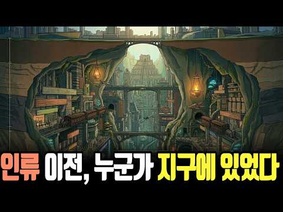
- 설명 앞부분: 지구나이 45억 년, 인류 이전에 초고도 문명이 존재했다면? NASA 과학자가 발표한 '실루리안 가설'을 통해 지구 지층 속 숨겨진 화학적 지문과 고대 문명의 미스터리를 추적합니다. ⚠️ 본 영상은 다양한 국내외 학술 데이터와 과학적 가설들을 기반으로 제작된 정보 제공 목적의 콘텐츠입니다. 영상에 포함된 역사적 사실과 격변, 진화 가설들은 지구의 역사를 탐구하기 위한 학술적 서사일 뿐이며, 특정 종교적 신념이나 정치적 견해, 특정 인종, 집단의 주장을 지지하거나 비하하려는 의도가 전혀 없음을 밝힙니다. 어스릭스는 인류와 행성의 거…
- 같은 채널 평소 대비 ×539.6 (채널 최근 롱폼 중앙값 1,620회) · 평소 영상: 지구 맨틀 깊은 곳(2,900km)에서 발견된 충격적인 '외계 행성의 시체' (1,752회) / 북미 대륙만 한 '마그마 바다'가 솟아오른다면? 옐로스톤 슈퍼 화산의 소름 돋는 타이머 (1,487회)
- 대본 없음 (설명) — 음성인식이 끝나면 도입부·흐름이 들어감
- 댓글 491/493: 좋은 점 — 영상 10 · 감사·응원 4 · 더 알고 싶은 것 2 · 아쉬운 점 — 영상 6 · 반박·불만 — 의견 다름 10 · 정치·사회 4 · 경험 공유 21 · 구독·다음 기대 1
  - 좋은 점 — 영상 👍41 “정말 기발한 발상입니다.이러한 생각에 정말 많이 공감합니다.”
  - 좋은 점 — 영상 👍11 “수준높은 좋은 영상이네요”
  - 감사·응원 👍2 “아주 좋은 내용의 글 입니다.많은 생각 을하게 하게 하는 내용의 글을 읽었습니다.감사합니다.”
  - 감사·응원 👍1 “맞습니다 응원합니다 파이팅”
  - 더 알고 싶은 것 👍0 “내일 또 출근해야됨.리셋은 언제 되나요?”
  - 더 알고 싶은 것 👍0 “억겁의 세월은 무슨. 그냥 억이겠죠. 숫자단위 아시나요. 영이 63개면 얼마나 돼나요? 저가 숫자단위 세어보죠 단, 십, 백, 천, 만, 십만, 백만, 천만, 억, 십억, 백억, 천억, 조, 십조, 백조, 천조, 경, 십경, 백경, 천경 해, 십해 백해, 천해, 자,…”
  - 아쉬운 점 — 영상 👍0 “지구의 문명은 번성했다가 소멸하고 다시 문명이 발생하고 소멸하기를 수백억 수천억년 동안 몇번이나 반복되었을까? 기독교의 창조설은 단순한 유아용 동화일 뿐이다”
  - 아쉬운 점 — 영상 👍0 “나래이션 목소리가 별로야”
  - 반박·불만 — 의견 다름 👍4 “나도 이런 생각 안한 것은 아닌데요 우리 이전의 수천가지의 문명이 있다고하더라도 지구를 돌고있는 인공위성을 쏘아올려 궤도에 올려놓은 문명은 우리밖에 없는 듯 합니다. 있다고한다면 우리가 인공위성을 쏘아올렸을 때 우리밖에 없었으니까요”
  - 반박·불만 — 의견 다름 👍2 “지구 즉 현상계는 진리와 법칙은 이세상을 떠받히고 있지만 생명은 지꼴리는대로 생존하고 삶을 살죠.. 적응하면 생존 틀라면 소멸이죠.. 우리세계는 3차원이며 인간자체도 육체와 에너지 기체 정신체 이 세가지 정기신이 유가적으로 관여되어 움직입니다.. 물론 그속의 핵심은 …”
  - 정치·사회 👍0 “대본 잘썼다, 하지만 현재 한국의 선거조작범들을 응징하는게 우선이다”
  - 정치·사회 👍0 “공룡도 화석으로 나오는 마당에 선대 문명이 있다면 왜 그 흔적이 없는 거지? 외계인처럼 정부가 숨기기라도 하나?”
  - 경험 공유 👍6 “졸래 멀리서 찾고있네 내가 간단히 찾는거 알려주께 구글 지도 아르헨티나 바다쪽 확대 해보면 문명의 흔적이 보인다 바다길 건물흔적 석상등 원시지구는 바다속에있다 지상은 물이 생긴 이후고 바닷속을 보면 고대 흔적이 보인다 거인족의 흔적일 확률이 높음”
  - 경험 공유 👍4 “나도 이런 생각 안한 것은 아닌데요 우리 이전의 수천가지의 문명이 있다고하더라도 지구를 돌고있는 인공위성을 쏘아올려 궤도에 올려놓은 문명은 우리밖에 없는 듯 합니다. 있다고한다면 우리가 인공위성을 쏘아올렸을 때 우리밖에 없었으니까요”
  - 구독·다음 기대 👍65 “설득력있고 상상해보고 물음표를 던져주는 내용이 아주 인상적입니다. 구독하고 시청합니다.”

### 98. 조선시대 유배객들이 실제로 겪은 일 ∣ 교과서가 숨긴 진짜 유배의 실체 ∣ 조선역사 ∣ 조선왕조실록 ∣ 한국사

- https://www.youtube.com/watch?v=U2MgGktKryE · 역사딴지 · 구독자 1,160 · 조회수 131,119 (×113.0, 하루 1,422.5) · 좋아요 1,190 (0.9%) · 13.9분 · 2026-08-10 · 주제 묶음 3. 조선 · 형식 수면·낭독 (잠잘 때 듣는) · 폴더 `W_U2MgGktKryE` (웹 승인)
- 썸네일: 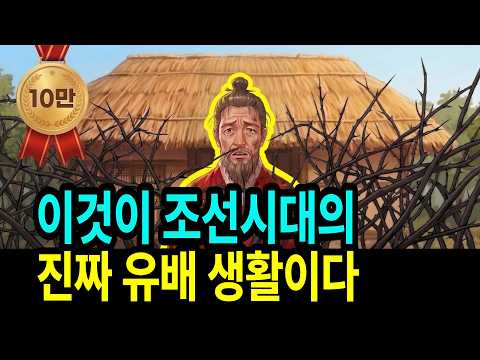
- 챕터: 0:00 송시열, 마지막 잔을 들다 · 1:01 유배 전 먼저 맞은 곤장 · 1:50 하루 30km, 끝없이 걸어야 했던 길 · 2:51 돈에 따라 달랐던 유배길 · 3:28 도착 후 시작된 감시와 위리안치 · 5:21 절반도 못 돌아온 제주 유배 · 6:04 정약용, 절망을 학문으로 바꾸다 · 8:19 김정희와 세한도 · 10:30 오늘날의 위리안치, 그리고 결말
- 설명 앞부분: 조선시대 유배, 위리안치, 정약용 목민심서 — 사극에서는 유배를 소달구지에 실려 흙먼지 날리는 시골길을 걷는, 사형보다는 가벼운 벌로 그립니다. 하지만 이건 절반만 진실입니다. 조선 유배형은 떠나기 전 먼저 곤장부터 맞아야 했던 형벌이었습니다. 최대 3천 리, 하루 30km 넘게 걸으면서도 숙박비와 호송관 밥값까지 자기 돈으로 치러야 했습니다. 그리고 유배 중 가장 가혹한 형벌, 위리안치가 그들을 기다리고 있었습니다. 이 영상에서는 조선 유배형의 실제 절차와 정약용·정약전·김정희가 그 절망 속에서 남긴 것들을 함께 들여다봅니다. …
- 같은 채널 평소 대비 ×188.7 (채널 최근 롱폼 중앙값 695회) · 평소 영상: 왕이 가장 위험한 자리였던 이유, 사극이 보여주지 않는 조선 왕 5명의 죽음 ∣ 조선역사… (695회) / 나무꾼에서 왕이 된 철종, 신데렐라가 아니라 꼭두각시였다 ∣ 안동김씨가 그를 고른 진짜 … (753회)
- 대본 없음 (설명) — 음성인식이 끝나면 도입부·흐름이 들어감
- 댓글 76/77: 좋은 점 — 영상 1 · 감사·응원 1 · 더 알고 싶은 것 0 · 아쉬운 점 — 영상 0 · 반박·불만 — 의견 다름 1 · 정치·사회 2 · 경험 공유 0 · 구독·다음 기대 0
  - 좋은 점 — 영상 👍4 “몰랐던 사실 배우고 갑니다”
  - 감사·응원 👍1 “감사합니다.”
  - 반박·불만 — 의견 다름 👍3 “영화나 드라마는 그냥 재미로 보는거지 그것을 실화로 보는 사람이 웃기는거지..”
  - 정치·사회 👍3 “조선시대의 유배 제도는 표면적으로는 국법을 어긴 죄인을 다스리는 사법적 형벌의 형식을 취하고 있으나, 그 내면을 들여다보면 왕권과 신권의 권력 다툼, 붕당 간의 피비린내 나는 정쟁, 그리고 철저한 유교적 명분론이 맞물려 작동하던 고도의 정치적 생존 게임이었다. ​실제…”

### 99. 국립현충원에서 가장 좋은 자리, 그 무덤의 주인은 조선의 궁녀였다

- https://www.youtube.com/watch?v=UAw390nt3vQ · 시간책방 · 구독자 9,770 · 조회수 738,487 (×75.6, 하루 11,769.7) · 좋아요 2,543 (0.3%) · 40.1분 · 2026-09-08 · 주제 묶음 3. 조선 · 형식 정보·해설 (그 밖) · 폴더 `W_UAw390nt3vQ` (웹 승인)
- 썸네일: 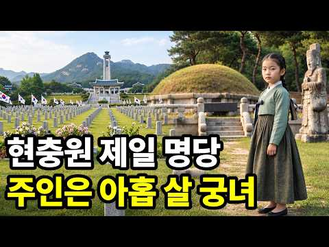
- 챕터: 0:00 현충원 안의 이상한 무덤 · 2:55 아홉 살에 궁으로 들어간 아이 · 5:15 궁녀라는 직업의 실체 · 8:50 아내를 이레 만에 내보낸 임금 · 13:35 승은, 그리고 더 위험해진 자리 · 16:50 경빈 박씨는 왜 죽었는가 · 18:55 왕이 죽고 궁을 나오다 · 28:00 18년 뒤, 손자가 왕이 되다 · 34:55 무덤이 먼저였다 · 37:00 조선 후기 340년의 시작점
- 설명 앞부분: 서울 동작구 국립서울현충원. 나라를 위해 목숨을 바친 분들이 잠든 그 언덕 한가운데에, 조선시대 무덤 하나가 남아 있습니다. 🌲 주인은 조선 11대 임금 중종의 후궁, 창빈 안씨입니다. 왕족도 아니었고 명문가의 딸도 아니었습니다. 가난한 집에서 태어나 아홉 살에 궁으로 들어간 어린 궁녀였습니다. 받은 것은 여럿이 나눠 쓰던 방 한 칸, 그리고 다달이 나오는 쌀 몇 말이었죠. 그 아이의 후손이 선조부터 순종까지 조선의 임금 열네 명입니다. 조선 500년 중 후반부 340년이 이 한 사람의 핏줄에서 나왔습니다. 🏯 이 영상에서는 조선…
- 같은 채널 평소 대비 ×465.8 (채널 최근 롱폼 중앙값 1,586회) · 평소 영상: 조선 왕들은 왜 46세에 죽었나? 경복궁 흙이 밝힌 충격적 진실 (1,676회) / 세조는 왜 친동생 안평대군을 죽였나? 조선 최고의 천재가 사라진 진짜 이유 (1,495회)
- 대본 없음 (설명) — 음성인식이 끝나면 도입부·흐름이 들어감
- 댓글 63/80: 좋은 점 — 영상 2 · 감사·응원 3 · 더 알고 싶은 것 0 · 아쉬운 점 — 영상 1 · 반박·불만 — 의견 다름 1 · 정치·사회 2 · 경험 공유 1 · 구독·다음 기대 0
  - 좋은 점 — 영상 👍5 “너무 소상히 알려주셔서 감사합니다.조선실록에 관심이 있었으나 안빈창씨라는것 후궁이었고 양주에서 이장해 동작동에모셨고훗날국립묘지에 최고의명당이고 후손들중14분이왕이되였다는설이 전부였답니다.유익한 정보 대단히 감사합니다. 의자리라는것”
  - 좋은 점 — 영상 👍2 “참좋은 정보 감사합니다 조용히 있는것 힘들것요 그동안 고생하셨습니다 편안하게 숴세요 담에 가면 인사드릴 고싶어요 ㅎ”
  - 감사·응원 👍5 “너무 소상히 알려주셔서 감사합니다.조선실록에 관심이 있었으나 안빈창씨라는것 후궁이었고 양주에서 이장해 동작동에모셨고훗날국립묘지에 최고의명당이고 후손들중14분이왕이되였다는설이 전부였답니다.유익한 정보 대단히 감사합니다. 의자리라는것”
  - 감사·응원 👍2 “참좋은 정보 감사합니다 조용히 있는것 힘들것요 그동안 고생하셨습니다 편안하게 숴세요 담에 가면 인사드릴 고싶어요 ㅎ”
  - 아쉬운 점 — 영상 👍3 “내용은 좋은 데 필요없는 말이 중복중복 지루하다”
  - 정치·사회 👍0 “대통령 묘소가 있는곶에 누구는 저자리엄두도 내지말야야지 무신말인지 알것주”
  - 정치·사회 👍0 “월래 주인빼고 6.25 참전용사 빼고 다른 사람이 모셔졌다면 옴겨야 한다 전직 대통령 이라 해도”
  - 경험 공유 👍1 “내가 조선의 궁녀다!”

### 100. 네팔의 비극 뒤에 숨겨진 역사… 중국이 히말라야에 묻어둔 230조 원짜리 덫의 정체

- https://www.youtube.com/watch?v=C13y7E8GstI · 역사책방 · 구독자 4,710 · 조회수 344,545 (×73.2, 하루 5,548.2) · 좋아요 1,710 (0.5%) · 18.1분 · 2026-09-09 · 주제 묶음 1. 역사 일반·이야기 · 형식 정보·해설 (그 밖) · 폴더 `W_C13y7E8GstI` (웹 승인)
- 썸네일: 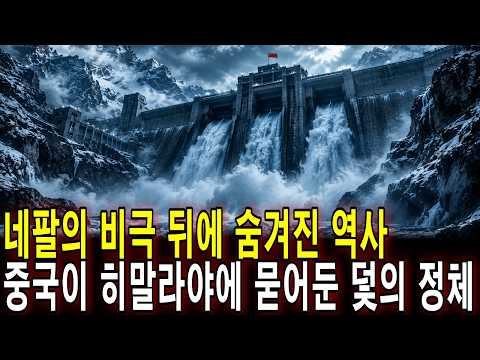
- 챕터: 0:00 1950년 티베트 현대사와 국경선의 재편 · 3:26 1962년 히말라야 분쟁: 악사이친 도로와 고원 지정학 · 7:02 메콩강의 생태 보고서: 톤레사프 호수와 메콩 삼각주의… · 10:41 얄룽창포강 대협곡: 판구조론으로 본 활성단층대와 수력… · 14:06 1997 유엔 국제수로 협약과 21세기 수자원 거버넌…
- 설명 앞부분: 흔히 ‘세계의 지붕’ 또는 ‘아시아의 천연 급수탑’이라 불리는 티베트고원. 이곳 히말라야 만년설과 빙하에서 발원한 거대한 물줄기들은 황허, 양쯔, 메콩, 브라마푸트라, 인더스강을 거쳐 아시아 20억 인구의 삶과 문명을 지탱해 왔습니다. 하지만 21세기 기후변화와 대규모 인프라 건설이 맞물리면서, 하나의 산맥에서 시작된 물길은 단순한 자연환경을 넘어 현대 지정학의 핵심 축이자 국제 거버넌스의 시험대로 떠오르고 있습니다. 이번 영상에서는 1950년대 티베트 고원을 둘러싼 현대사의 굴곡과 1962년 국경 분쟁의 역사적 기원을 되짚어보고…
- 같은 채널 평소 대비 ×180.7 (채널 최근 롱폼 중앙값 1,907회) · 평소 영상: 소 22마리가 끈 이동 요새부터 대륙 정복까지 ∣ 칭기즈칸과 몽골 제국의 모든 비밀 (통… (2,132회) / "11년 전에도 터졌다" 북한군이 DMZ에 '1m 간격'으로 묻어둔 덫의 소름돋는 정체 (1,682회)
- 대본 없음 (설명) — 음성인식이 끝나면 도입부·흐름이 들어감
- 댓글 91/91: 좋은 점 — 영상 2 · 감사·응원 1 · 더 알고 싶은 것 0 · 아쉬운 점 — 영상 1 · 반박·불만 — 의견 다름 0 · 정치·사회 7 · 경험 공유 1 · 구독·다음 기대 0
  - 좋은 점 — 영상 👍17 “한국의 인간존엄은 인간을 이롭게 하라 맞는 말씀이십니다”
  - 좋은 점 — 영상 👍13 “저런 나라를 지척에 두고 버티고 있는 북한은... 뭔가요? 그리고 중국이라는 나라에 대해 이렇게 하나 더 배워갑니다.”
  - 감사·응원 👍5 “고맙씁니다 존경합니다 대한민국 🇰🇷 횟팅 👏👍❤”
  - 아쉬운 점 — 영상 👍1 “하... 어쩌다 이지경ㅜㅜ 이 지경이 되도록 다들 뭐하고 있었나? 정말 실망스럽다”
  - 정치·사회 👍6 “훗날 땜이터져서 중국인구 쓸어가야 정신차려요 그전에는 아무말도 소용없어요”
  - 정치·사회 👍2 “중국인 다수는 말종 중의 상 말종.. 천하의 개호로자슥들.. 중국과는 좋은 말이나 협상 필요없고.. 귀싸대기 날리며.. 강한 무력으로 잔인하게 제압하는 방법 외엔 없다.. 14억 인구가.. 국민성을 상당 부분 입증해내는 축구라는 스포츠에서 우레이 같은 등쉰을 앞세워 …”
  - 경험 공유 👍67 “햐 .그래서 하늘에 노여움으로 몇년째 해마다. 태풍으로 인간들의 욕심으로 자연재해로 국민들이 고통을 받는이유였네.”

### 101. 밥값만 내면 하룻밤은 공짜? 조선시대 주막의 놀라운 비밀l사라진 줄 알았던 조선 주막ㅣ마지막 주모가 남긴 이야기, 삼강주막

- https://www.youtube.com/watch?v=f0eYMCDmOyM · 어게인역사 · 구독자 7,430 · 조회수 997,042 (×134.2, 하루 8,691.5) · 좋아요 2,169 (0.2%) · 20.9분 · 2026-07-18 · 주제 묶음 3. 조선 · 형식 정보·해설 (그 밖) · 폴더 `W_f0eYMCDmOyM` (웹 승인)
- 썸네일: 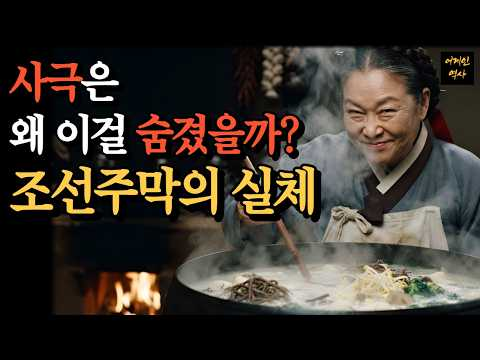
- 챕터: 0:00 밥값만 내면 잠은 공짜였던 조선 주막 · 1:27 주막의 간판 '용수'와 김홍도가 그린 풍경 · 3:13 국영 숙소 '원' … 이태원·조치원 지명의 비밀 · 5:59 잠은 공짜? 주모의 기막힌 장사 수완 · 8:53 봉놋방, 조선의 뉴스룸이 되다 · 12:29 40도 찜통방에서 낯선 이들과 보낸 하룻밤 · 16:36 사라진 주막, 그리고 오늘의 찜질방·포장마차
- 설명 앞부분: 🏮 밥값 한 그릇이면, 하룻밤 잠은 공짜였습니다. 호텔도 여관도 민박도 없던 조선. 하루 팔십 리를 걸어온 나그네들은 대체 어디서 먹고, 자고, 하룻밤을 견뎠을까요? 장대 끝에 걸린 '용수' 하나가 간판이자 네온사인이었고 🪔 낯선 사람 열 명이 한 방에 뒤엉켜 자던 '봉놋방'은 신문도 우체국도 없던 시대의 뉴스룸이었습니다. 📮 김홍도의 풍속화 속 그 주막부터, 이태원·조치원 지명에 숨은 국영 숙소 '원'의 비밀, 40도 찜통방에서 하룻밤을 보낸 서양 여행가의 생생한 기록, 그리고 예천 강가에 마지막까지 남았던 삼강주막까지 🌿 오늘…
- 같은 채널 평소 대비 ×708.4 (채널 최근 롱폼 중앙값 1,408회) · 평소 영상: 물 한 모금도 무서워한 덕혜옹주… 고종은 정말 독살당했을까? ∣ 그날 밤 궁에 있던 어의… (1,444회) / 오늘 아침 쓴 그 비누 / 시작은 조선 궁녀였다 ㅣ삼천 명이 살던 궁궐 / 화장실은 단 … (1,371회)
- 대본 없음 (설명) — 음성인식이 끝나면 도입부·흐름이 들어감
- 댓글 92/135: 좋은 점 — 영상 4 · 감사·응원 2 · 더 알고 싶은 것 1 · 아쉬운 점 — 영상 3 · 반박·불만 — 의견 다름 1 · 정치·사회 1 · 경험 공유 6 · 구독·다음 기대 2
  - 좋은 점 — 영상 👍7 “아주 유익한 콘텐츠입니다.”
  - 좋은 점 — 영상 👍3 “정말 좋은 영상 잘 봤습니다. 추천 구독 하고 갑니다. !!”
  - 감사·응원 👍0 “이런분들이 있었기에 지금에 이나라가 있었던거 아니겠습니까 정말 고생많으셨어요 고맙습니다”
  - 더 알고 싶은 것 👍1 “이런 동영상 어떻게 만드나요? 전용 동영상 소프트웨어?”
  - 아쉬운 점 — 영상 👍2 “주막이나 그런건 아니고 섬에 낚시하러 오신 손님들에 돈과 물고기받고 방을 내어주신 저희 할머니와 할아버지 주변 할머님 할아버님들이 생각납니다”
  - 아쉬운 점 — 영상 👍0 “어그로 제일 싫어하는데 멀 놀라 ㅡ.ㅡ”
  - 반박·불만 — 의견 다름 👍46 “주막은 아닌데요 90년대초 할머니 빨간고무 대야에 오징어,고등어 ...메고 5km정도 그중 산길1km들고와서 생선팔고 저녁때 깜깜한데 가시고 가끔 울집서 고등어 몇마리 주시고 저녁 드시고 가심 비오거나 날씨 안좋을땐 주무시고 가셨음 항상 울집에서만 주무시고 가시고했었…”
  - 정치·사회 👍0 “이런분들이 있었기에 지금에 이나라가 있었던거 아니겠습니까 정말 고생많으셨어요 고맙습니다”
  - 경험 공유 👍46 “주막은 아닌데요 90년대초 할머니 빨간고무 대야에 오징어,고등어 ...메고 5km정도 그중 산길1km들고와서 생선팔고 저녁때 깜깜한데 가시고 가끔 울집서 고등어 몇마리 주시고 저녁 드시고 가심 비오거나 날씨 안좋을땐 주무시고 가셨음 항상 울집에서만 주무시고 가시고했었…”
  - 경험 공유 👍2 “주막이나 그런건 아니고 섬에 낚시하러 오신 손님들에 돈과 물고기받고 방을 내어주신 저희 할머니와 할아버지 주변 할머님 할아버님들이 생각납니다”
  - 구독·다음 기대 👍6 “와~~ 이제야 봤네요 참 고급지고 재밌네요 좋아요 꾹~ 구독박고 갑니다 지난 영상들도 찾아봐야겠습니다 찾아봐야겠습니다”
  - 구독·다음 기대 👍0 “잘 몰랐던 역사 뒷얘기가 유익하고 재미있네요. 구독하고 갑니다. 참, 최근 건축과 관련인 ai쇼츠가 유행인데, 거기완 상관이 없는건가요? 목소리가 비슷해서요. 목소리도 AI인가요?”

### 102. 임진왜란 의병장이 88세에 역적으로 참형당한 진짜 이유 ∣ 재미진역사

- https://www.youtube.com/watch?v=GhH9jUSqkF0 · 역사 속 사람들 · 구독자 1,020 · 조회수 52,543 (×51.5, 하루 1,188.4) · 좋아요 356 (0.7%) · 62.9분 · 2026-09-27 · 주제 묶음 3. 조선 · 형식 인터뷰·강연·대담 · 폴더 `W_GhH9jUSqkF0` (웹 승인)
- 썸네일: 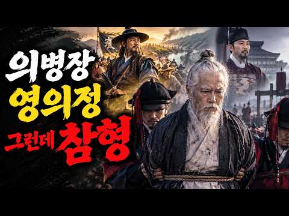
- 챕터: 0:00 조선 최고의 의병장 정인홍, 88세에 참형당한 충격적… · 2:30 남명 조식의 제자로 성장하며 강직한 신념을 갖게 된 … · 10:38 임진왜란 발발, 합천 의병을 일으켜 낙동강을 지킨 활약 · 17:43 전쟁 영웅에서 광해군 시대 정치 중심으로 올라선 과정 · 23:09 광해군 즉위와 함께 권력을 얻은 정인홍의 선택과 갈등 · 30:39 계축옥사와 폐모론 논란, 역사의 평가가 갈린 이유 · 38:02 인조반정 발생, 정권 교체와 함께 역적으로 몰린 정인홍 · 41:32 88세 노인의 참형, 의병장과 역적이라는 두 얼굴의 …
- 설명 앞부분: 임진왜란 의병장이 88세에 역적으로 참형당한 진짜 이유 ∣ 재미진역사 이번 재미진역사 영상에서는 남명 조식의 가르침부터 의병 활동, 광해군 시대의 정치 갈등, 그리고 인조반정 이후 맞이한 비극적인 결말까지 살펴봅니다. 🔥 재미진역사 이야기를 통해 한 인물이 어떻게 영웅과 논란의 인물이라는 두 평가를 동시에 받게 되었는지 확인해 보세요. 🏯 재미진역사 속 숨겨진 기록과 조선 정치의 복잡한 흐름을 쉽고 흥미롭게 전달합니다. 📖 재미진역사 콘텐츠는 우리가 몰랐던 역사 속 인물들의 선택과 운명을 다시 생각하게 합니다. ✨ 재미진역사와 함…
- 같은 채널 평소 대비 ×13.0 (채널 최근 롱폼 중앙값 4,027회) · 평소 영상: 조선의 고봉밥은 왜 사라졌을까? 굶주림보다 뜻밖의 이유 ∣ 재미진역사 (4,415회) / 이름까지 가렸던 조선 과거, 공정한 시험이 무너진 진짜 이유 ∣ 재미진역사 (3,639회)
- 대본 없음 (설명) — 음성인식이 끝나면 도입부·흐름이 들어감
- 댓글 42/43: 좋은 점 — 영상 0 · 감사·응원 1 · 더 알고 싶은 것 0 · 아쉬운 점 — 영상 0 · 반박·불만 — 의견 다름 1 · 정치·사회 1 · 경험 공유 1 · 구독·다음 기대 0
  - 감사·응원 👍6 “의병장과 역적이라는 두 이름. 정여립. 그의 삶을 발 봤습니다. 감사합니다”
  - 반박·불만 — 의견 다름 👍1 “말을 하려거든 좀 제대로 알고 해라. 도리와 사리와 경중과 완급도 제대로 모르면서 무슨 말도 안되는 소리를 찌꺼리고 있나. 원인과 결과가 없을 수 없으니 나중에 천벌을 받을 것이다.”

### 103. 조선왕조 500년｜잠들기 전 듣는 조선 역사 3시간 7분 완전 몰아보기｜태조부터 순종까지

- https://www.youtube.com/watch?v=zoqHzODexwM · 스페셜스토리 · 구독자 1,600 · 조회수 85,924 (×53.7, 하루 1,860.3) · 좋아요 759 (0.9%) · 187.1분 · 2026-09-25 · 주제 묶음 3. 조선 · 형식 수면·낭독 (잠잘 때 듣는) · 폴더 `W_zoqHzODexwM` (웹 승인)
- 썸네일: 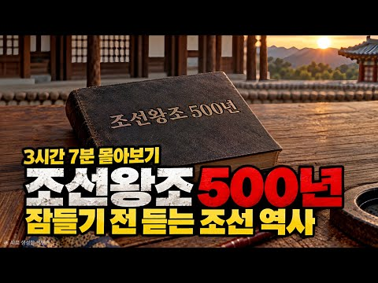
- 설명 앞부분: 1392년 태조 이성계의 조선 건국부터 1910년 대한제국의 마지막까지. 518년의 역사, 27명의 왕이 남긴 이야기를 3시간 7분에 담았습니다. 왕자의 난과 세종대왕의 훈민정음 창제, 단종과 세조의 왕위 다툼, 임진왜란과 이순신, 병자호란과 삼전도의 굴욕, 영조와 사도세자의 비극, 정조의 개혁 그리고 조선의 마지막 왕 순종까지. 조선의 왕들은 어떻게 나라를 세우고 지켜왔으며, 500년 넘게 이어진 왕조는 왜 막을 내리게 되었을까요? 복잡한 연도와 사건을 외우기보다는 한 편의 긴 역사 이야기처럼 자연스럽게 들을 수 있도록 구성했습…
- 같은 채널 평소 대비 ×222.0 (채널 최근 롱폼 중앙값 387회) · 평소 영상: MH370 사라진 진실｜239명을 태운 비행기는 왜 흔적도 없이 사라졌을까? (잠들기 전… (387회) / 삼국지연의 4편 ∣ 여인들의 이야기와 조조의 흔들림 (376회)
- 대본 없음 (설명) — 음성인식이 끝나면 도입부·흐름이 들어감
- 댓글 34/82: 좋은 점 — 영상 0 · 감사·응원 0 · 더 알고 싶은 것 0 · 아쉬운 점 — 영상 0 · 반박·불만 — 의견 다름 0 · 정치·사회 0 · 경험 공유 0 · 구독·다음 기대 0

### 104. 조선시대 역적으로 몰린 양반 아내들, 노비로 전락한 충격적인 진실

- https://www.youtube.com/watch?v=mHF_-cRLwGQ · 조선 왕조의 비밀 · 구독자 1,540 · 조회수 208,707 (×135.5, 하루 1,786.4) · 좋아요 2,097 (1.0%) · 26.2분 · 2026-06-28 · 주제 묶음 3. 조선 · 형식 정보·해설 (그 밖) · 폴더 `W_mHF_-cRLwGQ` (웹 승인)
- 썸네일: 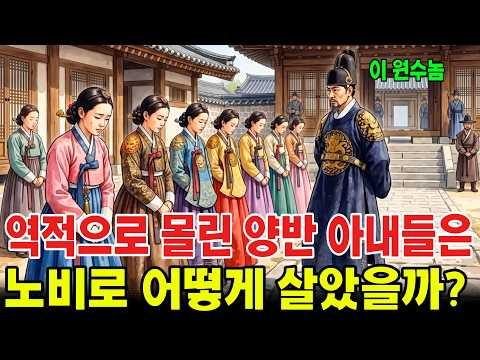
- 설명 앞부분: 조선 시대 의금부 앞마당에서 벌어진 사육신 관련 여인들의 비극적 사건을 다룬 영상입니다. 단종 복위 사건 이후 남편을 잃은 353명의 여성들이 원수의 집으로 끌려가 노비로 전락하는 충격적인 현실 속에서, 한 이름 없는 여종이 모든 것을 바꿀 운명의 선택을 하게 됩니다. 이번 영상에서는 조선의 연좌제, 노비 제도, 그리고 인간의 존엄이 무너진 시대 속에서도 살아남기 위해 싸운 여성들의 처절한 생존 이야기를 깊이 있게 다룹니다. 특히 역사 속에서 기록되지 못한 한 여종의 희생과 기적 같은 결과는 큰 여운을 남깁니다.
- 같은 채널 평소 대비 ×1,048.8 (채널 최근 롱폼 중앙값 199회) · 평소 영상: 20살 천재 왕｜즉위 14개월 만에 갑자기 죽은 충격적인 이유는 무엇이었나? (212회) / 조선 중전의 실제 하루｜가장 부러운 자리에 앉았지만 누구보다 외롭게 살았던 왕비 (186회)
- 대본 없음 (설명) — 음성인식이 끝나면 도입부·흐름이 들어감
- 댓글 146/146: 좋은 점 — 영상 0 · 감사·응원 0 · 더 알고 싶은 것 0 · 아쉬운 점 — 영상 8 · 반박·불만 — 의견 다름 1 · 정치·사회 8 · 경험 공유 0 · 구독·다음 기대 0
  - 아쉬운 점 — 영상 👍4 “자막좀정리”
  - 아쉬운 점 — 영상 👍3 “맞춤법도 안맞는 자막좀 치워라. 짜증난다.”
  - 반박·불만 — 의견 다름 👍0 “세월이 좋아 역적 석열이와 그무리들은 국민세금으로 잘먹고 잘살고 있는게 어이없다”
  - 정치·사회 👍2 “중국인이 운영하는 유튜브는 시청하지 맙시다”
  - 정치·사회 👍2 “조선은 빨리 망했어야 함 동족을 노비로 삼는 나라가 어디 있나”

### 105. 제주는 원래 한국이 아니었습니다 ∣ 천 년 동안 왕이 있었던 섬, 탐라의 모든 것

- https://www.youtube.com/watch?v=_g2d7oLhrDM · 우리 모두의 역사 · 구독자 6,570 · 조회수 302,299 (×46.0, 하루 7,567.8) · 좋아요 1,045 (0.4%) · 92.4분 · 2026-09-18 · 주제 묶음 3. 조선 · 형식 정보·해설 (그 밖) · 폴더 `W__g2d7oLhrDM` (웹 승인)
- 썸네일: 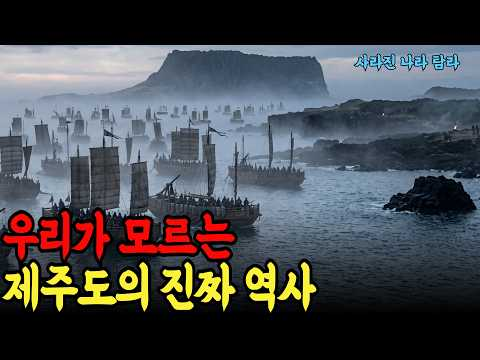
- 챕터: 0:00 비행기가 내려앉는 섬, 그리고 수평선을 채운 함대 · 2:00 바다는 국경이 아니라 길이었다 · 5:30 삼성혈 신화와 그 이면 · 9:00 주호와 오수전 - 이천 년 전의 연결 · 13:00 탐라라는 이름의 등장 · 16:30 사백칠십육년 백제 궁정의 은솔 · 21:00 동성왕이 함대를 돌린 날 · 25:30 백제 멸망과 신라 항복 · 30:00 일본으로 건너간 왕자들 · 35:00 고려 태조의 성주와 왕자 · 40:00 천백오년 나라에서 지방으로 · 45:00 삼별초 최후의 바다 · 51:00 원나라 직할령이 된 섬 · 57:00 말과 목호 그리고 백 년 · 63:00 천삼백칠십사년 명월포 · 69:00 조선 문서 한 장으로 끝난 천 년 · 75:00 탐라는 한국사인가 · 82:00 남아 있는 것들 · 88:00 다시 수평선 앞에서
- 설명 앞부분: 지금 우리는 제주를 대한민국의 아름다운 섬이라고 부릅니다. 그러나 천오백 년 전, 이 섬에는 왕이 있었습니다. 백제의 임금이 함대를 준비하다 되돌린 나라. 일본 조정에 왕자를 사신으로 보낸 나라. 당나라의 태산 의례 명단에 신라와 백제와 나란히 이름을 올린 나라. 고려가 자기 지방이 아니라 울타리 바깥의 나라라는 뜻으로 번국이라 부른 나라. 그 이름은 탐라였습니다. 이 영상은 삼성혈 신화에서 시작해, 백제와 신라와 일본과 당을 오간 탐라의 다변 외교, 고려 편입과 삼별초의 최후, 몽골 제국의 직할 지배와 목마장, 목호의 난, 그리…
- 같은 채널 평소 대비 ×17.6 (채널 최근 롱폼 중앙값 17,174회) · 평소 영상: 통일의 수도가 경주가 아니라 부여였다면 ∣ 백제 통일 시나리오 (18,619회) / 종소리 28번이 울리면 성문이 닫혔다 ∣ 조선의 밤이 무서웠던 진짜 이유 (15,730회)
- 대본 없음 (설명) — 음성인식이 끝나면 도입부·흐름이 들어감
- 댓글 34/38: 좋은 점 — 영상 2 · 감사·응원 0 · 더 알고 싶은 것 0 · 아쉬운 점 — 영상 0 · 반박·불만 — 의견 다름 0 · 정치·사회 2 · 경험 공유 0 · 구독·다음 기대 0
  - 좋은 점 — 영상 👍3 “제주도. 역사를 배웠습니다”
  - 정치·사회 👍5 “일본의 지금은 오키나와 섬 옛날엔 류큐 왕국. 그 류큐 왕국도 일본으로 강제 합병 되었고 , 일본 북쪽 홋카이도(북해도) 섬도 일본으로 강제 합병 되었죠 탐라국도 우리나라 아니었지만 한반도와 가까운 작은 섬이다 보니 백제로 자연스럽게 속하게 된것이죠. 탐라와 류큐가 …”

### 106. 최강 일본도를 깨부순 조선의 무기, 그건 농기구였다.

- https://www.youtube.com/watch?v=VU7nOsg3tDw · 피의역사썰 · 구독자 3,440 · 조회수 277,951 (×80.8, 하루 3,856.6) · 좋아요 1,393 (0.5%) · 12.8분 · 2026-08-17 · 주제 묶음 3. 조선 · 형식 정보·해설 (그 밖) · 폴더 `W_VU7nOsg3tDw` (웹 승인)
- 썸네일: 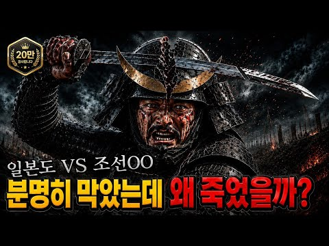
- 설명 앞부분: 1592년, 경기도 고양 땅에 명회라는 농부가 있었습니다. 벼슬도 없고 무예를 배운 적도 없는 사람이었습니다. 그는 눈앞에서 아버지가 일본군의 칼에 쓰러지는 것을 보았지만, 그의 집에는 칼도 활도 없었습니다. 마당을 훑던 그의 시선이 멈춘 곳에는 평생 붙잡고 살아온 나무 도리깨 한 자루가 세워져 있었습니다. "칼을 쥐여 줘도 쓸 줄 모르는 것이 가장 큰 문제였는데, 도리깨질은 백성이라면 누구나 한다." 쇠를 천 겹으로 접고 진흙을 발라 담금질한 동양 최고의 칼, 일본도. 그 앞에 조선이 내민 것은 가을 마당에서 보리를 두들기던 농…
- 같은 채널 평소 대비 ×229.5 (채널 최근 롱폼 중앙값 1,211회) · 평소 영상: 거란보다 무서웠던 건 고려 사람들이었다｜현종 피란길 실화 (1,256회) / 서양보다 100년 빨랐다. 13.8cm 세종이 만든 조선의 권총 (1,166회)
- 대본 없음 (설명) — 음성인식이 끝나면 도입부·흐름이 들어감
- 댓글 230/230: 좋은 점 — 영상 2 · 감사·응원 5 · 더 알고 싶은 것 3 · 아쉬운 점 — 영상 3 · 반박·불만 — 의견 다름 8 · 정치·사회 6 · 경험 공유 3 · 구독·다음 기대 0
  - 좋은 점 — 영상 👍16 “임진왜란이후 정조의 명으로 편찬된 무예도보통지에 보면은 기마병들은 활,화살,환도,편곤이 필수 무장이었죠 임란때 편곤의 위력을 실감하곤 이후 필수템이 된거임 안되면 되는방법을 찿았던 선조들의 지혜를 볼수있네요 좋은영상 잘봤습니다^^ 우리역사속 활의 활약상도 기대해 봅니…”
  - 감사·응원 👍1 “재미있게 잘 보았습니다 감사합니다 ^^”
  - 감사·응원 👍1 “명희명인 조상님 감사합니다”
  - 아쉬운 점 — 영상 👍48 “멋진 내용 잘봤습니다 근데 농부들이 도리깨를 곡괭이처럼 사용하는 부분은 좀아쉽네요^^”
  - 아쉬운 점 — 영상 👍0 “도리깨를 남자들이 사용하는 방법은 끝이 회전을 하면서 가속도를 이용하여 타격을 하고, 여자들은 원투낚시 할 때 처럼 뒤로 살짝 제쳐졌다고 다시 앞으로 가속도를 주면서 타격을 하더라 난 고등학생때에 사용했는데 남자들이 사용하는 방법으로는 도리깨가 무거워서 하지 못하고 …”
  - 반박·불만 — 의견 다름 👍6 “칠지도는 의례용 칼이였고 일본 카타나는 중국 당나라의 기술과 영감을 받은 칼입니다. 대륙과 반도에서 전해진 것은 맞습니다.전적으로 우리나라에서 건너 갔다는 이야기는 아니죠.”
  - 반박·불만 — 의견 다름 👍2 “일본도는 잘부러지는게 아니고 잘휩니다. 부러지는건 잘못제작된겁니다. 게다가 속에 들어가는 쇠와 바깥에 쓰는쇠가 다릅니다. 그리고 환도역시 하몬이라는 외부 연마를 안했을뿐이라 나오지않은것뿐입니다. 그리고 칼이 짧기때문에 부러지는 일이 적은데다 전투에 적합하지않아 노획해…”
  - 정치·사회 👍2 “150년간 전쟁만 하며 전쟁 기술을 연마하던 나라가 200년간 전쟁 없이 살던 나라를 침략해서 이기지 못하고 전멸하다 시피하며 도망간게 임진 왜란이다. 그만큼 일본은 한심했고, 우리는 허술해 보였지만 강했다. 이건 즉 우리가 마음만 먹으면 얼마든지 일본을 침략해서 식…”
  - 정치·사회 👍1 “도래인들이 만든 나라가 일본 이라해도 무방할것 같습니다. 일본인이쓴 일본사기에 토착왜인들보다 도래인이 많았다고기록. 일 교토 전방후원고분, 전남해안가 전방후원고분. 북 함경도,거제도,울산,부산,전남,제주 삼한시대 토착왜인들이 살았던 지역.”
  - 경험 공유 👍3 “제가 생각해도 일본인 중 동양인 외모에 훤칠하고 체격 좋고 덧니 심하게 없는 사람 조상은 일본으로 넘어간 백제인일 확률이 꽤 높다고 생각합니다..”

### 107. 호랑이와 산적이 득실대던 조선시대, 사람들은 어떻게 수백 리를 여행했을까?

- https://www.youtube.com/watch?v=gAJcgExhsio · 신박한 호기심 · 구독자 1,800 · 조회수 80,531 (×44.7, 하루 1,999.5) · 좋아요 206 (0.3%) · 13.2분 · 2026-09-18 · 주제 묶음 3. 조선 · 형식 야담·옛날이야기 · 폴더 `W_gAJcgExhsio` (웹 승인)
- 썸네일: 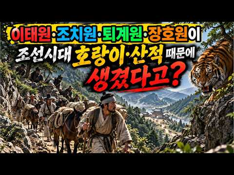
- 챕터: 0:00 호랑이와 산적이 있던 조선의 고갯길 · 1:30 조선시대에는 정말 짐마차로 여행했을까? · 4:30 산길에서 마주친 가장 무서운 위험 · 8:00 나그네와 상인들은 어떻게 고개를 넘었을까? · 12:00 말과 짐을 지키며 이동하는 방법 · 15:30 호랑이를 잡았던 조선의 착호갑사 · 18:30 조선의 역(驛)과 원(院) · 22:00 이태원·조치원·퇴계원·장호원에 남은 흔적 · 24:30 목숨을 걸어야 했던 조선의 장거리 여행
- 설명 앞부분: 자동차도, 가로등도, 휴대전화도 없었던 조선시대. 한양에서 지방으로 가기 위해서는 문경새재·죽령·추풍령·대관령 같은 험준한 고갯길을 넘어야 했습니다. 산속에는 호랑이와 같은 맹수가 있었고, 길목에서는 산적과 화적의 위험도 피해야 했습니다. 그렇다면 상인과 나그네들은 귀중한 짐을 싣고 어떻게 수백 리의 먼 길을 이동했을까요? 이번 영상에서는 조선시대 사람들이 실제로 이용했던 말과 짐 운송 방식, 험난했던 고갯길, 역(驛)과 원(院), 숙박과 휴식, 호랑이와 산적의 위협, 그리고 국가의 대응까지 조선시대 장거리 여행의 모습을 하나씩 …
- 같은 채널 평소 대비 ×66.9 (채널 최근 롱폼 중앙값 1,203회) · 평소 영상: 조선시대 범죄자들은 어떻게 살고 죽었을까? ∣ 검계·임꺽정·살인 사건·망나니 ∣ 조선 범… (1,203회) / 조선시대 월급쟁이들은 얼마나 받았을까? 월급 0원 공무원부터 화성 노동자까지.. 총정리.. (1,141회)
- 대본 없음 (설명) — 음성인식이 끝나면 도입부·흐름이 들어감
- 댓글 8/8: 좋은 점 — 영상 0 · 감사·응원 0 · 더 알고 싶은 것 0 · 아쉬운 점 — 영상 0 · 반박·불만 — 의견 다름 0 · 정치·사회 0 · 경험 공유 0 · 구독·다음 기대 0

### 108. 역사상 가장 악명 높았던 독재자들은 어떻게 최후를 맞이했을까?

- https://www.youtube.com/watch?v=O_KWOoiOj3I · 크로니클 · 구독자 3,870 · 조회수 316,190 (×81.7, 하루 4,280.8) · 좋아요 1,782 (0.6%) · 19.9분 · 2026-08-15 · 주제 묶음 1. 역사 일반·이야기 · 형식 정보·해설 (그 밖) · 폴더 `W_O_KWOoiOj3I` (웹 승인)
- 썸네일: 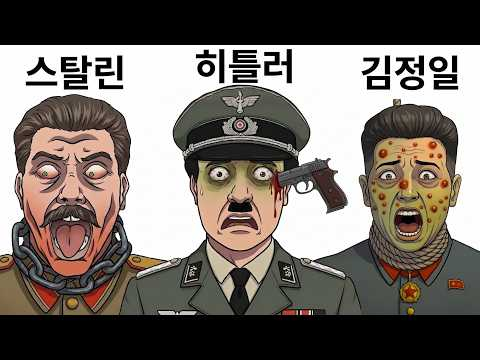
- 챕터: 0:00 권력의 정점에서 시작된 몰락의 이야기 · 0:26 아돌프 히틀러, 벙커 속에서 맞이한 제국의 마지막 순간 · 2:12 베니토 무솔리니, 도망자의 끝과 무너진 권력 · 4:21 김정일, 최고 권력자의 갑작스러운 마지막 순간 · 6:19 스탈린, 공포 정치 뒤 찾아온 의문의 결말 · 8:33 트루히요, 독재자의 암살과 권력의 붕괴 · 10:03 차우셰스쿠, 국민 앞에서 끝난 독재 정권 · 11:47 폴 포트, 비극의 시대가 남긴 역사적 평가 · 13:29 사담 후세인, 체포와 재판 그리고 마지막 선택 · 14:55 카다피, 도주 끝에 맞이한 비극적인 최후 · 16:43 피노체트, 권력 이후 남겨진 역사적 판단
- 설명 앞부분: 👑 한때 세상을 지배했던 절대 권력자들은 왜 마지막 순간 모든 것을 잃었을까요? 이번 영상에서는 역사 속 독재자들의 최후와 권력 몰락의 과정을 따라가며, 독재자의 최후, 독재자의 최후, 독재자의 최후 속에 숨겨진 충격적인 역사적 순간들을 살펴봅니다. 🔎 이번 영상에서 만나볼 주요 내용 권력은 영원할 수 있을까요? 역사 속 인물들의 선택과 결과를 통해 권력의 의미와 교훈을 함께 확인해 보세요. 면책 조항 이 영상은 여러분에게 즐거움과 유익한 정보를 전달하고, 궁금증을 불러일으키기 위한 목적으로 제작되었습니다. 최대한 정확한 정보를 …
- 같은 채널 평소 대비 ×28.8 (채널 최근 롱폼 중앙값 10,967회) · 평소 영상: 전설적인 탐험가들은 어떻게 죽었을까? (11,548회) / 역사상 가장 악명 높은 수배자들, 어떻게 추적 끝에 최후를 맞았나? (10,386회)
- 대본 없음 (설명) — 음성인식이 끝나면 도입부·흐름이 들어감
- 댓글 309/311: 좋은 점 — 영상 0 · 감사·응원 1 · 더 알고 싶은 것 2 · 아쉬운 점 — 영상 8 · 반박·불만 — 의견 다름 2 · 정치·사회 43 · 경험 공유 10 · 구독·다음 기대 2
  - 더 알고 싶은 것 👍15 “연임을 꿈꾸는 독재자 리짜이밍의 최후는 어떨지 다뤄주세요”
  - 아쉬운 점 — 영상 👍54 “확대 되는거 반복되니 어지러워요 ㅠ”
  - 아쉬운 점 — 영상 👍14 “독재자중 히틀러에 대한 학술적인 용어가 있네요. 레드억트 오류(Reductio ad Hitlerum)라고 합니다. "히틀러도 그렇게 생각했다", "히틀러와 비슷하다"는 이유만으로 상대방의 주장이나 존재 자체를 악으로 몰아붙이는 수법을 말하지요. 라틴어로 '히틀러로의 …”
  - 반박·불만 — 의견 다름 👍1 “히틀러는 독재자가 아닙니다 ㅋㅋ”
  - 정치·사회 👍4 “종중반국가내란수괴 *이재명*”
  - 정치·사회 👍4 “인류역사상 최초로 , 대통령이 뇜물먹고 하늘에서 거꾸로떨어져 .머리트져 다이이진 독재자가 한국에도 있었는데 ㅋㅋㅋ”
  - 경험 공유 👍1 “지미 카터:내가 미국의 대통령일때는 독재자의 절반을 몰살했지 물론 늙어서도 말이야”

### 109. '중국으로부터 조선을 지켜야 했다" 조선 최고의 두뇌, 세종의 한글 창제 속사정 [김진명 작가 통합본] #한글날

- https://www.youtube.com/watch?v=o2KlUqYjzR0 · 광화문로 · 구독자 6,590 · 조회수 236,320 (×35.9, 하루 7,246.7) · 좋아요 0 (0.0%) · 37.4분 · 2026-10-09 · 주제 묶음 3. 조선 · 형식 몰아보기·통합본 (긴 영상) · 폴더 `W_o2KlUqYjzR0` (웹 승인)
- 썸네일: 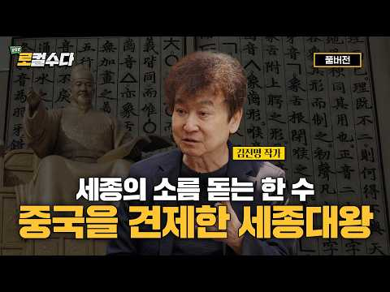
- 설명 앞부분: 수다쟁이 변호사들의 법과 문화(Law&Culture)이야기『로컬수다』 '한글날 특집' 📖김진명 작가와 함께하는 우리가 몰랐던 세종 이야기📖 한글 창제를 결심한 세종의 진짜 이유 세종은 집현전 학자들을 피해 숨어서 한글을 만들었다? 세종이 중국을 견제할 수 밖에 없던 속사정 한글이 세계에서 가장 과학적인 문자가 된 배경 출연자 및 타인을 향한 비난, 욕설 등 불쾌감을 줄 수 있는 댓글은 안내 없이 삭제될 수 있습니다.
- 같은 채널 평소 대비 ×10.2 (채널 최근 롱폼 중앙값 23,209회) · 평소 영상: "AI 데이터센터가 대한민국 1년치 전기의 80%를 씁니다" ⚡충격적인 대한민국 전력 전… (24,696회) / 대법원 확정판결을 뒤집을 수 있다? 재판소원 제도 생긴 '헌법재판소' 완벽 정리 ∣ 세모… (21,722회)
- 대본 없음 (설명) — 음성인식이 끝나면 도입부·흐름이 들어감
- 댓글 105/114: 좋은 점 — 영상 0 · 감사·응원 5 · 더 알고 싶은 것 1 · 아쉬운 점 — 영상 1 · 반박·불만 — 의견 다름 5 · 정치·사회 5 · 경험 공유 1 · 구독·다음 기대 0
  - 감사·응원 👍24 “한국역사 5천년 중 조선은 가장 쇄국적이고, 사대주의적, 붕당정치 폐해가 많아 별로 안 좋아하지만 한자로부터 해방 시켜준 것 하나만으로도 감사함.”
  - 감사·응원 👍19 “한국에는 김진명작가님이 있어서 참 다행이라고 생각합니다 존경하고 응원합니다 감사합니다”
  - 반박·불만 — 의견 다름 👍1 “훈민정음 혜례본 앞 장에 이르길. 중국은 황제계신 곳이니 우리나랏 상담에 강남이라 하느니라.. 뭔 말인가? 우리나라 안에 중국이 있고 이글을 쓰는 우리가 있다는 뜻 아닌가? 이따구 조작된 역사를 논하니 미리 규정해 반포했거늘 뭣 헛소리들을 해댈까 ... 어찌 생각합니…”
  - 반박·불만 — 의견 다름 👍1 “조선은 명나라의 속국이었는데 뭔 헛소리!!! 이성계-이방원-세종은 원나라에서 이주한 지 얼마 안되는 원나라에서 귀화한 자들임. 개소리도 적당히...”
  - 정치·사회 👍3 “세종대왕께서 지금 대통령이셨다면, 후손을위해, 미ㆍ중 쪼개기 작업에 들어가셨을것! 중국을 쪼개기위해선, 중동을 무장시키고, 미국을 쪼개려면, 케나다중남미 무장시켜야”
  - 정치·사회 👍3 “한글의 위대함은 과학성이지,한국만이 고유문자 만들었다는 식으로 과장하면 안 됨.우리가 오랑캐라고 깔보던 거란,여진 전부 문자 만들었었음.일본도 마찬가지. 또 세종이 자주성을 위해 그랬다?그것도 과한 이야기.조선의 성리학 교조주의 그 기틀을 놓은 게 세종임. 세종이 만…”
  - 경험 공유 👍0 “나랏말싸미 듕귁에 달아 문자와로 서로 사맛디 아니할씨 이런 젼차로 여린 빅셩이 니르고져 홀베이셔도 마참 내제뜻을 시려펴지 못하노미라. 내!!!!!!이를 어엿비녀겨 날로 쓰메 편안게 하고저 할 따람이니라... 내 이를 어엿비녀겨... 내... 내가... 내가 보기에..…”

### 110. 마이클 잭슨이 인천 갯벌에 왔던 진짜 이유 l 청라의 숨겨진 역사

- https://www.youtube.com/watch?v=knVMTvDISxo · 끝까지 궁금했던 모든 이야기 · 구독자 974 · 조회수 66,406 (×68.2, 하루 1,070.7) · 좋아요 152 (0.2%) · 9.2분 · 2026-08-27 · 주제 묶음 1. 역사 일반·이야기 · 형식 정보·해설 (그 밖) · 폴더 `W_knVMTvDISxo` (웹 승인)
- 썸네일: 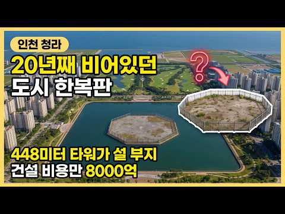
- 챕터: 0:00 마이클 잭슨이 인천 매립지를 찾은 이유 · 1:14 왜 하필 그때 바다를 메우기 시작했나 · 2:45 서울의 쓰레기 산이 옮겨간 자리 · 5:30 마이클 잭슨의 방문과 끝나지 않은 계획
- 설명 앞부분: 1998년 마이클 잭슨이 왜 인천 갯벌에 왔을까요? 그가 방문한 매립지가 어떻게 청라국제도시로 변했는지, 땅의 운명을 바꾼 4번의 변화를 추적합니다. 1998년 2월, 세계적인 팝스타 마이클 잭슨이 인천의 한 갯벌 매립지를 찾았습니다. 단순히 땅을 보러 온 것이 아니라, 그 땅의 토지 용도 변경을 시도하며 매각하기 위한 목적이 있었습니다. 그가 주목했던 이 땅이 어떻게 지금의 청라국제도시가 되었는지 그 과정을 상세히 살펴봅니다. 인천 청라 지역의 개발 역사를 알고 싶은 분들에게 유용한 정보가 될 것입니다. 바다를 메워 만든 매립지…
- 같은 채널 평소 대비 ×25.2 (채널 최근 롱폼 중앙값 2,630회) · 평소 영상: 서울의 15년 치 쓰레기를 치우지 않고 공원을 만든 이유｜난지도 (2,630회) / 비가 오면 하수가 처리장을 안 거치고 하천으로 나가는 이유 (2,560회)
- 대본 없음 (설명) — 음성인식이 끝나면 도입부·흐름이 들어감
- 댓글 23/23: 좋은 점 — 영상 0 · 감사·응원 0 · 더 알고 싶은 것 0 · 아쉬운 점 — 영상 2 · 반박·불만 — 의견 다름 1 · 정치·사회 0 · 경험 공유 1 · 구독·다음 기대 0
  - 아쉬운 점 — 영상 👍4 “잘못된 정보룰 퍼트리네요. 잭니클라우스 cc는 송도귝제도시인데..”
  - 아쉬운 점 — 영상 👍2 “구 동아매립지하고 북쪽의 김포매립지하고 혼돈된 잘못된 정보입니다. 조금만 찾아봐도 잘 나오는데 정보인데..”
  - 반박·불만 — 의견 다름 👍0 “개.. 어이없는 유투버네. 송도에 있는 잭니클라우스하고. 김포 매립지하고 동아 매립지를 뒤섞어놨네. 이런 쓰레기 유투버들이 왜곡된 영상으로 마치 대단한 정보인양 퍼트리네.. 완전 넋이 나갑니다”
  - 경험 공유 👍2 “내용이 엄청 좋고 이미지도 화려한데 말도 빠르고 진도도 빨라서 따라가기가 힘들고 설명이 부족해서 무슨 말인지 이해가 안돼요 ... 두서도 좀 없는것같아요 알고리즘의 선택을 받았는데도 조회수 대비 좋아요 수가 낮은 이유는 그거예요 제가 청라 사는데도 무슨 말인지 모르겠…”

### 111. 여진 토멸 │ 고려의 여진 정벌, 전설이 된 척준경의 마지막 활약. AI 단편 사극 영화

- https://www.youtube.com/watch?v=VKwK-vwmKL8 · 쇠꼬비 검프  · 구독자 16,900 · 조회수 1,336,828 (×79.1, 하루 18,233.0) · 좋아요 7,136 (0.5%) · 58.9분 · 2026-08-29 · 주제 묶음 2. 한국 고대·삼국·고려 · 형식 정보·해설 (그 밖) · 폴더 `W_VKwK-vwmKL8` (웹 승인)
- 썸네일: 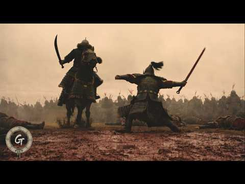
- 설명 앞부분: 척준경! 고려사를 넘어 한국사 최고의 소드마스터를 논할때 빠지지 않는 그 이름. 그러나 척준경이 등장한 사극은 2026년 기준 아예 없다시피 합니다. 뿐만 아니라 1107년부터 1109년까지 이어진 고려의 여진 정벌 역시 영상으로 다뤄진 사례가 거의 없습니다. 하여 많은 상상력과 각색을 가미하여, 1109년 공험진 전투와 갈라수 전투에서 고려군과 여진군이 벌인 대규모 전투, 그리고 갈라수 전투 패전 후 절체절명의 위기에 처한 고려를 구하기 위해 척준경과 결사대가 여진족과 벌인 처절한 사투를 58분에 걸친 긴 영상으로 제작했습니다.…
- 같은 채널 평소 대비 ×9.5 (채널 최근 롱폼 중앙값 140,244회) · 평소 영상: 매소성 전투 │ 당나라 대군을 갈아버린 신라의 분노. AI 단편 사극 영화 (210,906회) / 668 평양성 전투 │ 고구려 최후의 순간을 AI로 재현 (69,581회)
- 대본 없음 (설명) — 음성인식이 끝나면 도입부·흐름이 들어감
- 댓글 1,373/1,434: 좋은 점 — 영상 11 · 감사·응원 49 · 더 알고 싶은 것 41 · 아쉬운 점 — 영상 17 · 반박·불만 — 의견 다름 20 · 정치·사회 37 · 경험 공유 17 · 구독·다음 기대 12
  - 좋은 점 — 영상 👍23 “작금의 대한민국에 이 시기를 관심 갖고 깊게 들여다본 사람이 아마 없겠지만 완안부 금나라 건국사를 깊게 파보면 영웅들 하나 하나가 진짜 말도 안되는 레전드 급이라서 그 개개인의 압도적인 실력, 집단의 완벽한 조직력을 마주하는 순간 몸에 전율이 돋을 정도임. 발흥해서 …”
  - 좋은 점 — 영상 👍12 “여진족 하면 흔히 생각하는 초원의 기마민족 이미지를 벗어나서 스스로의 근원을 숲이라 칭하는 부분의 대사가 아주 절묘합니다. 동북9성 위치상 여진족은 지금의 한반도 북부에 살아서 오히려 숲이 정서에 와닿았겠죠”
  - 감사·응원 👍28 “감사 합니다. 만드신분의 노고가 보이는 명작 입니다.”
  - 감사·응원 👍6 “지금까지 본AI 작품중 완성도 최고네요 일반 영화와 견주어도 손색이 없네요 우리 역사의 영웅들 계속 연재해주세요 는 응원할께요”
  - 더 알고 싶은 것 👍7 “다음 작품은 안시성전투 부탁합니다”
  - 더 알고 싶은 것 👍5 “와 굿 시간가는줄 모르고 감사 앞으로도 좋은작품 부탁드립니다. 이건 작품 아니 역사예술”
  - 아쉬운 점 — 영상 👍15 “퀄리티도 좋고 고증도 준수한데 싸우는 부분이 넘 판타지같네요 기병끼리 맞돌쳤는데 한놈만 쓸려나가든가, 철퇴한방에 고기 다짐육이 된다든가, 피가 너무 과하게 튄다던가 그런 부분이 아쉽네요.. 영상은 사극중 진짜 단연코 독보적인것 같습니다. 👍”
  - 아쉬운 점 — 영상 👍3 “AI티가 안 나네요. 서사, 연출, 음악, 감성 모두 좋네요....”
  - 반박·불만 — 의견 다름 👍23 “작금의 대한민국에 이 시기를 관심 갖고 깊게 들여다본 사람이 아마 없겠지만 완안부 금나라 건국사를 깊게 파보면 영웅들 하나 하나가 진짜 말도 안되는 레전드 급이라서 그 개개인의 압도적인 실력, 집단의 완벽한 조직력을 마주하는 순간 몸에 전율이 돋을 정도임. 발흥해서 …”
  - 반박·불만 — 의견 다름 👍7 “일단 직업이 방송 PD님이실 확률이 99%라고 생각합니다. ... 그게 아니면 일반인이 할수 있는 수준이 아닙니다. 너무 고퀄에 감동했습니다!!!”
  - 정치·사회 👍14 “고구려와발해의 천년동안 지배받다가 둘다멸망하고나니 드디어저들의 세상이 오는구나 청나라가 중국의 땅을너무 넓혀줘서 안따까울 뿐~”
  - 정치·사회 👍8 “동묘에 중국 관우사당 올리고 이나라가이모양임 척준경사당이나세워라”
  - 경험 공유 👍4 “너무 재밌다😢 수많은 역사 영화, 다큐멘터리, 드라마 본 제가 말씀드리자면 영화관에서 볼 최고급 퀄리티네요.”
  - 경험 공유 👍4 “정말 훌륭한 작품이네요! 이런 영상을 오랫동안 기다려왔거든요! 다만 몇 가지 사소한 점이 눈에 띄긴 합니다. 등장인물들이 만주어를 쓰나요, 아니면 중세 여진어를 쓰나요? 소리가 몽골어의 영향을 많이 받은 듯해 만주어 같기도 한데, 발음이 가끔 좀 '어색'하게 들리기도…”
  - 구독·다음 기대 👍9 “AI 안써본 분들이 너무 많으신것 같은데, 이건 진짜 이 분이 정말 잘만드신 거에요. 대단한 실력입니다. 엄청나네요. 비주얼도 물론이지만 스토리도 완성도도 엄청나요. 잘보고 갑니다. 구독해놓고 올리실때마다 챙겨볼께요!”
  - 구독·다음 기대 👍6 “57:32 이장면 썸내일로 사용했으면 간지났을듯요 (현재 4번째 정주행중)”

### 112. 육영수 여사 피격 사건이 없었다면?ㅣ김진명 작가가 들려주는 근현대사

- https://www.youtube.com/watch?v=R-DGnnRUGwo · 김진명의 사적인 대화 · 구독자 20,400 · 조회수 551,710 (×27.0, 하루 21,844.1) · 좋아요 6,202 (1.1%) · 16.1분 · 2026-10-16 · 주제 묶음 4. 한국 근현대사 · 형식 인터뷰·강연·대담 · 폴더 `W_R-DGnnRUGwo` (웹 승인)
- 썸네일: 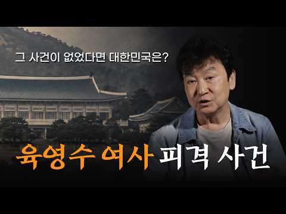
- 설명 앞부분: 대한민국 대표 소설가 김진명의 공식 유튜브 채널 [김진명의 사적인 대화]입니다. 2부｜박정희는 왜 죽어야만 했나? 육영수 여사 피격 사건이 없었다면? 해당 사건을 소설로 써달라는 제안을 받았던 김진명 작가의 실제 경험을 시작으로 그날 이후 청와대와 한국 정치사에 불어닥친 결정적 변화들을 돌아봅니다. ‘청와대 안의 야당’이라 불렸던 육영수 여사의 진짜 역할, 10·26 사건으로 이어지는 김재규와 차지철의 권력 갈등, 문세광의 행적과 사건 수사를 둘러싼 미스터리까지! '누구의 총탄이었는가'라는 질문을 넘어, 그날의 총성이 대한민국 근…
- 대본 없음 (설명) — 음성인식이 끝나면 도입부·흐름이 들어감
- 댓글 238/286: 좋은 점 — 영상 7 · 감사·응원 31 · 더 알고 싶은 것 8 · 아쉬운 점 — 영상 1 · 반박·불만 — 의견 다름 3 · 정치·사회 39 · 경험 공유 14 · 구독·다음 기대 9
  - 좋은 점 — 영상 👍54 “매우 유익하고 흥미로운 영상입니다. 감사합니다😂❤”
  - 좋은 점 — 영상 👍42 “정말 차갑게 잘 정리된 이야기들 좋아요!”
  - 감사·응원 👍118 “건강하세요 선생님❤ 감사합니다🎉”
  - 감사·응원 👍110 “채널이 만들어졌군요 감사합니다 구독했어요 응원합니다”
  - 더 알고 싶은 것 👍30 “정형돈 제목없음TV보고 왔어요. 작가님 채널 구독하고 영상 보고 있어요. 좋은 글과 영상 부탁드립니다. 건강도 잘 챙기시길 바랍니다.^^”
  - 더 알고 싶은 것 👍29 “선생님께서 쓰신 글들을 통해 역사에 관심을 갖게 되었습니다. 유튜브로도 많은 가르침 부탁드립니다.”
  - 반박·불만 — 의견 다름 👍57 “독재 독재하는데 북한놈들이랑 전쟁끝난지 몇년되지도 않아서 김영삼 김대중이 대학생들 선동해서 대한민국 북한에 갖다바치려하는데 멀쩡한 사람이고 군인이면 당연히 통제할수밖에 없다고 생각함.”
  - 반박·불만 — 의견 다름 👍8 “그래도 고인의 인격을. 모독하면 안되지요. 지금의 풍요를 누릴 수 잇는 모태가 됐는데..암살자 영화는 어이없어요 옛날에 강의 많이 들었어요 존경합니다”
  - 정치·사회 👍53 “누가 뭐래도.... 그때 그 시절 한 대통령이 오래 통치하면서 대한민국 경제가 선진국 수준으로 발전할 토대를 구축한 건 부인 할 수 없는 일..”
  - 정치·사회 👍46 “작가님을 좋아하는 사람입니다. 또한 박정희 전대통령을 좋아하는 사람입니다. 물론 박정희대통령이 과도 있습니다만 공도 많은분이라고 생각합니다. 그렇다면 적어도 이름보다 존칭은 쓰면서 역사에 대한 설명을 하신다면 더 작가님의 깊이가 느껴지지않을까 생각합니다.”
  - 경험 공유 👍82 “정형돈의.제목없음 티비 보고 저도 작가님 채널 놀러왔습니다! 다음 영상 업로드 너무 기다려집니다! 제목없음 티비도 꼭 다시 나와주세요👍”
  - 경험 공유 👍32 “저도 작가님 책을 수 많은 작품들 읽으면서 감동이고 최초의 <무궁화 꽃이 피었습니다> 두 권 이야기가 실제 사건으로 바탕이 충격이 크게 느껴져요 작가님에게 무궁화꽃이란 무엇입니까??”
  - 구독·다음 기대 👍110 “채널이 만들어졌군요 감사합니다 구독했어요 응원합니다”
  - 구독·다음 기대 👍82 “정형돈의.제목없음 티비 보고 저도 작가님 채널 놀러왔습니다! 다음 영상 업로드 너무 기다려집니다! 제목없음 티비도 꼭 다시 나와주세요👍”

### 113. [애절한 중국 사극 노래] “나만의 폐하를 사랑하지요” ∣ 황제 무측천이 사랑한 단 하나의 태양 ∣ 성세천하 ost ∣ 이치원조 FMV ∣ 《명명 ∣ 明明》병음…

- https://www.youtube.com/watch?v=z6VcKlWaGoo · 사녀  · 구독자 1,180 · 조회수 174,415 (×147.8, 하루 1,257.3) · 좋아요 1,152 (0.7%) · 4.4분 · 2026-06-24 · 주제 묶음 3. 조선 · 형식 정보·해설 (그 밖) · 폴더 `W_z6VcKlWaGoo` (웹 승인)
- 썸네일: 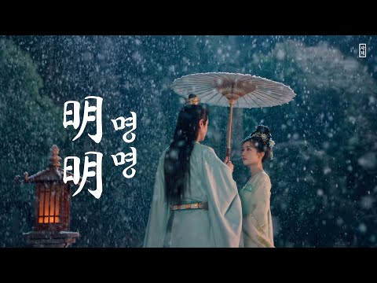
- 설명 앞부분: 취미로 만든 채널로 개인적인 수익 일절 없습니다. 의역/오역 다수. ←관련 피드백 환영. “전하께서 보시기에 저는 어떤 사람 같습니까?” “홀로 거센 눈보라에 맞서지만 정작 자신을 위해 우산을 펴는 건 늘 잊는 사람이지.” “제 마음속에는 늘 폐하가 있었습니다” “짐의 이 생은 아주 행복했소. 원조, 짐이 약조했었지. 그대와 함께 나아가겠다고. 그 약속은 지키지 못하게 되었소.” [무원조의 영원한 태양 이치] 해당 곡은 성세천하 인게임의 메인 테마 음악으로 나오는 영상도 모두 인게임 내 스토리 화면을 사용했습니다. 곡을 소개하는 …
- 대본 없음 (설명) — 음성인식이 끝나면 도입부·흐름이 들어감
- 댓글 107/116: 좋은 점 — 영상 0 · 감사·응원 2 · 더 알고 싶은 것 3 · 아쉬운 점 — 영상 1 · 반박·불만 — 의견 다름 5 · 정치·사회 1 · 경험 공유 5 · 구독·다음 기대 0
  - 감사·응원 👍5 “가사랑 한국어 발음까지 ㅠ 감사합니다ㅏ❤️”
  - 더 알고 싶은 것 👍1 “드라마 제목 알수있을까요?”
  - 경험 공유 👍196 “어떤 스트리머 하는 영상을 보는데 누가 이치만큼은 게임 중에 원조를 죽이지 않았다고, 계속 사랑했다고 채팅치더라🥹 그거 보고 진짜 이치가 찐사라는 생각 많이 했었지ㅠㅠ 그래 이치는 그랬네, 어떤 순간에도 원조를 해치지 않으려 했네....ㅠㅠ 배드엔딩이 뜨더라도 결국 …”

### 114. 조선시대 왕비의 식사 — 12첩 반상인데 왜 맛이 없었을까

- https://www.youtube.com/watch?v=Ch-zCROKRo4 · 역사콕콕 · 구독자 498 · 조회수 89,566 (×179.8, 하루 529.2) · 좋아요 1,014 (1.1%) · 23.4분 · 2026-05-25 · 주제 묶음 3. 조선 · 형식 정보·해설 (그 밖) · 폴더 `W_Ch-zCROKRo4` (웹 승인)
- 썸네일: 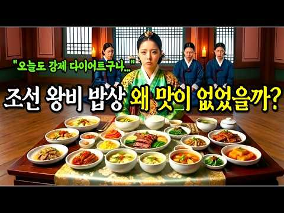
- 챕터: 0:00 교태전, 오전 열 시 — 왕비의 아침 · 2:30 간택된 날, 궁에 들어오는 순간 · 5:30 왕비의 12첩, 왕의 12첩과 같은 것이었을까 · 10:00 숙수 — 드라마와 다른 진짜 궁중 요리사 · 13:00 임신과 시어머니, 밥상에도 서열이 있었습니다 · 16:30 폐비의 밥상, 12첩이 사라지는 순간 · 20:00 화려한 감옥
- 설명 앞부분: 왕비의 식사 — 12첩 반상인데 왜 맛이 없었을까 "젓수십시오." 이 세 글자가 떨어져야 왕비는 수저를 들 수 있었습니다. 은수저로 독을 확인하고, 기미상궁이 목숨 걸고 먹어본 다음에야 시작되는 식사. 세 명이 지켜보는 앞에서, 혼자, 식어가는 밥을 먹어야 했던 여자. 🔹 간택날 처음 받은 건 밥이 아니라 다과상이었습니다 🔹 왕비의 12첩 반상, 그릇만 서른 개가 넘었는데 왜 맛이 없었을까 🔹 시어머니 혜경궁은 15그릇, 정조는 7그릇만 먹었습니다 🔹 인현왕후가 쫓겨난 날, 12첩 반상은 하루아침에 사라졌습니다 🔹 왕비에서 노비로…
- 같은 채널 평소 대비 ×364.1 (채널 최근 롱폼 중앙값 246회) · 평소 영상: 정희왕후 — 세조의 아내가 경혜공주를 살린 이유 (246회) / 로마에도 있었는데 왜 우리만 남았을까 (235회)
- 대본 없음 (설명) — 음성인식이 끝나면 도입부·흐름이 들어감
- 댓글 151/152: 좋은 점 — 영상 1 · 감사·응원 1 · 더 알고 싶은 것 2 · 아쉬운 점 — 영상 1 · 반박·불만 — 의견 다름 1 · 정치·사회 1 · 경험 공유 2 · 구독·다음 기대 0
  - 좋은 점 — 영상 👍2 “좋은 영상 감사합니다 화이팅!!”
  - 감사·응원 👍2 “좋은 영상 감사합니다 화이팅!!”
  - 더 알고 싶은 것 👍5 “멋진 영상 어떻게 만드나요 가르쳐 주세요”
  - 더 알고 싶은 것 👍1 “왕과 왕비는 방귀를 어떻게 뀌었는지 궁금해요 항상 궁녀가 있자나욯ㅎ”
  - 아쉬운 점 — 영상 👍2 “제목 어그로끌지말고 제대로 올리시기를”
  - 반박·불만 — 의견 다름 👍1 “사극은 2~3% 만 밑고 다 거짓 말입니다 그리고 조선시대 의상은 너무 현대적인입니다 말도 안되는 연출을 하고있습니다”
  - 정치·사회 👍3 “중국인이냐? 거짓말에 왕비는 여왕이고. 뇌피셜”
  - 경험 공유 👍0 “내가사랑하던여자가 간택되서 강제로 뺏기는건데 진짜 세상 ㅈ같았겠다 상상만해도 열받네”

### 115. 세종대왕이 황급히 역사 ∣ 고려에 살던 아랍인 7만 명의 소름돋는 행방

- https://www.youtube.com/watch?v=INsyRZUYb1A · 역사프리즘 · 구독자 688 · 조회수 98,845 (×143.7, 하루 720.7) · 좋아요 1,206 (1.2%) · 20.8분 · 2026-06-26 · 주제 묶음 1. 역사 일반·이야기 · 형식 정보·해설 (그 밖) · 폴더 `W_INsyRZUYb1A` (웹 승인)
- 썸네일: 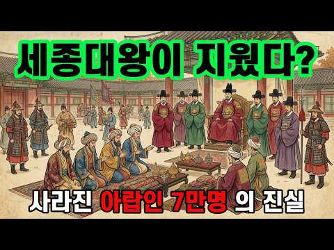
- 설명 앞부분: 📜 서기 1024년, 고려의 수도 개경에 낯선 사람들 100명이 한꺼번에 나타납니다. 피부색도, 옷차림도, 머리에 두른 천도 전부 달랐던 그들. 고려사에 딱 한 줄 남은 기록 — "대식국의 열라자 등 백 명이 와서 토산물을 바쳤다." 그런데 이건 시작일 뿐이었습니다. 🤔 우리가 흔히 듣는 이야기가 있습니다. "고려는 국제도시였다, 아랍 상인도 살았다, Korea라는 이름도 그들이 만들었다." 그런데 막상 물어보면 — ❓ 그 아랍 사람들이 개경 '어디에서', '어떻게', '얼마나' 살았는데? ❓ 진짜 '살았던' 걸까, 그저 '지나간…
- 대본 없음 (설명) — 음성인식이 끝나면 도입부·흐름이 들어감
- 댓글 264/264: 좋은 점 — 영상 3 · 감사·응원 3 · 더 알고 싶은 것 3 · 아쉬운 점 — 영상 0 · 반박·불만 — 의견 다름 13 · 정치·사회 9 · 경험 공유 6 · 구독·다음 기대 2
  - 좋은 점 — 영상 👍1 “유익하네요 나레이션도 듣기 편안하고 좋아요”
  - 좋은 점 — 영상 👍1 “좋은 내용 감사합니다. 그런데 조금 이상한게 있는데, 아라비아인들이 뭐 얻을게 있다고 그 장거리를 배를 타고 서해안을 거슬러서 예성강으로 들어왔을까요? 조그만 나라에. 고려는 중계무역 국가 였을까요? 이런 내용을 설명해주는 책자도. 콘텐츠도 없어 궁금해서 여쭤봅니다.”
  - 감사·응원 👍100 “안녕하십니까? 윤명철입니다. 우연히 뜬 영상을 보았습니다. 아주 고맙게 보았습니다. 이러한 프로가 계속 만들어지길 바랍니다. 이 기회에 제작자나 시청자들에게 말씅드립니다. 여기 내용들은 저의 선학들부터 저를 거쳐 후배학자들의 연구들이 모인 것입니다. 이밖에도 우리역사…”
  - 감사·응원 👍1 “좋은 내용 감사합니다. 그런데 조금 이상한게 있는데, 아라비아인들이 뭐 얻을게 있다고 그 장거리를 배를 타고 서해안을 거슬러서 예성강으로 들어왔을까요? 조그만 나라에. 고려는 중계무역 국가 였을까요? 이런 내용을 설명해주는 책자도. 콘텐츠도 없어 궁금해서 여쭤봅니다.”
  - 더 알고 싶은 것 👍1 “좋은 내용 감사합니다. 그런데 조금 이상한게 있는데, 아라비아인들이 뭐 얻을게 있다고 그 장거리를 배를 타고 서해안을 거슬러서 예성강으로 들어왔을까요? 조그만 나라에. 고려는 중계무역 국가 였을까요? 이런 내용을 설명해주는 책자도. 콘텐츠도 없어 궁금해서 여쭤봅니다.”
  - 더 알고 싶은 것 👍0 “낙타부대 물소 원숭이 이런 것들이 한반도 어디에 있죠? 서경이 과거 한성으로 불렸던 지금 북한 평양이라구요 ? 고려는 모두 문맹들이라 6천년전 황제시절부터 쓰였던 동서남북도 몰랐다구요 ? 거란과 싸웠던 중국에 있는 지명들이 북한에 있나요 ? 이성계가 집권후 중국에 있…”
  - 반박·불만 — 의견 다름 👍6 “그 개경이 거기가 아닙니다. ㅋㅋ”
  - 반박·불만 — 의견 다름 👍1 “아랍인 아니고 여진족 아닌가? 삼각 돛이 발명되기 전까지 원거리 해상 무역은 불가능 했다 보면 된다. 역풍에 꼼짝없이 바다에 갖혀 죽으니까. 노저어서 태평양 건넌다는 상상하지 말고. 그리고 말이 실크로드지 그건 중공이 지어낸 가짜역사고 뭔 낙타 몇마리 끌고 사막 횡단…”
  - 정치·사회 👍1 “얼마나 많은 역사의 조작이 있는지 알겠다.. 당의 고선지가 서역원정을 가서 실패했는데 그 나라가 대식국이고 압바스왕조인데. 그나라가 발해다.. 고려사절요, 조선왕조실록 모두 1900년이후 승자의 의해 교열당하고 조작되었다. 고려혜종=신성로마제국 초대황제 오토대제 고려…”
  - 정치·사회 👍0 “지금도 한국인 중에 곱슬머리 혹은 피부가 까만분들은 아라비아 반도에서 온 후손일 가능성이 100프로다. 내 친구도 피부가 까만색에 곱슬이라 물어보니 조상중에 상인으로 온 아랍인이 있다고 하더라...토종 한국인이라고 말하면서 악성 곱슬머리를 가진분들은 조상중에 외국인 …”
  - 경험 공유 👍53 “아랍인들 극한의 겨울 몇년 겪고나면 자기나라 그리워 다 귀국하거나 도망갈듯 ㅋ”
  - 경험 공유 👍13 “내가 아랍 상인이라면 한반도 개성, 경주까지 와서 상업활동을 하지는 않았을것이다. 벽란도, 금성은 실크로드에서 물길로 오가기 수월한 위치에 존재해야한다. 신라와 고려는 중계무역을 했다. 한반도는 아니라고 생각해야 정합성이 있다.”
  - 구독·다음 기대 👍100 “안녕하십니까? 윤명철입니다. 우연히 뜬 영상을 보았습니다. 아주 고맙게 보았습니다. 이러한 프로가 계속 만들어지길 바랍니다. 이 기회에 제작자나 시청자들에게 말씅드립니다. 여기 내용들은 저의 선학들부터 저를 거쳐 후배학자들의 연구들이 모인 것입니다. 이밖에도 우리역사…”

### 116. 왕비는 왜 자기 아기에게 젖을 먹이지 못했을까? 왕실 유모 '봉보부인' 제도

- https://www.youtube.com/watch?v=YQV0bUQN9Ps · 과연누구인가 · 구독자 713 · 조회수 118,054 (×165.6, 하루 740.5) · 좋아요 1,688 (1.4%) · 32.9분 · 2026-05-21 · 주제 묶음 3. 조선 · 형식 정보·해설 (그 밖) · 폴더 `W_YQV0bUQN9Ps` (웹 승인)
- 썸네일: 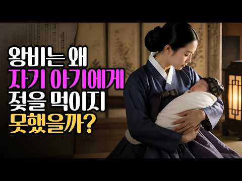
- 챕터: 0:00 태어난 지 21일 · 1:55 왕비가 직접 수유하지 않은 이유 · 5:24 왕실 유모의 선발 기준 · 7:17 "자식의 스승"으로 불린 유모 · 9:40 궁 밖에 남겨진 유모의 아이 · 11:57 봉보부인, 천인이 오를 수 있었던 최고 품계 · 15:47 성종의 유모 백씨 · 20:21 또 한 사람의 봉보부인 · 25:04 유럽 왕실의 유모 제도와 비교 · 29:41 정리: 오늘날의 돌봄 노동과 연결해 보기
- 설명 앞부분: 조선 왕실에서 왕자는 태어난 지 얼마 되지 않아 유모에게 맡겨졌습니다. 이 영상은 왕비가 직접 수유하지 않았던 제도적 배경과, 왕의 유모에게 내려진 '봉보부인' 작호를 조선왕조실록·경국대전과 관련 논문을 바탕으로 정리합니다. 천인 신분의 유모가 어떻게 종1품에 오를 수 있었는지, 그리고 그 대가로 유모의 친자식은 어떤 처지에 놓였는지도 함께 살펴봅니다. 참고 자료 조선왕조실록 (sillok.history.go.kr) 한국민족문화대백과사전 「봉보부인」 한희숙, 「조선 전기 봉보부인의 역할과 지위」, 『조선시대사학보』 43, 2007…
- 같은 채널 평소 대비 ×327.9 (채널 최근 롱폼 중앙값 360회) · 평소 영상: 사약은 숙종이 내렸지만, 장희빈을 악녀로 만든 사람은 따로 있었다 (360회) / 목숨걸고 왕 만들어놨더니 30일만에 후궁을 들였다 (364회)
- 대본 없음 (설명) — 음성인식이 끝나면 도입부·흐름이 들어감
- 댓글 97/97: 좋은 점 — 영상 0 · 감사·응원 1 · 더 알고 싶은 것 1 · 아쉬운 점 — 영상 0 · 반박·불만 — 의견 다름 2 · 정치·사회 0 · 경험 공유 0 · 구독·다음 기대 0
  - 감사·응원 👍3 “잘들었습니다 고맙습니다”
  - 더 알고 싶은 것 👍5 “유모 제안에 선택권이 있을까요? 싫어도 따라야했겠죠”
  - 반박·불만 — 의견 다름 👍37 “왕비들이 모유수유를 못하게 했다하니 어이없고 엄마의 모유에는 아이에게 필요한 영양가가 다 들어있는데 짜내고 약으로 멈추게 했다니 죽일놈이요 또한 유모는 뭘먹고 살았는지 모르는데 그래서 세자나 왕이 저항력이 떨어져서 단명할수 밖에 없지 않았나 싶다”

### 117. 일상속에 숨겨진 치명적인 독 조선시대 사람들이 40세 전에 쓰러진 진짜 이유 ∣ 역사 ∣ 한국사 ∣ 조선

- https://www.youtube.com/watch?v=G4WR44Mrbq8 · 시절담 · 구독자 2,400 · 조회수 360,037 (×150.0, 하루 2,475.8) · 좋아요 6,244 (1.7%) · 50.1분 · 2026-06-18 · 주제 묶음 3. 조선 · 형식 브이로그·직접 해본 이야기 · 폴더 `W_G4WR44Mrbq8` (웹 승인)
- 썸네일: 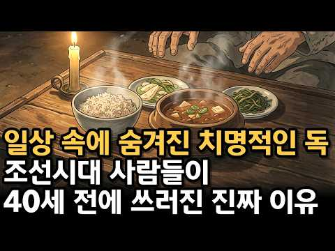
- 설명 앞부분: 1659년 창덕궁, 조선의 왕 효종이 종기 하나에 목숨을 잃습니다 조선 최고의 어의가 24시간 대기하고 있었는데도요. 왕도 못 살린 시대, 백성들의 삶은 어땠을까요? 이 영상에서 다루는 내용 👇 ⏳ 평균수명 35세의 충격적인 진실 💧 물 한 잔이 목숨을 좌우하던 시대 🍚 냉장고 없는 밥상 위의 숨겨진 독 💀 경신대기근, 2년간 백만 명 사망 🏥 동의보감도 못 막은 전염병의 공포 👑 왕이 오히려 일찍 죽은 아이러니한 이유 📊 신분이 수명을 결정한 잔인한 현실 ✨ 35세에서 80세로, 기적의 100년 참고자료 • 조선왕조실록, 현종개…
- 같은 채널 평소 대비 ×740.1 (채널 최근 롱폼 중앙값 486회) · 평소 영상: 조선시대 겨울나기｜방바닥 41도와 판자 마루 사이, 조선 사람들은 한겨울 밤을 어떻게 잤… (513회) / 법에 없는 죄로 죽인 여자 ∣ 남자는 무죄, 여자는 사형 ∣ 인수대비가 어우동을 반드시 … (460회)
- 대본 없음 (설명) — 음성인식이 끝나면 도입부·흐름이 들어감
- 댓글 534/541: 좋은 점 — 영상 4 · 감사·응원 18 · 더 알고 싶은 것 3 · 아쉬운 점 — 영상 3 · 반박·불만 — 의견 다름 7 · 정치·사회 9 · 경험 공유 23 · 구독·다음 기대 0
  - 좋은 점 — 영상 👍12 “너무 잘 만들었습니다.그때였다면 저는 없을 것같네요.지금 태어 난게 다행이라고 할까? 현제의 삶에 감사와 고마움을 느낍니다.항상 좋은 영상 부탁드립니다.”
  - 좋은 점 — 영상 👍9 “유익한 영상 감사합니다 ~~^^”
  - 감사·응원 👍225 “지금시대 아무리 가난해도 조선시대 왕보다더 화려하고 좋은 환경에서 사는것에 감사하고 우리나라 잘지킵시다”
  - 감사·응원 👍12 “너무 잘 만들었습니다.그때였다면 저는 없을 것같네요.지금 태어 난게 다행이라고 할까? 현제의 삶에 감사와 고마움을 느낍니다.항상 좋은 영상 부탁드립니다.”
  - 더 알고 싶은 것 👍12 “너무 잘 만들었습니다.그때였다면 저는 없을 것같네요.지금 태어 난게 다행이라고 할까? 현제의 삶에 감사와 고마움을 느낍니다.항상 좋은 영상 부탁드립니다.”
  - 더 알고 싶은 것 👍4 “좋은글 주셔서 감사 드립니다 지금도 국민일부는 건강의 시각지대어서 생홠하는분이 많은것 같네요 압으로도 경각시이 될만한소재 부탁드립니다”
  - 아쉬운 점 — 영상 👍3 “너무길다무슨말이그리도기냐멸공”
  - 아쉬운 점 — 영상 👍0 “인트로가 너무 길다 치명적인 독”
  - 반박·불만 — 의견 다름 👍12 “수명이 짧은건 글쎄 부실한 의식주 그거아닌가 겨울엔 방안이 꽁꽁얼어 두툼한 이불을 덥고 군불 방바닥 그을도록ㆍ뜨겁게 지펴도 참을수 없었든 환경 그겄들이 단명을 불렀슬 껍니다😊”
  - 반박·불만 — 의견 다름 👍7 “우물 근처 빨래터는 도랑으로 연결되어 흘러 내립니다. 우물로 스며들지 않아요. 더구나 더러운 빨래는 대부분 냇가에서 했습니다. 조선 이전 삼국시대에도 도시에 하수도가 있었습니다. 그 도랑이 강으로 가고 강물을 떠먹던 사람들이 문제이지 우물이 문제는 아닌거죠. 그리고 …”
  - 정치·사회 👍11 “실용학문이 발전했더라면 훨씬 좋아지고, 발전했을 것이다. 틀에서 벗어나질 못하는 썩은 학문, 글줄이나 암기하는 학문이 국가와 백성들을 옭아메었기 때문이다. 지금은 좌편향 인간들이 신계급사회를 만들고 있다. 로스쿨폐지해야 한다. 붕어빵 교육과 붕어빵 경험만 한 자들이 …”
  - 정치·사회 👍0 “작금에 조선양반되려고 빨갱이질하는 빼찌 공무원 군인 검찰 법관 보안처 공수처 방송 언론 예술 문학 기자 시민단체 유공단체 공산주의 추종 족속이 드디어 토지개혁질 땅국가이전질을 하고있따... 바보궁민 일찍들아 너거들 부터 당해보거라.ㅋ”
  - 경험 공유 👍22 “수은이 큰 몫을 했을 것 같아요. 제가 어릴때 아버지꼐서 무좀에 좋다 하시면서 발에 바르시는 것을 도와 드렸던 기억이 납니다. 이때만 했어도 좋다면 독성을 모르고 그냥 시용을 했기에.”
  - 경험 공유 👍22 “옛날에는 대변에 기생충이 바글바글 큰 지렁이같은것이 나왓어요 저도대변에 나왓던것같아요 73세입니다”

### 118. 세종대왕을 만나면 말이 통할까, 우리말은 500년 동안 얼마나 변했나

- https://www.youtube.com/watch?v=jiV-fQ_-uyE · 역사한줌 · 구독자 6,870 · 조회수 342,289 (×49.8, 하루 7,047.5) · 좋아요 966 (0.3%) · 29.4분 · 2026-09-23 · 주제 묶음 3. 조선 · 형식 정보·해설 (그 밖) · 폴더 `W_jiV-fQ_-uyE` (웹 승인)
- 썸네일: 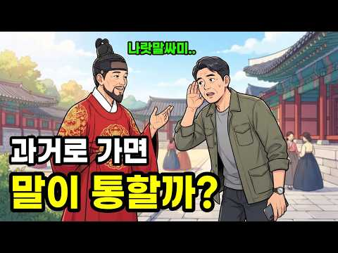
- 챕터: 0:00 440년 전 편지의 첫 줄 · 0:50 100년 전의 목소리 · 3:35 무덤에서 나온 편지와 사극 말투 · 7:55 세종의 한 문장 · 13:22 소리가 넘어온 길 · 17:06 고려의 손과 발, 신라의 달 · 21:18 세종을 만나면 통할까, 그리고 지금 우리 말
- 설명 앞부분: 지금 세종대왕 앞에 선다면 우리는 말이 통할까요? 100년 전 파리에서 녹음된 목소리, 440년 전 무덤에서 나온 아내의 편지, 누구나 외운 훈민정음 첫 문장, 900년 전 송나라 사신이 받아 적은 고려말을 차례로 읽어 가며 우리말이 어디서 끊기고 어디서 이어지는지를 한 칸씩 확인합니다. 이 영상을 보고 나면 사극 말투가 왜 어느 시대의 말도 아닌지, 그리고 지금 우리 입에서 어떤 소리가 사라지고 있는지 알게 됩니다. ⏱ 타임스탬프 MBC 뉴스데스크 — "조선 글씨는 28자 올시다" 최초 한글 음성 자료 한국어문교육연구회 어문연구…
- 같은 채널 평소 대비 ×12.8 (채널 최근 롱폼 중앙값 26,786회) · 평소 영상: 발해 사람들은 망하기 5개월 전부터 고려로 왔다, 왜 하필 고려였을까? (36,000회) / 우리 조상의 피부는 원래 무슨 색이었을까? 한국인의 피부색은 어디서 왔나 (38,398회)
- 대본 없음 (설명) — 음성인식이 끝나면 도입부·흐름이 들어감
- 댓글 120/142: 좋은 점 — 영상 3 · 감사·응원 2 · 더 알고 싶은 것 0 · 아쉬운 점 — 영상 1 · 반박·불만 — 의견 다름 0 · 정치·사회 1 · 경험 공유 6 · 구독·다음 기대 1
  - 좋은 점 — 영상 👍5 “아직도 호남의 일부 지역에서는 남편을 자네라고 합니다 ! 좋은 영상 감사합니다 😊😊😊”
  - 좋은 점 — 영상 👍1 “궁금한게 있는데 누가 처음으로 언어를 말했을까? 글이 없을때도 말을 하고 이해를 했다는데 다른 나라도 그렇고 어떻게 배웠을까”
  - 감사·응원 👍7 “목소리랑 영상은 AI딸깍인데 내용은 기존에 유튜브에서 커버하지 않던것이니 대본마저 AI로 딸깍 썼다하더라도 감사하게 듣겠습니다”
  - 감사·응원 👍5 “아직도 호남의 일부 지역에서는 남편을 자네라고 합니다 ! 좋은 영상 감사합니다 😊😊😊”
  - 아쉬운 점 — 영상 👍0 “근데 자막이랑 음성이랑 다르게 읽으신 게 있어서 ㅠ 듕귁에달아 > 둑귕에 달아, 빋싸다 > 빧사다 라고 읽으셨는데 뭐가 맞는 걸까요”
  - 정치·사회 👍0 “북한사람 조선족 고려인 전부 말이 통하잖아 무조건 말통해”
  - 경험 공유 👍25 “40대인 나도 지금 10대들 이야기 하는거보면 특이한 말투가 있다”
  - 경험 공유 👍2 “우리 말이 스펙터클하게 백년도 안되어 바뀌었다면 어떻게 스페인과 남미는 말이 통하며 영국과 호주는 또 말이 통할까? 아무리 서로 교류한다 하더라도 빈번한 교류가 아니며 각 사회는 다루게 발전했을텐데... 내가 생각하기에 글은 말을 그대로 표현하지 못한다고 생각한다. …”

### 119. 승은 한 번으로 조선을 뒤집은 5번의 밤 ∣ 왕의 침실에서 시작된 조선 500년의 나비효과 ∣ 한국사 ∣ 조선왕조실록 ∣

- https://www.youtube.com/watch?v=uFgU7xSrF9I · 역사 한 자락 · 구독자 596 · 조회수 86,640 (×145.4, 하루 591.4) · 좋아요 1,179 (1.4%) · 41.5분 · 2026-06-03 · 주제 묶음 3. 조선 · 형식 정보·해설 (그 밖) · 폴더 `W_uFgU7xSrF9I` (웹 승인)
- 썸네일: 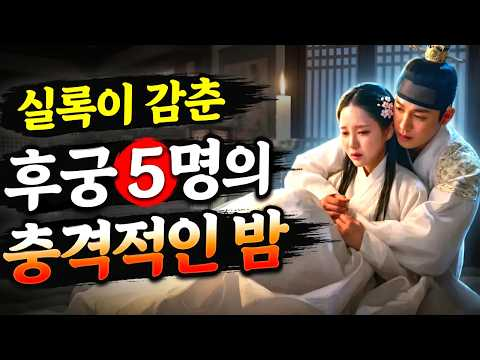
- 챕터: 0:00 손톱이 깎여 나간 궁녀의 밤 · 1:30 첫 번째 밤 — 숙빈 최씨, 7년을 기다린 칼 · 9:00 두 번째 밤 — 장희빈, 혜성과 함께 나타난 여자 · 19:00 세 번째 밤 — 공빈 김씨와 인빈 김씨, 침실 쟁탈전 · 26:00 네 번째 밤 — 폐비 윤씨, 연산군의 어머니 · 33:00 다섯 번째 밤 — 영빈 이씨, 25년을 기다린 여자 · 40:00 다섯 개의 밤이 남긴 것
- 설명 앞부분: 열일곱 살 궁녀의 손톱이 뿌리까지 깎여 나갔습니다. 왕의 옥체에 흠집 하나 낼 수 없도록. 그런데 이 여자가 들어간 방 안의 이야기는, 실록 1,893권 어디에도 단 한 글자도 없습니다. 🔹 물 긷던 무수리? — 실록에 '무수리'라는 단어는 단 한 줄도 없습니다 🔹 장희빈의 얼굴 — 472년 실록에서 사관이 직접 외모를 묘사한 거의 유일한 여자 🔹 하늘이 미리 경고했다 — 혜성이 뜬 그 밤, 사관이 남긴 소름 돋는 한 줄 🔹 왕비가 왕의 침소에 난입했다 — 조선 500년 단 한 번뿐인 기록 🔹 "내 아들을 죽여주소서" — 어머니가…
- 같은 채널 평소 대비 ×49.7 (채널 최근 롱폼 중앙값 1,745회) · 평소 영상: 조선시대 밤문화의 실체 ∣ 유교 법도 박살 낸 양반들의 은밀한 1급기밀 (2,313회) / 조선 3대 위인, 5천만 국민 속여온 500년 가스라이팅의 실체 ∣ 한국사 (1,177회)
- 대본 없음 (설명) — 음성인식이 끝나면 도입부·흐름이 들어감
- 댓글 116/116: 좋은 점 — 영상 0 · 감사·응원 1 · 더 알고 싶은 것 0 · 아쉬운 점 — 영상 0 · 반박·불만 — 의견 다름 0 · 정치·사회 0 · 경험 공유 2 · 구독·다음 기대 0
  - 감사·응원 👍2 “구독 좋아요 꾸욱 누르고 화이팅입니다 🎉”
  - 경험 공유 👍17 “무수리 라는 표현이 출신을 깎아 내리기 위한 거였다고 했었는데 뒤에는 대놓고 무수리 출신 이라고 나오네요....”
  - 경험 공유 👍6 “첫번째 밤에서 숙빈최씨가 무수리가 아니라면서 다섯째 밤에서 영조를 말할 때는 무수리라고 하네 그리고 이런 것을 내가 왜 지적하고 있을까? ㅋㅋ”

### 120. 200개 문명이 '같은 날'을 기억하는 소름 돋는 이유 ㅣ 전 세계 200개 문명이 증언하는 대홍수, 과학자들도 인정한 충격적 사실

- https://www.youtube.com/watch?v=d1kg9gfbQkI · 역사로 가다 · 구독자 854 · 조회수 136,985 (×160.4, 하루 821.9) · 좋아요 1,771 (1.3%) · 36.6분 · 2026-05-27 · 주제 묶음 8. 문명·고고학 · 형식 정보·해설 (그 밖) · 폴더 `W_d1kg9gfbQkI` (웹 승인)
- 썸네일: 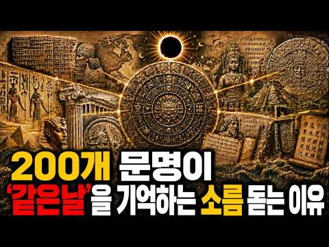
- 챕터: 0:00 인트로 — 같은 날을 기억하는 일곱 개 문명 · 2:54 수메르 대홍수 신화 — 길가메시 서사시, 아트라하시스… · 7:58 과학 증거 — 슈루팍·우르 홍수 퇴적층 발굴 현장 · 10:45 인도 홍수 신화 — 마누와 물고기, 마츠야 푸라나 · 13:30 그리스 홍수 신화 — 제우스의 분노, 데우칼리온의 아… · 16:15 이집트 — 대홍수를 기록하지 않은 문명, 부재라는 단서 · 18:02 마야 홍수 신화 — 나무 인간, 포폴 부흐와 불탄 원본 · 21:25 중국 대홍수 — 곤과 우, 지시협곡 대홍수 과학적 증거 · 24:15 과학 증거 — 흑해 범람 가설, 버클 크레이터, 마다… · 23:30 히브리 창세기 — 노아의 방주와 두루프나르 유적 GP… · 26:30 마무리 — 신화인가, 데이터인가
- 설명 앞부분: 서로 만난 적 없는 일곱 개 문명에 같은 대홍수 이야기가 남아 있습니다. 수메르, 인도, 그리스, 마야, 중국, 이집트, 히브리, 길가메시 서사시의 홍수 점토판부터 노아의 방주 흔적이 의심되는 두루프나르 유적까지, 일곱 문명의 홍수 기록과 과학적 증거를 한 편에 담았습니다. 이 기록들은 신화일까요, 아니면 아직 다 읽지 못한 데이터일까요. 🔹 수메르, 인도, 그리스, 마야, 중국, 히브리 — 서로 만난 적 없는 여섯 문명이 왜 같은 홍수를 기록했을까? 🔹 피라미드를 쌓고 사후 세계를 설계한 이집트는 왜 이 이야기만 빠뜨렸을까? 🔹…
- 같은 채널 평소 대비 ×234.2 (채널 최근 롱폼 중앙값 585회) · 평소 영상: 고대 문명의 주사위에서 시작된 43억 2천만 년 — 지구 나이와 겹친 건 우연일까 (585회) / 다 같 영국인데, 잉글랜드·스코틀랜드·웨일스·북아일랜드는 대체 뭐가 다른 걸까? (521회)
- 대본 없음 (설명) — 음성인식이 끝나면 도입부·흐름이 들어감
- 댓글 370/370: 좋은 점 — 영상 2 · 감사·응원 2 · 더 알고 싶은 것 2 · 아쉬운 점 — 영상 5 · 반박·불만 — 의견 다름 4 · 정치·사회 1 · 경험 공유 3 · 구독·다음 기대 0
  - 좋은 점 — 영상 👍0 “우가 누구한테 배웠을까? 고조선의 태자부루로부터 배운거네”
  - 좋은 점 — 영상 👍0 “기원전 없다 단군조선으로 건국됐고 지구의 국호는 단군조선 이다 지구의 단군조선은 불교식 문명 뿐이고 다른 문명없다 지구의 단군조선 백성들은 천자문 문자로 문자와 말를 배웠고 지구의 인류들은 300년 전에 고려조선의 천자문 문자로 창제한 문자를 배웠고 불교 단어를 사용…”
  - 아쉬운 점 — 영상 👍3 “결국 성경은 동네 찌라시를 모아 짜집기한 책이란 얘기네”
  - 아쉬운 점 — 영상 👍2 “성경의 구약은 여기저기서 듣고 카피한 짜집기 소설임😊”
  - 반박·불만 — 의견 다름 👍7 “초기문명이 다합쳐도 200개가 안됨...그리고 그들문명에 전부 대홍수기록이 있다? 전세계 소수민족들 싹다모아야 200개 되려나? 그리고 그들이 기록이 있고 문자가있었나? 그걸 모두 해독했다? 말도안되는 개소리지 몇몇문명에 그런 비슷한 내용이 있어서 전세계로 모두 일반…”
  - 반박·불만 — 의견 다름 👍1 “대홍수는 없습니다. 과학적으로 불가능한 이야기입니다. 대홍수라는 범지구적 재앙이 아니더라도 홍수 전설이 각 문명에 존재하는건 사실 '당연한'일입니다. 1. 강을 끼고 발달한 고대 도시문명에게 '홍수'는 필연적인 재앙입니다. 현대처럼 치수 기술이 발달하지 못했기에 강이…”
  - 정치·사회 👍0 “그리고 노아의 홍수는 메소포타미아 길가메시 이야기를 카피한거고 이건 한국이 걱정할 일은 아닙니다. 산맥들이 뭉친 나라가 한반도라 노아의 홍수정도에도 산 꼭대기에 올라 살아남을 수 있으니까요. 평지만 있는 나라들은 살아남기 힘들 겁니다”
  - 경험 공유 👍0 “근데 무당 영매 천문학점성술 오컬트니 채널러 스타시드 등등 그런사람들은 잘 모르나? 아님 알면서 말해봤자 이해못하니 말안해주는건가? ㅋㅋ”

