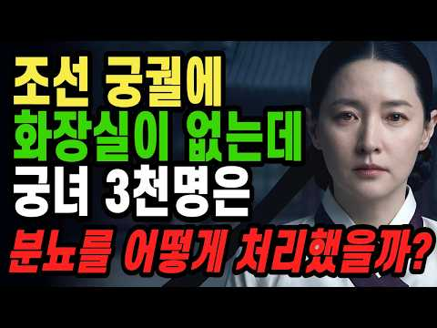
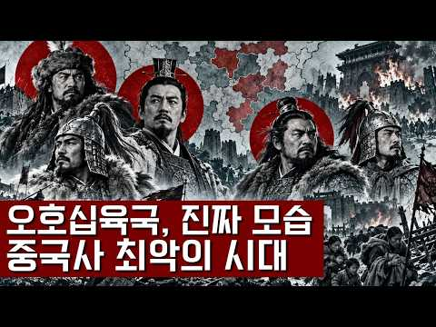
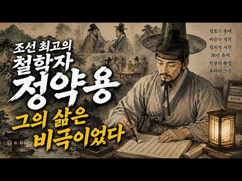
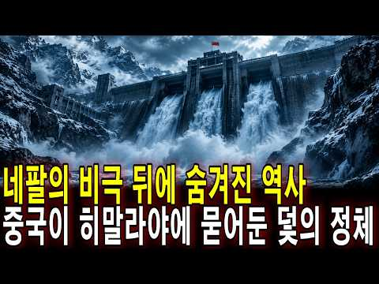
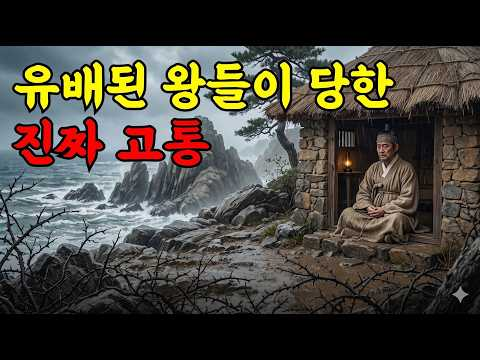
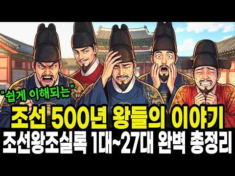
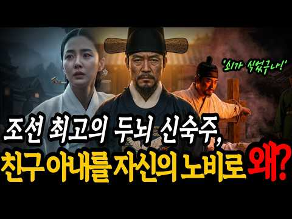
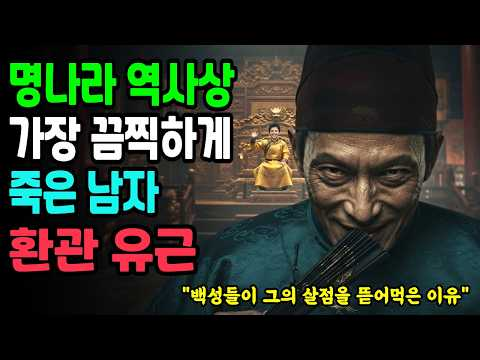
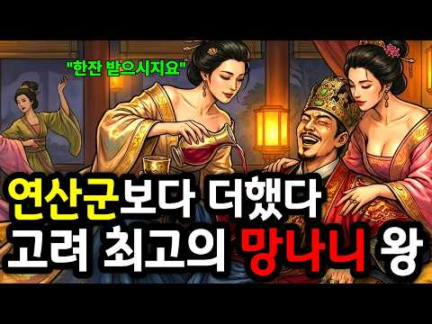
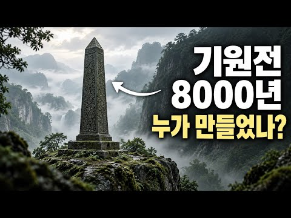

# 역사 — 성공 사례 분석: 사례별 자세히 #121–#160

`analysis.md` 의 9번 (같은 # 번호). 자동 생성 — `tools/success_analysis.py` v1.5.1 (2026-10-24 07:34 UTC). ※ 연구·교육용 — 투자 권유가 아님.

### 121. 종기하나에 왜 조선 왕들은 줄줄이 목숨을 잃었을까? 조선왕조실록 속 숨겨진 비밀

- https://www.youtube.com/watch?v=9pevoSr0BEk · 스티브잡학 · 구독자 1,500 · 조회수 150,236 (×100.2, 하루 899.9) · 좋아요 1,111 (0.7%) · 14.4분 · 2026-05-10 · 주제 묶음 3. 조선 · 형식 정보·해설 (그 밖) · 폴더 `W_9pevoSr0BEk` (웹 승인)
- 썸네일: 
- 챕터: 0:00 천하를 쥔 왕조차 꼼짝 못한 병. · 0:45 왕의 지옥, 종기가 뭐길래 · 2:24 30센티미터 고름 주머니의 공포 · 4:20 걸어 다니는 세균 배양기, 곤룡포의 비밀 · 5:56 하루 다섯 끼, 걷기는 0분 · 7:31 칼을 들고도 찌르지 못한 의원들 · 9:29 백성은 살고 왕은 죽는 조선 · 11:13 고름 한 덩어리가 무너뜨린 나라 · 13:13 조선왕과 현재
- 설명 앞부분: '종기' 하나에 왜 최고 권력자인 조선왕들은 줄줄이 죽음을 맞이했을까요? 조선왕조실록을 샅샅이 뒤져보면, 조선의 역대 왕 27명 중 무려 12명이 종기로 끔찍한 고통을 겪었습니다. 그리고 피의군주 세조를 비롯, 준비된 성군이었던 문종과 개혁 군주 정조를 포함한 무려 5명의 왕이 결국 이 병을 이기지 못하고 세상을 떠났죠. 우리가 몰랐던 곤룡포의 치명적인 단점부터, 어의의 수전증이 부른 어처구니없는 참사까지, 역사 비하인드 스토리를 지금 영상으로 확인하세요! 🍿 타임라인 《조선왕조실록(朝鮮王朝實錄)》 《승정원일기(承政院日記)》 《효…
- 같은 채널 평소 대비 ×1,164.6 (채널 최근 롱폼 중앙값 129회) · 평소 영상: 왕의 술주정? 조선시대 왕들의 사생활, 눈물겨운 스트레스 해소법 (129회) / 합격률 0.02%의 지옥..조선 500년 과거시험 역사상 최고의 천재는? (122회)
- 대본 없음 (설명) — 음성인식이 끝나면 도입부·흐름이 들어감
- 댓글 218/218: 좋은 점 — 영상 0 · 감사·응원 1 · 더 알고 싶은 것 0 · 아쉬운 점 — 영상 0 · 반박·불만 — 의견 다름 3 · 정치·사회 1 · 경험 공유 5 · 구독·다음 기대 0
  - 감사·응원 👍7 “이것만 보면 왕이란 직업은 그냥 국가를 위한 희생자들. 하지만 그 직업 밑에서 일하던 수없이 많던 직업들과 가족 이웃. 참으로 우리나라란...고맙습니다. 조상님들. 잘 살아주셔서. 힘드셨을 텐데.”
  - 반박·불만 — 의견 다름 👍0 “혹시 2차감염? 무섭습니다. 현대의학에서 별거아닌것이 아닙니다. 2차 감염(봉화직염) 때문에 다리를 자를뻔했습니다. 결국 일주일동안 가장강한 항염제를 쓰고 여러번 고생했습니다.”
  - 반박·불만 — 의견 다름 👍0 “1번 2번 댓글은 살짝 무의미.... 요즘은 적어도 '왕사남' 때문이라도, 1번에 마음이 가는 사람이 많을 수 밖에요.... 현대인들의 마음은.... 조선 초기냐, 중후기냐, 이런 문제가 아니죠. 종기라는게 결국은 세포가 죽어서 고이는 질환인건데... 외과 치료에 소…”
  - 정치·사회 👍0 “조선은 왕의 나라가 아니었음. 사대부의 나라였음. 등, 사타구니, 두피등 땀이 많이 차는 곳에 주로 생기고 씻지않고 그냥 말리면 세균번식으로 뾰루지, 종기가 많이 생김. 땀이 많은 체질에 잘생김.”
  - 경험 공유 👍34 “1970년대까지만 해도 종기가 다반사였어. 나도 초등학교 때 눈두덩이에 밤톨만한 종기로 고생하다가 외과에 가서 마취도 없이 칼로 째고 나았지. 왜 마취도 없이 쨌나 몰라. 너무 상처가 심해서 마취가 의미가 없었는지도 몰라. 하여간 그래도 나았다. 조선시대 태어났다면 …”
  - 경험 공유 👍9 “문종에게 한표 던집니다. 5년만 더 살았어도 단종은 성군이 되고 역사는 바뀌었을텐데.. 저도 초딩때 무릎종기로 고생했던 기억이ㅠㅠ 무릎 성할날 없던 어린 시절이지만 그립네요😂”

### 122. 소름 끼치게 놀라운 AI로 재현해 본 조선 왕 27인의 실제 모습 ∣ 우리가 몰랐던 진짜 성격

- https://www.youtube.com/watch?v=BIvwX_N1iPs · 비밀야담 보관소 · 구독자 2,600 · 조회수 260,048 (×100.0, 하루 2,256.3) · 좋아요 2,091 (0.8%) · 18분 · 2026-07-01 · 주제 묶음 3. 조선 · 형식 야담·옛날이야기 · 폴더 `W_BIvwX_N1iPs` (웹 승인)
- 썸네일: 
- 설명 앞부분: 조선 시대의 이야기를 만들면 만들수록, '조선 왕들의 실제 모습은 과연 어떠했을까'라는 궁금증이 점점 커져만 갔습니다. 27명 임금들의 어진이 전쟁과 화재로 소실되지 않고 온전히 남아있었다면 얼마나 좋았을까라는 안타까움도 참 컸습니다. 간혹 몇몇 남아있는 어진들을 보며 상상의 나래를 펼쳐왔지만 늘 안타까움이 남았고, 결국 이번 기회에 역사적 기록과 AI 기술을 동원해 직접 재현을 시도해 보았습니다. 특히 영상의 시작과 끝에는 조선 왕조의 엄숙한 예법과 왕권을 상징하는 의궤, 그리고 왕의 뒤를 지키던 일월오봉도를 직접 구현하여 배치…
- 같은 채널 평소 대비 ×1,390.6 (채널 최근 롱폼 중앙값 187회) · 평소 영상: 조선 땅에 괴수가 나타나 조정 대신을 밟아 죽이고 유배를 떠났다 #코끼리유배 #태종이방원… (187회) / 망나니, 사람의 목을 베고 살아야 했던 자들 #망나니 #조선시대 #역사다큐 #비밀야담보관소 (168회)
- 대본 없음 (설명) — 음성인식이 끝나면 도입부·흐름이 들어감
- 댓글 139/144: 좋은 점 — 영상 1 · 감사·응원 1 · 더 알고 싶은 것 1 · 아쉬운 점 — 영상 2 · 반박·불만 — 의견 다름 4 · 정치·사회 4 · 경험 공유 2 · 구독·다음 기대 0
  - 좋은 점 — 영상 👍7 “효종은 굉장히 미화된 면이 있는 왕입니다. 알면 알수록, 학생때 배웠던 모습과 굉장히 괴리가 있음. 무능하고 시샘이 가득한 아버지에 의해 형이 독살을 당하고 죄없는 형수와 조카들이 죽음을 당했는데도 손하나 까딱 안한 사람입니다. 인조가 살아있을 때는 어쩔 수 없다고 …”
  - 더 알고 싶은 것 👍7 “AI로 재현한 것이 어떻게 실제 모습인가요?”
  - 아쉬운 점 — 영상 👍29 “조선시대 왕들의 어진들이 불타버린 게 너무 아쉽습니다.”
  - 아쉬운 점 — 영상 👍5 “이름도안넣고 심지어 자막이 얼굴부분을 가림ㅋㅋ”
  - 정치·사회 👍5 “이재명이 세종대왕 일하는 스타일이 비슷하네요?”
  - 정치·사회 👍1 “고려시대 어진은? 없나요? 언젠간 대한민국 시대가 끝나면 대통령 사진 다 없앨건가?”
  - 경험 공유 👍4 “세종... 지폐에 그 얼굴생각한 내가 이상한건가ㅋ”
  - 경험 공유 👍2 “오... 저도 작업해보던 거라 반갑습니다 ㅎㅎ 잘 뽑으셨네요”

### 123. 한국인은 왜 양고기를 거의 안 먹을까? 돼지고기와 100배 차이, 숨겨진 역사 이야기

- https://www.youtube.com/watch?v=T9z8nPsgfvc · 몰랐던 세상 · 구독자 1,820 · 조회수 180,246 (×99.0, 하루 12,080.0) · 좋아요 1,037 (0.6%) · 12.8분 · 2026-10-09 · 주제 묶음 1. 역사 일반·이야기 · 형식 수면·낭독 (잠잘 때 듣는) · 폴더 `W_T9z8nPsgfvc` (웹 승인)
- 썸네일: 
- 챕터: 0:00 한국인은 왜 양고기를 거의 먹지 않을까? · 0:54 양고기를 많이 먹는 나라들의 공통점과 건조한 기후 · 2:04 장마와 논농사가 발달한 한반도, 양고기가 낯설어진 이유 · 3:52 세계적으로도 양고기 소비가 특정 지역에 집중된 이유 · 4:22 중동과 중국에서 양고기가 사랑받는 역사와 문화 · 6:16 양고기 특유의 냄새와 익숙한 음식이 입맛에 미치는 영향 · 8:02 수입 중심의 유통 구조와 한국의 양고기 소비 변화 · 9:46 양고기가 한국인의 일상 식탁에 자리 잡기 어려웠던 5… · 10:32 처음 양고기를 먹는다면? 냄새를 줄이는 선택과 조리 팁
- 설명 앞부분: 한국인은 왜 돼지고기와 소고기는 자주 먹으면서 양고기는 상대적으로 덜 먹을까요? 그 이유는 단순히 냄새나 입맛 때문만은 아닙니다. 한반도의 기후와 농업 환경, 수천 년의 역사, 종교와 음식 문화, 유통 구조까지 다양한 요인이 얽혀 있습니다. 📖 이번 역사 이야기에서는 중동과 중국에서 양고기가 사랑받게 된 배경부터 조선시대 왕실 제사와 한국인의 식탁에 양고기가 자리 잡지 못한 이유까지 살펴봅니다. 🌏 한 가지 음식에도 그 나라의 자연환경과 생활 방식이 담겨 있습니다. 흥미로운 역사 이야기를 통해 우리가 익숙하게 먹어 온 음식과 다른…
- 같은 채널 평소 대비 ×37.4 (채널 최근 롱폼 중앙값 4,813회) · 평소 영상: 독일인은 왜 생돼지고기를 빵에 발라 먹을까? 충격적인 매트의 역사 이야기 (4,813회) / 프랑스 대통령의 마지막 만찬…얼굴을 가리고 먹은 잔혹한 요리의 충격적인 진실 ∣ 역사 이… (4,124회)
- 대본 없음 (설명) — 음성인식이 끝나면 도입부·흐름이 들어감
- 댓글 253/257: 좋은 점 — 영상 0 · 감사·응원 0 · 더 알고 싶은 것 0 · 아쉬운 점 — 영상 1 · 반박·불만 — 의견 다름 3 · 정치·사회 5 · 경험 공유 6 · 구독·다음 기대 0
  - 반박·불만 — 의견 다름 👍7 “비싸도 맛있으면 먹게 되는데 비싸다고 느낄 정도는 아닙니다. 하지만 특유에 냄새가 나서 각종 향신료를 들이 부어도 도저히 못 먹겠더라구요..”
  - 반박·불만 — 의견 다름 👍0 “양고기는 무신... 한국에 양이 없다고 해도 과언이 아닌데... 제주도에서 말고기 먹는다고 타 지역도 다 말고기 먹어야 되남? 양양 하지마라 냐옹이가 냥냥한다.”
  - 정치·사회 👍2 “요즘 조선족과 중국인 몰려오면서 양꼬치집 엄청 생겨남..전부 수입산 양고기..곧 양고기가 메이저 고기로 등장할것...”
  - 정치·사회 👍0 “70년대 돼지고기 파동이ㅠ일어났을때 정부에서 양고기를 수입해서 풀어논적있었음 음식 잘하시는 어머니도 양고기는 포기했음 온갖양념으로 잡내를 잡으려 했지만 불발 ..”
  - 경험 공유 👍0 “내가 1년에 돼지고기를 30kg밖에 안먹는다고? 100kg도 더 먹을것 같은데?”

### 124. 인간은 죽으면 어디로 가는가? 수메르 점토판이 밝힌 충격적인 진실… 아무도 그 함정을 보지 못했다

- https://www.youtube.com/watch?v=uu8Ffx5ZnfY · 조용한 밤 이야기 · 구독자 1,410 · 조회수 138,956 (×98.5, 하루 1,337.4) · 좋아요 1,292 (0.9%) · 30.5분 · 2026-07-12 · 주제 묶음 8. 문명·고고학 · 형식 정보·해설 (그 밖) · 폴더 `W_uu8Ffx5ZnfY` (웹 승인)
- 썸네일: 
- 설명 앞부분: 인간은 죽으면 어디로 가는가? 수천 년 전 수메르 문명이 남긴 점토판에는 죽음 이후 인간에게 일어나는 과정과 영혼, 사후 세계에 대한 놀라운 기록이 담겨 있다고 전해집니다. 이번 영상에서는 수메르 점토판에 기록된 사후 세계의 비밀, 영혼의 여정, 고대 문명이 남긴 미스터리, 그리고 오늘날까지도 논란이 되는 숨겨진 의미를 살펴봅니다. 과연 이것은 단순한 신화일까요, 아니면 잊혀진 고대의 지식일까요? ※ 이 영상은 역사적 기록, 고고학적 발견, 신화와 다양한 연구 및 해석을 바탕으로 제작되었습니다. 일부 내용은 학계에서 확정된 사실이…
- 같은 채널 평소 대비 ×180.0 (채널 최근 롱폼 중앙값 772회) · 평소 영상: 2억 년 전 지구는 완전히 달랐다… 판게아로 떠나는 시간여행 (702회) / 중국 전체를 정복한 몽골은 왜 일본을 정복하지 못했을까 두 번의 침공과 충격적인 패배! (572회)
- 대본 없음 (설명) — 음성인식이 끝나면 도입부·흐름이 들어감
- 댓글 99/99: 좋은 점 — 영상 0 · 감사·응원 1 · 더 알고 싶은 것 1 · 아쉬운 점 — 영상 1 · 반박·불만 — 의견 다름 2 · 정치·사회 0 · 경험 공유 3 · 구독·다음 기대 0
  - 감사·응원 👍1 “엄청난 영상입니다~~ㄷㄷㄷ 정말 감사합니다~~~♡”
  - 더 알고 싶은 것 👍1 “그런 내용이 담긴 점토판을 보여 주세요 그리고 전문가의 의견을 인터뷰한 영상도 올려 주세요 믿지 않음 인간은 죽으면 끝 영원히 살고 싶은 인간의 욕심이 만든 비과학적 샤머니즘 살아 있는 동안 행복하게 사세요 인간의 뇌는 살기 위해 가상의 공간을 만들고 그곳에서 위로를…”
  - 반박·불만 — 의견 다름 👍0 “궁금해하지말고 재밌게 살다 갑시다. 날파리가 그러던가요? 코끼리가 그러던가요? 생명의 숫자 논리로 따지면 지구 탄생 46억 년 전 생명체> 그래서 윤회설도 안맞는 겁니다. 지구 탄생 그때 인간 80억명이었나요? 그게 벌레로, 인간으로 총량? 말도 안되는 인간들의 논리…”
  - 반박·불만 — 의견 다름 👍0 “아직도 이런 헛소리를 올리나? 얼척없네 ㅋ”
  - 경험 공유 👍2 “다시 태어나더라도 그건 더 이상 내가 아니다! 영혼불멸 이야기라면 또 다른 차원의 이야기”
  - 경험 공유 👍1 “첫 영상 속 표식 50평생 딱 한번 봤는데 자다 깨서 눈에서 나온듯 시선 따라서 벽에 부딪혀 크기도 달라져 움직였는데 형광색? 푸른 빚.. 내가 팔이 눈을 눌러 자다 깨 그런걸 본게 아닐까.... 생각들었는데 깨서 약 20초간 보였던듯”

### 125. 역대 이순신 역할중 가장 싱크로율 높은 배우는? #이순신영화 #이순신실제모습

- https://www.youtube.com/watch?v=WrHgunG_gNc · 페이스 아카이브 · 구독자 1,700 · 조회수 166,472 (×97.9, 하루 8,490.5) · 좋아요 415 (0.2%) · 5.3분 · 2026-10-04 · 주제 묶음 3. 조선 · 형식 정보·해설 (그 밖) · 폴더 `W_WrHgunG_gNc` (웹 승인)
- 썸네일: 
- 챕터: 0:00 오프닝 · 0:08 역대 한국 영화·드라마 속 이순신 소개 (노량, 명량… · 0:23 기록 속 초상화 및 사료를 통한 이순신의 실제 외모 … · 0:54 1대 이순신: 1962년 유현목 감독 영화, 김승길 · 1:00 2대 이순신: 1968년 KBS 드라마 난중일기, 고… · 1:08 3대 이순신: 1971년 이규웅 감독 영화 성웅 이순… · 1:18 4대 이순신: 1972년 KBS 드라마 임진왜란, 주현 · 1:24 5대 이순신: 1977년 KBS 특집 단막극 이순신,… · 1:35 6대 이순신: 1985년 MBC 대하드라마 조선왕조 … · 1:55 7대 이순신: 2004년 KBS 드라마 불멸의 이순신… · 2:18 8대 이순신: 2005년 영화 천군, 박중훈 · 2:38 9대 이순신: 2014년 영화 명량, 최민식 · 2:55 10대 이순신: 2015년 드라마 징비록(선조와 유성… · 4:07 12대 이순신: 2022년 영화 한산: 용의 출현, … · 4:31 13대 이순신: 2023년 영화 노량: 죽음의 바다,… · 5:12 클로징: "내 마음속의 이순신을 댓글로 남겨 주세요!"
- 설명 앞부분: 1962년 영화부터 2023년 최신작까지, 한국 역사와 대중문화 속에서 그려진 역대 이순신 장군 캐릭터 13명의 변천사를 다룬 콘텐츠입니다. 각 시대별 영화와 드라마, 기록 속 초상화 및 역사적 묘사를 바탕으로 다양한 배우들이 연기한 이순신 장군의 모습을 비교하며, 진짜 이순신 장군의 모습과 가장 닮은 배우는 누구일지 흥미롭게 되짚어 봅니다. 타임 라인 KBS, MBC, SBS 드라마 홍보 영상 영화 이순신 3부작, 일부 홍보자료
- 같은 채널 평소 대비 ×2.6 (채널 최근 롱폼 중앙값 63,032회) · 평소 영상: 고구려는 페라리, 백제는 올칼라, 일본은 맨발? 1400년 전 동아시아 사신 외모 품평전… (63,032회) / [3부작] 이순신의 실제 얼굴을 찾아서1 #이순신후손 (63,949회)
- 대본 없음 (설명) — 음성인식이 끝나면 도입부·흐름이 들어감
- 댓글 398/402: 좋은 점 — 영상 1 · 감사·응원 1 · 더 알고 싶은 것 0 · 아쉬운 점 — 영상 2 · 반박·불만 — 의견 다름 5 · 정치·사회 4 · 경험 공유 14 · 구독·다음 기대 0
  - 좋은 점 — 영상 👍0 “박해일의 한산에서 장군의 어머니 말이 젤 가슴에 와닿는데...신아..! 너는 나라에 대한 忠이 어디를 향해야 한다고 보느냐 에서 장군의 시선이 피난 오는 백성을 돌아 보는 씬이 가장...닮은 얼굴은 요즘 AI로 복원한 이국종 교수 모습에 한표...”
  - 감사·응원 👍12 “앞으로도 수많은 이순신 배역을 맡은 사람이 나올것입니다. 그러나 우리 가슴속의 이순신은 영원히...김명민 배우님이실겁니다. 축구로 치면 전국민이 거리로 나와 응원하던 2002 한일 월드컵 같은 느낌?”
  - 아쉬운 점 — 영상 👍0 “03:26 자막이 이상한데”
  - 아쉬운 점 — 영상 👍0 “1985년 조선왕조오백년 임진왜란의 김무생 배우. 국뽕없고 전장의 대국을 볼줄 아는 전략가에요. 나는 불멸의 이순신부터 그 후에 이순신이 나온 임진왜란 드라마 영화는 다 극혐임 국뽕이 너무 많이 들어갔고 특히 불멸의 이순신은 노량해전에서 이순신 장군을 깎아내리는 방향…”
  - 반박·불만 — 의견 다름 👍2 “김명민 배우이상 이순신장군님을 제대로 연기한 배우는 없었습니다 연기력을 말하는 것이 아닙니다 딱 이순신장군님의 강직한면, 무너지는 면, 의지하려는 면, 그러인해 병이나 사경을 해메는 면 모두 이순신장군님을 멋있게만 그리고 맹장으로 그리는 것도 잘못된 것이고, 생각만 …”
  - 반박·불만 — 의견 다름 👍0 “이순신 제독은 실제로 완벽주의자로 엄청나게 꼼꼼하고 세심한 성격의 소유자. 그때문에 위장병을 달고 살았다는 기록이 있고.. 밤에도 잠을 잘 이루지 못했다. 준비 준비 준비.. 오로지 조선을 지켜야 한다는 일념. 그럼에도 조정에서는 말도 안되는 소리를 하고.. 억울하게…”
  - 정치·사회 👍1 “참나. 좌파 배우가 이순신을 하네?”
  - 정치·사회 👍0 “최수종이 제일 아니였음. 이순신 장군의 이름에 먹칠한 캐스팅임. 최수종은 중국인 역할이 맞음.”
  - 경험 공유 👍4 “앞서 보여준 사료로 볼때 가장 싱크로율 높은 배우는 1대와 7대의 김명민임 주현도 이순신 역할을 했었다는걸 알게 됐네요”
  - 경험 공유 👍2 “나도 역시 김명민 생각하고 들어왔는데,,,,”

### 126. 같은 근친혼, 왜 한쪽만 망했을까? ∣ 유전자 복권의 진실

- https://www.youtube.com/watch?v=8Bsvg1loL0c · 역사 보따리 · 구독자 318 · 조회수 31,054 (×97.7, 하루 178.7) · 좋아요 250 (0.8%) · 10.6분 · 2026-05-03 · 주제 묶음 1. 역사 일반·이야기 · 형식 수면·낭독 (잠잘 때 듣는) · 폴더 `W_8Bsvg1loL0c` (웹 승인)
- 썸네일: 
- 챕터: 0:00 침을 질질 흘린 왕 · 0:47 역사가 흐르는 밤 · 1:10 합스부르크, 결혼으로 제국을 만들다 · 2:36 카를로스 2세, 저주받은 마지막 왕 · 4:26 투탕카멘, 파라오도 피할 수 없었다 · 5:46 로스차일드, 같은 선택 다른 결과 · 7:54 창시자 효과, 운명을 가른 유전자 · 9:46 같은 근친혼, 왜 한쪽만 망했을까
- 설명 앞부분: 합스부르크 근친혼 유전병 로스차일드 비밀 ∣ 역사가 숨긴 유전자의 진실 600년간 근친혼을 반복한 합스부르크 왕가. 마지막 왕 카를로스 2세는 밥도 씹지 못하고 침을 흘리며 살다 39살에 숨졌습니다. 그런데 같은 시기, 로스차일드 가문은 71% 이상이 집안끼리 결혼했는데도 유전병이 하나도 나타나지 않았습니다. 같은 근친혼인데 왜 결과가 이렇게 달랐을까요? 유전학이 밝혀낸 '창시자 효과'의 비밀을 파헤칩니다. 🌙 역사가 흐르는 밤은 잠들기 전, 편안하게 들을 수 있는 역사 인물 이야기를 들려드리는 채널입니다.
- 같은 채널 평소 대비 ×796.3 (채널 최근 롱폼 중앙값 39회) · 평소 영상: 빨간 김치는 사실 250년밖에 안 되었다고?!세종대왕도 못 먹은 김치 (39회) / 내시는 거세를 안 했다? — 조선 환관이 결혼하고 자식까지 둔 진짜 이유 (37회)
- 대본 없음 (설명) — 음성인식이 끝나면 도입부·흐름이 들어감
- 댓글 13/13: 좋은 점 — 영상 0 · 감사·응원 0 · 더 알고 싶은 것 0 · 아쉬운 점 — 영상 0 · 반박·불만 — 의견 다름 0 · 정치·사회 1 · 경험 공유 1 · 구독·다음 기대 0
  - 정치·사회 👍1 “한국인은 절대적 근친혼이 불가한국가인데.. 턱이 긴 현ㅈ는 내가볼땐.. 중국인 화교출신인듯..”
  - 경험 공유 👍1 “한국인은 절대적 근친혼이 불가한국가인데.. 턱이 긴 현ㅈ는 내가볼땐.. 중국인 화교출신인듯..”

### 127. 세종대왕이 사랑한 단 한 여자, 노비에서 정1품 빈이 된 숨겨진 사랑 이야기

- https://www.youtube.com/watch?v=SbAPKCB9hbk · 힛토리 · 구독자 678 · 조회수 64,451 (×95.1, 하루 377.1) · 좋아요 450 (0.7%) · 21.8분 · 2026-05-06 · 주제 묶음 3. 조선 · 형식 정보·해설 (그 밖) · 폴더 `W_SbAPKCB9hbk` (웹 승인)
- 썸네일: 
- 설명 앞부분: “이름 없던 노비 소녀… 결국 조선 왕실을 뒤흔들었다” 세종대왕의 곁에는 언제나 조용히 차를 올리고 먹을 갈던 한 여인이 있었습니다. 하지만 그녀의 시작은 화려한 왕족도, 명문가 규수도 아니었습니다. 이름조차 제대로 불리지 못하던 공노비의 딸. 이 영상은 조선 오백 년 역사상 가장 극적인 신분 상승으로 불리는 신빈 김씨의 숨겨진 이야기에서 출발합니다. 왜 세종은 수많은 양반가 규수들을 두고 천민 출신의 여인에게 마음을 주었을까요. 이 영상에서는 세종이 그녀의 외모가 아니라 꺾이지 않는 성품과 따뜻한 배려에 끌렸다는 점, 그리고 그…
- 같은 채널 평소 대비 ×339.2 (채널 최근 롱폼 중앙값 190회) · 평소 영상: 조선을 건국한 이성계가 혼자가 된 이유? (190회) / 왕의 온돌 아래 숨겨진 지옥… 조선 궁궐 난방의 민낯 (189회)
- 대본 없음 (설명) — 음성인식이 끝나면 도입부·흐름이 들어감
- 댓글 52/52: 좋은 점 — 영상 0 · 감사·응원 1 · 더 알고 싶은 것 0 · 아쉬운 점 — 영상 1 · 반박·불만 — 의견 다름 1 · 정치·사회 1 · 경험 공유 0 · 구독·다음 기대 0
  - 감사·응원 👍2 “새로운 사실을 알았네요ᆢ 감사합니다ㆍ”
  - 아쉬운 점 — 영상 👍0 “썸네일에 '세종이 환장했던'이 뭡니까?! 꼭 저렇게 자극적이고 격떨어지는 제목으로 어그로 끌어야 합니까? 내용을 떠나서 그래도 역사를 다루는 컨텐츠에서.. 흥미를 첨가해서 관심유발하고 많은 사람들의 역사지식이 쌓이는 건 바람직하다고 보는데.. 꼭 저런 천박한 자극적인…”
  - 정치·사회 👍0 “남성의 지위와 상관없이 노비여자가 낳은 자식은 자동으로 노비다. 세종이 만든 법이다. 그전까지는 양반 아버지를 아버지라 부르며 중인 위치지만 세종이후로 대감님으로 불러야하며 졸지에 종신세로 전락했다. 그러므로 세종의 총애를 받은 저 노비의 세종자식은 노비여야 맞다. …”

### 128. 조선 팔도 사람들의 진짜 성격, 조선 팔도 사람 기질의 비밀 500년 정도전이 말한 팔도 사람들의 진짜 성격

- https://www.youtube.com/watch?v=HzK-wrKO-eI · 사실과 기록 · 구독자 8,920 · 조회수 842,418 (×94.4, 하루 20,510.0) · 좋아요 6,857 (0.8%) · 26.4분 · 2026-09-13 · 주제 묶음 3. 조선 · 형식 정보·해설 (그 밖) · 폴더 `W_HzK-wrKO-eI` (웹 승인)
- 썸네일: 
- 설명 앞부분: 📜 조선 팔도 사람들의 진짜 성격, 그 500년의 비밀 놀라운 건, 야사 속 정도전의 관찰과 정사 속 이중환의 기록이 결국 같은 이야기를 하고 있었다는 겁니다. 이 영상에서 다루는 내용 정도전이 남긴 팔도 사람 여덟 글자 평 (야사) 이중환 『택리지』에 담긴 팔도 관찰 (정사) 조선 팔도 이름의 유래 (경상도·전라도·충청도·강원도·경기도·황해도·평안도·함경도) 이시애의 난과 홍경래의 난이 남긴 지역 정서의 흔적 600년 전 태종의 팔도가 지금 우리 주소에 살아 있는 이유 지역으로 사람을 판단해도 되는가에 대한 진지한 질문. 『조선…
- 같은 채널 평소 대비 ×117.8 (채널 최근 롱폼 중앙값 7,154회) · 평소 영상: 조선 왕노릇 하느라 애쓴 역사가 외면한 무능한 인조 삼전도에서 일어난 일 ∣ 조선의 항복 (8,412회) / 조선에도 과연 복지제도가 있었을까? 조선 거지가 지금 노숙자보다 더 잘 살았다 (5,895회)
- 대본 없음 (설명) — 음성인식이 끝나면 도입부·흐름이 들어감
- 댓글 1,725/1,784: 좋은 점 — 영상 9 · 감사·응원 8 · 더 알고 싶은 것 4 · 아쉬운 점 — 영상 10 · 반박·불만 — 의견 다름 34 · 정치·사회 158 · 경험 공유 58 · 구독·다음 기대 0
  - 좋은 점 — 영상 👍3 “아하! 처음 알았습니다 재밌는 사실이네요 귀에 쏙쏙 ~ 유익한 정보 잘 들었습니다 하프 누르고 갑니다^^”
  - 좋은 점 — 영상 👍1 “팔도 지역환경. 사람들 성격 지역지명을 논리적으로 이해 쉽게 잘 설명해 주셔서 새로운 역사.민화 .환경.재미있게 보았습니다.”
  - 감사·응원 👍7 “땅은 사람이다 그러나 땅에의지하여 사람을정하는건 사람의그본과본질을 모르기때문이다 사람은 땅에 하늘의정기를 불어넣어사 사람이됐다 그래서 우리는 하늘의자손이다 사람에게서 영성을 빼면 짐승의격으로 내려가는것이다 만물중에 사람이귀한것은 그격이 다르기때문이다 우리민족은 모진고…”
  - 감사·응원 👍1 “설명해주시는,선생님의말씀이,부드럽고따뜻해요,내마음도,부드러워진듯,새로운역사,감사합니다😊”
  - 더 알고 싶은 것 👍5 “전라도는 아직까지 우덜끼리 문화가 존재합니다. 호남향우회만봐도 그렇지요. 식당ㆍ술집ㆍ노래방 지들끼리 하는곳만가요. 그럼 동내에서 어떻게 바라 보겠나요?? 말과 행동이 다르고 우덜끼리 문화가 바뀌지 않은이상 전라도 바라보는건 변하지가 않습니다.”
  - 아쉬운 점 — 영상 👍3 “26분? 너무 길어요.”
  - 아쉬운 점 — 영상 👍1 “핵심적인 내용을 말해야지, 불 필요한 설명이 너무 많고, 지루해서 더 이상 못 보겠다.”
  - 반박·불만 — 의견 다름 👍67 “정이 많다고? 웃기는 소리.”
  - 반박·불만 — 의견 다름 👍25 “백제, 신라, 고려, 심지어 왕의 조상이 그짝 출신이 조선까지 그짝동네에 대한 평가는 일관됨. 간사하고 신용이 없고 도덕성이 떨어진다. 현재도 그렇고 차별,편견이 아니라 과학이란 소리 정도전도 풍전세류로 표현..바람 앞에 흔들리는 가는 버드나무 가지..누가봐도 좋은 …”
  - 정치·사회 👍219 “지금 민주당 국개들 보면 답 나오잖아 어느지역출신이 젤 많은지..”
  - 정치·사회 👍24 “라도가아무리발부동치도대통령은전부경상도”
  - 경험 공유 👍191 “내가 경험한 전라남도와 광주 사람들~~~~! 간과 쓸개 다 빼줄듯이 하다가도 자기 이익 앞에서는 망설임없이 뒤통수 친다~~~!!!! 거의 90%가 그랬음~~~!!!!!”
  - 경험 공유 👍33 “내가 살면서, 딱 한번 1억 사기당했다. 젊은시절 큰 돈이었지. 그 놈이 그 짝 출신이더라. 피해의식 쪄는 그 쪽 사람들. 지금은 그 피해의식으로 포장해서, 세금슈킹을 제일 많이하는 곳이 됬더라”

### 129. 이무기가 왕이 된 조선 - 기생과 암살자 ∣ 찬룡 EP.4

- https://www.youtube.com/watch?v=3k3Qi9yy7HQ · 투모로우 TO:MORROW · 구독자 15,600 · 조회수 1,467,294 (×94.1, 하루 25,342.5) · 좋아요 2,413 (0.2%) · 10.3분 · 2026-08-27 · 주제 묶음 3. 조선 · 형식 정보·해설 (그 밖) · 폴더 `W_3k3Qi9yy7HQ` (웹 승인)
- 썸네일: 
- 설명 앞부분: 조선에서 가장 아름다운 여인들만 모인다는 기생집 ‘화월루’ 그 곳에는 조선 제일미를 자랑하는 기생 ‘소월’이 있었다. 그 날도 어김없이 양반댁 손님들의 부름이 있었고 소월은 자랑하는 가야금 실력을 뽐 내고 있었고 갑자기 화월루 곳곳에 비명소리가 들리기 시작하고 문 틈 사이로 거대한 돼지의 형상을 한 요괴가 모습을 드러내는데... 인간과 요괴, 그리고 무너져가는 조선을 지키려는 자들의 이야기. 시네마틱 판타지 드라마 〈찬룡 篡龍〉 EP.04 — 기생 소월 Written & Directed by MORROW Produced by TO…
- 같은 채널 평소 대비 ×12.9 (채널 최근 롱폼 중앙값 113,872회) · 평소 영상: 이무기가 왕이 된 조선 - 귀신 잡는 전설의 탈 ∣ 찬룡 EP.6 (120,774회) / 이무기가 왕이 된 조선 - 효녀 심청의 죽음 ∣ 찬룡 EP.7 (106,970회)
- 대본 없음 (설명) — 음성인식이 끝나면 도입부·흐름이 들어감
- 댓글 218/231: 좋은 점 — 영상 1 · 감사·응원 5 · 더 알고 싶은 것 5 · 아쉬운 점 — 영상 2 · 반박·불만 — 의견 다름 0 · 정치·사회 0 · 경험 공유 2 · 구독·다음 기대 3
  - 감사·응원 👍4 “❤와우 너무 잼나게 보아요 응원합니다 화이팅 ❤😆😆👍❤️🇰🇷”
  - 감사·응원 👍1 “오우 한지 씬은 제가 본 유툽중에 제일 잘 만드신 장면같습니다...존경스럽네요 구독 박고 응원드리겠습니다 ㅠㅠ”
  - 더 알고 싶은 것 👍2 “재미있네요! 영상도좋고 특히 사운드도 신경 많이 쓰신거 같아요! 계속 올려주세요~ 대박나시길^^”
  - 더 알고 싶은 것 👍1 “1화 부터서 보고있는데 시간가는줄 모르고 보고있네요 ^^ 영상 기가 막힙니다 영상 많이 많이 만들어주세요~~~”
  - 아쉬운 점 — 영상 👍15 “겁나 자연스릅네요..아무리 잘만들어도 다른 시댄스 들마는 ai티 나던디 이건 그냥 직접찍은것 같아서 ㅎㄷㄷ”
  - 아쉬운 점 — 영상 👍8 “그냥 한명의 유튜브가 ai 시대에 맞춰서 재미로 만던 작품이라면 아주 훌륭한 작품. 다른 작품들에 비해 훨씬 더 실사같은 느낌이 강함. 표현 등은 좋고 스토리도 좋음 다만, 많이 아쉬운 점은 퀄리티와 능력에 비하여 디테일이 많이 부족함. 1. 첫번째 등장한 돈괴의 등…”
  - 경험 공유 👍1 “오우 한지 씬은 제가 본 유툽중에 제일 잘 만드신 장면같습니다...존경스럽네요 구독 박고 응원드리겠습니다 ㅠㅠ”
  - 경험 공유 👍1 “잘만들었네요 ..한편에 돈은 얼마나 들던가요? 저도 해보고싶지만 ..너무 후덜덜해서 ...ㅠㅠ”
  - 구독·다음 기대 👍2 “구독하고갑니다… 얼마나 수정하고 디테일을 체크하셨을지 감도 안오네요😮 10만 구독 올해 안에 기원드립니다🎉”
  - 구독·다음 기대 👍1 “구독하고 좋아요 누르고 갑니다 ❤”

### 130. 🔥최고 시청률 6.3% 찍은🔥왕비 자리를 차지하기 위해 미녀들이 목숨 걸고 싸우는 역대급 궁중 암투극!

- https://www.youtube.com/watch?v=JEqNYtNRvWs · 우리드라마 · 구독자 5,140 · 조회수 472,731 (×92.0, 하루 9,672.0) · 좋아요 1,227 (0.3%) · 230.1분 · 2026-09-05 · 주제 묶음 11. 황제·왕·인물 · 형식 몰아보기·통합본 (긴 영상) · 폴더 `W_JEqNYtNRvWs` (웹 승인)
- 썸네일: 
- 설명 앞부분: 드라마 : 간택 주연 : 진세연 김민규 도상우 이열음 이화겸
- 같은 채널 평소 대비 ×3.5 (채널 최근 롱폼 중앙값 136,511회) · 평소 영상: 🔥원작 누적 조회수 무려 26억뷰🔥회사에서 제일 쓸모없는 부서에 발령받은 신입사원 곽동연… (117,173회) / 400년 뒤 미래로 이동한 조선남자가 조선손맛으로 식당을 도와주면 생기는 일 ㅋㅋㅋㅋ (727,296회)
- 대본 없음 (설명) — 음성인식이 끝나면 도입부·흐름이 들어감
- 댓글 21/21: 좋은 점 — 영상 0 · 감사·응원 1 · 더 알고 싶은 것 0 · 아쉬운 점 — 영상 1 · 반박·불만 — 의견 다름 0 · 정치·사회 0 · 경험 공유 0 · 구독·다음 기대 0
  - 감사·응원 👍0 “감사합니다 감상 잘했습니다”
  - 아쉬운 점 — 영상 👍8 “광고가 없었어 넘 잘 봤어요 고마워요 ~~”

### 131. [자면서 듣는역사] 왜 그렇게 남편을 잃은 과부를 괴롭혔을까?

- https://www.youtube.com/watch?v=0NcpK50ihfw · 역사원탑 · 구독자 5,970 · 조회수 540,464 (×90.5, 하루 18,123.4) · 좋아요 2,253 (0.4%) · 29.5분 · 2026-09-24 · 주제 묶음 1. 역사 일반·이야기 · 형식 수면·낭독 (잠잘 때 듣는) · 폴더 `W_0NcpK50ihfw` (웹 승인)
- 썸네일: 
- 챕터: 0:00 재혼 금지? 법에는 그런 말이 없었다 (오프닝) · 1:31 강에 던져진 과부 — 1785년, 죽인 건 가족이었다 · 3:29 그 법에는 금지라는 말이 없었다 — 『경국대전』 · 5:46 마흔여섯 명의 회의 — 1477년 7월 17일 · 7:54 조선 전기, 과부는 재산가였다 · 10:25 평민은 왜 그 법을 몰랐나 · 12:17 수절에서 순절로 — 기준이 올라가다 · 15:04 죽음의 값 — 정려라는 행정 절차 · 18:36 향랑, 1702년 오태강 · 20:29 소문이 사람을 죽일 때 — 김은애 · 22:11 살아남은 과부들 — 바늘과 소지 · 25:22 보쌈, 그리고 417년 만의 한 줄 · 27:49 왜 그런 선택을 해야만 했을까 (엔딩)
- 설명 앞부분: 사극 속 조선의 과부는 늘 소복을 입고 홀로 늙어 갑니다. 재혼은 법으로 금지였다고 배웠죠. 그런데 조선에는 과부의 재혼을 처벌하는 법이 단 한 줄도 없었습니다. 대신 법은, 그 여자가 낳은 아들과 손자의 과거길을 막았습니다. 1785년, 소문 하나로 강에 던져진 과부 — 죽인 사람은 시숙과 친오라비였다 『경국대전』 예전 제과 조 — 벌을 받은 건 여자가 아니라 아들과 손자 1477년 7월 17일, 46명이 모인 회의 — 전면 금지를 주장한 건 열에 하나도 안 됐다 조선 전기의 과부는 재산가였다 — 1566년 「이이 남매 화회문기…
- 같은 채널 평소 대비 ×17.9 (채널 최근 롱폼 중앙값 30,122회) · 평소 영상: 🔥 "여름철 야심한밤 참을 수 있을까?" 무더위를 참지못한 조선평민 남성과 여성은 밤마다… (45,349회) / "그렇게 먹고 오래 살겠나?" 조선 왕들을 죽인 범인의 충격적인 정체 l 역사이야기 (14,896회)
- 대본 없음 (설명) — 음성인식이 끝나면 도입부·흐름이 들어감
- 댓글 263/283: 좋은 점 — 영상 3 · 감사·응원 4 · 더 알고 싶은 것 0 · 아쉬운 점 — 영상 5 · 반박·불만 — 의견 다름 3 · 정치·사회 12 · 경험 공유 4 · 구독·다음 기대 0
  - 좋은 점 — 영상 👍2 “넘 유익하고 재밌네요 이렇게 정리하신거 대단하세요”
  - 좋은 점 — 영상 👍1 “좋은내용 입니다”
  - 감사·응원 👍5 “헐~~ 조선을 망하게한 일본에 감사할일인가... 조선은 진짜 여자와일반백성이 살기에는 진짜 뭣같았네...”
  - 감사·응원 👍5 “우린 늘 일본에 감사함을 느끼고 살아야 한다 일본이 식민 지배 안 햇으면 생각만 해도 끔찍”
  - 아쉬운 점 — 영상 👍0 “조사만 4년을 끈다는 자막이 1조 4만 4년이라고 적혀있네요😂”
  - 아쉬운 점 — 영상 👍0 “조선은 너무 길게유지됐지”
  - 반박·불만 — 의견 다름 👍0 “재미있는 재목으로유튜브 올렸더니 비판만하는인간들 자기는아무이야기 소제도없으면서 남이올린것 판단만하는 웃기는인간 조금보다가재미없으면 다른데로가면되”
  - 정치·사회 👍2 “우리아버지 어머니는.. 내가 국민학교 2학년때쯤인가 효자효부상 받으셨는데 ㅎㅎ 요즘도 주나 몰라요?ㅋㅋ 이것도 나중에 들어보니 할아버지께서 625전쟁통에 빨갱이한테 점령당한 동네를 재탈환하는 과정에서 동네에 남아있던 남자들 총살시킬려고 가둬놓았는데 할아버지께서 당시 …”
  - 정치·사회 👍0 “저 과부에 관한 설명은 양반에 관한 설명같아 보임. 한줌 재밖에 안되는 양반 출신 과부를 조선시대 전체의 여성상으로 보긴 좀 그렇긴 하네요. 물론 여성의 삶이 차별받아온건 맞습니다. 저 조선시대뿐만 아니라 20세기 후반 이전의 모든 여성들이 차별을 받아왔습니다. 연차…”
  - 경험 공유 👍2 “우리아버지 어머니는.. 내가 국민학교 2학년때쯤인가 효자효부상 받으셨는데 ㅎㅎ 요즘도 주나 몰라요?ㅋㅋ 이것도 나중에 들어보니 할아버지께서 625전쟁통에 빨갱이한테 점령당한 동네를 재탈환하는 과정에서 동네에 남아있던 남자들 총살시킬려고 가둬놓았는데 할아버지께서 당시 …”
  - 경험 공유 👍2 “내가 이래서 조선을 역사에서 제일 싫어라 하지. 고려까지는 좋았는데. 조선은 처음부터 썩은 사회여서..”

### 132. 최강 일본도를 깨부순 조선의 무기, 그건 농기구였다.

- https://www.youtube.com/watch?v=VU7nOsg3tDw · 피의역사썰 · 구독자 3,070 · 조회수 277,724 (×90.5, 하루 4,085.6) · 좋아요 1,392 (0.5%) · 12.8분 · 2026-08-17 · 주제 묶음 3. 조선 · 형식 정보·해설 (그 밖) · 폴더 `W_VU7nOsg3tDw` (웹 승인)
- 썸네일: 
- 설명 앞부분: 1592년, 경기도 고양 땅에 명회라는 농부가 있었습니다. 벼슬도 없고 무예를 배운 적도 없는 사람이었습니다. 그는 눈앞에서 아버지가 일본군의 칼에 쓰러지는 것을 보았지만, 그의 집에는 칼도 활도 없었습니다. 마당을 훑던 그의 시선이 멈춘 곳에는 평생 붙잡고 살아온 나무 도리깨 한 자루가 세워져 있었습니다. "칼을 쥐여 줘도 쓸 줄 모르는 것이 가장 큰 문제였는데, 도리깨질은 백성이라면 누구나 한다." 쇠를 천 겹으로 접고 진흙을 발라 담금질한 동양 최고의 칼, 일본도. 그 앞에 조선이 내민 것은 가을 마당에서 보리를 두들기던 농…
- 같은 채널 평소 대비 ×220.9 (채널 최근 롱폼 중앙값 1,257회) · 평소 영상: 조선을 위해 싸운 푸른 눈의 정 (1,257회) / 거란보다 무서웠던 건 고려 사람들이었다｜현종 피란길 실화 (1,241회)
- 대본 없음 (설명) — 음성인식이 끝나면 도입부·흐름이 들어감
- 댓글 230/230: 좋은 점 — 영상 2 · 감사·응원 5 · 더 알고 싶은 것 3 · 아쉬운 점 — 영상 3 · 반박·불만 — 의견 다름 8 · 정치·사회 6 · 경험 공유 3 · 구독·다음 기대 0
  - 좋은 점 — 영상 👍16 “임진왜란이후 정조의 명으로 편찬된 무예도보통지에 보면은 기마병들은 활,화살,환도,편곤이 필수 무장이었죠 임란때 편곤의 위력을 실감하곤 이후 필수템이 된거임 안되면 되는방법을 찿았던 선조들의 지혜를 볼수있네요 좋은영상 잘봤습니다^^ 우리역사속 활의 활약상도 기대해 봅니…”
  - 감사·응원 👍1 “재미있게 잘 보았습니다 감사합니다 ^^”
  - 감사·응원 👍1 “명희명인 조상님 감사합니다”
  - 아쉬운 점 — 영상 👍48 “멋진 내용 잘봤습니다 근데 농부들이 도리깨를 곡괭이처럼 사용하는 부분은 좀아쉽네요^^”
  - 아쉬운 점 — 영상 👍0 “도리깨를 남자들이 사용하는 방법은 끝이 회전을 하면서 가속도를 이용하여 타격을 하고, 여자들은 원투낚시 할 때 처럼 뒤로 살짝 제쳐졌다고 다시 앞으로 가속도를 주면서 타격을 하더라 난 고등학생때에 사용했는데 남자들이 사용하는 방법으로는 도리깨가 무거워서 하지 못하고 …”
  - 반박·불만 — 의견 다름 👍6 “칠지도는 의례용 칼이였고 일본 카타나는 중국 당나라의 기술과 영감을 받은 칼입니다. 대륙과 반도에서 전해진 것은 맞습니다.전적으로 우리나라에서 건너 갔다는 이야기는 아니죠.”
  - 반박·불만 — 의견 다름 👍2 “일본도는 잘부러지는게 아니고 잘휩니다. 부러지는건 잘못제작된겁니다. 게다가 속에 들어가는 쇠와 바깥에 쓰는쇠가 다릅니다. 그리고 환도역시 하몬이라는 외부 연마를 안했을뿐이라 나오지않은것뿐입니다. 그리고 칼이 짧기때문에 부러지는 일이 적은데다 전투에 적합하지않아 노획해…”
  - 정치·사회 👍2 “150년간 전쟁만 하며 전쟁 기술을 연마하던 나라가 200년간 전쟁 없이 살던 나라를 침략해서 이기지 못하고 전멸하다 시피하며 도망간게 임진 왜란이다. 그만큼 일본은 한심했고, 우리는 허술해 보였지만 강했다. 이건 즉 우리가 마음만 먹으면 얼마든지 일본을 침략해서 식…”
  - 정치·사회 👍1 “도래인들이 만든 나라가 일본 이라해도 무방할것 같습니다. 일본인이쓴 일본사기에 토착왜인들보다 도래인이 많았다고기록. 일 교토 전방후원고분, 전남해안가 전방후원고분. 북 함경도,거제도,울산,부산,전남,제주 삼한시대 토착왜인들이 살았던 지역.”
  - 경험 공유 👍3 “제가 생각해도 일본인 중 동양인 외모에 훤칠하고 체격 좋고 덧니 심하게 없는 사람 조상은 일본으로 넘어간 백제인일 확률이 꽤 높다고 생각합니다..”

### 133. 강남 5,600억 노른자 땅 속 무덤 주인의 소름돋는 정체

- https://www.youtube.com/watch?v=HiCvp_Xx_xg · 역사로와 · 구독자 5,470 · 조회수 493,942 (×90.3, 하루 4,173.4) · 좋아요 13,079 (2.6%) · 28.5분 · 2026-06-27 · 주제 묶음 기타 · 형식 정보·해설 (그 밖) · 폴더 `W_HiCvp_Xx_xg` (웹 승인)
- 썸네일: 
- 설명 앞부분: "왕이 되지 않은 사람의 이야기는, 540년 뒤 서울의 도로 이름이 된다." 강남 서초동 한복판, 축구장 8개 크기(1만 8천 평)의 거대한 초록색 섬. 평당 수천만 원을 호가하는 이 땅의 주인은 540년 전 죽은 한 남자, 바로 세종대왕의 친형 '효령대군'입니다. 조선 왕족 묘역의 99%가 사라지는 동안, 그는 어떻게 대한민국에서 가장 비싼 땅을 지켜냈을까요? 아버지 태종 이방원의 칼날 앞에서는 '빙긋 웃음'으로, 조카 수양대군의 피바람 앞에서는 '철저한 침묵'으로 살아남아 91세 천수를 누린 인물. 왕좌를 포기한 대가로 540…
- 같은 채널 평소 대비 ×709.7 (채널 최근 롱폼 중앙값 696회) · 평소 영상: 쌀은 창고에 넘쳐났습니다. 우리 도시락에만 없었습니다. (716회) / 왕비도 못 된 여인이 조선 최고 권력자가 된 이유 (676회)
- 대본 없음 (설명) — 음성인식이 끝나면 도입부·흐름이 들어감
- 댓글 576/580: 좋은 점 — 영상 13 · 감사·응원 35 · 더 알고 싶은 것 4 · 아쉬운 점 — 영상 2 · 반박·불만 — 의견 다름 5 · 정치·사회 15 · 경험 공유 19 · 구독·다음 기대 2
  - 좋은 점 — 영상 👍5 “와우 후손이면서그분의 내력을 정말모르고 지냈네요 효령대군 님을 알게되어 고맙습니다 알려주셔서”
  - 좋은 점 — 영상 👍5 “역사이야기 많이올려주세요 참재미있어내요또한번 역사를배웠.ㅁ니다”
  - 감사·응원 👍363 “효령대군이 휴식공간으로 쓰라고 온몸으로 지켜 주셨내요, 감사,감사....”
  - 감사·응원 👍75 “조선시대 왕족을 통틀어 가장 행복한 삶을 사신분이네요 보람있는 정보네요 감사합니다”
  - 더 알고 싶은 것 👍5 “구독 좋아요 누르고 갑니다 향후 많은 자료들 올려주세요”
  - 더 알고 싶은 것 👍5 “역사이야기 많이올려주세요 참재미있어내요또한번 역사를배웠.ㅁ니다”
  - 아쉬운 점 — 영상 👍0 “침착하니 재미납니다 옛말에 효령대군 북치듯한단말 들어봤습니다 왕이될 수도있었는데하는 아쉬움 하지만 주변이 모두 죽어나가니 의견도 낼 수없고 또 그만한 배짱도없으니 불교에 심취해있던 효령은 모든 고뇌를 북치는걸로 달랬을수도...”
  - 아쉬운 점 — 영상 👍0 “서론이 너무 길어요.”
  - 반박·불만 — 의견 다름 👍33 “역사한페이지를 돈으로 환산하나 어이없다”
  - 반박·불만 — 의견 다름 👍1 “헛소리 보다는, 지금의 땅값을 가지고, 조선시대에서만 사시는듯, 효령은 불가에도 귀의하고 재물로서 조선초기에 다 헛웃음에 의미부여가 없다는거~~ 😮😅😊”
  - 정치·사회 👍2 “이귀한땅 정부에서 게발해서 국체절감🎉”
  - 정치·사회 👍1 “현시대 역사를모르면 나라가 망한다 영상 감사합니다~^^ 🎉🎉🎉🎉❤”
  - 경험 공유 👍58 “내가 19대 강○항렬 아들이 20대 ○재 항렬.아들이 대학 다닐때 내가 대신 가서 장학금 100만원 받았습니다.그때는 대군할아버지 묘소 참배하고 잔듸 광장에서 장학금.효부상 수여식을 하고 청권사에서 나눠준 도시락으로 점심을 먹었던 기억이납니다”
  - 경험 공유 👍37 “내가 아는분중에도 효령대군 19대손도 계시던데”
  - 구독·다음 기대 👍3 “구독했습니다”
  - 구독·다음 기대 👍0 “넘 재밌어요! 초등 때 읽은 책엔 효령대군이 세자로 책봉되지 못 하자 실망해서 승려가 되었다고 돼 있었어요. 30년이 지나서 사실을 알게 되었어요! 구독했어요. 좋은 영상 감사합니다.^^ 앗 근데 넘 느려 1.5배속으로 봤어요. 그럼 수익 집계에 안 들어가나요? 꼭 …”

### 134. CCTV 없던 조선, 주모는 어떻게 그많은 사람들을 만족시켰을까? l 역사이야기 l 조선시대 한국사

- https://www.youtube.com/watch?v=X46M1yoKC8s · 역사원탑 · 구독자 5,970 · 조회수 536,261 (×89.8, 하루 4,037.6) · 좋아요 6,323 (1.2%) · 29분 · 2026-06-13 · 주제 묶음 1. 역사 일반·이야기 · 형식 정보·해설 (그 밖) · 폴더 `W_X46M1yoKC8s` (웹 승인)
- 썸네일: 
- 챕터: 0:00 인트로 · 0:39 도입 - 술집인 줄 알았던 주막, 그리고 모든 걸 본… · 2:13 주모의 진짜 정체 · 5:17 주모가 본 하루 · 7:35 주막이란 어떤 곳이었나 + 기원 · 9:53 길 위의 주막 - 스무 날 여정 · 11:24 정보·소문·범죄의 길목 · 14:11 주막의 밥상, 국밥의 정체 · 16:55 사극 속 주모 로맨스의 진실 · 18:53 봉놋방 하룻밤 · 21:01 떠도는 썰 검증 (10만 개·은행설) · 23:55 마지막 주막, 삼강주막 · 25:43 현대 연결 · 27:36 결론 - 정보의 길목
- 설명 앞부분: 거리마다 CCTV가 달리고, 차에는 블랙박스가 도는 지금. 그런데 그런 기계가 단 하나도 없던 조선에서, 누가 도둑이고 누가 큰돈을 만졌는지 '모든 걸 본 사람'이 딱 한 명 있었습니다. 바로 — 주막의 주모예요. 양반의 소문도, 장사꾼의 정보도, 도둑의 장물 거래까지. 조선 팔도의 모든 사람과 모든 비밀이 하룻밤은 반드시 거쳐 가던 곳, 주막. 그 한가운데 앉아 모든 걸 보고 들은 주모는, 사극 속 '정 많은 아주머니'가 아니라 조선에서 가장 많은 비밀을 알던 사람이었습니다. 1. 이 영상에서는 사료를 한 장씩 펼쳐 이렇게 풀어…
- 같은 채널 평소 대비 ×17.8 (채널 최근 롱폼 중앙값 30,122회) · 평소 영상: 🔥 "여름철 야심한밤 참을 수 있을까?" 무더위를 참지못한 조선평민 남성과 여성은 밤마다… (45,349회) / "그렇게 먹고 오래 살겠나?" 조선 왕들을 죽인 범인의 충격적인 정체 l 역사이야기 (14,896회)
- 대본 없음 (설명) — 음성인식이 끝나면 도입부·흐름이 들어감
- 댓글 327/333: 좋은 점 — 영상 0 · 감사·응원 3 · 더 알고 싶은 것 1 · 아쉬운 점 — 영상 13 · 반박·불만 — 의견 다름 7 · 정치·사회 7 · 경험 공유 3 · 구독·다음 기대 0
  - 감사·응원 👍2 “매우매우 응원합니다 🎁 🎁 🎁 👍”
  - 감사·응원 👍1 “수능시험을 폐지하고, 중고 6년간 한 과목의 모의고사 점수로 대학에 입학하여 사교육비 줄이고, 기뻐하고 감사하며 사랑하는 영성산업으로 세계통일하여 기아,난민, 전쟁을 종식하자.”
  - 더 알고 싶은 것 👍0 “당시 국밥은 지금 보다 맛이 있었을까요? 궁금합니다.”
  - 아쉬운 점 — 영상 👍9 “13:05 영조4년 자막이 왜 저래 ?”
  - 아쉬운 점 — 영상 👍3 “왜이렇게 지루해요 반복 반복 ㅡㅡㅡㅡ”
  - 반박·불만 — 의견 다름 👍2 “내용중에 모주는 실제론 전국적으로 먹었단 내용은 없고 전주지역에서 주로 먹었단 내용만 있슴 중간중간 짜깁기로 사실이 아닌데 사실인거처럼 얘기하는게 섞여있음”
  - 반박·불만 — 의견 다름 👍0 “바다도 아닌데 왠 낚시???”
  - 정치·사회 👍9 “대한민국 전대통령 부인의 전직업 !😅”
  - 정치·사회 👍1 “인간의 호기심 이용한 어그로네 ㅋㅋ조선족 AI 작품”
  - 경험 공유 👍20 “내 어릴적 우리 집에도 보부상이 자고 가곤 ...”

### 135. 조선시대 진짜 밥상의 비밀, 우리가 알던 건 다 틀렸다. 400년 전 조선 사람들은 도대체 뭘 먹었을까?

- https://www.youtube.com/watch?v=gimD7JtQT68 · 흥미진진 한국사 · 구독자 1,070 · 조회수 95,808 (×89.5, 하루 550.9) · 좋아요 667 (0.7%) · 9.2분 · 2026-05-03 · 주제 묶음 3. 조선 · 형식 정보·해설 (그 밖) · 폴더 `W_gimD7JtQT68` (웹 승인)
- 썸네일: 
- 챕터: 0:00 소개 · 1:30 조선시대 식사 패턴 · 3:00 김치의 역사 · 5:00 백성의 밥상 · 6:00 왕의 수라상 · 7:00 주막과 국밥의 탄생 · 8:00 오늘날과의 비교 · 9:00 마무리
- 설명 앞부분: 조선시대의 두 끼 식사 패턴 김치의 진짜 모습과 역사 백성의 식탁과 왕의 수라상 차이 이 영상은 우리가 당연하게 여기는 음식이 얼마나 소중한 것인지를 다시 한번 생각해보게 합니다. 400년 전 그들의 삶을 통해 현재를 돌아보는 기회가 되길 바랍니다. 타임라인
- 같은 채널 평소 대비 ×887.1 (채널 최근 롱폼 중앙값 108회) · 평소 영상: 하늘을 날던 새도 떨어뜨리던 한명회, 그의 다섯 자식은 왜 모두 울며 죽어갔나 (115회) / 조선의 여름 전쟁은 왜 한겨울에 시작됐을까? 얼음 13만 덩어리의 비밀 (101회)
- 대본 없음 (설명) — 음성인식이 끝나면 도입부·흐름이 들어감
- 댓글 84/84: 좋은 점 — 영상 0 · 감사·응원 0 · 더 알고 싶은 것 1 · 아쉬운 점 — 영상 0 · 반박·불만 — 의견 다름 3 · 정치·사회 0 · 경험 공유 0 · 구독·다음 기대 0
  - 더 알고 싶은 것 👍1 “맞나요? 세종대왕은 고기좋아하셨고 궁궐에 닭고기도 늘 있었다던데”
  - 반박·불만 — 의견 다름 👍4 “난 아직도 의문인게 나포함 여태 주위사람들 하루 세끼 먹는사람 거의 본적이 없어...왜 하루에 식사를 세끼라고 말하는걸까...솔직히 아침먹으면 점심까지 배 안꺼짐...그리고 아침에 인나서 별로 먹고싶은 맘도 없음..글고 아침먹고 점심까지 3~4시간인데 멀 또 먹어. …”
  - 반박·불만 — 의견 다름 👍1 “아닙니다. 조선초기인 15세기 세종때 향약집성방과 식료찬요에 이미 고추장을 먹었다는 기록이 있고 이수광의 지봉유설에 나오는 매운 풀은 와사비일 가능성이 높습니다.”

### 136. 조선 궁녀 500명은 도대체 어떻게 버텼을까? ∣ 조선시대 ∣ 조선궁녀

- https://www.youtube.com/watch?v=ASsTr0jROpQ · 배우는역사 · 구독자 2,870 · 조회수 256,540 (×89.4, 하루 1,662.0) · 좋아요 4,902 (1.9%) · 28.1분 · 2026-05-22 · 주제 묶음 3. 조선 · 형식 정보·해설 (그 밖) · 폴더 `W_ASsTr0jROpQ` (웹 승인)
- 썸네일: 
- 챕터: 0:00 인트로 · 2:19 궁녀의 하루 · 3:50 영조의 어머니 · 5:57 왕의 목욕 · 7:21 궁녀의 목욕 · 8:42 비누의 탄생 · 10:45 500명의 빨래 · 13:25 화장실 전쟁 · 14:58 매화틀 · 17:12 개짐과 다리속곳 · 20:42 고려 vs 조선 · 23:43 경복궁 화장실 발굴
- 설명 앞부분: 설명글: 목욕탕도, 생리대도, 화장실도 부족했던 조선 궁궐 🏯 궁녀 500명은 대체 어떻게 위생을 유지했을까요? 드라마에서는 절대 보여주지 않았던 조선 궁녀들의 실제 위생 생활을 낱낱이 파헤칩니다. 왕은 향나무 욕조에서 난초탕으로 목욕하고, 매화틀이라는 전용 변기에 전담 궁녀까지 붙었습니다. 그런데 같은 지붕 아래 살던 궁녀들은? 부엌 구석에서 문 잠그고 수건 한 장으로 몸을 닦았습니다. 화장실 75.5칸을 수백 명이 나눠 쓰고, 생리대 대신 '개짐'이라 불리는 광목천을 평생 빨아 재사용했습니다. 팥가루와 녹두가루를 물에 풀어 세…
- 같은 채널 평소 대비 ×320.3 (채널 최근 롱폼 중앙값 801회) · 평소 영상: 영조는 왜 52년간 "내가 옳다"를 멈출 수 없었나? 성군의 말 뒤에 숨은 진짜 이야기 (828회) / 조선 최악의 역적 가문 ∣ 조선이 망하는데 1등 공신 (774회)
- 대본 없음 (설명) — 음성인식이 끝나면 도입부·흐름이 들어감
- 댓글 251/257: 좋은 점 — 영상 4 · 감사·응원 5 · 더 알고 싶은 것 1 · 아쉬운 점 — 영상 2 · 반박·불만 — 의견 다름 4 · 정치·사회 4 · 경험 공유 8 · 구독·다음 기대 0
  - 좋은 점 — 영상 👍31 “제가 어릴적 80년대 초중반에도 시골에서는 어머니들이 아기들 면기저귀를 생리대로 사용하셨던 기억이 납니다 번거로웠겠지만 지금 일회용생리대보다 건강엔 훨씬 도움이 많이 되었을거 같아요”
  - 좋은 점 — 영상 👍6 “좋은영상 잘 봣읍니다 감사합니다”
  - 감사·응원 👍76 “대한민국 지금 삶에 무조건 감사감사 입니다”
  - 감사·응원 👍45 “지금을 살고 있는 나 감사하다 절대로 저 시대에 살고 싶지 앓다”
  - 더 알고 싶은 것 👍2 “경복궁을 예를 들더라도 궁궐에는 상당한 수의 화장실이 존재하였습니다. 이는 왕실사람들이 사용하는 것이 아니라~ 그곳에서 일하거나 드나드는 사람들이 사용하는 공간입니다. 누가 글을 올린 것인지는 모르나, 조선궁궐에 화장실이 없었다는 것은 어떤 연유일까요? 물론, 목욕탕…”
  - 아쉬운 점 — 영상 👍4 “AI 음성 쓰는 건 알겠는데 좀 딕션 제대로 하는 걸로 골라라...뭐냐 말투가 저게?!”
  - 반박·불만 — 의견 다름 👍15 “경복궁 창덕궁은 목욕탕 시설도 계급에 따라 여러곳 있었고 자연 처리되는 정화조도 있었어요. 어이없는 이슈를 만들어서 역사 왜곡 하지 맙시다.”
  - 반박·불만 — 의견 다름 👍2 “말도 안되는 얘기를...화장실이 진짜 없었을까요? 그리고 그 당시에는 서양에도 생리대라는게 없었고 천을 기저귀같은 모양으로 만들어 생리대로 사용했을텐데...”
  - 정치·사회 👍2 “세종대왕은 백성들은 굶어 죽는데 간식 제도 만들어 간식도 처드시고 온갖 질병 달고살고 백성을 연민의 정으로 백성을 모신게 아닌 고기 엄청 처먹고 당뇨병 걸려 38년 집권 내내 온갖 질병으로 개고생 한 임금이 세종대왕 ... 전두환 박근혜 윤석열 이도 500년 후에 성…”
  - 정치·사회 👍1 “전 알 것 같습니다, 이재명 하는 것 보세요 5년 했으면 어떻게 될 까요? 하고 싶은 구석 구석이 우습 잔아요! 이언주는 어디에 갔나요? 없나요?”
  - 경험 공유 👍31 “제가 어릴적 80년대 초중반에도 시골에서는 어머니들이 아기들 면기저귀를 생리대로 사용하셨던 기억이 납니다 번거로웠겠지만 지금 일회용생리대보다 건강엔 훨씬 도움이 많이 되었을거 같아요”
  - 경험 공유 👍0 “화장실이 없었다고 그러면 먹어치웠겠지 내가 너무심했나 ...?”

### 137. 고혈압·당뇨·고지혈증 폭탄! 조선 왕 80%가 단명한 진짜 이유?

- https://www.youtube.com/watch?v=bjPpvpMBIoU · 불타는한국사 · 구독자 135 · 조회수 12,052 (×89.3, 하루 133.4) · 좋아요 103 (0.9%) · 13.8분 · 2026-07-25 · 주제 묶음 3. 조선 · 형식 수면·낭독 (잠잘 때 듣는) · 폴더 `W_bjPpvpMBIoU` (웹 승인)
- 썸네일: 
- 설명 앞부분: 안녕하세요, 불타는세계사 채널을 시청해 주셔서 감사합니다. 영상 시청에 앞서 몇 가지 안내해 드립니다. 1. 시각 자료(이미지/영상) 및 연출 안내 본 영상에 사용된 이미지 및 영상은 AI 생성 도구 등을 활용해 제작된 ‘연출용 픽션 시각 자료'입니다. 이야기의 시대적 분위기와 몰입감을 돕기 위한 상상 기반의 연출 요소일 뿐, 실제 역사 속 복식이나 사료를 완벽히 고증한 것이 아닙니다. 기술적 한계로 인한 세부적인 복식 고증의 미흡함은 너그럽게 양해해 주시면 감사하겠습니다. 2. 콘텐츠 구성 안내 본 콘텐츠는 역사적 사실 및 구전…
- 대본 없음 (설명) — 음성인식이 끝나면 도입부·흐름이 들어감
- 댓글 18/18: 좋은 점 — 영상 0 · 감사·응원 0 · 더 알고 싶은 것 1 · 아쉬운 점 — 영상 0 · 반박·불만 — 의견 다름 0 · 정치·사회 0 · 경험 공유 0 · 구독·다음 기대 1
  - 구독·다음 기대 👍9 “돼지고기 삐진거 웃겨요 중간부터 음악이 너무 커서 대사가 안들려요 😢 그래도 구독하고 갑니다 편안하데 잘 봤어요”

### 138. 인류 이전에 문명이 있었다면, 우리는 그 흔적을 알아볼 수 있을까

- https://www.youtube.com/watch?v=sw1GnKwEuU0 · 밤의 지식 도서관 · 구독자 228 · 조회수 20,193 (×88.6, 하루 404.7) · 좋아요 89 (0.4%) · 19.7분 · 2026-09-04 · 주제 묶음 8. 문명·고고학 · 형식 정보·해설 (그 밖) · 폴더 `W_sw1GnKwEuU0` (웹 승인)
- 썸네일: 
- 챕터: 0:00 괴베클리 테페 밀 씨앗도, 토기도, 바퀴도 없던 수렵… · 1:16 농경 이전에 세워진 신전 · 3:45 채찍이 아니라 배급 장부 · 6:08 사료가 침묵할 때 · 11:10 대홍수, 하나의 재난인가 여러 재난인가 · 15:43 침묵하는 기록 앞에서 · 17:56 그러니 우리가 초고대 문명을 향해 던졌던 질문은, 결…
- 설명 앞부분: 🔥 초고대문명 — 튀르키예 남동부 언덕 밑에 묻힌 20톤 거석 원형 신전 괴베클리 테페는 우르크보다 6천 년 앞선 기원전 9600년경 세워졌습니다. 농경도 토기도 문자도 없던 수렵채집인들이 남긴 이 유적 앞에서 '문명'이라는 단어 자체가 흔들립니다. 2018년 NASA 기후학자들은 여기서 한 걸음 더 나아가 물었습니다 — 인류 이전 문명이 있었다 해도, 우리가 그 흔적을 알아볼 수 있는가. 오늘 밤 우리는 이 질문이 사료·고고학·기후과학의 어디까지 인정받고 어디에서 침묵당하는지 따라갑니다. 우리는 오랫동안 문명을 '농경·토기·문자…
- 같은 채널 평소 대비 ×99.7 (채널 최근 롱폼 중앙값 202회) · 평소 영상: 중세 교회는 정말 마녀를 불태웠나, 마녀사냥의 진짜 역사 총정리 ∣ 세계사 수면 다큐 (207회) / 1871년 슐리만이 호메로스의 트로이라 파낸 성벽, 실은 천 년 더 오래된 도시였다 ∣ … (198회)
- 대본 없음 (설명) — 음성인식이 끝나면 도입부·흐름이 들어감
- 댓글 7/7: 좋은 점 — 영상 0 · 감사·응원 0 · 더 알고 싶은 것 0 · 아쉬운 점 — 영상 0 · 반박·불만 — 의견 다름 0 · 정치·사회 1 · 경험 공유 0 · 구독·다음 기대 0
  - 정치·사회 👍0 “중국 🇨🇳 짱깨들이 만들었나. 6백년을 여섯백년..돌았네”

### 139. 조선의 왕이 죽고나면 벌어지는 일│ 조선왕릉의 비밀

- https://www.youtube.com/watch?v=_mtXC7plYVs · 역사잼잼 · 구독자 2,910 · 조회수 254,991 (×87.6, 하루 2,511.5) · 좋아요 1,778 (0.7%) · 17.2분 · 2026-07-14 · 주제 묶음 3. 조선 · 형식 정보·해설 (그 밖) · 폴더 `W__mtXC7plYVs` (웹 승인)
- 썸네일: 
- 설명 앞부분: 조선의 왕은 세상을 떠난 뒤 곧바로 묻히지 않았습니다. 왕릉이 완성될 때까지 약 다섯 달 동안 궁궐 안 빈전에 머물러야 했습니다. 냉장고도, 방부 처리도 없던 시대. 특히 한여름에 왕이 승하했다면 조선은 어떻게 시신을 보존했을까요? 왕이 죽은 뒤에도 다섯 달 동안 이어졌던 조선 왕실의 놀라운 장례 문화를 함께 만나보세요. 타임라인 참고 본 영상은 아래 자료들을 바탕으로 재구성하였습니다. 문헌 조선왕조실록 『경국대전』 · 『국조오례의』 · 『상례비요』 국장도감의궤 · 빈전도감의궤 · 산릉도감의궤 단행본 이호일, 『조선의 왕릉』 신병…
- 같은 채널 평소 대비 ×239.4 (채널 최근 롱폼 중앙값 1,065회) · 평소 영상: 조선시대에 등잔불 켜고 책 읽으면 집안 망하는 이유 ∣ 조선시대 밤 (1,191회) / 세계를 정복한 몽골이 고려에서 28년을 낭비한 이유 (939회)
- 대본 없음 (설명) — 음성인식이 끝나면 도입부·흐름이 들어감
- 댓글 117/117: 좋은 점 — 영상 1 · 감사·응원 2 · 더 알고 싶은 것 0 · 아쉬운 점 — 영상 0 · 반박·불만 — 의견 다름 2 · 정치·사회 3 · 경험 공유 2 · 구독·다음 기대 1
  - 좋은 점 — 영상 👍8 “좋은내용이네요 감사합니다~”
  - 감사·응원 👍8 “좋은내용이네요 감사합니다~”
  - 감사·응원 👍1 “귀중한 영상 올려주셔서 감사합니다 구독 좋아요 알림설정 신청합니다 ❤”
  - 반박·불만 — 의견 다름 👍5 “그리고 선정릉도 회격 발랐어요 석곽 아닙니다 당시 왜군들이 수천명이 달라들어 무쟈게 힘들게 도굴했답니다 그래서 너무 열받아서 시신을 마구 회손 했답니다. 보물은 나온것도 없고 하니”
  - 반박·불만 — 의견 다름 👍0 “아무리 AI로 만들었다지만 내시 의복과 감투 그리고 상중인데 감투가 검정색! 가장 어이없는 상황 여자가 곤룡포 입고 있고 왕에 익선관은 일반 감투 어이가 음다”
  - 정치·사회 👍4 “성종의 유해는 끝내 발견되지 못했다. 조선은 도쿠가와 이에야스에게 선릉과 정릉을 도굴한 도굴범을 잡아달라고 요구했다. 도쿠가와 이에야스의 입장에서 보면, 본인이 임진왜란에 참전한 것도 아니고, 누가 도굴했는지를 찾기란, 해변에서 바늘찾기나 다름 없었다. 결국 도쿠가와…”
  - 정치·사회 👍2 “한국도 대통령없애라 국민등골무너진다”
  - 경험 공유 👍10 “내가 그 시대 왕이었다면...내가 직접 준비해 놨을 듯....ㅎ”
  - 경험 공유 👍2 “왕 하나의 죽음으로 많은 시간과 저 많은 인력들이 소비됐으니 내가 왕이었다면 궁궐 장례 절차를 뜯어 고쳤을 듯 죽어서 백성이나 신하들에게 민폐 끼치지 않게..”
  - 구독·다음 기대 👍1 “귀중한 영상 올려주셔서 감사합니다 구독 좋아요 알림설정 신청합니다 ❤”

### 140. 중국 역사의 가장 잔혹한 시대 '오호십육국'은 정말 단순한 대혼란이었을까?

- https://www.youtube.com/watch?v=FGh1bXJM8x0 · 북방의 눈 · 구독자 1,540 · 조회수 134,537 (×87.4, 하루 4,822.3) · 좋아요 885 (0.7%) · 109분 · 2026-09-26 · 주제 묶음 1. 역사 일반·이야기 · 형식 정보·해설 (그 밖) · 폴더 `W_FGh1bXJM8x0` (웹 승인)
- 썸네일: 
- 설명 앞부분: 오호난화부터 수당 통일까지, 285년간 이어진 분열과 민족 융합의 역사를 심도 있게 분석합니다. 이민족과 한족이 어떻게 공존하며 새로운 제국의 기틀을 다졌는지 영상에서 바로 확인해 보세요.
- 같은 채널 평소 대비 ×7.0 (채널 최근 롱폼 중앙값 19,153회) · 평소 영상: 칭기즈칸의 마지막 분노, 서하 탕구트족은 어떻게 역사 속에서 완전히 지워졌는가? (23,107회) / 중국 당나라를 멸망시키고 오대십국을 지배한 최강의 전투민족, 사타족의 미스터리 (15,199회)
- 대본 없음 (설명) — 음성인식이 끝나면 도입부·흐름이 들어감
- 댓글 23/23: 좋은 점 — 영상 0 · 감사·응원 0 · 더 알고 싶은 것 0 · 아쉬운 점 — 영상 0 · 반박·불만 — 의견 다름 1 · 정치·사회 3 · 경험 공유 0 · 구독·다음 기대 1
  - 정치·사회 👍1 “염위가 잘못생각한 것은...주인을 배신한 인물이라는 것이 이민족들에게 그리고 한족에게도 전해진 것 임..한족들은 이민족 힘들어 하지만 배신한 염위를 더 싫어 하는 거임 그렇게 석호가 잘해주었는데도 배신 하고 갈족을 학살 했으니 한족들도 등돌렸고 그래서 염위가 정권 잡…”
  - 정치·사회 👍1 “사마씨(司馬氏)가 결국 유씨(劉氏)에게 몰락한 시대이죠. 유방(劉邦)의 후계자 자처한 유연(劉淵)은 국호를 한(漢)으로 고치고, 삼조오종(三祖五宗)의 종묘를 모셨지요. 삼조(三祖)는 "태조 유방", "세조 유수", "열조 유비", 오종(五宗)은 한나라의 유명한 황제 …”
  - 구독·다음 기대 👍3 “와 이런거 너무 좋아요 거란 선비 얘기도 정주행할게요❤❤❤❤”

### 141. 이 노인 한 명이 조선을 병들게 했다 ∣ 노론의 거두, 송시열의 정체

- https://www.youtube.com/watch?v=trFvm6O6UoA · 역사풀이 · 구독자 6,780 · 조회수 584,023 (×86.1, 하루 5,703.4) · 좋아요 8,343 (1.4%) · 31.5분 · 2026-07-13 · 주제 묶음 3. 조선 · 형식 정보·해설 (그 밖) · 폴더 `W_trFvm6O6UoA` (웹 승인)
- 썸네일: 
- 설명 앞부분: 왕도 함부로 건드리지 못했던 남자, 송시열. 사약을 받고 죽었지만 조선을 200년간 지배한 인물입니다. 조선왕조실록에 가장 많이 기록된 신하이자, 노론의 거두로서 붕당정치의 중심에 섰던 그는 과연 조선을 지킨 성인이었을까요, 아니면 병들게 한 괴물이었을까요? 효종과 함께 북벌을 꿈꾸던 신하에서 시작해, 예송논쟁으로 왕실과 정면으로 부딪히고, 기사환국으로 사약을 받기까지. 그리고 죽음 이후 문묘에 배향되고 화양서원과 만동묘를 통해 오히려 더 강력해진 그의 그림자는 조선이 끝나는 순간까지 이어졌습니다. 한 사람의 학자가 어떻게 나라 …
- 같은 채널 평소 대비 ×812.3 (채널 최근 롱폼 중앙값 719회) · 평소 영상: 사도세자는 왜 뒤주에서 죽었나 ∣ 영조 부자 비극의 모든 것 (조선 왕실 최악의 사건) (719회) / 이 사람이 살았다면, 조선은 강대국이 되었을 것이다 ∣ 정약용도 인정한 역대급 천재 (706회)
- 대본 없음 (설명) — 음성인식이 끝나면 도입부·흐름이 들어감
- 댓글 1,346/1,363: 좋은 점 — 영상 13 · 감사·응원 11 · 더 알고 싶은 것 1 · 아쉬운 점 — 영상 12 · 반박·불만 — 의견 다름 15 · 정치·사회 155 · 경험 공유 32 · 구독·다음 기대 2
  - 좋은 점 — 영상 👍273 “많이 배웠다는 자들이. 그 본질을 어디에 두고, 당파 싸움만 일삼은 깡통학자들.. 🤣🤣”
  - 좋은 점 — 영상 👍30 “에이고 왕도 참 거시기허네 뜻데로 한게 없구먼, 좋은스승에게 배웠으면 지금 기분이 좋을텐데”
  - 감사·응원 👍15 “조선전기는 한명회의 나라였고, 조선후기는 송시열의 나라였고, 송시열은 여성의 인권을 옮마맨 인물이다 이런 글을 올린신 샘에게 정말 감사합니다 제가 듣고 싶었던 조선의 아픔이었습니다”
  - 감사·응원 👍1 “지금시대와 같네요! 감사합니다”
  - 더 알고 싶은 것 👍0 “조선이 안 망했으면 지금 대한민국은 어떤 모습일까요? 아직도 양반과 쌍놈의 사회로 살고 있을까요?”
  - 아쉬운 점 — 영상 👍0 “지금 현재도 역사는 반복되고 있지”
  - 아쉬운 점 — 영상 👍0 “[ 우리가 역사를 배우는 이유 ] - 역사는 반복되므로 과거를 바탕으로 현재를 바르게 이해하기 위해 (' 비슷한 행위는 비슷한 결과'를 낳는다고 함) - 잘못된 역사를 통해 무엇이 문제인지 알아 또 그런 과오를 되풀이 하지 않기 위해 - 미래의 일을 미리 예측하고 대…”
  - 반박·불만 — 의견 다름 👍1 “역사는 정말 나쁜 놈이 자신의 욕구 충족을 위한 명분 던지면 그에 빠져 훌륭한 사람으로 인식하고 묘사해 사람들을 이끌어 넣고 자신도 인정 받으려 한다잖냐. 그런 위선자이고 기회주의자 들을 온갖 실사여구로 사탕발림해 언어 유희를 최대한의 가치로 뛰우고는 그에 편승해 이…”
  - 반박·불만 — 의견 다름 👍1 “과거도 지금도 미래도 서인이 문제다! 선동 잘하고 선동 하면 잘 따르고 지연 학연 혈연에 목숨 걸고, 반대를 위한 반대를 하고, 사람을 감정에 휘둘리게 헤서 자기 생각 관철 시키는...”
  - 정치·사회 👍270 “송시열 이 영감탱이 때문에 나라가 망햇다니 기가차네”
  - 정치·사회 👍157 “공자가 죽어야 나라가 산다고 50년 전 역사 선생님 말씀이 생각 나네요.”
  - 경험 공유 👍331 “조선이 아닌 송나라에서 태어나야 했었던 인물”
  - 경험 공유 👍15 “조선전기는 한명회의 나라였고, 조선후기는 송시열의 나라였고, 송시열은 여성의 인권을 옮마맨 인물이다 이런 글을 올린신 샘에게 정말 감사합니다 제가 듣고 싶었던 조선의 아픔이었습니다”
  - 구독·다음 기대 👍0 “잘듣고갑니다.구독합니다”
  - 구독·다음 기대 👍0 “혹시~송?역시~~송 구독하고 갑니다.🙏”

### 142. 노량진역 옆 570년 된 무덤, 여섯 분인데 왜 일곱 기일까? ∣ 사육신묘의 미스터리 ∣ 역사다큐 ∣ 조선왕조실록

- https://www.youtube.com/watch?v=4P3OBpzFYlg · 역사의늪 · 구독자 2,710 · 조회수 230,239 (×85.0, 하루 2,622.2) · 좋아요 4,973 (2.2%) · 35.8분 · 2026-07-28 · 주제 묶음 3. 조선 · 형식 정보·해설 (그 밖) · 폴더 `W_4P3OBpzFYlg` (웹 승인)
- 썸네일: 
- 챕터: 0:00 노량진, 일곱 기의 무덤 · 2:48 1456년, 세조의 찬탈 · 4:11 학자들의 위험한 계획과 멈춰버린 거사 · 6:30 김질의 밀고 · 7:20 국문 - 박팽년, 그리고 김문기의 이름 · 9:23 국문 - 성삼문, 두 개의 해는 없다 · 11:42 국문 - 유응부, 다시 달구어 오라 · 14:38 70여 명의 죽음, 박팽년의 핏줄 · 16:19 왜 '여섯'인가 - 남효온의 육신전 · 18:13 235년 만의 명예 회복 · 20:09 또 하나의 이름, 김문기와 어정배식록 · 22:48 1977년, 여섯이 일곱이 되다 · 25:05 두 개의 주장이 부딪치다 · 29:14 다시 이어진 논쟁과 절충의 결론 · 32:36 여섯이든 일곱이든, 같은 방향
- 설명 앞부분: 서울 동작구 노량진, 사육신 공원. 死六臣 - 단종 복위를 하려다 목숨을 잃은 여섯 충신이 잠든 곳입니다. 그런데 묘역에 들어서서 봉분을 하나둘 세다 보면, 이상한 점을 발견합니다. ❓ 북쪽 묘역에 세 기, 남쪽 묘역에 네 기 - 모두 합하면 일곱입니다 📜 분명히 '사육신'이면 여섯이어야 하는데, 무덤은 왜 일곱 기일까요? 그리고 여기에 놀라운 사실도 있습니다. 이 일곱 번째 무덤을 둘러싼 후손들의 논쟁이, 570년이 지난 지금까지도 이어지고 있었습니다. 같은 충절을 기린다면서, 충신들을 향한 제사상이 아직도 하나로 모이지 못하고…
- 같은 채널 평소 대비 ×417.9 (채널 최근 롱폼 중앙값 551회) · 평소 영상: 딸을 안 보내면 아버지가 잡혀갔다 - 조선시대 혼인 정책의 충격적 진실 ∣ 역사다큐 ∣ … (551회) / 세조는 왜 단종의 보모에게 사약 대신 밧줄을 내렸을까? - 조선 유일 교수형 당한 단종의… (472회)
- 대본 없음 (설명) — 음성인식이 끝나면 도입부·흐름이 들어감
- 댓글 395/395: 좋은 점 — 영상 2 · 감사·응원 7 · 더 알고 싶은 것 1 · 아쉬운 점 — 영상 1 · 반박·불만 — 의견 다름 4 · 정치·사회 11 · 경험 공유 5 · 구독·다음 기대 0
  - 좋은 점 — 영상 👍11 “일곱 맞는것 같습니다. 좋은 정보 감사 드립니다.”
  - 감사·응원 👍72 “이미 오랜새월 지나 사육신으로 전해내려온 묘역에 같은뜻으로 뭉친 훌륭한 충신어르신이니 함께 모시고 제도 함께 합동제를 올려드려야 할듯합니다.제발 양보의 미덕 발휘하시면 ~🎉 감사드립니다.”
  - 감사·응원 👍11 “일곱 맞는것 같습니다. 좋은 정보 감사 드립니다.”
  - 더 알고 싶은 것 👍0 “애초에는 사육신묘가 있었는데 김재규님이 정보부장 시절에 자기 조상묘를 옮기면서 사칠신 묘가 되었다는 설이 있는데 왜 아직도 그대로 두는건지 궁금합니다.”
  - 아쉬운 점 — 영상 👍1 “좀 짧게 해 주시면 구독 할텐데.. 아쉽네요. 👎”
  - 반박·불만 — 의견 다름 👍2 “여섯은 지금으로 따지면 5급. 사무원. 중대장급 1명. 이들이 서슬 퍼런 왕조 시대 세조 때 쿠데타를 해 세조를 몰아내고 단종을 복위 시킨다고? 웃기는. 소리. 근데 거기에 병조판서가 1명. 누가 단종복위의 우두머리인가? 급이 다르다. 정사에도 병력동원은 김문기가. …”
  - 반박·불만 — 의견 다름 👍2 “저도. 세조. 임금으로. 생각. 안해요. ㆍ. 저희. 가문도. 그리. 되엇어요. 즉. 문종과. 세조. ㆍ. 저희. 가문도. 요즘. 문종과. 세조 처럼 되어. 기막히고. 참담해요. 글세. 제가. 어릴적부터. 관리 하던. 임야. 그런데. 윗전. 다. 돌아가시어. 본인. …”
  - 정치·사회 👍5 “1977년 당시 나는 새도 떨어뜨린다는 중앙정보부장이었고 12.6.거사시 박정희 대통령을 시해한 고 김재규씨가 김문기 문중이어서 국사편찬위원회에서 그런 결정을 내렸다는 풍문이 당시 파다했었다고 합니다. 당시 국사편찬위원회 위원이었던 누구도 회의에서 있었던 내용에 대해…”
  - 정치·사회 👍1 “사육신은 단종의 복위를 도모하다가 발각되어 죽은 6명의 관리 즉, 성삼문, 박팽년, 하위지, 유응부, 유성원, 이개, 를 말하는데 박정희 정권 시절인 1977년 국사편찬위원회가 김문기를 사육신으로 현창해야 한다고 결의하면서 시작됐다고 합니다. 1456년 군 최고위직인…”
  - 경험 공유 👍5 “1977년 당시 나는 새도 떨어뜨린다는 중앙정보부장이었고 12.6.거사시 박정희 대통령을 시해한 고 김재규씨가 김문기 문중이어서 국사편찬위원회에서 그런 결정을 내렸다는 풍문이 당시 파다했었다고 합니다. 당시 국사편찬위원회 위원이었던 누구도 회의에서 있었던 내용에 대해…”
  - 경험 공유 👍3 “저렇게 악독하니 세조가 온 몸에 종기가 나고 평생 피부병과 죄책감에 떨며 살고 자식들이 어려서 죽는 고난을 겪었지”

### 143. 조선의 역대급 변절자 신숙주, 성삼문 아내를 노비로 들인 충격적인 이유

- https://www.youtube.com/watch?v=RdzPp1O7PW8 · 왕조의 숨은 이야기 · 구독자 1,560 · 조회수 132,373 (×84.8, 하루 1,183.2) · 좋아요 1,216 (0.9%) · 19.9분 · 2026-07-04 · 주제 묶음 3. 조선 · 형식 정보·해설 (그 밖) · 폴더 `W_RdzPp1O7PW8` (웹 승인)
- 썸네일: 
- 같은 채널 평소 대비 ×158.1 (채널 최근 롱폼 중앙값 838회) · 평소 영상: 조선 후궁의 말년, 궁에서 쫓겨난 뒤 짐승만도 못했던 비참한 삶 (871회) / 왕과 사는 남자 실제 역사 ∣ 엄흥도는 왜 사라졌나, 영화가 감춘 570년의 진실 (804회)
- 대본 없음 (없음) — 음성인식이 끝나면 도입부·흐름이 들어감
- 댓글 91/90: 좋은 점 — 영상 0 · 감사·응원 0 · 더 알고 싶은 것 2 · 아쉬운 점 — 영상 5 · 반박·불만 — 의견 다름 2 · 정치·사회 3 · 경험 공유 4 · 구독·다음 기대 0
  - 더 알고 싶은 것 👍8 “조선왕조실록 한글판이 전자책으로 국립도서관에 있습니다 수양대군 실록에 계유정난 으로 하사받은 공신들의 노비명단이 있으니 역사적 사실을 영상으로 만들어주세요”
  - 더 알고 싶은 것 👍4 “이 채널 차단 어떻게 하는지요? 최소한의 문법 맞춤 노력도 안하는게 자꾸 뜨네요.”
  - 아쉬운 점 — 영상 👍20 “자막이나 제대로 확인하고 영상올리길”
  - 아쉬운 점 — 영상 👍6 “자막이 엉망이네요.. 좀 수정해서 올리면 훨씬 보기 편하겠어요. 너무 많이 틀리니까 불편해서 보다 말았어요”
  - 반박·불만 — 의견 다름 👍9 “세종대학게서 당직스면서 책을 읽으면서 자고 있는 자를 용포로 덮어주는 자는 신숙주였습니다. 성삼문이 아닙니다”
  - 반박·불만 — 의견 다름 👍1 “말도 안되는 클릭수 늘릴려는 매우 어이없는 내용입니다 ㅉㅉ”
  - 정치·사회 👍12 “중국인이요 글자가 영 어획이 엉망이군요 검수도 안하고 내 보내는 건가요”
  - 정치·사회 👍1 “엉떠리. 중국인작품”
  - 경험 공유 👍0 “숙주나물이 잘 변하지 그걸 얘기해봤자 의미가 없는 세상에서”
  - 경험 공유 👍0 “나도 신숙주로 배워는데 성삼문 신숙주 두사람 한것도 같고”

### 144. 풍수 전문가들이 현충원 최고 명당으로 지목한 곳은 대통령 묘가 아니었습니다

- https://www.youtube.com/watch?v=c0O8c0NcFog · 역사파인더 · 구독자 3,650 · 조회수 308,789 (×84.6, 하루 2,970.8) · 좋아요 7,657 (2.5%) · 39.8분 · 2026-07-12 · 주제 묶음 기타 · 형식 정보·해설 (그 밖) · 폴더 `W_c0O8c0NcFog` (웹 승인)
- 썸네일: 
- 챕터: 0:00 현충원 한복판의 정체불명 무덤 · 3:12 풍수 최고 명당, 대통령 묘가 아니다 · 6:45 창빈 안씨는 누구인가 — 아홉 살 궁녀 · 10:20 중종의 후궁 9명, 누가 살아남았나 · 15:38 문정왕후가 유일하게 지켜준 후궁 · 19:05 손자가 왕이 되다 — 선조 즉위의 비밀 · 24:30 동작릉의 탄생과 몰락 · 28:15 한국전쟁, 그리고 현충원이 된 명당 · 33:40 대통령들 사이에 끼인 470년의 터줏대감 · 37:20 가장 조용했던 여인이 가장 오래 남은 이유
- 설명 앞부분: 현충원 한복판에 470년 된 조선시대 무덤이 있습니다. 이승만 대통령 묘소 바로 옆. 김대중 대통령 묘소 바로 옆. 2010년까지 안내판조차 없었던 이 무덤의 주인은, 조선 중종의 후궁 — 창빈 안씨입니다. 아홉 살에 궁녀로 들어간 가난한 집 딸. 후궁 아홉 명 중 가장 조용했던 여인. 그런데 이 여인이 죽고 나서, 조선의 핏줄이 통째로 바뀝니다. 선조부터 순종까지 340년간 14명의 왕이, 전부 이 한 사람의 후손입니다. 풍수 전문가들은 현충원 전체에서 가장 좋은 자리, 이른바 "혈 자리"가 대통령 묘역이 아니라 이 470년 된…
- 같은 채널 평소 대비 ×507.0 (채널 최근 롱폼 중앙값 609회) · 평소 영상: 수천억 불태운 남자, 300년 버틴 집안 / 조선 부자 3명의 끝이 전부 달랐습니다죽기 … (609회) / 명나라 황제 16명 중, 조선 여인을 아내로 맞은 건 몇 명이었을까 (613회)
- 대본 없음 (설명) — 음성인식이 끝나면 도입부·흐름이 들어감
- 댓글 643/643: 좋은 점 — 영상 5 · 감사·응원 21 · 더 알고 싶은 것 8 · 아쉬운 점 — 영상 0 · 반박·불만 — 의견 다름 8 · 정치·사회 76 · 경험 공유 16 · 구독·다음 기대 1
  - 좋은 점 — 영상 👍64 “나는현충원에 그런분이 묘가있는줄도 모랐어요 고마워요 그런 유래을 알려주셔서요 감사합니다”
  - 좋은 점 — 영상 👍31 “좋은 영상이네요~ 구독하고 갑니다~~”
  - 감사·응원 👍64 “나는현충원에 그런분이 묘가있는줄도 모랐어요 고마워요 그런 유래을 알려주셔서요 감사합니다”
  - 감사·응원 👍58 “오래된 역사를 알게 되어서 감사합니다~~❤😂❤”
  - 더 알고 싶은 것 👍24 “옛 이야기지만. 고맙습니다 다시듣고들어봐도 풀리지 았아던 내용 정말 휼륭하네요 좋은것 많이 올려주세요”
  - 더 알고 싶은 것 👍7 “현충원 가면 필히 가보야 겠네요 궁금해서리”
  - 반박·불만 — 의견 다름 👍23 “조선 제일의 멍청한 왕이 선조인데...참 웃기는 얘기네요...”
  - 반박·불만 — 의견 다름 👍9 “김대중은 거기 있을 인물이 아닌데~”
  - 정치·사회 👍88 “살아생전 덕을 많이쌓고 바르게 살면 그후손이 복을받고 나라가 잘된다는 만고의 진리”
  - 정치·사회 👍61 “김대중 대통령은 광주 518 묘역에 뫼셔야죠. 잘못 뫼셨네요.”
  - 경험 공유 👍20 “"북한이 핵을 개발하면 내가 책임진다."고 한 김대중이가 왜 그 곳에서 나오나. 핵개발용 자금까지 보내준 자가 격이 맞지 않습니다.”
  - 경험 공유 👍10 “빨개이 자슥의 묘는 파묘해여 한다. 아울러 또 하나 가짜 보수의 묘도... 잠들어 있는 호국영령들에 대한 모욕 입니다. 조만간 저도 조상이신 창빈 순흥안씨의 묘를 찾아 뵈어야겠네요.”
  - 구독·다음 기대 👍31 “좋은 영상이네요~ 구독하고 갑니다~~”

### 145. 교과서가 숨긴 정약용의 두 얼굴ㅣ18살에 수천만 원을 기생에게 뿌린 남자#정약용 #다산정약용 #조선역사#정해인#정조 정약용#역사

- https://www.youtube.com/watch?v=E2CnbVqR8N0 · 역사 쏙쏙 · 구독자 3,800 · 조회수 320,470 (×84.3, 하루 2,107.4) · 좋아요 4,924 (1.5%) · 47.4분 · 2026-05-25 · 주제 묶음 1. 역사 일반·이야기 · 형식 정보·해설 (그 밖) · 폴더 `W_E2CnbVqR8N0` (웹 승인)
- 썸네일: 
- 챕터: 0:00 도입 — 교과서가 말하지 않는 정약용 · 3:20 꽃미남 정약용 — 정조가 외모를 칭찬한 이유 · 6:40 조선 3대 도박 해부 — 쌍륙, 투전, 골패 · 12:30 촉석루의 밤 — 18살, 3000전, 기생 · 18:00 정조와 17년 — 종이 100필, 밤의 독대 · 24:10 신유박해 — 형은 참수, 나는 유배 · 28:40 강진 18년 — 두 평 골방에서 500권 · 34:00 하피첩 — 34년 된 치마를 가위로 자르다 · 38:20 결론 — 위선인가, 솔직인가
- 설명 앞부분: 교과서 속 청렴한 실학자 정약용, 그의 진짜 인생을 파헤칩니다. 18살에 조선 3대 도박(투전·골패·쌍륙)을 마스터하고, 진주 촉석루에서 하룻밤에 3,000전(현재 가치 수천만 원)을 따서 전부 기생에게 뿌린 남자. 왕 정조가 직접 "아름다운 자태"라고 칭찬한 꽃미남. 배우 정해인의 6대 조상. 유배지에서 500권을 쓴 천재. 그런데 왜, 도박 기록을 지우지 않았을까? 이 영상에서 다루는 내용: 📚 참고 사료: 다산시문집 제18권 (김이재에게 보낸 편지) 정조실록 목민심서 조선왕조실록 성종 21년 댓글로 알려주세요 👇 촉석루 기록…
- 같은 채널 평소 대비 ×103.1 (채널 최근 롱폼 중앙값 3,108회) · 평소 영상: 연산군, 31년 침묵한 아내를 두고 천민 유부녀에게 빠진 진짜 이유 (3,108회) / 정조가 가장 믿었던 남자, 홍국영을 직접 내친 진짜 이유 (2,632회)
- 대본 없음 (설명) — 음성인식이 끝나면 도입부·흐름이 들어감
- 댓글 370/375: 좋은 점 — 영상 5 · 감사·응원 23 · 더 알고 싶은 것 1 · 아쉬운 점 — 영상 4 · 반박·불만 — 의견 다름 2 · 정치·사회 6 · 경험 공유 12 · 구독·다음 기대 1
  - 좋은 점 — 영상 👍12 “유익한 내용 감사드립니다.”
  - 좋은 점 — 영상 👍3 “잘알려주셔서 감사합니다 고맙습니다”
  - 감사·응원 👍50 “지금우리시대로보면.국방장관급.국무총리겸사해도될정도로아주훌륭한선비.고맙습니다”
  - 감사·응원 👍12 “유익한 내용 감사드립니다.”
  - 더 알고 싶은 것 👍9 “감사합니.다 이렇게 훌륭하신분들이 계셨기에 지금에 우리들이 있읍니다 많은걸 배우고 반성했어요 너무 감사합니다 교육이 되는 좋은글 많이 부탁드립니다 강사합니다 !,”
  - 아쉬운 점 — 영상 👍12 “조선의 위대한 학자 그런데 한권이라도 한글로된 책을 남겼으면 아쉬움”
  - 아쉬운 점 — 영상 👍4 “광고가 너무 많아요.”
  - 정치·사회 👍8 “이승만 대통령에 대한 평가도 재평가 돼야한다 역사왜곡한 놈들에 의해 과소평가 된 분 이승만 같은 분 전에도 없고 후에도 없을 정도 세계는 아는데 정작 대한민국 국민은 초대 대통령을 모른다”
  - 정치·사회 👍6 “정조와정약용의반대세력이현재는국짐당으로~정순왕후만없었어도나라가이꼴나진않았겠지”
  - 경험 공유 👍22 “내가 맘에 드는 남의 물건 하나를 얻었다면 나도 아끼는 물건 하나를 상대에게 줘라”
  - 경험 공유 👍22 “곱게보면 꽃 아닌 사람이 없고 밉게보면 잡초 아닌 사람이 없으되 내가 잡초되기 싫으니 상대를 꽃으로 볼일이로다라는 글귀가 생각나네요 부산에서 듣고있어요”
  - 구독·다음 기대 👍1 “좋은 내용입니다. 구독합니다.”

### 146. 네팔의 비극 뒤에 숨겨진 역사… 중국이 히말라야에 묻어둔 230조 원짜리 덫의 정체

- https://www.youtube.com/watch?v=C13y7E8GstI · 역사책방 · 구독자 4,110 · 조회수 343,541 (×83.6, 하루 7,674.7) · 좋아요 1,707 (0.5%) · 18.1분 · 2026-09-09 · 주제 묶음 1. 역사 일반·이야기 · 형식 정보·해설 (그 밖) · 폴더 `W_C13y7E8GstI` (웹 승인)
- 썸네일: 
- 챕터: 0:00 1950년 티베트 현대사와 국경선의 재편 · 3:26 1962년 히말라야 분쟁: 악사이친 도로와 고원 지정학 · 7:02 메콩강의 생태 보고서: 톤레사프 호수와 메콩 삼각주의… · 10:41 얄룽창포강 대협곡: 판구조론으로 본 활성단층대와 수력… · 14:06 1997 유엔 국제수로 협약과 21세기 수자원 거버넌…
- 설명 앞부분: 흔히 ‘세계의 지붕’ 또는 ‘아시아의 천연 급수탑’이라 불리는 티베트고원. 이곳 히말라야 만년설과 빙하에서 발원한 거대한 물줄기들은 황허, 양쯔, 메콩, 브라마푸트라, 인더스강을 거쳐 아시아 20억 인구의 삶과 문명을 지탱해 왔습니다. 하지만 21세기 기후변화와 대규모 인프라 건설이 맞물리면서, 하나의 산맥에서 시작된 물길은 단순한 자연환경을 넘어 현대 지정학의 핵심 축이자 국제 거버넌스의 시험대로 떠오르고 있습니다. 이번 영상에서는 1950년대 티베트 고원을 둘러싼 현대사의 굴곡과 1962년 국경 분쟁의 역사적 기원을 되짚어보고…
- 같은 채널 평소 대비 ×284.4 (채널 최근 롱폼 중앙값 1,208회) · 평소 영상: 독립운동가 안중근의 마지막 기록: 그는 어떻게 거사를 성공 시킬 수 있었을까? (1,208회) / 믿었던 미국의 손절… 사우디를 불바다로 만든 후티는 누가 키웠을까? 반군의 숨겨진 정체 (1,269회)
- 대본 없음 (설명) — 음성인식이 끝나면 도입부·흐름이 들어감
- 댓글 91/91: 좋은 점 — 영상 2 · 감사·응원 1 · 더 알고 싶은 것 0 · 아쉬운 점 — 영상 1 · 반박·불만 — 의견 다름 0 · 정치·사회 7 · 경험 공유 1 · 구독·다음 기대 0
  - 좋은 점 — 영상 👍17 “한국의 인간존엄은 인간을 이롭게 하라 맞는 말씀이십니다”
  - 좋은 점 — 영상 👍13 “저런 나라를 지척에 두고 버티고 있는 북한은... 뭔가요? 그리고 중국이라는 나라에 대해 이렇게 하나 더 배워갑니다.”
  - 감사·응원 👍5 “고맙씁니다 존경합니다 대한민국 🇰🇷 횟팅 👏👍❤”
  - 아쉬운 점 — 영상 👍1 “하... 어쩌다 이지경ㅜㅜ 이 지경이 되도록 다들 뭐하고 있었나? 정말 실망스럽다”
  - 정치·사회 👍6 “훗날 땜이터져서 중국인구 쓸어가야 정신차려요 그전에는 아무말도 소용없어요”
  - 정치·사회 👍2 “중국인 다수는 말종 중의 상 말종.. 천하의 개호로자슥들.. 중국과는 좋은 말이나 협상 필요없고.. 귀싸대기 날리며.. 강한 무력으로 잔인하게 제압하는 방법 외엔 없다.. 14억 인구가.. 국민성을 상당 부분 입증해내는 축구라는 스포츠에서 우레이 같은 등쉰을 앞세워 …”
  - 경험 공유 👍67 “햐 .그래서 하늘에 노여움으로 몇년째 해마다. 태풍으로 인간들의 욕심으로 자연재해로 국민들이 고통을 받는이유였네.”

### 147. 역사상 가장 악명 높았던 독재자들은 어떻게 최후를 맞이했을까?

- https://www.youtube.com/watch?v=O_KWOoiOj3I · 크로니클 · 구독자 3,640 · 조회수 302,367 (×83.1, 하루 4,333.5) · 좋아요 1,738 (0.6%) · 19.9분 · 2026-08-15 · 주제 묶음 1. 역사 일반·이야기 · 형식 정보·해설 (그 밖) · 폴더 `W_O_KWOoiOj3I` (웹 승인)
- 썸네일: 
- 챕터: 0:00 권력의 정점에서 시작된 몰락의 이야기 · 0:26 아돌프 히틀러, 벙커 속에서 맞이한 제국의 마지막 순간 · 2:12 베니토 무솔리니, 도망자의 끝과 무너진 권력 · 4:21 김정일, 최고 권력자의 갑작스러운 마지막 순간 · 6:19 스탈린, 공포 정치 뒤 찾아온 의문의 결말 · 8:33 트루히요, 독재자의 암살과 권력의 붕괴 · 10:03 차우셰스쿠, 국민 앞에서 끝난 독재 정권 · 11:47 폴 포트, 비극의 시대가 남긴 역사적 평가 · 13:29 사담 후세인, 체포와 재판 그리고 마지막 선택 · 14:55 카다피, 도주 끝에 맞이한 비극적인 최후 · 16:43 피노체트, 권력 이후 남겨진 역사적 판단
- 설명 앞부분: 👑 한때 세상을 지배했던 절대 권력자들은 왜 마지막 순간 모든 것을 잃었을까요? 이번 영상에서는 역사 속 독재자들의 최후와 권력 몰락의 과정을 따라가며, 독재자의 최후, 독재자의 최후, 독재자의 최후 속에 숨겨진 충격적인 역사적 순간들을 살펴봅니다. 🔎 이번 영상에서 만나볼 주요 내용 권력은 영원할 수 있을까요? 역사 속 인물들의 선택과 결과를 통해 권력의 의미와 교훈을 함께 확인해 보세요. 면책 조항 이 영상은 여러분에게 즐거움과 유익한 정보를 전달하고, 궁금증을 불러일으키기 위한 목적으로 제작되었습니다. 최대한 정확한 정보를 …
- 같은 채널 평소 대비 ×24.1 (채널 최근 롱폼 중앙값 12,565회) · 평소 영상: 역사를 바꾼 지도자들은 어떻게 죽었을까? (12,565회) / 역사상 가장 악명 높은 폭군들은 어떻게 죽었을까? (13,033회)
- 대본 없음 (설명) — 음성인식이 끝나면 도입부·흐름이 들어감
- 댓글 309/311: 좋은 점 — 영상 0 · 감사·응원 1 · 더 알고 싶은 것 2 · 아쉬운 점 — 영상 8 · 반박·불만 — 의견 다름 2 · 정치·사회 43 · 경험 공유 10 · 구독·다음 기대 2
  - 더 알고 싶은 것 👍15 “연임을 꿈꾸는 독재자 리짜이밍의 최후는 어떨지 다뤄주세요”
  - 아쉬운 점 — 영상 👍54 “확대 되는거 반복되니 어지러워요 ㅠ”
  - 아쉬운 점 — 영상 👍14 “독재자중 히틀러에 대한 학술적인 용어가 있네요. 레드억트 오류(Reductio ad Hitlerum)라고 합니다. "히틀러도 그렇게 생각했다", "히틀러와 비슷하다"는 이유만으로 상대방의 주장이나 존재 자체를 악으로 몰아붙이는 수법을 말하지요. 라틴어로 '히틀러로의 …”
  - 반박·불만 — 의견 다름 👍1 “히틀러는 독재자가 아닙니다 ㅋㅋ”
  - 정치·사회 👍4 “종중반국가내란수괴 *이재명*”
  - 정치·사회 👍4 “인류역사상 최초로 , 대통령이 뇜물먹고 하늘에서 거꾸로떨어져 .머리트져 다이이진 독재자가 한국에도 있었는데 ㅋㅋㅋ”
  - 경험 공유 👍1 “지미 카터:내가 미국의 대통령일때는 독재자의 절반을 몰살했지 물론 늙어서도 말이야”

### 148. 세조는 왜 정순왕후를 죽이지 못했나?ㅣ조선왕조실록ㅣ조선역사ㅣ단종ㅣ

- https://www.youtube.com/watch?v=rNcjDyncTfI · 콕역사 · 구독자 1,540 · 조회수 124,911 (×81.1, 하루 753.8) · 좋아요 2,146 (1.7%) · 48.5분 · 2026-05-11 · 주제 묶음 3. 조선 · 형식 정보·해설 (그 밖) · 폴더 `W_rNcjDyncTfI` (웹 승인)
- 썸네일: 
- 설명 앞부분: 조선 역사상 가장 잔혹한 권력 다툼. 세조는 왜 조카 단종을 죽이고도, 정순왕후 송씨만은 64년 동안 살려두었을까요? 이번 영상에서는 조선 6대 왕 단종과 그의 왕비 정순왕후의 비극적인 삶, 그리고 세조가 남긴 기묘한 명령 “노비이되, 아무도 범하지 못하게 하라” 그 숨겨진 의미를 깊이 있게 따라가 봅니다. 👍이 영상은 생성형 AI로 제작되었습니다. 댓글은 다음 역사 콘텐츠 제작에 큰 힘이 됩니다.
- 같은 채널 평소 대비 ×575.6 (채널 최근 롱폼 중앙값 217회) · 평소 영상: 최하층 노비에서 정1품 빈까지 올라간 여인. 신빈김씨ㅣ세종대왕후궁ㅣ조선시대신분상승ㅣ (217회) / 사도세자는 왜 8일 동안 뒤주 안에서 죽어야 했나? ㅣ조선역사ㅣ한국사ㅣ조선왕조실록ㅣ (136회)
- 대본 없음 (설명) — 음성인식이 끝나면 도입부·흐름이 들어감
- 댓글 210/210: 좋은 점 — 영상 0 · 감사·응원 2 · 더 알고 싶은 것 0 · 아쉬운 점 — 영상 2 · 반박·불만 — 의견 다름 0 · 정치·사회 5 · 경험 공유 2 · 구독·다음 기대 0
  - 아쉬운 점 — 영상 👍1 “수양대군은 권력욕과 탐욕이 극에 달했던 인물로 평가받으며, 그의 행동은 가족까지 희생시키는 잔혹함을 보여줍니다. 겉으로는 담대해 보였지만, 내면에는 깊은 두려움과 불안을 가진 인간이었을 가능성이 큽니다. 한국 역사 속 배신과 밀고는 시대를 막론하고 반복되었으며, 특히…”
  - 아쉬운 점 — 영상 👍0 “말이 너무길다 유치원생도 지겹겠다 나머지는 구독자 몫으로 둬야지 생각까지 설명해주냐 멍청해”
  - 정치·사회 👍3 “요즘으로치면 이재명같은 놈이네 죄명아 권력이 영원할것같나 너도 머지 않았다 역사가 증거하잖아”
  - 정치·사회 👍3 “권력은 오래 가지 않는다. 언제 머지 않아 심판 받는다. 더듬어당과 이죄명 정권 기억해야 한다.”
  - 경험 공유 👍4 “잘들었습니다! 세조가 물품을 보냈다는걸로 알고있어서 연민이 없지않아 있었구나 생각했었는데 다르게 듣고보니 아닐수도 있구나 싶네요”
  - 경험 공유 👍0 “좋아했었나??”

### 149. 폐위된 왕의 하루 ∣ 궁궐에서 가시 울타리까지, 연산군과 광해군 ∣ 조선 폐위 왕들

- https://www.youtube.com/watch?v=lWYjoJ3bUO0 · 타임슬림 한국사 · 구독자 6,050 · 조회수 474,305 (×78.4, 하루 3,343.5) · 좋아요 4,435 (0.9%) · 89.3분 · 2026-06-04 · 주제 묶음 3. 조선 · 형식 정보·해설 (그 밖) · 폴더 `W_lWYjoJ3bUO0` (웹 승인)
- 썸네일: 
- 챕터: 0:00 오프닝 — 왕이 사라진 날 · 2:00 구독 CTA · 2:30 조선의 왕권과 반정의 구조 · 6:00 연산군 — 흥청망청의 왕, 교동의 죄인 · 14:00 광해군의 치적과 폐모살제 · 20:00 인조반정과 광해군의 도주 · 25:00 19년 유배 — 강화도에서 제주까지 · 33:00 소현세자 세 아들의 비극 · 38:00 폐위 왕 처우 팩트체크 · 43:00 진짜 지옥 — 정체성의 소멸 · 48:00 역사적 재평가와 마무리
- 설명 앞부분: 🎈영상설명 오늘의 주제: 조선 폐위 왕들의 유배 생활 — 연산군과 광해군 한때 조선 팔도를 호령하던 왕이 왕좌를 빼앗기고 유배지에서 살아야 했다면 어떤 삶이 기다리고 있었을까요? 오늘은 중종반정으로 폐위된 연산군과 인조반정으로 폐위된 광해군의 유배 생활을, 역사적 사실에 기반하여 깊이 있게 살펴봅니다. 📖 주요 내용 조선의 왕권 구조와 반정의 논리 연산군의 교동 유배와 두 달 만의 죽음 광해군의 강화도·제주 유배 19년의 실체 소현세자 세 아들의 제주 유배 비극 폐위 왕들에 대한 조선의 처우 — 팩트체크 진짜 지옥: 왕이 아닌 자…
- 대본 없음 (설명) — 음성인식이 끝나면 도입부·흐름이 들어감
- 댓글 183/184: 좋은 점 — 영상 2 · 감사·응원 3 · 더 알고 싶은 것 0 · 아쉬운 점 — 영상 4 · 반박·불만 — 의견 다름 0 · 정치·사회 7 · 경험 공유 4 · 구독·다음 기대 0
  - 좋은 점 — 영상 👍11 “잘봤습니다. 역사를 알수있어 너무 좋은 영상이네요”
  - 감사·응원 👍16 “좋아요!!!!!!! 감사드립니다!!!!!!!”
  - 감사·응원 👍10 “반갑습니다 ❤❤🎉임진왜란이라는 가장 어려운때에 백성을 돌본 광해군의 업적 대단하고 재평가 받아야 된다고 봅니다,체널번창하시길 바라며 구독과 좋아요로 응원하며 유친맺고자 합니다😊^^”
  - 아쉬운 점 — 영상 👍36 “광해군은 유배지 제주에서는 시를 썼다는데, 그것을 남겨 보관하지 않은 게 참 아쉽네요. 재평가가 이뤄져야 할 광해군인데... 안타깝습니다”
  - 아쉬운 점 — 영상 👍2 “너무 길어효😢”
  - 정치·사회 👍18 “지금세상이면 선조임금 탄핵시키고 광해군이 왕이되었을걸요”
  - 정치·사회 👍4 “문재인 의 반정 폐위된 박근혜 대통령 이재명 의 반정 폐위된 윤석열 대통령 대통령”
  - 경험 공유 👍13 “광해 억울하다는 이미지 그만 만들었으면... 연산은 제위기간에 폭정기간은 2년밖에 안되고 나머지 10여년은 잘 했지만 광해는 극초반 제외하면 쭉 폭정기 였는데 치적이라 할건 해봤자 동의보감 완성 정도고 대동법 막은게 광해고 중립외교는 과장된 허상이고”

### 150. 조선에 편의점을 열었더니 벌어진 일

- https://www.youtube.com/watch?v=t68eLyT7a-s · 세계관오류 · 구독자 17,200 · 조회수 1,322,910 (×76.9, 하루 48,546.7) · 좋아요 3,841 (0.3%) · 4.1분 · 2026-09-27 · 주제 묶음 3. 조선 · 형식 정보·해설 (그 밖) · 폴더 `W_t68eLyT7a-s` (웹 승인)
- 썸네일: 
- 설명 앞부분: 조선 한복판에 편의점을 열었다. 평생 처음 맛보는 컵라면, 밤에도 환하게 빛나는 가게. 낯선 편의점을 기웃거리던 조선 사람들이 하나둘 손님이 되고, 어느새 가게 앞에는 긴 줄이 늘어서기 시작하는데… 조선에서 시작한 편의점 장사, 과연 어디까지 잘될까? 본 영상은 AI를 활용해 제작한 창작 이야기입니다.
- 같은 채널 평소 대비 ×9.8 (채널 최근 롱폼 중앙값 134,948회) · 평소 영상: 조선에 냉동만두를 팔았더니 벌어진 일 (122,475회) / 조선에 오마카세를 열었더니 부자가 됐습니다 (158,071회)
- 대본 없음 (설명) — 음성인식이 끝나면 도입부·흐름이 들어감
- 댓글 350/386: 좋은 점 — 영상 0 · 감사·응원 2 · 더 알고 싶은 것 4 · 아쉬운 점 — 영상 2 · 반박·불만 — 의견 다름 1 · 정치·사회 2 · 경험 공유 6 · 구독·다음 기대 1
  - 감사·응원 👍14 “오늘 처음 봤는데 너무 잘 만들고 내용도 재미있으면서 신선해서 계속 처음부터 돌려보는중. 감사!”
  - 감사·응원 👍2 “제가 처음 댓글 달았을때가 고작 3일전이고 그때 구독자가 700명정도로 기억하는데 벌써 1200명 돌파시네요! 구독자가 나날이 늘고있는 모습을 보니 초창기 팬(?)으로서 뿌듯하면서도 자랑스럽습니다! 영상 퀄이 워낙 좋고 내용도 참신해서 노력에 대한 결과가 나오고 있으…”
  - 더 알고 싶은 것 👍5 “대형마트, 약국, 화장품가게, 서양식/양한방 병원이 조선에 열었다면 어떻게 되었을까요?”
  - 더 알고 싶은 것 👍1 “옥의 티 발견! 2:29 그들은 밖에 있는데 어떻게... 라면을...? 3:07 밖에는...ㅎㄷㄱㅁ이...ㅎㅎ 앞으로 계속해서 만들어주세요 참신하고 재밌어요”
  - 아쉬운 점 — 영상 👍0 “저시대 사람들은 라면 처음 먹었을때 맵게느껴졌을텐데 디테일이 아쉽네요”
  - 아쉬운 점 — 영상 👍0 “그릇을 들고 먹는 문화 햇반그릇은 나또그릇 같고 동전을 트레이에 놓는 것도. 엄청 잘만들어졌으나 아쉬움도 ㅎ”
  - 반박·불만 — 의견 다름 👍0 “좀이 아닌데ㅋㅋ 2:09”
  - 정치·사회 👍1 “1.편의점에 냄시와 벌레로 가득 차서 ㅈ댐 2.조선시대 사람들 그 날 저녁부터 배 아프고 설사하고 난리나기 시작, 몇 달만 지나면 각종 전염병,위생으로 나라가 휘청 3.그 전에 관군에게 화살 맞고 디짐 4.그 전에 편의점 건물과 사람이 시공간을 뛰어 넘었는데 전기가 …”
  - 정치·사회 👍0 “일단 현실적으로 나라가 가계 가만 안두겠지만 이건 재미로 만든 거니 현실예기 삼가 부탁”
  - 경험 공유 👍2 “제가 처음 댓글 달았을때가 고작 3일전이고 그때 구독자가 700명정도로 기억하는데 벌써 1200명 돌파시네요! 구독자가 나날이 늘고있는 모습을 보니 초창기 팬(?)으로서 뿌듯하면서도 자랑스럽습니다! 영상 퀄이 워낙 좋고 내용도 참신해서 노력에 대한 결과가 나오고 있으…”
  - 경험 공유 👍1 “내가 작가면 지금 당장 이거 단편 드라마 로 만든다 ㅋㅋ”
  - 구독·다음 기대 👍2 “왜 빠져서 보게 되는 ㅎㅎㅎㅎㅎㅎㅎ 구독하고 갑니다”

### 151. 조선왕조실록 1대 태조~27대 순조까지 완벽 총정리 l 조선역사 l 한국사

- https://www.youtube.com/watch?v=8rmf4SkvKpc · 시대를 훔친 이야기 · 구독자 3,300 · 조회수 253,706 (×76.9, 하루 2,039.5) · 좋아요 2,550 (1.0%) · 131분 · 2026-06-21 · 주제 묶음 3. 조선 · 형식 몰아보기·통합본 (긴 영상) · 폴더 `W_8rmf4SkvKpc` (웹 승인)
- 썸네일: 
- 설명 앞부분: 👑 조선왕조실록 1대 태조부터 27대 순종까지, 조선 500년 역사를 한 편의 영화처럼 몰아보기! 농사짓던 청년이 갑자기 왕이 되고, 어떤 임금은 궁궐을 버리고 남의 나라로 도망친 나라. 믿기 어렵겠지만 모두 조선왕조실록에 기록된 조선 왕조 500년의 진짜 이야기입니다. 📜 조선왕조실록 몰아보기, 이 영상에서 만나볼 조선 역사 🔹 조선 건국 태조 이성계와 왕자의 난 🔹 한글 창제 세종대왕의 빛나는 업적 🔹 수양대군 세조와 단종의 비극 🔹 폭군 연산군과 중종반정 🔹 임진왜란과 선조, 광해군 이야기 🔹 아들을 뒤주에 가둔 영조와 사도…
- 같은 채널 평소 대비 ×427.8 (채널 최근 롱폼 중앙값 593회) · 평소 영상: 왜? 추석의 송편을 먹는 걸까? 송편의 충격진실ㅣ송편유래ㅣ추석역사 (593회) / 조선왕조실록에 "이것"까지 낱낱히 적었다? 왕들이 끝까지 감추고 싶었던 비밀 TOP3 (595회)
- 대본 없음 (설명) — 음성인식이 끝나면 도입부·흐름이 들어감
- 댓글 66/66: 좋은 점 — 영상 3 · 감사·응원 6 · 더 알고 싶은 것 0 · 아쉬운 점 — 영상 1 · 반박·불만 — 의견 다름 0 · 정치·사회 2 · 경험 공유 1 · 구독·다음 기대 0
  - 좋은 점 — 영상 👍9 “역사에 관심잇는한사람으로서 귀에 쏙쏙 들어오네요 그시대를 경험 한거 같아요”
  - 좋은 점 — 영상 👍1 “너무 좋은 영상입니다 🎉”
  - 감사·응원 👍5 “감사히 잘 듣고갑니다”
  - 감사·응원 👍4 “감사하게 잘 듣고갑니다”
  - 아쉬운 점 — 영상 👍1 “너무너무재밌었어요~조선왕조오백년 하룻밤에다읽었네요 몇번만반복해서듣는다면 완전숙지하게네요 내적지식완전상승 ㅋㅋ감사해요~”
  - 정치·사회 👍5 “요즘 정치상황이 그때와 똑같다 국격이 이렇게 높아진 때에 아직도 중국과 러시아를 추종하는 세력과 저멀리 떨어져 있는 패권국 미국과의 우호를 중시하는 보수우파의 생각중 어느쪽이 옳은 생각일까? 적은 늘가까이에 있다는 진리를 왜 모를까?”
  - 정치·사회 👍2 “문종이 오래도록 자리를 지켰다면 조선은 정말 멋진 나라가 되었을텐데..영조 같은놈 시간을 빼았을수만 있었다면”
  - 경험 공유 👍1 “세종대왕님❤ 한글을 만드신 위대하신 분 지금 내가 이렇게 댓글쓸수있는!!”

### 152. 조선의 역대급 변절자 신숙주가 성삼문 아내를 노비로 들인 이유 #계유정난 #사육신

- https://www.youtube.com/watch?v=h9lGe72Y4NM · 국사의품격 · 구독자 3,970 · 조회수 303,457 (×76.4, 하루 2,122.3) · 좋아요 5,377 (1.8%) · 19.2분 · 2026-06-03 · 주제 묶음 3. 조선 · 형식 정보·해설 (그 밖) · 폴더 `W_h9lGe72Y4NM` (웹 승인)
- 썸네일: 
- 설명 앞부분: "나으리, 어찌 배반이라 하십니까. 나의 임금은 상왕 단종이십니다." 달군 쇠로 다리가 지져지면서도 성삼문은 세조를 끝까지 '전하'라고 부르지 않았습니다. 그날 그 친국 자리에, 영의정 관복 차림으로 같은 마당에 서 있던 한 사람이 있었습니다. 신숙주, 성삼문과 같은 책상에서 한글을 만들고 요동을 열세 번 함께 다닌 친구였습니다. 성삼문이 죽던 그날 신숙주는 친구의 아내를 자기 집 노비로 들였다는 이야기, 그의 부인 윤씨가 그 부끄러움에 다락방에서 목을 매었다는 이야기. 그가 어찌나 변절을 잘했던지 잘 쉬는 나물에까지 그의 이름이…
- 같은 채널 평소 대비 ×10.4 (채널 최근 롱폼 중앙값 29,170회) · 평소 영상: [세계사] 영화《오디세이》보다 더 재미있는 트로이전쟁이 일어난 진짜 이유 ∣ 사과 하나에… (29,170회) / 정조가 14년을 벼른 복수 ∣ 영조가 품은 여인, 숙의문씨 #조선왕조실록 #한국사 #정조… (24,813회)
- 대본 없음 (설명) — 음성인식이 끝나면 도입부·흐름이 들어감
- 댓글 394/394: 좋은 점 — 영상 4 · 감사·응원 2 · 더 알고 싶은 것 6 · 아쉬운 점 — 영상 4 · 반박·불만 — 의견 다름 13 · 정치·사회 18 · 경험 공유 11 · 구독·다음 기대 0
  - 좋은 점 — 영상 👍3 “1단종이 폐위 된건, 할아버지 세종 때문이었어요. 자기도 첫째가 아니었음에도 그놈에 장자 타령해서 문종 즉위(형이 수양을 밀어줌). 2. 문종도 죽을때 수양에게 양위했어야 옳은 일이었지만 아들에게 양위. 3. 성상문은 수양이 왕의 될사을 보았지만 그놈의 똥고집(장자가…”
  - 좋은 점 — 영상 👍3 “신숙주 비호하고 싶지 않지만 세조와 인간적인 교감이 있었고 대세가 기울었고 기회포착이 빨랐던것 같아요.. 그러나 진심이 있었을수도 있어요... 본인이 살아야 해서 죽어서 국가에 도움이 안되어 변절했다고 볼까요? 친구의 고통을 어찌할수없었다고 보아도 될까요? 억지로 합…”
  - 감사·응원 👍2 “신숙주를 자세히 알았어요. 고맙습니다.”
  - 더 알고 싶은 것 👍1 “국사의 품격을 처음 만난 감성편지입니다. 백제 초도를 연구하는 중입니다. 고조선과 부여와 고구려를 더 알고 싶어요. 신숙주와 성삼문의 아내. 진실을 알고 싶네요. ㅎㅎ 시 ~ 작.”
  - 더 알고 싶은 것 👍1 “신숙주는 단종이 수양에게 죽임을 당하고 단종비가 노비가 되자 수양에게 자신의 종으로 달라고 한 무도한 작자임. 자신의 섬기던 단종의 왕비, 자신이 섬기던 문종의 세자비, 자신이 섬기던 세종의 세손비를 종으로 데려가려 한 극악무도한 놈이 신숙주임. 신숙주는 단종의 왕비…”
  - 아쉬운 점 — 영상 👍8 “신숙주는 비록 세조의 편에 섰지만 친구의 처가 나락에 빠져있는걸 차마 보지 못했습니다 그는 옛정을 못이겨 성삼문의 식솔을 보호하려 했고 이를 뻔히 눈치챈 세조는 그의 요청을 단칼에 거절합니다 진짜 처를 범하기위한 단순한 목적이었다면 일등공신인 그의 요청을 세조가 단칼…”
  - 아쉬운 점 — 영상 👍5 “인기에 영합해 역사에 없는 이야기로 왜곡하고 비난하는 철면피 작자에게 고한다. 신숙주는 계유정난에는 성삼문과 집현전 학자들과 함께 세조를 도와 당시 김종서, 황보인 일당의 패당정치를 반대하여 이들을 살해해 제거하고 성삼문과 함께 1등공신이 되었다. 그러나 반난진압에는…”
  - 반박·불만 — 의견 다름 👍43 “정말 고증 이따위로 하고 엉터리 컨텐츠 만들래? 1. 임금이 숙직하는 사람을 용포로 덮어준것은 성삼문이 아니라 신숙주다. 2. 성삼문의 아내를 신숙주에게 준것은 실록에 정확히 나와 있다. 3.황찬에게 한글에 대해 물어본것은 한글 창제 이후이며 세종이 한글을 창제한후 …”
  - 반박·불만 — 의견 다름 👍11 “성삼문과 신숙주 누가 더 현명하나? 왕도 사람인것을 한 사람을 위해 일족의 몰살을 택한다? 글쎄 그건 아니라고 봄 자신 한 사람이라면 몰라도...”
  - 정치·사회 👍6 “아마 세조가 없었다면, 만약에 라는 의미는 없겠지만 만약 세조가 없었다면 이 나라가 온전히 왕실의 나라가 되었을까요, 김종서 황보인의 권력 독점(단종 위의 신하인 최고 권력자)이 고착화 되어 후일 안동 김문의 세도 정치처럼, 일찍 시작되어 세도 정치가 빨리 왔었을 수…”
  - 정치·사회 👍3 “세뇌교육이 무섭긴 하다. 이성계의 정권의 세뇌교육, 이싱만의 세뇌교육, 박정희의 세뇌교육, 전두환의 세뇌교육... 북한 김일성의 세뇌교육, 김정일 김정은의 세뇌교육...... 등등의 세뇌교육은 그것을 해석하지 못하고 두엄지고 시장가는 무뇌인들의 뇌를 대대손손 망가지게…”
  - 경험 공유 👍20 “내가 볼 땐 친구의 식솔들을 보호했을 가느성이 짙다”
  - 경험 공유 👍6 “아마 세조가 없었다면, 만약에 라는 의미는 없겠지만 만약 세조가 없었다면 이 나라가 온전히 왕실의 나라가 되었을까요, 김종서 황보인의 권력 독점(단종 위의 신하인 최고 권력자)이 고착화 되어 후일 안동 김문의 세도 정치처럼, 일찍 시작되어 세도 정치가 빨리 왔었을 수…”

### 153. 여진 토멸 │ 고려의 여진 정벌, 전설이 된 척준경의 마지막 활약. AI 단편 사극 영화

- https://www.youtube.com/watch?v=VKwK-vwmKL8 · 쇠꼬비 검프  · 구독자 16,500 · 조회수 1,249,664 (×75.7, 하루 22,322.7) · 좋아요 6,825 (0.5%) · 58.9분 · 2026-08-29 · 주제 묶음 2. 한국 고대·삼국·고려 · 형식 정보·해설 (그 밖) · 폴더 `W_VKwK-vwmKL8` (웹 승인)
- 썸네일: 
- 설명 앞부분: 척준경! 고려사를 넘어 한국사 최고의 소드마스터를 논할때 빠지지 않는 그 이름. 그러나 척준경이 등장한 사극은 2026년 기준 아예 없다시피 합니다. 뿐만 아니라 1107년부터 1109년까지 이어진 고려의 여진 정벌 역시 영상으로 다뤄진 사례가 거의 없습니다. 하여 많은 상상력과 각색을 가미하여, 1109년 공험진 전투와 갈라수 전투에서 고려군과 여진군이 벌인 대규모 전투, 그리고 갈라수 전투 패전 후 절체절명의 위기에 처한 고려를 구하기 위해 척준경과 결사대가 여진족과 벌인 처절한 사투를 58분에 걸친 긴 영상으로 제작했습니다.…
- 같은 채널 평소 대비 ×9.1 (채널 최근 롱폼 중앙값 137,775회) · 평소 영상: 매소성 전투 │ 당나라 대군을 갈아버린 신라의 분노. AI 단편 사극 영화 (206,486회) / 사수 전투 │ 고당전쟁 역사상 가장 위대했던 고구려와 연개소문의 승리. AI 단편 사극 … (271,455회)
- 대본 없음 (설명) — 음성인식이 끝나면 도입부·흐름이 들어감
- 댓글 1,373/1,401: 좋은 점 — 영상 11 · 감사·응원 49 · 더 알고 싶은 것 41 · 아쉬운 점 — 영상 17 · 반박·불만 — 의견 다름 20 · 정치·사회 37 · 경험 공유 17 · 구독·다음 기대 12
  - 좋은 점 — 영상 👍23 “작금의 대한민국에 이 시기를 관심 갖고 깊게 들여다본 사람이 아마 없겠지만 완안부 금나라 건국사를 깊게 파보면 영웅들 하나 하나가 진짜 말도 안되는 레전드 급이라서 그 개개인의 압도적인 실력, 집단의 완벽한 조직력을 마주하는 순간 몸에 전율이 돋을 정도임. 발흥해서 …”
  - 좋은 점 — 영상 👍12 “여진족 하면 흔히 생각하는 초원의 기마민족 이미지를 벗어나서 스스로의 근원을 숲이라 칭하는 부분의 대사가 아주 절묘합니다. 동북9성 위치상 여진족은 지금의 한반도 북부에 살아서 오히려 숲이 정서에 와닿았겠죠”
  - 감사·응원 👍28 “감사 합니다. 만드신분의 노고가 보이는 명작 입니다.”
  - 감사·응원 👍6 “지금까지 본AI 작품중 완성도 최고네요 일반 영화와 견주어도 손색이 없네요 우리 역사의 영웅들 계속 연재해주세요 는 응원할께요”
  - 더 알고 싶은 것 👍7 “다음 작품은 안시성전투 부탁합니다”
  - 더 알고 싶은 것 👍5 “와 굿 시간가는줄 모르고 감사 앞으로도 좋은작품 부탁드립니다. 이건 작품 아니 역사예술”
  - 아쉬운 점 — 영상 👍15 “퀄리티도 좋고 고증도 준수한데 싸우는 부분이 넘 판타지같네요 기병끼리 맞돌쳤는데 한놈만 쓸려나가든가, 철퇴한방에 고기 다짐육이 된다든가, 피가 너무 과하게 튄다던가 그런 부분이 아쉽네요.. 영상은 사극중 진짜 단연코 독보적인것 같습니다. 👍”
  - 아쉬운 점 — 영상 👍3 “AI티가 안 나네요. 서사, 연출, 음악, 감성 모두 좋네요....”
  - 반박·불만 — 의견 다름 👍23 “작금의 대한민국에 이 시기를 관심 갖고 깊게 들여다본 사람이 아마 없겠지만 완안부 금나라 건국사를 깊게 파보면 영웅들 하나 하나가 진짜 말도 안되는 레전드 급이라서 그 개개인의 압도적인 실력, 집단의 완벽한 조직력을 마주하는 순간 몸에 전율이 돋을 정도임. 발흥해서 …”
  - 반박·불만 — 의견 다름 👍7 “일단 직업이 방송 PD님이실 확률이 99%라고 생각합니다. ... 그게 아니면 일반인이 할수 있는 수준이 아닙니다. 너무 고퀄에 감동했습니다!!!”
  - 정치·사회 👍14 “고구려와발해의 천년동안 지배받다가 둘다멸망하고나니 드디어저들의 세상이 오는구나 청나라가 중국의 땅을너무 넓혀줘서 안따까울 뿐~”
  - 정치·사회 👍8 “동묘에 중국 관우사당 올리고 이나라가이모양임 척준경사당이나세워라”
  - 경험 공유 👍4 “너무 재밌다😢 수많은 역사 영화, 다큐멘터리, 드라마 본 제가 말씀드리자면 영화관에서 볼 최고급 퀄리티네요.”
  - 경험 공유 👍4 “정말 훌륭한 작품이네요! 이런 영상을 오랫동안 기다려왔거든요! 다만 몇 가지 사소한 점이 눈에 띄긴 합니다. 등장인물들이 만주어를 쓰나요, 아니면 중세 여진어를 쓰나요? 소리가 몽골어의 영향을 많이 받은 듯해 만주어 같기도 한데, 발음이 가끔 좀 '어색'하게 들리기도…”
  - 구독·다음 기대 👍9 “AI 안써본 분들이 너무 많으신것 같은데, 이건 진짜 이 분이 정말 잘만드신 거에요. 대단한 실력입니다. 엄청나네요. 비주얼도 물론이지만 스토리도 완성도도 엄청나요. 잘보고 갑니다. 구독해놓고 올리실때마다 챙겨볼께요!”
  - 구독·다음 기대 👍6 “57:32 이장면 썸내일로 사용했으면 간지났을듯요 (현재 4번째 정주행중)”

### 154. 명나라 역사상 가장 끔찍하게 죽은 남자ㅣ환관 유근의 일생

- https://www.youtube.com/watch?v=DisrEocrnVY · 역사노다지 · 구독자 4,240 · 조회수 320,174 (×75.5, 하루 3,096.5) · 좋아요 1,910 (0.6%) · 36.1분 · 2026-07-12 · 주제 묶음 6. 동양사 (중국·일본·몽골) · 형식 정보·해설 (그 밖) · 폴더 `W_DisrEocrnVY` (웹 승인)
- 썸네일: 
- 설명 앞부분: 🔥 변소를 청소하던 환관이 황제보다 부유해졌습니다. 그리고 3,357번의 칼질 끝에, 백성들이 그의 살점을 사 먹었습니다. 명나라 역사상 가장 충격적인 최후를 맞은 환관 유근. 가난한 농가의 아이가 어떻게 나라 전체를 손에 쥐었는지, 그리고 왜 이토록 처참하게 무너졌는지를 이야기합니다. 이 영상에서 다루는 내용 ━━━━━━━━━━━━━━━━━━━━ ⚔️ 유근의 출생과 환관이 되기까지 👑 정덕제와 팔호(八虎)의 탄생 🏴 사례감 장악과 서황제의 등장 🕵️ 내창 — 유근이 직접 만든 비밀경찰 💰 은 5천만 냥 — 나라 예산 수십 배의 …
- 같은 채널 평소 대비 ×270.9 (채널 최근 롱폼 중앙값 1,182회) · 평소 영상: 병자호란 13년 뒤, 청나라로 보내진 열여섯 살 '가짜 공주' (1,182회) / 삼국지의 진짜 승자는 따로 있었다 ∣ 사마의 가문 흥망성쇠 (967회)
- 대본 없음 (설명) — 음성인식이 끝나면 도입부·흐름이 들어감
- 댓글 230/230: 좋은 점 — 영상 0 · 감사·응원 1 · 더 알고 싶은 것 0 · 아쉬운 점 — 영상 0 · 반박·불만 — 의견 다름 4 · 정치·사회 19 · 경험 공유 1 · 구독·다음 기대 0
  - 감사·응원 👍16 “역사를 통해 현재를 보게 됩니다. 감사합니다.”
  - 반박·불만 — 의견 다름 👍4 “"놀이를 좋아하는 황제의 성격은 바뀌지 않았으니까요. 유근이 어떻게 황제보다 부유해졌을까요. 황제가 비워둔 자리를 채웠기 때문입니다. 황제가 하기 싫어한 일을 대신 했고 그 대가로 황제의 권력을 가져갔으며 그 권력으로 황제의 돈을 가져간 거죠. 유근이 특별히 뛰어난 …”
  - 정치·사회 👍21 “우리나라도 그런 인간 있지요 . 국회의장 우원식 은 1년 동안 해외 출장비용으로 96억을 썻다는데 . 이게 가당키나 합니까 . 회당 6억을 넘게 썻다는데 뭘 먹고 어디서 자기에 의장이 이렇게 쓸수 있답니까 ? 특검 해야 합니다 .”
  - 정치·사회 👍14 “현재의 대한민국의 실상. 다만 환관이 아니라,국회와 행정수반 찢@@.”
  - 경험 공유 👍57 “형벌 중 하나인 '능지'는 죄인의 살점을 한점씩 바르면서...죄인이 최대한 고통을 겪지만, 오래 살려두는 걸 말하며~~ 보통 기술자의 경우에 1천포 가까이 살을 뜨고, 3일이상 살아있게 만들기도 했었음. 재미있는 건, 죄인의 살점을 먹으면 복이 온다고 믿어서... 능…”

### 155. 직업이 없던 시대, 고대 인류는 하루 종일 무엇을 했을까? ∣ 인류역사

- https://www.youtube.com/watch?v=MbnWhQOwocM · 태고의 세계 · 구독자 714 · 조회수 52,523 (×73.6, 하루 351.6) · 좋아요 728 (1.4%) · 11.6분 · 2026-05-27 · 주제 묶음 1. 역사 일반·이야기 · 형식 오디오북·낭독 (명언·인생조언) · 폴더 `W_MbnWhQOwocM` (웹 승인)
- 썸네일: 
- 설명 앞부분: 인류 역사 대부분의 시간 동안 인간은 “직업” 없이 살았습니다. 상사도 없었고, 월급도 없었으며, 끝없는 일정도 없었습니다. 사람들은 하루 몇 시간만 먹을 것을 구했고, 남은 시간에는 예술을 만들고, 음악을 연주하고, 이야기를 나누며 살아갔습니다. 하지만 농업이 등장하면서 모든 것이 바뀌기 시작했습니다. 이 영상은 인류 존재의 99% 동안 인간이 실제로 어떻게 살았는지를 탐험합니다. 그리고 우리가 무엇을 얻고, 무엇을 잃었는지 보여줍니다.
- 같은 채널 평소 대비 ×154.0 (채널 최근 롱폼 중앙값 341회) · 평소 영상: 고대 인류는 매일 술에 취해 있었다 ∣ 인류역사 (341회) / 당신의 혈액형은 2천만 년 전부터 정해져 있었다 ∣ 인류역사 (344회)
- 대본 없음 (설명) — 음성인식이 끝나면 도입부·흐름이 들어감
- 댓글 209/209: 좋은 점 — 영상 0 · 감사·응원 2 · 더 알고 싶은 것 1 · 아쉬운 점 — 영상 3 · 반박·불만 — 의견 다름 1 · 정치·사회 1 · 경험 공유 5 · 구독·다음 기대 0
  - 아쉬운 점 — 영상 👍1 “근데 현대사회에서 모든 노동을 줄여주는 기술이 발달했음에도 불구하고 하루 8시간을 일하고. 일끝나면 넋다운되어 밥먹고 자야하는 하루의 반복이라니ㅠ 내가 버는 돈은 겨우 먹고 살만큼인데 왜 이렇게 힘들게 사는걸까요ㄷㄷ누구를 위하여 나의 소중한 시간과 노동을 쓰고 있나요…”
  - 반박·불만 — 의견 다름 👍1 “먹고살아야했기에 더 힘들게 움직이며 살았으니 몸이 튼튼한거다. 뭔 말도안되는 결론을 내냐”
  - 정치·사회 👍0 “맞아..맞아요. 그래서 초기 농경인들은 혐오와 질시의 대상이 되었죠. 화전농이 시초였고 숲을 불태워 버렸으니까요. 구전된 고대 설화에서는... 농경혐오의 흔적을 엿볼수 있습니다. 기독교 바이블... 실낙원 ㅡ 과수재배 혐오. 출애굽기 ㅡ 대규모 농경 생태파괴. 카인과…”
  - 경험 공유 👍32 “6년째 지속되고 있는 나의 일상이 꼭 이런 일상이네 가진것 별로 없어도 마음 내키는대로 사는 삶 내가 원시인이네”
  - 경험 공유 👍10 “제가 그때 살았었는데 구석기 시대가 나름 웰빙이었습니다 고기도 많이 먹고 문제는 빙하기 겨울이었음 훈제육포 만들고 집 보수하는게 일상이었음”

### 156. 연산군도 비비지 못하는 고려 최악의 폭군 ∣ 고려 충혜왕의 실제 기록

- https://www.youtube.com/watch?v=y3ouJ8UuWqA · 역사판 · 구독자 2,320 · 조회수 170,469 (×73.5, 하루 1,277.9) · 좋아요 677 (0.4%) · 24.4분 · 2026-06-12 · 주제 묶음 3. 조선 · 형식 정보·해설 (그 밖) · 폴더 `W_y3ouJ8UuWqA` (웹 승인)
- 썸네일: 
- 설명 앞부분: 연산군은 비비지도 못합니다. 고려 역사상 최악의 폭군, 충혜왕의 실제 기록을 파헤칩니다. "왕이 아버지의 후궁을 범하고, 신하의 아내를 빼앗고, 하루에 소고기 9kg을 먹었다." 이것은 지어낸 이야기가 아닙니다. 고려사에 실제로 기록된 내용입니다. [이 영상에서 다루는 내용] 충혜왕은 열여섯 살에 즉위하자마자 사냥에 빠졌고, 아버지 충숙왕의 후궁과 정비를 범했으며, 100명이 넘는 여인을 강제로 궁에 들였습니다. 결국 원나라에 의해 폐위되었지만, 7년 후 다시 왕위에 올랐습니다. 두 번째 기회를 받은 그는 달라졌을까요? 보흥고 설…
- 같은 채널 평소 대비 ×113.6 (채널 최근 롱폼 중앙값 1,500회) · 평소 영상: [세계사] 이집트는 어떻게 3천년을 버텼을까? ∣ 이집트를 버티게 한 것 (1,584회) / 조선 500년 부동산 규제, 매매 금지해도 집값이 10배 오른 이유 ∣ 부동산 정책 (1,417회)
- 대본 없음 (설명) — 음성인식이 끝나면 도입부·흐름이 들어감
- 댓글 54/54: 좋은 점 — 영상 0 · 감사·응원 1 · 더 알고 싶은 것 0 · 아쉬운 점 — 영상 0 · 반박·불만 — 의견 다름 1 · 정치·사회 2 · 경험 공유 0 · 구독·다음 기대 0
  - 감사·응원 👍1 “고려사 감사합니다”
  - 정치·사회 👍1 “현대사에서도 결혼한 지 얼마 안 된 김삼화 배우를 불러다 욕정을 채우다 미국 할아버지한테 팔아넘긴 대통령이 있었지”

### 157. 전문가도 설명하지 못한 역사상 가장 미스터리한 유물 20가지 ∣ 잠잘 때 듣는 역사

- https://www.youtube.com/watch?v=2XIKqVkU9QU · 푸른 태양 · 구독자 1,900 · 조회수 139,252 (×73.3, 하루 3,786.7) · 좋아요 468 (0.3%) · 116.6분 · 2026-09-17 · 주제 묶음 1. 역사 일반·이야기 · 형식 수면·낭독 (잠잘 때 듣는) · 폴더 `W_2XIKqVkU9QU` (웹 승인)
- 썸네일: 
- 설명 앞부분: 2500년을 땅속에 묻혀 있었는데 종이 다발을 그대로 베어 버리는 검, 5000년 전 무덤에서 나온 프로펠러를 닮은 돌 원반. 시대를 벗어난 듯한 고대 유물 20가지를 하나씩 차분하게 살펴봅니다. 무덤 깊은 곳에서, 흙더미 아래에서, 수천 년 동안 바닷속에서 잠들어 있던 유물들. 그중에는 아직도 용도조차 밝혀지지 않은 것들이 있습니다. 1936년 이집트 사부 왕자의 무덤에서 발견된 얇은 돌 원반은 자동차 핸들과 프로펠러를 합쳐 놓은 듯한 모습이라 지금까지도 의식용인지 기계 부품인지 결론이 나지 않았습니다. 1965년 중국 후베이에…
- 같은 채널 평소 대비 ×17.4 (채널 최근 롱폼 중앙값 7,989회) · 평소 영상: 작은 마을에서 나온, 규모에 전혀 맞지 않는 고대 금속 기술 ∣ 미스터리 3시간 (8,055회) / 200m 바위 위의 궁전부터 3,000년 전 난파선까지 ∣ 미해결 고대 미스터리 2시간 (7,923회)
- 대본 없음 (설명) — 음성인식이 끝나면 도입부·흐름이 들어감
- 댓글 8/8: 좋은 점 — 영상 0 · 감사·응원 0 · 더 알고 싶은 것 0 · 아쉬운 점 — 영상 0 · 반박·불만 — 의견 다름 0 · 정치·사회 0 · 경험 공유 0 · 구독·다음 기대 0

### 158. 세조를 넘어 한명회 가문까지… 단종의 저주는 계속되었다 (다섯 자식의 끔찍한 운명)

- https://www.youtube.com/watch?v=iRByyYtg5uY · 한국사 산책 · 구독자 3,210 · 조회수 227,847 (×71.0, 하루 1,373.1) · 좋아요 1,918 (0.8%) · 16.2분 · 2026-05-11 · 주제 묶음 1. 역사 일반·이야기 · 형식 정보·해설 (그 밖) · 폴더 `W_iRByyYtg5uY` (웹 승인)
- 썸네일: 
- 챕터: 0:00 소개 · 1:00 단종의 저주 시작 · 3:30 한명회의 출생과 성장 · 5:15 한명회의 권력 상승 · 7:00 첫째 딸 이야기 · 9:30 둘째 딸 이야기 · 12:00 셋째 딸 이야기 · 14:00 막내딸과 외아들 이야기 · 16:30 한명회의 최후 · 19:00 정리 및 마무리
- 설명 앞부분: 🔥 한명회의 다섯 자식의 운명은 과연 저주였을까요? 아니면 단순한 우연이었을까요? 조선 제6대 왕 단종의 비극적인 죽음과 그의 저주가 한명회의 자식들에게까지 이어진 이야기를 전해드립니다. 혜택 3가지: ✨ 역사 속 숨은 진실을 밝혀드립니다! ✨ 조선 시대 권력의 이면을 들여다봅니다! ✨ 한명회와 그의 가족의 비극적인 운명을 분석합니다! “권력은 사람을 왕으로 만들 수 있지만, 자식을 살릴 수는 없습니다.” 🕒 타임라인:
- 같은 채널 평소 대비 ×1,947.4 (채널 최근 롱폼 중앙값 117회) · 평소 영상: 피 한 방울 안 흘리고 '장인 한명회'의 발톱을 뽑아버린 성종의 무서운 빅피처 l 한국사… (117회) / 손에 피 한 방울 묻히지 않고 경쟁자를 몰살한 한명회의 소름 돋는 설계법 (115회)
- 대본 없음 (설명) — 음성인식이 끝나면 도입부·흐름이 들어감
- 댓글 207/207: 좋은 점 — 영상 0 · 감사·응원 0 · 더 알고 싶은 것 0 · 아쉬운 점 — 영상 2 · 반박·불만 — 의견 다름 3 · 정치·사회 10 · 경험 공유 1 · 구독·다음 기대 0
  - 아쉬운 점 — 영상 👍1 “능환으로 견훤의 책사로 있다가 천하를 통일하지 못하고 왕건에게 참수당하자 다음생에서 다시 재기를 노리고 있었는데 고려가 끝나고 조선에서 점술가로 태어났다. 앞을 내다보는 천기능력의 영향이 다음생으로 이어진거 같음. 그것이 한명회임. 남은, 심효생, 박위가 이성계의 다…”
  - 아쉬운 점 — 영상 👍0 “내란범과 매국노들의 끝이 좋으면 말이되나? 끝까지 파헤쳐 씨를 말려야 다시는 그 더러운 짓거리가 반복되지 않는다”
  - 반박·불만 — 의견 다름 👍1 “한명회 후손과 수양이 후손은 아주 잘살고있는데? 무슨 저주? 어이없음”
  - 반박·불만 — 의견 다름 👍0 “세조나 한명회나 쥐새끼 같은놈들...인간이기를 포기한놈들...우째 이런자들이 왕을하고 영의정을하며 조선을 흔들었을까? 조선은 나라꼴이 참...어이없다!”
  - 정치·사회 👍15 “민주당 박지원ㅡ 한명회를 보는것 같다.”
  - 정치·사회 👍4 “이죄명과 민주당이 생각나는건 왜 일까?”
  - 경험 공유 👍5 “인과응보!! 지은 죄 멀리 안 간다! 부메랑처럼 내가 아니면 자식이 그리고 후손으로 이어진다.”

### 159. 임진왜란 의병장이 88세에 역적으로 참형당한 진짜 이유 ∣ 재미진역사

- https://www.youtube.com/watch?v=GhH9jUSqkF0 · 역사 속 사람들 · 구독자 749 · 조회수 52,109 (×69.6, 하루 1,939.0) · 좋아요 348 (0.7%) · 62.9분 · 2026-09-27 · 주제 묶음 3. 조선 · 형식 인터뷰·강연·대담 · 폴더 `W_GhH9jUSqkF0` (웹 승인)
- 썸네일: 
- 챕터: 0:00 조선 최고의 의병장 정인홍, 88세에 참형당한 충격적… · 2:30 남명 조식의 제자로 성장하며 강직한 신념을 갖게 된 … · 10:38 임진왜란 발발, 합천 의병을 일으켜 낙동강을 지킨 활약 · 17:43 전쟁 영웅에서 광해군 시대 정치 중심으로 올라선 과정 · 23:09 광해군 즉위와 함께 권력을 얻은 정인홍의 선택과 갈등 · 30:39 계축옥사와 폐모론 논란, 역사의 평가가 갈린 이유 · 38:02 인조반정 발생, 정권 교체와 함께 역적으로 몰린 정인홍 · 41:32 88세 노인의 참형, 의병장과 역적이라는 두 얼굴의 …
- 설명 앞부분: 임진왜란 의병장이 88세에 역적으로 참형당한 진짜 이유 ∣ 재미진역사 이번 재미진역사 영상에서는 남명 조식의 가르침부터 의병 활동, 광해군 시대의 정치 갈등, 그리고 인조반정 이후 맞이한 비극적인 결말까지 살펴봅니다. 🔥 재미진역사 이야기를 통해 한 인물이 어떻게 영웅과 논란의 인물이라는 두 평가를 동시에 받게 되었는지 확인해 보세요. 🏯 재미진역사 속 숨겨진 기록과 조선 정치의 복잡한 흐름을 쉽고 흥미롭게 전달합니다. 📖 재미진역사 콘텐츠는 우리가 몰랐던 역사 속 인물들의 선택과 운명을 다시 생각하게 합니다. ✨ 재미진역사와 함…
- 같은 채널 평소 대비 ×13.7 (채널 최근 롱폼 중앙값 3,809회) · 평소 영상: 조선의 고봉밥은 왜 사라졌을까? 굶주림보다 뜻밖의 이유 ∣ 재미진역사 (3,809회) / 이름까지 가렸던 조선 과거, 공정한 시험이 무너진 진짜 이유 ∣ 재미진역사 (3,542회)
- 대본 없음 (설명) — 음성인식이 끝나면 도입부·흐름이 들어감
- 댓글 42/43: 좋은 점 — 영상 0 · 감사·응원 1 · 더 알고 싶은 것 0 · 아쉬운 점 — 영상 0 · 반박·불만 — 의견 다름 1 · 정치·사회 1 · 경험 공유 1 · 구독·다음 기대 0
  - 감사·응원 👍6 “의병장과 역적이라는 두 이름. 정여립. 그의 삶을 발 봤습니다. 감사합니다”
  - 반박·불만 — 의견 다름 👍1 “말을 하려거든 좀 제대로 알고 해라. 도리와 사리와 경중과 완급도 제대로 모르면서 무슨 말도 안되는 소리를 찌꺼리고 있나. 원인과 결과가 없을 수 없으니 나중에 천벌을 받을 것이다.”

### 160. 3D로 보는 조선시대 과거시험 250km 여정 ∣ 10년 낙방 무관 노상추의 7일

- https://www.youtube.com/watch?v=I9OuWbhZvzA · 조상님 클라쓰 · 구독자 5,350 · 조회수 366,270 (×68.5, 하루 30,046.3) · 좋아요 1,007 (0.3%) · 7.5분 · 2026-10-12 · 주제 묶음 3. 조선 · 형식 정보·해설 (그 밖) · 폴더 `W_I9OuWbhZvzA` (웹 승인)
- 썸네일: 
- 챕터: 0:00 강창나루의 새벽 · 0:21 끝까지 보시면 · 0:48 10년 낙방 · 1:36 밭 열두 마지기 · 2:04 산적과 호랑이? · 2:26 첫날, 함창 · 2:58 세 고개 · 3:31 문경새재를 넘다 · 3:43 '원'의 정체 · 4:19 원이 사라지다 · 4:36 주막의 밤 · 4:50 토렴 · 5:23 온돌 · 5:39 언 한강을 건너 · 5:57 시험장 · 6:41 열둘째 이름
- 설명 앞부분: 1780년 정월, 경상도 선산의 서른다섯 살 사내 노상추가 친척에게 밭 열두 마지기를 팔아 마련한 노잣돈을 들고 한양 무과 시험길에 오릅니다. 10년째 낙방, 이번에도 떨어지면 돌아갈 곳이 없습니다. 열일곱 살부터 여든넷까지 67년 동안 쓴 『노상추일기』 속 7일간, 약 250km의 과거길을 3D로 따라 걷습니다. 출발: 1780년(정조 4) 정월 21일 선산 강창나루 → 함창 덕통참 → 문경새재(조령) → 연풍 → 충주 → 죽산·용인 → 27일 서빙고 나루의 언 한강을 걸어 건너 숭례문 원(院): 대개 30리(약 12km)마다 …
- 같은 채널 평소 대비 ×46.7 (채널 최근 롱폼 중앙값 7,848회) · 평소 영상: 제주도 밑을 뚫어 보니 나온 것 ∣ 한라산은 주인공이 아니었다 (10,239회) / 설악산 세 바위는 땅속에서 한 뿌리였다 ∣ 태백산맥, 한반도의 등뼈 (5,457회)
- 대본 없음 (설명) — 음성인식이 끝나면 도입부·흐름이 들어감
- 댓글 49/141: 좋은 점 — 영상 1 · 감사·응원 0 · 더 알고 싶은 것 1 · 아쉬운 점 — 영상 2 · 반박·불만 — 의견 다름 0 · 정치·사회 2 · 경험 공유 0 · 구독·다음 기대 0
  - 좋은 점 — 영상 👍4 “잼있고 산박하고 유익하네요. 굿 콘텐츠 상 수여함! ㅋㅋㅋ”
  - 더 알고 싶은 것 👍5 “재미있게 잘 봤습니다 조상님들의 사적행보, 생활이 재밌네요 또 부탁드립니다”
  - 아쉬운 점 — 영상 👍0 “설명 해주시는분...ai 음성 인가요?? 실제 사람 음성 인가요.....???아시는분 댓글좀...”
  - 정치·사회 👍0 “저 낙방에 낙방을 계속하다가 막판에 겨우 합격한 노상추가 윤석열로 환생한 건 아닐까? 윤석열도 9수나 하고 막판에 기적적으로 합격했다는데...ㅋㅋ 뭐 아님 말고”

