# 역사 — 성공 사례 분석: 사례별 자세히 #121–#160

`analysis.md` 의 9번 (같은 # 번호). 자동 생성 — `tools/success_analysis.py` v1.6 (2026-11-12 04:34 UTC). ※ 연구·교육용 — 투자 권유가 아님.

### 121. 🥣 조선 주막이 뒤집혔다 🔥 조선시대 DJ의 가야금 EDM 대축제

- https://www.youtube.com/watch?v=soKbFyG1ES8 · 트롯가인 황진이 · 구독자 2,930 · 조회수 412,783 (×140.9, 하루 2,770.3) · 좋아요 1,215 (0.3%) · 7.7분 · 2026-06-14 · 주제 묶음 3. 조선 · 형식 정보·해설 (그 밖) · 폴더 `W_soKbFyG1ES8` (웹 승인)
- 썸네일: 
- 챕터: 0:00 Gayageum Intro · 0:30 Verse 1 · 1:10 Chorus · 1:50 Verse 2 · 2:35 Chorus · 3:20 Dance Break · 4:05 Gayageum Solo · 4:55 Verse 3 · 5:40 Big Chorus · 6:25 Final Chorus · 7:05 Outro
- 설명 앞부분: 가야금EDM,조선시대DJ,주막댄스,타임슬립음악,트로트댄스,가야금댄스,조선주막,EDM트로트,여성보컬,축제음악 조선시대 주막에 떨어진 여성 DJ. 가야금과 EDM이 만나 조선팔도를 뒤흔든 흥겨운 이야기. 전통 가야금 사운드와 현대 EDM 비트가 결합된 타임슬립 댄스 뮤직을 즐겨보세요. 동영상 길이 : 7분 39초 영상 : 그록AI 음악 : 수노AI 가야금 EDM,조선시대 음악,주막 EDM,타임슬립 DJ,한국 전통음악,EDM 트로트,가야금 댄스,조선 축제,여성보컬 EDM,Korean Gayageum EDM 타임라인 고정댓글 여러분이 타…
- 같은 채널 평소 대비 ×132.8 (채널 최근 롱폼 중앙값 3,109회) · 평소 영상: 🕺[텐션 폭발] 저승사자도 갓 벗어던지고 밤새 춤추는 역대급 조선 국악 EDM 🪘💥 (3,167회) / 🍂🪗 평생 참아온 눈물이 터지는 밤 ∣ 가슴을 후벼 파는 사나이의 한 곡조 ∣ 아코디언 … (3,051회)
- 대본 없음 (설명) — 음성인식이 끝나면 도입부·흐름이 들어감
- 댓글 60/70: 좋은 점 — 영상 0 · 감사·응원 5 · 더 알고 싶은 것 0 · 아쉬운 점 — 영상 0 · 반박·불만 — 의견 다름 0 · 정치·사회 0 · 경험 공유 0 · 구독·다음 기대 0
  - 감사·응원 👍2 “감사합니다 오늘하루도 화이팅 ❤”
  - 감사·응원 👍2 “😂😂😂😂😂😂😂😂😂 👍 👍 👍 👍 👍 👍 👍 👍 🎶 🎵 🎶 🎵 🎶 🎵 🎶 🎵 매일매일 ~잘♡듣고 있습니다 감사합니다 ~❤❤❤❤❤”

### 122. 중국의 역대 왕조는 어떻게 무너졌을까?

- https://www.youtube.com/watch?v=6n_FKqeMq4M · 크로니클 · 구독자 3,870 · 조회수 151,835 (×39.2, 하루 3,522.0) · 좋아요 417 (0.3%) · 19.3분 · 2026-09-28 · 주제 묶음 3. 조선 · 형식 정보·해설 (그 밖) · 폴더 `W_6n_FKqeMq4M` (웹 승인)
- 썸네일: 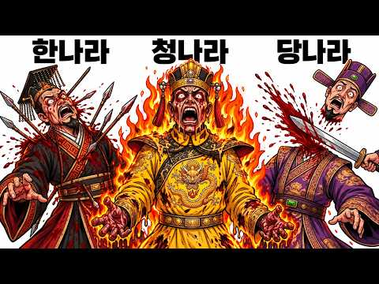
- 설명 앞부분: 4000년 중국 역사에서 영원한 제국은 없었습니다. 이 영상은 하나라와 상나라에서 시작해 주나라, 진나라, 한나라, 사마씨의 진나라, 수나라, 당나라, 송나라, 원나라, 명나라, 청나라에 이르기까지 중국 역대 왕조의 몰락이 어떤 흐름으로 이어졌는지 살펴봅니다. 왕조를 무너뜨린 것은 단 하나의 사건이었을까요? 권력의 약화와 내부 갈등, 전쟁과 반란, 외부의 압박이 어떻게 겹쳤는지 따라가 보세요. 중국 역대 왕조의 몰락을 시대별 핵심 장면으로 정리하고, 반복되는 역사적 흐름 속에서 중국 역대 왕조의 몰락이 남긴 의미를 함께 살펴봅니다…
- 같은 채널 평소 대비 ×13.8 (채널 최근 롱폼 중앙값 10,967회) · 평소 영상: 전설적인 탐험가들은 어떻게 죽었을까? (11,548회) / 역사상 가장 악명 높은 수배자들, 어떻게 추적 끝에 최후를 맞았나? (10,386회)
- 대본 없음 (설명) — 음성인식이 끝나면 도입부·흐름이 들어감
- 댓글 83/85: 좋은 점 — 영상 0 · 감사·응원 1 · 더 알고 싶은 것 0 · 아쉬운 점 — 영상 0 · 반박·불만 — 의견 다름 1 · 정치·사회 9 · 경험 공유 0 · 구독·다음 기대 0
  - 정치·사회 👍6 “역사를 보면 중국 공산당 정권도 오래 못갈거 같아요”
  - 정치·사회 👍2 “중국 통일왕조 중에서 가장 건실했던 왕조는 북송과 남송을 포함한 송왕조라고 생각합니다. 물론 휘종대의 막장은 있었지만 금나라와 원나라가 없었더라면 적어도 100년은 더 견딜수 있었던 왕조이죠. 그러나 나머지 통일왕조는 외세의 침략으로 멸망한 것이 아니라 자체의 허술한…”

### 123. 콘돔도 없던 조선시대, 기생은 어떻게 임신과 화류병을 막았나— 알려지지 않은 충격적인 진실#조선시대 #기생 #풍속화 #한국역사 #신윤복

- https://www.youtube.com/watch?v=mU274jAWlws · 조선의 호기심 · 구독자 1,780 · 조회수 237,770 (×133.6, 하루 1,606.6) · 좋아요 3,175 (1.3%) · 24.5분 · 2026-06-02 · 주제 묶음 3. 조선 · 형식 정보·해설 (그 밖) · 폴더 `W_mU274jAWlws` (웹 승인)
- 썸네일: 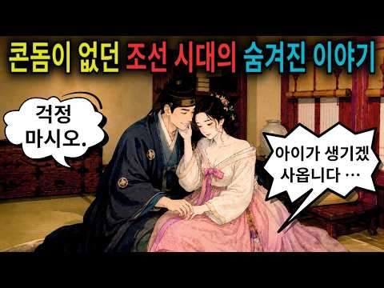
- 챕터: 0:00 오프닝 — 막지 못했다 · 1:00 세습기생 — 법이 만든 운명 · 4:00 아침 루틴 — 기생의 하루 · 7:00 피임법 — 창호지, 소금물, 뒤로 7걸음 · 12:00 두 달 후 — 임신 · 16:00 삼월의 냉정한 계산
- 설명 앞부분: 콘돔이 없던 시대, 기생들은 어떻게 임신을 막았을까. 어떻게 화류병을 막았을까. 답은 간단했다. 막지 못했다. 이 영상에서 다루는 내용 창호지 피임, 소금물, 뒤로 일곱 걸음. 그것이 조선 기생이 가진 전부였다. 기생의 딸은 기생이 된다. 팔리는 것도 아니었다. 법이 그냥 정해 놓았다. 태어나는 순간 이미 직업이 정해져 있었다. 외과 환자의 70~80%가 화류병 환자였다는 기록. 토복령이라는 약은 있었지만 너무 비쌌다. 그리고 더 위험한 선택도 있었다. 오늘은 어느 사극에도, 어느 역사책에도 나오지 않는 조선 기생들의 진짜 이야기…
- 같은 채널 평소 대비 ×290.3 (채널 최근 롱폼 중앙값 819회) · 평소 영상: 조선에서 남녀는 어떻게 결혼했나 —얼굴도 모르는 사람과 결혼해야 했던충격적인 혼인 풍습【… (819회) / 비누도 샴푸도 수돗물도 없었는데 조선인이 세계에서 가장 청결했던 충격적인 이유 【조선시대… (839회)
- 대본 없음 (설명) — 음성인식이 끝나면 도입부·흐름이 들어감
- 댓글 517/521: 좋은 점 — 영상 3 · 감사·응원 8 · 더 알고 싶은 것 6 · 아쉬운 점 — 영상 9 · 반박·불만 — 의견 다름 6 · 정치·사회 20 · 경험 공유 8 · 구독·다음 기대 1
  - 좋은 점 — 영상 👍80 “조선에서 노비였던 사람들이 해방된 것이 국가의 원동력이 된 듯..... 양반들은 여전히 국가에 도움이 안되니까..... 나머지 인간들이 현재의 국력이 됨...”
  - 좋은 점 — 영상 👍0 “제발 맞춤법 좀 고쳐주세요ㅠㅠㅠㅠ 한번 ai 돌리고 자막을 달아주세요 좋은 영상들인데 아이들도 볼 것 같아서요.”
  - 감사·응원 👍21 “저런 조선을 끝장내준 일본이 오히려 고맙게 느껴진다.”
  - 감사·응원 👍6 “조선시대 여인의 삶 고달프고 애닮다 이시대에 태어난걸 감사하게 돼네요”
  - 더 알고 싶은 것 👍13 “쌀때 밖에 싸라 하면 안되나요?”
  - 더 알고 싶은 것 👍11 “1.씹창 났다..라는 말의 어원을 아시나요? 말 그대로 여성성기(씹)에 (곪을)창이 난 겁니다 양반이 기생하고 하려는데 아래가 곪았어요. 그래서 못 하게 되었어요...이 때 하는 말이 "에이, 씹창 났다.." 조선시대 성병이 얼마나 많았는지 이해가 되시죠? 2. 정월…”
  - 아쉬운 점 — 영상 👍52 “컨텐츠는 좋은데 자막이 ai로 자동 생성한건지 너무 틀린 게 많이 보여서 거슬리네요”
  - 아쉬운 점 — 영상 👍21 “자막이 AI로 되어있어서 오타가 너무 많아요..”
  - 반박·불만 — 의견 다름 👍16 “기생을 매춘부로 설명했군 관기에 대한 설명도 엉망이고 역사는 해석이 다양하다는 모호한 말로 왜곡에 가까운 헛소리를 전파하지 마시죠”
  - 반박·불만 — 의견 다름 👍1 “웃기는 조선 불쌍한 조선인들”
  - 정치·사회 👍342 “저게 법이라니.. 나라가 나서서 여자들을 괴로운 삶으로 몰아넣었군요. 마음이 너무 아픕니다”
  - 정치·사회 👍191 “조선이 망한거 잘했다.임진왜란때 나라가 진즉 망하여 노예 기생 반상제도가 없어졌어야했다.”
  - 경험 공유 👍20 “일제 시대 위안부 비난할 입장이 아니네. 조선 시대가 더 개쓰레기였네. 나도 여자이고 딸을 키우는데...진짜 쌍욕이 나오는 조선.”
  - 경험 공유 👍0 “남자는 노동꾼으로 보내지고 여자는 그저 욕구해소용 도구였던 시절.. 잔인하다. 내가 누리는 자유라는게 그 당시엔 당연한것이 아니였다니.. 너무 슬프다 나는 그냥 운좋게 좋은 시대에 태어난 것 뿐이구나..”
  - 구독·다음 기대 👍1 “듣다보니 정말 슬프네요. 구독합니다. 그런데 ㅡ조선의 호기심 ㅡ 검색하니 또 있네요. (조선의호기심) 이렇게 띄어쓰기 안하니 채널명이 같은게 있어요.”

### 124. 이 노인 한 명이 조선을 병들게 했다 ∣ 노론의 거두, 송시열의 정체

- https://www.youtube.com/watch?v=trFvm6O6UoA · 역사풀이 · 구독자 7,620 · 조회수 822,944 (×108.0, 하루 6,872.9) · 좋아요 9,841 (1.2%) · 31.5분 · 2026-07-13 · 주제 묶음 3. 조선 · 형식 정보·해설 (그 밖) · 폴더 `W_trFvm6O6UoA` (웹 승인)
- 썸네일: 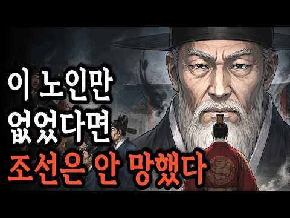
- 설명 앞부분: 왕도 함부로 건드리지 못했던 남자, 송시열. 사약을 받고 죽었지만 조선을 200년간 지배한 인물입니다. 조선왕조실록에 가장 많이 기록된 신하이자, 노론의 거두로서 붕당정치의 중심에 섰던 그는 과연 조선을 지킨 성인이었을까요, 아니면 병들게 한 괴물이었을까요? 효종과 함께 북벌을 꿈꾸던 신하에서 시작해, 예송논쟁으로 왕실과 정면으로 부딪히고, 기사환국으로 사약을 받기까지. 그리고 죽음 이후 문묘에 배향되고 화양서원과 만동묘를 통해 오히려 더 강력해진 그의 그림자는 조선이 끝나는 순간까지 이어졌습니다. 한 사람의 학자가 어떻게 나라 …
- 같은 채널 평소 대비 ×1,144.6 (채널 최근 롱폼 중앙값 719회) · 평소 영상: 사도세자는 왜 뒤주에서 죽었나 ∣ 영조 부자 비극의 모든 것 (조선 왕실 최악의 사건) (719회) / 이 사람이 살았다면, 조선은 강대국이 되었을 것이다 ∣ 정약용도 인정한 역대급 천재 (706회)
- 대본 없음 (설명) — 음성인식이 끝나면 도입부·흐름이 들어감
- 댓글 1,346/1,648: 좋은 점 — 영상 13 · 감사·응원 11 · 더 알고 싶은 것 1 · 아쉬운 점 — 영상 12 · 반박·불만 — 의견 다름 15 · 정치·사회 155 · 경험 공유 32 · 구독·다음 기대 2
  - 좋은 점 — 영상 👍273 “많이 배웠다는 자들이. 그 본질을 어디에 두고, 당파 싸움만 일삼은 깡통학자들.. 🤣🤣”
  - 좋은 점 — 영상 👍30 “에이고 왕도 참 거시기허네 뜻데로 한게 없구먼, 좋은스승에게 배웠으면 지금 기분이 좋을텐데”
  - 감사·응원 👍15 “조선전기는 한명회의 나라였고, 조선후기는 송시열의 나라였고, 송시열은 여성의 인권을 옮마맨 인물이다 이런 글을 올린신 샘에게 정말 감사합니다 제가 듣고 싶었던 조선의 아픔이었습니다”
  - 감사·응원 👍1 “지금시대와 같네요! 감사합니다”
  - 더 알고 싶은 것 👍0 “조선이 안 망했으면 지금 대한민국은 어떤 모습일까요? 아직도 양반과 쌍놈의 사회로 살고 있을까요?”
  - 아쉬운 점 — 영상 👍0 “지금 현재도 역사는 반복되고 있지”
  - 아쉬운 점 — 영상 👍0 “[ 우리가 역사를 배우는 이유 ] - 역사는 반복되므로 과거를 바탕으로 현재를 바르게 이해하기 위해 (' 비슷한 행위는 비슷한 결과'를 낳는다고 함) - 잘못된 역사를 통해 무엇이 문제인지 알아 또 그런 과오를 되풀이 하지 않기 위해 - 미래의 일을 미리 예측하고 대…”
  - 반박·불만 — 의견 다름 👍1 “역사는 정말 나쁜 놈이 자신의 욕구 충족을 위한 명분 던지면 그에 빠져 훌륭한 사람으로 인식하고 묘사해 사람들을 이끌어 넣고 자신도 인정 받으려 한다잖냐. 그런 위선자이고 기회주의자 들을 온갖 실사여구로 사탕발림해 언어 유희를 최대한의 가치로 뛰우고는 그에 편승해 이…”
  - 반박·불만 — 의견 다름 👍1 “과거도 지금도 미래도 서인이 문제다! 선동 잘하고 선동 하면 잘 따르고 지연 학연 혈연에 목숨 걸고, 반대를 위한 반대를 하고, 사람을 감정에 휘둘리게 헤서 자기 생각 관철 시키는...”
  - 정치·사회 👍270 “송시열 이 영감탱이 때문에 나라가 망햇다니 기가차네”
  - 정치·사회 👍157 “공자가 죽어야 나라가 산다고 50년 전 역사 선생님 말씀이 생각 나네요.”
  - 경험 공유 👍331 “조선이 아닌 송나라에서 태어나야 했었던 인물”
  - 경험 공유 👍15 “조선전기는 한명회의 나라였고, 조선후기는 송시열의 나라였고, 송시열은 여성의 인권을 옮마맨 인물이다 이런 글을 올린신 샘에게 정말 감사합니다 제가 듣고 싶었던 조선의 아픔이었습니다”
  - 구독·다음 기대 👍0 “잘듣고갑니다.구독합니다”
  - 구독·다음 기대 👍0 “혹시~송?역시~~송 구독하고 갑니다.🙏”

### 125. 가장 성실했던 황제가 나라를 잃었다｜중국 최악의 황제 7인의 진짜 이야기

- https://www.youtube.com/watch?v=_QI5NRqUqlU · 아시아 숨은 역사 · 구독자 4,000 · 조회수 193,113 (×48.3, 하루 3,563.4) · 좋아요 338 (0.2%) · 53.6분 · 2026-09-17 · 주제 묶음 11. 황제·왕·인물 · 형식 정보·해설 (그 밖) · 폴더 `W__QI5NRqUqlU` (웹 승인)
- 썸네일: 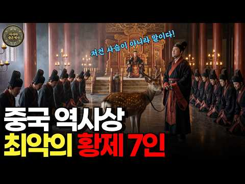
- 챕터: 0:00 1644년, 베이징이 불타던 새벽 · 3:46 이 채널을 함께 만들어 주시는 방법 · 4:11 최악이라는 말이 어려운 이유 · 5:49 진나라 호해 ― 생선 수레와 지록위마 · 16:44 수양제 양광 ― 대운하와 살수, 백만 대군의 끝 · 31:29 송휘종 ― 붓을 든 황제와 정강의 변 · 42:05 명 정덕제 ― 황제가 자리를 비우면 · 47:32 명 가정제 ― 신하를 이기고 국경을 잃다 · 54:29 명 만력제 ― 삼십 년의 침묵 · 60:54 명 숭정제 ― 가장 성실했던 마지막 황제 · 67:39 결론 ― 왜 아무도 그들을 멈추지 못했는가
- 설명 앞부분: 중국의 역사에는 이천 년 동안 수백 명의 황제가 있었습니다. 그중 몇 사람은 단 한 번의 판단으로 수백만 명의 운명을 바꿔 놓았습니다. 진나라 호해부터 명나라 숭정제까지, 왕조의 몰락과 가장 가까이 있었던 일곱 명의 황제를 기록에 남은 사실을 중심으로 따라갑니다. 술로 연못을 만들었다는 전설 대신, 몇 명이 동원되었고 무엇이 무너졌는지를 봅니다. 그리고 마지막에 이런 질문이 남습니다. 진짜 문제는 나쁜 황제가 나타났다는 사실이었을까요, 아니면 아무도 그를 멈출 수 없었다는 사실이었을까요. 참고한 기록 사기, 자치통감, 수서, 삼국…
- 같은 채널 평소 대비 ×81.9 (채널 최근 롱폼 중앙값 2,358회) · 평소 영상: 그는 왜 끝내 황제가 되지 않았을까 ∣ 간웅 조조, 66년의 기록 (2,358회) / 이기고 있던 군대가 왜 돌아섰나 ∣ 1242년 몽골 철수의 진짜 이유 (2,630회)
- 대본 없음 (설명) — 음성인식이 끝나면 도입부·흐름이 들어감
- 댓글 27/27: 좋은 점 — 영상 1 · 감사·응원 1 · 더 알고 싶은 것 0 · 아쉬운 점 — 영상 0 · 반박·불만 — 의견 다름 0 · 정치·사회 4 · 경험 공유 0 · 구독·다음 기대 0
  - 감사·응원 👍0 “구독 좋아요 응원합니다 😊”
  - 정치·사회 👍3 “아무리 AI로 돌린다지만 역사영상에서 중국인 복장이 저게 맞나”
  - 정치·사회 👍0 “찢재명이란 역대 최악의 인물이 대통령이 된 이나라도 얼마나 갈지”

### 126. 소름 끼치게 놀라운 AI로 재현해 본 조선 왕 27인의 실제 모습 ∣ 우리가 몰랐던 진짜 성격

- https://www.youtube.com/watch?v=BIvwX_N1iPs · 비밀야담 보관소 · 구독자 2,650 · 조회수 312,908 (×118.1, 하루 2,360.0) · 좋아요 2,229 (0.7%) · 18분 · 2026-07-01 · 주제 묶음 3. 조선 · 형식 야담·옛날이야기 · 폴더 `W_BIvwX_N1iPs` (웹 승인)
- 썸네일: 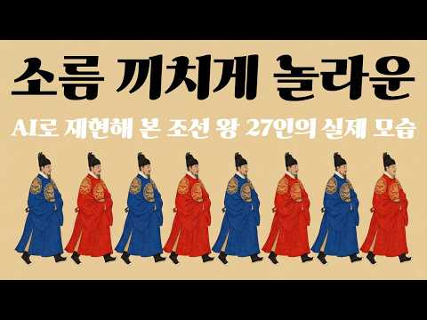
- 설명 앞부분: 조선 시대의 이야기를 만들면 만들수록, '조선 왕들의 실제 모습은 과연 어떠했을까'라는 궁금증이 점점 커져만 갔습니다. 27명 임금들의 어진이 전쟁과 화재로 소실되지 않고 온전히 남아있었다면 얼마나 좋았을까라는 안타까움도 참 컸습니다. 간혹 몇몇 남아있는 어진들을 보며 상상의 나래를 펼쳐왔지만 늘 안타까움이 남았고, 결국 이번 기회에 역사적 기록과 AI 기술을 동원해 직접 재현을 시도해 보았습니다. 특히 영상의 시작과 끝에는 조선 왕조의 엄숙한 예법과 왕권을 상징하는 의궤, 그리고 왕의 뒤를 지키던 일월오봉도를 직접 구현하여 배치…
- 같은 채널 평소 대비 ×1,673.3 (채널 최근 롱폼 중앙값 187회) · 평소 영상: 조선 땅에 괴수가 나타나 조정 대신을 밟아 죽이고 유배를 떠났다 #코끼리유배 #태종이방원… (187회) / 망나니, 사람의 목을 베고 살아야 했던 자들 #망나니 #조선시대 #역사다큐 #비밀야담보관소 (172회)
- 대본 없음 (설명) — 음성인식이 끝나면 도입부·흐름이 들어감
- 댓글 139/149: 좋은 점 — 영상 1 · 감사·응원 1 · 더 알고 싶은 것 1 · 아쉬운 점 — 영상 2 · 반박·불만 — 의견 다름 4 · 정치·사회 4 · 경험 공유 2 · 구독·다음 기대 0
  - 좋은 점 — 영상 👍7 “효종은 굉장히 미화된 면이 있는 왕입니다. 알면 알수록, 학생때 배웠던 모습과 굉장히 괴리가 있음. 무능하고 시샘이 가득한 아버지에 의해 형이 독살을 당하고 죄없는 형수와 조카들이 죽음을 당했는데도 손하나 까딱 안한 사람입니다. 인조가 살아있을 때는 어쩔 수 없다고 …”
  - 더 알고 싶은 것 👍7 “AI로 재현한 것이 어떻게 실제 모습인가요?”
  - 아쉬운 점 — 영상 👍29 “조선시대 왕들의 어진들이 불타버린 게 너무 아쉽습니다.”
  - 아쉬운 점 — 영상 👍5 “이름도안넣고 심지어 자막이 얼굴부분을 가림ㅋㅋ”
  - 정치·사회 👍5 “이재명이 세종대왕 일하는 스타일이 비슷하네요?”
  - 정치·사회 👍1 “고려시대 어진은? 없나요? 언젠간 대한민국 시대가 끝나면 대통령 사진 다 없앨건가?”
  - 경험 공유 👍4 “세종... 지폐에 그 얼굴생각한 내가 이상한건가ㅋ”
  - 경험 공유 👍2 “오... 저도 작업해보던 거라 반갑습니다 ㅎㅎ 잘 뽑으셨네요”

### 127. 고대 이집트의 잃어버린 도시, 마침내 발견되다

- https://www.youtube.com/watch?v=-j9jOJl_ERU · 시간의 단면 · 구독자 571 · 조회수 62,598 (×109.6, 하루 508.5) · 좋아요 642 (1.0%) · 24.1분 · 2026-06-27 · 주제 묶음 8. 문명·고고학 · 형식 정보·해설 (그 밖) · 폴더 `W_-j9jOJl_ERU` (웹 승인)
- 썸네일: 
- 설명 앞부분: 이천 년 넘게 전설로만 여겨졌던 도시가 실제로 존재했습니다. 고대 그리스 역사가 헤로도토스가 기록했던 헤라클레이온. 수세기 동안 수많은 학자들이 그 흔적을 찾았지만, 누구도 발견하지 못했습니다. 결국 사람들은 그것이 신화일 뿐이라고 믿기 시작했습니다. 하지만 모든 것은 프랑스 해양 고고학자 프랑크 고디오의 우연한 탐사에서 바뀌었습니다. 지중해 아부키르만 해저에서 모습을 드러낸 것은 거대한 신전과 항구, 운하, 수천 점의 유물, 그리고 완전한 고대 도시였습니다. 이 영상에서는 헤라클레이온이 어떻게 고대 이집트 최대의 무역 도시가 되…
- 같은 채널 평소 대비 ×152.5 (채널 최근 롱폼 중앙값 410회) · 평소 영상: 이집트의 아틀란티스, 사라진 도시 타니스의 충격적인 진실 (416회) / 인류 역사에서 지워진 거인 (405회)
- 대본 없음 (설명) — 음성인식이 끝나면 도입부·흐름이 들어감
- 댓글 18/18: 좋은 점 — 영상 0 · 감사·응원 1 · 더 알고 싶은 것 0 · 아쉬운 점 — 영상 0 · 반박·불만 — 의견 다름 1 · 정치·사회 0 · 경험 공유 0 · 구독·다음 기대 0
  - 감사·응원 👍2 “않아서이른귀힌것을보게해주셔서감사함니다”
  - 반박·불만 — 의견 다름 👍3 “이집트가 아닙니다 ㅡㅡㅡㅡㅡㅡㅡㅡ아틀란타 ㅡ 입니다”

### 128. 40분 전까지 이름도 몰랐는데 울었다 — 이순신을 처음 알게 된 외국인들

- https://www.youtube.com/watch?v=PGedVpjYgEk · 경제냥 · 구독자 3,560 · 조회수 133,796 (×37.6, 하루 3,156.3) · 좋아요 1,036 (0.8%) · 14.7분 · 2026-09-29 · 주제 묶음 3. 조선 · 형식 애니메이션·지도 · 폴더 `W_PGedVpjYgEk` (웹 승인)
- 썸네일: 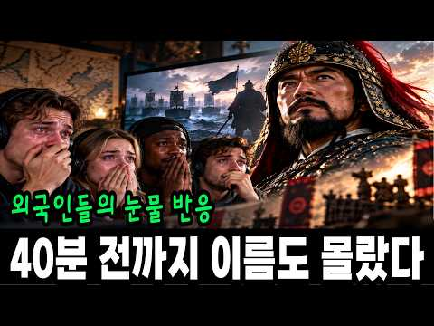
- 설명 앞부분: 스파르타 300 이야기 말고, '조선의 13' 이야기를 아시나요? 시카고의 한 만화가가 17년째 그리고 있는 조선 장군, 그리고 그 이야기를 처음 들은 외국 유튜버들이 어디서 놀라고, 어디서 화내고, 어디서 울었는지 따라가 봤습니다. 외국 사람들이 이 이야기에서 가장 놀란 대목, 여러분은 어디셨나요? 댓글로 남겨 주세요. 반응 영상 속 애니메이션: Extra History 'Korea: Admiral Yi' 시리즈 (2015) ■ 크리에이티브 커먼즈 저작자 표시(CC BY) 영상 ■ 유물 사진 (공공누리 제1유형 · 국립중앙박물관…
- 같은 채널 평소 대비 ×1,574.1 (채널 최근 롱폼 중앙값 85회) · 평소 영상: 우유 회사가 덜 사기로 합의했는데, 마트 값은 그대로인 이유 (85회) / 머스크는 왜 이 차에 9년이나 매달려 있었을까? (86회)
- 대본 없음 (설명) — 음성인식이 끝나면 도입부·흐름이 들어감
- 댓글 64/100: 좋은 점 — 영상 0 · 감사·응원 1 · 더 알고 싶은 것 1 · 아쉬운 점 — 영상 0 · 반박·불만 — 의견 다름 2 · 정치·사회 4 · 경험 공유 3 · 구독·다음 기대 0
  - 감사·응원 👍1 “좋은 영상 감사드립니다 멸공!❤”
  - 반박·불만 — 의견 다름 👍25 “후손들은 명량해전 이긴 걸 알고 있지만, 그 시점에는 선조의 육군 편입 요청은 오히려 더 현실적이다. 이순신은 누가 봐도 가망이 없는 전력차이를 심지어 1척도 안잃고 이겼어. 영국인들은 인정하기 싫겠지만 솔직히 넬슨과 이순신은 수준 차이가 너무 남. 그냥 중요 전투 …”
  - 반박·불만 — 의견 다름 👍5 “우리나라 사람들도 역사를 잘 모르는데 거북선을 이순신 장군이 설계하고 만든건 아닙니다~!! 그 전부터 돌격선이라고 거북선을 왜구들을 막는 용도로 있었죠~!! 그것을 이순신 장군이 현장에 상황과 자신의 실전 경험과 그 당시 현실에 맞추어서 개량한겁니다~!! 그게 거북선…”
  - 정치·사회 👍2 “왜 외국인이 나랑 똑같은 생각을 갖고 이야기하지... 진짜 이순신은 무서운 사람이네. 근데... 박정희가 세운 이명박이가 세운 동상은 치우자. 남 생각 안하는 것들이... 광화문 앞에 동상을. ㅋ 이순신이 세종이 이걸 알면!!!!!!! 스스로 그 동상에 머릴 박을 것”
  - 정치·사회 👍1 “지금도 기득권들은 영웅을 품을 만큼의 아량이 없다 지들보다 잘나면 시기와 질투로 밤잠을 설칠거다 영웅을 무너뜨려야 드발뻗고 자는 놈들이 저 국힘들이 아닌가”
  - 경험 공유 👍0 “^^ 네 이 버 ^^ 의 ^^ 메 르 카 츠 ^^ 님 ^^ 의 ^^ 글 ^^ : ^^.......^^ 명 량 대 첩 ^^ 시 ^^ 에 ^^ ....... ^^ 신에게는 아직도 열두척이 있사오니 라고 말할때는 12척이였고 장계가 올라가서 선조에게 닿을때쯤 한척을 수리하…”
  - 경험 공유 👍0 “이순신장군이 옥살이와 모진고문당한건 훙노족 노론벽파들의 모함때문인데 친일교육부가 그걸 안가르치고 왕탓으로 가르치고있다! ★이순신 장군을 명장으로 만든건 전라도 사람들이 임진왜란 이긴건 신라휴ㅇ노족에의한 매국통일신라시대때부터 일본의 해적질로부터 조정에서 물리칠 생각 않…”

### 129. "악마의 열매" 커피 때문에 세계 역사가 뒤집어진 이유! 세계사를 바꾼 커피의 역사 ㅣ커피는 어떻게 세계인의 음료가 됐을까?

- https://www.youtube.com/watch?v=MOJF6JpGS3A · 세계경제이야기 · 구독자 12,800 · 조회수 632,583 (×49.4, 하루 11,143.5) · 좋아요 1,931 (0.3%) · 30.8분 · 2026-09-14 · 주제 묶음 5. 세계사·서양사 · 형식 정보·해설 (그 밖) · 폴더 `W_MOJF6JpGS3A` (웹 승인)
- 썸네일: 
- 챕터: 0:00 도입부 — 매일 마시는 커피, 그 한 잔의 진짜 무게 · 0:30 1장 — 염소가 발견하고, 수도승이 퍼뜨린 마법의 열매 · 4:30 2장 — 낙타 먹이가 유럽을 뒤집다 · 8:30 3장 — 찻집에서 태어난 자본주의, 그리고 홍차 제국 · 13:00 4장 — 왕의 목을 자른 카페 · 17:00 5장 — 커피가 삼킨 사람들 · 21:30 6장 — 전쟁의 연료, 스파이의 암호 · 25:00 7장 — 커피가 사라지고 있다 · 27:30 8장 — 양탕국에서 커피 공화국으로
- 설명 앞부분: 영양분 0%, 열량 0%인 검은 물 한 잔이 보험사를 만들고, 왕의 목을 자르고, 200만 명을 노예로 만들었습니다. 대체 커피가 뭐길래 500년 동안 전 세계가 이 음료에 미쳐 있는 걸까요? 오늘 영상에서는 에티오피아의 염소 목동이 발견한 빨간 열매 한 알이 어떻게 이슬람 세계를 장악하고, 비엔나 전쟁의 전리품이 되고, 런던에서 증권거래소와 세계 최대 보험사를 탄생시켰는지 추적합니다. 프랑스 대혁명의 첫 총성이 울린 카페, 미국 독립의 도화선이 된 보스턴 차 사건, 200만 노예가 끌려간 브라질 커피 농장, 나폴레옹의 군수물자,…
- 같은 채널 평소 대비 ×59.4 (채널 최근 롱폼 중앙값 10,649회) · 평소 영상: "이러다 진짜 유럽 제패할 판!" 콧대높던 서유럽 씹어먹고 유럽의 새로운 심장이 된 폴란… (10,649회) / 유령도시가 된 지상낙원 뉴질랜드! 어쩌다 이렇게 몰락하게 되었을까? (10,412회)
- 대본 없음 (설명) — 음성인식이 끝나면 도입부·흐름이 들어감
- 댓글 51/56: 좋은 점 — 영상 0 · 감사·응원 2 · 더 알고 싶은 것 1 · 아쉬운 점 — 영상 1 · 반박·불만 — 의견 다름 3 · 정치·사회 0 · 경험 공유 2 · 구독·다음 기대 0
  - 감사·응원 👍0 “재미있는 커피이야기 감사합니다”
  - 아쉬운 점 — 영상 👍0 “내용은 좋은데 AI 목소리 대신 어눌한 사람 목소리가 더 좋습니다”
  - 반박·불만 — 의견 다름 👍3 “커피 역사가 그렇군.. 현재는 커피를 대체할 음료가 없고 앞으로도 글쎄...”
  - 반박·불만 — 의견 다름 👍0 “한국은 1인당 커피소비량이 세계2위가 아닙니다, 수차례 계속 반복하시는군요. 검증은 없이 그냥 어디서 줏어들은 대로 쓰는 것입니까?”
  - 경험 공유 👍5 “이게 제일 오류가 맑은 물이 아니면 못먹는다는 거임. 나도 그렇게 알았는데 아니라고함. 해당지역에 살던 사람들은 그 물이 오염되었어도 외부전염병이 오는게 아니라면 별 문제없이 삶. 인도인이 그래서 그 환경에서도 잘 사는 것임. 또 야생동물이 똥물 먹어도 사는게 동일한…”
  - 경험 공유 👍2 “커피에 대한 수없이 많은 갑론을박이 있는 이유가 전세계 산업에 큰 축이기 때문인건 알고 있었는데 영상에서 더 인문학적인 베경을 알게됐네요-- 하루2잔 마시던 커피 끊고 5년차 제2의 인생을 살고 있습니다. 지금도 커피향을 맡으면 마시고 싶다는 강열한 욕구가 일지만 커…”

### 130. 당신의 성씨가 사실 명나라 것이라면? 나라가 사라진 사람들 그들이 택한 나라는 조선이었다

- https://www.youtube.com/watch?v=PKcdNOIwE4o · 모든역사 · 구독자 12,500 · 조회수 650,861 (×52.1, 하루 10,813.3) · 좋아요 6,212 (0.9%) · 34.7분 · 2026-09-11 · 주제 묶음 6. 동양사 (중국·일본·몽골) · 형식 애니메이션·지도 · 폴더 `W_PKcdNOIwE4o` (웹 승인)
- 썸네일: 
- 설명 앞부분: 나라가 통째로 망하던 그날, 명나라 귀족들은 어디로 갔을까요? 1644년, 이백 년 넘게 아시아를 호령하던 명나라가 하룻밤 사이에 지도에서 사라집니다. 마지막 황제는 궁궐 뒷산 나무에 목을 맸고, 그 나라의 귀족과 장수들은 짐을 싸서 국경을 넘기 시작했죠. 🏃‍♂ 그리고 그중 상당수가 향한 곳이 바로 조선이었습니다. ⚔️ 조선을 살리려다 자기 나라 감옥에서 죽은 국방부 장관 석성 🩸 죽은 병사의 옷을 벗겨 입고 요동 벌판을 가로질러 도망친 강세작 🧭 전쟁 영웅에서 조선의 풍수 전문가로 변신한 시문용 🌊 이순신과 함께 싸운 명나라 …
- 같은 채널 평소 대비 ×193.2 (채널 최근 롱폼 중앙값 3,369회) · 평소 영상: 정조 vs 공자 두 천재가 주역에 미쳐버린 진짜 이유 (3,369회) / 단종 시신 수습한 엄흥도 노루가 알려준 단종 무덤의 비밀 (4,044회)
- 대본 없음 (설명) — 음성인식이 끝나면 도입부·흐름이 들어감
- 댓글 481/493: 좋은 점 — 영상 4 · 감사·응원 7 · 더 알고 싶은 것 6 · 아쉬운 점 — 영상 2 · 반박·불만 — 의견 다름 8 · 정치·사회 48 · 경험 공유 12 · 구독·다음 기대 0
  - 좋은 점 — 영상 👍23 “고금도는 바로 우리 고향에서 건너편 섬 고금도 인데 지금은 마량에서 다리(고금대교)가 생겨서 자동차로 갑니다 잘 배우고 갑니다 학생때 부터 역사을 좋아해서 나이가 들어도 역사가 좋더라구요 광주로 (유학생)학교을 갔는데 고금도가 고향인 친구도 있었어요 벌써 50년이 다…”
  - 좋은 점 — 영상 👍5 “명쾌하네요.”
  - 감사·응원 👍32 “역사에 관심 있으시고 성씨에 궁금 하신 분들이 많으시니 덕분에 많이 배웁니다 감사합니다”
  - 감사·응원 👍7 “고맙습니다.”
  - 더 알고 싶은 것 👍5 “잘 봤습니다 해주 오씨 에대한 이야기좀 올려주세요 저는 해주오씨 후손입니다 저의 1대조는 고려말 군기도감이셨다는 이야기를 들었습니다 중국에서 고려말에 고려로 오신걸루 생각합니다 조사하셔서 영상 만들어주시면 후손으로서 자부심을 갖고 살아갈수 있을것같아요”
  - 더 알고 싶은 것 👍5 “진도에도 황조라는 마을이 있습니다 해남과 바다를 사이에 두고 마주 보는 지형이죠. 옛 사람들은 아침에 황제가 잠시 들려 갔다 해서 명명된 이름이다.라고 하지요 삼별초 난과 연결지어지기도 하고요 용장산성이 건너편 마을 뒷산에 있지요 관게가 있는지 알고 싶어요 강원도에도…”
  - 아쉬운 점 — 영상 👍16 “임진왜란때 왜가 주장한 것은 '정명가도'였습니다. 즉 일본이 명나라를 정벌할테니,,, 조선보고 길을 내주라는 의미였습니다. 조선은 있으나 마나한 허약한 나라였다는 것을 일본은 너무도 잘 알고 있었습니다. 일본이 조선을 정벌하고, 조선인을을 앞세워서 명나라로 처들어간다…”
  - 반박·불만 — 의견 다름 👍3 “고조선은 陰 동양을 말해요. 서양은 아메리카를 지칭했던거고요. 陽이지요. 중원 남부로는 끊임없이 인도 중동쪽에서 들어왔죠. 백제도 신라도 중원 남부부터 시작 했답니다. 명나라도 남부에서 시작 했으니 백성이나 귀족 일부는 신라 백제 사람이죠. 나라 이름만 바뀐겁니다. …”
  - 반박·불만 — 의견 다름 👍0 “명에서 우리에게 파병한이유는 단순한 그이유만이 아니죠 일본이 조선을 무너뜨리고 명나라로 오는것을 방어하기 위해서도 50%는 적용되죠”
  - 정치·사회 👍45 “6.25를 겪고도 아직도 북한 3대 세습 독재국가에 충성을 다하고 있는 자들이 국회의원 국가 공무원이 되어 나라를 무너뜨리려고 하는 자들은 역사에 어떤 발자취를 남길가?”
  - 정치·사회 👍42 “한동훈 장인 진머시기가 중국인도 받기 힘든 중국 출판허가를 받아내고 중국 관련 출판하는 거 혹시 광동 진가? 총기 사격 명수 진 머시기 비례대표 의원이 한배신 패거린 것도 그런 이유?”
  - 경험 공유 👍45 “6.25를 겪고도 아직도 북한 3대 세습 독재국가에 충성을 다하고 있는 자들이 국회의원 국가 공무원이 되어 나라를 무너뜨리려고 하는 자들은 역사에 어떤 발자취를 남길가?”
  - 경험 공유 👍30 “명씨가 있던데 고향이 해남이라고하더니 그래서 내가 중국이나 명나라 성씨 아닌가요 그랬는데 그분들도 명나라 족이였네요 시갓집은 현씨 친저믄 명씨”

### 131. 🔥우연히 얻은 신비한 상자, 그 안에 진짜 명나라가 존재했다. 손가락 한 번에 산적 몰살!#男频 #爽文

- https://www.youtube.com/watch?v=UZ5O6Ny3-sQ · 천하극장 · 구독자 8,850 · 조회수 565,368 (×63.9, 하루 7,623.3) · 좋아요 3,383 (0.6%) · 135.2분 · 2026-08-28 · 주제 묶음 6. 동양사 (중국·일본·몽골) · 형식 사연·드라마 · 폴더 `W_UZ5O6Ny3-sQ` (웹 승인)
- 썸네일: 
- 설명 앞부분: 🔥 매일 업로드되는 초고속 황궁 복수극 복수의 왕좌 배신당한 왕자, 몰락한 장군, 숨겨진 후계자. 권력과 복수, 그리고 인생 역전의 순간을 담은 고대 남성 드라마 채널입니다. 황궁 암투 사이다 전개 지금 가장 중독성 강한 쇼츠 드라마 채널.
- 같은 채널 평소 대비 ×85.1 (채널 최근 롱폼 중앙값 6,642회) · 평소 영상: 🔥지옥에서 천 년 출석 체크한 나, 환생하니 예정된 여제 누나가 매번 울어버린다!#男频 … (6,796회) / 🔥평범한 현대 청년, 두 세계를 오가는 능력 각성! 아이스크림 하나로 선녀 부인을 얻다！… (6,488회)
- 대본 없음 (설명) — 음성인식이 끝나면 도입부·흐름이 들어감
- 댓글 523/587: 좋은 점 — 영상 0 · 감사·응원 4 · 더 알고 싶은 것 11 · 아쉬운 점 — 영상 5 · 반박·불만 — 의견 다름 1 · 정치·사회 6 · 경험 공유 12 · 구독·다음 기대 3
  - 감사·응원 👍20 “한글로 해주셔서 감사해요! 생각없이 클릭했는데 넘 재미있네~”
  - 감사·응원 👍4 “영상 잘보네요 감사합니다 ❤❤❤”
  - 더 알고 싶은 것 👍24 “이거 재미 있네요, 그래서 후편 완결은 어떻게 보나요?”
  - 더 알고 싶은 것 👍3 “시즌2 부탁해요”
  - 아쉬운 점 — 영상 👍8 “이어서 없어? 아니 내가 이걸 다보고 있네ㅋㅋㅋㅋㅋㅋ 미쳐ㅋㅋㅋㅋ 진짜 어눌한 더빙에 짜집기 같아서 잠깐보려던겤ㅋㅋㅋㅋㅋㅋㅋㅋㅋ😅”
  - 아쉬운 점 — 영상 👍1 “목욕 하는거 안보여줘서 철판 먹으라는 생각 ㅋㅋㅋ 존나 골때리네 ㅋㅋ Ai같은데 하나인가 뭔가 잘만들었네”
  - 반박·불만 — 의견 다름 👍1 “미치겠네 첨엔 병맛 같은 느낌이라 중국영상이 다 그렇지 하고있었는데 계속보네 ㅋㅋㅋㅋㅋㅋㅋㅋㅋ 어이없는데 웃기면서 재밌기도하네 ㅋㅋㅋㅋ”
  - 정치·사회 👍18 “상자 속의 대명나라》(내 방에 대명나라가 있다 / 箱子里的大明朝) 라고 하는데 더는 검색이 안나오네요.. 2부 올려주세요!! 제발”
  - 정치·사회 👍1 “이 비슷한 내용을 미국영화에서 본거 같은데... 참 중국인들은 한결 같네.. 창작보다 훔쳐서 베낀다.”
  - 경험 공유 👍8 “이어서 없어? 아니 내가 이걸 다보고 있네ㅋㅋㅋㅋㅋㅋ 미쳐ㅋㅋㅋㅋ 진짜 어눌한 더빙에 짜집기 같아서 잠깐보려던겤ㅋㅋㅋㅋㅋㅋㅋㅋㅋ😅”
  - 경험 공유 👍4 “누가감히 나서는지보자. 누가너에게 감히그런용가를줬나.내가바로용왕이다.ㅋㅋㅋㅋㅋ 아 😂😂😂”
  - 구독·다음 기대 👍4 “겁나게 재미나네. 다음편 기대합니다”
  - 구독·다음 기대 👍2 “은근히 재미있네요 다봤네요😊 다음편 기다려 지네요😊”

### 132. 촉나라 몰락 후 제갈 가문은 어떻게 한국과 이어졌을까? ∣ 역사 ∣ 역사를 짚다

- https://www.youtube.com/watch?v=ymSL8cjjxqU · 짚다 ZIPDA · 구독자 7,330 · 조회수 280,458 (×38.3, 하루 6,222.7) · 좋아요 1,013 (0.4%) · 35분 · 2026-09-13 · 주제 묶음 1. 역사 일반·이야기 · 형식 정보·해설 (그 밖) · 폴더 `W_ymSL8cjjxqU` (웹 승인)
- 썸네일: 
- 챕터: 0:00 촉나라 멸망과 1,700년 뒤의 뜻밖의 사건 · 1:41 제갈량보다 먼저 존재했던 제갈 가문 · 4:06 제갈량의 실제 후계자와 자손들 · 6:21 촉나라 멸망, 제갈 가문의 운명 · 8:28 한국 계보에 등장한 새로운 연결고리 · 15:36 500년 뒤 다시 등장한 또 하나의 전승 · 17:27 고려시대, 제갈 성씨에 생긴 변화 · 21:33 고려 이후 이어진 제씨와 갈씨 · 23:58 조선 기록에서 확인되는 가문의 흔적 · 28:45 다시 ‘제갈’을 찾으려는 움직임 · 30:57 현대에 벌어진 대규모 복성 · 32:50 한국의 제갈씨, 정말 제갈량과 이어질까?
- 설명 앞부분: 삼국지에서 가장 유명한 인물 가운데 한 명인 제갈량. 그런데 그의 이름과 같은 ‘제갈’이라는 성씨가 한국에도 오랫동안 이어져 왔습니다. 그렇다면 한국의 제갈씨는 제갈량과 어떤 관계가 있을까요? 그리고 제갈씨와 함께 등장하는 제씨·갈씨의 이야기는 어디에서 시작된 것일까요? 이번 영상에서는 중국의 역사 기록부터 한국에 전해오는 문중 계보, 고려와 조선시대의 기록, 그리고 현대까지 이어진 성씨의 흔적을 차례대로 따라가 봅니다. 📚 제갈량의 실제 가족과 후손들은 어떻게 이어졌는지, 한국의 계보에는 어떤 인물들이 등장하는지, 기록과 전승을…
- 같은 채널 평소 대비 ×8.3 (채널 최근 롱폼 중앙값 33,680회) · 평소 영상: 부여 왕자가 세운 수수께끼의 나라 46년 만에 사라진 갈사국의 정체 (33,680회) / 아골타 가문이 한반도와 이어진 이유 금나라 황실의 수상한 기록 (35,309회)
- 대본 없음 (설명) — 음성인식이 끝나면 도입부·흐름이 들어감
- 댓글 191/191: 좋은 점 — 영상 0 · 감사·응원 1 · 더 알고 싶은 것 2 · 아쉬운 점 — 영상 1 · 반박·불만 — 의견 다름 5 · 정치·사회 10 · 경험 공유 3 · 구독·다음 기대 0
  - 감사·응원 👍5 “칠원 제씨인데 설명 하신대로 족보에 기록 되어 있습니다. 감사 합니다”
  - 더 알고 싶은 것 👍0 “제가 민씨인데 중국에는 없는 한반도에만 있는 성인가요? 이방원의 아내이자 세종대왕의 어머니가 민씨인데 자고로 명성황후 까지 왕후계열은 민씨라는 가문인데 한번 영상 만들어주세요”
  - 아쉬운 점 — 영상 👍1 “똑같은 멘트 반복이 많네”
  - 반박·불만 — 의견 다름 👍6 “그리고 한중일 삼국의 유교뭔화권게서 가문의 계승이란 단순히 혈연의 계승을 의미하는 것은 아닙니다. 가문이라는 것은 혈연을 넘어서는 형이상학적이지만, 또한 재산과 관련된 실체이기도 했지요. 그래서 혈연이 끊어지만 양자를 들여서 가문을 계승하는 일이 그렇게 드물지 않았습…”
  - 반박·불만 — 의견 다름 👍0 “제갈씨가 제갈량의 후손인게 아니라 우리나라 성씨 대부분이 성씨들중에서 위인한두명을 배출한거지 제갈씨가 제갈량후손은 아닙니다 그사람 후손일려면 시조를 정확히 특정해야하는데 우리나라성씨 대부분 중시조를 모십니다.”
  - 정치·사회 👍36 “고대 중국성씨는 허구일 가능성이 큰데 원나라나 명나라 청나라시대 때는 한반도로 이주한 중국인들 기록이 꽤 있어서 사실인 경우가 많습니다 대표적으로 주원장과 중국대륙을 다투고 싸웠던 진우량이 전사하기 전 아들에게 만약 패하거든 고려로 가서 피신하라고 한 기록이 있고 고…”
  - 정치·사회 👍9 “족보가 조선 중기에 처음 생겼다. 그런데 자기 시조가 대부분 중국에서 왔다고 한다. 심지어 김씨마저도 조상이 중국인 김일제라고 할 정도다. 왕건은 자기 증조할아버지가 중국 황제라고 할 정도니 말 다했다. 애매한 성씨는 다들 자기 시조가 송나라 한림원 학사였다고 한다.…”
  - 경험 공유 👍4 “일제강점 때 창씨개명이 이뤄지는데, (정확한 통계인지 알 수 없으나, 우리나라 사람 중에 이무렵 일본식 창씨 개명한 사람이 70% 넘었다고 합니다. ) 그러나 생각이 높으신 분들이 일본의 창씨를 거부하며, 자신의 성씨를 지키려고 하는데, 이로써 먼 옛날 자기의 조상이…”
  - 경험 공유 👍0 “제가 민씨인데 중국에는 없는 한반도에만 있는 성인가요? 이방원의 아내이자 세종대왕의 어머니가 민씨인데 자고로 명성황후 까지 왕후계열은 민씨라는 가문인데 한번 영상 만들어주세요”

### 133. 7발의 총성, 사라진 탄환…육영수 여사 사건의 미스터리 (암살자는 누구인가?) #육영수 #박정희 #암살 #총격 #문세광 #암살자(들) #한국사 #썬킴

- https://www.youtube.com/watch?v=QMZbscMfVpo · 매불세계 · 구독자 9,990 · 조회수 412,177 (×41.3, 하루 8,369.8) · 좋아요 3,081 (0.8%) · 47.3분 · 2026-09-22 · 주제 묶음 4. 한국 근현대사 · 형식 정보·해설 (그 밖) · 폴더 `W_QMZbscMfVpo` (웹 승인)
- 썸네일: 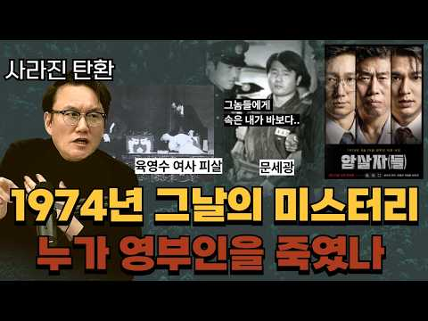
- 같은 채널 평소 대비 ×56.3 (채널 최근 롱폼 중앙값 7,327회) · 평소 영상: 미국 건국 250주년! 절대 공개하지 않는 흑역사 (배은망덕의 역사) #미국 #미국역사 … (7,327회) / 중국이 미군을 세뇌한 방법, CIA의 '인간 세뇌 프로젝트' #마오쩌둥 #덩샤오핑 #포로… (7,675회)
- 대본 없음 (없음) — 음성인식이 끝나면 도입부·흐름이 들어감
- 댓글 509/519: 좋은 점 — 영상 1 · 감사·응원 2 · 더 알고 싶은 것 3 · 아쉬운 점 — 영상 2 · 반박·불만 — 의견 다름 9 · 정치·사회 81 · 경험 공유 14 · 구독·다음 기대 0
  - 좋은 점 — 영상 👍4 “이거랑 별개로 썬킴은 이만갑 출연하면서 북한 실체 알만한 사람이 김정은 듣기 좋은 말을 하더라”
  - 감사·응원 👍3 “최욱 앵커님 정감 있으세요 감사합니다 나오신분들 역사 선생님 잘 보고있습니다 국힘당 한나라당 막말 남탓 억지뿐 인 민패 당 맞습니다 지금도 내란자 억지당 국힘당 해체”
  - 더 알고 싶은 것 👍14 “육영수 여사님의 총격 사망은.... 당시에 권총 가진놈의 소행이다. 문세광이의 권총과 경호원의 권총, 또는 다른 권총소지자가 한 사고입니다. 제대로 수사를 했는지? 경호팀에서 조사를 묻어버렸는지? 중앙정보부가 덮었는지? 글쎄요 저도 멍청 궁금합니다.”
  - 더 알고 싶은 것 👍4 “주제가 궁금해서 들어왔다가..최욱얼굴보고 나간다.”
  - 아쉬운 점 — 영상 👍3 “썬킴 진짜 실망이네 구역질난다”
  - 반박·불만 — 의견 다름 👍14 “육영수 여사님의 총격 사망은.... 당시에 권총 가진놈의 소행이다. 문세광이의 권총과 경호원의 권총, 또는 다른 권총소지자가 한 사고입니다. 제대로 수사를 했는지? 경호팀에서 조사를 묻어버렸는지? 중앙정보부가 덮었는지? 글쎄요 저도 멍청 궁금합니다.”
  - 반박·불만 — 의견 다름 👍8 “518도 북한이 했다고 자기네들이 학교에서 애덜한테 교과서로 가르칠정도인데 그건죽어도 안믿고 ㅋㅋ북한이체제선동같은 영화는 찰떡같이믿네!!!”
  - 정치·사회 👍72 “썰에는 박정희가 여색을 즐겨해 방탕한 생활을 하면서 육영수여사와 자주 싸웠는데 한번은 선거때 유세하던 지역 호텔에서 대낮에 여자랑 바람피우다 육영수여사한테 걸려서 대판 싸웠고 열받은 박정희가 던진 재털이에 육여사 이마에 맞아 깨졌다고...그 이후 부부는 자주 다퉜고 …”
  - 정치·사회 👍42 “암살자(들) 영화감상평 들어가봐요.. 일부러 사람들 못보게 전부 1점 주는데 진짜 조직적으로 댓글을 다는 사람들이 있나봐요..정말 깜짝 놀랐습니다. 재미가 없으면 주관적인 감상평을 적으면 되는 데 전부 좌파 얘기밖에 없어요... 그러니 더 보고 싶어서 오늘 보러갑니다.”
  - 경험 공유 👍17 “내가 85년에서 88년까지 군대에서(의무병) 근무 했었는데, 내가 있던 부대의 의무대 환자중에 총에 발바닥을 관통한 환자가 있었다 그 친구가 천만다행으로 발의 뼈는 다치지 않고 오직 살만 관통한 총상이었다 그런데도 내 기억에 1년이 넘게 의무대에 입원 하였었다 그런데…”
  - 경험 공유 👍14 “육영수 여사님의 총격 사망은.... 당시에 권총 가진놈의 소행이다. 문세광이의 권총과 경호원의 권총, 또는 다른 권총소지자가 한 사고입니다. 제대로 수사를 했는지? 경호팀에서 조사를 묻어버렸는지? 중앙정보부가 덮었는지? 글쎄요 저도 멍청 궁금합니다.”

### 134. 나라 팔아먹고 200년째 떵떵거리는 집안들 (친일파 후손 TOP 10)

- https://www.youtube.com/watch?v=DNKL5ihsgO8 · 검은노트 · 구독자 1,060 · 조회수 66,734 (×63.0, 하루 866.2) · 좋아요 2,054 (3.1%) · 13.4분 · 2026-08-12 · 주제 묶음 1. 역사 일반·이야기 · 형식 정보·해설 (그 밖) · 폴더 `W_DNKL5ihsgO8` (웹 승인)
- 썸네일: 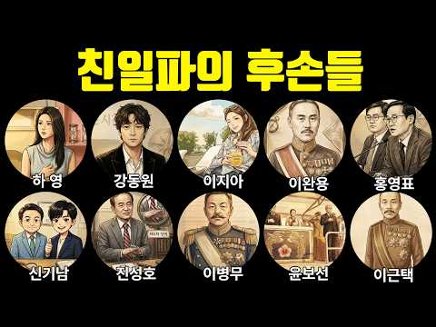
- 설명 앞부분: "4대째 의사 집안입니다" — 자랑스럽게 말한 배우의 증조할아버지는 이완용과 같은 단체 소속이었습니다. 독립운동가 후손들이 반지하와 임대아파트를 전전하는 사이, 친일파 후손들은 국회의원이 되고, 국립대 총장이 되고, 대통령의 아버지가 됩니다. 배우 하영, 강동원, 이지아부터 이완용, 홍영표, 신기남까지 나라를 팔아먹은 대가가 100년이 지난 지금까지 어떻게 대물림되고 있는지, 10명의 실제 기록으로 파헤칩니다. 타임스탬프
- 같은 채널 평소 대비 ×90.1 (채널 최근 롱폼 중앙값 741회) · 평소 영상: 지구상 가장 위험한 접근금지구역 8곳 (751회) / 일본 쇠말뚝 괴담의 실체ㅣ'실화모티브'라던 영화 뒤 숨은 실제 이야기 (731회)
- 대본 없음 (설명) — 음성인식이 끝나면 도입부·흐름이 들어감
- 댓글 471/471: 좋은 점 — 영상 2 · 감사·응원 7 · 더 알고 싶은 것 5 · 아쉬운 점 — 영상 0 · 반박·불만 — 의견 다름 9 · 정치·사회 78 · 경험 공유 7 · 구독·다음 기대 0
  - 좋은 점 — 영상 👍1 “독립운동 존경합니다 근데 친일파한테 잣대는 심하면서 종북간첩 세력은 왜 판치는걸까요? 625 참전 용사들 싹 다 무시하고 일본에 리틀보이를 날려 독립에 큰 도움이 됐던 미국은 왜 싫어하는걸까요 ㅠㅠㅠ”
  - 좋은 점 — 영상 👍0 “매우좋고 유익합니다❤❤❤❤❤❤”
  - 감사·응원 👍14 “비록 가진건 없지만 독립운동 유공자 후손이란 걸 물려주신 할아버지 늘고맙고 감사합니다. 저렇게 친일행동 보상으로 후손이 떵떵거리고 잘사는것 보다 더 당당하고 떳떳하고 할아버지 닮아 나라사랑하는 애국심이 강합니다 . 독립유공자 후손 지원으로 국가에서 일년에 두번 삼일절…”
  - 감사·응원 👍1 “연좌제. 하면 안됩니다. 할아 버지 재산 감사 ㅎㅎ.”
  - 더 알고 싶은 것 👍8 “동족죽인 공산세력 후손명담도 올려주세요. 오하려 그게 더나쁨”
  - 더 알고 싶은 것 👍5 “625때 부역자 후손ㅇ도 궁금해요.”
  - 반박·불만 — 의견 다름 👍13 “가장 최근 우리나라를 공격한 나라는 중공군과 북한이다. 625 때 수백만 사망했고 지금도 우리나라 공격하겠다고 한다. 일본은 총리선에서 수차례 사과를 했는데 중공군과 북한은 사과한번 안했다. 연좌제 반대한다! 친일파는 김일성이 북한 토지 몰수할 때 썼던 프레임인데 1…”
  - 반박·불만 — 의견 다름 👍12 “100년도 넘었는데 아직도 친일파 타령이라? 친일파 타령하는 당신네 조상들은 한국 영토내에 있었는데 모두 친일파가 아니라고 할수있나? 독립운동가 후손들이 못살았다는데 정말 그럴까? 선동가들에게 속지 말고 하나하나 떠져보시요/ 김구선생 자손은 손자까지 장관하고 떵떵거리…”
  - 정치·사회 👍91 “나라가 어려울 때 누구보다 앞장서 친일을 하거나 나라를 팔아먹어야 후손이 편한 삶을 살 수 있다는 교훈이 얻어지는구나 참 어이가없다.”
  - 정치·사회 👍54 “홍영표는 웃기늕넘이네 돈으로국회원”
  - 경험 공유 👍2 “배우 이서진은 이상용 선생님과 32촌 관계며 친족도 아님..위에서 말하는 진희규가 친 외증조부인데 친일파 후손임을 숨기기 위해 이상용 선생님의 직계후손인것 처럼 세탁한것 같음. 실제 이상용 선생님 후손들이 이서진은 우리와 관련이 없다고 언론과 인터뷰했었지.. 이서진은…”
  - 경험 공유 👍0 “자랑하고 싶어 입이 엄청 건질건질 했었네요”

### 135. 노량진역 옆 570년 된 무덤, 여섯 분인데 왜 일곱 기일까? ∣ 사육신묘의 미스터리 ∣ 역사다큐 ∣ 조선왕조실록

- https://www.youtube.com/watch?v=4P3OBpzFYlg · 역사의늪 · 구독자 2,720 · 조회수 232,935 (×85.6, 하루 2,215.5) · 좋아요 4,987 (2.1%) · 35.8분 · 2026-07-28 · 주제 묶음 3. 조선 · 형식 정보·해설 (그 밖) · 폴더 `W_4P3OBpzFYlg` (웹 승인)
- 썸네일: 
- 챕터: 0:00 노량진, 일곱 기의 무덤 · 2:48 1456년, 세조의 찬탈 · 4:11 학자들의 위험한 계획과 멈춰버린 거사 · 6:30 김질의 밀고 · 7:20 국문 - 박팽년, 그리고 김문기의 이름 · 9:23 국문 - 성삼문, 두 개의 해는 없다 · 11:42 국문 - 유응부, 다시 달구어 오라 · 14:38 70여 명의 죽음, 박팽년의 핏줄 · 16:19 왜 '여섯'인가 - 남효온의 육신전 · 18:13 235년 만의 명예 회복 · 20:09 또 하나의 이름, 김문기와 어정배식록 · 22:48 1977년, 여섯이 일곱이 되다 · 25:05 두 개의 주장이 부딪치다 · 29:14 다시 이어진 논쟁과 절충의 결론 · 32:36 여섯이든 일곱이든, 같은 방향
- 설명 앞부분: 서울 동작구 노량진, 사육신 공원. 死六臣 - 단종 복위를 하려다 목숨을 잃은 여섯 충신이 잠든 곳입니다. 그런데 묘역에 들어서서 봉분을 하나둘 세다 보면, 이상한 점을 발견합니다. ❓ 북쪽 묘역에 세 기, 남쪽 묘역에 네 기 - 모두 합하면 일곱입니다 📜 분명히 '사육신'이면 여섯이어야 하는데, 무덤은 왜 일곱 기일까요? 그리고 여기에 놀라운 사실도 있습니다. 이 일곱 번째 무덤을 둘러싼 후손들의 논쟁이, 570년이 지난 지금까지도 이어지고 있었습니다. 같은 충절을 기린다면서, 충신들을 향한 제사상이 아직도 하나로 모이지 못하고…
- 같은 채널 평소 대비 ×418.2 (채널 최근 롱폼 중앙값 557회) · 평소 영상: 딸을 안 보내면 아버지가 잡혀갔다 - 조선시대 혼인 정책의 충격적 진실 ∣ 역사다큐 ∣ … (557회) / 세조는 왜 단종의 보모에게 사약 대신 밧줄을 내렸을까? - 조선 유일 교수형 당한 단종의… (475회)
- 대본 없음 (설명) — 음성인식이 끝나면 도입부·흐름이 들어감
- 댓글 395/395: 좋은 점 — 영상 2 · 감사·응원 7 · 더 알고 싶은 것 1 · 아쉬운 점 — 영상 1 · 반박·불만 — 의견 다름 4 · 정치·사회 11 · 경험 공유 5 · 구독·다음 기대 0
  - 좋은 점 — 영상 👍11 “일곱 맞는것 같습니다. 좋은 정보 감사 드립니다.”
  - 감사·응원 👍72 “이미 오랜새월 지나 사육신으로 전해내려온 묘역에 같은뜻으로 뭉친 훌륭한 충신어르신이니 함께 모시고 제도 함께 합동제를 올려드려야 할듯합니다.제발 양보의 미덕 발휘하시면 ~🎉 감사드립니다.”
  - 감사·응원 👍11 “일곱 맞는것 같습니다. 좋은 정보 감사 드립니다.”
  - 더 알고 싶은 것 👍0 “애초에는 사육신묘가 있었는데 김재규님이 정보부장 시절에 자기 조상묘를 옮기면서 사칠신 묘가 되었다는 설이 있는데 왜 아직도 그대로 두는건지 궁금합니다.”
  - 아쉬운 점 — 영상 👍1 “좀 짧게 해 주시면 구독 할텐데.. 아쉽네요. 👎”
  - 반박·불만 — 의견 다름 👍2 “여섯은 지금으로 따지면 5급. 사무원. 중대장급 1명. 이들이 서슬 퍼런 왕조 시대 세조 때 쿠데타를 해 세조를 몰아내고 단종을 복위 시킨다고? 웃기는. 소리. 근데 거기에 병조판서가 1명. 누가 단종복위의 우두머리인가? 급이 다르다. 정사에도 병력동원은 김문기가. …”
  - 반박·불만 — 의견 다름 👍2 “저도. 세조. 임금으로. 생각. 안해요. ㆍ. 저희. 가문도. 그리. 되엇어요. 즉. 문종과. 세조. ㆍ. 저희. 가문도. 요즘. 문종과. 세조 처럼 되어. 기막히고. 참담해요. 글세. 제가. 어릴적부터. 관리 하던. 임야. 그런데. 윗전. 다. 돌아가시어. 본인. …”
  - 정치·사회 👍5 “1977년 당시 나는 새도 떨어뜨린다는 중앙정보부장이었고 12.6.거사시 박정희 대통령을 시해한 고 김재규씨가 김문기 문중이어서 국사편찬위원회에서 그런 결정을 내렸다는 풍문이 당시 파다했었다고 합니다. 당시 국사편찬위원회 위원이었던 누구도 회의에서 있었던 내용에 대해…”
  - 정치·사회 👍1 “사육신은 단종의 복위를 도모하다가 발각되어 죽은 6명의 관리 즉, 성삼문, 박팽년, 하위지, 유응부, 유성원, 이개, 를 말하는데 박정희 정권 시절인 1977년 국사편찬위원회가 김문기를 사육신으로 현창해야 한다고 결의하면서 시작됐다고 합니다. 1456년 군 최고위직인…”
  - 경험 공유 👍5 “1977년 당시 나는 새도 떨어뜨린다는 중앙정보부장이었고 12.6.거사시 박정희 대통령을 시해한 고 김재규씨가 김문기 문중이어서 국사편찬위원회에서 그런 결정을 내렸다는 풍문이 당시 파다했었다고 합니다. 당시 국사편찬위원회 위원이었던 누구도 회의에서 있었던 내용에 대해…”
  - 경험 공유 👍3 “저렇게 악독하니 세조가 온 몸에 종기가 나고 평생 피부병과 죄책감에 떨며 살고 자식들이 어려서 죽는 고난을 겪었지”

### 136. 조선왕조실록이 숨긴 3가지 미스터리ㅣ한국사ㅣ472년의 비밀

- https://www.youtube.com/watch?v=FMHq4YfptwI · 시간이 풀어준 이야기 · 구독자 999 · 조회수 141,799 (×141.9, 하루 808.6) · 좋아요 1,874 (1.3%) · 29.4분 · 2026-05-19 · 주제 묶음 3. 조선 · 형식 정보·해설 (그 밖) · 폴더 `W_FMHq4YfptwI` (웹 승인)
- 썸네일: 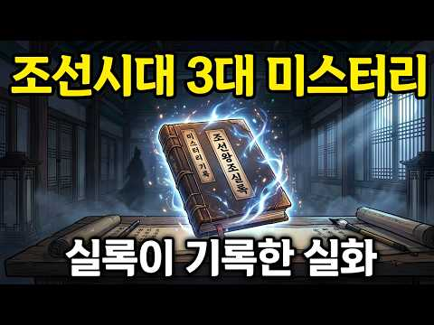
- 챕터: 0:00 오프닝 - 472년의 기록 · 0:33 사관이 적지 말았어야 할 것들 · 1:27 미스터리 #1 - 34년간 배회한 존재 · 2:48 중종반정과 조광조 · 4:48 16년 뒤 다시 나타난 존재 · 6:59 중종의 죽음과 마지막 소동 · 10:16 미스터리 #2 - 조선시대범죄 · 13:49 5살 개춘이의 증언 · 18:13 서울 거지 전멸 · 21:15 미스터리 #3 - 자연발화 · 24:25 정약용도 설명 못한 사건 · 28:26 마무리 및 구독 요청
- 설명 앞부분: 조선왕조실록에 기록된 충격적인 3대 미스터리를 소개합니다. 472년 동안 조선의 사관들이 빠짐없이 기록한 실록 속에는 우리가 몰랐던 기이한 사건들이 담겨 있습니다. 유교 국가였던 조선에서 공자는 "군자는 괴이한 것과 귀신을 논하지 않는다"고 했지만, 사관들은 자신들이 목격한 기이한 사건들을 빠짐없이 기록했습니다. 이번 영상에서는 조선시대 실제로 발생한 1. 34년간 궁궐을 배회한 정체불명의 존재 (1511년 창덕궁) 2. 75년간 이어진 충격적인 범죄 사건 3. 사람만 타버린 기이한 화재 사건 세 가지 미스터리를 파헤쳐봅니다. 📚…
- 같은 채널 평소 대비 ×311.6 (채널 최근 롱폼 중앙값 455회) · 평소 영상: 이순신이 밤마다 벌벌 떤 이유...난중일기 40년 파헤친 교수가 경악한 기록 1줄 (455회) / 4살에 입궁? 궁녀가 된 어린 소녀의 충격적인 첫 업무 (380회)
- 대본 없음 (설명) — 음성인식이 끝나면 도입부·흐름이 들어감
- 댓글 115/116: 좋은 점 — 영상 0 · 감사·응원 0 · 더 알고 싶은 것 0 · 아쉬운 점 — 영상 1 · 반박·불만 — 의견 다름 0 · 정치·사회 4 · 경험 공유 1 · 구독·다음 기대 0
  - 아쉬운 점 — 영상 👍0 “서두에서의 "472"년, 조선이 존속한 시간입니다"라는 말은 정정바랍니다. 그건 태조부터 철종까지의 실록을 말하는 거 아닙니까?”
  - 정치·사회 👍21 “옛날부터 사람을 가축잡뜻이 현제까지 최근 인육사건 조선족 오원춘”
  - 정치·사회 👍1 “산사람 신체를 이용하는 옛방식을 지금도사용하는 나라가 있다”
  - 경험 공유 👍3 “1392년부터 1910년까지니까 조선왕조의 역사는 512년이네요.. 물론 조선왕조실록이 472년만 작성되었다니 이유는 모르겠지만요.. 다만 연산군때와 광해군때의 기록은 실록이라고 하지 않고 일기라고 했다고는 알고 있고요.. 어쩌면 조선이 일제의 간접통치(통감부)를 받…”

### 137. 암행어사 박문수 "암행어사 출두요!" 탐관오리를 쓸어버리다 ∣ 조선 사극 사이다

- https://www.youtube.com/watch?v=4C7JI9SwK1o · 영화 말본 · 구독자 5,040 · 조회수 311,769 (×61.9, 하루 4,044.3) · 좋아요 801 (0.3%) · 13분 · 2026-08-25 · 주제 묶음 3. 조선 · 형식 정보·해설 (그 밖) · 폴더 `W_4C7JI9SwK1o` (웹 승인)
- 썸네일: 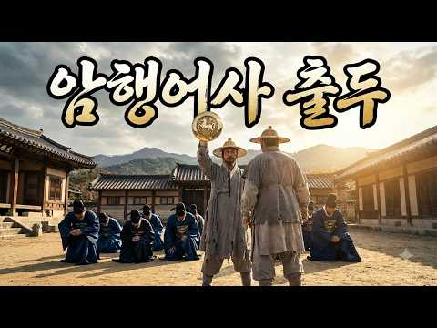
- 챕터: 0:00 1장 거지 어사 — 썩은 고을에 잠입하다 · 2:21 2장 탐관오리 — 잔칫상 위의 피 · 4:28 3장 밝혀지는 비리 — 장부 한 권 · 6:27 4장 위기 — 한 백성이 숨겨주다 · 8:33 5장 암행어사 출두 — 마패가 번뜩이다 · 10:32 6장 진짜 배후 — 한양의 거물
- 설명 앞부분: 암행어사 박문수 — "암행어사 출두요!" 탐관오리를 쓸어버리다 ∣ 조선 사극 사이다 거지 행색으로 고을에 잠입한 암행어사 박문수. 굶주린 백성을 쥐어짜는 탐관 사또와 토호의 비리를 파헤친다. 결정적 순간, 마패를 꺼내 든다 — "암행어사 출두요!" 허나 세곡을 빨아들인 진짜 배후는, 한양 중앙의 거물 김 대감이었다. 문수는 대감의 위협에도 굴하지 않고, 국법 앞에 그를 세운다. 낡은 민초의 잿빛과 관아의 붉은빛이 대비되는 조선 사극. 백성을 위한 정의와 통쾌한 응징을 그린 단편입니다. ※ 본 영상은 AI로 제작된 창작 사극 단편입…
- 같은 채널 평소 대비 ×13.1 (채널 최근 롱폼 중앙값 23,817회) · 평소 영상: 사극 4편 몰아보기 ∣ 조선 명탐정 · 암행어사 박문수 · 취검객 · 전장의 연가 (23,817회) / [침검(鍼劍) 2화] 떠도는 여의원 - 검은 물 (31,246회)
- 대본 없음 (설명) — 음성인식이 끝나면 도입부·흐름이 들어감
- 댓글 30/62: 좋은 점 — 영상 0 · 감사·응원 0 · 더 알고 싶은 것 0 · 아쉬운 점 — 영상 0 · 반박·불만 — 의견 다름 0 · 정치·사회 3 · 경험 공유 0 · 구독·다음 기대 0
  - 정치·사회 👍1 “조선시대 윤석열”
  - 정치·사회 👍0 “지금도 이정권과 똑같네요 왜적보다 더못한 정치을 한 옛날이나 지금이나ᆢ 한심하다 이나라”

### 138. 인간은 죽으면 어디로 가는가? 수메르 점토판이 밝힌 충격적인 진실… 아무도 그 함정을 보지 못했다

- https://www.youtube.com/watch?v=uu8Ffx5ZnfY · 조용한 밤 이야기 · 구독자 1,430 · 조회수 139,090 (×97.3, 하루 1,147.2) · 좋아요 1,292 (0.9%) · 30.5분 · 2026-07-12 · 주제 묶음 8. 문명·고고학 · 형식 정보·해설 (그 밖) · 폴더 `W_uu8Ffx5ZnfY` (웹 승인)
- 썸네일: 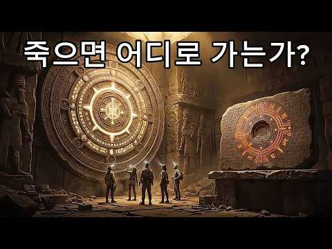
- 설명 앞부분: 인간은 죽으면 어디로 가는가? 수천 년 전 수메르 문명이 남긴 점토판에는 죽음 이후 인간에게 일어나는 과정과 영혼, 사후 세계에 대한 놀라운 기록이 담겨 있다고 전해집니다. 이번 영상에서는 수메르 점토판에 기록된 사후 세계의 비밀, 영혼의 여정, 고대 문명이 남긴 미스터리, 그리고 오늘날까지도 논란이 되는 숨겨진 의미를 살펴봅니다. 과연 이것은 단순한 신화일까요, 아니면 잊혀진 고대의 지식일까요? ※ 이 영상은 역사적 기록, 고고학적 발견, 신화와 다양한 연구 및 해석을 바탕으로 제작되었습니다. 일부 내용은 학계에서 확정된 사실이…
- 같은 채널 평소 대비 ×218.4 (채널 최근 롱폼 중앙값 637회) · 평소 영상: 2억 년 전 지구는 완전히 달랐다… 판게아로 떠나는 시간여행 (702회) / 중국 전체를 정복한 몽골은 왜 일본을 정복하지 못했을까 두 번의 침공과 충격적인 패배! (572회)
- 대본 없음 (설명) — 음성인식이 끝나면 도입부·흐름이 들어감
- 댓글 99/99: 좋은 점 — 영상 0 · 감사·응원 1 · 더 알고 싶은 것 1 · 아쉬운 점 — 영상 1 · 반박·불만 — 의견 다름 2 · 정치·사회 0 · 경험 공유 3 · 구독·다음 기대 0
  - 감사·응원 👍1 “엄청난 영상입니다~~ㄷㄷㄷ 정말 감사합니다~~~♡”
  - 더 알고 싶은 것 👍1 “그런 내용이 담긴 점토판을 보여 주세요 그리고 전문가의 의견을 인터뷰한 영상도 올려 주세요 믿지 않음 인간은 죽으면 끝 영원히 살고 싶은 인간의 욕심이 만든 비과학적 샤머니즘 살아 있는 동안 행복하게 사세요 인간의 뇌는 살기 위해 가상의 공간을 만들고 그곳에서 위로를…”
  - 반박·불만 — 의견 다름 👍0 “궁금해하지말고 재밌게 살다 갑시다. 날파리가 그러던가요? 코끼리가 그러던가요? 생명의 숫자 논리로 따지면 지구 탄생 46억 년 전 생명체> 그래서 윤회설도 안맞는 겁니다. 지구 탄생 그때 인간 80억명이었나요? 그게 벌레로, 인간으로 총량? 말도 안되는 인간들의 논리…”
  - 반박·불만 — 의견 다름 👍0 “아직도 이런 헛소리를 올리나? 얼척없네 ㅋ”
  - 경험 공유 👍2 “다시 태어나더라도 그건 더 이상 내가 아니다! 영혼불멸 이야기라면 또 다른 차원의 이야기”
  - 경험 공유 👍1 “첫 영상 속 표식 50평생 딱 한번 봤는데 자다 깨서 눈에서 나온듯 시선 따라서 벽에 부딪혀 크기도 달라져 움직였는데 형광색? 푸른 빚.. 내가 팔이 눈을 눌러 자다 깨 그런걸 본게 아닐까.... 생각들었는데 깨서 약 20초간 보였던듯”

### 139. “아이언맨 슈퍼맨 다 필요없다” 미국에서 갑자기 역대급 이순신 대열풍이 일어난 이유

- https://www.youtube.com/watch?v=tZ6pzMh4JYU · 한반도 백과사전 · 구독자 6,060 · 조회수 206,451 (×34.1, 하루 4,849.8) · 좋아요 1,235 (0.6%) · 20.3분 · 2026-09-29 · 주제 묶음 3. 조선 · 형식 애니메이션·지도 · 폴더 `W_tZ6pzMh4JYU` (웹 승인)
- 썸네일: 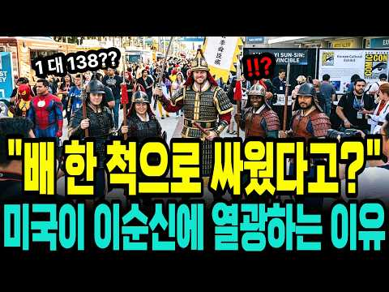
- 챕터: 0:00 단 1척으로 돌진한 이순신 · 0:55 백의종군과 칠천량 패전 · 2:46 명량해전 – 13척 vs 130여척 · 4:37 한산도대첩과 학익진 · 5:25 미국 만화가 온리 콤판과 스탠 리 · 9:31 사무라이와 다른 실존 영웅, 난중일기 · 11:34 넬슨과 나란히 선 조선의 제독 · 14:14 23전 23승과 거북선의 진실 · 16:42 LA에 놓인 거북선 · 18:05 미국인들이 이순신에게 열광하는 이유
- 설명 앞부분: 🇰🇷 "아이언맨 대신 이순신?" 미국 만화가가 17년 동안 이순신에 빠져있는 이유 드라마 〈불멸의 이순신〉을 보고 매료되어 17년째 미국에서 이순신 만화(《Yi Soon Shin》 시리즈)를 그리고 있는 미국 만화가 온리 콤판(Onrie Kompan). 출판사의 외면 속에서도 120개 이상의 컨벤션 현장을 발로 뛰며 25만 부 이상을 판매해 냈고, 마블의 거장 스탠 리(Stan Lee)조차 이순신의 삶에 감탄해 직접 양장본 서문을 써주었습니다. 2013년 유네스코 세계기록유산으로 등재된 《난중일기》 속에 적힌 군량미(둔전) 셈법,…
- 같은 채널 평소 대비 ×10.5 (채널 최근 롱폼 중앙값 19,710회) · 평소 영상: "한국의 시민의식은 세계 1위" 세계가 한국 주차장 풍경에 극찬하는 이유 (19,870회) / "한글날 100주년의 위대함" 외국인들이 줄 서서 한글을 배우는 진짜 이유 (19,549회)
- 대본 없음 (설명) — 음성인식이 끝나면 도입부·흐름이 들어감
- 댓글 85/93: 좋은 점 — 영상 1 · 감사·응원 1 · 더 알고 싶은 것 0 · 아쉬운 점 — 영상 0 · 반박·불만 — 의견 다름 3 · 정치·사회 11 · 경험 공유 1 · 구독·다음 기대 0
  - 반박·불만 — 의견 다름 👍1 “누군가 영웅이 되려하면 정치공세가 장난아니죠”
  - 정치·사회 👍6 “이런 역사는 안 배우고, 518, 43....좌골병으로 나라가 뷸구가 되고 있다...😢”
  - 정치·사회 👍3 “난 그 포수가.. 조선의 정권에서 보냈다는게 훨신 확률이 높다... 고 생각한다.”
  - 경험 공유 👍0 “하나님이 세상을 이처럼 사랑하사 독생자를 주셧으니 이는 저를 믿는자마다 멸망치않고 영생을 얻게 하려 하심이라 요 3 :16 예수께서 이르시되 내가 곧 길이요 진리요 생명이니,나로 말미암지 않고는 아버지께로 올 자가 없느니라 요 14 : 6 수고하고 무거운 짐 진 자들…”

### 140. 《중국 역사》 고대 중국, 남자 첩이 여자 첩보다 더 비극적이었던 이유는? l 역사 인물 l 고전

- https://www.youtube.com/watch?v=jcUvSMjefq8 ·  역사 산책: 동양편 · 구독자 2,770 · 조회수 164,122 (×59.2, 하루 2,191.5) · 좋아요 653 (0.4%) · 23.4분 · 2026-08-03 · 주제 묶음 1. 역사 일반·이야기 · 형식 정보·해설 (그 밖) · 폴더 `W_jcUvSMjefq8` (웹 승인)
- 썸네일: 
- 같은 채널 평소 대비 ×25.5 (채널 최근 롱폼 중앙값 6,426회) · 평소 영상: 《삼국지》 유비는 왜 동문 공손찬의 등에 칼을 꽂았을까? l 역사 인물 l 고전 (7,251회) / 《삼국지》 조조의 손자 조예, 위나라를 파멸로 몰았던 이유는? l 역사 인물 l 고전 (5,600회)
- 대본 없음 (없음) — 음성인식이 끝나면 도입부·흐름이 들어감
- 댓글 87/87: 좋은 점 — 영상 1 · 감사·응원 1 · 더 알고 싶은 것 2 · 아쉬운 점 — 영상 0 · 반박·불만 — 의견 다름 1 · 정치·사회 2 · 경험 공유 2 · 구독·다음 기대 0
  - 좋은 점 — 영상 👍6 “좋은 영상 재미있게 보고 갑니다♡”
  - 감사·응원 👍1 “감사합니다 🎉🎉🎉”
  - 더 알고 싶은 것 👍8 “세상에나 그 당시에도 동성애가 성했네요. 에고... 글자 화면 뒤에 끊임없이 움직이는 동영상은 안 올리면 안되나요? 집중력도 떨어지고, 어지럽고 정신 사나워요.”
  - 더 알고 싶은 것 👍2 “인간이 이렇게 잔인합니다 그들은 얼마나 고통스러웠을까요?”
  - 정치·사회 👍0 “오늘날에도 중국에서 저런일이 벌어지고 있지 않나? 위멍롱 사건. 735사건 등.. 아마 중국 연예인들이나 일반 사람들 인신매매 장기척출 인육 등..중국은 천벌 받아야 한다.중국은 자기들 죄로 반드시 쪼개져 역사속에서 다시는 하나의 나라가 되지 못할거다.”
  - 경험 공유 👍0 “내가 30년전 알던 어느 광고전문 감독에게 들었는데 그당시 연예계에서 스타가된 남자배우치고 앙드레 김에게 항문을 바치지 않고는 스타가되기가 하늘에 별따기라고 했다..노예계약의 협박용으로 강제로 강요당한 성관계 테이프도 한편식 다 완성해놔야 했다고 했다..그게.. 30…”

### 141. 이순신이 원수 자격을 의심했던 조선군 총사령관?!

- https://www.youtube.com/watch?v=-f0CsdR5eJE · 몰래 듣는 조선의 비밀 · 구독자 1,220 · 조회수 71,880 (×58.9, 하루 925.2) · 좋아요 355 (0.5%) · 18.7분 · 2026-08-24 · 주제 묶음 3. 조선 · 형식 정보·해설 (그 밖) · 폴더 `W_-f0CsdR5eJE` (웹 승인)
- 썸네일: 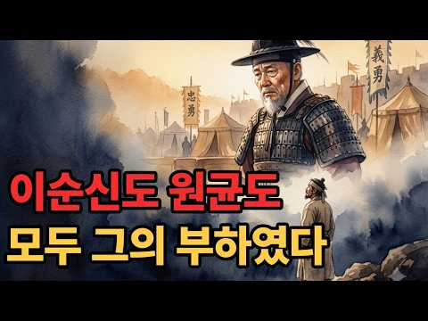
- 챕터: 0:00 두 달을 걸어온 사내 · 1:24 인사와 오늘의 여섯 장면 · 1:49 같은 해, 같은 사람이 천거한 두 이름 · 3:49 도원수라는 직책 · 6:06 이순신이 일기에 적은 문장 · 8:33 요시라의 반간계와 파직 · 10:57 백의종군 길의 끝 · 13:05 곤장 사흘 뒤 · 16:03 전기수의 한 줄
- 설명 앞부분: 1597년 사월 초사흘, 한 사내가 한양 의금부 문을 나섭니다. 며칠 전까지 그 안에서 문초를 받던 사람입니다. 살아 나온 것만으로도 주변이 놀랐습니다. 그는 남쪽으로 걷기 시작합니다. 관복도 벼슬도 없이, 죄인의 몸으로 삼백사십 킬로미터를 걷습니다. 떠난 지 열흘쯤 됐을 때 어머니의 부고가 옵니다. 상복도 갖추지 못한 채 그는 다시 남쪽으로 걷습니다. 두 달 뒤인 유월 초나흘, 사내는 경상도 합천 초계에 닿습니다. 조선의 모든 군대가 여기서 명령을 받는 곳, 도원수부입니다. 이 사내가 이순신입니다. 그런데 그가 도착한 진영의 주…
- 같은 채널 평소 대비 ×208.0 (채널 최근 롱폼 중앙값 346회) · 평소 영상: 7년간 전쟁을 이끈 남자가 쫓겨나서 쓴 반성문 16권 [조선인물 탐구생활] (358회) / 조선 최강이라 불린 장수, 적이 아니라 임금의 매에 죽으며 비운의 장수로 남다. [조선 … (333회)
- 대본 없음 (설명) — 음성인식이 끝나면 도입부·흐름이 들어감
- 댓글 30/34: 좋은 점 — 영상 1 · 감사·응원 1 · 더 알고 싶은 것 0 · 아쉬운 점 — 영상 0 · 반박·불만 — 의견 다름 0 · 정치·사회 1 · 경험 공유 0 · 구독·다음 기대 0
  - 좋은 점 — 영상 👍1 “이순신과 권율 관계에 대해서 새롭게 알게되었습니다. 매번 유익한 역사 정보 주셔서 감사합니다!”
  - 감사·응원 👍1 “이순신과 권율 관계에 대해서 새롭게 알게되었습니다. 매번 유익한 역사 정보 주셔서 감사합니다!”
  - 정치·사회 👍4 “이순신, 권율 등의 승리도 두 사람이 다른 무력하고 전략전술 부족한 다른 장수들보다 뛰어나서이기도 하지만 세종,문종 대에 전세계적에서 최고수준으로 만들어놓은 신기전을 위시한 총통기, 화차 등의 우수한 무기기술이 있었음을 여전히 문사양반선비 기득권이 이어가는 이 나라가…”

### 142. 조선시대 과거 시험의 모든 것! 낙방한 선비들이 먹고살기 위해 선택한 의외의 직업들

- https://www.youtube.com/watch?v=3kotYxP9RjI · 안식한국사 · 구독자 3,890 · 조회수 263,015 (×67.6, 하루 2,947.1) · 좋아요 1,559 (0.6%) · 18.8분 · 2026-08-13 · 주제 묶음 3. 조선 · 형식 수면·낭독 (잠잘 때 듣는) · 폴더 `W_3kotYxP9RjI` (웹 승인)
- 썸네일: 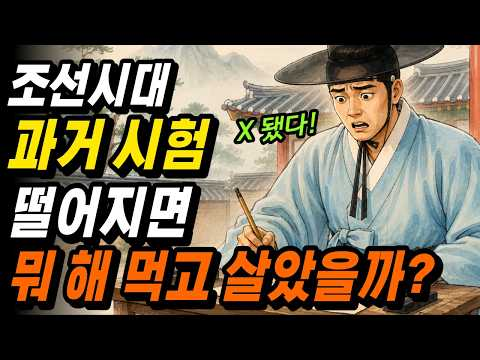
- 설명 앞부분: 정정 안내 = 영상 후반부의 3대 동안 급제자가 없으면 양반 신분이 박탈된다는 내용은 법적 제도가 아니라 당시의 사회적 통념이었습니다. 실제로 신분이 법적으로 강등되는 경우는 드물었고 대개 몰락 양반으로 유지되었습니다. 부정확하게 전달한 점 바로잡습니다. 지적해 주신 분들께 감사드립니다. 3년에 딱 33명. 그런데 지원자는 십만 명이 넘었습니다. 😮 조선의 과거 시험은 붙는 게 기적, 떨어지는 게 당연한 세계였습니다. 우리는 늘 급제한 사람만 기억하지만, 시험장을 이름 없이 걸어 나온 그 수많은 선비들은 어떻게 살아갔을까요? 본 …
- 같은 채널 평소 대비 ×3.1 (채널 최근 롱폼 중앙값 85,688회) · 평소 영상: 조선 최연소 천재 병조판서를 사흘 만에 처형한 이유 (97,786회) / 조선시대 노비들은 어떻게 돈을 벌어서 양반보다 부자가 됐을까? ∣ 굶주린 양반들은 노비에… (73,590회)
- 대본 없음 (설명) — 음성인식이 끝나면 도입부·흐름이 들어감
- 댓글 112/144: 좋은 점 — 영상 1 · 감사·응원 3 · 더 알고 싶은 것 2 · 아쉬운 점 — 영상 1 · 반박·불만 — 의견 다름 2 · 정치·사회 4 · 경험 공유 2 · 구독·다음 기대 0
  - 좋은 점 — 영상 👍2 “다 좋은데.. 여러가지 유익하고 배워지는것이 많은 프로그램인데,,,,, 중간에 그만둔 이유는 ,,,,, 너무 자극적인 표현이 많다 소름 끼친다... 더 놀라운것,,,, 좋은 프로그램에 왜이런 저질스런표현을 사용해서 격을 떨어뜨리나?작가가 격이 떨어지는 사람인가?”
  - 감사·응원 👍3 “현재의 일반인들이 조선시대 정승판서보다 풍요롭게 오래오래 산다? 좋은시절에 태어나서 배부르고 등따시게 잘살고 있음을 항상 감사하며 삽시다!”
  - 감사·응원 👍2 “수고하셨습니다 감사합니다 🎉🎉🎉 쥬만지 ^^*”
  - 더 알고 싶은 것 👍0 “유만주 일기 내용을 알려주세요”
  - 아쉬운 점 — 영상 👍2 “3대 동안 과거급제자가 없으면 평민이 된다는 얘기는 잘못된 정보입니다. 경국대전에도 없는 내용이고 10대가 넘어가도 양반을 유지했습니다. 족보에 확실히 올라가 있고 가장 중요한건 향안이라고 지역 양반에 등록되어 있으면 양반 직위가 안떨어집니다. 형편이 힘들어지면 몰락…”
  - 반박·불만 — 의견 다름 👍2 “3대 동안 과거급제자가 없으면 평민이 된다는 얘기는 잘못된 정보입니다. 경국대전에도 없는 내용이고 10대가 넘어가도 양반을 유지했습니다. 족보에 확실히 올라가 있고 가장 중요한건 향안이라고 지역 양반에 등록되어 있으면 양반 직위가 안떨어집니다. 형편이 힘들어지면 몰락…”
  - 반박·불만 — 의견 다름 👍0 “생원진사시즉(소과)는 대과 전단계 시험이아닌 별개의 자격증명 시험에가깝습니다 세조이후부터 소과없이 향시로 대과초시응시가능입니다 물론 소과에 합격하면 유학으로서의 자격증빙및 지방말단관료진출과 성균관입학자격 등이 부여됩니다만. 세조이후 대과 향시초시 복시 를위한 필수단계…”
  - 정치·사회 👍55 “아버지 잘만나면 지금도 거의 무시험으로 공무원 된다 선거관리위웬회 직원으로~~”
  - 정치·사회 👍0 “이런 임금 하야할 일일세. 한성판윤 탄핵 사유인데...”
  - 경험 공유 👍0 “소과합격자만 대과를 치르는데 뭔 수만명이 몰려서 깔려죽는가요? 제가 잘모르는건가요?”

### 143. 강남 5,600억 노른자 땅 속 무덤 주인의 소름돋는 정체

- https://www.youtube.com/watch?v=HiCvp_Xx_xg · 역사로와 · 구독자 5,470 · 조회수 504,363 (×92.2, 하루 4,119.1) · 좋아요 13,151 (2.6%) · 28.5분 · 2026-06-27 · 주제 묶음 기타 · 형식 정보·해설 (그 밖) · 폴더 `W_HiCvp_Xx_xg` (웹 승인)
- 썸네일: 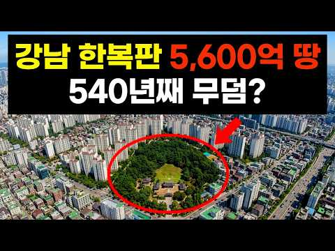
- 설명 앞부분: "왕이 되지 않은 사람의 이야기는, 540년 뒤 서울의 도로 이름이 된다." 강남 서초동 한복판, 축구장 8개 크기(1만 8천 평)의 거대한 초록색 섬. 평당 수천만 원을 호가하는 이 땅의 주인은 540년 전 죽은 한 남자, 바로 세종대왕의 친형 '효령대군'입니다. 조선 왕족 묘역의 99%가 사라지는 동안, 그는 어떻게 대한민국에서 가장 비싼 땅을 지켜냈을까요? 아버지 태종 이방원의 칼날 앞에서는 '빙긋 웃음'으로, 조카 수양대군의 피바람 앞에서는 '철저한 침묵'으로 살아남아 91세 천수를 누린 인물. 왕좌를 포기한 대가로 540…
- 같은 채널 평소 대비 ×709.9 (채널 최근 롱폼 중앙값 710회) · 평소 영상: 쌀은 창고에 넘쳐났습니다. 우리 도시락에만 없었습니다. (735회) / 왕비도 못 된 여인이 조선 최고 권력자가 된 이유 (686회)
- 대본 없음 (설명) — 음성인식이 끝나면 도입부·흐름이 들어감
- 댓글 576/581: 좋은 점 — 영상 13 · 감사·응원 35 · 더 알고 싶은 것 4 · 아쉬운 점 — 영상 2 · 반박·불만 — 의견 다름 5 · 정치·사회 15 · 경험 공유 19 · 구독·다음 기대 2
  - 좋은 점 — 영상 👍5 “와우 후손이면서그분의 내력을 정말모르고 지냈네요 효령대군 님을 알게되어 고맙습니다 알려주셔서”
  - 좋은 점 — 영상 👍5 “역사이야기 많이올려주세요 참재미있어내요또한번 역사를배웠.ㅁ니다”
  - 감사·응원 👍363 “효령대군이 휴식공간으로 쓰라고 온몸으로 지켜 주셨내요, 감사,감사....”
  - 감사·응원 👍75 “조선시대 왕족을 통틀어 가장 행복한 삶을 사신분이네요 보람있는 정보네요 감사합니다”
  - 더 알고 싶은 것 👍5 “구독 좋아요 누르고 갑니다 향후 많은 자료들 올려주세요”
  - 더 알고 싶은 것 👍5 “역사이야기 많이올려주세요 참재미있어내요또한번 역사를배웠.ㅁ니다”
  - 아쉬운 점 — 영상 👍0 “침착하니 재미납니다 옛말에 효령대군 북치듯한단말 들어봤습니다 왕이될 수도있었는데하는 아쉬움 하지만 주변이 모두 죽어나가니 의견도 낼 수없고 또 그만한 배짱도없으니 불교에 심취해있던 효령은 모든 고뇌를 북치는걸로 달랬을수도...”
  - 아쉬운 점 — 영상 👍0 “서론이 너무 길어요.”
  - 반박·불만 — 의견 다름 👍33 “역사한페이지를 돈으로 환산하나 어이없다”
  - 반박·불만 — 의견 다름 👍1 “헛소리 보다는, 지금의 땅값을 가지고, 조선시대에서만 사시는듯, 효령은 불가에도 귀의하고 재물로서 조선초기에 다 헛웃음에 의미부여가 없다는거~~ 😮😅😊”
  - 정치·사회 👍2 “이귀한땅 정부에서 게발해서 국체절감🎉”
  - 정치·사회 👍1 “현시대 역사를모르면 나라가 망한다 영상 감사합니다~^^ 🎉🎉🎉🎉❤”
  - 경험 공유 👍58 “내가 19대 강○항렬 아들이 20대 ○재 항렬.아들이 대학 다닐때 내가 대신 가서 장학금 100만원 받았습니다.그때는 대군할아버지 묘소 참배하고 잔듸 광장에서 장학금.효부상 수여식을 하고 청권사에서 나눠준 도시락으로 점심을 먹었던 기억이납니다”
  - 경험 공유 👍37 “내가 아는분중에도 효령대군 19대손도 계시던데”
  - 구독·다음 기대 👍3 “구독했습니다”
  - 구독·다음 기대 👍0 “넘 재밌어요! 초등 때 읽은 책엔 효령대군이 세자로 책봉되지 못 하자 실망해서 승려가 되었다고 돼 있었어요. 30년이 지나서 사실을 알게 되었어요! 구독했어요. 좋은 영상 감사합니다.^^ 앗 근데 넘 느려 1.5배속으로 봤어요. 그럼 수익 집계에 안 들어가나요? 꼭 …”

### 144. [숨겨진 중국사] 제갈량보다 무서웠던 중국 최고의 책사 다섯명, 진짜 1위는? ∣ 역사인물 ∣ 야사 ∣ 비사

- https://www.youtube.com/watch?v=3fmE-O13adY · 숨겨진중국사 · 구독자 13,200 · 조회수 332,643 (×25.2, 하루 9,924.6) · 좋아요 1,125 (0.3%) · 43.9분 · 2026-10-08 · 주제 묶음 6. 동양사 (중국·일본·몽골) · 형식 정보·해설 (그 밖) · 폴더 `W_3fmE-O13adY` (웹 승인)
- 썸네일: 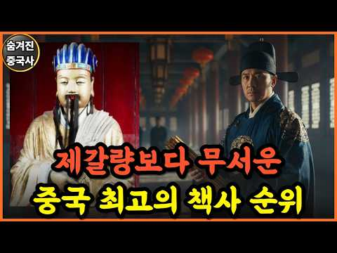
- 설명 앞부분: 제갈량이 중국사 책사 순위 5위 안에 들지 못한 이유를 정사 기록으로 따라갑니다. 한나라의 숨통을 끊고도 77세까지 살아남은 가후, 승려의 몸으로 황제를 갈아 끼운 요광효, 죽으며 8년 뒤를 정확히 맞힌 왕맹, 밥상 하나로 항우의 오른팔을 떼어 낸 진평, 그리고 천하를 만들고 스스로 물러난 장량. 다섯 책사의 계책과 말년을 순서대로 짚으면 책사의 등급을 가르는 기준이 드러납니다. 여러분이 꼽는 1위는 누구인지 댓글에 남겨 주세요. 저희는 숨겨진 역사를 재미있고 정확한 한 편의 이야기로 풀어내고자 영상을 만들고 있습니다. "매주 화…
- 같은 채널 평소 대비 ×26.5 (채널 최근 롱폼 중앙값 12,553회) · 평소 영상: [숨겨진 중국사] 고려가 이방인을 삼키는 방법 ∣ 역사인물 ∣ 야사 ∣ 비사 (12,553회) / [숨겨진 중국사] 현재 중국 땅을 원래 주인들에게 다 반환하면 어떻게 될까? ∣ 역사인물… (12,548회)
- 대본 없음 (설명) — 음성인식이 끝나면 도입부·흐름이 들어감
- 댓글 97/163: 좋은 점 — 영상 4 · 감사·응원 1 · 더 알고 싶은 것 0 · 아쉬운 점 — 영상 0 · 반박·불만 — 의견 다름 2 · 정치·사회 0 · 경험 공유 3 · 구독·다음 기대 0
  - 좋은 점 — 영상 👍4 “처음부터 끅까지 제갈량으로 시작해서 제갈량으로 맺었다 고로 제갈량이 1st 임 그는 레전드고 정석이다”
  - 좋은 점 — 영상 👍2 “정사만으로 제갈량 깎아내리는 사람이 많은데 진수가 촉에 악감정이 있어 당연히 좋은 이야기 쓸 이유가 없었겠지 역사는 승자의 기록이라 어쩔수 없는 결과라지만 나관중의 소설은 그냥 소설로 넘어가는게 맞고 정사도 그대로 믿기 힘들다는건 인정하고 가야함”
  - 감사·응원 👍1 “안녕하세요 구독과 좋아요 꾹꾹 누르고 시청하고 있습니다 유익한 역사정보 감사드립니다 아울러 선생님 사업과 채널도 번창하세요”
  - 반박·불만 — 의견 다름 👍3 “웃기는 개소리다 환경이 다르다 웃기는소리,ㅡ 하지 말기”
  - 경험 공유 👍1 “처음에는 예전에 존경하던 제갈량을 약간 뒤로 놓는 느낌이라 거부감 있었는데, 마지막 결론을 보니 납득이 되긴 하네요. 사실 인문학에 대해 불신 심한 상태로 측정은 정확하게 해야한다고 생각하는 직업병 있는 입장에서 삼국지 내에서도 가후가 평가가 후하다는 것 알고 있기에…”
  - 경험 공유 👍1 “순위 라고 돼 있길래 난 내가 모르는 순씨 일족인 줄 알았지…… 순욱, 순유, 순위 …… 이렇게 ㅋㅋㅋ 😅”

### 145. 단종의 친누나 경혜공주, 세조에게 한 조선 역사상 가장 잔인한 복수

- https://www.youtube.com/watch?v=wX-80QWb2tg · 시간책방 · 구독자 9,770 · 조회수 1,110,481 (×113.7, 하루 7,156.7) · 좋아요 25,481 (2.3%) · 36.6분 · 2026-06-08 · 주제 묶음 1. 역사 일반·이야기 · 형식 정보·해설 (그 밖) · 폴더 `W_wX-80QWb2tg` (웹 승인)
- 썸네일: 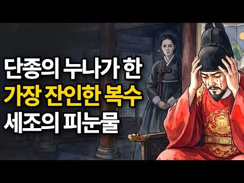
- 챕터: 0:00 내 가족을 죽인 사람에게 아이를 맡길 수 있습니까? · 2:15 경혜공주의 탄생과 어머니의 비극 · 6:00 인생에서 가장 빛나던 2년 · 7:40 계유정난 — 누나 집에서 끌려간 동생 · 8:55 남편 유배와 경혜공주의 첫 번째 저항 · 12:45 사육신 사건과 연쇄 비극 · 17:15 칼 없는 복수의 시작 — 아이를 원수에게 보내다 · 24:15 세조의 유언 — 감옥의 문을 잠그다 · 25:50 단종의 저주, 세조 집안에 드리운 그림자 · 27:30 4대에 걸친 설계 — 정미수의 등용 · 31:25 어머니를 닮은 아들 · 31:50 경혜공주의 죽음과 정순왕후의 64년 침묵 · 35:55 570년 뒤, 당신에게 묻습니다
- 설명 앞부분: 왕의 딸에서 노비로. 남편은 사지가 찢겨 죽고, 남동생은 열일곱에 세상을 떠났습니다. 그런데 이 여자는 칼을 들지 않았습니다. 대신 여섯 살 아들을 원수의 궁궐로 보냈습니다. 그 선택 하나가 세조의 가슴에 가시가 되어 박혔고, 그 가시는 4대의 왕이 바뀌는 동안에도 끝내 빠지지 않았습니다. 조선왕조 500년, 공주에서 노비로 떨어진 유일한 기록. 경혜공주의 이야기입니다. ⏱️ 타임스탬프 이 영상은 조선왕조실록, 성종실록, 세조실록 등의 사료를 바탕으로 재구성하였습니다.
- 같은 채널 평소 대비 ×700.4 (채널 최근 롱폼 중앙값 1,586회) · 평소 영상: 조선 왕들은 왜 46세에 죽었나? 경복궁 흙이 밝힌 충격적 진실 (1,676회) / 세조는 왜 친동생 안평대군을 죽였나? 조선 최고의 천재가 사라진 진짜 이유 (1,495회)
- 대본 없음 (설명) — 음성인식이 끝나면 도입부·흐름이 들어감
- 댓글 864/922: 좋은 점 — 영상 11 · 감사·응원 23 · 더 알고 싶은 것 6 · 아쉬운 점 — 영상 6 · 반박·불만 — 의견 다름 4 · 정치·사회 23 · 경험 공유 11 · 구독·다음 기대 0
  - 좋은 점 — 영상 👍27 “영화 왕과사는남자를 보고 말씀을 들으니 더 마음이 아프네요... 귀에 쏙~ 들어오면서 역사공부를 제대로 하였습니다... 감사합니다”
  - 좋은 점 — 영상 👍10 “좋은영상 잘 보았습니다. 감사합니다 ~”
  - 감사·응원 👍122 “이야기 너무 생생하게 잘 전달해 주셔서 감사합니다 경혜공주, 정말 대단한 어머니이네요 아름다운 영상으로 보여주니 더 생생하게 다가옵니다 감사합니다”
  - 감사·응원 👍40 “중간에 광고없이 듣게 돼서 너무 감사 했어요 .설명도 잘 이해 할수있도록 부연설명해주시고 …”
  - 더 알고 싶은 것 👍40 “(권순임)현덕왕후님.경혜 공주님과.임금이신 단종을 두시고 어떻게 눈을 감으셨나요?참으로 가슴이 찢어지게 아파 옵니다.그리고 하염없이 눈물이 흘러 내립니다.현덕 왕후님 이제는 하늘에세 편안하게 쉬세요.🙏🙏🙏🎉🎉🎉”
  - 더 알고 싶은 것 👍7 “정미수의 여동생은 어떻게 되었나요?”
  - 아쉬운 점 — 영상 👍5 “내용 너무 좋아요. 진짜 잘 보고 갑니다. 근데 ai이미지에서 결혼안한 아이가 상투를 틀고 있다던가 팔이 세개가 있다던가 하는 부분들이 아쉬워요ㅜㅜㅜ”
  - 아쉬운 점 — 영상 👍4 “유익하고 조선왕조 실록 등 사료에 충실하게 영상 제작해주셔서 고맙습니다. 저는 해주정씨 종파 후손입니다. 즉 영양위 할아버지와 경혜공주 할머니의 직계후손입니다. 경혜공주 할머니의 자애로운 모성과 미수할아버지의 효심과 선행을 잘 표현해 주셔서 특히 고맙습니다. 한가지 …”
  - 반박·불만 — 의견 다름 👍35 “세조, 이유. 이 인물은 사람 아닙니다. 작금의 누구하고 비슷하죠.. 악마의 화신들..ㅎㅎ”
  - 반박·불만 — 의견 다름 👍1 “요새도 말도 안되는 한방이 치료랍시고 하는것 보면 참 한심해. 궁궐에서도 저리 쉽게 죽는거도 못 막으면서 무슨 치료한답시고 설치는지. 사기좀 그만 치면 그나마 나을텐데.”
  - 정치·사회 👍8 “세조의 잔인성이 이재명한테 옮겨붙었구나...”
  - 정치·사회 👍2 “세조는 천벌을 받았고 경혜공주의 복수는 성공했다 지금의 정권은 귀담아들어라”
  - 경험 공유 👍5 “이 이야기에 나오는 여자들의 한 뿐만 아니라, 그 외의 많은 여자들의 한이 쌓이고 쌓여 조선왕조의 저주가 줄줄이 이어지고, 그 결과가 순종에서 끝나고, 그 저주는 단명과 무능으로 시착되어 결국 망국에 이르고, 그 폐혜는 모두 온국민이 감당했습니다. 저는 개인적으로 '…”
  - 경험 공유 👍4 “문종에게 아들 딸이 있엇다는건 나도 알고 있었죠. 문종 단종으로 대가 이어졌다면 역사도 달라졌지요. 세종 문종 단종으로이어졌던.대가.”

### 146. [세계사] 영화 '오디세이' 보기 전 필수! 트로이 전쟁의 숨겨진 이야기는 무엇일까?💡

- https://www.youtube.com/watch?v=Cy5pxD74PzY · 역사리뷰룸 · 구독자 3,210 · 조회수 212,650 (×66.2, 하루 2,344.7) · 좋아요 4,036 (1.9%) · 40.5분 · 2026-08-11 · 주제 묶음 5. 세계사·서양사 · 형식 정보·해설 (그 밖) · 폴더 `W_Cy5pxD74PzY` (웹 승인)
- 썸네일: 
- 챕터: 0:00 트로이 전쟁과 오디세이의 연결 · 1:46 신과 인간이 함께하던 영웅들의 시대 · 3:14 특별한 운명을 안고 태어난 파리스 · 4:53 신들의 결혼식에서 시작된 갈등 · 8:08 파리스 앞에 놓인 세 가지 선택 · 10:30 헬레네와 오디세우스의 등장 · 13:38 전쟁으로 이어지는 결정적 사건 · 17:48 전쟁을 피하려 했던 두 영웅 · 24:37 10년간 이어진 트로이 전쟁 · 29:10 전쟁의 흐름을 바꾼 기발한 전략 · 34:49 신화 속 트로이는 실제로 존재했을까? · 38:23 트로이 전쟁이 오디세이로 이어지는 이유
- 설명 앞부분: 영화 '오디세이'를 보러 가기 전, 이 영상을 안 보고 가면 영화의 절반을 놓치게 됩니다! 🎬 맷 데이먼이 연기하는 오디세우스는 왜 그렇게 집으로 돌아가려고 목숨을 걸었을까요? 수만 명이 죽고 도시 하나가 잿더미가 된 트로이 전쟁, 그 진짜 시작은 아름다운 여인 헬레네가 아니라 신들의 세계에서 던져진 황금 사과 한 알이었습니다.🍎 세 여신의 자존심 싸움부터 오디세우스의 기발한 트로이 목마 작전, 그리고 신화가 역사가 된 슐리만의 발굴 이야기까지! 영화 '오디세이'의 거대한 세계관과 트로이 전쟁의 숨겨진 비하인드를 한 번에 정리해 …
- 같은 채널 평소 대비 ×201.6 (채널 최근 롱폼 중앙값 1,055회) · 평소 영상: [세계사] 이름까지 지워진 왕 투탕카멘, 3천 년 뒤 화려하게 돌아온 이유는?😯 (1,055회) / [세계사] 지구의 얼음이 전부 녹으면 해수면은 무려 몇 m 올라갈까?💡 (1,066회)
- 대본 없음 (설명) — 음성인식이 끝나면 도입부·흐름이 들어감
- 댓글 158/158: 좋은 점 — 영상 8 · 감사·응원 18 · 더 알고 싶은 것 0 · 아쉬운 점 — 영상 1 · 반박·불만 — 의견 다름 1 · 정치·사회 0 · 경험 공유 2 · 구독·다음 기대 0
  - 좋은 점 — 영상 👍16 “트로이 전쟁을 막연히 이해하고 있었는데 정말 설명을 잘해주셔서 유익했어요. 내일 손녀랑 오딧세이를 보러 가기로 예약한 80세 할머니 예요. 감사합니다❤”
  - 좋은 점 — 영상 👍7 “영화 보러 가는 차 안에서 이 유익한 유튜브를 봅니다. 정말 감사합니다 ❤❤❤”
  - 감사·응원 👍19 “정말 재미있네요..ㅎㅎㅎ, 영화 보기 전의 전초 작업으로 아주 봐야 할 영상... 감사히 봅니다.”
  - 감사·응원 👍16 “트로이 전쟁을 막연히 이해하고 있었는데 정말 설명을 잘해주셔서 유익했어요. 내일 손녀랑 오딧세이를 보러 가기로 예약한 80세 할머니 예요. 감사합니다❤”
  - 아쉬운 점 — 영상 👍0 “영화 보니좀 지루 하던데 뭐 감동도 잘 모르겠고... 내가 뭘 몰라서 그런가?”
  - 반박·불만 — 의견 다름 👍1 “와 내용듵으니 영화에 몰리는것도..참 어리석다 유럽도!! 말도 안되는 인간과 알?ㅎㅎ 비현실적인 내용! 신이라는 어리석음! 이 모든 전쟁의 근원!! 현실세계도 그 똑똑한 머리 21세기 우주 과학이 발달해도 어리석게도 신때문에 죽이는 ㅎㅎ”
  - 경험 공유 👍0 “영화 보니좀 지루 하던데 뭐 감동도 잘 모르겠고... 내가 뭘 몰라서 그런가?”

### 147. 조선의 왕이 죽고나면 벌어지는 일│ 조선왕릉의 비밀

- https://www.youtube.com/watch?v=_mtXC7plYVs · 역사잼잼 · 구독자 2,960 · 조회수 255,918 (×86.5, 하루 2,153.0) · 좋아요 1,778 (0.7%) · 17.2분 · 2026-07-14 · 주제 묶음 3. 조선 · 형식 정보·해설 (그 밖) · 폴더 `W__mtXC7plYVs` (웹 승인)
- 썸네일: 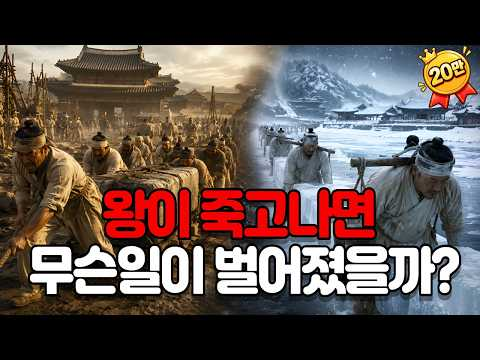
- 설명 앞부분: 조선의 왕은 세상을 떠난 뒤 곧바로 묻히지 않았습니다. 왕릉이 완성될 때까지 약 다섯 달 동안 궁궐 안 빈전에 머물러야 했습니다. 냉장고도, 방부 처리도 없던 시대. 특히 한여름에 왕이 승하했다면 조선은 어떻게 시신을 보존했을까요? 왕이 죽은 뒤에도 다섯 달 동안 이어졌던 조선 왕실의 놀라운 장례 문화를 함께 만나보세요. 타임라인 참고 본 영상은 아래 자료들을 바탕으로 재구성하였습니다. 문헌 조선왕조실록 『경국대전』 · 『국조오례의』 · 『상례비요』 국장도감의궤 · 빈전도감의궤 · 산릉도감의궤 단행본 이호일, 『조선의 왕릉』 신병…
- 같은 채널 평소 대비 ×288.4 (채널 최근 롱폼 중앙값 888회) · 평소 영상: 영화 오디세이에 나오지 않은 섬들의 충격적인 비밀 총정리 ∣ 오디세이 원작 2부 ∣ ∣ … (916회) / 조선이 버린 천한 섬 제주도에서 어떻게 기생이 최고부자가 되었을까? ∣ 정조가 인정한 김… (859회)
- 대본 없음 (설명) — 음성인식이 끝나면 도입부·흐름이 들어감
- 댓글 117/117: 좋은 점 — 영상 1 · 감사·응원 2 · 더 알고 싶은 것 0 · 아쉬운 점 — 영상 0 · 반박·불만 — 의견 다름 2 · 정치·사회 3 · 경험 공유 2 · 구독·다음 기대 1
  - 좋은 점 — 영상 👍8 “좋은내용이네요 감사합니다~”
  - 감사·응원 👍8 “좋은내용이네요 감사합니다~”
  - 감사·응원 👍1 “귀중한 영상 올려주셔서 감사합니다 구독 좋아요 알림설정 신청합니다 ❤”
  - 반박·불만 — 의견 다름 👍5 “그리고 선정릉도 회격 발랐어요 석곽 아닙니다 당시 왜군들이 수천명이 달라들어 무쟈게 힘들게 도굴했답니다 그래서 너무 열받아서 시신을 마구 회손 했답니다. 보물은 나온것도 없고 하니”
  - 반박·불만 — 의견 다름 👍0 “아무리 AI로 만들었다지만 내시 의복과 감투 그리고 상중인데 감투가 검정색! 가장 어이없는 상황 여자가 곤룡포 입고 있고 왕에 익선관은 일반 감투 어이가 음다”
  - 정치·사회 👍4 “성종의 유해는 끝내 발견되지 못했다. 조선은 도쿠가와 이에야스에게 선릉과 정릉을 도굴한 도굴범을 잡아달라고 요구했다. 도쿠가와 이에야스의 입장에서 보면, 본인이 임진왜란에 참전한 것도 아니고, 누가 도굴했는지를 찾기란, 해변에서 바늘찾기나 다름 없었다. 결국 도쿠가와…”
  - 정치·사회 👍2 “한국도 대통령없애라 국민등골무너진다”
  - 경험 공유 👍10 “내가 그 시대 왕이었다면...내가 직접 준비해 놨을 듯....ㅎ”
  - 경험 공유 👍2 “왕 하나의 죽음으로 많은 시간과 저 많은 인력들이 소비됐으니 내가 왕이었다면 궁궐 장례 절차를 뜯어 고쳤을 듯 죽어서 백성이나 신하들에게 민폐 끼치지 않게..”
  - 구독·다음 기대 👍1 “귀중한 영상 올려주셔서 감사합니다 구독 좋아요 알림설정 신청합니다 ❤”

### 148. [조선 다잇소] 2화 : 세종대왕의 만성 두통을 타이레놀로 고쳐버렸다.

- https://www.youtube.com/watch?v=r-JOlwuvsDA · 다잇소 스튜디오 · 구독자 2,580 · 조회수 62,008 (×24.0, 하루 1,815.9) · 좋아요 416 (0.7%) · 7.7분 · 2026-10-07 · 주제 묶음 3. 조선 · 형식 정보·해설 (그 밖) · 폴더 `W_r-JOlwuvsDA` (웹 승인)
- 썸네일: 
- 챕터: 0:00 관아에서 돌아온 현우와 주모의 재회 · 0:57 조선 저잣거리를 강타한 신라면 & 안성탕면 & 육개장 · 2:16 깊은 밤, 은밀하게 찾아온 도승지 김돈 · 3:42 세종대왕과의 첫 알현과 지독한 편두통 · 4:03 타이레놀과 열내림 냉각 시트의 기적 · 5:07 흐릿하던 글자를 띄워준 돋보기안경 · 5:52 과인이 지켜주마, 어명패 하사와 대궐 별채 입주 · 6:26 별채에서 꺼낸 현대 공구들 (줄자, 드라이버) · 6:44 천재 과학자 장영실의 방문과 풀리지 않는 고민 · 7:23 [3화 예고] 세종의 실신, 그리고 모습을 드러낸 왕…
- 설명 앞부분: [조선 다잇소] 2화 : 세종대왕의 만성 두통을 타이레놀로 고쳐버렸다. 대궐 나으리의 치통을 단숨에 잠재우고 '납품 허가'를 따낸 현우! 주막으로 돌아와 얼큰하고 칼칼한 '신라면'과 '육개장 사발면'을 개시하며 한양 사람들의 입맛을 뒤흔든다. 하지만 그날 밤, 도승지 김돈이 다시 현우를 은밀히 찾아오는데... 그가 이끌려 도착한 곳은 다름 아닌 조선 제4대 국왕, 세종대왕의 편전?! 평생을 옥죄어온 극심한 편두통과 안질로 고통받던 세종대왕. 침도 탕약도 듣지 않던 어전에서 현우가 꺼내든 것은 다름 아닌 만병통치약 '타이레놀'과 이…
- 같은 채널 평소 대비 ×3.3 (채널 최근 롱폼 중앙값 18,872회) · 평소 영상: [조선 다잇소] 5화 : 세자 저하가 노란 귀마개를 쓴 이유 (18,872회) / [조선 다잇소] 7화 : 현우를 노리는 육의전의 그림자, 쌍안경으로 놈을 쫓다! 🔭 (17,029회)
- 대본 없음 (설명) — 음성인식이 끝나면 도입부·흐름이 들어감
- 댓글 26/30: 좋은 점 — 영상 0 · 감사·응원 0 · 더 알고 싶은 것 0 · 아쉬운 점 — 영상 0 · 반박·불만 — 의견 다름 0 · 정치·사회 0 · 경험 공유 0 · 구독·다음 기대 0

### 149. 수천㎞ 떨어진 세 문명에 똑같은 기록이 있습니다… 우연일까?

- https://www.youtube.com/watch?v=9a31LH4SAgM · 역사백화점 · 구독자 2,510 · 조회수 123,811 (×49.3, 하루 1,765.8) · 좋아요 0 (0.0%) · 23.4분 · 2026-08-19 · 주제 묶음 8. 문명·고고학 · 형식 정보·해설 (그 밖) · 폴더 `W_9a31LH4SAgM` (웹 승인)
- 썸네일: 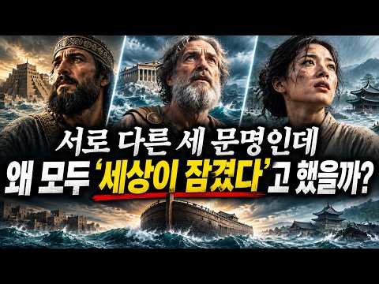
- 설명 앞부분: 🌊 노아의 방주와 닮은 ‘대홍수 이야기’가 왜 세계 곳곳에 남아 있을까요? 성경보다 오래된 점토판에서 발견된 홍수 기록부터 메소포타미아의 길가메시, 그리스와 인도, 그리고 우리나라 산에 남은 이야기까지. 수천 년 전 사람들이 정말 남기고 싶었던 것은 배였을까요, 아니면 재난의 기억이었을까요?
- 같은 채널 평소 대비 ×249.1 (채널 최근 롱폼 중앙값 497회) · 평소 영상: 왕도 도망치게 만든 조선 최악의 적… 그런데 눈에 보이지 않았다 (497회) / 영화 《오디세이》는 여기서 끝났습니다… 그런데 원작은 세 번이나 더 이어집니다 (528회)
- 대본 없음 (설명) — 음성인식이 끝나면 도입부·흐름이 들어감
- 댓글 104/105: 좋은 점 — 영상 1 · 감사·응원 0 · 더 알고 싶은 것 1 · 아쉬운 점 — 영상 2 · 반박·불만 — 의견 다름 2 · 정치·사회 0 · 경험 공유 4 · 구독·다음 기대 0
  - 좋은 점 — 영상 👍6 “길가메시를 뒤집은 노아홍수 진흙층발견 1) 수메르 문명 직전의 대홍수 진흙층 발견 우바이드 문화와 수메르 문명 사이의 단일 이벤트 퇴적물 확인 1920년대 레너드 울리 발굴에서 확인된 건 2.4에서 3.7미터 두께의 수성 점토와 실트층이었다. 인간 흔적이 전혀 없고,…”
  - 더 알고 싶은 것 👍1 “여떤놈이 그러데요 그래서 어쩌라구요? 알면 뭐가 달라지나요?”
  - 아쉬운 점 — 영상 👍6 “길가메시를 뒤집은 노아홍수 진흙층발견 1) 수메르 문명 직전의 대홍수 진흙층 발견 우바이드 문화와 수메르 문명 사이의 단일 이벤트 퇴적물 확인 1920년대 레너드 울리 발굴에서 확인된 건 2.4에서 3.7미터 두께의 수성 점토와 실트층이었다. 인간 흔적이 전혀 없고,…”
  - 아쉬운 점 — 영상 👍1 “아니 그런일이있었으면 그렇게안되게 어떻게할까를 봐야지, 그건 그것이고 아쉽네요..”
  - 반박·불만 — 의견 다름 👍1 “답은 성경에 다 나와있습니다.성경의 기록을 역사적 사실로 받아들이면 모든 퍼즐이 맞춰집니다 우선 저 배모양 언덕은 방주가 아닙니다 성경은 분명 궤짝 처럼 생긴 방주라고 했으니깐요 세상 온 땅이 잠기는 대홍수라는 대격변속에는 어디로 가야할지 어디에 도착할지는 필요가 없…”
  - 경험 공유 👍1 “재미있게 잘 봤습니다. 저도 옛날 사람들에게 가장 무서운 재앙이 홍수라서 이렇게 비슷한 이야기들이 많이 남은걸까 하는 생각을 했는데, 홍수가 오히려 축복이었던 이집트에만 이런 이야기가 없다는 말을 들으니 뭔가 정리되는 느낌입니다.”
  - 경험 공유 👍1 “답은 성경에 다 나와있습니다.성경의 기록을 역사적 사실로 받아들이면 모든 퍼즐이 맞춰집니다 우선 저 배모양 언덕은 방주가 아닙니다 성경은 분명 궤짝 처럼 생긴 방주라고 했으니깐요 세상 온 땅이 잠기는 대홍수라는 대격변속에는 어디로 가야할지 어디에 도착할지는 필요가 없…”

### 150. 조선 왕비 42명 중, 가장 행복했던 여자는 누구였을까?

- https://www.youtube.com/watch?v=-L8e8sbeu3c · 역사탐사실 · 구독자 19,900 · 조회수 469,109 (×23.6, 하루 13,906.8) · 좋아요 3,434 (0.7%) · 43.2분 · 2026-10-07 · 주제 묶음 3. 조선 · 형식 정보·해설 (그 밖) · 폴더 `W_-L8e8sbeu3c` (웹 승인)
- 썸네일: 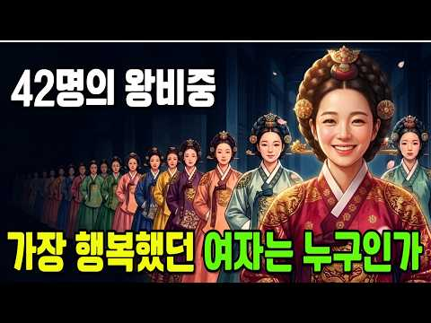
- 설명 앞부분: 📺 영상 설명란 👑 조선에 살아서 왕비가 된 여인은 단 42명. 그런데 그중 '정말로 행복했던' 왕비는 몇이나 될까요? 💔 열다섯에 왕비가 되어 64년을 홀로 산 비운의 정순왕후부터 이야기는 시작됩니다. 가장 깊은 바닥에서 출발해, 조선에서 가장 행복했던 왕비 3위부터 1위까지 거꾸로 올라가 봅니다. 🏯 최고의 권력과 장수를 누렸지만 남편과 아들을 먼저 떠나보낸 3위 신정왕후, 자식 하나 없이도 왕을 길러내 극진한 효도를 받은 2위 인원왕후, 그리고 사약을 받고 쫓겨난 폐비 윤씨의 바로 그 자리에 앉아 끝까지 평온을 지켜낸 1위 …
- 같은 채널 평소 대비 ×216.1 (채널 최근 롱폼 중앙값 2,170회) · 평소 영상: 사랑이 아니라 광기였다? 인조와 조귀인 관계의 충격적 결말 ∣ 조귀인자작극저주사건 ∣ 조… (2,198회) / 종기 하나로 죽었다고? 정조 죽음의 14일, 기록이 말해주는 진실 ∣ 정조이산마지막유언수… (2,143회)
- 대본 없음 (설명) — 음성인식이 끝나면 도입부·흐름이 들어감
- 댓글 133/179: 좋은 점 — 영상 1 · 감사·응원 4 · 더 알고 싶은 것 1 · 아쉬운 점 — 영상 0 · 반박·불만 — 의견 다름 0 · 정치·사회 0 · 경험 공유 1 · 구독·다음 기대 0
  - 좋은 점 — 영상 👍4 “너무 재밌고 굉장히 유익해요 그림 좋구요❤❤”
  - 감사·응원 👍4 “구수하게 긴시간 잘들었어요 감사합니다”
  - 감사·응원 👍2 “서울 답시리 사는 사람 임니다 잘 듣고 생각했네요 감사 합니다”
  - 더 알고 싶은 것 👍0 “궁금한점 성종때장희빈 숙종때장씨는 분간이안돼요 옳게 알려주세요”
  - 경험 공유 👍2 “저도 가끔 생각해보는 주제인데 제생각으로는 1위: 문정왕후 ( 중종과 아들이 왕이여서 부귀영화와 절대권력을 맘껏 휘두르며 살다가 평온하게 삶을 마감했다) 2위. 정안왕후 ( 정종의 인격이 휼룡하고 남편이 상왕으로 물러나 정치의 격동기를 피해서 평생 안온한삶을 살았다)…”

### 151. 풍수 전문가들이 현충원 최고 명당으로 지목한 곳은 대통령 묘가 아니었습니다

- https://www.youtube.com/watch?v=c0O8c0NcFog · 역사파인더 · 구독자 3,660 · 조회수 309,663 (×84.6, 하루 2,553.3) · 좋아요 7,659 (2.5%) · 39.8분 · 2026-07-12 · 주제 묶음 기타 · 형식 정보·해설 (그 밖) · 폴더 `W_c0O8c0NcFog` (웹 승인)
- 썸네일: 
- 챕터: 0:00 현충원 한복판의 정체불명 무덤 · 3:12 풍수 최고 명당, 대통령 묘가 아니다 · 6:45 창빈 안씨는 누구인가 — 아홉 살 궁녀 · 10:20 중종의 후궁 9명, 누가 살아남았나 · 15:38 문정왕후가 유일하게 지켜준 후궁 · 19:05 손자가 왕이 되다 — 선조 즉위의 비밀 · 24:30 동작릉의 탄생과 몰락 · 28:15 한국전쟁, 그리고 현충원이 된 명당 · 33:40 대통령들 사이에 끼인 470년의 터줏대감 · 37:20 가장 조용했던 여인이 가장 오래 남은 이유
- 설명 앞부분: 현충원 한복판에 470년 된 조선시대 무덤이 있습니다. 이승만 대통령 묘소 바로 옆. 김대중 대통령 묘소 바로 옆. 2010년까지 안내판조차 없었던 이 무덤의 주인은, 조선 중종의 후궁 — 창빈 안씨입니다. 아홉 살에 궁녀로 들어간 가난한 집 딸. 후궁 아홉 명 중 가장 조용했던 여인. 그런데 이 여인이 죽고 나서, 조선의 핏줄이 통째로 바뀝니다. 선조부터 순종까지 340년간 14명의 왕이, 전부 이 한 사람의 후손입니다. 풍수 전문가들은 현충원 전체에서 가장 좋은 자리, 이른바 "혈 자리"가 대통령 묘역이 아니라 이 470년 된…
- 같은 채널 평소 대비 ×501.1 (채널 최근 롱폼 중앙값 618회) · 평소 영상: 신라의 운명을 바꿀 뻔했던 남자, 장보고의 진짜 정체 (618회) / 명나라 황제 16명 중, 조선 여인을 아내로 맞은 건 몇 명이었을까 (618회)
- 대본 없음 (설명) — 음성인식이 끝나면 도입부·흐름이 들어감
- 댓글 643/643: 좋은 점 — 영상 5 · 감사·응원 21 · 더 알고 싶은 것 8 · 아쉬운 점 — 영상 0 · 반박·불만 — 의견 다름 8 · 정치·사회 76 · 경험 공유 16 · 구독·다음 기대 1
  - 좋은 점 — 영상 👍64 “나는현충원에 그런분이 묘가있는줄도 모랐어요 고마워요 그런 유래을 알려주셔서요 감사합니다”
  - 좋은 점 — 영상 👍31 “좋은 영상이네요~ 구독하고 갑니다~~”
  - 감사·응원 👍64 “나는현충원에 그런분이 묘가있는줄도 모랐어요 고마워요 그런 유래을 알려주셔서요 감사합니다”
  - 감사·응원 👍58 “오래된 역사를 알게 되어서 감사합니다~~❤😂❤”
  - 더 알고 싶은 것 👍24 “옛 이야기지만. 고맙습니다 다시듣고들어봐도 풀리지 았아던 내용 정말 휼륭하네요 좋은것 많이 올려주세요”
  - 더 알고 싶은 것 👍7 “현충원 가면 필히 가보야 겠네요 궁금해서리”
  - 반박·불만 — 의견 다름 👍23 “조선 제일의 멍청한 왕이 선조인데...참 웃기는 얘기네요...”
  - 반박·불만 — 의견 다름 👍9 “김대중은 거기 있을 인물이 아닌데~”
  - 정치·사회 👍88 “살아생전 덕을 많이쌓고 바르게 살면 그후손이 복을받고 나라가 잘된다는 만고의 진리”
  - 정치·사회 👍61 “김대중 대통령은 광주 518 묘역에 뫼셔야죠. 잘못 뫼셨네요.”
  - 경험 공유 👍20 “"북한이 핵을 개발하면 내가 책임진다."고 한 김대중이가 왜 그 곳에서 나오나. 핵개발용 자금까지 보내준 자가 격이 맞지 않습니다.”
  - 경험 공유 👍10 “빨개이 자슥의 묘는 파묘해여 한다. 아울러 또 하나 가짜 보수의 묘도... 잠들어 있는 호국영령들에 대한 모욕 입니다. 조만간 저도 조상이신 창빈 순흥안씨의 묘를 찾아 뵈어야겠네요.”
  - 구독·다음 기대 👍31 “좋은 영상이네요~ 구독하고 갑니다~~”

### 152. [역사한줄] 조선시대 실제군인이 작성한 일기내용 #조선역사 #한국사 #부북일기

- https://www.youtube.com/watch?v=eY_TrTKsIJ0 · 역사한줄 · 구독자 3,600 · 조회수 433,198 (×120.3, 하루 2,489.0) · 좋아요 3,481 (0.8%) · 16.8분 · 2026-05-20 · 주제 묶음 3. 조선 · 형식 정보·해설 (그 밖) · 폴더 `W_eY_TrTKsIJ0` (웹 승인)
- 썸네일: 
- 설명 앞부분: 울산 박씨 문중에서 대대로 내려오던 조상님의 일기. 후손들이 학자에게 번역을 맡겼는데, 학자의 눈이 점점 커졌습니다. 공개하기 곤란하다며 논문 형식으로 세상에 처음 소개됐어요. 기생 모녀와 군관 부자의 40년 인연까지. 사극이 절대 보여줄 수 없었던 조선 군인의 진짜 일상입니다. 📺 이 영상에서 다루는 내용 후손들이 가보로 모시던 일기의 진짜 내용 부방길에서 만난 전사자의 시체 — 목숨을 건 국경 근무 400년 전 조선 무사의 헌팅 멘트가 일기에 그대로 적혀 있다 동료 목숨값을 송아지와 흥정한 400년 전 군대 유머 욕 퍼붓는 동…
- 같은 채널 평소 대비 ×75.3 (채널 최근 롱폼 중앙값 5,753회) · 평소 영상: [역사한줄] 교과서에 없는 역사기록 12대를 이어온 조선시대 부자가문 풀스토리 ∣ 경주최… (5,881회) / [역사한줄] 조선과 청이 9년 못 푼 외국말, 홍어장수가 풀었다 #한국사 #조선역사 #문… (5,625회)
- 대본 없음 (설명) — 음성인식이 끝나면 도입부·흐름이 들어감
- 댓글 321/322: 좋은 점 — 영상 2 · 감사·응원 3 · 더 알고 싶은 것 3 · 아쉬운 점 — 영상 0 · 반박·불만 — 의견 다름 3 · 정치·사회 10 · 경험 공유 6 · 구독·다음 기대 0
  - 좋은 점 — 영상 👍93 “솔직하게 써서 시대상이 정말 적나라하게 드러났네, 조선사회 연구에 큰 도움이 될 자료입니다.”
  - 좋은 점 — 영상 👍0 “AI가 만든 그림과 글 어디까지가 사실이고, 꾸밈인지 구분이 어려운 영상 아무런 도움이 되지않을 소설같은 글 다시는 안 볼겁니다 (그래도 나름 만드느라 애썻을터이니 가능한 부드러운 말로 안좋았다는 표현을 합니다)”
  - 감사·응원 👍3 “저런 어려운 상황에서도 세계에서 가장 오래된 국경선인 압록강~두만강 경계를 굳건히 지켜주신 조상님들께 깊은 감사의 마음을 가집니다. 조선의 조정과 변방의 군인들 뿐만 아니라 험난하고 위험한 그 땅에서 차별과 수탈을 견뎌가며 삶을 영위해 가신 모든 민중들(그 중에는 귀…”
  - 감사·응원 👍2 “사학과 출신인데... 정말 좋은 유튜브채널이군요.^^ 감사합니다.^^ 구독자 100만 가시기를 축원합니다.❤”
  - 더 알고 싶은 것 👍16 “난중일기에 조선시대 장군들 보급품인 공노비 여자를 잘 사용하는내용도 부탁해요 충분한 얘기꺼리가 될겁니다”
  - 정치·사회 👍80 “평균연령 40살에 비위생에 영양결핍에 호랑이가동네마다 있던시기에 계속 나라가이어져온건 진짜 열심히했단거지”
  - 정치·사회 👍15 “모든 나라가 동일 선상에 있었지. 꼭 조선만 아니라 다른 나라도 전쟁으로 많은 남자들이 죽으면 남는 여자들은 누굴 책임져 줄까?”
  - 경험 공유 👍6 “임진난후 7년차로군, 말타고 80일 노러갔나?걸어가도 3번은 왕복하겠군.”
  - 경험 공유 👍1 “우리 조상님들 ㄸ 하신 이야기 들으니 후손된 입장에서 덕분에 우리가 있습니다 말씀 올리고싶네요 나도 후손들 탄생지속을 위해 급 ㄸ 하고싶어집니다 조상님들”

### 153. 조선 최고의 검술은 어디서 시작되었나? 기록되지 않은 조선제일검의 계보 [아무도 들려주지 않는 조선왕조실록]

- https://www.youtube.com/watch?v=-Yturcnh4j8 · 몰래 듣는 조선의 비밀 · 구독자 1,220 · 조회수 128,480 (×105.3, 하루 838.7) · 좋아요 937 (0.7%) · 17.9분 · 2026-06-10 · 주제 묶음 3. 조선 · 형식 정보·해설 (그 밖) · 폴더 `W_-Yturcnh4j8` (웹 승인)
- 썸네일: 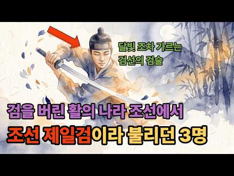
- 챕터: 0:00 시작 · 1:12 활의 나라, 칼 없는 조선 · 4:00 임진왜란 — 칼을 다시 잡다 · 7:00 김체건 — 왜관에 노비로 숨어든 군교 · 10:48 김광택 — 칼에 몸을 숨긴 관노의 아들 · 14:00 백동수 — 서얼 무사가 만든 칼의 백과사전 · 16:24 본국검 — 잃어버린 조선의 칼을 되찾다 · 19:00 전기수의 한 줄
- 설명 앞부분: 조선의 무과 시험에 검술이 없었습니다. 활만 쏘면 됐습니다. 칼잡이는 이름조차 남기지 못한 나라. 그런 나라에서 한 군교가 왜관에 노비로 숨어들어 3년간 칼을 훔쳐 배웠고, 그 아들은 칼에 몸을 숨기는 경지에 올랐으며, 서얼 무사가 24가지 무예를 한 권의 책에 담았습니다. 오늘의 전기수는 활의 나라 조선이 칼을 되찾기까지, 김체건·김광택·백동수 세 검객과 200년의 이야기를 풀어봅니다. ▣ 챕터 ▣ 채널 소개 ▷ 정사 조선왕조실록 (태조실록, 선조실록, 숙종실록, 영조실록, 정조실록) 승정원일기 (숙종·영조·정조대) ▷ 무예서·…
- 같은 채널 평소 대비 ×358.9 (채널 최근 롱폼 중앙값 358회) · 평소 영상: 7년간 전쟁을 이끈 남자가 쫓겨나서 쓴 반성문 16권 [조선인물 탐구생활] (358회) / 조선 최강이라 불린 장수, 적이 아니라 임금의 매에 죽으며 비운의 장수로 남다. [조선 … (333회)
- 대본 없음 (설명) — 음성인식이 끝나면 도입부·흐름이 들어감
- 댓글 120/120: 좋은 점 — 영상 3 · 감사·응원 7 · 더 알고 싶은 것 1 · 아쉬운 점 — 영상 1 · 반박·불만 — 의견 다름 6 · 정치·사회 1 · 경험 공유 1 · 구독·다음 기대 0
  - 좋은 점 — 영상 👍7 “유익하고 재밌는 조선시대 역사이야기네요!”
  - 좋은 점 — 영상 👍2 “좋은 영상 고맙습니다 특히 인상 깊은게 다른이들은 영상 음성 AI로 제작했으면서 마치 자신이 만든거 같이 생성 출처를 밝히지 않은 아둔한 분들이 많던데 이분은 제작 출처를 밝히므로 거부감없이 감사할 수 있었습니다”
  - 감사·응원 👍3 “안녕 하십니까?평안도 감사 박엽장군,감사합니다.🤗👍”
  - 감사·응원 👍2 “좋은 영상 고맙습니다 특히 인상 깊은게 다른이들은 영상 음성 AI로 제작했으면서 마치 자신이 만든거 같이 생성 출처를 밝히지 않은 아둔한 분들이 많던데 이분은 제작 출처를 밝히므로 거부감없이 감사할 수 있었습니다”
  - 더 알고 싶은 것 👍5 “아주 재밌게 듣고 있습니다 조선야사 이야기 더 많이 올려주세요”
  - 아쉬운 점 — 영상 👍2 “좋은 영상 고맙습니다 특히 인상 깊은게 다른이들은 영상 음성 AI로 제작했으면서 마치 자신이 만든거 같이 생성 출처를 밝히지 않은 아둔한 분들이 많던데 이분은 제작 출처를 밝히므로 거부감없이 감사할 수 있었습니다”
  - 반박·불만 — 의견 다름 👍43 “전쟁터나 실전에서 가장 위력적이고 많이 쓰인건 창이지 검이 아닙니다 검은 보조무기일 뿐 일본 전국시대 유명한 사무라이들도 주력 무기는 창이었음 그 다음 위력적인 무기는 부월 (큰 도끼) 큰 도끼를 쓰면서 무쌍 찍은 무장들은 실제로 역사에 많이 기록이 돼 있는데 십자군…”
  - 반박·불만 — 의견 다름 👍5 “말도 안되는 소리 일본검술이 최고 란 소리 또 처음들어보네”
  - 정치·사회 👍2 “그러니 나라가 망하지 총기술 발달시켜야지 총포앞에서 칼질을 왜 하는데”

### 154. 제주도는 원래 우리나라가 아니었다고? ∣한국사}탐라국}제주도의역사∣오디오북

- https://www.youtube.com/watch?v=Knxr-xtwiKw · 오늘역사 · 구독자 887 · 조회수 92,052 (×103.8, 하루 596.3) · 좋아요 1,756 (1.9%) · 34.7분 · 2026-06-09 · 주제 묶음 10. 수면·낭독 · 형식 수면·낭독 (잠잘 때 듣는) · 폴더 `W_Knxr-xtwiKw` (웹 승인)
- 썸네일: 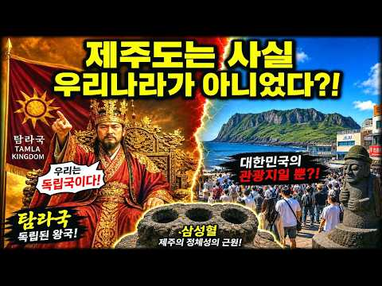
- 설명 앞부분: 탐라는 왜 한반도 남쪽에서 사라졌을까요? 7세기 독립국 탐라의 역사와 제주도가 고려의 땅이 된 과정을 정리했습니다. 동아시아 역사서에 당당히 기록된 독립국 탐라는 왕이 아닌 별의 주인이 다스리던 나라였습니다. 이 영상은 탐라가 어떤 과정을 거쳐 국가의 면모를 유지했는지, 그리고 왜 하루아침에 역사 속으로 사라지게 되었는지 그 배경을 추적합니다. 1368년 원나라가 멸망하고 고려가 명나라와 복잡한 정세 속에 놓였을 때, 제주도에서 일어난 목호의 난은 탐라의 운명을 바꾸는 결정적인 사건이었습니다. 이번 영상을 통해 원나라의 지배를 받…
- 같은 채널 평소 대비 ×248.8 (채널 최근 롱폼 중앙값 370회) · 평소 영상: 성공확률 5000분의 1, 인천상륙작전 성공은 왜 기적이었나 ∣한국사∣맥아더∣오디오북 (399회) / 최악의 무능으로 최고 비호감인 조선의 왕 3인은?∣한국사∣오디오북∣무능한왕∣ (341회)
- 대본 없음 (설명) — 음성인식이 끝나면 도입부·흐름이 들어감
- 댓글 127/127: 좋은 점 — 영상 1 · 감사·응원 1 · 더 알고 싶은 것 0 · 아쉬운 점 — 영상 1 · 반박·불만 — 의견 다름 4 · 정치·사회 11 · 경험 공유 3 · 구독·다음 기대 0
  - 반박·불만 — 의견 다름 👍11 “제주도 사람들은 한반도 육지사람들이랑 인종자체가 다릅니다ㅠ 뭔 고씨 부씨 양씨가 중국 계열이라 한반도에서 흘러갔다는 엉터리같은..제주 창도신화가 단군보다 앞섭니다. 그리고 제주도 토착민들 보면 실제로 한반도 사람들과 외형적인 모습 차이가 매우 큽니다. 체형도 작고 이…”
  - 반박·불만 — 의견 다름 👍5 “먼개소리임? 탐라국 건국신화에 부계는 양고부 삼성이 나오는뎅 이3개의 성씨는 대표적인 고구려계성씨 임니다만. 양만춘, 고선지, 부여씨 이렇게 대표적인 고구려의 3개의 성입니다만. 글쿠 고조선의 흔적이 남아잇어 한라산의 원래 이름이 한울산 즉 하나님의 산, 즉 환웅의 …”
  - 정치·사회 👍20 “저는 탐라국 시조 고을라 왕의 98대 손입니다. 지금은 100대가 넘었으니 4500년이나 됩니다. 보통 한대를 잇기를 45년 정도 봅니다. 그리고 삼신인 고을라, 양을라, 부을라 가 각각 세명의 일본 공주를 부인으로 맞이 했다고 하는데. 일본이 아니라. 벽락국 입니다…”
  - 정치·사회 👍13 “옛날에 라고 하면 독립국 아닌 나라가 세상에 어디 있나요?”
  - 경험 공유 👍7 “제가 아는 제주도 아저씨가 있었는데 이목구비가 뚜렷한 서구적인 미남상이었습니다. 제주도 토박이인지는 모르겠지만, 이것도 관련이 있는 건지?”

### 155. 왕이 되어 약속을 지키러 돌아왔는데, 정혼녀는 날 거지 취급했다… 진짜 은인은 그녀의 동생이었다!

- https://www.youtube.com/watch?v=Pl3jaa_L3Pw · 역전 극장 · 구독자 26,800 · 조회수 838,416 (×31.3, 하루 17,829.3) · 좋아요 7,022 (0.8%) · 119.3분 · 2026-09-24 · 주제 묶음 기타 · 형식 몰아보기·통합본 (긴 영상) · 폴더 `W_Pl3jaa_L3Pw` (웹 승인)
- 썸네일: 
- 챕터: 0:00 새 왕의 귀환 — 이훤, 약속했던 여인을 중전으로 맞… · 20:10 왕을 가둔 탐관오리 — 신분을 모른 채 이훤을 짓밟는… · 40:05 목숨을 건 진짜 은인 — 박청현이 이훤을 지키다 쓰러… · 60:08 가례연의 덫 — 왕을 조롱한 권문세가들이 스스로 한자… · 80:12 왕의 분노 — 군권까지 등에 업은 탐관오리들과 이훤의…
- 설명 앞부분: 💔거지인 줄 알고 버린 정혼자, 알고 보니 조선의 왕이었다! 그날 탐관오리 가문이 무너졌다... 도시 역전, 복수 반격, 재벌 상속! 통쾌한 남자 중심 숏드라마를 만날 수 있는 역전 극장입니다. 짜릿한 반전과 몰입감 넘치는 전개, 매일 업데이트되는 인기 숏드라마를 지금 바로 만나보세요! 🔥새 왕조의 주상 이훤은 과거 굶어 죽을 위기에 놓였던 자신을 구해 주고 혼인을 약속했던 여인을 중전으로 맞이하기 위해 신분을 숨긴 채 고향 제양군으로 돌아온다. 하지만 그를 기다리고 있을 것이라 믿었던 박화진은 초라한 차림의 이훤을 거지 취급하며…
- 같은 채널 평소 대비 ×178.1 (채널 최근 롱폼 중앙값 4,708회) · 평소 영상: 약혼녀 3명은 날 버렸고, 단 1명만 날 선택했다… 그런데 내가 천하무적 신선이라고?! (4,909회) / 5년간 아내인 줄 알았는데…혼인신고는 가짜, 진짜 남편은 따로 있었다. (4,507회)
- 대본 없음 (설명) — 음성인식이 끝나면 도입부·흐름이 들어감
- 댓글 159/594: 좋은 점 — 영상 0 · 감사·응원 4 · 더 알고 싶은 것 0 · 아쉬운 점 — 영상 9 · 반박·불만 — 의견 다름 4 · 정치·사회 10 · 경험 공유 3 · 구독·다음 기대 0
  - 감사·응원 👍8 “이거 짤만보고 끝까지못봐서 찾다가 완본없어서아쉬웟는데 감사😊”
  - 감사·응원 👍2 “영상 감사 합니다. 👍👍👍👏👏👏 ❤❤❤❤❤❤❤”
  - 아쉬운 점 — 영상 👍4 “영상은 잘만었네요 2시간을 지루함 없이 잘봐씁니다.”
  - 아쉬운 점 — 영상 👍3 “중국거 처럼 질질 끌고 말도 않되는 상황이 많네여 보실분들은 다 넘기고 결론만 보세요”
  - 반박·불만 — 의견 다름 👍0 “이거 배경만 우리나라지, 전형적인 중국 스토리. 이렇게 유치 찬란한 어이없는 스토리가 처음부터 끝까지 이어짐.”
  - 반박·불만 — 의견 다름 👍0 “왕이 멍청멍청 고구마열매 먹었나..그리고 중국에서 만들어 그런가 말도안돼는 억지억지 우격다짐과 꽥꽥 소리지르기..극한까지 몰고 간다고 너무 억지..중국판만 보다 한국판으로 보는데도 역시 말도 안돼..”
  - 정치·사회 👍2 “ㅋㅋ. 위계가 고증이 안됨. 현대판 훌륭하신 이재명. 대통령님.”
  - 정치·사회 👍0 “계속 소리만 지르고 앞으로 감기 않했으면 2시간동안 같은 내용반복할뻔 했네 저런놈이 왕이니 나라가 저지경이지~~ㅋㅋ”
  - 경험 공유 👍0 “30분을 내가 주상이다 기다림 ㅋ”
  - 경험 공유 👍0 “너 내가 누군지 몰라? 니 상관 데려와. 너도 나 몰라? 니 상관 데려와. 너도 나 몰라? 니 상관 데려와. 반복하다 쨔란! 나 사실 왕임”

### 156. 하멜 표류기, 13년간 조선에 체류한 네덜란드인 하멜

- https://www.youtube.com/watch?v=iwQcR8HMeSQ · 역사본능 · 구독자 39,300 · 조회수 925,391 (×23.6, 하루 25,956.0) · 좋아요 4,212 (0.5%) · 24.9분 · 2026-10-06 · 주제 묶음 3. 조선 · 형식 정보·해설 (그 밖) · 폴더 `W_iwQcR8HMeSQ` (웹 승인)
- 썸네일: 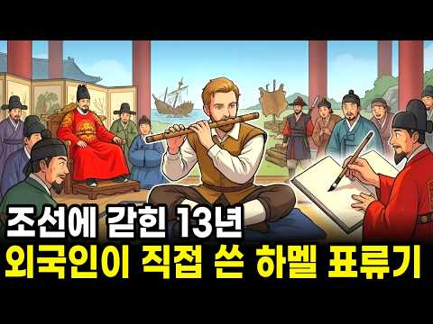
- 설명 앞부분: 이 영상은 하멜이 어쩌다 조선에서 13년을 살게 됐는지, 그 13년을 어떻게 먹고 자고 버텼는지를 따라갑니다. 왕 앞의 장기자랑과 양반 술자리에 불려다니던 구경거리 생활, 청나라 사신 앞에서 옷을 찢고 굶어 죽은 동료, 전라도 강진 병영에서의 7년, 흉년에 남의 집 문을 두드리며 밥을 얻던 나날까지요. 그리고 그 사이 하멜이 조용히 적어 둔 조선의 모습도 함께 봅니다. 네댓 살 아이도 담배를 물던 나라, 세상에 나라가 열두 개뿐이라 믿던 사람들, 낯선 얼굴에게 흰 피부가 부럽다고 말하던 사람들이요. 마지막에는 이 이야기의 진짜 반…
- 같은 채널 평소 대비 ×53.7 (채널 최근 롱폼 중앙값 17,219회) · 평소 영상: 야인 시대 레전드, 김두한 VS 이정재 누가 더 강했을까? (17,219회) / "북괴가 알면 큰일이다" 대통령을 쏜 사람이 차 안에서 한 첫마디 (16,534회)
- 대본 없음 (설명) — 음성인식이 끝나면 도입부·흐름이 들어감
- 댓글 236/616: 좋은 점 — 영상 3 · 감사·응원 7 · 더 알고 싶은 것 3 · 아쉬운 점 — 영상 1 · 반박·불만 — 의견 다름 6 · 정치·사회 17 · 경험 공유 6 · 구독·다음 기대 0
  - 좋은 점 — 영상 👍34 “회계사라서 조선입장에서는 쓸모가없다고 판단해서 대우 별로였음. 멍청한 조선이 사실 수학부터 과학까지 번역만하면 좋은 정보를 배울수 있었는데 팽시킴. 얼마나 조선이 싫었으면 내용중에 비하하는글도 많이있음.”
  - 좋은 점 — 영상 👍14 “동네 사람들이 몰랐을리가 없지… 사람 마음을 얻었기에 가능했다. 뭔가 계획을 가지고 노력하니 큰 경을 치르더라도 모르쇠 마을 사람들 모두 그걸 일러받치지 않고 막지 않고 지켜봐준거지. 안정적인 느낌을 받는 쯤이지 않았겠나 놔줄 것이라는 믿음이 있을 때. 일본으로 해류…”
  - 감사·응원 👍17 “와 너무 재밌게 들었어요 감사”
  - 감사·응원 👍10 “잘 보았습니다~ 고맙습니다~”
  - 더 알고 싶은 것 👍4 “결국에 임금은 못받은걸로 알고있고, 최기 제주도나 한양에서 거주햇을땐 나름 좋은대우를받앗으나 유배지인 전라도로가선 그곳 사람들에 대해 안좋게써잇던건 그곳이 유배지인탓이라고 알고잇거든요. 팩트체크부탁드려요”
  - 더 알고 싶은 것 👍0 “하멜은 너무 표현력이 없었던 사람 표류기를 보면 강진 등에서 겪었던 일이나 풍습을 자세히 묘사하지 않고 그냥 궁금해서 답답항 정도다. 초등학교 일기장을 보는 느낌”
  - 아쉬운 점 — 영상 👍0 “틀린 내용이 좀 있는데”
  - 반박·불만 — 의견 다름 👍11 “바로 보내버리면 되는데 뭘 많이 봤다고 놓지 못하나 말도 안되는 소리다”
  - 반박·불만 — 의견 다름 👍8 “훈련도감으로 보낸거 보면 덩치가 있고 힘도 쎄고 그래서 이용해 먹으려고 한 것 전쟁터에도 보내서 2명이 전사 이걸 보면 힌쎈넘 이용한 것 밥만 주면 일을 부려먹을 수 있으니 인력면에서도 대박난거지 저비용 고효율 학교에서 하맬은 이름만 알았지 자세한 내용은 몰랐는데 지…”
  - 정치·사회 👍63 “명,청,일본이 어떤 나라가 표류한 선원을 저렇게 대우하나? 부끄러운 줄 알아야해요.”
  - 정치·사회 👍14 “우리가 세계를 몰랐던것은 위에가 막혀 있었던 탓이다 만약 고구려처럼 열려 있으면 지금우리나라가 이렇게 되지 않았을텐데 어떻하겠나 ~”
  - 경험 공유 👍156 “제가 의외였던건 10년이상 넘게 사실상 감금하고 종신형이라고 할수밖에 없는 대우를 한 조선에 비해 당시 일본은 하멜일행이 도망쳐오자 이들을 단 몇시간에 조사하고 네덜란드 공관으로 이송하고 나중 고국으로 보내는 절차를 아주 체계있고 나름 당시 국제법 매뉴얼에 맞게 처리…”
  - 경험 공유 👍26 “일본처럼 교역을 했었어야지. 너무 무지했어”

### 157. 일본이 '괴물'이라 부르며 이순신보다 두려워 했던 인물? 조선 역사상 가장 저평가된 영웅

- https://www.youtube.com/watch?v=5ooDDKo68E0 · 역사동굴 · 구독자 2,760 · 조회수 112,181 (×40.6, 하루 1,808.5) · 좋아요 404 (0.4%) · 17.7분 · 2026-08-27 · 주제 묶음 3. 조선 · 형식 정보·해설 (그 밖) · 폴더 `W_5ooDDKo68E0` (웹 승인)
- 썸네일: 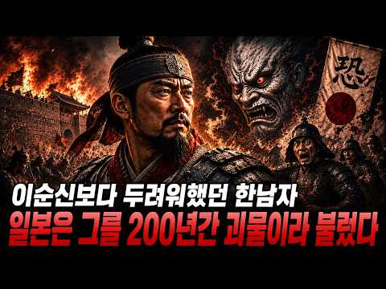
- 챕터: 0:00 일본군이 공포에 떨며 만든 괴물의 정체 · 1:14 적국이 200년 동안 부른 '모쿠소'의 진실 · 2:24 진주성을 지킨 무명의 영웅 김시민 · 3:42 갓을 벗어 던진 무관의 숨겨진 사연 · 6:14 불가능을 가능케 한 진주성의 기적 · 7:18 승리 직후 찾아온 비극과 그 이후 · 8:11 왜 진주성이 호남의 방패였을까? · 9:18 히데요시가 진주성에 집착한 잔혹한 이유 · 10:19 남강에 몸을 던진 최경회와 논개 · 11:15 죽은 지 8개월, 적군은 왜 그를 찾았나 · 12:13 일본 전설 속의 두꺼비 도사가 된 사연 · 13:34 왜 우리는 119년 동안 그를 잊었나 · 14:36 일본으로 끌려간 역사를 되찾은 시민들
- 설명 앞부분: 일본이 이순신보다 두려워 했던 인물? '괴물'이라 부르며 두려워했던 조선의 영웅 일본이 200년 넘게 두려워한 조선 장수, 충무공 김시민의 진짜 이야기. 이순신 장군과 나란히 진주대첩을 승리로 이끈 명장, 정작 일본에서는 '모쿠소'라는 이름의 괴물로 그려지며 두려움의 대상이 되었습니다. 무기 정비를 건의했다가 쫓겨났던 무명 관리는 어떻게 진주성을 지켜낸 명장이 됐을까요. 그리고 그의 임명장은 어쩌다 400년 만에 국민 모금으로 되찾아온 문화유산이 됐을까요. 진주대첩부터 공신교서 환수까지, 잘 알려지지 않은 이야기를 담았습니다. 이…
- 같은 채널 평소 대비 ×72.3 (채널 최근 롱폼 중앙값 1,551회) · 평소 영상: 단종보다 슬픈 광해군의 19년 생지옥! 사도세자보다 잔인한 최후와 원수의 파멸 [역사이야… (1,551회) / 천하의 송시열도 꺾지 못한 천재, 왜 윤휴는 역사 속에서 지워졌나? [기사환국][사문난적] (1,549회)
- 대본 없음 (설명) — 음성인식이 끝나면 도입부·흐름이 들어감
- 댓글 36/36: 좋은 점 — 영상 1 · 감사·응원 2 · 더 알고 싶은 것 0 · 아쉬운 점 — 영상 1 · 반박·불만 — 의견 다름 0 · 정치·사회 0 · 경험 공유 2 · 구독·다음 기대 0
  - 좋은 점 — 영상 👍2 “유익한 정보 감사합니다”
  - 감사·응원 👍3 “정확한 우리 역사를 바로 알려주시니 감사합니다.지속적인 노력으로 바로 세워 알리는 역사가 국민을 바로 세우는 일 이십니다.고맙습니다.”
  - 감사·응원 👍2 “유익한 정보 감사합니다”
  - 아쉬운 점 — 영상 👍1 “왜 ai 목소리가 다 같은거야?”
  - 경험 공유 👍2 “지혜인 의인 애국인 유비무환인은 소수고 그 선견지명은 거부되어 받아들여지지 않고 후대가 기억하고 기리는 악순환 멍청한 짓거리를 하고 있는 조선 사람들....나도 조선 사람인데....유비무환 정신이 강하니 어느 쪽 조선인일까?”

### 158. 조선의 역대급 변절자 신숙주, 성삼문 아내를 노비로 들인 충격적인 이유

- https://www.youtube.com/watch?v=RdzPp1O7PW8 · 왕조의 숨은 이야기 · 구독자 1,570 · 조회수 132,888 (×84.6, 하루 1,028.4) · 좋아요 1,217 (0.9%) · 19.9분 · 2026-07-04 · 주제 묶음 3. 조선 · 형식 정보·해설 (그 밖) · 폴더 `W_RdzPp1O7PW8` (웹 승인)
- 썸네일: 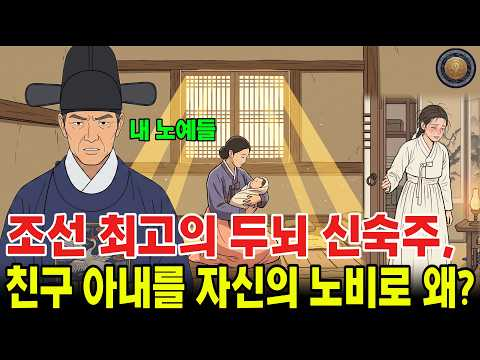
- 같은 채널 평소 대비 ×158.7 (채널 최근 롱폼 중앙값 838회) · 평소 영상: 조선 후궁의 말년, 궁에서 쫓겨난 뒤 짐승만도 못했던 비참한 삶 (871회) / 왕과 사는 남자 실제 역사 ∣ 엄흥도는 왜 사라졌나, 영화가 감춘 570년의 진실 (804회)
- 대본 없음 (없음) — 음성인식이 끝나면 도입부·흐름이 들어감
- 댓글 91/89: 좋은 점 — 영상 0 · 감사·응원 0 · 더 알고 싶은 것 2 · 아쉬운 점 — 영상 5 · 반박·불만 — 의견 다름 2 · 정치·사회 3 · 경험 공유 4 · 구독·다음 기대 0
  - 더 알고 싶은 것 👍8 “조선왕조실록 한글판이 전자책으로 국립도서관에 있습니다 수양대군 실록에 계유정난 으로 하사받은 공신들의 노비명단이 있으니 역사적 사실을 영상으로 만들어주세요”
  - 더 알고 싶은 것 👍4 “이 채널 차단 어떻게 하는지요? 최소한의 문법 맞춤 노력도 안하는게 자꾸 뜨네요.”
  - 아쉬운 점 — 영상 👍20 “자막이나 제대로 확인하고 영상올리길”
  - 아쉬운 점 — 영상 👍6 “자막이 엉망이네요.. 좀 수정해서 올리면 훨씬 보기 편하겠어요. 너무 많이 틀리니까 불편해서 보다 말았어요”
  - 반박·불만 — 의견 다름 👍9 “세종대학게서 당직스면서 책을 읽으면서 자고 있는 자를 용포로 덮어주는 자는 신숙주였습니다. 성삼문이 아닙니다”
  - 반박·불만 — 의견 다름 👍1 “말도 안되는 클릭수 늘릴려는 매우 어이없는 내용입니다 ㅉㅉ”
  - 정치·사회 👍12 “중국인이요 글자가 영 어획이 엉망이군요 검수도 안하고 내 보내는 건가요”
  - 정치·사회 👍1 “엉떠리. 중국인작품”
  - 경험 공유 👍0 “숙주나물이 잘 변하지 그걸 얘기해봤자 의미가 없는 세상에서”
  - 경험 공유 👍0 “나도 신숙주로 배워는데 성삼문 신숙주 두사람 한것도 같고”

### 159. 중국도 일본도 아닙니다 단군과 고조선의 기록을 지우려한 정체

- https://www.youtube.com/watch?v=VYoPhgs3WfU · 역사얘기 · 구독자 1,970 · 조회수 131,485 (×66.7, 하루 1,275.8) · 좋아요 2,733 (2.1%) · 16.8분 · 2026-07-30 · 주제 묶음 2. 한국 고대·삼국·고려 · 형식 정보·해설 (그 밖) · 폴더 `W_VYoPhgs3WfU` (웹 승인)
- 썸네일: 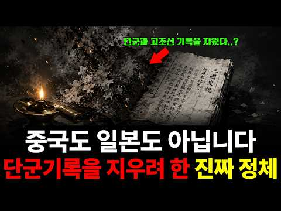
- 설명 앞부분: 단군과 고조선의 기록을 지우라고 가장 먼저 명령한 나라는 일본이 아니라 조선이었습니다. 1457년 세조의 수서령부터 1921년 단군고, 2002년 동북공정까지 570년의 밤을 따라갑니다. 국사책에서 고조선이 반 페이지로 끝났던 건, 실수가 아니었습니다. 1457년 5월, 고조선비사를 비롯한 책들이 관아로 거둬져 간 뒤 오늘까지 단 한 권도 세상에 나오지 않았습니다. 이 영상은 570년 동안 세 번 반복된 '지우기'를, 명령을 받은 백성의 눈으로 다시 읽습니다. 책을 지고 관아로 걸어간 사람, 역병 속에서 사당을 되찾은 마을, 단군…
- 같은 채널 평소 대비 ×165.8 (채널 최근 롱폼 중앙값 793회) · 평소 영상: 세종이 인정한 천재 김시습 이야기 (793회) / 133척 앞에서 12척이 물러났다… 명량, 바다에 홀로 남은 이순신의 대장선 (780회)
- 대본 없음 (설명) — 음성인식이 끝나면 도입부·흐름이 들어감
- 댓글 656/657: 좋은 점 — 영상 5 · 감사·응원 5 · 더 알고 싶은 것 4 · 아쉬운 점 — 영상 4 · 반박·불만 — 의견 다름 16 · 정치·사회 78 · 경험 공유 10 · 구독·다음 기대 0
  - 좋은 점 — 영상 👍0 “이씨 조선은 도대체 도움이 그닥”
  - 좋은 점 — 영상 👍0 “영상은 실제 역사 사료(실록, 삼국유사 원문)와 식민사학 비판, 어원 분석 등을 바탕으로 유익한 정보를 많이 담고 있습니다. 다만, 제목이나 도입부처럼 "조선 왕조가 고조선 기록을 의도적으로 지우려 했다"는 식의 극적 연출 및 일부 재야사학적 프레임은 역사적 사실을 …”
  - 감사·응원 👍2 “우리에게 역전의 기회는 올 수 있을까요?? 님과 같은 분이 많이 활동을 해야 하는데.... 걱정이 많습니다... 강단사학이란 너무 큰 벽에 조금 이나마 균열을 낼 수 있는 계기가 될 수 있으면 좋겠습니다.. 응원합니다... 그리고 조상신들께 기도합니다......”
  - 감사·응원 👍1 “<조선> 🔥이성계: 지리의 학설이 분명치 못해 음양산정도감을 설치하여 교정함. (조선왕조실록) 🔥이성계가 고려 공민왕의 금인을 명나라 주원장에게 바치고, 자신의 이름을 ‘旦(단)’으로 고쳐 달라고 청함.(명실록) 🔥이성계: 정도전 등에게 '고려사' 수찬. (조선왕조실…”
  - 더 알고 싶은 것 👍9 “⁠ 제보 !! 구글어스가 처음 나왔을때 궁금해서 사용해 보는데 시안에 피라미드가 엄청 많이 보이는겁니다 그래서 확대를 해 봤는데 그 피라미드 하나하나에 구분을위해 넘버가 붙어 있는데 전부 앞쪽에 corea + 세자리 넘버가 예를들면 corea 264 이런식으로 붙어 …”
  - 더 알고 싶은 것 👍2 “우리에게 역전의 기회는 올 수 있을까요?? 님과 같은 분이 많이 활동을 해야 하는데.... 걱정이 많습니다... 강단사학이란 너무 큰 벽에 조금 이나마 균열을 낼 수 있는 계기가 될 수 있으면 좋겠습니다.. 응원합니다... 그리고 조상신들께 기도합니다......”
  - 아쉬운 점 — 영상 👍2 “일제의 식민사관을 배운자들이 교수가 되고 학생을 가르치고 반복되고 그것으로 공직에서 세금을 받으니 통탄할 노릇이다 어떻게 깨끗이 해야하나”
  - 아쉬운 점 — 영상 👍0 “언어학자들은 지구상에 사는 어느 부족이나 오래 전부터 사용해온 기본적인 낱말(하늘, 해, 달, 나, 너, 꽃 등)이 있으며 이 낱말은 270개 가량 된다고 한다. 인류학에서는 이 기본 낱말들을 일컬어 ‘스와디시 차트(Swardish Chart)’ 라고 부르는데, 이 …”
  - 반박·불만 — 의견 다름 👍12 “망할놈의 전주 이씨왕권 때문에 고려사와 상고사가 망가지고 불태워지고 자료가 없어짐. 때문에 한반도 고대역사는 증거가 없다는 이유로 일베문화에 빠진 어린 세대가 사기, 거짓말이라고 비웃는 웃기는 상황이 되어버림. 타국은 명확한 증거가 없어도 설화, 민담, 과거의 기록 …”
  - 반박·불만 — 의견 다름 👍2 “고조선을 한반도 안에서만 찾는 것도...... 웃기는 일이지. 삼위태백이 어디에 있는가? https://youtube.com/shorts/tNJ2_6CMH18?si=l-hvd9glMmehnSKG”
  - 정치·사회 👍99 “이씨조선은..책임 져야 한다.. 역사를 지우고. 팔아먹고 누구맘데로.. 이씨조선은 정통 왕족도 아니면서 쿠테타로 정권 잡고,, 우리 역사를 다 태우냐 ???부끄러운줄 알아야지 후손들이라도 책임져라!!... 일본에 가 있는 우리 역사책 다 찾아와라..!!@@@”
  - 정치·사회 👍25 “이성계는 여진족출신 이다 구데타로 정권잡고 고려를 지우고 명나라 에 의지할려고 사대했다 우리 역사와 땅을 한반도 안으로 끌고 들어왔다 금나라 와 청나라 를 개국한 아골타 와 누루아치는 신라 유민 이었다 방대한땅들을 중국대륙 으로 끌어들였다 환단고기는 하늘이 내려주신 …”
  - 경험 공유 👍17 “중국의 요순시대...내가 여러종류의 역사책을 읽어본바에 의하면 그거 우리역사다.”
  - 경험 공유 👍5 “개조선때문에 이성계부터 성종까지 역사책을 다 모아 태워없앴다. 고려의 영토가 중국,만주,한반도에 이르거늘. 명나라 건국 주원장도 동이족사람이고 고려에게 건국한다고 승인받았었는데, 개성계가 스스로 알아서 바닥을 기는짓거리를 하고 한족구석에서 조선이라 골목대장이라 칭했으…”

### 160. 명나라 역사상 가장 끔찍하게 죽은 남자ㅣ환관 유근의 일생

- https://www.youtube.com/watch?v=DisrEocrnVY · 역사노다지 · 구독자 4,230 · 조회수 326,839 (×77.3, 하루 2,707.1) · 좋아요 1,919 (0.6%) · 36.1분 · 2026-07-12 · 주제 묶음 6. 동양사 (중국·일본·몽골) · 형식 정보·해설 (그 밖) · 폴더 `W_DisrEocrnVY` (웹 승인)
- 썸네일: 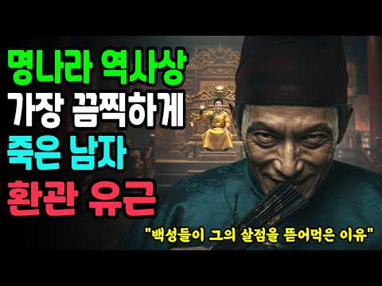
- 설명 앞부분: 🔥 변소를 청소하던 환관이 황제보다 부유해졌습니다. 그리고 3,357번의 칼질 끝에, 백성들이 그의 살점을 사 먹었습니다. 명나라 역사상 가장 충격적인 최후를 맞은 환관 유근. 가난한 농가의 아이가 어떻게 나라 전체를 손에 쥐었는지, 그리고 왜 이토록 처참하게 무너졌는지를 이야기합니다. 이 영상에서 다루는 내용 ━━━━━━━━━━━━━━━━━━━━ ⚔️ 유근의 출생과 환관이 되기까지 👑 정덕제와 팔호(八虎)의 탄생 🏴 사례감 장악과 서황제의 등장 🕵️ 내창 — 유근이 직접 만든 비밀경찰 💰 은 5천만 냥 — 나라 예산 수십 배의 …
- 같은 채널 평소 대비 ×193.4 (채널 최근 롱폼 중앙값 1,690회) · 평소 영상: 한국인 DNA를 열어봤더니 과학자들이 말을 잃었다, 우리가 알던 상식이 전부 틀렸다 (2,161회) / 병자호란 13년 뒤, 청나라로 보내진 열여섯 살 '가짜 공주' (1,219회)
- 대본 없음 (설명) — 음성인식이 끝나면 도입부·흐름이 들어감
- 댓글 230/230: 좋은 점 — 영상 0 · 감사·응원 1 · 더 알고 싶은 것 0 · 아쉬운 점 — 영상 0 · 반박·불만 — 의견 다름 4 · 정치·사회 19 · 경험 공유 1 · 구독·다음 기대 0
  - 감사·응원 👍16 “역사를 통해 현재를 보게 됩니다. 감사합니다.”
  - 반박·불만 — 의견 다름 👍4 “"놀이를 좋아하는 황제의 성격은 바뀌지 않았으니까요. 유근이 어떻게 황제보다 부유해졌을까요. 황제가 비워둔 자리를 채웠기 때문입니다. 황제가 하기 싫어한 일을 대신 했고 그 대가로 황제의 권력을 가져갔으며 그 권력으로 황제의 돈을 가져간 거죠. 유근이 특별히 뛰어난 …”
  - 정치·사회 👍21 “우리나라도 그런 인간 있지요 . 국회의장 우원식 은 1년 동안 해외 출장비용으로 96억을 썻다는데 . 이게 가당키나 합니까 . 회당 6억을 넘게 썻다는데 뭘 먹고 어디서 자기에 의장이 이렇게 쓸수 있답니까 ? 특검 해야 합니다 .”
  - 정치·사회 👍14 “현재의 대한민국의 실상. 다만 환관이 아니라,국회와 행정수반 찢@@.”
  - 경험 공유 👍57 “형벌 중 하나인 '능지'는 죄인의 살점을 한점씩 바르면서...죄인이 최대한 고통을 겪지만, 오래 살려두는 걸 말하며~~ 보통 기술자의 경우에 1천포 가까이 살을 뜨고, 3일이상 살아있게 만들기도 했었음. 재미있는 건, 죄인의 살점을 먹으면 복이 온다고 믿어서... 능…”

