# 역사 — 성공 사례 분석: 사례별 자세히 #121–#160

`analysis.md` 의 9번 (같은 # 번호). 자동 생성 — `tools/success_analysis.py` v1.6 (2026-10-28 10:14 UTC). ※ 연구·교육용 — 투자 권유가 아님.

### 121. 조선의 왕들이 단명한 이유, 매일 먹던 '이것'이 독이었던 충격적인 사실ㅣ조선왕평균수명46세

- https://www.youtube.com/watch?v=aDk8BnSRa5o · 역사MSG · 구독자 2,530 · 조회수 550,878 (×217.7, 하루 3,921.5) · 좋아요 4,923 (0.9%) · 25.3분 · 2026-06-09 · 주제 묶음 3. 조선 · 형식 정보·해설 (그 밖) · 폴더 `W_aDk8BnSRa5o` (웹 승인)
- 썸네일: 
- 설명 앞부분: 🫅조선의 왕은 누구보다 잘 먹고, 최고의 의료와 보살핌을 받았습니다. 그런데 평균 사망 나이는 고작 46세. 같은 궁궐에서 소박하게 먹고 뛰어다닌 내시는 70세까지 살았는데 말이죠. 24년 차이, 대체 이유가 무엇일까요? 🍚세종의 식습관부터 정조의 종기, 영조의 83세 장수 비결까지 매일 먹던 밥상, 수라상이라는 시스템이 왕의 몸을 어떻게 망가뜨렸는지, 실록 기록으로 하나씩 풀어봤습니다. 🕛타임라인 [조선왕조실록 (朝鮮王朝實錄)] 세종실록 세종 30년 세조실록 문종실록 효종실록 정조실록 성종실록 [승정원일기 (承政院日記)] [의학…
- 같은 채널 평소 대비 ×1,405.3 (채널 최근 롱폼 중앙값 392회) · 평소 영상: 불멸의 여신을 버리고 늙은 아내에게 돌아간 남자, 오디세우스 ∣ 오디세이아 (392회) / '15분' 틀렸다고 곤장 맞은 조선 기상청 천문학자, 그 뒤에 벌어진 일 ∣ 세종의 시간… (374회)
- 대본 없음 (설명) — 음성인식이 끝나면 도입부·흐름이 들어감
- 댓글 593/593: 좋은 점 — 영상 5 · 감사·응원 2 · 더 알고 싶은 것 4 · 아쉬운 점 — 영상 4 · 반박·불만 — 의견 다름 8 · 정치·사회 5 · 경험 공유 6 · 구독·다음 기대 0
  - 좋은 점 — 영상 👍1 “아주 좋은 내용인 것 같네요.”
  - 좋은 점 — 영상 👍0 “소식이 장수하는데 도움되는건 맞음”
  - 감사·응원 👍4 “감사합니다 ㆍ귀농해서80세이나에 텃밭농부로삽니다 아파트생활62세에치우고 시골생활ㆍ건강비결입니다ㆍ호미ᆢ 텃밭살길입니다ᆢ”
  - 감사·응원 👍0 “미국 동남부며 성경적 삶의 방향으로 살고있습니다. 시아버지가 90세로 키는 약 168cm 에 55kg 이 채 안돼세요. 평생 그 몸무게 유지되시는게, 식사량 자체가 소식에 부지런하셨습니다. 왜 소식이 답인가? 를 보니 원래 우리몸이 그리 많은 열량을 필요로 하지않는답…”
  - 더 알고 싶은 것 👍41 “왕이 100보 이상 걸을 일이 있을까요? 가마타고 댕기지~ 그리고 대부분 종기로 단명했는데, 옷을 잔뜩 껴입고 온종일 앉아있고, 결정적으로 잘 안 씻어서 그렇습니다. 비누가 수십억의 인류를 살렸다는 말이 있죠~”
  - 아쉬운 점 — 영상 👍0 “무지지루하네서론이너무길어”
  - 아쉬운 점 — 영상 👍0 “어영부영 장황 ... 중언부언 ... 조회수 낚시 ...”
  - 반박·불만 — 의견 다름 👍2 “일찍죽은 이유는 딱 한가지다. 목욕을 안하니까 일찍 죽은거다. 우리도 60.70년대 한달에 한번 대중 목욕탕가서 목욕하던시절 등에 종기가 나 '이명래고약' 붙이고살던 시절이 있었다. 조선시대에는 수십년 목욕을 안하니 늘 종기에 죽었지.. 저 종기가 알콜 몃방울이면 낫…”
  - 반박·불만 — 의견 다름 👍1 “조선시대에 항생제가 없었던 것이 아닙니다. 약초나 침으로 균을 잡았는데 균종에 적합한 약재를 찾지 못한거지요.”
  - 정치·사회 👍0 “나라가 망했으니 뭔짓을 못하겠어요.”
  - 정치·사회 👍0 “수라상이 문제가 아니라 항상 무예를 수련하고 첩들을 멀리하고 탐관오리들을 가까이 아니하고 충신들과 항상 교류하며 암행어사들을 파견하여 민정을 살피고 육군과 수군을 기르고 정사를 펼치면 성군이 될수있고 수명도 장수할수 있다 임금은 모든것을 잘할수는 없다 오직 인재를 등…”
  - 경험 공유 👍0 “왕들도 몰랐던 의학 지식을 내가 세상에 전한 게 아닐까? "아는 것이 힘이다." 건강 유지 방법에 대해서도 잘 알아야 되고 적들에 대해서도 잘 알아야 한다.”
  - 경험 공유 👍0 “내가 이렇게 된게… 우리 할머니때문인거랑 같은거구나…”

### 122. Ep.03_전북 정읍시 ∣ 조선 역사의 비극과 민중의 함성이 공존하는 도시

- https://www.youtube.com/watch?v=Fpwz5nqZTgk · 팔도유남 Paldoyunam · 구독자 223 · 조회수 52,269 (×234.4, 하루 344.3) · 좋아요 722 (1.4%) · 15.7분 · 2026-05-29 · 주제 묶음 1. 역사 일반·이야기 · 형식 야담·옛날이야기 · 폴더 `W_Fpwz5nqZTgk` (웹 승인)
- 썸네일: 
- 챕터: 0:00 인트로_정읍여행의 시작 · 1:26 정읍시 주요 현황 · 3:43 정읍맛집, 백학정 · 5:15 무성서원 · 6:44 단종비 정순왕후 태생지 · 8:25 쌍화차거리 · 10:35 각시다리공원 & 각시다리설화 · 13:04 동학농민혁명기념공원(황토현전적, 동학농민혁명기념관, … · 15:01 아웃트로_정읍여행의 마무리
- 설명 앞부분: 인구 10만 소도시 전북 정읍의 역사와 설화, 맛을 이 영상 하나에 담았습니다. ☑️ 한우 암소 떡갈비 맛집 백학정 ☑️ 유네스코 세계문화유산, 무성서원 ☑️ 왕과 사는 남자 단종의 비, 정순왕후 태생지 ☑️ 전국 유일 쌍화차거리 ☑️ 이름 없는 각시의 한이 맺힌 설화 여행지, 각시다리 ☑️ 동학농민혁명의 핵심 현장, 황토현전적·기념관·박물관
- 같은 채널 평소 대비 ×67.5 (채널 최근 롱폼 중앙값 774회) · 평소 영상: Ep.05 경남 하동군ㅣ여름휴가는 하동이면 충분합니다ㅣ차 시배지 정금차밭부터 지리산 계곡… (1,205회) / Ep.02_충북 옥천군 ∣ 국내 당일치기 여행지, 일출 명소로 알려진 용암사부터 향수의 … (1,239회)
- 대본 없음 (설명) — 음성인식이 끝나면 도입부·흐름이 들어감
- 댓글 59/59: 좋은 점 — 영상 0 · 감사·응원 6 · 더 알고 싶은 것 1 · 아쉬운 점 — 영상 0 · 반박·불만 — 의견 다름 0 · 정치·사회 0 · 경험 공유 3 · 구독·다음 기대 0
  - 감사·응원 👍27 “지척 에 살면서 알지 못한 지식 좋은 지식을 알려 주어 감사 합니다”
  - 감사·응원 👍5 “감사합니다 고향이 정읍인데 정순황후 태생지가 정읍인줄 이제 알았습니다... 😘😍🥰 행상 나간 남편이 오래 돌아오지 않자, 아내가 달에게 남편의 안전과 무사 귀환을 비는 노래로 유명한 정읍사 공원도 인근에 있는데 다음번에는 정읍사 공원도 소개부탁드립니다. 감사합니다”
  - 더 알고 싶은 것 👍5 “감사합니다 고향이 정읍인데 정순황후 태생지가 정읍인줄 이제 알았습니다... 😘😍🥰 행상 나간 남편이 오래 돌아오지 않자, 아내가 달에게 남편의 안전과 무사 귀환을 비는 노래로 유명한 정읍사 공원도 인근에 있는데 다음번에는 정읍사 공원도 소개부탁드립니다. 감사합니다”
  - 경험 공유 👍43 “저희 조상 태인 박씨 입향조 마을 태인현. 고려 공민왕 시절. 홍건적 침입으로 경남 밀양에서 이곳 태인으로 이주한 밀양박씨 관향. 이곳에는중국 성씨인 여산 송씨 정순왕후 집안도 정착하고 있었다. 여산은 지금의 익산. 중국에도 똑같은 지명이 있다. 세조의 왕위 찬탈로 …”
  - 경험 공유 👍4 “처음에 나온 유허비각이 있는동네가 제가사는 동네입니다 심지어 유허비각 옆의 빈터는 제가 태어나서 살았던곳이네요...맨날 보는데가 인터넷에 나오다니 참 느낌이 새롭네요”

### 123. 《불교 역사》 인도의 괴짜 승려 달마는 누구인가? l 역사 인물 l 고전

- https://www.youtube.com/watch?v=N4v1knO4AEw ·  역사 산책: 동양편 · 구독자 2,770 · 조회수 319,472 (×115.3, 하루 4,247.0) · 좋아요 2,254 (0.7%) · 23.2분 · 2026-08-03 · 주제 묶음 1. 역사 일반·이야기 · 형식 정보·해설 (그 밖) · 폴더 `W_N4v1knO4AEw` (웹 승인)
- 썸네일: 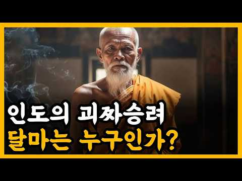
- 같은 채널 평소 대비 ×49.7 (채널 최근 롱폼 중앙값 6,426회) · 평소 영상: 《삼국지》 유비는 왜 동문 공손찬의 등에 칼을 꽂았을까? l 역사 인물 l 고전 (7,251회) / 《삼국지》 조조의 손자 조예, 위나라를 파멸로 몰았던 이유는? l 역사 인물 l 고전 (5,600회)
- 대본 없음 (없음) — 음성인식이 끝나면 도입부·흐름이 들어감
- 댓글 126/126: 좋은 점 — 영상 0 · 감사·응원 3 · 더 알고 싶은 것 1 · 아쉬운 점 — 영상 1 · 반박·불만 — 의견 다름 1 · 정치·사회 0 · 경험 공유 0 · 구독·다음 기대 0
  - 감사·응원 👍0 “감사합니다!”
  - 감사·응원 👍0 “고맙습니다.”
  - 더 알고 싶은 것 👍1 “그게 가능한가요? 그 당시 평균수명이 몇세인데 출가를 하고 반야다라밑에서 40년을 수행하고 67년을 기다리고 3년에 걸쳐 중국에 가고 9년 면벽수행을 하고..... 당신같으면 가능한가요? 솔방울로 수류탄 만드는 수준이잖아요? 혹시 죽었을때 방광현상은 안 일어 났고 공…”
  - 아쉬운 점 — 영상 👍6 “이런 영상 참 좋아요, ai는 아니시죠? 제발 ai 음성으로 하지 말아주세요”
  - 반박·불만 — 의견 다름 👍0 “실존 인물이 아닙니다.”

### 124. 예수는 실존 인물이었을까? 역사학이 답한 충격적인 진실

- https://www.youtube.com/watch?v=xDel5Oig1HQ · 에덴코덱스 · 구독자 255 · 조회수 51,432 (×201.7, 하루 383.7) · 좋아요 371 (0.7%) · 13.4분 · 2026-06-16 · 주제 묶음 1. 역사 일반·이야기 · 형식 정보·해설 (그 밖) · 폴더 `W_xDel5Oig1HQ` (웹 승인)
- 썸네일: 
- 설명 앞부분: 예수는 정말 실존 인물이었을까요? 많은 사람들은 아직도 예수의 실존 여부가 논쟁 중이라고 생각합니다. 하지만 놀랍게도 현재 역사학계의 주류 견해는 이미 어느 정도 결론에 도달해 있습니다. 이번 영상에서는 종교적 믿음을 떠나 역사학, 고고학, 문헌학의 관점에서 예수의 실존 여부를 살펴봅니다. 로마 역사가 타키투스의 기록 유대 역사가 요세푸스의 증언 초기 기독교 운동의 역사적 흔적 예수 신화론이 학계에서 받아들여지지 않는 이유 역사학이 인정하는 것과 인정하지 않는 것 예수는 실제로 존재했을까요? 그리고 역사학은 어디까지 답할 수 있을…
- 같은 채널 평소 대비 ×372.7 (채널 최근 롱폼 중앙값 138회) · 평소 영상: 성경 밖에서 발견된 예언자 이사야? 2700년 전 인장 자국의 비밀 (143회) / 3000년 전 항아리에 적힌 이름… 히브리어의 역사를 바꿨나? (133회)
- 대본 없음 (설명) — 음성인식이 끝나면 도입부·흐름이 들어감
- 댓글 59/59: 좋은 점 — 영상 0 · 감사·응원 1 · 더 알고 싶은 것 1 · 아쉬운 점 — 영상 1 · 반박·불만 — 의견 다름 1 · 정치·사회 1 · 경험 공유 3 · 구독·다음 기대 0
  - 더 알고 싶은 것 👍3 “예수님을부정하는자들의머리속에는과연 뇌가있을까 그것이궁금하다”
  - 아쉬운 점 — 영상 👍2 “예수가 불교를 공부했을 가능성은 1,000%,,,,,다,,,,,아니,,,, 1만 프로가 넘는다,,, 또한 요셉과 세례 요한이 인도 종교의 영향을 받은 엣세네파의 일원이었다는 것을 증명하는 사건은 예수가 세례 요한에게 세례를 받았다는 것이다, 엣세네파 일원이었던 요셉등…”
  - 반박·불만 — 의견 다름 👍2 “예수가 불교를 공부했을 가능성은 1,000%,,,,,다,,,,,아니,,,, 1만 프로가 넘는다,,, 또한 요셉과 세례 요한이 인도 종교의 영향을 받은 엣세네파의 일원이었다는 것을 증명하는 사건은 예수가 세례 요한에게 세례를 받았다는 것이다, 엣세네파 일원이었던 요셉등…”
  - 경험 공유 👍4 “영적 지식은 의문을 던져서 알게 되는 것이 아니다. 믿음으로 시작해야 올바른 지식을 취득할 수 있다. 기왕에 나도 모른 채 알게 된 지식이라면, 인간이 머리에서 생겨나지 않았다는 사실을 깨닫는 데서 출발한다.”
  - 경험 공유 👍2 “예수가 불교를 공부했을 가능성은 1,000%,,,,,다,,,,,아니,,,, 1만 프로가 넘는다,,, 또한 요셉과 세례 요한이 인도 종교의 영향을 받은 엣세네파의 일원이었다는 것을 증명하는 사건은 예수가 세례 요한에게 세례를 받았다는 것이다, 엣세네파 일원이었던 요셉등…”

### 125. 한나라를 무릎 꿇린 흉노, 왜 사라졌을까? 신라 왕족은 그 후손이었나?

- https://www.youtube.com/watch?v=1V5KZiQQCuY · Damir Merzhalimov · 구독자 1,090 · 조회수 38,584 (×35.4, 하루 1,573.0) · 좋아요 530 (1.4%) · 150.1분 · 2026-10-03 · 주제 묶음 2. 한국 고대·삼국·고려 · 형식 정보·해설 (그 밖) · 폴더 `W_1V5KZiQQCuY` (웹 승인)
- 썸네일: 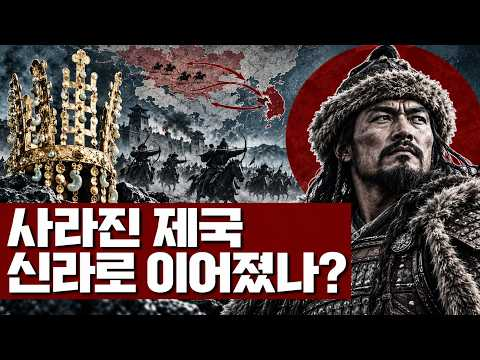
- 챕터: 0:00 밤이 시작됩니다 · 5:52 제국 이전의 초원 · 22:14 묵특, 우는 화살 · 37:56 백등산과 화친 · 53:59 무제, 전쟁의 값 · 69:14 같은 황제, 조선의 멸망 · 83:52 장건, 서쪽이 열리다 · 95:00 소무와 이릉, 그리고 사마천 · 106:54 남과 북으로 · 115:52 훈족설을 따져본다 · 125:16 땅에 남은 것 · 132:07 선비, 그리고 환도성 · 137:52 김일제와 신라의 김씨 · 145:44 후손은 어디에
- 설명 앞부분: 한나라와 맞서며 초원을 지배했던 강대한 제국, 흉노. 중국의 강력한 경쟁자였던 이들은 왜 역사의 중심에서 사라졌을까요? 이번 영상에서는 흉노 제국의 흥망과 그 이후의 행방을 살펴보고, 신라 왕족과 흉노를 연결하는 기원설이 어떤 의문을 던지는지 함께 탐구합니다. 제국의 몰락은 곧 사람들의 소멸을 의미했을까요? 초원에서 한반도로 이어지는 이야기는 역사적 연결의 흔적일까요, 아니면 후대에 만들어진 계보일까요? 흉노와 신라 왕족의 관계를 확정된 혈통으로 단정하지 않고, 기록과 해석을 구분하며 고대 동아시아 역사의 미스터리를 따라갑니다. …
- 같은 채널 평소 대비 ×21.6 (채널 최근 롱폼 중앙값 1,789회) · 평소 영상: 흉노에 쫓겨난 유목민이 어떻게 인도에서 제국을 세웠을까? 한국 불상의 얼굴은 어디서 왔나 (1,789회) / 49년째 우주를 날고 있는데… 보이저 1호는 왜 아무것에도 부딪히지 않을까? (2,200회)
- 대본 없음 (설명) — 음성인식이 끝나면 도입부·흐름이 들어감
- 댓글 21/23: 좋은 점 — 영상 1 · 감사·응원 1 · 더 알고 싶은 것 1 · 아쉬운 점 — 영상 0 · 반박·불만 — 의견 다름 1 · 정치·사회 2 · 경험 공유 0 · 구독·다음 기대 0
  - 좋은 점 — 영상 👍0 “나는 노인인데, 아기자기 새록새록 구구절절... 이게 좋구만요...”
  - 반박·불만 — 의견 다름 👍1 “신라는 제국이 아닙니다. 제국(帝國)은 메이지시대 일본이 "Reich(라이흐)"와 "Realm(레름)"을 번역하면서 만들어낸 신조어입니다. 전근대 동아시아는 존재하지 않았던 단어이죠. 다만, 현대 사학자들이 현대의 관념을 소급하여 고대에 적용하려는 시도는 있습니다. …”
  - 정치·사회 👍0 “2300년경 인류최소 말을 길드려 가축화하고 제철기술을 습득하고 무기화한 기마유목민Scythian(스키타이) 둘이 한반도 남쪽의 농경민 부족국가들을 정복하였다. 삼국사기와 삼국유사에 기록되어있다. 또한 수 많은 거대 능들(경주, 가야지역, 영산강지역, 광주)은 Scy…”

### 126. 조선시대 유배객들이 실제로 겪은 일 ∣ 교과서가 숨긴 진짜 유배의 실체 ∣ 조선역사 ∣ 조선왕조실록 ∣ 한국사

- https://www.youtube.com/watch?v=U2MgGktKryE · 역사딴지 · 구독자 1,150 · 조회수 130,183 (×113.2, 하루 1,649.4) · 좋아요 1,188 (0.9%) · 13.9분 · 2026-08-10 · 주제 묶음 3. 조선 · 형식 수면·낭독 (잠잘 때 듣는) · 폴더 `W_U2MgGktKryE` (웹 승인)
- 썸네일: 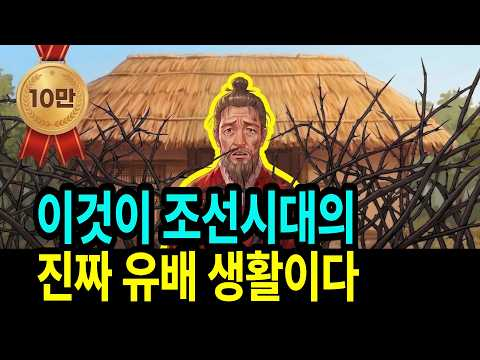
- 챕터: 0:00 송시열, 마지막 잔을 들다 · 1:01 유배 전 먼저 맞은 곤장 · 1:50 하루 30km, 끝없이 걸어야 했던 길 · 2:51 돈에 따라 달랐던 유배길 · 3:28 도착 후 시작된 감시와 위리안치 · 5:21 절반도 못 돌아온 제주 유배 · 6:04 정약용, 절망을 학문으로 바꾸다 · 8:19 김정희와 세한도 · 10:30 오늘날의 위리안치, 그리고 결말
- 설명 앞부분: 조선시대 유배, 위리안치, 정약용 목민심서 — 사극에서는 유배를 소달구지에 실려 흙먼지 날리는 시골길을 걷는, 사형보다는 가벼운 벌로 그립니다. 하지만 이건 절반만 진실입니다. 조선 유배형은 떠나기 전 먼저 곤장부터 맞아야 했던 형벌이었습니다. 최대 3천 리, 하루 30km 넘게 걸으면서도 숙박비와 호송관 밥값까지 자기 돈으로 치러야 했습니다. 그리고 유배 중 가장 가혹한 형벌, 위리안치가 그들을 기다리고 있었습니다. 이 영상에서는 조선 유배형의 실제 절차와 정약용·정약전·김정희가 그 절망 속에서 남긴 것들을 함께 들여다봅니다. …
- 같은 채널 평소 대비 ×187.3 (채널 최근 롱폼 중앙값 695회) · 평소 영상: 왕이 가장 위험한 자리였던 이유, 사극이 보여주지 않는 조선 왕 5명의 죽음 ∣ 조선역사… (695회) / 나무꾼에서 왕이 된 철종, 신데렐라가 아니라 꼭두각시였다 ∣ 안동김씨가 그를 고른 진짜 … (753회)
- 대본 없음 (설명) — 음성인식이 끝나면 도입부·흐름이 들어감
- 댓글 76/77: 좋은 점 — 영상 1 · 감사·응원 1 · 더 알고 싶은 것 0 · 아쉬운 점 — 영상 0 · 반박·불만 — 의견 다름 1 · 정치·사회 2 · 경험 공유 0 · 구독·다음 기대 0
  - 좋은 점 — 영상 👍4 “몰랐던 사실 배우고 갑니다”
  - 감사·응원 👍1 “감사합니다.”
  - 반박·불만 — 의견 다름 👍3 “영화나 드라마는 그냥 재미로 보는거지 그것을 실화로 보는 사람이 웃기는거지..”
  - 정치·사회 👍3 “조선시대의 유배 제도는 표면적으로는 국법을 어긴 죄인을 다스리는 사법적 형벌의 형식을 취하고 있으나, 그 내면을 들여다보면 왕권과 신권의 권력 다툼, 붕당 간의 피비린내 나는 정쟁, 그리고 철저한 유교적 명분론이 맞물려 작동하던 고도의 정치적 생존 게임이었다. ​실제…”

### 127. 📸 역사책에서 찾을 수 없었던 놀라운 순간들 ∣ 희귀 역사 사진들

- https://www.youtube.com/watch?v=BF7Kb1zcVTo · 고대의 메아리 · 구독자 1,040 · 조회수 17,712 (×17.0, 하루 1,486.1) · 좋아요 50 (0.3%) · 7.7분 · 2026-10-11 · 주제 묶음 1. 역사 일반·이야기 · 형식 정보·해설 (그 밖) · 폴더 `W_BF7Kb1zcVTo` (웹 승인)
- 썸네일: 
- 설명 앞부분: 안녕하세요! 희귀한 역사 사진과 잊혀진 과거의 이야기를 전하는 고대의 메아리에 오신 것을 환영합니다. 📸 이 채널에서는 희귀한 역사 사진, 오래된 흑백 사진, 빈티지 이미지, 1900년대의 기록을 통해 우리가 미처 알지 못했던 과거의 순간들을 만나봅니다. 유명한 역사적 사건뿐만 아니라, 평범한 사람들의 일상과 그 시대의 생생한 모습까지 사진으로 살펴봅니다. 📷 이 채널에서 만나볼 수 있는 콘텐츠 쉽게 접하기 어려운 희귀 역사 사진 20세기의 일상과 사람들의 삶 오래된 흑백 사진과 빈티지 이미지 잊혀진 역사적 순간과 숨겨진 이야기 …
- 같은 채널 평소 대비 ×5.4 (채널 최근 롱폼 중앙값 3,259회) · 평소 영상: 📸 실제였다는 게 믿기 힘든 과거의 순간들 (3,259회) / 📸 오래된 사진이 말해주는 진짜 역사 (3,318회)
- 대본 없음 (설명) — 음성인식이 끝나면 도입부·흐름이 들어감
- 댓글 0/0: 좋은 점 — 영상 0 · 감사·응원 0 · 더 알고 싶은 것 0 · 아쉬운 점 — 영상 0 · 반박·불만 — 의견 다름 0 · 정치·사회 0 · 경험 공유 0 · 구독·다음 기대 0

### 128. [중국 전쟁사] 그 넓은 중국은 어쩌다 동해를 코앞에 두고 통로가 막혀버렸을까?｜기묘하게 꼬여버린 '북·중·러' 국경지대 역사 완벽 요약!

- https://www.youtube.com/watch?v=itVdxpo0sWQ · 역사순삭 · 구독자 73 · 조회수 13,462 (×134.6, 하루 141.7) · 좋아요 75 (0.6%) · 10.1분 · 2026-07-25 · 주제 묶음 7. 전쟁·군사사 · 형식 애니메이션·지도 · 폴더 `W_itVdxpo0sWQ` (웹 승인)
- 썸네일: 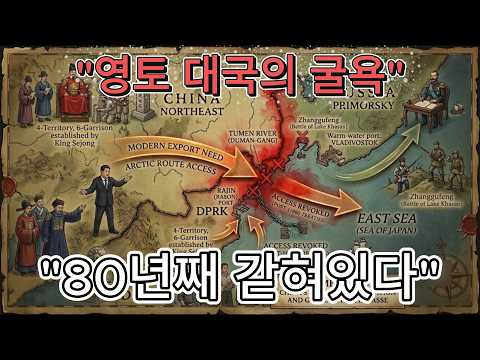
- 설명 앞부분: [중국 전쟁사] 그 넓은 중국은 어쩌다 동해를 코앞에 두고 통로가 막혀버렸을까?｜기묘하게 꼬여버린 '북·중·러' 국경지대 역사 완벽 요약! 영토가 방대한 대국 중국은 어째서 동해를 불과 15km 앞두고 바다로 나갈 수 없게 된 걸까요? 과거 러시아의 영토 팽창과 일본의 무리한 전쟁 도발이 겹치면서, 중국은 두만강 하구를 통한 바다 출구를 완전히 봉쇄당하고 말았습니다. 현재 침체된 동북 3성의 경제를 살리고 미래 북극 항로의 주도권을 쥐기 위해 동해 진출이 절실한 중국에게 이는 가장 뼈아픈 지정학적 약점입니다. 심지어 북한과 러시아…
- 대본 없음 (설명) — 음성인식이 끝나면 도입부·흐름이 들어감
- 댓글 7/7: 좋은 점 — 영상 0 · 감사·응원 0 · 더 알고 싶은 것 0 · 아쉬운 점 — 영상 0 · 반박·불만 — 의견 다름 0 · 정치·사회 3 · 경험 공유 0 · 구독·다음 기대 0
  - 정치·사회 👍2 “흑룡강은 아무르강이라고도 하는데 저 강의 주인이 전체 강너머의 주인이라는 건 역사적인 팩트다. 오늘날 무슨 국제법이 등장하기 이전에는 강을 정복한 자가 천하를 정복했다. 그러면 지금 국경선 흑룡강의 실질 주인이 바로 조선이었다는 건 러시아가 스스로 나선정벌의 충격으로…”
  - 정치·사회 👍1 “야인토벌이 실록 전체에 나오는데 무슨 거기 청의 영토라고 하는가. 거기는 조선이 직접 기병 오백으로 여진 이만명을 토벌하던 그런 지역이다. 아무르강이 압록강이다. 그래서 러시아는 조선을 두려워했고 청과 네르친스크조약을 체결한 배경에 조선의 막강한 군사력이 있었고 이후…”

### 129. 중국의 역대 왕조는 어떻게 무너졌을까?

- https://www.youtube.com/watch?v=6n_FKqeMq4M · 크로니클 · 구독자 3,640 · 조회수 149,955 (×41.2, 하루 5,021.5) · 좋아요 412 (0.3%) · 19.3분 · 2026-09-28 · 주제 묶음 3. 조선 · 형식 정보·해설 (그 밖) · 폴더 `W_6n_FKqeMq4M` (웹 승인)
- 썸네일: 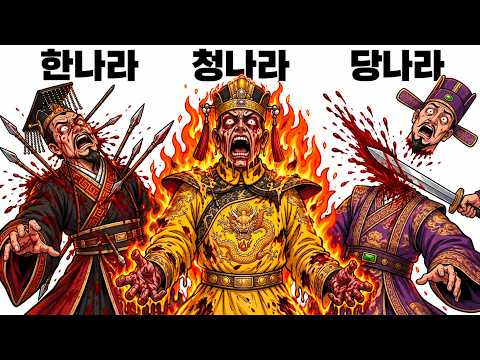
- 설명 앞부분: 4000년 중국 역사에서 영원한 제국은 없었습니다. 이 영상은 하나라와 상나라에서 시작해 주나라, 진나라, 한나라, 사마씨의 진나라, 수나라, 당나라, 송나라, 원나라, 명나라, 청나라에 이르기까지 중국 역대 왕조의 몰락이 어떤 흐름으로 이어졌는지 살펴봅니다. 왕조를 무너뜨린 것은 단 하나의 사건이었을까요? 권력의 약화와 내부 갈등, 전쟁과 반란, 외부의 압박이 어떻게 겹쳤는지 따라가 보세요. 중국 역대 왕조의 몰락을 시대별 핵심 장면으로 정리하고, 반복되는 역사적 흐름 속에서 중국 역대 왕조의 몰락이 남긴 의미를 함께 살펴봅니다…
- 같은 채널 평소 대비 ×11.4 (채널 최근 롱폼 중앙값 13,156회) · 평소 영상: 역사상 가장 악명 높은 폭군들은 어떻게 죽었을까? (13,156회) / 전설적인 탐험가들은 어떻게 죽었을까? (11,548회)
- 대본 없음 (설명) — 음성인식이 끝나면 도입부·흐름이 들어감
- 댓글 83/85: 좋은 점 — 영상 0 · 감사·응원 1 · 더 알고 싶은 것 0 · 아쉬운 점 — 영상 0 · 반박·불만 — 의견 다름 1 · 정치·사회 9 · 경험 공유 0 · 구독·다음 기대 0
  - 정치·사회 👍6 “역사를 보면 중국 공산당 정권도 오래 못갈거 같아요”
  - 정치·사회 👍2 “중국 통일왕조 중에서 가장 건실했던 왕조는 북송과 남송을 포함한 송왕조라고 생각합니다. 물론 휘종대의 막장은 있었지만 금나라와 원나라가 없었더라면 적어도 100년은 더 견딜수 있었던 왕조이죠. 그러나 나머지 통일왕조는 외세의 침략으로 멸망한 것이 아니라 자체의 허술한…”

### 130. 지구나이 45억년, 인류 이전 초거대 문명의 소름돋는 증거들

- https://www.youtube.com/watch?v=-FBIBpxt-FY · 어스릭스 · 구독자 4,990 · 조회수 872,641 (×174.9, 하루 6,820.4) · 좋아요 6,780 (0.8%) · 22.6분 · 2026-06-22 · 주제 묶음 8. 문명·고고학 · 형식 정보·해설 (그 밖) · 폴더 `W_-FBIBpxt-FY` (웹 승인)
- 썸네일: 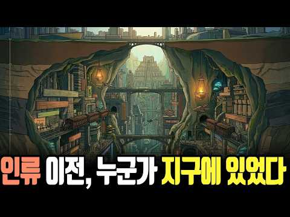
- 설명 앞부분: 지구나이 45억 년, 인류 이전에 초고도 문명이 존재했다면? NASA 과학자가 발표한 '실루리안 가설'을 통해 지구 지층 속 숨겨진 화학적 지문과 고대 문명의 미스터리를 추적합니다. ⚠️ 본 영상은 다양한 국내외 학술 데이터와 과학적 가설들을 기반으로 제작된 정보 제공 목적의 콘텐츠입니다. 영상에 포함된 역사적 사실과 격변, 진화 가설들은 지구의 역사를 탐구하기 위한 학술적 서사일 뿐이며, 특정 종교적 신념이나 정치적 견해, 특정 인종, 집단의 주장을 지지하거나 비하하려는 의도가 전혀 없음을 밝힙니다. 어스릭스는 인류와 행성의 거…
- 같은 채널 평소 대비 ×538.8 (채널 최근 롱폼 중앙값 1,620회) · 평소 영상: 지구 맨틀 깊은 곳(2,900km)에서 발견된 충격적인 '외계 행성의 시체' (1,752회) / 북미 대륙만 한 '마그마 바다'가 솟아오른다면? 옐로스톤 슈퍼 화산의 소름 돋는 타이머 (1,487회)
- 대본 없음 (설명) — 음성인식이 끝나면 도입부·흐름이 들어감
- 댓글 491/491: 좋은 점 — 영상 10 · 감사·응원 4 · 더 알고 싶은 것 2 · 아쉬운 점 — 영상 6 · 반박·불만 — 의견 다름 10 · 정치·사회 4 · 경험 공유 21 · 구독·다음 기대 1
  - 좋은 점 — 영상 👍41 “정말 기발한 발상입니다.이러한 생각에 정말 많이 공감합니다.”
  - 좋은 점 — 영상 👍11 “수준높은 좋은 영상이네요”
  - 감사·응원 👍2 “아주 좋은 내용의 글 입니다.많은 생각 을하게 하게 하는 내용의 글을 읽었습니다.감사합니다.”
  - 감사·응원 👍1 “맞습니다 응원합니다 파이팅”
  - 더 알고 싶은 것 👍0 “내일 또 출근해야됨.리셋은 언제 되나요?”
  - 더 알고 싶은 것 👍0 “억겁의 세월은 무슨. 그냥 억이겠죠. 숫자단위 아시나요. 영이 63개면 얼마나 돼나요? 저가 숫자단위 세어보죠 단, 십, 백, 천, 만, 십만, 백만, 천만, 억, 십억, 백억, 천억, 조, 십조, 백조, 천조, 경, 십경, 백경, 천경 해, 십해 백해, 천해, 자,…”
  - 아쉬운 점 — 영상 👍0 “지구의 문명은 번성했다가 소멸하고 다시 문명이 발생하고 소멸하기를 수백억 수천억년 동안 몇번이나 반복되었을까? 기독교의 창조설은 단순한 유아용 동화일 뿐이다”
  - 아쉬운 점 — 영상 👍0 “나래이션 목소리가 별로야”
  - 반박·불만 — 의견 다름 👍4 “나도 이런 생각 안한 것은 아닌데요 우리 이전의 수천가지의 문명이 있다고하더라도 지구를 돌고있는 인공위성을 쏘아올려 궤도에 올려놓은 문명은 우리밖에 없는 듯 합니다. 있다고한다면 우리가 인공위성을 쏘아올렸을 때 우리밖에 없었으니까요”
  - 반박·불만 — 의견 다름 👍2 “지구 즉 현상계는 진리와 법칙은 이세상을 떠받히고 있지만 생명은 지꼴리는대로 생존하고 삶을 살죠.. 적응하면 생존 틀라면 소멸이죠.. 우리세계는 3차원이며 인간자체도 육체와 에너지 기체 정신체 이 세가지 정기신이 유가적으로 관여되어 움직입니다.. 물론 그속의 핵심은 …”
  - 정치·사회 👍0 “대본 잘썼다, 하지만 현재 한국의 선거조작범들을 응징하는게 우선이다”
  - 정치·사회 👍0 “공룡도 화석으로 나오는 마당에 선대 문명이 있다면 왜 그 흔적이 없는 거지? 외계인처럼 정부가 숨기기라도 하나?”
  - 경험 공유 👍6 “졸래 멀리서 찾고있네 내가 간단히 찾는거 알려주께 구글 지도 아르헨티나 바다쪽 확대 해보면 문명의 흔적이 보인다 바다길 건물흔적 석상등 원시지구는 바다속에있다 지상은 물이 생긴 이후고 바닷속을 보면 고대 흔적이 보인다 거인족의 흔적일 확률이 높음”
  - 경험 공유 👍4 “나도 이런 생각 안한 것은 아닌데요 우리 이전의 수천가지의 문명이 있다고하더라도 지구를 돌고있는 인공위성을 쏘아올려 궤도에 올려놓은 문명은 우리밖에 없는 듯 합니다. 있다고한다면 우리가 인공위성을 쏘아올렸을 때 우리밖에 없었으니까요”
  - 구독·다음 기대 👍65 “설득력있고 상상해보고 물음표를 던져주는 내용이 아주 인상적입니다. 구독하고 시청합니다.”

### 131. 제주는 원래 한국이 아니었습니다 ∣ 천 년 동안 왕이 있었던 섬, 탐라의 모든 것

- https://www.youtube.com/watch?v=_g2d7oLhrDM · 우리 모두의 역사 · 구독자 5,560 · 조회수 302,299 (×54.4, 하루 7,567.8) · 좋아요 1,045 (0.4%) · 92.4분 · 2026-09-18 · 주제 묶음 3. 조선 · 형식 정보·해설 (그 밖) · 폴더 `W__g2d7oLhrDM` (웹 승인)
- 썸네일: 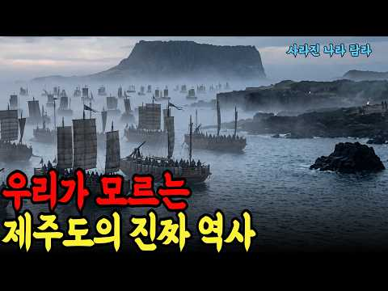
- 챕터: 0:00 비행기가 내려앉는 섬, 그리고 수평선을 채운 함대 · 2:00 바다는 국경이 아니라 길이었다 · 5:30 삼성혈 신화와 그 이면 · 9:00 주호와 오수전 - 이천 년 전의 연결 · 13:00 탐라라는 이름의 등장 · 16:30 사백칠십육년 백제 궁정의 은솔 · 21:00 동성왕이 함대를 돌린 날 · 25:30 백제 멸망과 신라 항복 · 30:00 일본으로 건너간 왕자들 · 35:00 고려 태조의 성주와 왕자 · 40:00 천백오년 나라에서 지방으로 · 45:00 삼별초 최후의 바다 · 51:00 원나라 직할령이 된 섬 · 57:00 말과 목호 그리고 백 년 · 63:00 천삼백칠십사년 명월포 · 69:00 조선 문서 한 장으로 끝난 천 년 · 75:00 탐라는 한국사인가 · 82:00 남아 있는 것들 · 88:00 다시 수평선 앞에서
- 설명 앞부분: 지금 우리는 제주를 대한민국의 아름다운 섬이라고 부릅니다. 그러나 천오백 년 전, 이 섬에는 왕이 있었습니다. 백제의 임금이 함대를 준비하다 되돌린 나라. 일본 조정에 왕자를 사신으로 보낸 나라. 당나라의 태산 의례 명단에 신라와 백제와 나란히 이름을 올린 나라. 고려가 자기 지방이 아니라 울타리 바깥의 나라라는 뜻으로 번국이라 부른 나라. 그 이름은 탐라였습니다. 이 영상은 삼성혈 신화에서 시작해, 백제와 신라와 일본과 당을 오간 탐라의 다변 외교, 고려 편입과 삼별초의 최후, 몽골 제국의 직할 지배와 목마장, 목호의 난, 그리…
- 같은 채널 평소 대비 ×17.6 (채널 최근 롱폼 중앙값 17,174회) · 평소 영상: 통일의 수도가 경주가 아니라 부여였다면 ∣ 백제 통일 시나리오 (18,619회) / 종소리 28번이 울리면 성문이 닫혔다 ∣ 조선의 밤이 무서웠던 진짜 이유 (15,730회)
- 대본 없음 (설명) — 음성인식이 끝나면 도입부·흐름이 들어감
- 댓글 34/38: 좋은 점 — 영상 2 · 감사·응원 0 · 더 알고 싶은 것 0 · 아쉬운 점 — 영상 0 · 반박·불만 — 의견 다름 0 · 정치·사회 2 · 경험 공유 0 · 구독·다음 기대 0
  - 좋은 점 — 영상 👍3 “제주도. 역사를 배웠습니다”
  - 정치·사회 👍5 “일본의 지금은 오키나와 섬 옛날엔 류큐 왕국. 그 류큐 왕국도 일본으로 강제 합병 되었고 , 일본 북쪽 홋카이도(북해도) 섬도 일본으로 강제 합병 되었죠 탐라국도 우리나라 아니었지만 한반도와 가까운 작은 섬이다 보니 백제로 자연스럽게 속하게 된것이죠. 탐라와 류큐가 …”

### 132. 가장 성실했던 황제가 나라를 잃었다｜중국 최악의 황제 7인의 진짜 이야기

- https://www.youtube.com/watch?v=_QI5NRqUqlU · 아시아 숨은 역사 · 구독자 3,520 · 조회수 192,827 (×54.8, 하루 4,708.7) · 좋아요 336 (0.2%) · 53.6분 · 2026-09-17 · 주제 묶음 11. 황제·왕·인물 · 형식 정보·해설 (그 밖) · 폴더 `W__QI5NRqUqlU` (웹 승인)
- 썸네일: 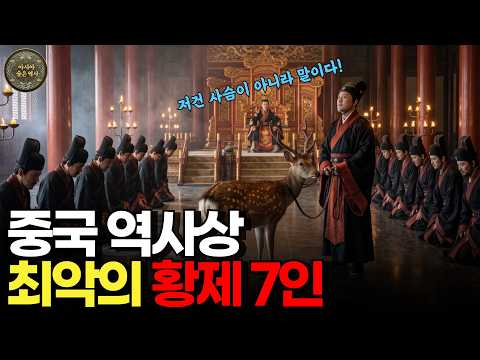
- 챕터: 0:00 1644년, 베이징이 불타던 새벽 · 3:46 이 채널을 함께 만들어 주시는 방법 · 4:11 최악이라는 말이 어려운 이유 · 5:49 진나라 호해 ― 생선 수레와 지록위마 · 16:44 수양제 양광 ― 대운하와 살수, 백만 대군의 끝 · 31:29 송휘종 ― 붓을 든 황제와 정강의 변 · 42:05 명 정덕제 ― 황제가 자리를 비우면 · 47:32 명 가정제 ― 신하를 이기고 국경을 잃다 · 54:29 명 만력제 ― 삼십 년의 침묵 · 60:54 명 숭정제 ― 가장 성실했던 마지막 황제 · 67:39 결론 ― 왜 아무도 그들을 멈추지 못했는가
- 설명 앞부분: 중국의 역사에는 이천 년 동안 수백 명의 황제가 있었습니다. 그중 몇 사람은 단 한 번의 판단으로 수백만 명의 운명을 바꿔 놓았습니다. 진나라 호해부터 명나라 숭정제까지, 왕조의 몰락과 가장 가까이 있었던 일곱 명의 황제를 기록에 남은 사실을 중심으로 따라갑니다. 술로 연못을 만들었다는 전설 대신, 몇 명이 동원되었고 무엇이 무너졌는지를 봅니다. 그리고 마지막에 이런 질문이 남습니다. 진짜 문제는 나쁜 황제가 나타났다는 사실이었을까요, 아니면 아무도 그를 멈출 수 없었다는 사실이었을까요. 참고한 기록 사기, 자치통감, 수서, 삼국…
- 같은 채널 평소 대비 ×89.2 (채널 최근 롱폼 중앙값 2,162회) · 평소 영상: 그는 왜 끝내 황제가 되지 않았을까 ∣ 간웅 조조, 66년의 기록 (2,358회) / 세계를 정복한 군대가 끝내 건너지 못한 강 ∣ 인도 5000년 역사 총정리 (1,967회)
- 대본 없음 (설명) — 음성인식이 끝나면 도입부·흐름이 들어감
- 댓글 27/27: 좋은 점 — 영상 1 · 감사·응원 1 · 더 알고 싶은 것 0 · 아쉬운 점 — 영상 0 · 반박·불만 — 의견 다름 0 · 정치·사회 4 · 경험 공유 0 · 구독·다음 기대 0
  - 감사·응원 👍0 “구독 좋아요 응원합니다 😊”
  - 정치·사회 👍3 “아무리 AI로 돌린다지만 역사영상에서 중국인 복장이 저게 맞나”
  - 정치·사회 👍0 “찢재명이란 역대 최악의 인물이 대통령이 된 이나라도 얼마나 갈지”

### 133. 국립현충원에서 가장 좋은 자리, 그 무덤의 주인은 조선의 궁녀였다

- https://www.youtube.com/watch?v=UAw390nt3vQ · 시간책방 · 구독자 8,850 · 조회수 581,334 (×65.7, 하루 11,745.0) · 좋아요 2,190 (0.4%) · 40.1분 · 2026-09-08 · 주제 묶음 3. 조선 · 형식 정보·해설 (그 밖) · 폴더 `W_UAw390nt3vQ` (웹 승인)
- 썸네일: 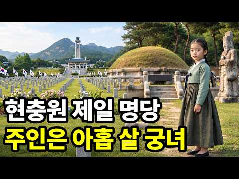
- 챕터: 0:00 현충원 안의 이상한 무덤 · 2:55 아홉 살에 궁으로 들어간 아이 · 5:15 궁녀라는 직업의 실체 · 8:50 아내를 이레 만에 내보낸 임금 · 13:35 승은, 그리고 더 위험해진 자리 · 16:50 경빈 박씨는 왜 죽었는가 · 18:55 왕이 죽고 궁을 나오다 · 28:00 18년 뒤, 손자가 왕이 되다 · 34:55 무덤이 먼저였다 · 37:00 조선 후기 340년의 시작점
- 설명 앞부분: 서울 동작구 국립서울현충원. 나라를 위해 목숨을 바친 분들이 잠든 그 언덕 한가운데에, 조선시대 무덤 하나가 남아 있습니다. 🌲 주인은 조선 11대 임금 중종의 후궁, 창빈 안씨입니다. 왕족도 아니었고 명문가의 딸도 아니었습니다. 가난한 집에서 태어나 아홉 살에 궁으로 들어간 어린 궁녀였습니다. 받은 것은 여럿이 나눠 쓰던 방 한 칸, 그리고 다달이 나오는 쌀 몇 말이었죠. 그 아이의 후손이 선조부터 순종까지 조선의 임금 열네 명입니다. 조선 500년 중 후반부 340년이 이 한 사람의 핏줄에서 나왔습니다. 🏯 이 영상에서는 조선…
- 같은 채널 평소 대비 ×370.7 (채널 최근 롱폼 중앙값 1,568회) · 평소 영상: 조선 왕들은 왜 46세에 죽었나? 경복궁 흙이 밝힌 충격적 진실 (1,641회) / 세조는 왜 친동생 안평대군을 죽였나? 조선 최고의 천재가 사라진 진짜 이유 (1,495회)
- 대본 없음 (설명) — 음성인식이 끝나면 도입부·흐름이 들어감
- 댓글 63/72: 좋은 점 — 영상 2 · 감사·응원 3 · 더 알고 싶은 것 0 · 아쉬운 점 — 영상 1 · 반박·불만 — 의견 다름 1 · 정치·사회 2 · 경험 공유 1 · 구독·다음 기대 0
  - 좋은 점 — 영상 👍5 “너무 소상히 알려주셔서 감사합니다.조선실록에 관심이 있었으나 안빈창씨라는것 후궁이었고 양주에서 이장해 동작동에모셨고훗날국립묘지에 최고의명당이고 후손들중14분이왕이되였다는설이 전부였답니다.유익한 정보 대단히 감사합니다. 의자리라는것”
  - 좋은 점 — 영상 👍2 “참좋은 정보 감사합니다 조용히 있는것 힘들것요 그동안 고생하셨습니다 편안하게 숴세요 담에 가면 인사드릴 고싶어요 ㅎ”
  - 감사·응원 👍5 “너무 소상히 알려주셔서 감사합니다.조선실록에 관심이 있었으나 안빈창씨라는것 후궁이었고 양주에서 이장해 동작동에모셨고훗날국립묘지에 최고의명당이고 후손들중14분이왕이되였다는설이 전부였답니다.유익한 정보 대단히 감사합니다. 의자리라는것”
  - 감사·응원 👍2 “참좋은 정보 감사합니다 조용히 있는것 힘들것요 그동안 고생하셨습니다 편안하게 숴세요 담에 가면 인사드릴 고싶어요 ㅎ”
  - 아쉬운 점 — 영상 👍3 “내용은 좋은 데 필요없는 말이 중복중복 지루하다”
  - 정치·사회 👍0 “대통령 묘소가 있는곶에 누구는 저자리엄두도 내지말야야지 무신말인지 알것주”
  - 정치·사회 👍0 “월래 주인빼고 6.25 참전용사 빼고 다른 사람이 모셔졌다면 옴겨야 한다 전직 대통령 이라 해도”
  - 경험 공유 👍1 “내가 조선의 궁녀다!”

### 134. 사극에서 절대 보여주지 않는 조선 노비의 진짜 밥상 ∣ 정사 ∣ 야사

- https://www.youtube.com/watch?v=N6THuYELTWU · 역사 만화경 · 구독자 572 · 조회수 119,797 (×209.4, 하루 750.7) · 좋아요 890 (0.7%) · 12.8분 · 2026-05-21 · 주제 묶음 3. 조선 · 형식 애니메이션·지도 · 폴더 `W_N6THuYELTWU` (웹 승인)
- 썸네일: 
- 설명 앞부분: 사극을 보면 노비는 늘 부엌 한구석에 쪼그려 앉아 있습니다. 주인상을 물리고 식은 밥 한 덩이를 급하게 삼키는 모습. 틀린 장면은 아닙니다. 하지만 그게 전부였을까요? 조선 시대, 사람 셋 중 하나는 누군가의 재산이었습니다. 그 수백만 명이 매일 아침 무엇으로 배를 채웠는지, 조선왕조실록과 고문서 속에 남은 기록을 통해 들여다봅니다. 주인과 똑같은 솥에서 밥을 푸던 노비가 있었고, 자기 땅에서 거둔 곡식으로 가족의 밥상을 차리던 노비도 있었습니다. 반대로, 풀뿌리와 나무껍질로 한 해를 버티다 끝내 흙을 퍼먹은 노비도 있었습니다. …
- 같은 채널 평소 대비 ×316.1 (채널 최근 롱폼 중앙값 379회) · 평소 영상: 감기 한 번에 가족을 잃던 시대 ∣ 조선시대 사람들은 아프면 어떻게 했을까? (379회) / 왕비가 된 지 3년 만에 사약을 받은 연산군의 어머니 폐비 윤씨의 처참한 최후 ∣ 조선왕… (263회)
- 대본 없음 (설명) — 음성인식이 끝나면 도입부·흐름이 들어감
- 댓글 161/162: 좋은 점 — 영상 1 · 감사·응원 8 · 더 알고 싶은 것 1 · 아쉬운 점 — 영상 2 · 반박·불만 — 의견 다름 4 · 정치·사회 9 · 경험 공유 5 · 구독·다음 기대 0
  - 좋은 점 — 영상 👍3 “그렇습니다 보리고개를 모르는사람들은 이해할수 없을것입니다 개떡과 겨빵을 먹어므ㅗ지않은사람들은 믿지못할것입니다 참 유익한 내용입니다 우리는 이시대에 감사함으로 살아야합니다 나누고 도우며 함께사는 마음을 지녀야합니다”
  - 감사·응원 👍24 “먹을것이풍족한시대,에태어난것만으로도축복이다.감사하면서사새요!”
  - 감사·응원 👍5 “모든 게 귀한 시절이었지요 잊혀져 가는 우리의 생활사 감사드립니다”
  - 아쉬운 점 — 영상 👍1 “아무리 찍어내는 ai라지만 제대로 분석좀 하고 올리셨으면 합니다 ai에 다시 검증 해봐 한줄만다시 적어도, 그리고 네이버에만 검색 해봐도 정확한 정보가 나오는데 잘못된 정보가 너무 많네요”
  - 반박·불만 — 의견 다름 👍0 “노비의 일상적인 밥은 보리밥에 고봉밥임... 죽 헛소리”
  - 정치·사회 👍4 “조선시대 세금은 양반.평민.노비 할것없이 5~10%였습니다.식사는 쌀이나 보리와함께 조.수수.피 등 을 혼합해서 먹었고 밥의 양 은 현대인의 3~4배 를 먹었습니다.이런 자료를 어디서 보고 영상 을 올렸는지 모르지만 가뭄에나 힘들었지 못먹고살지 않았습니다.나라에서 구…”
  - 정치·사회 👍4 “자기 동족을 노예로 부리는 나라가 조선”
  - 경험 공유 👍3 “'피죽도 못 먹은 얼굴'이라는 표현이 떠오르는 내용이네요. 벼들 사이로 삐죽 나온 볼품없는 풀떼기 같은 피를 다 먹었었다니 죽을 때까지 그런 배고픔은 안 겪고 싶다는.”
  - 경험 공유 👍0 “80년대 저희집시골논농사가 80마지기 넘게 농사를짓다보니 보리밥을 안먹어봄 지금도 부모님이 농사일하시는데 힘들어하시네요”

### 135. “아이언맨 슈퍼맨 다 필요없다” 미국에서 갑자기 역대급 이순신 대열풍이 일어난 이유

- https://www.youtube.com/watch?v=tZ6pzMh4JYU · 한반도 백과사전 · 구독자 5,070 · 조회수 194,984 (×38.5, 하루 6,649.9) · 좋아요 1,202 (0.6%) · 20.3분 · 2026-09-29 · 주제 묶음 3. 조선 · 형식 애니메이션·지도 · 폴더 `W_tZ6pzMh4JYU` (웹 승인)
- 썸네일: 
- 챕터: 0:00 단 1척으로 돌진한 이순신 · 0:55 백의종군과 칠천량 패전 · 2:46 명량해전 – 13척 vs 130여척 · 4:37 한산도대첩과 학익진 · 5:25 미국 만화가 온리 콤판과 스탠 리 · 9:31 사무라이와 다른 실존 영웅, 난중일기 · 11:34 넬슨과 나란히 선 조선의 제독 · 14:14 23전 23승과 거북선의 진실 · 16:42 LA에 놓인 거북선 · 18:05 미국인들이 이순신에게 열광하는 이유
- 설명 앞부분: 🇰🇷 "아이언맨 대신 이순신?" 미국 만화가가 17년 동안 이순신에 빠져있는 이유 드라마 〈불멸의 이순신〉을 보고 매료되어 17년째 미국에서 이순신 만화(《Yi Soon Shin》 시리즈)를 그리고 있는 미국 만화가 온리 콤판(Onrie Kompan). 출판사의 외면 속에서도 120개 이상의 컨벤션 현장을 발로 뛰며 25만 부 이상을 판매해 냈고, 마블의 거장 스탠 리(Stan Lee)조차 이순신의 삶에 감탄해 직접 양장본 서문을 써주었습니다. 2013년 유네스코 세계기록유산으로 등재된 《난중일기》 속에 적힌 군량미(둔전) 셈법,…
- 같은 채널 평소 대비 ×10.0 (채널 최근 롱폼 중앙값 19,549회) · 평소 영상: "한글날 100주년의 위대함" 외국인들이 줄 서서 한글을 배우는 진짜 이유 (19,549회) / “속도와 성질머리로 성공한 민족” 전세계 학자들이 분석하고 극찬한 한국의 진짜 성공 이유 (19,442회)
- 대본 없음 (설명) — 음성인식이 끝나면 도입부·흐름이 들어감
- 댓글 85/92: 좋은 점 — 영상 1 · 감사·응원 1 · 더 알고 싶은 것 0 · 아쉬운 점 — 영상 0 · 반박·불만 — 의견 다름 3 · 정치·사회 11 · 경험 공유 1 · 구독·다음 기대 0
  - 반박·불만 — 의견 다름 👍1 “누군가 영웅이 되려하면 정치공세가 장난아니죠”
  - 정치·사회 👍6 “이런 역사는 안 배우고, 518, 43....좌골병으로 나라가 뷸구가 되고 있다...😢”
  - 정치·사회 👍3 “난 그 포수가.. 조선의 정권에서 보냈다는게 훨신 확률이 높다... 고 생각한다.”
  - 경험 공유 👍0 “하나님이 세상을 이처럼 사랑하사 독생자를 주셧으니 이는 저를 믿는자마다 멸망치않고 영생을 얻게 하려 하심이라 요 3 :16 예수께서 이르시되 내가 곧 길이요 진리요 생명이니,나로 말미암지 않고는 아버지께로 올 자가 없느니라 요 14 : 6 수고하고 무거운 짐 진 자들…”

### 136. 여진 토멸 │ 고려의 여진 정벌, 전설이 된 척준경의 마지막 활약. AI 단편 사극 영화

- https://www.youtube.com/watch?v=VKwK-vwmKL8 · 쇠꼬비 검프  · 구독자 16,500 · 조회수 1,283,405 (×77.8, 하루 21,364.9) · 좋아요 6,943 (0.5%) · 58.9분 · 2026-08-29 · 주제 묶음 2. 한국 고대·삼국·고려 · 형식 정보·해설 (그 밖) · 폴더 `W_VKwK-vwmKL8` (웹 승인)
- 썸네일: 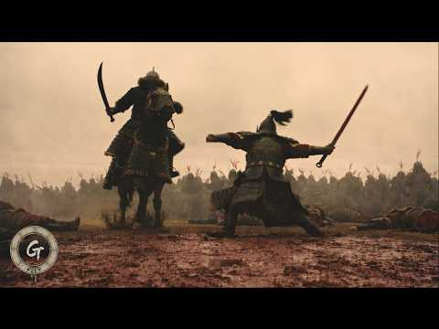
- 설명 앞부분: 척준경! 고려사를 넘어 한국사 최고의 소드마스터를 논할때 빠지지 않는 그 이름. 그러나 척준경이 등장한 사극은 2026년 기준 아예 없다시피 합니다. 뿐만 아니라 1107년부터 1109년까지 이어진 고려의 여진 정벌 역시 영상으로 다뤄진 사례가 거의 없습니다. 하여 많은 상상력과 각색을 가미하여, 1109년 공험진 전투와 갈라수 전투에서 고려군과 여진군이 벌인 대규모 전투, 그리고 갈라수 전투 패전 후 절체절명의 위기에 처한 고려를 구하기 위해 척준경과 결사대가 여진족과 벌인 처절한 사투를 58분에 걸친 긴 영상으로 제작했습니다.…
- 같은 채널 평소 대비 ×9.2 (채널 최근 롱폼 중앙값 140,244회) · 평소 영상: 매소성 전투 │ 당나라 대군을 갈아버린 신라의 분노. AI 단편 사극 영화 (210,906회) / 사수 전투 │ 고당전쟁 역사상 가장 위대했던 고구려와 연개소문의 승리. AI 단편 사극 … (276,363회)
- 대본 없음 (설명) — 음성인식이 끝나면 도입부·흐름이 들어감
- 댓글 1,373/1,426: 좋은 점 — 영상 11 · 감사·응원 49 · 더 알고 싶은 것 41 · 아쉬운 점 — 영상 17 · 반박·불만 — 의견 다름 20 · 정치·사회 37 · 경험 공유 17 · 구독·다음 기대 12
  - 좋은 점 — 영상 👍23 “작금의 대한민국에 이 시기를 관심 갖고 깊게 들여다본 사람이 아마 없겠지만 완안부 금나라 건국사를 깊게 파보면 영웅들 하나 하나가 진짜 말도 안되는 레전드 급이라서 그 개개인의 압도적인 실력, 집단의 완벽한 조직력을 마주하는 순간 몸에 전율이 돋을 정도임. 발흥해서 …”
  - 좋은 점 — 영상 👍12 “여진족 하면 흔히 생각하는 초원의 기마민족 이미지를 벗어나서 스스로의 근원을 숲이라 칭하는 부분의 대사가 아주 절묘합니다. 동북9성 위치상 여진족은 지금의 한반도 북부에 살아서 오히려 숲이 정서에 와닿았겠죠”
  - 감사·응원 👍28 “감사 합니다. 만드신분의 노고가 보이는 명작 입니다.”
  - 감사·응원 👍6 “지금까지 본AI 작품중 완성도 최고네요 일반 영화와 견주어도 손색이 없네요 우리 역사의 영웅들 계속 연재해주세요 는 응원할께요”
  - 더 알고 싶은 것 👍7 “다음 작품은 안시성전투 부탁합니다”
  - 더 알고 싶은 것 👍5 “와 굿 시간가는줄 모르고 감사 앞으로도 좋은작품 부탁드립니다. 이건 작품 아니 역사예술”
  - 아쉬운 점 — 영상 👍15 “퀄리티도 좋고 고증도 준수한데 싸우는 부분이 넘 판타지같네요 기병끼리 맞돌쳤는데 한놈만 쓸려나가든가, 철퇴한방에 고기 다짐육이 된다든가, 피가 너무 과하게 튄다던가 그런 부분이 아쉽네요.. 영상은 사극중 진짜 단연코 독보적인것 같습니다. 👍”
  - 아쉬운 점 — 영상 👍3 “AI티가 안 나네요. 서사, 연출, 음악, 감성 모두 좋네요....”
  - 반박·불만 — 의견 다름 👍23 “작금의 대한민국에 이 시기를 관심 갖고 깊게 들여다본 사람이 아마 없겠지만 완안부 금나라 건국사를 깊게 파보면 영웅들 하나 하나가 진짜 말도 안되는 레전드 급이라서 그 개개인의 압도적인 실력, 집단의 완벽한 조직력을 마주하는 순간 몸에 전율이 돋을 정도임. 발흥해서 …”
  - 반박·불만 — 의견 다름 👍7 “일단 직업이 방송 PD님이실 확률이 99%라고 생각합니다. ... 그게 아니면 일반인이 할수 있는 수준이 아닙니다. 너무 고퀄에 감동했습니다!!!”
  - 정치·사회 👍14 “고구려와발해의 천년동안 지배받다가 둘다멸망하고나니 드디어저들의 세상이 오는구나 청나라가 중국의 땅을너무 넓혀줘서 안따까울 뿐~”
  - 정치·사회 👍8 “동묘에 중국 관우사당 올리고 이나라가이모양임 척준경사당이나세워라”
  - 경험 공유 👍4 “너무 재밌다😢 수많은 역사 영화, 다큐멘터리, 드라마 본 제가 말씀드리자면 영화관에서 볼 최고급 퀄리티네요.”
  - 경험 공유 👍4 “정말 훌륭한 작품이네요! 이런 영상을 오랫동안 기다려왔거든요! 다만 몇 가지 사소한 점이 눈에 띄긴 합니다. 등장인물들이 만주어를 쓰나요, 아니면 중세 여진어를 쓰나요? 소리가 몽골어의 영향을 많이 받은 듯해 만주어 같기도 한데, 발음이 가끔 좀 '어색'하게 들리기도…”
  - 구독·다음 기대 👍9 “AI 안써본 분들이 너무 많으신것 같은데, 이건 진짜 이 분이 정말 잘만드신 거에요. 대단한 실력입니다. 엄청나네요. 비주얼도 물론이지만 스토리도 완성도도 엄청나요. 잘보고 갑니다. 구독해놓고 올리실때마다 챙겨볼께요!”
  - 구독·다음 기대 👍6 “57:32 이장면 썸내일로 사용했으면 간지났을듯요 (현재 4번째 정주행중)”

### 137. 조선 과부의 삶｜남편을 잃은 조선 여인들은 대체 어떻게 살아남았을까?

- https://www.youtube.com/watch?v=LhuDHX7Mx38 · 숨은 조선사 · 구독자 404 · 조회수 41,103 (×101.7, 하루 513.7) · 좋아요 490 (1.2%) · 15.4분 · 2026-08-09 · 주제 묶음 3. 조선 · 형식 정보·해설 (그 밖) · 폴더 `W_LhuDHX7Mx38` (웹 승인)
- 썸네일: 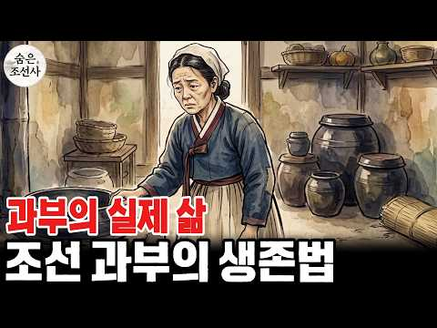
- 설명 앞부분: 남편을 잃은 조선시대 여성들은 어떻게 살아남았을까요? 조선의 과부에게 남편의 죽음은 단순한 슬픔이 아니라 생존과 재혼, 자식의 미래까지 걸린 가혹한 현실이었습니다. 성리학과 삼종지도, 성종 시대 강화된 재혼 억제 정책과 재가자손금고법, 열녀와 정려문 제도부터 생계를 위해 농사와 삼베 짜기, 삯바느질, 장사까지 감당해야 했던 이름 없는 여성들의 삶을 따라갑니다. 또한 정약용과 박지원의 비판, 병자호란 이후 여성들이 겪은 고통, 과부들의 민원과 생존 방식, 그리고 1894년 동학농민운동과 갑오개혁을 거치며 재혼의 자유가 인정되기까지의…
- 같은 채널 평소 대비 ×69.7 (채널 최근 롱폼 중앙값 590회) · 평소 영상: 조선 과거 시험의 모든 것, 21만 명이 몰려 목숨 걸고 싸웠던 충격적인 그날 (590회) / 400년 전 조선 사람들은 밥상에 뭘 올리고 살았을까? 왕과 백성의 식탁 차이 (528회)
- 대본 없음 (설명) — 음성인식이 끝나면 도입부·흐름이 들어감
- 댓글 24/24: 좋은 점 — 영상 0 · 감사·응원 1 · 더 알고 싶은 것 0 · 아쉬운 점 — 영상 0 · 반박·불만 — 의견 다름 1 · 정치·사회 0 · 경험 공유 0 · 구독·다음 기대 0
  - 감사·응원 👍1 “166번째 like 👍 감사합니다요 ! 항상 건행하십시요 !”
  - 반박·불만 — 의견 다름 👍8 “유교사상이 세상에 전부는 아닌데 참 답답한 조선시대”

### 138. 최강 일본도를 깨부순 조선의 무기, 그건 농기구였다.

- https://www.youtube.com/watch?v=VU7nOsg3tDw · 피의역사썰 · 구독자 3,070 · 조회수 277,951 (×90.5, 하루 3,856.6) · 좋아요 1,393 (0.5%) · 12.8분 · 2026-08-17 · 주제 묶음 3. 조선 · 형식 정보·해설 (그 밖) · 폴더 `W_VU7nOsg3tDw` (웹 승인)
- 썸네일: 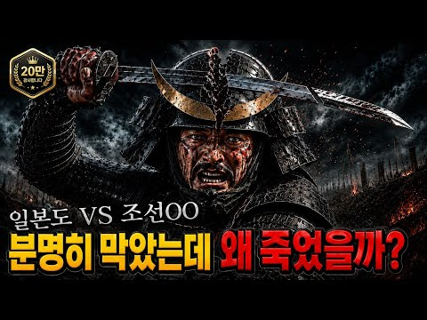
- 설명 앞부분: 1592년, 경기도 고양 땅에 명회라는 농부가 있었습니다. 벼슬도 없고 무예를 배운 적도 없는 사람이었습니다. 그는 눈앞에서 아버지가 일본군의 칼에 쓰러지는 것을 보았지만, 그의 집에는 칼도 활도 없었습니다. 마당을 훑던 그의 시선이 멈춘 곳에는 평생 붙잡고 살아온 나무 도리깨 한 자루가 세워져 있었습니다. "칼을 쥐여 줘도 쓸 줄 모르는 것이 가장 큰 문제였는데, 도리깨질은 백성이라면 누구나 한다." 쇠를 천 겹으로 접고 진흙을 발라 담금질한 동양 최고의 칼, 일본도. 그 앞에 조선이 내민 것은 가을 마당에서 보리를 두들기던 농…
- 같은 채널 평소 대비 ×210.4 (채널 최근 롱폼 중앙값 1,321회) · 평소 영상: 조선 역사 최초로 한양까지 점령한 반란ㅣ아들을 지키기 위해서였다. (1,321회) / 대하드라마 문무 예습 필수! 연개소문은 어떻게 권력을 잡았나? (1,324회)
- 대본 없음 (설명) — 음성인식이 끝나면 도입부·흐름이 들어감
- 댓글 230/230: 좋은 점 — 영상 2 · 감사·응원 5 · 더 알고 싶은 것 3 · 아쉬운 점 — 영상 3 · 반박·불만 — 의견 다름 8 · 정치·사회 6 · 경험 공유 3 · 구독·다음 기대 0
  - 좋은 점 — 영상 👍16 “임진왜란이후 정조의 명으로 편찬된 무예도보통지에 보면은 기마병들은 활,화살,환도,편곤이 필수 무장이었죠 임란때 편곤의 위력을 실감하곤 이후 필수템이 된거임 안되면 되는방법을 찿았던 선조들의 지혜를 볼수있네요 좋은영상 잘봤습니다^^ 우리역사속 활의 활약상도 기대해 봅니…”
  - 감사·응원 👍1 “재미있게 잘 보았습니다 감사합니다 ^^”
  - 감사·응원 👍1 “명희명인 조상님 감사합니다”
  - 아쉬운 점 — 영상 👍48 “멋진 내용 잘봤습니다 근데 농부들이 도리깨를 곡괭이처럼 사용하는 부분은 좀아쉽네요^^”
  - 아쉬운 점 — 영상 👍0 “도리깨를 남자들이 사용하는 방법은 끝이 회전을 하면서 가속도를 이용하여 타격을 하고, 여자들은 원투낚시 할 때 처럼 뒤로 살짝 제쳐졌다고 다시 앞으로 가속도를 주면서 타격을 하더라 난 고등학생때에 사용했는데 남자들이 사용하는 방법으로는 도리깨가 무거워서 하지 못하고 …”
  - 반박·불만 — 의견 다름 👍6 “칠지도는 의례용 칼이였고 일본 카타나는 중국 당나라의 기술과 영감을 받은 칼입니다. 대륙과 반도에서 전해진 것은 맞습니다.전적으로 우리나라에서 건너 갔다는 이야기는 아니죠.”
  - 반박·불만 — 의견 다름 👍2 “일본도는 잘부러지는게 아니고 잘휩니다. 부러지는건 잘못제작된겁니다. 게다가 속에 들어가는 쇠와 바깥에 쓰는쇠가 다릅니다. 그리고 환도역시 하몬이라는 외부 연마를 안했을뿐이라 나오지않은것뿐입니다. 그리고 칼이 짧기때문에 부러지는 일이 적은데다 전투에 적합하지않아 노획해…”
  - 정치·사회 👍2 “150년간 전쟁만 하며 전쟁 기술을 연마하던 나라가 200년간 전쟁 없이 살던 나라를 침략해서 이기지 못하고 전멸하다 시피하며 도망간게 임진 왜란이다. 그만큼 일본은 한심했고, 우리는 허술해 보였지만 강했다. 이건 즉 우리가 마음만 먹으면 얼마든지 일본을 침략해서 식…”
  - 정치·사회 👍1 “도래인들이 만든 나라가 일본 이라해도 무방할것 같습니다. 일본인이쓴 일본사기에 토착왜인들보다 도래인이 많았다고기록. 일 교토 전방후원고분, 전남해안가 전방후원고분. 북 함경도,거제도,울산,부산,전남,제주 삼한시대 토착왜인들이 살았던 지역.”
  - 경험 공유 👍3 “제가 생각해도 일본인 중 동양인 외모에 훤칠하고 체격 좋고 덧니 심하게 없는 사람 조상은 일본으로 넘어간 백제인일 확률이 꽤 높다고 생각합니다..”

### 139. 조선에서 가장 잊힌 왕, 정말 무능하고 나약했던 왕일까? ∣ 역사이야기

- https://www.youtube.com/watch?v=LZQFW5QA-BM · 숨겨진 역사 서재 · 구독자 890 · 조회수 26,499 (×29.8, 하루 1,060.8) · 좋아요 115 (0.4%) · 72.2분 · 2026-10-03 · 주제 묶음 1. 역사 일반·이야기 · 형식 정보·해설 (그 밖) · 폴더 `W_LZQFW5QA-BM` (웹 승인)
- 썸네일: 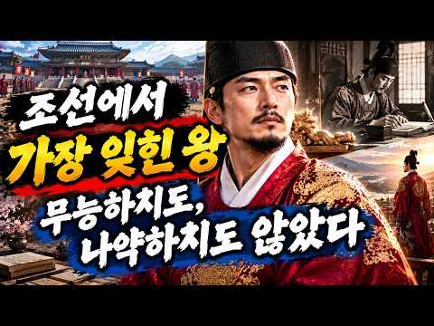
- 챕터: 0:00 효종의 죽음과 19세 현종의 즉위 · 3:06 심양에서 태어난 왕세자의 특별한 출생 배경 · 10:26 첫 번째 예송과 현종의 왕권 논쟁 · 22:32 두 번째 예송과 현종의 정치적 대응 · 32:29 경신대기근과 ‘100만 명 사망설’의 진실 · 44:23 혼천시계·대동법 등 현종 시대의 업적 · 50:22 현종이 후궁을 두지 않았던 이유에 대한 여러 해석 · 57:30 두 딸의 죽음과 현종 가족의 비극 · 62:55 현종실록과 현종개수실록, 기록이 엇갈린 이유
- 설명 앞부분: 조선에서 가장 잊힌 왕, 정말 무능하고 나약했던 왕일까? ∣ 역사이야기 👑 조선의 왕 현종은 왜 15년 동안 후궁을 두지 않았을까요? 이번 역사이야기에서는 현종의 즉위부터 예송 논쟁, 경신대기근, 그리고 왕실의 비극까지 핵심 사건을 짚어봅니다. 📜 특히 후궁을 두지 않은 이유에 대해서는 기록과 여러 해석을 바탕으로 당시의 시대적 배경을 살펴봅니다. 역사이야기를 통해 우리가 익숙하게 알고 있던 현종의 이미지를 다시 바라봅니다. 🔎 두 차례 예송에서 드러난 왕권의 문제와 현종실록·현종개수실록이 남긴 서로 다른 기록도 함께 확인합니다.…
- 같은 채널 평소 대비 ×13.1 (채널 최근 롱폼 중앙값 2,020회) · 평소 영상: 조선 519년, 전쟁보다 무서웠던 ‘단 하나의 선택’은? ∣ 한국사 ∣ 숨겨진 역사 서재 (2,190회) / [고려 500년] 조선보다 잊힌 나라, 8명의 증인이 밝히는 고려의 진짜 역사｜역사이야기 (1,851회)
- 대본 없음 (설명) — 음성인식이 끝나면 도입부·흐름이 들어감
- 댓글 5/5: 좋은 점 — 영상 0 · 감사·응원 0 · 더 알고 싶은 것 0 · 아쉬운 점 — 영상 0 · 반박·불만 — 의견 다름 0 · 정치·사회 0 · 경험 공유 0 · 구독·다음 기대 0

### 140. 호랑이와 산적이 득실대던 조선시대, 사람들은 어떻게 수백 리를 여행했을까?

- https://www.youtube.com/watch?v=gAJcgExhsio · 신박한 호기심 · 구독자 1,680 · 조회수 80,531 (×47.9, 하루 1,999.5) · 좋아요 206 (0.3%) · 13.2분 · 2026-09-18 · 주제 묶음 3. 조선 · 형식 야담·옛날이야기 · 폴더 `W_gAJcgExhsio` (웹 승인)
- 썸네일: 
- 챕터: 0:00 호랑이와 산적이 있던 조선의 고갯길 · 1:30 조선시대에는 정말 짐마차로 여행했을까? · 4:30 산길에서 마주친 가장 무서운 위험 · 8:00 나그네와 상인들은 어떻게 고개를 넘었을까? · 12:00 말과 짐을 지키며 이동하는 방법 · 15:30 호랑이를 잡았던 조선의 착호갑사 · 18:30 조선의 역(驛)과 원(院) · 22:00 이태원·조치원·퇴계원·장호원에 남은 흔적 · 24:30 목숨을 걸어야 했던 조선의 장거리 여행
- 설명 앞부분: 자동차도, 가로등도, 휴대전화도 없었던 조선시대. 한양에서 지방으로 가기 위해서는 문경새재·죽령·추풍령·대관령 같은 험준한 고갯길을 넘어야 했습니다. 산속에는 호랑이와 같은 맹수가 있었고, 길목에서는 산적과 화적의 위험도 피해야 했습니다. 그렇다면 상인과 나그네들은 귀중한 짐을 싣고 어떻게 수백 리의 먼 길을 이동했을까요? 이번 영상에서는 조선시대 사람들이 실제로 이용했던 말과 짐 운송 방식, 험난했던 고갯길, 역(驛)과 원(院), 숙박과 휴식, 호랑이와 산적의 위협, 그리고 국가의 대응까지 조선시대 장거리 여행의 모습을 하나씩 …
- 같은 채널 평소 대비 ×36.7 (채널 최근 롱폼 중앙값 2,196회) · 평소 영상: 조정의 지원 없이 버틴 이순신 수군… 난중일기의 여성 ‘여진’은 누구였나? (2,646회) / 조선시대 사형수 가족들은 왜 망나니에게 돈을 바쳤을까? ∣ 조선의 사형 집행인 이야기 (2,659회)
- 대본 없음 (설명) — 음성인식이 끝나면 도입부·흐름이 들어감
- 댓글 8/8: 좋은 점 — 영상 0 · 감사·응원 0 · 더 알고 싶은 것 0 · 아쉬운 점 — 영상 0 · 반박·불만 — 의견 다름 0 · 정치·사회 0 · 경험 공유 0 · 구독·다음 기대 0

### 141. 밥값만 내면 하룻밤은 공짜? 조선시대 주막의 놀라운 비밀l사라진 줄 알았던 조선 주막ㅣ마지막 주모가 남긴 이야기, 삼강주막

- https://www.youtube.com/watch?v=f0eYMCDmOyM · 어게인역사 · 구독자 6,070 · 조회수 728,704 (×120.0, 하루 7,181.3) · 좋아요 1,644 (0.2%) · 20.9분 · 2026-07-18 · 주제 묶음 3. 조선 · 형식 정보·해설 (그 밖) · 폴더 `W_f0eYMCDmOyM` (웹 승인)
- 썸네일: 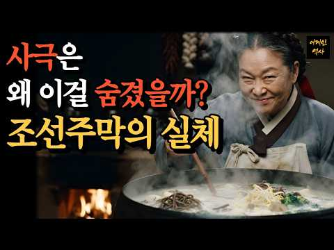
- 챕터: 0:00 밥값만 내면 잠은 공짜였던 조선 주막 · 1:27 주막의 간판 '용수'와 김홍도가 그린 풍경 · 3:13 국영 숙소 '원' … 이태원·조치원 지명의 비밀 · 5:59 잠은 공짜? 주모의 기막힌 장사 수완 · 8:53 봉놋방, 조선의 뉴스룸이 되다 · 12:29 40도 찜통방에서 낯선 이들과 보낸 하룻밤 · 16:36 사라진 주막, 그리고 오늘의 찜질방·포장마차
- 설명 앞부분: 🏮 밥값 한 그릇이면, 하룻밤 잠은 공짜였습니다. 호텔도 여관도 민박도 없던 조선. 하루 팔십 리를 걸어온 나그네들은 대체 어디서 먹고, 자고, 하룻밤을 견뎠을까요? 장대 끝에 걸린 '용수' 하나가 간판이자 네온사인이었고 🪔 낯선 사람 열 명이 한 방에 뒤엉켜 자던 '봉놋방'은 신문도 우체국도 없던 시대의 뉴스룸이었습니다. 📮 김홍도의 풍속화 속 그 주막부터, 이태원·조치원 지명에 숨은 국영 숙소 '원'의 비밀, 40도 찜통방에서 하룻밤을 보낸 서양 여행가의 생생한 기록, 그리고 예천 강가에 마지막까지 남았던 삼강주막까지 🌿 오늘…
- 같은 채널 평소 대비 ×517.7 (채널 최근 롱폼 중앙값 1,408회) · 평소 영상: 물 한 모금도 무서워한 덕혜옹주… 고종은 정말 독살당했을까? ∣ 그날 밤 궁에 있던 어의… (1,444회) / 오늘 아침 쓴 그 비누 / 시작은 조선 궁녀였다 ㅣ삼천 명이 살던 궁궐 / 화장실은 단 … (1,371회)
- 대본 없음 (설명) — 음성인식이 끝나면 도입부·흐름이 들어감
- 댓글 92/106: 좋은 점 — 영상 4 · 감사·응원 2 · 더 알고 싶은 것 1 · 아쉬운 점 — 영상 3 · 반박·불만 — 의견 다름 1 · 정치·사회 1 · 경험 공유 6 · 구독·다음 기대 2
  - 좋은 점 — 영상 👍7 “아주 유익한 콘텐츠입니다.”
  - 좋은 점 — 영상 👍3 “정말 좋은 영상 잘 봤습니다. 추천 구독 하고 갑니다. !!”
  - 감사·응원 👍0 “이런분들이 있었기에 지금에 이나라가 있었던거 아니겠습니까 정말 고생많으셨어요 고맙습니다”
  - 더 알고 싶은 것 👍1 “이런 동영상 어떻게 만드나요? 전용 동영상 소프트웨어?”
  - 아쉬운 점 — 영상 👍2 “주막이나 그런건 아니고 섬에 낚시하러 오신 손님들에 돈과 물고기받고 방을 내어주신 저희 할머니와 할아버지 주변 할머님 할아버님들이 생각납니다”
  - 아쉬운 점 — 영상 👍0 “어그로 제일 싫어하는데 멀 놀라 ㅡ.ㅡ”
  - 반박·불만 — 의견 다름 👍46 “주막은 아닌데요 90년대초 할머니 빨간고무 대야에 오징어,고등어 ...메고 5km정도 그중 산길1km들고와서 생선팔고 저녁때 깜깜한데 가시고 가끔 울집서 고등어 몇마리 주시고 저녁 드시고 가심 비오거나 날씨 안좋을땐 주무시고 가셨음 항상 울집에서만 주무시고 가시고했었…”
  - 정치·사회 👍0 “이런분들이 있었기에 지금에 이나라가 있었던거 아니겠습니까 정말 고생많으셨어요 고맙습니다”
  - 경험 공유 👍46 “주막은 아닌데요 90년대초 할머니 빨간고무 대야에 오징어,고등어 ...메고 5km정도 그중 산길1km들고와서 생선팔고 저녁때 깜깜한데 가시고 가끔 울집서 고등어 몇마리 주시고 저녁 드시고 가심 비오거나 날씨 안좋을땐 주무시고 가셨음 항상 울집에서만 주무시고 가시고했었…”
  - 경험 공유 👍2 “주막이나 그런건 아니고 섬에 낚시하러 오신 손님들에 돈과 물고기받고 방을 내어주신 저희 할머니와 할아버지 주변 할머님 할아버님들이 생각납니다”
  - 구독·다음 기대 👍6 “와~~ 이제야 봤네요 참 고급지고 재밌네요 좋아요 꾹~ 구독박고 갑니다 지난 영상들도 찾아봐야겠습니다 찾아봐야겠습니다”
  - 구독·다음 기대 👍0 “잘 몰랐던 역사 뒷얘기가 유익하고 재미있네요. 구독하고 갑니다. 참, 최근 건축과 관련인 ai쇼츠가 유행인데, 거기완 상관이 없는건가요? 목소리가 비슷해서요. 목소리도 AI인가요?”

### 142. 역사상 가장 악명 높았던 독재자들은 어떻게 최후를 맞이했을까?

- https://www.youtube.com/watch?v=O_KWOoiOj3I · 크로니클 · 구독자 3,640 · 조회수 316,190 (×86.9, 하루 4,280.8) · 좋아요 1,782 (0.6%) · 19.9분 · 2026-08-15 · 주제 묶음 1. 역사 일반·이야기 · 형식 정보·해설 (그 밖) · 폴더 `W_O_KWOoiOj3I` (웹 승인)
- 썸네일: 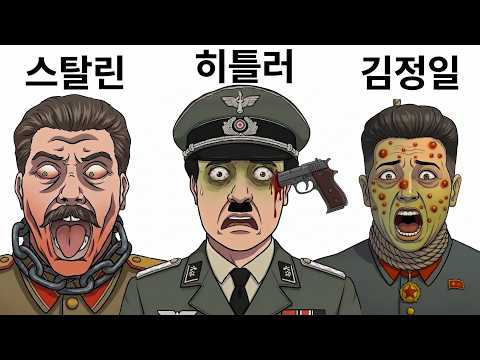
- 챕터: 0:00 권력의 정점에서 시작된 몰락의 이야기 · 0:26 아돌프 히틀러, 벙커 속에서 맞이한 제국의 마지막 순간 · 2:12 베니토 무솔리니, 도망자의 끝과 무너진 권력 · 4:21 김정일, 최고 권력자의 갑작스러운 마지막 순간 · 6:19 스탈린, 공포 정치 뒤 찾아온 의문의 결말 · 8:33 트루히요, 독재자의 암살과 권력의 붕괴 · 10:03 차우셰스쿠, 국민 앞에서 끝난 독재 정권 · 11:47 폴 포트, 비극의 시대가 남긴 역사적 평가 · 13:29 사담 후세인, 체포와 재판 그리고 마지막 선택 · 14:55 카다피, 도주 끝에 맞이한 비극적인 최후 · 16:43 피노체트, 권력 이후 남겨진 역사적 판단
- 설명 앞부분: 👑 한때 세상을 지배했던 절대 권력자들은 왜 마지막 순간 모든 것을 잃었을까요? 이번 영상에서는 역사 속 독재자들의 최후와 권력 몰락의 과정을 따라가며, 독재자의 최후, 독재자의 최후, 독재자의 최후 속에 숨겨진 충격적인 역사적 순간들을 살펴봅니다. 🔎 이번 영상에서 만나볼 주요 내용 권력은 영원할 수 있을까요? 역사 속 인물들의 선택과 결과를 통해 권력의 의미와 교훈을 함께 확인해 보세요. 면책 조항 이 영상은 여러분에게 즐거움과 유익한 정보를 전달하고, 궁금증을 불러일으키기 위한 목적으로 제작되었습니다. 최대한 정확한 정보를 …
- 같은 채널 평소 대비 ×24.0 (채널 최근 롱폼 중앙값 13,156회) · 평소 영상: 역사상 가장 악명 높은 폭군들은 어떻게 죽었을까? (13,156회) / 전설적인 탐험가들은 어떻게 죽었을까? (11,548회)
- 대본 없음 (설명) — 음성인식이 끝나면 도입부·흐름이 들어감
- 댓글 309/311: 좋은 점 — 영상 0 · 감사·응원 1 · 더 알고 싶은 것 2 · 아쉬운 점 — 영상 8 · 반박·불만 — 의견 다름 2 · 정치·사회 43 · 경험 공유 10 · 구독·다음 기대 2
  - 더 알고 싶은 것 👍15 “연임을 꿈꾸는 독재자 리짜이밍의 최후는 어떨지 다뤄주세요”
  - 아쉬운 점 — 영상 👍54 “확대 되는거 반복되니 어지러워요 ㅠ”
  - 아쉬운 점 — 영상 👍14 “독재자중 히틀러에 대한 학술적인 용어가 있네요. 레드억트 오류(Reductio ad Hitlerum)라고 합니다. "히틀러도 그렇게 생각했다", "히틀러와 비슷하다"는 이유만으로 상대방의 주장이나 존재 자체를 악으로 몰아붙이는 수법을 말하지요. 라틴어로 '히틀러로의 …”
  - 반박·불만 — 의견 다름 👍1 “히틀러는 독재자가 아닙니다 ㅋㅋ”
  - 정치·사회 👍4 “종중반국가내란수괴 *이재명*”
  - 정치·사회 👍4 “인류역사상 최초로 , 대통령이 뇜물먹고 하늘에서 거꾸로떨어져 .머리트져 다이이진 독재자가 한국에도 있었는데 ㅋㅋㅋ”
  - 경험 공유 👍1 “지미 카터:내가 미국의 대통령일때는 독재자의 절반을 몰살했지 물론 늙어서도 말이야”

### 143. [숨겨진 중국사] 제갈량보다 무서웠던 중국 최고의 책사 다섯명, 진짜 1위는? ∣ 역사인물 ∣ 야사 ∣ 비사

- https://www.youtube.com/watch?v=3fmE-O13adY · 숨겨진중국사 · 구독자 12,800 · 조회수 304,932 (×23.8, 하루 15,043.9) · 좋아요 1,009 (0.3%) · 43.9분 · 2026-10-08 · 주제 묶음 6. 동양사 (중국·일본·몽골) · 형식 정보·해설 (그 밖) · 폴더 `W_3fmE-O13adY` (웹 승인)
- 썸네일: 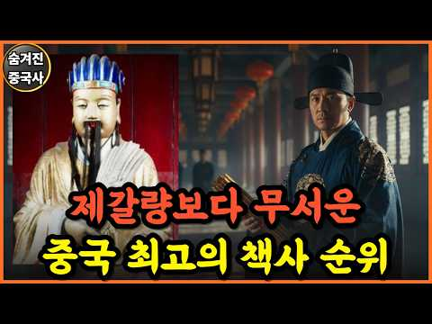
- 설명 앞부분: 제갈량이 중국사 책사 순위 5위 안에 들지 못한 이유를 정사 기록으로 따라갑니다. 한나라의 숨통을 끊고도 77세까지 살아남은 가후, 승려의 몸으로 황제를 갈아 끼운 요광효, 죽으며 8년 뒤를 정확히 맞힌 왕맹, 밥상 하나로 항우의 오른팔을 떼어 낸 진평, 그리고 천하를 만들고 스스로 물러난 장량. 다섯 책사의 계책과 말년을 순서대로 짚으면 책사의 등급을 가르는 기준이 드러납니다. 여러분이 꼽는 1위는 누구인지 댓글에 남겨 주세요. 저희는 숨겨진 역사를 재미있고 정확한 한 편의 이야기로 풀어내고자 영상을 만들고 있습니다. "매주 화…
- 같은 채널 평소 대비 ×24.3 (채널 최근 롱폼 중앙값 12,528회) · 평소 영상: [숨겨진 중국사] 고려가 이방인을 삼키는 방법 ∣ 역사인물 ∣ 야사 ∣ 비사 (12,553회) / [숨겨진 중국사] 청나라가 없었다면 지금의 중국도 없었다.. 소수민족한테 다 주면 남는 … (12,502회)
- 대본 없음 (설명) — 음성인식이 끝나면 도입부·흐름이 들어감
- 댓글 97/154: 좋은 점 — 영상 4 · 감사·응원 1 · 더 알고 싶은 것 0 · 아쉬운 점 — 영상 0 · 반박·불만 — 의견 다름 2 · 정치·사회 0 · 경험 공유 3 · 구독·다음 기대 0
  - 좋은 점 — 영상 👍4 “처음부터 끅까지 제갈량으로 시작해서 제갈량으로 맺었다 고로 제갈량이 1st 임 그는 레전드고 정석이다”
  - 좋은 점 — 영상 👍2 “정사만으로 제갈량 깎아내리는 사람이 많은데 진수가 촉에 악감정이 있어 당연히 좋은 이야기 쓸 이유가 없었겠지 역사는 승자의 기록이라 어쩔수 없는 결과라지만 나관중의 소설은 그냥 소설로 넘어가는게 맞고 정사도 그대로 믿기 힘들다는건 인정하고 가야함”
  - 감사·응원 👍1 “안녕하세요 구독과 좋아요 꾹꾹 누르고 시청하고 있습니다 유익한 역사정보 감사드립니다 아울러 선생님 사업과 채널도 번창하세요”
  - 반박·불만 — 의견 다름 👍3 “웃기는 개소리다 환경이 다르다 웃기는소리,ㅡ 하지 말기”
  - 경험 공유 👍1 “처음에는 예전에 존경하던 제갈량을 약간 뒤로 놓는 느낌이라 거부감 있었는데, 마지막 결론을 보니 납득이 되긴 하네요. 사실 인문학에 대해 불신 심한 상태로 측정은 정확하게 해야한다고 생각하는 직업병 있는 입장에서 삼국지 내에서도 가후가 평가가 후하다는 것 알고 있기에…”
  - 경험 공유 👍1 “순위 라고 돼 있길래 난 내가 모르는 순씨 일족인 줄 알았지…… 순욱, 순유, 순위 …… 이렇게 ㅋㅋㅋ 😅”

### 144. 조선시대 역적으로 몰린 양반 아내들, 노비로 전락한 충격적인 진실

- https://www.youtube.com/watch?v=mHF_-cRLwGQ · 조선 왕조의 비밀 · 구독자 1,530 · 조회수 208,707 (×136.4, 하루 1,786.4) · 좋아요 2,097 (1.0%) · 26.2분 · 2026-06-28 · 주제 묶음 3. 조선 · 형식 정보·해설 (그 밖) · 폴더 `W_mHF_-cRLwGQ` (웹 승인)
- 썸네일: 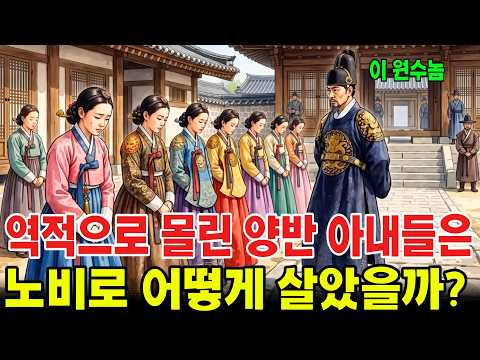
- 설명 앞부분: 조선 시대 의금부 앞마당에서 벌어진 사육신 관련 여인들의 비극적 사건을 다룬 영상입니다. 단종 복위 사건 이후 남편을 잃은 353명의 여성들이 원수의 집으로 끌려가 노비로 전락하는 충격적인 현실 속에서, 한 이름 없는 여종이 모든 것을 바꿀 운명의 선택을 하게 됩니다. 이번 영상에서는 조선의 연좌제, 노비 제도, 그리고 인간의 존엄이 무너진 시대 속에서도 살아남기 위해 싸운 여성들의 처절한 생존 이야기를 깊이 있게 다룹니다. 특히 역사 속에서 기록되지 못한 한 여종의 희생과 기적 같은 결과는 큰 여운을 남깁니다.
- 같은 채널 평소 대비 ×1,048.8 (채널 최근 롱폼 중앙값 199회) · 평소 영상: 20살 천재 왕｜즉위 14개월 만에 갑자기 죽은 충격적인 이유는 무엇이었나? (212회) / 조선 중전의 실제 하루｜가장 부러운 자리에 앉았지만 누구보다 외롭게 살았던 왕비 (186회)
- 대본 없음 (설명) — 음성인식이 끝나면 도입부·흐름이 들어감
- 댓글 146/146: 좋은 점 — 영상 0 · 감사·응원 0 · 더 알고 싶은 것 0 · 아쉬운 점 — 영상 8 · 반박·불만 — 의견 다름 1 · 정치·사회 8 · 경험 공유 0 · 구독·다음 기대 0
  - 아쉬운 점 — 영상 👍4 “자막좀정리”
  - 아쉬운 점 — 영상 👍3 “맞춤법도 안맞는 자막좀 치워라. 짜증난다.”
  - 반박·불만 — 의견 다름 👍0 “세월이 좋아 역적 석열이와 그무리들은 국민세금으로 잘먹고 잘살고 있는게 어이없다”
  - 정치·사회 👍2 “중국인이 운영하는 유튜브는 시청하지 맙시다”
  - 정치·사회 👍2 “조선은 빨리 망했어야 함 동족을 노비로 삼는 나라가 어디 있나”

### 145. [조선 다잇소] 3화 : 편전에서 쓰러진 세종대왕, 조선 제일검 앞에서도 주사기를 꺼내든 이유

- https://www.youtube.com/watch?v=AAyf0Os9xt0 · 다잇소 스튜디오 · 구독자 1,410 · 조회수 30,202 (×21.4, 하루 1,644.7) · 좋아요 222 (0.7%) · 8분 · 2026-10-10 · 주제 묶음 3. 조선 · 형식 정보·해설 (그 밖) · 폴더 `W_AAyf0Os9xt0` (웹 승인)
- 썸네일: 
- 챕터: 0:00 자꾸만 어긋나는 물시계, 장영실의 깊은 고뇌 · 1:03 물길을 여닫는 마법? 현대식 '볼탑 밸브'의 등장 · 2:45 현우의 당돌한 제안 "한양에 다잇소를 열고 싶사옵니다" · 3:55 갑자기 편전에서 쓰러진 세종대왕 (소갈증 쇼크) · 4:31 "멈춰라!" 정체불명의 기물을 막아선 호위관 무명 · 6:40 세종을 살려낸 마운자로와 현대의 혈당 측정기 · 7:44 [4화 예고] 다잇소 첫날 밤 남겨진 수상한 은괴
- 설명 앞부분: 어긋나는 자격루의 물길 때문에 깊은 시름에 빠진 조선 최고의 천재 장영실! 현우가 초록색 장바구니에서 꺼낸 단돈 2천 원짜리 '볼탑 밸브'가 조선 유체역학의 흐름을 단숨에 통제해 버린다?! 기물이 스스로 물길을 여닫는 마법 같은 이치에 감탄한 장영실의 도움으로, 현우는 마침내 한양 운종가 한복판에 상점 '다잇소(多잇所)'를 열 기회를 얻게 된다. 하지만 기쁨도 잠시, 밤낮없이 옥체를 혹사하던 세종대왕이 편전 한복판에서 소갈증(당뇨) 쇼크로 의식을 잃고 쓰러지는데... 명주실과 바늘을 찾는 어전에서 현우가 꺼내든 것은 낯선 형태의 …
- 같은 채널 평소 대비 ×1.1 (채널 최근 롱폼 중앙값 27,052회) · 평소 영상: [조선 다잇소] 4화 : 돋보기안경으로 대박 난 조선 다이소, 그리고 덮쳐오는 어둠 (31,691회) / [조선 다잇소] 6화 : 조선에 기근이 들자 세종대왕 앞에 '이 작물'을 꺼내든 현우 (22,414회)
- 대본 없음 (설명) — 음성인식이 끝나면 도입부·흐름이 들어감
- 댓글 21/21: 좋은 점 — 영상 0 · 감사·응원 0 · 더 알고 싶은 것 0 · 아쉬운 점 — 영상 0 · 반박·불만 — 의견 다름 0 · 정치·사회 0 · 경험 공유 1 · 구독·다음 기대 1
  - 경험 공유 👍1 “제미나이한테 물어보니 세종대왕은 오히려 혈당수치가 높았을거라네요 나도 당뇨가 있는건 알고있어서 혈당높았을텐데 왠 저혈당? 이러고 봤네요”
  - 구독·다음 기대 👍3 “다잇소 4편도 기대됩니다”

### 146. 이집트가 멈춘 피라미드를 천 년 동안 쌓은 나라 — 쿠시 왕국의 흥망사

- https://www.youtube.com/watch?v=XneTj9iI6Y8 · 역사쥐 · 구독자 409 · 조회수 15,626 (×38.2, 하루 476.4) · 좋아요 52 (0.3%) · 17.5분 · 2026-09-25 · 주제 묶음 8. 문명·고고학 · 형식 정보·해설 (그 밖) · 폴더 `W_XneTj9iI6Y8` (웹 승인)
- 썸네일: 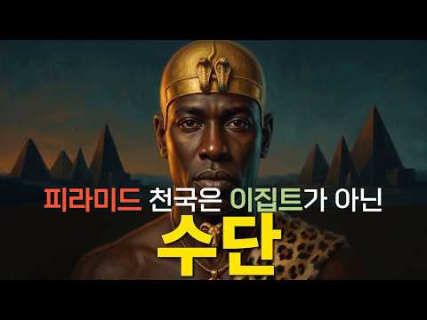
- 챕터: 0:00 피라미드가 가장 많은 나라는? · 1:11 무덤 둘레에서 나온 소머리 4,899개 · 3:05 굶은 말들을 보고 분노한 왕 · 5:26 800년 만에 다시 올라간 피라미드 · 6:57 목이 부러진 석상 일곱 개 · 9:27 왕에게 죽으라 명한 신관들 · 11:15 계단 밑에 묻힌 황제의 얼굴 · 13:29 요란한 멸망 없이 사라진 왕국 · 15:04 아직 아무도 읽지 못한 글자
- 설명 앞부분: 피라미드가 가장 많은 나라는 어디일까요? 이집트라고 답하셨다면, 다시 생각해 보셔야 합니다. 이집트의 왕들이 800년 넘게 손을 놓았던 피라미드를, 다시 쌓아 올리기 시작한 나라가 있었습니다. 이집트의 식민지였던 나라가 어떻게 파라오의 자리에 앉았을까요? 로마 황제의 얼굴은 왜 신전 계단 밑 모래 속에서 발견되었을까요? 그리고 이렇게 많은 피라미드를 남긴 나라를, 우리는 왜 거의 몰랐을까요? 이집트가 멈춘 피라미드를 천 년 동안 쌓은 나라, 쿠시 왕국의 이야기를 시작합니다. 역사쥐가 파고든 이야기, 끝까지 함께해 주세요. 타임라인…
- 같은 채널 평소 대비 ×14.5 (채널 최근 롱폼 중앙값 1,079회) · 평소 영상: 잉카의 오백 년 생존법 — 극복이 아니라 순응이었다 (1,139회) / 삼국지에서 이긴 조조의 나라는 왜 사라졌을까 ∣ 병상의 노인 '사마의'가 하루 만에 뒤집… (1,019회)
- 대본 없음 (설명) — 음성인식이 끝나면 도입부·흐름이 들어감
- 댓글 10/10: 좋은 점 — 영상 0 · 감사·응원 0 · 더 알고 싶은 것 0 · 아쉬운 점 — 영상 0 · 반박·불만 — 의견 다름 0 · 정치·사회 1 · 경험 공유 0 · 구독·다음 기대 0
  - 정치·사회 👍4 “피라미드가 이집트에만 있는건 아니네요. 쿠시라는 나라가 있었다는걸 새롭게 알게되어 좋았습니다.^^ 다음 영상도 빨리 올려주세요!!”

### 147. 7발의 총성, 사라진 탄환…육영수 여사 사건의 미스터리 (암살자는 누구인가?) #육영수 #박정희 #암살 #총격 #문세광 #암살자(들) #한국사 #썬킴

- https://www.youtube.com/watch?v=QMZbscMfVpo · 매불세계 · 구독자 9,780 · 조회수 409,238 (×41.8, 하루 11,368.4) · 좋아요 3,067 (0.8%) · 47.3분 · 2026-09-22 · 주제 묶음 4. 한국 근현대사 · 형식 정보·해설 (그 밖) · 폴더 `W_QMZbscMfVpo` (웹 승인)
- 썸네일: 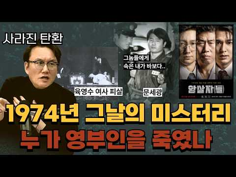
- 같은 채널 평소 대비 ×55.9 (채널 최근 롱폼 중앙값 7,327회) · 평소 영상: 미국 건국 250주년! 절대 공개하지 않는 흑역사 (배은망덕의 역사) #미국 #미국역사 … (7,327회) / 중국이 미군을 세뇌한 방법, CIA의 '인간 세뇌 프로젝트' #마오쩌둥 #덩샤오핑 #포로… (7,675회)
- 대본 없음 (없음) — 음성인식이 끝나면 도입부·흐름이 들어감
- 댓글 509/515: 좋은 점 — 영상 1 · 감사·응원 2 · 더 알고 싶은 것 3 · 아쉬운 점 — 영상 2 · 반박·불만 — 의견 다름 9 · 정치·사회 81 · 경험 공유 14 · 구독·다음 기대 0
  - 좋은 점 — 영상 👍4 “이거랑 별개로 썬킴은 이만갑 출연하면서 북한 실체 알만한 사람이 김정은 듣기 좋은 말을 하더라”
  - 감사·응원 👍3 “최욱 앵커님 정감 있으세요 감사합니다 나오신분들 역사 선생님 잘 보고있습니다 국힘당 한나라당 막말 남탓 억지뿐 인 민패 당 맞습니다 지금도 내란자 억지당 국힘당 해체”
  - 더 알고 싶은 것 👍14 “육영수 여사님의 총격 사망은.... 당시에 권총 가진놈의 소행이다. 문세광이의 권총과 경호원의 권총, 또는 다른 권총소지자가 한 사고입니다. 제대로 수사를 했는지? 경호팀에서 조사를 묻어버렸는지? 중앙정보부가 덮었는지? 글쎄요 저도 멍청 궁금합니다.”
  - 더 알고 싶은 것 👍4 “주제가 궁금해서 들어왔다가..최욱얼굴보고 나간다.”
  - 아쉬운 점 — 영상 👍3 “썬킴 진짜 실망이네 구역질난다”
  - 반박·불만 — 의견 다름 👍14 “육영수 여사님의 총격 사망은.... 당시에 권총 가진놈의 소행이다. 문세광이의 권총과 경호원의 권총, 또는 다른 권총소지자가 한 사고입니다. 제대로 수사를 했는지? 경호팀에서 조사를 묻어버렸는지? 중앙정보부가 덮었는지? 글쎄요 저도 멍청 궁금합니다.”
  - 반박·불만 — 의견 다름 👍8 “518도 북한이 했다고 자기네들이 학교에서 애덜한테 교과서로 가르칠정도인데 그건죽어도 안믿고 ㅋㅋ북한이체제선동같은 영화는 찰떡같이믿네!!!”
  - 정치·사회 👍72 “썰에는 박정희가 여색을 즐겨해 방탕한 생활을 하면서 육영수여사와 자주 싸웠는데 한번은 선거때 유세하던 지역 호텔에서 대낮에 여자랑 바람피우다 육영수여사한테 걸려서 대판 싸웠고 열받은 박정희가 던진 재털이에 육여사 이마에 맞아 깨졌다고...그 이후 부부는 자주 다퉜고 …”
  - 정치·사회 👍42 “암살자(들) 영화감상평 들어가봐요.. 일부러 사람들 못보게 전부 1점 주는데 진짜 조직적으로 댓글을 다는 사람들이 있나봐요..정말 깜짝 놀랐습니다. 재미가 없으면 주관적인 감상평을 적으면 되는 데 전부 좌파 얘기밖에 없어요... 그러니 더 보고 싶어서 오늘 보러갑니다.”
  - 경험 공유 👍17 “내가 85년에서 88년까지 군대에서(의무병) 근무 했었는데, 내가 있던 부대의 의무대 환자중에 총에 발바닥을 관통한 환자가 있었다 그 친구가 천만다행으로 발의 뼈는 다치지 않고 오직 살만 관통한 총상이었다 그런데도 내 기억에 1년이 넘게 의무대에 입원 하였었다 그런데…”
  - 경험 공유 👍14 “육영수 여사님의 총격 사망은.... 당시에 권총 가진놈의 소행이다. 문세광이의 권총과 경호원의 권총, 또는 다른 권총소지자가 한 사고입니다. 제대로 수사를 했는지? 경호팀에서 조사를 묻어버렸는지? 중앙정보부가 덮었는지? 글쎄요 저도 멍청 궁금합니다.”

### 148. 조선시대 왕비의 식사 — 12첩 반상인데 왜 맛이 없었을까

- https://www.youtube.com/watch?v=Ch-zCROKRo4 · 역사콕콕 · 구독자 493 · 조회수 89,373 (×181.3, 하루 572.9) · 좋아요 1,012 (1.1%) · 23.4분 · 2026-05-25 · 주제 묶음 3. 조선 · 형식 정보·해설 (그 밖) · 폴더 `W_Ch-zCROKRo4` (웹 승인)
- 썸네일: 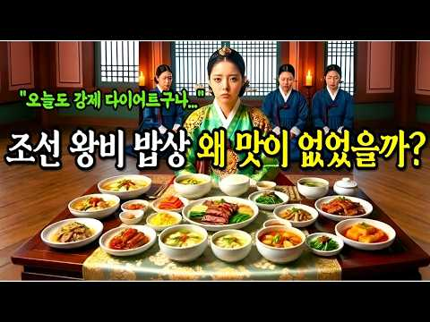
- 챕터: 0:00 교태전, 오전 열 시 — 왕비의 아침 · 2:30 간택된 날, 궁에 들어오는 순간 · 5:30 왕비의 12첩, 왕의 12첩과 같은 것이었을까 · 10:00 숙수 — 드라마와 다른 진짜 궁중 요리사 · 13:00 임신과 시어머니, 밥상에도 서열이 있었습니다 · 16:30 폐비의 밥상, 12첩이 사라지는 순간 · 20:00 화려한 감옥
- 설명 앞부분: 왕비의 식사 — 12첩 반상인데 왜 맛이 없었을까 "젓수십시오." 이 세 글자가 떨어져야 왕비는 수저를 들 수 있었습니다. 은수저로 독을 확인하고, 기미상궁이 목숨 걸고 먹어본 다음에야 시작되는 식사. 세 명이 지켜보는 앞에서, 혼자, 식어가는 밥을 먹어야 했던 여자. 🔹 간택날 처음 받은 건 밥이 아니라 다과상이었습니다 🔹 왕비의 12첩 반상, 그릇만 서른 개가 넘었는데 왜 맛이 없었을까 🔹 시어머니 혜경궁은 15그릇, 정조는 7그릇만 먹었습니다 🔹 인현왕후가 쫓겨난 날, 12첩 반상은 하루아침에 사라졌습니다 🔹 왕비에서 노비로…
- 같은 채널 평소 대비 ×338.5 (채널 최근 롱폼 중앙값 264회) · 평소 영상: 단종 죽인 세조가 딱 한 번 눈물 흘린 그날 밤 (282회) / 정희왕후 — 세조의 아내가 경혜공주를 살린 이유 (246회)
- 대본 없음 (설명) — 음성인식이 끝나면 도입부·흐름이 들어감
- 댓글 151/152: 좋은 점 — 영상 1 · 감사·응원 1 · 더 알고 싶은 것 2 · 아쉬운 점 — 영상 1 · 반박·불만 — 의견 다름 1 · 정치·사회 1 · 경험 공유 2 · 구독·다음 기대 0
  - 좋은 점 — 영상 👍2 “좋은 영상 감사합니다 화이팅!!”
  - 감사·응원 👍2 “좋은 영상 감사합니다 화이팅!!”
  - 더 알고 싶은 것 👍5 “멋진 영상 어떻게 만드나요 가르쳐 주세요”
  - 더 알고 싶은 것 👍1 “왕과 왕비는 방귀를 어떻게 뀌었는지 궁금해요 항상 궁녀가 있자나욯ㅎ”
  - 아쉬운 점 — 영상 👍2 “제목 어그로끌지말고 제대로 올리시기를”
  - 반박·불만 — 의견 다름 👍1 “사극은 2~3% 만 밑고 다 거짓 말입니다 그리고 조선시대 의상은 너무 현대적인입니다 말도 안되는 연출을 하고있습니다”
  - 정치·사회 👍3 “중국인이냐? 거짓말에 왕비는 여왕이고. 뇌피셜”
  - 경험 공유 👍0 “내가사랑하던여자가 간택되서 강제로 뺏기는건데 진짜 세상 ㅈ같았겠다 상상만해도 열받네”

### 149. 세종대왕이 황급히 역사 ∣ 고려에 살던 아랍인 7만 명의 소름돋는 행방

- https://www.youtube.com/watch?v=INsyRZUYb1A · 역사프리즘 · 구독자 690 · 조회수 98,820 (×143.2, 하루 797.5) · 좋아요 1,206 (1.2%) · 20.8분 · 2026-06-26 · 주제 묶음 1. 역사 일반·이야기 · 형식 정보·해설 (그 밖) · 폴더 `W_INsyRZUYb1A` (웹 승인)
- 썸네일: 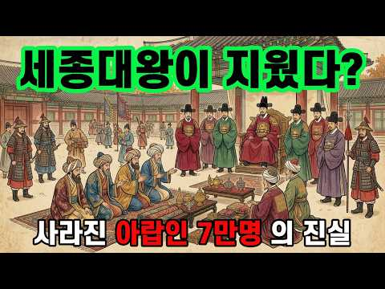
- 설명 앞부분: 📜 서기 1024년, 고려의 수도 개경에 낯선 사람들 100명이 한꺼번에 나타납니다. 피부색도, 옷차림도, 머리에 두른 천도 전부 달랐던 그들. 고려사에 딱 한 줄 남은 기록 — "대식국의 열라자 등 백 명이 와서 토산물을 바쳤다." 그런데 이건 시작일 뿐이었습니다. 🤔 우리가 흔히 듣는 이야기가 있습니다. "고려는 국제도시였다, 아랍 상인도 살았다, Korea라는 이름도 그들이 만들었다." 그런데 막상 물어보면 — ❓ 그 아랍 사람들이 개경 '어디에서', '어떻게', '얼마나' 살았는데? ❓ 진짜 '살았던' 걸까, 그저 '지나간…
- 대본 없음 (설명) — 음성인식이 끝나면 도입부·흐름이 들어감
- 댓글 264/264: 좋은 점 — 영상 3 · 감사·응원 3 · 더 알고 싶은 것 3 · 아쉬운 점 — 영상 0 · 반박·불만 — 의견 다름 13 · 정치·사회 9 · 경험 공유 6 · 구독·다음 기대 2
  - 좋은 점 — 영상 👍1 “유익하네요 나레이션도 듣기 편안하고 좋아요”
  - 좋은 점 — 영상 👍1 “좋은 내용 감사합니다. 그런데 조금 이상한게 있는데, 아라비아인들이 뭐 얻을게 있다고 그 장거리를 배를 타고 서해안을 거슬러서 예성강으로 들어왔을까요? 조그만 나라에. 고려는 중계무역 국가 였을까요? 이런 내용을 설명해주는 책자도. 콘텐츠도 없어 궁금해서 여쭤봅니다.”
  - 감사·응원 👍100 “안녕하십니까? 윤명철입니다. 우연히 뜬 영상을 보았습니다. 아주 고맙게 보았습니다. 이러한 프로가 계속 만들어지길 바랍니다. 이 기회에 제작자나 시청자들에게 말씅드립니다. 여기 내용들은 저의 선학들부터 저를 거쳐 후배학자들의 연구들이 모인 것입니다. 이밖에도 우리역사…”
  - 감사·응원 👍1 “좋은 내용 감사합니다. 그런데 조금 이상한게 있는데, 아라비아인들이 뭐 얻을게 있다고 그 장거리를 배를 타고 서해안을 거슬러서 예성강으로 들어왔을까요? 조그만 나라에. 고려는 중계무역 국가 였을까요? 이런 내용을 설명해주는 책자도. 콘텐츠도 없어 궁금해서 여쭤봅니다.”
  - 더 알고 싶은 것 👍1 “좋은 내용 감사합니다. 그런데 조금 이상한게 있는데, 아라비아인들이 뭐 얻을게 있다고 그 장거리를 배를 타고 서해안을 거슬러서 예성강으로 들어왔을까요? 조그만 나라에. 고려는 중계무역 국가 였을까요? 이런 내용을 설명해주는 책자도. 콘텐츠도 없어 궁금해서 여쭤봅니다.”
  - 더 알고 싶은 것 👍0 “낙타부대 물소 원숭이 이런 것들이 한반도 어디에 있죠? 서경이 과거 한성으로 불렸던 지금 북한 평양이라구요 ? 고려는 모두 문맹들이라 6천년전 황제시절부터 쓰였던 동서남북도 몰랐다구요 ? 거란과 싸웠던 중국에 있는 지명들이 북한에 있나요 ? 이성계가 집권후 중국에 있…”
  - 반박·불만 — 의견 다름 👍6 “그 개경이 거기가 아닙니다. ㅋㅋ”
  - 반박·불만 — 의견 다름 👍1 “아랍인 아니고 여진족 아닌가? 삼각 돛이 발명되기 전까지 원거리 해상 무역은 불가능 했다 보면 된다. 역풍에 꼼짝없이 바다에 갖혀 죽으니까. 노저어서 태평양 건넌다는 상상하지 말고. 그리고 말이 실크로드지 그건 중공이 지어낸 가짜역사고 뭔 낙타 몇마리 끌고 사막 횡단…”
  - 정치·사회 👍1 “얼마나 많은 역사의 조작이 있는지 알겠다.. 당의 고선지가 서역원정을 가서 실패했는데 그 나라가 대식국이고 압바스왕조인데. 그나라가 발해다.. 고려사절요, 조선왕조실록 모두 1900년이후 승자의 의해 교열당하고 조작되었다. 고려혜종=신성로마제국 초대황제 오토대제 고려…”
  - 정치·사회 👍0 “지금도 한국인 중에 곱슬머리 혹은 피부가 까만분들은 아라비아 반도에서 온 후손일 가능성이 100프로다. 내 친구도 피부가 까만색에 곱슬이라 물어보니 조상중에 상인으로 온 아랍인이 있다고 하더라...토종 한국인이라고 말하면서 악성 곱슬머리를 가진분들은 조상중에 외국인 …”
  - 경험 공유 👍53 “아랍인들 극한의 겨울 몇년 겪고나면 자기나라 그리워 다 귀국하거나 도망갈듯 ㅋ”
  - 경험 공유 👍13 “내가 아랍 상인이라면 한반도 개성, 경주까지 와서 상업활동을 하지는 않았을것이다. 벽란도, 금성은 실크로드에서 물길로 오가기 수월한 위치에 존재해야한다. 신라와 고려는 중계무역을 했다. 한반도는 아니라고 생각해야 정합성이 있다.”
  - 구독·다음 기대 👍100 “안녕하십니까? 윤명철입니다. 우연히 뜬 영상을 보았습니다. 아주 고맙게 보았습니다. 이러한 프로가 계속 만들어지길 바랍니다. 이 기회에 제작자나 시청자들에게 말씅드립니다. 여기 내용들은 저의 선학들부터 저를 거쳐 후배학자들의 연구들이 모인 것입니다. 이밖에도 우리역사…”

### 150. 하멜 표류기, 13년간 조선에 체류한 네덜란드인 하멜

- https://www.youtube.com/watch?v=iwQcR8HMeSQ · 역사본능 · 구독자 32,700 · 조회수 846,389 (×25.9, 하루 37,777.2) · 좋아요 3,849 (0.4%) · 24.9분 · 2026-10-06 · 주제 묶음 3. 조선 · 형식 정보·해설 (그 밖) · 폴더 `W_iwQcR8HMeSQ` (웹 승인)
- 썸네일: 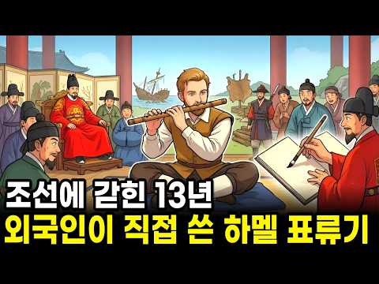
- 설명 앞부분: 이 영상은 하멜이 어쩌다 조선에서 13년을 살게 됐는지, 그 13년을 어떻게 먹고 자고 버텼는지를 따라갑니다. 왕 앞의 장기자랑과 양반 술자리에 불려다니던 구경거리 생활, 청나라 사신 앞에서 옷을 찢고 굶어 죽은 동료, 전라도 강진 병영에서의 7년, 흉년에 남의 집 문을 두드리며 밥을 얻던 나날까지요. 그리고 그 사이 하멜이 조용히 적어 둔 조선의 모습도 함께 봅니다. 네댓 살 아이도 담배를 물던 나라, 세상에 나라가 열두 개뿐이라 믿던 사람들, 낯선 얼굴에게 흰 피부가 부럽다고 말하던 사람들이요. 마지막에는 이 이야기의 진짜 반…
- 같은 채널 평소 대비 ×50.2 (채널 최근 롱폼 중앙값 16,876회) · 평소 영상: 야인 시대 레전드, 김두한 VS 이정재 누가 더 강했을까? (17,219회) / "북괴가 알면 큰일이다" 대통령을 쏜 사람이 차 안에서 한 첫마디 (16,534회)
- 대본 없음 (설명) — 음성인식이 끝나면 도입부·흐름이 들어감
- 댓글 236/580: 좋은 점 — 영상 3 · 감사·응원 7 · 더 알고 싶은 것 3 · 아쉬운 점 — 영상 1 · 반박·불만 — 의견 다름 6 · 정치·사회 17 · 경험 공유 6 · 구독·다음 기대 0
  - 좋은 점 — 영상 👍34 “회계사라서 조선입장에서는 쓸모가없다고 판단해서 대우 별로였음. 멍청한 조선이 사실 수학부터 과학까지 번역만하면 좋은 정보를 배울수 있었는데 팽시킴. 얼마나 조선이 싫었으면 내용중에 비하하는글도 많이있음.”
  - 좋은 점 — 영상 👍14 “동네 사람들이 몰랐을리가 없지… 사람 마음을 얻었기에 가능했다. 뭔가 계획을 가지고 노력하니 큰 경을 치르더라도 모르쇠 마을 사람들 모두 그걸 일러받치지 않고 막지 않고 지켜봐준거지. 안정적인 느낌을 받는 쯤이지 않았겠나 놔줄 것이라는 믿음이 있을 때. 일본으로 해류…”
  - 감사·응원 👍17 “와 너무 재밌게 들었어요 감사”
  - 감사·응원 👍10 “잘 보았습니다~ 고맙습니다~”
  - 더 알고 싶은 것 👍4 “결국에 임금은 못받은걸로 알고있고, 최기 제주도나 한양에서 거주햇을땐 나름 좋은대우를받앗으나 유배지인 전라도로가선 그곳 사람들에 대해 안좋게써잇던건 그곳이 유배지인탓이라고 알고잇거든요. 팩트체크부탁드려요”
  - 더 알고 싶은 것 👍0 “하멜은 너무 표현력이 없었던 사람 표류기를 보면 강진 등에서 겪었던 일이나 풍습을 자세히 묘사하지 않고 그냥 궁금해서 답답항 정도다. 초등학교 일기장을 보는 느낌”
  - 아쉬운 점 — 영상 👍0 “틀린 내용이 좀 있는데”
  - 반박·불만 — 의견 다름 👍11 “바로 보내버리면 되는데 뭘 많이 봤다고 놓지 못하나 말도 안되는 소리다”
  - 반박·불만 — 의견 다름 👍8 “훈련도감으로 보낸거 보면 덩치가 있고 힘도 쎄고 그래서 이용해 먹으려고 한 것 전쟁터에도 보내서 2명이 전사 이걸 보면 힌쎈넘 이용한 것 밥만 주면 일을 부려먹을 수 있으니 인력면에서도 대박난거지 저비용 고효율 학교에서 하맬은 이름만 알았지 자세한 내용은 몰랐는데 지…”
  - 정치·사회 👍63 “명,청,일본이 어떤 나라가 표류한 선원을 저렇게 대우하나? 부끄러운 줄 알아야해요.”
  - 정치·사회 👍14 “우리가 세계를 몰랐던것은 위에가 막혀 있었던 탓이다 만약 고구려처럼 열려 있으면 지금우리나라가 이렇게 되지 않았을텐데 어떻하겠나 ~”
  - 경험 공유 👍156 “제가 의외였던건 10년이상 넘게 사실상 감금하고 종신형이라고 할수밖에 없는 대우를 한 조선에 비해 당시 일본은 하멜일행이 도망쳐오자 이들을 단 몇시간에 조사하고 네덜란드 공관으로 이송하고 나중 고국으로 보내는 절차를 아주 체계있고 나름 당시 국제법 매뉴얼에 맞게 처리…”
  - 경험 공유 👍26 “일본처럼 교역을 했었어야지. 너무 무지했어”

### 151. 조선야담#52 남겨진 머슴과 과부마님. 옛날이야기. 야담. 야사,

- https://www.youtube.com/watch?v=4jEcvypcCuQ · 조선의 밤 · 구독자 613 · 조회수 13,203 (×21.5, 하루 695.0) · 좋아요 86 (0.7%) · 18.2분 · 2026-10-05 · 주제 묶음 9. 야사·야담·옛날이야기 · 형식 수면·낭독 (잠잘 때 듣는) · 폴더 `W_4jEcvypcCuQ` (웹 승인)
- 썸네일: 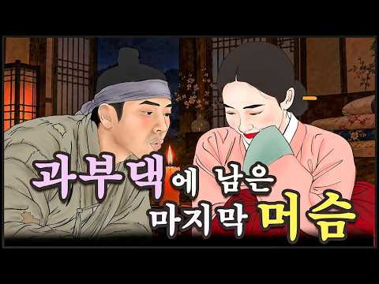
- 설명 앞부분: 조선 시대를 배경으로 한 흥미로운 야담과 민담, 그리고 사람들의 삶을 담은 감동적인 이야기를 전해드립니다. 신분을 뛰어넘는 사랑, 과부와 머슴의 운명, 주막에서 시작된 인연, 왕실의 비밀, 숨겨진 진실, 가슴 아픈 가족 이야기, 인생의 교훈까지. 매주 새로운 조선 야담과 옛날이야기를 만나보세요.
- 같은 채널 평소 대비 ×63.5 (채널 최근 롱폼 중앙값 208회) · 평소 영상: 조선야담.🎉그냥 흠뻑 젖고 말았소!!! 이야기 모음 # 잠잘때 듣는 옛날 이야기 (208회) / 조선야담#48 어머니의 한냥의 빚 # 민담 #야사 #야담 (205회)
- 대본 없음 (설명) — 음성인식이 끝나면 도입부·흐름이 들어감
- 댓글 1/3: 좋은 점 — 영상 0 · 감사·응원 0 · 더 알고 싶은 것 0 · 아쉬운 점 — 영상 0 · 반박·불만 — 의견 다름 0 · 정치·사회 0 · 경험 공유 0 · 구독·다음 기대 0

### 152. 당신의 성씨가 사실 명나라 것이라면? 나라가 사라진 사람들 그들이 택한 나라는 조선이었다

- https://www.youtube.com/watch?v=PKcdNOIwE4o · 모든역사 · 구독자 12,200 · 조회수 648,713 (×53.2, 하루 13,819.3) · 좋아요 6,190 (0.9%) · 34.7분 · 2026-09-11 · 주제 묶음 6. 동양사 (중국·일본·몽골) · 형식 애니메이션·지도 · 폴더 `W_PKcdNOIwE4o` (웹 승인)
- 썸네일: 
- 설명 앞부분: 나라가 통째로 망하던 그날, 명나라 귀족들은 어디로 갔을까요? 1644년, 이백 년 넘게 아시아를 호령하던 명나라가 하룻밤 사이에 지도에서 사라집니다. 마지막 황제는 궁궐 뒷산 나무에 목을 맸고, 그 나라의 귀족과 장수들은 짐을 싸서 국경을 넘기 시작했죠. 🏃‍♂ 그리고 그중 상당수가 향한 곳이 바로 조선이었습니다. ⚔️ 조선을 살리려다 자기 나라 감옥에서 죽은 국방부 장관 석성 🩸 죽은 병사의 옷을 벗겨 입고 요동 벌판을 가로질러 도망친 강세작 🧭 전쟁 영웅에서 조선의 풍수 전문가로 변신한 시문용 🌊 이순신과 함께 싸운 명나라 …
- 같은 채널 평소 대비 ×175.0 (채널 최근 롱폼 중앙값 3,706회) · 평소 영상: 단종 시신 수습한 엄흥도 노루가 알려준 단종 무덤의 비밀 (4,044회) / 정조 vs 공자 두 천재가 주역에 미쳐버린 진짜 이유 (3,369회)
- 대본 없음 (설명) — 음성인식이 끝나면 도입부·흐름이 들어감
- 댓글 481/492: 좋은 점 — 영상 4 · 감사·응원 7 · 더 알고 싶은 것 6 · 아쉬운 점 — 영상 2 · 반박·불만 — 의견 다름 8 · 정치·사회 48 · 경험 공유 12 · 구독·다음 기대 0
  - 좋은 점 — 영상 👍23 “고금도는 바로 우리 고향에서 건너편 섬 고금도 인데 지금은 마량에서 다리(고금대교)가 생겨서 자동차로 갑니다 잘 배우고 갑니다 학생때 부터 역사을 좋아해서 나이가 들어도 역사가 좋더라구요 광주로 (유학생)학교을 갔는데 고금도가 고향인 친구도 있었어요 벌써 50년이 다…”
  - 좋은 점 — 영상 👍5 “명쾌하네요.”
  - 감사·응원 👍32 “역사에 관심 있으시고 성씨에 궁금 하신 분들이 많으시니 덕분에 많이 배웁니다 감사합니다”
  - 감사·응원 👍7 “고맙습니다.”
  - 더 알고 싶은 것 👍5 “잘 봤습니다 해주 오씨 에대한 이야기좀 올려주세요 저는 해주오씨 후손입니다 저의 1대조는 고려말 군기도감이셨다는 이야기를 들었습니다 중국에서 고려말에 고려로 오신걸루 생각합니다 조사하셔서 영상 만들어주시면 후손으로서 자부심을 갖고 살아갈수 있을것같아요”
  - 더 알고 싶은 것 👍5 “진도에도 황조라는 마을이 있습니다 해남과 바다를 사이에 두고 마주 보는 지형이죠. 옛 사람들은 아침에 황제가 잠시 들려 갔다 해서 명명된 이름이다.라고 하지요 삼별초 난과 연결지어지기도 하고요 용장산성이 건너편 마을 뒷산에 있지요 관게가 있는지 알고 싶어요 강원도에도…”
  - 아쉬운 점 — 영상 👍16 “임진왜란때 왜가 주장한 것은 '정명가도'였습니다. 즉 일본이 명나라를 정벌할테니,,, 조선보고 길을 내주라는 의미였습니다. 조선은 있으나 마나한 허약한 나라였다는 것을 일본은 너무도 잘 알고 있었습니다. 일본이 조선을 정벌하고, 조선인을을 앞세워서 명나라로 처들어간다…”
  - 반박·불만 — 의견 다름 👍3 “고조선은 陰 동양을 말해요. 서양은 아메리카를 지칭했던거고요. 陽이지요. 중원 남부로는 끊임없이 인도 중동쪽에서 들어왔죠. 백제도 신라도 중원 남부부터 시작 했답니다. 명나라도 남부에서 시작 했으니 백성이나 귀족 일부는 신라 백제 사람이죠. 나라 이름만 바뀐겁니다. …”
  - 반박·불만 — 의견 다름 👍0 “명에서 우리에게 파병한이유는 단순한 그이유만이 아니죠 일본이 조선을 무너뜨리고 명나라로 오는것을 방어하기 위해서도 50%는 적용되죠”
  - 정치·사회 👍45 “6.25를 겪고도 아직도 북한 3대 세습 독재국가에 충성을 다하고 있는 자들이 국회의원 국가 공무원이 되어 나라를 무너뜨리려고 하는 자들은 역사에 어떤 발자취를 남길가?”
  - 정치·사회 👍42 “한동훈 장인 진머시기가 중국인도 받기 힘든 중국 출판허가를 받아내고 중국 관련 출판하는 거 혹시 광동 진가? 총기 사격 명수 진 머시기 비례대표 의원이 한배신 패거린 것도 그런 이유?”
  - 경험 공유 👍45 “6.25를 겪고도 아직도 북한 3대 세습 독재국가에 충성을 다하고 있는 자들이 국회의원 국가 공무원이 되어 나라를 무너뜨리려고 하는 자들은 역사에 어떤 발자취를 남길가?”
  - 경험 공유 👍30 “명씨가 있던데 고향이 해남이라고하더니 그래서 내가 중국이나 명나라 성씨 아닌가요 그랬는데 그분들도 명나라 족이였네요 시갓집은 현씨 친저믄 명씨”

### 153. 일상속에 숨겨진 치명적인 독 조선시대 사람들이 40세 전에 쓰러진 진짜 이유 ∣ 역사 ∣ 한국사 ∣ 조선

- https://www.youtube.com/watch?v=G4WR44Mrbq8 · 시절담 · 구독자 2,390 · 조회수 356,089 (×149.0, 하루 2,694.1) · 좋아요 6,226 (1.8%) · 50.1분 · 2026-06-18 · 주제 묶음 3. 조선 · 형식 브이로그·직접 해본 이야기 · 폴더 `W_G4WR44Mrbq8` (웹 승인)
- 썸네일: 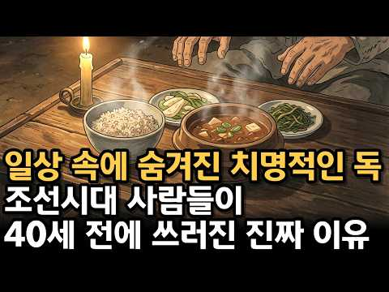
- 설명 앞부분: 1659년 창덕궁, 조선의 왕 효종이 종기 하나에 목숨을 잃습니다 조선 최고의 어의가 24시간 대기하고 있었는데도요. 왕도 못 살린 시대, 백성들의 삶은 어땠을까요? 이 영상에서 다루는 내용 👇 ⏳ 평균수명 35세의 충격적인 진실 💧 물 한 잔이 목숨을 좌우하던 시대 🍚 냉장고 없는 밥상 위의 숨겨진 독 💀 경신대기근, 2년간 백만 명 사망 🏥 동의보감도 못 막은 전염병의 공포 👑 왕이 오히려 일찍 죽은 아이러니한 이유 📊 신분이 수명을 결정한 잔인한 현실 ✨ 35세에서 80세로, 기적의 100년 참고자료 • 조선왕조실록, 현종개…
- 같은 채널 평소 대비 ×731.9 (채널 최근 롱폼 중앙값 486회) · 평소 영상: 조선시대 겨울나기｜방바닥 41도와 판자 마루 사이, 조선 사람들은 한겨울 밤을 어떻게 잤… (513회) / 법에 없는 죄로 죽인 여자 ∣ 남자는 무죄, 여자는 사형 ∣ 인수대비가 어우동을 반드시 … (460회)
- 대본 없음 (설명) — 음성인식이 끝나면 도입부·흐름이 들어감
- 댓글 534/534: 좋은 점 — 영상 4 · 감사·응원 18 · 더 알고 싶은 것 3 · 아쉬운 점 — 영상 3 · 반박·불만 — 의견 다름 7 · 정치·사회 9 · 경험 공유 23 · 구독·다음 기대 0
  - 좋은 점 — 영상 👍12 “너무 잘 만들었습니다.그때였다면 저는 없을 것같네요.지금 태어 난게 다행이라고 할까? 현제의 삶에 감사와 고마움을 느낍니다.항상 좋은 영상 부탁드립니다.”
  - 좋은 점 — 영상 👍9 “유익한 영상 감사합니다 ~~^^”
  - 감사·응원 👍225 “지금시대 아무리 가난해도 조선시대 왕보다더 화려하고 좋은 환경에서 사는것에 감사하고 우리나라 잘지킵시다”
  - 감사·응원 👍12 “너무 잘 만들었습니다.그때였다면 저는 없을 것같네요.지금 태어 난게 다행이라고 할까? 현제의 삶에 감사와 고마움을 느낍니다.항상 좋은 영상 부탁드립니다.”
  - 더 알고 싶은 것 👍12 “너무 잘 만들었습니다.그때였다면 저는 없을 것같네요.지금 태어 난게 다행이라고 할까? 현제의 삶에 감사와 고마움을 느낍니다.항상 좋은 영상 부탁드립니다.”
  - 더 알고 싶은 것 👍4 “좋은글 주셔서 감사 드립니다 지금도 국민일부는 건강의 시각지대어서 생홠하는분이 많은것 같네요 압으로도 경각시이 될만한소재 부탁드립니다”
  - 아쉬운 점 — 영상 👍3 “너무길다무슨말이그리도기냐멸공”
  - 아쉬운 점 — 영상 👍0 “인트로가 너무 길다 치명적인 독”
  - 반박·불만 — 의견 다름 👍12 “수명이 짧은건 글쎄 부실한 의식주 그거아닌가 겨울엔 방안이 꽁꽁얼어 두툼한 이불을 덥고 군불 방바닥 그을도록ㆍ뜨겁게 지펴도 참을수 없었든 환경 그겄들이 단명을 불렀슬 껍니다😊”
  - 반박·불만 — 의견 다름 👍7 “우물 근처 빨래터는 도랑으로 연결되어 흘러 내립니다. 우물로 스며들지 않아요. 더구나 더러운 빨래는 대부분 냇가에서 했습니다. 조선 이전 삼국시대에도 도시에 하수도가 있었습니다. 그 도랑이 강으로 가고 강물을 떠먹던 사람들이 문제이지 우물이 문제는 아닌거죠. 그리고 …”
  - 정치·사회 👍11 “실용학문이 발전했더라면 훨씬 좋아지고, 발전했을 것이다. 틀에서 벗어나질 못하는 썩은 학문, 글줄이나 암기하는 학문이 국가와 백성들을 옭아메었기 때문이다. 지금은 좌편향 인간들이 신계급사회를 만들고 있다. 로스쿨폐지해야 한다. 붕어빵 교육과 붕어빵 경험만 한 자들이 …”
  - 정치·사회 👍0 “작금에 조선양반되려고 빨갱이질하는 빼찌 공무원 군인 검찰 법관 보안처 공수처 방송 언론 예술 문학 기자 시민단체 유공단체 공산주의 추종 족속이 드디어 토지개혁질 땅국가이전질을 하고있따... 바보궁민 일찍들아 너거들 부터 당해보거라.ㅋ”
  - 경험 공유 👍22 “수은이 큰 몫을 했을 것 같아요. 제가 어릴때 아버지꼐서 무좀에 좋다 하시면서 발에 바르시는 것을 도와 드렸던 기억이 납니다. 이때만 했어도 좋다면 독성을 모르고 그냥 시용을 했기에.”
  - 경험 공유 👍22 “옛날에는 대변에 기생충이 바글바글 큰 지렁이같은것이 나왓어요 저도대변에 나왓던것같아요 73세입니다”

### 154. 40분 전까지 이름도 몰랐는데 울었다 — 이순신을 처음 알게 된 외국인들

- https://www.youtube.com/watch?v=PGedVpjYgEk · 경제냥 · 구독자 3,400 · 조회수 111,339 (×32.8, 하루 3,819.9) · 좋아요 913 (0.8%) · 14.7분 · 2026-09-29 · 주제 묶음 3. 조선 · 형식 애니메이션·지도 · 폴더 `W_PGedVpjYgEk` (웹 승인)
- 썸네일: 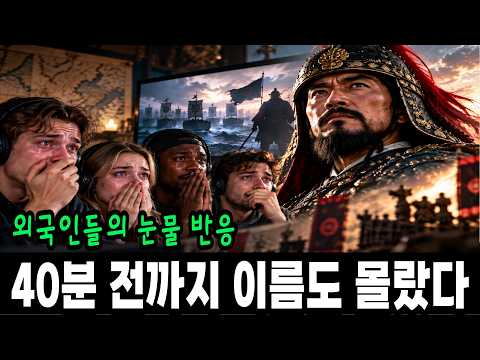
- 설명 앞부분: 스파르타 300 이야기 말고, '조선의 13' 이야기를 아시나요? 시카고의 한 만화가가 17년째 그리고 있는 조선 장군, 그리고 그 이야기를 처음 들은 외국 유튜버들이 어디서 놀라고, 어디서 화내고, 어디서 울었는지 따라가 봤습니다. 외국 사람들이 이 이야기에서 가장 놀란 대목, 여러분은 어디셨나요? 댓글로 남겨 주세요. 반응 영상 속 애니메이션: Extra History 'Korea: Admiral Yi' 시리즈 (2015) ■ 크리에이티브 커먼즈 저작자 표시(CC BY) 영상 ■ 유물 사진 (공공누리 제1유형 · 국립중앙박물관…
- 같은 채널 평소 대비 ×1,649.5 (채널 최근 롱폼 중앙값 68회) · 평소 영상: 우유 회사가 덜 사기로 합의했는데, 마트 값은 그대로인 이유 (85회) / 머스크는 왜 이 차에 9년이나 매달려 있었을까? (86회)
- 대본 없음 (설명) — 음성인식이 끝나면 도입부·흐름이 들어감
- 댓글 64/85: 좋은 점 — 영상 0 · 감사·응원 1 · 더 알고 싶은 것 1 · 아쉬운 점 — 영상 0 · 반박·불만 — 의견 다름 2 · 정치·사회 4 · 경험 공유 3 · 구독·다음 기대 0
  - 감사·응원 👍1 “좋은 영상 감사드립니다 멸공!❤”
  - 반박·불만 — 의견 다름 👍25 “후손들은 명량해전 이긴 걸 알고 있지만, 그 시점에는 선조의 육군 편입 요청은 오히려 더 현실적이다. 이순신은 누가 봐도 가망이 없는 전력차이를 심지어 1척도 안잃고 이겼어. 영국인들은 인정하기 싫겠지만 솔직히 넬슨과 이순신은 수준 차이가 너무 남. 그냥 중요 전투 …”
  - 반박·불만 — 의견 다름 👍5 “우리나라 사람들도 역사를 잘 모르는데 거북선을 이순신 장군이 설계하고 만든건 아닙니다~!! 그 전부터 돌격선이라고 거북선을 왜구들을 막는 용도로 있었죠~!! 그것을 이순신 장군이 현장에 상황과 자신의 실전 경험과 그 당시 현실에 맞추어서 개량한겁니다~!! 그게 거북선…”
  - 정치·사회 👍2 “왜 외국인이 나랑 똑같은 생각을 갖고 이야기하지... 진짜 이순신은 무서운 사람이네. 근데... 박정희가 세운 이명박이가 세운 동상은 치우자. 남 생각 안하는 것들이... 광화문 앞에 동상을. ㅋ 이순신이 세종이 이걸 알면!!!!!!! 스스로 그 동상에 머릴 박을 것”
  - 정치·사회 👍1 “지금도 기득권들은 영웅을 품을 만큼의 아량이 없다 지들보다 잘나면 시기와 질투로 밤잠을 설칠거다 영웅을 무너뜨려야 드발뻗고 자는 놈들이 저 국힘들이 아닌가”
  - 경험 공유 👍0 “^^ 네 이 버 ^^ 의 ^^ 메 르 카 츠 ^^ 님 ^^ 의 ^^ 글 ^^ : ^^.......^^ 명 량 대 첩 ^^ 시 ^^ 에 ^^ ....... ^^ 신에게는 아직도 열두척이 있사오니 라고 말할때는 12척이였고 장계가 올라가서 선조에게 닿을때쯤 한척을 수리하…”
  - 경험 공유 👍0 “이순신장군이 옥살이와 모진고문당한건 훙노족 노론벽파들의 모함때문인데 친일교육부가 그걸 안가르치고 왕탓으로 가르치고있다! ★이순신 장군을 명장으로 만든건 전라도 사람들이 임진왜란 이긴건 신라휴ㅇ노족에의한 매국통일신라시대때부터 일본의 해적질로부터 조정에서 물리칠 생각 않…”

### 155. 한글날 특집 ∣ 외국인이 한글을 읽고 놀란 순간… 세종대왕이 열어 준 길

- https://www.youtube.com/watch?v=FziT13rkQ8I · 국뽕살롱 · 구독자 839 · 조회수 18,017 (×21.5, 하루 924.5) · 좋아요 86 (0.5%) · 14.4분 · 2026-10-08 · 주제 묶음 3. 조선 · 형식 정보·해설 (그 밖) · 폴더 `W_FziT13rkQ8I` (웹 승인)
- 썸네일: 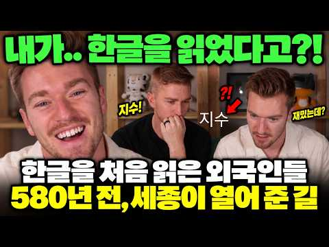
- 챕터: 0:00 처음 읽는 순간 · 1:57 세종이 열어 준 길 · 3:43 글자가 소리가 되다 · 7:40 실수해도 시작할 수 있다 · 10:15 낯선 도시를 읽는 길 · 12:45 우리가 매일 쓰는 기적
- 설명 앞부분: 10월 9일 한글날 특집. 처음 한글을 읽고 스스로 놀라는 외국인들의 실제 반응으로, 세종대왕이 훈민정음에 담으신 뜻을 돌아봅니다. 2026년은 훈민정음 반포 580주년, 한글날을 처음 기념한 지 100년이 되는 해입니다. 처음에는 낯선 기호였던 글자가, 어느 순간 익숙한 단어로 읽힙니다. ‘엘모·토토로·미키’ 이름 읽기, 친구와 배우는 ‘지수·안녕’, 한국 여행의 간판과 메뉴까지. 실제 원본 5편 속 시도와 웃음, 솔직한 어려움을 따라갑니다. ‘읽을 수 있다’는 작은 변화는 누구에게나 글을 익혀 일상에서 쓰도록 하려 했던 세종대…
- 같은 채널 평소 대비 ×60.7 (채널 최근 롱폼 중앙값 297회) · 평소 영상: 다인실 예약했는데 나 혼자? 부산 밤배를 탄 외국인의 뜻밖의 반응 (288회) / 한국 찜질방에서 하룻밤… 세 팀의 외국인 반응이 갈린 이유 (123회)
- 대본 없음 (설명) — 음성인식이 끝나면 도입부·흐름이 들어감
- 댓글 12/13: 좋은 점 — 영상 0 · 감사·응원 0 · 더 알고 싶은 것 0 · 아쉬운 점 — 영상 0 · 반박·불만 — 의견 다름 1 · 정치·사회 0 · 경험 공유 0 · 구독·다음 기대 0
  - 반박·불만 — 의견 다름 👍1 “제발 ~~~ 십월 구일은 아니죠. 시월 구일입니다. 제대로 한글을 ~~~”

### 156. 마이클 잭슨이 인천 갯벌에 왔던 진짜 이유 l 청라의 숨겨진 역사

- https://www.youtube.com/watch?v=knVMTvDISxo · 끝까지 궁금했던 모든 이야기 · 구독자 974 · 조회수 66,406 (×68.2, 하루 1,070.7) · 좋아요 152 (0.2%) · 9.2분 · 2026-08-27 · 주제 묶음 1. 역사 일반·이야기 · 형식 정보·해설 (그 밖) · 폴더 `W_knVMTvDISxo` (웹 승인)
- 썸네일: 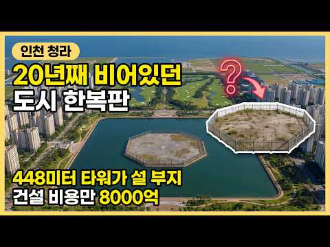
- 챕터: 0:00 마이클 잭슨이 인천 매립지를 찾은 이유 · 1:14 왜 하필 그때 바다를 메우기 시작했나 · 2:45 서울의 쓰레기 산이 옮겨간 자리 · 5:30 마이클 잭슨의 방문과 끝나지 않은 계획
- 설명 앞부분: 1998년 마이클 잭슨이 왜 인천 갯벌에 왔을까요? 그가 방문한 매립지가 어떻게 청라국제도시로 변했는지, 땅의 운명을 바꾼 4번의 변화를 추적합니다. 1998년 2월, 세계적인 팝스타 마이클 잭슨이 인천의 한 갯벌 매립지를 찾았습니다. 단순히 땅을 보러 온 것이 아니라, 그 땅의 토지 용도 변경을 시도하며 매각하기 위한 목적이 있었습니다. 그가 주목했던 이 땅이 어떻게 지금의 청라국제도시가 되었는지 그 과정을 상세히 살펴봅니다. 인천 청라 지역의 개발 역사를 알고 싶은 분들에게 유용한 정보가 될 것입니다. 바다를 메워 만든 매립지…
- 같은 채널 평소 대비 ×25.2 (채널 최근 롱폼 중앙값 2,630회) · 평소 영상: 서울의 15년 치 쓰레기를 치우지 않고 공원을 만든 이유｜난지도 (2,630회) / 비가 오면 하수가 처리장을 안 거치고 하천으로 나가는 이유 (2,560회)
- 대본 없음 (설명) — 음성인식이 끝나면 도입부·흐름이 들어감
- 댓글 23/23: 좋은 점 — 영상 0 · 감사·응원 0 · 더 알고 싶은 것 0 · 아쉬운 점 — 영상 2 · 반박·불만 — 의견 다름 1 · 정치·사회 0 · 경험 공유 1 · 구독·다음 기대 0
  - 아쉬운 점 — 영상 👍4 “잘못된 정보룰 퍼트리네요. 잭니클라우스 cc는 송도귝제도시인데..”
  - 아쉬운 점 — 영상 👍2 “구 동아매립지하고 북쪽의 김포매립지하고 혼돈된 잘못된 정보입니다. 조금만 찾아봐도 잘 나오는데 정보인데..”
  - 반박·불만 — 의견 다름 👍0 “개.. 어이없는 유투버네. 송도에 있는 잭니클라우스하고. 김포 매립지하고 동아 매립지를 뒤섞어놨네. 이런 쓰레기 유투버들이 왜곡된 영상으로 마치 대단한 정보인양 퍼트리네.. 완전 넋이 나갑니다”
  - 경험 공유 👍2 “내용이 엄청 좋고 이미지도 화려한데 말도 빠르고 진도도 빨라서 따라가기가 힘들고 설명이 부족해서 무슨 말인지 이해가 안돼요 ... 두서도 좀 없는것같아요 알고리즘의 선택을 받았는데도 조회수 대비 좋아요 수가 낮은 이유는 그거예요 제가 청라 사는데도 무슨 말인지 모르겠…”

### 157. "악마의 열매" 커피 때문에 세계 역사가 뒤집어진 이유! 세계사를 바꾼 커피의 역사 ㅣ커피는 어떻게 세계인의 음료가 됐을까?

- https://www.youtube.com/watch?v=MOJF6JpGS3A · 세계경제이야기 · 구독자 12,600 · 조회수 602,405 (×47.8, 하루 13,842.3) · 좋아요 1,797 (0.3%) · 30.8분 · 2026-09-14 · 주제 묶음 5. 세계사·서양사 · 형식 정보·해설 (그 밖) · 폴더 `W_MOJF6JpGS3A` (웹 승인)
- 썸네일: 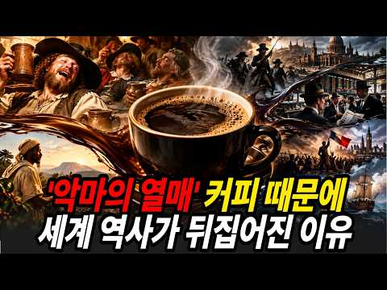
- 챕터: 0:00 도입부 — 매일 마시는 커피, 그 한 잔의 진짜 무게 · 0:30 1장 — 염소가 발견하고, 수도승이 퍼뜨린 마법의 열매 · 4:30 2장 — 낙타 먹이가 유럽을 뒤집다 · 8:30 3장 — 찻집에서 태어난 자본주의, 그리고 홍차 제국 · 13:00 4장 — 왕의 목을 자른 카페 · 17:00 5장 — 커피가 삼킨 사람들 · 21:30 6장 — 전쟁의 연료, 스파이의 암호 · 25:00 7장 — 커피가 사라지고 있다 · 27:30 8장 — 양탕국에서 커피 공화국으로
- 설명 앞부분: 영양분 0%, 열량 0%인 검은 물 한 잔이 보험사를 만들고, 왕의 목을 자르고, 200만 명을 노예로 만들었습니다. 대체 커피가 뭐길래 500년 동안 전 세계가 이 음료에 미쳐 있는 걸까요? 오늘 영상에서는 에티오피아의 염소 목동이 발견한 빨간 열매 한 알이 어떻게 이슬람 세계를 장악하고, 비엔나 전쟁의 전리품이 되고, 런던에서 증권거래소와 세계 최대 보험사를 탄생시켰는지 추적합니다. 프랑스 대혁명의 첫 총성이 울린 카페, 미국 독립의 도화선이 된 보스턴 차 사건, 200만 노예가 끌려간 브라질 커피 농장, 나폴레옹의 군수물자,…
- 같은 채널 평소 대비 ×56.6 (채널 최근 롱폼 중앙값 10,649회) · 평소 영상: "이러다 진짜 유럽 제패할 판!" 콧대높던 서유럽 씹어먹고 유럽의 새로운 심장이 된 폴란… (10,649회) / 유령도시가 된 지상낙원 뉴질랜드! 어쩌다 이렇게 몰락하게 되었을까? (10,412회)
- 대본 없음 (설명) — 음성인식이 끝나면 도입부·흐름이 들어감
- 댓글 51/53: 좋은 점 — 영상 0 · 감사·응원 2 · 더 알고 싶은 것 1 · 아쉬운 점 — 영상 1 · 반박·불만 — 의견 다름 3 · 정치·사회 0 · 경험 공유 2 · 구독·다음 기대 0
  - 감사·응원 👍0 “재미있는 커피이야기 감사합니다”
  - 아쉬운 점 — 영상 👍0 “내용은 좋은데 AI 목소리 대신 어눌한 사람 목소리가 더 좋습니다”
  - 반박·불만 — 의견 다름 👍3 “커피 역사가 그렇군.. 현재는 커피를 대체할 음료가 없고 앞으로도 글쎄...”
  - 반박·불만 — 의견 다름 👍0 “한국은 1인당 커피소비량이 세계2위가 아닙니다, 수차례 계속 반복하시는군요. 검증은 없이 그냥 어디서 줏어들은 대로 쓰는 것입니까?”
  - 경험 공유 👍5 “이게 제일 오류가 맑은 물이 아니면 못먹는다는 거임. 나도 그렇게 알았는데 아니라고함. 해당지역에 살던 사람들은 그 물이 오염되었어도 외부전염병이 오는게 아니라면 별 문제없이 삶. 인도인이 그래서 그 환경에서도 잘 사는 것임. 또 야생동물이 똥물 먹어도 사는게 동일한…”
  - 경험 공유 👍2 “커피에 대한 수없이 많은 갑론을박이 있는 이유가 전세계 산업에 큰 축이기 때문인건 알고 있었는데 영상에서 더 인문학적인 베경을 알게됐네요-- 하루2잔 마시던 커피 끊고 5년차 제2의 인생을 살고 있습니다. 지금도 커피향을 맡으면 마시고 싶다는 강열한 욕구가 일지만 커…”

### 158. [애절한 중국 사극 노래] “나만의 폐하를 사랑하지요” ∣ 황제 무측천이 사랑한 단 하나의 태양 ∣ 성세천하 ost ∣ 이치원조 FMV ∣ 《명명 ∣ 明明》병음…

- https://www.youtube.com/watch?v=z6VcKlWaGoo · 사녀  · 구독자 1,170 · 조회수 157,256 (×134.4, 하루 1,253.3) · 좋아요 1,100 (0.7%) · 4.4분 · 2026-06-24 · 주제 묶음 3. 조선 · 형식 정보·해설 (그 밖) · 폴더 `W_z6VcKlWaGoo` (웹 승인)
- 썸네일: 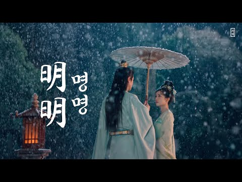
- 설명 앞부분: 취미로 만든 채널로 개인적인 수익 일절 없습니다. 의역/오역 다수. ←관련 피드백 환영. “전하께서 보시기에 저는 어떤 사람 같습니까?” “홀로 거센 눈보라에 맞서지만 정작 자신을 위해 우산을 펴는 건 늘 잊는 사람이지.” “제 마음속에는 늘 폐하가 있었습니다” “짐의 이 생은 아주 행복했소. 원조, 짐이 약조했었지. 그대와 함께 나아가겠다고. 그 약속은 지키지 못하게 되었소.” [무원조의 영원한 태양 이치] 해당 곡은 성세천하 인게임의 메인 테마 음악으로 나오는 영상도 모두 인게임 내 스토리 화면을 사용했습니다. 곡을 소개하는 …
- 대본 없음 (설명) — 음성인식이 끝나면 도입부·흐름이 들어감
- 댓글 107/114: 좋은 점 — 영상 0 · 감사·응원 2 · 더 알고 싶은 것 3 · 아쉬운 점 — 영상 1 · 반박·불만 — 의견 다름 5 · 정치·사회 1 · 경험 공유 5 · 구독·다음 기대 0
  - 감사·응원 👍5 “가사랑 한국어 발음까지 ㅠ 감사합니다ㅏ❤️”
  - 더 알고 싶은 것 👍1 “드라마 제목 알수있을까요?”
  - 경험 공유 👍196 “어떤 스트리머 하는 영상을 보는데 누가 이치만큼은 게임 중에 원조를 죽이지 않았다고, 계속 사랑했다고 채팅치더라🥹 그거 보고 진짜 이치가 찐사라는 생각 많이 했었지ㅠㅠ 그래 이치는 그랬네, 어떤 순간에도 원조를 해치지 않으려 했네....ㅠㅠ 배드엔딩이 뜨더라도 결국 …”

### 159. 200개 문명이 '같은 날'을 기억하는 소름 돋는 이유 ㅣ 전 세계 200개 문명이 증언하는 대홍수, 과학자들도 인정한 충격적 사실

- https://www.youtube.com/watch?v=d1kg9gfbQkI · 역사로 가다 · 구독자 853 · 조회수 136,900 (×160.5, 하루 892.3) · 좋아요 1,771 (1.3%) · 36.6분 · 2026-05-27 · 주제 묶음 8. 문명·고고학 · 형식 정보·해설 (그 밖) · 폴더 `W_d1kg9gfbQkI` (웹 승인)
- 썸네일: 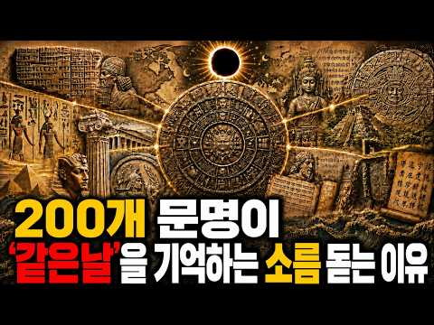
- 챕터: 0:00 인트로 — 같은 날을 기억하는 일곱 개 문명 · 2:54 수메르 대홍수 신화 — 길가메시 서사시, 아트라하시스… · 7:58 과학 증거 — 슈루팍·우르 홍수 퇴적층 발굴 현장 · 10:45 인도 홍수 신화 — 마누와 물고기, 마츠야 푸라나 · 13:30 그리스 홍수 신화 — 제우스의 분노, 데우칼리온의 아… · 16:15 이집트 — 대홍수를 기록하지 않은 문명, 부재라는 단서 · 18:02 마야 홍수 신화 — 나무 인간, 포폴 부흐와 불탄 원본 · 21:25 중국 대홍수 — 곤과 우, 지시협곡 대홍수 과학적 증거 · 24:15 과학 증거 — 흑해 범람 가설, 버클 크레이터, 마다… · 23:30 히브리 창세기 — 노아의 방주와 두루프나르 유적 GP… · 26:30 마무리 — 신화인가, 데이터인가
- 설명 앞부분: 서로 만난 적 없는 일곱 개 문명에 같은 대홍수 이야기가 남아 있습니다. 수메르, 인도, 그리스, 마야, 중국, 이집트, 히브리, 길가메시 서사시의 홍수 점토판부터 노아의 방주 흔적이 의심되는 두루프나르 유적까지, 일곱 문명의 홍수 기록과 과학적 증거를 한 편에 담았습니다. 이 기록들은 신화일까요, 아니면 아직 다 읽지 못한 데이터일까요. 🔹 수메르, 인도, 그리스, 마야, 중국, 히브리 — 서로 만난 적 없는 여섯 문명이 왜 같은 홍수를 기록했을까? 🔹 피라미드를 쌓고 사후 세계를 설계한 이집트는 왜 이 이야기만 빠뜨렸을까? 🔹…
- 같은 채널 평소 대비 ×247.6 (채널 최근 롱폼 중앙값 553회) · 평소 영상: 고대 문명의 주사위에서 시작된 43억 2천만 년 — 지구 나이와 겹친 건 우연일까 (585회) / 다 같 영국인데, 잉글랜드·스코틀랜드·웨일스·북아일랜드는 대체 뭐가 다른 걸까? (521회)
- 대본 없음 (설명) — 음성인식이 끝나면 도입부·흐름이 들어감
- 댓글 370/370: 좋은 점 — 영상 2 · 감사·응원 2 · 더 알고 싶은 것 2 · 아쉬운 점 — 영상 5 · 반박·불만 — 의견 다름 4 · 정치·사회 1 · 경험 공유 3 · 구독·다음 기대 0
  - 좋은 점 — 영상 👍0 “우가 누구한테 배웠을까? 고조선의 태자부루로부터 배운거네”
  - 좋은 점 — 영상 👍0 “기원전 없다 단군조선으로 건국됐고 지구의 국호는 단군조선 이다 지구의 단군조선은 불교식 문명 뿐이고 다른 문명없다 지구의 단군조선 백성들은 천자문 문자로 문자와 말를 배웠고 지구의 인류들은 300년 전에 고려조선의 천자문 문자로 창제한 문자를 배웠고 불교 단어를 사용…”
  - 아쉬운 점 — 영상 👍3 “결국 성경은 동네 찌라시를 모아 짜집기한 책이란 얘기네”
  - 아쉬운 점 — 영상 👍2 “성경의 구약은 여기저기서 듣고 카피한 짜집기 소설임😊”
  - 반박·불만 — 의견 다름 👍7 “초기문명이 다합쳐도 200개가 안됨...그리고 그들문명에 전부 대홍수기록이 있다? 전세계 소수민족들 싹다모아야 200개 되려나? 그리고 그들이 기록이 있고 문자가있었나? 그걸 모두 해독했다? 말도안되는 개소리지 몇몇문명에 그런 비슷한 내용이 있어서 전세계로 모두 일반…”
  - 반박·불만 — 의견 다름 👍1 “대홍수는 없습니다. 과학적으로 불가능한 이야기입니다. 대홍수라는 범지구적 재앙이 아니더라도 홍수 전설이 각 문명에 존재하는건 사실 '당연한'일입니다. 1. 강을 끼고 발달한 고대 도시문명에게 '홍수'는 필연적인 재앙입니다. 현대처럼 치수 기술이 발달하지 못했기에 강이…”
  - 정치·사회 👍0 “그리고 노아의 홍수는 메소포타미아 길가메시 이야기를 카피한거고 이건 한국이 걱정할 일은 아닙니다. 산맥들이 뭉친 나라가 한반도라 노아의 홍수정도에도 산 꼭대기에 올라 살아남을 수 있으니까요. 평지만 있는 나라들은 살아남기 힘들 겁니다”
  - 경험 공유 👍0 “근데 무당 영매 천문학점성술 오컬트니 채널러 스타시드 등등 그런사람들은 잘 모르나? 아님 알면서 말해봤자 이해못하니 말안해주는건가? ㅋㅋ”

### 160. 🔥우연히 얻은 신비한 상자, 그 안에 진짜 명나라가 존재했다. 손가락 한 번에 산적 몰살!#男频 #爽文

- https://www.youtube.com/watch?v=UZ5O6Ny3-sQ · 천하극장 · 구독자 8,410 · 조회수 532,686 (×63.3, 하루 8,744.0) · 좋아요 3,265 (0.6%) · 135.2분 · 2026-08-28 · 주제 묶음 6. 동양사 (중국·일본·몽골) · 형식 사연·드라마 · 폴더 `W_UZ5O6Ny3-sQ` (웹 승인)
- 썸네일: 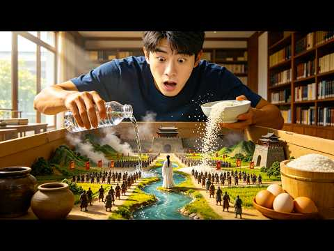
- 설명 앞부분: 🔥 매일 업로드되는 초고속 황궁 복수극 복수의 왕좌 배신당한 왕자, 몰락한 장군, 숨겨진 후계자. 권력과 복수, 그리고 인생 역전의 순간을 담은 고대 남성 드라마 채널입니다. 황궁 암투 사이다 전개 지금 가장 중독성 강한 쇼츠 드라마 채널.
- 같은 채널 평소 대비 ×68.8 (채널 최근 롱폼 중앙값 7,738회) · 평소 영상: 🔥 시스템 각성 후, 천대받은 부마에서 전 세계를 호령하는 진국제왕으로#逆袭 #系统 #打… (7,738회) / 🔥황년에 눈을 떴다. 마을 사람들은 나무껍질을 씹어도,모두 죽어가는 황년에서 곰을 사냥하… (8,052회)
- 대본 없음 (설명) — 음성인식이 끝나면 도입부·흐름이 들어감
- 댓글 523/573: 좋은 점 — 영상 0 · 감사·응원 4 · 더 알고 싶은 것 11 · 아쉬운 점 — 영상 5 · 반박·불만 — 의견 다름 1 · 정치·사회 6 · 경험 공유 12 · 구독·다음 기대 3
  - 감사·응원 👍20 “한글로 해주셔서 감사해요! 생각없이 클릭했는데 넘 재미있네~”
  - 감사·응원 👍4 “영상 잘보네요 감사합니다 ❤❤❤”
  - 더 알고 싶은 것 👍24 “이거 재미 있네요, 그래서 후편 완결은 어떻게 보나요?”
  - 더 알고 싶은 것 👍3 “시즌2 부탁해요”
  - 아쉬운 점 — 영상 👍8 “이어서 없어? 아니 내가 이걸 다보고 있네ㅋㅋㅋㅋㅋㅋ 미쳐ㅋㅋㅋㅋ 진짜 어눌한 더빙에 짜집기 같아서 잠깐보려던겤ㅋㅋㅋㅋㅋㅋㅋㅋㅋ😅”
  - 아쉬운 점 — 영상 👍1 “목욕 하는거 안보여줘서 철판 먹으라는 생각 ㅋㅋㅋ 존나 골때리네 ㅋㅋ Ai같은데 하나인가 뭔가 잘만들었네”
  - 반박·불만 — 의견 다름 👍1 “미치겠네 첨엔 병맛 같은 느낌이라 중국영상이 다 그렇지 하고있었는데 계속보네 ㅋㅋㅋㅋㅋㅋㅋㅋㅋ 어이없는데 웃기면서 재밌기도하네 ㅋㅋㅋㅋ”
  - 정치·사회 👍18 “상자 속의 대명나라》(내 방에 대명나라가 있다 / 箱子里的大明朝) 라고 하는데 더는 검색이 안나오네요.. 2부 올려주세요!! 제발”
  - 정치·사회 👍1 “이 비슷한 내용을 미국영화에서 본거 같은데... 참 중국인들은 한결 같네.. 창작보다 훔쳐서 베낀다.”
  - 경험 공유 👍8 “이어서 없어? 아니 내가 이걸 다보고 있네ㅋㅋㅋㅋㅋㅋ 미쳐ㅋㅋㅋㅋ 진짜 어눌한 더빙에 짜집기 같아서 잠깐보려던겤ㅋㅋㅋㅋㅋㅋㅋㅋㅋ😅”
  - 경험 공유 👍4 “누가감히 나서는지보자. 누가너에게 감히그런용가를줬나.내가바로용왕이다.ㅋㅋㅋㅋㅋ 아 😂😂😂”
  - 구독·다음 기대 👍4 “겁나게 재미나네. 다음편 기대합니다”
  - 구독·다음 기대 👍2 “은근히 재미있네요 다봤네요😊 다음편 기다려 지네요😊”

