# 역사 — 성공 사례 분석: 사례별 자세히 #161–#200

`analysis.md` 의 9번 (같은 # 번호). 자동 생성 — `tools/success_analysis.py` v1.6 (2026-11-12 04:34 UTC). ※ 연구·교육용 — 투자 권유가 아님.

### 161. 성벽도 없는 유목 부족이 어떻게 한나라를 굴복시키고 로마제국을 멸망으로 몰고 갔을까? ∣ 600년 흉노의 대역사 [잠잘 때 듣는 역사]

- https://www.youtube.com/watch?v=Z1Cxh6mktng · 먼 옛날 · 구독자 1,860 · 조회수 66,047 (×35.5, 하루 1,174.5) · 좋아요 182 (0.3%) · 68.3분 · 2026-09-15 · 주제 묶음 1. 역사 일반·이야기 · 형식 수면·낭독 (잠잘 때 듣는) · 폴더 `W_Z1Cxh6mktng` (웹 승인)
- 썸네일: 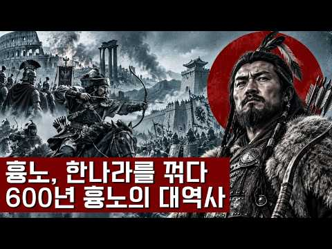
- 설명 앞부분: 한나라와 로마 제국을 절체절명의 위기로 몰아넣은 흉노. 생존을 위해 멈출 수 없었던 초원의 늑대들이 남긴 잔혹하고도 거대한 역사의 진실을 파헤칩니다
- 같은 채널 평소 대비 ×5.5 (채널 최근 롱폼 중앙값 11,971회) · 평소 영상: [오디오 역사북] 강력하게 다져진 금나라 대군이 칭기즈칸의 몽골군에게 순식간에 붕괴된 이유 (11,971회) / 5호1란의 대혼란 속에서 단 하나의 유목 민족만이 1,700년 동안 살아남은 비밀 [수면… (9,493회)
- 대본 없음 (설명) — 음성인식이 끝나면 도입부·흐름이 들어감
- 댓글 4/4: 좋은 점 — 영상 0 · 감사·응원 0 · 더 알고 싶은 것 0 · 아쉬운 점 — 영상 0 · 반박·불만 — 의견 다름 0 · 정치·사회 0 · 경험 공유 0 · 구독·다음 기대 0

### 162. 유럽을 공포에 떨게 한 600년 이슬람 제국은 왜 흔적도 없이 사라졌을까? ∣ 오스만 제국사 풀스토리

- https://www.youtube.com/watch?v=EjRxsCOhmGY · 달빛 세계사 · 구독자 19,400 · 조회수 916,622 (×47.2, 하루 12,196.9) · 좋아요 3,336 (0.4%) · 77.4분 · 2026-08-27 · 주제 묶음 6. 동양사 (중국·일본·몽골) · 형식 수면·낭독 (잠잘 때 듣는) · 폴더 `W_EjRxsCOhmGY` (웹 승인)
- 썸네일: 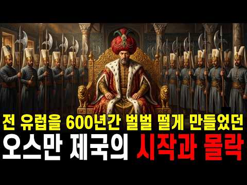
- 챕터: 0:00 인트로: 세 대륙을 호령한 푸른 눈의 이슬람 제국 · 1:29 아나톨리아의 유목민에서 발칸의 패자로 · 12:13 앙카라 전투의 파멸과 부활 · 20:22 1453년 콘스탄티노플 함락과 메흐메트 2세 · 29:35 이슬람 세계를 하나로 묶은 셀림 1세 · 37:29 쉴레이만 대제와 록셀라나의 암투 · 48:51 빈의 성벽과 윙드 후사르, 꺾여버린 초승달 · 57:44 '유럽의 병자'와 피의 개혁 · 67:05 갈리폴리의 기적과 제국의 장례식 · 75:07 에필로그: 역사 속에서 마주한 질문
- 설명 앞부분: 중앙아시아의 거친 바람을 피해 흘러들어온 이름 없는 작은 유목 부족. 말안장 위에서 태어난 이들은 어떻게 천년 로마의 심장을 도려내고, 아시아·유럽·아프리카 3대 대륙을 호령하는 거대한 패자가 되었을까요? 기독교 소년들을 강철 전사로 개조한 공포의 군단 '예니체리', 왕위에 오른 자는 형제들을 목 졸라 죽여야 했던 잔혹한 '형제 살해법', 배를 끌고 산을 넘어 콘스탄티노플을 무너뜨린 21세 정복자 메흐메트 2세, 그리고 제국의 영광 뒤편에서 피비린내 나는 암투를 벌인 하렘의 여인들까지. 세 대륙을 호령하던 찬란한 황금기부터 '유럽…
- 같은 채널 평소 대비 ×16.1 (채널 최근 롱폼 중앙값 56,802회) · 평소 영상: 인류 역사상 가장 잔혹하고 기묘했던 문명, 마야는 왜 흔적도 없이 사라졌을까? [🌙 꿀잠… (60,433회) / 초고대문명, 세계 최초의 완벽한 도시가 사라진 이유, 인더스 문명 5,000년의 수수께끼… (53,172회)
- 대본 없음 (설명) — 음성인식이 끝나면 도입부·흐름이 들어감
- 댓글 66/84: 좋은 점 — 영상 1 · 감사·응원 9 · 더 알고 싶은 것 0 · 아쉬운 점 — 영상 1 · 반박·불만 — 의견 다름 1 · 정치·사회 2 · 경험 공유 2 · 구독·다음 기대 1
  - 좋은 점 — 영상 👍6 “오스만 제국 초기부터 중기와 말기까지 상세한 설명을 잘 시청하였습니다.”
  - 감사·응원 👍33 “위대한 세기를 재밌게 봤었는데 대충은 알았지만 자세하게 제국의 멸망까지 설명해주니 고맙습니다”
  - 감사·응원 👍9 “잘보았습니다 ~감사를 드립니다😊”
  - 아쉬운 점 — 영상 👍3 “광고가 너무 자주 하네요. 어떻게 보기싫을 정도로 몇분에 한번씩 하나요. 보기싫어서 나갑니다.”
  - 경험 공유 👍6 “정말 재밌게. 잘들었습니다 발음도 정확하고 목소리도좋네요 오스만의역사 궁금했었는데 잘들었습니다 감사해용~~”
  - 구독·다음 기대 👍2 “진짜 너무 재및네요 바로 구독합니다”

### 163. 천하를 통일한 유방, 모든 걸 이긴 뒤에 진짜 공포가 시작됐다 ∣ 초한전쟁 그 후의 이야기

- https://www.youtube.com/watch?v=9LJDKInAPkg · 역사의실마리 · 구독자 1,560 · 조회수 93,341 (×59.8, 하루 977.1) · 좋아요 692 (0.7%) · 22.9분 · 2026-07-24 · 주제 묶음 7. 전쟁·군사사 · 형식 인터뷰·강연·대담 · 폴더 `W_9LJDKInAPkg` (웹 승인)
- 썸네일: 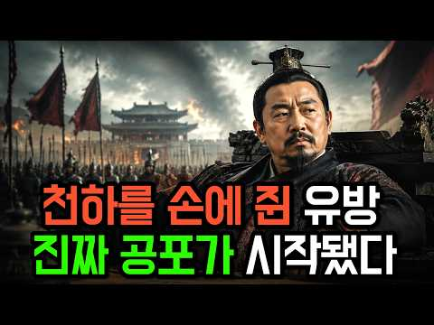
- 챕터: 0:00 다 가진 황제가 밤마다 떨었던 이유 · 0:25 시골 건달, 맨손으로 황제가 되다 · 0:46 진시황의 몰락과 5년 전쟁의 승자 · 1:50 첫 번째 용의자 항우, 홍문연의 칼춤 · 4:54 두 번째 용의자 범증, 말로 벤 머리 · 6:57 천하를 삼켰지만 삼키지 못한 아이러니 · 7:41 세 번째 용의자 한신과 정형 전투의 기적 · 10:04 명장은 왜 황제의 표적이 되었나 · 12:34 한신은 정말 반역했을까 · 13:51 네 번째·다섯 번째 용의자, 팽월과 경포 · 17:29 끝까지 살아남은 단 한 사람 · 20:37 그가 진짜로 두려워했던 것
- 설명 앞부분: 천하를 통일한 황제 유방. 최강의 적 항우를 꺾고 5년 전쟁을 끝낸 그는, 왜 밤마다 잠들지 못하고 식은땀에 떨어야 했을까요? 이 영상은 초한전쟁의 승자 유방이 황제가 된 뒤에 시작된 '진짜 공포'를 추적합니다. 항우, 범증, 한신, 팽월, 경포. 유방을 위협했던 다섯 인물을 하나씩 따라가다 보면, 그가 정말로 두려워한 것의 정체가 서서히 드러납니다. 명장 한신의 정형 전투와 배수진, 홍문연의 칼춤, 토사구팽의 유래, 그리고 유일하게 살아남은 책사 장량의 선택까지. 2천 년 전 이야기지만, 오늘날 우리의 삶과도 놀랍도록 닮아 있는…
- 같은 채널 평소 대비 ×260.0 (채널 최근 롱폼 중앙값 359회) · 평소 영상: 세종대왕 국장의 진실｜조선은 왜 임금을 다섯 달이나 묻지 않았을까? (360회) / 칭기즈칸의 생애와 정복 전략 ∣ 역사상 가장 넓은 제국의 비밀 (358회)
- 대본 없음 (설명) — 음성인식이 끝나면 도입부·흐름이 들어감
- 댓글 49/49: 좋은 점 — 영상 1 · 감사·응원 0 · 더 알고 싶은 것 0 · 아쉬운 점 — 영상 0 · 반박·불만 — 의견 다름 0 · 정치·사회 3 · 경험 공유 1 · 구독·다음 기대 0
  - 좋은 점 — 영상 👍1 “명쾌합니다❤❤❤”
  - 정치·사회 👍1 “중국인들 특징은 통일후 다죽인다 진시황보다 더 토사구팽을 충실하게 해낸자 백만대군이 죽어도 위령비조차 안세우는 중국인”
  - 정치·사회 👍0 “이재명은 힘들게 잡은 권력을 순순히 놓을까요”

### 164. 고고학자들이 아무 설명 없이 발굴을 중단한 미스터리 장소 100곳 ∣ 미스터리 다큐

- https://www.youtube.com/watch?v=7Ct4FNaJHlU · 푸른 태양 · 구독자 2,040 · 조회수 124,784 (×61.2, 하루 1,272.0) · 좋아요 445 (0.4%) · 75분 · 2026-08-04 · 주제 묶음 8. 문명·고고학 · 형식 정보·해설 (그 밖) · 폴더 `W_7Ct4FNaJHlU` (웹 승인)
- 썸네일: 
- 설명 앞부분: 완성되지 않았다고 믿었던 고대 도시, 노아의 방주 후보지, 운석 속 생명의 흔적… 발굴이 멈춘 장소에는 무엇이 숨겨져 있을까? 이라크의 고대 도시 두르샤루킨에서는 최신 자기 탐사 기술로 127개의 방을 갖춘 대저택과 왕실 정원, 수문으로 추정되는 구조물이 모습을 드러냈다. 오랫동안 미완성 수도로 여겨졌던 코르사바드는 정말 번성한 아시리아의 중심지였을까? 땅을 파지 않고도 지하의 비밀을 밝혀낸 새로운 조사 결과가 기존의 역사를 뒤집는다. 터키의 노아의 방주 후보지부터 스리랑카 운석에서 발견됐다는 생명의 흔적, 외부 세계와 접촉을 거…
- 같은 채널 평소 대비 ×16.6 (채널 최근 롱폼 중앙값 7,537회) · 평소 영상: 작은 마을에서 나온, 규모에 전혀 맞지 않는 고대 금속 기술 ∣ 미스터리 3시간 (8,066회) / 4시간+ 과학으로도 풀리지 않은 고대 이집트의 미스터리 ∣ 잠잘 때 듣는 역사 (8,071회)
- 대본 없음 (설명) — 음성인식이 끝나면 도입부·흐름이 들어감
- 댓글 13/14: 좋은 점 — 영상 0 · 감사·응원 1 · 더 알고 싶은 것 0 · 아쉬운 점 — 영상 0 · 반박·불만 — 의견 다름 0 · 정치·사회 0 · 경험 공유 0 · 구독·다음 기대 0
  - 감사·응원 👍4 “그래도 진짜 물건의 영상이 있어서 희귀한것을 보게되어 감사합니다. 그림으로 보여주거나 해서 믿음이 가지 않았느데 오늘은 정말 감사합니다.”

### 165. 틀어놓고 주무세요🌙 ∣ 한 편으로 끝내는 조선 500년 역사 완벽 정리 ∣ 역사 몰아보기 ∣ 조선역사 ∣ 역사 ∣ 한국사

- https://www.youtube.com/watch?v=O_IRLctth4M · 담너머 조선 이야기 · 구독자 4,710 · 조회수 237,501 (×50.4, 하루 2,891.0) · 좋아요 400 (0.2%) · 72분 · 2026-08-20 · 주제 묶음 4. 한국 근현대사 · 형식 수면·낭독 (잠잘 때 듣는) · 폴더 `W_O_IRLctth4M` (웹 승인)
- 썸네일: 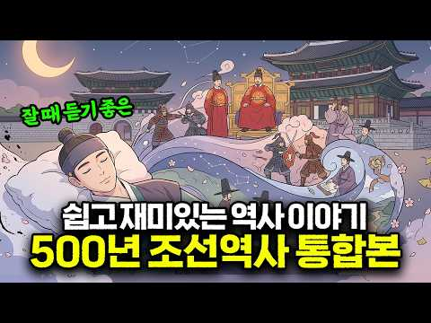
- 설명 앞부분: 태조 이성계의 조선 건국부터 마지막 순종 황제에 이르기까지, 518년 동안 한반도를 지켜온 조선 왕조의 모든 순간을 한 편에 담았습니다. 27대 왕들의 치열했던 권력 다툼과 왕실의 숨겨진 비화, 나라의 운명을 바꾼 결정적인 사건들, 그리고 그 시대를 살아낸 민초들의 삶까지 빠짐없이 엮은 조선 역사 완벽 통합본입니다. 공부할 때, 작업할 때, 혹은 편안한 밤 수면용 라디오로 조선 500년의 거대한 역사 속으로 시간 여행을 떠나보세요.
- 같은 채널 평소 대비 ×26.6 (채널 최근 롱폼 중앙값 8,914회) · 평소 영상: 사극에서는 보여주지 않는 조선시대 백정의 삶 #조선시대 #조선역사 #역사이야기 (8,914회) / 약과와 유과는 꿈도 못 꾸던 조선 백성들은 간식으로 뭘 먹었을까? #조선시대 #조선역사 … (7,377회)
- 대본 없음 (설명) — 음성인식이 끝나면 도입부·흐름이 들어감
- 댓글 6/22: 좋은 점 — 영상 0 · 감사·응원 0 · 더 알고 싶은 것 0 · 아쉬운 점 — 영상 0 · 반박·불만 — 의견 다름 0 · 정치·사회 2 · 경험 공유 0 · 구독·다음 기대 0
  - 정치·사회 👍3 “저거들은 오늘날 민주당들괸 많이 달았네요”
  - 정치·사회 👍0 “국힘이지 모지리야”

### 166. 산에서 쓰러진 사내를 아버지라 부른 7살 딸, 그는 사실 도망 중인 임금이었는데... 옛날이야기 ∣ 민담 ∣ 야담ㅣ수면동화 ∣ 오디오북

- https://www.youtube.com/watch?v=jApSZXpwkLE · 야담야사 라디오 · 구독자 9,230 · 조회수 319,391 (×34.6, 하루 5,562.5) · 좋아요 7,445 (2.3%) · 102.7분 · 2026-09-14 · 주제 묶음 9. 야사·야담·옛날이야기 · 형식 수면·낭독 (잠잘 때 듣는) · 폴더 `W_jApSZXpwkLE` (웹 승인)
- 썸네일: 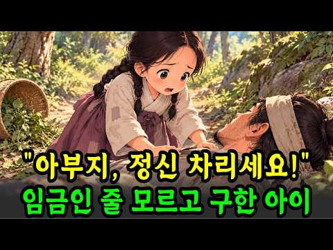
- 설명 앞부분: ‘야담야사 라디오'는 조선 시대 야담, 실화 민담, 옛날 이야기, 전설, 설화, 이야기를 차분한 낭독 형식으로 전하는 오디오북 채널입니다. 잠들기 전 듣는 이야기, 운전 중 편안히 들을 수 있는 이야기, 50대·60대·70대 시청자분들께 특히 잘 어울리는 조용하고 단정한 밤 이야기 콘텐츠를 전합니다. 자극적이지 않게, 그러나 깊이 있게. 사람의 정과 삶의 지혜가 남는 이야기를 전하겠습니다. 😊 📝오늘의 이야기 요약글 “아부지… 정신 차리세요!” 산속 풀숲에 쓰러진 사내를 발견한 일곱 살 복순이의 목소리가 산을 울렸습니다. 2년 전…
- 같은 채널 평소 대비 ×320.7 (채널 최근 롱폼 중앙값 996회) · 평소 영상: 논에 소금뿌린 바보며느리,쫓겨날 줄 알았는데 대풍년 민담ㅣ옛날이야기ㅣ수면동화ㅣ인생이야기ㅣ… (996회) / 떠돌이 장터 거지를 남편으로 사들인 객주 딸 옛날 이야기 ∣ 민담 ∣ 수면동화 ∣ 오디오북 (1,015회)
- 대본 없음 (설명) — 음성인식이 끝나면 도입부·흐름이 들어감
- 댓글 357/729: 좋은 점 — 영상 3 · 감사·응원 34 · 더 알고 싶은 것 2 · 아쉬운 점 — 영상 3 · 반박·불만 — 의견 다름 0 · 정치·사회 3 · 경험 공유 4 · 구독·다음 기대 1
  - 좋은 점 — 영상 👍2 “옛날이야기라 그런지 더욱 정겹고 즐겁게 잘 들었습니다. 어릴 적 어른들께 듣던 이야기도 떠올라 마음이 따뜻해지네요. 좋은 이야기 늘 응원합니다.”
  - 좋은 점 — 영상 👍1 “목소리가 너무 좋아서 몰입해서 들었어요. 슬프면서도 감동적인 이야기라 긴 줄도 모르고 끝까지 들었네요. 좋은 영상 감사합니다!”
  - 감사·응원 👍13 “옛날에 이야기가 제법 즐기면서 ❤유친하고 응원합니다 선물 🎁 👍”
  - 감사·응원 👍10 “부산에서듯고이습니다감사합니다❤❤❤❤❤”
  - 더 알고 싶은 것 👍10 “언제오나요?? 행복이요”
  - 더 알고 싶은 것 👍0 “Bạn có thể dùng bình luận này, vừa **logic vừa tạo tò mò**, hợp với nội dung 야담: > **7살 어린 딸이 쓰러진 사내를 아버지라고 부른 순간, 단순한 우연이라고 보기엔 너무 많은 것이 연결되어 있네요. 도…”
  - 아쉬운 점 — 영상 👍2 “나오는 사람들이 직접 그목소리로 들려주면 지루히ㅣ지않고 재미있어오”
  - 아쉬운 점 — 영상 👍1 “목소리가 너무 좋아서 몰입해서 들었어요. 슬프면서도 감동적인 이야기라 긴 줄도 모르고 끝까지 들었네요. 좋은 영상 감사합니다!”
  - 정치·사회 👍4 “의정부에서듣고있습니다(구독좋아요)기본입니다😅”
  - 정치·사회 👍2 “진실이 드러나는 두려운자들 현 시대에 범죄자 전과자 역적 ㅇ 가짜대통령 이재명과 너무 흡사합니다”
  - 경험 공유 👍2 “주인공의 감정이 너무 잘 전달돼서 저도 같이 울컥했네요.”
  - 경험 공유 👍2 “저희집입니다 ❤❤❤”
  - 구독·다음 기대 👍0 “잘봤습니다 구독해요”

### 167. CCTV 없던 조선, 주모는 어떻게 그많은 사람들을 만족시켰을까? l 역사이야기 l 조선시대 한국사

- https://www.youtube.com/watch?v=X46M1yoKC8s · 역사원탑 · 구독자 7,380 · 조회수 664,415 (×90.0, 하루 4,424.9) · 좋아요 7,045 (1.1%) · 29분 · 2026-06-13 · 주제 묶음 1. 역사 일반·이야기 · 형식 정보·해설 (그 밖) · 폴더 `W_X46M1yoKC8s` (웹 승인)
- 썸네일: 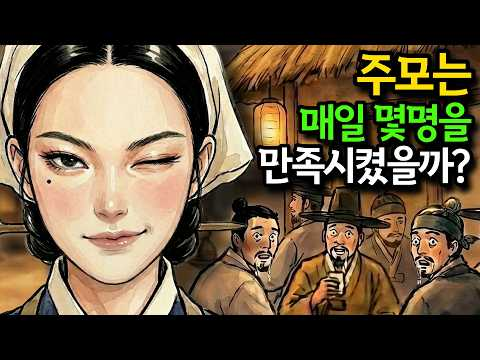
- 챕터: 0:00 인트로 · 0:39 도입 - 술집인 줄 알았던 주막, 그리고 모든 걸 본… · 2:13 주모의 진짜 정체 · 5:17 주모가 본 하루 · 7:35 주막이란 어떤 곳이었나 + 기원 · 9:53 길 위의 주막 - 스무 날 여정 · 11:24 정보·소문·범죄의 길목 · 14:11 주막의 밥상, 국밥의 정체 · 16:55 사극 속 주모 로맨스의 진실 · 18:53 봉놋방 하룻밤 · 21:01 떠도는 썰 검증 (10만 개·은행설) · 23:55 마지막 주막, 삼강주막 · 25:43 현대 연결 · 27:36 결론 - 정보의 길목
- 설명 앞부분: 거리마다 CCTV가 달리고, 차에는 블랙박스가 도는 지금. 그런데 그런 기계가 단 하나도 없던 조선에서, 누가 도둑이고 누가 큰돈을 만졌는지 '모든 걸 본 사람'이 딱 한 명 있었습니다. 바로 — 주막의 주모예요. 양반의 소문도, 장사꾼의 정보도, 도둑의 장물 거래까지. 조선 팔도의 모든 사람과 모든 비밀이 하룻밤은 반드시 거쳐 가던 곳, 주막. 그 한가운데 앉아 모든 걸 보고 들은 주모는, 사극 속 '정 많은 아주머니'가 아니라 조선에서 가장 많은 비밀을 알던 사람이었습니다. 1. 이 영상에서는 사료를 한 장씩 펼쳐 이렇게 풀어…
- 같은 채널 평소 대비 ×22.1 (채널 최근 롱폼 중앙값 30,122회) · 평소 영상: 🔥 "여름철 야심한밤 참을 수 있을까?" 무더위를 참지못한 조선평민 남성과 여성은 밤마다… (45,349회) / "그렇게 먹고 오래 살겠나?" 조선 왕들을 죽인 범인의 충격적인 정체 l 역사이야기 (14,896회)
- 대본 없음 (설명) — 음성인식이 끝나면 도입부·흐름이 들어감
- 댓글 327/359: 좋은 점 — 영상 0 · 감사·응원 3 · 더 알고 싶은 것 1 · 아쉬운 점 — 영상 13 · 반박·불만 — 의견 다름 7 · 정치·사회 7 · 경험 공유 3 · 구독·다음 기대 0
  - 감사·응원 👍2 “매우매우 응원합니다 🎁 🎁 🎁 👍”
  - 감사·응원 👍1 “수능시험을 폐지하고, 중고 6년간 한 과목의 모의고사 점수로 대학에 입학하여 사교육비 줄이고, 기뻐하고 감사하며 사랑하는 영성산업으로 세계통일하여 기아,난민, 전쟁을 종식하자.”
  - 더 알고 싶은 것 👍0 “당시 국밥은 지금 보다 맛이 있었을까요? 궁금합니다.”
  - 아쉬운 점 — 영상 👍9 “13:05 영조4년 자막이 왜 저래 ?”
  - 아쉬운 점 — 영상 👍3 “왜이렇게 지루해요 반복 반복 ㅡㅡㅡㅡ”
  - 반박·불만 — 의견 다름 👍2 “내용중에 모주는 실제론 전국적으로 먹었단 내용은 없고 전주지역에서 주로 먹었단 내용만 있슴 중간중간 짜깁기로 사실이 아닌데 사실인거처럼 얘기하는게 섞여있음”
  - 반박·불만 — 의견 다름 👍0 “바다도 아닌데 왠 낚시???”
  - 정치·사회 👍9 “대한민국 전대통령 부인의 전직업 !😅”
  - 정치·사회 👍1 “인간의 호기심 이용한 어그로네 ㅋㅋ조선족 AI 작품”
  - 경험 공유 👍20 “내 어릴적 우리 집에도 보부상이 자고 가곤 ...”

### 168. 조선왕조실록 1대 태조~27대 순조까지 완벽 총정리 l 조선역사 l 한국사

- https://www.youtube.com/watch?v=8rmf4SkvKpc · 시대를 훔친 이야기 · 구독자 3,380 · 조회수 286,083 (×84.6, 하루 2,018.4) · 좋아요 2,647 (0.9%) · 131분 · 2026-06-21 · 주제 묶음 3. 조선 · 형식 몰아보기·통합본 (긴 영상) · 폴더 `W_8rmf4SkvKpc` (웹 승인)
- 썸네일: 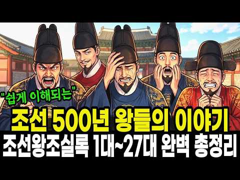
- 설명 앞부분: 👑 조선왕조실록 1대 태조부터 27대 순종까지, 조선 500년 역사를 한 편의 영화처럼 몰아보기! 농사짓던 청년이 갑자기 왕이 되고, 어떤 임금은 궁궐을 버리고 남의 나라로 도망친 나라. 믿기 어렵겠지만 모두 조선왕조실록에 기록된 조선 왕조 500년의 진짜 이야기입니다. 📜 조선왕조실록 몰아보기, 이 영상에서 만나볼 조선 역사 🔹 조선 건국 태조 이성계와 왕자의 난 🔹 한글 창제 세종대왕의 빛나는 업적 🔹 수양대군 세조와 단종의 비극 🔹 폭군 연산군과 중종반정 🔹 임진왜란과 선조, 광해군 이야기 🔹 아들을 뒤주에 가둔 영조와 사도…
- 같은 채널 평소 대비 ×482.4 (채널 최근 롱폼 중앙값 593회) · 평소 영상: 왜? 추석의 송편을 먹는 걸까? 송편의 충격진실ㅣ송편유래ㅣ추석역사 (593회) / 조선왕조실록에 "이것"까지 낱낱히 적었다? 왕들이 끝까지 감추고 싶었던 비밀 TOP3 (595회)
- 대본 없음 (설명) — 음성인식이 끝나면 도입부·흐름이 들어감
- 댓글 66/143: 좋은 점 — 영상 3 · 감사·응원 6 · 더 알고 싶은 것 0 · 아쉬운 점 — 영상 1 · 반박·불만 — 의견 다름 0 · 정치·사회 2 · 경험 공유 1 · 구독·다음 기대 0
  - 좋은 점 — 영상 👍9 “역사에 관심잇는한사람으로서 귀에 쏙쏙 들어오네요 그시대를 경험 한거 같아요”
  - 좋은 점 — 영상 👍1 “너무 좋은 영상입니다 🎉”
  - 감사·응원 👍5 “감사히 잘 듣고갑니다”
  - 감사·응원 👍4 “감사하게 잘 듣고갑니다”
  - 아쉬운 점 — 영상 👍1 “너무너무재밌었어요~조선왕조오백년 하룻밤에다읽었네요 몇번만반복해서듣는다면 완전숙지하게네요 내적지식완전상승 ㅋㅋ감사해요~”
  - 정치·사회 👍5 “요즘 정치상황이 그때와 똑같다 국격이 이렇게 높아진 때에 아직도 중국과 러시아를 추종하는 세력과 저멀리 떨어져 있는 패권국 미국과의 우호를 중시하는 보수우파의 생각중 어느쪽이 옳은 생각일까? 적은 늘가까이에 있다는 진리를 왜 모를까?”
  - 정치·사회 👍2 “문종이 오래도록 자리를 지켰다면 조선은 정말 멋진 나라가 되었을텐데..영조 같은놈 시간을 빼았을수만 있었다면”
  - 경험 공유 👍1 “세종대왕님❤ 한글을 만드신 위대하신 분 지금 내가 이렇게 댓글쓸수있는!!”

### 169. 폐위된 왕의 하루 ∣ 궁궐에서 가시 울타리까지, 연산군과 광해군 ∣ 조선 폐위 왕들

- https://www.youtube.com/watch?v=lWYjoJ3bUO0 · 타임슬림 한국사 · 구독자 6,240 · 조회수 586,431 (×94.0, 하루 3,683.7) · 좋아요 4,773 (0.8%) · 89.3분 · 2026-06-04 · 주제 묶음 3. 조선 · 형식 정보·해설 (그 밖) · 폴더 `W_lWYjoJ3bUO0` (웹 승인)
- 썸네일: 
- 챕터: 0:00 오프닝 — 왕이 사라진 날 · 2:00 구독 CTA · 2:30 조선의 왕권과 반정의 구조 · 6:00 연산군 — 흥청망청의 왕, 교동의 죄인 · 14:00 광해군의 치적과 폐모살제 · 20:00 인조반정과 광해군의 도주 · 25:00 19년 유배 — 강화도에서 제주까지 · 33:00 소현세자 세 아들의 비극 · 38:00 폐위 왕 처우 팩트체크 · 43:00 진짜 지옥 — 정체성의 소멸 · 48:00 역사적 재평가와 마무리
- 설명 앞부분: 🎈영상설명 오늘의 주제: 조선 폐위 왕들의 유배 생활 — 연산군과 광해군 한때 조선 팔도를 호령하던 왕이 왕좌를 빼앗기고 유배지에서 살아야 했다면 어떤 삶이 기다리고 있었을까요? 오늘은 중종반정으로 폐위된 연산군과 인조반정으로 폐위된 광해군의 유배 생활을, 역사적 사실에 기반하여 깊이 있게 살펴봅니다. 📖 주요 내용 조선의 왕권 구조와 반정의 논리 연산군의 교동 유배와 두 달 만의 죽음 광해군의 강화도·제주 유배 19년의 실체 소현세자 세 아들의 제주 유배 비극 폐위 왕들에 대한 조선의 처우 — 팩트체크 진짜 지옥: 왕이 아닌 자…
- 대본 없음 (설명) — 음성인식이 끝나면 도입부·흐름이 들어감
- 댓글 183/191: 좋은 점 — 영상 2 · 감사·응원 3 · 더 알고 싶은 것 0 · 아쉬운 점 — 영상 4 · 반박·불만 — 의견 다름 0 · 정치·사회 7 · 경험 공유 4 · 구독·다음 기대 0
  - 좋은 점 — 영상 👍11 “잘봤습니다. 역사를 알수있어 너무 좋은 영상이네요”
  - 감사·응원 👍16 “좋아요!!!!!!! 감사드립니다!!!!!!!”
  - 감사·응원 👍10 “반갑습니다 ❤❤🎉임진왜란이라는 가장 어려운때에 백성을 돌본 광해군의 업적 대단하고 재평가 받아야 된다고 봅니다,체널번창하시길 바라며 구독과 좋아요로 응원하며 유친맺고자 합니다😊^^”
  - 아쉬운 점 — 영상 👍36 “광해군은 유배지 제주에서는 시를 썼다는데, 그것을 남겨 보관하지 않은 게 참 아쉽네요. 재평가가 이뤄져야 할 광해군인데... 안타깝습니다”
  - 아쉬운 점 — 영상 👍2 “너무 길어효😢”
  - 정치·사회 👍18 “지금세상이면 선조임금 탄핵시키고 광해군이 왕이되었을걸요”
  - 정치·사회 👍4 “문재인 의 반정 폐위된 박근혜 대통령 이재명 의 반정 폐위된 윤석열 대통령 대통령”
  - 경험 공유 👍13 “광해 억울하다는 이미지 그만 만들었으면... 연산은 제위기간에 폭정기간은 2년밖에 안되고 나머지 10여년은 잘 했지만 광해는 극초반 제외하면 쭉 폭정기 였는데 치적이라 할건 해봤자 동의보감 완성 정도고 대동법 막은게 광해고 중립외교는 과장된 허상이고”

### 170. [숨겨진 중국사] 유방이 두려워한 건 번쾌의 배신이 아니라 충성이었다 ∣ 임종 직전 내려진 참수 명령의 진짜 이유 ∣ 역사인물 ∣ 야사 ∣ 비사

- https://www.youtube.com/watch?v=lZkbngqXdeg · 숨겨진중국사 · 구독자 13,200 · 조회수 400,712 (×30.4, 하루 7,666.3) · 좋아요 934 (0.2%) · 27.9분 · 2026-09-06 · 주제 묶음 6. 동양사 (중국·일본·몽골) · 형식 정보·해설 (그 밖) · 폴더 `W_lZkbngqXdeg` (웹 승인)
- 썸네일: 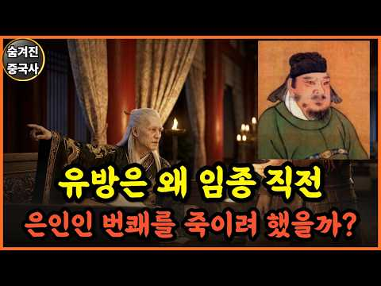
- 설명 앞부분: 저희는 숨겨진 역사를 재미있고 정확한 한 편의 이야기로 풀어내고자 영상을 만들고 있습니다. "매주 화,목,일 오후 12시에 새로운 이야기가 업로드 됩니다 ❤" 🎬 더 많은 영상 보기 👇
- 같은 채널 평소 대비 ×31.9 (채널 최근 롱폼 중앙값 12,553회) · 평소 영상: [숨겨진 중국사] 고려가 이방인을 삼키는 방법 ∣ 역사인물 ∣ 야사 ∣ 비사 (12,553회) / [숨겨진 중국사] 현재 중국 땅을 원래 주인들에게 다 반환하면 어떻게 될까? ∣ 역사인물… (12,548회)
- 대본 없음 (설명) — 음성인식이 끝나면 도입부·흐름이 들어감
- 댓글 58/77: 좋은 점 — 영상 0 · 감사·응원 2 · 더 알고 싶은 것 0 · 아쉬운 점 — 영상 0 · 반박·불만 — 의견 다름 1 · 정치·사회 4 · 경험 공유 1 · 구독·다음 기대 0
  - 감사·응원 👍8 “수를 헤아리지못할만큼 지혜로운 고견을 듣는 시간이었습니다 평생 가슴에 남아있겠네요 감사드리고 건강하세요”
  - 반박·불만 — 의견 다름 👍10 “유방 자체가 개인 능력치로 통일한 놈이 아닌데다....부인한테 쥐어 잡혀 살아서 에혀....ㅋㅋ”
  - 정치·사회 👍17 “이재명 생각나냐”
  - 정치·사회 👍6 “현재로 대입하면 유방 = 이재명 여치 = 김민석 장량 = 유시민 한신 = 김어준 주발 = 이동형 팽월 = 조국 번쾌 = 정청래”
  - 경험 공유 👍34 “번쾌는 나름 시류를 잘 읽는 지혜로운 인물이고 너무도 충직한 사람이었다. 다만 부인이 여후의 친동생인게 탈이었지. 유방이 죽으면서 간신히 목숨을 건지고서 번쾌의 여생내내 번쾌는 어떤 삶을 살았을까? 많이 허무했을 것이다. 그가 여씨의 몰락과 후손의 화를 안보고 죽은게…”

### 171. 조선 궁녀 500명은 도대체 어떻게 버텼을까? ∣ 조선시대 ∣ 조선궁녀

- https://www.youtube.com/watch?v=ASsTr0jROpQ · 배우는역사 · 구독자 2,950 · 조회수 282,841 (×95.9, 하루 1,647.4) · 좋아요 5,162 (1.8%) · 28.1분 · 2026-05-22 · 주제 묶음 3. 조선 · 형식 정보·해설 (그 밖) · 폴더 `W_ASsTr0jROpQ` (웹 승인)
- 썸네일: 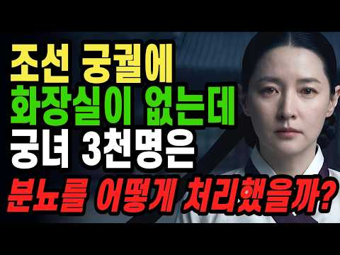
- 챕터: 0:00 인트로 · 2:19 궁녀의 하루 · 3:50 영조의 어머니 · 5:57 왕의 목욕 · 7:21 궁녀의 목욕 · 8:42 비누의 탄생 · 10:45 500명의 빨래 · 13:25 화장실 전쟁 · 14:58 매화틀 · 17:12 개짐과 다리속곳 · 20:42 고려 vs 조선 · 23:43 경복궁 화장실 발굴
- 설명 앞부분: 설명글: 목욕탕도, 생리대도, 화장실도 부족했던 조선 궁궐 🏯 궁녀 500명은 대체 어떻게 위생을 유지했을까요? 드라마에서는 절대 보여주지 않았던 조선 궁녀들의 실제 위생 생활을 낱낱이 파헤칩니다. 왕은 향나무 욕조에서 난초탕으로 목욕하고, 매화틀이라는 전용 변기에 전담 궁녀까지 붙었습니다. 그런데 같은 지붕 아래 살던 궁녀들은? 부엌 구석에서 문 잠그고 수건 한 장으로 몸을 닦았습니다. 화장실 75.5칸을 수백 명이 나눠 쓰고, 생리대 대신 '개짐'이라 불리는 광목천을 평생 빨아 재사용했습니다. 팥가루와 녹두가루를 물에 풀어 세…
- 같은 채널 평소 대비 ×349.4 (채널 최근 롱폼 중앙값 810회) · 평소 영상: 영조는 왜 52년간 "내가 옳다"를 멈출 수 없었나? 성군의 말 뒤에 숨은 진짜 이야기 (841회) / 조선 최악의 역적 가문 ∣ 조선이 망하는데 1등 공신 (778회)
- 대본 없음 (설명) — 음성인식이 끝나면 도입부·흐름이 들어감
- 댓글 251/270: 좋은 점 — 영상 4 · 감사·응원 5 · 더 알고 싶은 것 1 · 아쉬운 점 — 영상 2 · 반박·불만 — 의견 다름 4 · 정치·사회 4 · 경험 공유 8 · 구독·다음 기대 0
  - 좋은 점 — 영상 👍31 “제가 어릴적 80년대 초중반에도 시골에서는 어머니들이 아기들 면기저귀를 생리대로 사용하셨던 기억이 납니다 번거로웠겠지만 지금 일회용생리대보다 건강엔 훨씬 도움이 많이 되었을거 같아요”
  - 좋은 점 — 영상 👍6 “좋은영상 잘 봣읍니다 감사합니다”
  - 감사·응원 👍76 “대한민국 지금 삶에 무조건 감사감사 입니다”
  - 감사·응원 👍45 “지금을 살고 있는 나 감사하다 절대로 저 시대에 살고 싶지 앓다”
  - 더 알고 싶은 것 👍2 “경복궁을 예를 들더라도 궁궐에는 상당한 수의 화장실이 존재하였습니다. 이는 왕실사람들이 사용하는 것이 아니라~ 그곳에서 일하거나 드나드는 사람들이 사용하는 공간입니다. 누가 글을 올린 것인지는 모르나, 조선궁궐에 화장실이 없었다는 것은 어떤 연유일까요? 물론, 목욕탕…”
  - 아쉬운 점 — 영상 👍4 “AI 음성 쓰는 건 알겠는데 좀 딕션 제대로 하는 걸로 골라라...뭐냐 말투가 저게?!”
  - 반박·불만 — 의견 다름 👍15 “경복궁 창덕궁은 목욕탕 시설도 계급에 따라 여러곳 있었고 자연 처리되는 정화조도 있었어요. 어이없는 이슈를 만들어서 역사 왜곡 하지 맙시다.”
  - 반박·불만 — 의견 다름 👍2 “말도 안되는 얘기를...화장실이 진짜 없었을까요? 그리고 그 당시에는 서양에도 생리대라는게 없었고 천을 기저귀같은 모양으로 만들어 생리대로 사용했을텐데...”
  - 정치·사회 👍2 “세종대왕은 백성들은 굶어 죽는데 간식 제도 만들어 간식도 처드시고 온갖 질병 달고살고 백성을 연민의 정으로 백성을 모신게 아닌 고기 엄청 처먹고 당뇨병 걸려 38년 집권 내내 온갖 질병으로 개고생 한 임금이 세종대왕 ... 전두환 박근혜 윤석열 이도 500년 후에 성…”
  - 정치·사회 👍1 “전 알 것 같습니다, 이재명 하는 것 보세요 5년 했으면 어떻게 될 까요? 하고 싶은 구석 구석이 우습 잔아요! 이언주는 어디에 갔나요? 없나요?”
  - 경험 공유 👍31 “제가 어릴적 80년대 초중반에도 시골에서는 어머니들이 아기들 면기저귀를 생리대로 사용하셨던 기억이 납니다 번거로웠겠지만 지금 일회용생리대보다 건강엔 훨씬 도움이 많이 되었을거 같아요”
  - 경험 공유 👍0 “화장실이 없었다고 그러면 먹어치웠겠지 내가 너무심했나 ...?”

### 172. 조선에서 라면팔면 팔릴까?

- https://www.youtube.com/watch?v=Mj85mD9KvmE · 눕이현 · 구독자 26,800 · 조회수 1,174,682 (×43.8, 하루 14,507.9) · 좋아요 10,334 (0.9%) · 9.3분 · 2026-08-21 · 주제 묶음 3. 조선 · 형식 정보·해설 (그 밖) · 폴더 `W_Mj85mD9KvmE` (웹 승인)
- 썸네일: 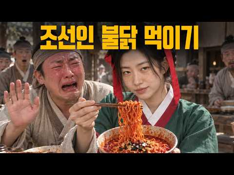
- 대본 없음 (없음) — 음성인식이 끝나면 도입부·흐름이 들어감
- 댓글 1,174/1,198: 좋은 점 — 영상 4 · 감사·응원 26 · 더 알고 싶은 것 17 · 아쉬운 점 — 영상 7 · 반박·불만 — 의견 다름 6 · 정치·사회 2 · 경험 공유 19 · 구독·다음 기대 47
  - 좋은 점 — 영상 👍2 “영상이 너무 좋아요, 처음에는 ai 불펌 같은거줄 알았는데 너무 아이디어랑 편집 영상이 좋아요 ai는 이렇게 쓰여야죠. 근데 문제는 처름 보는 사람들은 오해할 수 있을 듯해서 처음 오프닝을 바꾸던지 하는게 좋을 것 같아요, 특히 쇼츠요, 아이디어는 많이 없지만 조금이…”
  - 좋은 점 — 영상 👍0 “참신한 아이디어에 많이 배우고 갑니다. ㅋ”
  - 감사·응원 👍34 “노고에 눈물이...9분 15초면 한달 크레딧 거의 다 쓰시고....이걸 3일에 한번이라도 올릴 수 있으면 얼마나 좋겠어유...넘 잘 만드셨네영~ 토토와코코가 응원합니다”
  - 감사·응원 👍7 “솔직히 놀랐습니다. 저도 AI 영상 유료로 써보고 생쇼해봤지만 정말 힘든 작업이거든요. 디테일과 각본 등등 미쳐써요 초하이 고 퀄리티. 슈퍼챗이라도 있음 당장 쏘고싶네요 60만구독자까지 응원합니다!!!”
  - 더 알고 싶은 것 👍33 “어허, AI 컨텐츠 중에 다음 퀄리티가 정말 궁금해서 구독한 곳은 여기가 처음입니다. 조선이라는 시대가 그렇게 거부감있는 시대도 아니고, 마치 드라마 시즌1 최종장까지 요약편을 보는 느낌이 드네요. 컨셉을 이어가면서 최종 왕의 입맛까지 홀릴 것이냐, 아니믄 다른 세계…”
  - 더 알고 싶은 것 👍11 “오 뭐야 SF사극 드라마 한편본듯ㅋ 재밌어옄ㅋㅋㅋㅋ 계속만들어주시면 채널 떡상!”
  - 아쉬운 점 — 영상 👍290 “처음엔 AI티가 나네~ 하면서 보고있는데 몰입하다가 와 순간 사람들이 연기하는거로 착각함 재밌다진짜”
  - 아쉬운 점 — 영상 👍2 “뭐지........아무리 가상(AI) 편집이지만.......끌리네요ㅋㅋ 재미도 있고 스토리도 있고!! 구독박고 좋아효!! 믿고 같이 가볼게요~!!”
  - 반박·불만 — 의견 다름 👍7 “현실에서 불가능한 상황을 흡입력있고 유쾌하게 표현하면서 익숙한 유튜브 플랫폼을 따라감 ai 활용에 최고 고점이지않나. 애초에 현실에 있지 않는것을 창조한다면 말도안되는상황을 유쾌하고 트랜디하게풀것 많이배웁니다”
  - 반박·불만 — 의견 다름 👍2 “에비앙은 우라늄이 포함되어 있어요. 좋은 물이 아닙니다.”
  - 정치·사회 👍0 “한국인들은 왜캐 맛도 없고 암유발 음식인 리면을 이리도 좋아하고 라면부심이 강한걸까? 라면은 중국인이 발명한건데”
  - 경험 공유 👍7 “솔직히 놀랐습니다. 저도 AI 영상 유료로 써보고 생쇼해봤지만 정말 힘든 작업이거든요. 디테일과 각본 등등 미쳐써요 초하이 고 퀄리티. 슈퍼챗이라도 있음 당장 쏘고싶네요 60만구독자까지 응원합니다!!!”
  - 경험 공유 👍3 “내가 웬만하면 AI 다 차단 때리는데, 여긴 진짜 맛집이네. 저점매수 구독하고 감”
  - 구독·다음 기대 👍333 “조금 오버해서 방송국놈들이 수천 수억들여 촬영한 영상들보다 각본 연출 스토리 좋구요 시댄스로 이 정도 만들려면 돈이 꽤 들었을텐데요 시댄스의 엄청난 성능과 주인장의 센스가 제대로 콜라보 되었어요 정말 좋은 센스와 재능을 가지셨네요 구독하고 다음영상 기다리겠습니다 굿”
  - 구독·다음 기대 👍12 “이채널 맛집이네 구독박아요❤”

### 173. 독립자금에 전 재산을 쏟아부은 조선 최고 부자 경주 최부잣집 클라스

- https://www.youtube.com/watch?v=bcLdcEWs4yw · 역사본능 · 구독자 39,300 · 조회수 1,164,455 (×29.6, 하루 20,554.4) · 좋아요 4,397 (0.4%) · 31.7분 · 2026-09-15 · 주제 묶음 3. 조선 · 형식 정보·해설 (그 밖) · 폴더 `W_bcLdcEWs4yw` (웹 승인)
- 썸네일: 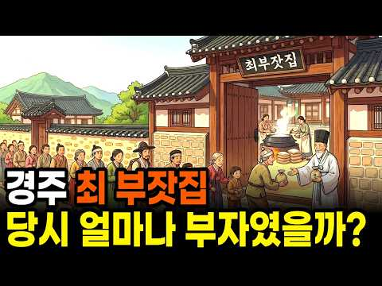
- 설명 앞부분: 조선에서 제일 부자였던 집인데, 대문을 잠근 적이 없습니다. 부자가 삼대를 못 간다는 말과, 열두 대를 간 집이 스스로 빈손이 된 이야기를 함께 담았습니다. ※ 본 영상은 특정 인물이나 단체를 비방할 목적이 없으며, 역사·교육 정보 제공을 목적으로 제작되었습니다. 국사편찬위원회, 『우리역사넷』 교과서 용어해설 '백산상회' 독립기념관, 『월간 독립기념관』 「노블리스 오블리주를 실천한 경주 최부자」 한국학중앙연구원, 『한국민족문화대백과사전』 '경주 최부자댁', '대한광복회' 국가유산청, 국가민속문화재 제27호 경주 최부자댁 지정 자료…
- 같은 채널 평소 대비 ×67.6 (채널 최근 롱폼 중앙값 17,219회) · 평소 영상: 야인 시대 레전드, 김두한 VS 이정재 누가 더 강했을까? (17,219회) / "북괴가 알면 큰일이다" 대통령을 쏜 사람이 차 안에서 한 첫마디 (16,534회)
- 대본 없음 (설명) — 음성인식이 끝나면 도입부·흐름이 들어감
- 댓글 254/319: 좋은 점 — 영상 1 · 감사·응원 11 · 더 알고 싶은 것 0 · 아쉬운 점 — 영상 0 · 반박·불만 — 의견 다름 0 · 정치·사회 17 · 경험 공유 17 · 구독·다음 기대 1
  - 좋은 점 — 영상 👍8 “요즘 보기 드문 재미와 교훈이 함께 있는 좋은 이야기네요.”
  - 감사·응원 👍40 “대단합니다. 경주 최부자댁 기억하겠습니다. 감사합니다.”
  - 감사·응원 👍22 “존경합니다. 그리고 감사합니다.”
  - 정치·사회 👍151 “이 얘기가 사실이라면 이런 집안이 국가 유공자 대훈장을 받아야 한다. 언젠가 제대로 된 정권이 들어서면 유공자를 분별하여 진짜만 대대손손 국가가 공훈대로 혜택을 주는 날이 있길 바랍니다.”
  - 정치·사회 👍30 “영남대는 최준선생이 자금을대고 만들어 이병철한테 운영을 맡겼는데 삼성 사카린밀수 사건으로 박정희한테 땅이랑 재단 다 홀라당 뺏끼고 나몰라라 함 영남대 부지는 120만평임 울나라에서 젤 크다고 봐도 무방함 영남대는 경주 최씨 종가에 넘겨야됨 이사장에 박근혜 박근령이 왠…”
  - 경험 공유 👍215 “경주최씨 입니다 ^^ 조상님들께서 훌륭하셨으니 후손들도 멋지게 살아야죠 ㅎㅎ 저도 좋은 기운 이어받고 열심히 살고 있습니다”
  - 경험 공유 👍85 “최부자집 2형제분들 이회영 6형제분들이랑 제가 가장 존경하는분들 진짜 참어른들이시고 훌륭하신분들”
  - 구독·다음 기대 👍2 “경주 최씨..후손이 리스팩 하고 정주행 하고 갑니다.. 감사합니다..”

### 174. 전 세계가 매년 100조를 쓸 때 한국만 0원인 진짜 이유 세종대왕이 600년 전 심어놓은 공짜 시스템의 정체

- https://www.youtube.com/watch?v=uXPzRDWIFSA · 경제를 알리자 · 구독자 7,500 · 조회수 176,159 (×23.5, 하루 3,883.5) · 좋아요 382 (0.2%) · 19분 · 2026-09-26 · 주제 묶음 3. 조선 · 형식 정보·해설 (그 밖) · 폴더 `W_uXPzRDWIFSA` (웹 승인)
- 썸네일: 
- 챕터: 0:00 세계는 매년 100조, 한국만 0원인 이유 · 0:27 '글자값’이란 무엇인가 — 글자 없는 언어들의 비극 · 1:54 영어의 함정, 철자와 난독증이라는 보이지 않는 비용 · 3:42 중국어 한자와 일본어의 이중 부담 · 5:40 전 세계가 치르는 천문학적 '글자값’의 정체 · 6:20 한국만 0원인 진짜 이유 — 하루아침에 배우는 ‘아침… · 8:04 신하들의 반대를 무릅쓴 세종대왕의 파격적 결단 · 12:31 디지털 시대에 다시 태어난 한글, IT 강국의 숨은 … · 15:33 지구 반대편을 구한 한글 — 인도네시아 찌아찌아족 이… · 18:39 600년째 로열티 0원, 세종대왕이 남긴 선물
- 설명 앞부분: 세종대왕이 한글을 만들었다는 건 한국인이라면 누구나 아는 사실이죠. 그런데 그 한글이 지금도 우리에게 매년 수십조 원의 가치를 벌어다 주고 있다는 사실은 잘 모르셨을 겁니다. 전 세계 대부분의 나라가 ‘자기 나라 글자’ 때문에 해마다 어마어마한 비용을 치르고 있는데, 왜 유독 대한민국만 그 '글자값’이 0원일까요? 영어의 복잡한 철자, 중국어의 수천 개 한자와 입력 문제, 일본어의 이중 문자 부담부터, 600년 전 신하들의 반대를 무릅쓰고 백성을 위한 글자를 만든 세종대왕의 이야기, 그리고 오늘날 인도네시아 찌아찌아족까지 살린 한…
- 같은 채널 평소 대비 ×71.5 (채널 최근 롱폼 중앙값 2,464회) · 평소 영상: "이게 된다고?"서울대가 바닷물에서 도시가스를 만들어낸 방법 (2,464회) / 전 세계 딱 3척뿐인 배, 한국이 두 번째까지 노린다…유럽이 긴장한 이유 (1,915회)
- 대본 없음 (설명) — 음성인식이 끝나면 도입부·흐름이 들어감
- 댓글 36/36: 좋은 점 — 영상 2 · 감사·응원 3 · 더 알고 싶은 것 1 · 아쉬운 점 — 영상 0 · 반박·불만 — 의견 다름 0 · 정치·사회 1 · 경험 공유 3 · 구독·다음 기대 0
  - 좋은 점 — 영상 👍17 “곧 한글날이 다가 오네요 좋은 영상 감사합니다~~~”
  - 좋은 점 — 영상 👍0 “유익한영상 감사합니다”
  - 감사·응원 👍17 “곧 한글날이 다가 오네요 좋은 영상 감사합니다~~~”
  - 감사·응원 👍2 “킹세종대왕님 왕감사드립니다.”
  - 더 알고 싶은 것 👍0 “0:27 에서 "글자값이라는 게"를 소리나는대로 쓰면 "글자갑시라는 게" 라고 생각했는데, "글자가비라는 게"라고 하시네요. 이건 제가 잘못 알고 있는 건가요? 아니면 둘 다 맞나요? 아니면 사투리인가요? 생각 보다 많은 분들이 `가비`라고 해서 갑자기 궁금해졌어요.”
  - 정치·사회 👍1 “중국인이 한자를 키보드로 입력할 때 한자 한글자씩 찾아서 입력한다는 헛소리 제발 좀 그만해라. 아래는 제미나이를 통해 확인한 중국어 입력방식에 대한 설명임. 1. 전면 초성(簡拼, Jianpin) 입력 방식 문장 전체나 어절 단위의 초성만 쫙 치면, 입력기가 문맥을 …”
  - 경험 공유 👍1 “중국인이 한자를 키보드로 입력할 때 한자 한글자씩 찾아서 입력한다는 헛소리 제발 좀 그만해라. 아래는 제미나이를 통해 확인한 중국어 입력방식에 대한 설명임. 1. 전면 초성(簡拼, Jianpin) 입력 방식 문장 전체나 어절 단위의 초성만 쫙 치면, 입력기가 문맥을 …”
  - 경험 공유 👍0 “맞아요..예전에 중국계 싱가포리안들이 내가 휴대폰으로 문자 보내는거 보더니, 병음 안치고 그냥 알파벳 치듯이 치는거야? 라고 물어보면서 진심으로 부러워했어요..”

### 175. 교과서가 숨긴 정약용의 두 얼굴ㅣ18살에 수천만 원을 기생에게 뿌린 남자#정약용 #다산정약용 #조선역사#정해인#정조 정약용#역사

- https://www.youtube.com/watch?v=E2CnbVqR8N0 · 역사 쏙쏙 · 구독자 4,060 · 조회수 351,241 (×86.5, 하루 2,073.4) · 좋아요 5,073 (1.4%) · 47.4분 · 2026-05-25 · 주제 묶음 1. 역사 일반·이야기 · 형식 정보·해설 (그 밖) · 폴더 `W_E2CnbVqR8N0` (웹 승인)
- 썸네일: 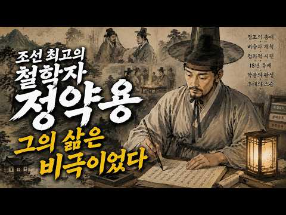
- 챕터: 0:00 도입 — 교과서가 말하지 않는 정약용 · 3:20 꽃미남 정약용 — 정조가 외모를 칭찬한 이유 · 6:40 조선 3대 도박 해부 — 쌍륙, 투전, 골패 · 12:30 촉석루의 밤 — 18살, 3000전, 기생 · 18:00 정조와 17년 — 종이 100필, 밤의 독대 · 24:10 신유박해 — 형은 참수, 나는 유배 · 28:40 강진 18년 — 두 평 골방에서 500권 · 34:00 하피첩 — 34년 된 치마를 가위로 자르다 · 38:20 결론 — 위선인가, 솔직인가
- 설명 앞부분: 교과서 속 청렴한 실학자 정약용, 그의 진짜 인생을 파헤칩니다. 18살에 조선 3대 도박(투전·골패·쌍륙)을 마스터하고, 진주 촉석루에서 하룻밤에 3,000전(현재 가치 수천만 원)을 따서 전부 기생에게 뿌린 남자. 왕 정조가 직접 "아름다운 자태"라고 칭찬한 꽃미남. 배우 정해인의 6대 조상. 유배지에서 500권을 쓴 천재. 그런데 왜, 도박 기록을 지우지 않았을까? 이 영상에서 다루는 내용: 📚 참고 사료: 다산시문집 제18권 (김이재에게 보낸 편지) 정조실록 목민심서 조선왕조실록 성종 21년 댓글로 알려주세요 👇 촉석루 기록…
- 같은 채널 평소 대비 ×74.4 (채널 최근 롱폼 중앙값 4,722회) · 평소 영상: 정조가 사촌형을 죽인 진짜 이유 (4,722회) / 정조가 가장 믿었던 남자, 홍국영을 직접 내친 진짜 이유 (6,340회)
- 대본 없음 (설명) — 음성인식이 끝나면 도입부·흐름이 들어감
- 댓글 370/395: 좋은 점 — 영상 5 · 감사·응원 23 · 더 알고 싶은 것 1 · 아쉬운 점 — 영상 4 · 반박·불만 — 의견 다름 2 · 정치·사회 6 · 경험 공유 12 · 구독·다음 기대 1
  - 좋은 점 — 영상 👍12 “유익한 내용 감사드립니다.”
  - 좋은 점 — 영상 👍3 “잘알려주셔서 감사합니다 고맙습니다”
  - 감사·응원 👍50 “지금우리시대로보면.국방장관급.국무총리겸사해도될정도로아주훌륭한선비.고맙습니다”
  - 감사·응원 👍12 “유익한 내용 감사드립니다.”
  - 더 알고 싶은 것 👍9 “감사합니.다 이렇게 훌륭하신분들이 계셨기에 지금에 우리들이 있읍니다 많은걸 배우고 반성했어요 너무 감사합니다 교육이 되는 좋은글 많이 부탁드립니다 강사합니다 !,”
  - 아쉬운 점 — 영상 👍12 “조선의 위대한 학자 그런데 한권이라도 한글로된 책을 남겼으면 아쉬움”
  - 아쉬운 점 — 영상 👍4 “광고가 너무 많아요.”
  - 정치·사회 👍8 “이승만 대통령에 대한 평가도 재평가 돼야한다 역사왜곡한 놈들에 의해 과소평가 된 분 이승만 같은 분 전에도 없고 후에도 없을 정도 세계는 아는데 정작 대한민국 국민은 초대 대통령을 모른다”
  - 정치·사회 👍6 “정조와정약용의반대세력이현재는국짐당으로~정순왕후만없었어도나라가이꼴나진않았겠지”
  - 경험 공유 👍22 “내가 맘에 드는 남의 물건 하나를 얻었다면 나도 아끼는 물건 하나를 상대에게 줘라”
  - 경험 공유 👍22 “곱게보면 꽃 아닌 사람이 없고 밉게보면 잡초 아닌 사람이 없으되 내가 잡초되기 싫으니 상대를 꽃으로 볼일이로다라는 글귀가 생각나네요 부산에서 듣고있어요”
  - 구독·다음 기대 👍1 “좋은 내용입니다. 구독합니다.”

### 176. 이순신이 죽을 뻔한 순간, 선조에게 맞선 72살 대신 정탁의 구명 상소

- https://www.youtube.com/watch?v=rKbIXQkOL-A · 꼬미의 기록장 · 구독자 2,170 · 조회수 96,452 (×44.5, 하루 1,087.3) · 좋아요 707 (0.7%) · 32.6분 · 2026-08-13 · 주제 묶음 3. 조선 · 형식 정보·해설 (그 밖) · 폴더 `W_rKbIXQkOL-A` (웹 승인)
- 썸네일: 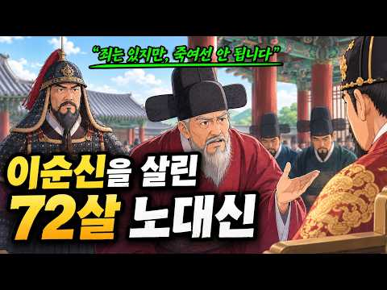
- 설명 앞부분: 1597년, 이순신은 영웅이 아니라 죄인이었습니다. 그런데 그를 살리려 나선 사람은 먼저 “이순신에게 죄가 있다”고 말했던 72살 대신 정탁이었습니다. 선조는 왜 이순신을 버리려 했고, 정탁은 왜 그런 이순신을 끝까지 살려두려 했을까요? 이 영상은 이순신의 파직과 투옥, 정탁의 구명 논리, 칠천량 패전과 명량 직전까지 이어진 숨은 이야기를 따라갑니다. 주요 내용 1597년 선조가 이순신에게 격노한 이유 “이순신은 참으로 죄가 있습니다”라고 말한 정탁의 실제 판단 72살 노대신 정탁은 어떤 정치가였나 이순신 파직과 의금부 투옥까지 …
- 같은 채널 평소 대비 ×290.5 (채널 최근 롱폼 중앙값 332회) · 평소 영상: 수양대군은 어떻게 세조가 되었나? 단종을 몰아낸 계유정난의 진실 (332회) / 조선 최고 권력자 한명회, 자식 5명은 왜 모두 비극으로 끝났나 ∣ 왕비 두 명을 만든 … (319회)
- 대본 없음 (설명) — 음성인식이 끝나면 도입부·흐름이 들어감
- 댓글 82/82: 좋은 점 — 영상 2 · 감사·응원 6 · 더 알고 싶은 것 0 · 아쉬운 점 — 영상 2 · 반박·불만 — 의견 다름 0 · 정치·사회 6 · 경험 공유 2 · 구독·다음 기대 0
  - 좋은 점 — 영상 👍9 “꼬미의 기록장님은 AI 님이시군요. 저는 꼬미님이 인용하시는 2015년 "이순신을 구원한 정탁의 신구차에 관한 연구" 논문을 쓴 방성석입니다. 우연히 동영상을 보고 저의 연구 성과를 인용하는 것에 기뻤습니다. 전개하시는 논리가 매우 합리적이라 많이 배웠습니다. 감사합…”
  - 감사·응원 👍9 “꼬미의 기록장님은 AI 님이시군요. 저는 꼬미님이 인용하시는 2015년 "이순신을 구원한 정탁의 신구차에 관한 연구" 논문을 쓴 방성석입니다. 우연히 동영상을 보고 저의 연구 성과를 인용하는 것에 기뻤습니다. 전개하시는 논리가 매우 합리적이라 많이 배웠습니다. 감사합…”
  - 감사·응원 👍3 “좋은글 감사합니다”
  - 아쉬운 점 — 영상 👍4 “내용은 좋으나 똑같은 내용을 말만 계속 바꾸어서 지루하게 들려요.”
  - 아쉬운 점 — 영상 👍1 “주장의 핵심에 동의함. 다만, 반복해서 너무 길게 말하니 ...”
  - 정치·사회 👍21 “선조는 임진왜란의 휴전기간이 길어지자 차츰 남해안에 주둔중인 일본군과 대치하고 있는 조선수군에게 일본군을 공격하여 몰아낼것을 끊임없이 요구합니다 그러나 현지에서는 일본군이 남해안 요충지에 붙어서 솟아오른 산정상에 성을 쌓은후 함대를 해안가에 정박해놓고 만반의 수비태세…”
  - 정치·사회 👍2 “500년전에 이순신이나 500년이 지난 지금 2026.8.17일 문재인과 이재명정권이나 충신이나 올바른 사람은 대한민국에서 살기가 정말 힘들구나 신뢰는 자신을 가장 아름답게 가장 당당하게 가장 용기있게 만드는 최강의 내공입니다 스스로가 이렇게 보이지 않는 아름다운 신…”
  - 경험 공유 👍5 “정탁 대신은 진정 나라를 위한 애국자이다. 첩의 자식 출신의 열등감으로 똘똘 뭉처져서, 배배꼬인 화가 머리끝까지 나서, 뚜껑이 열린 선조 놈을 염장지않고, 임금의 어명(잘못된 명령)을 어긴 이순신의 잘못을 지적하면서도, 선조를 달래어서 선조의 체면을 세워주고, 나라를…”
  - 경험 공유 👍2 “500년전에 이순신이나 500년이 지난 지금 2026.8.17일 문재인과 이재명정권이나 충신이나 올바른 사람은 대한민국에서 살기가 정말 힘들구나 신뢰는 자신을 가장 아름답게 가장 당당하게 가장 용기있게 만드는 최강의 내공입니다 스스로가 이렇게 보이지 않는 아름다운 신…”

### 177. 왜 해모수를 주몽의 아버지로 만들었나? 고구려 건국 신화의 재구성

- https://www.youtube.com/watch?v=PwKBqRk1_yQ · 한국사종사관 · 구독자 3,630 · 조회수 169,409 (×46.7, 하루 1,796.6) · 좋아요 1,259 (0.7%) · 23.5분 · 2026-07-26 · 주제 묶음 2. 한국 고대·삼국·고려 · 형식 정보·해설 (그 밖) · 폴더 `W_PwKBqRk1_yQ` (웹 승인)
- 썸네일: 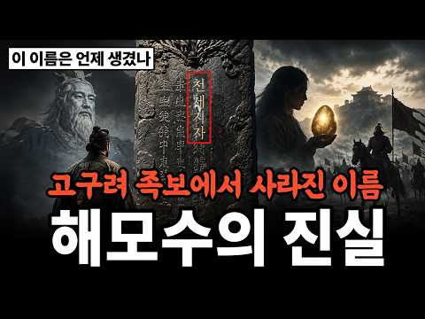
- 챕터: 0:00 비석에 없는 이름, 오늘 열 사건 파일 · 0:51 우발수의 진술로 남은 해모수와 우리가 아는 계보 · 5:27 414년 광개토왕릉비, 아버지 자리에 이름이 없다 · 10:38 사서마다 옮겨 앉는 해모수의 자리와 더 오래된 부여의… · 16:11 지운 게 아니라 나중에 얹은 이름, 부여 사람들이 고… · 21:09 빈칸의 정체와 아직 안 풀린 계보 하나
- 설명 앞부분: 고구려 사람들이 자기 손으로 새긴 414년의 비석에는 시조 추모왕의 아버지가 하늘의 임금, 천제라고만 적혀 있습니다. 우리가 아는 해모수라는 이름은 그 돌 어디에도 없습니다. 그런데 700여 년 뒤 종이 사서에서는 해모수가 계보 맨 윗줄에 올라와 있고, 사서를 넘길 때마다 그 자리가 바뀝니다. 여기선 주몽의 아버지, 저기선 해부루의 아버지, 또 어디선 하늘 그 자체입니다. 이 이름은 언제, 왜 족보에 들어왔을까요. 삼국사기와 삼국유사, 동명왕편, 그리고 부여의 동명 신화를 전하는 1세기 기록까지 나란히 놓고 그 빈칸의 정체를 추적…
- 같은 채널 평소 대비 ×37.3 (채널 최근 롱폼 중앙값 4,546회) · 평소 영상: 에밀레종이 울리던 시대, 신라의 왕은 왜 궁궐 한복판에서 '미제 사건'이 되었나 (4,639회) / 역사 미스터리: 즉위 60일, 신문왕의 칼끝은 누구를 향했나 (4,452회)
- 대본 없음 (설명) — 음성인식이 끝나면 도입부·흐름이 들어감
- 댓글 292/292: 좋은 점 — 영상 1 · 감사·응원 4 · 더 알고 싶은 것 2 · 아쉬운 점 — 영상 2 · 반박·불만 — 의견 다름 6 · 정치·사회 11 · 경험 공유 6 · 구독·다음 기대 0
  - 좋은 점 — 영상 👍2 “환단고기에는 명쾌하게 다 설명되어 있는데, 굳이 식민사학자들이 붙인 위서 낙인으로 왜 보지도 연구하지도 않는지 모르겠다.”
  - 감사·응원 👍0 “공부많이 하였습니다~고맙습니다~^^”
  - 더 알고 싶은 것 👍0 “영상 잘 봤습니다!! 뭔가 보니까 그리스-로마 신화가 떠오르네요. 로마가 부족한 문화적 깊이와 정통성을 채우기 위해 그리스 신화를 흡수하고 재해석 한 거 처럼 고구려도 초기 부족한 정통성을 채우기 위해 부여 쪽 신화를 가져다가 재해석 한 게 아닐까라는 생각도 듭니다.…”
  - 아쉬운 점 — 영상 👍0 “참 아쉽네요 기록도 고구려 멸망당시 대부분 없어지고 유물도 대부분 중국이나 북한에 있으니 발해나 고구려 역사를 연구하고 싶어도 안되니 한편으로 답답하네요”
  - 아쉬운 점 — 영상 👍0 “AI 목소리 ㅈㄴ 거슬리네..”
  - 반박·불만 — 의견 다름 👍5 “해모수는 사람이름이 아닙니다,해머슴(하늘의 아들,태양의 아들),즉 직책입니다,단군,선우,천독도 직책이구요,주뭉도 졸몬(몽골어로 금성,하늘의 아들 )의 한자음차로 직책입니다,하백의 딸 유화는 백인의 딸,아 당시 아람,페르시아와의 혼혈입니다,신라의 화랑도 백인입니다,”
  - 반박·불만 — 의견 다름 👍0 “"The rebirth of the BaeDal Empire" Dangun Joseon(land of eternal dynamic morning calm) is united nations of Hunic Turkish Mongolian Manturian and Jap…”
  - 정치·사회 👍38 “고조선의 멸망이라기 보다는 연방 체제가 조금씩 쇠퇴하면서 고조선의 마지막 단군 고열가 이후 해모수가 부여(북부여)의 단군으로 계승되었다고 봅니다. 고조선과 부여는 단일 국가(또는 단일 민족)가 아닌 여러 부족(민족)의 연합체라 보아야 하지 않을까요? 거대한 연방체의 …”
  - 정치·사회 👍1 “역사좀 그만 건들어야 합니다.이러니 나라가 이러지. ,😢”
  - 경험 공유 👍15 “백제도 비류계와 온조계가 서로 다투며 결국 온조계(근초고왕)가 역사를 새롭게 정리 했고, 고구려도 주기적으로 부여계를 흡수하면서 역사를 다시 정리 해서 원래의 역사를 정확하게 알기는 어렵게 된것 같네여. 뭔가 서로 다른 세력을 합칠때 형제라는 표현을 자주 사용했었던거…”
  - 경험 공유 👍1 “솔직이 전 한국고대사는 너무많은 왜곡과 기록삭제로 실상을 알기 어렵다입니다 제가 지나(자칭 중국)옛지명이 참 우리역사의 지명과 많이 너무많이 겹친다는것과 아직도 문제인 부여의 위치와 부여의 존재할때 어떤 이름으로 불렸냐는겁니다. 지나의 기록에 부여가 사서에나오는 때는…”

### 178. 조선의 역대급 변절자 신숙주가 성삼문 아내를 노비로 들인 이유 #계유정난 #사육신

- https://www.youtube.com/watch?v=h9lGe72Y4NM · 국사의품격 · 구독자 3,960 · 조회수 303,603 (×76.7, 하루 1,893.7) · 좋아요 5,377 (1.8%) · 19.2분 · 2026-06-03 · 주제 묶음 3. 조선 · 형식 정보·해설 (그 밖) · 폴더 `W_h9lGe72Y4NM` (웹 승인)
- 썸네일: 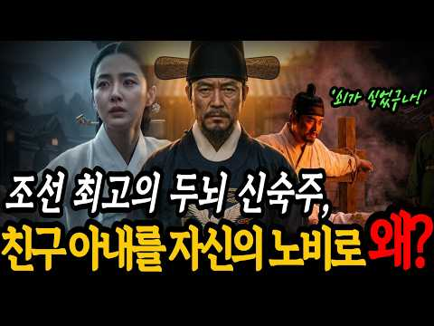
- 설명 앞부분: "나으리, 어찌 배반이라 하십니까. 나의 임금은 상왕 단종이십니다." 달군 쇠로 다리가 지져지면서도 성삼문은 세조를 끝까지 '전하'라고 부르지 않았습니다. 그날 그 친국 자리에, 영의정 관복 차림으로 같은 마당에 서 있던 한 사람이 있었습니다. 신숙주, 성삼문과 같은 책상에서 한글을 만들고 요동을 열세 번 함께 다닌 친구였습니다. 성삼문이 죽던 그날 신숙주는 친구의 아내를 자기 집 노비로 들였다는 이야기, 그의 부인 윤씨가 그 부끄러움에 다락방에서 목을 매었다는 이야기. 그가 어찌나 변절을 잘했던지 잘 쉬는 나물에까지 그의 이름이…
- 같은 채널 평소 대비 ×10.4 (채널 최근 롱폼 중앙값 29,286회) · 평소 영상: [세계사] 영화《오디세이》보다 더 재미있는 트로이전쟁이 일어난 진짜 이유 ∣ 사과 하나에… (29,286회) / 정조가 14년을 벼른 복수 ∣ 영조가 품은 여인, 숙의문씨 #조선왕조실록 #한국사 #정조… (24,822회)
- 대본 없음 (설명) — 음성인식이 끝나면 도입부·흐름이 들어감
- 댓글 394/394: 좋은 점 — 영상 4 · 감사·응원 2 · 더 알고 싶은 것 6 · 아쉬운 점 — 영상 4 · 반박·불만 — 의견 다름 13 · 정치·사회 18 · 경험 공유 11 · 구독·다음 기대 0
  - 좋은 점 — 영상 👍3 “1단종이 폐위 된건, 할아버지 세종 때문이었어요. 자기도 첫째가 아니었음에도 그놈에 장자 타령해서 문종 즉위(형이 수양을 밀어줌). 2. 문종도 죽을때 수양에게 양위했어야 옳은 일이었지만 아들에게 양위. 3. 성상문은 수양이 왕의 될사을 보았지만 그놈의 똥고집(장자가…”
  - 좋은 점 — 영상 👍3 “신숙주 비호하고 싶지 않지만 세조와 인간적인 교감이 있었고 대세가 기울었고 기회포착이 빨랐던것 같아요.. 그러나 진심이 있었을수도 있어요... 본인이 살아야 해서 죽어서 국가에 도움이 안되어 변절했다고 볼까요? 친구의 고통을 어찌할수없었다고 보아도 될까요? 억지로 합…”
  - 감사·응원 👍2 “신숙주를 자세히 알았어요. 고맙습니다.”
  - 더 알고 싶은 것 👍1 “국사의 품격을 처음 만난 감성편지입니다. 백제 초도를 연구하는 중입니다. 고조선과 부여와 고구려를 더 알고 싶어요. 신숙주와 성삼문의 아내. 진실을 알고 싶네요. ㅎㅎ 시 ~ 작.”
  - 더 알고 싶은 것 👍1 “신숙주는 단종이 수양에게 죽임을 당하고 단종비가 노비가 되자 수양에게 자신의 종으로 달라고 한 무도한 작자임. 자신의 섬기던 단종의 왕비, 자신이 섬기던 문종의 세자비, 자신이 섬기던 세종의 세손비를 종으로 데려가려 한 극악무도한 놈이 신숙주임. 신숙주는 단종의 왕비…”
  - 아쉬운 점 — 영상 👍8 “신숙주는 비록 세조의 편에 섰지만 친구의 처가 나락에 빠져있는걸 차마 보지 못했습니다 그는 옛정을 못이겨 성삼문의 식솔을 보호하려 했고 이를 뻔히 눈치챈 세조는 그의 요청을 단칼에 거절합니다 진짜 처를 범하기위한 단순한 목적이었다면 일등공신인 그의 요청을 세조가 단칼…”
  - 아쉬운 점 — 영상 👍5 “인기에 영합해 역사에 없는 이야기로 왜곡하고 비난하는 철면피 작자에게 고한다. 신숙주는 계유정난에는 성삼문과 집현전 학자들과 함께 세조를 도와 당시 김종서, 황보인 일당의 패당정치를 반대하여 이들을 살해해 제거하고 성삼문과 함께 1등공신이 되었다. 그러나 반난진압에는…”
  - 반박·불만 — 의견 다름 👍43 “정말 고증 이따위로 하고 엉터리 컨텐츠 만들래? 1. 임금이 숙직하는 사람을 용포로 덮어준것은 성삼문이 아니라 신숙주다. 2. 성삼문의 아내를 신숙주에게 준것은 실록에 정확히 나와 있다. 3.황찬에게 한글에 대해 물어본것은 한글 창제 이후이며 세종이 한글을 창제한후 …”
  - 반박·불만 — 의견 다름 👍11 “성삼문과 신숙주 누가 더 현명하나? 왕도 사람인것을 한 사람을 위해 일족의 몰살을 택한다? 글쎄 그건 아니라고 봄 자신 한 사람이라면 몰라도...”
  - 정치·사회 👍6 “아마 세조가 없었다면, 만약에 라는 의미는 없겠지만 만약 세조가 없었다면 이 나라가 온전히 왕실의 나라가 되었을까요, 김종서 황보인의 권력 독점(단종 위의 신하인 최고 권력자)이 고착화 되어 후일 안동 김문의 세도 정치처럼, 일찍 시작되어 세도 정치가 빨리 왔었을 수…”
  - 정치·사회 👍3 “세뇌교육이 무섭긴 하다. 이성계의 정권의 세뇌교육, 이싱만의 세뇌교육, 박정희의 세뇌교육, 전두환의 세뇌교육... 북한 김일성의 세뇌교육, 김정일 김정은의 세뇌교육...... 등등의 세뇌교육은 그것을 해석하지 못하고 두엄지고 시장가는 무뇌인들의 뇌를 대대손손 망가지게…”
  - 경험 공유 👍20 “내가 볼 땐 친구의 식솔들을 보호했을 가느성이 짙다”
  - 경험 공유 👍6 “아마 세조가 없었다면, 만약에 라는 의미는 없겠지만 만약 세조가 없었다면 이 나라가 온전히 왕실의 나라가 되었을까요, 김종서 황보인의 권력 독점(단종 위의 신하인 최고 권력자)이 고착화 되어 후일 안동 김문의 세도 정치처럼, 일찍 시작되어 세도 정치가 빨리 왔었을 수…”

### 179. 몰락한 명나라 귀족들 어떻게 한국 성씨가 되었을까? ∣ 역사 ∣ 역사를 짚다

- https://www.youtube.com/watch?v=fKoRyiUc1O8 · 짚다 ZIPDA · 구독자 7,330 · 조회수 272,376 (×37.2, 하루 3,471.0) · 좋아요 1,851 (0.7%) · 40.5분 · 2026-08-24 · 주제 묶음 6. 동양사 (중국·일본·몽골) · 형식 정보·해설 (그 밖) · 폴더 `W_fKoRyiUc1O8` (웹 승인)
- 썸네일: 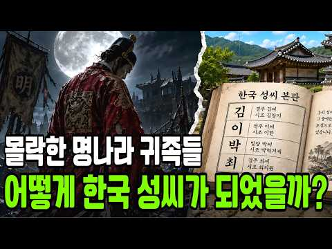
- 챕터: 0:00 🌑 압록강에서 시작된 이야기 · 2:52 🧭 그들은 왜 조선을 선택했을까? · 5:03 ⚔️ 조선으로 들어온 사람들의 정체 · 7:37 🌊 한반도 남쪽으로 향한 사람들 · 11:08 📜 살아남기 위해 지워야 했던 흔적 · 16:00 🏯 조선은 왜 이들을 품었을까? · 18:37 🌾 낯선 땅에서 시작된 새로운 삶 · 23:15 🕯️ 사라진 조국을 기억하는 공간 · 25:45 ⏳ 100년이 흐른 뒤 달라진 후손들 · 29:57 🌏 일본으로 향한 사람들은 달랐다 · 32:24 📊 오늘날까지 남아 있는 흔적 · 37:27 🧬 성씨와 본관이 들려주는 이야기
- 설명 앞부분: 1644년, 거대한 제국 명나라가 무너진 뒤 일부 사람들은 목숨을 걸고 압록강을 넘어 조선으로 향했습니다. 그들은 왜 수많은 선택지 가운데 하필 조선을 택했을까요? 그리고 낯선 땅에 정착한 뒤, 자신들의 성씨와 본관은 어떻게 오늘날까지 이어질 수 있었을까요? 🧭 이번 영상에서는 **명나라 멸망 이후 한반도로 들어온 사람들과 그 후손들의 정착 과정**, 그리고 우리가 평소 익숙하게 생각했던 **한국 성씨와 본관 속에 숨겨진 역사**를 따라가 봅니다. 족보와 본관, 조선의 기록 속에 남아 있는 흔적들을 따라가다 보면 우리가 알고 있던…
- 같은 채널 평소 대비 ×8.1 (채널 최근 롱폼 중앙값 33,680회) · 평소 영상: 부여 왕자가 세운 수수께끼의 나라 46년 만에 사라진 갈사국의 정체 (33,680회) / 아골타 가문이 한반도와 이어진 이유 금나라 황실의 수상한 기록 (35,309회)
- 대본 없음 (설명) — 음성인식이 끝나면 도입부·흐름이 들어감
- 댓글 262/263: 좋은 점 — 영상 1 · 감사·응원 4 · 더 알고 싶은 것 2 · 아쉬운 점 — 영상 1 · 반박·불만 — 의견 다름 6 · 정치·사회 28 · 경험 공유 5 · 구독·다음 기대 0
  - 감사·응원 👍9 “주원장은 남경 출신 고려인 명나라 황족, 귀족은 고려 출신이 많았지 청나라의 황족, 귀족은 신라 경주 김씨들 << 명나라가 한국인 주원장의 나라야 >> 노예 한족들은 명나라가 노예 한족의 나라라고 크게 착각하고 있는데... 주원장은 남경출신 고려인 ("고려는 동서 1…”
  - 감사·응원 👍4 “ㅋ킄~~ 찾았따용~~ 화이팅하이숑~~ ㅋㅋㅋ”
  - 더 알고 싶은 것 👍2 “명나라 사람들이 귀순을 했다는 근거는 어디에 있나요? 출처좀 알려주세요.”
  - 더 알고 싶은 것 👍1 “이여송이 임진왜란 때 어떤 일을 했나요?”
  - 아쉬운 점 — 영상 👍2 “명나라 사람들이 귀순을 했다는 근거는 어디에 있나요? 출처좀 알려주세요.”
  - 반박·불만 — 의견 다름 👍0 “어이없는 사대주의. 시진핑의 동북공정. 한심한...”
  - 정치·사회 👍9 “주원장은 남경 출신 고려인 명나라 황족, 귀족은 고려 출신이 많았지 청나라의 황족, 귀족은 신라 경주 김씨들 << 명나라가 한국인 주원장의 나라야 >> 노예 한족들은 명나라가 노예 한족의 나라라고 크게 착각하고 있는데... 주원장은 남경출신 고려인 ("고려는 동서 1…”
  - 정치·사회 👍6 “중국이 본관인 성씨들 많음 대전 뿌리공원게 가보면 임진왜란 이전에도 중국에 환란이 있을 때 기근이나 기술 무역등으로 많이 들어 옴. 한국 성씨가 중국에 간 영우도 많고 중국에서 장수로 유명한 사람도 엄청 많은데 기록에 없는 사람은 얼마나 많겠어요. 그런게 머 중요하겠…”
  - 경험 공유 👍3 “해남에 광동에서 배로 왔다고 실록에 기록돼있고 조선이 지방에 살라고 했고 조선은 비호했었지”
  - 경험 공유 👍0 “우리가 천한 성씨라고 말하는 천 방 지 추 마 골 피 이성씨는 만주쪽에서 지배계급 지위였는데 나라가 멸망하면서 조선으로 숨어들어 망명한 성씨라고 저희 큰아버님이 말씀하시는걸 들었습니다 사위를 보시는데 성씨가 천씨성 가진분인데 우리가 천한신분의 성씨라고 하니 큰아버님이…”

### 180. [역사한줄] 4K 조선 백성들이 먹은 음식들 총정리 ∣ 역사교육 #한국사 #조선역사 #조선왕조실록 #시니어역사 #수면영상

- https://www.youtube.com/watch?v=KyiRjwyGe0s · 역사한줄 · 구독자 3,600 · 조회수 101,566 (×28.2, 하루 1,702.0) · 좋아요 239 (0.2%) · 70.7분 · 2026-09-11 · 주제 묶음 3. 조선 · 형식 정보·해설 (그 밖) · 폴더 `W_KyiRjwyGe0s` (웹 승인)
- 썸네일: 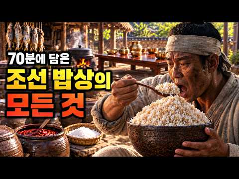
- 설명 앞부분: 조선에서 소고기를 썰던 사람은 그 고기를 먹지 못했습니다. 소금을 구워낸 사람도, 한겨울 강에서 얼음을 캐낸 사람도, 논에 쌀을 길러낸 사람도 마찬가지였지요. 이 영상은 조선의 밥상을 여섯 갈래로 따라갑니다. 백정이 양반보다 부자가 되고도 자식을 학교에 못 보낸 이야기. 가마솥 앞에서 평생 등이 휜 염한이 정작 소금을 마음껏 쓰지 못한 이야기. 영하 십 도 새벽에 캔 얼음이 한 조각도 백성에게 가지 않은 이야기. 독일보다 백칠십 년 앞선 온실을 짓고도 그 푸성귀를 구경 못 한 이야기. 열 명 중 여덟이 평생 쌀밥을 못 먹어본 밥상…
- 같은 채널 평소 대비 ×17.7 (채널 최근 롱폼 중앙값 5,753회) · 평소 영상: [역사한줄] 교과서에 없는 역사기록 12대를 이어온 조선시대 부자가문 풀스토리 ∣ 경주최… (5,881회) / [역사한줄] 조선과 청이 9년 못 푼 외국말, 홍어장수가 풀었다 #한국사 #조선역사 #문… (5,625회)
- 대본 없음 (설명) — 음성인식이 끝나면 도입부·흐름이 들어감
- 댓글 11/24: 좋은 점 — 영상 0 · 감사·응원 0 · 더 알고 싶은 것 0 · 아쉬운 점 — 영상 0 · 반박·불만 — 의견 다름 0 · 정치·사회 2 · 경험 공유 1 · 구독·다음 기대 0
  - 정치·사회 👍0 “천민이라고 날때부터가 아니라 전쟁때 포로로 잡힌 이들이었을 것이다. 특히 왕족들도 포함됐을 텐데 고려 왕씨가 흔적도 없이 사 라지고 전씨로 둔갑한걸 봐서도 권력이 바뀔때마다 상당수의 노예 나 천민이 발생했을 것이다. 대표적으로 백제의 각살은 고위 관료인데 나라가 망한…”
  - 경험 공유 👍3 “민주주의가 이렇게 중요하다 나도 한표 저사람도 한표 동등한 위치의 한표 독재는 저렇게 사람들을 나누면서 내 안위를 챙기지 그리고 내 아래 계급을 만들고.. 독재를 좋아하는 사람들은 북한으로 가면 되겠다 거기는 철저한 계급제니까”

### 181. 조선시대 주막의 충격적인 하룻밤, 사극에서 절대 안 보여준 진짜 모습

- https://www.youtube.com/watch?v=PgkTnWeBMyA · 역사트리 · 구독자 11,000 · 조회수 500,637 (×45.5, 하루 5,130.0) · 좋아요 2,315 (0.5%) · 17.7분 · 2026-08-05 · 주제 묶음 3. 조선 · 형식 정보·해설 (그 밖) · 폴더 `W_PgkTnWeBMyA` (웹 승인)
- 썸네일: 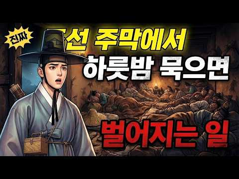
- 설명 앞부분: 조선시대 주막의 충격적인 하룻밤, 사극에서 절대 안 보여준 진짜 모습 🏚 화장실보다 좁은 방에 모르는 사람 10명, 바닥 온도 39도, 창문은 열 수도 없었습니다. 그런데 이 주막에는 돈 한 푼 없이도 전국을 여행할 수 있는 미친 시스템이 숨어 있었습니다 🤯 양반이 큰소리쳤다가 파직당한 이유, 영국 여행가가 "군단"이라 표현한 것의 정체, 25kg 동전을 끝까지 짊어진 외국인의 최후까지. 사극이 만들어낸 깨끗한 주막, 그 안에서 진짜 벌어진 일을 알면 다시는 똑같이 못 봅니다 🔥
- 같은 채널 평소 대비 ×186.7 (채널 최근 롱폼 중앙값 2,682회) · 평소 영상: 배탈 나면 '이것'부터 마셨다 ∣ 조선시대 민간요법에 숨겨진 과학 (2,760회) / 형제 죽인 조선 왕 5명의 후손에게 벌어진 일, 태종, 세조, 영조까지 ∣ 조선역사 오디… (2,603회)
- 대본 없음 (설명) — 음성인식이 끝나면 도입부·흐름이 들어감
- 댓글 195/203: 좋은 점 — 영상 0 · 감사·응원 3 · 더 알고 싶은 것 2 · 아쉬운 점 — 영상 0 · 반박·불만 — 의견 다름 2 · 정치·사회 7 · 경험 공유 2 · 구독·다음 기대 0
  - 감사·응원 👍15 “우리 조상님들 잘싯지도 못하고 양치도 못하고 그좁은 주막에서 땀흘리며 추위에 떨며 잘 버티셧구나 감사합니다 이시대에 태어나게 해주셔서 ㅠㅠ”
  - 감사·응원 👍2 “차박을 할수있는 시대에 사는건 축복이다 감사하자”
  - 더 알고 싶은 것 👍5 “주막에서 잘때 화장실은 어떻게 했을까요? 전 그게 궁금함..”
  - 더 알고 싶은 것 👍1 “영상이 진실이고 AI아니라면 좋을텐덴데. 맞나요?”
  - 정치·사회 👍12 “폴라드작가 심정이 이해가 가는게 겁나후진국에서 저런시스템을 외국인한테도 제대로 적용시킬지는 믿기힘들지.”
  - 정치·사회 👍1 “하루 12키로가는데 보름 걸린다고? 서울에서 부산 간다며,,,그것도 직선거리도 아니고 산넘고 물건너 갈텐데,,,, 이런 나래이션으로 이동영상을 믿으라고?”
  - 경험 공유 👍31 “저도 1번 죽기싫으면 저기들어가 자야지요! 설악 중천대피소 생각이 납니다! 발냄새 땀냄새 술냄새 소주반병에 라면 버너로 삶아서 먹고 눈감았다뜨면 새벽산행 준비하는소리로 시끌벅적! 재미지겠네요!”

### 182. 연산군도 비비지 못하는 고려 최악의 폭군 ∣ 고려 충혜왕의 실제 기록

- https://www.youtube.com/watch?v=y3ouJ8UuWqA · 역사판 · 구독자 2,440 · 조회수 170,645 (×69.9, 하루 1,132.1) · 좋아요 677 (0.4%) · 24.4분 · 2026-06-12 · 주제 묶음 3. 조선 · 형식 정보·해설 (그 밖) · 폴더 `W_y3ouJ8UuWqA` (웹 승인)
- 썸네일: 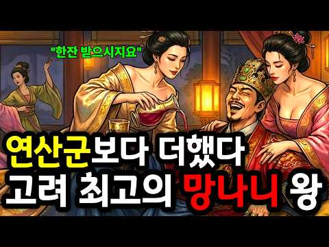
- 설명 앞부분: 연산군은 비비지도 못합니다. 고려 역사상 최악의 폭군, 충혜왕의 실제 기록을 파헤칩니다. "왕이 아버지의 후궁을 범하고, 신하의 아내를 빼앗고, 하루에 소고기 9kg을 먹었다." 이것은 지어낸 이야기가 아닙니다. 고려사에 실제로 기록된 내용입니다. [이 영상에서 다루는 내용] 충혜왕은 열여섯 살에 즉위하자마자 사냥에 빠졌고, 아버지 충숙왕의 후궁과 정비를 범했으며, 100명이 넘는 여인을 강제로 궁에 들였습니다. 결국 원나라에 의해 폐위되었지만, 7년 후 다시 왕위에 올랐습니다. 두 번째 기회를 받은 그는 달라졌을까요? 보흥고 설…
- 같은 채널 평소 대비 ×113.2 (채널 최근 롱폼 중앙값 1,507회) · 평소 영상: [세계사] 이집트는 어떻게 3천년을 버텼을까? ∣ 이집트를 버티게 한 것 (1,595회) / 조선 500년 부동산 규제, 매매 금지해도 집값이 10배 오른 이유 ∣ 부동산 정책 (1,419회)
- 대본 없음 (설명) — 음성인식이 끝나면 도입부·흐름이 들어감
- 댓글 54/54: 좋은 점 — 영상 0 · 감사·응원 1 · 더 알고 싶은 것 0 · 아쉬운 점 — 영상 0 · 반박·불만 — 의견 다름 1 · 정치·사회 2 · 경험 공유 0 · 구독·다음 기대 0
  - 감사·응원 👍1 “고려사 감사합니다”
  - 정치·사회 👍1 “현대사에서도 결혼한 지 얼마 안 된 김삼화 배우를 불러다 욕정을 채우다 미국 할아버지한테 팔아넘긴 대통령이 있었지”

### 183. "조선 최고의 천재다" 전세계가 세종대왕이 만든 한글을 극찬하는 이유

- https://www.youtube.com/watch?v=T2Z6frSqJrs · 한반도 백과사전 · 구독자 6,060 · 조회수 93,526 (×15.4, 하루 2,705.5) · 좋아요 501 (0.5%) · 19.5분 · 2026-10-07 · 주제 묶음 3. 조선 · 형식 정보·해설 (그 밖) · 폴더 `W_T2Z6frSqJrs` (웹 승인)
- 썸네일: 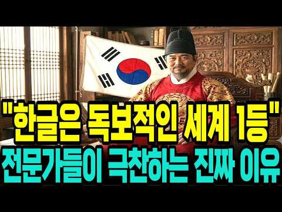
- 챕터: 0:00 500년 만에 발견된 설계도의 비밀 · 1:00 훈민정음 해례본, 왜 특별할까? · 2:20 사람의 몸에서 탄생한 자음 · 3:41 모음은 세상의 이치를 담았다? · 5:44 한글이 세계 최고인 진짜 이유 · 7:16 세종대왕은 왜 혼자 창제했나? · 11:08 백성을 향한 세종의 고집 · 13:06 어떻게 우리 글자가 되었을까? · 14:54 우리가 한글날을 기념하는 이유 · 15:53 디지털 시대의 천재적 설계 · 17:39 잘못 알려진 한글의 기록들 · 18:23 한글, 우리 삶을 바꾼 위대한 힘
- 설명 앞부분: 🇰🇷세종대왕은 왜 하필 28자로 만들었을까? 세계 언어학자들이 한글을 극찬하는 진짜 이유 1940년 안동에서 마침내 모습을 드러낸 『훈민정음 해례본』은 한글이 사람의 발음 기관을 본떠 철저히 공학적으로 설계된 문자라는 사실을 세상에 알렸습니다. 1443년 창제 이후 450년 동안 백성들의 삶과 문화 속에 깊이 스며든 한글은, 1894년 고종의 칙령 제1호(공문식 제14조)를 통해 마침내 한반도의 정식 공용 문자로 선포되는 역사적 반전을 맞이합니다. 세계적 학자인 재레드 다이아몬드와 제프리 샘슨이 "인류가 만든 가장 독창적이고 완벽…
- 같은 채널 평소 대비 ×4.7 (채널 최근 롱폼 중앙값 19,710회) · 평소 영상: "한국의 시민의식은 세계 1위" 세계가 한국 주차장 풍경에 극찬하는 이유 (19,870회) / "한글날 100주년의 위대함" 외국인들이 줄 서서 한글을 배우는 진짜 이유 (19,549회)
- 대본 없음 (설명) — 음성인식이 끝나면 도입부·흐름이 들어감
- 댓글 28/28: 좋은 점 — 영상 1 · 감사·응원 1 · 더 알고 싶은 것 0 · 아쉬운 점 — 영상 0 · 반박·불만 — 의견 다름 0 · 정치·사회 2 · 경험 공유 0 · 구독·다음 기대 0
  - 감사·응원 👍5 “참으로 대단한 어르신 입니다 세종대왕님 정말 감사합니다~ 잘 설명해주신걸 들으니 가슴이 뜨거워지는 느끼이네요~ 감사합니다 ~”
  - 정치·사회 👍0 “세종대왕 릉이 미국에 있습니다. 조선 임금님이 계신 한양이 워싱턴 디씨였고 중국이였다 일월오봉도 배경이 워싱턴 디씨 포토맥강이 조선의 한강 임진왜란은 미국에서 전쟁이었다 홍무정운 아메리카 대조선, 57, 아메리카 사도세자 저자 박인수 조지 워싱턴 = 사도세자 토마스 …”

### 184. 이순신 장군을 죽음에서 구한 단 한 명의 충신 ∣ 조선 청백리, 오리 이원익

- https://www.youtube.com/watch?v=uqbaeQokoCI · 초설야담 · 구독자 3,700 · 조회수 205,494 (×55.5, 하루 1,648.5) · 좋아요 1,759 (0.9%) · 26.9분 · 2026-07-09 · 주제 묶음 3. 조선 · 형식 야담·옛날이야기 · 폴더 `W_uqbaeQokoCI` (웹 승인)
- 썸네일: 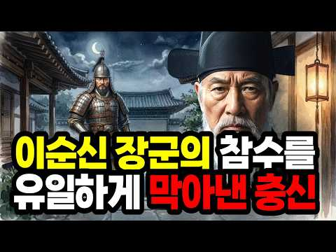
- 챕터: 0:00 영의정 여섯 번인데 돗자리를 짜던 노인 · 3:12 왕족의 피를 받고 태어났는데 끼니를 걱정한 소년 · 7:45 임진왜란과 평양 탈환 그리고 이순신을 만나다 · 12:30 왕 앞에서 이순신은 제일 훌륭하다고 말한 순간 · 16:20 대동법의 시작과 광해군에게 맞선 유배길 · 20:05 인조반정 광해군의 목숨을 구하고 다시 돗자리를 짜다 · 23:40 나는 백성 앞에 죄인이다 마지막 유언
- 설명 앞부분: 영의정을 여섯 번 지내고도 비 새는 두 칸 초가집에서 돗자리를 짜며 살았던 남자. 임진왜란을 수습하고, 이순신을 살렸고, 대동법의 씨앗을 뿌렸지만 죽는 순간까지 자기를 죄인이라 불렀습니다. 조선 오백년 최고의 청백리, 오리 이원익. 교과서에도 잘 나오지 않는 이 사람의 이야기를 처음부터 끝까지 따라갑니다. 조선왕조실록 선조실록 1596년 10월 5일 이원익 이순신 변호 기사 조선왕조실록 광해군일기 즉위년 1608년 5월 7일 경기선혜법 건의 기사 조선왕조실록 인조실록 1631년 1월 10일 강홍중 보고 기사 한국민족문화대백과사전 …
- 같은 채널 평소 대비 ×10.0 (채널 최근 롱폼 중앙값 20,566회) · 평소 영상: 조선 인구 절반이 '재산'이었던 소름 돋는 진실 ∣ 조선역사,조선시대 몰랐던 이야기,노비… (33,961회) / 사극에서 절대 안 보여주는 조선 평민의 밥상 ∣ 조선시대음식,조선평민,조선밥상,한국역사 (52,583회)
- 대본 없음 (설명) — 음성인식이 끝나면 도입부·흐름이 들어감
- 댓글 164/166: 좋은 점 — 영상 1 · 감사·응원 7 · 더 알고 싶은 것 0 · 아쉬운 점 — 영상 0 · 반박·불만 — 의견 다름 2 · 정치·사회 6 · 경험 공유 3 · 구독·다음 기대 0
  - 좋은 점 — 영상 👍3 “본받고 싶은 분이네요 좋은 영상 만들어 주셔서 감사합니다”
  - 감사·응원 👍9 “정탁과 권율 그리고 이원익같은 분들께 감사하는 저녁밤이네요.❤”
  - 감사·응원 👍3 “본받고 싶은 분이네요 좋은 영상 만들어 주셔서 감사합니다”
  - 반박·불만 — 의견 다름 👍4 “이분 뿐이 아닙니다 좌찬성으로 있던 약포 정탁대감이 선조임금을 강력히 설득하여 이순신장군이 참형을 먼하고 백의 종군”
  - 반박·불만 — 의견 다름 👍0 “이순신 헛소리마라”
  - 정치·사회 👍49 “우리 나라는 국회를 비롯해서 관료들 같은 모든 정치인들은 쓸데없는 관광용 해외연수 금지시키고 이런 내용들을 찾아서 의무적으로 자주 시청각 교육을 시켜서 정신개조를 하도록 해야 한다”
  - 정치·사회 👍1 “2:19 류승룡마저 등 돌릴때 정탁이 나서서 탄핵반대.”
  - 경험 공유 👍0 “저도 결과가 어찌됐든 내 지시를 잘 따르는 부하를 원합니다”
  - 경험 공유 👍0 “굿모닝 친구야 청산리 청산하고 벽계수야 수이감을 자랑마라 때끼야 계수야 내가 벽이다 몰라용 왜그랬어요 니가알겠지용 소인이 어찌 알겠어요”

### 185. [𝙋𝙡𝙖𝙮𝙡𝙞𝙨𝙩] 세종대왕이 경복궁에서 야근하며 듣던 가야금 재즈

- https://www.youtube.com/watch?v=q3oC3zdfyw4 · 조선재즈 · 구독자 10,600 · 조회수 713,257 (×67.3, 하루 4,713.7) · 좋아요 24,002 (3.4%) · 180.7분 · 2026-06-12 · 주제 묶음 2. 한국 고대·삼국·고려 · 형식 정보·해설 (그 밖) · 폴더 `W_q3oC3zdfyw4` (웹 승인)
- 썸네일: 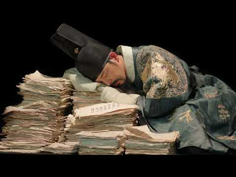
- 설명 앞부분: 세종대왕도 야근은 힘들었을 겁니다. 경복궁 깊은 밤, 촛불 아래 가야금이 흐릅니다. 조선의 밤과 재즈가 만났습니다:)
- 같은 채널 평소 대비 ×139.2 (채널 최근 롱폼 중앙값 5,124회) · 평소 영상: [𝙋𝙡𝙖𝙮𝙡𝙞𝙨𝙩] 세종대왕이 코딩하며 들었던 가야금 재즈 (5,354회) / [𝙋𝙡𝙖𝙮𝙡𝙞𝙨𝙩] 꺼먹살이도 하루 종일 엿들은 가야금 재즈 (4,893회)
- 대본 없음 (설명) — 음성인식이 끝나면 도입부·흐름이 들어감
- 댓글 469/501: 좋은 점 — 영상 2 · 감사·응원 8 · 더 알고 싶은 것 6 · 아쉬운 점 — 영상 2 · 반박·불만 — 의견 다름 4 · 정치·사회 1 · 경험 공유 10 · 구독·다음 기대 5
  - 좋은 점 — 영상 👍0 “생활안복 자주 입는데, 한복입고 어디 놀러갈때 듣기 좋아요. 굿뜨 뭐랄까 혼자 마패를 들고 암행어사 하러 가는 기분이랑 연모하는 사내 담벼락에 훔쳐보러 가는 기분”
  - 좋은 점 — 영상 👍0 “너무좋아요 나도만들고싶네요 많이배우고갑니다❤❤❤❤❤❤❤”
  - 감사·응원 👍5 “와.... 가야금 너무 좋아하는데 이런 귀한 플리를 올려주시다니 감사합니다....”
  - 감사·응원 👍4 “오 좋아요... 제작 감사함당 잘 들을게요”
  - 더 알고 싶은 것 👍3 “구독 좋아요 알림설정합니다. 한국의 미를 잃지 않는 퓨전음악 많이 부탁드립니다. 덕분에 출근길이 즐거워요.”
  - 더 알고 싶은 것 👍1 “집현전 학자들 편도 부탁합니다. 엄지척!”
  - 아쉬운 점 — 영상 👍7 “ㅋㅋㅋㅋㅋㅋㅋ 고얀 AI 같으니라고”
  - 아쉬운 점 — 영상 👍3 “구간반복해서 들을 수 있게 해주세요”
  - 반박·불만 — 의견 다름 👍4 “와 재즈 좋아하는데 가야금과 재즈가 이렇게 잘 어울리다니. 가야금의 선율이 그루비해서 깜짝 놀랐습니다. AI 작곡이란데서 한번 더 놀람.. 말도안됨 😂”
  - 반박·불만 — 의견 다름 👍1 “절대음감이라 AI 음악이 맞으실 수도ㅋㅋㅋ 근데 저렇게 누워 계실 분이 아닌데 두 눈 부릅 뜨고 계셔야 하지 않을까요?”
  - 정치·사회 👍0 “전하 .. 요즘 나라가 말이 아닙니다 이걸 어찌해야 된답니까 ...”
  - 경험 공유 👍9 “클래식 공부를 어릴때 부터 하면서 재즈도 같이 조금 했었는데 살면서 들은 재즈 중에 제일 좋습니다….”
  - 경험 공유 👍3 “세종대왕도 야근하는데 내가 뭐라고”
  - 구독·다음 기대 👍3 “구독 좋아요 알림설정합니다. 한국의 미를 잃지 않는 퓨전음악 많이 부탁드립니다. 덕분에 출근길이 즐거워요.”
  - 구독·다음 기대 👍1 “가능하구나 재즈라는 것이!!!! 감탄하고 구독하고 갑니다~!”

### 186. 직업이 없던 시대, 고대 인류는 하루 종일 무엇을 했을까? ∣ 인류역사

- https://www.youtube.com/watch?v=MbnWhQOwocM · 태고의 세계 · 구독자 712 · 조회수 52,545 (×73.8, 하루 315.1) · 좋아요 728 (1.4%) · 11.6분 · 2026-05-27 · 주제 묶음 1. 역사 일반·이야기 · 형식 오디오북·낭독 (명언·인생조언) · 폴더 `W_MbnWhQOwocM` (웹 승인)
- 썸네일: 
- 설명 앞부분: 인류 역사 대부분의 시간 동안 인간은 “직업” 없이 살았습니다. 상사도 없었고, 월급도 없었으며, 끝없는 일정도 없었습니다. 사람들은 하루 몇 시간만 먹을 것을 구했고, 남은 시간에는 예술을 만들고, 음악을 연주하고, 이야기를 나누며 살아갔습니다. 하지만 농업이 등장하면서 모든 것이 바뀌기 시작했습니다. 이 영상은 인류 존재의 99% 동안 인간이 실제로 어떻게 살았는지를 탐험합니다. 그리고 우리가 무엇을 얻고, 무엇을 잃었는지 보여줍니다.
- 같은 채널 평소 대비 ×153.6 (채널 최근 롱폼 중앙값 342회) · 평소 영상: 고대 인류는 매일 술에 취해 있었다 ∣ 인류역사 (342회) / 당신의 혈액형은 2천만 년 전부터 정해져 있었다 ∣ 인류역사 (345회)
- 대본 없음 (설명) — 음성인식이 끝나면 도입부·흐름이 들어감
- 댓글 209/209: 좋은 점 — 영상 0 · 감사·응원 2 · 더 알고 싶은 것 1 · 아쉬운 점 — 영상 3 · 반박·불만 — 의견 다름 1 · 정치·사회 1 · 경험 공유 5 · 구독·다음 기대 0
  - 아쉬운 점 — 영상 👍1 “근데 현대사회에서 모든 노동을 줄여주는 기술이 발달했음에도 불구하고 하루 8시간을 일하고. 일끝나면 넋다운되어 밥먹고 자야하는 하루의 반복이라니ㅠ 내가 버는 돈은 겨우 먹고 살만큼인데 왜 이렇게 힘들게 사는걸까요ㄷㄷ누구를 위하여 나의 소중한 시간과 노동을 쓰고 있나요…”
  - 반박·불만 — 의견 다름 👍1 “먹고살아야했기에 더 힘들게 움직이며 살았으니 몸이 튼튼한거다. 뭔 말도안되는 결론을 내냐”
  - 정치·사회 👍0 “맞아..맞아요. 그래서 초기 농경인들은 혐오와 질시의 대상이 되었죠. 화전농이 시초였고 숲을 불태워 버렸으니까요. 구전된 고대 설화에서는... 농경혐오의 흔적을 엿볼수 있습니다. 기독교 바이블... 실낙원 ㅡ 과수재배 혐오. 출애굽기 ㅡ 대규모 농경 생태파괴. 카인과…”
  - 경험 공유 👍32 “6년째 지속되고 있는 나의 일상이 꼭 이런 일상이네 가진것 별로 없어도 마음 내키는대로 사는 삶 내가 원시인이네”
  - 경험 공유 👍10 “제가 그때 살았었는데 구석기 시대가 나름 웰빙이었습니다 고기도 많이 먹고 문제는 빙하기 겨울이었음 훈제육포 만들고 집 보수하는게 일상이었음”

### 187. 조선왕조 518년 1대 태조부터 27대 순종까지 한번에ㅣ조선 역사ㅣ한국사

- https://www.youtube.com/watch?v=U8mDpoSE4DA · 하옥리책방 · 구독자 7,280 · 조회수 503,582 (×69.2, 하루 3,206.5) · 좋아요 5,400 (1.1%) · 27.9분 · 2026-06-06 · 주제 묶음 3. 조선 · 형식 정보·해설 (그 밖) · 폴더 `W_U8mDpoSE4DA` (웹 승인)
- 썸네일: 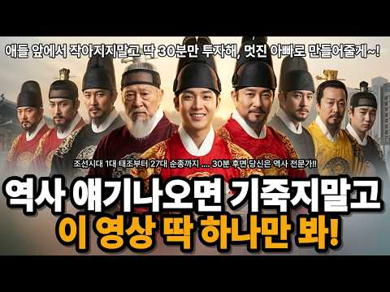
- 설명 앞부분: 조선 1대 태조 이성계부터 27대 순종까지, 518년 동안 왕좌에 앉았던 스물일곱 명의 왕을 한 명도 빠짐없이 순서대로 정리했습니다. 각 왕의 대표 업적은 물론, 그 시대에 어떤 일이 벌어졌는지, 왕과 왕 사이에 어떤 연결고리가 있었는지까지 하나의 흐름으로 꿰었습니다. 위화도 회군으로 시작된 나라가 한일병합으로 끝나기까지, 27명의 선택이 만든 518년의 기록을 지금 확인하세요. 📚 다루는 왕 (순서) 태조 → 정종 → 태종 → 세종 → 문종 → 단종 → 세조 → 예종 → 성종 → 연산군 → 중종 → 인종 → 명종 → 선조 → 광…
- 대본 없음 (설명) — 음성인식이 끝나면 도입부·흐름이 들어감
- 댓글 134/143: 좋은 점 — 영상 5 · 감사·응원 10 · 더 알고 싶은 것 1 · 아쉬운 점 — 영상 0 · 반박·불만 — 의견 다름 1 · 정치·사회 3 · 경험 공유 0 · 구독·다음 기대 0
  - 좋은 점 — 영상 👍6 “75세 할머니가 늘 궁금했던 이조 역사에 이해하기 쉽게 해주세서 너무 감사합니다.노트에 메모하며 몇번을 듣고있읍니다 고맙습니다”
  - 좋은 점 — 영상 👍6 “영조 조선시대 왕의 계보가 정리된 영상 최고 입니다. 잘 봤습니다”
  - 감사·응원 👍6 “75세 할머니가 늘 궁금했던 이조 역사에 이해하기 쉽게 해주세서 너무 감사합니다.노트에 메모하며 몇번을 듣고있읍니다 고맙습니다”
  - 감사·응원 👍3 “구독과 좋아요로 응원합니다. 매우매우 아름다운 영상 👏 ✨️”
  - 더 알고 싶은 것 👍1 “19대 숙종에 대해 알고싶어요 여야당을 바껴가며 정치 판을 움직였다면 그 누구도 무서워하지않고 왕의자리였을꺼같은데 희빈을 왜 사약을줬는지...그아들은왕이되었을때 그 여파는없었는지..”
  - 반박·불만 — 의견 다름 👍3 “정확히 끌어내렸습니다 아니죠 12대 인종 한국 나이31세. 불과 8개월만에 병사”
  - 정치·사회 👍2 “우주통일 대통령 일론 머스크가 아닌 대한민국 통일임시정부 초대 통일대통령 김두기 시인 축전!!! 역사를 잃어버린 민족에게 미래는 없습니다!!! 일제치하 대한민국 임시정부가 민족의 역사적 정통성을 지켜 왔듯이 분단치하 민족의 역사적 정통성은 대한민국 통일임시정부가 지켜…”
  - 정치·사회 👍2 “1457년 17세 세조 이미지 헌법 문서 법전을 남인 한명회 자기손 최대 조선 6섯 운영 시스템 연산군 초기 뒤틀린 1405년 반전공신 개혁 소격서 좌절 제임 20년 문종 14년 선종 북쪽 이순신 바다 전세 뒤집어 초토화 세계대통령 선거 아멘 할렐루야 대한민국 감사합…”

### 188. 김진명이 들려주는 한글 창제 이야기｜한글날 제정 100주년 기념

- https://www.youtube.com/watch?v=NAdCvYWmsRc · 김진명의 사적인 대화 · 구독자 20,400 · 조회수 168,174 (×8.2, 하루 8,701.8) · 좋아요 2,738 (1.6%) · 15.6분 · 2026-10-09 · 주제 묶음 1. 역사 일반·이야기 · 형식 인터뷰·강연·대담 · 폴더 `W_NAdCvYWmsRc` (웹 승인)
- 썸네일: 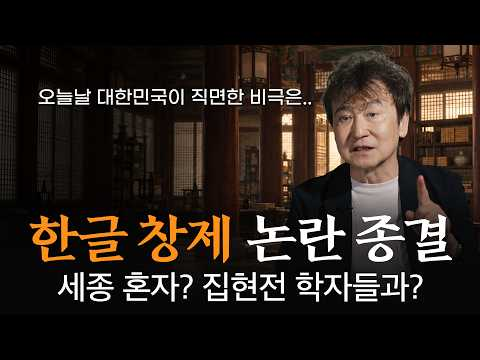
- 설명 앞부분: 대한민국 대표 소설가 김진명의 공식 유튜브 채널 [김진명의 사적인 대화]입니다. 한글은 세종대왕 혼자 만들었을까요? 집현전 학자들은 어떤 역할을 했을까요? 한글날 제정 100주년을 맞아, 김진명 작가가 한글 창제 이야기를 들려드립니다! 한글 창제를 둘러싼 반발 속에서도 새로운 문자를 만들고자 했던 세종의 뜻을 돌아봅니다. 그리고 세종이 남긴 위대한 유산 앞에서, 김진명 작가는 오늘날 대한민국이 마주한 큰 비극으로 ‘문해력 붕괴’를 이야기합니다. 영상에서 가장 인상 깊었던 이야기나 김진명 작가에게 궁금한 점을 댓글로 남겨주세요. […
- 대본 없음 (설명) — 음성인식이 끝나면 도입부·흐름이 들어감
- 댓글 136/148: 좋은 점 — 영상 4 · 감사·응원 30 · 더 알고 싶은 것 7 · 아쉬운 점 — 영상 1 · 반박·불만 — 의견 다름 1 · 정치·사회 4 · 경험 공유 6 · 구독·다음 기대 2
  - 좋은 점 — 영상 👍16 “최근 세종의 나라 그 어느 소설보다 재미와 감동을 느끼며 읽었습니다. 손에서 놓을 수가 없을 정도로 몇 시간이고 연결해서 읽었습니다. 저는 한자가 처음 만들어질 때의 발음이 중국보다 우리 것이 많다는 것이 충격이었고 과연 그러할 만하다는 생각이 들었습니다. 요즘 세종…”
  - 좋은 점 — 영상 👍15 “다른 데와 다른 정말 유익하고 좋은 채널이 생겼군요. 자주 들르겠습니다. 선생님 감사합니다.”
  - 감사·응원 👍26 “모르고있던 역사적 사실을 이제야 제대로 알게해주셨읍니다. 감사합니다.”
  - 감사·응원 👍16 “최근 세종의 나라 그 어느 소설보다 재미와 감동을 느끼며 읽었습니다. 손에서 놓을 수가 없을 정도로 몇 시간이고 연결해서 읽었습니다. 저는 한자가 처음 만들어질 때의 발음이 중국보다 우리 것이 많다는 것이 충격이었고 과연 그러할 만하다는 생각이 들었습니다. 요즘 세종…”
  - 더 알고 싶은 것 👍76 “진명 작가님, 진명이형, 진명교수님,진명 석학님...........제발.... 고구려 완결좀 내주셔요 ..형! 부탁합니다. 고구려 완결도 완전히 결판좀 내주세요 ㅠ 아니면 언제까지 나온다고라도 좀 알려주세요! 광펜으로써 제발 묻고 싶습니다. 세종의나라도 몽땅 읽었습니…”
  - 더 알고 싶은 것 👍5 “안녕하세요^^ 저는 세종대왕께서 분명히 애민정신도 함께 가지고 계셨다고 믿습니다. 당연히 작가님이 말씀하신 세종대왕의 혁명도 맞다고 생각합니다. 서양에서도 중세 이전 기득권들은 지식의 독점을 중요시한것 같은데 그런것들을 보면 역시 세종대왕은 특별하다고 생각합니다. 그…”
  - 아쉬운 점 — 영상 👍7 “漢字가 동이족의 ‘은자(殷字)’라고 말씀하신 것처럼, 옛날부터 우리 민족이 쓰던 한자를 버리고 어떻게 깊이 있는 문해력이 올라갈 수 있을까요? ​한자는 우리말의 음서(陰書)이고, 한글은 우리말의 양서(陽書)로서 서로 보완적인 관계에 있다고 봅니다. 또한 훈민정음 창제…”
  - 반박·불만 — 의견 다름 👍0 “한글이 창제되었고 한글로 우리문화를 지켜올 수 있었다는 사실은 (저도 몰랐는데) 정말 중요한 기틀이자, 한국이란 나라의 근간이 되어준 것 같습니다. 한글로써 우리나라는 지금 섞여버리고 선동, 현혹되기 쉬운 문화전쟁에서 우리만의 뿌리로 뭉칠 수 있는 구심점이 되어주기 …”
  - 정치·사회 👍4 “명 나라 눈치 보느라 숨어서 만든 것으로 생각된다. 이성계는 쿠테타로 근세 조선을 창업하면서 우리의 역사를 축소 시키고 영토를 축소 시킨 반역자로 나는 규정한다. 그러니 고려사를 쓰는데 60 년이 걸릴 이유가 있었나! 진나라 황제만 분서갱유 를 한 것이 아니고 이성계…”
  - 정치·사회 👍0 “젊었을때 연로하시고 이승만 대통령 주치의까지 하셨던 한의사 선생님이 한글을 세종대왕께서 화장실에서 변을 볼때 만들었다고 하신 말씀이 떠오르네요 그 당시에는 헛소리인가했는데 요즘 현대과학이 장뇌축을 인정하고 장에 뇌보다 더 많은 신경세포가 있고 배변시 세로토닌(흔히 ‘…”
  - 경험 공유 👍30 “가정이나.학교 교육이 문제인듯 합니다...저도 작가님 말에 동의 합니다.”
  - 경험 공유 👍6 “김진명 작가님채널 축하드립니다 🎉🎉🎉 저도 독후감대회 참여했네요. 고구려출간도 기다리고 있습니다. 건강 잘 챙기시고요. 항상 응원하겠습니다. ~~~”
  - 구독·다음 기대 👍11 “선생님 사적이며 지적인 대화~ 기대합니다 🎉🎉”
  - 구독·다음 기대 👍1 “와우우 바로 구독하고 감사히 듣겠습니다.”

### 189. 교과서에서 자세히 다루지 않는 조선 왕실 기록 10가지 ∣ 3시간 몰아보기

- https://www.youtube.com/watch?v=n-4NHLlhbts · 세상의모든역사 · 구독자 4,400 · 조회수 296,311 (×67.3, 하루 1,873.0) · 좋아요 3,739 (1.3%) · 213.2분 · 2026-06-05 · 주제 묶음 3. 조선 · 형식 수면·낭독 (잠잘 때 듣는) · 폴더 `W_n-4NHLlhbts` (웹 승인)
- 썸네일: 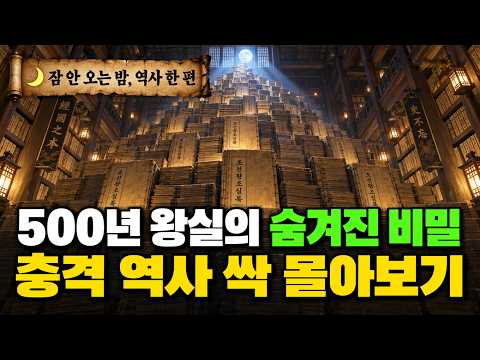
- 챕터: 0:00 🌙 인트로: 518년의 기록, 조선왕조실록이 감춘 위… · 3:46 🥀 제1부: 세종의 눈물과 며느리들의 비극 - 휘빈 … · 31:37 ⚔️ 제2부: 피로 세운 왕권, 태종 이방원 - 형제… · 56:58 📦 제3부: 임오화변의 진실 - 영조는 왜 아들 사도… · 77:46 🏛️ 제4부: 사육신과 단종 - 역적으로 기록되었다가… · 100:42 🌊 제5부: 광해군, 폭군인가 성군인가? - 전란을 … · 122:12 🌸 제6부: 정조 독살설의 미스터리 - 개혁 군주가 … · 135:08 🏹 제7부: 의적 임꺽정의 실체 - 백정이 도적이 될… · 168:06 ❄️ 제8부: 비운의 세자, 소현세자 - 9년의 인질… · 148:52 🔥 제9부: 장희빈과 숙종 - 사랑과 권력 사이에서 … · 187:50 🕯️ 제10부: 을미사변, 건청궁의 새벽 - 제국의 … · 210:04 🌙 에필로그: 실록이 우리에게 남긴 질문 - 기록된 …
- 설명 앞부분: 🌙틀어놓고 주무세요 성군 세종은 며느리 두 명을 폐출했고, 영조는 자신의 아들을 뒤주에 가뒀으며, 광해군과 장희빈은 후대에 전혀 다른 평가를 받게 됐습니다. 사도세자와 사육신, 정조의 죽음, 임꺽정, 소현세자와 명성황후까지. 조선왕조실록을 중심으로 『한중록』과 후대 기록, 당대의 여러 자료를 함께 따라가며 우리가 익숙하게 알고 있던 조선의 인물과 사건을 다시 들여다봅니다. 누가 성군이고 누가 폭군이었는지를 다시 정하는 이야기가 아닙니다. 기록에 무엇이 남았고, 무엇은 후대에 덧붙여졌으며, 같은 사건이 시대에 따라 어떻게 다르게 기…
- 같은 채널 평소 대비 ×319.8 (채널 최근 롱폼 중앙값 926회) · 평소 영상: 쿠빌라이는 왜 두 번이나 일본을 공격했나｜1274·1281 몽골 일본 원정의 모든 흐름 (1,032회) / 대영제국의 흥망성쇠｜세계 최대 제국은 어떻게 커지고 사라졌나 (821회)
- 대본 없음 (설명) — 음성인식이 끝나면 도입부·흐름이 들어감
- 댓글 193/368: 좋은 점 — 영상 4 · 감사·응원 19 · 더 알고 싶은 것 0 · 아쉬운 점 — 영상 1 · 반박·불만 — 의견 다름 1 · 정치·사회 3 · 경험 공유 1 · 구독·다음 기대 1
  - 좋은 점 — 영상 👍16 “너무 목소리가 편안하고 듣기 좋아요. 유익한 클립입니다. 잘때 들어도👍🏻”
  - 좋은 점 — 영상 👍6 “잘 본곤 아니구영 아주 자알 들었습니다 감사합니다 유익했어요!! 꾸벅!!”
  - 감사·응원 👍28 “ㅂㅓㄹ칙은 부모로서 줄수 있다. 그러나 그 땡볕에 왜 하필이면 뒤주였고 왜 땡볕이고. 왜 굶겨 죽게 했나! 역사가들은 아무도 그 이유가 한개도 없다! 세상에! 이런식으로 벌칙이나 잘못을 물은 부모는 이세상에 어디에도 없을거다! 사도세자를 옹호하지 않는다.하지만 영조는…”
  - 감사·응원 👍14 “이런 일들이 없었다면 우리나라는 지금 다른 모습이 되어 있을 겁니다. 하지만 모든 일들을 통해 배우면서 로 나아가야 되겠죠! 가슴아픈 삶의 이야기 감사합니다.”
  - 아쉬운 점 — 영상 👍1 “참 고맙습니다 ㆍ역사를 다시 상세하게 지루하지않게 아니 호기심 가득한 마음으로 그대의 맑은 음성으로 휴일 아침 긴 시간을 보냈습니다ㆍ경기도 양평 에서 듣고 있습니다ㆍ아프고 아픈 사연 많은 조선의 역사 ㅋ 예나 지금이나 정치의 세켸는 ~~ㅠ 감사합니다ㆍ팔십 노인이 고마…”
  - 반박·불만 — 의견 다름 👍0 “세종이 왜 그렇게 위인인지 이해가 안 된다..한글도 백성위해 만든 것도 아닌데 정치도 못 했고 백성 입장에서는 최악의 왕인데”
  - 정치·사회 👍0 “1882년군인들의밥에모래 운형궁 창덕궁으로명서왕후숨어서 외국인들의의해 갑신정변 청나라에게클려들어감”
  - 정치·사회 👍0 “청일전쟁 1895년 라우둥반도 모든것을움직이는이 미우라구르특명 여우사냥 운여궁 가마에태워경복궁으로명성황후를잡으려 복도를달리다넘어짐 외국인여인으넘어 트려칼로찌름 녹원석유뿌려죽임 창원지로 남양주 6시간후 재판증거불충분으로불려짐 아관파천1897년 명성황후로명함 🎉🎉🎉🎉 1…”
  - 경험 공유 👍0 “숙종은장옥정에게사약43살아들보게해달라하고망쳤다 사년째 죽음 계장을먹고 인현왕후 숙종은😅😅😅”
  - 구독·다음 기대 👍4 “기대합니다”

### 190. 작은 땅에 축복받은 민족, 강대국조차 한반도와 한국를 부러워하는 진짜 이유 총정리(8편 통합본)

- https://www.youtube.com/watch?v=NCOnYDCLHag · 안경 경제학 · 구독자 17,100 · 조회수 514,700 (×30.1, 하루 7,129.4) · 좋아요 9,341 (1.8%) · 231.5분 · 2026-08-30 · 주제 묶음 1. 역사 일반·이야기 · 형식 몰아보기·통합본 (긴 영상) · 폴더 `W_NCOnYDCLHag` (웹 승인)
- 썸네일: 
- 챕터: 0:00 오프닝 · 강대국조차 부러워하는 이 작은 땅의 정체 · 1:32 1부 · 아무도 안 살던 땅이 세상에서 가장 독한 민… · 32:03 2부 · 극단의 사계절과 한강, 우리가 몰랐던 땅의 … · 59:23 3부 · 강대국도 돈으로 못 사는 것, 갯벌과 물의 … · 87:48 4부 · 500년을 짓밟히고도 살아남은 한글의 진짜 … · 117:01 5부 · 세계가 포기한 죽은 산을 되살린 유일한 나라 · 145:14 6부 · 지하 1,000m 파독 광부와 간호사가 남긴… · 175:42 7부 · 강대국이 기술 주기를 두려워하는 한국인의 근성 · 203:30 8부 · 인류 최초로 아흔 살을 넘보게 만든 한국의 …
- 설명 앞부분: 개별 영상 및 통합본까지 3시간이 넘는데 70만명 이상 봐주셨습니다! 많은 관심 감사합니다! 자, 세계 지도를 한번 쫙 펼쳐 놓고 보세요. 미국은 다 보려면 비행기로 일주일, 러시아는 겨울이면 국토 절반이 얼어붙고, 중국은 3분의1이 사막입니다. 다들 뭐 하나씩은 크게 아쉬운데, 이 손톱만 한 땅 대한민국만 그게 다 있습니다. 뚜렷한 사계절에, 어느 나라 눈치도 안 보는 물에, 세계가 탐내는 갯벌에, 세종이 만든 글자에, 세계가 배우겠다고 줄 서는 밥상까지요. 도대체 왜 하필 이 좁은 땅에, 그리고 여기 사는 우리가 이렇게 됐을까…
- 같은 채널 평소 대비 ×89.6 (채널 최근 롱폼 중앙값 5,747회) · 평소 영상: 석 달이면 무너진다던 한국, 중소기업들이 일본을 대역전한 진짜 이유 (5,902회) / 한강은 원래 사람이 살면 안 되는 강, 그 미친 강을 굴복시킨 대한민국의 진짜 힘 (5,592회)
- 대본 없음 (설명) — 음성인식이 끝나면 도입부·흐름이 들어감
- 댓글 580/661: 좋은 점 — 영상 9 · 감사·응원 228 · 더 알고 싶은 것 3 · 아쉬운 점 — 영상 1 · 반박·불만 — 의견 다름 5 · 정치·사회 39 · 경험 공유 9 · 구독·다음 기대 0
  - 좋은 점 — 영상 👍27 “진짜 문제점과 원인과 결과 분석이 탁월하십니다 해결의 과정도 자세히 잘 설명해주셔서 감사합니다. 공무원이었던 저도 식목일 마다 학생들과 함께 뒷산에 올라서 심고 물주고 심고 물주기를 했던 기억이 납니다. 살겠나? 싶었는뎨 다음해 가고면 더러 살아남은 것을 보았습니다.…”
  - 좋은 점 — 영상 👍10 “좋은영상 감사합니다 그시대를 살아온 자로로 공감하고인정 합나다”
  - 감사·응원 👍49 “나무도 심고 소나무에 기생하던 송충이도 잡아서 없애던 학교시절이 생각난다 녹음이 우거진 산을 보니 감사하다”
  - 감사·응원 👍41 “대한민국 최고입니다 화이팅 🎉🎉🎉”
  - 더 알고 싶은 것 👍4 “참으로 해박한 지식으로 알려주시는내용에감탄스럽다 목소리도 좋고 한마디로쉽게 얘기해서 무척 똑소리나는전하는 내용에 감탄스럽다 누군지 궁금합니다 대한민국 화이팅!”
  - 더 알고 싶은 것 👍3 “좋아요..좋아요 좋은영상 앞으로도 계속 부탁해요”
  - 아쉬운 점 — 영상 👍1 “ㅡ 철공소. 기계음 ?을. 살짝 피햇노 .... 음”
  - 반박·불만 — 의견 다름 👍1 “헛소리 집어쳐라.”
  - 반박·불만 — 의견 다름 👍0 “외국으로.막노동자.일하는시대.사다리.오러내리는.시험에.합격하여야.(건강검진은물론.)외국근로자.나갈수.있었던시절이.생각남니다.ㅠㅠㅠ피눈물.흘리는시절이었죠.부산.대우실업..오억불.수출목표.달성했다고.구내식당에서.쌀밥.배식하던시절1979년일입닉다..지난시절이,,,,,😂😂😂…”
  - 정치·사회 👍23 “천혜의 땅과 지덕의 땅에 부지런한 국민이 땀흘려 일군 나라가 대한민국 입니다.🎉🎉🎉”
  - 정치·사회 👍7 “우리나라가 부강해진 모든것은 박정희대통령님의 깊은 혜안이 있었기 때문에 지금의 경제대국 방산강국이 된것입니다”
  - 경험 공유 👍27 “진짜 문제점과 원인과 결과 분석이 탁월하십니다 해결의 과정도 자세히 잘 설명해주셔서 감사합니다. 공무원이었던 저도 식목일 마다 학생들과 함께 뒷산에 올라서 심고 물주고 심고 물주기를 했던 기억이 납니다. 살겠나? 싶었는뎨 다음해 가고면 더러 살아남은 것을 보았습니다.…”
  - 경험 공유 👍19 “우리조상님들. 고생하시고 부모님들 의 고생 이. 저희가 이어받아. 서 고생하며 살아온 우리들자식이또이어가고 한고생한 댓가가. 지금. 세계가 알아주는 대한민국. 이 되였네요. ㆍ대한민국. 최고. 입니다”

### 191. 조선시대에 키 180Cm가 넘으면 일어나는 일

- https://www.youtube.com/watch?v=6wCWuqNY_aw · 바람이들려준역사 · 구독자 2,480 · 조회수 90,550 (×36.5, 하루 1,025.9) · 좋아요 653 (0.7%) · 16분 · 2026-08-14 · 주제 묶음 3. 조선 · 형식 정보·해설 (그 밖) · 폴더 `W_6wCWuqNY_aw` (웹 승인)
- 썸네일: 
- 설명 앞부분: 📏 조선시대에 키가 180을 넘는다는 건 어떤 의미였을까요? 평균 161cm의 세상에서 홀로 우뚝 솟은 사람. 저잣거리를 걸으면 사람들이 하던 일을 멈추고 돌아봤고, 때로는 임금 앞까지 불려 갔다고 합니다. 그런데 그렇게 눈에 띄는 몸이 과연 그 사람에게 축복이었을까요? 🤔 아니면 우리가 짐작도 못 한 반전이 숨어 있는 걸까요? 이 영상에서는 실제 유골 계측 연구로 밝혀진 조선 사람들의 진짜 키, 그리고 '8척 장신'이라는 표현에 숨은 놀라운 함정을 하나하나 파헤칩니다. 📜 평균 161cm의 세상에서 큰 키를 가진 사람은 집에서,…
- 같은 채널 평소 대비 ×95.3 (채널 최근 롱폼 중앙값 950회) · 평소 영상: 대만도, 몽골도 지운 강희제가 이미 손에 넣은 조선만은 통째로 삼키지 않은 진짜 이유 ∣… (950회) / [폐비 윤씨] "피 토하며 죽은 적 없다!" 500년 동안 대한민국을 속인 사약 사건의 … (938회)
- 대본 없음 (설명) — 음성인식이 끝나면 도입부·흐름이 들어감
- 댓글 181/181: 좋은 점 — 영상 2 · 감사·응원 0 · 더 알고 싶은 것 0 · 아쉬운 점 — 영상 5 · 반박·불만 — 의견 다름 9 · 정치·사회 5 · 경험 공유 9 · 구독·다음 기대 0
  - 좋은 점 — 영상 👍5 “국가에서 종족번식을 위해서 특별히 관리하고 국방력에 도움이 되도록했을것 같다.”
  - 아쉬운 점 — 영상 👍17 “내용이 좀 헛소리가 길어서 수면제로 쓰려했는데 잠도안오네”
  - 아쉬운 점 — 영상 👍2 “아..겁나 지루하다...”
  - 반박·불만 — 의견 다름 👍17 “내용이 좀 헛소리가 길어서 수면제로 쓰려했는데 잠도안오네”
  - 반박·불만 — 의견 다름 👍4 “이순신도 184였다는데 뭐가 저게 대단하다고?? 조선시대 사람들은 키가 난장이똥자루인줄 알았나 봐. 그 때 사람들 무덤 파헤쳐 유골의 신장 조사해보니 현대인들과 별 차이도 없어!! 또 잘 먹으면 키가 커진다는 말도 안되는 억지꾼이 나섰군!~”
  - 정치·사회 👍0 “조선만 그런게 아니고 산업혁명 전까지 모든 나라가 그랬어요... 그리고, 키큰유전자를 선호하는것은 외형적인 아름다움을 추구하는것이고, 그건 먹고살만해져야 가능한거죠.”
  - 정치·사회 👍0 “이게 말이 안맞는게 조선후기 또는 구한말에 왔던 서양의 외국인들이 말하는게 조선사람들은 키가 컷다고 합니다. 실제 구한말의 남자를 찍은 사진을 보면 제법 키가 큰 사진들이 많아보였습니다. 160cm이라는 키는 구한말이 되면서 각종수탈로 먹기 힘들어지면서 대부분의 영양…”
  - 경험 공유 👍3 “제가 180넘는데 어릴때는 큰키였는데 요즘 아이들이 커서 중간인듯 내 동생도 내보다 크고 할머니께 들은 바로는 고조부께서는 나보다 훨씬 크고 손도 엄청 컸다고 하시던데”
  - 경험 공유 👍1 “나도 살면서 손해 많이 봤다. 끊임없이... 끝도 없이...”

### 192. 조선 역사상 가장 아까운 천재 1위 I 당신이 생각하는 천재는 누구?

- https://www.youtube.com/watch?v=BZJ24uQ8qFQ · 역사잼잼 · 구독자 2,960 · 조회수 159,012 (×53.7, 하루 1,221.7) · 좋아요 1,928 (1.2%) · 32.4분 · 2026-06-20 · 주제 묶음 1. 역사 일반·이야기 · 형식 정보·해설 (그 밖) · 폴더 `W_BZJ24uQ8qFQ` (웹 승인)
- 썸네일: 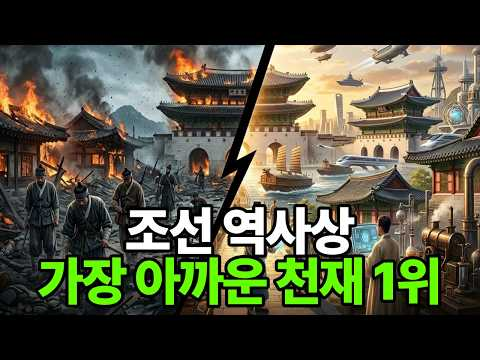
- 챕터: 0:00 인트로 — 만원권과 오천원권의 소름 돋는 비밀 · 1:30 10위 — 교과서 속 그 화가, 알고 보니 만능 천재 · 4:30 9위 — 조선 최초의 음향 공학자 · 7:00 8위 — 감히 하늘에 도전한 선비 · 9:30 7위 — 낮에는 영의정, 밤에는 천재 · 11:30 6위 — 탄핵 정국을 뚫고 살아남은 의성 · 14:30 5위 — 곤장 80대, 그리고 영원한 미스터리 · 18:00 4위 — 유배지에서 500권을 쓴 괴물 · 21:00 3위 — 9번 수석, 그가 남긴 예언 · 24:00 2위 — 승률 100%, 인류 해전사의 신화 · 27:30 1위 — 모든 천재 위에 군림한 단 한 사람 · 31:00 아웃트로 — 조선이 남긴 씁쓸한 일
- 설명 앞부분: 지갑 속 만원권과 오천원권의 주인공, 이순신 장군과 율곡 이이가 사실 19촌으로 같은 가문이었다는 사실, 알고 계셨나요? 조선 500년 역사 속에는 시대를 수백 년 앞서간 천재들이 있었습니다. 그러나 그들의 마지막은 너무나도 잔혹했습니다. 아들 학비조차 내지 못하고 사라진 조선 최고의 화가, 곤장 80대를 맞고 역사에서 증발한 과학자, 18년 유배지에서 500권의 책을 써낸 불굴의 학자까지... 조선이 위대한 이유는 이 천재들을 탄생시켰기 때문이고, 조선이 아쉬운 이유는 그 천재들을 끝까지 지키지 못했기 때문입니다. ⏱️ 타임라인…
- 같은 채널 평소 대비 ×179.2 (채널 최근 롱폼 중앙값 888회) · 평소 영상: 영화 오디세이에 나오지 않은 섬들의 충격적인 비밀 총정리 ∣ 오디세이 원작 2부 ∣ ∣ … (916회) / 조선이 버린 천한 섬 제주도에서 어떻게 기생이 최고부자가 되었을까? ∣ 정조가 인정한 김… (859회)
- 대본 없음 (설명) — 음성인식이 끝나면 도입부·흐름이 들어감
- 댓글 155/160: 좋은 점 — 영상 1 · 감사·응원 4 · 더 알고 싶은 것 4 · 아쉬운 점 — 영상 0 · 반박·불만 — 의견 다름 3 · 정치·사회 4 · 경험 공유 2 · 구독·다음 기대 0
  - 좋은 점 — 영상 👍1 “공자, 맹자만 외우던 성리학자들은 천재 리스트에서 빼야함. 민생에 1도 도움이 안되고, 오히려 해악만 끼친 자들이라는 생각.”
  - 감사·응원 👍4 “재미있게 잘봤습니다, 감사합니다”
  - 감사·응원 👍2 “덕분입니다 감사합니다”
  - 더 알고 싶은 것 👍2 “나랏말쌈이 중국에 달아. 에서 거의 대부분이 중국을 오늘날의 중국의 의미로 받아 들여 해설하는데 당시는 명나라이고 20세기에 와서야 중화인민공화국인데 ??? 이에대한 검토 부탁해요”
  - 더 알고 싶은 것 👍1 “조선 최고의 재상들을 올려주세요. 후대에 귀감이 되었으면 합니다.”
  - 반박·불만 — 의견 다름 👍5 “세종대왕 이도는 훌륭한 관리자입니다 훈민정음은 직접 창제한것이 아닙니다 이미 중 신미대사가 주관하여 세종대왕 발표전 8년전에 신미대사가 지은 불경이 발견되어있음 자료를 공부좀하세요 훌륭한 지도자 제세이화 홍익인간철학입니다”
  - 반박·불만 — 의견 다름 👍2 “한두놈이 아닌데 ㅋㅋ”
  - 정치·사회 👍15 “역사의 현실이 오늘날 부정선거와 판박이 참 아이러니 합니다 그놈의 기득권이 뭔지?”
  - 정치·사회 👍2 “어쪄면정말조선이라는 나라는처음부테세워져서는 않될나라였다우리5천년역사에많은나라가있었다 그러나조선많큼무능한 나라는없었다천5백년 전삼국시대에도고려시대까지모두황제국이었다 외세로침략을많이받았지만그래도잘막아내고나라 을굳건이지켔다그러나 무능한왕조로나라가침탈 당하고마지막에는일본의 …”
  - 경험 공유 👍5 “세종대왕보다위인 분은 군대고참입니다. 제가군대에서직접경험한얘기입니다. ㅋ”
  - 경험 공유 👍3 “최석정 선생은 생전 처음 듣는 이름입니다. 공학도인 제가 그분을 70대 중반이 되도록 알지 못했을까요?”

### 193. "나는 조선의 국모다" 이거 정말 맞는건가? 민비에 대한 A부터 Z까지!!

- https://www.youtube.com/watch?v=246Gb3xy0oM · 매불월드 · 구독자 3,120 · 조회수 202,911 (×65.0, 하루 1,263.4) · 좋아요 2,638 (1.3%) · 27.5분 · 2026-06-03 · 주제 묶음 3. 조선 · 형식 브이로그·직접 해본 이야기 · 폴더 `W_246Gb3xy0oM` (웹 승인)
- 썸네일: 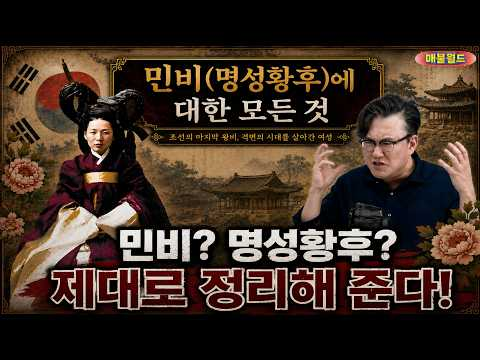
- 설명 앞부분: 역사학자 썬킴이 구한말 명성황후와 흥선대원군 간의 권력 갈등 및 임오군란 전후의 외교적 선택들을 분석합니다. 역사적 사실을 바탕으로 당시 조선의 재정 및 정세 변화를 입체적으로 조명합니다.매불월드는 방대한 영상 속에서 재미있고 의미 있는 장면을 선별해 자막과 편집을 통해 새롭게 재구성합니다. 단순한 영상 전달이 아닌, 핵심 포인트를 더 살리고 맥락을 쉽게 이해할 수 있도록 해설 자막과 편집을 직접 제작하여 콘텐츠의 완성도를 높이고 있습니다. 본 영상은 비평, 정보 전달, 교육적 목적을 기반으로 공정하게 인용되었으며, 유튜브 가이드…
- 같은 채널 평소 대비 ×71.1 (채널 최근 롱폼 중앙값 2,855회) · 평소 영상: 아시안게임 금매달에 대한 병역혜택? 이거 정말 필요한건가? (3,097회) / 김병지 대표 장남의 에이전트 활동 의혹, 보도 내용과 반박의 쟁점. 이래도 무혐의? (4,477회)
- 대본 없음 (설명) — 음성인식이 끝나면 도입부·흐름이 들어감
- 댓글 411/411: 좋은 점 — 영상 3 · 감사·응원 2 · 더 알고 싶은 것 2 · 아쉬운 점 — 영상 1 · 반박·불만 — 의견 다름 12 · 정치·사회 31 · 경험 공유 17 · 구독·다음 기대 0
  - 좋은 점 — 영상 👍6 “팩트도 맞고 나도 어릴때 민비나쁜여자. 흥선 좋은위인이라고 배웠는데 세월이 지나면서 재평가 됐다. 민비는 조선에 기관총을 수입해서 무장할려고 했고 흥선은 쇄국정책으로 아까운시간 다 날려먹었다.”
  - 좋은 점 — 영상 👍3 “맛 칼럼니스트도 하시던 분이 민비 뮤지컬보다 소리 치셨다는 이야기를 들었는데 정말 이해가 되네..”
  - 감사·응원 👍53 “썬킴 역사이야기 우리나라에서는 최고 항상 응원합니다”
  - 감사·응원 👍21 “썬킴선생님 늘 재밌게 역사를 배웁니다 감사합니다”
  - 더 알고 싶은 것 👍2 “썬킴님의 개인적인 사견일뿐입니다. 영어강사가 언제부터 역사가가 되셨나요?”
  - 아쉬운 점 — 영상 👍4 “일제강점기 해방도 미국, 625 주적에게 멸망할뻔한거 구해준것도 미국. 근데 지금 반미운동?? 북한이 이제 우리나라에 무장공비를 보낼 필요도 없어요^^”
  - 반박·불만 — 의견 다름 👍224 “도대체 내가 조선의 국모다 하는 말도안돼는 오페라를 20여년간 그것도 국립극장에서 공연이 가능케한 쌉새들은 도대체 누구여?”
  - 반박·불만 — 의견 다름 👍5 “얘가 미쳤나? 공부안해? 명성황후가 재정을 날렸다고? 헛소리. 흥선이 무리한 경복궁재건으로 재정파탄낸거 아니고? 명성황후 사치 청군요청은 사실이 아니라는게 밝혀졌는데도 헛소릴하는군 민자영도 소설속 이름이지. 본명이니? 허위사실 유포다”
  - 정치·사회 👍107 “민비가 머리가 좋은건 안좋은 쪽으로 머리가 비상했던거임 ~ 나라가 망하는데 민씨가문해먹을 생각만 하고 정권유지시키는데만 관심이 있었음”
  - 정치·사회 👍82 “한국 화폐의 인물도 정말 기가 막힙니다!!! 사용하지도 않는 100원짜리 동전에 충무공이 자리 하신다는게 말이 되나요!!! 당연히 훌륭하신 분들이지만, "율곡 이이" "퇴계 이황" 같은 분들의 업적이 무엇인가요!!!! 십만양병설!!! 이기일원론!!! 그게 뭔가요?? …”
  - 경험 공유 👍224 “도대체 내가 조선의 국모다 하는 말도안돼는 오페라를 20여년간 그것도 국립극장에서 공연이 가능케한 쌉새들은 도대체 누구여?”
  - 경험 공유 👍63 “2001년작 이미연 주연의 드라마 "명성황후"가 히트치면서 "내가 조선의 국모다"라는 대사가 널리 유행하고, 뮤지컬로도 만들어짐.”

### 194. 비단옷보다 무거웠던 것 ∣ 조선 중전의 진짜 하루 공개

- https://www.youtube.com/watch?v=e12EIRsz6Xo · 진짜역사한잔 · 구독자 15,800 · 조회수 631,554 (×40.0, 하루 6,366.8) · 좋아요 4,231 (0.7%) · 89.8분 · 2026-08-03 · 주제 묶음 3. 조선 · 형식 정보·해설 (그 밖) · 폴더 `W_e12EIRsz6Xo` (웹 승인)
- 썸네일: 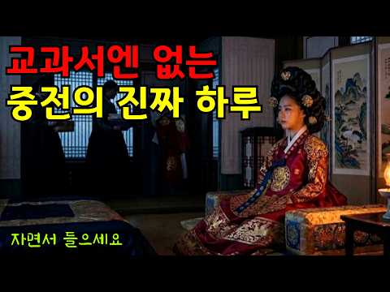
- 챕터: 0:00 새벽 네 시, 중궁전에 켜진 불 · 2:10 나라가 뽑는 왕비 - 금혼령과 삼간택 · 6:30 가례 육례와 책봉, 품계가 없는 사람 · 10:20 새벽 문안 - 국모이면서 며느리였던 자리 · 14:00 내명부, 수백 명을 다스리는 관리자 · 18:30 정치에 관여할 수 없지만 그 자체가 정치였던 존재 · 22:40 수라와 예복, 그리고 궁궐의 살림 · 27:00 후궁과의 관계, 적자를 낳으라는 압박 · 32:10 폐비 윤씨와 갑자사화 · 37:20 이레 만에 폐위된 왕비, 단경왕후 · 41:00 인현왕후와 장희빈 - 왕비 교체는 정치의 결과였다 · 46:30 왕실 의례와 예송, 상복이 권력을 바꾸다 · 51:00 궁궐의 밤, 인정과 파루 · 55:20 출산과 의녀, 목숨을 건 국가의 사업 · 60:00 궁녀들의 세계와 상궁의 힘 · 65:10 대비가 되어야 비로소 열리는 발언권 · 70:00 조선의 마지막 왕비까지 · 75:00 이름 대신 자리로 기억된 사람들
- 설명 앞부분: 조선에서 여성이 오를 수 있는 가장 높은 자리, 중전. 모든 궁녀가 무릎을 꿇고, 백관의 아내들이 머리를 숙이며, 왕조 전체가 국모라 부르던 자리입니다. 그런데 왜 어떤 양반 집안은 딸이 왕비 후보로 뽑혔다는 소식에 잔치가 아니라 통곡을 했을까요. 왜 어떤 왕비는 궁에 들어간 지 이레 만에 쫓겨났고, 어떤 왕비는 사약을 받았을까요. 조선왕조실록, 경국대전, 궁중 의궤, 승정원일기 등 기록을 바탕으로 새벽 네 시의 어둠에서 자정이 넘도록 꺼지지 않던 중궁전의 등불까지, 조선 중전의 하루를 처음부터 끝까지 복원했습니다. 이 영상은 확…
- 같은 채널 평소 대비 ×36.9 (채널 최근 롱폼 중앙값 17,138회) · 평소 영상: [4시간연속재생] 교과서에 없는 조선시대 평민생활 세번째 이야기 (18,515회) / 굶주림이 만들어낸 나라 ∣ 조선 오일장 오백 년의 숨겨진 역사 (15,762회)
- 대본 없음 (설명) — 음성인식이 끝나면 도입부·흐름이 들어감
- 댓글 85/115: 좋은 점 — 영상 1 · 감사·응원 1 · 더 알고 싶은 것 4 · 아쉬운 점 — 영상 1 · 반박·불만 — 의견 다름 0 · 정치·사회 1 · 경험 공유 1 · 구독·다음 기대 1
  - 좋은 점 — 영상 👍2 “유익한 영상 감사합니다 내레이션의 목소리도 듣기 편합니다 다음 영상도 기대하며 구독합니다 😊❤”
  - 감사·응원 👍2 “유익한 영상 감사합니다 내레이션의 목소리도 듣기 편합니다 다음 영상도 기대하며 구독합니다 😊❤”
  - 더 알고 싶은 것 👍23 “이런 콘텐츠는 오래오래 만들어 주세요.”
  - 더 알고 싶은 것 👍18 “그러면 간택 시험을 대충 봐서 떨어지면 되지 않을까 궁금하네요”
  - 아쉬운 점 — 영상 👍4 “집중할라치면광고가~~광고진짜많네요 이해는하지만적당히좀~~~ 구독은안하고시퍼~”
  - 정치·사회 👍6 “그런 효에 나라가 지금은 개에 나라가 됐다”
  - 구독·다음 기대 👍2 “유익한 영상 감사합니다 내레이션의 목소리도 듣기 편합니다 다음 영상도 기대하며 구독합니다 😊❤”

### 195. 왕이 되지 못한 조선 왕자들의 충격적인 진짜 삶 #조선시대 #조선역사 #역사이야기

- https://www.youtube.com/watch?v=cuwkTGyvORY · 담너머 조선 이야기 · 구독자 4,710 · 조회수 177,247 (×37.6, 하루 1,882.3) · 좋아요 761 (0.4%) · 22분 · 2026-08-08 · 주제 묶음 1. 역사 일반·이야기 · 형식 정보·해설 (그 밖) · 폴더 `W_cuwkTGyvORY` (웹 승인)
- 썸네일: 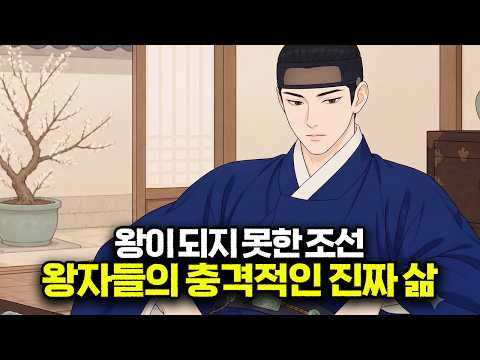
- 설명 앞부분: 화려한 왕실의 피를 타고났지만, 왕관을 쓰지 못한 조선의 왕자들. 세자가 되지 못한 대군과 군들은 궁궐 밖으로 나가 평생을 어떤 모습으로 살아가야 했을까요? 왕권을 위협할 수 있다는 이유로 평생 조정의 정치 참여가 철저히 금지되었고, 작은 언행 하나에도 역모의 혐의를 뒤집어쓸 수 있었던 살얼음판 같았던 삶. 어떤 왕자는 예술과 유흥에 몰두하며 자신에게 야심이 없음을 증명해야 했고, 어떤 왕자는 끊임없는 견제 속에서 비극적인 결말을 맞이해야 했습니다. 권력의 중심에서 밀려난 채 평생을 감시와 불안 속에서 살아가야 했던 조선 왕자들의…
- 같은 채널 평소 대비 ×19.9 (채널 최근 롱폼 중앙값 8,914회) · 평소 영상: 사극에서는 보여주지 않는 조선시대 백정의 삶 #조선시대 #조선역사 #역사이야기 (8,914회) / 약과와 유과는 꿈도 못 꾸던 조선 백성들은 간식으로 뭘 먹었을까? #조선시대 #조선역사 … (7,377회)
- 대본 없음 (설명) — 음성인식이 끝나면 도입부·흐름이 들어감
- 댓글 119/122: 좋은 점 — 영상 0 · 감사·응원 0 · 더 알고 싶은 것 1 · 아쉬운 점 — 영상 1 · 반박·불만 — 의견 다름 3 · 정치·사회 2 · 경험 공유 3 · 구독·다음 기대 0
  - 더 알고 싶은 것 👍1 “대군들의 아들들은 군으로 책봉되기도 하고, 그냥 군의 아들이면 똑같은 군이 되거나 아예 아뮤런 호칭이 없는 경우도 있던데, 기준이 무엇인지 알고 싶네요”
  - 아쉬운 점 — 영상 👍2 “Ai로 영상도 제대로 못 뽑아내 그렇다고 자막이나 한국어에 맞게 뽑아 내기를 해. 이거 한국인이 운영하는 채널 맞기는 함?”
  - 정치·사회 👍15 “정확하게는 왕족이 정걔전출을 법으로 금지한 시기는 성종때부터 입니다 종친사환금지법으로 정계진출을 막은것이죠 아이러니하게도 성종이 이런법울 만든게 자기 친할아버지 세조가 계유정난을 일으켜 정권을 장악하고 왕위를 찬탈까지 하면서 입니다 할아버지가 쿠데타를 일으켜 왕이된 …”
  - 경험 공유 👍1 “우리집이 세종의아들 임영대군파던데 내 조상이 저런삶을 사셨겠네”
  - 경험 공유 👍0 “이거 아님. 왕실 신용을 바탕으로 무역을 했었어요...”

### 196. 왕은 하루에 몇 번이나 잠자리를 했을까? ∣ 조선시대 왕 잠자리 횟수 ∣ 조선 왕실 성생활 기록

- https://www.youtube.com/watch?v=HbrtYNiPNdA · 비사록 · 구독자 7,640 · 조회수 371,005 (×48.6, 하루 3,032.6) · 좋아요 7,032 (1.9%) · 27.3분 · 2026-07-11 · 주제 묶음 3. 조선 · 형식 정보·해설 (그 밖) · 폴더 `W_HbrtYNiPNdA` (웹 승인)
- 썸네일: 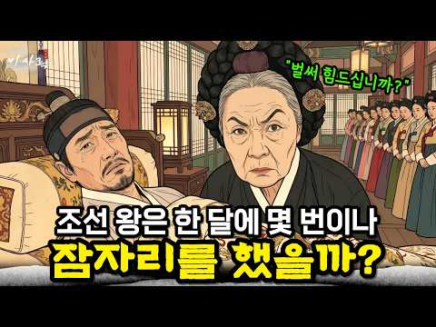
- 챕터: 0:00 인트로 · 1:15 파트 1. 합방의 절차 — 문 하나 사이의 여덟 상궁 · 4:02 파트 2. 날짜를 정하는 사람 — 왕도 못 정한 그날… · 6:25 파트 3. 한 달에 몇 번? — 조선과 중국의 차이 · 7:25 파트 4. 왕비와 후궁, 정치가 된 하룻밤 · 11:47 파트 5. 거부당한 밤 — 왕과 여인들의 선택 · 14:32 파트 6. 승은 한 번의 운명 — 무수리에서 왕의 어… · 19:52 파트 7. 감시받는 몸, 감시받는 침실 · 23:38 파트 8. 간택이라는 이름의 국가 행사 · 25:44 결론 — 왕의 밤이 왕조의 미래였던 이유
- 설명 앞부분: 👑 조선의 왕은 절대 권력자였지만, 침실에서만큼은 스스로 아무것도 결정할 수 없었습니다. 오늘 밤 누구를 만날지조차 상궁과 국가가 정했던 그 은밀한 역사를 풀어봅니다. 이 영상에서는 조선시대 왕의 잠자리 절차와 상궁들의 감시 체계, 왕비와 후궁 사이의 서열을 다룹니다. 교과서에는 없던 조선 왕실의 침실 이야기, 지금 시작합니다. 본 영상의 모든 내용(제목, 섬네일, 대본, 음성, 영상 구성, 데이터 분석 등)은 '비사록' 채널의 독자적인 창작 자산입니다. 적발 시 사전 경고 없이 즉각적인 민·형사상 법적 조치 및 ⓒ 비사록. Al…
- 같은 채널 평소 대비 ×219.7 (채널 최근 롱폼 중앙값 1,689회) · 평소 영상: 얼음 속에 묻혀있던 탄저병이 75년 만에 돌아왔다 ∣ 시베리아 야말 반도 충격 실화 (1,689회) / 한국이 물 부족 국가에서 ‘물 기술 강국’이 된 숨겨진 이유 ∣ 한국 해수담수화 사우디 … (1,654회)
- 대본 없음 (설명) — 음성인식이 끝나면 도입부·흐름이 들어감
- 댓글 373/387: 좋은 점 — 영상 0 · 감사·응원 2 · 더 알고 싶은 것 1 · 아쉬운 점 — 영상 2 · 반박·불만 — 의견 다름 8 · 정치·사회 3 · 경험 공유 4 · 구독·다음 기대 0
  - 더 알고 싶은 것 👍5 “아 중간중간에 무슨 광고가 어렇게나 많이 나오나요? 영상보는데 집중이안됩니다 몇개만 뺄수엄나요?”
  - 아쉬운 점 — 영상 👍10 “나레이션은 AI인가요? 기계음 치고는 너무 완벽하네요^^”
  - 아쉬운 점 — 영상 👍5 “아 중간중간에 무슨 광고가 어렇게나 많이 나오나요? 영상보는데 집중이안됩니다 몇개만 뺄수엄나요?”
  - 반박·불만 — 의견 다름 👍21 “다 거짓말 같애 난 믿지않음 말도 안되는 규정들...”
  - 반박·불만 — 의견 다름 👍9 “전하! . . .거기가 아닙니다! ~~”
  - 정치·사회 👍1 “《한국사학교수99%가짜논문자들!》여러분! 한국사학계 잘 보면,역사 소설과실사(정사)분별을 못하는,상식없는"유사역사학 상태"인 바,이렇게된 가장 큰 원인은,전국 한국사학교수 99%가,가짜 사기논문 학위로써 즉,가짜교수들이기 때문임은 명백한 사실입니다.중국인들써논 내용만…”
  - 정치·사회 👍0 “옛날 에 수명두짧았는데 ,뭔60~70대 상궁, 거지,머슴나라가막살았지 구라치고있네”
  - 경험 공유 👍144 “모든 세대의 왕이 다 그런 룰에 따랐다고 믿기 어렵다. 내가 왕이라도 당장 불호령을 내렸을 것이다. 왕의 명령에 상궁 따위가 저항할 수 있다고 생각지 않는다”
  - 경험 공유 👍4 “만약 내가 왕이었다면 아침한번 밤에한번 죽을때까지 하루두번씩했겠다”

### 197. 이순신을 살린 대한민국 함대, 1598년 조선에 갇혔다 ∣ 1시간 Full Movie ∣ 4K

- https://www.youtube.com/watch?v=dUD9yKNxGps · 대한 타임슬립 본부 · 구독자 17,100 · 조회수 316,098 (×18.5, 하루 6,781.6) · 좋아요 2,143 (0.7%) · 60.4분 · 2026-09-25 · 주제 묶음 3. 조선 · 형식 몰아보기·통합본 (긴 영상) · 폴더 `W_dUD9yKNxGps` (웹 승인)
- 썸네일: 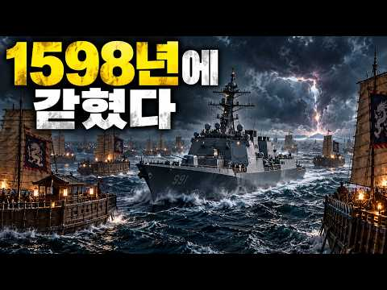
- 챕터: 0:00 부산진·동래성 — 왜선 700척, 전쟁의 시작 · 7:27 노량 — 대한민국 함대가 1598년에 갇히다 · 22:20 체포령 — 이순신을 다시 잡아오라 · 32:22 부산 — 묶인 조선인을 태운 수송선 · 40:16 대마도 — 끌려간 백성을 되찾다 · 46:35 규슈 — 코무덤과 남겨진 기록 · 51:48 노량 — 왜선 300척, 다시 남해로 · 56:56 1603 — 현대 화력이 멈춘 뒤, 조선은 달라졌다
- 설명 앞부분: 1592년 부산진과 동래성에서 시작된 전쟁. 1598년 노량에서 이순신을 살린 대한민국 함대는 돌아가지 못했습니다. 그리고 그들은 조선에 남았습니다. 부산 회수, 대마도와 규슈, 코무덤에 남겨진 기록, 다시 조선을 향해 몰려온 왜선 300척. 그리고 1603년, 현대의 화력이 멈춘 뒤에도 스스로 침략을 막아내기 시작한 조선까지. 《대한국 프로젝트2 — 불침》 부산진·동래성 서막 + 전 7편 + 1603 확장 피날레를 하나의 장편으로 구성한 완성판 Full Movie입니다. ■ 작전 제작 노트 대한국 프로젝트를 처음 기획할 때, 하…
- 같은 채널 평소 대비 ×9.2 (채널 최근 롱폼 중앙값 34,362회) · 평소 영상: 임진왜란 코무덤, 이순신이 규슈에서 일본군 전공 기록을 찾았다 ∣ 대한국 프로젝트2 ∣ … (20,626회) / 2026년 항구에서 시간 경계가 무너졌다… 그리고 무언가가 넘어왔다 ∣ 4K (18,825회)
- 대본 없음 (설명) — 음성인식이 끝나면 도입부·흐름이 들어감
- 댓글 108/230: 좋은 점 — 영상 1 · 감사·응원 2 · 더 알고 싶은 것 7 · 아쉬운 점 — 영상 0 · 반박·불만 — 의견 다름 3 · 정치·사회 0 · 경험 공유 0 · 구독·다음 기대 0
  - 좋은 점 — 영상 👍1 “통 쾌 하 다 시 원 하 다 좋은영상 감사합니다 👏 👏 👏 👏 👏 👏 👏 👏 👏 👏 👏 👏”
  - 감사·응원 👍1 “통 쾌 하 다 시 원 하 다 좋은영상 감사합니다 👏 👏 👏 👏 👏 👏 👏 👏 👏 👏 👏 👏”
  - 감사·응원 👍1 “돌아가면 가짜 국방부에. 엄청깨지겠네. 그래도 고맙다”
  - 더 알고 싶은 것 👍7 “다음 전투영사아도 부탁드립니다 대한님!”
  - 더 알고 싶은 것 👍4 “해군의 어느 함정에서도 정복을 착용하고 근무하는 경우가 있으면 ✋️ 손 꼽아 보시오!(근무복/전투복으로 변경 부탁드립니다 🙏)😮”
  - 반박·불만 — 의견 다름 👍1 “통통배에 기계식 한다고 물바퀴을 할봐에야 뒤에 프로펠라 방식으로하지 말도안돼😂😂😂하긴 조선시대에 간자체 말이안돼지😢😢😢”
  - 반박·불만 — 의견 다름 👍0 “이지스함 중량이 얼마인데 그냥 깔아뭉개도 될일을 왜 함포를 쏘나요? 함포는 멀리서 쏘는 용도이고 항모전단이 대열을 이탈하는 것도 웃기는데 대열갖춰서 쏴도 당시 왜군을 다 물리칠만한 탄약이 존재하는지도 체크해야하는데 우리전단이 96셀 자랑하는 이지스함이 두어척에 구축함…”

### 198. 화학 지식도 없던 고대인은 어떻게 철을 만들어냈을까?

- https://www.youtube.com/watch?v=12EyJuBAyOg · 지구연구실 · 구독자 8,310 · 조회수 315,412 (×38.0, 하루 3,276.1) · 좋아요 1,956 (0.6%) · 25.7분 · 2026-08-06 · 주제 묶음 8. 문명·고고학 · 형식 정보·해설 (그 밖) · 폴더 `W_12EyJuBAyOg` (웹 승인)
- 썸네일: 
- 설명 앞부분: 철을 녹일 수도 없었던 고대 인류는 어떻게 철을 만들었을까요? 수천 년 전 철광석은 그저 붉고 무거운 돌에 불과했습니다. 하지만 이름 없는 고대 장인들은 숯과 화로, 풀무를 이용한 수많은 시행착오 끝에 돌 속에 숨어 있던 철을 꺼내기 시작했죠. 이 영상에서는 인류가 처음 접한 운석 철부터 철광석을 녹이지 않고 금속으로 바꾼 제련 기술, 화로에서 나온 검은 철 덩어리인 블룸, 그리고 연철이 강철로 발전한 과정까지 쉽고 재미있게 살펴봅니다. 고대 인류의 철 발견과 철기시대의 시작이 궁금했다면 영상에서 확인해 보세요. 지구의 오래된 이…
- 같은 채널 평소 대비 ×21.4 (채널 최근 롱폼 중앙값 14,766회) · 평소 영상: 인류는 어떻게 초콜릿을 만들었을까? 쓰디쓴 씨앗에서 시작된 뜻밖의 발견 (14,766회) / 인류는 어떻게 비누를 발명했을까? 물로 지워지지 않던 기름때를 없앤 뜻밖의 발견 (14,980회)
- 대본 없음 (설명) — 음성인식이 끝나면 도입부·흐름이 들어감
- 댓글 131/131: 좋은 점 — 영상 1 · 감사·응원 0 · 더 알고 싶은 것 4 · 아쉬운 점 — 영상 1 · 반박·불만 — 의견 다름 1 · 정치·사회 0 · 경험 공유 0 · 구독·다음 기대 0
  - 좋은 점 — 영상 👍0 “구구절절 늘어놓아서 들어줄수가없다”
  - 더 알고 싶은 것 👍3 “구리는 어떻게 구했고 청동의 비율은 또 어떻게 알았을까요?”
  - 더 알고 싶은 것 👍0 “숯은 어떻게 발견됐고 어떻게 제작 방법을 발전시켜왔는지도 다뤄주세요!”
  - 아쉬운 점 — 영상 👍1 “영상 내용은 괜찬은데 말 한 마디 나올때마다 나오는 영상이 너무 중구난방 ai티가 난다...”
  - 반박·불만 — 의견 다름 👍1 “우연에 우연이 겹치고 그 우연이 또 우연을 만나 우연을 낳고 그 낳은 우연이 대대손손 우연에 우연을 거쳐서 인류가 돌도끼를 만들고, 말도 안되는 우연이 청동기를 만들고, 인류가 어찌 어찌 하다보니 또 우연이 겹쳐서 철기가 도래했다.. 이렇게 우연을 가장한 생각을 하는…”

### 199. 세계를 다 삼킨 중국 황제 조선만은 못 건드린 이유

- https://www.youtube.com/watch?v=xuJSO9q8Wl8 · 역사탐구 · 구독자 5,020 · 조회수 133,983 (×26.7, 하루 1,945.9) · 좋아요 1,063 (0.8%) · 28.6분 · 2026-08-20 · 주제 묶음 3. 조선 · 형식 정보·해설 (그 밖) · 폴더 `W_xuJSO9q8Wl8` (웹 승인)
- 썸네일: 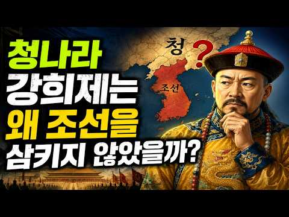
- 설명 앞부분: 참고한 자료 위키백과 강희제 항목 — 재위 기간, 삼번의 난, 대만 정복, 네르친스크 조약, 준가르 갈단 원정, 티베트 관계, 오보이 제거 등 생애와 업적 전반 국사편찬위원회 우리역사넷 백두산 정계비 문제 — 1712년 정계비 건립 경위, 목극등 파견, 박권의 소극적 태도, 토문강 해석 논쟁 국사편찬위원회 우리역사넷 조공 및 중국에서 오는 사신 — 조선과 명 청의 조공책봉 관계, 조공국의 내정 자율성 한국민족문화대백과사전 한국학중앙연구원 조공 — 조선 청 관계가 조공제도의 대표 모델이라는 학술 설명 가톨릭신문 중국 황제와 서양 선…
- 같은 채널 평소 대비 ×380.6 (채널 최근 롱폼 중앙값 352회) · 평소 영상: 이 지도를 보면 조선이 일본을 어떻게 봤는지 알 수 있다 (352회) / 넷플릭스 여배우 하영이 자랑한 증조부 안상호 고종 독살 의혹 진실 (369회)
- 대본 없음 (설명) — 음성인식이 끝나면 도입부·흐름이 들어감
- 댓글 175/184: 좋은 점 — 영상 1 · 감사·응원 1 · 더 알고 싶은 것 0 · 아쉬운 점 — 영상 1 · 반박·불만 — 의견 다름 7 · 정치·사회 23 · 경험 공유 5 · 구독·다음 기대 0
  - 좋은 점 — 영상 👍10 “우리 어린 시절 많이 듣던 말 중에 " 세상에 조선 없이 되는 것이 없다." 이는 이성계의 쿠테타로 건국한 조선이 아니고 우리의 고조선을 말한다는 것을 훗날 알았다. 대표적으로 조공=朝貢 이 글자는 조선에 바치는 공물을 말함이다. 역사를 개판으로 배워서 우리가 사대나…”
  - 감사·응원 👍0 “제가 평소에 궁금해 했던 것을 정리하여 이렇게 알려주시니 정말 감사합니다. 제가 궁금했던 것이 또 있습니다. 정말 조선이 중국에서 독립국이었을까 하는 겁니다. 고조선에서 고려까지는 중국과 피터지게 싸운 100% 독립국임이 확실합니다. 그런데, 이성계가 중국에 스스로 …”
  - 아쉬운 점 — 영상 👍0 “해설소리가 늘어져서 지루하네”
  - 반박·불만 — 의견 다름 👍2 “백두산 정계비의 토문강은 두만강이 맞습니다. 숙종실록 38년 (1712년) 청나라 오라총관 목극등과 조선 접반사 박권의 대화를 보면, 목극등이 "청과 조선의 경계는 어디까지 인가.?" 라고 묻고, 이에 박권이 "압록강과 두만강 입니다." 답변합니다. 이에 목극등이 "…”
  - 반박·불만 — 의견 다름 👍0 “패권국의 관리방법이겟죠. 먹을것도 없는데 굳이 왜 직접통치하겟음? 전략적 요충지도 아닌데”
  - 정치·사회 👍41 “조선이 청나라에 바친 조공은 강희제에 들어 크게 줄어서 인삼과 종이, 호랑이 가죽같은 특산품으로 대체됬고 대신 청나라가 내려주는 하사품은 은과 최고급 비단과 도자기등을 갑어치로는 조공의 10배에 달해 조선으로선 개꿀. 거기다 강희제는 조선에 큰 가뭄이 들었다는 얘기를…”
  - 정치·사회 👍29 “청나라는 중국이아니다....여진족 금나라가세운 왕국이다....여진족은 절대한족하고 아무상관없다....명나라가 한족 정통중국이다....”
  - 경험 공유 👍4 “결론은 왕조시대 !! 특히 강희제은 주변국을모두 강제합병의 주 군주로 오늘날의 중국국경을 있게한 주인공! 이런 저런 소리 다 쓰잘데없는 소리! 조선을 병자호란때 보면 바로 알수 있음. 즉 조선을 정벌하고도 단지 군신관계만 확인하고 비석 하나로 끝냄. 이것이 당시 주변…”
  - 경험 공유 👍3 “그 당시 핏줄과 가문 뿌리가 가장 큰 명분이자 아이덴티티였음 북방계 지배자들은 뿌리가 모두 한국인이었음 그래서 중국을 통일해도 북방에서 힘이 엄청나게 강력해도 한반도를 내비두거나 예우해준 것은 자신들의 조상땅임을 알기 때문임 패권자가 쓸데없이 이상하게 한 나라만 챙겨…”

### 200. 세조의 오른팔 한명회 자식 다섯 전원 몰살된 진짜 이유 ∣ 한명회자식비극 ∣ 왕비두명만든남자

- https://www.youtube.com/watch?v=DcJMoVuG9Jw · 역사탐사실 · 구독자 19,900 · 조회수 1,245,348 (×62.6, 하루 7,652.8) · 좋아요 13,154 (1.1%) · 19.4분 · 2026-05-31 · 주제 묶음 11. 황제·왕·인물 · 형식 정보·해설 (그 밖) · 폴더 `W_DcJMoVuG9Jw` (웹 승인)
- 썸네일: 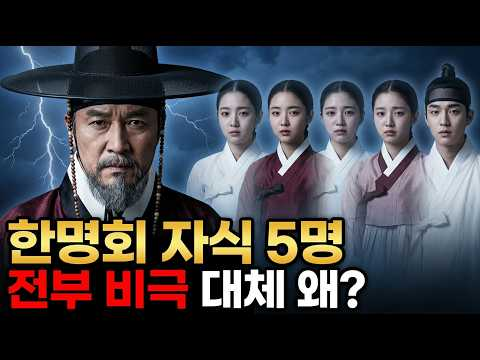
- 설명 앞부분: 왕 3명을 만들고, 딸 2명을 왕비로 올린 남자 그런데 자식 5명 전부 비극으로 끝났습니다 ∣ 한명회의 저주 😱 조선 최고의 권력자 한명회. 왕을 세 명이나 세우고, 딸 둘을 왕비 자리에 올려놓은 남자. 그런데 그의 자식 다섯 명은 단 한 명도 온전히 살아남지 못했습니다. 셋째 딸 장순왕후 — 열일곱에 출산 후 사망 💔 넷째 딸 공혜왕후 — 열아홉에 자녀 없이 사망 💔 유일한 아들 한보 — 평생 아버지의 업보를 짊어지다 외손자 인성대군 — 세 살에 요절 손자 한경침 — 열일곱에 사망 ⚰️ 죽은 뒤 17년 만에 무덤이 파헤쳐진 남자…
- 같은 채널 평소 대비 ×573.8 (채널 최근 롱폼 중앙값 2,170회) · 평소 영상: 사랑이 아니라 광기였다? 인조와 조귀인 관계의 충격적 결말 ∣ 조귀인자작극저주사건 ∣ 조… (2,198회) / 종기 하나로 죽었다고? 정조 죽음의 14일, 기록이 말해주는 진실 ∣ 정조이산마지막유언수… (2,143회)
- 대본 없음 (설명) — 음성인식이 끝나면 도입부·흐름이 들어감
- 댓글 1,590/1,626: 좋은 점 — 영상 8 · 감사·응원 18 · 더 알고 싶은 것 10 · 아쉬운 점 — 영상 6 · 반박·불만 — 의견 다름 10 · 정치·사회 73 · 경험 공유 24 · 구독·다음 기대 0
  - 좋은 점 — 영상 👍2 “한명회 자식이.두명인줄 알았는데 5명이나 있었구나. 좋은 정보.감사합니다”
  - 좋은 점 — 영상 👍2 “대본이 잘 짜여있고 정말 생각을 많이하고 구성되어 있다는 걸 느꼈어요 좋은 영상 감사합니다 저는 개인적으로 두 딸이나 왕비로 기록되어있기도하고 살아있을때 온갖 부귀영화를 누린 한명회가 더 부럽네요...ㅎㅎ”
  - 감사·응원 👍3 “엄 흥도 이런분을역사가알듯요즘엔 엄흥도같은충신이 어디없을까? 한명희같은작자가정치를하고있는 세상훗날밝혀지겠지.~~글올려주시는분 항상감사드립니다.~~”
  - 감사·응원 👍2 “한명회 자식이.두명인줄 알았는데 5명이나 있었구나. 좋은 정보.감사합니다”
  - 더 알고 싶은 것 👍1 “제가 부탁이 있습니다 방장님께 예전부터 내가 나쁜 일을 하면 자손들한테 해가 된다는 말을 들었는데 그럼 역사적으로 파 보아도 정말 그럴까? 그게 참 궁금했거든요 그래서 대표적인 인물인 한명회 자손들 검색을 해봤는데 알 수 있는게 하나도 없었어요. 오늘 방장님 덕분에 …”
  - 더 알고 싶은 것 👍1 “8:48 전 그 이유를 알거 같네요 바로 단종의 저주 때문에 죽었죠 반면 적장자이지만 단종의 저주를 피한 왕이 숙종인데 어떻게 피했을까요?”
  - 아쉬운 점 — 영상 👍2 “AI 목소리가 아니라서 좋네요”
  - 아쉬운 점 — 영상 👍1 “영상이 쓸데 없이 너무 길어....12분이내로.....길어서 안보고 패스....”
  - 반박·불만 — 의견 다름 👍1 “몰살된 건 아니죠. 한명회는 부귀영화를 누리고 천수 했고. 아들도 장수했죠. 딸들이 건강하지 않았던게 문제지.”
  - 반박·불만 — 의견 다름 👍1 “영상에 의상 고증을 좀 하겼으면 합니다. 왕가가 아닌데 금박이라니요”
  - 정치·사회 👍7 “실력없는데 부정적인방법으로 권력찬탈하는 민주당 찢재명 똑같네”
  - 정치·사회 👍4 “업보와 죄는 자식한테 간다더만 ~~ 맞네 양심껏 잘살자 ~~그런데 지금의 정권의 희생양으로 죽은 억울한 다섯명의 억울한 죽음은 어쩌나 리짜이밍”
  - 경험 공유 👍53 “살아서는 부귀영화의 화신이었으나 아이들은 다 비극을 겪었고 그 자신의 시체는 갈갈이 찢겼다.”
  - 경험 공유 👍7 “오늘날을 살아가는 저희들에게도 큰 교훈이 됩니다 오늘날도 후대에 역사가 평가할 것입니다”

