# 역사 — 성공 사례 분석: 사례별 자세히 #161–#200

`analysis.md` 의 9번 (같은 # 번호). 자동 생성 — `tools/success_analysis.py` v1.5.1 (2026-10-24 07:34 UTC). ※ 연구·교육용 — 투자 권유가 아님.

### 161. 임꺽정은 정말 의적이었을까? 조선 조정을 뒤흔든 도적의 실체와 비굴했던 최후

- https://www.youtube.com/watch?v=mfVPZP6s4Sw · 신박한 호기심 · 구독자 1,680 · 조회수 113,593 (×67.6, 하루 10,968.8) · 좋아요 443 (0.4%) · 14.3분 · 2026-10-13 · 주제 묶음 3. 조선 · 형식 야담·옛날이야기 · 폴더 `W_mfVPZP6s4Sw` (웹 승인)
- 썸네일: 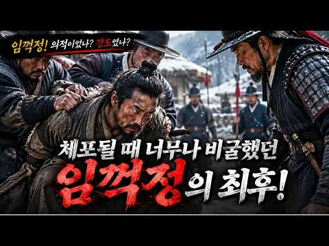
- 설명 앞부분: 조선시대 대표적인 의적으로 알려진 임꺽정. 가난한 백성을 돕고 탐관오리에 맞섰던 영웅으로 기억되지만, 실제 역사 기록에 등장하는 임꺽정의 모습은 우리가 알고 있는 이야기와 상당히 다릅니다. 백정 출신이었던 임꺽정은 어떻게 수많은 부하를 거느리는 도적 집단의 우두머리가 되었을까요? 황해도를 중심으로 활동하던 임꺽정 일당은 관아를 습격하고 관리들을 위협하며 조선 조정을 긴장시켰습니다. 조정은 이들을 토벌하기 위해 관군을 동원했고, 남치근을 중심으로 대대적인 추적과 수색에 나섰습니다. 그리고 임꺽정 일당의 내부 사정을 알고 있던 서림의…
- 같은 채널 평소 대비 ×180.9 (채널 최근 롱폼 중앙값 628회) · 평소 영상: 이태원·애오개·망원동, 우리가 몰랐던 서울 지명에 숨겨진 역사 (628회) / 조선시대 사람들은 무서운 태풍을 어떻게 견뎠을까? ∣ 초가집에 숨겨진 생존의 지혜 (497회)
- 대본 없음 (설명) — 음성인식이 끝나면 도입부·흐름이 들어감
- 댓글 48/74: 좋은 점 — 영상 0 · 감사·응원 0 · 더 알고 싶은 것 0 · 아쉬운 점 — 영상 0 · 반박·불만 — 의견 다름 2 · 정치·사회 10 · 경험 공유 2 · 구독·다음 기대 1
  - 정치·사회 👍12 “누구라도 저 암흑한 시대에 태어 났으면 산도적이 되었을것!!!! 2026년 현재 짜이밍이 정부에서 산도적이 되고 싶어도 못되는게............ ㅋ”
  - 정치·사회 👍9 “조선은 나쁜 놈들이 그냥 나쁜 짓하면서 살다가 폭망했다 결국 결말이 권선징악으로 귀결이라도 났지만 지금은 나쁜 놈들이 법기술자가 돼 대통령도 국회의원도 장관도 하면서 지들 수사재판하는 국가기관들을 파괴하거나 농락 함, 여튼 선과 악이 뒤죽박죽으로 혼재하면서 국민들을 …”
  - 경험 공유 👍4 “내가 고등학교때 국사시간에 선생님이 그랬슴 "홍길동 임꺽정 이런책은 커가는 애들에게 읽지 못하게 해야한다 신세한탄 불평불만 폭력난동만 배우게하는 불량 잡서다 " 이런 말씀이 백번 맞다고 본다 다른학교에서는 어떻게 가르쳤는지 모르지만 ....”
  - 경험 공유 👍3 “내가 임꺽정이라도 그리할듯”
  - 구독·다음 기대 👍1 “그냥 임꺽정드라마정주행 하는개 빠름 임꺽정 이봉학 배돌석 황천왕둥이 박유복 곽오주 길막봉 서림 오개도치”

### 162. 중국도 일본도 아닙니다 단군과 고조선의 기록을 지우려한 정체

- https://www.youtube.com/watch?v=VYoPhgs3WfU · 역사얘기 · 구독자 1,940 · 조회수 131,032 (×67.5, 하루 1,528.6) · 좋아요 2,734 (2.1%) · 16.8분 · 2026-07-30 · 주제 묶음 2. 한국 고대·삼국·고려 · 형식 정보·해설 (그 밖) · 폴더 `W_VYoPhgs3WfU` (웹 승인)
- 썸네일: 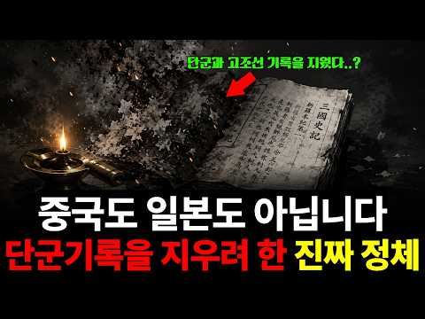
- 설명 앞부분: 단군과 고조선의 기록을 지우라고 가장 먼저 명령한 나라는 일본이 아니라 조선이었습니다. 1457년 세조의 수서령부터 1921년 단군고, 2002년 동북공정까지 570년의 밤을 따라갑니다. 국사책에서 고조선이 반 페이지로 끝났던 건, 실수가 아니었습니다. 1457년 5월, 고조선비사를 비롯한 책들이 관아로 거둬져 간 뒤 오늘까지 단 한 권도 세상에 나오지 않았습니다. 이 영상은 570년 동안 세 번 반복된 '지우기'를, 명령을 받은 백성의 눈으로 다시 읽습니다. 책을 지고 관아로 걸어간 사람, 역병 속에서 사당을 되찾은 마을, 단군…
- 같은 채널 평소 대비 ×89.4 (채널 최근 롱폼 중앙값 1,465회) · 평소 영상: 중국 역사상 가장 뛰어난 천재.. 제자는 단 4명뿐, 하지만 그 4명이 전국시대를 삼킨 … (2,137회) / 세종이 인정한 천재 김시습 이야기 (793회)
- 대본 없음 (설명) — 음성인식이 끝나면 도입부·흐름이 들어감
- 댓글 656/656: 좋은 점 — 영상 5 · 감사·응원 5 · 더 알고 싶은 것 4 · 아쉬운 점 — 영상 4 · 반박·불만 — 의견 다름 15 · 정치·사회 78 · 경험 공유 10 · 구독·다음 기대 0
  - 좋은 점 — 영상 👍0 “이씨 조선은 도대체 도움이 그닥”
  - 좋은 점 — 영상 👍0 “영상은 실제 역사 사료(실록, 삼국유사 원문)와 식민사학 비판, 어원 분석 등을 바탕으로 유익한 정보를 많이 담고 있습니다. 다만, 제목이나 도입부처럼 "조선 왕조가 고조선 기록을 의도적으로 지우려 했다"는 식의 극적 연출 및 일부 재야사학적 프레임은 역사적 사실을 …”
  - 감사·응원 👍2 “우리에게 역전의 기회는 올 수 있을까요?? 님과 같은 분이 많이 활동을 해야 하는데.... 걱정이 많습니다... 강단사학이란 너무 큰 벽에 조금 이나마 균열을 낼 수 있는 계기가 될 수 있으면 좋겠습니다.. 응원합니다... 그리고 조상신들께 기도합니다......”
  - 감사·응원 👍1 “<조선> 🔥이성계: 지리의 학설이 분명치 못해 음양산정도감을 설치하여 교정함. (조선왕조실록) 🔥이성계가 고려 공민왕의 금인을 명나라 주원장에게 바치고, 자신의 이름을 ‘旦(단)’으로 고쳐 달라고 청함.(명실록) 🔥이성계: 정도전 등에게 '고려사' 수찬. (조선왕조실…”
  - 더 알고 싶은 것 👍9 “⁠ 제보 !! 구글어스가 처음 나왔을때 궁금해서 사용해 보는데 시안에 피라미드가 엄청 많이 보이는겁니다 그래서 확대를 해 봤는데 그 피라미드 하나하나에 구분을위해 넘버가 붙어 있는데 전부 앞쪽에 corea + 세자리 넘버가 예를들면 corea 264 이런식으로 붙어 …”
  - 더 알고 싶은 것 👍2 “우리에게 역전의 기회는 올 수 있을까요?? 님과 같은 분이 많이 활동을 해야 하는데.... 걱정이 많습니다... 강단사학이란 너무 큰 벽에 조금 이나마 균열을 낼 수 있는 계기가 될 수 있으면 좋겠습니다.. 응원합니다... 그리고 조상신들께 기도합니다......”
  - 아쉬운 점 — 영상 👍2 “일제의 식민사관을 배운자들이 교수가 되고 학생을 가르치고 반복되고 그것으로 공직에서 세금을 받으니 통탄할 노릇이다 어떻게 깨끗이 해야하나”
  - 아쉬운 점 — 영상 👍0 “언어학자들은 지구상에 사는 어느 부족이나 오래 전부터 사용해온 기본적인 낱말(하늘, 해, 달, 나, 너, 꽃 등)이 있으며 이 낱말은 270개 가량 된다고 한다. 인류학에서는 이 기본 낱말들을 일컬어 ‘스와디시 차트(Swardish Chart)’ 라고 부르는데, 이 …”
  - 반박·불만 — 의견 다름 👍12 “망할놈의 전주 이씨왕권 때문에 고려사와 상고사가 망가지고 불태워지고 자료가 없어짐. 때문에 한반도 고대역사는 증거가 없다는 이유로 일베문화에 빠진 어린 세대가 사기, 거짓말이라고 비웃는 웃기는 상황이 되어버림. 타국은 명확한 증거가 없어도 설화, 민담, 과거의 기록 …”
  - 반박·불만 — 의견 다름 👍2 “고조선을 한반도 안에서만 찾는 것도...... 웃기는 일이지. 삼위태백이 어디에 있는가? https://youtube.com/shorts/tNJ2_6CMH18?si=l-hvd9glMmehnSKG”
  - 정치·사회 👍99 “이씨조선은..책임 져야 한다.. 역사를 지우고. 팔아먹고 누구맘데로.. 이씨조선은 정통 왕족도 아니면서 쿠테타로 정권 잡고,, 우리 역사를 다 태우냐 ???부끄러운줄 알아야지 후손들이라도 책임져라!!... 일본에 가 있는 우리 역사책 다 찾아와라..!!@@@”
  - 정치·사회 👍25 “이성계는 여진족출신 이다 구데타로 정권잡고 고려를 지우고 명나라 에 의지할려고 사대했다 우리 역사와 땅을 한반도 안으로 끌고 들어왔다 금나라 와 청나라 를 개국한 아골타 와 누루아치는 신라 유민 이었다 방대한땅들을 중국대륙 으로 끌어들였다 환단고기는 하늘이 내려주신 …”
  - 경험 공유 👍17 “중국의 요순시대...내가 여러종류의 역사책을 읽어본바에 의하면 그거 우리역사다.”
  - 경험 공유 👍5 “개조선때문에 이성계부터 성종까지 역사책을 다 모아 태워없앴다. 고려의 영토가 중국,만주,한반도에 이르거늘. 명나라 건국 주원장도 동이족사람이고 고려에게 건국한다고 승인받았었는데, 개성계가 스스로 알아서 바닥을 기는짓거리를 하고 한족구석에서 조선이라 골목대장이라 칭했으…”

### 163. 마이클 잭슨이 인천 갯벌에 왔던 진짜 이유 l 청라의 숨겨진 역사

- https://www.youtube.com/watch?v=knVMTvDISxo · 끝까지 궁금했던 모든 이야기 · 구독자 974 · 조회수 65,635 (×67.4, 하루 1,133.1) · 좋아요 151 (0.2%) · 9.2분 · 2026-08-27 · 주제 묶음 1. 역사 일반·이야기 · 형식 정보·해설 (그 밖) · 폴더 `W_knVMTvDISxo` (웹 승인)
- 썸네일: 
- 챕터: 0:00 마이클 잭슨이 인천 매립지를 찾은 이유 · 1:14 왜 하필 그때 바다를 메우기 시작했나 · 2:45 서울의 쓰레기 산이 옮겨간 자리 · 5:30 마이클 잭슨의 방문과 끝나지 않은 계획
- 설명 앞부분: 1998년 마이클 잭슨이 왜 인천 갯벌에 왔을까요? 그가 방문한 매립지가 어떻게 청라국제도시로 변했는지, 땅의 운명을 바꾼 4번의 변화를 추적합니다. 1998년 2월, 세계적인 팝스타 마이클 잭슨이 인천의 한 갯벌 매립지를 찾았습니다. 단순히 땅을 보러 온 것이 아니라, 그 땅의 토지 용도 변경을 시도하며 매각하기 위한 목적이 있었습니다. 그가 주목했던 이 땅이 어떻게 지금의 청라국제도시가 되었는지 그 과정을 상세히 살펴봅니다. 인천 청라 지역의 개발 역사를 알고 싶은 분들에게 유용한 정보가 될 것입니다. 바다를 메워 만든 매립지…
- 같은 채널 평소 대비 ×25.0 (채널 최근 롱폼 중앙값 2,630회) · 평소 영상: 서울의 15년 치 쓰레기를 치우지 않고 공원을 만든 이유｜난지도 (2,630회) / 비가 오면 하수가 처리장을 안 거치고 하천으로 나가는 이유 (2,560회)
- 대본 없음 (설명) — 음성인식이 끝나면 도입부·흐름이 들어감
- 댓글 23/23: 좋은 점 — 영상 0 · 감사·응원 0 · 더 알고 싶은 것 0 · 아쉬운 점 — 영상 2 · 반박·불만 — 의견 다름 1 · 정치·사회 0 · 경험 공유 1 · 구독·다음 기대 0
  - 아쉬운 점 — 영상 👍4 “잘못된 정보룰 퍼트리네요. 잭니클라우스 cc는 송도귝제도시인데..”
  - 아쉬운 점 — 영상 👍2 “구 동아매립지하고 북쪽의 김포매립지하고 혼돈된 잘못된 정보입니다. 조금만 찾아봐도 잘 나오는데 정보인데..”
  - 반박·불만 — 의견 다름 👍0 “개.. 어이없는 유투버네. 송도에 있는 잭니클라우스하고. 김포 매립지하고 동아 매립지를 뒤섞어놨네. 이런 쓰레기 유투버들이 왜곡된 영상으로 마치 대단한 정보인양 퍼트리네.. 완전 넋이 나갑니다”
  - 경험 공유 👍2 “내용이 엄청 좋고 이미지도 화려한데 말도 빠르고 진도도 빨라서 따라가기가 힘들고 설명이 부족해서 무슨 말인지 이해가 안돼요 ... 두서도 좀 없는것같아요 알고리즘의 선택을 받았는데도 조회수 대비 좋아요 수가 낮은 이유는 그거예요 제가 청라 사는데도 무슨 말인지 모르겠…”

### 164. [세계사] 영화 '오디세이' 보기 전 필수! 트로이 전쟁의 숨겨진 이야기는 무엇일까?💡

- https://www.youtube.com/watch?v=Cy5pxD74PzY · 역사리뷰룸 · 구독자 3,160 · 조회수 211,554 (×67.0, 하루 2,883.9) · 좋아요 4,032 (1.9%) · 40.5분 · 2026-08-11 · 주제 묶음 5. 세계사·서양사 · 형식 정보·해설 (그 밖) · 폴더 `W_Cy5pxD74PzY` (웹 승인)
- 썸네일: 
- 챕터: 0:00 트로이 전쟁과 오디세이의 연결 · 1:46 신과 인간이 함께하던 영웅들의 시대 · 3:14 특별한 운명을 안고 태어난 파리스 · 4:53 신들의 결혼식에서 시작된 갈등 · 8:08 파리스 앞에 놓인 세 가지 선택 · 10:30 헬레네와 오디세우스의 등장 · 13:38 전쟁으로 이어지는 결정적 사건 · 17:48 전쟁을 피하려 했던 두 영웅 · 24:37 10년간 이어진 트로이 전쟁 · 29:10 전쟁의 흐름을 바꾼 기발한 전략 · 34:49 신화 속 트로이는 실제로 존재했을까? · 38:23 트로이 전쟁이 오디세이로 이어지는 이유
- 설명 앞부분: 영화 '오디세이'를 보러 가기 전, 이 영상을 안 보고 가면 영화의 절반을 놓치게 됩니다! 🎬 맷 데이먼이 연기하는 오디세우스는 왜 그렇게 집으로 돌아가려고 목숨을 걸었을까요? 수만 명이 죽고 도시 하나가 잿더미가 된 트로이 전쟁, 그 진짜 시작은 아름다운 여인 헬레네가 아니라 신들의 세계에서 던져진 황금 사과 한 알이었습니다.🍎 세 여신의 자존심 싸움부터 오디세우스의 기발한 트로이 목마 작전, 그리고 신화가 역사가 된 슐리만의 발굴 이야기까지! 영화 '오디세이'의 거대한 세계관과 트로이 전쟁의 숨겨진 비하인드를 한 번에 정리해 …
- 같은 채널 평소 대비 ×200.5 (채널 최근 롱폼 중앙값 1,055회) · 평소 영상: [세계사] 이름까지 지워진 왕 투탕카멘, 3천 년 뒤 화려하게 돌아온 이유는?😯 (1,055회) / [세계사] 지구의 얼음이 전부 녹으면 해수면은 무려 몇 m 올라갈까?💡 (1,066회)
- 대본 없음 (설명) — 음성인식이 끝나면 도입부·흐름이 들어감
- 댓글 158/158: 좋은 점 — 영상 8 · 감사·응원 18 · 더 알고 싶은 것 0 · 아쉬운 점 — 영상 1 · 반박·불만 — 의견 다름 1 · 정치·사회 0 · 경험 공유 2 · 구독·다음 기대 0
  - 좋은 점 — 영상 👍16 “트로이 전쟁을 막연히 이해하고 있었는데 정말 설명을 잘해주셔서 유익했어요. 내일 손녀랑 오딧세이를 보러 가기로 예약한 80세 할머니 예요. 감사합니다❤”
  - 좋은 점 — 영상 👍7 “영화 보러 가는 차 안에서 이 유익한 유튜브를 봅니다. 정말 감사합니다 ❤❤❤”
  - 감사·응원 👍19 “정말 재미있네요..ㅎㅎㅎ, 영화 보기 전의 전초 작업으로 아주 봐야 할 영상... 감사히 봅니다.”
  - 감사·응원 👍16 “트로이 전쟁을 막연히 이해하고 있었는데 정말 설명을 잘해주셔서 유익했어요. 내일 손녀랑 오딧세이를 보러 가기로 예약한 80세 할머니 예요. 감사합니다❤”
  - 아쉬운 점 — 영상 👍0 “영화 보니좀 지루 하던데 뭐 감동도 잘 모르겠고... 내가 뭘 몰라서 그런가?”
  - 반박·불만 — 의견 다름 👍1 “와 내용듵으니 영화에 몰리는것도..참 어리석다 유럽도!! 말도 안되는 인간과 알?ㅎㅎ 비현실적인 내용! 신이라는 어리석음! 이 모든 전쟁의 근원!! 현실세계도 그 똑똑한 머리 21세기 우주 과학이 발달해도 어리석게도 신때문에 죽이는 ㅎㅎ”
  - 경험 공유 👍0 “영화 보니좀 지루 하던데 뭐 감동도 잘 모르겠고... 내가 뭘 몰라서 그런가?”

### 165. 세종대왕을 2026년 대한민국에 모셔왔더니 벌어진 일

- https://www.youtube.com/watch?v=JfPvwN_MgGg · 세계관오류 · 구독자 17,200 · 조회수 1,146,040 (×66.6, 하루 52,220.0) · 좋아요 8,620 (0.8%) · 10.4분 · 2026-10-02 · 주제 묶음 3. 조선 · 형식 브이로그·직접 해본 이야기 · 폴더 `W_JfPvwN_MgGg` (웹 승인)
- 썸네일: 
- 설명 앞부분: “말도 없이 수레가 달리는구나.” 세종대왕을 2026년 대한민국에 모셔왔습니다. 거리를 채운 자동차부터 손안의 스마트폰까지. 조선의 임금에게는 우리가 당연하게 여기는 일상마저 놀라움의 연속입니다. 여러분이라면 세종대왕께 현대의 무엇을 가장 먼저 보여드리고 싶나요? 댓글로 남겨주세요. ※ 본 영상은 AI를 활용해 제작한 시간 여행 창작 영화입니다. 역사적 인물을 소재로 하며, 대사와 사건은 상상으로 구성했습니다. 🎵 음악 Water Prelude Enchanted Valley Touching Moments Four - Melody …
- 같은 채널 평소 대비 ×8.5 (채널 최근 롱폼 중앙값 134,948회) · 평소 영상: 조선에 냉동만두를 팔았더니 벌어진 일 (122,475회) / 조선에 오마카세를 열었더니 부자가 됐습니다 (158,071회)
- 대본 없음 (설명) — 음성인식이 끝나면 도입부·흐름이 들어감
- 댓글 1,049/1,108: 좋은 점 — 영상 6 · 감사·응원 66 · 더 알고 싶은 것 21 · 아쉬운 점 — 영상 8 · 반박·불만 — 의견 다름 5 · 정치·사회 28 · 경험 공유 31 · 구독·다음 기대 1
  - 좋은 점 — 영상 👍0 “이렇게 보니까 우리가 어마어마한 미래에 살고 있다는게 새삼스럽게 와닿네요! 재미있게 잘 봤습니다”
  - 좋은 점 — 영상 👍0 “제가 윤동주 시인님을 제일 좋아하는데 윤동주 시인님 한 번 모셔와 주세요. 영상 너무 유익하고 재밌어요”
  - 감사·응원 👍406 “폐하 한글 만들어 주셔서 감사합니다 폐하께서 태어나신 5월 15일은 스승의 날이 됩니다 그리고 10월9일 한글날이 됩니다”
  - 감사·응원 👍377 “본인이 만든 글자를 몇백년이 지나도 후대가 쓰고있고 대한민국 국민모두가 세종대왕님께 감사함을 느끼고 있다는걸 알면 얼마나 기쁘실까 그리고 자신의 아들이 손자를 죽였다는것을 알면 얼마나 슬프실지.....”
  - 더 알고 싶은 것 👍4 “100년뒤 미래는 어떨지 궁금하다....”
  - 더 알고 싶은 것 👍3 “제가 지금껏 본 AI 영상 중, 이번 세종대왕편이 가장 감동스러웠어요. 600년 전 조선에서 온 세종대왕이 2026년의 서울(한양)을 본다면 아무리 천재적인 능력자라도 모든 게 놀랄 만한 물건들이겠지요. 세종대왕의 눈으로 본 현대 문명이 얼마나 대단한지 새삼 생각하게…”
  - 아쉬운 점 — 영상 👍4 “2:19 세종대왕님 어깨 끼일뻔한 사고날뻔 😢”
  - 아쉬운 점 — 영상 👍1 “나랏말싸미 듕귁에 달아문자와로 서르 사맛디 아니할쎄 이런 전차로 어린 백셩이 니르고져 홇베이셔도 마참네 제 뜨들 시러펴디 몯핧 노미하니아 내 이랄 윙하야 어엿비너겨 새로 스믈 여듫 짜랄 맹가노니사람마다 해여 수비니겨 날로 쑤메 뻔한킈 하고져 할따라미니라”
  - 반박·불만 — 의견 다름 👍2 “노비종모법 으로 노비 확산 원흉 노비 대왕 세종대왕 을 추앙 을 하다니 어이없음 역사 공부 를 다시 해야.”
  - 반박·불만 — 의견 다름 👍0 “우와 탐구할 것 천지다, 우히히. 하셨을 것 같다ㅋ 성삼문, 신숙주 다 필요없어. 쳇지피티, 제미나이 돌려. 얘들은 늙었다고 물러난단 말도 안할 거고, 사고도 안칠거고ㅋㅋ”
  - 정치·사회 👍1,523 “나라가 왜 반으로 쪼개졌어 샤갈 하고 우실 듯 ㅠㅠ”
  - 정치·사회 👍203 “솔직히 세종대왕이 원하는 나라가 지금의 모습일듯”
  - 경험 공유 👍42 “편식하지 마세요. 저도 시금치 정도는 먹습니다...”
  - 경험 공유 👍21 “4~5살 시기의 세손 홍위(훗날 단종)에게 미래에서 가져온 과자를 쥐어주시는 점과 수양대군이라는 군호를 보고 누구인지 바로 납득하는 부분과...미래 세계를 바라보며 신기해 하면서도 어딘지 쓸쓸해 보이시는 대왕님의 표정으로 보아 정황상 소헌왕후가 돌아가신 직후 시기의 …”
  - 구독·다음 기대 👍0 “그래 이렇게 찜찜하게 안끊으면 챙겨볼 맛 나지”

### 166. 조선야담#20 어서 씻으라는 마님 # 옛날이야기 #민담 #전설

- https://www.youtube.com/watch?v=ItASrjGgMvo · 조선야사 · 구독자 2,370 · 조회수 156,143 (×65.9, 하루 6,200.8) · 좋아요 543 (0.4%) · 18.3분 · 2026-09-29 · 주제 묶음 9. 야사·야담·옛날이야기 · 형식 야담·옛날이야기 · 폴더 `W_ItASrjGgMvo` (웹 승인)
- 썸네일: 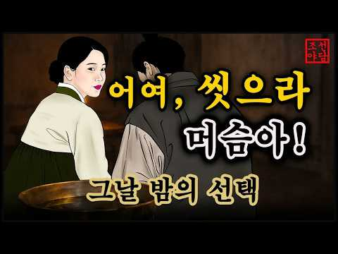
- 설명 앞부분: 📜 조선 시대의 신비롭고 흥미진진한 야담, 역사 속 숨겨진 이야기, 그리고 전해 내려오는 전통 설화를 전해드립니다. 🏮 우리가 잘 몰랐던 옛이야기 속으로 떠나는 시간 여행에 여러분을 초대합니다. ⏳✨ 과거의 지혜와 재미가 담긴 이야기들을 매일 만나보세요! 🌙🐯
- 같은 채널 평소 대비 ×1,784.5 (채널 최근 롱폼 중앙값 88회) · 평소 영상: 조선야담🎉 오뉴월 서릿발 같은 여자의 한 이야기모음 #민담 #야담 #고전소설 #옛날이야기 (91회) / 조선야담 🎉애첩의 털과 바꾼 전재산 잠잘때 듣는 옛날 이야기 (91회)
- 대본 없음 (설명) — 음성인식이 끝나면 도입부·흐름이 들어감
- 댓글 4/5: 좋은 점 — 영상 0 · 감사·응원 0 · 더 알고 싶은 것 0 · 아쉬운 점 — 영상 0 · 반박·불만 — 의견 다름 0 · 정치·사회 0 · 경험 공유 0 · 구독·다음 기대 0

### 167. "나는 조선의 국모다" 이거 정말 맞는건가? 민비에 대한 A부터 Z까지!!

- https://www.youtube.com/watch?v=246Gb3xy0oM · 매불월드 · 구독자 3,060 · 조회수 200,863 (×65.6, 하루 1,402.0) · 좋아요 2,628 (1.3%) · 27.5분 · 2026-06-03 · 주제 묶음 3. 조선 · 형식 브이로그·직접 해본 이야기 · 폴더 `W_246Gb3xy0oM` (웹 승인)
- 썸네일: 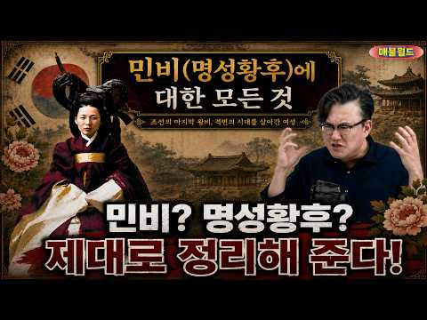
- 설명 앞부분: 역사학자 썬킴이 구한말 명성황후와 흥선대원군 간의 권력 갈등 및 임오군란 전후의 외교적 선택들을 분석합니다. 역사적 사실을 바탕으로 당시 조선의 재정 및 정세 변화를 입체적으로 조명합니다.매불월드는 방대한 영상 속에서 재미있고 의미 있는 장면을 선별해 자막과 편집을 통해 새롭게 재구성합니다. 단순한 영상 전달이 아닌, 핵심 포인트를 더 살리고 맥락을 쉽게 이해할 수 있도록 해설 자막과 편집을 직접 제작하여 콘텐츠의 완성도를 높이고 있습니다. 본 영상은 비평, 정보 전달, 교육적 목적을 기반으로 공정하게 인용되었으며, 유튜브 가이드…
- 같은 채널 평소 대비 ×266.8 (채널 최근 롱폼 중앙값 753회) · 평소 영상: 한복부터 쇼트트랙까지…베이징 올림픽을 둘러싼 논쟁 (753회) / 우리가 먹는 탕수육은 어떻게 시작됐을까? 이름과 탄생의 배경 (612회)
- 대본 없음 (설명) — 음성인식이 끝나면 도입부·흐름이 들어감
- 댓글 411/411: 좋은 점 — 영상 3 · 감사·응원 2 · 더 알고 싶은 것 2 · 아쉬운 점 — 영상 1 · 반박·불만 — 의견 다름 12 · 정치·사회 31 · 경험 공유 17 · 구독·다음 기대 0
  - 좋은 점 — 영상 👍6 “팩트도 맞고 나도 어릴때 민비나쁜여자. 흥선 좋은위인이라고 배웠는데 세월이 지나면서 재평가 됐다. 민비는 조선에 기관총을 수입해서 무장할려고 했고 흥선은 쇄국정책으로 아까운시간 다 날려먹었다.”
  - 좋은 점 — 영상 👍3 “맛 칼럼니스트도 하시던 분이 민비 뮤지컬보다 소리 치셨다는 이야기를 들었는데 정말 이해가 되네..”
  - 감사·응원 👍53 “썬킴 역사이야기 우리나라에서는 최고 항상 응원합니다”
  - 감사·응원 👍21 “썬킴선생님 늘 재밌게 역사를 배웁니다 감사합니다”
  - 더 알고 싶은 것 👍2 “썬킴님의 개인적인 사견일뿐입니다. 영어강사가 언제부터 역사가가 되셨나요?”
  - 아쉬운 점 — 영상 👍4 “일제강점기 해방도 미국, 625 주적에게 멸망할뻔한거 구해준것도 미국. 근데 지금 반미운동?? 북한이 이제 우리나라에 무장공비를 보낼 필요도 없어요^^”
  - 반박·불만 — 의견 다름 👍224 “도대체 내가 조선의 국모다 하는 말도안돼는 오페라를 20여년간 그것도 국립극장에서 공연이 가능케한 쌉새들은 도대체 누구여?”
  - 반박·불만 — 의견 다름 👍5 “얘가 미쳤나? 공부안해? 명성황후가 재정을 날렸다고? 헛소리. 흥선이 무리한 경복궁재건으로 재정파탄낸거 아니고? 명성황후 사치 청군요청은 사실이 아니라는게 밝혀졌는데도 헛소릴하는군 민자영도 소설속 이름이지. 본명이니? 허위사실 유포다”
  - 정치·사회 👍107 “민비가 머리가 좋은건 안좋은 쪽으로 머리가 비상했던거임 ~ 나라가 망하는데 민씨가문해먹을 생각만 하고 정권유지시키는데만 관심이 있었음”
  - 정치·사회 👍82 “한국 화폐의 인물도 정말 기가 막힙니다!!! 사용하지도 않는 100원짜리 동전에 충무공이 자리 하신다는게 말이 되나요!!! 당연히 훌륭하신 분들이지만, "율곡 이이" "퇴계 이황" 같은 분들의 업적이 무엇인가요!!!! 십만양병설!!! 이기일원론!!! 그게 뭔가요?? …”
  - 경험 공유 👍224 “도대체 내가 조선의 국모다 하는 말도안돼는 오페라를 20여년간 그것도 국립극장에서 공연이 가능케한 쌉새들은 도대체 누구여?”
  - 경험 공유 👍63 “2001년작 이미연 주연의 드라마 "명성황후"가 히트치면서 "내가 조선의 국모다"라는 대사가 널리 유행하고, 뮤지컬로도 만들어짐.”

### 168. [한국사 위인] 인조는 폐왕 광해군을 왜 19년 동안 못죽였을까∣ 한국사 ∣ 역사인물 ∣ 조선 ∣ 역사다큐 ∣ 야사 ∣ 비사 ∣ 왕조

- https://www.youtube.com/watch?v=5Rkq7lrGDAo · 한국사인물관 · 구독자 4,890 · 조회수 317,164 (×64.9, 하루 3,073.6) · 좋아요 3,332 (1.1%) · 26.3분 · 2026-07-13 · 주제 묶음 3. 조선 · 형식 정보·해설 (그 밖) · 폴더 `W_5Rkq7lrGDAo` (웹 승인)
- 썸네일: 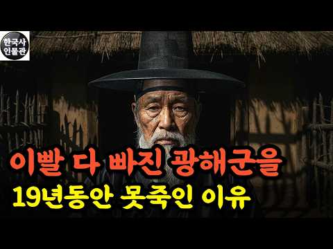
- 설명 앞부분: 왕좌에서 쫓겨난 임금이 19년을 더 살았습니다. 연산군은 두 달, 단종은 열일곱에 스러졌는데 광해군만 달랐습니다. 인조는 눈엣가시 같은 폐왕을 왜 죽이지 못했을까요. 그 답은 자비가 아니라 냉정한 정치 계산에 있었습니다. 임진왜란의 분조부터 실리 외교, 폐모살제, 제주 유배와 어머니를 향한 마지막 한마디까지. 광해군의 파란만장한 일대기와 인조가 그를 살려둘 수밖에 없었던 진짜 이유를 차분히 따라가 봅니다. 안녕하세요, 한국사인물관입니다. 저희는 우리 역사를 만들어 온 한 사람 한 사람의 삶을 한 편의 이야기로 풀어내고자 영상을 만…
- 같은 채널 평소 대비 ×200.2 (채널 최근 롱폼 중앙값 1,584회) · 평소 영상: [한국사] 일본이 이순신보다 두려워 했던 조선의 영웅 ∣ 역사인물 ∣ 다큐 ∣ 야사 ∣ … (1,584회) / [한국사] 조선이 버린 한 선비의 일기가 실록을 구했다 ∣ 역사인물 ∣ 다큐 ∣ 야사 ∣… (1,567회)
- 대본 없음 (설명) — 음성인식이 끝나면 도입부·흐름이 들어감
- 댓글 568/572: 좋은 점 — 영상 3 · 감사·응원 4 · 더 알고 싶은 것 3 · 아쉬운 점 — 영상 5 · 반박·불만 — 의견 다름 10 · 정치·사회 41 · 경험 공유 27 · 구독·다음 기대 0
  - 좋은 점 — 영상 👍54 “인조가 광해군을 죽였다면 본인도 쫓겨났을때 죽을수도 있다고 생각했겠지. 하지만 살려두면 연산군이나 광해군이나 왕은 폐위되도 죽이지 않는다는 선례가 이어지게 되기에 본인에게 손해가 아님 그만큼 왕의 신변은 함부로 해치지 않는다는 정치적 관례를 유지하는 것이 자신의 안전…”
  - 좋은 점 — 영상 👍28 “왜 이이첨 정인홍같은 간신 역적들의 꼬임에 마음이 흔들려 일생일대의 대실수를 했을까 . 이것은 자신이 항상 불안한 마음상태에 있었기 때문일 것이다 . 인간은 누구나 방황을 한다 이럴때 누군가의 도움이 절실히 필요한 것이다 . 어째 아내도 자식도 친구도 도움이 되지 못…”
  - 더 알고 싶은 것 👍2 “젊은 세자 광해 곁에서 전쟁을 지휘한 신하는 누구인지 궁금하네요”
  - 더 알고 싶은 것 👍1 “내가 우리나라를 비하하려는 뜻은 없고 정말 궁금해서 그러는데, 왜 중국의 허락을 받아야 왕, 세자, 왕비 자리에 있을 수 있는지 허락이 없으면 왕이 되지 못했나요?”
  - 아쉬운 점 — 영상 👍2 “역사는 승자에 의해 완전히 왜곡되리니.... 여전히, 세조,선조,인조...... 역사를 제대로 복구시키고 반성이 없는 민족에게는 미래가 없이 비극만 반복되리라....”
  - 반박·불만 — 의견 다름 👍7 “숙종도 어이없는 왕이었다고 생각하는데요.”
  - 반박·불만 — 의견 다름 👍2 “폐모살제가 패륜이라면 그래서 인조반정이 어쩔수 없는 선의였다면 태종과 세조의 행적은 왜 문제삼지 않았을까 아무리 역사는 승자의 기록이라지만 그의 공적은 왜 면죄부가 되지 못 했을까 아버지가 달아나서 버린 전란의 조국을 그가 구한 업적은 그가 저질렀다는 패륜과 왜 상쇄…”
  - 정치·사회 👍230 “처음엔 명나라가 이후엔 청나라가 광해군을 죽이지 못하게 했기때문이라오”
  - 정치·사회 👍8 “이재명의 본성을 봅니다.”
  - 경험 공유 👍3 “세자 시절에 분조를 이끌며 전장을 누빈 게 심신이 단련된 것인지, 어릴 때부터 궁중에서 즉위할 때까지 숨죽이며 절치부심하던 가닥이 있어서인지, 그냥 가족도 다 죽고 폐위된 자신이 아무것도 할 수 없다는 걸 알고 최소한의 저항과 분노조차 체념했나보네요. 그런 일을 겪었…”
  - 경험 공유 👍3 “광해군은 병자호란때 청에가서 내가 친청하자는데 인조가 반대했다고 왕권을 자기에게 달라고 했음 삼전도 굴욕은 없었을꺼다 나폴레옹처럼 한번만이라도 탈출하지. 아까비”

### 169. 고고학자들이 아무 설명 없이 발굴을 중단한 미스터리 장소 100곳 ∣ 미스터리 다큐

- https://www.youtube.com/watch?v=7Ct4FNaJHlU · 푸른 태양 · 구독자 1,900 · 조회수 123,175 (×64.8, 하루 1,525.1) · 좋아요 439 (0.4%) · 75분 · 2026-08-04 · 주제 묶음 8. 문명·고고학 · 형식 정보·해설 (그 밖) · 폴더 `W_7Ct4FNaJHlU` (웹 승인)
- 썸네일: 
- 설명 앞부분: 완성되지 않았다고 믿었던 고대 도시, 노아의 방주 후보지, 운석 속 생명의 흔적… 발굴이 멈춘 장소에는 무엇이 숨겨져 있을까? 이라크의 고대 도시 두르샤루킨에서는 최신 자기 탐사 기술로 127개의 방을 갖춘 대저택과 왕실 정원, 수문으로 추정되는 구조물이 모습을 드러냈다. 오랫동안 미완성 수도로 여겨졌던 코르사바드는 정말 번성한 아시리아의 중심지였을까? 땅을 파지 않고도 지하의 비밀을 밝혀낸 새로운 조사 결과가 기존의 역사를 뒤집는다. 터키의 노아의 방주 후보지부터 스리랑카 운석에서 발견됐다는 생명의 흔적, 외부 세계와 접촉을 거…
- 같은 채널 평소 대비 ×15.3 (채널 최근 롱폼 중앙값 8,055회) · 평소 영상: 작은 마을에서 나온, 규모에 전혀 맞지 않는 고대 금속 기술 ∣ 미스터리 3시간 (8,055회) / 200m 바위 위의 궁전부터 3,000년 전 난파선까지 ∣ 미해결 고대 미스터리 2시간 (7,923회)
- 대본 없음 (설명) — 음성인식이 끝나면 도입부·흐름이 들어감
- 댓글 13/13: 좋은 점 — 영상 0 · 감사·응원 1 · 더 알고 싶은 것 0 · 아쉬운 점 — 영상 0 · 반박·불만 — 의견 다름 0 · 정치·사회 0 · 경험 공유 0 · 구독·다음 기대 0
  - 감사·응원 👍4 “그래도 진짜 물건의 영상이 있어서 희귀한것을 보게되어 감사합니다. 그림으로 보여주거나 해서 믿음이 가지 않았느데 오늘은 정말 감사합니다.”

### 170. 이순신 장군을 2026년 해군기지에 모셔왔더니 벌어진 일

- https://www.youtube.com/watch?v=oE5KnPfgZQo · 로그북 · 구독자 429 · 조회수 27,685 (×64.5, 하루 1,559.3) · 좋아요 188 (0.7%) · 5.2분 · 2026-10-06 · 주제 묶음 3. 조선 · 형식 정보·해설 (그 밖) · 폴더 `W_oE5KnPfgZQo` (웹 승인)
- 썸네일: 
- 챕터: 0:00 이 배 한 척만 있었어도… · 0:10 광화문의 쇠로 된 장수 · 0:46 울산 조선소, 쇳덩이가 물에 뜬다고? · 1:33 제주 해군기지, 필승! · 2:11 세종대왕함 함교와 전투정보실 · 2:51 초코파이와 막내 수병 · 3:06 출항, 충무김밥과 열세 척 · 4:01 그 싸움은 어찌 끝났느냐 · 4:37 1597년 겨울, 아들 이회
- 설명 앞부분: 이순신 장군이 2026년 대한민국에 온다면? 자기 동상, 쇠로 만든 거대한 배, 이지스함 세종대왕함, 그리고 충무김밥까지. ※ 가상 이야기입니다. 인물의 대사와 장면은 창작이며 AI로 제작했습니다. ※ 실제 역사와 다른 부분이 있을 수 있습니다.
- 대본 없음 (설명) — 음성인식이 끝나면 도입부·흐름이 들어감
- 댓글 25/25: 좋은 점 — 영상 1 · 감사·응원 2 · 더 알고 싶은 것 0 · 아쉬운 점 — 영상 0 · 반박·불만 — 의견 다름 0 · 정치·사회 1 · 경험 공유 0 · 구독·다음 기대 0
  - 좋은 점 — 영상 👍10 “이질감속에 왠지 모를 찡함이 느껴집니다. 좋은 영상 감사합니다.”
  - 감사·응원 👍10 “이질감속에 왠지 모를 찡함이 느껴집니다. 좋은 영상 감사합니다.”
  - 감사·응원 👍0 “할아버지♡ 우리가 잘할께요. 고맙습니다~♬”
  - 정치·사회 👍2 “애국자 이재명 은 이순신의 환생”

### 171. 교과서에서 자세히 다루지 않는 조선 왕실 기록 10가지 ∣ 3시간 몰아보기

- https://www.youtube.com/watch?v=n-4NHLlhbts · 세상의모든역사 · 구독자 4,100 · 조회수 263,505 (×64.3, 하루 1,870.6) · 좋아요 3,507 (1.3%) · 213.2분 · 2026-06-05 · 주제 묶음 3. 조선 · 형식 수면·낭독 (잠잘 때 듣는) · 폴더 `W_n-4NHLlhbts` (웹 승인)
- 썸네일: 
- 챕터: 0:00 🌙 인트로: 518년의 기록, 조선왕조실록이 감춘 위… · 3:46 🥀 제1부: 세종의 눈물과 며느리들의 비극 - 휘빈 … · 31:37 ⚔️ 제2부: 피로 세운 왕권, 태종 이방원 - 형제… · 56:58 📦 제3부: 임오화변의 진실 - 영조는 왜 아들 사도… · 77:46 🏛️ 제4부: 사육신과 단종 - 역적으로 기록되었다가… · 100:42 🌊 제5부: 광해군, 폭군인가 성군인가? - 전란을 … · 122:12 🌸 제6부: 정조 독살설의 미스터리 - 개혁 군주가 … · 135:08 🏹 제7부: 의적 임꺽정의 실체 - 백정이 도적이 될… · 168:06 ❄️ 제8부: 비운의 세자, 소현세자 - 9년의 인질… · 148:52 🔥 제9부: 장희빈과 숙종 - 사랑과 권력 사이에서 … · 187:50 🕯️ 제10부: 을미사변, 건청궁의 새벽 - 제국의 … · 210:04 🌙 에필로그: 실록이 우리에게 남긴 질문 - 기록된 …
- 설명 앞부분: 🌙틀어놓고 주무세요 성군 세종은 며느리 두 명을 폐출했고, 영조는 자신의 아들을 뒤주에 가뒀으며, 광해군과 장희빈은 후대에 전혀 다른 평가를 받게 됐습니다. 사도세자와 사육신, 정조의 죽음, 임꺽정, 소현세자와 명성황후까지. 조선왕조실록을 중심으로 『한중록』과 후대 기록, 당대의 여러 자료를 함께 따라가며 우리가 익숙하게 알고 있던 조선의 인물과 사건을 다시 들여다봅니다. 누가 성군이고 누가 폭군이었는지를 다시 정하는 이야기가 아닙니다. 기록에 무엇이 남았고, 무엇은 후대에 덧붙여졌으며, 같은 사건이 시대에 따라 어떻게 다르게 기…
- 같은 채널 평소 대비 ×260.5 (채널 최근 롱폼 중앙값 1,012회) · 평소 영상: 고려 시대 딸들이 조선보다 훨씬 부자였다? 700년 재산권의 역사 (1,045회) / 황제가 포로로 돌아왔는데 성문을 닫았다｜명나라를 구한 8년의 선택 (978회)
- 대본 없음 (설명) — 음성인식이 끝나면 도입부·흐름이 들어감
- 댓글 193/194: 좋은 점 — 영상 4 · 감사·응원 19 · 더 알고 싶은 것 0 · 아쉬운 점 — 영상 1 · 반박·불만 — 의견 다름 1 · 정치·사회 3 · 경험 공유 1 · 구독·다음 기대 1
  - 좋은 점 — 영상 👍16 “너무 목소리가 편안하고 듣기 좋아요. 유익한 클립입니다. 잘때 들어도👍🏻”
  - 좋은 점 — 영상 👍6 “잘 본곤 아니구영 아주 자알 들었습니다 감사합니다 유익했어요!! 꾸벅!!”
  - 감사·응원 👍28 “ㅂㅓㄹ칙은 부모로서 줄수 있다. 그러나 그 땡볕에 왜 하필이면 뒤주였고 왜 땡볕이고. 왜 굶겨 죽게 했나! 역사가들은 아무도 그 이유가 한개도 없다! 세상에! 이런식으로 벌칙이나 잘못을 물은 부모는 이세상에 어디에도 없을거다! 사도세자를 옹호하지 않는다.하지만 영조는…”
  - 감사·응원 👍14 “이런 일들이 없었다면 우리나라는 지금 다른 모습이 되어 있을 겁니다. 하지만 모든 일들을 통해 배우면서 로 나아가야 되겠죠! 가슴아픈 삶의 이야기 감사합니다.”
  - 아쉬운 점 — 영상 👍1 “참 고맙습니다 ㆍ역사를 다시 상세하게 지루하지않게 아니 호기심 가득한 마음으로 그대의 맑은 음성으로 휴일 아침 긴 시간을 보냈습니다ㆍ경기도 양평 에서 듣고 있습니다ㆍ아프고 아픈 사연 많은 조선의 역사 ㅋ 예나 지금이나 정치의 세켸는 ~~ㅠ 감사합니다ㆍ팔십 노인이 고마…”
  - 반박·불만 — 의견 다름 👍0 “세종이 왜 그렇게 위인인지 이해가 안 된다..한글도 백성위해 만든 것도 아닌데 정치도 못 했고 백성 입장에서는 최악의 왕인데”
  - 정치·사회 👍0 “1882년군인들의밥에모래 운형궁 창덕궁으로명서왕후숨어서 외국인들의의해 갑신정변 청나라에게클려들어감”
  - 정치·사회 👍0 “청일전쟁 1895년 라우둥반도 모든것을움직이는이 미우라구르특명 여우사냥 운여궁 가마에태워경복궁으로명성황후를잡으려 복도를달리다넘어짐 외국인여인으넘어 트려칼로찌름 녹원석유뿌려죽임 창원지로 남양주 6시간후 재판증거불충분으로불려짐 아관파천1897년 명성황후로명함 🎉🎉🎉🎉 1…”
  - 경험 공유 👍0 “숙종은장옥정에게사약43살아들보게해달라하고망쳤다 사년째 죽음 계장을먹고 인현왕후 숙종은😅😅😅”
  - 구독·다음 기대 👍4 “기대합니다”

### 172. 17만 대군도 벌벌 떨게 한 한국사 최강의 인간 병기, '척준경'의 말도 안 되는 실화

- https://www.youtube.com/watch?v=7_UjHlAN6-E · 정치수달TV · 구독자 8,370 · 조회수 527,429 (×63.0, 하루 3,178.6) · 좋아요 5,906 (1.1%) · 32.4분 · 2026-05-11 · 주제 묶음 4. 한국 근현대사 · 형식 인터뷰·강연·대담 · 폴더 `W_7_UjHlAN6-E` (웹 승인)
- 썸네일: 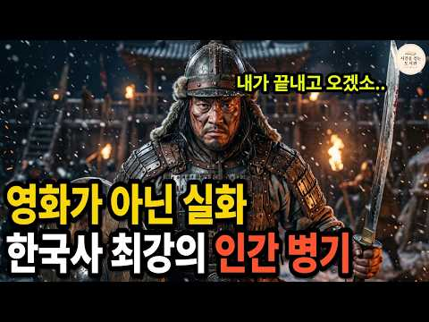
- 설명 앞부분: 이게 진짜 실화라고? 17만 대군이 며칠 동안 못 뚫은 산성을, 한 줌의 결사대가 들어가 추장 여러 명을 쓰러뜨리고 살아 나왔습니다. 《고려사》가 기록한 실제 사건. 한국사 최강의 인간 병기, 척준경의 이야기입니다. 1107년 12월, 함경도의 어느 산성 아래. 고려 17만 대군과 여진족 결사대가 충돌한 그곳에서 정말 영화 같은 일이 벌어졌습니다. 그날 그 산성 안에서 무슨 일이 있었는지, 그리고 그 사내의 인생이 그 뒤로 어떻게 흘러갔는지, 영상에서 천 년 전 그 겨울로 함께 들어가 봅니다. 한국사 교과서가 한 줄로 지나친 그 …
- 같은 채널 평소 대비 ×12.5 (채널 최근 롱폼 중앙값 42,341회) · 평소 영상: 김민석이 던진 사이다 한마디에 매불쇼 최욱 멘붕 온 이유 (42,341회) / 야사보다 충격적인 중국 5,000년 유일한 여황제, 측천무후의 진짜 이야기 (42,529회)
- 대본 없음 (설명) — 음성인식이 끝나면 도입부·흐름이 들어감
- 댓글 944/943: 좋은 점 — 영상 3 · 감사·응원 5 · 더 알고 싶은 것 1 · 아쉬운 점 — 영상 1 · 반박·불만 — 의견 다름 3 · 정치·사회 9 · 경험 공유 6 · 구독·다음 기대 0
  - 좋은 점 — 영상 👍47 “아무것도 없는 척준경이 고려 황후 배출 가문 왕자지 장군님과 친구 먹고 윤관장군님이 양아들로 삼을 정도면 2천년에 한번 나올까 말까한 무력과 깡다구 있는 레전드😊”
  - 좋은 점 — 영상 👍18 “2 대단한 장군이라 배웠지요.”
  - 감사·응원 👍37 “고려군 척준경 대단한 영웅입니다 감사합니다”
  - 감사·응원 👍4 “감사합니다”
  - 더 알고 싶은 것 👍2 “어떻게 짧은글로 할수있겠나요 나라를 구한사람이 민생 가난한 사람을 구하기로 마음 먹은거죠 얼마나 부폐하고 임금이 자격이없고 감히 누가 척춘경을 단죄할수있나요 ????”
  - 아쉬운 점 — 영상 👍0 “간신들에 의해 토사구팽당해 궁궐에 불을 지르며 궐기했을듯~~ 지금도 몰라주다가 궁지에 몰리면 중용하고 필요없으면 내쫒는 것이 반복되지요. 위기에는 필요하지만 위기 후에는 쓸모가 없어져 짐이되기에 써먹었던 사람들은 앞으로 더 쓸일보다 당장 필요치않고 본인은 공이 이러한…”
  - 반박·불만 — 의견 다름 👍1 “윤관의 동북9성은 함경도가 아닙니다. 그것은 일제의 식민사관이 만든 역사에 불과한 것입니다.”
  - 반박·불만 — 의견 다름 👍0 “공험진 위치가 두만강 이북 700리에 있다는 것이 밝혀졌는데 헛소리하네!”
  - 정치·사회 👍3 “척춘경! 무조건 영화화 해라! 또다른 한국의 역사가 있는데. 그것이 바로 고려이다. 고려는 침략당하는 나라가 아닌 침략을 하는 국가였던 것이라는 것이다. 하인에서 대장군으로 변한 인물!”
  - 정치·사회 👍1 “전젱에서 목슴받치고 이겼다 내가 지킨나라가 임금 양반 권 력자로 인해 부패됬다면 그의 댁가를 받아야 한다 척준경님 역사의 영웅입니다”
  - 경험 공유 👍16 “항상 그랬듯이 성품이 곧은 사람들은 자신의 신념을 굳히지 않죠~~~ 척장군은 아마도 자신의 지위나 돈을 탐하진 않았을것 같습니다. 고지식하고 고집이 한고집했어서 정도를 벗어나는걸 참지 못했었을수도... 그리고 그 패거리들의 꼬임에 넘어가지 않았을까요~~~^^;; 저는…”
  - 경험 공유 👍1 “제가 무인으로써. 존경하는 분이 척준경입니다.”

### 173. "일본어 너무 잘해서 턱 빠질 뻔" 일제강점기 한국 드라마가 일본 넷플릭스 TOP10에 들자 일본 시청자들이 남긴 말

- https://www.youtube.com/watch?v=RPBvkCsjnSY · 왓더 · 구독자 3,290 · 조회수 207,211 (×63.0, 하루 22,054.4) · 좋아요 841 (0.4%) · 9.4분 · 2026-10-14 · 주제 묶음 4. 한국 근현대사 · 형식 정보·해설 (그 밖) · 폴더 `W_RPBvkCsjnSY` (웹 승인)
- 썸네일: 
- 설명 앞부분: 1932년 일제강점기 경성, 조선총독부를 무대로 한 한국 드라마 '100일의 거짓말'. 공개 전 일본에서는 반일 드라마라는 말이 나왔지만, 공개 사흘 만에 일본 넷플릭스 시리즈 TOP10에 들었습니다. 정무총감 사토 신이치를 연기한 진선규의 일본어에 "턱이 빠질 뻔했다"는 반응까지 나왔습니다. 일본 리뷰 사이트와 넷플릭스 예고편에 남은 일본 시청자들의 실제 반응을 정리했습니다. 순위·수치: 플릭스패트롤(10월 12~13일 기준), 닐슨코리아 전국 기준, 한국경제·TV리포트·나비콘 보도 배경음악: "Inspired" Kevin Ma…
- 같은 채널 평소 대비 ×77.3 (채널 최근 롱폼 중앙값 2,681회) · 평소 영상: "가격이 아깝지 않아요" 김밥 한 줄 4만 원인데 줄 선 미국인들, 샌드위치만 먹던 미국… (2,949회) / "100년에 한 명 나올 인재" 패배까지 1점 남았던 일본 안방 올림픽, 김연경이 뒤집자… (2,413회)
- 대본 없음 (설명) — 음성인식이 끝나면 도입부·흐름이 들어감
- 댓글 105/144: 좋은 점 — 영상 0 · 감사·응원 1 · 더 알고 싶은 것 1 · 아쉬운 점 — 영상 0 · 반박·불만 — 의견 다름 3 · 정치·사회 11 · 경험 공유 5 · 구독·다음 기대 0
  - 정치·사회 👍5 “피해자인 우리나라가 반일 드라마 만들수도있는거지 뭘 맨날 그런거가지고 떠들어ㅋㅋ 개인적으로는 이런 드라마가 더더욱 넷플릭스에서 많이 나와야한다고 생각함 전세계에서 볼수있게. 드라마로 이러쿵 저러쿵 할시간에 교과서 탓하지말고 역사공부나하고왔으면..요즘같이 인터넷이랑 A…”
  - 정치·사회 👍1 “실제 일제 강점기를 몸소 겪었던 대부분의 일반적인국민이었던 할머니 할아버지 세대는 일본에 대한 반감이 없는데 이런 영화나 드라마에서는 독립운동을 했던 인물들은 모두 선한 역으로 나라를 위해서 희생한 것으로 그려지고 일본 군인들은 길거리에서 조선인들을 총으로 쏴도 아무…”
  - 경험 공유 👍11 “저도 배우들의 일본어가 완벽해서 깜짝 놀랐어요. 역시 대한민국의 배우님은 글로벌이예요~~”
  - 경험 공유 👍2 “연기 너무 못한다 내가 제일 잘나가 이러고 있는 것 같네 일반인 사이에 조증걸린 인간 같다 저 매력적인 캐릭터를 이따위로 해석하다니”

### 174. 인류 최초의 문명 수메르, 그들은 대체 어디서 왔을까? l 세계사 l 역사 l 메소포타미아

- https://www.youtube.com/watch?v=if6WN6ejRYo · 역사의 그림자  · 구독자 720 · 조회수 45,328 (×63.0, 하루 273.0) · 좋아요 609 (1.3%) · 16.7분 · 2026-05-11 · 주제 묶음 5. 세계사·서양사 · 형식 인터뷰·강연·대담 · 폴더 `W_if6WN6ejRYo` (웹 승인)
- 썸네일: 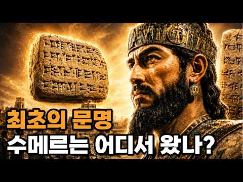
- 설명 앞부분: 5000년 전, 티그리스강과 유프라테스강 사이에서 인류 최초의 도시 문명이 탄생했습니다. 그들은 최초의 문자, 최초의 법, 최초의 학교, 바퀴, 60진법을 만들었고, 오늘날 우리가 쓰는 시간 체계와 문명의 기초를 남겼습니다. 그 사람들을 우리는 수메르인이라고 부릅니다. 하지만 이상한 점이 있습니다. 수메르인들이 어디서 왔는지는 아직도 명확히 밝혀지지 않았습니다. 그들의 언어는 주변 민족과 달랐고, 그들이 남긴 쐐기 문자와 도시 문명은 이후 아카드, 바빌로니아, 메소포타미아 문명 전체에 거대한 영향을 남겼습니다. 이번 영상에서는 수…
- 같은 채널 평소 대비 ×29.7 (채널 최근 롱폼 중앙값 1,524회) · 평소 영상: 왜 사막 한가운데 거대한 왕국이 탄생했을까?｜사바 왕국｜시바의 여왕｜마립 댐｜고대문명 (1,524회) / 교과서가 지워버린 잉카 2000년 전 안데스 대륙의 진짜 주인 (차빈 문명) 고대문명ㅣ세… (1,739회)
- 대본 없음 (설명) — 음성인식이 끝나면 도입부·흐름이 들어감
- 댓글 44/44: 좋은 점 — 영상 1 · 감사·응원 0 · 더 알고 싶은 것 0 · 아쉬운 점 — 영상 1 · 반박·불만 — 의견 다름 0 · 정치·사회 0 · 경험 공유 1 · 구독·다음 기대 0
  - 좋은 점 — 영상 👍1 “유익합니다”
  - 아쉬운 점 — 영상 👍1 “AI 음성인가 문자를 문짜로 읽지 않고 글자대로 읽는데... 몇가지 어색함 빼면 흥미롭네요.”

### 175. 나라 팔아먹고 200년째 떵떵거리는 집안들 (친일파 후손 TOP 10)

- https://www.youtube.com/watch?v=DNKL5ihsgO8 · 검은노트 · 구독자 1,060 · 조회수 66,604 (×62.8, 하루 912.9) · 좋아요 2,054 (3.1%) · 13.4분 · 2026-08-12 · 주제 묶음 1. 역사 일반·이야기 · 형식 정보·해설 (그 밖) · 폴더 `W_DNKL5ihsgO8` (웹 승인)
- 썸네일: 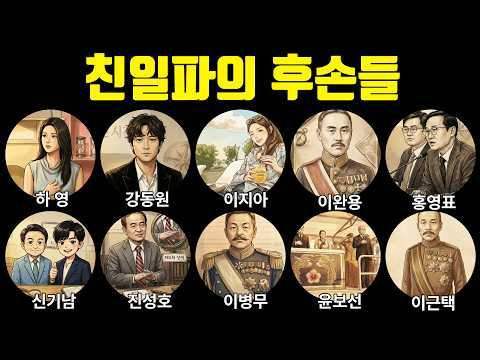
- 설명 앞부분: "4대째 의사 집안입니다" — 자랑스럽게 말한 배우의 증조할아버지는 이완용과 같은 단체 소속이었습니다. 독립운동가 후손들이 반지하와 임대아파트를 전전하는 사이, 친일파 후손들은 국회의원이 되고, 국립대 총장이 되고, 대통령의 아버지가 됩니다. 배우 하영, 강동원, 이지아부터 이완용, 홍영표, 신기남까지 나라를 팔아먹은 대가가 100년이 지난 지금까지 어떻게 대물림되고 있는지, 10명의 실제 기록으로 파헤칩니다. 타임스탬프
- 같은 채널 평소 대비 ×89.9 (채널 최근 롱폼 중앙값 740회) · 평소 영상: 지구상 가장 위험한 접근금지구역 8곳 (750회) / 일본 쇠말뚝 괴담의 실체ㅣ'실화모티브'라던 영화 뒤 숨은 실제 이야기 (731회)
- 대본 없음 (설명) — 음성인식이 끝나면 도입부·흐름이 들어감
- 댓글 471/471: 좋은 점 — 영상 2 · 감사·응원 7 · 더 알고 싶은 것 5 · 아쉬운 점 — 영상 0 · 반박·불만 — 의견 다름 9 · 정치·사회 78 · 경험 공유 7 · 구독·다음 기대 0
  - 좋은 점 — 영상 👍1 “독립운동 존경합니다 근데 친일파한테 잣대는 심하면서 종북간첩 세력은 왜 판치는걸까요? 625 참전 용사들 싹 다 무시하고 일본에 리틀보이를 날려 독립에 큰 도움이 됐던 미국은 왜 싫어하는걸까요 ㅠㅠㅠ”
  - 좋은 점 — 영상 👍0 “매우좋고 유익합니다❤❤❤❤❤❤”
  - 감사·응원 👍14 “비록 가진건 없지만 독립운동 유공자 후손이란 걸 물려주신 할아버지 늘고맙고 감사합니다. 저렇게 친일행동 보상으로 후손이 떵떵거리고 잘사는것 보다 더 당당하고 떳떳하고 할아버지 닮아 나라사랑하는 애국심이 강합니다 . 독립유공자 후손 지원으로 국가에서 일년에 두번 삼일절…”
  - 감사·응원 👍1 “연좌제. 하면 안됩니다. 할아 버지 재산 감사 ㅎㅎ.”
  - 더 알고 싶은 것 👍8 “동족죽인 공산세력 후손명담도 올려주세요. 오하려 그게 더나쁨”
  - 더 알고 싶은 것 👍5 “625때 부역자 후손ㅇ도 궁금해요.”
  - 반박·불만 — 의견 다름 👍13 “가장 최근 우리나라를 공격한 나라는 중공군과 북한이다. 625 때 수백만 사망했고 지금도 우리나라 공격하겠다고 한다. 일본은 총리선에서 수차례 사과를 했는데 중공군과 북한은 사과한번 안했다. 연좌제 반대한다! 친일파는 김일성이 북한 토지 몰수할 때 썼던 프레임인데 1…”
  - 반박·불만 — 의견 다름 👍12 “100년도 넘었는데 아직도 친일파 타령이라? 친일파 타령하는 당신네 조상들은 한국 영토내에 있었는데 모두 친일파가 아니라고 할수있나? 독립운동가 후손들이 못살았다는데 정말 그럴까? 선동가들에게 속지 말고 하나하나 떠져보시요/ 김구선생 자손은 손자까지 장관하고 떵떵거리…”
  - 정치·사회 👍91 “나라가 어려울 때 누구보다 앞장서 친일을 하거나 나라를 팔아먹어야 후손이 편한 삶을 살 수 있다는 교훈이 얻어지는구나 참 어이가없다.”
  - 정치·사회 👍54 “홍영표는 웃기늕넘이네 돈으로국회원”
  - 경험 공유 👍2 “배우 이서진은 이상용 선생님과 32촌 관계며 친족도 아님..위에서 말하는 진희규가 친 외증조부인데 친일파 후손임을 숨기기 위해 이상용 선생님의 직계후손인것 처럼 세탁한것 같음. 실제 이상용 선생님 후손들이 이서진은 우리와 관련이 없다고 언론과 인터뷰했었지.. 이서진은…”
  - 경험 공유 👍0 “자랑하고 싶어 입이 엄청 건질건질 했었네요”

### 176. 세계 3분의 1이 왼쪽으로 달리는 이유

- https://www.youtube.com/watch?v=QftIZGkR9MM · 세계사쇼 · 구독자 22,200 · 조회수 1,391,868 (×62.7, 하루 42,574.4) · 좋아요 2,632 (0.2%) · 18.3분 · 2026-09-21 · 주제 묶음 5. 세계사·서양사 · 형식 정보·해설 (그 밖) · 폴더 `W_QftIZGkR9MM` (웹 승인)
- 썸네일: 
- 챕터: 0:00 세계 3분의 1은 왼쪽으로 달린다 · 1:05 원래 기본값은 왼쪽, 칼과 말의 시대 · 2:30 미국의 대형 마차가 오른쪽을 만들다 · 4:05 나폴레옹 왼손잡이설과 프랑스 혁명의 진실 · 5:45 오스트리아와 체코슬로바키아, 점령군이 끝낸 전환 · 7:34 판을 굳힌 미국산 자동차, 일본이 왼쪽인 이유 · 9:30 스웨덴 다겐 H, 83% 반대를 뚫은 10분 · 11:42 사모아, 중고차 값 때문에 반대로 바꾸다 · 13:40 어느 쪽이 더 안전한가, 엇갈린 연구 · 15:48 왜 세계는 하나로 통일하지 않는가
- 설명 앞부분: 전 세계 75개 나라와 지역, 세계 인구의 3분의 1은 왼쪽 차선으로 달립니다. 원래 인류의 기본값은 오른손잡이가 칼을 왼쪽 허리에 찬 왼쪽 통행이었고, 미국의 대형 마차와 프랑스 혁명, 좌핸들 미국산 자동차가 유럽 대륙을 오른쪽으로 돌려세웠습니다. 영국은 바다 덕에, 일본은 영국이 놓아 준 철도 덕에 왼쪽에 남았고, 국민 83%가 반대한 스웨덴은 1967년 하룻밤에 우측통행으로 바꿨습니다. 타임라인:
- 같은 채널 평소 대비 ×285.0 (채널 최근 롱폼 중앙값 4,883회) · 평소 영상: 십자군 전쟁의 진짜 목적은 무엇이었을까? (4,883회) / 종교와 과학계에서는 신의 존재를 어떻게 증명할까? (5,003회)
- 대본 없음 (설명) — 음성인식이 끝나면 도입부·흐름이 들어감
- 댓글 437/437: 좋은 점 — 영상 12 · 감사·응원 9 · 더 알고 싶은 것 3 · 아쉬운 점 — 영상 3 · 반박·불만 — 의견 다름 9 · 정치·사회 17 · 경험 공유 12 · 구독·다음 기대 0
  - 좋은 점 — 영상 👍10 “너무 좋은 영상입니다. 내용이 좋으면 시간은 상관 없다는 것을 다시 느끼게 되었습니다. 감사합니다.”
  - 좋은 점 — 영상 👍4 “항상 궁금했던 건데 쉽게 설명해 주셨네요. 감사합니다.”
  - 감사·응원 👍10 “너무 좋은 영상입니다. 내용이 좋으면 시간은 상관 없다는 것을 다시 느끼게 되었습니다. 감사합니다.”
  - 감사·응원 👍7 “궁금했던 주제인데 감사해요”
  - 더 알고 싶은 것 👍0 “좋은 내용 잘 봤습니다. 혹시 시간 되시면 자동차 주유구 위치, 운전석 아니면 반대쪽도 한번 조사해서 알려 주세요😊”
  - 더 알고 싶은 것 👍0 “알고싶지않다 그렇게 돈벌어먹고 싶나 왼쪽으로 다니든 오른쪽으로 다니든 뭐가 그리 궁금한데”
  - 아쉬운 점 — 영상 👍0 “인구수가 1/5도 안되는데 어그로아님 100만뷰/20만 좋댓구 됫을듯”
  - 아쉬운 점 — 영상 👍0 “오른손 잡이인데 낚시 릴은 좌핸인데”
  - 반박·불만 — 의견 다름 👍4 “이건 진짜 말도 안되는 소리.ㅎㅎㅎㅎ 무슨 말을 왼쪽 오른쪽… 2분보다 어이가 없네요.. 왜.. 외각을 벽처럼 유도하시나요? 이해가 안되네..”
  - 반박·불만 — 의견 다름 👍2 “러시아 블라디보스톡에 가보니 러시아는 우측통행 나라인데, 승용차는 대부분 일본에서 들어온 중고차들이라 우핸들로 운행해서 다니고, 시내버스는 한국에서 수입한 중고 시내버스들이 대부분이라 좌핸들로 다니고 있었음. 나라는 부자인데 국민들은 가난해서 벌어지는 웃기는 상황이죠…”
  - 정치·사회 👍17 “솔직히 우측통행이든 좌측통행이든 중요하지는 않음 다만, 우리나라나 프랑스처럼 도로는 우측통행인데 철도는 좌측통행인 나라가 꽤 많다는게 그게 더 관건임 😂😂😂😂😂😂”
  - 정치·사회 👍4 “많은 나라가 우측통행을 하는 이유는 계단 때문임 오른손잡이가 90%인 세상에서 계단을 오르내릴때 오른손으로 계단 손잡이를 잡고 가는게 편함 그리고 그런규칙이 있어서 오르고 내리는 사람들의 길이 서로 맞부딪히지않음 이런 사회적통용 범용규칙들은 책을 읽는 방법인 좌에서 …”
  - 경험 공유 👍3 “우핸들 차량 소유자입니다 마차나 사무라이 칼따윈 그냥 웃자고 하는 스토리입니다 일본은 1868년 메이지 유신 하면서 나라 전체를 영국화한것이지 칼하곤 상관없답니다 일본이 사무라이와 꼭 연관시켜 주장을 고집하는 최대이유는, 좀 있어보이려고 미화하려고 하는것. 영국 따라…”
  - 경험 공유 👍0 “재미있는 역사네요, 잘 봤습니다. 감사합니다. 20년째 호주에 살고 있는데요 처음에 도로가 한국하고 반대라서 어떻게 운전할까 넘 무서웠는데 요즘은 가끔 한국에 가면 운전하다 헷갈려서 실수 할까봐 아예 운전을 안하죠”

### 177. 세조의 오른팔 한명회 자식 다섯 전원 몰살된 진짜 이유 ∣ 한명회자식비극 ∣ 왕비두명만든남자

- https://www.youtube.com/watch?v=DcJMoVuG9Jw · 역사탐사실 · 구독자 19,000 · 조회수 1,181,932 (×62.2, 하루 8,129.2) · 좋아요 12,962 (1.1%) · 19.4분 · 2026-05-31 · 주제 묶음 11. 황제·왕·인물 · 형식 정보·해설 (그 밖) · 폴더 `W_DcJMoVuG9Jw` (웹 승인)
- 썸네일: 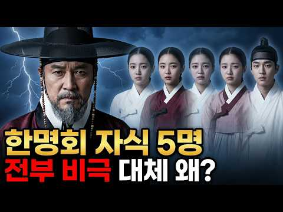
- 설명 앞부분: 왕 3명을 만들고, 딸 2명을 왕비로 올린 남자 그런데 자식 5명 전부 비극으로 끝났습니다 ∣ 한명회의 저주 😱 조선 최고의 권력자 한명회. 왕을 세 명이나 세우고, 딸 둘을 왕비 자리에 올려놓은 남자. 그런데 그의 자식 다섯 명은 단 한 명도 온전히 살아남지 못했습니다. 셋째 딸 장순왕후 — 열일곱에 출산 후 사망 💔 넷째 딸 공혜왕후 — 열아홉에 자녀 없이 사망 💔 유일한 아들 한보 — 평생 아버지의 업보를 짊어지다 외손자 인성대군 — 세 살에 요절 손자 한경침 — 열일곱에 사망 ⚰️ 죽은 뒤 17년 만에 무덤이 파헤쳐진 남자…
- 같은 채널 평소 대비 ×537.7 (채널 최근 롱폼 중앙값 2,198회) · 평소 영상: 사랑이 아니라 광기였다? 인조와 조귀인 관계의 충격적 결말 ∣ 조귀인자작극저주사건 ∣ 조… (2,198회) / 종기 하나로 죽었다고? 정조 죽음의 14일, 기록이 말해주는 진실 ∣ 정조이산마지막유언수… (2,143회)
- 대본 없음 (설명) — 음성인식이 끝나면 도입부·흐름이 들어감
- 댓글 1,590/1,601: 좋은 점 — 영상 8 · 감사·응원 18 · 더 알고 싶은 것 10 · 아쉬운 점 — 영상 6 · 반박·불만 — 의견 다름 10 · 정치·사회 73 · 경험 공유 24 · 구독·다음 기대 0
  - 좋은 점 — 영상 👍2 “한명회 자식이.두명인줄 알았는데 5명이나 있었구나. 좋은 정보.감사합니다”
  - 좋은 점 — 영상 👍2 “대본이 잘 짜여있고 정말 생각을 많이하고 구성되어 있다는 걸 느꼈어요 좋은 영상 감사합니다 저는 개인적으로 두 딸이나 왕비로 기록되어있기도하고 살아있을때 온갖 부귀영화를 누린 한명회가 더 부럽네요...ㅎㅎ”
  - 감사·응원 👍3 “엄 흥도 이런분을역사가알듯요즘엔 엄흥도같은충신이 어디없을까? 한명희같은작자가정치를하고있는 세상훗날밝혀지겠지.~~글올려주시는분 항상감사드립니다.~~”
  - 감사·응원 👍2 “한명회 자식이.두명인줄 알았는데 5명이나 있었구나. 좋은 정보.감사합니다”
  - 더 알고 싶은 것 👍1 “제가 부탁이 있습니다 방장님께 예전부터 내가 나쁜 일을 하면 자손들한테 해가 된다는 말을 들었는데 그럼 역사적으로 파 보아도 정말 그럴까? 그게 참 궁금했거든요 그래서 대표적인 인물인 한명회 자손들 검색을 해봤는데 알 수 있는게 하나도 없었어요. 오늘 방장님 덕분에 …”
  - 더 알고 싶은 것 👍1 “8:48 전 그 이유를 알거 같네요 바로 단종의 저주 때문에 죽었죠 반면 적장자이지만 단종의 저주를 피한 왕이 숙종인데 어떻게 피했을까요?”
  - 아쉬운 점 — 영상 👍2 “AI 목소리가 아니라서 좋네요”
  - 아쉬운 점 — 영상 👍1 “영상이 쓸데 없이 너무 길어....12분이내로.....길어서 안보고 패스....”
  - 반박·불만 — 의견 다름 👍1 “몰살된 건 아니죠. 한명회는 부귀영화를 누리고 천수 했고. 아들도 장수했죠. 딸들이 건강하지 않았던게 문제지.”
  - 반박·불만 — 의견 다름 👍1 “영상에 의상 고증을 좀 하겼으면 합니다. 왕가가 아닌데 금박이라니요”
  - 정치·사회 👍7 “실력없는데 부정적인방법으로 권력찬탈하는 민주당 찢재명 똑같네”
  - 정치·사회 👍4 “업보와 죄는 자식한테 간다더만 ~~ 맞네 양심껏 잘살자 ~~그런데 지금의 정권의 희생양으로 죽은 억울한 다섯명의 억울한 죽음은 어쩌나 리짜이밍”
  - 경험 공유 👍53 “살아서는 부귀영화의 화신이었으나 아이들은 다 비극을 겪었고 그 자신의 시체는 갈갈이 찢겼다.”
  - 경험 공유 👍7 “오늘날을 살아가는 저희들에게도 큰 교훈이 됩니다 오늘날도 후대에 역사가 평가할 것입니다”

### 178. 조선왕조 518년 1대 태조부터 27대 순종까지 한번에ㅣ조선 역사ㅣ한국사

- https://www.youtube.com/watch?v=U8mDpoSE4DA · 하옥리책방 · 구독자 7,170 · 조회수 445,384 (×62.1, 하루 3,187.9) · 좋아요 5,197 (1.2%) · 27.9분 · 2026-06-06 · 주제 묶음 3. 조선 · 형식 정보·해설 (그 밖) · 폴더 `W_U8mDpoSE4DA` (웹 승인)
- 썸네일: 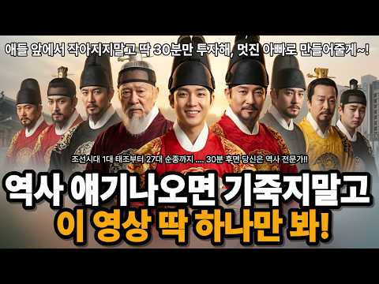
- 설명 앞부분: 조선 1대 태조 이성계부터 27대 순종까지, 518년 동안 왕좌에 앉았던 스물일곱 명의 왕을 한 명도 빠짐없이 순서대로 정리했습니다. 각 왕의 대표 업적은 물론, 그 시대에 어떤 일이 벌어졌는지, 왕과 왕 사이에 어떤 연결고리가 있었는지까지 하나의 흐름으로 꿰었습니다. 위화도 회군으로 시작된 나라가 한일병합으로 끝나기까지, 27명의 선택이 만든 518년의 기록을 지금 확인하세요. 📚 다루는 왕 (순서) 태조 → 정종 → 태종 → 세종 → 문종 → 단종 → 세조 → 예종 → 성종 → 연산군 → 중종 → 인종 → 명종 → 선조 → 광…
- 대본 없음 (설명) — 음성인식이 끝나면 도입부·흐름이 들어감
- 댓글 134/134: 좋은 점 — 영상 5 · 감사·응원 10 · 더 알고 싶은 것 1 · 아쉬운 점 — 영상 0 · 반박·불만 — 의견 다름 1 · 정치·사회 3 · 경험 공유 0 · 구독·다음 기대 0
  - 좋은 점 — 영상 👍6 “75세 할머니가 늘 궁금했던 이조 역사에 이해하기 쉽게 해주세서 너무 감사합니다.노트에 메모하며 몇번을 듣고있읍니다 고맙습니다”
  - 좋은 점 — 영상 👍6 “영조 조선시대 왕의 계보가 정리된 영상 최고 입니다. 잘 봤습니다”
  - 감사·응원 👍6 “75세 할머니가 늘 궁금했던 이조 역사에 이해하기 쉽게 해주세서 너무 감사합니다.노트에 메모하며 몇번을 듣고있읍니다 고맙습니다”
  - 감사·응원 👍3 “구독과 좋아요로 응원합니다. 매우매우 아름다운 영상 👏 ✨️”
  - 더 알고 싶은 것 👍1 “19대 숙종에 대해 알고싶어요 여야당을 바껴가며 정치 판을 움직였다면 그 누구도 무서워하지않고 왕의자리였을꺼같은데 희빈을 왜 사약을줬는지...그아들은왕이되었을때 그 여파는없었는지..”
  - 반박·불만 — 의견 다름 👍3 “정확히 끌어내렸습니다 아니죠 12대 인종 한국 나이31세. 불과 8개월만에 병사”
  - 정치·사회 👍2 “우주통일 대통령 일론 머스크가 아닌 대한민국 통일임시정부 초대 통일대통령 김두기 시인 축전!!! 역사를 잃어버린 민족에게 미래는 없습니다!!! 일제치하 대한민국 임시정부가 민족의 역사적 정통성을 지켜 왔듯이 분단치하 민족의 역사적 정통성은 대한민국 통일임시정부가 지켜…”
  - 정치·사회 👍2 “1457년 17세 세조 이미지 헌법 문서 법전을 남인 한명회 자기손 최대 조선 6섯 운영 시스템 연산군 초기 뒤틀린 1405년 반전공신 개혁 소격서 좌절 제임 20년 문종 14년 선종 북쪽 이순신 바다 전세 뒤집어 초토화 세계대통령 선거 아멘 할렐루야 대한민국 감사합…”

### 179. 세종대왕을 만나면 말이 통할까, 우리말은 500년 동안 얼마나 변했나

- https://www.youtube.com/watch?v=jiV-fQ_-uyE · 역사한줌 · 구독자 4,870 · 조회수 302,079 (×62.0, 하루 9,672.1) · 좋아요 904 (0.3%) · 29.4분 · 2026-09-23 · 주제 묶음 3. 조선 · 형식 정보·해설 (그 밖) · 폴더 `W_jiV-fQ_-uyE` (웹 승인)
- 썸네일: 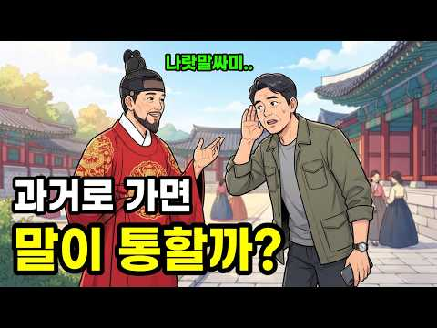
- 챕터: 0:00 440년 전 편지의 첫 줄 · 0:50 100년 전의 목소리 · 3:35 무덤에서 나온 편지와 사극 말투 · 7:55 세종의 한 문장 · 13:22 소리가 넘어온 길 · 17:06 고려의 손과 발, 신라의 달 · 21:18 세종을 만나면 통할까, 그리고 지금 우리 말
- 설명 앞부분: 지금 세종대왕 앞에 선다면 우리는 말이 통할까요? 100년 전 파리에서 녹음된 목소리, 440년 전 무덤에서 나온 아내의 편지, 누구나 외운 훈민정음 첫 문장, 900년 전 송나라 사신이 받아 적은 고려말을 차례로 읽어 가며 우리말이 어디서 끊기고 어디서 이어지는지를 한 칸씩 확인합니다. 이 영상을 보고 나면 사극 말투가 왜 어느 시대의 말도 아닌지, 그리고 지금 우리 입에서 어떤 소리가 사라지고 있는지 알게 됩니다. ⏱ 타임스탬프 MBC 뉴스데스크 — "조선 글씨는 28자 올시다" 최초 한글 음성 자료 한국어문교육연구회 어문연구…
- 같은 채널 평소 대비 ×8.4 (채널 최근 롱폼 중앙값 35,800회) · 평소 영상: 발해 사람들은 망하기 5개월 전부터 고려로 왔다, 왜 하필 고려였을까? (35,800회) / 백제의 도읍이던 충청도, 그 말은 백제 말일까 서울 말일까? (36,405회)
- 대본 없음 (설명) — 음성인식이 끝나면 도입부·흐름이 들어감
- 댓글 120/129: 좋은 점 — 영상 3 · 감사·응원 2 · 더 알고 싶은 것 0 · 아쉬운 점 — 영상 1 · 반박·불만 — 의견 다름 0 · 정치·사회 1 · 경험 공유 6 · 구독·다음 기대 1
  - 좋은 점 — 영상 👍5 “아직도 호남의 일부 지역에서는 남편을 자네라고 합니다 ! 좋은 영상 감사합니다 😊😊😊”
  - 좋은 점 — 영상 👍1 “궁금한게 있는데 누가 처음으로 언어를 말했을까? 글이 없을때도 말을 하고 이해를 했다는데 다른 나라도 그렇고 어떻게 배웠을까”
  - 감사·응원 👍7 “목소리랑 영상은 AI딸깍인데 내용은 기존에 유튜브에서 커버하지 않던것이니 대본마저 AI로 딸깍 썼다하더라도 감사하게 듣겠습니다”
  - 감사·응원 👍5 “아직도 호남의 일부 지역에서는 남편을 자네라고 합니다 ! 좋은 영상 감사합니다 😊😊😊”
  - 아쉬운 점 — 영상 👍0 “근데 자막이랑 음성이랑 다르게 읽으신 게 있어서 ㅠ 듕귁에달아 > 둑귕에 달아, 빋싸다 > 빧사다 라고 읽으셨는데 뭐가 맞는 걸까요”
  - 정치·사회 👍0 “북한사람 조선족 고려인 전부 말이 통하잖아 무조건 말통해”
  - 경험 공유 👍25 “40대인 나도 지금 10대들 이야기 하는거보면 특이한 말투가 있다”
  - 경험 공유 👍2 “우리 말이 스펙터클하게 백년도 안되어 바뀌었다면 어떻게 스페인과 남미는 말이 통하며 영국과 호주는 또 말이 통할까? 아무리 서로 교류한다 하더라도 빈번한 교류가 아니며 각 사회는 다루게 발전했을텐데... 내가 생각하기에 글은 말을 그대로 표현하지 못한다고 생각한다. …”

### 180. 이순신이 원균의 죽음을 듣고 한 행동 ∣ 평생의 라이벌이 죽은 날 난중일기에 적은 단 한 줄, 칠천량 해전 이순신 원균 관계심리

- https://www.youtube.com/watch?v=vk4v5mv4VCk · 사라진도면 · 구독자 438 · 조회수 27,166 (×62.0, 하루 152.7) · 좋아요 782 (2.9%) · 17.4분 · 2026-04-29 · 주제 묶음 3. 조선 · 형식 정보·해설 (그 밖) · 폴더 `W_vk4v5mv4VCk` (웹 승인)
- 썸네일: 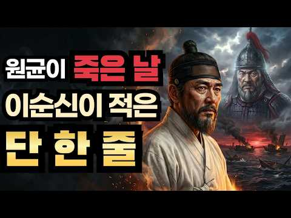
- 설명 앞부분: 1597년 7월 18일 새벽, 합천 초계. 이순신은 평생 미워한 사람의 죽음 소식을 들었습니다. 그날 그가 난중일기에 적은 단 한 줄. 120번이나 비판했던 그 사람이 죽었을 때, 이순신은 무엇을 적었을까요. 역사책이 알려주지 않은 그 새벽의 진짜 이야기를 들려드립니다. [역사 속 손절 시리즈] 1편 - 공자도 손절했다 2편 - 제갈량은 손절을 못 했다 3편 - 퇴계 이황은 머리를 숙였다 4편 - 세종은 황희를 손절하지 않았다 5편 - 이순신이 원균의 죽음을 듣고 한 행동 ◀ 현재 영상 「난중일기」 정유년 7월 18일 「선조실록」…
- 같은 채널 평소 대비 ×396.6 (채널 최근 롱폼 중앙값 68회) · 평소 영상: 홍길동전 최초의 한글 소설이 아니었다? ∣ 허균 홍길동전 저자 최초의한글소설 김태준 택당… (70회) / 흥부가 가난했던 진짜 이유 ∣ 흥부전 조선 상속제도 균분상속 장자상속 조선후기 (67회)
- 대본 없음 (설명) — 음성인식이 끝나면 도입부·흐름이 들어감
- 댓글 284/284: 좋은 점 — 영상 2 · 감사·응원 1 · 더 알고 싶은 것 1 · 아쉬운 점 — 영상 2 · 반박·불만 — 의견 다름 3 · 정치·사회 7 · 경험 공유 5 · 구독·다음 기대 0
  - 좋은 점 — 영상 👍1 “좋은 해석 ^^ 좋은 영상 ^^”
  - 감사·응원 👍0 “선조가 과연무능 했을까? 선조의 인재 욕심이 과하다 싶을 정도로 이순신의 진급이 비상식적으로 빨라서 유성룡도 견제했을정도 라하는데 . 임란을 막지 못한 무능한군주로만 묘사 됩니다 당시 이순신은 지방에 막대한세력을 가진 군벌이었고 자치적으로 과거시험까지 가질정도로 힘이…”
  - 더 알고 싶은 것 👍4 “원균은 이순신보다 5살 위고, 군은 10년도 더 먼저 무과에 급제한 장군입니다. 원균은 육지 전에는 능했으나 해전은 전무한 사람입니다. 원균을 경상좌수사에 안친 사람도 유성룡입니다. 이순신도 유성룡이 안친 것이고, 이순신이 보기에 원균은 답답했을 것입니다. 답답해서 …”
  - 아쉬운 점 — 영상 👍1 “글도 몇개의 기록들을 억지로 짜깁기 한 느낌.”
  - 아쉬운 점 — 영상 👍0 “간단하게설명하시오서론이너무길어같은말만계속하니지겹네요”
  - 반박·불만 — 의견 다름 👍1 “정말 얼마나 서렵겠습니까? 원균의 죽음? 아닙니다. 자신의 필생의 노력으로 이룬 해군, 그리고 거기의 많은 부하들이 사라졌습니다 정말 나 역시 통곡할 겁니다. 원균은 살아서 그 잘못을 알고 피눈믈을 흘리게 해야 합니다”
  - 정치·사회 👍11 “이순신장군은 한반도에 사는 백성들에게는 메시아급인것이다. 어찌 저런 상황에서 저렇게 할 수가 있는 것일까? 평범한 사람들은 나라가 한심하고 나라 때문에 자신의 처지가 곤란하면 욕을하고 원망을 하는 법이다. 그러나 이순신 장군은 그 마음을 모두 덮어두고 나라를 구하고 …”
  - 정치·사회 👍3 “당시 원균은 2026년 오늘날 국민의힘 국회 나부랑이들과 윤석열 전광훈(제일사랑교회 교주) 전한길 등이라 보면되는게지”
  - 경험 공유 👍1 “며칠전에 나도 난중일기인 정유일기를 봤는데 원균이 보낸 조문을 보고쓴 원수는 미운원수가 아닌 도원수 권율을 지칭한거로 보는데요. 그러니까 원균이 스스로 조문의 글을 보낸게아니고 권율장군의 지시로 보낸거라고 나는 이해를 했는데요!”
  - 경험 공유 👍1 “이순신의 통곡은 만일 원균대신 본인이 그자리에 있었더라면 같은 일을 겪었으리라 생각하지 않았을까? 그래서 미안하고 안타까운 마음을 갖고 울지 않았을까?”

### 181. 당신을 놀라게 할 희귀하고 놀라운 역사적 사진 모음!

- https://www.youtube.com/watch?v=fUvbh_dyakA · 사진으로 보는 역사 · 구독자 3,510 · 조회수 213,671 (×60.9, 하루 17,291.6) · 좋아요 2,020 (0.9%) · 31.9분 · 2026-10-11 · 주제 묶음 1. 역사 일반·이야기 · 형식 정보·해설 (그 밖) · 폴더 `W_fUvbh_dyakA` (웹 승인)
- 썸네일: 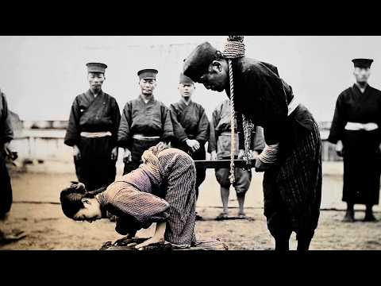
- 설명 앞부분: 시청해 주셔서 감사합니다. 📜 사진으로 보는 역사**는 한 장의 사진 속에 담긴 시대의 흔적과 사람들의 이야기를 통해 과거를 새롭게 발견하는 역사 다큐멘터리 채널입니다. 모든 영상은 역사 자료 조사, 사실관계 검증, 세심한 기록물 분석 및 신중한 디지털 복원 작업을 바탕으로 제작됩니다. 역사 사진과 원본 문서, 각종 기록 자료를 면밀히 조사하여 가능한 한 정확하게 촬영 장소와 연도, 역사적 사건, 그리고 시대를 살아간 인물들을 밝혀내고자 합니다. 시간의 흐름 속에서 희미해진 사진의 세부적인 흔적은 디지털 복원 기술을 통해 조심스럽…
- 대본 없음 (설명) — 음성인식이 끝나면 도입부·흐름이 들어감
- 댓글 14/14: 좋은 점 — 영상 1 · 감사·응원 1 · 더 알고 싶은 것 2 · 아쉬운 점 — 영상 2 · 반박·불만 — 의견 다름 0 · 정치·사회 0 · 경험 공유 0 · 구독·다음 기대 0
  - 좋은 점 — 영상 👍2 “열심히 일하시고 귀한 영상 올려주셔서 감사합니다. 자주 찾아올께요. 건강하시고 더 좋은 영상 기다릴께요.❤🎉”
  - 감사·응원 👍2 “열심히 일하시고 귀한 영상 올려주셔서 감사합니다. 자주 찾아올께요. 건강하시고 더 좋은 영상 기다릴께요.❤🎉”
  - 더 알고 싶은 것 👍22 “썸네일 사진은 어디에 있나요?”
  - 더 알고 싶은 것 👍10 “썸네일 사진이 궁금해서 끝까지 봤다. 내 두 번 다시 네놈의 동영상을 보지 않을 것이다. 엄지 거꾸로 콱 찍고 간다.”
  - 아쉬운 점 — 영상 👍0 “썸네일 사진은 낚시였다. 손모가지 꺼꾸로 한방.”
  - 아쉬운 점 — 영상 👍0 “썸네일 낚시영상 ㄱHㅈ같네....”

### 182. 진시황릉을 파는 순간, 중국은 큰일 난다? 절대 발굴 금지 이유 3가지 #진시황 #진시황릉 #병마용

- https://www.youtube.com/watch?v=1UUDO7-0e6E · 역사로 힐링 · 구독자 217 · 조회수 13,197 (×60.8, 하루 116.8) · 좋아요 188 (1.4%) · 18.6분 · 2026-07-03 · 주제 묶음 6. 동양사 (중국·일본·몽골) · 형식 정보·해설 (그 밖) · 폴더 `W_1UUDO7-0e6E` (웹 승인)
- 썸네일: 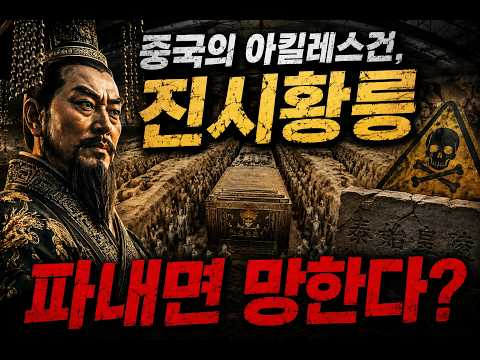
- 설명 앞부분: 중국을 최초로 통일한 진시황. 하지만 그의 무덤은 2200년이 넘도록 단 한 번도 개봉되지 않았습니다. 중국은 세계 최고 수준의 토목기술과 우주기술, 원격 탐사 기술을 보유하고 있는데도 왜 진시황릉만큼은 발굴하지 못하는 걸까요? 이번 영상에서는 병마용과 진짜 진시황릉의 차이 사마천이 기록한 '수은의 강'은 사실일까? 실제로 검출된 고농도 수은의 진실 중국 정부가 밝히는 공식적인 발굴 불가 이유 병마용의 화려한 색이 사라진 이유 70만 인부와 수천 궁녀의 생매장 기록 그리고 중국이 아직 공개하지 않는 또 다른 가능성까지 역사 기록과…
- 대본 없음 (설명) — 음성인식이 끝나면 도입부·흐름이 들어감
- 댓글 71/71: 좋은 점 — 영상 1 · 감사·응원 0 · 더 알고 싶은 것 3 · 아쉬운 점 — 영상 0 · 반박·불만 — 의견 다름 2 · 정치·사회 1 · 경험 공유 0 · 구독·다음 기대 1
  - 더 알고 싶은 것 👍1 “궁금하네요 뭐가있을지”
  - 더 알고 싶은 것 👍0 “제 댓글이 블라인드 처리되었는데 이유를 알려주실수 있나요?”
  - 정치·사회 👍5 “서역에서 중원대륙으로 건너온 아리안 계통의 민족들이 중원의 일부를 정복하고 중원 최초의 봉건제 국가인 주나라를 세웠죠,,, 당시 농경생활이나 하던 강한 성조억양의 언어를 사용하던 남방계 황인종이자 중화한족의 원조인 화하족들은 봉건제가 뭔지도 몰랐고 ,,,, 아리안계통…”
  - 구독·다음 기대 👍5 “지나 가다 홀린 듯이 들어와서 끝까지 다 봤네요. 영상 편집 감각이 진짜 좋으세요! 다음 영상도 기대됩니다. 구독 누르고 가요!”

### 183. [𝙋𝙡𝙖𝙮𝙡𝙞𝙨𝙩] 세종대왕이 경복궁에서 야근하며 듣던 가야금 재즈

- https://www.youtube.com/watch?v=q3oC3zdfyw4 · 조선재즈 · 구독자 10,200 · 조회수 619,964 (×60.8, 하루 4,627.4) · 좋아요 22,737 (3.7%) · 180.7분 · 2026-06-12 · 주제 묶음 2. 한국 고대·삼국·고려 · 형식 정보·해설 (그 밖) · 폴더 `W_q3oC3zdfyw4` (웹 승인)
- 썸네일: 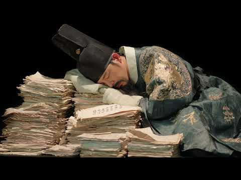
- 설명 앞부분: 세종대왕도 야근은 힘들었을 겁니다. 경복궁 깊은 밤, 촛불 아래 가야금이 흐릅니다. 조선의 밤과 재즈가 만났습니다:)
- 같은 채널 평소 대비 ×126.2 (채널 최근 롱폼 중앙값 4,912회) · 평소 영상: [𝙋𝙡𝙖𝙮𝙡𝙞𝙨𝙩] 세종대왕이 코딩하며 들었던 가야금 재즈 (5,151회) / [𝙋𝙡𝙖𝙮𝙡𝙞𝙨𝙩] 꺼먹살이도 하루 종일 엿들은 가야금 재즈 (4,672회)
- 대본 없음 (설명) — 음성인식이 끝나면 도입부·흐름이 들어감
- 댓글 469/475: 좋은 점 — 영상 2 · 감사·응원 8 · 더 알고 싶은 것 6 · 아쉬운 점 — 영상 2 · 반박·불만 — 의견 다름 4 · 정치·사회 1 · 경험 공유 10 · 구독·다음 기대 5
  - 좋은 점 — 영상 👍0 “생활안복 자주 입는데, 한복입고 어디 놀러갈때 듣기 좋아요. 굿뜨 뭐랄까 혼자 마패를 들고 암행어사 하러 가는 기분이랑 연모하는 사내 담벼락에 훔쳐보러 가는 기분”
  - 좋은 점 — 영상 👍0 “너무좋아요 나도만들고싶네요 많이배우고갑니다❤❤❤❤❤❤❤”
  - 감사·응원 👍5 “와.... 가야금 너무 좋아하는데 이런 귀한 플리를 올려주시다니 감사합니다....”
  - 감사·응원 👍4 “오 좋아요... 제작 감사함당 잘 들을게요”
  - 더 알고 싶은 것 👍3 “구독 좋아요 알림설정합니다. 한국의 미를 잃지 않는 퓨전음악 많이 부탁드립니다. 덕분에 출근길이 즐거워요.”
  - 더 알고 싶은 것 👍1 “집현전 학자들 편도 부탁합니다. 엄지척!”
  - 아쉬운 점 — 영상 👍7 “ㅋㅋㅋㅋㅋㅋㅋ 고얀 AI 같으니라고”
  - 아쉬운 점 — 영상 👍3 “구간반복해서 들을 수 있게 해주세요”
  - 반박·불만 — 의견 다름 👍4 “와 재즈 좋아하는데 가야금과 재즈가 이렇게 잘 어울리다니. 가야금의 선율이 그루비해서 깜짝 놀랐습니다. AI 작곡이란데서 한번 더 놀람.. 말도안됨 😂”
  - 반박·불만 — 의견 다름 👍1 “절대음감이라 AI 음악이 맞으실 수도ㅋㅋㅋ 근데 저렇게 누워 계실 분이 아닌데 두 눈 부릅 뜨고 계셔야 하지 않을까요?”
  - 정치·사회 👍0 “전하 .. 요즘 나라가 말이 아닙니다 이걸 어찌해야 된답니까 ...”
  - 경험 공유 👍9 “클래식 공부를 어릴때 부터 하면서 재즈도 같이 조금 했었는데 살면서 들은 재즈 중에 제일 좋습니다….”
  - 경험 공유 👍3 “세종대왕도 야근하는데 내가 뭐라고”
  - 구독·다음 기대 👍3 “구독 좋아요 알림설정합니다. 한국의 미를 잃지 않는 퓨전음악 많이 부탁드립니다. 덕분에 출근길이 즐거워요.”
  - 구독·다음 기대 👍1 “가능하구나 재즈라는 것이!!!! 감탄하고 구독하고 갑니다~!”

### 184. 한명회도 탄핵한 조선 천재 간신, 아들 넷을 직접 도살대에 올린 아버지 ∣ 갑자사화 ∣ 무오사화 ∣ 조선왕조실록

- https://www.youtube.com/watch?v=8A-zm5k03_A · 역사보고서 · 구독자 3,620 · 조회수 216,497 (×59.8, 하루 1,553.1) · 좋아요 3,503 (1.6%) · 28.9분 · 2026-06-06 · 주제 묶음 3. 조선 · 형식 정보·해설 (그 밖) · 폴더 `W_8A-zm5k03_A` (웹 승인)
- 썸네일: 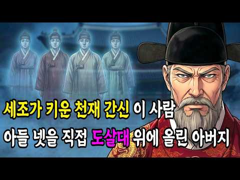
- 설명 앞부분: 조선 500년 역사상 가장 끔찍한 비극의 주인공, 혹은 가장 잔인한 아버지라 불리는 남자 '임사홍'. 첫째는 31세에 요절, 둘째는 32세에 능지처사, 셋째는 기록 말살, 넷째는 30세에 맞아 죽기까지... 자식 네 명을 모두 비극적인 죽음으로 몰고 간 아버지가 있습니다. 놀랍게도 그의 직업은 지금의 국방부 장관인 '병조판서'였습니다. 군사권까지 쥔 권력자가 왜 자기 자식들을 살리지 않고 방관했을까요? 심지어 둘째 아들이 처형당하던 날, 집에서 풍악을 울리며 연회를 즐겼다는 소름 돋는 기록까지 존재합니다. 27세에 최연소 승지에 …
- 같은 채널 평소 대비 ×221.1 (채널 최근 롱폼 중앙값 979회) · 평소 영상: 송시열을 모르면 조선 역사를 논하지마라, 왕 4명도 꺾지 못한 선비 ∣ 예송논쟁 ∣ 노론… (1,093회) / 단종의 눈물에 속았다? 조선을 구한 진짜 영웅 ∣ 조선시대 ∣ 한국사 ∣ 계유정난 (865회)
- 대본 없음 (설명) — 음성인식이 끝나면 도입부·흐름이 들어감
- 댓글 451/451: 좋은 점 — 영상 3 · 감사·응원 9 · 더 알고 싶은 것 1 · 아쉬운 점 — 영상 2 · 반박·불만 — 의견 다름 6 · 정치·사회 6 · 경험 공유 9 · 구독·다음 기대 1
  - 좋은 점 — 영상 👍4 “제가 유투브에서 본 영상 중 정말 정말 최고 중의 최고라고 생각했습니다 ~ 가장 이슈?되는 인물인데다... 그의 생애... 정말 많이 많이 배웠습니다. 감사합니다. 승승장구 하시기를 축복기원 드립니다 ~ 이런거 보면, 부처님께서 말씀하시는 업... 이라는게 진짜 있을…”
  - 좋은 점 — 영상 👍3 “부패하기 쉬운 인간의 본질에 대해 깊이 생각테 한 좋은 영상이네요”
  - 감사·응원 👍21 “저도 그 처지로부터 자유롭지 못한다에 100%입니다. 시간은 환경(인간)을 변화시키지 않을까요? 선택의 여지없는 기구한 안생사... 저에게도 많은 숙제를 남기는 영상이군요. 감사드립니다 ^^*”
  - 감사·응원 👍17 “역사를 알기쉽게 설명해 주셔서 감사합니다”
  - 더 알고 싶은 것 👍2 “와..이 영상 하나로 수창 뚫겠네..부럽습니다. 구독했어요. 혹시 노출클릭률 몇나오시나요?”
  - 아쉬운 점 — 영상 👍35 “임사홍이 언뜻 기억은 났는데 이런 내용은 몰랐네요. 이야기가 지루하지 않고 술술 귀에 흘러들어오네요.”
  - 아쉬운 점 — 영상 👍0 “첫 11분에 나가요. 별 정보가 없이 엿가락 늘이긴가요? 지루해요”
  - 반박·불만 — 의견 다름 👍12 “인성 양심 다버린 지혜없고 악한꾀만가득한 인간 ㆍ천재? 글쎄요”
  - 반박·불만 — 의견 다름 👍0 “흥청망청 역사는 이긴자의 기술 이것저것 가만해서 들어야지 사극은 드라마 시청률 때문에 극적은 대결구도와 선악이 분명해야 인기가 높지 복잡한 관계보다는 그래서 지금도 백성들은 쉽게 선동 당한다”
  - 정치·사회 👍2 “조선역사는 중종반정 인조반정후 권력을 잡은 서인 송시열의 후예 노론의 승자의 전리품같은 기록일뿐이다. 그들은 일본에 나라를 팔아먹은 세력이된다. 결국 그들도 자기와 자기세력의 이익과 안위를 위해 삶을 소비한 소인들일뿐임을 스스로 증명했음이다. 서인 노론에 패배한 훈구…”
  - 정치·사회 👍1 “수고하십니다.종교혁명가 입니다. 민주당 황 @ 회 역사 학자 you tube 께서 지금 선관위 의 부정부패 선거법 과 관련된 정치인들을 수사.조사 해서 재산몰수 해야 합니다. 박 근혜 대통 령 비서 .김종 * 이. 조선시대 에 임 사홍 아들의 스승 정치 를 종교적으로…”
  - 경험 공유 👍29 “자기권력 지키려고. 아들하나 버렸구나 어떻게 잡은 자리인데.. 내가 당해본 일이 아니면 함부로 말 할수 없다.”
  - 경험 공유 👍21 “저도 그 처지로부터 자유롭지 못한다에 100%입니다. 시간은 환경(인간)을 변화시키지 않을까요? 선택의 여지없는 기구한 안생사... 저에게도 많은 숙제를 남기는 영상이군요. 감사드립니다 ^^*”
  - 구독·다음 기대 👍2 “와..이 영상 하나로 수창 뚫겠네..부럽습니다. 구독했어요. 혹시 노출클릭률 몇나오시나요?”

### 185. 《중국 역사》 고대 중국, 남자 첩이 여자 첩보다 더 비극적이었던 이유는? l 역사 인물 l 고전

- https://www.youtube.com/watch?v=jcUvSMjefq8 ·  역사 산책: 동양편 · 구독자 2,770 · 조회수 164,122 (×59.2, 하루 2,004.0) · 좋아요 653 (0.4%) · 23.4분 · 2026-08-03 · 주제 묶음 1. 역사 일반·이야기 · 형식 정보·해설 (그 밖) · 폴더 `W_jcUvSMjefq8` (웹 승인)
- 썸네일: 
- 같은 채널 평소 대비 ×25.5 (채널 최근 롱폼 중앙값 6,426회) · 평소 영상: 《삼국지》 유비는 왜 동문 공손찬의 등에 칼을 꽂았을까? l 역사 인물 l 고전 (7,251회) / 《삼국지》 조조의 손자 조예, 위나라를 파멸로 몰았던 이유는? l 역사 인물 l 고전 (5,600회)
- 대본 없음 (없음) — 음성인식이 끝나면 도입부·흐름이 들어감
- 댓글 87/87: 좋은 점 — 영상 1 · 감사·응원 1 · 더 알고 싶은 것 2 · 아쉬운 점 — 영상 0 · 반박·불만 — 의견 다름 1 · 정치·사회 2 · 경험 공유 2 · 구독·다음 기대 0
  - 좋은 점 — 영상 👍6 “좋은 영상 재미있게 보고 갑니다♡”
  - 감사·응원 👍1 “감사합니다 🎉🎉🎉”
  - 더 알고 싶은 것 👍8 “세상에나 그 당시에도 동성애가 성했네요. 에고... 글자 화면 뒤에 끊임없이 움직이는 동영상은 안 올리면 안되나요? 집중력도 떨어지고, 어지럽고 정신 사나워요.”
  - 더 알고 싶은 것 👍2 “인간이 이렇게 잔인합니다 그들은 얼마나 고통스러웠을까요?”
  - 정치·사회 👍0 “오늘날에도 중국에서 저런일이 벌어지고 있지 않나? 위멍롱 사건. 735사건 등.. 아마 중국 연예인들이나 일반 사람들 인신매매 장기척출 인육 등..중국은 천벌 받아야 한다.중국은 자기들 죄로 반드시 쪼개져 역사속에서 다시는 하나의 나라가 되지 못할거다.”
  - 경험 공유 👍0 “내가 30년전 알던 어느 광고전문 감독에게 들었는데 그당시 연예계에서 스타가된 남자배우치고 앙드레 김에게 항문을 바치지 않고는 스타가되기가 하늘에 별따기라고 했다..노예계약의 협박용으로 강제로 강요당한 성관계 테이프도 한편식 다 완성해놔야 했다고 했다..그게.. 30…”

### 186. 조선왕조 500년｜잠들기 전 듣는 조선 역사 3시간 7분 완전 몰아보기｜태조부터 순종까지

- https://www.youtube.com/watch?v=zoqHzODexwM · 스페셜스토리 · 구독자 1,370 · 조회수 81,077 (×59.2, 하루 2,810.3) · 좋아요 701 (0.9%) · 187.1분 · 2026-09-25 · 주제 묶음 3. 조선 · 형식 수면·낭독 (잠잘 때 듣는) · 폴더 `W_zoqHzODexwM` (웹 승인)
- 썸네일: 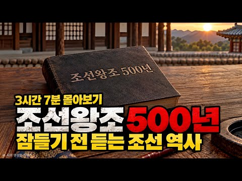
- 설명 앞부분: 1392년 태조 이성계의 조선 건국부터 1910년 대한제국의 마지막까지. 518년의 역사, 27명의 왕이 남긴 이야기를 3시간 7분에 담았습니다. 왕자의 난과 세종대왕의 훈민정음 창제, 단종과 세조의 왕위 다툼, 임진왜란과 이순신, 병자호란과 삼전도의 굴욕, 영조와 사도세자의 비극, 정조의 개혁 그리고 조선의 마지막 왕 순종까지. 조선의 왕들은 어떻게 나라를 세우고 지켜왔으며, 500년 넘게 이어진 왕조는 왜 막을 내리게 되었을까요? 복잡한 연도와 사건을 외우기보다는 한 편의 긴 역사 이야기처럼 자연스럽게 들을 수 있도록 구성했습…
- 같은 채널 평소 대비 ×216.8 (채널 최근 롱폼 중앙값 374회) · 평소 영상: 삼국지연의 4편 ∣ 여인들의 이야기와 조조의 흔들림 (374회) / 성경 VS 불교 경전｜말은 달라도, 뜻은 통한다고? 2,000년을 이어온 두 가르침 (383회)
- 대본 없음 (설명) — 음성인식이 끝나면 도입부·흐름이 들어감
- 댓글 34/37: 좋은 점 — 영상 0 · 감사·응원 0 · 더 알고 싶은 것 0 · 아쉬운 점 — 영상 0 · 반박·불만 — 의견 다름 0 · 정치·사회 0 · 경험 공유 0 · 구독·다음 기대 0

### 187. 천하를 통일한 유방, 모든 걸 이긴 뒤에 진짜 공포가 시작됐다 ∣ 초한전쟁 그 후의 이야기

- https://www.youtube.com/watch?v=9LJDKInAPkg · 역사의실마리 · 구독자 1,560 · 조회수 91,878 (×58.9, 하루 1,004.8) · 좋아요 690 (0.8%) · 22.9분 · 2026-07-24 · 주제 묶음 7. 전쟁·군사사 · 형식 인터뷰·강연·대담 · 폴더 `W_9LJDKInAPkg` (웹 승인)
- 썸네일: 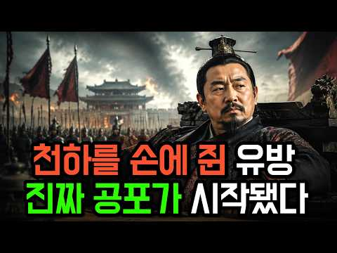
- 챕터: 0:00 다 가진 황제가 밤마다 떨었던 이유 · 0:25 시골 건달, 맨손으로 황제가 되다 · 0:46 진시황의 몰락과 5년 전쟁의 승자 · 1:50 첫 번째 용의자 항우, 홍문연의 칼춤 · 4:54 두 번째 용의자 범증, 말로 벤 머리 · 6:57 천하를 삼켰지만 삼키지 못한 아이러니 · 7:41 세 번째 용의자 한신과 정형 전투의 기적 · 10:04 명장은 왜 황제의 표적이 되었나 · 12:34 한신은 정말 반역했을까 · 13:51 네 번째·다섯 번째 용의자, 팽월과 경포 · 17:29 끝까지 살아남은 단 한 사람 · 20:37 그가 진짜로 두려워했던 것
- 설명 앞부분: 천하를 통일한 황제 유방. 최강의 적 항우를 꺾고 5년 전쟁을 끝낸 그는, 왜 밤마다 잠들지 못하고 식은땀에 떨어야 했을까요? 이 영상은 초한전쟁의 승자 유방이 황제가 된 뒤에 시작된 '진짜 공포'를 추적합니다. 항우, 범증, 한신, 팽월, 경포. 유방을 위협했던 다섯 인물을 하나씩 따라가다 보면, 그가 정말로 두려워한 것의 정체가 서서히 드러납니다. 명장 한신의 정형 전투와 배수진, 홍문연의 칼춤, 토사구팽의 유래, 그리고 유일하게 살아남은 책사 장량의 선택까지. 2천 년 전 이야기지만, 오늘날 우리의 삶과도 놀랍도록 닮아 있는…
- 같은 채널 평소 대비 ×264.8 (채널 최근 롱폼 중앙값 347회) · 평소 영상: 세종대왕 국장의 진실｜조선은 왜 임금을 다섯 달이나 묻지 않았을까? (355회) / 칭기즈칸의 생애와 정복 전략 ∣ 역사상 가장 넓은 제국의 비밀 (339회)
- 대본 없음 (설명) — 음성인식이 끝나면 도입부·흐름이 들어감
- 댓글 49/49: 좋은 점 — 영상 1 · 감사·응원 0 · 더 알고 싶은 것 0 · 아쉬운 점 — 영상 0 · 반박·불만 — 의견 다름 0 · 정치·사회 3 · 경험 공유 1 · 구독·다음 기대 0
  - 좋은 점 — 영상 👍1 “명쾌합니다❤❤❤”
  - 정치·사회 👍1 “중국인들 특징은 통일후 다죽인다 진시황보다 더 토사구팽을 충실하게 해낸자 백만대군이 죽어도 위령비조차 안세우는 중국인”
  - 정치·사회 👍0 “이재명은 힘들게 잡은 권력을 순순히 놓을까요”

### 188. 국립현충원에서 가장 좋은 자리, 그 무덤의 주인은 조선의 궁녀였다

- https://www.youtube.com/watch?v=UAw390nt3vQ · 시간책방 · 구독자 8,850 · 조회수 517,738 (×58.5, 하루 11,402.0) · 좋아요 2,024 (0.4%) · 40.1분 · 2026-09-08 · 주제 묶음 3. 조선 · 형식 정보·해설 (그 밖) · 폴더 `W_UAw390nt3vQ` (웹 승인)
- 썸네일: 
- 챕터: 0:00 현충원 안의 이상한 무덤 · 2:55 아홉 살에 궁으로 들어간 아이 · 5:15 궁녀라는 직업의 실체 · 8:50 아내를 이레 만에 내보낸 임금 · 13:35 승은, 그리고 더 위험해진 자리 · 16:50 경빈 박씨는 왜 죽었는가 · 18:55 왕이 죽고 궁을 나오다 · 28:00 18년 뒤, 손자가 왕이 되다 · 34:55 무덤이 먼저였다 · 37:00 조선 후기 340년의 시작점
- 설명 앞부분: 서울 동작구 국립서울현충원. 나라를 위해 목숨을 바친 분들이 잠든 그 언덕 한가운데에, 조선시대 무덤 하나가 남아 있습니다. 🌲 주인은 조선 11대 임금 중종의 후궁, 창빈 안씨입니다. 왕족도 아니었고 명문가의 딸도 아니었습니다. 가난한 집에서 태어나 아홉 살에 궁으로 들어간 어린 궁녀였습니다. 받은 것은 여럿이 나눠 쓰던 방 한 칸, 그리고 다달이 나오는 쌀 몇 말이었죠. 그 아이의 후손이 선조부터 순종까지 조선의 임금 열네 명입니다. 조선 500년 중 후반부 340년이 이 한 사람의 핏줄에서 나왔습니다. 🏯 이 영상에서는 조선…
- 같은 채널 평소 대비 ×333.3 (채널 최근 롱폼 중앙값 1,554회) · 평소 영상: 조선 왕들은 왜 46세에 죽었나? 경복궁 흙이 밝힌 충격적 진실 (1,636회) / 세조는 왜 친동생 안평대군을 죽였나? 조선 최고의 천재가 사라진 진짜 이유 (1,471회)
- 대본 없음 (설명) — 음성인식이 끝나면 도입부·흐름이 들어감
- 댓글 63/70: 좋은 점 — 영상 2 · 감사·응원 3 · 더 알고 싶은 것 0 · 아쉬운 점 — 영상 1 · 반박·불만 — 의견 다름 1 · 정치·사회 2 · 경험 공유 1 · 구독·다음 기대 0
  - 좋은 점 — 영상 👍5 “너무 소상히 알려주셔서 감사합니다.조선실록에 관심이 있었으나 안빈창씨라는것 후궁이었고 양주에서 이장해 동작동에모셨고훗날국립묘지에 최고의명당이고 후손들중14분이왕이되였다는설이 전부였답니다.유익한 정보 대단히 감사합니다. 의자리라는것”
  - 좋은 점 — 영상 👍2 “참좋은 정보 감사합니다 조용히 있는것 힘들것요 그동안 고생하셨습니다 편안하게 숴세요 담에 가면 인사드릴 고싶어요 ㅎ”
  - 감사·응원 👍5 “너무 소상히 알려주셔서 감사합니다.조선실록에 관심이 있었으나 안빈창씨라는것 후궁이었고 양주에서 이장해 동작동에모셨고훗날국립묘지에 최고의명당이고 후손들중14분이왕이되였다는설이 전부였답니다.유익한 정보 대단히 감사합니다. 의자리라는것”
  - 감사·응원 👍2 “참좋은 정보 감사합니다 조용히 있는것 힘들것요 그동안 고생하셨습니다 편안하게 숴세요 담에 가면 인사드릴 고싶어요 ㅎ”
  - 아쉬운 점 — 영상 👍3 “내용은 좋은 데 필요없는 말이 중복중복 지루하다”
  - 정치·사회 👍0 “대통령 묘소가 있는곶에 누구는 저자리엄두도 내지말야야지 무신말인지 알것주”
  - 정치·사회 👍0 “월래 주인빼고 6.25 참전용사 빼고 다른 사람이 모셔졌다면 옴겨야 한다 전직 대통령 이라 해도”
  - 경험 공유 👍1 “내가 조선의 궁녀다!”

### 189. '세종이 한글을 만든 건 중국 때문?!' 시대를 앞서간 세종의 미친 통찰력 (w.김진명 작가) ∣ 로컬수다 EP.12

- https://www.youtube.com/watch?v=dfG1m38EBcw · 광화문로 · 구독자 5,520 · 조회수 322,608 (×58.4, 하루 1,898.9) · 좋아요 0 (0.0%) · 22.6분 · 2026-05-07 · 주제 묶음 3. 조선 · 형식 정보·해설 (그 밖) · 폴더 `W_dfG1m38EBcw` (웹 승인)
- 썸네일: 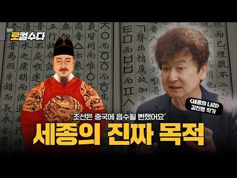
- 챕터: 0:00 하이라이트 · 0:40 오늘의 게스트 - 김진명 작가 · 1:47 세종의 나라 X 법무법인 세종 · 2:57 세종의 나라 집필 비하인드 · 4:38 세종의 나라 본격 리뷰 · 7:54 팩션 대가의 역사 해석법 · 11:34 한글 창제의 비밀 · 15:37 시대를 앞서간 천재 세종대왕 · 19:16 침대..아니 한글은 과학입니다
- 설명 앞부분: 수다쟁이 변호사들의 법과 문화(Law&Culture)이야기『로컬수다』 이번 주제는 📖 세종의 나라 📖 신작 [세종의 나라]를 쓴 '팩션의 대가' 김진명 작가의 집필 비하인드 세종은 왜 숨어서 혼자 한글을 만들었을까? 한글 창제의 비밀 조선은 중국에 흡수될 뻔했다? 세종이 중국을 견제한 이유 '무궁화 꽃이 피었습니다' '고구려' '하늘이여 땅이여' 대한민국 최고의 스테디셀러 작가 🖊 김진명 작가를 모시고 '세종의 나라'창작 비화부터 역사 속 진실까지! 로컬수다에서 확인하세요✨ 출연자 및 타인을 향한 비난, 욕설 등 불쾌감을 줄 수 …
- 같은 채널 평소 대비 ×12.5 (채널 최근 롱폼 중앙값 25,818회) · 평소 영상: AI로 역대급 호황 맞은 전력산업, 최대 수혜는 원전? 태양광? LNG? ESS? 딱 정… (25,818회) / '5억 아파트 분담금을 5억이나 더 내라고요?' 재건축·재개발 이것 모르고 투자하면 평생… (25,929회)
- 대본 없음 (설명) — 음성인식이 끝나면 도입부·흐름이 들어감
- 댓글 327/334: 좋은 점 — 영상 4 · 감사·응원 10 · 더 알고 싶은 것 3 · 아쉬운 점 — 영상 3 · 반박·불만 — 의견 다름 9 · 정치·사회 25 · 경험 공유 6 · 구독·다음 기대 0
  - 좋은 점 — 영상 👍3 “역시 로펌 세종이 이름값 하네요! 유익한 콘텐츠 감사합니다”
  - 좋은 점 — 영상 👍1 “비록 소설이라도 역사를 균형있게 써야한다.한글창제는 세종의 업적이고 항상 감사해야한다. 그러나 한글 창제이후 오백년간 이문자는 그다지 각광받지 못하고 지리멸멸했던것도 사실이다. 이것을 다시 살려내서 민중의 문자로 만든 과정은 구한말 선교사들의 도움이었다는 사실도 반드…”
  - 감사·응원 👍32 “세종대왕님 감사합니다.”
  - 감사·응원 👍16 “김진명 작가님이 정확히 지적을 잘하셨네요 집현전학자들과 같이 물을 타려는 설익은 주장을하는 분들도 보이는데 그건 사실이 아닙니다. 순수하게 세종대왕 혼자 주도적 창제 하신거고 그이후에 혜례본등에 학자로써 지원의 역할을 한것입니다. 화이팅!”
  - 더 알고 싶은 것 👍1 “여기 등장한 저 세 사람 진짜 아무것도 몰라서 저렇게 얘기를 하고 있는 건지 아니면 알면서 저렇게 거짓말을 하고 있는 건지 이게 더 궁금합니다. 도대체 한글창제 출발부터 거짓말로 시작을 하네요. 어떻게 세종대왕이 혼자 한글을 만들었다고 하는 겁니까. 초등학생도 아는 …”
  - 더 알고 싶은 것 👍1 “김진명? 윤을 빨던 사람아닌가요? 풍수전쟁이라는 책 있죠? 아는 사람 알려주세요.”
  - 아쉬운 점 — 영상 👍1 “8:52 이방원은 안봤어요. 그래서 "심지어 이방원도 안본걸" 이라는 주장때문에 후대 왕들도 "거의" 안봤어요. 연산군같은 폭군만 보고 그래서 그들이 봤다는것도 기록해 놓고 나중에 다시 정정한 부분도 기록해 놓고. 본인 생각에 잠겨서 역사를 "무시" 하는건 "해석" …”
  - 아쉬운 점 — 영상 👍0 “조선의 백성을 개돼지로 만든 역적의 나라일뿐! 세종은 한글 만든다고 짜집기만 했을뿐.. 한글은 세계적인 국가 고려말때 거의 완성되어었다!”
  - 반박·불만 — 의견 다름 👍16 “김진명 작가님이 정확히 지적을 잘하셨네요 집현전학자들과 같이 물을 타려는 설익은 주장을하는 분들도 보이는데 그건 사실이 아닙니다. 순수하게 세종대왕 혼자 주도적 창제 하신거고 그이후에 혜례본등에 학자로써 지원의 역할을 한것입니다. 화이팅!”
  - 반박·불만 — 의견 다름 👍12 “웃기는 소리하네. 주자학으로 양반지배계급이. 한자가 우리말과 다르과 배우는 데만 20년 넘게 걸려 왕에게 의견전달을 할수 없게해 권력의 힘 백성들과 접촉을 못하게 하니 자기의 권력비반인 백성들과 연락하기 위해 만든것 입니다 배우는데 하루 아침.”
  - 정치·사회 👍107 “김진명 작가의 말에 전적으로 동감합니다. 세종이 지금 있었다면 스티브 잡스가 만든 컴퓨터를 만들지 않았을 까 생각해보고 아마도 한국은 세계 최고의 나라가 되었을 겁니다. 정말 대단하고 대단하신 분입니다. 일런 머스크도 울고갈 혁신가입니다.”
  - 정치·사회 👍8 “한글은 용비어천가를 알리려 만든게 아닐까요. 조선초기 이성계 출신 성분 때문에 명에서 책봉을 꺼리고 북방 여진과 세를 합쳐서 또다른 금나라가 될 걸 경계했다고 하고. 내부반발도 강햇다 하는데… 세종이 한 게 아니고 태종이 기획하고 세종때 이룬게 아닐까. 실제 이성계 …”
  - 경험 공유 👍11 “세종대왕께서 한글을 혼자 직접 발명하셨다는 건 사실 매우 서글픈 일이기도 합니다. 당시 수구 꼴통 보수 세력이 얼마나 강했으면 임금조차 눈치를 봐야했고 이 거대한 작업을 순전히 임금 개인이 직접 해야 했었다는 것이기도 합니다.”
  - 경험 공유 👍6 “세종의 나라를 읽으며 태조는 명분없는 건국을 인정받으려 스스로 중국의 신하국을 자처하고 대대손손 스스로 중국에 이땅의 피땀을 받쳤다 태조는 벚어나지 않는 저주를 한반도에 남겼고 오늘날까지 그 악연은 계속되고 있다 그죄가 크다 내가 조선을 그나마 이해하는 이유는 세종과…”

### 190. 🔥우연히 얻은 신비한 상자, 그 안에 진짜 명나라가 존재했다. 손가락 한 번에 산적 몰살!#男频 #爽文

- https://www.youtube.com/watch?v=UZ5O6Ny3-sQ · 천하극장 · 구독자 8,410 · 조회수 489,762 (×58.2, 하루 8,618.6) · 좋아요 3,122 (0.6%) · 135.2분 · 2026-08-28 · 주제 묶음 6. 동양사 (중국·일본·몽골) · 형식 사연·드라마 · 폴더 `W_UZ5O6Ny3-sQ` (웹 승인)
- 썸네일: 
- 설명 앞부분: 🔥 매일 업로드되는 초고속 황궁 복수극 복수의 왕좌 배신당한 왕자, 몰락한 장군, 숨겨진 후계자. 권력과 복수, 그리고 인생 역전의 순간을 담은 고대 남성 드라마 채널입니다. 황궁 암투 사이다 전개 지금 가장 중독성 강한 쇼츠 드라마 채널.
- 같은 채널 평소 대비 ×72.7 (채널 최근 롱폼 중앙값 6,736회) · 평소 영상: 🔥처가에 얹혀살던 사위가 신장을 잔혹하게 탈취당한 채 절벽 아래로 내던져지지만, 복수의 … (6,736회) / 🔥평범한 현대 청년, 두 세계를 오가는 능력 각성! 아이스크림 하나로 선녀 부인을 얻다！… (6,401회)
- 대본 없음 (설명) — 음성인식이 끝나면 도입부·흐름이 들어감
- 댓글 523/551: 좋은 점 — 영상 0 · 감사·응원 4 · 더 알고 싶은 것 11 · 아쉬운 점 — 영상 5 · 반박·불만 — 의견 다름 1 · 정치·사회 6 · 경험 공유 12 · 구독·다음 기대 3
  - 감사·응원 👍20 “한글로 해주셔서 감사해요! 생각없이 클릭했는데 넘 재미있네~”
  - 감사·응원 👍4 “영상 잘보네요 감사합니다 ❤❤❤”
  - 더 알고 싶은 것 👍24 “이거 재미 있네요, 그래서 후편 완결은 어떻게 보나요?”
  - 더 알고 싶은 것 👍3 “시즌2 부탁해요”
  - 아쉬운 점 — 영상 👍8 “이어서 없어? 아니 내가 이걸 다보고 있네ㅋㅋㅋㅋㅋㅋ 미쳐ㅋㅋㅋㅋ 진짜 어눌한 더빙에 짜집기 같아서 잠깐보려던겤ㅋㅋㅋㅋㅋㅋㅋㅋㅋ😅”
  - 아쉬운 점 — 영상 👍1 “목욕 하는거 안보여줘서 철판 먹으라는 생각 ㅋㅋㅋ 존나 골때리네 ㅋㅋ Ai같은데 하나인가 뭔가 잘만들었네”
  - 반박·불만 — 의견 다름 👍1 “미치겠네 첨엔 병맛 같은 느낌이라 중국영상이 다 그렇지 하고있었는데 계속보네 ㅋㅋㅋㅋㅋㅋㅋㅋㅋ 어이없는데 웃기면서 재밌기도하네 ㅋㅋㅋㅋ”
  - 정치·사회 👍18 “상자 속의 대명나라》(내 방에 대명나라가 있다 / 箱子里的大明朝) 라고 하는데 더는 검색이 안나오네요.. 2부 올려주세요!! 제발”
  - 정치·사회 👍1 “이 비슷한 내용을 미국영화에서 본거 같은데... 참 중국인들은 한결 같네.. 창작보다 훔쳐서 베낀다.”
  - 경험 공유 👍8 “이어서 없어? 아니 내가 이걸 다보고 있네ㅋㅋㅋㅋㅋㅋ 미쳐ㅋㅋㅋㅋ 진짜 어눌한 더빙에 짜집기 같아서 잠깐보려던겤ㅋㅋㅋㅋㅋㅋㅋㅋㅋ😅”
  - 경험 공유 👍4 “누가감히 나서는지보자. 누가너에게 감히그런용가를줬나.내가바로용왕이다.ㅋㅋㅋㅋㅋ 아 😂😂😂”
  - 구독·다음 기대 👍4 “겁나게 재미나네. 다음편 기대합니다”
  - 구독·다음 기대 👍2 “은근히 재미있네요 다봤네요😊 다음편 기다려 지네요😊”

### 191. 경성야사 ㅣ 덕산옥 4화 "저자거리 왈짜패"

- https://www.youtube.com/watch?v=cM4xQnLjeHY · Mr.Gongguri · 구독자 234 · 조회수 13,621 (×58.2, 하루 243.9) · 좋아요 39 (0.3%) · 7분 · 2026-08-29 · 주제 묶음 9. 야사·야담·옛날이야기 · 형식 정보·해설 (그 밖) · 폴더 `W_cM4xQnLjeHY` (웹 승인)
- 썸네일: 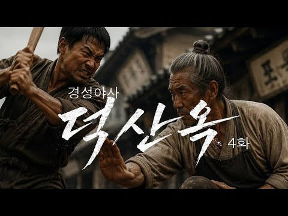
- 설명 앞부분: 돈으로 산 몽둥이 여럿이, 국자 하나를 이기지 못했다. 그리고 이제, 혼다가 직접 그 국밥집 문을 두드린다. 일제압제 시절 토지를 수탈하려는 일본관리들에 맞서 백성을 지키려는 사람들의 이야기. 시네마틱 판타지 사극 드라마 [덕산옥 德山屋] 경성야사 ㅣ 덕산옥 4화 : 저자거리 왈짜패 본 작품은 AI 기술을 활용하여 제작된 창작물이며, 실제 역사적 인물·사건·지명과는 무관합니다. Written & Directed by GONGGURI Produced by MR. GONGGURI 본 작품은 AI 기술을 활용하여 제작된 창작물이며, 실…
- 같은 채널 평소 대비 ×6.1 (채널 최근 롱폼 중앙값 2,249회) · 평소 영상: 경성야사 ㅣ 덕산옥 2화 "순사보의 선택" (2,498회) / 경성야사 덕산옥 마지막화 "인질극" (2,511회)
- 대본 없음 (설명) — 음성인식이 끝나면 도입부·흐름이 들어감
- 댓글 0/0: 좋은 점 — 영상 0 · 감사·응원 0 · 더 알고 싶은 것 0 · 아쉬운 점 — 영상 0 · 반박·불만 — 의견 다름 0 · 정치·사회 0 · 경험 공유 0 · 구독·다음 기대 0

### 192. 이순신이 원수 자격을 의심했던 조선군 총사령관?!

- https://www.youtube.com/watch?v=-f0CsdR5eJE · 몰래 듣는 조선의 비밀 · 구독자 1,220 · 조회수 69,676 (×57.1, 하루 1,154.4) · 좋아요 348 (0.5%) · 18.7분 · 2026-08-24 · 주제 묶음 3. 조선 · 형식 정보·해설 (그 밖) · 폴더 `W_-f0CsdR5eJE` (웹 승인)
- 썸네일: 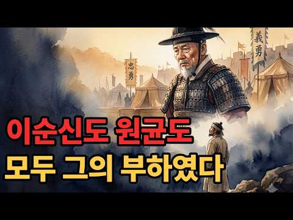
- 챕터: 0:00 두 달을 걸어온 사내 · 1:24 인사와 오늘의 여섯 장면 · 1:49 같은 해, 같은 사람이 천거한 두 이름 · 3:49 도원수라는 직책 · 6:06 이순신이 일기에 적은 문장 · 8:33 요시라의 반간계와 파직 · 10:57 백의종군 길의 끝 · 13:05 곤장 사흘 뒤 · 16:03 전기수의 한 줄
- 설명 앞부분: 1597년 사월 초사흘, 한 사내가 한양 의금부 문을 나섭니다. 며칠 전까지 그 안에서 문초를 받던 사람입니다. 살아 나온 것만으로도 주변이 놀랐습니다. 그는 남쪽으로 걷기 시작합니다. 관복도 벼슬도 없이, 죄인의 몸으로 삼백사십 킬로미터를 걷습니다. 떠난 지 열흘쯤 됐을 때 어머니의 부고가 옵니다. 상복도 갖추지 못한 채 그는 다시 남쪽으로 걷습니다. 두 달 뒤인 유월 초나흘, 사내는 경상도 합천 초계에 닿습니다. 조선의 모든 군대가 여기서 명령을 받는 곳, 도원수부입니다. 이 사내가 이순신입니다. 그런데 그가 도착한 진영의 주…
- 같은 채널 평소 대비 ×202.0 (채널 최근 롱폼 중앙값 345회) · 평소 영상: 7년간 전쟁을 이끈 남자가 쫓겨나서 쓴 반성문 16권 [조선인물 탐구생활] (357회) / 조선 최강이라 불린 장수, 적이 아니라 임금의 매에 죽으며 비운의 장수로 남다. [조선 … (333회)
- 대본 없음 (설명) — 음성인식이 끝나면 도입부·흐름이 들어감
- 댓글 30/30: 좋은 점 — 영상 1 · 감사·응원 1 · 더 알고 싶은 것 0 · 아쉬운 점 — 영상 0 · 반박·불만 — 의견 다름 0 · 정치·사회 1 · 경험 공유 0 · 구독·다음 기대 0
  - 좋은 점 — 영상 👍1 “이순신과 권율 관계에 대해서 새롭게 알게되었습니다. 매번 유익한 역사 정보 주셔서 감사합니다!”
  - 감사·응원 👍1 “이순신과 권율 관계에 대해서 새롭게 알게되었습니다. 매번 유익한 역사 정보 주셔서 감사합니다!”
  - 정치·사회 👍4 “이순신, 권율 등의 승리도 두 사람이 다른 무력하고 전략전술 부족한 다른 장수들보다 뛰어나서이기도 하지만 세종,문종 대에 전세계적에서 최고수준으로 만들어놓은 신기전을 위시한 총통기, 화차 등의 우수한 무기기술이 있었음을 여전히 문사양반선비 기득권이 이어가는 이 나라가…”

### 193. 조선시대 사람들이 30살에 이가 다 빠져버린 소름돋는 이유는? ∣ 조선역사 ∣ 한국사 ∣ 조선왕조실록 ∣

- https://www.youtube.com/watch?v=5vBTGmcYA5w · 시대를 훔친 이야기 · 구독자 3,300 · 조회수 184,956 (×56.0, 하루 1,322.5) · 좋아요 2,469 (1.3%) · 18.4분 · 2026-06-06 · 주제 묶음 3. 조선 · 형식 정보·해설 (그 밖) · 폴더 `W_5vBTGmcYA5w` (웹 승인)
- 썸네일: 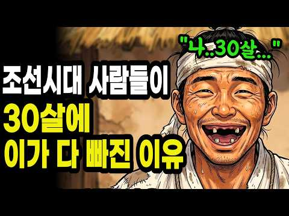
- 챕터: 0:00 👑 영조의 한숨 "양치할 때마다 한숨이 나온다" · 1:00 ⚰️ 조선 충치율 단 1~5%의 충격 · 1:36 🌿 '양치질' 어원과 버드나무 가지의 비밀 · 3:40 🎎 신분별 양치 도구 (왕실·양반·평민·빈민) · 5:46 🍚 진짜 범인은 '매일 먹던 밥'이었다 · 7:21 💎 에나멜질도 못 이긴 모래의 위력 · 8:09 🔥 풍치(風齒)의 정체, 현대의 치주염 · 9:19 👑 임금 영조는 왜 같은 시기에 무너졌을까 · 10:42 📖 동의보감 속 충격의 치통 처방 · 12:00 🔨 대장간 집게로 이를 뽑던 조선의 치과 · 13:18 🤔 21세기 우리는 정말 이기고 있을까? · 15:15 🍰 우리의 적은 '너무 부드러운 음식' · 16:21 🧠 조선은 몰라서 졌고, 우리는 알면서도 진다 · 17:11 🪞 오늘 밤 거울 앞에서 30초만…
- 설명 앞부분: 🦷 조선시대 사람들은 왜 서른만 넘으면 이가 다 빠졌을까요? 조선에서 가장 오래 산 왕, 영조. 여든셋까지 살았던 그가 서른일곱에 이미 잇몸이 무너지고 있었습니다. 😱 어의가 매일 진맥하고, 치아 전담 여의까지 있었던 임금. 말린 벚꽃잎과 소금으로 만든 왕실 전용 양치 가루까지 썼던 그 사람의 입 속이, 왜 그렇게 빨리 무너졌을까요? 🔍 이 영상에서 다루는 이야기 ✅ 조선시대 충치율이 단 1~5%였던 충격적인 진실 ✅ 충치도 없는데 이가 다 빠진 진짜 이유 ✅ '양치질'이라는 단어의 어원, 버드나무 가지의 비밀 🌿 ✅ 왕실 · 양…
- 같은 채널 평소 대비 ×311.9 (채널 최근 롱폼 중앙값 593회) · 평소 영상: 왜? 추석의 송편을 먹는 걸까? 송편의 충격진실ㅣ송편유래ㅣ추석역사 (593회) / 조선왕조실록에 "이것"까지 낱낱히 적었다? 왕들이 끝까지 감추고 싶었던 비밀 TOP3 (595회)
- 대본 없음 (설명) — 음성인식이 끝나면 도입부·흐름이 들어감
- 댓글 522/522: 좋은 점 — 영상 2 · 감사·응원 5 · 더 알고 싶은 것 3 · 아쉬운 점 — 영상 4 · 반박·불만 — 의견 다름 12 · 정치·사회 1 · 경험 공유 25 · 구독·다음 기대 0
  - 좋은 점 — 영상 👍2 “지인이 알려준 꿀팁 아침에 일어나서 수돗물 말고 정수물 한컵에 아무기름(식용유.들.참기름.올리브)이나 한두방울 떨어뜨려 젖가락으로 저은다음 가글해 보세요 저도 실천하고 입냄새 잇몸튼튼 놀라운 효과 보고 있어요 돈드는것도 아니고 조금만 부지런하면 잇몸염증 충치균에 좋아…”
  - 감사·응원 👍19 “이 시대에 대한민국에 태어난거에 감사하다”
  - 감사·응원 👍2 “의미있는 흥미로운 정보 감사히 잘 봤습니다. ^^”
  - 더 알고 싶은 것 👍4 “46세.. 살아온 동안 양치 4일에 한번만 해온 저로서 1년전 치아 2개 소실, 잇몸 말랑말랑하다 못해 어금니가 뒤틀렸다 바로 돌아올 정도로 안좋아 치과가니 노인보다 안좋아하며 모든 치아가 흔들린다 벼랑 끝이이시다.라고 하여 먹고나면 꼭 음파칫솔 쓰고 했더니 아주 건…”
  - 더 알고 싶은 것 👍2 “돌가루 때문에 잇몸병이 생겼다는건 납득이 안갑니다. 저도 어렸을때 벼를 절구에 갈아 먹고는 했는데 모래를 씹어 이가 상했던 기억은 없어요. 조리로 잘 행구면 가끔 돌이 들어가는 경우는 있어도 모래가 항시 씹는 느낌은 없었습니다. 근본적인 것은 영양 부족으로 치아 자체…”
  - 아쉬운 점 — 영상 👍2 “너무 영상을 길게 만들어서 참고 끝까지 보기가 힘듭니다. 이런 영상은 너무 길면 역효과 납니다.”
  - 아쉬운 점 — 영상 👍1 “광고가 넘 많다”
  - 반박·불만 — 의견 다름 👍8 “조선시대에 밥에 모래가 있다는것에 동의 안합니다. 쌀을 씻을때 조리로 돌을 걸러서 밥을 지었는데 말이 안됩니다.”
  - 반박·불만 — 의견 다름 👍4 “46세.. 살아온 동안 양치 4일에 한번만 해온 저로서 1년전 치아 2개 소실, 잇몸 말랑말랑하다 못해 어금니가 뒤틀렸다 바로 돌아올 정도로 안좋아 치과가니 노인보다 안좋아하며 모든 치아가 흔들린다 벼랑 끝이이시다.라고 하여 먹고나면 꼭 음파칫솔 쓰고 했더니 아주 건…”
  - 정치·사회 👍6 “쌀을 주식으로 하는 나라가 한두 개도 아니고 도정기술이 마찬기지로 안 좋았던 옛날에 모두들 서른 전후로 이가 다 빠지기 시작햇단 말임??”
  - 경험 공유 👍11 “내가 늘 말하길 사람답게 산 건 얼마 안 되었다고 혔지 내가 어렸을 때만 해도 밥 억다 돌을 씹을 때가 자주 있었지 여기선 조선이라는건 그 시대를 말하는 거지 전 세계가 다 그랬지”
  - 경험 공유 👍3 “저희 모친은 60이신데 치과에서 치료받은이가 단하나도 없어요 양치를 자기전에 한번만 하시고 소금물로 가글을 하십니다”

### 194. 교과서에서 통째로 삭제된 조선 천재들-왜 이걸 안 가르쳐줬을까?

- https://www.youtube.com/watch?v=esb1CTy8ggc · 한번은 알아야 할 역사 · 구독자 4,350 · 조회수 243,007 (×55.9, 하루 1,461.3) · 좋아요 3,433 (1.4%) · 29.6분 · 2026-05-11 · 주제 묶음 3. 조선 · 형식 정보·해설 (그 밖) · 폴더 `W_esb1CTy8ggc` (웹 승인)
- 썸네일: 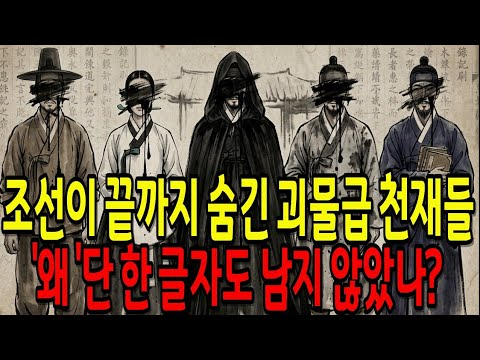
- 설명 앞부분: 조선왕조실록 4,965만 자. 매일 읽어도 135년이 걸리는 기록인데, 이 안에서 흔적도 없이 증발해버린 사람들이 있습니다. 🔸 노비 출신으로 자동 물시계를 만든 장영실은 가마 하나가 부서진 뒤 실록에서 완전히 사라졌고, 🔸 30년간 왕의 숨을 지킨 의녀 장금은 왕이 죽자마자 기록째 증발했습니다. 🔸 전우치는 백성들 사이에서 수백 년간 전설로 살아남았는데 실록에는 이름조차 없고, 🔸 일본에서 금은보화를 받으며 거장 대접을 받던 화가 최북은 조선에선 "거기 쟤"였습니다. 🔸 5천 권을 읽고 나라의 지식을 정리한 이덕무는 왕에게 광대…
- 같은 채널 평소 대비 ×583.5 (채널 최근 롱폼 중앙값 416회) · 평소 영상: 조선 왕은 단명했는데 '이것' 없는 자들만 109세 장수한 충격적인 진실 (437회) / 🏛️ 영화보다 먼저 만나는 오디세이 ∣ 3,000년 전 한 편의 시가 인류의 모든 이야기… (396회)
- 대본 없음 (설명) — 음성인식이 끝나면 도입부·흐름이 들어감
- 댓글 260/260: 좋은 점 — 영상 0 · 감사·응원 3 · 더 알고 싶은 것 1 · 아쉬운 점 — 영상 2 · 반박·불만 — 의견 다름 4 · 정치·사회 17 · 경험 공유 1 · 구독·다음 기대 0
  - 감사·응원 👍4 “대박...감사합니다.”
  - 감사·응원 👍2 “애청합니다❤❤❤❤❤즐겁게 감사합니다”
  - 아쉬운 점 — 영상 👍12 “정조 정말 실망이다 어떻게 사람을 그리 가지고 놀았나. 뒤죽박죽 너가 그런놈이구나 진정 소인베는 너로구나”
  - 아쉬운 점 — 영상 👍0 “한참 예전부터 나온내용들 짜집기 해놨네... 본인이 해석한듯...”
  - 반박·불만 — 의견 다름 👍10 “세종 때 지은 고려사의 참조 문헌(고려시대 문서)이 없다는 건 고려사 내용 자체를 신뢰하기 어렵게 만든다. 그 많은 고려시대 참조 문헌이 하나도 없을 수가 있나? 삼국사기 삼국유사 원본이 있는 것으로 사람들은 착각한다. 고려시대 삼국을 기록한 문서도 없고 조선시대 만…”
  - 반박·불만 — 의견 다름 👍5 “절대 코딱지만한 반도 스케일이 아닌데 대중의 눈높이에 맞추려면 ㅎ 내가 볼 때 역사를 대하는 대중의 눈높이는 유생 수준임 ㅋ”
  - 정치·사회 👍65 “기득권놈들은아무것도못하는주제에질투발작질은이나라가.발전할수없는이유다”
  - 정치·사회 👍62 “정치인들은 국회의원도 100명으로 보수없는 명예직으로 선출한다면 천재들이 실력을 발휘할것이다.”
  - 경험 공유 👍5 “절대 코딱지만한 반도 스케일이 아닌데 대중의 눈높이에 맞추려면 ㅎ 내가 볼 때 역사를 대하는 대중의 눈높이는 유생 수준임 ㅋ”

### 195. 세종대왕이 2026년 응급실에 실려 왔더니 벌어진 일

- https://www.youtube.com/watch?v=B3nPKyxx39o · 로그북 · 구독자 429 · 조회수 23,700 (×55.2, 하루 1,445.2) · 좋아요 165 (0.7%) · 7.3분 · 2026-10-07 · 주제 묶음 3. 조선 · 형식 정보·해설 (그 밖) · 폴더 `W_B3nPKyxx39o` (웹 승인)
- 썸네일: 
- 챕터: 0:00 1444년 집현전, 전하가 쓰러지다 · 0:12 2026년 응급실에서 눈을 뜨다 · 0:52 여기선 제가 왕이에요 · 1:16 옆 침대의 청년 · 1:29 첫 번째 탈출 · 1:55 두 번째 탈출과 돌잔치 · 2:08 나랏말싸미… 정체가 들키다 · 2:26 해 뜨기 전까지의 거래 · 3:05 새벽 검사 · 4:03 세 번째 탈출 · 4:28 비상계단 · 4:50 훈맹정음 · 5:32 하루 만 보 · 5:50 누가 쓴 글이냐 · 6:10 다시 1444년, 최만리 상소 · 6:32 걸으면서 하는 경연 · 6:55 오늘은 일찍 자야겠다
- 설명 앞부분: 1444년, 한글을 만들던 세종대왕이 집현전에서 쓰러졌다. 눈을 떠 보니 2026년 대학병원 응급실. 해 뜨기 전에 돌아가 최만리의 상소를 막아야 하는데, 의사는 놓아주지 않는다. ※ 가상 이야기입니다. 인물의 대사와 장면은 창작이며 AI로 제작했습니다. ※ 실제 역사와 다른 부분이 있을 수 있습니다. ※ 훈맹정음은 1926년 박두성 선생이 만든 한글 점자입니다.
- 대본 없음 (설명) — 음성인식이 끝나면 도입부·흐름이 들어감
- 댓글 13/13: 좋은 점 — 영상 0 · 감사·응원 1 · 더 알고 싶은 것 0 · 아쉬운 점 — 영상 0 · 반박·불만 — 의견 다름 0 · 정치·사회 1 · 경험 공유 1 · 구독·다음 기대 0
  - 감사·응원 👍2 “지혜가 있는 영상 감사요^^”
  - 정치·사회 👍4 “세종대왕께서 영조만큼 오래 사셨다면 조선이 훨씬 살기 좋은 나라가 됐을 것이고, 수양 대군이 단종을 죽이지 못했을 것이고, 문종의 핏줄이 이어졌을 것이다.”
  - 경험 공유 👍6 “영실아! 내가 꿈에서 뭘 좀 많이 봤는데-”

### 196. 이순신 장군을 죽음에서 구한 단 한 명의 충신 ∣ 조선 청백리, 오리 이원익

- https://www.youtube.com/watch?v=uqbaeQokoCI · 초설야담 · 구독자 3,690 · 조회수 202,490 (×54.9, 하루 1,886.9) · 좋아요 1,743 (0.9%) · 26.9분 · 2026-07-09 · 주제 묶음 3. 조선 · 형식 야담·옛날이야기 · 폴더 `W_uqbaeQokoCI` (웹 승인)
- 썸네일: 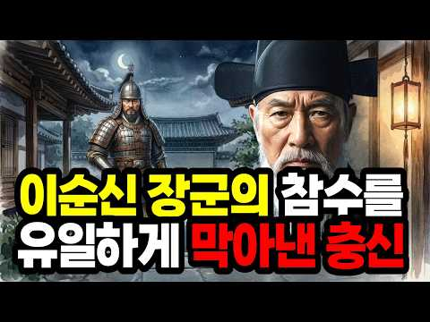
- 챕터: 0:00 영의정 여섯 번인데 돗자리를 짜던 노인 · 3:12 왕족의 피를 받고 태어났는데 끼니를 걱정한 소년 · 7:45 임진왜란과 평양 탈환 그리고 이순신을 만나다 · 12:30 왕 앞에서 이순신은 제일 훌륭하다고 말한 순간 · 16:20 대동법의 시작과 광해군에게 맞선 유배길 · 20:05 인조반정 광해군의 목숨을 구하고 다시 돗자리를 짜다 · 23:40 나는 백성 앞에 죄인이다 마지막 유언
- 설명 앞부분: 영의정을 여섯 번 지내고도 비 새는 두 칸 초가집에서 돗자리를 짜며 살았던 남자. 임진왜란을 수습하고, 이순신을 살렸고, 대동법의 씨앗을 뿌렸지만 죽는 순간까지 자기를 죄인이라 불렀습니다. 조선 오백년 최고의 청백리, 오리 이원익. 교과서에도 잘 나오지 않는 이 사람의 이야기를 처음부터 끝까지 따라갑니다. 조선왕조실록 선조실록 1596년 10월 5일 이원익 이순신 변호 기사 조선왕조실록 광해군일기 즉위년 1608년 5월 7일 경기선혜법 건의 기사 조선왕조실록 인조실록 1631년 1월 10일 강홍중 보고 기사 한국민족문화대백과사전 …
- 같은 채널 평소 대비 ×9.8 (채널 최근 롱폼 중앙값 20,562회) · 평소 영상: 조선 인구 절반이 '재산'이었던 소름 돋는 진실 ∣ 조선역사,조선시대 몰랐던 이야기,노비… (33,957회) / 사극에서 절대 안 보여주는 조선 평민의 밥상 ∣ 조선시대음식,조선평민,조선밥상,한국역사 (52,475회)
- 대본 없음 (설명) — 음성인식이 끝나면 도입부·흐름이 들어감
- 댓글 164/164: 좋은 점 — 영상 1 · 감사·응원 7 · 더 알고 싶은 것 0 · 아쉬운 점 — 영상 0 · 반박·불만 — 의견 다름 2 · 정치·사회 6 · 경험 공유 3 · 구독·다음 기대 0
  - 좋은 점 — 영상 👍3 “본받고 싶은 분이네요 좋은 영상 만들어 주셔서 감사합니다”
  - 감사·응원 👍9 “정탁과 권율 그리고 이원익같은 분들께 감사하는 저녁밤이네요.❤”
  - 감사·응원 👍3 “본받고 싶은 분이네요 좋은 영상 만들어 주셔서 감사합니다”
  - 반박·불만 — 의견 다름 👍4 “이분 뿐이 아닙니다 좌찬성으로 있던 약포 정탁대감이 선조임금을 강력히 설득하여 이순신장군이 참형을 먼하고 백의 종군”
  - 반박·불만 — 의견 다름 👍0 “이순신 헛소리마라”
  - 정치·사회 👍49 “우리 나라는 국회를 비롯해서 관료들 같은 모든 정치인들은 쓸데없는 관광용 해외연수 금지시키고 이런 내용들을 찾아서 의무적으로 자주 시청각 교육을 시켜서 정신개조를 하도록 해야 한다”
  - 정치·사회 👍1 “2:19 류승룡마저 등 돌릴때 정탁이 나서서 탄핵반대.”
  - 경험 공유 👍0 “저도 결과가 어찌됐든 내 지시를 잘 따르는 부하를 원합니다”
  - 경험 공유 👍0 “굿모닝 친구야 청산리 청산하고 벽계수야 수이감을 자랑마라 때끼야 계수야 내가 벽이다 몰라용 왜그랬어요 니가알겠지용 소인이 어찌 알겠어요”

### 197. 가장 성실했던 황제가 나라를 잃었다｜중국 최악의 황제 7인의 진짜 이야기

- https://www.youtube.com/watch?v=_QI5NRqUqlU · 아시아 숨은 역사 · 구독자 3,520 · 조회수 192,637 (×54.7, 하루 5,226.6) · 좋아요 335 (0.2%) · 53.6분 · 2026-09-17 · 주제 묶음 11. 황제·왕·인물 · 형식 정보·해설 (그 밖) · 폴더 `W__QI5NRqUqlU` (웹 승인)
- 썸네일: 
- 챕터: 0:00 1644년, 베이징이 불타던 새벽 · 3:46 이 채널을 함께 만들어 주시는 방법 · 4:11 최악이라는 말이 어려운 이유 · 5:49 진나라 호해 ― 생선 수레와 지록위마 · 16:44 수양제 양광 ― 대운하와 살수, 백만 대군의 끝 · 31:29 송휘종 ― 붓을 든 황제와 정강의 변 · 42:05 명 정덕제 ― 황제가 자리를 비우면 · 47:32 명 가정제 ― 신하를 이기고 국경을 잃다 · 54:29 명 만력제 ― 삼십 년의 침묵 · 60:54 명 숭정제 ― 가장 성실했던 마지막 황제 · 67:39 결론 ― 왜 아무도 그들을 멈추지 못했는가
- 설명 앞부분: 중국의 역사에는 이천 년 동안 수백 명의 황제가 있었습니다. 그중 몇 사람은 단 한 번의 판단으로 수백만 명의 운명을 바꿔 놓았습니다. 진나라 호해부터 명나라 숭정제까지, 왕조의 몰락과 가장 가까이 있었던 일곱 명의 황제를 기록에 남은 사실을 중심으로 따라갑니다. 술로 연못을 만들었다는 전설 대신, 몇 명이 동원되었고 무엇이 무너졌는지를 봅니다. 그리고 마지막에 이런 질문이 남습니다. 진짜 문제는 나쁜 황제가 나타났다는 사실이었을까요, 아니면 아무도 그를 멈출 수 없었다는 사실이었을까요. 참고한 기록 사기, 자치통감, 수서, 삼국…
- 같은 채널 평소 대비 ×89.1 (채널 최근 롱폼 중앙값 2,162회) · 평소 영상: 그는 왜 끝내 황제가 되지 않았을까 ∣ 간웅 조조, 66년의 기록 (2,358회) / 세계를 정복한 군대가 끝내 건너지 못한 강 ∣ 인도 5000년 역사 총정리 (1,967회)
- 대본 없음 (설명) — 음성인식이 끝나면 도입부·흐름이 들어감
- 댓글 27/27: 좋은 점 — 영상 1 · 감사·응원 1 · 더 알고 싶은 것 0 · 아쉬운 점 — 영상 0 · 반박·불만 — 의견 다름 0 · 정치·사회 4 · 경험 공유 0 · 구독·다음 기대 0
  - 감사·응원 👍0 “구독 좋아요 응원합니다 😊”
  - 정치·사회 👍3 “아무리 AI로 돌린다지만 역사영상에서 중국인 복장이 저게 맞나”
  - 정치·사회 👍0 “찢재명이란 역대 최악의 인물이 대통령이 된 이나라도 얼마나 갈지”

### 198. 우리가 알고있던 역사는 가짜다! 태조왕건은 영웅이 아닌 역사상 최악의 배신자였다? ∣ 역사다큐 ∣ 한국사 ∣ 태조왕건 ∣ 고구려 ∣ 조선왕조실록 ∣ 후삼국

- https://www.youtube.com/watch?v=B5_SPRpG_oA · 역사틀 · 구독자 2,490 · 조회수 134,918 (×54.2, 하루 955.6) · 좋아요 2,131 (1.6%) · 30.7분 · 2026-06-05 · 주제 묶음 3. 조선 · 형식 정보·해설 (그 밖) · 폴더 `W_B5_SPRpG_oA` (웹 승인)
- 썸네일: 
- 챕터: 0:00 애꾸눈 미치광이, 우리가 아는 궁예 · 1:30 궁예의 악행은 533년 뒤에 쓰였다 · 3:00 패자는 변명할 기회가 없다 — 강진의 비석 · 4:15 비석에 새겨진 두 글자 '대왕' · 6:00 거지가 아니라 버려진 신라 왕자였다 · 8:10 맨손으로 한반도 최강국을 세우다 · 10:20 미치광이는 나라를 세우지 못한다 · 11:40 관심법, 마음을 읽는다는 임금 · 13:30 왕건을 살린 최응의 붓 한 자루 · 16:00 부인과 두 아들을 죽인 진짜 이유 · 19:30 왕건을 가리킨 거울 속 예언 · 21:30 충신은 왜 끝까지 망설였나 · 22:50 보리 이삭 훔치다 맞아 죽은 임금? · 24:20 천 년의 침묵을 깬 돌, 선각대사비 · 26:10 학계가 두 쪽으로 갈라지다 — 대왕은 누구인가 · 28:30 그래서, 궁예는 누구였나
- 설명 앞부분: 천 년 동안 미치광이 폭군으로 기록된 궁예. 그런데 전남 강진의 한 비석에서 발견된 두 글자가 역사학계를 뒤집었습니다. 종이는 고쳐 써도 돌은 거짓말을 못 합니다. 우리가 교과서에서 배운 궁예와 왕건, 정말 전부 사실일까요? 승자의 붓끝에 가려진 진짜 얼굴을 지금 확인해 보세요. 본 영상의 제목, 썸네일, 대본, 영상 전체는 '역사틀' 채널의 자산으로 모든 형태의 2차 사용을 금지합니다. 📖 본 영상은 AI 기술을 활용해 제작되었으며, 역사적 사실을 바탕으로 한 정보 전달을 목적으로 합니다. 일부 해석과 비유는 이해를 돕기 위한 …
- 같은 채널 평소 대비 ×189.0 (채널 최근 롱폼 중앙값 714회) · 평소 영상: 교과서에도 없던 충격적 진실! 대부분이 몰랐던 단종 죽음의 진짜 진실!┃조선실록┃한국사┃… (854회) / 조선은 일본에게 똥까지 모두 뺏겼다 #역사이야기 #한국사 #역사다큐 #조선생활 #역사상식… (574회)
- 대본 없음 (설명) — 음성인식이 끝나면 도입부·흐름이 들어감
- 댓글 535/535: 좋은 점 — 영상 2 · 감사·응원 3 · 더 알고 싶은 것 2 · 아쉬운 점 — 영상 1 · 반박·불만 — 의견 다름 9 · 정치·사회 21 · 경험 공유 8 · 구독·다음 기대 1
  - 좋은 점 — 영상 👍1 “🌿🇰🇷🌿사마천 사기도 왜곡된 기록이 많습니다!👀 🔥2🌿?🔥 經典外는 액면 기록대로 믿는다는 건! 아니지요! 바른 사학자는 당시 정황도 분석해 봐야 합니다! 해설자 공론을 공감합니다! 🤔💦ㅡ칠순필부ㅡ”
  - 좋은 점 — 영상 👍0 “맞는 말씀입니다 처음은 형제의 맺어진것은 왕권으ㅏ 부친 왕륜개성 세력가이자 재산이 나라세우는데 기초로”
  - 감사·응원 👍2 “이런 영상이 바로 거짓역사인 것입니다. 역사는 승자의 것이라고요? 역사 수준이 초등학교 역사 수준 그 이상도 이하도 아니네요. 수많은 사람들의 눈과 귀는 그냥 밥먹는데만 썼는줄 아나보네요. 역사기록의 한계성과 그 너머의 것도 분명 있긴 하지만 그 한계성을 인정하고 공…”
  - 더 알고 싶은 것 👍10 “궁예의 몰락은 궁예 본인이 버림 받은 신라 왕자 출신 이라는 점이 크다고 봅니다. 패서 지역의 고구려 유민, 호족들 입장에서는 고구려를 계승한 새 나라의 왕이 버림 받은 신라 왕자 출신 이라는 것에 대한 거리감도 있었을 것 같습니다. 궁예가 수도를 송악에서 철원으로 …”
  - 더 알고 싶은 것 👍3 “역사를 보면 너무 옳은삶ㆍ강직한 사람들은 일찍 돌아가십니다ㆍ 현재나 과거나 기록은 산자들이 남기고 쓰여지기에~~ 타임머신이 있다면 그 시간속 이야기들을 바로 알고 싶네요ㆍ 드라마로 나올때 재미로만 보다가 점점ㆍ의아해지는 이야기들을 접하다보니ㆍ더욱 그렇습니다ㆍ”
  - 반박·불만 — 의견 다름 👍1 “역사를 100% 진실되게 알 순 없겠으나, 너무 지나친 비약이다. 물론 궁예가 예삿 인물이 아니었기에 초창기에는 후고구려를 건설했고 그만큼 사람들이 따랐을 것이다. 허나, 아무리 인물 출중하다고 하더라도 말기에는 타락했기에 주위사람들이 궁예를 떠났을 것이고, 왕건이라…”
  - 반박·불만 — 의견 다름 👍0 “삼국사기에 나오는 궁예가 세력을 일으킨 명주는 지금의 절강성에 있습니다. 강원도 강릉이라고 계속 학교에서는 가르치는데 근거 대보라고 역사학회에 질의하면 근거도 못대고 수십년째 그냥 그렇게 비정한다고 헛소리 하거나 아예 답이 없습니다. 그 당시 명주는 해상 실크로드의 …”
  - 정치·사회 👍20 “가장 배신자는 이조의 이성계 이성계는 고려때 귀화한 중국인이 최영 대장군 머함하고 한국의 역사사 정체성을 통째로 바꿨고 고려이전 문화 사회보다 퇴보시킨 왕조였다 종국에는 고종이 일본에다 돈받고 조선을 팔았다”
  - 정치·사회 👍3 “배신이 없이 나라가 세워지나?신라가 외세를 끌어들여 삼국을 통일하고 만주를 포함한 영토의 반을 당에 빼앗기고 다시는 만주를 회복하지 못했다.조선도 그렇고! 야비함이 지혜로움과 능력이 되고 배신이 강함과 생존력이 되는세상.작금의 세상은 뭐 다른가?”
  - 경험 공유 👍2 “왕건이 역적 쓰 ㄹ ㅐ기임. 이성계와 똑같이 역적 배신자들 특징이 지들이집권하면 지들에게 완전유리하게 역사조작하고 상대방은 어떻게든 온갓 조작된 모함으로뒤집어 씌워서 악마화함. 전세계 역사상 모든 베신자 역적들이 필수로 행하던 기본중에 기본인일을 바보같은 국민들이 드…”
  - 경험 공유 👍1 “역사는 승자의 붓으로 쓰여신건 맞지마 내가 아는 내용은 궁예가 처음에는 백성을 생각하는 훌륭한 왕이였다라는것 역사드라마 왕건에도 그러했고 누가 처음부터 나쁜왕을 따르겠나? 영상 내용은 그런 처음부터 나쁜 왕 뜻으로 사람들이 생각 했다는 뜻으로 만들었고 ... 사람이란…”
  - 구독·다음 기대 👍4 “구독합니다 잘 볼게요”

### 199. 조선 역사상 가장 아까운 천재 1위 I 당신이 생각하는 천재는 누구?

- https://www.youtube.com/watch?v=BZJ24uQ8qFQ · 역사잼잼 · 구독자 2,910 · 조회수 157,492 (×54.1, 하루 1,249.3) · 좋아요 1,919 (1.2%) · 32.4분 · 2026-06-20 · 주제 묶음 1. 역사 일반·이야기 · 형식 정보·해설 (그 밖) · 폴더 `W_BZJ24uQ8qFQ` (웹 승인)
- 썸네일: 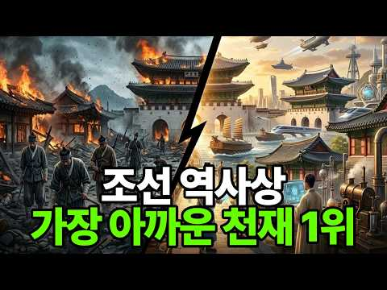
- 챕터: 0:00 인트로 — 만원권과 오천원권의 소름 돋는 비밀 · 1:30 10위 — 교과서 속 그 화가, 알고 보니 만능 천재 · 4:30 9위 — 조선 최초의 음향 공학자 · 7:00 8위 — 감히 하늘에 도전한 선비 · 9:30 7위 — 낮에는 영의정, 밤에는 천재 · 11:30 6위 — 탄핵 정국을 뚫고 살아남은 의성 · 14:30 5위 — 곤장 80대, 그리고 영원한 미스터리 · 18:00 4위 — 유배지에서 500권을 쓴 괴물 · 21:00 3위 — 9번 수석, 그가 남긴 예언 · 24:00 2위 — 승률 100%, 인류 해전사의 신화 · 27:30 1위 — 모든 천재 위에 군림한 단 한 사람 · 31:00 아웃트로 — 조선이 남긴 씁쓸한 일
- 설명 앞부분: 지갑 속 만원권과 오천원권의 주인공, 이순신 장군과 율곡 이이가 사실 19촌으로 같은 가문이었다는 사실, 알고 계셨나요? 조선 500년 역사 속에는 시대를 수백 년 앞서간 천재들이 있었습니다. 그러나 그들의 마지막은 너무나도 잔혹했습니다. 아들 학비조차 내지 못하고 사라진 조선 최고의 화가, 곤장 80대를 맞고 역사에서 증발한 과학자, 18년 유배지에서 500권의 책을 써낸 불굴의 학자까지... 조선이 위대한 이유는 이 천재들을 탄생시켰기 때문이고, 조선이 아쉬운 이유는 그 천재들을 끝까지 지키지 못했기 때문입니다. ⏱️ 타임라인…
- 같은 채널 평소 대비 ×132.2 (채널 최근 롱폼 중앙값 1,191회) · 평소 영상: 조선시대에 등잔불 켜고 책 읽으면 집안 망하는 이유 ∣ 조선시대 밤 (1,191회) / 세계를 정복한 몽골이 고려에서 28년을 낭비한 이유 (939회)
- 대본 없음 (설명) — 음성인식이 끝나면 도입부·흐름이 들어감
- 댓글 155/158: 좋은 점 — 영상 1 · 감사·응원 4 · 더 알고 싶은 것 4 · 아쉬운 점 — 영상 0 · 반박·불만 — 의견 다름 3 · 정치·사회 4 · 경험 공유 2 · 구독·다음 기대 0
  - 좋은 점 — 영상 👍1 “공자, 맹자만 외우던 성리학자들은 천재 리스트에서 빼야함. 민생에 1도 도움이 안되고, 오히려 해악만 끼친 자들이라는 생각.”
  - 감사·응원 👍4 “재미있게 잘봤습니다, 감사합니다”
  - 감사·응원 👍2 “덕분입니다 감사합니다”
  - 더 알고 싶은 것 👍2 “나랏말쌈이 중국에 달아. 에서 거의 대부분이 중국을 오늘날의 중국의 의미로 받아 들여 해설하는데 당시는 명나라이고 20세기에 와서야 중화인민공화국인데 ??? 이에대한 검토 부탁해요”
  - 더 알고 싶은 것 👍1 “조선 최고의 재상들을 올려주세요. 후대에 귀감이 되었으면 합니다.”
  - 반박·불만 — 의견 다름 👍5 “세종대왕 이도는 훌륭한 관리자입니다 훈민정음은 직접 창제한것이 아닙니다 이미 중 신미대사가 주관하여 세종대왕 발표전 8년전에 신미대사가 지은 불경이 발견되어있음 자료를 공부좀하세요 훌륭한 지도자 제세이화 홍익인간철학입니다”
  - 반박·불만 — 의견 다름 👍2 “한두놈이 아닌데 ㅋㅋ”
  - 정치·사회 👍15 “역사의 현실이 오늘날 부정선거와 판박이 참 아이러니 합니다 그놈의 기득권이 뭔지?”
  - 정치·사회 👍2 “어쪄면정말조선이라는 나라는처음부테세워져서는 않될나라였다우리5천년역사에많은나라가있었다 그러나조선많큼무능한 나라는없었다천5백년 전삼국시대에도고려시대까지모두황제국이었다 외세로침략을많이받았지만그래도잘막아내고나라 을굳건이지켔다그러나 무능한왕조로나라가침탈 당하고마지막에는일본의 …”
  - 경험 공유 👍5 “세종대왕보다위인 분은 군대고참입니다. 제가군대에서직접경험한얘기입니다. ㅋ”
  - 경험 공유 👍3 “최석정 선생은 생전 처음 듣는 이름입니다. 공학도인 제가 그분을 70대 중반이 되도록 알지 못했을까요?”

### 200. 사람을 밟아 죽이고 외딴섬으로 쫓겨났다, 조선 왕이 코끼리를 유배 보낸 사연

- https://www.youtube.com/watch?v=CdyTqgp82Fo · 역사한편 · 구독자 819 · 조회수 43,543 (×53.2, 하루 2,157.8) · 좋아요 96 (0.2%) · 17.6분 · 2026-10-04 · 주제 묶음 3. 조선 · 형식 사연·드라마 · 폴더 `W_CdyTqgp82Fo` (웹 승인)
- 썸네일: 
- 챕터: 0:00 코끼리는 왜 식탁에 없을까 · 0:43 일본이 보낸 낯선 선물 · 2:03 사람을 밟아 죽인 코끼리 · 2:46 처형 대신 섬 유배가 된 이유 · 4:11 초기 인류의 코끼리 해체 · 5:29 식용 가축이 될 수 없는 이유 · 6:43 세 고을이 나눈 사육 부담 · 9:55 인간과 함께 일한 동료 · 12:08 코끼리 마음을 본 과학 연구 · 15:34 코끼리 고기와 멸종 위기
- 설명 앞부분: 사람을 밟아 죽인 코끼리에게 조선 조정은 왜 죽음 대신 섬 유배를 내렸을까요. 600년 전 기록에는 일본의 외교 선물로 온 코끼리가 조선의 큰 부담이 되어 가는 과정이 담겨 있습니다. 먼 옛날 인류는 코끼리를 먹었는데, 오늘날 식탁에서 보기 어려운 이유는 무엇일까요. 조선의 기록과 현대 연구를 따라가며 이 거대한 동물을 바라보는 인간의 시선을 살펴봅니다.
- 같은 채널 평소 대비 ×25.8 (채널 최근 롱폼 중앙값 1,687회) · 평소 영상: 눈앞의 3톤짜리 사냥감을 포기하고 도망쳤다, 최강의 포식자 악어가 유독 하마만 피하는 이유 (1,687회) / 영하 40도 빙하기가 인간과 늑대를 묶었다, 혹한을 버텨낸 두 종족의 생존법 (1,365회)
- 대본 없음 (설명) — 음성인식이 끝나면 도입부·흐름이 들어감
- 댓글 20/34: 좋은 점 — 영상 0 · 감사·응원 0 · 더 알고 싶은 것 1 · 아쉬운 점 — 영상 0 · 반박·불만 — 의견 다름 1 · 정치·사회 0 · 경험 공유 0 · 구독·다음 기대 0
  - 더 알고 싶은 것 👍0 “맛이 궁금하네요..빙하기때 맘모스도 인간이 멸종시킨거란 가설도있던데..맛이 나쁘지 않은듯 한데..코끼리도 초식동물이기도하고..”
  - 반박·불만 — 의견 다름 👍1 “무슨 첨단 헛소리야? 사람이 코끼리를 왜 안 먹어?? 동남아에선 자주 먹는데~ 특히 태국에선 고깃집에서도 파는데. 아프리카에서도 코끼리사냥해서 잘 먹는데~! 아니 털코끼리였던 매머드가 없었다면 인류는 빙하기에 멸종해버렸을걸? 식량부족으로. 식량도 식량이지만, 덮고 잘…”

