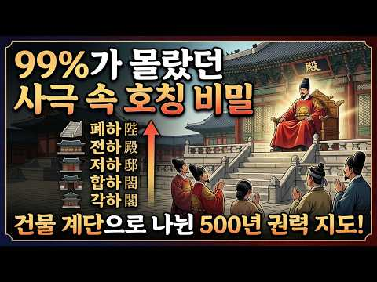
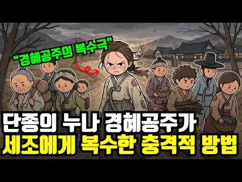
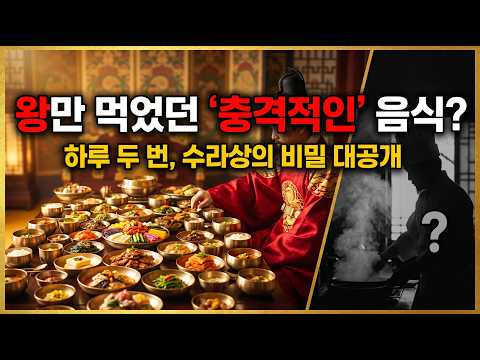
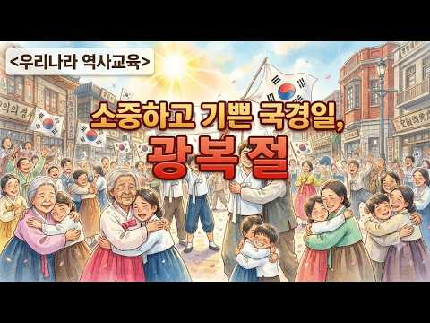
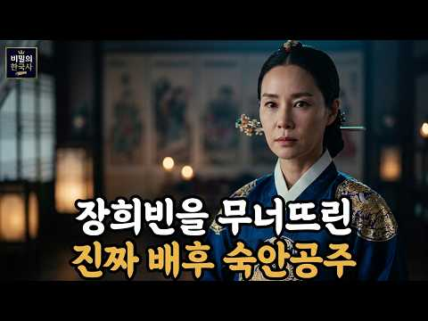
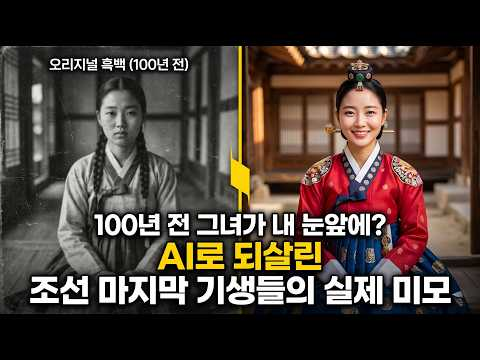
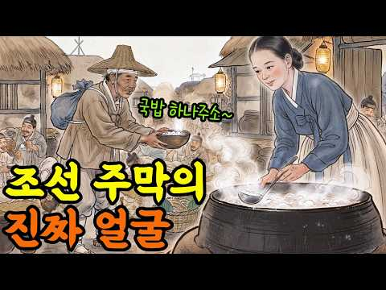
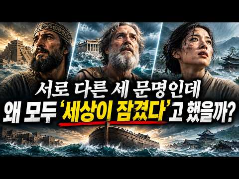
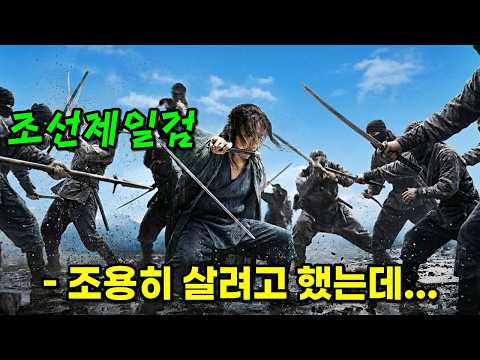

# 역사 — 성공 사례 분석: 사례별 자세히 #161–#200

`analysis.md` 의 9번 (같은 # 번호). 자동 생성 — `tools/success_analysis.py` v1.4.1 (2026-10-21 07:27 UTC). ※ 연구·교육용 — 투자 권유가 아님.

### 161. 인류 최초의 문명 수메르, 그들은 대체 어디서 왔을까? l 세계사 l 역사 l 메소포타미아

- https://www.youtube.com/watch?v=if6WN6ejRYo · 역사의 그림자  · 구독자 722 · 조회수 45,299 (×62.7, 하루 277.9) · 좋아요 610 (1.4%) · 16.7분 · 2026-05-11 · 주제 묶음 5. 세계사·서양사 · 형식 인터뷰·강연·대담 · 폴더 `W_if6WN6ejRYo` (웹 승인)
- 썸네일: 
- 설명 앞부분: 5000년 전, 티그리스강과 유프라테스강 사이에서 인류 최초의 도시 문명이 탄생했습니다. 그들은 최초의 문자, 최초의 법, 최초의 학교, 바퀴, 60진법을 만들었고, 오늘날 우리가 쓰는 시간 체계와 문명의 기초를 남겼습니다. 그 사람들을 우리는 수메르인이라고 부릅니다. 하지만 이상한 점이 있습니다. 수메르인들이 어디서 왔는지는 아직도 명확히 밝혀지지 않았습니다. 그들의 언어는 주변 민족과 달랐고, 그들이 남긴 쐐기 문자와 도시 문명은 이후 아카드, 바빌로니아, 메소포타미아 문명 전체에 거대한 영향을 남겼습니다. 이번 영상에서는 수…
- 같은 채널 평소 대비 ×30.0 (채널 최근 롱폼 중앙값 1,511회) · 평소 영상: 왜 사막 한가운데 거대한 왕국이 탄생했을까?｜사바 왕국｜시바의 여왕｜마립 댐｜고대문명 (1,511회) / 수메르를 연결한 숨겨진 중심은 누구였을까?｜옥수스 문명｜고대문명ㅣ메소포터미아 (1,709회)
- 대본 없음 (설명) — 음성인식이 끝나면 도입부·흐름이 들어감
- 댓글 44/44: 좋은 점 — 영상 1 · 감사·응원 0 · 더 알고 싶은 것 0 · 아쉬운 점 — 영상 1 · 반박·불만 — 의견 다름 0 · 정치·사회 0 · 경험 공유 1 · 구독·다음 기대 0
  - 좋은 점 — 영상 👍1 “유익합니다”
  - 아쉬운 점 — 영상 👍1 “AI 음성인가 문자를 문짜로 읽지 않고 글자대로 읽는데... 몇가지 어색함 빼면 흥미롭네요.”

### 162. 세계 3분의 1이 왼쪽으로 달리는 이유

- https://www.youtube.com/watch?v=QftIZGkR9MM · 세계사쇼 · 구독자 22,200 · 조회수 1,391,760 (×62.7, 하루 46,879.8) · 좋아요 2,632 (0.2%) · 18.3분 · 2026-09-21 · 주제 묶음 5. 세계사·서양사 · 형식 정보·해설 (그 밖) · 폴더 `W_QftIZGkR9MM` (웹 승인)
- 썸네일: 
- 챕터: 0:00 세계 3분의 1은 왼쪽으로 달린다 · 1:05 원래 기본값은 왼쪽, 칼과 말의 시대 · 2:30 미국의 대형 마차가 오른쪽을 만들다 · 4:05 나폴레옹 왼손잡이설과 프랑스 혁명의 진실 · 5:45 오스트리아와 체코슬로바키아, 점령군이 끝낸 전환 · 7:34 판을 굳힌 미국산 자동차, 일본이 왼쪽인 이유 · 9:30 스웨덴 다겐 H, 83% 반대를 뚫은 10분 · 11:42 사모아, 중고차 값 때문에 반대로 바꾸다 · 13:40 어느 쪽이 더 안전한가, 엇갈린 연구 · 15:48 왜 세계는 하나로 통일하지 않는가
- 설명 앞부분: 전 세계 75개 나라와 지역, 세계 인구의 3분의 1은 왼쪽 차선으로 달립니다. 원래 인류의 기본값은 오른손잡이가 칼을 왼쪽 허리에 찬 왼쪽 통행이었고, 미국의 대형 마차와 프랑스 혁명, 좌핸들 미국산 자동차가 유럽 대륙을 오른쪽으로 돌려세웠습니다. 영국은 바다 덕에, 일본은 영국이 놓아 준 철도 덕에 왼쪽에 남았고, 국민 83%가 반대한 스웨덴은 1967년 하룻밤에 우측통행으로 바꿨습니다. 타임라인:
- 같은 채널 평소 대비 ×285.5 (채널 최근 롱폼 중앙값 4,875회) · 평소 영상: 십자군 전쟁의 진짜 목적은 무엇이었을까? (4,875회) / 종교와 과학계에서는 신의 존재를 어떻게 증명할까? (4,993회)
- 대본 없음 (설명) — 음성인식이 끝나면 도입부·흐름이 들어감
- 댓글 437/437: 좋은 점 — 영상 12 · 감사·응원 9 · 더 알고 싶은 것 3 · 아쉬운 점 — 영상 3 · 반박·불만 — 의견 다름 9 · 정치·사회 17 · 경험 공유 12 · 구독·다음 기대 0
  - 좋은 점 — 영상 👍10 “너무 좋은 영상입니다. 내용이 좋으면 시간은 상관 없다는 것을 다시 느끼게 되었습니다. 감사합니다.”
  - 좋은 점 — 영상 👍4 “항상 궁금했던 건데 쉽게 설명해 주셨네요. 감사합니다.”
  - 감사·응원 👍10 “너무 좋은 영상입니다. 내용이 좋으면 시간은 상관 없다는 것을 다시 느끼게 되었습니다. 감사합니다.”
  - 감사·응원 👍7 “궁금했던 주제인데 감사해요”
  - 더 알고 싶은 것 👍0 “좋은 내용 잘 봤습니다. 혹시 시간 되시면 자동차 주유구 위치, 운전석 아니면 반대쪽도 한번 조사해서 알려 주세요😊”
  - 더 알고 싶은 것 👍0 “알고싶지않다 그렇게 돈벌어먹고 싶나 왼쪽으로 다니든 오른쪽으로 다니든 뭐가 그리 궁금한데”
  - 아쉬운 점 — 영상 👍0 “인구수가 1/5도 안되는데 어그로아님 100만뷰/20만 좋댓구 됫을듯”
  - 아쉬운 점 — 영상 👍0 “오른손 잡이인데 낚시 릴은 좌핸인데”
  - 반박·불만 — 의견 다름 👍4 “이건 진짜 말도 안되는 소리.ㅎㅎㅎㅎ 무슨 말을 왼쪽 오른쪽… 2분보다 어이가 없네요.. 왜.. 외각을 벽처럼 유도하시나요? 이해가 안되네..”
  - 반박·불만 — 의견 다름 👍2 “러시아 블라디보스톡에 가보니 러시아는 우측통행 나라인데, 승용차는 대부분 일본에서 들어온 중고차들이라 우핸들로 운행해서 다니고, 시내버스는 한국에서 수입한 중고 시내버스들이 대부분이라 좌핸들로 다니고 있었음. 나라는 부자인데 국민들은 가난해서 벌어지는 웃기는 상황이죠…”
  - 정치·사회 👍17 “솔직히 우측통행이든 좌측통행이든 중요하지는 않음 다만, 우리나라나 프랑스처럼 도로는 우측통행인데 철도는 좌측통행인 나라가 꽤 많다는게 그게 더 관건임 😂😂😂😂😂😂”
  - 정치·사회 👍4 “많은 나라가 우측통행을 하는 이유는 계단 때문임 오른손잡이가 90%인 세상에서 계단을 오르내릴때 오른손으로 계단 손잡이를 잡고 가는게 편함 그리고 그런규칙이 있어서 오르고 내리는 사람들의 길이 서로 맞부딪히지않음 이런 사회적통용 범용규칙들은 책을 읽는 방법인 좌에서 …”
  - 경험 공유 👍3 “우핸들 차량 소유자입니다 마차나 사무라이 칼따윈 그냥 웃자고 하는 스토리입니다 일본은 1868년 메이지 유신 하면서 나라 전체를 영국화한것이지 칼하곤 상관없답니다 일본이 사무라이와 꼭 연관시켜 주장을 고집하는 최대이유는, 좀 있어보이려고 미화하려고 하는것. 영국 따라…”
  - 경험 공유 👍0 “재미있는 역사네요, 잘 봤습니다. 감사합니다. 20년째 호주에 살고 있는데요 처음에 도로가 한국하고 반대라서 어떻게 운전할까 넘 무서웠는데 요즘은 가끔 한국에 가면 운전하다 헷갈려서 실수 할까봐 아예 운전을 안하죠”

### 163. 이순신이 원균의 죽음을 듣고 한 행동 ∣ 평생의 라이벌이 죽은 날 난중일기에 적은 단 한 줄, 칠천량 해전 이순신 원균 관계심리

- https://www.youtube.com/watch?v=vk4v5mv4VCk · 사라진도면 · 구독자 436 · 조회수 27,163 (×62.3, 하루 155.3) · 좋아요 782 (2.9%) · 17.4분 · 2026-04-29 · 주제 묶음 3. 조선 · 형식 정보·해설 (그 밖) · 폴더 `W_vk4v5mv4VCk` (웹 승인)
- 썸네일: 
- 설명 앞부분: 1597년 7월 18일 새벽, 합천 초계. 이순신은 평생 미워한 사람의 죽음 소식을 들었습니다. 그날 그가 난중일기에 적은 단 한 줄. 120번이나 비판했던 그 사람이 죽었을 때, 이순신은 무엇을 적었을까요. 역사책이 알려주지 않은 그 새벽의 진짜 이야기를 들려드립니다. [역사 속 손절 시리즈] 1편 - 공자도 손절했다 2편 - 제갈량은 손절을 못 했다 3편 - 퇴계 이황은 머리를 숙였다 4편 - 세종은 황희를 손절하지 않았다 5편 - 이순신이 원균의 죽음을 듣고 한 행동 ◀ 현재 영상 「난중일기」 정유년 7월 18일 「선조실록」…
- 같은 채널 평소 대비 ×396.5 (채널 최근 롱폼 중앙값 68회) · 평소 영상: 홍길동전 최초의 한글 소설이 아니었다? ∣ 허균 홍길동전 저자 최초의한글소설 김태준 택당… (70회) / 흥부가 가난했던 진짜 이유 ∣ 흥부전 조선 상속제도 균분상속 장자상속 조선후기 (67회)
- 대본 없음 (설명) — 음성인식이 끝나면 도입부·흐름이 들어감
- 댓글 284/284: 좋은 점 — 영상 2 · 감사·응원 1 · 더 알고 싶은 것 1 · 아쉬운 점 — 영상 2 · 반박·불만 — 의견 다름 3 · 정치·사회 7 · 경험 공유 5 · 구독·다음 기대 0
  - 좋은 점 — 영상 👍1 “좋은 해석 ^^ 좋은 영상 ^^”
  - 감사·응원 👍0 “선조가 과연무능 했을까? 선조의 인재 욕심이 과하다 싶을 정도로 이순신의 진급이 비상식적으로 빨라서 유성룡도 견제했을정도 라하는데 . 임란을 막지 못한 무능한군주로만 묘사 됩니다 당시 이순신은 지방에 막대한세력을 가진 군벌이었고 자치적으로 과거시험까지 가질정도로 힘이…”
  - 더 알고 싶은 것 👍4 “원균은 이순신보다 5살 위고, 군은 10년도 더 먼저 무과에 급제한 장군입니다. 원균은 육지 전에는 능했으나 해전은 전무한 사람입니다. 원균을 경상좌수사에 안친 사람도 유성룡입니다. 이순신도 유성룡이 안친 것이고, 이순신이 보기에 원균은 답답했을 것입니다. 답답해서 …”
  - 아쉬운 점 — 영상 👍1 “글도 몇개의 기록들을 억지로 짜깁기 한 느낌.”
  - 아쉬운 점 — 영상 👍0 “간단하게설명하시오서론이너무길어같은말만계속하니지겹네요”
  - 반박·불만 — 의견 다름 👍1 “정말 얼마나 서렵겠습니까? 원균의 죽음? 아닙니다. 자신의 필생의 노력으로 이룬 해군, 그리고 거기의 많은 부하들이 사라졌습니다 정말 나 역시 통곡할 겁니다. 원균은 살아서 그 잘못을 알고 피눈믈을 흘리게 해야 합니다”
  - 정치·사회 👍11 “이순신장군은 한반도에 사는 백성들에게는 메시아급인것이다. 어찌 저런 상황에서 저렇게 할 수가 있는 것일까? 평범한 사람들은 나라가 한심하고 나라 때문에 자신의 처지가 곤란하면 욕을하고 원망을 하는 법이다. 그러나 이순신 장군은 그 마음을 모두 덮어두고 나라를 구하고 …”
  - 정치·사회 👍3 “당시 원균은 2026년 오늘날 국민의힘 국회 나부랑이들과 윤석열 전광훈(제일사랑교회 교주) 전한길 등이라 보면되는게지”
  - 경험 공유 👍1 “며칠전에 나도 난중일기인 정유일기를 봤는데 원균이 보낸 조문을 보고쓴 원수는 미운원수가 아닌 도원수 권율을 지칭한거로 보는데요. 그러니까 원균이 스스로 조문의 글을 보낸게아니고 권율장군의 지시로 보낸거라고 나는 이해를 했는데요!”
  - 경험 공유 👍1 “이순신의 통곡은 만일 원균대신 본인이 그자리에 있었더라면 같은 일을 겪었으리라 생각하지 않았을까? 그래서 미안하고 안타까운 마음을 갖고 울지 않았을까?”

### 164. 세조의 오른팔 한명회 자식 다섯 전원 몰살된 진짜 이유 ∣ 한명회자식비극 ∣ 왕비두명만든남자

- https://www.youtube.com/watch?v=DcJMoVuG9Jw · 역사탐사실 · 구독자 18,600 · 조회수 1,142,659 (×61.4, 하루 8,024.9) · 좋아요 12,870 (1.1%) · 19.4분 · 2026-05-31 · 주제 묶음 11. 황제·왕·인물 · 형식 정보·해설 (그 밖) · 폴더 `W_DcJMoVuG9Jw` (웹 승인)
- 썸네일: 
- 설명 앞부분: 왕 3명을 만들고, 딸 2명을 왕비로 올린 남자 그런데 자식 5명 전부 비극으로 끝났습니다 ∣ 한명회의 저주 😱 조선 최고의 권력자 한명회. 왕을 세 명이나 세우고, 딸 둘을 왕비 자리에 올려놓은 남자. 그런데 그의 자식 다섯 명은 단 한 명도 온전히 살아남지 못했습니다. 셋째 딸 장순왕후 — 열일곱에 출산 후 사망 💔 넷째 딸 공혜왕후 — 열아홉에 자녀 없이 사망 💔 유일한 아들 한보 — 평생 아버지의 업보를 짊어지다 외손자 인성대군 — 세 살에 요절 손자 한경침 — 열일곱에 사망 ⚰️ 죽은 뒤 17년 만에 무덤이 파헤쳐진 남자…
- 같은 채널 평소 대비 ×536.2 (채널 최근 롱폼 중앙값 2,131회) · 평소 영상: 종기 하나로 죽었다고? 정조 죽음의 14일, 기록이 말해주는 진실 ∣ 정조이산마지막유언수… (2,131회) / 사랑이 아니라 광기였다? 인조와 조귀인 관계의 충격적 결말 ∣ 조귀인자작극저주사건 ∣ 조… (2,123회)
- 대본 없음 (설명) — 음성인식이 끝나면 도입부·흐름이 들어감
- 댓글 1,590/1,594: 좋은 점 — 영상 8 · 감사·응원 18 · 더 알고 싶은 것 10 · 아쉬운 점 — 영상 6 · 반박·불만 — 의견 다름 10 · 정치·사회 73 · 경험 공유 24 · 구독·다음 기대 0
  - 좋은 점 — 영상 👍2 “한명회 자식이.두명인줄 알았는데 5명이나 있었구나. 좋은 정보.감사합니다”
  - 좋은 점 — 영상 👍2 “대본이 잘 짜여있고 정말 생각을 많이하고 구성되어 있다는 걸 느꼈어요 좋은 영상 감사합니다 저는 개인적으로 두 딸이나 왕비로 기록되어있기도하고 살아있을때 온갖 부귀영화를 누린 한명회가 더 부럽네요...ㅎㅎ”
  - 감사·응원 👍3 “엄 흥도 이런분을역사가알듯요즘엔 엄흥도같은충신이 어디없을까? 한명희같은작자가정치를하고있는 세상훗날밝혀지겠지.~~글올려주시는분 항상감사드립니다.~~”
  - 감사·응원 👍2 “한명회 자식이.두명인줄 알았는데 5명이나 있었구나. 좋은 정보.감사합니다”
  - 더 알고 싶은 것 👍1 “제가 부탁이 있습니다 방장님께 예전부터 내가 나쁜 일을 하면 자손들한테 해가 된다는 말을 들었는데 그럼 역사적으로 파 보아도 정말 그럴까? 그게 참 궁금했거든요 그래서 대표적인 인물인 한명회 자손들 검색을 해봤는데 알 수 있는게 하나도 없었어요. 오늘 방장님 덕분에 …”
  - 더 알고 싶은 것 👍1 “8:48 전 그 이유를 알거 같네요 바로 단종의 저주 때문에 죽었죠 반면 적장자이지만 단종의 저주를 피한 왕이 숙종인데 어떻게 피했을까요?”
  - 아쉬운 점 — 영상 👍2 “AI 목소리가 아니라서 좋네요”
  - 아쉬운 점 — 영상 👍1 “영상이 쓸데 없이 너무 길어....12분이내로.....길어서 안보고 패스....”
  - 반박·불만 — 의견 다름 👍1 “몰살된 건 아니죠. 한명회는 부귀영화를 누리고 천수 했고. 아들도 장수했죠. 딸들이 건강하지 않았던게 문제지.”
  - 반박·불만 — 의견 다름 👍1 “영상에 의상 고증을 좀 하겼으면 합니다. 왕가가 아닌데 금박이라니요”
  - 정치·사회 👍7 “실력없는데 부정적인방법으로 권력찬탈하는 민주당 찢재명 똑같네”
  - 정치·사회 👍4 “업보와 죄는 자식한테 간다더만 ~~ 맞네 양심껏 잘살자 ~~그런데 지금의 정권의 희생양으로 죽은 억울한 다섯명의 억울한 죽음은 어쩌나 리짜이밍”
  - 경험 공유 👍53 “살아서는 부귀영화의 화신이었으나 아이들은 다 비극을 겪었고 그 자신의 시체는 갈갈이 찢겼다.”
  - 경험 공유 👍7 “오늘날을 살아가는 저희들에게도 큰 교훈이 됩니다 오늘날도 후대에 역사가 평가할 것입니다”

### 165. 조선왕조 518년 1대 태조부터 27대 순종까지 한번에ㅣ조선 역사ㅣ한국사

- https://www.youtube.com/watch?v=U8mDpoSE4DA · 하옥리책방 · 구독자 7,080 · 조회수 434,128 (×61.3, 하루 3,175.6) · 좋아요 5,153 (1.2%) · 27.9분 · 2026-06-06 · 주제 묶음 3. 조선 · 형식 정보·해설 (그 밖) · 폴더 `W_U8mDpoSE4DA` (웹 승인)
- 썸네일: 
- 설명 앞부분: 조선 1대 태조 이성계부터 27대 순종까지, 518년 동안 왕좌에 앉았던 스물일곱 명의 왕을 한 명도 빠짐없이 순서대로 정리했습니다. 각 왕의 대표 업적은 물론, 그 시대에 어떤 일이 벌어졌는지, 왕과 왕 사이에 어떤 연결고리가 있었는지까지 하나의 흐름으로 꿰었습니다. 위화도 회군으로 시작된 나라가 한일병합으로 끝나기까지, 27명의 선택이 만든 518년의 기록을 지금 확인하세요. 📚 다루는 왕 (순서) 태조 → 정종 → 태종 → 세종 → 문종 → 단종 → 세조 → 예종 → 성종 → 연산군 → 중종 → 인종 → 명종 → 선조 → 광…
- 대본 없음 (설명) — 음성인식이 끝나면 도입부·흐름이 들어감
- 댓글 134/134: 좋은 점 — 영상 5 · 감사·응원 10 · 더 알고 싶은 것 1 · 아쉬운 점 — 영상 0 · 반박·불만 — 의견 다름 1 · 정치·사회 3 · 경험 공유 0 · 구독·다음 기대 0
  - 좋은 점 — 영상 👍6 “75세 할머니가 늘 궁금했던 이조 역사에 이해하기 쉽게 해주세서 너무 감사합니다.노트에 메모하며 몇번을 듣고있읍니다 고맙습니다”
  - 좋은 점 — 영상 👍6 “영조 조선시대 왕의 계보가 정리된 영상 최고 입니다. 잘 봤습니다”
  - 감사·응원 👍6 “75세 할머니가 늘 궁금했던 이조 역사에 이해하기 쉽게 해주세서 너무 감사합니다.노트에 메모하며 몇번을 듣고있읍니다 고맙습니다”
  - 감사·응원 👍3 “구독과 좋아요로 응원합니다. 매우매우 아름다운 영상 👏 ✨️”
  - 더 알고 싶은 것 👍1 “19대 숙종에 대해 알고싶어요 여야당을 바껴가며 정치 판을 움직였다면 그 누구도 무서워하지않고 왕의자리였을꺼같은데 희빈을 왜 사약을줬는지...그아들은왕이되었을때 그 여파는없었는지..”
  - 반박·불만 — 의견 다름 👍3 “정확히 끌어내렸습니다 아니죠 12대 인종 한국 나이31세. 불과 8개월만에 병사”
  - 정치·사회 👍2 “우주통일 대통령 일론 머스크가 아닌 대한민국 통일임시정부 초대 통일대통령 김두기 시인 축전!!! 역사를 잃어버린 민족에게 미래는 없습니다!!! 일제치하 대한민국 임시정부가 민족의 역사적 정통성을 지켜 왔듯이 분단치하 민족의 역사적 정통성은 대한민국 통일임시정부가 지켜…”
  - 정치·사회 👍2 “1457년 17세 세조 이미지 헌법 문서 법전을 남인 한명회 자기손 최대 조선 6섯 운영 시스템 연산군 초기 뒤틀린 1405년 반전공신 개혁 소격서 좌절 제임 20년 문종 14년 선종 북쪽 이순신 바다 전세 뒤집어 초토화 세계대통령 선거 아멘 할렐루야 대한민국 감사합…”

### 166. 세종대왕이 2026년 응급실에 실려 왔더니 벌어진 일

- https://www.youtube.com/watch?v=B3nPKyxx39o · 로그북 · 구독자 379 · 조회수 23,041 (×60.8, 하루 1,720.3) · 좋아요 162 (0.7%) · 7.3분 · 2026-10-07 · 주제 묶음 3. 조선 · 형식 정보·해설 (그 밖) · 폴더 `W_B3nPKyxx39o` (웹 승인)
- 썸네일: 
- 챕터: 0:00 1444년 집현전, 전하가 쓰러지다 · 0:12 2026년 응급실에서 눈을 뜨다 · 0:52 여기선 제가 왕이에요 · 1:16 옆 침대의 청년 · 1:29 첫 번째 탈출 · 1:55 두 번째 탈출과 돌잔치 · 2:08 나랏말싸미… 정체가 들키다 · 2:26 해 뜨기 전까지의 거래 · 3:05 새벽 검사 · 4:03 세 번째 탈출 · 4:28 비상계단 · 4:50 훈맹정음 · 5:32 하루 만 보 · 5:50 누가 쓴 글이냐 · 6:10 다시 1444년, 최만리 상소 · 6:32 걸으면서 하는 경연 · 6:55 오늘은 일찍 자야겠다
- 설명 앞부분: 1444년, 한글을 만들던 세종대왕이 집현전에서 쓰러졌다. 눈을 떠 보니 2026년 대학병원 응급실. 해 뜨기 전에 돌아가 최만리의 상소를 막아야 하는데, 의사는 놓아주지 않는다. ※ 가상 이야기입니다. 인물의 대사와 장면은 창작이며 AI로 제작했습니다. ※ 실제 역사와 다른 부분이 있을 수 있습니다. ※ 훈맹정음은 1926년 박두성 선생이 만든 한글 점자입니다.
- 대본 없음 (설명) — 음성인식이 끝나면 도입부·흐름이 들어감
- 댓글 13/13: 좋은 점 — 영상 0 · 감사·응원 1 · 더 알고 싶은 것 0 · 아쉬운 점 — 영상 0 · 반박·불만 — 의견 다름 0 · 정치·사회 1 · 경험 공유 1 · 구독·다음 기대 0
  - 감사·응원 👍2 “지혜가 있는 영상 감사요^^”
  - 정치·사회 👍4 “세종대왕께서 영조만큼 오래 사셨다면 조선이 훨씬 살기 좋은 나라가 됐을 것이고, 수양 대군이 단종을 죽이지 못했을 것이고, 문종의 핏줄이 이어졌을 것이다.”
  - 경험 공유 👍6 “영실아! 내가 꿈에서 뭘 좀 많이 봤는데-”

### 167. 당신을 놀라게 할 희귀하고 놀라운 역사적 사진 모음!

- https://www.youtube.com/watch?v=fUvbh_dyakA · 사진으로 보는 역사 · 구독자 3,510 · 조회수 212,746 (×60.6, 하루 22,748.4) · 좋아요 2,010 (0.9%) · 31.9분 · 2026-10-11 · 주제 묶음 1. 역사 일반·이야기 · 형식 정보·해설 (그 밖) · 폴더 `W_fUvbh_dyakA` (웹 승인)
- 썸네일: 
- 설명 앞부분: 시청해 주셔서 감사합니다. 📜 사진으로 보는 역사**는 한 장의 사진 속에 담긴 시대의 흔적과 사람들의 이야기를 통해 과거를 새롭게 발견하는 역사 다큐멘터리 채널입니다. 모든 영상은 역사 자료 조사, 사실관계 검증, 세심한 기록물 분석 및 신중한 디지털 복원 작업을 바탕으로 제작됩니다. 역사 사진과 원본 문서, 각종 기록 자료를 면밀히 조사하여 가능한 한 정확하게 촬영 장소와 연도, 역사적 사건, 그리고 시대를 살아간 인물들을 밝혀내고자 합니다. 시간의 흐름 속에서 희미해진 사진의 세부적인 흔적은 디지털 복원 기술을 통해 조심스럽…
- 대본 없음 (설명) — 음성인식이 끝나면 도입부·흐름이 들어감
- 댓글 14/14: 좋은 점 — 영상 1 · 감사·응원 1 · 더 알고 싶은 것 2 · 아쉬운 점 — 영상 2 · 반박·불만 — 의견 다름 0 · 정치·사회 0 · 경험 공유 0 · 구독·다음 기대 0
  - 좋은 점 — 영상 👍2 “열심히 일하시고 귀한 영상 올려주셔서 감사합니다. 자주 찾아올께요. 건강하시고 더 좋은 영상 기다릴께요.❤🎉”
  - 감사·응원 👍2 “열심히 일하시고 귀한 영상 올려주셔서 감사합니다. 자주 찾아올께요. 건강하시고 더 좋은 영상 기다릴께요.❤🎉”
  - 더 알고 싶은 것 👍22 “썸네일 사진은 어디에 있나요?”
  - 더 알고 싶은 것 👍10 “썸네일 사진이 궁금해서 끝까지 봤다. 내 두 번 다시 네놈의 동영상을 보지 않을 것이다. 엄지 거꾸로 콱 찍고 간다.”
  - 아쉬운 점 — 영상 👍0 “썸네일 사진은 낚시였다. 손모가지 꺼꾸로 한방.”
  - 아쉬운 점 — 영상 👍0 “썸네일 낚시영상 ㄱHㅈ같네....”

### 168. 진시황릉을 파는 순간, 중국은 큰일 난다? 절대 발굴 금지 이유 3가지 #진시황 #진시황릉 #병마용

- https://www.youtube.com/watch?v=1UUDO7-0e6E · 역사로 힐링 · 구독자 217 · 조회수 13,149 (×60.6, 하루 119.6) · 좋아요 188 (1.4%) · 18.6분 · 2026-07-03 · 주제 묶음 6. 동양사 (중국·일본·몽골) · 형식 정보·해설 (그 밖) · 폴더 `W_1UUDO7-0e6E` (웹 승인)
- 썸네일: 
- 설명 앞부분: 중국을 최초로 통일한 진시황. 하지만 그의 무덤은 2200년이 넘도록 단 한 번도 개봉되지 않았습니다. 중국은 세계 최고 수준의 토목기술과 우주기술, 원격 탐사 기술을 보유하고 있는데도 왜 진시황릉만큼은 발굴하지 못하는 걸까요? 이번 영상에서는 병마용과 진짜 진시황릉의 차이 사마천이 기록한 '수은의 강'은 사실일까? 실제로 검출된 고농도 수은의 진실 중국 정부가 밝히는 공식적인 발굴 불가 이유 병마용의 화려한 색이 사라진 이유 70만 인부와 수천 궁녀의 생매장 기록 그리고 중국이 아직 공개하지 않는 또 다른 가능성까지 역사 기록과…
- 대본 없음 (설명) — 음성인식이 끝나면 도입부·흐름이 들어감
- 댓글 71/71: 좋은 점 — 영상 1 · 감사·응원 0 · 더 알고 싶은 것 3 · 아쉬운 점 — 영상 0 · 반박·불만 — 의견 다름 2 · 정치·사회 1 · 경험 공유 0 · 구독·다음 기대 1
  - 더 알고 싶은 것 👍1 “궁금하네요 뭐가있을지”
  - 더 알고 싶은 것 👍0 “제 댓글이 블라인드 처리되었는데 이유를 알려주실수 있나요?”
  - 정치·사회 👍5 “서역에서 중원대륙으로 건너온 아리안 계통의 민족들이 중원의 일부를 정복하고 중원 최초의 봉건제 국가인 주나라를 세웠죠,,, 당시 농경생활이나 하던 강한 성조억양의 언어를 사용하던 남방계 황인종이자 중화한족의 원조인 화하족들은 봉건제가 뭔지도 몰랐고 ,,,, 아리안계통…”
  - 구독·다음 기대 👍5 “지나 가다 홀린 듯이 들어와서 끝까지 다 봤네요. 영상 편집 감각이 진짜 좋으세요! 다음 영상도 기대됩니다. 구독 누르고 가요!”

### 169. [𝙋𝙡𝙖𝙮𝙡𝙞𝙨𝙩] 세종대왕이 경복궁에서 야근하며 듣던 가야금 재즈

- https://www.youtube.com/watch?v=q3oC3zdfyw4 · 조선재즈 · 구독자 9,970 · 조회수 597,471 (×59.9, 하루 4,561.8) · 좋아요 22,374 (3.7%) · 180.7분 · 2026-06-12 · 주제 묶음 2. 한국 고대·삼국·고려 · 형식 정보·해설 (그 밖) · 폴더 `W_q3oC3zdfyw4` (웹 승인)
- 썸네일: 
- 설명 앞부분: 세종대왕도 야근은 힘들었을 겁니다. 경복궁 깊은 밤, 촛불 아래 가야금이 흐릅니다. 조선의 밤과 재즈가 만났습니다:)
- 같은 채널 평소 대비 ×116.0 (채널 최근 롱폼 중앙값 5,151회) · 평소 영상: [𝙋𝙡𝙖𝙮𝙡𝙞𝙨𝙩] 세종대왕이 코딩하며 들었던 가야금 재즈 (5,151회) / [𝙋𝙡𝙖𝙮𝙡𝙞𝙨𝙩] 퇴근 궁녀 (퇴사할게여) ∣ 느좋 조선 가야금 재즈 (5,282회)
- 대본 없음 (설명) — 음성인식이 끝나면 도입부·흐름이 들어감
- 댓글 469/472: 좋은 점 — 영상 2 · 감사·응원 8 · 더 알고 싶은 것 6 · 아쉬운 점 — 영상 2 · 반박·불만 — 의견 다름 4 · 정치·사회 1 · 경험 공유 10 · 구독·다음 기대 5
  - 좋은 점 — 영상 👍0 “생활안복 자주 입는데, 한복입고 어디 놀러갈때 듣기 좋아요. 굿뜨 뭐랄까 혼자 마패를 들고 암행어사 하러 가는 기분이랑 연모하는 사내 담벼락에 훔쳐보러 가는 기분”
  - 좋은 점 — 영상 👍0 “너무좋아요 나도만들고싶네요 많이배우고갑니다❤❤❤❤❤❤❤”
  - 감사·응원 👍5 “와.... 가야금 너무 좋아하는데 이런 귀한 플리를 올려주시다니 감사합니다....”
  - 감사·응원 👍4 “오 좋아요... 제작 감사함당 잘 들을게요”
  - 더 알고 싶은 것 👍3 “구독 좋아요 알림설정합니다. 한국의 미를 잃지 않는 퓨전음악 많이 부탁드립니다. 덕분에 출근길이 즐거워요.”
  - 더 알고 싶은 것 👍1 “집현전 학자들 편도 부탁합니다. 엄지척!”
  - 아쉬운 점 — 영상 👍7 “ㅋㅋㅋㅋㅋㅋㅋ 고얀 AI 같으니라고”
  - 아쉬운 점 — 영상 👍3 “구간반복해서 들을 수 있게 해주세요”
  - 반박·불만 — 의견 다름 👍4 “와 재즈 좋아하는데 가야금과 재즈가 이렇게 잘 어울리다니. 가야금의 선율이 그루비해서 깜짝 놀랐습니다. AI 작곡이란데서 한번 더 놀람.. 말도안됨 😂”
  - 반박·불만 — 의견 다름 👍1 “절대음감이라 AI 음악이 맞으실 수도ㅋㅋㅋ 근데 저렇게 누워 계실 분이 아닌데 두 눈 부릅 뜨고 계셔야 하지 않을까요?”
  - 정치·사회 👍0 “전하 .. 요즘 나라가 말이 아닙니다 이걸 어찌해야 된답니까 ...”
  - 경험 공유 👍9 “클래식 공부를 어릴때 부터 하면서 재즈도 같이 조금 했었는데 살면서 들은 재즈 중에 제일 좋습니다….”
  - 경험 공유 👍3 “세종대왕도 야근하는데 내가 뭐라고”
  - 구독·다음 기대 👍3 “구독 좋아요 알림설정합니다. 한국의 미를 잃지 않는 퓨전음악 많이 부탁드립니다. 덕분에 출근길이 즐거워요.”
  - 구독·다음 기대 👍1 “가능하구나 재즈라는 것이!!!! 감탄하고 구독하고 갑니다~!”

### 170. 한명회도 탄핵한 조선 천재 간신, 아들 넷을 직접 도살대에 올린 아버지 ∣ 갑자사화 ∣ 무오사화 ∣ 조선왕조실록

- https://www.youtube.com/watch?v=8A-zm5k03_A · 역사보고서 · 구독자 3,620 · 조회수 216,423 (×59.8, 하루 1,586.8) · 좋아요 3,503 (1.6%) · 28.9분 · 2026-06-06 · 주제 묶음 3. 조선 · 형식 정보·해설 (그 밖) · 폴더 `W_8A-zm5k03_A` (웹 승인)
- 썸네일: 
- 설명 앞부분: 조선 500년 역사상 가장 끔찍한 비극의 주인공, 혹은 가장 잔인한 아버지라 불리는 남자 '임사홍'. 첫째는 31세에 요절, 둘째는 32세에 능지처사, 셋째는 기록 말살, 넷째는 30세에 맞아 죽기까지... 자식 네 명을 모두 비극적인 죽음으로 몰고 간 아버지가 있습니다. 놀랍게도 그의 직업은 지금의 국방부 장관인 '병조판서'였습니다. 군사권까지 쥔 권력자가 왜 자기 자식들을 살리지 않고 방관했을까요? 심지어 둘째 아들이 처형당하던 날, 집에서 풍악을 울리며 연회를 즐겼다는 소름 돋는 기록까지 존재합니다. 27세에 최연소 승지에 …
- 같은 채널 평소 대비 ×221.1 (채널 최근 롱폼 중앙값 979회) · 평소 영상: 송시열을 모르면 조선 역사를 논하지마라, 왕 4명도 꺾지 못한 선비 ∣ 예송논쟁 ∣ 노론… (1,093회) / 단종의 눈물에 속았다? 조선을 구한 진짜 영웅 ∣ 조선시대 ∣ 한국사 ∣ 계유정난 (865회)
- 대본 없음 (설명) — 음성인식이 끝나면 도입부·흐름이 들어감
- 댓글 451/451: 좋은 점 — 영상 3 · 감사·응원 9 · 더 알고 싶은 것 1 · 아쉬운 점 — 영상 2 · 반박·불만 — 의견 다름 6 · 정치·사회 6 · 경험 공유 9 · 구독·다음 기대 1
  - 좋은 점 — 영상 👍4 “제가 유투브에서 본 영상 중 정말 정말 최고 중의 최고라고 생각했습니다 ~ 가장 이슈?되는 인물인데다... 그의 생애... 정말 많이 많이 배웠습니다. 감사합니다. 승승장구 하시기를 축복기원 드립니다 ~ 이런거 보면, 부처님께서 말씀하시는 업... 이라는게 진짜 있을…”
  - 좋은 점 — 영상 👍3 “부패하기 쉬운 인간의 본질에 대해 깊이 생각테 한 좋은 영상이네요”
  - 감사·응원 👍21 “저도 그 처지로부터 자유롭지 못한다에 100%입니다. 시간은 환경(인간)을 변화시키지 않을까요? 선택의 여지없는 기구한 안생사... 저에게도 많은 숙제를 남기는 영상이군요. 감사드립니다 ^^*”
  - 감사·응원 👍17 “역사를 알기쉽게 설명해 주셔서 감사합니다”
  - 더 알고 싶은 것 👍2 “와..이 영상 하나로 수창 뚫겠네..부럽습니다. 구독했어요. 혹시 노출클릭률 몇나오시나요?”
  - 아쉬운 점 — 영상 👍35 “임사홍이 언뜻 기억은 났는데 이런 내용은 몰랐네요. 이야기가 지루하지 않고 술술 귀에 흘러들어오네요.”
  - 아쉬운 점 — 영상 👍0 “첫 11분에 나가요. 별 정보가 없이 엿가락 늘이긴가요? 지루해요”
  - 반박·불만 — 의견 다름 👍12 “인성 양심 다버린 지혜없고 악한꾀만가득한 인간 ㆍ천재? 글쎄요”
  - 반박·불만 — 의견 다름 👍0 “흥청망청 역사는 이긴자의 기술 이것저것 가만해서 들어야지 사극은 드라마 시청률 때문에 극적은 대결구도와 선악이 분명해야 인기가 높지 복잡한 관계보다는 그래서 지금도 백성들은 쉽게 선동 당한다”
  - 정치·사회 👍2 “조선역사는 중종반정 인조반정후 권력을 잡은 서인 송시열의 후예 노론의 승자의 전리품같은 기록일뿐이다. 그들은 일본에 나라를 팔아먹은 세력이된다. 결국 그들도 자기와 자기세력의 이익과 안위를 위해 삶을 소비한 소인들일뿐임을 스스로 증명했음이다. 서인 노론에 패배한 훈구…”
  - 정치·사회 👍1 “수고하십니다.종교혁명가 입니다. 민주당 황 @ 회 역사 학자 you tube 께서 지금 선관위 의 부정부패 선거법 과 관련된 정치인들을 수사.조사 해서 재산몰수 해야 합니다. 박 근혜 대통 령 비서 .김종 * 이. 조선시대 에 임 사홍 아들의 스승 정치 를 종교적으로…”
  - 경험 공유 👍29 “자기권력 지키려고. 아들하나 버렸구나 어떻게 잡은 자리인데.. 내가 당해본 일이 아니면 함부로 말 할수 없다.”
  - 경험 공유 👍21 “저도 그 처지로부터 자유롭지 못한다에 100%입니다. 시간은 환경(인간)을 변화시키지 않을까요? 선택의 여지없는 기구한 안생사... 저에게도 많은 숙제를 남기는 영상이군요. 감사드립니다 ^^*”
  - 구독·다음 기대 👍2 “와..이 영상 하나로 수창 뚫겠네..부럽습니다. 구독했어요. 혹시 노출클릭률 몇나오시나요?”

### 171. 천하를 통일한 유방, 모든 걸 이긴 뒤에 진짜 공포가 시작됐다 ∣ 초한전쟁 그 후의 이야기

- https://www.youtube.com/watch?v=9LJDKInAPkg · 역사의실마리 · 구독자 1,530 · 조회수 91,431 (×59.8, 하루 1,033.9) · 좋아요 690 (0.8%) · 22.9분 · 2026-07-24 · 주제 묶음 7. 전쟁·군사사 · 형식 인터뷰·강연·대담 · 폴더 `W_9LJDKInAPkg` (웹 승인)
- 썸네일: 
- 챕터: 0:00 다 가진 황제가 밤마다 떨었던 이유 · 0:25 시골 건달, 맨손으로 황제가 되다 · 0:46 진시황의 몰락과 5년 전쟁의 승자 · 1:50 첫 번째 용의자 항우, 홍문연의 칼춤 · 4:54 두 번째 용의자 범증, 말로 벤 머리 · 6:57 천하를 삼켰지만 삼키지 못한 아이러니 · 7:41 세 번째 용의자 한신과 정형 전투의 기적 · 10:04 명장은 왜 황제의 표적이 되었나 · 12:34 한신은 정말 반역했을까 · 13:51 네 번째·다섯 번째 용의자, 팽월과 경포 · 17:29 끝까지 살아남은 단 한 사람 · 20:37 그가 진짜로 두려워했던 것
- 설명 앞부분: 천하를 통일한 황제 유방. 최강의 적 항우를 꺾고 5년 전쟁을 끝낸 그는, 왜 밤마다 잠들지 못하고 식은땀에 떨어야 했을까요? 이 영상은 초한전쟁의 승자 유방이 황제가 된 뒤에 시작된 '진짜 공포'를 추적합니다. 항우, 범증, 한신, 팽월, 경포. 유방을 위협했던 다섯 인물을 하나씩 따라가다 보면, 그가 정말로 두려워한 것의 정체가 서서히 드러납니다. 명장 한신의 정형 전투와 배수진, 홍문연의 칼춤, 토사구팽의 유래, 그리고 유일하게 살아남은 책사 장량의 선택까지. 2천 년 전 이야기지만, 오늘날 우리의 삶과도 놀랍도록 닮아 있는…
- 같은 채널 평소 대비 ×263.5 (채널 최근 롱폼 중앙값 347회) · 평소 영상: 세종대왕 국장의 진실｜조선은 왜 임금을 다섯 달이나 묻지 않았을까? (355회) / 칭기즈칸의 생애와 정복 전략 ∣ 역사상 가장 넓은 제국의 비밀 (339회)
- 대본 없음 (설명) — 음성인식이 끝나면 도입부·흐름이 들어감
- 댓글 49/49: 좋은 점 — 영상 1 · 감사·응원 0 · 더 알고 싶은 것 0 · 아쉬운 점 — 영상 0 · 반박·불만 — 의견 다름 0 · 정치·사회 3 · 경험 공유 1 · 구독·다음 기대 0
  - 좋은 점 — 영상 👍1 “명쾌합니다❤❤❤”
  - 정치·사회 👍1 “중국인들 특징은 통일후 다죽인다 진시황보다 더 토사구팽을 충실하게 해낸자 백만대군이 죽어도 위령비조차 안세우는 중국인”
  - 정치·사회 👍0 “이재명은 힘들게 잡은 권력을 순순히 놓을까요”

### 172. 《중국 역사》 고대 중국, 남자 첩이 여자 첩보다 더 비극적이었던 이유는? l 역사 인물 l 고전

- https://www.youtube.com/watch?v=jcUvSMjefq8 ·  역사 산책: 동양편 · 구독자 2,770 · 조회수 164,122 (×59.2, 하루 2,080.3) · 좋아요 653 (0.4%) · 23.4분 · 2026-08-03 · 주제 묶음 1. 역사 일반·이야기 · 형식 정보·해설 (그 밖) · 폴더 `W_jcUvSMjefq8` (웹 승인)
- 썸네일: 
- 같은 채널 평소 대비 ×25.5 (채널 최근 롱폼 중앙값 6,426회) · 평소 영상: 《삼국지》 유비는 왜 동문 공손찬의 등에 칼을 꽂았을까? l 역사 인물 l 고전 (7,251회) / 《삼국지》 조조의 손자 조예, 위나라를 파멸로 몰았던 이유는? l 역사 인물 l 고전 (5,600회)
- 대본 없음 (없음) — 음성인식이 끝나면 도입부·흐름이 들어감
- 댓글 87/87: 좋은 점 — 영상 1 · 감사·응원 1 · 더 알고 싶은 것 2 · 아쉬운 점 — 영상 0 · 반박·불만 — 의견 다름 1 · 정치·사회 2 · 경험 공유 2 · 구독·다음 기대 0
  - 좋은 점 — 영상 👍6 “좋은 영상 재미있게 보고 갑니다♡”
  - 감사·응원 👍1 “감사합니다 🎉🎉🎉”
  - 더 알고 싶은 것 👍8 “세상에나 그 당시에도 동성애가 성했네요. 에고... 글자 화면 뒤에 끊임없이 움직이는 동영상은 안 올리면 안되나요? 집중력도 떨어지고, 어지럽고 정신 사나워요.”
  - 더 알고 싶은 것 👍2 “인간이 이렇게 잔인합니다 그들은 얼마나 고통스러웠을까요?”
  - 정치·사회 👍0 “오늘날에도 중국에서 저런일이 벌어지고 있지 않나? 위멍롱 사건. 735사건 등.. 아마 중국 연예인들이나 일반 사람들 인신매매 장기척출 인육 등..중국은 천벌 받아야 한다.중국은 자기들 죄로 반드시 쪼개져 역사속에서 다시는 하나의 나라가 되지 못할거다.”
  - 경험 공유 👍0 “내가 30년전 알던 어느 광고전문 감독에게 들었는데 그당시 연예계에서 스타가된 남자배우치고 앙드레 김에게 항문을 바치지 않고는 스타가되기가 하늘에 별따기라고 했다..노예계약의 협박용으로 강제로 강요당한 성관계 테이프도 한편식 다 완성해놔야 했다고 했다..그게.. 30…”

### 173. 🔥우연히 얻은 신비한 상자, 그 안에 진짜 명나라가 존재했다. 손가락 한 번에 산적 몰살!#男频 #爽文

- https://www.youtube.com/watch?v=UZ5O6Ny3-sQ · 천하극장 · 구독자 7,980 · 조회수 463,672 (×58.1, 하루 8,615.1) · 좋아요 3,038 (0.7%) · 135.2분 · 2026-08-28 · 주제 묶음 6. 동양사 (중국·일본·몽골) · 형식 사연·드라마 · 폴더 `W_UZ5O6Ny3-sQ` (웹 승인)
- 썸네일: 
- 설명 앞부분: 🔥 매일 업로드되는 초고속 황궁 복수극 복수의 왕좌 배신당한 왕자, 몰락한 장군, 숨겨진 후계자. 권력과 복수, 그리고 인생 역전의 순간을 담은 고대 남성 드라마 채널입니다. 황궁 암투 사이다 전개 지금 가장 중독성 강한 쇼츠 드라마 채널.
- 같은 채널 평소 대비 ×66.7 (채널 최근 롱폼 중앙값 6,956회) · 평소 영상: 🔥모든 사람에게 무시당한 식당 알바생! 그의 진짜 정체는 세상 최고의 의술을 가진 전설적… (7,175회) / 🔥처가에 얹혀살던 사위가 신장을 잔혹하게 탈취당한 채 절벽 아래로 내던져지지만, 복수의 … (6,736회)
- 대본 없음 (설명) — 음성인식이 끝나면 도입부·흐름이 들어감
- 댓글 523/543: 좋은 점 — 영상 0 · 감사·응원 4 · 더 알고 싶은 것 11 · 아쉬운 점 — 영상 5 · 반박·불만 — 의견 다름 1 · 정치·사회 6 · 경험 공유 12 · 구독·다음 기대 3
  - 감사·응원 👍20 “한글로 해주셔서 감사해요! 생각없이 클릭했는데 넘 재미있네~”
  - 감사·응원 👍4 “영상 잘보네요 감사합니다 ❤❤❤”
  - 더 알고 싶은 것 👍24 “이거 재미 있네요, 그래서 후편 완결은 어떻게 보나요?”
  - 더 알고 싶은 것 👍3 “시즌2 부탁해요”
  - 아쉬운 점 — 영상 👍8 “이어서 없어? 아니 내가 이걸 다보고 있네ㅋㅋㅋㅋㅋㅋ 미쳐ㅋㅋㅋㅋ 진짜 어눌한 더빙에 짜집기 같아서 잠깐보려던겤ㅋㅋㅋㅋㅋㅋㅋㅋㅋ😅”
  - 아쉬운 점 — 영상 👍1 “목욕 하는거 안보여줘서 철판 먹으라는 생각 ㅋㅋㅋ 존나 골때리네 ㅋㅋ Ai같은데 하나인가 뭔가 잘만들었네”
  - 반박·불만 — 의견 다름 👍1 “미치겠네 첨엔 병맛 같은 느낌이라 중국영상이 다 그렇지 하고있었는데 계속보네 ㅋㅋㅋㅋㅋㅋㅋㅋㅋ 어이없는데 웃기면서 재밌기도하네 ㅋㅋㅋㅋ”
  - 정치·사회 👍18 “상자 속의 대명나라》(내 방에 대명나라가 있다 / 箱子里的大明朝) 라고 하는데 더는 검색이 안나오네요.. 2부 올려주세요!! 제발”
  - 정치·사회 👍1 “이 비슷한 내용을 미국영화에서 본거 같은데... 참 중국인들은 한결 같네.. 창작보다 훔쳐서 베낀다.”
  - 경험 공유 👍8 “이어서 없어? 아니 내가 이걸 다보고 있네ㅋㅋㅋㅋㅋㅋ 미쳐ㅋㅋㅋㅋ 진짜 어눌한 더빙에 짜집기 같아서 잠깐보려던겤ㅋㅋㅋㅋㅋㅋㅋㅋㅋ😅”
  - 경험 공유 👍4 “누가감히 나서는지보자. 누가너에게 감히그런용가를줬나.내가바로용왕이다.ㅋㅋㅋㅋㅋ 아 😂😂😂”
  - 구독·다음 기대 👍4 “겁나게 재미나네. 다음편 기대합니다”
  - 구독·다음 기대 👍2 “은근히 재미있네요 다봤네요😊 다음편 기다려 지네요😊”

### 174. 사극 볼 때 99%가 모르는 사실! ∣ '폐하, 전하, 저하, 합하, 각하'... 호칭에 숨겨진 계급의 진짜 의미

- https://www.youtube.com/watch?v=vrkKEeX65wQ · 역사탐정대 · 구독자 1,110 · 조회수 63,654 (×57.4, 하루 356.1) · 좋아요 563 (0.9%) · 16.9분 · 2026-04-25 · 주제 묶음 3. 조선 · 형식 정보·해설 (그 밖) · 폴더 `W_vrkKEeX65wQ` (웹 승인)
- 썸네일: 
- 설명 앞부분: "주상 전하 납시오~!" 우리가 사극을 볼 때 가장 많이 듣는 대사 중 하나죠. 그런데 혹시 궁금한 적 없으셨나요? 가장 높은 왕을 부르는데 왜 하필 '아래 하(下)' 자를 쓰는 걸까요? 그리고 황제에게는 '폐하', 왕세자에게는 '저하', 대원군에게는 '합하', 고위 관리에게는 '각하'라고 부르는 이유는 도대체 무엇일까요? 이 다섯 가지 호칭(폐하, 전하, 저하, 합하, 각하)은 단순한 높임말이 아닙니다. 이 호칭의 앞 글자(폐, 전, 저, 합, 각)들은 모두 '건물의 종류와 등급'을 뜻합니다. 즉, 내가 상대방을 '어떤 건물(계…
- 같은 채널 평소 대비 ×397.8 (채널 최근 롱폼 중앙값 160회) · 평소 영상: "과인은 사도세자의 아들이다"... 정조가 '수원화성'을 지은 진짜 이유 (160회) / [한국사] 고려사에 기록된 '인간 병기'... 100명으로 2만 대군을 무너뜨린 '척준경' (159회)
- 대본 없음 (설명) — 음성인식이 끝나면 도입부·흐름이 들어감
- 댓글 130/130: 좋은 점 — 영상 0 · 감사·응원 3 · 더 알고 싶은 것 0 · 아쉬운 점 — 영상 0 · 반박·불만 — 의견 다름 2 · 정치·사회 16 · 경험 공유 0 · 구독·다음 기대 0
  - 감사·응원 👍2 “조선시대 안태어나서 부처님 석가모니 하나님 예수님 감사해요!ㅎ”
  - 반박·불만 — 의견 다름 👍0 “ㅎㅎ 웃기는 소리입니다. 우리 고유어에는 임금이라는 용어가 있지요. 中共中国 무지렁이의 사고에 맞춰 생각할 필요없습니다. 우리 朝鲜国은 이런 망상에 몰입될까 저어하여 묘호 太祖 太宗 그리고 殿下 앞에 主上 또는 聖上을 붙여서 서쪽나라와는 또 다른 국가임을 나타내려 한…”
  - 정치·사회 👍4 “1897년..그때부터 황제처럼 호칭을 바꾼 이유인 즉슨.. 청일전쟁에서 중국=청나라가 패하자 당시 동아시아판도상 더이상 종이호랑이 청에 메달리지말자는 현실주의.. 현타가 와서 황제국으로 독립을 표했다는”
  - 정치·사회 👍3 “우리나라 대통령, 국무총리 등에게도 각하란 호칭으로 불렀었는데 너무 권위적 이라면서 선생님처럼 님자를 붙여서 대통령님이라고 부르라고 한게 15대 김대중 전대통령 부터임.”

### 175. 이순신이 원수 자격을 의심했던 조선군 총사령관?!

- https://www.youtube.com/watch?v=-f0CsdR5eJE · 몰래 듣는 조선의 비밀 · 구독자 1,220 · 조회수 69,578 (×57.0, 하루 1,213.2) · 좋아요 348 (0.5%) · 18.7분 · 2026-08-24 · 주제 묶음 3. 조선 · 형식 정보·해설 (그 밖) · 폴더 `W_-f0CsdR5eJE` (웹 승인)
- 썸네일: 
- 챕터: 0:00 두 달을 걸어온 사내 · 1:24 인사와 오늘의 여섯 장면 · 1:49 같은 해, 같은 사람이 천거한 두 이름 · 3:49 도원수라는 직책 · 6:06 이순신이 일기에 적은 문장 · 8:33 요시라의 반간계와 파직 · 10:57 백의종군 길의 끝 · 13:05 곤장 사흘 뒤 · 16:03 전기수의 한 줄
- 설명 앞부분: 1597년 사월 초사흘, 한 사내가 한양 의금부 문을 나섭니다. 며칠 전까지 그 안에서 문초를 받던 사람입니다. 살아 나온 것만으로도 주변이 놀랐습니다. 그는 남쪽으로 걷기 시작합니다. 관복도 벼슬도 없이, 죄인의 몸으로 삼백사십 킬로미터를 걷습니다. 떠난 지 열흘쯤 됐을 때 어머니의 부고가 옵니다. 상복도 갖추지 못한 채 그는 다시 남쪽으로 걷습니다. 두 달 뒤인 유월 초나흘, 사내는 경상도 합천 초계에 닿습니다. 조선의 모든 군대가 여기서 명령을 받는 곳, 도원수부입니다. 이 사내가 이순신입니다. 그런데 그가 도착한 진영의 주…
- 같은 채널 평소 대비 ×201.7 (채널 최근 롱폼 중앙값 345회) · 평소 영상: 7년간 전쟁을 이끈 남자가 쫓겨나서 쓴 반성문 16권 [조선인물 탐구생활] (357회) / 조선 최강이라 불린 장수, 적이 아니라 임금의 매에 죽으며 비운의 장수로 남다. [조선 … (333회)
- 대본 없음 (설명) — 음성인식이 끝나면 도입부·흐름이 들어감
- 댓글 30/30: 좋은 점 — 영상 1 · 감사·응원 1 · 더 알고 싶은 것 0 · 아쉬운 점 — 영상 0 · 반박·불만 — 의견 다름 0 · 정치·사회 1 · 경험 공유 0 · 구독·다음 기대 0
  - 좋은 점 — 영상 👍1 “이순신과 권율 관계에 대해서 새롭게 알게되었습니다. 매번 유익한 역사 정보 주셔서 감사합니다!”
  - 감사·응원 👍1 “이순신과 권율 관계에 대해서 새롭게 알게되었습니다. 매번 유익한 역사 정보 주셔서 감사합니다!”
  - 정치·사회 👍4 “이순신, 권율 등의 승리도 두 사람이 다른 무력하고 전략전술 부족한 다른 장수들보다 뛰어나서이기도 하지만 세종,문종 대에 전세계적에서 최고수준으로 만들어놓은 신기전을 위시한 총통기, 화차 등의 우수한 무기기술이 있었음을 여전히 문사양반선비 기득권이 이어가는 이 나라가…”

### 176. 조선시대 사람들이 30살에 이가 다 빠져버린 소름돋는 이유는? ∣ 조선역사 ∣ 한국사 ∣ 조선왕조실록 ∣

- https://www.youtube.com/watch?v=5vBTGmcYA5w · 시대를 훔친 이야기 · 구독자 3,250 · 조회수 184,790 (×56.9, 하루 1,350.3) · 좋아요 2,469 (1.3%) · 18.4분 · 2026-06-06 · 주제 묶음 3. 조선 · 형식 정보·해설 (그 밖) · 폴더 `W_5vBTGmcYA5w` (웹 승인)
- 썸네일: 
- 챕터: 0:00 👑 영조의 한숨 "양치할 때마다 한숨이 나온다" · 1:00 ⚰️ 조선 충치율 단 1~5%의 충격 · 1:36 🌿 '양치질' 어원과 버드나무 가지의 비밀 · 3:40 🎎 신분별 양치 도구 (왕실·양반·평민·빈민) · 5:46 🍚 진짜 범인은 '매일 먹던 밥'이었다 · 7:21 💎 에나멜질도 못 이긴 모래의 위력 · 8:09 🔥 풍치(風齒)의 정체, 현대의 치주염 · 9:19 👑 임금 영조는 왜 같은 시기에 무너졌을까 · 10:42 📖 동의보감 속 충격의 치통 처방 · 12:00 🔨 대장간 집게로 이를 뽑던 조선의 치과 · 13:18 🤔 21세기 우리는 정말 이기고 있을까? · 15:15 🍰 우리의 적은 '너무 부드러운 음식' · 16:21 🧠 조선은 몰라서 졌고, 우리는 알면서도 진다 · 17:11 🪞 오늘 밤 거울 앞에서 30초만…
- 설명 앞부분: 🦷 조선시대 사람들은 왜 서른만 넘으면 이가 다 빠졌을까요? 조선에서 가장 오래 산 왕, 영조. 여든셋까지 살았던 그가 서른일곱에 이미 잇몸이 무너지고 있었습니다. 😱 어의가 매일 진맥하고, 치아 전담 여의까지 있었던 임금. 말린 벚꽃잎과 소금으로 만든 왕실 전용 양치 가루까지 썼던 그 사람의 입 속이, 왜 그렇게 빨리 무너졌을까요? 🔍 이 영상에서 다루는 이야기 ✅ 조선시대 충치율이 단 1~5%였던 충격적인 진실 ✅ 충치도 없는데 이가 다 빠진 진짜 이유 ✅ '양치질'이라는 단어의 어원, 버드나무 가지의 비밀 🌿 ✅ 왕실 · 양…
- 같은 채널 평소 대비 ×314.8 (채널 최근 롱폼 중앙값 587회) · 평소 영상: 조선왕조실록에 "이것"까지 낱낱히 적었다? 왕들이 끝까지 감추고 싶었던 비밀 TOP3 (587회) / 왜? 추석의 송편을 먹는 걸까? 송편의 충격진실ㅣ송편유래ㅣ추석역사 (591회)
- 대본 없음 (설명) — 음성인식이 끝나면 도입부·흐름이 들어감
- 댓글 522/522: 좋은 점 — 영상 2 · 감사·응원 5 · 더 알고 싶은 것 3 · 아쉬운 점 — 영상 4 · 반박·불만 — 의견 다름 12 · 정치·사회 1 · 경험 공유 25 · 구독·다음 기대 0
  - 좋은 점 — 영상 👍2 “지인이 알려준 꿀팁 아침에 일어나서 수돗물 말고 정수물 한컵에 아무기름(식용유.들.참기름.올리브)이나 한두방울 떨어뜨려 젖가락으로 저은다음 가글해 보세요 저도 실천하고 입냄새 잇몸튼튼 놀라운 효과 보고 있어요 돈드는것도 아니고 조금만 부지런하면 잇몸염증 충치균에 좋아…”
  - 감사·응원 👍19 “이 시대에 대한민국에 태어난거에 감사하다”
  - 감사·응원 👍2 “의미있는 흥미로운 정보 감사히 잘 봤습니다. ^^”
  - 더 알고 싶은 것 👍4 “46세.. 살아온 동안 양치 4일에 한번만 해온 저로서 1년전 치아 2개 소실, 잇몸 말랑말랑하다 못해 어금니가 뒤틀렸다 바로 돌아올 정도로 안좋아 치과가니 노인보다 안좋아하며 모든 치아가 흔들린다 벼랑 끝이이시다.라고 하여 먹고나면 꼭 음파칫솔 쓰고 했더니 아주 건…”
  - 더 알고 싶은 것 👍2 “돌가루 때문에 잇몸병이 생겼다는건 납득이 안갑니다. 저도 어렸을때 벼를 절구에 갈아 먹고는 했는데 모래를 씹어 이가 상했던 기억은 없어요. 조리로 잘 행구면 가끔 돌이 들어가는 경우는 있어도 모래가 항시 씹는 느낌은 없었습니다. 근본적인 것은 영양 부족으로 치아 자체…”
  - 아쉬운 점 — 영상 👍2 “너무 영상을 길게 만들어서 참고 끝까지 보기가 힘듭니다. 이런 영상은 너무 길면 역효과 납니다.”
  - 아쉬운 점 — 영상 👍1 “광고가 넘 많다”
  - 반박·불만 — 의견 다름 👍8 “조선시대에 밥에 모래가 있다는것에 동의 안합니다. 쌀을 씻을때 조리로 돌을 걸러서 밥을 지었는데 말이 안됩니다.”
  - 반박·불만 — 의견 다름 👍4 “46세.. 살아온 동안 양치 4일에 한번만 해온 저로서 1년전 치아 2개 소실, 잇몸 말랑말랑하다 못해 어금니가 뒤틀렸다 바로 돌아올 정도로 안좋아 치과가니 노인보다 안좋아하며 모든 치아가 흔들린다 벼랑 끝이이시다.라고 하여 먹고나면 꼭 음파칫솔 쓰고 했더니 아주 건…”
  - 정치·사회 👍6 “쌀을 주식으로 하는 나라가 한두 개도 아니고 도정기술이 마찬기지로 안 좋았던 옛날에 모두들 서른 전후로 이가 다 빠지기 시작햇단 말임??”
  - 경험 공유 👍11 “내가 늘 말하길 사람답게 산 건 얼마 안 되었다고 혔지 내가 어렸을 때만 해도 밥 억다 돌을 씹을 때가 자주 있었지 여기선 조선이라는건 그 시대를 말하는 거지 전 세계가 다 그랬지”
  - 경험 공유 👍3 “저희 모친은 60이신데 치과에서 치료받은이가 단하나도 없어요 양치를 자기전에 한번만 하시고 소금물로 가글을 하십니다”

### 177. 국립현충원에서 가장 좋은 자리, 그 무덤의 주인은 조선의 궁녀였다

- https://www.youtube.com/watch?v=UAw390nt3vQ · 시간책방 · 구독자 8,520 · 조회수 481,736 (×56.5, 하루 11,361.0) · 좋아요 1,954 (0.4%) · 40.1분 · 2026-09-08 · 주제 묶음 3. 조선 · 형식 정보·해설 (그 밖) · 폴더 `W_UAw390nt3vQ` (웹 승인)
- 썸네일: 
- 챕터: 0:00 현충원 안의 이상한 무덤 · 2:55 아홉 살에 궁으로 들어간 아이 · 5:15 궁녀라는 직업의 실체 · 8:50 아내를 이레 만에 내보낸 임금 · 13:35 승은, 그리고 더 위험해진 자리 · 16:50 경빈 박씨는 왜 죽었는가 · 18:55 왕이 죽고 궁을 나오다 · 28:00 18년 뒤, 손자가 왕이 되다 · 34:55 무덤이 먼저였다 · 37:00 조선 후기 340년의 시작점
- 설명 앞부분: 서울 동작구 국립서울현충원. 나라를 위해 목숨을 바친 분들이 잠든 그 언덕 한가운데에, 조선시대 무덤 하나가 남아 있습니다. 🌲 주인은 조선 11대 임금 중종의 후궁, 창빈 안씨입니다. 왕족도 아니었고 명문가의 딸도 아니었습니다. 가난한 집에서 태어나 아홉 살에 궁으로 들어간 어린 궁녀였습니다. 받은 것은 여럿이 나눠 쓰던 방 한 칸, 그리고 다달이 나오는 쌀 몇 말이었죠. 그 아이의 후손이 선조부터 순종까지 조선의 임금 열네 명입니다. 조선 500년 중 후반부 340년이 이 한 사람의 핏줄에서 나왔습니다. 🏯 이 영상에서는 조선…
- 같은 채널 평소 대비 ×310.4 (채널 최근 롱폼 중앙값 1,552회) · 평소 영상: 조선 왕들은 왜 46세에 죽었나? 경복궁 흙이 밝힌 충격적 진실 (1,633회) / 세조는 왜 친동생 안평대군을 죽였나? 조선 최고의 천재가 사라진 진짜 이유 (1,471회)
- 대본 없음 (설명) — 음성인식이 끝나면 도입부·흐름이 들어감
- 댓글 63/68: 좋은 점 — 영상 2 · 감사·응원 3 · 더 알고 싶은 것 0 · 아쉬운 점 — 영상 1 · 반박·불만 — 의견 다름 1 · 정치·사회 2 · 경험 공유 1 · 구독·다음 기대 0
  - 좋은 점 — 영상 👍5 “너무 소상히 알려주셔서 감사합니다.조선실록에 관심이 있었으나 안빈창씨라는것 후궁이었고 양주에서 이장해 동작동에모셨고훗날국립묘지에 최고의명당이고 후손들중14분이왕이되였다는설이 전부였답니다.유익한 정보 대단히 감사합니다. 의자리라는것”
  - 좋은 점 — 영상 👍2 “참좋은 정보 감사합니다 조용히 있는것 힘들것요 그동안 고생하셨습니다 편안하게 숴세요 담에 가면 인사드릴 고싶어요 ㅎ”
  - 감사·응원 👍5 “너무 소상히 알려주셔서 감사합니다.조선실록에 관심이 있었으나 안빈창씨라는것 후궁이었고 양주에서 이장해 동작동에모셨고훗날국립묘지에 최고의명당이고 후손들중14분이왕이되였다는설이 전부였답니다.유익한 정보 대단히 감사합니다. 의자리라는것”
  - 감사·응원 👍2 “참좋은 정보 감사합니다 조용히 있는것 힘들것요 그동안 고생하셨습니다 편안하게 숴세요 담에 가면 인사드릴 고싶어요 ㅎ”
  - 아쉬운 점 — 영상 👍3 “내용은 좋은 데 필요없는 말이 중복중복 지루하다”
  - 정치·사회 👍0 “대통령 묘소가 있는곶에 누구는 저자리엄두도 내지말야야지 무신말인지 알것주”
  - 정치·사회 👍0 “월래 주인빼고 6.25 참전용사 빼고 다른 사람이 모셔졌다면 옴겨야 한다 전직 대통령 이라 해도”
  - 경험 공유 👍1 “내가 조선의 궁녀다!”

### 178. 교과서에서 통째로 삭제된 조선 천재들-왜 이걸 안 가르쳐줬을까?

- https://www.youtube.com/watch?v=esb1CTy8ggc · 한번은 알아야 할 역사 · 구독자 4,360 · 조회수 242,970 (×55.7, 하루 1,488.0) · 좋아요 3,433 (1.4%) · 29.6분 · 2026-05-11 · 주제 묶음 3. 조선 · 형식 정보·해설 (그 밖) · 폴더 `W_esb1CTy8ggc` (웹 승인)
- 썸네일: 
- 설명 앞부분: 조선왕조실록 4,965만 자. 매일 읽어도 135년이 걸리는 기록인데, 이 안에서 흔적도 없이 증발해버린 사람들이 있습니다. 🔸 노비 출신으로 자동 물시계를 만든 장영실은 가마 하나가 부서진 뒤 실록에서 완전히 사라졌고, 🔸 30년간 왕의 숨을 지킨 의녀 장금은 왕이 죽자마자 기록째 증발했습니다. 🔸 전우치는 백성들 사이에서 수백 년간 전설로 살아남았는데 실록에는 이름조차 없고, 🔸 일본에서 금은보화를 받으며 거장 대접을 받던 화가 최북은 조선에선 "거기 쟤"였습니다. 🔸 5천 권을 읽고 나라의 지식을 정리한 이덕무는 왕에게 광대…
- 같은 채널 평소 대비 ×556.0 (채널 최근 롱폼 중앙값 437회) · 평소 영상: 조선 왕은 단명했는데 '이것' 없는 자들만 109세 장수한 충격적인 진실 (437회) / 1974년 광복절 육영수 여사 피격, 경호실장 박종규는 왜 엿새 만에 물러났나 (453회)
- 대본 없음 (설명) — 음성인식이 끝나면 도입부·흐름이 들어감
- 댓글 260/260: 좋은 점 — 영상 0 · 감사·응원 3 · 더 알고 싶은 것 1 · 아쉬운 점 — 영상 2 · 반박·불만 — 의견 다름 4 · 정치·사회 17 · 경험 공유 1 · 구독·다음 기대 0
  - 감사·응원 👍4 “대박...감사합니다.”
  - 감사·응원 👍2 “애청합니다❤❤❤❤❤즐겁게 감사합니다”
  - 아쉬운 점 — 영상 👍12 “정조 정말 실망이다 어떻게 사람을 그리 가지고 놀았나. 뒤죽박죽 너가 그런놈이구나 진정 소인베는 너로구나”
  - 아쉬운 점 — 영상 👍0 “한참 예전부터 나온내용들 짜집기 해놨네... 본인이 해석한듯...”
  - 반박·불만 — 의견 다름 👍10 “세종 때 지은 고려사의 참조 문헌(고려시대 문서)이 없다는 건 고려사 내용 자체를 신뢰하기 어렵게 만든다. 그 많은 고려시대 참조 문헌이 하나도 없을 수가 있나? 삼국사기 삼국유사 원본이 있는 것으로 사람들은 착각한다. 고려시대 삼국을 기록한 문서도 없고 조선시대 만…”
  - 반박·불만 — 의견 다름 👍5 “절대 코딱지만한 반도 스케일이 아닌데 대중의 눈높이에 맞추려면 ㅎ 내가 볼 때 역사를 대하는 대중의 눈높이는 유생 수준임 ㅋ”
  - 정치·사회 👍65 “기득권놈들은아무것도못하는주제에질투발작질은이나라가.발전할수없는이유다”
  - 정치·사회 👍62 “정치인들은 국회의원도 100명으로 보수없는 명예직으로 선출한다면 천재들이 실력을 발휘할것이다.”
  - 경험 공유 👍5 “절대 코딱지만한 반도 스케일이 아닌데 대중의 눈높이에 맞추려면 ㅎ 내가 볼 때 역사를 대하는 대중의 눈높이는 유생 수준임 ㅋ”

### 179. 이순신 장군을 죽음에서 구한 단 한 명의 충신 ∣ 조선 청백리, 오리 이원익

- https://www.youtube.com/watch?v=uqbaeQokoCI · 초설야담 · 구독자 3,690 · 조회수 202,351 (×54.8, 하루 1,939.9) · 좋아요 1,743 (0.9%) · 26.9분 · 2026-07-09 · 주제 묶음 3. 조선 · 형식 야담·옛날이야기 · 폴더 `W_uqbaeQokoCI` (웹 승인)
- 썸네일: 
- 챕터: 0:00 영의정 여섯 번인데 돗자리를 짜던 노인 · 3:12 왕족의 피를 받고 태어났는데 끼니를 걱정한 소년 · 7:45 임진왜란과 평양 탈환 그리고 이순신을 만나다 · 12:30 왕 앞에서 이순신은 제일 훌륭하다고 말한 순간 · 16:20 대동법의 시작과 광해군에게 맞선 유배길 · 20:05 인조반정 광해군의 목숨을 구하고 다시 돗자리를 짜다 · 23:40 나는 백성 앞에 죄인이다 마지막 유언
- 설명 앞부분: 영의정을 여섯 번 지내고도 비 새는 두 칸 초가집에서 돗자리를 짜며 살았던 남자. 임진왜란을 수습하고, 이순신을 살렸고, 대동법의 씨앗을 뿌렸지만 죽는 순간까지 자기를 죄인이라 불렀습니다. 조선 오백년 최고의 청백리, 오리 이원익. 교과서에도 잘 나오지 않는 이 사람의 이야기를 처음부터 끝까지 따라갑니다. 조선왕조실록 선조실록 1596년 10월 5일 이원익 이순신 변호 기사 조선왕조실록 광해군일기 즉위년 1608년 5월 7일 경기선혜법 건의 기사 조선왕조실록 인조실록 1631년 1월 10일 강홍중 보고 기사 한국민족문화대백과사전 …
- 같은 채널 평소 대비 ×9.8 (채널 최근 롱폼 중앙값 20,562회) · 평소 영상: 조선 인구 절반이 '재산'이었던 소름 돋는 진실 ∣ 조선역사,조선시대 몰랐던 이야기,노비… (33,957회) / 사극에서 절대 안 보여주는 조선 평민의 밥상 ∣ 조선시대음식,조선평민,조선밥상,한국역사 (52,475회)
- 대본 없음 (설명) — 음성인식이 끝나면 도입부·흐름이 들어감
- 댓글 164/164: 좋은 점 — 영상 1 · 감사·응원 7 · 더 알고 싶은 것 0 · 아쉬운 점 — 영상 0 · 반박·불만 — 의견 다름 2 · 정치·사회 6 · 경험 공유 3 · 구독·다음 기대 0
  - 좋은 점 — 영상 👍3 “본받고 싶은 분이네요 좋은 영상 만들어 주셔서 감사합니다”
  - 감사·응원 👍9 “정탁과 권율 그리고 이원익같은 분들께 감사하는 저녁밤이네요.❤”
  - 감사·응원 👍3 “본받고 싶은 분이네요 좋은 영상 만들어 주셔서 감사합니다”
  - 반박·불만 — 의견 다름 👍4 “이분 뿐이 아닙니다 좌찬성으로 있던 약포 정탁대감이 선조임금을 강력히 설득하여 이순신장군이 참형을 먼하고 백의 종군”
  - 반박·불만 — 의견 다름 👍0 “이순신 헛소리마라”
  - 정치·사회 👍49 “우리 나라는 국회를 비롯해서 관료들 같은 모든 정치인들은 쓸데없는 관광용 해외연수 금지시키고 이런 내용들을 찾아서 의무적으로 자주 시청각 교육을 시켜서 정신개조를 하도록 해야 한다”
  - 정치·사회 👍1 “2:19 류승룡마저 등 돌릴때 정탁이 나서서 탄핵반대.”
  - 경험 공유 👍0 “저도 결과가 어찌됐든 내 지시를 잘 따르는 부하를 원합니다”
  - 경험 공유 👍0 “굿모닝 친구야 청산리 청산하고 벽계수야 수이감을 자랑마라 때끼야 계수야 내가 벽이다 몰라용 왜그랬어요 니가알겠지용 소인이 어찌 알겠어요”

### 180. 세조가 잊지 못한다는 경혜공주의 충격적인 복수극 ∣ 조선역사 ∣ 조선왕조실록 ∣ 단종 ∣ 세조 ∣ 한국사 ∣ 세계사

- https://www.youtube.com/watch?v=UfGhWXk2w-c · 역사킴 · 구독자 4,320 · 조회수 233,896 (×54.1, 하루 1,299.9) · 좋아요 2,073 (0.9%) · 29.6분 · 2026-04-24 · 주제 묶음 3. 조선 · 형식 사연·드라마 · 폴더 `W_UfGhWXk2w-c` (웹 승인)
- 썸네일: 
- 설명 앞부분: 세조가 잊지 못한다는 경혜공주의 충격적인 복수극
- 같은 채널 평소 대비 ×137.7 (채널 최근 롱폼 중앙값 1,699회) · 평소 영상: 조선시대 가장 꿀이였다는 직업 top5 ∣ 조선왕조실록 ∣ 조선역사 ∣ 한국사 (1,955회) / 조선시대 사람들의 충격적인 탈모 이유 ∣ 조선역사 ∣ 한국사 ∣ 조선왕조실록 ∣ 잠잘 때… (1,443회)
- 대본 없음 (설명) — 음성인식이 끝나면 도입부·흐름이 들어감
- 댓글 189/189: 좋은 점 — 영상 0 · 감사·응원 0 · 더 알고 싶은 것 2 · 아쉬운 점 — 영상 3 · 반박·불만 — 의견 다름 4 · 정치·사회 6 · 경험 공유 3 · 구독·다음 기대 0
  - 더 알고 싶은 것 👍81 “내용이 충격적이고 가슴이 아립니다. 그런데 AI로 만든 그림이 거슬립니다. 복장, 신분이나 사람 자체가 바뀌거나 심지어는 중국 또는 시대가 다른 복식으로 나오기도 합니다. 좀더 디테일한 검증 확인 부탁드립니다”
  - 더 알고 싶은 것 👍63 “형의 아들을 쥑이고 딸을 저리 비참하게 만들다니....🤬🤬 세조가아니고 수양이다. 왕의 칭호는 어울리지 않는다. 그놈의 연달아 3년상만 아니었어도 문종에게 찍소리고 못할 수양. 그리고 문종은 몸이 약한사람이 아니었습니다.수정해주세요[ 역사를 알고 올려주세요😰]”
  - 아쉬운 점 — 영상 👍0 “내용에비해 그림을 너무 신경안쓰고 만들어서 집중이안되네요.... 아쉽습니다”
  - 아쉬운 점 — 영상 👍0 “AI 딸깍 영상 이네....교묘하가 야사를 짜집기 해서......이런 영상 보고 [내가 조선의 국모다] 처럼 믿는 사람들이 나오고....”
  - 반박·불만 — 의견 다름 👍6 “황표정사다 김종서가 탄압했다 하는데 헛소리임 왕족인데 자꾸 이상한 행동을 하니 견제를 들어간거야 나중에 권력잡고 정통성 가지려고 이유를 만들어 붙인거고 그 이유도 솔직히 말도 안되는거지”
  - 반박·불만 — 의견 다름 👍3 “저 관리의자에 앉은 야사는 경혜공주를 불쌍히 여겨서 진짜도 아닌데 알려진 역사는 사이다는1도 없어요 그런데 뭐가 복수라는건지”
  - 정치·사회 👍13 “2025년은 이재명의 난 !! 8:10”
  - 정치·사회 👍0 “집안싸움질이 국사엿으니 뭔 나라가 서겟는가!”
  - 경험 공유 👍0 “문종이 좀더 살았어야 했는데 수양이 문종한테 꼼짝도 못했었는데”
  - 경험 공유 👍0 “AI 딸깍 영상 이네....교묘하가 야사를 짜집기 해서......이런 영상 보고 [내가 조선의 국모다] 처럼 믿는 사람들이 나오고....”

### 181. 조선 역사상 가장 아까운 천재 1위 I 당신이 생각하는 천재는 누구?

- https://www.youtube.com/watch?v=BZJ24uQ8qFQ · 역사잼잼 · 구독자 2,900 · 조회수 156,863 (×54.1, 하루 1,274.7) · 좋아요 1,919 (1.2%) · 32.4분 · 2026-06-20 · 주제 묶음 1. 역사 일반·이야기 · 형식 정보·해설 (그 밖) · 폴더 `W_BZJ24uQ8qFQ` (웹 승인)
- 썸네일: 
- 챕터: 0:00 인트로 — 만원권과 오천원권의 소름 돋는 비밀 · 1:30 10위 — 교과서 속 그 화가, 알고 보니 만능 천재 · 4:30 9위 — 조선 최초의 음향 공학자 · 7:00 8위 — 감히 하늘에 도전한 선비 · 9:30 7위 — 낮에는 영의정, 밤에는 천재 · 11:30 6위 — 탄핵 정국을 뚫고 살아남은 의성 · 14:30 5위 — 곤장 80대, 그리고 영원한 미스터리 · 18:00 4위 — 유배지에서 500권을 쓴 괴물 · 21:00 3위 — 9번 수석, 그가 남긴 예언 · 24:00 2위 — 승률 100%, 인류 해전사의 신화 · 27:30 1위 — 모든 천재 위에 군림한 단 한 사람 · 31:00 아웃트로 — 조선이 남긴 씁쓸한 일
- 설명 앞부분: 지갑 속 만원권과 오천원권의 주인공, 이순신 장군과 율곡 이이가 사실 19촌으로 같은 가문이었다는 사실, 알고 계셨나요? 조선 500년 역사 속에는 시대를 수백 년 앞서간 천재들이 있었습니다. 그러나 그들의 마지막은 너무나도 잔혹했습니다. 아들 학비조차 내지 못하고 사라진 조선 최고의 화가, 곤장 80대를 맞고 역사에서 증발한 과학자, 18년 유배지에서 500권의 책을 써낸 불굴의 학자까지... 조선이 위대한 이유는 이 천재들을 탄생시켰기 때문이고, 조선이 아쉬운 이유는 그 천재들을 끝까지 지키지 못했기 때문입니다. ⏱️ 타임라인…
- 같은 채널 평소 대비 ×85.1 (채널 최근 롱폼 중앙값 1,844회) · 평소 영상: 신라가 작은 섬 하나에 목숨걸고 바다를 건넌 이유ㅣ우산국이 대체 뭐길래?! ㅣ우산국은 울… (1,844회) / 대동여지도를 만든 김정호는 조선 팔도를 걸어본적이 없다고? (2,089회)
- 대본 없음 (설명) — 음성인식이 끝나면 도입부·흐름이 들어감
- 댓글 155/158: 좋은 점 — 영상 1 · 감사·응원 4 · 더 알고 싶은 것 4 · 아쉬운 점 — 영상 0 · 반박·불만 — 의견 다름 3 · 정치·사회 4 · 경험 공유 2 · 구독·다음 기대 0
  - 좋은 점 — 영상 👍1 “공자, 맹자만 외우던 성리학자들은 천재 리스트에서 빼야함. 민생에 1도 도움이 안되고, 오히려 해악만 끼친 자들이라는 생각.”
  - 감사·응원 👍4 “재미있게 잘봤습니다, 감사합니다”
  - 감사·응원 👍2 “덕분입니다 감사합니다”
  - 더 알고 싶은 것 👍2 “나랏말쌈이 중국에 달아. 에서 거의 대부분이 중국을 오늘날의 중국의 의미로 받아 들여 해설하는데 당시는 명나라이고 20세기에 와서야 중화인민공화국인데 ??? 이에대한 검토 부탁해요”
  - 더 알고 싶은 것 👍1 “조선 최고의 재상들을 올려주세요. 후대에 귀감이 되었으면 합니다.”
  - 반박·불만 — 의견 다름 👍5 “세종대왕 이도는 훌륭한 관리자입니다 훈민정음은 직접 창제한것이 아닙니다 이미 중 신미대사가 주관하여 세종대왕 발표전 8년전에 신미대사가 지은 불경이 발견되어있음 자료를 공부좀하세요 훌륭한 지도자 제세이화 홍익인간철학입니다”
  - 반박·불만 — 의견 다름 👍2 “한두놈이 아닌데 ㅋㅋ”
  - 정치·사회 👍15 “역사의 현실이 오늘날 부정선거와 판박이 참 아이러니 합니다 그놈의 기득권이 뭔지?”
  - 정치·사회 👍2 “어쪄면정말조선이라는 나라는처음부테세워져서는 않될나라였다우리5천년역사에많은나라가있었다 그러나조선많큼무능한 나라는없었다천5백년 전삼국시대에도고려시대까지모두황제국이었다 외세로침략을많이받았지만그래도잘막아내고나라 을굳건이지켔다그러나 무능한왕조로나라가침탈 당하고마지막에는일본의 …”
  - 경험 공유 👍5 “세종대왕보다위인 분은 군대고참입니다. 제가군대에서직접경험한얘기입니다. ㅋ”
  - 경험 공유 👍3 “최석정 선생은 생전 처음 듣는 이름입니다. 공학도인 제가 그분을 70대 중반이 되도록 알지 못했을까요?”

### 182. 정조가 홍국영을 버린 충격적인 이유

- https://www.youtube.com/watch?v=x-wWAo2juoU · 재역이(재미있는역사이야기) · 구독자 5,710 · 조회수 302,134 (×52.9, 하루 2,456.8) · 좋아요 3,971 (1.3%) · 34.9분 · 2026-06-20 · 주제 묶음 기타 · 형식 정보·해설 (그 밖) · 폴더 `W_x-wWAo2juoU` (웹 승인)
- 썸네일: 
- 설명 앞부분: 조선 22대 임금 정조에게는 목숨을 빚진 단 한 명의 절친이 있었습니다. 죄인의 아들이라는 굴레 속에서 매일 밤 자객의 위협에 시달리던 세손 시절, 모두가 등을 돌릴 때 홀로 칼을 들고 곁을 지킨 남자, 바로 홍국영입니다. 정조는 그를 "나의 오른쪽 날개"라 부르며 무한한 신뢰를 보냈습니다. 즉위 후 도승지와 군권까지 한 손에 쥐여주며, 한 신하에게 조선 역사상 전무후무한 권력을 안겨주었죠. 그러나 그 권력은 홍국영을 변하게 만들었습니다. 열세 살 여동생을 후궁(원빈)으로 들이고, 죽은 누이에게 양자를 들여 왕통까지 넘보던 순간,…
- 같은 채널 평소 대비 ×33.5 (채널 최근 롱폼 중앙값 9,018회) · 평소 영상: 조선 역사상 스스로 왕좌를 버린 유일한 왕 (9,018회) / 허균이 죄목도 없이 능지처첨을 당한 진짜 이유 ∣ 허균 ∣ 허난설헌 (8,371회)
- 대본 없음 (설명) — 음성인식이 끝나면 도입부·흐름이 들어감
- 댓글 248/248: 좋은 점 — 영상 2 · 감사·응원 6 · 더 알고 싶은 것 0 · 아쉬운 점 — 영상 3 · 반박·불만 — 의견 다름 3 · 정치·사회 2 · 경험 공유 3 · 구독·다음 기대 0
  - 좋은 점 — 영상 👍5 “재미있고 유익합니다”
  - 좋은 점 — 영상 👍1 “너무 좋은 내용인데, 구독과 좋아요.를 왜 첨부터 말하나요 좋은거면 나중에 알아서 하잖아요 에효ㅡㅡ”
  - 감사·응원 👍5 “역사의 뒷면을 자세히 알려주어 60 넘게 우리 역사의 깊은 이해를 하게 되네요 왕들의 삶이 안타깝고 서글픈 느낌으로 와 닿네요 감사합니다”
  - 감사·응원 👍3 “감사합니다 ~”
  - 아쉬운 점 — 영상 👍3 “설명이 난삽 하다 같은말이 겹치고 지루해.”
  - 아쉬운 점 — 영상 👍0 “증간 광고가 너므 많아서 맥이 뚝뚝. 좋은 컨텐츠인데 구독취소가 고민되어요 ㅠㅠㅠ”
  - 반박·불만 — 의견 다름 👍39 “홍국영과. 정조 말만들어도. 가슴아립니다 홍국영이 제 분수대로만. 처신햇어도 아름다운 인연이엇을텐데. 거두절미하고. 토사구팽은 아닙니다. 안타깝지만. 홍국영의 실책이 오만방자 모든게 자충수였어요. 안타깝죠 정조가얼마나 신임햇는지 믿음뒤에서의 실책에 얼마나마음아팟을지.…”
  - 반박·불만 — 의견 다름 👍2 “홍국영의 발음은 홍궁영 이 아닙니다! 정확한 발음은 "홍구경" 입니다! 홍구경 이란 발음과 홍궁영 이란 발음이 왔다갔다 하고 있읍니다! 그런점을 감안하면 AI가 발음 하는것도 아닌 것이니 이런 정황에 근거해 볼때 컨텐 츠 제작자 의 국어실력 이 수준급이 아님을 알려주…”
  - 정치·사회 👍1 “이재명 너 조심해임마. 비참한 최후를 보고싶지 않다. 적당히만 해라”
  - 경험 공유 👍6 “세계사적으로보면 15세기부터 대항해시대가 시작되어 서양문물의 힘에 편승한 임진왜란의 참화를 겪었고, 허균과 같은 혁명가, 실학자들도 있었고, 서양문물이 들어오던 시절이고 계몽주의에 따른 몽테스큐의 법의정신, 루소 등의 영향이라 할 미독립 및 프랑스혁명기에 왕으로 재직…”
  - 경험 공유 👍1 “가장높은곳에 있는순간 가장 험한곳에 있다란 마지막 말이 최고의 명언 !!! 저도 잘 새기며 평생 잠언으로 간직하며 살겠읍니다 감사 감사 합니다!!! 요즘 잼통님의 미국 살해 위험과 부하들의 반역이 없도록 기도해주세요 아멘!!”

### 183. 조선 왕의 밥상에는 뭐가 올라왔을까 ∣ 수라상, 하루 두 번 차려진 왕의 식탁

- https://www.youtube.com/watch?v=gKhL7p_uupA · 간단역사 · 구독자 224 · 조회수 11,845 (×52.9, 하루 77.0) · 좋아요 114 (1.0%) · 17.6분 · 2026-05-20 · 주제 묶음 3. 조선 · 형식 정보·해설 (그 밖) · 폴더 `W_gKhL7p_uupA` (웹 승인)
- 썸네일: 
- 설명 앞부분: 하루 두 번, 반찬 12가지. 조선 왕의 밥상이 어떻게 차려졌는지 아십니까. 재료를 구하고, 손질하고, 요리하고, 독을 검사하고, 상을 차리는 데 수십 명이 달려들었습니다. 그런데 이 밥상이 단순히 맛있는 음식을 먹기 위한 게 아니었어요. 정치였고, 과학이었고, 예술이었습니다. 이 영상에서 다루는 내용입니다. ▸ 반찬 12가지 수라상의 정교한 구성과 그 이유 ▸ 은수저, 기미 — 독살을 막기 위한 조선 왕실의 과학 ▸ 세종은 고기를, 영조는 소식을 — 왕마다 달랐던 식성의 비밀 ▸ 임진왜란이 김치를 빨갛게 만든 충격적인 이유 ▸ …
- 같은 채널 평소 대비 ×47.1 (채널 최근 롱폼 중앙값 252회) · 평소 영상: 조선 시대 노비는 어떻게 살았을까 ∣ 전체 인구 30퍼센트가 노비였던 나라 (264회) / 칭기즈칸은 왜 세계를 정복할 수 있었을까 ∣ 역사상 가장 큰 제국의 비밀 (239회)
- 대본 없음 (설명) — 음성인식이 끝나면 도입부·흐름이 들어감
- 댓글 9/9: 좋은 점 — 영상 0 · 감사·응원 0 · 더 알고 싶은 것 0 · 아쉬운 점 — 영상 0 · 반박·불만 — 의견 다름 0 · 정치·사회 0 · 경험 공유 0 · 구독·다음 기대 0

### 184. 당신의 성씨가 사실 명나라 것이라면? 나라가 사라진 사람들 그들이 택한 나라는 조선이었다

- https://www.youtube.com/watch?v=PKcdNOIwE4o · 모든역사 · 구독자 12,100 · 조회수 638,912 (×52.8, 하루 16,033.5) · 좋아요 6,132 (1.0%) · 34.7분 · 2026-09-11 · 주제 묶음 6. 동양사 (중국·일본·몽골) · 형식 애니메이션·지도 · 폴더 `W_PKcdNOIwE4o` (웹 승인)
- 썸네일: 
- 설명 앞부분: 나라가 통째로 망하던 그날, 명나라 귀족들은 어디로 갔을까요? 1644년, 이백 년 넘게 아시아를 호령하던 명나라가 하룻밤 사이에 지도에서 사라집니다. 마지막 황제는 궁궐 뒷산 나무에 목을 맸고, 그 나라의 귀족과 장수들은 짐을 싸서 국경을 넘기 시작했죠. 🏃‍♂ 그리고 그중 상당수가 향한 곳이 바로 조선이었습니다. ⚔️ 조선을 살리려다 자기 나라 감옥에서 죽은 국방부 장관 석성 🩸 죽은 병사의 옷을 벗겨 입고 요동 벌판을 가로질러 도망친 강세작 🧭 전쟁 영웅에서 조선의 풍수 전문가로 변신한 시문용 🌊 이순신과 함께 싸운 명나라 …
- 같은 채널 평소 대비 ×239.2 (채널 최근 롱폼 중앙값 2,671회) · 평소 영상: 정조 vs 공자 두 천재가 주역에 미쳐버린 진짜 이유 (2,671회) / 왜 삼국시대일까 가야는 어디로 사라졌나? 철의 왕국이 역사에서 사라진 이유 (2,370회)
- 대본 없음 (설명) — 음성인식이 끝나면 도입부·흐름이 들어감
- 댓글 481/493: 좋은 점 — 영상 4 · 감사·응원 7 · 더 알고 싶은 것 6 · 아쉬운 점 — 영상 2 · 반박·불만 — 의견 다름 8 · 정치·사회 48 · 경험 공유 12 · 구독·다음 기대 0
  - 좋은 점 — 영상 👍23 “고금도는 바로 우리 고향에서 건너편 섬 고금도 인데 지금은 마량에서 다리(고금대교)가 생겨서 자동차로 갑니다 잘 배우고 갑니다 학생때 부터 역사을 좋아해서 나이가 들어도 역사가 좋더라구요 광주로 (유학생)학교을 갔는데 고금도가 고향인 친구도 있었어요 벌써 50년이 다…”
  - 좋은 점 — 영상 👍5 “명쾌하네요.”
  - 감사·응원 👍32 “역사에 관심 있으시고 성씨에 궁금 하신 분들이 많으시니 덕분에 많이 배웁니다 감사합니다”
  - 감사·응원 👍7 “고맙습니다.”
  - 더 알고 싶은 것 👍5 “잘 봤습니다 해주 오씨 에대한 이야기좀 올려주세요 저는 해주오씨 후손입니다 저의 1대조는 고려말 군기도감이셨다는 이야기를 들었습니다 중국에서 고려말에 고려로 오신걸루 생각합니다 조사하셔서 영상 만들어주시면 후손으로서 자부심을 갖고 살아갈수 있을것같아요”
  - 더 알고 싶은 것 👍5 “진도에도 황조라는 마을이 있습니다 해남과 바다를 사이에 두고 마주 보는 지형이죠. 옛 사람들은 아침에 황제가 잠시 들려 갔다 해서 명명된 이름이다.라고 하지요 삼별초 난과 연결지어지기도 하고요 용장산성이 건너편 마을 뒷산에 있지요 관게가 있는지 알고 싶어요 강원도에도…”
  - 아쉬운 점 — 영상 👍16 “임진왜란때 왜가 주장한 것은 '정명가도'였습니다. 즉 일본이 명나라를 정벌할테니,,, 조선보고 길을 내주라는 의미였습니다. 조선은 있으나 마나한 허약한 나라였다는 것을 일본은 너무도 잘 알고 있었습니다. 일본이 조선을 정벌하고, 조선인을을 앞세워서 명나라로 처들어간다…”
  - 반박·불만 — 의견 다름 👍3 “고조선은 陰 동양을 말해요. 서양은 아메리카를 지칭했던거고요. 陽이지요. 중원 남부로는 끊임없이 인도 중동쪽에서 들어왔죠. 백제도 신라도 중원 남부부터 시작 했답니다. 명나라도 남부에서 시작 했으니 백성이나 귀족 일부는 신라 백제 사람이죠. 나라 이름만 바뀐겁니다. …”
  - 반박·불만 — 의견 다름 👍0 “명에서 우리에게 파병한이유는 단순한 그이유만이 아니죠 일본이 조선을 무너뜨리고 명나라로 오는것을 방어하기 위해서도 50%는 적용되죠”
  - 정치·사회 👍45 “6.25를 겪고도 아직도 북한 3대 세습 독재국가에 충성을 다하고 있는 자들이 국회의원 국가 공무원이 되어 나라를 무너뜨리려고 하는 자들은 역사에 어떤 발자취를 남길가?”
  - 정치·사회 👍42 “한동훈 장인 진머시기가 중국인도 받기 힘든 중국 출판허가를 받아내고 중국 관련 출판하는 거 혹시 광동 진가? 총기 사격 명수 진 머시기 비례대표 의원이 한배신 패거린 것도 그런 이유?”
  - 경험 공유 👍45 “6.25를 겪고도 아직도 북한 3대 세습 독재국가에 충성을 다하고 있는 자들이 국회의원 국가 공무원이 되어 나라를 무너뜨리려고 하는 자들은 역사에 어떤 발자취를 남길가?”
  - 경험 공유 👍30 “명씨가 있던데 고향이 해남이라고하더니 그래서 내가 중국이나 명나라 성씨 아닌가요 그랬는데 그분들도 명나라 족이였네요 시갓집은 현씨 친저믄 명씨”

### 185. [광복절동화] 소중하고 기쁜 국경일 광복절 8월 15일 의미 어린이 역사교육 계기교육 유아 초등

- https://www.youtube.com/watch?v=gCpZreiHwT0 · 누리과정유치원 · 구독자 343 · 조회수 17,802 (×51.9, 하루 253.7) · 좋아요 62 (0.4%) · 5.5분 · 2026-08-12 · 주제 묶음 1. 역사 일반·이야기 · 형식 정보·해설 (그 밖) · 폴더 `W_gCpZreiHwT0` (웹 승인)
- 썸네일: 
- 설명 앞부분: 광복절의 의미를 알아보아요^^
- 같은 채널 평소 대비 ×16.5 (채널 최근 롱폼 중앙값 1,082회) · 평소 영상: [유치원과친구] 동화 나랑 같이놀래?유치원 어린이집 신학기 새학기 적응 동화 (1,229회) / [30분동화] 5월동화 가정의달 동화 이어보기 연속보기ㅣ나와가족ㅣ하원시간 동화ㅣ어린이동화… (934회)
- 대본 없음 (설명) — 음성인식이 끝나면 도입부·흐름이 들어감
- 댓글 0/0: 좋은 점 — 영상 0 · 감사·응원 0 · 더 알고 싶은 것 0 · 아쉬운 점 — 영상 0 · 반박·불만 — 의견 다름 0 · 정치·사회 0 · 경험 공유 0 · 구독·다음 기대 0

### 186. 중국 역사상 최대 미스터리 왜 한국만은 정복하지 못했나

- https://www.youtube.com/watch?v=utBggJ670VU · 역사탐사실 · 구독자 18,600 · 조회수 961,674 (×51.7, 하루 7,925.6) · 좋아요 10,644 (1.1%) · 34.7분 · 2026-06-21 · 주제 묶음 1. 역사 일반·이야기 · 형식 정보·해설 (그 밖) · 폴더 `W_utBggJ670VU` (웹 승인)
- 썸네일: 
- 설명 앞부분: 📜 영상 설명란 흉노, 선비, 갈, 저. 한때 중국 대륙을 호령했던 거대한 민족들이지만, 지금은 그 이름조차 남아 있지 않습니다. 거란도, 서하도 마찬가지죠. 🏯 그런데 단 하나, 압록강 건너 손바닥만 한 이 작은 반도만은 이천 년 동안 단 한 번도 완전히 삼켜지지 않았습니다. 수나라 113만 대군도, 천하의 당 태종도, 세계를 정복한 몽골도, 조선을 무릎 꿇린 청나라도 끝내 이 땅을 소화시키지 못했죠. ⚔ 세계 절반을 집어삼킨 그 거대한 위장은 왜 유독 이 작은 반도 하나만은 끝내 삼키지 못했을까요? 🤔 이 영상에서는 살수대첩의…
- 같은 채널 평소 대비 ×451.3 (채널 최근 롱폼 중앙값 2,131회) · 평소 영상: 종기 하나로 죽었다고? 정조 죽음의 14일, 기록이 말해주는 진실 ∣ 정조이산마지막유언수… (2,131회) / 사랑이 아니라 광기였다? 인조와 조귀인 관계의 충격적 결말 ∣ 조귀인자작극저주사건 ∣ 조… (2,123회)
- 대본 없음 (설명) — 음성인식이 끝나면 도입부·흐름이 들어감
- 댓글 1,006/1,015: 좋은 점 — 영상 12 · 감사·응원 9 · 더 알고 싶은 것 5 · 아쉬운 점 — 영상 4 · 반박·불만 — 의견 다름 20 · 정치·사회 77 · 경험 공유 14 · 구독·다음 기대 1
  - 좋은 점 — 영상 👍2 “좋은내용 감사합니다. 단지, 고구려나 고려, 신라 그리고 발해가 그냥 좁은땅에 활약해서 그냥 둔건지는 좀... 중국땅에 고구려나 고려에 대한 지명이 많다고 봤는데 그것도 알려주시면 감사하겠습니다.”
  - 좋은 점 — 영상 👍1 “서하는 저는 첨 들어요 재밌고 유익해요”
  - 감사·응원 👍46 “흉노 ..헝가리 / 한국이 안 막아 줬으면 중국은 절반이 일본에 점령 당했을 거다. 한국이 임진왜란으로 막아 준거에 감사해라”
  - 감사·응원 👍3 “국뽕은 끝이 없네 한나라 , 당나라, 명나라, 청나라 모두 한반도에 있는 우리나라를 정복했거나 멸망시킨 중국 나라인데 그이후 일본의 식민지배도 받고, 하여튼 우리나라의 정신승리는 청나라에 머리 터져라 땅에 박고 절하며 살려달라구걸 해놓고 항복이 아닌 화친이라 말하는 …”
  - 더 알고 싶은 것 👍2 “근데 살수가 청천강 맞나요 ? 논란이 많던데”
  - 더 알고 싶은 것 👍2 “좋은내용 감사합니다. 단지, 고구려나 고려, 신라 그리고 발해가 그냥 좁은땅에 활약해서 그냥 둔건지는 좀... 중국땅에 고구려나 고려에 대한 지명이 많다고 봤는데 그것도 알려주시면 감사하겠습니다.”
  - 아쉬운 점 — 영상 👍7 “서해 바다가 있었기 때문이다. 바다를 걸어 올 수는 없었으니까. 압록강 을 넘어 오려면 보급 선이 너무 길어 진다.”
  - 아쉬운 점 — 영상 👍4 “압록강너머가 무슨말인가요 요하,변하 로 정정해야지 기본도 정리하지 못하고 나면 나머지는 허구로 들리지요”
  - 반박·불만 — 의견 다름 👍53 “●●그당시 압록강은 지금의 압록강이 아닙니다”
  - 반박·불만 — 의견 다름 👍50 “앞록강은 북한에있는 압록강이 아니죠!!! 요동의 압록강이죠 기자는잘못 알고 있습니다”
  - 정치·사회 👍244 “미스터리는 뭔 미스터리야 원래 만주까지 포함된 나라에서 만주를 빼앗기고 반토막이되고 또 남북갈라져 반에반토막된 나라가 대한민국이구만”
  - 정치·사회 👍54 “고구려는 작은 나라가 아니었다 고구려의 성들중 대부분은 중국땅에 있었다 그리고 발해와 고려가 고구려를 이어 받았다 헌재 우리는 코리아라고 불린다”
  - 경험 공유 👍1 “피를 흘려가며 지킨것 ~ 오천년전의 역사를 찾아야 한다 ᆢ 한국의 역사학자 외 일본ㆍ필리핀학자까지 ,중국의 국도서관은 공안에 의해 출입못하고 있다 ᆢ. 그 이유가 거기 있을텐데 ᆢ, 시경ㆍ서경ㆍ공자가 좋아했던 고대소설을 쓴 사람이 한반도의 최초의 왕 ,ㆍ 한 후 ~란…”
  - 경험 공유 👍1 “내가알고있는 주관적인 사실은 중국은 우리 남북한이 힘을합해도 감당하기 어려운나라다. 그래서 고구려까지를 제외하고 우리는 중국과 잘 지내려 애썼다.심지어 조공을바쳐왔다. 물론 우리 조상들이 나라를 지키려애썼지만 중국이 모든국력을 다해 쳐들어왔다면 우리의 운명을 장담하진…”
  - 구독·다음 기대 👍1 “식견이 정말 대단하십니다 구독합니다 역사는 심장과 같습니다 머지않은 시간에 남북이 통일이 되어 온전한 한반도로 더 발전하는 대한민국이 되길 기원해 봅니다”

### 187. ⟪한국사⟫ 장희빈을 무너뜨린 진짜 인물 숙안공주 ∣ 역사 인물 ∣ 조선시대 ∣ 야사

- https://www.youtube.com/watch?v=Bp1B0xzl8fY · 비밀의 한국사 · 구독자 1,060 · 조회수 54,720 (×51.6, 하루 336.5) · 좋아요 583 (1.1%) · 20.3분 · 2026-05-11 · 주제 묶음 3. 조선 · 형식 정보·해설 (그 밖) · 폴더 `W_Bp1B0xzl8fY` (웹 승인)
- 썸네일: 
- 설명 앞부분: 장희빈을 무너뜨린 진짜 인물 ∣ 숙안공주 "왕도 함부로 할 수 없었던 여자가 있었다." 1701년, 장희빈이 사약을 받았습니다. 하지만 진짜 승자는 따로 있었습니다. 숙종의 고모, 효종의 딸, 왕실 최고 실세. 바로 숙안공주. 호화 궁궐에 살면서 "사치스럽다"는 비난을 받았고, 환국 정치를 뒤에서 조종했으며, 아들이 유배 간 후 5년 만에 완벽한 복수를 완성한 여자. 이것은 단순한 궁중 암투가 아니었습니다. 62년간 조선 왕실 권력의 정점에 선 여자의 이야기입니다. 💬 핵심 질문 장희빈을 무너뜨린 진짜 주역은 누구였는가? 왕실 여…
- 같은 채널 평소 대비 ×465.7 (채널 최근 롱폼 중앙값 118회) · 평소 영상: ⟪한국사⟫ 조선 왕실도 감당 못한 왕자들, 실록이 기록한 왕실의 재앙 ∣ 역사 인물 ∣ … (130회) / ⟪한국사⟫ 세종이 죽을 때 아들 집으로 간 이유, 영응대군 ∣ 역사 인물 ∣ 조선시대 ∣… (105회)
- 대본 없음 (설명) — 음성인식이 끝나면 도입부·흐름이 들어감
- 댓글 28/28: 좋은 점 — 영상 1 · 감사·응원 0 · 더 알고 싶은 것 0 · 아쉬운 점 — 영상 0 · 반박·불만 — 의견 다름 1 · 정치·사회 0 · 경험 공유 1 · 구독·다음 기대 0
  - 좋은 점 — 영상 👍1 “숙안공주. 효종의 딸. 숙종때 왕실 최고위 어른. 역사인물 잘 배웠습니다.”
  - 반박·불만 — 의견 다름 👍31 “장희빈은 천출 출신이 아니고 역관 집안의 출신으로 중인 집안 출신으로 당숙부가 소현세자 봉림대군이 심양으로 볼모로 갈때 통역관으로 수행한 장현이 조선 최고 갑부로 정승 판서의 정치자금의 뒷배로 단순한 궁인이 아닙니다.”
  - 경험 공유 👍13 “장희빈에서 김영란이 연기했었죠”

### 188. 우리가 배운 ‘최초 문명’ 이전 — 바다 밑에서 1만 년 전 흔적이 나왔다

- https://www.youtube.com/watch?v=aMVakhKmWbE · 역사로 가다 · 구독자 847 · 조회수 43,527 (×51.4, 하루 824.2) · 좋아요 164 (0.4%) · 19분 · 2026-08-29 · 주제 묶음 8. 문명·고고학 · 형식 정보·해설 (그 밖) · 폴더 `W_aMVakhKmWbE` (웹 승인)
- 썸네일: 
- 챕터: 0:00 해저 120m — 고대 문명의 흔적은 왜 바다 밑에 … · 2:39 블링커월 — 1만 년 전 발견된 971m 해저 유적 · 6:20 도거랜드 — 빙하기 해수면 상승으로 사라진 거대한 땅 · 9:55 멜트워터 펄스 1A — 340년 동안 바다는 얼마나 … · 13:50 괴베클리 테페 — 최초의 문명보다 앞선 거대한 석조 … · 17:30 최초의 문명 — 우리가 알고 있던 역사의 시작은 정말…
- 설명 앞부분: 고대 문명과 해저 유적 — 우리가 ‘최초의 문명’이라고 배운 시대보다 훨씬 전, 1만 년 전 인류의 흔적이 바다 밑에서 발견되고 있습니다. 블링커월, 도거랜드, 아틀릿 얌 같은 해저 유적과 빙하기 해수면 변화를 따라, 우리가 아는 최초의 문명이 정말 최초였는지 추적합니다. 해저 120m에 잠든 1만 년 — 우리가 아는 ‘최초의 문명’은 정말 최초였을까 약 1만 2천 년 전 마지막 빙하기가 끝나면서 지금보다 약 120m 낮았던 해수면이 상승하기 시작했습니다. 오늘날 바다가 된 곳에는 당시 사람들이 걸어 다니던 땅과 사냥터, 마을이 …
- 같은 채널 평소 대비 ×84.5 (채널 최근 롱폼 중앙값 515회) · 평소 영상: 다 같 영국인데, 잉글랜드·스코틀랜드·웨일스·북아일랜드는 대체 뭐가 다른 걸까? (515회) / 고대 문명의 주사위에서 시작된 43억 2천만 년 — 지구 나이와 겹친 건 우연일까 (581회)
- 대본 없음 (설명) — 음성인식이 끝나면 도입부·흐름이 들어감
- 댓글 37/37: 좋은 점 — 영상 2 · 감사·응원 0 · 더 알고 싶은 것 1 · 아쉬운 점 — 영상 0 · 반박·불만 — 의견 다름 0 · 정치·사회 0 · 경험 공유 0 · 구독·다음 기대 0
  - 좋은 점 — 영상 👍5 “이제야 유튜브에서라도 2차원의 역사학, 고고학이 3차원으로 발전. 국정교과서 저자들 및 강단사학자들은 모두 무뇌자들. 왜 배우는지도 모르고 인수분해를 배웠고, 삼각함수와 미적분은 어디에 쓰이는지도 모르고 선생들의 말은 뜬구름 이었다. 질문과 생각을 할줄알고 하고싶어도…”
  - 좋은 점 — 영상 👍2 “새로운 역사를 알고 갑니다 앞으로도 좋은 영상 많이 부탁드립니다~~”
  - 더 알고 싶은 것 👍2 “새로운 역사를 알고 갑니다 앞으로도 좋은 영상 많이 부탁드립니다~~”

### 189. 조선시대 과거 시험의 모든 것! 낙방한 선비들이 먹고살기 위해 선택한 의외의 직업들

- https://www.youtube.com/watch?v=3kotYxP9RjI · 안식한국사 · 구독자 3,570 · 조회수 182,395 (×51.1, 하루 2,647.1) · 좋아요 1,350 (0.7%) · 18.8분 · 2026-08-13 · 주제 묶음 3. 조선 · 형식 수면·낭독 (잠잘 때 듣는) · 폴더 `W_3kotYxP9RjI` (웹 승인)
- 썸네일: 
- 설명 앞부분: 정정 안내 = 영상 후반부의 3대 동안 급제자가 없으면 양반 신분이 박탈된다는 내용은 법적 제도가 아니라 당시의 사회적 통념이었습니다. 실제로 신분이 법적으로 강등되는 경우는 드물었고 대개 몰락 양반으로 유지되었습니다. 부정확하게 전달한 점 바로잡습니다. 지적해 주신 분들께 감사드립니다. 3년에 딱 33명. 그런데 지원자는 십만 명이 넘었습니다. 😮 조선의 과거 시험은 붙는 게 기적, 떨어지는 게 당연한 세계였습니다. 우리는 늘 급제한 사람만 기억하지만, 시험장을 이름 없이 걸어 나온 그 수많은 선비들은 어떻게 살아갔을까요? 본 …
- 같은 채널 평소 대비 ×1.9 (채널 최근 롱폼 중앙값 95,776회) · 평소 영상: 조선 최연소 천재 병조판서를 사흘 만에 처형한 이유 ∣ 모든 걸 가졌던 천재 무사가 왜 … (95,776회) / 공자도 좋아한 그 맛, 조선 선비들이 강가에 모여 회를 먹던 진짜 이유 ∣ 조선 회식은 … (106,220회)
- 대본 없음 (설명) — 음성인식이 끝나면 도입부·흐름이 들어감
- 댓글 112/116: 좋은 점 — 영상 1 · 감사·응원 3 · 더 알고 싶은 것 2 · 아쉬운 점 — 영상 1 · 반박·불만 — 의견 다름 2 · 정치·사회 4 · 경험 공유 2 · 구독·다음 기대 0
  - 좋은 점 — 영상 👍2 “다 좋은데.. 여러가지 유익하고 배워지는것이 많은 프로그램인데,,,,, 중간에 그만둔 이유는 ,,,,, 너무 자극적인 표현이 많다 소름 끼친다... 더 놀라운것,,,, 좋은 프로그램에 왜이런 저질스런표현을 사용해서 격을 떨어뜨리나?작가가 격이 떨어지는 사람인가?”
  - 감사·응원 👍3 “현재의 일반인들이 조선시대 정승판서보다 풍요롭게 오래오래 산다? 좋은시절에 태어나서 배부르고 등따시게 잘살고 있음을 항상 감사하며 삽시다!”
  - 감사·응원 👍2 “수고하셨습니다 감사합니다 🎉🎉🎉 쥬만지 ^^*”
  - 더 알고 싶은 것 👍0 “유만주 일기 내용을 알려주세요”
  - 아쉬운 점 — 영상 👍2 “3대 동안 과거급제자가 없으면 평민이 된다는 얘기는 잘못된 정보입니다. 경국대전에도 없는 내용이고 10대가 넘어가도 양반을 유지했습니다. 족보에 확실히 올라가 있고 가장 중요한건 향안이라고 지역 양반에 등록되어 있으면 양반 직위가 안떨어집니다. 형편이 힘들어지면 몰락…”
  - 반박·불만 — 의견 다름 👍2 “3대 동안 과거급제자가 없으면 평민이 된다는 얘기는 잘못된 정보입니다. 경국대전에도 없는 내용이고 10대가 넘어가도 양반을 유지했습니다. 족보에 확실히 올라가 있고 가장 중요한건 향안이라고 지역 양반에 등록되어 있으면 양반 직위가 안떨어집니다. 형편이 힘들어지면 몰락…”
  - 반박·불만 — 의견 다름 👍0 “생원진사시즉(소과)는 대과 전단계 시험이아닌 별개의 자격증명 시험에가깝습니다 세조이후부터 소과없이 향시로 대과초시응시가능입니다 물론 소과에 합격하면 유학으로서의 자격증빙및 지방말단관료진출과 성균관입학자격 등이 부여됩니다만. 세조이후 대과 향시초시 복시 를위한 필수단계…”
  - 정치·사회 👍55 “아버지 잘만나면 지금도 거의 무시험으로 공무원 된다 선거관리위웬회 직원으로~~”
  - 정치·사회 👍0 “이런 임금 하야할 일일세. 한성판윤 탄핵 사유인데...”
  - 경험 공유 👍0 “소과합격자만 대과를 치르는데 뭔 수만명이 몰려서 깔려죽는가요? 제가 잘모르는건가요?”

### 190. 100년 전 그녀가 내 눈앞에? AI로 되살린 조선 마지막 기생들의 실제 미모

- https://www.youtube.com/watch?v=BXSMEO_j4SE · 복원티비 BokOneTv · 구독자 6,600 · 조회수 336,505 (×51.0, 하루 1,938.8) · 좋아요 2,506 (0.7%) · 6분 · 2026-04-30 · 주제 묶음 3. 조선 · 형식 야담·옛날이야기 · 폴더 `W_BXSMEO_j4SE` (웹 승인)
- 썸네일: 
- 챕터: 0:00 AI 복원 기술 및 프로젝트 취지 설명 (인트로) · 0:24 1920년대 경성 기생 '연월' 및 일반 기생들의 미… · 1:07 기생들의 춤(무용) 및 부산 동래 기생 복원 · 1:35 1930년대 가야금 연주 및 기생들의 일상 공간(거실… · 2:30 평양 기생 '오산월', '김옥란' 및 마당에 선 기생… · 3:10 평양 기성권번 출신 '장연홍' 및 명인 '김옥란'의 … · 4:30 조선 풍속 및 경성 기생들의 단체 연주 장면 · 5:10 평양기생학교의 회화 수업 및 검무(칼춤) 공연 복원
- 설명 앞부분: 본 영상은 1920년대와 30년대의 소중한 역사적 기록인 기생들의 사진을 다양한 툴과 AI 기술을 활용하여 복원하였습니다. 경성, 평양, 부산 등 전국 각지의 예인들이 남긴 흔적을 통해 당대의 복식 문화와 예술적 가치를 조명합니다. 잊혀가는 옛 소중한 기록들... 자료 수집부터 복원 작업까지 상당한 시간이 걸렸습니다. 그저 '기생'이라는 이름 뒤에 가려졌던 당대 예인들의 따뜻한 지식과 예술적 혼을 전하고자 합니다. 평양의 장연홍, 오산월... 이름조차 잊힐 뻔한 그녀들의 마지막 미소. Rediscovering the Forgott…
- 대본 없음 (설명) — 음성인식이 끝나면 도입부·흐름이 들어감
- 댓글 229/229: 좋은 점 — 영상 0 · 감사·응원 6 · 더 알고 싶은 것 1 · 아쉬운 점 — 영상 0 · 반박·불만 — 의견 다름 7 · 정치·사회 0 · 경험 공유 2 · 구독·다음 기대 1
  - 감사·응원 👍19 “평안감사라는 말 이해되고 2~30년대 평양권번도 대단해 보입니다”
  - 감사·응원 👍4 “감동입니다. 정말 훌륭하신 일을 하고 계시네요, 응원합니다.👍👍”
  - 더 알고 싶은 것 👍0 “기생맞나요? 어염집 처자들같은데”
  - 반박·불만 — 의견 다름 👍1 “기생을 뭔 술집여자정도로 생각하는사람들이 많은데 아닙니다.. 엘리트들이고 다재다능에 머리가 많이 좋아야합니다”
  - 반박·불만 — 의견 다름 👍1 “저런 여자들 첫날밤 머리올려주는데 요즘으로치면 강남 아파트값 한채 들었다니 참 어이없네”
  - 경험 공유 👍45 “어렸을 때, 할아버지 일화가 생각납니다. 할아버지 7살 때, 부산에서 일본 아이랑 시비가 붙었습니다. 일제강점기 초반(1910년)이라 그 아이 아버지 권세가 꽤 있었다는데요. 일본인 아비가 와서 저희 할아버지에게 감히 일본 아이에게 시비거느냐고 했다네요. 그때 지나가…”
  - 경험 공유 👍0 “기생이라는 저분들 멋드 러진시,그림,국악노래(판소리?)가 대단했었다고 들었읍니다 기생분들의 악기와노랫소 리에 들이키는 술한잔이 그얼마나 흥에겨웠을까요 A1(인공지능)의 좋은 활 용쓰임을봅니다”
  - 구독·다음 기대 👍3 “너무 이뻐요. 웃으니까 확 사랑스러워지면서 애틋해지네요. 구독하고 갑니다.❤”

### 191. 제주는 원래 한국이 아니었습니다 ∣ 천 년 동안 왕이 있었던 섬, 탐라의 모든 것

- https://www.youtube.com/watch?v=_g2d7oLhrDM · 우리 모두의 역사 · 구독자 5,100 · 조회수 260,010 (×51.0, 하루 7,914.6) · 좋아요 924 (0.4%) · 92.4분 · 2026-09-18 · 주제 묶음 3. 조선 · 형식 정보·해설 (그 밖) · 폴더 `W__g2d7oLhrDM` (웹 승인)
- 썸네일: 
- 챕터: 0:00 비행기가 내려앉는 섬, 그리고 수평선을 채운 함대 · 2:00 바다는 국경이 아니라 길이었다 · 5:30 삼성혈 신화와 그 이면 · 9:00 주호와 오수전 - 이천 년 전의 연결 · 13:00 탐라라는 이름의 등장 · 16:30 사백칠십육년 백제 궁정의 은솔 · 21:00 동성왕이 함대를 돌린 날 · 25:30 백제 멸망과 신라 항복 · 30:00 일본으로 건너간 왕자들 · 35:00 고려 태조의 성주와 왕자 · 40:00 천백오년 나라에서 지방으로 · 45:00 삼별초 최후의 바다 · 51:00 원나라 직할령이 된 섬 · 57:00 말과 목호 그리고 백 년 · 63:00 천삼백칠십사년 명월포 · 69:00 조선 문서 한 장으로 끝난 천 년 · 75:00 탐라는 한국사인가 · 82:00 남아 있는 것들 · 88:00 다시 수평선 앞에서
- 설명 앞부분: 지금 우리는 제주를 대한민국의 아름다운 섬이라고 부릅니다. 그러나 천오백 년 전, 이 섬에는 왕이 있었습니다. 백제의 임금이 함대를 준비하다 되돌린 나라. 일본 조정에 왕자를 사신으로 보낸 나라. 당나라의 태산 의례 명단에 신라와 백제와 나란히 이름을 올린 나라. 고려가 자기 지방이 아니라 울타리 바깥의 나라라는 뜻으로 번국이라 부른 나라. 그 이름은 탐라였습니다. 이 영상은 삼성혈 신화에서 시작해, 백제와 신라와 일본과 당을 오간 탐라의 다변 외교, 고려 편입과 삼별초의 최후, 몽골 제국의 직할 지배와 목마장, 목호의 난, 그리…
- 같은 채널 평소 대비 ×17.0 (채널 최근 롱폼 중앙값 15,290회) · 평소 영상: 조선 사람들은 오늘이 며칠인지 어떻게 알았을까 ∣ 관상감과 역서의 모든 것 (15,290회) / 종소리 28번이 울리면 성문이 닫혔다 ∣ 조선의 밤이 무서웠던 진짜 이유 (15,672회)
- 대본 없음 (설명) — 음성인식이 끝나면 도입부·흐름이 들어감
- 댓글 34/34: 좋은 점 — 영상 2 · 감사·응원 0 · 더 알고 싶은 것 0 · 아쉬운 점 — 영상 0 · 반박·불만 — 의견 다름 0 · 정치·사회 2 · 경험 공유 0 · 구독·다음 기대 0
  - 좋은 점 — 영상 👍3 “제주도. 역사를 배웠습니다”
  - 정치·사회 👍5 “일본의 지금은 오키나와 섬 옛날엔 류큐 왕국. 그 류큐 왕국도 일본으로 강제 합병 되었고 , 일본 북쪽 홋카이도(북해도) 섬도 일본으로 강제 합병 되었죠 탐라국도 우리나라 아니었지만 한반도와 가까운 작은 섬이다 보니 백제로 자연스럽게 속하게 된것이죠. 탐라와 류큐가 …”

### 192. 호랑이와 산적이 득실대던 조선시대, 사람들은 어떻게 수백 리를 여행했을까?

- https://www.youtube.com/watch?v=gAJcgExhsio · 신박한 호기심 · 구독자 1,580 · 조회수 80,106 (×50.7, 하루 2,414.1) · 좋아요 202 (0.2%) · 13.2분 · 2026-09-18 · 주제 묶음 3. 조선 · 형식 야담·옛날이야기 · 폴더 `W_gAJcgExhsio` (웹 승인)
- 썸네일: 
- 챕터: 0:00 호랑이와 산적이 있던 조선의 고갯길 · 1:30 조선시대에는 정말 짐마차로 여행했을까? · 4:30 산길에서 마주친 가장 무서운 위험 · 8:00 나그네와 상인들은 어떻게 고개를 넘었을까? · 12:00 말과 짐을 지키며 이동하는 방법 · 15:30 호랑이를 잡았던 조선의 착호갑사 · 18:30 조선의 역(驛)과 원(院) · 22:00 이태원·조치원·퇴계원·장호원에 남은 흔적 · 24:30 목숨을 걸어야 했던 조선의 장거리 여행
- 설명 앞부분: 자동차도, 가로등도, 휴대전화도 없었던 조선시대. 한양에서 지방으로 가기 위해서는 문경새재·죽령·추풍령·대관령 같은 험준한 고갯길을 넘어야 했습니다. 산속에는 호랑이와 같은 맹수가 있었고, 길목에서는 산적과 화적의 위험도 피해야 했습니다. 그렇다면 상인과 나그네들은 귀중한 짐을 싣고 어떻게 수백 리의 먼 길을 이동했을까요? 이번 영상에서는 조선시대 사람들이 실제로 이용했던 말과 짐 운송 방식, 험난했던 고갯길, 역(驛)과 원(院), 숙박과 휴식, 호랑이와 산적의 위협, 그리고 국가의 대응까지 조선시대 장거리 여행의 모습을 하나씩 …
- 같은 채널 평소 대비 ×128.6 (채널 최근 롱폼 중앙값 623회) · 평소 영상: 이태원·애오개·망원동, 우리가 몰랐던 서울 지명에 숨겨진 역사 (623회) / 왜 사람의 쓸개와 간을 적출했을까? 조선왕조실록에 기록된 ‘채담’ 사건 (254회)
- 대본 없음 (설명) — 음성인식이 끝나면 도입부·흐름이 들어감
- 댓글 8/8: 좋은 점 — 영상 0 · 감사·응원 0 · 더 알고 싶은 것 0 · 아쉬운 점 — 영상 0 · 반박·불만 — 의견 다름 0 · 정치·사회 0 · 경험 공유 0 · 구독·다음 기대 0

### 193. 세계 최강 러시아도무릎 꿇린 강희제 왜 조선만 건드리지 못했나?

- https://www.youtube.com/watch?v=2asJEOv8rQM · 역사유람기 · 구독자 244 · 조회수 12,193 (×50.0, 하루 98.1) · 좋아요 412 (3.4%) · 45.5분 · 2026-06-18 · 주제 묶음 3. 조선 · 형식 정보·해설 (그 밖) · 폴더 `W_2asJEOv8rQM` (웹 승인)
- 썸네일: 
- 설명 앞부분: 병자호란 이후 조선은 청나라의 숨도 쉬지 못하는 노예로 살았을까요? 몽골 준가르를 절멸시키고 세계 최강 러시아 제국마저 무릎 꿇린 청나라 최고의 정복 군주, 강희제. 눈앞의 모든 문명을 씹어 삼키던 그의 100만 대군이 유독 조선의 국경선 앞에서는 기이할 정도로 뚝 멈춰 섭니다. 당시 조선의 숙종은 대놓고 요새를 쌓으며 강희제를 도발하던 일촉즉발의 상황. 청나라 대신들의 전쟁 상소 앞에서도 황제는 기묘한 침묵을 지킵니다. 고작 산세가 험해서 진격을 망설였던 걸까요? 그 이면에는 칼보다 잔혹하고 소름 끼치는 강희제의 ‘천재적인 지정…
- 같은 채널 평소 대비 ×32.3 (채널 최근 롱폼 중앙값 377회) · 평소 영상: 40도폭염에 조선궁궐은 어떨게 냉방했을까? ㅣ조선시대 여름나기 (377회) / 세계가 경악한 이순신의 진짜 능력, 우리가 매일 먹는 이것의 정체! (452회)
- 대본 없음 (설명) — 음성인식이 끝나면 도입부·흐름이 들어감
- 댓글 57/57: 좋은 점 — 영상 0 · 감사·응원 1 · 더 알고 싶은 것 0 · 아쉬운 점 — 영상 0 · 반박·불만 — 의견 다름 1 · 정치·사회 1 · 경험 공유 1 · 구독·다음 기대 0
  - 감사·응원 👍0 “강희제는 역사를 공부했다. 조선은 살아남는데 달인이다. 중국이 조선을 칠려면 서로 목숨을 걸어야 한다. 그 결과는 알 수 없다. 대륙의 수십만 군대가 조선을 공격하다 여러번 몰사당했다. 조선은 청나라에 머리를 숙이고 조공을 바친다. 청나라는 감사하기만 하다. 위험을 …”
  - 정치·사회 👍1 “중국인이 된게 최고의 치적”
  - 경험 공유 👍1 “청나라 자신이 시조가 한반도가 왔다고 기록하는데 명나라 추종 주자성리학에 빠진 보수 꼴통들이 잘나서 정복 당하지 않은 거라고 이야기하면 역사 왜곡이죠. 임진왜란 때 만주족의 파병 제안도 걷어차고 언급도 안 했었습니다. 태어나지 말았어야 할 인조 같은 인간이 지배하는 …”

### 194. 사극은 다 거짓말! 술집이 아니었던 조선 주막의 진짜 얼굴 ∣ 조선의 편의점 주막, 국밥 한 그릇에 잠은 왜 공짜였을까? ∣ 한국역사 조선이야기

- https://www.youtube.com/watch?v=1E2leMJjfqM · 신기한 역사 · 구독자 1,690 · 조회수 84,366 (×49.9, 하루 4,445.7) · 좋아요 146 (0.2%) · 18.4분 · 2026-10-02 · 주제 묶음 1. 역사 일반·이야기 · 형식 정보·해설 (그 밖) · 폴더 `W_1E2leMJjfqM` (웹 승인)
- 썸네일: 
- 설명 앞부분: 우리가 사극에서 본 정겨운 술집, 주막. 그런데 주막은 술보다 밥을, 밥보다 잠자리를 팔던 곳이었습니다. 돈 한 푼 받지 않고 나그네를 재워 준 공짜 잠의 정체, 국밥 한 그릇 값, 그리고 돈까지 맡아 준 조선 주막의 숨은 얼굴을 따라가 봅니다. 이 영상에서 다루는 내용 술집이던 주막이 '밥·잠'을 파는 곳으로 바뀐 이유 (대동법·장시·역원의 쇠퇴) 황윤석의 일기 '이재난고'에 적힌 국밥 한 그릇 값과 그 시절 물가 밥값만 내면 잠은 공짜였던 진짜 셈법과 흙바닥 봉놋방의 혼숙 양반의 '봉제사 접빈객' 전통이 여관업을 가로막은 역설…
- 같은 채널 평소 대비 ×122.6 (채널 최근 롱폼 중앙값 688회) · 평소 영상: 전쟁이 나면 조선 백성들은 어디로 도망쳐 무엇을 먹고 어떻게 돌아왔을까? ∣ 조선시대 피… (688회) / 강화도령 철종이 사흘 만에 조선의 왕이 된 진짜 이유 ∣ 조선판 신데렐라 철종의 최악의 … (535회)
- 대본 없음 (설명) — 음성인식이 끝나면 도입부·흐름이 들어감
- 댓글 13/13: 좋은 점 — 영상 0 · 감사·응원 1 · 더 알고 싶은 것 0 · 아쉬운 점 — 영상 0 · 반박·불만 — 의견 다름 0 · 정치·사회 0 · 경험 공유 1 · 구독·다음 기대 0
  - 감사·응원 👍3 “세계사에만 관심이 있었는데 국사에 재미를 주게 되어서 감사합니다~^^”
  - 경험 공유 👍0 “나도 오늘 하룻밤은 마음놓고 쉬어보자~~”

### 195. 검은 이빨 [제1화] : 일제강점기 조선인이 중동 사막으로 간 사연⁠

- https://www.youtube.com/watch?v=ZMQZncVWqLk · 도시의 관찰자 | Urban observers · 구독자 225 · 조회수 11,159 (×49.6, 하루 224.1) · 좋아요 88 (0.8%) · 16.9분 · 2026-09-01 · 주제 묶음 4. 한국 근현대사 · 형식 사연·드라마 · 폴더 `W_ZMQZncVWqLk` (웹 승인)
- 썸네일: 
- 설명 앞부분: 일제강점기를 배경으로 한 AI 시네마틱 미스터리 영화 〈검은 이빨〉 1화. 1938년 만주, 나라를 되찾기 위해 움직이던 독립운동가 윤태겸은 한 장의 기록을 따라 중동 사막으로 향한다. 그리고 그곳에서 오래전부터 존재해 온 정체불명의 흔적과 마주한다. 역사와 미스터리, 스릴러가 결합된 시네마틱 시리즈 〈검은 이빨〉. Created, Written, Directed & Edited by 도시의 관찰자
- 같은 채널 평소 대비 ×248.0 (채널 최근 롱폼 중앙값 45회) · 평소 영상: [목콩 시네마] 5~6화 : 야근으로 늦어진 여자를 기다리던 고양이들이 만난 사람 (45회) / [AI 단편영화] 가족 : 끝내 닿지 못한 마지막 문자 (46회)
- 대본 없음 (설명) — 음성인식이 끝나면 도입부·흐름이 들어감
- 댓글 3/3: 좋은 점 — 영상 0 · 감사·응원 0 · 더 알고 싶은 것 0 · 아쉬운 점 — 영상 0 · 반박·불만 — 의견 다름 0 · 정치·사회 0 · 경험 공유 0 · 구독·다음 기대 0

### 196. 수천㎞ 떨어진 세 문명에 똑같은 기록이 있습니다… 우연일까?

- https://www.youtube.com/watch?v=9a31LH4SAgM · 역사백화점 · 구독자 2,500 · 조회수 123,752 (×49.5, 하루 1,963.6) · 좋아요 0 (0.0%) · 23.4분 · 2026-08-19 · 주제 묶음 8. 문명·고고학 · 형식 정보·해설 (그 밖) · 폴더 `W_9a31LH4SAgM` (웹 승인)
- 썸네일: 
- 설명 앞부분: 🌊 노아의 방주와 닮은 ‘대홍수 이야기’가 왜 세계 곳곳에 남아 있을까요? 성경보다 오래된 점토판에서 발견된 홍수 기록부터 메소포타미아의 길가메시, 그리스와 인도, 그리고 우리나라 산에 남은 이야기까지. 수천 년 전 사람들이 정말 남기고 싶었던 것은 배였을까요, 아니면 재난의 기억이었을까요?
- 같은 채널 평소 대비 ×258.1 (채널 최근 롱폼 중앙값 480회) · 평소 영상: 왕도 도망치게 만든 조선 최악의 적… 그런데 눈에 보이지 않았다 (495회) / 왕을 만든 여인이었는데, 역사책에는 한 줄도 없다 (464회)
- 대본 없음 (설명) — 음성인식이 끝나면 도입부·흐름이 들어감
- 댓글 104/105: 좋은 점 — 영상 1 · 감사·응원 0 · 더 알고 싶은 것 1 · 아쉬운 점 — 영상 2 · 반박·불만 — 의견 다름 2 · 정치·사회 0 · 경험 공유 4 · 구독·다음 기대 0
  - 좋은 점 — 영상 👍6 “길가메시를 뒤집은 노아홍수 진흙층발견 1) 수메르 문명 직전의 대홍수 진흙층 발견 우바이드 문화와 수메르 문명 사이의 단일 이벤트 퇴적물 확인 1920년대 레너드 울리 발굴에서 확인된 건 2.4에서 3.7미터 두께의 수성 점토와 실트층이었다. 인간 흔적이 전혀 없고,…”
  - 더 알고 싶은 것 👍1 “여떤놈이 그러데요 그래서 어쩌라구요? 알면 뭐가 달라지나요?”
  - 아쉬운 점 — 영상 👍6 “길가메시를 뒤집은 노아홍수 진흙층발견 1) 수메르 문명 직전의 대홍수 진흙층 발견 우바이드 문화와 수메르 문명 사이의 단일 이벤트 퇴적물 확인 1920년대 레너드 울리 발굴에서 확인된 건 2.4에서 3.7미터 두께의 수성 점토와 실트층이었다. 인간 흔적이 전혀 없고,…”
  - 아쉬운 점 — 영상 👍1 “아니 그런일이있었으면 그렇게안되게 어떻게할까를 봐야지, 그건 그것이고 아쉽네요..”
  - 반박·불만 — 의견 다름 👍1 “답은 성경에 다 나와있습니다.성경의 기록을 역사적 사실로 받아들이면 모든 퍼즐이 맞춰집니다 우선 저 배모양 언덕은 방주가 아닙니다 성경은 분명 궤짝 처럼 생긴 방주라고 했으니깐요 세상 온 땅이 잠기는 대홍수라는 대격변속에는 어디로 가야할지 어디에 도착할지는 필요가 없…”
  - 경험 공유 👍1 “재미있게 잘 봤습니다. 저도 옛날 사람들에게 가장 무서운 재앙이 홍수라서 이렇게 비슷한 이야기들이 많이 남은걸까 하는 생각을 했는데, 홍수가 오히려 축복이었던 이집트에만 이런 이야기가 없다는 말을 들으니 뭔가 정리되는 느낌입니다.”
  - 경험 공유 👍1 “답은 성경에 다 나와있습니다.성경의 기록을 역사적 사실로 받아들이면 모든 퍼즐이 맞춰집니다 우선 저 배모양 언덕은 방주가 아닙니다 성경은 분명 궤짝 처럼 생긴 방주라고 했으니깐요 세상 온 땅이 잠기는 대홍수라는 대격변속에는 어디로 가야할지 어디에 도착할지는 필요가 없…”

### 197. 사람을 밟아 죽이고 외딴섬으로 쫓겨났다, 조선 왕이 코끼리를 유배 보낸 사연

- https://www.youtube.com/watch?v=CdyTqgp82Fo · 역사한편 · 구독자 738 · 조회수 35,914 (×48.7, 하루 2,091.1) · 좋아요 85 (0.2%) · 17.6분 · 2026-10-04 · 주제 묶음 3. 조선 · 형식 사연·드라마 · 폴더 `W_CdyTqgp82Fo` (웹 승인)
- 썸네일: 
- 챕터: 0:00 코끼리는 왜 식탁에 없을까 · 0:43 일본이 보낸 낯선 선물 · 2:03 사람을 밟아 죽인 코끼리 · 2:46 처형 대신 섬 유배가 된 이유 · 4:11 초기 인류의 코끼리 해체 · 5:29 식용 가축이 될 수 없는 이유 · 6:43 세 고을이 나눈 사육 부담 · 9:55 인간과 함께 일한 동료 · 12:08 코끼리 마음을 본 과학 연구 · 15:34 코끼리 고기와 멸종 위기
- 설명 앞부분: 사람을 밟아 죽인 코끼리에게 조선 조정은 왜 죽음 대신 섬 유배를 내렸을까요. 600년 전 기록에는 일본의 외교 선물로 온 코끼리가 조선의 큰 부담이 되어 가는 과정이 담겨 있습니다. 먼 옛날 인류는 코끼리를 먹었는데, 오늘날 식탁에서 보기 어려운 이유는 무엇일까요. 조선의 기록과 현대 연구를 따라가며 이 거대한 동물을 바라보는 인간의 시선을 살펴봅니다.
- 같은 채널 평소 대비 ×15.9 (채널 최근 롱폼 중앙값 2,263회) · 평소 영상: 독립 왕국이 하루아침에 미군 기지로 전락했다, 하와이 왕조의 비참한 몰락 (2,382회) / 50도 폭염 속에서 새까만 천막을 덮어썼다, 유목민이 타죽지 않고 살아남은 비결 (2,144회)
- 대본 없음 (설명) — 음성인식이 끝나면 도입부·흐름이 들어감
- 댓글 20/30: 좋은 점 — 영상 0 · 감사·응원 0 · 더 알고 싶은 것 1 · 아쉬운 점 — 영상 0 · 반박·불만 — 의견 다름 1 · 정치·사회 0 · 경험 공유 0 · 구독·다음 기대 0
  - 더 알고 싶은 것 👍0 “맛이 궁금하네요..빙하기때 맘모스도 인간이 멸종시킨거란 가설도있던데..맛이 나쁘지 않은듯 한데..코끼리도 초식동물이기도하고..”
  - 반박·불만 — 의견 다름 👍1 “무슨 첨단 헛소리야? 사람이 코끼리를 왜 안 먹어?? 동남아에선 자주 먹는데~ 특히 태국에선 고깃집에서도 파는데. 아프리카에서도 코끼리사냥해서 잘 먹는데~! 아니 털코끼리였던 매머드가 없었다면 인류는 빙하기에 멸종해버렸을걸? 식량부족으로. 식량도 식량이지만, 덮고 잘…”

### 198. 왕은 하루에 몇 번이나 잠자리를 했을까? ∣ 조선시대 왕 잠자리 횟수 ∣ 조선 왕실 성생활 기록

- https://www.youtube.com/watch?v=HbrtYNiPNdA · 비사록 · 구독자 7,290 · 조회수 349,928 (×48.0, 하루 3,430.7) · 좋아요 6,822 (1.9%) · 27.3분 · 2026-07-11 · 주제 묶음 3. 조선 · 형식 정보·해설 (그 밖) · 폴더 `W_HbrtYNiPNdA` (웹 승인)
- 썸네일: 
- 챕터: 0:00 인트로 · 1:15 파트 1. 합방의 절차 — 문 하나 사이의 여덟 상궁 · 4:02 파트 2. 날짜를 정하는 사람 — 왕도 못 정한 그날… · 6:25 파트 3. 한 달에 몇 번? — 조선과 중국의 차이 · 7:25 파트 4. 왕비와 후궁, 정치가 된 하룻밤 · 11:47 파트 5. 거부당한 밤 — 왕과 여인들의 선택 · 14:32 파트 6. 승은 한 번의 운명 — 무수리에서 왕의 어… · 19:52 파트 7. 감시받는 몸, 감시받는 침실 · 23:38 파트 8. 간택이라는 이름의 국가 행사 · 25:44 결론 — 왕의 밤이 왕조의 미래였던 이유
- 설명 앞부분: 👑 조선의 왕은 절대 권력자였지만, 침실에서만큼은 스스로 아무것도 결정할 수 없었습니다. 오늘 밤 누구를 만날지조차 상궁과 국가가 정했던 그 은밀한 역사를 풀어봅니다. 이 영상에서는 조선시대 왕의 잠자리 절차와 상궁들의 감시 체계, 왕비와 후궁 사이의 서열을 다룹니다. 교과서에는 없던 조선 왕실의 침실 이야기, 지금 시작합니다. 본 영상의 모든 내용(제목, 섬네일, 대본, 음성, 영상 구성, 데이터 분석 등)은 '비사록' 채널의 독자적인 창작 자산입니다. 적발 시 사전 경고 없이 즉각적인 민·형사상 법적 조치 및 ⓒ 비사록. Al…
- 같은 채널 평소 대비 ×170.2 (채널 최근 롱폼 중앙값 2,056회) · 평소 영상: 임진왜란 7년, 백성들이 먹은 충격적인 음식 ∣ 임진왜란 선조 실록 백성 참혹한 실상 (2,126회) / 사극은 거짓말! 조선 내시의 충격적인 비밀과 정체 ∣ 내시 환관 (1,985회)
- 대본 없음 (설명) — 음성인식이 끝나면 도입부·흐름이 들어감
- 댓글 373/379: 좋은 점 — 영상 0 · 감사·응원 2 · 더 알고 싶은 것 1 · 아쉬운 점 — 영상 2 · 반박·불만 — 의견 다름 8 · 정치·사회 3 · 경험 공유 4 · 구독·다음 기대 0
  - 더 알고 싶은 것 👍5 “아 중간중간에 무슨 광고가 어렇게나 많이 나오나요? 영상보는데 집중이안됩니다 몇개만 뺄수엄나요?”
  - 아쉬운 점 — 영상 👍10 “나레이션은 AI인가요? 기계음 치고는 너무 완벽하네요^^”
  - 아쉬운 점 — 영상 👍5 “아 중간중간에 무슨 광고가 어렇게나 많이 나오나요? 영상보는데 집중이안됩니다 몇개만 뺄수엄나요?”
  - 반박·불만 — 의견 다름 👍21 “다 거짓말 같애 난 믿지않음 말도 안되는 규정들...”
  - 반박·불만 — 의견 다름 👍9 “전하! . . .거기가 아닙니다! ~~”
  - 정치·사회 👍1 “《한국사학교수99%가짜논문자들!》여러분! 한국사학계 잘 보면,역사 소설과실사(정사)분별을 못하는,상식없는"유사역사학 상태"인 바,이렇게된 가장 큰 원인은,전국 한국사학교수 99%가,가짜 사기논문 학위로써 즉,가짜교수들이기 때문임은 명백한 사실입니다.중국인들써논 내용만…”
  - 정치·사회 👍0 “옛날 에 수명두짧았는데 ,뭔60~70대 상궁, 거지,머슴나라가막살았지 구라치고있네”
  - 경험 공유 👍144 “모든 세대의 왕이 다 그런 룰에 따랐다고 믿기 어렵다. 내가 왕이라도 당장 불호령을 내렸을 것이다. 왕의 명령에 상궁 따위가 저항할 수 있다고 생각지 않는다”
  - 경험 공유 👍4 “만약 내가 왕이었다면 아침한번 밤에한번 죽을때까지 하루두번씩했겠다”

### 199. 하필이면 은둔하며 평범히 살려 했던 조선 NO.1 검객을 못 알아보고 건드려 버린...

- https://www.youtube.com/watch?v=GTC_IBKGQgc · 하필이면TV · 구독자 12,300 · 조회수 586,395 (×47.7, 하루 4,474.0) · 좋아요 1,884 (0.3%) · 30.1분 · 2026-06-12 · 주제 묶음 3. 조선 · 형식 사극·드라마·영화 리뷰 · 폴더 `W_GTC_IBKGQgc` (웹 승인)
- 썸네일: 
- 대본 없음 (없음) — 음성인식이 끝나면 도입부·흐름이 들어감
- 댓글 100/100: 좋은 점 — 영상 0 · 감사·응원 1 · 더 알고 싶은 것 2 · 아쉬운 점 — 영상 0 · 반박·불만 — 의견 다름 0 · 정치·사회 6 · 경험 공유 1 · 구독·다음 기대 0
  - 감사·응원 👍18 “연기의 신 장혁 ! 항상 믿고보는 장혁 연기 항상 응원 합니다.”
  - 더 알고 싶은 것 👍6 “조선제일검은 한동훈이라는데. . . . . . 맞나요?”
  - 더 알고 싶은 것 👍1 “어디서볼수있을까요?”
  - 정치·사회 👍2 “저때도 친명이니 친청이니 정치하는것들 백성은 안중에 없고 지들 밥그릇 싸움이나하고 전쟁을 억제 하기위해 힘은 키울생각 안허고 대가리 바짝 땅에대어 대국이라 받들어 모시니 조선이 결국 외세에 의해 멸망했지 지금도 정치는 저때나 똑같아 국민이 정신 차리지 않으면 이 나라…”
  - 정치·사회 👍0 “광해군 시대적 배경이라면 임진왜란 시절인데.. 이순신 장군님께 받들어~ 총!! 그리고 우리가 잊지말아야 할것은 명나라가 임진왜란때 7년간 4만3천명의 대군을 지원해줘서 일본과의 전쟁을 마무리 지었다.. 그 이후에 몇몇 군인들과 중국인들이 명나라로 돌아가지 않고 조선에…”
  - 경험 공유 👍6 “내가 검객이다 오늘도 스테이크 썰면서 칼질하고 있다”

### 200. "악마의 열매" 커피 때문에 세계 역사가 뒤집어진 이유! 세계사를 바꾼 커피의 역사 ㅣ커피는 어떻게 세계인의 음료가 됐을까?

- https://www.youtube.com/watch?v=MOJF6JpGS3A · 세계경제이야기 · 구독자 12,400 · 조회수 572,550 (×46.2, 하루 15,718.5) · 좋아요 1,714 (0.3%) · 30.8분 · 2026-09-14 · 주제 묶음 5. 세계사·서양사 · 형식 정보·해설 (그 밖) · 폴더 `W_MOJF6JpGS3A` (웹 승인)
- 썸네일: 
- 챕터: 0:00 도입부 — 매일 마시는 커피, 그 한 잔의 진짜 무게 · 0:30 1장 — 염소가 발견하고, 수도승이 퍼뜨린 마법의 열매 · 4:30 2장 — 낙타 먹이가 유럽을 뒤집다 · 8:30 3장 — 찻집에서 태어난 자본주의, 그리고 홍차 제국 · 13:00 4장 — 왕의 목을 자른 카페 · 17:00 5장 — 커피가 삼킨 사람들 · 21:30 6장 — 전쟁의 연료, 스파이의 암호 · 25:00 7장 — 커피가 사라지고 있다 · 27:30 8장 — 양탕국에서 커피 공화국으로
- 설명 앞부분: 영양분 0%, 열량 0%인 검은 물 한 잔이 보험사를 만들고, 왕의 목을 자르고, 200만 명을 노예로 만들었습니다. 대체 커피가 뭐길래 500년 동안 전 세계가 이 음료에 미쳐 있는 걸까요? 오늘 영상에서는 에티오피아의 염소 목동이 발견한 빨간 열매 한 알이 어떻게 이슬람 세계를 장악하고, 비엔나 전쟁의 전리품이 되고, 런던에서 증권거래소와 세계 최대 보험사를 탄생시켰는지 추적합니다. 프랑스 대혁명의 첫 총성이 울린 카페, 미국 독립의 도화선이 된 보스턴 차 사건, 200만 노예가 끌려간 브라질 커피 농장, 나폴레옹의 군수물자,…
- 같은 채널 평소 대비 ×54.5 (채널 최근 롱폼 중앙값 10,503회) · 평소 영상: "이러다 진짜 유럽 제패할 판!" 콧대높던 서유럽 씹어먹고 유럽의 새로운 심장이 된 폴란… (10,503회) / "너무 풍요로워서 망한 제국" 국민을 멍청하게 만든 로마가 몰락한 숨겨진 이유 (10,219회)
- 대본 없음 (설명) — 음성인식이 끝나면 도입부·흐름이 들어감
- 댓글 51/51: 좋은 점 — 영상 0 · 감사·응원 2 · 더 알고 싶은 것 1 · 아쉬운 점 — 영상 1 · 반박·불만 — 의견 다름 3 · 정치·사회 0 · 경험 공유 2 · 구독·다음 기대 0
  - 감사·응원 👍0 “재미있는 커피이야기 감사합니다”
  - 아쉬운 점 — 영상 👍0 “내용은 좋은데 AI 목소리 대신 어눌한 사람 목소리가 더 좋습니다”
  - 반박·불만 — 의견 다름 👍3 “커피 역사가 그렇군.. 현재는 커피를 대체할 음료가 없고 앞으로도 글쎄...”
  - 반박·불만 — 의견 다름 👍0 “한국은 1인당 커피소비량이 세계2위가 아닙니다, 수차례 계속 반복하시는군요. 검증은 없이 그냥 어디서 줏어들은 대로 쓰는 것입니까?”
  - 경험 공유 👍5 “이게 제일 오류가 맑은 물이 아니면 못먹는다는 거임. 나도 그렇게 알았는데 아니라고함. 해당지역에 살던 사람들은 그 물이 오염되었어도 외부전염병이 오는게 아니라면 별 문제없이 삶. 인도인이 그래서 그 환경에서도 잘 사는 것임. 또 야생동물이 똥물 먹어도 사는게 동일한…”
  - 경험 공유 👍2 “커피에 대한 수없이 많은 갑론을박이 있는 이유가 전세계 산업에 큰 축이기 때문인건 알고 있었는데 영상에서 더 인문학적인 베경을 알게됐네요-- 하루2잔 마시던 커피 끊고 5년차 제2의 인생을 살고 있습니다. 지금도 커피향을 맡으면 마시고 싶다는 강열한 욕구가 일지만 커…”

