# 역사 — 성공 사례 분석: 사례별 자세히 #161–#200

`analysis.md` 의 9번 (같은 # 번호). 자동 생성 — `tools/success_analysis.py` v1.6 (2026-10-28 10:14 UTC). ※ 연구·교육용 — 투자 권유가 아님.

### 161. 왕비는 왜 자기 아기에게 젖을 먹이지 못했을까? 왕실 유모 '봉보부인' 제도

- https://www.youtube.com/watch?v=YQV0bUQN9Ps · 과연누구인가 · 구독자 716 · 조회수 118,054 (×164.9, 하루 740.5) · 좋아요 1,688 (1.4%) · 32.9분 · 2026-05-21 · 주제 묶음 3. 조선 · 형식 정보·해설 (그 밖) · 폴더 `W_YQV0bUQN9Ps` (웹 승인)
- 썸네일: 
- 챕터: 0:00 태어난 지 21일 · 1:55 왕비가 직접 수유하지 않은 이유 · 5:24 왕실 유모의 선발 기준 · 7:17 "자식의 스승"으로 불린 유모 · 9:40 궁 밖에 남겨진 유모의 아이 · 11:57 봉보부인, 천인이 오를 수 있었던 최고 품계 · 15:47 성종의 유모 백씨 · 20:21 또 한 사람의 봉보부인 · 25:04 유럽 왕실의 유모 제도와 비교 · 29:41 정리: 오늘날의 돌봄 노동과 연결해 보기
- 설명 앞부분: 조선 왕실에서 왕자는 태어난 지 얼마 되지 않아 유모에게 맡겨졌습니다. 이 영상은 왕비가 직접 수유하지 않았던 제도적 배경과, 왕의 유모에게 내려진 '봉보부인' 작호를 조선왕조실록·경국대전과 관련 논문을 바탕으로 정리합니다. 천인 신분의 유모가 어떻게 종1품에 오를 수 있었는지, 그리고 그 대가로 유모의 친자식은 어떤 처지에 놓였는지도 함께 살펴봅니다. 참고 자료 조선왕조실록 (sillok.history.go.kr) 한국민족문화대백과사전 「봉보부인」 한희숙, 「조선 전기 봉보부인의 역할과 지위」, 『조선시대사학보』 43, 2007…
- 같은 채널 평소 대비 ×327.9 (채널 최근 롱폼 중앙값 360회) · 평소 영상: 사약은 숙종이 내렸지만, 장희빈을 악녀로 만든 사람은 따로 있었다 (360회) / 목숨걸고 왕 만들어놨더니 30일만에 후궁을 들였다 (364회)
- 대본 없음 (설명) — 음성인식이 끝나면 도입부·흐름이 들어감
- 댓글 97/97: 좋은 점 — 영상 0 · 감사·응원 1 · 더 알고 싶은 것 1 · 아쉬운 점 — 영상 0 · 반박·불만 — 의견 다름 2 · 정치·사회 0 · 경험 공유 0 · 구독·다음 기대 0
  - 감사·응원 👍3 “잘들었습니다 고맙습니다”
  - 더 알고 싶은 것 👍5 “유모 제안에 선택권이 있을까요? 싫어도 따라야했겠죠”
  - 반박·불만 — 의견 다름 👍37 “왕비들이 모유수유를 못하게 했다하니 어이없고 엄마의 모유에는 아이에게 필요한 영양가가 다 들어있는데 짜내고 약으로 멈추게 했다니 죽일놈이요 또한 유모는 뭘먹고 살았는지 모르는데 그래서 세자나 왕이 저항력이 떨어져서 단명할수 밖에 없지 않았나 싶다”

### 162. 승은 한 번으로 조선을 뒤집은 5번의 밤 ∣ 왕의 침실에서 시작된 조선 500년의 나비효과 ∣ 한국사 ∣ 조선왕조실록 ∣

- https://www.youtube.com/watch?v=uFgU7xSrF9I · 역사 한 자락 · 구독자 596 · 조회수 86,640 (×145.4, 하루 591.4) · 좋아요 1,179 (1.4%) · 41.5분 · 2026-06-03 · 주제 묶음 3. 조선 · 형식 정보·해설 (그 밖) · 폴더 `W_uFgU7xSrF9I` (웹 승인)
- 썸네일: 
- 챕터: 0:00 손톱이 깎여 나간 궁녀의 밤 · 1:30 첫 번째 밤 — 숙빈 최씨, 7년을 기다린 칼 · 9:00 두 번째 밤 — 장희빈, 혜성과 함께 나타난 여자 · 19:00 세 번째 밤 — 공빈 김씨와 인빈 김씨, 침실 쟁탈전 · 26:00 네 번째 밤 — 폐비 윤씨, 연산군의 어머니 · 33:00 다섯 번째 밤 — 영빈 이씨, 25년을 기다린 여자 · 40:00 다섯 개의 밤이 남긴 것
- 설명 앞부분: 열일곱 살 궁녀의 손톱이 뿌리까지 깎여 나갔습니다. 왕의 옥체에 흠집 하나 낼 수 없도록. 그런데 이 여자가 들어간 방 안의 이야기는, 실록 1,893권 어디에도 단 한 글자도 없습니다. 🔹 물 긷던 무수리? — 실록에 '무수리'라는 단어는 단 한 줄도 없습니다 🔹 장희빈의 얼굴 — 472년 실록에서 사관이 직접 외모를 묘사한 거의 유일한 여자 🔹 하늘이 미리 경고했다 — 혜성이 뜬 그 밤, 사관이 남긴 소름 돋는 한 줄 🔹 왕비가 왕의 침소에 난입했다 — 조선 500년 단 한 번뿐인 기록 🔹 "내 아들을 죽여주소서" — 어머니가…
- 같은 채널 평소 대비 ×49.7 (채널 최근 롱폼 중앙값 1,745회) · 평소 영상: 조선시대 밤문화의 실체 ∣ 유교 법도 박살 낸 양반들의 은밀한 1급기밀 (2,313회) / 조선 3대 위인, 5천만 국민 속여온 500년 가스라이팅의 실체 ∣ 한국사 (1,177회)
- 대본 없음 (설명) — 음성인식이 끝나면 도입부·흐름이 들어감
- 댓글 116/116: 좋은 점 — 영상 0 · 감사·응원 1 · 더 알고 싶은 것 0 · 아쉬운 점 — 영상 0 · 반박·불만 — 의견 다름 0 · 정치·사회 0 · 경험 공유 2 · 구독·다음 기대 0
  - 감사·응원 👍2 “구독 좋아요 꾸욱 누르고 화이팅입니다 🎉”
  - 경험 공유 👍17 “무수리 라는 표현이 출신을 깎아 내리기 위한 거였다고 했었는데 뒤에는 대놓고 무수리 출신 이라고 나오네요....”
  - 경험 공유 👍6 “첫번째 밤에서 숙빈최씨가 무수리가 아니라면서 다섯째 밤에서 영조를 말할 때는 무수리라고 하네 그리고 이런 것을 내가 왜 지적하고 있을까? ㅋㅋ”

### 163. 조선 왕비 42명 중, 가장 행복했던 여자는 누구였을까?

- https://www.youtube.com/watch?v=-L8e8sbeu3c · 역사탐사실 · 구독자 19,000 · 조회수 385,598 (×20.3, 하루 18,819.3) · 좋아요 3,018 (0.8%) · 43.2분 · 2026-10-07 · 주제 묶음 3. 조선 · 형식 정보·해설 (그 밖) · 폴더 `W_-L8e8sbeu3c` (웹 승인)
- 썸네일: 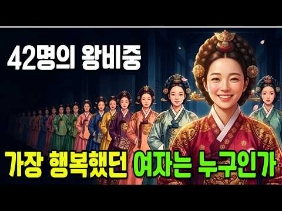
- 설명 앞부분: 📺 영상 설명란 👑 조선에 살아서 왕비가 된 여인은 단 42명. 그런데 그중 '정말로 행복했던' 왕비는 몇이나 될까요? 💔 열다섯에 왕비가 되어 64년을 홀로 산 비운의 정순왕후부터 이야기는 시작됩니다. 가장 깊은 바닥에서 출발해, 조선에서 가장 행복했던 왕비 3위부터 1위까지 거꾸로 올라가 봅니다. 🏯 최고의 권력과 장수를 누렸지만 남편과 아들을 먼저 떠나보낸 3위 신정왕후, 자식 하나 없이도 왕을 길러내 극진한 효도를 받은 2위 인원왕후, 그리고 사약을 받고 쫓겨난 폐비 윤씨의 바로 그 자리에 앉아 끝까지 평온을 지켜낸 1위 …
- 같은 채널 평소 대비 ×175.4 (채널 최근 롱폼 중앙값 2,198회) · 평소 영상: 사랑이 아니라 광기였다? 인조와 조귀인 관계의 충격적 결말 ∣ 조귀인자작극저주사건 ∣ 조… (2,198회) / 종기 하나로 죽었다고? 정조 죽음의 14일, 기록이 말해주는 진실 ∣ 정조이산마지막유언수… (2,143회)
- 대본 없음 (설명) — 음성인식이 끝나면 도입부·흐름이 들어감
- 댓글 133/152: 좋은 점 — 영상 1 · 감사·응원 4 · 더 알고 싶은 것 1 · 아쉬운 점 — 영상 0 · 반박·불만 — 의견 다름 0 · 정치·사회 0 · 경험 공유 1 · 구독·다음 기대 0
  - 좋은 점 — 영상 👍4 “너무 재밌고 굉장히 유익해요 그림 좋구요❤❤”
  - 감사·응원 👍4 “구수하게 긴시간 잘들었어요 감사합니다”
  - 감사·응원 👍2 “서울 답시리 사는 사람 임니다 잘 듣고 생각했네요 감사 합니다”
  - 더 알고 싶은 것 👍0 “궁금한점 성종때장희빈 숙종때장씨는 분간이안돼요 옳게 알려주세요”
  - 경험 공유 👍2 “저도 가끔 생각해보는 주제인데 제생각으로는 1위: 문정왕후 ( 중종과 아들이 왕이여서 부귀영화와 절대권력을 맘껏 휘두르며 살다가 평온하게 삶을 마감했다) 2위. 정안왕후 ( 정종의 인격이 휼룡하고 남편이 상왕으로 물러나 정치의 격동기를 피해서 평생 안온한삶을 살았다)…”

### 164. 미국 인터넷과 댓글을 뜨겁게 달군 이순신 장군 열풍, 한국 영웅에 흥분하는 진짜 이유

- https://www.youtube.com/watch?v=pQ-R6g1dNIg · 1프로경제학 · 구독자 1,240 · 조회수 40,645 (×32.8, 하루 1,221.3) · 좋아요 1,298 (3.2%) · 33.8분 · 2026-09-25 · 주제 묶음 3. 조선 · 형식 애니메이션·지도 · 폴더 `W_pQ-R6g1dNIg` (웹 승인)
- 썸네일: 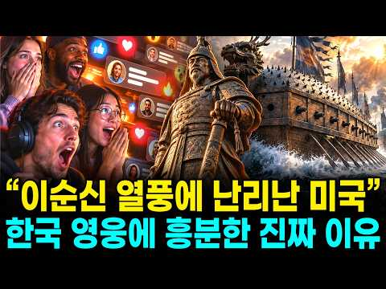
- 챕터: 0:00 미국 인터넷에서 벌어진 이상한 일 · 1:28 16년째 이순신만 그리는 미국인 · 3:37 조회수 1,600만 회, 미국 채널의 다섯 편 · 5:49 명량이 미국 극장에서 슈퍼히어로를 이긴 날 · 7:43 첫 번째, 23전 23승이라는 기록 · 11:35 두 번째, 나라에 버림받은 장군 · 13:33 열세 척 대 백서른세 척 · 16:02 세 번째, 영국과 일본 제독의 증언 · 18:13 니미츠가 읽은 1592년의 승전보 · 20:22 나의 죽음을 알리지 마라 · 23:05 이순신의 바다에 찾아온 미국 해군 · 26:31 워싱턴에 걸린 간판 · 28:28 우리 자식과 손주에게 남는 것 · 31:03 정리와 5070 행동 지침
- 설명 앞부분: 미국 역사 채널이 올린 팔 분짜리 이순신 영상, 조회수 450만 회. 시카고의 한 미국인 만화가는 16년째 이순신만 그리고 있습니다. 슈퍼맨의 나라 사람들이 왜 조선의 장군에게 빠져든 걸까요. 오늘 다루는 것은 세 가지입니다. 첫째, 미국 사람들이 처음 보고 눈을 의심한 기록. 둘째, 모든 걸 빼앗긴 사람이 걸어간 길. 셋째, 적과 세계가 남긴 증언. 미국 해군 사령관이 전쟁 한복판에서 꺼낸 이름이 있습니다. 그리고 그 이야기 끝에, 지금 이순신의 바다에서 벌어지고 있는 일이 있습니다. 썸네일 이미지는 인공지능으로 제작했습니다.
- 같은 채널 평소 대비 ×16.2 (채널 최근 롱폼 중앙값 2,514회) · 평소 영상: 미국 인터넷과 댓글을 뜨겁게 달군 한국 화장품 열풍, 샤넬의 나라 프랑스를 제치고 미국인… (2,672회) / 석유 한 방울 안 나는 나라에 1억 톤 묻혀 있던 하얀 흙, 미국 학회가 귀를 기울인 진… (2,357회)
- 대본 없음 (설명) — 음성인식이 끝나면 도입부·흐름이 들어감
- 댓글 70/70: 좋은 점 — 영상 2 · 감사·응원 10 · 더 알고 싶은 것 1 · 아쉬운 점 — 영상 0 · 반박·불만 — 의견 다름 1 · 정치·사회 4 · 경험 공유 2 · 구독·다음 기대 1
  - 좋은 점 — 영상 👍3 “이순신 장군님 감사합니다.😌💕 더 좋은 이야기 올려주세요. 수고하셨습니다. 😊”
  - 좋은 점 — 영상 👍0 “좋은영상 잘봤어요😊”
  - 감사·응원 👍23 “감사합니다 우리 조상님 ㅜㅜ”
  - 감사·응원 👍13 “너무나 자랑스러운 우리 선조. 감사 합니다.”
  - 더 알고 싶은 것 👍3 “이순신 장군님 감사합니다.😌💕 더 좋은 이야기 올려주세요. 수고하셨습니다. 😊”
  - 반박·불만 — 의견 다름 👍11 “동아시아 역사가 그것도 미국 유럽 시각으로 보면 중국 일본 위주의 역사라해도 과언이 아닌데 임진란 당시 적국이었던 일본 장수 와키자카도 발틱함대를 작살낸 도고 헤이하치로도 이순신을 추앙했으니(이 부분은 논란이 있음)이 증언과 기록이 있으니 미국 유럽 사학자들이 알아본…”
  - 정치·사회 👍2 “이순신과이재명차이말돌리기대북송금”
  - 정치·사회 👍1 “국뽕도 도를 넘으면 부메랑으로 돌아온다. 너무 포장하면 판타지라고 반발하는 외국인도 늘어난다.”
  - 경험 공유 👍4 “우리집 울돌목 아닙니까 해남 현산 인입니다”
  - 경험 공유 👍1 “K-팝, K- 드라마, K-푸드, K-무비, K-가곡, K-방산.... 이렇게 나가더니, 이제는 K-히스토리 까지... 김구선생님의 글이 생각납니다. "나는 우리나라가 세계에서 가장 아름다운 나라가 되기를 원한다. 가장 부강한 나라가 되기를 원하지 않는다." "오직 …”
  - 구독·다음 기대 👍0 “자막글 이 너무 오자가 많습니다. a l 로 발음을직역하여 옮겨서 그렇게된건 이해하지만...많은분들이 뜻을 헷갈려하고있읍니다.단어들이 정확하게 되어야합니다. 기대합니다.”

### 165. 경성야사 ㅣ 덕산옥 4화 "저자거리 왈짜패"

- https://www.youtube.com/watch?v=cM4xQnLjeHY · Mr.Gongguri · 구독자 234 · 조회수 13,634 (×58.3, 하루 227.5) · 좋아요 39 (0.3%) · 7분 · 2026-08-29 · 주제 묶음 9. 야사·야담·옛날이야기 · 형식 정보·해설 (그 밖) · 폴더 `W_cM4xQnLjeHY` (웹 승인)
- 썸네일: 
- 설명 앞부분: 돈으로 산 몽둥이 여럿이, 국자 하나를 이기지 못했다. 그리고 이제, 혼다가 직접 그 국밥집 문을 두드린다. 일제압제 시절 토지를 수탈하려는 일본관리들에 맞서 백성을 지키려는 사람들의 이야기. 시네마틱 판타지 사극 드라마 [덕산옥 德山屋] 경성야사 ㅣ 덕산옥 4화 : 저자거리 왈짜패 본 작품은 AI 기술을 활용하여 제작된 창작물이며, 실제 역사적 인물·사건·지명과는 무관합니다. Written & Directed by GONGGURI Produced by MR. GONGGURI 본 작품은 AI 기술을 활용하여 제작된 창작물이며, 실…
- 같은 채널 평소 대비 ×4.8 (채널 최근 롱폼 중앙값 2,827회) · 평소 영상: 경성야사 덕산옥 7화 "총구 앞에서" (3,056회) / 경성야사 덕산옥 마지막화 "인질극" (2,598회)
- 대본 없음 (설명) — 음성인식이 끝나면 도입부·흐름이 들어감
- 댓글 0/0: 좋은 점 — 영상 0 · 감사·응원 0 · 더 알고 싶은 것 0 · 아쉬운 점 — 영상 0 · 반박·불만 — 의견 다름 0 · 정치·사회 0 · 경험 공유 0 · 구독·다음 기대 0

### 166. 하루 3톤의 똥, 경복궁은 어떻게 처리했을까? ∣ 조선판 극한직업의 진실

- https://www.youtube.com/watch?v=iBPuti_K5mk · 토키의역사속으로 · 구독자 1,390 · 조회수 223,391 (×160.7, 하루 1,314.6) · 좋아요 2,353 (1.1%) · 25.5분 · 2026-05-11 · 주제 묶음 3. 조선 · 형식 정보·해설 (그 밖) · 폴더 `W_iBPuti_K5mk` (웹 승인)
- 썸네일: 
- 설명 앞부분: 🚽 하루 3,000명이 살던 경복궁, 그 어마어마한 양의 배설물은 도대체 어디로 사라졌을까요? 🏯 똥을 함부로 버리면 곤장 50대를 맞아야 했던 조선의 법, 그리고 한양에서 흘러나온 분뇨가 어떻게 왕십리 미나리밭이 되어 다시 도성의 밥상으로 돌아왔는지. 💰 천대받았지만 결코 가난하지 않았던 조선판 극한직업 '똥장수’의 세계, 그리고 같은 시대 일본 에도의 분뇨 거래 시장과의 비교까지. 🌊 영조가 수만 명을 동원해 청계천 바닥을 퍼냈던 이유, 그리고 지금 우리가 산책하는 청계천 아래 흐르고 있는 580년의 시간. 📜 이사벨라 비숍,…
- 같은 채널 평소 대비 ×636.4 (채널 최근 롱폼 중앙값 351회) · 평소 영상: 나무는 알고 있었다 ∣ 칭기즈칸의 정복을 도운 15년 (362회) / 덕혜옹주의 진짜 이야기 ∣ 조선의 마지막 황녀 영화와 다른 실제 기록 (340회)
- 대본 없음 (설명) — 음성인식이 끝나면 도입부·흐름이 들어감
- 댓글 134/138: 좋은 점 — 영상 0 · 감사·응원 1 · 더 알고 싶은 것 1 · 아쉬운 점 — 영상 0 · 반박·불만 — 의견 다름 0 · 정치·사회 0 · 경험 공유 3 · 구독·다음 기대 0
  - 감사·응원 👍1 “옛날 에태어나지 않은게 하느님께 감사 드립니다”
  - 더 알고 싶은 것 👍0 “난 지금도 분뇨가 어떻게 처리되고 어디로 가는지 궁금합니다”
  - 경험 공유 👍7 “옛날에는 모두 채소밭에 거름으로 사용했고, 6•25사변 당시 한국전쟁때 한국에 왔던 미군들이 야채, 과일 등등.의 밭에다 사람의 똥을 뿌리는 모습을 보고 미군 상관들에게 보고를 하며 모든 야채 과일을 한국산은 죽어도 먹을수없다고 건의를 해서 모두 일본에서 공수해왔던 …”
  - 경험 공유 👍2 “60년대에 뛰어놀던, 지금은 할아버지 입니다. 어릴적 똥장수가 많지는 않았지만 동내에 가끔 나타나면 "똥장수 이저씨닷" 하며 놀리면서 피해서 도망가곤 했었죠. 소독차를 젤로 좋아했구요. 🤪”

### 167. 고혈압·당뇨·고지혈증 폭탄! 조선 왕 80%가 단명한 진짜 이유?

- https://www.youtube.com/watch?v=bjPpvpMBIoU · 불타는한국사 · 구독자 135 · 조회수 12,052 (×89.3, 하루 127.6) · 좋아요 103 (0.9%) · 13.8분 · 2026-07-25 · 주제 묶음 3. 조선 · 형식 수면·낭독 (잠잘 때 듣는) · 폴더 `W_bjPpvpMBIoU` (웹 승인)
- 썸네일: 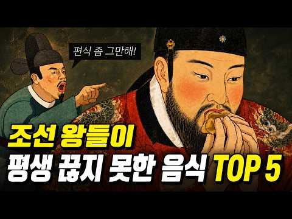
- 설명 앞부분: 안녕하세요, 불타는세계사 채널을 시청해 주셔서 감사합니다. 영상 시청에 앞서 몇 가지 안내해 드립니다. 1. 시각 자료(이미지/영상) 및 연출 안내 본 영상에 사용된 이미지 및 영상은 AI 생성 도구 등을 활용해 제작된 ‘연출용 픽션 시각 자료'입니다. 이야기의 시대적 분위기와 몰입감을 돕기 위한 상상 기반의 연출 요소일 뿐, 실제 역사 속 복식이나 사료를 완벽히 고증한 것이 아닙니다. 기술적 한계로 인한 세부적인 복식 고증의 미흡함은 너그럽게 양해해 주시면 감사하겠습니다. 2. 콘텐츠 구성 안내 본 콘텐츠는 역사적 사실 및 구전…
- 대본 없음 (설명) — 음성인식이 끝나면 도입부·흐름이 들어감
- 댓글 18/18: 좋은 점 — 영상 0 · 감사·응원 0 · 더 알고 싶은 것 1 · 아쉬운 점 — 영상 0 · 반박·불만 — 의견 다름 0 · 정치·사회 0 · 경험 공유 0 · 구독·다음 기대 1
  - 구독·다음 기대 👍9 “돼지고기 삐진거 웃겨요 중간부터 음악이 너무 커서 대사가 안들려요 😢 그래도 구독하고 갑니다 편안하데 잘 봤어요”

### 168. 조선야담#2 딸을 머슴에게 시집보내다~ 옛날이야기 민담 잠잘때 듣는 옛날이야기

- https://www.youtube.com/watch?v=HRbSM37fr0E · 조선야사 · 구독자 2,370 · 조회수 40,535 (×17.1, 하루 2,209.1) · 좋아요 379 (0.9%) · 101.8분 · 2026-10-01 · 주제 묶음 9. 야사·야담·옛날이야기 · 형식 수면·낭독 (잠잘 때 듣는) · 폴더 `W_HRbSM37fr0E` (웹 승인)
- 썸네일: 
- 설명 앞부분: 📜 조선 시대의 신비롭고 흥미진진한 야담, 역사 속 숨겨진 이야기, 그리고 전해 내려오는 전통 설화를 전해드립니다. 🏮 우리가 잘 몰랐던 옛이야기 속으로 떠나는 시간 여행에 여러분을 초대합니다. ⏳✨ 과거의 지혜와 재미가 담긴 이야기들을 매일 만나보세요! 🌙🐯
- 같은 채널 평소 대비 ×463.3 (채널 최근 롱폼 중앙값 88회) · 평소 영상: 조선야담🎉 오뉴월 서릿발 같은 여자의 한 이야기모음 #민담 #야담 #고전소설 #옛날이야기 (91회) / 조선야담 🎉애첩의 털과 바꾼 전재산 잠잘때 듣는 옛날 이야기 (91회)
- 대본 없음 (설명) — 음성인식이 끝나면 도입부·흐름이 들어감
- 댓글 7/7: 좋은 점 — 영상 0 · 감사·응원 1 · 더 알고 싶은 것 0 · 아쉬운 점 — 영상 0 · 반박·불만 — 의견 다름 0 · 정치·사회 0 · 경험 공유 0 · 구독·다음 기대 0
  - 감사·응원 👍1 “조선야담~~ ! 잼 있게 보고 있읍니다.고맙읍니다. 흐 흐”

### 169. 노량진역 옆 570년 된 무덤, 여섯 분인데 왜 일곱 기일까? ∣ 사육신묘의 미스터리 ∣ 역사다큐 ∣ 조선왕조실록

- https://www.youtube.com/watch?v=4P3OBpzFYlg · 역사의늪 · 구독자 2,710 · 조회수 230,682 (×85.1, 하루 2,510.4) · 좋아요 4,977 (2.2%) · 35.8분 · 2026-07-28 · 주제 묶음 3. 조선 · 형식 정보·해설 (그 밖) · 폴더 `W_4P3OBpzFYlg` (웹 승인)
- 썸네일: 
- 챕터: 0:00 노량진, 일곱 기의 무덤 · 2:48 1456년, 세조의 찬탈 · 4:11 학자들의 위험한 계획과 멈춰버린 거사 · 6:30 김질의 밀고 · 7:20 국문 - 박팽년, 그리고 김문기의 이름 · 9:23 국문 - 성삼문, 두 개의 해는 없다 · 11:42 국문 - 유응부, 다시 달구어 오라 · 14:38 70여 명의 죽음, 박팽년의 핏줄 · 16:19 왜 '여섯'인가 - 남효온의 육신전 · 18:13 235년 만의 명예 회복 · 20:09 또 하나의 이름, 김문기와 어정배식록 · 22:48 1977년, 여섯이 일곱이 되다 · 25:05 두 개의 주장이 부딪치다 · 29:14 다시 이어진 논쟁과 절충의 결론 · 32:36 여섯이든 일곱이든, 같은 방향
- 설명 앞부분: 서울 동작구 노량진, 사육신 공원. 死六臣 - 단종 복위를 하려다 목숨을 잃은 여섯 충신이 잠든 곳입니다. 그런데 묘역에 들어서서 봉분을 하나둘 세다 보면, 이상한 점을 발견합니다. ❓ 북쪽 묘역에 세 기, 남쪽 묘역에 네 기 - 모두 합하면 일곱입니다 📜 분명히 '사육신'이면 여섯이어야 하는데, 무덤은 왜 일곱 기일까요? 그리고 여기에 놀라운 사실도 있습니다. 이 일곱 번째 무덤을 둘러싼 후손들의 논쟁이, 570년이 지난 지금까지도 이어지고 있었습니다. 같은 충절을 기린다면서, 충신들을 향한 제사상이 아직도 하나로 모이지 못하고…
- 같은 채널 평소 대비 ×414.2 (채널 최근 롱폼 중앙값 557회) · 평소 영상: 딸을 안 보내면 아버지가 잡혀갔다 - 조선시대 혼인 정책의 충격적 진실 ∣ 역사다큐 ∣ … (557회) / 세조는 왜 단종의 보모에게 사약 대신 밧줄을 내렸을까? - 조선 유일 교수형 당한 단종의… (475회)
- 대본 없음 (설명) — 음성인식이 끝나면 도입부·흐름이 들어감
- 댓글 395/395: 좋은 점 — 영상 2 · 감사·응원 7 · 더 알고 싶은 것 1 · 아쉬운 점 — 영상 1 · 반박·불만 — 의견 다름 4 · 정치·사회 11 · 경험 공유 5 · 구독·다음 기대 0
  - 좋은 점 — 영상 👍11 “일곱 맞는것 같습니다. 좋은 정보 감사 드립니다.”
  - 감사·응원 👍72 “이미 오랜새월 지나 사육신으로 전해내려온 묘역에 같은뜻으로 뭉친 훌륭한 충신어르신이니 함께 모시고 제도 함께 합동제를 올려드려야 할듯합니다.제발 양보의 미덕 발휘하시면 ~🎉 감사드립니다.”
  - 감사·응원 👍11 “일곱 맞는것 같습니다. 좋은 정보 감사 드립니다.”
  - 더 알고 싶은 것 👍0 “애초에는 사육신묘가 있었는데 김재규님이 정보부장 시절에 자기 조상묘를 옮기면서 사칠신 묘가 되었다는 설이 있는데 왜 아직도 그대로 두는건지 궁금합니다.”
  - 아쉬운 점 — 영상 👍1 “좀 짧게 해 주시면 구독 할텐데.. 아쉽네요. 👎”
  - 반박·불만 — 의견 다름 👍2 “여섯은 지금으로 따지면 5급. 사무원. 중대장급 1명. 이들이 서슬 퍼런 왕조 시대 세조 때 쿠데타를 해 세조를 몰아내고 단종을 복위 시킨다고? 웃기는. 소리. 근데 거기에 병조판서가 1명. 누가 단종복위의 우두머리인가? 급이 다르다. 정사에도 병력동원은 김문기가. …”
  - 반박·불만 — 의견 다름 👍2 “저도. 세조. 임금으로. 생각. 안해요. ㆍ. 저희. 가문도. 그리. 되엇어요. 즉. 문종과. 세조. ㆍ. 저희. 가문도. 요즘. 문종과. 세조 처럼 되어. 기막히고. 참담해요. 글세. 제가. 어릴적부터. 관리 하던. 임야. 그런데. 윗전. 다. 돌아가시어. 본인. …”
  - 정치·사회 👍5 “1977년 당시 나는 새도 떨어뜨린다는 중앙정보부장이었고 12.6.거사시 박정희 대통령을 시해한 고 김재규씨가 김문기 문중이어서 국사편찬위원회에서 그런 결정을 내렸다는 풍문이 당시 파다했었다고 합니다. 당시 국사편찬위원회 위원이었던 누구도 회의에서 있었던 내용에 대해…”
  - 정치·사회 👍1 “사육신은 단종의 복위를 도모하다가 발각되어 죽은 6명의 관리 즉, 성삼문, 박팽년, 하위지, 유응부, 유성원, 이개, 를 말하는데 박정희 정권 시절인 1977년 국사편찬위원회가 김문기를 사육신으로 현창해야 한다고 결의하면서 시작됐다고 합니다. 1456년 군 최고위직인…”
  - 경험 공유 👍5 “1977년 당시 나는 새도 떨어뜨린다는 중앙정보부장이었고 12.6.거사시 박정희 대통령을 시해한 고 김재규씨가 김문기 문중이어서 국사편찬위원회에서 그런 결정을 내렸다는 풍문이 당시 파다했었다고 합니다. 당시 국사편찬위원회 위원이었던 누구도 회의에서 있었던 내용에 대해…”
  - 경험 공유 👍3 “저렇게 악독하니 세조가 온 몸에 종기가 나고 평생 피부병과 죄책감에 떨며 살고 자식들이 어려서 죽는 고난을 겪었지”

### 170. 촉나라 몰락 후 제갈 가문은 어떻게 한국과 이어졌을까? ∣ 역사 ∣ 역사를 짚다

- https://www.youtube.com/watch?v=ymSL8cjjxqU · 짚다 ZIPDA · 구독자 6,730 · 조회수 280,458 (×41.7, 하루 6,222.7) · 좋아요 1,013 (0.4%) · 35분 · 2026-09-13 · 주제 묶음 1. 역사 일반·이야기 · 형식 정보·해설 (그 밖) · 폴더 `W_ymSL8cjjxqU` (웹 승인)
- 썸네일: 
- 챕터: 0:00 촉나라 멸망과 1,700년 뒤의 뜻밖의 사건 · 1:41 제갈량보다 먼저 존재했던 제갈 가문 · 4:06 제갈량의 실제 후계자와 자손들 · 6:21 촉나라 멸망, 제갈 가문의 운명 · 8:28 한국 계보에 등장한 새로운 연결고리 · 15:36 500년 뒤 다시 등장한 또 하나의 전승 · 17:27 고려시대, 제갈 성씨에 생긴 변화 · 21:33 고려 이후 이어진 제씨와 갈씨 · 23:58 조선 기록에서 확인되는 가문의 흔적 · 28:45 다시 ‘제갈’을 찾으려는 움직임 · 30:57 현대에 벌어진 대규모 복성 · 32:50 한국의 제갈씨, 정말 제갈량과 이어질까?
- 설명 앞부분: 삼국지에서 가장 유명한 인물 가운데 한 명인 제갈량. 그런데 그의 이름과 같은 ‘제갈’이라는 성씨가 한국에도 오랫동안 이어져 왔습니다. 그렇다면 한국의 제갈씨는 제갈량과 어떤 관계가 있을까요? 그리고 제갈씨와 함께 등장하는 제씨·갈씨의 이야기는 어디에서 시작된 것일까요? 이번 영상에서는 중국의 역사 기록부터 한국에 전해오는 문중 계보, 고려와 조선시대의 기록, 그리고 현대까지 이어진 성씨의 흔적을 차례대로 따라가 봅니다. 📚 제갈량의 실제 가족과 후손들은 어떻게 이어졌는지, 한국의 계보에는 어떤 인물들이 등장하는지, 기록과 전승을…
- 같은 채널 평소 대비 ×7.9 (채널 최근 롱폼 중앙값 35,309회) · 평소 영상: 아골타 가문이 한반도와 이어진 이유 금나라 황실의 수상한 기록 (35,309회) / 부여 왕자가 세운 수수께끼의 나라 46년 만에 사라진 갈사국의 정체 (33,680회)
- 대본 없음 (설명) — 음성인식이 끝나면 도입부·흐름이 들어감
- 댓글 191/191: 좋은 점 — 영상 0 · 감사·응원 1 · 더 알고 싶은 것 2 · 아쉬운 점 — 영상 1 · 반박·불만 — 의견 다름 5 · 정치·사회 10 · 경험 공유 3 · 구독·다음 기대 0
  - 감사·응원 👍5 “칠원 제씨인데 설명 하신대로 족보에 기록 되어 있습니다. 감사 합니다”
  - 더 알고 싶은 것 👍0 “제가 민씨인데 중국에는 없는 한반도에만 있는 성인가요? 이방원의 아내이자 세종대왕의 어머니가 민씨인데 자고로 명성황후 까지 왕후계열은 민씨라는 가문인데 한번 영상 만들어주세요”
  - 아쉬운 점 — 영상 👍1 “똑같은 멘트 반복이 많네”
  - 반박·불만 — 의견 다름 👍6 “그리고 한중일 삼국의 유교뭔화권게서 가문의 계승이란 단순히 혈연의 계승을 의미하는 것은 아닙니다. 가문이라는 것은 혈연을 넘어서는 형이상학적이지만, 또한 재산과 관련된 실체이기도 했지요. 그래서 혈연이 끊어지만 양자를 들여서 가문을 계승하는 일이 그렇게 드물지 않았습…”
  - 반박·불만 — 의견 다름 👍0 “제갈씨가 제갈량의 후손인게 아니라 우리나라 성씨 대부분이 성씨들중에서 위인한두명을 배출한거지 제갈씨가 제갈량후손은 아닙니다 그사람 후손일려면 시조를 정확히 특정해야하는데 우리나라성씨 대부분 중시조를 모십니다.”
  - 정치·사회 👍36 “고대 중국성씨는 허구일 가능성이 큰데 원나라나 명나라 청나라시대 때는 한반도로 이주한 중국인들 기록이 꽤 있어서 사실인 경우가 많습니다 대표적으로 주원장과 중국대륙을 다투고 싸웠던 진우량이 전사하기 전 아들에게 만약 패하거든 고려로 가서 피신하라고 한 기록이 있고 고…”
  - 정치·사회 👍9 “족보가 조선 중기에 처음 생겼다. 그런데 자기 시조가 대부분 중국에서 왔다고 한다. 심지어 김씨마저도 조상이 중국인 김일제라고 할 정도다. 왕건은 자기 증조할아버지가 중국 황제라고 할 정도니 말 다했다. 애매한 성씨는 다들 자기 시조가 송나라 한림원 학사였다고 한다.…”
  - 경험 공유 👍4 “일제강점 때 창씨개명이 이뤄지는데, (정확한 통계인지 알 수 없으나, 우리나라 사람 중에 이무렵 일본식 창씨 개명한 사람이 70% 넘었다고 합니다. ) 그러나 생각이 높으신 분들이 일본의 창씨를 거부하며, 자신의 성씨를 지키려고 하는데, 이로써 먼 옛날 자기의 조상이…”
  - 경험 공유 👍0 “제가 민씨인데 중국에는 없는 한반도에만 있는 성인가요? 이방원의 아내이자 세종대왕의 어머니가 민씨인데 자고로 명성황후 까지 왕후계열은 민씨라는 가문인데 한번 영상 만들어주세요”

### 171. 콘돔도 없던 조선시대, 기생은 어떻게 임신과 화류병을 막았나— 알려지지 않은 충격적인 진실#조선시대 #기생 #풍속화 #한국역사 #신윤복

- https://www.youtube.com/watch?v=mU274jAWlws · 조선의 호기심 · 구독자 1,750 · 조회수 237,770 (×135.9, 하루 1,606.6) · 좋아요 3,175 (1.3%) · 24.5분 · 2026-06-02 · 주제 묶음 3. 조선 · 형식 정보·해설 (그 밖) · 폴더 `W_mU274jAWlws` (웹 승인)
- 썸네일: 
- 챕터: 0:00 오프닝 — 막지 못했다 · 1:00 세습기생 — 법이 만든 운명 · 4:00 아침 루틴 — 기생의 하루 · 7:00 피임법 — 창호지, 소금물, 뒤로 7걸음 · 12:00 두 달 후 — 임신 · 16:00 삼월의 냉정한 계산
- 설명 앞부분: 콘돔이 없던 시대, 기생들은 어떻게 임신을 막았을까. 어떻게 화류병을 막았을까. 답은 간단했다. 막지 못했다. 이 영상에서 다루는 내용 창호지 피임, 소금물, 뒤로 일곱 걸음. 그것이 조선 기생이 가진 전부였다. 기생의 딸은 기생이 된다. 팔리는 것도 아니었다. 법이 그냥 정해 놓았다. 태어나는 순간 이미 직업이 정해져 있었다. 외과 환자의 70~80%가 화류병 환자였다는 기록. 토복령이라는 약은 있었지만 너무 비쌌다. 그리고 더 위험한 선택도 있었다. 오늘은 어느 사극에도, 어느 역사책에도 나오지 않는 조선 기생들의 진짜 이야기…
- 같은 채널 평소 대비 ×290.3 (채널 최근 롱폼 중앙값 819회) · 평소 영상: 조선에서 남녀는 어떻게 결혼했나 —얼굴도 모르는 사람과 결혼해야 했던충격적인 혼인 풍습【… (819회) / 비누도 샴푸도 수돗물도 없었는데 조선인이 세계에서 가장 청결했던 충격적인 이유 【조선시대… (839회)
- 대본 없음 (설명) — 음성인식이 끝나면 도입부·흐름이 들어감
- 댓글 517/521: 좋은 점 — 영상 3 · 감사·응원 8 · 더 알고 싶은 것 6 · 아쉬운 점 — 영상 9 · 반박·불만 — 의견 다름 6 · 정치·사회 20 · 경험 공유 8 · 구독·다음 기대 1
  - 좋은 점 — 영상 👍80 “조선에서 노비였던 사람들이 해방된 것이 국가의 원동력이 된 듯..... 양반들은 여전히 국가에 도움이 안되니까..... 나머지 인간들이 현재의 국력이 됨...”
  - 좋은 점 — 영상 👍0 “제발 맞춤법 좀 고쳐주세요ㅠㅠㅠㅠ 한번 ai 돌리고 자막을 달아주세요 좋은 영상들인데 아이들도 볼 것 같아서요.”
  - 감사·응원 👍21 “저런 조선을 끝장내준 일본이 오히려 고맙게 느껴진다.”
  - 감사·응원 👍6 “조선시대 여인의 삶 고달프고 애닮다 이시대에 태어난걸 감사하게 돼네요”
  - 더 알고 싶은 것 👍13 “쌀때 밖에 싸라 하면 안되나요?”
  - 더 알고 싶은 것 👍11 “1.씹창 났다..라는 말의 어원을 아시나요? 말 그대로 여성성기(씹)에 (곪을)창이 난 겁니다 양반이 기생하고 하려는데 아래가 곪았어요. 그래서 못 하게 되었어요...이 때 하는 말이 "에이, 씹창 났다.." 조선시대 성병이 얼마나 많았는지 이해가 되시죠? 2. 정월…”
  - 아쉬운 점 — 영상 👍52 “컨텐츠는 좋은데 자막이 ai로 자동 생성한건지 너무 틀린 게 많이 보여서 거슬리네요”
  - 아쉬운 점 — 영상 👍21 “자막이 AI로 되어있어서 오타가 너무 많아요..”
  - 반박·불만 — 의견 다름 👍16 “기생을 매춘부로 설명했군 관기에 대한 설명도 엉망이고 역사는 해석이 다양하다는 모호한 말로 왜곡에 가까운 헛소리를 전파하지 마시죠”
  - 반박·불만 — 의견 다름 👍1 “웃기는 조선 불쌍한 조선인들”
  - 정치·사회 👍342 “저게 법이라니.. 나라가 나서서 여자들을 괴로운 삶으로 몰아넣었군요. 마음이 너무 아픕니다”
  - 정치·사회 👍191 “조선이 망한거 잘했다.임진왜란때 나라가 진즉 망하여 노예 기생 반상제도가 없어졌어야했다.”
  - 경험 공유 👍20 “일제 시대 위안부 비난할 입장이 아니네. 조선 시대가 더 개쓰레기였네. 나도 여자이고 딸을 키우는데...진짜 쌍욕이 나오는 조선.”
  - 경험 공유 👍0 “남자는 노동꾼으로 보내지고 여자는 그저 욕구해소용 도구였던 시절.. 잔인하다. 내가 누리는 자유라는게 그 당시엔 당연한것이 아니였다니.. 너무 슬프다 나는 그냥 운좋게 좋은 시대에 태어난 것 뿐이구나..”
  - 구독·다음 기대 👍1 “듣다보니 정말 슬프네요. 구독합니다. 그런데 ㅡ조선의 호기심 ㅡ 검색하니 또 있네요. (조선의호기심) 이렇게 띄어쓰기 안하니 채널명이 같은게 있어요.”

### 172. 인간은 죽으면 어디로 가는가? 수메르 점토판이 밝힌 충격적인 진실… 아무도 그 함정을 보지 못했다

- https://www.youtube.com/watch?v=uu8Ffx5ZnfY · 조용한 밤 이야기 · 구독자 1,410 · 조회수 139,009 (×98.6, 하루 1,287.2) · 좋아요 1,292 (0.9%) · 30.5분 · 2026-07-12 · 주제 묶음 8. 문명·고고학 · 형식 정보·해설 (그 밖) · 폴더 `W_uu8Ffx5ZnfY` (웹 승인)
- 썸네일: 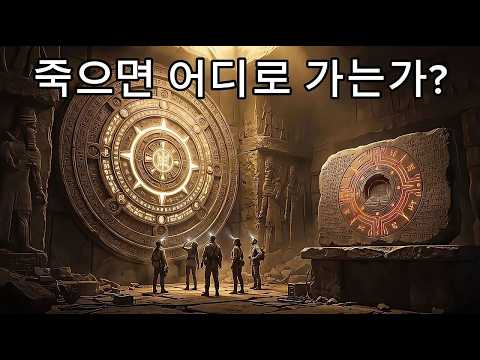
- 설명 앞부분: 인간은 죽으면 어디로 가는가? 수천 년 전 수메르 문명이 남긴 점토판에는 죽음 이후 인간에게 일어나는 과정과 영혼, 사후 세계에 대한 놀라운 기록이 담겨 있다고 전해집니다. 이번 영상에서는 수메르 점토판에 기록된 사후 세계의 비밀, 영혼의 여정, 고대 문명이 남긴 미스터리, 그리고 오늘날까지도 논란이 되는 숨겨진 의미를 살펴봅니다. 과연 이것은 단순한 신화일까요, 아니면 잊혀진 고대의 지식일까요? ※ 이 영상은 역사적 기록, 고고학적 발견, 신화와 다양한 연구 및 해석을 바탕으로 제작되었습니다. 일부 내용은 학계에서 확정된 사실이…
- 같은 채널 평소 대비 ×198.0 (채널 최근 롱폼 중앙값 702회) · 평소 영상: 2억 년 전 지구는 완전히 달랐다… 판게아로 떠나는 시간여행 (702회) / 중국 전체를 정복한 몽골은 왜 일본을 정복하지 못했을까 두 번의 침공과 충격적인 패배! (572회)
- 대본 없음 (설명) — 음성인식이 끝나면 도입부·흐름이 들어감
- 댓글 99/99: 좋은 점 — 영상 0 · 감사·응원 1 · 더 알고 싶은 것 1 · 아쉬운 점 — 영상 1 · 반박·불만 — 의견 다름 2 · 정치·사회 0 · 경험 공유 3 · 구독·다음 기대 0
  - 감사·응원 👍1 “엄청난 영상입니다~~ㄷㄷㄷ 정말 감사합니다~~~♡”
  - 더 알고 싶은 것 👍1 “그런 내용이 담긴 점토판을 보여 주세요 그리고 전문가의 의견을 인터뷰한 영상도 올려 주세요 믿지 않음 인간은 죽으면 끝 영원히 살고 싶은 인간의 욕심이 만든 비과학적 샤머니즘 살아 있는 동안 행복하게 사세요 인간의 뇌는 살기 위해 가상의 공간을 만들고 그곳에서 위로를…”
  - 반박·불만 — 의견 다름 👍0 “궁금해하지말고 재밌게 살다 갑시다. 날파리가 그러던가요? 코끼리가 그러던가요? 생명의 숫자 논리로 따지면 지구 탄생 46억 년 전 생명체> 그래서 윤회설도 안맞는 겁니다. 지구 탄생 그때 인간 80억명이었나요? 그게 벌레로, 인간으로 총량? 말도 안되는 인간들의 논리…”
  - 반박·불만 — 의견 다름 👍0 “아직도 이런 헛소리를 올리나? 얼척없네 ㅋ”
  - 경험 공유 👍2 “다시 태어나더라도 그건 더 이상 내가 아니다! 영혼불멸 이야기라면 또 다른 차원의 이야기”
  - 경험 공유 👍1 “첫 영상 속 표식 50평생 딱 한번 봤는데 자다 깨서 눈에서 나온듯 시선 따라서 벽에 부딪혀 크기도 달라져 움직였는데 형광색? 푸른 빚.. 내가 팔이 눈을 눌러 자다 깨 그런걸 본게 아닐까.... 생각들었는데 깨서 약 20초간 보였던듯”

### 173. 소름 끼치게 놀라운 AI로 재현해 본 조선 왕 27인의 실제 모습 ∣ 우리가 몰랐던 진짜 성격

- https://www.youtube.com/watch?v=BIvwX_N1iPs · 비밀야담 보관소 · 구독자 2,600 · 조회수 281,026 (×108.1, 하루 2,354.8) · 좋아요 2,160 (0.8%) · 18분 · 2026-07-01 · 주제 묶음 3. 조선 · 형식 야담·옛날이야기 · 폴더 `W_BIvwX_N1iPs` (웹 승인)
- 썸네일: 
- 설명 앞부분: 조선 시대의 이야기를 만들면 만들수록, '조선 왕들의 실제 모습은 과연 어떠했을까'라는 궁금증이 점점 커져만 갔습니다. 27명 임금들의 어진이 전쟁과 화재로 소실되지 않고 온전히 남아있었다면 얼마나 좋았을까라는 안타까움도 참 컸습니다. 간혹 몇몇 남아있는 어진들을 보며 상상의 나래를 펼쳐왔지만 늘 안타까움이 남았고, 결국 이번 기회에 역사적 기록과 AI 기술을 동원해 직접 재현을 시도해 보았습니다. 특히 영상의 시작과 끝에는 조선 왕조의 엄숙한 예법과 왕권을 상징하는 의궤, 그리고 왕의 뒤를 지키던 일월오봉도를 직접 구현하여 배치…
- 같은 채널 평소 대비 ×1,502.8 (채널 최근 롱폼 중앙값 187회) · 평소 영상: 조선 땅에 괴수가 나타나 조정 대신을 밟아 죽이고 유배를 떠났다 #코끼리유배 #태종이방원… (187회) / 망나니, 사람의 목을 베고 살아야 했던 자들 #망나니 #조선시대 #역사다큐 #비밀야담보관소 (172회)
- 대본 없음 (설명) — 음성인식이 끝나면 도입부·흐름이 들어감
- 댓글 139/145: 좋은 점 — 영상 1 · 감사·응원 1 · 더 알고 싶은 것 1 · 아쉬운 점 — 영상 2 · 반박·불만 — 의견 다름 4 · 정치·사회 4 · 경험 공유 2 · 구독·다음 기대 0
  - 좋은 점 — 영상 👍7 “효종은 굉장히 미화된 면이 있는 왕입니다. 알면 알수록, 학생때 배웠던 모습과 굉장히 괴리가 있음. 무능하고 시샘이 가득한 아버지에 의해 형이 독살을 당하고 죄없는 형수와 조카들이 죽음을 당했는데도 손하나 까딱 안한 사람입니다. 인조가 살아있을 때는 어쩔 수 없다고 …”
  - 더 알고 싶은 것 👍7 “AI로 재현한 것이 어떻게 실제 모습인가요?”
  - 아쉬운 점 — 영상 👍29 “조선시대 왕들의 어진들이 불타버린 게 너무 아쉽습니다.”
  - 아쉬운 점 — 영상 👍5 “이름도안넣고 심지어 자막이 얼굴부분을 가림ㅋㅋ”
  - 정치·사회 👍5 “이재명이 세종대왕 일하는 스타일이 비슷하네요?”
  - 정치·사회 👍1 “고려시대 어진은? 없나요? 언젠간 대한민국 시대가 끝나면 대통령 사진 다 없앨건가?”
  - 경험 공유 👍4 “세종... 지폐에 그 얼굴생각한 내가 이상한건가ㅋ”
  - 경험 공유 👍2 “오... 저도 작업해보던 거라 반갑습니다 ㅎㅎ 잘 뽑으셨네요”

### 174. 이순신이 원수 자격을 의심했던 조선군 총사령관?!

- https://www.youtube.com/watch?v=-f0CsdR5eJE · 몰래 듣는 조선의 비밀 · 구독자 1,220 · 조회수 70,324 (×57.6, 하루 1,091.2) · 좋아요 350 (0.5%) · 18.7분 · 2026-08-24 · 주제 묶음 3. 조선 · 형식 정보·해설 (그 밖) · 폴더 `W_-f0CsdR5eJE` (웹 승인)
- 썸네일: 
- 챕터: 0:00 두 달을 걸어온 사내 · 1:24 인사와 오늘의 여섯 장면 · 1:49 같은 해, 같은 사람이 천거한 두 이름 · 3:49 도원수라는 직책 · 6:06 이순신이 일기에 적은 문장 · 8:33 요시라의 반간계와 파직 · 10:57 백의종군 길의 끝 · 13:05 곤장 사흘 뒤 · 16:03 전기수의 한 줄
- 설명 앞부분: 1597년 사월 초사흘, 한 사내가 한양 의금부 문을 나섭니다. 며칠 전까지 그 안에서 문초를 받던 사람입니다. 살아 나온 것만으로도 주변이 놀랐습니다. 그는 남쪽으로 걷기 시작합니다. 관복도 벼슬도 없이, 죄인의 몸으로 삼백사십 킬로미터를 걷습니다. 떠난 지 열흘쯤 됐을 때 어머니의 부고가 옵니다. 상복도 갖추지 못한 채 그는 다시 남쪽으로 걷습니다. 두 달 뒤인 유월 초나흘, 사내는 경상도 합천 초계에 닿습니다. 조선의 모든 군대가 여기서 명령을 받는 곳, 도원수부입니다. 이 사내가 이순신입니다. 그런데 그가 도착한 진영의 주…
- 같은 채널 평소 대비 ×203.5 (채널 최근 롱폼 중앙값 346회) · 평소 영상: 7년간 전쟁을 이끈 남자가 쫓겨나서 쓴 반성문 16권 [조선인물 탐구생활] (358회) / 조선 최강이라 불린 장수, 적이 아니라 임금의 매에 죽으며 비운의 장수로 남다. [조선 … (333회)
- 대본 없음 (설명) — 음성인식이 끝나면 도입부·흐름이 들어감
- 댓글 30/30: 좋은 점 — 영상 1 · 감사·응원 1 · 더 알고 싶은 것 0 · 아쉬운 점 — 영상 0 · 반박·불만 — 의견 다름 0 · 정치·사회 1 · 경험 공유 0 · 구독·다음 기대 0
  - 좋은 점 — 영상 👍1 “이순신과 권율 관계에 대해서 새롭게 알게되었습니다. 매번 유익한 역사 정보 주셔서 감사합니다!”
  - 감사·응원 👍1 “이순신과 권율 관계에 대해서 새롭게 알게되었습니다. 매번 유익한 역사 정보 주셔서 감사합니다!”
  - 정치·사회 👍4 “이순신, 권율 등의 승리도 두 사람이 다른 무력하고 전략전술 부족한 다른 장수들보다 뛰어나서이기도 하지만 세종,문종 대에 전세계적에서 최고수준으로 만들어놓은 신기전을 위시한 총통기, 화차 등의 우수한 무기기술이 있었음을 여전히 문사양반선비 기득권이 이어가는 이 나라가…”

### 175. 고대 이집트의 잃어버린 도시, 마침내 발견되다

- https://www.youtube.com/watch?v=-j9jOJl_ERU · 시간의 단면 · 구독자 571 · 조회수 62,598 (×109.6, 하루 508.5) · 좋아요 642 (1.0%) · 24.1분 · 2026-06-27 · 주제 묶음 8. 문명·고고학 · 형식 정보·해설 (그 밖) · 폴더 `W_-j9jOJl_ERU` (웹 승인)
- 썸네일: 
- 설명 앞부분: 이천 년 넘게 전설로만 여겨졌던 도시가 실제로 존재했습니다. 고대 그리스 역사가 헤로도토스가 기록했던 헤라클레이온. 수세기 동안 수많은 학자들이 그 흔적을 찾았지만, 누구도 발견하지 못했습니다. 결국 사람들은 그것이 신화일 뿐이라고 믿기 시작했습니다. 하지만 모든 것은 프랑스 해양 고고학자 프랑크 고디오의 우연한 탐사에서 바뀌었습니다. 지중해 아부키르만 해저에서 모습을 드러낸 것은 거대한 신전과 항구, 운하, 수천 점의 유물, 그리고 완전한 고대 도시였습니다. 이 영상에서는 헤라클레이온이 어떻게 고대 이집트 최대의 무역 도시가 되…
- 같은 채널 평소 대비 ×152.5 (채널 최근 롱폼 중앙값 410회) · 평소 영상: 이집트의 아틀란티스, 사라진 도시 타니스의 충격적인 진실 (416회) / 인류 역사에서 지워진 거인 (405회)
- 대본 없음 (설명) — 음성인식이 끝나면 도입부·흐름이 들어감
- 댓글 18/18: 좋은 점 — 영상 0 · 감사·응원 1 · 더 알고 싶은 것 0 · 아쉬운 점 — 영상 0 · 반박·불만 — 의견 다름 1 · 정치·사회 0 · 경험 공유 0 · 구독·다음 기대 0
  - 감사·응원 👍2 “않아서이른귀힌것을보게해주셔서감사함니다”
  - 반박·불만 — 의견 다름 👍3 “이집트가 아닙니다 ㅡㅡㅡㅡㅡㅡㅡㅡ아틀란타 ㅡ 입니다”

### 176. 성벽도 없는 유목 부족이 어떻게 한나라를 굴복시키고 로마제국을 멸망으로 몰고 갔을까? ∣ 600년 흉노의 대역사 [잠잘 때 듣는 역사]

- https://www.youtube.com/watch?v=Z1Cxh6mktng · 먼 옛날 · 구독자 1,730 · 조회수 65,798 (×38.0, 하루 1,530.6) · 좋아요 181 (0.3%) · 68.3분 · 2026-09-15 · 주제 묶음 1. 역사 일반·이야기 · 형식 수면·낭독 (잠잘 때 듣는) · 폴더 `W_Z1Cxh6mktng` (웹 승인)
- 썸네일: 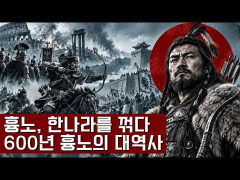
- 설명 앞부분: 한나라와 로마 제국을 절체절명의 위기로 몰아넣은 흉노. 생존을 위해 멈출 수 없었던 초원의 늑대들이 남긴 잔혹하고도 거대한 역사의 진실을 파헤칩니다
- 같은 채널 평소 대비 ×4.1 (채널 최근 롱폼 중앙값 16,018회) · 평소 영상: 100만 대군을 키운 북송은 왜 금나라 군대 앞에 단 한 시간도 버티지 못하고 무너졌는가? (16,018회) / 소수의 만주족 팔기군이 어떻게 거대한 명나라를 오랫동안 무릎 꿇릴 수 있었을까? [잠잘 … (16,808회)
- 대본 없음 (설명) — 음성인식이 끝나면 도입부·흐름이 들어감
- 댓글 4/4: 좋은 점 — 영상 0 · 감사·응원 0 · 더 알고 싶은 것 0 · 아쉬운 점 — 영상 0 · 반박·불만 — 의견 다름 0 · 정치·사회 0 · 경험 공유 0 · 구독·다음 기대 0

### 177. 이 노인 한 명이 조선을 병들게 했다 ∣ 노론의 거두, 송시열의 정체

- https://www.youtube.com/watch?v=trFvm6O6UoA · 역사풀이 · 구독자 6,780 · 조회수 634,823 (×93.6, 하루 5,961.4) · 좋아요 8,693 (1.4%) · 31.5분 · 2026-07-13 · 주제 묶음 3. 조선 · 형식 정보·해설 (그 밖) · 폴더 `W_trFvm6O6UoA` (웹 승인)
- 썸네일: 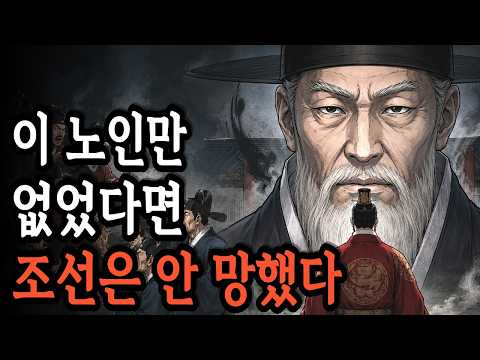
- 설명 앞부분: 왕도 함부로 건드리지 못했던 남자, 송시열. 사약을 받고 죽었지만 조선을 200년간 지배한 인물입니다. 조선왕조실록에 가장 많이 기록된 신하이자, 노론의 거두로서 붕당정치의 중심에 섰던 그는 과연 조선을 지킨 성인이었을까요, 아니면 병들게 한 괴물이었을까요? 효종과 함께 북벌을 꿈꾸던 신하에서 시작해, 예송논쟁으로 왕실과 정면으로 부딪히고, 기사환국으로 사약을 받기까지. 그리고 죽음 이후 문묘에 배향되고 화양서원과 만동묘를 통해 오히려 더 강력해진 그의 그림자는 조선이 끝나는 순간까지 이어졌습니다. 한 사람의 학자가 어떻게 나라 …
- 같은 채널 평소 대비 ×882.9 (채널 최근 롱폼 중앙값 719회) · 평소 영상: 사도세자는 왜 뒤주에서 죽었나 ∣ 영조 부자 비극의 모든 것 (조선 왕실 최악의 사건) (719회) / 이 사람이 살았다면, 조선은 강대국이 되었을 것이다 ∣ 정약용도 인정한 역대급 천재 (706회)
- 대본 없음 (설명) — 음성인식이 끝나면 도입부·흐름이 들어감
- 댓글 1,346/1,432: 좋은 점 — 영상 13 · 감사·응원 11 · 더 알고 싶은 것 1 · 아쉬운 점 — 영상 12 · 반박·불만 — 의견 다름 15 · 정치·사회 155 · 경험 공유 32 · 구독·다음 기대 2
  - 좋은 점 — 영상 👍273 “많이 배웠다는 자들이. 그 본질을 어디에 두고, 당파 싸움만 일삼은 깡통학자들.. 🤣🤣”
  - 좋은 점 — 영상 👍30 “에이고 왕도 참 거시기허네 뜻데로 한게 없구먼, 좋은스승에게 배웠으면 지금 기분이 좋을텐데”
  - 감사·응원 👍15 “조선전기는 한명회의 나라였고, 조선후기는 송시열의 나라였고, 송시열은 여성의 인권을 옮마맨 인물이다 이런 글을 올린신 샘에게 정말 감사합니다 제가 듣고 싶었던 조선의 아픔이었습니다”
  - 감사·응원 👍1 “지금시대와 같네요! 감사합니다”
  - 더 알고 싶은 것 👍0 “조선이 안 망했으면 지금 대한민국은 어떤 모습일까요? 아직도 양반과 쌍놈의 사회로 살고 있을까요?”
  - 아쉬운 점 — 영상 👍0 “지금 현재도 역사는 반복되고 있지”
  - 아쉬운 점 — 영상 👍0 “[ 우리가 역사를 배우는 이유 ] - 역사는 반복되므로 과거를 바탕으로 현재를 바르게 이해하기 위해 (' 비슷한 행위는 비슷한 결과'를 낳는다고 함) - 잘못된 역사를 통해 무엇이 문제인지 알아 또 그런 과오를 되풀이 하지 않기 위해 - 미래의 일을 미리 예측하고 대…”
  - 반박·불만 — 의견 다름 👍1 “역사는 정말 나쁜 놈이 자신의 욕구 충족을 위한 명분 던지면 그에 빠져 훌륭한 사람으로 인식하고 묘사해 사람들을 이끌어 넣고 자신도 인정 받으려 한다잖냐. 그런 위선자이고 기회주의자 들을 온갖 실사여구로 사탕발림해 언어 유희를 최대한의 가치로 뛰우고는 그에 편승해 이…”
  - 반박·불만 — 의견 다름 👍1 “과거도 지금도 미래도 서인이 문제다! 선동 잘하고 선동 하면 잘 따르고 지연 학연 혈연에 목숨 걸고, 반대를 위한 반대를 하고, 사람을 감정에 휘둘리게 헤서 자기 생각 관철 시키는...”
  - 정치·사회 👍270 “송시열 이 영감탱이 때문에 나라가 망햇다니 기가차네”
  - 정치·사회 👍157 “공자가 죽어야 나라가 산다고 50년 전 역사 선생님 말씀이 생각 나네요.”
  - 경험 공유 👍331 “조선이 아닌 송나라에서 태어나야 했었던 인물”
  - 경험 공유 👍15 “조선전기는 한명회의 나라였고, 조선후기는 송시열의 나라였고, 송시열은 여성의 인권을 옮마맨 인물이다 이런 글을 올린신 샘에게 정말 감사합니다 제가 듣고 싶었던 조선의 아픔이었습니다”
  - 구독·다음 기대 👍0 “잘듣고갑니다.구독합니다”
  - 구독·다음 기대 👍0 “혹시~송?역시~~송 구독하고 갑니다.🙏”

### 178. 일본이 억지로 바꿔 놓은 좌측통행, 한국은 차가 7천 대뿐이던 해방 이듬해 통째로 뒤집어 버렸습니다

- https://www.youtube.com/watch?v=r2ziZQKriJI · 경제 이야기꾼 · 구독자 623 · 조회수 16,101 (×25.8, 하루 545.2) · 좋아요 0 (0.0%) · 17.2분 · 2026-09-28 · 주제 묶음 1. 역사 일반·이야기 · 형식 정보·해설 (그 밖) · 폴더 `W_r2ziZQKriJI` (웹 승인)
- 썸네일: 
- 설명 앞부분: 일제강점기 좌측통행을 강요받던 우리나라는 광복 후 어떻게 우측통행으로 바꿨을까요? 7천 대뿐이던 자동차 문화가 지금의 중고차 시장까지 이어진 과정을 살핍니다. 일제강점기 일본의 영향으로 차량이 왼쪽으로 다니던 시절이 있었습니다. 하지만 광복 직후인 1946년, 우리나라는 차량 통행 방식을 오른쪽으로 과감히 뒤집었습니다. 단순히 방향만 바뀐 것이 아니라, 이후 대한민국 자동차 산업이 어떻게 성장하고 체계를 잡아갔는지 그 역사를 확인합니다. 한편, 2025년 1월부터 11월까지 신차의 빈자리를 채우며 급격히 성장한 중고차 시장의 현황…
- 같은 채널 평소 대비 ×7.8 (채널 최근 롱폼 중앙값 2,072회) · 평소 영상: 천원짜리 팔아 18원 남기던 다이소, 이사회에 들어온 일본이 배당을 더 달라 하자 500… (2,110회) / 삼성도 LG도 30년을 못 이긴 김치냉장고 딤채, 법원은 그 회사를 살리지 말고 팔라고 … (2,033회)
- 대본 없음 (설명) — 음성인식이 끝나면 도입부·흐름이 들어감
- 댓글 43/43: 좋은 점 — 영상 0 · 감사·응원 0 · 더 알고 싶은 것 1 · 아쉬운 점 — 영상 2 · 반박·불만 — 의견 다름 1 · 정치·사회 1 · 경험 공유 4 · 구독·다음 기대 0
  - 아쉬운 점 — 영상 👍1 “유튜버들 하나같이 똑같은 이ai목소리를 쓰는데 참으로 희한하단 말이지 한사람이 여러채널을 돌리나... 이ai톤은 시비를 걸어오는 말투라 듣기 상당히 거북하다...”
  - 정치·사회 👍0 “박정희 대통령당시에 전국 모든 초등학교에선 좌측통행을 생활화하는 강제 교육을 했었습니다”
  - 경험 공유 👍0 “박정희 대통령당시에 전국 모든 초등학교에선 좌측통행을 생활화하는 강제 교육을 했었습니다”

### 179. 조선왕조실록이 숨긴 3가지 미스터리ㅣ한국사ㅣ472년의 비밀

- https://www.youtube.com/watch?v=FMHq4YfptwI · 시간이 풀어준 이야기 · 구독자 1,000 · 조회수 141,753 (×141.8, 하루 874.4) · 좋아요 1,874 (1.3%) · 29.4분 · 2026-05-19 · 주제 묶음 3. 조선 · 형식 정보·해설 (그 밖) · 폴더 `W_FMHq4YfptwI` (웹 승인)
- 썸네일: 
- 챕터: 0:00 오프닝 - 472년의 기록 · 0:33 사관이 적지 말았어야 할 것들 · 1:27 미스터리 #1 - 34년간 배회한 존재 · 2:48 중종반정과 조광조 · 4:48 16년 뒤 다시 나타난 존재 · 6:59 중종의 죽음과 마지막 소동 · 10:16 미스터리 #2 - 조선시대범죄 · 13:49 5살 개춘이의 증언 · 18:13 서울 거지 전멸 · 21:15 미스터리 #3 - 자연발화 · 24:25 정약용도 설명 못한 사건 · 28:26 마무리 및 구독 요청
- 설명 앞부분: 조선왕조실록에 기록된 충격적인 3대 미스터리를 소개합니다. 472년 동안 조선의 사관들이 빠짐없이 기록한 실록 속에는 우리가 몰랐던 기이한 사건들이 담겨 있습니다. 유교 국가였던 조선에서 공자는 "군자는 괴이한 것과 귀신을 논하지 않는다"고 했지만, 사관들은 자신들이 목격한 기이한 사건들을 빠짐없이 기록했습니다. 이번 영상에서는 조선시대 실제로 발생한 1. 34년간 궁궐을 배회한 정체불명의 존재 (1511년 창덕궁) 2. 75년간 이어진 충격적인 범죄 사건 3. 사람만 타버린 기이한 화재 사건 세 가지 미스터리를 파헤쳐봅니다. 📚…
- 같은 채널 평소 대비 ×311.5 (채널 최근 롱폼 중앙값 455회) · 평소 영상: 이순신이 밤마다 벌벌 떤 이유...난중일기 40년 파헤친 교수가 경악한 기록 1줄 (455회) / 4살에 입궁? 궁녀가 된 어린 소녀의 충격적인 첫 업무 (380회)
- 대본 없음 (설명) — 음성인식이 끝나면 도입부·흐름이 들어감
- 댓글 115/116: 좋은 점 — 영상 0 · 감사·응원 0 · 더 알고 싶은 것 0 · 아쉬운 점 — 영상 1 · 반박·불만 — 의견 다름 0 · 정치·사회 4 · 경험 공유 1 · 구독·다음 기대 0
  - 아쉬운 점 — 영상 👍0 “서두에서의 "472"년, 조선이 존속한 시간입니다"라는 말은 정정바랍니다. 그건 태조부터 철종까지의 실록을 말하는 거 아닙니까?”
  - 정치·사회 👍21 “옛날부터 사람을 가축잡뜻이 현제까지 최근 인육사건 조선족 오원춘”
  - 정치·사회 👍1 “산사람 신체를 이용하는 옛방식을 지금도사용하는 나라가 있다”
  - 경험 공유 👍3 “1392년부터 1910년까지니까 조선왕조의 역사는 512년이네요.. 물론 조선왕조실록이 472년만 작성되었다니 이유는 모르겠지만요.. 다만 연산군때와 광해군때의 기록은 실록이라고 하지 않고 일기라고 했다고는 알고 있고요.. 어쩌면 조선이 일제의 간접통치(통감부)를 받…”

### 180. 바다에서 태어난 땅, 이름에 새겨진 역사 - 군산 이야기 1부

- https://www.youtube.com/watch?v=Zyz8I6ayBPo · 지식과 서사 · 구독자 453 · 조회수 13,203 (×29.1, 하루 392.4) · 좋아요 61 (0.5%) · 14.1분 · 2026-09-24 · 주제 묶음 1. 역사 일반·이야기 · 형식 정보·해설 (그 밖) · 폴더 `W_Zyz8I6ayBPo` (웹 승인)
- 썸네일: 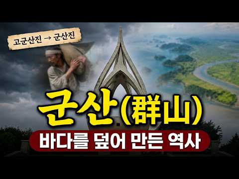
- 설명 앞부분: 내 고향 군산 이야기 1부 — 바다에서 태어난 땅, 이름에 새겨진 역사 많은 분들이 군산 하면 ‘근대 문화유산의 도시’, ‘짬뽕과 단팥빵이 맛있는 여행지’ 정도로 기억하시죠? 하지만 군산의 진짜 얼굴은 우리가 딛고 선 이 땅의 지리와 역사 속에 아주 깊숙이 숨어 있습니다. 인트로 및 군산 이야기 시작 지리적 대반전: 원래는 바다였던 땅과 간척의 역사 '군산(群山)' 지명의 유래와 고군산군도 풍요로운 곡창지대 '옥구'와 판소리 단가 〈호남가〉 군산을 지켜온 두 산: 오성산(오성묘 전설)과 월명산(수시탑) 호남 선교와 민족 교육의 요…
- 같은 채널 평소 대비 ×12.2 (채널 최근 롱폼 중앙값 1,084회) · 평소 영상: 한글날 특집 한글 이야기 정주행 - 주시경에서 공병우까지, 이광수에서 한강 작가까지 (1,103회) / 견리사의(見利思義) - 이익 앞에서 의로움을 선택한 사람들 (1,065회)
- 대본 없음 (설명) — 음성인식이 끝나면 도입부·흐름이 들어감
- 댓글 16/17: 좋은 점 — 영상 0 · 감사·응원 1 · 더 알고 싶은 것 0 · 아쉬운 점 — 영상 1 · 반박·불만 — 의견 다름 0 · 정치·사회 0 · 경험 공유 0 · 구독·다음 기대 0
  - 감사·응원 👍2 “가람 항상응원 합니다. 화이팅”
  - 아쉬운 점 — 영상 👍1 “이야기 구성이 지루하지 않고 ai 같지 않게 재미있어요!! 군산출신인데 48년만에 이런이야기를 처음들어봅니다!! 군산시민필청!! 😂😂😂😂”

### 181. [세계사] 영화 '오디세이' 보기 전 필수! 트로이 전쟁의 숨겨진 이야기는 무엇일까?💡

- https://www.youtube.com/watch?v=Cy5pxD74PzY · 역사리뷰룸 · 구독자 3,160 · 조회수 211,988 (×67.1, 하루 2,737.0) · 좋아요 4,034 (1.9%) · 40.5분 · 2026-08-11 · 주제 묶음 5. 세계사·서양사 · 형식 정보·해설 (그 밖) · 폴더 `W_Cy5pxD74PzY` (웹 승인)
- 썸네일: 
- 챕터: 0:00 트로이 전쟁과 오디세이의 연결 · 1:46 신과 인간이 함께하던 영웅들의 시대 · 3:14 특별한 운명을 안고 태어난 파리스 · 4:53 신들의 결혼식에서 시작된 갈등 · 8:08 파리스 앞에 놓인 세 가지 선택 · 10:30 헬레네와 오디세우스의 등장 · 13:38 전쟁으로 이어지는 결정적 사건 · 17:48 전쟁을 피하려 했던 두 영웅 · 24:37 10년간 이어진 트로이 전쟁 · 29:10 전쟁의 흐름을 바꾼 기발한 전략 · 34:49 신화 속 트로이는 실제로 존재했을까? · 38:23 트로이 전쟁이 오디세이로 이어지는 이유
- 설명 앞부분: 영화 '오디세이'를 보러 가기 전, 이 영상을 안 보고 가면 영화의 절반을 놓치게 됩니다! 🎬 맷 데이먼이 연기하는 오디세우스는 왜 그렇게 집으로 돌아가려고 목숨을 걸었을까요? 수만 명이 죽고 도시 하나가 잿더미가 된 트로이 전쟁, 그 진짜 시작은 아름다운 여인 헬레네가 아니라 신들의 세계에서 던져진 황금 사과 한 알이었습니다.🍎 세 여신의 자존심 싸움부터 오디세우스의 기발한 트로이 목마 작전, 그리고 신화가 역사가 된 슐리만의 발굴 이야기까지! 영화 '오디세이'의 거대한 세계관과 트로이 전쟁의 숨겨진 비하인드를 한 번에 정리해 …
- 같은 채널 평소 대비 ×200.9 (채널 최근 롱폼 중앙값 1,055회) · 평소 영상: [세계사] 이름까지 지워진 왕 투탕카멘, 3천 년 뒤 화려하게 돌아온 이유는?😯 (1,055회) / [세계사] 지구의 얼음이 전부 녹으면 해수면은 무려 몇 m 올라갈까?💡 (1,066회)
- 대본 없음 (설명) — 음성인식이 끝나면 도입부·흐름이 들어감
- 댓글 158/158: 좋은 점 — 영상 8 · 감사·응원 18 · 더 알고 싶은 것 0 · 아쉬운 점 — 영상 1 · 반박·불만 — 의견 다름 1 · 정치·사회 0 · 경험 공유 2 · 구독·다음 기대 0
  - 좋은 점 — 영상 👍16 “트로이 전쟁을 막연히 이해하고 있었는데 정말 설명을 잘해주셔서 유익했어요. 내일 손녀랑 오딧세이를 보러 가기로 예약한 80세 할머니 예요. 감사합니다❤”
  - 좋은 점 — 영상 👍7 “영화 보러 가는 차 안에서 이 유익한 유튜브를 봅니다. 정말 감사합니다 ❤❤❤”
  - 감사·응원 👍19 “정말 재미있네요..ㅎㅎㅎ, 영화 보기 전의 전초 작업으로 아주 봐야 할 영상... 감사히 봅니다.”
  - 감사·응원 👍16 “트로이 전쟁을 막연히 이해하고 있었는데 정말 설명을 잘해주셔서 유익했어요. 내일 손녀랑 오딧세이를 보러 가기로 예약한 80세 할머니 예요. 감사합니다❤”
  - 아쉬운 점 — 영상 👍0 “영화 보니좀 지루 하던데 뭐 감동도 잘 모르겠고... 내가 뭘 몰라서 그런가?”
  - 반박·불만 — 의견 다름 👍1 “와 내용듵으니 영화에 몰리는것도..참 어리석다 유럽도!! 말도 안되는 인간과 알?ㅎㅎ 비현실적인 내용! 신이라는 어리석음! 이 모든 전쟁의 근원!! 현실세계도 그 똑똑한 머리 21세기 우주 과학이 발달해도 어리석게도 신때문에 죽이는 ㅎㅎ”
  - 경험 공유 👍0 “영화 보니좀 지루 하던데 뭐 감동도 잘 모르겠고... 내가 뭘 몰라서 그런가?”

### 182. "조선 최고의 천재다" 전세계가 세종대왕이 만든 한글을 극찬하는 이유

- https://www.youtube.com/watch?v=T2Z6frSqJrs · 한반도 백과사전 · 구독자 5,070 · 조회수 92,888 (×18.3, 하루 4,356.6) · 좋아요 500 (0.5%) · 19.5분 · 2026-10-07 · 주제 묶음 3. 조선 · 형식 정보·해설 (그 밖) · 폴더 `W_T2Z6frSqJrs` (웹 승인)
- 썸네일: 
- 챕터: 0:00 500년 만에 발견된 설계도의 비밀 · 1:00 훈민정음 해례본, 왜 특별할까? · 2:20 사람의 몸에서 탄생한 자음 · 3:41 모음은 세상의 이치를 담았다? · 5:44 한글이 세계 최고인 진짜 이유 · 7:16 세종대왕은 왜 혼자 창제했나? · 11:08 백성을 향한 세종의 고집 · 13:06 어떻게 우리 글자가 되었을까? · 14:54 우리가 한글날을 기념하는 이유 · 15:53 디지털 시대의 천재적 설계 · 17:39 잘못 알려진 한글의 기록들 · 18:23 한글, 우리 삶을 바꾼 위대한 힘
- 설명 앞부분: 🇰🇷세종대왕은 왜 하필 28자로 만들었을까? 세계 언어학자들이 한글을 극찬하는 진짜 이유 1940년 안동에서 마침내 모습을 드러낸 『훈민정음 해례본』은 한글이 사람의 발음 기관을 본떠 철저히 공학적으로 설계된 문자라는 사실을 세상에 알렸습니다. 1443년 창제 이후 450년 동안 백성들의 삶과 문화 속에 깊이 스며든 한글은, 1894년 고종의 칙령 제1호(공문식 제14조)를 통해 마침내 한반도의 정식 공용 문자로 선포되는 역사적 반전을 맞이합니다. 세계적 학자인 재레드 다이아몬드와 제프리 샘슨이 "인류가 만든 가장 독창적이고 완벽…
- 같은 채널 평소 대비 ×4.8 (채널 최근 롱폼 중앙값 19,549회) · 평소 영상: "한글날 100주년의 위대함" 외국인들이 줄 서서 한글을 배우는 진짜 이유 (19,549회) / “속도와 성질머리로 성공한 민족” 전세계 학자들이 분석하고 극찬한 한국의 진짜 성공 이유 (19,442회)
- 대본 없음 (설명) — 음성인식이 끝나면 도입부·흐름이 들어감
- 댓글 28/28: 좋은 점 — 영상 1 · 감사·응원 1 · 더 알고 싶은 것 0 · 아쉬운 점 — 영상 0 · 반박·불만 — 의견 다름 0 · 정치·사회 2 · 경험 공유 0 · 구독·다음 기대 0
  - 감사·응원 👍5 “참으로 대단한 어르신 입니다 세종대왕님 정말 감사합니다~ 잘 설명해주신걸 들으니 가슴이 뜨거워지는 느끼이네요~ 감사합니다 ~”
  - 정치·사회 👍0 “세종대왕 릉이 미국에 있습니다. 조선 임금님이 계신 한양이 워싱턴 디씨였고 중국이였다 일월오봉도 배경이 워싱턴 디씨 포토맥강이 조선의 한강 임진왜란은 미국에서 전쟁이었다 홍무정운 아메리카 대조선, 57, 아메리카 사도세자 저자 박인수 조지 워싱턴 = 사도세자 토마스 …”

### 183. 검은 이빨 [제1화] : 일제강점기 조선인이 중동 사막으로 간 사연⁠

- https://www.youtube.com/watch?v=ZMQZncVWqLk · 도시의 관찰자 | Urban observers · 구독자 230 · 조회수 11,216 (×48.8, 하루 197.1) · 좋아요 89 (0.8%) · 16.9분 · 2026-09-01 · 주제 묶음 4. 한국 근현대사 · 형식 사연·드라마 · 폴더 `W_ZMQZncVWqLk` (웹 승인)
- 썸네일: 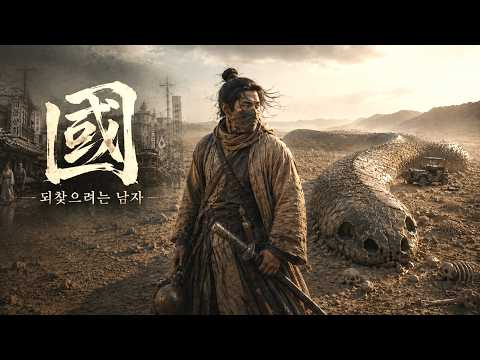
- 설명 앞부분: 일제강점기를 배경으로 한 AI 시네마틱 미스터리 영화 〈검은 이빨〉 1화. 1938년 만주, 나라를 되찾기 위해 움직이던 독립운동가 윤태겸은 한 장의 기록을 따라 중동 사막으로 향한다. 그리고 그곳에서 오래전부터 존재해 온 정체불명의 흔적과 마주한다. 역사와 미스터리, 스릴러가 결합된 시네마틱 시리즈 〈검은 이빨〉. Created, Written, Directed & Edited by 도시의 관찰자
- 같은 채널 평소 대비 ×228.9 (채널 최근 롱폼 중앙값 49회) · 평소 영상: [AI 단편영화] 가족 : 끝내 닿지 못한 마지막 문자 (49회) / [AI 단편영화] 문방구 : 고장 난 시계가 데려간 시간여행 (49회)
- 대본 없음 (설명) — 음성인식이 끝나면 도입부·흐름이 들어감
- 댓글 3/3: 좋은 점 — 영상 0 · 감사·응원 0 · 더 알고 싶은 것 0 · 아쉬운 점 — 영상 0 · 반박·불만 — 의견 다름 0 · 정치·사회 0 · 경험 공유 0 · 구독·다음 기대 0

### 184. 우리가 배운 ‘최초 문명’ 이전 — 바다 밑에서 1만 년 전 흔적이 나왔다

- https://www.youtube.com/watch?v=aMVakhKmWbE · 역사로 가다 · 구독자 853 · 조회수 43,527 (×51.0, 하루 726.6) · 좋아요 164 (0.4%) · 19분 · 2026-08-29 · 주제 묶음 8. 문명·고고학 · 형식 정보·해설 (그 밖) · 폴더 `W_aMVakhKmWbE` (웹 승인)
- 썸네일: 
- 챕터: 0:00 해저 120m — 고대 문명의 흔적은 왜 바다 밑에 … · 2:39 블링커월 — 1만 년 전 발견된 971m 해저 유적 · 6:20 도거랜드 — 빙하기 해수면 상승으로 사라진 거대한 땅 · 9:55 멜트워터 펄스 1A — 340년 동안 바다는 얼마나 … · 13:50 괴베클리 테페 — 최초의 문명보다 앞선 거대한 석조 … · 17:30 최초의 문명 — 우리가 알고 있던 역사의 시작은 정말…
- 설명 앞부분: 고대 문명과 해저 유적 — 우리가 ‘최초의 문명’이라고 배운 시대보다 훨씬 전, 1만 년 전 인류의 흔적이 바다 밑에서 발견되고 있습니다. 블링커월, 도거랜드, 아틀릿 얌 같은 해저 유적과 빙하기 해수면 변화를 따라, 우리가 아는 최초의 문명이 정말 최초였는지 추적합니다. 해저 120m에 잠든 1만 년 — 우리가 아는 ‘최초의 문명’은 정말 최초였을까 약 1만 2천 년 전 마지막 빙하기가 끝나면서 지금보다 약 120m 낮았던 해수면이 상승하기 시작했습니다. 오늘날 바다가 된 곳에는 당시 사람들이 걸어 다니던 땅과 사냥터, 마을이 …
- 같은 채널 평소 대비 ×78.7 (채널 최근 롱폼 중앙값 553회) · 평소 영상: 고대 문명의 주사위에서 시작된 43억 2천만 년 — 지구 나이와 겹친 건 우연일까 (585회) / 다 같 영국인데, 잉글랜드·스코틀랜드·웨일스·북아일랜드는 대체 뭐가 다른 걸까? (521회)
- 대본 없음 (설명) — 음성인식이 끝나면 도입부·흐름이 들어감
- 댓글 37/37: 좋은 점 — 영상 2 · 감사·응원 0 · 더 알고 싶은 것 1 · 아쉬운 점 — 영상 0 · 반박·불만 — 의견 다름 0 · 정치·사회 0 · 경험 공유 0 · 구독·다음 기대 0
  - 좋은 점 — 영상 👍5 “이제야 유튜브에서라도 2차원의 역사학, 고고학이 3차원으로 발전. 국정교과서 저자들 및 강단사학자들은 모두 무뇌자들. 왜 배우는지도 모르고 인수분해를 배웠고, 삼각함수와 미적분은 어디에 쓰이는지도 모르고 선생들의 말은 뜬구름 이었다. 질문과 생각을 할줄알고 하고싶어도…”
  - 좋은 점 — 영상 👍2 “새로운 역사를 알고 갑니다 앞으로도 좋은 영상 많이 부탁드립니다~~”
  - 더 알고 싶은 것 👍2 “새로운 역사를 알고 갑니다 앞으로도 좋은 영상 많이 부탁드립니다~~”

### 185. 왕이 되어 약속을 지키러 돌아왔는데, 정혼녀는 날 거지 취급했다… 진짜 은인은 그녀의 동생이었다!

- https://www.youtube.com/watch?v=Pl3jaa_L3Pw · 역전 극장 · 구독자 22,800 · 조회수 641,872 (×28.1, 하루 19,000.6) · 좋아요 5,007 (0.8%) · 119.3분 · 2026-09-24 · 주제 묶음 기타 · 형식 몰아보기·통합본 (긴 영상) · 폴더 `W_Pl3jaa_L3Pw` (웹 승인)
- 썸네일: 
- 챕터: 0:00 새 왕의 귀환 — 이훤, 약속했던 여인을 중전으로 맞… · 20:10 왕을 가둔 탐관오리 — 신분을 모른 채 이훤을 짓밟는… · 40:05 목숨을 건 진짜 은인 — 박청현이 이훤을 지키다 쓰러… · 60:08 가례연의 덫 — 왕을 조롱한 권문세가들이 스스로 한자… · 80:12 왕의 분노 — 군권까지 등에 업은 탐관오리들과 이훤의…
- 설명 앞부분: 💔거지인 줄 알고 버린 정혼자, 알고 보니 조선의 왕이었다! 그날 탐관오리 가문이 무너졌다... 도시 역전, 복수 반격, 재벌 상속! 통쾌한 남자 중심 숏드라마를 만날 수 있는 역전 극장입니다. 짜릿한 반전과 몰입감 넘치는 전개, 매일 업데이트되는 인기 숏드라마를 지금 바로 만나보세요! 🔥새 왕조의 주상 이훤은 과거 굶어 죽을 위기에 놓였던 자신을 구해 주고 혼인을 약속했던 여인을 중전으로 맞이하기 위해 신분을 숨긴 채 고향 제양군으로 돌아온다. 하지만 그를 기다리고 있을 것이라 믿었던 박화진은 초라한 차림의 이훤을 거지 취급하며…
- 같은 채널 평소 대비 ×104.0 (채널 최근 롱폼 중앙값 6,173회) · 평소 영상: 딸 수술비까지 건 남편… 모두가 욕했지만 그의 진짜 정체는 천재 도박사였다! (6,173회) / 약혼녀 3명은 날 버렸고, 단 1명만 날 선택했다… 그런데 내가 천하무적 신선이라고?! (4,909회)
- 대본 없음 (설명) — 음성인식이 끝나면 도입부·흐름이 들어감
- 댓글 159/435: 좋은 점 — 영상 0 · 감사·응원 4 · 더 알고 싶은 것 0 · 아쉬운 점 — 영상 9 · 반박·불만 — 의견 다름 4 · 정치·사회 10 · 경험 공유 3 · 구독·다음 기대 0
  - 감사·응원 👍8 “이거 짤만보고 끝까지못봐서 찾다가 완본없어서아쉬웟는데 감사😊”
  - 감사·응원 👍2 “영상 감사 합니다. 👍👍👍👏👏👏 ❤❤❤❤❤❤❤”
  - 아쉬운 점 — 영상 👍4 “영상은 잘만었네요 2시간을 지루함 없이 잘봐씁니다.”
  - 아쉬운 점 — 영상 👍3 “중국거 처럼 질질 끌고 말도 않되는 상황이 많네여 보실분들은 다 넘기고 결론만 보세요”
  - 반박·불만 — 의견 다름 👍0 “이거 배경만 우리나라지, 전형적인 중국 스토리. 이렇게 유치 찬란한 어이없는 스토리가 처음부터 끝까지 이어짐.”
  - 반박·불만 — 의견 다름 👍0 “왕이 멍청멍청 고구마열매 먹었나..그리고 중국에서 만들어 그런가 말도안돼는 억지억지 우격다짐과 꽥꽥 소리지르기..극한까지 몰고 간다고 너무 억지..중국판만 보다 한국판으로 보는데도 역시 말도 안돼..”
  - 정치·사회 👍2 “ㅋㅋ. 위계가 고증이 안됨. 현대판 훌륭하신 이재명. 대통령님.”
  - 정치·사회 👍0 “계속 소리만 지르고 앞으로 감기 않했으면 2시간동안 같은 내용반복할뻔 했네 저런놈이 왕이니 나라가 저지경이지~~ㅋㅋ”
  - 경험 공유 👍0 “30분을 내가 주상이다 기다림 ㅋ”
  - 경험 공유 👍0 “너 내가 누군지 몰라? 니 상관 데려와. 너도 나 몰라? 니 상관 데려와. 너도 나 몰라? 니 상관 데려와. 반복하다 쨔란! 나 사실 왕임”

### 186. 조선의 왕이 죽고나면 벌어지는 일│ 조선왕릉의 비밀

- https://www.youtube.com/watch?v=_mtXC7plYVs · 역사잼잼 · 구독자 2,910 · 조회수 255,564 (×87.8, 하루 2,419.5) · 좋아요 1,777 (0.7%) · 17.2분 · 2026-07-14 · 주제 묶음 3. 조선 · 형식 정보·해설 (그 밖) · 폴더 `W__mtXC7plYVs` (웹 승인)
- 썸네일: 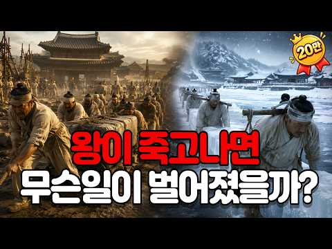
- 설명 앞부분: 조선의 왕은 세상을 떠난 뒤 곧바로 묻히지 않았습니다. 왕릉이 완성될 때까지 약 다섯 달 동안 궁궐 안 빈전에 머물러야 했습니다. 냉장고도, 방부 처리도 없던 시대. 특히 한여름에 왕이 승하했다면 조선은 어떻게 시신을 보존했을까요? 왕이 죽은 뒤에도 다섯 달 동안 이어졌던 조선 왕실의 놀라운 장례 문화를 함께 만나보세요. 타임라인 참고 본 영상은 아래 자료들을 바탕으로 재구성하였습니다. 문헌 조선왕조실록 『경국대전』 · 『국조오례의』 · 『상례비요』 국장도감의궤 · 빈전도감의궤 · 산릉도감의궤 단행본 이호일, 『조선의 왕릉』 신병…
- 같은 채널 평소 대비 ×288.0 (채널 최근 롱폼 중앙값 888회) · 평소 영상: 영화 오디세이에 나오지 않은 섬들의 충격적인 비밀 총정리 ∣ 오디세이 원작 2부 ∣ ∣ … (916회) / 조선이 버린 천한 섬 제주도에서 어떻게 기생이 최고부자가 되었을까? ∣ 정조가 인정한 김… (859회)
- 대본 없음 (설명) — 음성인식이 끝나면 도입부·흐름이 들어감
- 댓글 117/117: 좋은 점 — 영상 1 · 감사·응원 2 · 더 알고 싶은 것 0 · 아쉬운 점 — 영상 0 · 반박·불만 — 의견 다름 2 · 정치·사회 3 · 경험 공유 2 · 구독·다음 기대 1
  - 좋은 점 — 영상 👍8 “좋은내용이네요 감사합니다~”
  - 감사·응원 👍8 “좋은내용이네요 감사합니다~”
  - 감사·응원 👍1 “귀중한 영상 올려주셔서 감사합니다 구독 좋아요 알림설정 신청합니다 ❤”
  - 반박·불만 — 의견 다름 👍5 “그리고 선정릉도 회격 발랐어요 석곽 아닙니다 당시 왜군들이 수천명이 달라들어 무쟈게 힘들게 도굴했답니다 그래서 너무 열받아서 시신을 마구 회손 했답니다. 보물은 나온것도 없고 하니”
  - 반박·불만 — 의견 다름 👍0 “아무리 AI로 만들었다지만 내시 의복과 감투 그리고 상중인데 감투가 검정색! 가장 어이없는 상황 여자가 곤룡포 입고 있고 왕에 익선관은 일반 감투 어이가 음다”
  - 정치·사회 👍4 “성종의 유해는 끝내 발견되지 못했다. 조선은 도쿠가와 이에야스에게 선릉과 정릉을 도굴한 도굴범을 잡아달라고 요구했다. 도쿠가와 이에야스의 입장에서 보면, 본인이 임진왜란에 참전한 것도 아니고, 누가 도굴했는지를 찾기란, 해변에서 바늘찾기나 다름 없었다. 결국 도쿠가와…”
  - 정치·사회 👍2 “한국도 대통령없애라 국민등골무너진다”
  - 경험 공유 👍10 “내가 그 시대 왕이었다면...내가 직접 준비해 놨을 듯....ㅎ”
  - 경험 공유 👍2 “왕 하나의 죽음으로 많은 시간과 저 많은 인력들이 소비됐으니 내가 왕이었다면 궁궐 장례 절차를 뜯어 고쳤을 듯 죽어서 백성이나 신하들에게 민폐 끼치지 않게..”
  - 구독·다음 기대 👍1 “귀중한 영상 올려주셔서 감사합니다 구독 좋아요 알림설정 신청합니다 ❤”

### 187. 나라 팔아먹고 200년째 떵떵거리는 집안들 (친일파 후손 TOP 10)

- https://www.youtube.com/watch?v=DNKL5ihsgO8 · 검은노트 · 구독자 1,060 · 조회수 66,734 (×63.0, 하루 866.2) · 좋아요 2,054 (3.1%) · 13.4분 · 2026-08-12 · 주제 묶음 1. 역사 일반·이야기 · 형식 정보·해설 (그 밖) · 폴더 `W_DNKL5ihsgO8` (웹 승인)
- 썸네일: 
- 설명 앞부분: "4대째 의사 집안입니다" — 자랑스럽게 말한 배우의 증조할아버지는 이완용과 같은 단체 소속이었습니다. 독립운동가 후손들이 반지하와 임대아파트를 전전하는 사이, 친일파 후손들은 국회의원이 되고, 국립대 총장이 되고, 대통령의 아버지가 됩니다. 배우 하영, 강동원, 이지아부터 이완용, 홍영표, 신기남까지 나라를 팔아먹은 대가가 100년이 지난 지금까지 어떻게 대물림되고 있는지, 10명의 실제 기록으로 파헤칩니다. 타임스탬프
- 같은 채널 평소 대비 ×90.1 (채널 최근 롱폼 중앙값 741회) · 평소 영상: 지구상 가장 위험한 접근금지구역 8곳 (751회) / 일본 쇠말뚝 괴담의 실체ㅣ'실화모티브'라던 영화 뒤 숨은 실제 이야기 (731회)
- 대본 없음 (설명) — 음성인식이 끝나면 도입부·흐름이 들어감
- 댓글 471/471: 좋은 점 — 영상 2 · 감사·응원 7 · 더 알고 싶은 것 5 · 아쉬운 점 — 영상 0 · 반박·불만 — 의견 다름 9 · 정치·사회 78 · 경험 공유 7 · 구독·다음 기대 0
  - 좋은 점 — 영상 👍1 “독립운동 존경합니다 근데 친일파한테 잣대는 심하면서 종북간첩 세력은 왜 판치는걸까요? 625 참전 용사들 싹 다 무시하고 일본에 리틀보이를 날려 독립에 큰 도움이 됐던 미국은 왜 싫어하는걸까요 ㅠㅠㅠ”
  - 좋은 점 — 영상 👍0 “매우좋고 유익합니다❤❤❤❤❤❤”
  - 감사·응원 👍14 “비록 가진건 없지만 독립운동 유공자 후손이란 걸 물려주신 할아버지 늘고맙고 감사합니다. 저렇게 친일행동 보상으로 후손이 떵떵거리고 잘사는것 보다 더 당당하고 떳떳하고 할아버지 닮아 나라사랑하는 애국심이 강합니다 . 독립유공자 후손 지원으로 국가에서 일년에 두번 삼일절…”
  - 감사·응원 👍1 “연좌제. 하면 안됩니다. 할아 버지 재산 감사 ㅎㅎ.”
  - 더 알고 싶은 것 👍8 “동족죽인 공산세력 후손명담도 올려주세요. 오하려 그게 더나쁨”
  - 더 알고 싶은 것 👍5 “625때 부역자 후손ㅇ도 궁금해요.”
  - 반박·불만 — 의견 다름 👍13 “가장 최근 우리나라를 공격한 나라는 중공군과 북한이다. 625 때 수백만 사망했고 지금도 우리나라 공격하겠다고 한다. 일본은 총리선에서 수차례 사과를 했는데 중공군과 북한은 사과한번 안했다. 연좌제 반대한다! 친일파는 김일성이 북한 토지 몰수할 때 썼던 프레임인데 1…”
  - 반박·불만 — 의견 다름 👍12 “100년도 넘었는데 아직도 친일파 타령이라? 친일파 타령하는 당신네 조상들은 한국 영토내에 있었는데 모두 친일파가 아니라고 할수있나? 독립운동가 후손들이 못살았다는데 정말 그럴까? 선동가들에게 속지 말고 하나하나 떠져보시요/ 김구선생 자손은 손자까지 장관하고 떵떵거리…”
  - 정치·사회 👍91 “나라가 어려울 때 누구보다 앞장서 친일을 하거나 나라를 팔아먹어야 후손이 편한 삶을 살 수 있다는 교훈이 얻어지는구나 참 어이가없다.”
  - 정치·사회 👍54 “홍영표는 웃기늕넘이네 돈으로국회원”
  - 경험 공유 👍2 “배우 이서진은 이상용 선생님과 32촌 관계며 친족도 아님..위에서 말하는 진희규가 친 외증조부인데 친일파 후손임을 숨기기 위해 이상용 선생님의 직계후손인것 처럼 세탁한것 같음. 실제 이상용 선생님 후손들이 이서진은 우리와 관련이 없다고 언론과 인터뷰했었지.. 이서진은…”
  - 경험 공유 👍0 “자랑하고 싶어 입이 엄청 건질건질 했었네요”

### 188. 단종의 친누나 경혜공주, 세조에게 한 조선 역사상 가장 잔인한 복수

- https://www.youtube.com/watch?v=wX-80QWb2tg · 시간책방 · 구독자 8,850 · 조회수 1,014,571 (×114.6, 하루 7,149.0) · 좋아요 24,064 (2.4%) · 36.6분 · 2026-06-08 · 주제 묶음 1. 역사 일반·이야기 · 형식 정보·해설 (그 밖) · 폴더 `W_wX-80QWb2tg` (웹 승인)
- 썸네일: 
- 챕터: 0:00 내 가족을 죽인 사람에게 아이를 맡길 수 있습니까? · 2:15 경혜공주의 탄생과 어머니의 비극 · 6:00 인생에서 가장 빛나던 2년 · 7:40 계유정난 — 누나 집에서 끌려간 동생 · 8:55 남편 유배와 경혜공주의 첫 번째 저항 · 12:45 사육신 사건과 연쇄 비극 · 17:15 칼 없는 복수의 시작 — 아이를 원수에게 보내다 · 24:15 세조의 유언 — 감옥의 문을 잠그다 · 25:50 단종의 저주, 세조 집안에 드리운 그림자 · 27:30 4대에 걸친 설계 — 정미수의 등용 · 31:25 어머니를 닮은 아들 · 31:50 경혜공주의 죽음과 정순왕후의 64년 침묵 · 35:55 570년 뒤, 당신에게 묻습니다
- 설명 앞부분: 왕의 딸에서 노비로. 남편은 사지가 찢겨 죽고, 남동생은 열일곱에 세상을 떠났습니다. 그런데 이 여자는 칼을 들지 않았습니다. 대신 여섯 살 아들을 원수의 궁궐로 보냈습니다. 그 선택 하나가 세조의 가슴에 가시가 되어 박혔고, 그 가시는 4대의 왕이 바뀌는 동안에도 끝내 빠지지 않았습니다. 조선왕조 500년, 공주에서 노비로 떨어진 유일한 기록. 경혜공주의 이야기입니다. ⏱️ 타임스탬프 이 영상은 조선왕조실록, 성종실록, 세조실록 등의 사료를 바탕으로 재구성하였습니다.
- 같은 채널 평소 대비 ×647.0 (채널 최근 롱폼 중앙값 1,568회) · 평소 영상: 조선 왕들은 왜 46세에 죽었나? 경복궁 흙이 밝힌 충격적 진실 (1,641회) / 세조는 왜 친동생 안평대군을 죽였나? 조선 최고의 천재가 사라진 진짜 이유 (1,495회)
- 대본 없음 (설명) — 음성인식이 끝나면 도입부·흐름이 들어감
- 댓글 864/903: 좋은 점 — 영상 11 · 감사·응원 23 · 더 알고 싶은 것 6 · 아쉬운 점 — 영상 6 · 반박·불만 — 의견 다름 4 · 정치·사회 23 · 경험 공유 11 · 구독·다음 기대 0
  - 좋은 점 — 영상 👍27 “영화 왕과사는남자를 보고 말씀을 들으니 더 마음이 아프네요... 귀에 쏙~ 들어오면서 역사공부를 제대로 하였습니다... 감사합니다”
  - 좋은 점 — 영상 👍10 “좋은영상 잘 보았습니다. 감사합니다 ~”
  - 감사·응원 👍122 “이야기 너무 생생하게 잘 전달해 주셔서 감사합니다 경혜공주, 정말 대단한 어머니이네요 아름다운 영상으로 보여주니 더 생생하게 다가옵니다 감사합니다”
  - 감사·응원 👍40 “중간에 광고없이 듣게 돼서 너무 감사 했어요 .설명도 잘 이해 할수있도록 부연설명해주시고 …”
  - 더 알고 싶은 것 👍40 “(권순임)현덕왕후님.경혜 공주님과.임금이신 단종을 두시고 어떻게 눈을 감으셨나요?참으로 가슴이 찢어지게 아파 옵니다.그리고 하염없이 눈물이 흘러 내립니다.현덕 왕후님 이제는 하늘에세 편안하게 쉬세요.🙏🙏🙏🎉🎉🎉”
  - 더 알고 싶은 것 👍7 “정미수의 여동생은 어떻게 되었나요?”
  - 아쉬운 점 — 영상 👍5 “내용 너무 좋아요. 진짜 잘 보고 갑니다. 근데 ai이미지에서 결혼안한 아이가 상투를 틀고 있다던가 팔이 세개가 있다던가 하는 부분들이 아쉬워요ㅜㅜㅜ”
  - 아쉬운 점 — 영상 👍4 “유익하고 조선왕조 실록 등 사료에 충실하게 영상 제작해주셔서 고맙습니다. 저는 해주정씨 종파 후손입니다. 즉 영양위 할아버지와 경혜공주 할머니의 직계후손입니다. 경혜공주 할머니의 자애로운 모성과 미수할아버지의 효심과 선행을 잘 표현해 주셔서 특히 고맙습니다. 한가지 …”
  - 반박·불만 — 의견 다름 👍35 “세조, 이유. 이 인물은 사람 아닙니다. 작금의 누구하고 비슷하죠.. 악마의 화신들..ㅎㅎ”
  - 반박·불만 — 의견 다름 👍1 “요새도 말도 안되는 한방이 치료랍시고 하는것 보면 참 한심해. 궁궐에서도 저리 쉽게 죽는거도 못 막으면서 무슨 치료한답시고 설치는지. 사기좀 그만 치면 그나마 나을텐데.”
  - 정치·사회 👍8 “세조의 잔인성이 이재명한테 옮겨붙었구나...”
  - 정치·사회 👍2 “세조는 천벌을 받았고 경혜공주의 복수는 성공했다 지금의 정권은 귀담아들어라”
  - 경험 공유 👍5 “이 이야기에 나오는 여자들의 한 뿐만 아니라, 그 외의 많은 여자들의 한이 쌓이고 쌓여 조선왕조의 저주가 줄줄이 이어지고, 그 결과가 순종에서 끝나고, 그 저주는 단명과 무능으로 시착되어 결국 망국에 이르고, 그 폐혜는 모두 온국민이 감당했습니다. 저는 개인적으로 '…”
  - 경험 공유 👍4 “문종에게 아들 딸이 있엇다는건 나도 알고 있었죠. 문종 단종으로 대가 이어졌다면 역사도 달라졌지요. 세종 문종 단종으로이어졌던.대가.”

### 189. 단종보다 10배 더 슬픈 광해군의 19년 생지옥… 원수의 파멸을 두 눈으로 지켜본 늙은 왕!

- https://www.youtube.com/watch?v=P9nHouyJ1Hg · 근본한국사 · 구독자 3,020 · 조회수 423,113 (×140.1, 하루 2,424.1) · 좋아요 2,859 (0.7%) · 13.9분 · 2026-05-06 · 주제 묶음 3. 조선 · 형식 사연·드라마 · 폴더 `W_P9nHouyJ1Hg` (웹 승인)
- 썸네일: 
- 챕터: 0:00 💀 1641년, 제주도의 비참한 노인 (도입) · 1:08 👑 단종 vs 광해군 — 누가 더 비참했나 · 1:55 ⚔️ 18살 영웅의 등장 — 임진왜란과 광해군 · 3:30 🏯 33살, 천신만고 끝에 오른 피 묻은 용상 · 4:25 🎭 천재적 양다리 외교와 사대부의 분노 · 5:50 🔥 1623년 그믐밤, 인조반정의 서막 · 7:00 🌵 강화도 위리안치 — 70일 땅굴과 가족의 몰살 · 9:30 🌊 제주도 유배 — "이 또한 다 지나가느니라" · 11:15 ❄️ 인조의 업보 — 병자호란과 삼전도 굴욕 · 12:30 🕯️ 1641년 7월 1일 — 늙은 왕의 마지막 복수극 · 13:30 📜 역사가 끝내 들어준 광해군의 손 (마무리)
- 설명 앞부분: 조선 광해군 비참한 최후, 단종보다 더 슬픈 19년 유배 생지옥의 충격 실화입니다. 인조반정으로 쫓겨난 폐주 광해군이 강화도와 제주도에서 가족을 모두 잃고 살아남은 19년의 진실. 원수 인조의 삼전도 굴욕과 비참한 자멸을 끝까지 지켜본 조선 역사상 가장 서늘한 복수극. 🏯 1641년, 칼바람이 살점을 에는 제주도의 어느 낡은 초가집. 다 해진 누더기를 덮은 67세 노인이 피를 토하며 홀로 숨을 거둡니다. 아내, 아들, 며느리, 어린 손주들까지 두 눈앞에서 끔찍하게 몰살당한 채로요. 이 비참한 노인은 한때 조선 팔도를 호령하던 15…
- 같은 채널 평소 대비 ×377.4 (채널 최근 롱폼 중앙값 1,121회) · 평소 영상: 형제를 죽인 이방원, 그가 유일하게 두려워한 적은 친아버지 이성계였다 ∣ 왕자의 난·조사… (1,121회) / 연산군 중종반정의 숨겨진 진실, 진성대군은 정말 몰랐을까? (소름주의) (1,105회)
- 대본 없음 (설명) — 음성인식이 끝나면 도입부·흐름이 들어감
- 댓글 586/586: 좋은 점 — 영상 5 · 감사·응원 6 · 더 알고 싶은 것 5 · 아쉬운 점 — 영상 3 · 반박·불만 — 의견 다름 5 · 정치·사회 25 · 경험 공유 15 · 구독·다음 기대 0
  - 좋은 점 — 영상 👍7 “역사를 알아야 미래도있다는말 공감합니다 지금이 역사의 반복과 같네요”
  - 좋은 점 — 영상 👍1 “광해군의 이야기가 궁금했는데 이해하기 쉽게 설명도 잘되어있어서 집중하면서봤습니다 덕분에 도움이됬습니다 감사합니다”
  - 감사·응원 👍5 “저도 광해군 이야기를 들으면 어찌이리도 슬픈지 ㅠ 전쟁의 현장에서 백성들과도 함께했던.. 영상 감사합니다”
  - 감사·응원 👍2 “너무 잘 들었습니다 너무 감사하게 공감해서 좋아요와 구독을 눌렀고 지금부터 다 볼려구합니다😂”
  - 더 알고 싶은 것 👍1 “그외 패륜도 10개만 더 알려주세요”
  - 더 알고 싶은 것 👍1 “근데 조선 5백년 역사상 제대로 된왕이 몄명이나 되나요 ?”
  - 아쉬운 점 — 영상 👍10 “현재 상황이랑 비슷하게 역사는 반복되네 .”
  - 아쉬운 점 — 영상 👍1 “이때 홍타이지가 인조를 폐위시키고 광해군을 다시 복위시겻다면 역사가 얼마나 재미잇어졋을까요 아쉽네요.”
  - 반박·불만 — 의견 다름 👍2 “조선 최악의 왕 인조...미치광이 아버지 정원군을 광해군이 죽인것에 앙심품고 말도 안되는 반정으로 왕이 되어 나라를 파멸로 이끈 연산군보다 나쁜놈!”
  - 반박·불만 — 의견 다름 👍1 “허나 광해도 완벽은 아닌것이 대표적으로 궁궐 건축한답시고 화약 소모에 백성들 힘들게 한것을 생각하면,, 글쎄?,,”
  - 정치·사회 👍15 “연산은 폭군이 맞지만 광해는 기득권 세력들이 조작한 폭군아닌 성군 세종 광해 효종 소현세자 정조 이런 군주만 있었으면 조선이 좀더 발전된 나라가 되었을텐데...”
  - 정치·사회 👍4 “절만 받고 돌아갈게 아니라 명분만을 앞세워 청에 적대적 이었던 인조를 마땅히 폐위 시키고 등거리 실리 외교로 청에 우호적 이였던 광해군을 재옹립 시켰어야 역사가 달라졌을 텐데 홍타이지의 오판으로 하나같이 왕답지도 않은 무능한 왕으로 계보가 이어지게 됨에따라 종당엔 식…”
  - 경험 공유 👍5 “저도 광해군 이야기를 들으면 어찌이리도 슬픈지 ㅠ 전쟁의 현장에서 백성들과도 함께했던.. 영상 감사합니다”
  - 경험 공유 👍3 “나도 이분광해군이 19년이란세월을 힘들게살아온 광해군이단종보다불쌍했어요”

### 190. 《중국 역사》 고대 중국, 남자 첩이 여자 첩보다 더 비극적이었던 이유는? l 역사 인물 l 고전

- https://www.youtube.com/watch?v=jcUvSMjefq8 ·  역사 산책: 동양편 · 구독자 2,770 · 조회수 164,122 (×59.2, 하루 2,191.5) · 좋아요 653 (0.4%) · 23.4분 · 2026-08-03 · 주제 묶음 1. 역사 일반·이야기 · 형식 정보·해설 (그 밖) · 폴더 `W_jcUvSMjefq8` (웹 승인)
- 썸네일: 
- 같은 채널 평소 대비 ×25.5 (채널 최근 롱폼 중앙값 6,426회) · 평소 영상: 《삼국지》 유비는 왜 동문 공손찬의 등에 칼을 꽂았을까? l 역사 인물 l 고전 (7,251회) / 《삼국지》 조조의 손자 조예, 위나라를 파멸로 몰았던 이유는? l 역사 인물 l 고전 (5,600회)
- 대본 없음 (없음) — 음성인식이 끝나면 도입부·흐름이 들어감
- 댓글 87/87: 좋은 점 — 영상 1 · 감사·응원 1 · 더 알고 싶은 것 2 · 아쉬운 점 — 영상 0 · 반박·불만 — 의견 다름 1 · 정치·사회 2 · 경험 공유 2 · 구독·다음 기대 0
  - 좋은 점 — 영상 👍6 “좋은 영상 재미있게 보고 갑니다♡”
  - 감사·응원 👍1 “감사합니다 🎉🎉🎉”
  - 더 알고 싶은 것 👍8 “세상에나 그 당시에도 동성애가 성했네요. 에고... 글자 화면 뒤에 끊임없이 움직이는 동영상은 안 올리면 안되나요? 집중력도 떨어지고, 어지럽고 정신 사나워요.”
  - 더 알고 싶은 것 👍2 “인간이 이렇게 잔인합니다 그들은 얼마나 고통스러웠을까요?”
  - 정치·사회 👍0 “오늘날에도 중국에서 저런일이 벌어지고 있지 않나? 위멍롱 사건. 735사건 등.. 아마 중국 연예인들이나 일반 사람들 인신매매 장기척출 인육 등..중국은 천벌 받아야 한다.중국은 자기들 죄로 반드시 쪼개져 역사속에서 다시는 하나의 나라가 되지 못할거다.”
  - 경험 공유 👍0 “내가 30년전 알던 어느 광고전문 감독에게 들었는데 그당시 연예계에서 스타가된 남자배우치고 앙드레 김에게 항문을 바치지 않고는 스타가되기가 하늘에 별따기라고 했다..노예계약의 협박용으로 강제로 강요당한 성관계 테이프도 한편식 다 완성해놔야 했다고 했다..그게.. 30…”

### 191. 풍수 전문가들이 현충원 최고 명당으로 지목한 곳은 대통령 묘가 아니었습니다

- https://www.youtube.com/watch?v=c0O8c0NcFog · 역사파인더 · 구독자 3,650 · 조회수 309,038 (×84.7, 하루 2,860.7) · 좋아요 7,659 (2.5%) · 39.8분 · 2026-07-12 · 주제 묶음 기타 · 형식 정보·해설 (그 밖) · 폴더 `W_c0O8c0NcFog` (웹 승인)
- 썸네일: 
- 챕터: 0:00 현충원 한복판의 정체불명 무덤 · 3:12 풍수 최고 명당, 대통령 묘가 아니다 · 6:45 창빈 안씨는 누구인가 — 아홉 살 궁녀 · 10:20 중종의 후궁 9명, 누가 살아남았나 · 15:38 문정왕후가 유일하게 지켜준 후궁 · 19:05 손자가 왕이 되다 — 선조 즉위의 비밀 · 24:30 동작릉의 탄생과 몰락 · 28:15 한국전쟁, 그리고 현충원이 된 명당 · 33:40 대통령들 사이에 끼인 470년의 터줏대감 · 37:20 가장 조용했던 여인이 가장 오래 남은 이유
- 설명 앞부분: 현충원 한복판에 470년 된 조선시대 무덤이 있습니다. 이승만 대통령 묘소 바로 옆. 김대중 대통령 묘소 바로 옆. 2010년까지 안내판조차 없었던 이 무덤의 주인은, 조선 중종의 후궁 — 창빈 안씨입니다. 아홉 살에 궁녀로 들어간 가난한 집 딸. 후궁 아홉 명 중 가장 조용했던 여인. 그런데 이 여인이 죽고 나서, 조선의 핏줄이 통째로 바뀝니다. 선조부터 순종까지 340년간 14명의 왕이, 전부 이 한 사람의 후손입니다. 풍수 전문가들은 현충원 전체에서 가장 좋은 자리, 이른바 "혈 자리"가 대통령 묘역이 아니라 이 470년 된…
- 같은 채널 평소 대비 ×500.1 (채널 최근 롱폼 중앙값 618회) · 평소 영상: 신라의 운명을 바꿀 뻔했던 남자, 장보고의 진짜 정체 (618회) / 명나라 황제 16명 중, 조선 여인을 아내로 맞은 건 몇 명이었을까 (618회)
- 대본 없음 (설명) — 음성인식이 끝나면 도입부·흐름이 들어감
- 댓글 643/643: 좋은 점 — 영상 5 · 감사·응원 21 · 더 알고 싶은 것 8 · 아쉬운 점 — 영상 0 · 반박·불만 — 의견 다름 8 · 정치·사회 76 · 경험 공유 16 · 구독·다음 기대 1
  - 좋은 점 — 영상 👍64 “나는현충원에 그런분이 묘가있는줄도 모랐어요 고마워요 그런 유래을 알려주셔서요 감사합니다”
  - 좋은 점 — 영상 👍31 “좋은 영상이네요~ 구독하고 갑니다~~”
  - 감사·응원 👍64 “나는현충원에 그런분이 묘가있는줄도 모랐어요 고마워요 그런 유래을 알려주셔서요 감사합니다”
  - 감사·응원 👍58 “오래된 역사를 알게 되어서 감사합니다~~❤😂❤”
  - 더 알고 싶은 것 👍24 “옛 이야기지만. 고맙습니다 다시듣고들어봐도 풀리지 았아던 내용 정말 휼륭하네요 좋은것 많이 올려주세요”
  - 더 알고 싶은 것 👍7 “현충원 가면 필히 가보야 겠네요 궁금해서리”
  - 반박·불만 — 의견 다름 👍23 “조선 제일의 멍청한 왕이 선조인데...참 웃기는 얘기네요...”
  - 반박·불만 — 의견 다름 👍9 “김대중은 거기 있을 인물이 아닌데~”
  - 정치·사회 👍88 “살아생전 덕을 많이쌓고 바르게 살면 그후손이 복을받고 나라가 잘된다는 만고의 진리”
  - 정치·사회 👍61 “김대중 대통령은 광주 518 묘역에 뫼셔야죠. 잘못 뫼셨네요.”
  - 경험 공유 👍20 “"북한이 핵을 개발하면 내가 책임진다."고 한 김대중이가 왜 그 곳에서 나오나. 핵개발용 자금까지 보내준 자가 격이 맞지 않습니다.”
  - 경험 공유 👍10 “빨개이 자슥의 묘는 파묘해여 한다. 아울러 또 하나 가짜 보수의 묘도... 잠들어 있는 호국영령들에 대한 모욕 입니다. 조만간 저도 조상이신 창빈 순흥안씨의 묘를 찾아 뵈어야겠네요.”
  - 구독·다음 기대 👍31 “좋은 영상이네요~ 구독하고 갑니다~~”

### 192. 산에서 쓰러진 사내를 아버지라 부른 7살 딸, 그는 사실 도망 중인 임금이었는데... 옛날이야기 ∣ 민담 ∣ 야담ㅣ수면동화 ∣ 오디오북

- https://www.youtube.com/watch?v=jApSZXpwkLE · 야담야사 라디오 · 구독자 8,270 · 조회수 283,626 (×34.3, 하루 6,421.1) · 좋아요 6,686 (2.4%) · 102.7분 · 2026-09-14 · 주제 묶음 9. 야사·야담·옛날이야기 · 형식 수면·낭독 (잠잘 때 듣는) · 폴더 `W_jApSZXpwkLE` (웹 승인)
- 썸네일: 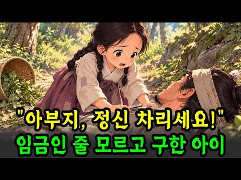
- 설명 앞부분: ‘야담야사 라디오'는 조선 시대 야담, 실화 민담, 옛날 이야기, 전설, 설화, 이야기를 차분한 낭독 형식으로 전하는 오디오북 채널입니다. 잠들기 전 듣는 이야기, 운전 중 편안히 들을 수 있는 이야기, 50대·60대·70대 시청자분들께 특히 잘 어울리는 조용하고 단정한 밤 이야기 콘텐츠를 전합니다. 자극적이지 않게, 그러나 깊이 있게. 사람의 정과 삶의 지혜가 남는 이야기를 전하겠습니다. 😊 📝오늘의 이야기 요약글 “아부지… 정신 차리세요!” 산속 풀숲에 쓰러진 사내를 발견한 일곱 살 복순이의 목소리가 산을 울렸습니다. 2년 전…
- 같은 채널 평소 대비 ×284.8 (채널 최근 롱폼 중앙값 996회) · 평소 영상: 논에 소금뿌린 바보며느리,쫓겨날 줄 알았는데 대풍년 민담ㅣ옛날이야기ㅣ수면동화ㅣ인생이야기ㅣ… (996회) / 떠돌이 장터 거지를 남편으로 사들인 객주 딸 옛날 이야기 ∣ 민담 ∣ 수면동화 ∣ 오디오북 (1,015회)
- 대본 없음 (설명) — 음성인식이 끝나면 도입부·흐름이 들어감
- 댓글 357/416: 좋은 점 — 영상 3 · 감사·응원 34 · 더 알고 싶은 것 2 · 아쉬운 점 — 영상 3 · 반박·불만 — 의견 다름 0 · 정치·사회 3 · 경험 공유 4 · 구독·다음 기대 1
  - 좋은 점 — 영상 👍2 “옛날이야기라 그런지 더욱 정겹고 즐겁게 잘 들었습니다. 어릴 적 어른들께 듣던 이야기도 떠올라 마음이 따뜻해지네요. 좋은 이야기 늘 응원합니다.”
  - 좋은 점 — 영상 👍1 “목소리가 너무 좋아서 몰입해서 들었어요. 슬프면서도 감동적인 이야기라 긴 줄도 모르고 끝까지 들었네요. 좋은 영상 감사합니다!”
  - 감사·응원 👍13 “옛날에 이야기가 제법 즐기면서 ❤유친하고 응원합니다 선물 🎁 👍”
  - 감사·응원 👍10 “부산에서듯고이습니다감사합니다❤❤❤❤❤”
  - 더 알고 싶은 것 👍10 “언제오나요?? 행복이요”
  - 더 알고 싶은 것 👍0 “Bạn có thể dùng bình luận này, vừa **logic vừa tạo tò mò**, hợp với nội dung 야담: > **7살 어린 딸이 쓰러진 사내를 아버지라고 부른 순간, 단순한 우연이라고 보기엔 너무 많은 것이 연결되어 있네요. 도…”
  - 아쉬운 점 — 영상 👍2 “나오는 사람들이 직접 그목소리로 들려주면 지루히ㅣ지않고 재미있어오”
  - 아쉬운 점 — 영상 👍1 “목소리가 너무 좋아서 몰입해서 들었어요. 슬프면서도 감동적인 이야기라 긴 줄도 모르고 끝까지 들었네요. 좋은 영상 감사합니다!”
  - 정치·사회 👍4 “의정부에서듣고있습니다(구독좋아요)기본입니다😅”
  - 정치·사회 👍2 “진실이 드러나는 두려운자들 현 시대에 범죄자 전과자 역적 ㅇ 가짜대통령 이재명과 너무 흡사합니다”
  - 경험 공유 👍2 “주인공의 감정이 너무 잘 전달돼서 저도 같이 울컥했네요.”
  - 경험 공유 👍2 “저희집입니다 ❤❤❤”
  - 구독·다음 기대 👍0 “잘봤습니다 구독해요”

### 193. 조선시대 과거 시험의 모든 것! 낙방한 선비들이 먹고살기 위해 선택한 의외의 직업들

- https://www.youtube.com/watch?v=3kotYxP9RjI · 안식한국사 · 구독자 3,740 · 조회수 220,554 (×59.0, 하루 2,902.1) · 좋아요 1,442 (0.7%) · 18.8분 · 2026-08-13 · 주제 묶음 3. 조선 · 형식 수면·낭독 (잠잘 때 듣는) · 폴더 `W_3kotYxP9RjI` (웹 승인)
- 썸네일: 
- 설명 앞부분: 정정 안내 = 영상 후반부의 3대 동안 급제자가 없으면 양반 신분이 박탈된다는 내용은 법적 제도가 아니라 당시의 사회적 통념이었습니다. 실제로 신분이 법적으로 강등되는 경우는 드물었고 대개 몰락 양반으로 유지되었습니다. 부정확하게 전달한 점 바로잡습니다. 지적해 주신 분들께 감사드립니다. 3년에 딱 33명. 그런데 지원자는 십만 명이 넘었습니다. 😮 조선의 과거 시험은 붙는 게 기적, 떨어지는 게 당연한 세계였습니다. 우리는 늘 급제한 사람만 기억하지만, 시험장을 이름 없이 걸어 나온 그 수많은 선비들은 어떻게 살아갔을까요? 본 …
- 같은 채널 평소 대비 ×2.3 (채널 최근 롱폼 중앙값 97,786회) · 평소 영상: 조선 최연소 천재 병조판서를 사흘 만에 처형한 이유 (97,786회) / 공자도 좋아한 그 맛, 조선 선비들이 강가에 모여 회를 먹던 진짜 이유 ∣ 조선 회식은 … (119,887회)
- 대본 없음 (설명) — 음성인식이 끝나면 도입부·흐름이 들어감
- 댓글 112/127: 좋은 점 — 영상 1 · 감사·응원 3 · 더 알고 싶은 것 2 · 아쉬운 점 — 영상 1 · 반박·불만 — 의견 다름 2 · 정치·사회 4 · 경험 공유 2 · 구독·다음 기대 0
  - 좋은 점 — 영상 👍2 “다 좋은데.. 여러가지 유익하고 배워지는것이 많은 프로그램인데,,,,, 중간에 그만둔 이유는 ,,,,, 너무 자극적인 표현이 많다 소름 끼친다... 더 놀라운것,,,, 좋은 프로그램에 왜이런 저질스런표현을 사용해서 격을 떨어뜨리나?작가가 격이 떨어지는 사람인가?”
  - 감사·응원 👍3 “현재의 일반인들이 조선시대 정승판서보다 풍요롭게 오래오래 산다? 좋은시절에 태어나서 배부르고 등따시게 잘살고 있음을 항상 감사하며 삽시다!”
  - 감사·응원 👍2 “수고하셨습니다 감사합니다 🎉🎉🎉 쥬만지 ^^*”
  - 더 알고 싶은 것 👍0 “유만주 일기 내용을 알려주세요”
  - 아쉬운 점 — 영상 👍2 “3대 동안 과거급제자가 없으면 평민이 된다는 얘기는 잘못된 정보입니다. 경국대전에도 없는 내용이고 10대가 넘어가도 양반을 유지했습니다. 족보에 확실히 올라가 있고 가장 중요한건 향안이라고 지역 양반에 등록되어 있으면 양반 직위가 안떨어집니다. 형편이 힘들어지면 몰락…”
  - 반박·불만 — 의견 다름 👍2 “3대 동안 과거급제자가 없으면 평민이 된다는 얘기는 잘못된 정보입니다. 경국대전에도 없는 내용이고 10대가 넘어가도 양반을 유지했습니다. 족보에 확실히 올라가 있고 가장 중요한건 향안이라고 지역 양반에 등록되어 있으면 양반 직위가 안떨어집니다. 형편이 힘들어지면 몰락…”
  - 반박·불만 — 의견 다름 👍0 “생원진사시즉(소과)는 대과 전단계 시험이아닌 별개의 자격증명 시험에가깝습니다 세조이후부터 소과없이 향시로 대과초시응시가능입니다 물론 소과에 합격하면 유학으로서의 자격증빙및 지방말단관료진출과 성균관입학자격 등이 부여됩니다만. 세조이후 대과 향시초시 복시 를위한 필수단계…”
  - 정치·사회 👍55 “아버지 잘만나면 지금도 거의 무시험으로 공무원 된다 선거관리위웬회 직원으로~~”
  - 정치·사회 👍0 “이런 임금 하야할 일일세. 한성판윤 탄핵 사유인데...”
  - 경험 공유 👍0 “소과합격자만 대과를 치르는데 뭔 수만명이 몰려서 깔려죽는가요? 제가 잘모르는건가요?”

### 194. 고고학자들이 아무 설명 없이 발굴을 중단한 미스터리 장소 100곳 ∣ 미스터리 다큐

- https://www.youtube.com/watch?v=7Ct4FNaJHlU · 푸른 태양 · 구독자 1,900 · 조회수 123,604 (×65.0, 하루 1,456.6) · 좋아요 440 (0.4%) · 75분 · 2026-08-04 · 주제 묶음 8. 문명·고고학 · 형식 정보·해설 (그 밖) · 폴더 `W_7Ct4FNaJHlU` (웹 승인)
- 썸네일: 
- 설명 앞부분: 완성되지 않았다고 믿었던 고대 도시, 노아의 방주 후보지, 운석 속 생명의 흔적… 발굴이 멈춘 장소에는 무엇이 숨겨져 있을까? 이라크의 고대 도시 두르샤루킨에서는 최신 자기 탐사 기술로 127개의 방을 갖춘 대저택과 왕실 정원, 수문으로 추정되는 구조물이 모습을 드러냈다. 오랫동안 미완성 수도로 여겨졌던 코르사바드는 정말 번성한 아시리아의 중심지였을까? 땅을 파지 않고도 지하의 비밀을 밝혀낸 새로운 조사 결과가 기존의 역사를 뒤집는다. 터키의 노아의 방주 후보지부터 스리랑카 운석에서 발견됐다는 생명의 흔적, 외부 세계와 접촉을 거…
- 같은 채널 평소 대비 ×12.0 (채널 최근 롱폼 중앙값 10,261회) · 평소 영상: 레이저도 없이 1km에 1m 기울기... 설명이 안 되는 고대 미스터리 3시간 (10,261회) / 고대 문명의 연대를 다시 쓰게 만든 발견 100가지 ∣ 잠들기 전에 듣는 고고학 이야기 (9,264회)
- 대본 없음 (설명) — 음성인식이 끝나면 도입부·흐름이 들어감
- 댓글 13/14: 좋은 점 — 영상 0 · 감사·응원 1 · 더 알고 싶은 것 0 · 아쉬운 점 — 영상 0 · 반박·불만 — 의견 다름 0 · 정치·사회 0 · 경험 공유 0 · 구독·다음 기대 0
  - 감사·응원 👍4 “그래도 진짜 물건의 영상이 있어서 희귀한것을 보게되어 감사합니다. 그림으로 보여주거나 해서 믿음이 가지 않았느데 오늘은 정말 감사합니다.”

### 195. [역사한줄] 조선시대 실제군인이 작성한 일기내용 #조선역사 #한국사 #부북일기

- https://www.youtube.com/watch?v=eY_TrTKsIJ0 · 역사한줄 · 구독자 3,530 · 조회수 429,150 (×121.6, 하루 2,668.8) · 좋아요 3,482 (0.8%) · 16.8분 · 2026-05-20 · 주제 묶음 3. 조선 · 형식 정보·해설 (그 밖) · 폴더 `W_eY_TrTKsIJ0` (웹 승인)
- 썸네일: 
- 설명 앞부분: 울산 박씨 문중에서 대대로 내려오던 조상님의 일기. 후손들이 학자에게 번역을 맡겼는데, 학자의 눈이 점점 커졌습니다. 공개하기 곤란하다며 논문 형식으로 세상에 처음 소개됐어요. 기생 모녀와 군관 부자의 40년 인연까지. 사극이 절대 보여줄 수 없었던 조선 군인의 진짜 일상입니다. 📺 이 영상에서 다루는 내용 후손들이 가보로 모시던 일기의 진짜 내용 부방길에서 만난 전사자의 시체 — 목숨을 건 국경 근무 400년 전 조선 무사의 헌팅 멘트가 일기에 그대로 적혀 있다 동료 목숨값을 송아지와 흥정한 400년 전 군대 유머 욕 퍼붓는 동…
- 같은 채널 평소 대비 ×74.6 (채널 최근 롱폼 중앙값 5,753회) · 평소 영상: [역사한줄] 교과서에 없는 역사기록 12대를 이어온 조선시대 부자가문 풀스토리 ∣ 경주최… (5,881회) / [역사한줄] 조선과 청이 9년 못 푼 외국말, 홍어장수가 풀었다 #한국사 #조선역사 #문… (5,625회)
- 대본 없음 (설명) — 음성인식이 끝나면 도입부·흐름이 들어감
- 댓글 321/322: 좋은 점 — 영상 2 · 감사·응원 3 · 더 알고 싶은 것 3 · 아쉬운 점 — 영상 0 · 반박·불만 — 의견 다름 3 · 정치·사회 10 · 경험 공유 6 · 구독·다음 기대 0
  - 좋은 점 — 영상 👍93 “솔직하게 써서 시대상이 정말 적나라하게 드러났네, 조선사회 연구에 큰 도움이 될 자료입니다.”
  - 좋은 점 — 영상 👍0 “AI가 만든 그림과 글 어디까지가 사실이고, 꾸밈인지 구분이 어려운 영상 아무런 도움이 되지않을 소설같은 글 다시는 안 볼겁니다 (그래도 나름 만드느라 애썻을터이니 가능한 부드러운 말로 안좋았다는 표현을 합니다)”
  - 감사·응원 👍3 “저런 어려운 상황에서도 세계에서 가장 오래된 국경선인 압록강~두만강 경계를 굳건히 지켜주신 조상님들께 깊은 감사의 마음을 가집니다. 조선의 조정과 변방의 군인들 뿐만 아니라 험난하고 위험한 그 땅에서 차별과 수탈을 견뎌가며 삶을 영위해 가신 모든 민중들(그 중에는 귀…”
  - 감사·응원 👍2 “사학과 출신인데... 정말 좋은 유튜브채널이군요.^^ 감사합니다.^^ 구독자 100만 가시기를 축원합니다.❤”
  - 더 알고 싶은 것 👍16 “난중일기에 조선시대 장군들 보급품인 공노비 여자를 잘 사용하는내용도 부탁해요 충분한 얘기꺼리가 될겁니다”
  - 정치·사회 👍80 “평균연령 40살에 비위생에 영양결핍에 호랑이가동네마다 있던시기에 계속 나라가이어져온건 진짜 열심히했단거지”
  - 정치·사회 👍15 “모든 나라가 동일 선상에 있었지. 꼭 조선만 아니라 다른 나라도 전쟁으로 많은 남자들이 죽으면 남는 여자들은 누굴 책임져 줄까?”
  - 경험 공유 👍6 “임진난후 7년차로군, 말타고 80일 노러갔나?걸어가도 3번은 왕복하겠군.”
  - 경험 공유 👍1 “우리 조상님들 ㄸ 하신 이야기 들으니 후손된 입장에서 덕분에 우리가 있습니다 말씀 올리고싶네요 나도 후손들 탄생지속을 위해 급 ㄸ 하고싶어집니다 조상님들”

### 196. 중국도 일본도 아닙니다 단군과 고조선의 기록을 지우려한 정체

- https://www.youtube.com/watch?v=VYoPhgs3WfU · 역사얘기 · 구독자 1,940 · 조회수 131,221 (×67.6, 하루 1,461.0) · 좋아요 2,734 (2.1%) · 16.8분 · 2026-07-30 · 주제 묶음 2. 한국 고대·삼국·고려 · 형식 정보·해설 (그 밖) · 폴더 `W_VYoPhgs3WfU` (웹 승인)
- 썸네일: 
- 설명 앞부분: 단군과 고조선의 기록을 지우라고 가장 먼저 명령한 나라는 일본이 아니라 조선이었습니다. 1457년 세조의 수서령부터 1921년 단군고, 2002년 동북공정까지 570년의 밤을 따라갑니다. 국사책에서 고조선이 반 페이지로 끝났던 건, 실수가 아니었습니다. 1457년 5월, 고조선비사를 비롯한 책들이 관아로 거둬져 간 뒤 오늘까지 단 한 권도 세상에 나오지 않았습니다. 이 영상은 570년 동안 세 번 반복된 '지우기'를, 명령을 받은 백성의 눈으로 다시 읽습니다. 책을 지고 관아로 걸어간 사람, 역병 속에서 사당을 되찾은 마을, 단군…
- 같은 채널 평소 대비 ×89.6 (채널 최근 롱폼 중앙값 1,465회) · 평소 영상: 중국 역사상 가장 뛰어난 천재.. 제자는 단 4명뿐, 하지만 그 4명이 전국시대를 삼킨 … (2,137회) / 동남아 여행 한국인 급감 진짜 이유 (2,693회)
- 대본 없음 (설명) — 음성인식이 끝나면 도입부·흐름이 들어감
- 댓글 656/657: 좋은 점 — 영상 5 · 감사·응원 5 · 더 알고 싶은 것 4 · 아쉬운 점 — 영상 4 · 반박·불만 — 의견 다름 16 · 정치·사회 78 · 경험 공유 10 · 구독·다음 기대 0
  - 좋은 점 — 영상 👍0 “이씨 조선은 도대체 도움이 그닥”
  - 좋은 점 — 영상 👍0 “영상은 실제 역사 사료(실록, 삼국유사 원문)와 식민사학 비판, 어원 분석 등을 바탕으로 유익한 정보를 많이 담고 있습니다. 다만, 제목이나 도입부처럼 "조선 왕조가 고조선 기록을 의도적으로 지우려 했다"는 식의 극적 연출 및 일부 재야사학적 프레임은 역사적 사실을 …”
  - 감사·응원 👍2 “우리에게 역전의 기회는 올 수 있을까요?? 님과 같은 분이 많이 활동을 해야 하는데.... 걱정이 많습니다... 강단사학이란 너무 큰 벽에 조금 이나마 균열을 낼 수 있는 계기가 될 수 있으면 좋겠습니다.. 응원합니다... 그리고 조상신들께 기도합니다......”
  - 감사·응원 👍1 “<조선> 🔥이성계: 지리의 학설이 분명치 못해 음양산정도감을 설치하여 교정함. (조선왕조실록) 🔥이성계가 고려 공민왕의 금인을 명나라 주원장에게 바치고, 자신의 이름을 ‘旦(단)’으로 고쳐 달라고 청함.(명실록) 🔥이성계: 정도전 등에게 '고려사' 수찬. (조선왕조실…”
  - 더 알고 싶은 것 👍9 “⁠ 제보 !! 구글어스가 처음 나왔을때 궁금해서 사용해 보는데 시안에 피라미드가 엄청 많이 보이는겁니다 그래서 확대를 해 봤는데 그 피라미드 하나하나에 구분을위해 넘버가 붙어 있는데 전부 앞쪽에 corea + 세자리 넘버가 예를들면 corea 264 이런식으로 붙어 …”
  - 더 알고 싶은 것 👍2 “우리에게 역전의 기회는 올 수 있을까요?? 님과 같은 분이 많이 활동을 해야 하는데.... 걱정이 많습니다... 강단사학이란 너무 큰 벽에 조금 이나마 균열을 낼 수 있는 계기가 될 수 있으면 좋겠습니다.. 응원합니다... 그리고 조상신들께 기도합니다......”
  - 아쉬운 점 — 영상 👍2 “일제의 식민사관을 배운자들이 교수가 되고 학생을 가르치고 반복되고 그것으로 공직에서 세금을 받으니 통탄할 노릇이다 어떻게 깨끗이 해야하나”
  - 아쉬운 점 — 영상 👍0 “언어학자들은 지구상에 사는 어느 부족이나 오래 전부터 사용해온 기본적인 낱말(하늘, 해, 달, 나, 너, 꽃 등)이 있으며 이 낱말은 270개 가량 된다고 한다. 인류학에서는 이 기본 낱말들을 일컬어 ‘스와디시 차트(Swardish Chart)’ 라고 부르는데, 이 …”
  - 반박·불만 — 의견 다름 👍12 “망할놈의 전주 이씨왕권 때문에 고려사와 상고사가 망가지고 불태워지고 자료가 없어짐. 때문에 한반도 고대역사는 증거가 없다는 이유로 일베문화에 빠진 어린 세대가 사기, 거짓말이라고 비웃는 웃기는 상황이 되어버림. 타국은 명확한 증거가 없어도 설화, 민담, 과거의 기록 …”
  - 반박·불만 — 의견 다름 👍2 “고조선을 한반도 안에서만 찾는 것도...... 웃기는 일이지. 삼위태백이 어디에 있는가? https://youtube.com/shorts/tNJ2_6CMH18?si=l-hvd9glMmehnSKG”
  - 정치·사회 👍99 “이씨조선은..책임 져야 한다.. 역사를 지우고. 팔아먹고 누구맘데로.. 이씨조선은 정통 왕족도 아니면서 쿠테타로 정권 잡고,, 우리 역사를 다 태우냐 ???부끄러운줄 알아야지 후손들이라도 책임져라!!... 일본에 가 있는 우리 역사책 다 찾아와라..!!@@@”
  - 정치·사회 👍25 “이성계는 여진족출신 이다 구데타로 정권잡고 고려를 지우고 명나라 에 의지할려고 사대했다 우리 역사와 땅을 한반도 안으로 끌고 들어왔다 금나라 와 청나라 를 개국한 아골타 와 누루아치는 신라 유민 이었다 방대한땅들을 중국대륙 으로 끌어들였다 환단고기는 하늘이 내려주신 …”
  - 경험 공유 👍17 “중국의 요순시대...내가 여러종류의 역사책을 읽어본바에 의하면 그거 우리역사다.”
  - 경험 공유 👍5 “개조선때문에 이성계부터 성종까지 역사책을 다 모아 태워없앴다. 고려의 영토가 중국,만주,한반도에 이르거늘. 명나라 건국 주원장도 동이족사람이고 고려에게 건국한다고 승인받았었는데, 개성계가 스스로 알아서 바닥을 기는짓거리를 하고 한족구석에서 조선이라 골목대장이라 칭했으…”

### 197. 강남 5,600억 노른자 땅 속 무덤 주인의 소름돋는 정체

- https://www.youtube.com/watch?v=HiCvp_Xx_xg · 역사로와 · 구독자 5,470 · 조회수 504,363 (×92.2, 하루 4,119.1) · 좋아요 13,151 (2.6%) · 28.5분 · 2026-06-27 · 주제 묶음 기타 · 형식 정보·해설 (그 밖) · 폴더 `W_HiCvp_Xx_xg` (웹 승인)
- 썸네일: 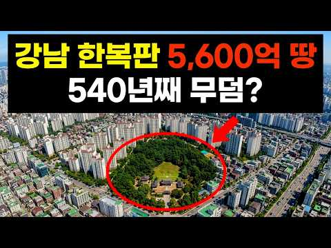
- 설명 앞부분: "왕이 되지 않은 사람의 이야기는, 540년 뒤 서울의 도로 이름이 된다." 강남 서초동 한복판, 축구장 8개 크기(1만 8천 평)의 거대한 초록색 섬. 평당 수천만 원을 호가하는 이 땅의 주인은 540년 전 죽은 한 남자, 바로 세종대왕의 친형 '효령대군'입니다. 조선 왕족 묘역의 99%가 사라지는 동안, 그는 어떻게 대한민국에서 가장 비싼 땅을 지켜냈을까요? 아버지 태종 이방원의 칼날 앞에서는 '빙긋 웃음'으로, 조카 수양대군의 피바람 앞에서는 '철저한 침묵'으로 살아남아 91세 천수를 누린 인물. 왕좌를 포기한 대가로 540…
- 같은 채널 평소 대비 ×709.9 (채널 최근 롱폼 중앙값 710회) · 평소 영상: 쌀은 창고에 넘쳐났습니다. 우리 도시락에만 없었습니다. (735회) / 왕비도 못 된 여인이 조선 최고 권력자가 된 이유 (686회)
- 대본 없음 (설명) — 음성인식이 끝나면 도입부·흐름이 들어감
- 댓글 576/581: 좋은 점 — 영상 13 · 감사·응원 35 · 더 알고 싶은 것 4 · 아쉬운 점 — 영상 2 · 반박·불만 — 의견 다름 5 · 정치·사회 15 · 경험 공유 19 · 구독·다음 기대 2
  - 좋은 점 — 영상 👍5 “와우 후손이면서그분의 내력을 정말모르고 지냈네요 효령대군 님을 알게되어 고맙습니다 알려주셔서”
  - 좋은 점 — 영상 👍5 “역사이야기 많이올려주세요 참재미있어내요또한번 역사를배웠.ㅁ니다”
  - 감사·응원 👍363 “효령대군이 휴식공간으로 쓰라고 온몸으로 지켜 주셨내요, 감사,감사....”
  - 감사·응원 👍75 “조선시대 왕족을 통틀어 가장 행복한 삶을 사신분이네요 보람있는 정보네요 감사합니다”
  - 더 알고 싶은 것 👍5 “구독 좋아요 누르고 갑니다 향후 많은 자료들 올려주세요”
  - 더 알고 싶은 것 👍5 “역사이야기 많이올려주세요 참재미있어내요또한번 역사를배웠.ㅁ니다”
  - 아쉬운 점 — 영상 👍0 “침착하니 재미납니다 옛말에 효령대군 북치듯한단말 들어봤습니다 왕이될 수도있었는데하는 아쉬움 하지만 주변이 모두 죽어나가니 의견도 낼 수없고 또 그만한 배짱도없으니 불교에 심취해있던 효령은 모든 고뇌를 북치는걸로 달랬을수도...”
  - 아쉬운 점 — 영상 👍0 “서론이 너무 길어요.”
  - 반박·불만 — 의견 다름 👍33 “역사한페이지를 돈으로 환산하나 어이없다”
  - 반박·불만 — 의견 다름 👍1 “헛소리 보다는, 지금의 땅값을 가지고, 조선시대에서만 사시는듯, 효령은 불가에도 귀의하고 재물로서 조선초기에 다 헛웃음에 의미부여가 없다는거~~ 😮😅😊”
  - 정치·사회 👍2 “이귀한땅 정부에서 게발해서 국체절감🎉”
  - 정치·사회 👍1 “현시대 역사를모르면 나라가 망한다 영상 감사합니다~^^ 🎉🎉🎉🎉❤”
  - 경험 공유 👍58 “내가 19대 강○항렬 아들이 20대 ○재 항렬.아들이 대학 다닐때 내가 대신 가서 장학금 100만원 받았습니다.그때는 대군할아버지 묘소 참배하고 잔듸 광장에서 장학금.효부상 수여식을 하고 청권사에서 나눠준 도시락으로 점심을 먹었던 기억이납니다”
  - 경험 공유 👍37 “내가 아는분중에도 효령대군 19대손도 계시던데”
  - 구독·다음 기대 👍3 “구독했습니다”
  - 구독·다음 기대 👍0 “넘 재밌어요! 초등 때 읽은 책엔 효령대군이 세자로 책봉되지 못 하자 실망해서 승려가 되었다고 돼 있었어요. 30년이 지나서 사실을 알게 되었어요! 구독했어요. 좋은 영상 감사합니다.^^ 앗 근데 넘 느려 1.5배속으로 봤어요. 그럼 수익 집계에 안 들어가나요? 꼭 …”

### 198. 조선 최고의 검술은 어디서 시작되었나? 기록되지 않은 조선제일검의 계보 [아무도 들려주지 않는 조선왕조실록]

- https://www.youtube.com/watch?v=-Yturcnh4j8 · 몰래 듣는 조선의 비밀 · 구독자 1,220 · 조회수 128,177 (×105.1, 하루 915.9) · 좋아요 936 (0.7%) · 17.9분 · 2026-06-10 · 주제 묶음 3. 조선 · 형식 정보·해설 (그 밖) · 폴더 `W_-Yturcnh4j8` (웹 승인)
- 썸네일: 
- 챕터: 0:00 시작 · 1:12 활의 나라, 칼 없는 조선 · 4:00 임진왜란 — 칼을 다시 잡다 · 7:00 김체건 — 왜관에 노비로 숨어든 군교 · 10:48 김광택 — 칼에 몸을 숨긴 관노의 아들 · 14:00 백동수 — 서얼 무사가 만든 칼의 백과사전 · 16:24 본국검 — 잃어버린 조선의 칼을 되찾다 · 19:00 전기수의 한 줄
- 설명 앞부분: 조선의 무과 시험에 검술이 없었습니다. 활만 쏘면 됐습니다. 칼잡이는 이름조차 남기지 못한 나라. 그런 나라에서 한 군교가 왜관에 노비로 숨어들어 3년간 칼을 훔쳐 배웠고, 그 아들은 칼에 몸을 숨기는 경지에 올랐으며, 서얼 무사가 24가지 무예를 한 권의 책에 담았습니다. 오늘의 전기수는 활의 나라 조선이 칼을 되찾기까지, 김체건·김광택·백동수 세 검객과 200년의 이야기를 풀어봅니다. ▣ 챕터 ▣ 채널 소개 ▷ 정사 조선왕조실록 (태조실록, 선조실록, 숙종실록, 영조실록, 정조실록) 승정원일기 (숙종·영조·정조대) ▷ 무예서·…
- 같은 채널 평소 대비 ×358.0 (채널 최근 롱폼 중앙값 358회) · 평소 영상: 7년간 전쟁을 이끈 남자가 쫓겨나서 쓴 반성문 16권 [조선인물 탐구생활] (358회) / 조선 최강이라 불린 장수, 적이 아니라 임금의 매에 죽으며 비운의 장수로 남다. [조선 … (333회)
- 대본 없음 (설명) — 음성인식이 끝나면 도입부·흐름이 들어감
- 댓글 120/120: 좋은 점 — 영상 3 · 감사·응원 7 · 더 알고 싶은 것 1 · 아쉬운 점 — 영상 1 · 반박·불만 — 의견 다름 6 · 정치·사회 1 · 경험 공유 1 · 구독·다음 기대 0
  - 좋은 점 — 영상 👍7 “유익하고 재밌는 조선시대 역사이야기네요!”
  - 좋은 점 — 영상 👍2 “좋은 영상 고맙습니다 특히 인상 깊은게 다른이들은 영상 음성 AI로 제작했으면서 마치 자신이 만든거 같이 생성 출처를 밝히지 않은 아둔한 분들이 많던데 이분은 제작 출처를 밝히므로 거부감없이 감사할 수 있었습니다”
  - 감사·응원 👍3 “안녕 하십니까?평안도 감사 박엽장군,감사합니다.🤗👍”
  - 감사·응원 👍2 “좋은 영상 고맙습니다 특히 인상 깊은게 다른이들은 영상 음성 AI로 제작했으면서 마치 자신이 만든거 같이 생성 출처를 밝히지 않은 아둔한 분들이 많던데 이분은 제작 출처를 밝히므로 거부감없이 감사할 수 있었습니다”
  - 더 알고 싶은 것 👍5 “아주 재밌게 듣고 있습니다 조선야사 이야기 더 많이 올려주세요”
  - 아쉬운 점 — 영상 👍2 “좋은 영상 고맙습니다 특히 인상 깊은게 다른이들은 영상 음성 AI로 제작했으면서 마치 자신이 만든거 같이 생성 출처를 밝히지 않은 아둔한 분들이 많던데 이분은 제작 출처를 밝히므로 거부감없이 감사할 수 있었습니다”
  - 반박·불만 — 의견 다름 👍43 “전쟁터나 실전에서 가장 위력적이고 많이 쓰인건 창이지 검이 아닙니다 검은 보조무기일 뿐 일본 전국시대 유명한 사무라이들도 주력 무기는 창이었음 그 다음 위력적인 무기는 부월 (큰 도끼) 큰 도끼를 쓰면서 무쌍 찍은 무장들은 실제로 역사에 많이 기록이 돼 있는데 십자군…”
  - 반박·불만 — 의견 다름 👍5 “말도 안되는 소리 일본검술이 최고 란 소리 또 처음들어보네”
  - 정치·사회 👍2 “그러니 나라가 망하지 총기술 발달시켜야지 총포앞에서 칼질을 왜 하는데”

### 199. 유럽을 공포에 떨게 한 600년 이슬람 제국은 왜 흔적도 없이 사라졌을까? ∣ 오스만 제국사 풀스토리

- https://www.youtube.com/watch?v=EjRxsCOhmGY · 달빛 세계사 · 구독자 18,600 · 조회수 851,705 (×45.8, 하루 13,757.3) · 좋아요 3,141 (0.4%) · 77.4분 · 2026-08-27 · 주제 묶음 6. 동양사 (중국·일본·몽골) · 형식 수면·낭독 (잠잘 때 듣는) · 폴더 `W_EjRxsCOhmGY` (웹 승인)
- 썸네일: 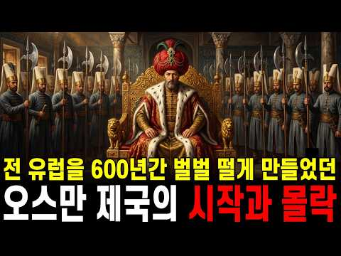
- 챕터: 0:00 인트로: 세 대륙을 호령한 푸른 눈의 이슬람 제국 · 1:29 아나톨리아의 유목민에서 발칸의 패자로 · 12:13 앙카라 전투의 파멸과 부활 · 20:22 1453년 콘스탄티노플 함락과 메흐메트 2세 · 29:35 이슬람 세계를 하나로 묶은 셀림 1세 · 37:29 쉴레이만 대제와 록셀라나의 암투 · 48:51 빈의 성벽과 윙드 후사르, 꺾여버린 초승달 · 57:44 '유럽의 병자'와 피의 개혁 · 67:05 갈리폴리의 기적과 제국의 장례식 · 75:07 에필로그: 역사 속에서 마주한 질문
- 설명 앞부분: 중앙아시아의 거친 바람을 피해 흘러들어온 이름 없는 작은 유목 부족. 말안장 위에서 태어난 이들은 어떻게 천년 로마의 심장을 도려내고, 아시아·유럽·아프리카 3대 대륙을 호령하는 거대한 패자가 되었을까요? 기독교 소년들을 강철 전사로 개조한 공포의 군단 '예니체리', 왕위에 오른 자는 형제들을 목 졸라 죽여야 했던 잔혹한 '형제 살해법', 배를 끌고 산을 넘어 콘스탄티노플을 무너뜨린 21세 정복자 메흐메트 2세, 그리고 제국의 영광 뒤편에서 피비린내 나는 암투를 벌인 하렘의 여인들까지. 세 대륙을 호령하던 찬란한 황금기부터 '유럽…
- 같은 채널 평소 대비 ×15.0 (채널 최근 롱폼 중앙값 56,802회) · 평소 영상: 인류 역사상 가장 잔혹하고 기묘했던 문명, 마야는 왜 흔적도 없이 사라졌을까? [🌙 꿀잠… (60,433회) / 초고대문명, 세계 최초의 완벽한 도시가 사라진 이유, 인더스 문명 5,000년의 수수께끼… (53,172회)
- 대본 없음 (설명) — 음성인식이 끝나면 도입부·흐름이 들어감
- 댓글 66/76: 좋은 점 — 영상 1 · 감사·응원 9 · 더 알고 싶은 것 0 · 아쉬운 점 — 영상 1 · 반박·불만 — 의견 다름 1 · 정치·사회 2 · 경험 공유 2 · 구독·다음 기대 1
  - 좋은 점 — 영상 👍6 “오스만 제국 초기부터 중기와 말기까지 상세한 설명을 잘 시청하였습니다.”
  - 감사·응원 👍33 “위대한 세기를 재밌게 봤었는데 대충은 알았지만 자세하게 제국의 멸망까지 설명해주니 고맙습니다”
  - 감사·응원 👍9 “잘보았습니다 ~감사를 드립니다😊”
  - 아쉬운 점 — 영상 👍3 “광고가 너무 자주 하네요. 어떻게 보기싫을 정도로 몇분에 한번씩 하나요. 보기싫어서 나갑니다.”
  - 경험 공유 👍6 “정말 재밌게. 잘들었습니다 발음도 정확하고 목소리도좋네요 오스만의역사 궁금했었는데 잘들었습니다 감사해용~~”
  - 구독·다음 기대 👍2 “진짜 너무 재및네요 바로 구독합니다”

### 200. 조선의 역대급 변절자 신숙주, 성삼문 아내를 노비로 들인 충격적인 이유

- https://www.youtube.com/watch?v=RdzPp1O7PW8 · 왕조의 숨은 이야기 · 구독자 1,560 · 조회수 132,530 (×85.0, 하루 1,142.8) · 좋아요 1,217 (0.9%) · 19.9분 · 2026-07-04 · 주제 묶음 3. 조선 · 형식 정보·해설 (그 밖) · 폴더 `W_RdzPp1O7PW8` (웹 승인)
- 썸네일: 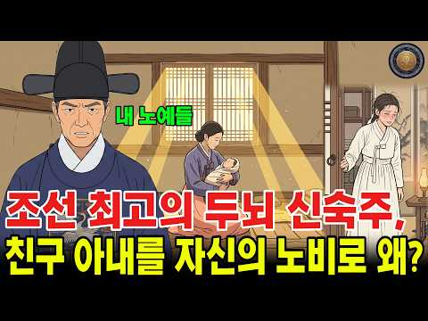
- 같은 채널 평소 대비 ×158.2 (채널 최근 롱폼 중앙값 838회) · 평소 영상: 조선 후궁의 말년, 궁에서 쫓겨난 뒤 짐승만도 못했던 비참한 삶 (871회) / 왕과 사는 남자 실제 역사 ∣ 엄흥도는 왜 사라졌나, 영화가 감춘 570년의 진실 (804회)
- 대본 없음 (없음) — 음성인식이 끝나면 도입부·흐름이 들어감
- 댓글 91/89: 좋은 점 — 영상 0 · 감사·응원 0 · 더 알고 싶은 것 2 · 아쉬운 점 — 영상 5 · 반박·불만 — 의견 다름 2 · 정치·사회 3 · 경험 공유 4 · 구독·다음 기대 0
  - 더 알고 싶은 것 👍8 “조선왕조실록 한글판이 전자책으로 국립도서관에 있습니다 수양대군 실록에 계유정난 으로 하사받은 공신들의 노비명단이 있으니 역사적 사실을 영상으로 만들어주세요”
  - 더 알고 싶은 것 👍4 “이 채널 차단 어떻게 하는지요? 최소한의 문법 맞춤 노력도 안하는게 자꾸 뜨네요.”
  - 아쉬운 점 — 영상 👍20 “자막이나 제대로 확인하고 영상올리길”
  - 아쉬운 점 — 영상 👍6 “자막이 엉망이네요.. 좀 수정해서 올리면 훨씬 보기 편하겠어요. 너무 많이 틀리니까 불편해서 보다 말았어요”
  - 반박·불만 — 의견 다름 👍9 “세종대학게서 당직스면서 책을 읽으면서 자고 있는 자를 용포로 덮어주는 자는 신숙주였습니다. 성삼문이 아닙니다”
  - 반박·불만 — 의견 다름 👍1 “말도 안되는 클릭수 늘릴려는 매우 어이없는 내용입니다 ㅉㅉ”
  - 정치·사회 👍12 “중국인이요 글자가 영 어획이 엉망이군요 검수도 안하고 내 보내는 건가요”
  - 정치·사회 👍1 “엉떠리. 중국인작품”
  - 경험 공유 👍0 “숙주나물이 잘 변하지 그걸 얘기해봤자 의미가 없는 세상에서”
  - 경험 공유 👍0 “나도 신숙주로 배워는데 성삼문 신숙주 두사람 한것도 같고”

