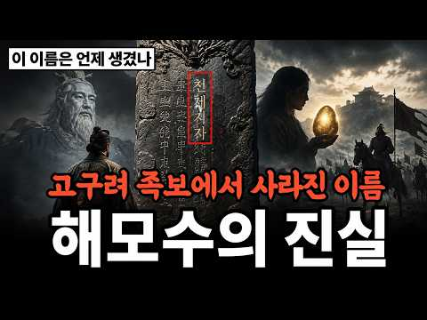

# 역사 — 성공 사례 분석: 사례별 자세히 #201–#240

`analysis.md` 의 9번 (같은 # 번호). 자동 생성 — `tools/success_analysis.py` v1.5.1 (2026-10-24 07:34 UTC). ※ 연구·교육용 — 투자 권유가 아님.

### 201. 조선 왕의 밥상에는 뭐가 올라왔을까 ∣ 수라상, 하루 두 번 차려진 왕의 식탁

- https://www.youtube.com/watch?v=gKhL7p_uupA · 간단역사 · 구독자 223 · 조회수 11,851 (×53.1, 하루 75.6) · 좋아요 114 (1.0%) · 17.6분 · 2026-05-20 · 주제 묶음 3. 조선 · 형식 정보·해설 (그 밖) · 폴더 `W_gKhL7p_uupA` (웹 승인)
- 썸네일: 
- 설명 앞부분: 하루 두 번, 반찬 12가지. 조선 왕의 밥상이 어떻게 차려졌는지 아십니까. 재료를 구하고, 손질하고, 요리하고, 독을 검사하고, 상을 차리는 데 수십 명이 달려들었습니다. 그런데 이 밥상이 단순히 맛있는 음식을 먹기 위한 게 아니었어요. 정치였고, 과학이었고, 예술이었습니다. 이 영상에서 다루는 내용입니다. ▸ 반찬 12가지 수라상의 정교한 구성과 그 이유 ▸ 은수저, 기미 — 독살을 막기 위한 조선 왕실의 과학 ▸ 세종은 고기를, 영조는 소식을 — 왕마다 달랐던 식성의 비밀 ▸ 임진왜란이 김치를 빨갛게 만든 충격적인 이유 ▸ …
- 같은 채널 평소 대비 ×47.1 (채널 최근 롱폼 중앙값 252회) · 평소 영상: 조선 시대 노비는 어떻게 살았을까 ∣ 전체 인구 30퍼센트가 노비였던 나라 (264회) / 칭기즈칸은 왜 세계를 정복할 수 있었을까 ∣ 역사상 가장 큰 제국의 비밀 (239회)
- 대본 없음 (설명) — 음성인식이 끝나면 도입부·흐름이 들어감
- 댓글 9/9: 좋은 점 — 영상 0 · 감사·응원 0 · 더 알고 싶은 것 0 · 아쉬운 점 — 영상 0 · 반박·불만 — 의견 다름 0 · 정치·사회 0 · 경험 공유 0 · 구독·다음 기대 0

### 202. 당신의 성씨가 사실 명나라 것이라면? 나라가 사라진 사람들 그들이 택한 나라는 조선이었다

- https://www.youtube.com/watch?v=PKcdNOIwE4o · 모든역사 · 구독자 12,200 · 조회수 646,065 (×53.0, 하루 15,076.2) · 좋아요 6,163 (0.9%) · 34.7분 · 2026-09-11 · 주제 묶음 6. 동양사 (중국·일본·몽골) · 형식 애니메이션·지도 · 폴더 `W_PKcdNOIwE4o` (웹 승인)
- 썸네일: 
- 설명 앞부분: 나라가 통째로 망하던 그날, 명나라 귀족들은 어디로 갔을까요? 1644년, 이백 년 넘게 아시아를 호령하던 명나라가 하룻밤 사이에 지도에서 사라집니다. 마지막 황제는 궁궐 뒷산 나무에 목을 맸고, 그 나라의 귀족과 장수들은 짐을 싸서 국경을 넘기 시작했죠. 🏃‍♂ 그리고 그중 상당수가 향한 곳이 바로 조선이었습니다. ⚔️ 조선을 살리려다 자기 나라 감옥에서 죽은 국방부 장관 석성 🩸 죽은 병사의 옷을 벗겨 입고 요동 벌판을 가로질러 도망친 강세작 🧭 전쟁 영웅에서 조선의 풍수 전문가로 변신한 시문용 🌊 이순신과 함께 싸운 명나라 …
- 같은 채널 평소 대비 ×241.9 (채널 최근 롱폼 중앙값 2,671회) · 평소 영상: 정조 vs 공자 두 천재가 주역에 미쳐버린 진짜 이유 (2,671회) / 왜 삼국시대일까 가야는 어디로 사라졌나? 철의 왕국이 역사에서 사라진 이유 (2,370회)
- 대본 없음 (설명) — 음성인식이 끝나면 도입부·흐름이 들어감
- 댓글 481/494: 좋은 점 — 영상 4 · 감사·응원 7 · 더 알고 싶은 것 6 · 아쉬운 점 — 영상 2 · 반박·불만 — 의견 다름 8 · 정치·사회 48 · 경험 공유 12 · 구독·다음 기대 0
  - 좋은 점 — 영상 👍23 “고금도는 바로 우리 고향에서 건너편 섬 고금도 인데 지금은 마량에서 다리(고금대교)가 생겨서 자동차로 갑니다 잘 배우고 갑니다 학생때 부터 역사을 좋아해서 나이가 들어도 역사가 좋더라구요 광주로 (유학생)학교을 갔는데 고금도가 고향인 친구도 있었어요 벌써 50년이 다…”
  - 좋은 점 — 영상 👍5 “명쾌하네요.”
  - 감사·응원 👍32 “역사에 관심 있으시고 성씨에 궁금 하신 분들이 많으시니 덕분에 많이 배웁니다 감사합니다”
  - 감사·응원 👍7 “고맙습니다.”
  - 더 알고 싶은 것 👍5 “잘 봤습니다 해주 오씨 에대한 이야기좀 올려주세요 저는 해주오씨 후손입니다 저의 1대조는 고려말 군기도감이셨다는 이야기를 들었습니다 중국에서 고려말에 고려로 오신걸루 생각합니다 조사하셔서 영상 만들어주시면 후손으로서 자부심을 갖고 살아갈수 있을것같아요”
  - 더 알고 싶은 것 👍5 “진도에도 황조라는 마을이 있습니다 해남과 바다를 사이에 두고 마주 보는 지형이죠. 옛 사람들은 아침에 황제가 잠시 들려 갔다 해서 명명된 이름이다.라고 하지요 삼별초 난과 연결지어지기도 하고요 용장산성이 건너편 마을 뒷산에 있지요 관게가 있는지 알고 싶어요 강원도에도…”
  - 아쉬운 점 — 영상 👍16 “임진왜란때 왜가 주장한 것은 '정명가도'였습니다. 즉 일본이 명나라를 정벌할테니,,, 조선보고 길을 내주라는 의미였습니다. 조선은 있으나 마나한 허약한 나라였다는 것을 일본은 너무도 잘 알고 있었습니다. 일본이 조선을 정벌하고, 조선인을을 앞세워서 명나라로 처들어간다…”
  - 반박·불만 — 의견 다름 👍3 “고조선은 陰 동양을 말해요. 서양은 아메리카를 지칭했던거고요. 陽이지요. 중원 남부로는 끊임없이 인도 중동쪽에서 들어왔죠. 백제도 신라도 중원 남부부터 시작 했답니다. 명나라도 남부에서 시작 했으니 백성이나 귀족 일부는 신라 백제 사람이죠. 나라 이름만 바뀐겁니다. …”
  - 반박·불만 — 의견 다름 👍0 “명에서 우리에게 파병한이유는 단순한 그이유만이 아니죠 일본이 조선을 무너뜨리고 명나라로 오는것을 방어하기 위해서도 50%는 적용되죠”
  - 정치·사회 👍45 “6.25를 겪고도 아직도 북한 3대 세습 독재국가에 충성을 다하고 있는 자들이 국회의원 국가 공무원이 되어 나라를 무너뜨리려고 하는 자들은 역사에 어떤 발자취를 남길가?”
  - 정치·사회 👍42 “한동훈 장인 진머시기가 중국인도 받기 힘든 중국 출판허가를 받아내고 중국 관련 출판하는 거 혹시 광동 진가? 총기 사격 명수 진 머시기 비례대표 의원이 한배신 패거린 것도 그런 이유?”
  - 경험 공유 👍45 “6.25를 겪고도 아직도 북한 3대 세습 독재국가에 충성을 다하고 있는 자들이 국회의원 국가 공무원이 되어 나라를 무너뜨리려고 하는 자들은 역사에 어떤 발자취를 남길가?”
  - 경험 공유 👍30 “명씨가 있던데 고향이 해남이라고하더니 그래서 내가 중국이나 명나라 성씨 아닌가요 그랬는데 그분들도 명나라 족이였네요 시갓집은 현씨 친저믄 명씨”

### 203. 조선시대 과거 시험의 모든 것! 낙방한 선비들이 먹고살기 위해 선택한 의외의 직업들

- https://www.youtube.com/watch?v=3kotYxP9RjI · 안식한국사 · 구독자 3,740 · 조회수 196,455 (×52.5, 하루 2,732.0) · 좋아요 1,385 (0.7%) · 18.8분 · 2026-08-13 · 주제 묶음 3. 조선 · 형식 수면·낭독 (잠잘 때 듣는) · 폴더 `W_3kotYxP9RjI` (웹 승인)
- 썸네일: 
- 설명 앞부분: 정정 안내 = 영상 후반부의 3대 동안 급제자가 없으면 양반 신분이 박탈된다는 내용은 법적 제도가 아니라 당시의 사회적 통념이었습니다. 실제로 신분이 법적으로 강등되는 경우는 드물었고 대개 몰락 양반으로 유지되었습니다. 부정확하게 전달한 점 바로잡습니다. 지적해 주신 분들께 감사드립니다. 3년에 딱 33명. 그런데 지원자는 십만 명이 넘었습니다. 😮 조선의 과거 시험은 붙는 게 기적, 떨어지는 게 당연한 세계였습니다. 우리는 늘 급제한 사람만 기억하지만, 시험장을 이름 없이 걸어 나온 그 수많은 선비들은 어떻게 살아갔을까요? 본 …
- 같은 채널 평소 대비 ×2.1 (채널 최근 롱폼 중앙값 95,776회) · 평소 영상: 조선 최연소 천재 병조판서를 사흘 만에 처형한 이유 ∣ 모든 걸 가졌던 천재 무사가 왜 … (95,776회) / 공자도 좋아한 그 맛, 조선 선비들이 강가에 모여 회를 먹던 진짜 이유 ∣ 조선 회식은 … (106,220회)
- 대본 없음 (설명) — 음성인식이 끝나면 도입부·흐름이 들어감
- 댓글 112/121: 좋은 점 — 영상 1 · 감사·응원 3 · 더 알고 싶은 것 2 · 아쉬운 점 — 영상 1 · 반박·불만 — 의견 다름 2 · 정치·사회 4 · 경험 공유 2 · 구독·다음 기대 0
  - 좋은 점 — 영상 👍2 “다 좋은데.. 여러가지 유익하고 배워지는것이 많은 프로그램인데,,,,, 중간에 그만둔 이유는 ,,,,, 너무 자극적인 표현이 많다 소름 끼친다... 더 놀라운것,,,, 좋은 프로그램에 왜이런 저질스런표현을 사용해서 격을 떨어뜨리나?작가가 격이 떨어지는 사람인가?”
  - 감사·응원 👍3 “현재의 일반인들이 조선시대 정승판서보다 풍요롭게 오래오래 산다? 좋은시절에 태어나서 배부르고 등따시게 잘살고 있음을 항상 감사하며 삽시다!”
  - 감사·응원 👍2 “수고하셨습니다 감사합니다 🎉🎉🎉 쥬만지 ^^*”
  - 더 알고 싶은 것 👍0 “유만주 일기 내용을 알려주세요”
  - 아쉬운 점 — 영상 👍2 “3대 동안 과거급제자가 없으면 평민이 된다는 얘기는 잘못된 정보입니다. 경국대전에도 없는 내용이고 10대가 넘어가도 양반을 유지했습니다. 족보에 확실히 올라가 있고 가장 중요한건 향안이라고 지역 양반에 등록되어 있으면 양반 직위가 안떨어집니다. 형편이 힘들어지면 몰락…”
  - 반박·불만 — 의견 다름 👍2 “3대 동안 과거급제자가 없으면 평민이 된다는 얘기는 잘못된 정보입니다. 경국대전에도 없는 내용이고 10대가 넘어가도 양반을 유지했습니다. 족보에 확실히 올라가 있고 가장 중요한건 향안이라고 지역 양반에 등록되어 있으면 양반 직위가 안떨어집니다. 형편이 힘들어지면 몰락…”
  - 반박·불만 — 의견 다름 👍0 “생원진사시즉(소과)는 대과 전단계 시험이아닌 별개의 자격증명 시험에가깝습니다 세조이후부터 소과없이 향시로 대과초시응시가능입니다 물론 소과에 합격하면 유학으로서의 자격증빙및 지방말단관료진출과 성균관입학자격 등이 부여됩니다만. 세조이후 대과 향시초시 복시 를위한 필수단계…”
  - 정치·사회 👍55 “아버지 잘만나면 지금도 거의 무시험으로 공무원 된다 선거관리위웬회 직원으로~~”
  - 정치·사회 👍0 “이런 임금 하야할 일일세. 한성판윤 탄핵 사유인데...”
  - 경험 공유 👍0 “소과합격자만 대과를 치르는데 뭔 수만명이 몰려서 깔려죽는가요? 제가 잘모르는건가요?”

### 204. 정조가 홍국영을 버린 충격적인 이유

- https://www.youtube.com/watch?v=x-wWAo2juoU · 재역이(재미있는역사이야기) · 구독자 5,800 · 조회수 303,922 (×52.4, 하루 2,412.4) · 좋아요 3,979 (1.3%) · 34.9분 · 2026-06-20 · 주제 묶음 기타 · 형식 정보·해설 (그 밖) · 폴더 `W_x-wWAo2juoU` (웹 승인)
- 썸네일: 
- 설명 앞부분: 조선 22대 임금 정조에게는 목숨을 빚진 단 한 명의 절친이 있었습니다. 죄인의 아들이라는 굴레 속에서 매일 밤 자객의 위협에 시달리던 세손 시절, 모두가 등을 돌릴 때 홀로 칼을 들고 곁을 지킨 남자, 바로 홍국영입니다. 정조는 그를 "나의 오른쪽 날개"라 부르며 무한한 신뢰를 보냈습니다. 즉위 후 도승지와 군권까지 한 손에 쥐여주며, 한 신하에게 조선 역사상 전무후무한 권력을 안겨주었죠. 그러나 그 권력은 홍국영을 변하게 만들었습니다. 열세 살 여동생을 후궁(원빈)으로 들이고, 죽은 누이에게 양자를 들여 왕통까지 넘보던 순간,…
- 같은 채널 평소 대비 ×33.7 (채널 최근 롱폼 중앙값 9,018회) · 평소 영상: 조선 역사상 스스로 왕좌를 버린 유일한 왕 (9,018회) / 허균이 죄목도 없이 능지처첨을 당한 진짜 이유 ∣ 허균 ∣ 허난설헌 (8,371회)
- 대본 없음 (설명) — 음성인식이 끝나면 도입부·흐름이 들어감
- 댓글 248/248: 좋은 점 — 영상 2 · 감사·응원 6 · 더 알고 싶은 것 0 · 아쉬운 점 — 영상 3 · 반박·불만 — 의견 다름 3 · 정치·사회 2 · 경험 공유 3 · 구독·다음 기대 0
  - 좋은 점 — 영상 👍5 “재미있고 유익합니다”
  - 좋은 점 — 영상 👍1 “너무 좋은 내용인데, 구독과 좋아요.를 왜 첨부터 말하나요 좋은거면 나중에 알아서 하잖아요 에효ㅡㅡ”
  - 감사·응원 👍5 “역사의 뒷면을 자세히 알려주어 60 넘게 우리 역사의 깊은 이해를 하게 되네요 왕들의 삶이 안타깝고 서글픈 느낌으로 와 닿네요 감사합니다”
  - 감사·응원 👍3 “감사합니다 ~”
  - 아쉬운 점 — 영상 👍3 “설명이 난삽 하다 같은말이 겹치고 지루해.”
  - 아쉬운 점 — 영상 👍0 “증간 광고가 너므 많아서 맥이 뚝뚝. 좋은 컨텐츠인데 구독취소가 고민되어요 ㅠㅠㅠ”
  - 반박·불만 — 의견 다름 👍39 “홍국영과. 정조 말만들어도. 가슴아립니다 홍국영이 제 분수대로만. 처신햇어도 아름다운 인연이엇을텐데. 거두절미하고. 토사구팽은 아닙니다. 안타깝지만. 홍국영의 실책이 오만방자 모든게 자충수였어요. 안타깝죠 정조가얼마나 신임햇는지 믿음뒤에서의 실책에 얼마나마음아팟을지.…”
  - 반박·불만 — 의견 다름 👍2 “홍국영의 발음은 홍궁영 이 아닙니다! 정확한 발음은 "홍구경" 입니다! 홍구경 이란 발음과 홍궁영 이란 발음이 왔다갔다 하고 있읍니다! 그런점을 감안하면 AI가 발음 하는것도 아닌 것이니 이런 정황에 근거해 볼때 컨텐 츠 제작자 의 국어실력 이 수준급이 아님을 알려주…”
  - 정치·사회 👍1 “이재명 너 조심해임마. 비참한 최후를 보고싶지 않다. 적당히만 해라”
  - 경험 공유 👍6 “세계사적으로보면 15세기부터 대항해시대가 시작되어 서양문물의 힘에 편승한 임진왜란의 참화를 겪었고, 허균과 같은 혁명가, 실학자들도 있었고, 서양문물이 들어오던 시절이고 계몽주의에 따른 몽테스큐의 법의정신, 루소 등의 영향이라 할 미독립 및 프랑스혁명기에 왕으로 재직…”
  - 경험 공유 👍1 “가장높은곳에 있는순간 가장 험한곳에 있다란 마지막 말이 최고의 명언 !!! 저도 잘 새기며 평생 잠언으로 간직하며 살겠읍니다 감사 감사 합니다!!! 요즘 잼통님의 미국 살해 위험과 부하들의 반역이 없도록 기도해주세요 아멘!!”

### 205. ⟪한국사⟫ 장희빈을 무너뜨린 진짜 인물 숙안공주 ∣ 역사 인물 ∣ 조선시대 ∣ 야사

- https://www.youtube.com/watch?v=Bp1B0xzl8fY · 비밀의 한국사 · 구독자 1,060 · 조회수 54,733 (×51.6, 하루 330.4) · 좋아요 583 (1.1%) · 20.3분 · 2026-05-11 · 주제 묶음 3. 조선 · 형식 정보·해설 (그 밖) · 폴더 `W_Bp1B0xzl8fY` (웹 승인)
- 썸네일: 
- 설명 앞부분: 장희빈을 무너뜨린 진짜 인물 ∣ 숙안공주 "왕도 함부로 할 수 없었던 여자가 있었다." 1701년, 장희빈이 사약을 받았습니다. 하지만 진짜 승자는 따로 있었습니다. 숙종의 고모, 효종의 딸, 왕실 최고 실세. 바로 숙안공주. 호화 궁궐에 살면서 "사치스럽다"는 비난을 받았고, 환국 정치를 뒤에서 조종했으며, 아들이 유배 간 후 5년 만에 완벽한 복수를 완성한 여자. 이것은 단순한 궁중 암투가 아니었습니다. 62년간 조선 왕실 권력의 정점에 선 여자의 이야기입니다. 💬 핵심 질문 장희빈을 무너뜨린 진짜 주역은 누구였는가? 왕실 여…
- 같은 채널 평소 대비 ×421.0 (채널 최근 롱폼 중앙값 130회) · 평소 영상: ⟪한국사⟫ 조선 왕실도 감당 못한 왕자들, 실록이 기록한 왕실의 재앙 ∣ 역사 인물 ∣ … (130회) / ⟪한국사⟫ 세종이 죽을 때 아들 집으로 간 이유, 영응대군 ∣ 역사 인물 ∣ 조선시대 ∣… (105회)
- 대본 없음 (설명) — 음성인식이 끝나면 도입부·흐름이 들어감
- 댓글 28/28: 좋은 점 — 영상 1 · 감사·응원 0 · 더 알고 싶은 것 0 · 아쉬운 점 — 영상 0 · 반박·불만 — 의견 다름 1 · 정치·사회 0 · 경험 공유 1 · 구독·다음 기대 0
  - 좋은 점 — 영상 👍1 “숙안공주. 효종의 딸. 숙종때 왕실 최고위 어른. 역사인물 잘 배웠습니다.”
  - 반박·불만 — 의견 다름 👍31 “장희빈은 천출 출신이 아니고 역관 집안의 출신으로 중인 집안 출신으로 당숙부가 소현세자 봉림대군이 심양으로 볼모로 갈때 통역관으로 수행한 장현이 조선 최고 갑부로 정승 판서의 정치자금의 뒷배로 단순한 궁인이 아닙니다.”
  - 경험 공유 👍13 “장희빈에서 김영란이 연기했었죠”

### 206. [광복절동화] 소중하고 기쁜 국경일 광복절 8월 15일 의미 어린이 역사교육 계기교육 유아 초등

- https://www.youtube.com/watch?v=gCpZreiHwT0 · 누리과정유치원 · 구독자 347 · 조회수 17,808 (×51.3, 하루 243.4) · 좋아요 62 (0.4%) · 5.5분 · 2026-08-12 · 주제 묶음 1. 역사 일반·이야기 · 형식 정보·해설 (그 밖) · 폴더 `W_gCpZreiHwT0` (웹 승인)
- 썸네일: 
- 설명 앞부분: 광복절의 의미를 알아보아요^^
- 같은 채널 평소 대비 ×16.5 (채널 최근 롱폼 중앙값 1,082회) · 평소 영상: [유치원과친구] 동화 나랑 같이놀래?유치원 어린이집 신학기 새학기 적응 동화 (1,229회) / [30분동화] 5월동화 가정의달 동화 이어보기 연속보기ㅣ나와가족ㅣ하원시간 동화ㅣ어린이동화… (934회)
- 대본 없음 (설명) — 음성인식이 끝나면 도입부·흐름이 들어감
- 댓글 0/0: 좋은 점 — 영상 0 · 감사·응원 0 · 더 알고 싶은 것 0 · 아쉬운 점 — 영상 0 · 반박·불만 — 의견 다름 0 · 정치·사회 0 · 경험 공유 0 · 구독·다음 기대 0

### 207. 중국 역사상 최대 미스터리 왜 한국만은 정복하지 못했나

- https://www.youtube.com/watch?v=utBggJ670VU · 역사탐사실 · 구독자 19,000 · 조회수 973,894 (×51.3, 하루 7,832.4) · 좋아요 10,685 (1.1%) · 34.7분 · 2026-06-21 · 주제 묶음 1. 역사 일반·이야기 · 형식 정보·해설 (그 밖) · 폴더 `W_utBggJ670VU` (웹 승인)
- 썸네일: 
- 설명 앞부분: 📜 영상 설명란 흉노, 선비, 갈, 저. 한때 중국 대륙을 호령했던 거대한 민족들이지만, 지금은 그 이름조차 남아 있지 않습니다. 거란도, 서하도 마찬가지죠. 🏯 그런데 단 하나, 압록강 건너 손바닥만 한 이 작은 반도만은 이천 년 동안 단 한 번도 완전히 삼켜지지 않았습니다. 수나라 113만 대군도, 천하의 당 태종도, 세계를 정복한 몽골도, 조선을 무릎 꿇린 청나라도 끝내 이 땅을 소화시키지 못했죠. ⚔ 세계 절반을 집어삼킨 그 거대한 위장은 왜 유독 이 작은 반도 하나만은 끝내 삼키지 못했을까요? 🤔 이 영상에서는 살수대첩의…
- 같은 채널 평소 대비 ×443.1 (채널 최근 롱폼 중앙값 2,198회) · 평소 영상: 사랑이 아니라 광기였다? 인조와 조귀인 관계의 충격적 결말 ∣ 조귀인자작극저주사건 ∣ 조… (2,198회) / 종기 하나로 죽었다고? 정조 죽음의 14일, 기록이 말해주는 진실 ∣ 정조이산마지막유언수… (2,143회)
- 대본 없음 (설명) — 음성인식이 끝나면 도입부·흐름이 들어감
- 댓글 1,006/1,019: 좋은 점 — 영상 12 · 감사·응원 9 · 더 알고 싶은 것 5 · 아쉬운 점 — 영상 4 · 반박·불만 — 의견 다름 20 · 정치·사회 77 · 경험 공유 14 · 구독·다음 기대 1
  - 좋은 점 — 영상 👍2 “좋은내용 감사합니다. 단지, 고구려나 고려, 신라 그리고 발해가 그냥 좁은땅에 활약해서 그냥 둔건지는 좀... 중국땅에 고구려나 고려에 대한 지명이 많다고 봤는데 그것도 알려주시면 감사하겠습니다.”
  - 좋은 점 — 영상 👍1 “서하는 저는 첨 들어요 재밌고 유익해요”
  - 감사·응원 👍46 “흉노 ..헝가리 / 한국이 안 막아 줬으면 중국은 절반이 일본에 점령 당했을 거다. 한국이 임진왜란으로 막아 준거에 감사해라”
  - 감사·응원 👍3 “국뽕은 끝이 없네 한나라 , 당나라, 명나라, 청나라 모두 한반도에 있는 우리나라를 정복했거나 멸망시킨 중국 나라인데 그이후 일본의 식민지배도 받고, 하여튼 우리나라의 정신승리는 청나라에 머리 터져라 땅에 박고 절하며 살려달라구걸 해놓고 항복이 아닌 화친이라 말하는 …”
  - 더 알고 싶은 것 👍2 “근데 살수가 청천강 맞나요 ? 논란이 많던데”
  - 더 알고 싶은 것 👍2 “좋은내용 감사합니다. 단지, 고구려나 고려, 신라 그리고 발해가 그냥 좁은땅에 활약해서 그냥 둔건지는 좀... 중국땅에 고구려나 고려에 대한 지명이 많다고 봤는데 그것도 알려주시면 감사하겠습니다.”
  - 아쉬운 점 — 영상 👍7 “서해 바다가 있었기 때문이다. 바다를 걸어 올 수는 없었으니까. 압록강 을 넘어 오려면 보급 선이 너무 길어 진다.”
  - 아쉬운 점 — 영상 👍4 “압록강너머가 무슨말인가요 요하,변하 로 정정해야지 기본도 정리하지 못하고 나면 나머지는 허구로 들리지요”
  - 반박·불만 — 의견 다름 👍53 “●●그당시 압록강은 지금의 압록강이 아닙니다”
  - 반박·불만 — 의견 다름 👍50 “앞록강은 북한에있는 압록강이 아니죠!!! 요동의 압록강이죠 기자는잘못 알고 있습니다”
  - 정치·사회 👍244 “미스터리는 뭔 미스터리야 원래 만주까지 포함된 나라에서 만주를 빼앗기고 반토막이되고 또 남북갈라져 반에반토막된 나라가 대한민국이구만”
  - 정치·사회 👍54 “고구려는 작은 나라가 아니었다 고구려의 성들중 대부분은 중국땅에 있었다 그리고 발해와 고려가 고구려를 이어 받았다 헌재 우리는 코리아라고 불린다”
  - 경험 공유 👍1 “피를 흘려가며 지킨것 ~ 오천년전의 역사를 찾아야 한다 ᆢ 한국의 역사학자 외 일본ㆍ필리핀학자까지 ,중국의 국도서관은 공안에 의해 출입못하고 있다 ᆢ. 그 이유가 거기 있을텐데 ᆢ, 시경ㆍ서경ㆍ공자가 좋아했던 고대소설을 쓴 사람이 한반도의 최초의 왕 ,ㆍ 한 후 ~란…”
  - 경험 공유 👍1 “내가알고있는 주관적인 사실은 중국은 우리 남북한이 힘을합해도 감당하기 어려운나라다. 그래서 고구려까지를 제외하고 우리는 중국과 잘 지내려 애썼다.심지어 조공을바쳐왔다. 물론 우리 조상들이 나라를 지키려애썼지만 중국이 모든국력을 다해 쳐들어왔다면 우리의 운명을 장담하진…”
  - 구독·다음 기대 👍1 “식견이 정말 대단하십니다 구독합니다 역사는 심장과 같습니다 머지않은 시간에 남북이 통일이 되어 온전한 한반도로 더 발전하는 대한민국이 되길 기원해 봅니다”

### 208. 100년 전 그녀가 내 눈앞에? AI로 되살린 조선 마지막 기생들의 실제 미모

- https://www.youtube.com/watch?v=BXSMEO_j4SE · 복원티비 BokOneTv · 구독자 6,590 · 조회수 336,558 (×51.1, 하루 1,906.1) · 좋아요 2,506 (0.7%) · 6분 · 2026-04-30 · 주제 묶음 3. 조선 · 형식 야담·옛날이야기 · 폴더 `W_BXSMEO_j4SE` (웹 승인)
- 썸네일: 
- 챕터: 0:00 AI 복원 기술 및 프로젝트 취지 설명 (인트로) · 0:24 1920년대 경성 기생 '연월' 및 일반 기생들의 미… · 1:07 기생들의 춤(무용) 및 부산 동래 기생 복원 · 1:35 1930년대 가야금 연주 및 기생들의 일상 공간(거실… · 2:30 평양 기생 '오산월', '김옥란' 및 마당에 선 기생… · 3:10 평양 기성권번 출신 '장연홍' 및 명인 '김옥란'의 … · 4:30 조선 풍속 및 경성 기생들의 단체 연주 장면 · 5:10 평양기생학교의 회화 수업 및 검무(칼춤) 공연 복원
- 설명 앞부분: 본 영상은 1920년대와 30년대의 소중한 역사적 기록인 기생들의 사진을 다양한 툴과 AI 기술을 활용하여 복원하였습니다. 경성, 평양, 부산 등 전국 각지의 예인들이 남긴 흔적을 통해 당대의 복식 문화와 예술적 가치를 조명합니다. 잊혀가는 옛 소중한 기록들... 자료 수집부터 복원 작업까지 상당한 시간이 걸렸습니다. 그저 '기생'이라는 이름 뒤에 가려졌던 당대 예인들의 따뜻한 지식과 예술적 혼을 전하고자 합니다. 평양의 장연홍, 오산월... 이름조차 잊힐 뻔한 그녀들의 마지막 미소. Rediscovering the Forgott…
- 대본 없음 (설명) — 음성인식이 끝나면 도입부·흐름이 들어감
- 댓글 229/229: 좋은 점 — 영상 0 · 감사·응원 6 · 더 알고 싶은 것 1 · 아쉬운 점 — 영상 0 · 반박·불만 — 의견 다름 7 · 정치·사회 0 · 경험 공유 2 · 구독·다음 기대 1
  - 감사·응원 👍19 “평안감사라는 말 이해되고 2~30년대 평양권번도 대단해 보입니다”
  - 감사·응원 👍4 “감동입니다. 정말 훌륭하신 일을 하고 계시네요, 응원합니다.👍👍”
  - 더 알고 싶은 것 👍0 “기생맞나요? 어염집 처자들같은데”
  - 반박·불만 — 의견 다름 👍1 “기생을 뭔 술집여자정도로 생각하는사람들이 많은데 아닙니다.. 엘리트들이고 다재다능에 머리가 많이 좋아야합니다”
  - 반박·불만 — 의견 다름 👍1 “저런 여자들 첫날밤 머리올려주는데 요즘으로치면 강남 아파트값 한채 들었다니 참 어이없네”
  - 경험 공유 👍45 “어렸을 때, 할아버지 일화가 생각납니다. 할아버지 7살 때, 부산에서 일본 아이랑 시비가 붙었습니다. 일제강점기 초반(1910년)이라 그 아이 아버지 권세가 꽤 있었다는데요. 일본인 아비가 와서 저희 할아버지에게 감히 일본 아이에게 시비거느냐고 했다네요. 그때 지나가…”
  - 경험 공유 👍0 “기생이라는 저분들 멋드 러진시,그림,국악노래(판소리?)가 대단했었다고 들었읍니다 기생분들의 악기와노랫소 리에 들이키는 술한잔이 그얼마나 흥에겨웠을까요 A1(인공지능)의 좋은 활 용쓰임을봅니다”
  - 구독·다음 기대 👍3 “너무 이뻐요. 웃으니까 확 사랑스러워지면서 애틋해지네요. 구독하고 갑니다.❤”

### 209. 우리가 배운 ‘최초 문명’ 이전 — 바다 밑에서 1만 년 전 흔적이 나왔다

- https://www.youtube.com/watch?v=aMVakhKmWbE · 역사로 가다 · 구독자 853 · 조회수 43,527 (×51.0, 하루 779.8) · 좋아요 164 (0.4%) · 19분 · 2026-08-29 · 주제 묶음 8. 문명·고고학 · 형식 정보·해설 (그 밖) · 폴더 `W_aMVakhKmWbE` (웹 승인)
- 썸네일: 
- 챕터: 0:00 해저 120m — 고대 문명의 흔적은 왜 바다 밑에 … · 2:39 블링커월 — 1만 년 전 발견된 971m 해저 유적 · 6:20 도거랜드 — 빙하기 해수면 상승으로 사라진 거대한 땅 · 9:55 멜트워터 펄스 1A — 340년 동안 바다는 얼마나 … · 13:50 괴베클리 테페 — 최초의 문명보다 앞선 거대한 석조 … · 17:30 최초의 문명 — 우리가 알고 있던 역사의 시작은 정말…
- 설명 앞부분: 고대 문명과 해저 유적 — 우리가 ‘최초의 문명’이라고 배운 시대보다 훨씬 전, 1만 년 전 인류의 흔적이 바다 밑에서 발견되고 있습니다. 블링커월, 도거랜드, 아틀릿 얌 같은 해저 유적과 빙하기 해수면 변화를 따라, 우리가 아는 최초의 문명이 정말 최초였는지 추적합니다. 해저 120m에 잠든 1만 년 — 우리가 아는 ‘최초의 문명’은 정말 최초였을까 약 1만 2천 년 전 마지막 빙하기가 끝나면서 지금보다 약 120m 낮았던 해수면이 상승하기 시작했습니다. 오늘날 바다가 된 곳에는 당시 사람들이 걸어 다니던 땅과 사냥터, 마을이 …
- 같은 채널 평소 대비 ×84.5 (채널 최근 롱폼 중앙값 515회) · 평소 영상: 다 같 영국인데, 잉글랜드·스코틀랜드·웨일스·북아일랜드는 대체 뭐가 다른 걸까? (515회) / 고대 문명의 주사위에서 시작된 43억 2천만 년 — 지구 나이와 겹친 건 우연일까 (581회)
- 대본 없음 (설명) — 음성인식이 끝나면 도입부·흐름이 들어감
- 댓글 37/37: 좋은 점 — 영상 2 · 감사·응원 0 · 더 알고 싶은 것 1 · 아쉬운 점 — 영상 0 · 반박·불만 — 의견 다름 0 · 정치·사회 0 · 경험 공유 0 · 구독·다음 기대 0
  - 좋은 점 — 영상 👍5 “이제야 유튜브에서라도 2차원의 역사학, 고고학이 3차원으로 발전. 국정교과서 저자들 및 강단사학자들은 모두 무뇌자들. 왜 배우는지도 모르고 인수분해를 배웠고, 삼각함수와 미적분은 어디에 쓰이는지도 모르고 선생들의 말은 뜬구름 이었다. 질문과 생각을 할줄알고 하고싶어도…”
  - 좋은 점 — 영상 👍2 “새로운 역사를 알고 갑니다 앞으로도 좋은 영상 많이 부탁드립니다~~”
  - 더 알고 싶은 것 👍2 “새로운 역사를 알고 갑니다 앞으로도 좋은 영상 많이 부탁드립니다~~”

### 210. 세계 최강 러시아도무릎 꿇린 강희제 왜 조선만 건드리지 못했나?

- https://www.youtube.com/watch?v=2asJEOv8rQM · 역사유람기 · 구독자 244 · 조회수 12,195 (×50.0, 하루 95.8) · 좋아요 412 (3.4%) · 45.5분 · 2026-06-18 · 주제 묶음 3. 조선 · 형식 정보·해설 (그 밖) · 폴더 `W_2asJEOv8rQM` (웹 승인)
- 썸네일: 
- 설명 앞부분: 병자호란 이후 조선은 청나라의 숨도 쉬지 못하는 노예로 살았을까요? 몽골 준가르를 절멸시키고 세계 최강 러시아 제국마저 무릎 꿇린 청나라 최고의 정복 군주, 강희제. 눈앞의 모든 문명을 씹어 삼키던 그의 100만 대군이 유독 조선의 국경선 앞에서는 기이할 정도로 뚝 멈춰 섭니다. 당시 조선의 숙종은 대놓고 요새를 쌓으며 강희제를 도발하던 일촉즉발의 상황. 청나라 대신들의 전쟁 상소 앞에서도 황제는 기묘한 침묵을 지킵니다. 고작 산세가 험해서 진격을 망설였던 걸까요? 그 이면에는 칼보다 잔혹하고 소름 끼치는 강희제의 ‘천재적인 지정…
- 같은 채널 평소 대비 ×32.3 (채널 최근 롱폼 중앙값 377회) · 평소 영상: 40도폭염에 조선궁궐은 어떨게 냉방했을까? ㅣ조선시대 여름나기 (377회) / 세계가 경악한 이순신의 진짜 능력, 우리가 매일 먹는 이것의 정체! (452회)
- 대본 없음 (설명) — 음성인식이 끝나면 도입부·흐름이 들어감
- 댓글 57/57: 좋은 점 — 영상 0 · 감사·응원 1 · 더 알고 싶은 것 0 · 아쉬운 점 — 영상 0 · 반박·불만 — 의견 다름 1 · 정치·사회 1 · 경험 공유 1 · 구독·다음 기대 0
  - 감사·응원 👍0 “강희제는 역사를 공부했다. 조선은 살아남는데 달인이다. 중국이 조선을 칠려면 서로 목숨을 걸어야 한다. 그 결과는 알 수 없다. 대륙의 수십만 군대가 조선을 공격하다 여러번 몰사당했다. 조선은 청나라에 머리를 숙이고 조공을 바친다. 청나라는 감사하기만 하다. 위험을 …”
  - 정치·사회 👍1 “중국인이 된게 최고의 치적”
  - 경험 공유 👍1 “청나라 자신이 시조가 한반도가 왔다고 기록하는데 명나라 추종 주자성리학에 빠진 보수 꼴통들이 잘나서 정복 당하지 않은 거라고 이야기하면 역사 왜곡이죠. 임진왜란 때 만주족의 파병 제안도 걷어차고 언급도 안 했었습니다. 태어나지 말았어야 할 인조 같은 인간이 지배하는 …”

### 211. 수천㎞ 떨어진 세 문명에 똑같은 기록이 있습니다… 우연일까?

- https://www.youtube.com/watch?v=9a31LH4SAgM · 역사백화점 · 구독자 2,510 · 조회수 123,778 (×49.3, 하루 1,874.6) · 좋아요 0 (0.0%) · 23.4분 · 2026-08-19 · 주제 묶음 8. 문명·고고학 · 형식 정보·해설 (그 밖) · 폴더 `W_9a31LH4SAgM` (웹 승인)
- 썸네일: 
- 설명 앞부분: 🌊 노아의 방주와 닮은 ‘대홍수 이야기’가 왜 세계 곳곳에 남아 있을까요? 성경보다 오래된 점토판에서 발견된 홍수 기록부터 메소포타미아의 길가메시, 그리스와 인도, 그리고 우리나라 산에 남은 이야기까지. 수천 년 전 사람들이 정말 남기고 싶었던 것은 배였을까요, 아니면 재난의 기억이었을까요?
- 같은 채널 평소 대비 ×258.1 (채널 최근 롱폼 중앙값 480회) · 평소 영상: 왕도 도망치게 만든 조선 최악의 적… 그런데 눈에 보이지 않았다 (495회) / 왕을 만든 여인이었는데, 역사책에는 한 줄도 없다 (464회)
- 대본 없음 (설명) — 음성인식이 끝나면 도입부·흐름이 들어감
- 댓글 104/105: 좋은 점 — 영상 1 · 감사·응원 0 · 더 알고 싶은 것 1 · 아쉬운 점 — 영상 2 · 반박·불만 — 의견 다름 2 · 정치·사회 0 · 경험 공유 4 · 구독·다음 기대 0
  - 좋은 점 — 영상 👍6 “길가메시를 뒤집은 노아홍수 진흙층발견 1) 수메르 문명 직전의 대홍수 진흙층 발견 우바이드 문화와 수메르 문명 사이의 단일 이벤트 퇴적물 확인 1920년대 레너드 울리 발굴에서 확인된 건 2.4에서 3.7미터 두께의 수성 점토와 실트층이었다. 인간 흔적이 전혀 없고,…”
  - 더 알고 싶은 것 👍1 “여떤놈이 그러데요 그래서 어쩌라구요? 알면 뭐가 달라지나요?”
  - 아쉬운 점 — 영상 👍6 “길가메시를 뒤집은 노아홍수 진흙층발견 1) 수메르 문명 직전의 대홍수 진흙층 발견 우바이드 문화와 수메르 문명 사이의 단일 이벤트 퇴적물 확인 1920년대 레너드 울리 발굴에서 확인된 건 2.4에서 3.7미터 두께의 수성 점토와 실트층이었다. 인간 흔적이 전혀 없고,…”
  - 아쉬운 점 — 영상 👍1 “아니 그런일이있었으면 그렇게안되게 어떻게할까를 봐야지, 그건 그것이고 아쉽네요..”
  - 반박·불만 — 의견 다름 👍1 “답은 성경에 다 나와있습니다.성경의 기록을 역사적 사실로 받아들이면 모든 퍼즐이 맞춰집니다 우선 저 배모양 언덕은 방주가 아닙니다 성경은 분명 궤짝 처럼 생긴 방주라고 했으니깐요 세상 온 땅이 잠기는 대홍수라는 대격변속에는 어디로 가야할지 어디에 도착할지는 필요가 없…”
  - 경험 공유 👍1 “재미있게 잘 봤습니다. 저도 옛날 사람들에게 가장 무서운 재앙이 홍수라서 이렇게 비슷한 이야기들이 많이 남은걸까 하는 생각을 했는데, 홍수가 오히려 축복이었던 이집트에만 이런 이야기가 없다는 말을 들으니 뭔가 정리되는 느낌입니다.”
  - 경험 공유 👍1 “답은 성경에 다 나와있습니다.성경의 기록을 역사적 사실로 받아들이면 모든 퍼즐이 맞춰집니다 우선 저 배모양 언덕은 방주가 아닙니다 성경은 분명 궤짝 처럼 생긴 방주라고 했으니깐요 세상 온 땅이 잠기는 대홍수라는 대격변속에는 어디로 가야할지 어디에 도착할지는 필요가 없…”

### 212. 제주는 원래 한국이 아니었습니다 ∣ 천 년 동안 왕이 있었던 섬, 탐라의 모든 것

- https://www.youtube.com/watch?v=_g2d7oLhrDM · 우리 모두의 역사 · 구독자 5,560 · 조회수 273,051 (×49.1, 하루 7,615.0) · 좋아요 953 (0.4%) · 92.4분 · 2026-09-18 · 주제 묶음 3. 조선 · 형식 정보·해설 (그 밖) · 폴더 `W__g2d7oLhrDM` (웹 승인)
- 썸네일: 
- 챕터: 0:00 비행기가 내려앉는 섬, 그리고 수평선을 채운 함대 · 2:00 바다는 국경이 아니라 길이었다 · 5:30 삼성혈 신화와 그 이면 · 9:00 주호와 오수전 - 이천 년 전의 연결 · 13:00 탐라라는 이름의 등장 · 16:30 사백칠십육년 백제 궁정의 은솔 · 21:00 동성왕이 함대를 돌린 날 · 25:30 백제 멸망과 신라 항복 · 30:00 일본으로 건너간 왕자들 · 35:00 고려 태조의 성주와 왕자 · 40:00 천백오년 나라에서 지방으로 · 45:00 삼별초 최후의 바다 · 51:00 원나라 직할령이 된 섬 · 57:00 말과 목호 그리고 백 년 · 63:00 천삼백칠십사년 명월포 · 69:00 조선 문서 한 장으로 끝난 천 년 · 75:00 탐라는 한국사인가 · 82:00 남아 있는 것들 · 88:00 다시 수평선 앞에서
- 설명 앞부분: 지금 우리는 제주를 대한민국의 아름다운 섬이라고 부릅니다. 그러나 천오백 년 전, 이 섬에는 왕이 있었습니다. 백제의 임금이 함대를 준비하다 되돌린 나라. 일본 조정에 왕자를 사신으로 보낸 나라. 당나라의 태산 의례 명단에 신라와 백제와 나란히 이름을 올린 나라. 고려가 자기 지방이 아니라 울타리 바깥의 나라라는 뜻으로 번국이라 부른 나라. 그 이름은 탐라였습니다. 이 영상은 삼성혈 신화에서 시작해, 백제와 신라와 일본과 당을 오간 탐라의 다변 외교, 고려 편입과 삼별초의 최후, 몽골 제국의 직할 지배와 목마장, 목호의 난, 그리…
- 같은 채널 평소 대비 ×17.6 (채널 최근 롱폼 중앙값 15,481회) · 평소 영상: 종소리 28번이 울리면 성문이 닫혔다 ∣ 조선의 밤이 무서웠던 진짜 이유 (15,672회) / 조선 사람들은 오늘이 며칠인지 어떻게 알았을까 ∣ 관상감과 역서의 모든 것 (15,290회)
- 대본 없음 (설명) — 음성인식이 끝나면 도입부·흐름이 들어감
- 댓글 34/34: 좋은 점 — 영상 2 · 감사·응원 0 · 더 알고 싶은 것 0 · 아쉬운 점 — 영상 0 · 반박·불만 — 의견 다름 0 · 정치·사회 2 · 경험 공유 0 · 구독·다음 기대 0
  - 좋은 점 — 영상 👍3 “제주도. 역사를 배웠습니다”
  - 정치·사회 👍5 “일본의 지금은 오키나와 섬 옛날엔 류큐 왕국. 그 류큐 왕국도 일본으로 강제 합병 되었고 , 일본 북쪽 홋카이도(북해도) 섬도 일본으로 강제 합병 되었죠 탐라국도 우리나라 아니었지만 한반도와 가까운 작은 섬이다 보니 백제로 자연스럽게 속하게 된것이죠. 탐라와 류큐가 …”

### 213. 검은 이빨 [제1화] : 일제강점기 조선인이 중동 사막으로 간 사연⁠

- https://www.youtube.com/watch?v=ZMQZncVWqLk · 도시의 관찰자 | Urban observers · 구독자 230 · 조회수 11,188 (×48.6, 하루 211.9) · 좋아요 89 (0.8%) · 16.9분 · 2026-09-01 · 주제 묶음 4. 한국 근현대사 · 형식 사연·드라마 · 폴더 `W_ZMQZncVWqLk` (웹 승인)
- 썸네일: 
- 설명 앞부분: 일제강점기를 배경으로 한 AI 시네마틱 미스터리 영화 〈검은 이빨〉 1화. 1938년 만주, 나라를 되찾기 위해 움직이던 독립운동가 윤태겸은 한 장의 기록을 따라 중동 사막으로 향한다. 그리고 그곳에서 오래전부터 존재해 온 정체불명의 흔적과 마주한다. 역사와 미스터리, 스릴러가 결합된 시네마틱 시리즈 〈검은 이빨〉. Created, Written, Directed & Edited by 도시의 관찰자
- 같은 채널 평소 대비 ×245.9 (채널 최근 롱폼 중앙값 46회) · 평소 영상: [AI 단편영화] 가족 : 끝내 닿지 못한 마지막 문자 (46회) / [목콩 시네마] 5~6화 : 야근으로 늦어진 여자를 기다리던 고양이들이 만난 사람 (45회)
- 대본 없음 (설명) — 음성인식이 끝나면 도입부·흐름이 들어감
- 댓글 3/3: 좋은 점 — 영상 0 · 감사·응원 0 · 더 알고 싶은 것 0 · 아쉬운 점 — 영상 0 · 반박·불만 — 의견 다름 0 · 정치·사회 0 · 경험 공유 0 · 구독·다음 기대 0

### 214. 하필이면 은둔하며 평범히 살려 했던 조선 NO.1 검객을 못 알아보고 건드려 버린...

- https://www.youtube.com/watch?v=GTC_IBKGQgc · 하필이면TV · 구독자 12,400 · 조회수 594,030 (×47.9, 하루 4,430.7) · 좋아요 1,889 (0.3%) · 30.1분 · 2026-06-12 · 주제 묶음 3. 조선 · 형식 사극·드라마·영화 리뷰 · 폴더 `W_GTC_IBKGQgc` (웹 승인)
- 썸네일: 
- 대본 없음 (없음) — 음성인식이 끝나면 도입부·흐름이 들어감
- 댓글 100/100: 좋은 점 — 영상 0 · 감사·응원 1 · 더 알고 싶은 것 2 · 아쉬운 점 — 영상 0 · 반박·불만 — 의견 다름 0 · 정치·사회 6 · 경험 공유 1 · 구독·다음 기대 0
  - 감사·응원 👍18 “연기의 신 장혁 ! 항상 믿고보는 장혁 연기 항상 응원 합니다.”
  - 더 알고 싶은 것 👍6 “조선제일검은 한동훈이라는데. . . . . . 맞나요?”
  - 더 알고 싶은 것 👍1 “어디서볼수있을까요?”
  - 정치·사회 👍2 “저때도 친명이니 친청이니 정치하는것들 백성은 안중에 없고 지들 밥그릇 싸움이나하고 전쟁을 억제 하기위해 힘은 키울생각 안허고 대가리 바짝 땅에대어 대국이라 받들어 모시니 조선이 결국 외세에 의해 멸망했지 지금도 정치는 저때나 똑같아 국민이 정신 차리지 않으면 이 나라…”
  - 정치·사회 👍0 “광해군 시대적 배경이라면 임진왜란 시절인데.. 이순신 장군님께 받들어~ 총!! 그리고 우리가 잊지말아야 할것은 명나라가 임진왜란때 7년간 4만3천명의 대군을 지원해줘서 일본과의 전쟁을 마무리 지었다.. 그 이후에 몇몇 군인들과 중국인들이 명나라로 돌아가지 않고 조선에…”
  - 경험 공유 👍6 “내가 검객이다 오늘도 스테이크 썰면서 칼질하고 있다”

### 215. 호랑이와 산적이 득실대던 조선시대, 사람들은 어떻게 수백 리를 여행했을까?

- https://www.youtube.com/watch?v=gAJcgExhsio · 신박한 호기심 · 구독자 1,680 · 조회수 80,306 (×47.8, 하루 2,219.2) · 좋아요 203 (0.2%) · 13.2분 · 2026-09-18 · 주제 묶음 3. 조선 · 형식 야담·옛날이야기 · 폴더 `W_gAJcgExhsio` (웹 승인)
- 썸네일: 
- 챕터: 0:00 호랑이와 산적이 있던 조선의 고갯길 · 1:30 조선시대에는 정말 짐마차로 여행했을까? · 4:30 산길에서 마주친 가장 무서운 위험 · 8:00 나그네와 상인들은 어떻게 고개를 넘었을까? · 12:00 말과 짐을 지키며 이동하는 방법 · 15:30 호랑이를 잡았던 조선의 착호갑사 · 18:30 조선의 역(驛)과 원(院) · 22:00 이태원·조치원·퇴계원·장호원에 남은 흔적 · 24:30 목숨을 걸어야 했던 조선의 장거리 여행
- 설명 앞부분: 자동차도, 가로등도, 휴대전화도 없었던 조선시대. 한양에서 지방으로 가기 위해서는 문경새재·죽령·추풍령·대관령 같은 험준한 고갯길을 넘어야 했습니다. 산속에는 호랑이와 같은 맹수가 있었고, 길목에서는 산적과 화적의 위험도 피해야 했습니다. 그렇다면 상인과 나그네들은 귀중한 짐을 싣고 어떻게 수백 리의 먼 길을 이동했을까요? 이번 영상에서는 조선시대 사람들이 실제로 이용했던 말과 짐 운송 방식, 험난했던 고갯길, 역(驛)과 원(院), 숙박과 휴식, 호랑이와 산적의 위협, 그리고 국가의 대응까지 조선시대 장거리 여행의 모습을 하나씩 …
- 같은 채널 평소 대비 ×127.9 (채널 최근 롱폼 중앙값 628회) · 평소 영상: 이태원·애오개·망원동, 우리가 몰랐던 서울 지명에 숨겨진 역사 (628회) / 조선시대 사람들은 무서운 태풍을 어떻게 견뎠을까? ∣ 초가집에 숨겨진 생존의 지혜 (497회)
- 대본 없음 (설명) — 음성인식이 끝나면 도입부·흐름이 들어감
- 댓글 8/8: 좋은 점 — 영상 0 · 감사·응원 0 · 더 알고 싶은 것 0 · 아쉬운 점 — 영상 0 · 반박·불만 — 의견 다름 0 · 정치·사회 0 · 경험 공유 0 · 구독·다음 기대 0

### 216. 왕은 하루에 몇 번이나 잠자리를 했을까? ∣ 조선시대 왕 잠자리 횟수 ∣ 조선 왕실 성생활 기록

- https://www.youtube.com/watch?v=HbrtYNiPNdA · 비사록 · 구독자 7,460 · 조회수 356,191 (×47.8, 하루 3,392.2) · 좋아요 6,872 (1.9%) · 27.3분 · 2026-07-11 · 주제 묶음 3. 조선 · 형식 정보·해설 (그 밖) · 폴더 `W_HbrtYNiPNdA` (웹 승인)
- 썸네일: 
- 챕터: 0:00 인트로 · 1:15 파트 1. 합방의 절차 — 문 하나 사이의 여덟 상궁 · 4:02 파트 2. 날짜를 정하는 사람 — 왕도 못 정한 그날… · 6:25 파트 3. 한 달에 몇 번? — 조선과 중국의 차이 · 7:25 파트 4. 왕비와 후궁, 정치가 된 하룻밤 · 11:47 파트 5. 거부당한 밤 — 왕과 여인들의 선택 · 14:32 파트 6. 승은 한 번의 운명 — 무수리에서 왕의 어… · 19:52 파트 7. 감시받는 몸, 감시받는 침실 · 23:38 파트 8. 간택이라는 이름의 국가 행사 · 25:44 결론 — 왕의 밤이 왕조의 미래였던 이유
- 설명 앞부분: 👑 조선의 왕은 절대 권력자였지만, 침실에서만큼은 스스로 아무것도 결정할 수 없었습니다. 오늘 밤 누구를 만날지조차 상궁과 국가가 정했던 그 은밀한 역사를 풀어봅니다. 이 영상에서는 조선시대 왕의 잠자리 절차와 상궁들의 감시 체계, 왕비와 후궁 사이의 서열을 다룹니다. 교과서에는 없던 조선 왕실의 침실 이야기, 지금 시작합니다. 본 영상의 모든 내용(제목, 섬네일, 대본, 음성, 영상 구성, 데이터 분석 등)은 '비사록' 채널의 독자적인 창작 자산입니다. 적발 시 사전 경고 없이 즉각적인 민·형사상 법적 조치 및 ⓒ 비사록. Al…
- 같은 채널 평소 대비 ×167.5 (채널 최근 롱폼 중앙값 2,126회) · 평소 영상: 임진왜란 7년, 백성들이 먹은 충격적인 음식 ∣ 임진왜란 선조 실록 백성 참혹한 실상 (2,126회) / 왕자의 아내가 된 여자들은 어떻게 살았을까? ∣ 부부인들의 숨겨진 진실 ∣ 조선 궁중 생… (2,138회)
- 대본 없음 (설명) — 음성인식이 끝나면 도입부·흐름이 들어감
- 댓글 373/382: 좋은 점 — 영상 0 · 감사·응원 2 · 더 알고 싶은 것 1 · 아쉬운 점 — 영상 2 · 반박·불만 — 의견 다름 8 · 정치·사회 3 · 경험 공유 4 · 구독·다음 기대 0
  - 더 알고 싶은 것 👍5 “아 중간중간에 무슨 광고가 어렇게나 많이 나오나요? 영상보는데 집중이안됩니다 몇개만 뺄수엄나요?”
  - 아쉬운 점 — 영상 👍10 “나레이션은 AI인가요? 기계음 치고는 너무 완벽하네요^^”
  - 아쉬운 점 — 영상 👍5 “아 중간중간에 무슨 광고가 어렇게나 많이 나오나요? 영상보는데 집중이안됩니다 몇개만 뺄수엄나요?”
  - 반박·불만 — 의견 다름 👍21 “다 거짓말 같애 난 믿지않음 말도 안되는 규정들...”
  - 반박·불만 — 의견 다름 👍9 “전하! . . .거기가 아닙니다! ~~”
  - 정치·사회 👍1 “《한국사학교수99%가짜논문자들!》여러분! 한국사학계 잘 보면,역사 소설과실사(정사)분별을 못하는,상식없는"유사역사학 상태"인 바,이렇게된 가장 큰 원인은,전국 한국사학교수 99%가,가짜 사기논문 학위로써 즉,가짜교수들이기 때문임은 명백한 사실입니다.중국인들써논 내용만…”
  - 정치·사회 👍0 “옛날 에 수명두짧았는데 ,뭔60~70대 상궁, 거지,머슴나라가막살았지 구라치고있네”
  - 경험 공유 👍144 “모든 세대의 왕이 다 그런 룰에 따랐다고 믿기 어렵다. 내가 왕이라도 당장 불호령을 내렸을 것이다. 왕의 명령에 상궁 따위가 저항할 수 있다고 생각지 않는다”
  - 경험 공유 👍4 “만약 내가 왕이었다면 아침한번 밤에한번 죽을때까지 하루두번씩했겠다”

### 217. 사극은 다 거짓말! 술집이 아니었던 조선 주막의 진짜 얼굴 ∣ 조선의 편의점 주막, 국밥 한 그릇에 잠은 왜 공짜였을까? ∣ 한국역사 조선이야기

- https://www.youtube.com/watch?v=1E2leMJjfqM · 신기한 역사 · 구독자 1,800 · 조회수 84,536 (×47.0, 하루 3,845.7) · 좋아요 147 (0.2%) · 18.4분 · 2026-10-02 · 주제 묶음 1. 역사 일반·이야기 · 형식 정보·해설 (그 밖) · 폴더 `W_1E2leMJjfqM` (웹 승인)
- 썸네일: 
- 설명 앞부분: 우리가 사극에서 본 정겨운 술집, 주막. 그런데 주막은 술보다 밥을, 밥보다 잠자리를 팔던 곳이었습니다. 돈 한 푼 받지 않고 나그네를 재워 준 공짜 잠의 정체, 국밥 한 그릇 값, 그리고 돈까지 맡아 준 조선 주막의 숨은 얼굴을 따라가 봅니다. 이 영상에서 다루는 내용 술집이던 주막이 '밥·잠'을 파는 곳으로 바뀐 이유 (대동법·장시·역원의 쇠퇴) 황윤석의 일기 '이재난고'에 적힌 국밥 한 그릇 값과 그 시절 물가 밥값만 내면 잠은 공짜였던 진짜 셈법과 흙바닥 봉놋방의 혼숙 양반의 '봉제사 접빈객' 전통이 여관업을 가로막은 역설…
- 같은 채널 평소 대비 ×138.2 (채널 최근 롱폼 중앙값 612회) · 평소 영상: 전쟁이 나면 조선 백성들은 어디로 도망쳐 무엇을 먹고 어떻게 돌아왔을까? ∣ 조선시대 피… (688회) / 강화도령 철종이 사흘 만에 조선의 왕이 된 진짜 이유 ∣ 조선판 신데렐라 철종의 최악의 … (535회)
- 대본 없음 (설명) — 음성인식이 끝나면 도입부·흐름이 들어감
- 댓글 13/13: 좋은 점 — 영상 0 · 감사·응원 1 · 더 알고 싶은 것 0 · 아쉬운 점 — 영상 0 · 반박·불만 — 의견 다름 0 · 정치·사회 0 · 경험 공유 1 · 구독·다음 기대 0
  - 감사·응원 👍3 “세계사에만 관심이 있었는데 국사에 재미를 주게 되어서 감사합니다~^^”
  - 경험 공유 👍0 “나도 오늘 하룻밤은 마음놓고 쉬어보자~~”

### 218. 왜 해모수를 주몽의 아버지로 만들었나? 고구려 건국 신화의 재구성

- https://www.youtube.com/watch?v=PwKBqRk1_yQ · 한국사종사관 · 구독자 3,610 · 조회수 169,226 (×46.9, 하루 1,876.1) · 좋아요 1,258 (0.7%) · 23.5분 · 2026-07-26 · 주제 묶음 2. 한국 고대·삼국·고려 · 형식 정보·해설 (그 밖) · 폴더 `W_PwKBqRk1_yQ` (웹 승인)
- 썸네일: 
- 챕터: 0:00 비석에 없는 이름, 오늘 열 사건 파일 · 0:51 우발수의 진술로 남은 해모수와 우리가 아는 계보 · 5:27 414년 광개토왕릉비, 아버지 자리에 이름이 없다 · 10:38 사서마다 옮겨 앉는 해모수의 자리와 더 오래된 부여의… · 16:11 지운 게 아니라 나중에 얹은 이름, 부여 사람들이 고… · 21:09 빈칸의 정체와 아직 안 풀린 계보 하나
- 설명 앞부분: 고구려 사람들이 자기 손으로 새긴 414년의 비석에는 시조 추모왕의 아버지가 하늘의 임금, 천제라고만 적혀 있습니다. 우리가 아는 해모수라는 이름은 그 돌 어디에도 없습니다. 그런데 700여 년 뒤 종이 사서에서는 해모수가 계보 맨 윗줄에 올라와 있고, 사서를 넘길 때마다 그 자리가 바뀝니다. 여기선 주몽의 아버지, 저기선 해부루의 아버지, 또 어디선 하늘 그 자체입니다. 이 이름은 언제, 왜 족보에 들어왔을까요. 삼국사기와 삼국유사, 동명왕편, 그리고 부여의 동명 신화를 전하는 1세기 기록까지 나란히 놓고 그 빈칸의 정체를 추적…
- 같은 채널 평소 대비 ×33.5 (채널 최근 롱폼 중앙값 5,056회) · 평소 영상: 왜 왕은 아들을 고집했나: 무열왕 직계가 끊어진 진짜 이유 (5,472회) / 에밀레종이 울리던 시대, 신라의 왕은 왜 궁궐 한복판에서 '미제 사건'이 되었나 (4,639회)
- 대본 없음 (설명) — 음성인식이 끝나면 도입부·흐름이 들어감
- 댓글 292/292: 좋은 점 — 영상 1 · 감사·응원 4 · 더 알고 싶은 것 2 · 아쉬운 점 — 영상 2 · 반박·불만 — 의견 다름 5 · 정치·사회 11 · 경험 공유 6 · 구독·다음 기대 0
  - 좋은 점 — 영상 👍2 “환단고기에는 명쾌하게 다 설명되어 있는데, 굳이 식민사학자들이 붙인 위서 낙인으로 왜 보지도 연구하지도 않는지 모르겠다.”
  - 감사·응원 👍0 “공부많이 하였습니다~고맙습니다~^^”
  - 더 알고 싶은 것 👍0 “영상 잘 봤습니다!! 뭔가 보니까 그리스-로마 신화가 떠오르네요. 로마가 부족한 문화적 깊이와 정통성을 채우기 위해 그리스 신화를 흡수하고 재해석 한 거 처럼 고구려도 초기 부족한 정통성을 채우기 위해 부여 쪽 신화를 가져다가 재해석 한 게 아닐까라는 생각도 듭니다.…”
  - 아쉬운 점 — 영상 👍0 “참 아쉽네요 기록도 고구려 멸망당시 대부분 없어지고 유물도 대부분 중국이나 북한에 있으니 발해나 고구려 역사를 연구하고 싶어도 안되니 한편으로 답답하네요”
  - 아쉬운 점 — 영상 👍0 “AI 목소리 ㅈㄴ 거슬리네..”
  - 반박·불만 — 의견 다름 👍5 “해모수는 사람이름이 아닙니다,해머슴(하늘의 아들,태양의 아들),즉 직책입니다,단군,선우,천독도 직책이구요,주뭉도 졸몬(몽골어로 금성,하늘의 아들 )의 한자음차로 직책입니다,하백의 딸 유화는 백인의 딸,아 당시 아람,페르시아와의 혼혈입니다,신라의 화랑도 백인입니다,”
  - 정치·사회 👍38 “고조선의 멸망이라기 보다는 연방 체제가 조금씩 쇠퇴하면서 고조선의 마지막 단군 고열가 이후 해모수가 부여(북부여)의 단군으로 계승되었다고 봅니다. 고조선과 부여는 단일 국가(또는 단일 민족)가 아닌 여러 부족(민족)의 연합체라 보아야 하지 않을까요? 거대한 연방체의 …”
  - 정치·사회 👍1 “역사좀 그만 건들어야 합니다.이러니 나라가 이러지. ,😢”
  - 경험 공유 👍15 “백제도 비류계와 온조계가 서로 다투며 결국 온조계(근초고왕)가 역사를 새롭게 정리 했고, 고구려도 주기적으로 부여계를 흡수하면서 역사를 다시 정리 해서 원래의 역사를 정확하게 알기는 어렵게 된것 같네여. 뭔가 서로 다른 세력을 합칠때 형제라는 표현을 자주 사용했었던거…”
  - 경험 공유 👍1 “솔직이 전 한국고대사는 너무많은 왜곡과 기록삭제로 실상을 알기 어렵다입니다 제가 지나(자칭 중국)옛지명이 참 우리역사의 지명과 많이 너무많이 겹친다는것과 아직도 문제인 부여의 위치와 부여의 존재할때 어떤 이름으로 불렸냐는겁니다. 지나의 기록에 부여가 사서에나오는 때는…”

### 219. "악마의 열매" 커피 때문에 세계 역사가 뒤집어진 이유! 세계사를 바꾼 커피의 역사 ㅣ커피는 어떻게 세계인의 음료가 됐을까?

- https://www.youtube.com/watch?v=MOJF6JpGS3A · 세계경제이야기 · 구독자 12,600 · 조회수 582,604 (×46.2, 하루 14,775.7) · 좋아요 1,736 (0.3%) · 30.8분 · 2026-09-14 · 주제 묶음 5. 세계사·서양사 · 형식 정보·해설 (그 밖) · 폴더 `W_MOJF6JpGS3A` (웹 승인)
- 썸네일: 
- 챕터: 0:00 도입부 — 매일 마시는 커피, 그 한 잔의 진짜 무게 · 0:30 1장 — 염소가 발견하고, 수도승이 퍼뜨린 마법의 열매 · 4:30 2장 — 낙타 먹이가 유럽을 뒤집다 · 8:30 3장 — 찻집에서 태어난 자본주의, 그리고 홍차 제국 · 13:00 4장 — 왕의 목을 자른 카페 · 17:00 5장 — 커피가 삼킨 사람들 · 21:30 6장 — 전쟁의 연료, 스파이의 암호 · 25:00 7장 — 커피가 사라지고 있다 · 27:30 8장 — 양탕국에서 커피 공화국으로
- 설명 앞부분: 영양분 0%, 열량 0%인 검은 물 한 잔이 보험사를 만들고, 왕의 목을 자르고, 200만 명을 노예로 만들었습니다. 대체 커피가 뭐길래 500년 동안 전 세계가 이 음료에 미쳐 있는 걸까요? 오늘 영상에서는 에티오피아의 염소 목동이 발견한 빨간 열매 한 알이 어떻게 이슬람 세계를 장악하고, 비엔나 전쟁의 전리품이 되고, 런던에서 증권거래소와 세계 최대 보험사를 탄생시켰는지 추적합니다. 프랑스 대혁명의 첫 총성이 울린 카페, 미국 독립의 도화선이 된 보스턴 차 사건, 200만 노예가 끌려간 브라질 커피 농장, 나폴레옹의 군수물자,…
- 같은 채널 평소 대비 ×55.5 (채널 최근 롱폼 중앙값 10,503회) · 평소 영상: "이러다 진짜 유럽 제패할 판!" 콧대높던 서유럽 씹어먹고 유럽의 새로운 심장이 된 폴란… (10,503회) / "너무 풍요로워서 망한 제국" 국민을 멍청하게 만든 로마가 몰락한 숨겨진 이유 (10,219회)
- 대본 없음 (설명) — 음성인식이 끝나면 도입부·흐름이 들어감
- 댓글 51/52: 좋은 점 — 영상 0 · 감사·응원 2 · 더 알고 싶은 것 1 · 아쉬운 점 — 영상 1 · 반박·불만 — 의견 다름 3 · 정치·사회 0 · 경험 공유 2 · 구독·다음 기대 0
  - 감사·응원 👍0 “재미있는 커피이야기 감사합니다”
  - 아쉬운 점 — 영상 👍0 “내용은 좋은데 AI 목소리 대신 어눌한 사람 목소리가 더 좋습니다”
  - 반박·불만 — 의견 다름 👍3 “커피 역사가 그렇군.. 현재는 커피를 대체할 음료가 없고 앞으로도 글쎄...”
  - 반박·불만 — 의견 다름 👍0 “한국은 1인당 커피소비량이 세계2위가 아닙니다, 수차례 계속 반복하시는군요. 검증은 없이 그냥 어디서 줏어들은 대로 쓰는 것입니까?”
  - 경험 공유 👍5 “이게 제일 오류가 맑은 물이 아니면 못먹는다는 거임. 나도 그렇게 알았는데 아니라고함. 해당지역에 살던 사람들은 그 물이 오염되었어도 외부전염병이 오는게 아니라면 별 문제없이 삶. 인도인이 그래서 그 환경에서도 잘 사는 것임. 또 야생동물이 똥물 먹어도 사는게 동일한…”
  - 경험 공유 👍2 “커피에 대한 수없이 많은 갑론을박이 있는 이유가 전세계 산업에 큰 축이기 때문인건 알고 있었는데 영상에서 더 인문학적인 베경을 알게됐네요-- 하루2잔 마시던 커피 끊고 5년차 제2의 인생을 살고 있습니다. 지금도 커피향을 맡으면 마시고 싶다는 강열한 욕구가 일지만 커…”

### 220. 왜 'KOREA'가 되었을까? 동북공정이 무너지는 역사적 사실 ∣ 역사다큐 ∣ 동북공정 ∣ 중국 ∣ 고려 ∣ 왕건

- https://www.youtube.com/watch?v=QwkJdNsHHFg · 역사의작은그림자 · 구독자 13,000 · 조회수 591,427 (×45.5, 하루 4,650.4) · 좋아요 10,655 (1.8%) · 23.5분 · 2026-06-19 · 주제 묶음 1. 역사 일반·이야기 · 형식 정보·해설 (그 밖) · 폴더 `W_QwkJdNsHHFg` (웹 승인)
- 썸네일: 
- 챕터: 0:00 우리가 'Korea'라고 불리는 진짜 이유 · 3:04 망한 지 250년 된 나라의 이름을 다시 꺼낸 사내 · 7:20 훈요십조에 남긴 왕건의 유언, "서경을 기억하라" · 9:30 적국 거란조차 인정해버린 고려의 정통성 · 13:47 마르코 폴로의 양피지에 적힌 단어 'Cauli' · 16:42 십수만의 발해 유민, 한반도로 스며들다 · 19:36 중국 동북공정이 고구려보다 '고려'를 두려워하는 이유 · 22:03 여러분의 여권에 박혀 있는 천 년의 못
- 설명 앞부분: ✈️ 지금 당장 책상 서랍 속 여권을 꺼내 표지를 보세요. 거기에 박힌 'KOREA'라는 다섯 글자가 어떻게 만들어졌는지 아시나요? 놀랍게도 이 이름은 우리가 스스로 세계에 알린 것이 아닙니다. 현재 중국이 천문학적인 예산을 쏟아붓고 있는 거대한 역사 왜곡 프로젝트, '동북공정'을 무너뜨리는 가장 강력한 무기가 되고 있다는 것입니다. 📜 🤫 "우리는 옛 고구려의 후예다." 918년, 망한 지 250년이나 지난 나라의 이름을 새 나라의 간판으로 내건 왕건의 치밀한 설계. 그리고 그 주장을 적국이었던 거란과 대국 송나라조차 인정할 수…
- 같은 채널 평소 대비 ×155.1 (채널 최근 롱폼 중앙값 3,812회) · 평소 영상: 조선이 흉내 낼 수 없던 고려 474년, 그들이 대륙을 차지했던 이유 ∣ 고려거란전쟁 ∣… (3,812회) / 우리가 몰랐던 6.25 남침의 충격적 뒷이야기 57시간동안 무엇을 했나? ∣ 역사다큐 ∣… (3,626회)
- 대본 없음 (설명) — 음성인식이 끝나면 도입부·흐름이 들어감
- 댓글 1,754/1,754: 좋은 점 — 영상 10 · 감사·응원 19 · 더 알고 싶은 것 12 · 아쉬운 점 — 영상 6 · 반박·불만 — 의견 다름 55 · 정치·사회 191 · 경험 공유 35 · 구독·다음 기대 1
  - 좋은 점 — 영상 👍3 “이런 내용은 처음이네요! 정말 잘 풀어내시네요. 구독합니다. 좋은 내용 감사합니다. 앞으로도 부탁드립니다. 주....욱!”
  - 좋은 점 — 영상 👍2 “여기서 말하는 평양은 대륙에 있엇다고 들었습니다 고려는 세로길이보다 가로길이가 더넓었다고 배웠음~ 그러나 재야사학자들은 연구를 안함(스카이 대학)포함 중국에 돈을 얼마나 받아 쳐먹으면 한심 스러움”
  - 감사·응원 👍11 “우리 할아버지 감사합니다”
  - 감사·응원 👍3 “이런 내용은 처음이네요! 정말 잘 풀어내시네요. 구독합니다. 좋은 내용 감사합니다. 앞으로도 부탁드립니다. 주....욱!”
  - 더 알고 싶은 것 👍3 “이런 내용은 처음이네요! 정말 잘 풀어내시네요. 구독합니다. 좋은 내용 감사합니다. 앞으로도 부탁드립니다. 주....욱!”
  - 더 알고 싶은 것 👍1 “우리는 corea 가 아닌 k 를 쓴 사실을 알려주세요 일본 j 보다 앞인 c가 아닌 k를 쓴 정확한 이유 증명 되나요?”
  - 아쉬운 점 — 영상 👍4 “조선총독부 조선사편수회에서 발간한 조선사를 기반으로한 현재의 한국사 역사관으로는 동북공정에 대응하는데 있어서 논리적 자기 모순에 빠져있다 더군다나 동북아역사재단과 주류사학계의 어용학자들은 하는 짓이 오히려 동북공정을 돕고있는 꼬라지다 동북공정에 제대로 대응하려면 국민…”
  - 아쉬운 점 — 영상 👍2 “팩트가 틀린 부분이 많습니다 1)발해는 고려라는 국호를 병행 사용합니다 고구려(고려,고리) 명말후 고려라는 국호는 단절되지 않고 발해에서도 계속이어집니다 2)후고구려의 공식 국호는 최초 고려입니다 왕건이 독자적으로 쓴게 아닙니다 3)Korea란 국호는 고려에서 처음으…”
  - 반박·불만 — 의견 다름 👍184 “고려가 한반도에만 있었다고 하는 것은 조선의 역사왜곡과 일제의 신민사학이 만들어낸 허구임. 고대 왕국은 강과 산맥을 가지고 영토의 경계가 만들어졌음. 한국사 교과서에 보이는 경계는 이런 규칙에 절대 맞지 않음. 옛날 지역명을 한반도에 때려 박아 놓고 경계를 그으니 말…”
  - 반박·불만 — 의견 다름 👍45 “저기 내용중에서 견훤은 자신의 국가를 후백제라고 한적이 없습니다..그냥 백제라고 했습니다. 현재의 우리가 삼국시대의 백제와 견훤의 백제를 구분하기 위해서 견훤의 백제를 후백제라고 편의상 부르는 거고요,, 마찬가지로 궁예도 건국후 자신의 나라를 후고구려하고 한적이 없습…”
  - 정치·사회 👍538 “드라마로 동북공정 진행중입니다.계속 경계해야합니다.중국인 무비자 입국 금지시키고요.”
  - 정치·사회 👍361 “고려는 한반도뿐만 아니라 만주, 동부대륙도 통치하고 있었습니다 겨우 한반도만 지배하던 나라가 황제국이라고 칭할 수가 있나? 송나라는 요나라한테 발렸지만 요나라와 맞짱 떠서 이긴 나라가 고려구만”
  - 경험 공유 👍14 “나도 역사는 취미에 불과하지만. 이렇게 대중에게 전달할 때는,더 연구해보고 영상 제작해야죠.채널주인장님 방송내용은 동북공정을 은근 슬쩍 돕는 식.. 고려가 고구려 후손이 아님에도 고려의 국명을 빌려썼다가 되니까,그러면 다시 고구려 귀속문제는 논쟁거리, 보세요,송악의 …”
  - 경험 공유 👍1 “이 양반아 왜 고려를 한반도 속에 묶어놓고 얘기를 하나? 중공이 동북공정을 머뭇거리는 이유가 고려때문이라며? 고려는 중원대륙 거의 저역을 차지했었단 말이외다. 자구 개성개성 송도송도 하지 마오.”
  - 구독·다음 기대 👍3 “이런 내용은 처음이네요! 정말 잘 풀어내시네요. 구독합니다. 좋은 내용 감사합니다. 앞으로도 부탁드립니다. 주....욱!”

### 221. 조선에서 라면팔면 팔릴까?

- https://www.youtube.com/watch?v=Mj85mD9KvmE · 눕이현 · 구독자 24,800 · 조회수 1,103,788 (×44.5, 하루 17,346.7) · 좋아요 9,979 (0.9%) · 9.3분 · 2026-08-21 · 주제 묶음 3. 조선 · 형식 정보·해설 (그 밖) · 폴더 `W_Mj85mD9KvmE` (웹 승인)
- 썸네일: 
- 대본 없음 (없음) — 음성인식이 끝나면 도입부·흐름이 들어감
- 댓글 1,174/1,179: 좋은 점 — 영상 4 · 감사·응원 26 · 더 알고 싶은 것 17 · 아쉬운 점 — 영상 7 · 반박·불만 — 의견 다름 6 · 정치·사회 2 · 경험 공유 19 · 구독·다음 기대 47
  - 좋은 점 — 영상 👍2 “영상이 너무 좋아요, 처음에는 ai 불펌 같은거줄 알았는데 너무 아이디어랑 편집 영상이 좋아요 ai는 이렇게 쓰여야죠. 근데 문제는 처름 보는 사람들은 오해할 수 있을 듯해서 처음 오프닝을 바꾸던지 하는게 좋을 것 같아요, 특히 쇼츠요, 아이디어는 많이 없지만 조금이…”
  - 좋은 점 — 영상 👍0 “참신한 아이디어에 많이 배우고 갑니다. ㅋ”
  - 감사·응원 👍34 “노고에 눈물이...9분 15초면 한달 크레딧 거의 다 쓰시고....이걸 3일에 한번이라도 올릴 수 있으면 얼마나 좋겠어유...넘 잘 만드셨네영~ 토토와코코가 응원합니다”
  - 감사·응원 👍7 “솔직히 놀랐습니다. 저도 AI 영상 유료로 써보고 생쇼해봤지만 정말 힘든 작업이거든요. 디테일과 각본 등등 미쳐써요 초하이 고 퀄리티. 슈퍼챗이라도 있음 당장 쏘고싶네요 60만구독자까지 응원합니다!!!”
  - 더 알고 싶은 것 👍33 “어허, AI 컨텐츠 중에 다음 퀄리티가 정말 궁금해서 구독한 곳은 여기가 처음입니다. 조선이라는 시대가 그렇게 거부감있는 시대도 아니고, 마치 드라마 시즌1 최종장까지 요약편을 보는 느낌이 드네요. 컨셉을 이어가면서 최종 왕의 입맛까지 홀릴 것이냐, 아니믄 다른 세계…”
  - 더 알고 싶은 것 👍11 “오 뭐야 SF사극 드라마 한편본듯ㅋ 재밌어옄ㅋㅋㅋㅋ 계속만들어주시면 채널 떡상!”
  - 아쉬운 점 — 영상 👍290 “처음엔 AI티가 나네~ 하면서 보고있는데 몰입하다가 와 순간 사람들이 연기하는거로 착각함 재밌다진짜”
  - 아쉬운 점 — 영상 👍2 “뭐지........아무리 가상(AI) 편집이지만.......끌리네요ㅋㅋ 재미도 있고 스토리도 있고!! 구독박고 좋아효!! 믿고 같이 가볼게요~!!”
  - 반박·불만 — 의견 다름 👍7 “현실에서 불가능한 상황을 흡입력있고 유쾌하게 표현하면서 익숙한 유튜브 플랫폼을 따라감 ai 활용에 최고 고점이지않나. 애초에 현실에 있지 않는것을 창조한다면 말도안되는상황을 유쾌하고 트랜디하게풀것 많이배웁니다”
  - 반박·불만 — 의견 다름 👍2 “에비앙은 우라늄이 포함되어 있어요. 좋은 물이 아닙니다.”
  - 정치·사회 👍0 “한국인들은 왜캐 맛도 없고 암유발 음식인 리면을 이리도 좋아하고 라면부심이 강한걸까? 라면은 중국인이 발명한건데”
  - 경험 공유 👍7 “솔직히 놀랐습니다. 저도 AI 영상 유료로 써보고 생쇼해봤지만 정말 힘든 작업이거든요. 디테일과 각본 등등 미쳐써요 초하이 고 퀄리티. 슈퍼챗이라도 있음 당장 쏘고싶네요 60만구독자까지 응원합니다!!!”
  - 경험 공유 👍3 “내가 웬만하면 AI 다 차단 때리는데, 여긴 진짜 맛집이네. 저점매수 구독하고 감”
  - 구독·다음 기대 👍333 “조금 오버해서 방송국놈들이 수천 수억들여 촬영한 영상들보다 각본 연출 스토리 좋구요 시댄스로 이 정도 만들려면 돈이 꽤 들었을텐데요 시댄스의 엄청난 성능과 주인장의 센스가 제대로 콜라보 되었어요 정말 좋은 센스와 재능을 가지셨네요 구독하고 다음영상 기다리겠습니다 굿”
  - 구독·다음 기대 👍12 “이채널 맛집이네 구독박아요❤”

### 222. 이순신이 죽을 뻔한 순간, 선조에게 맞선 72살 대신 정탁의 구명 상소

- https://www.youtube.com/watch?v=rKbIXQkOL-A · 꼬미의 기록장 · 구독자 2,160 · 조회수 95,650 (×44.3, 하루 1,340.2) · 좋아요 694 (0.7%) · 32.6분 · 2026-08-13 · 주제 묶음 3. 조선 · 형식 정보·해설 (그 밖) · 폴더 `W_rKbIXQkOL-A` (웹 승인)
- 썸네일: 
- 설명 앞부분: 1597년, 이순신은 영웅이 아니라 죄인이었습니다. 그런데 그를 살리려 나선 사람은 먼저 “이순신에게 죄가 있다”고 말했던 72살 대신 정탁이었습니다. 선조는 왜 이순신을 버리려 했고, 정탁은 왜 그런 이순신을 끝까지 살려두려 했을까요? 이 영상은 이순신의 파직과 투옥, 정탁의 구명 논리, 칠천량 패전과 명량 직전까지 이어진 숨은 이야기를 따라갑니다. 주요 내용 1597년 선조가 이순신에게 격노한 이유 “이순신은 참으로 죄가 있습니다”라고 말한 정탁의 실제 판단 72살 노대신 정탁은 어떤 정치가였나 이순신 파직과 의금부 투옥까지 …
- 같은 채널 평소 대비 ×291.6 (채널 최근 롱폼 중앙값 328회) · 평소 영상: 수양대군은 어떻게 세조가 되었나? 단종을 몰아낸 계유정난의 진실 (328회) / 조선 최고 권력자 한명회, 자식 5명은 왜 모두 비극으로 끝났나 ∣ 왕비 두 명을 만든 … (319회)
- 대본 없음 (설명) — 음성인식이 끝나면 도입부·흐름이 들어감
- 댓글 82/82: 좋은 점 — 영상 2 · 감사·응원 6 · 더 알고 싶은 것 0 · 아쉬운 점 — 영상 2 · 반박·불만 — 의견 다름 0 · 정치·사회 6 · 경험 공유 2 · 구독·다음 기대 0
  - 좋은 점 — 영상 👍9 “꼬미의 기록장님은 AI 님이시군요. 저는 꼬미님이 인용하시는 2015년 "이순신을 구원한 정탁의 신구차에 관한 연구" 논문을 쓴 방성석입니다. 우연히 동영상을 보고 저의 연구 성과를 인용하는 것에 기뻤습니다. 전개하시는 논리가 매우 합리적이라 많이 배웠습니다. 감사합…”
  - 감사·응원 👍9 “꼬미의 기록장님은 AI 님이시군요. 저는 꼬미님이 인용하시는 2015년 "이순신을 구원한 정탁의 신구차에 관한 연구" 논문을 쓴 방성석입니다. 우연히 동영상을 보고 저의 연구 성과를 인용하는 것에 기뻤습니다. 전개하시는 논리가 매우 합리적이라 많이 배웠습니다. 감사합…”
  - 감사·응원 👍3 “좋은글 감사합니다”
  - 아쉬운 점 — 영상 👍4 “내용은 좋으나 똑같은 내용을 말만 계속 바꾸어서 지루하게 들려요.”
  - 아쉬운 점 — 영상 👍1 “주장의 핵심에 동의함. 다만, 반복해서 너무 길게 말하니 ...”
  - 정치·사회 👍21 “선조는 임진왜란의 휴전기간이 길어지자 차츰 남해안에 주둔중인 일본군과 대치하고 있는 조선수군에게 일본군을 공격하여 몰아낼것을 끊임없이 요구합니다 그러나 현지에서는 일본군이 남해안 요충지에 붙어서 솟아오른 산정상에 성을 쌓은후 함대를 해안가에 정박해놓고 만반의 수비태세…”
  - 정치·사회 👍2 “500년전에 이순신이나 500년이 지난 지금 2026.8.17일 문재인과 이재명정권이나 충신이나 올바른 사람은 대한민국에서 살기가 정말 힘들구나 신뢰는 자신을 가장 아름답게 가장 당당하게 가장 용기있게 만드는 최강의 내공입니다 스스로가 이렇게 보이지 않는 아름다운 신…”
  - 경험 공유 👍5 “정탁 대신은 진정 나라를 위한 애국자이다. 첩의 자식 출신의 열등감으로 똘똘 뭉처져서, 배배꼬인 화가 머리끝까지 나서, 뚜껑이 열린 선조 놈을 염장지않고, 임금의 어명(잘못된 명령)을 어긴 이순신의 잘못을 지적하면서도, 선조를 달래어서 선조의 체면을 세워주고, 나라를…”
  - 경험 공유 👍2 “500년전에 이순신이나 500년이 지난 지금 2026.8.17일 문재인과 이재명정권이나 충신이나 올바른 사람은 대한민국에서 살기가 정말 힘들구나 신뢰는 자신을 가장 아름답게 가장 당당하게 가장 용기있게 만드는 최강의 내공입니다 스스로가 이렇게 보이지 않는 아름다운 신…”

### 223. 유럽을 공포에 떨게 한 600년 이슬람 제국은 왜 흔적도 없이 사라졌을까? ∣ 오스만 제국사 풀스토리

- https://www.youtube.com/watch?v=EjRxsCOhmGY · 달빛 세계사 · 구독자 18,600 · 조회수 815,044 (×43.8, 하루 14,097.4) · 좋아요 2,999 (0.4%) · 77.4분 · 2026-08-27 · 주제 묶음 6. 동양사 (중국·일본·몽골) · 형식 수면·낭독 (잠잘 때 듣는) · 폴더 `W_EjRxsCOhmGY` (웹 승인)
- 썸네일: 
- 챕터: 0:00 인트로: 세 대륙을 호령한 푸른 눈의 이슬람 제국 · 1:29 아나톨리아의 유목민에서 발칸의 패자로 · 12:13 앙카라 전투의 파멸과 부활 · 20:22 1453년 콘스탄티노플 함락과 메흐메트 2세 · 29:35 이슬람 세계를 하나로 묶은 셀림 1세 · 37:29 쉴레이만 대제와 록셀라나의 암투 · 48:51 빈의 성벽과 윙드 후사르, 꺾여버린 초승달 · 57:44 '유럽의 병자'와 피의 개혁 · 67:05 갈리폴리의 기적과 제국의 장례식 · 75:07 에필로그: 역사 속에서 마주한 질문
- 설명 앞부분: 중앙아시아의 거친 바람을 피해 흘러들어온 이름 없는 작은 유목 부족. 말안장 위에서 태어난 이들은 어떻게 천년 로마의 심장을 도려내고, 아시아·유럽·아프리카 3대 대륙을 호령하는 거대한 패자가 되었을까요? 기독교 소년들을 강철 전사로 개조한 공포의 군단 '예니체리', 왕위에 오른 자는 형제들을 목 졸라 죽여야 했던 잔혹한 '형제 살해법', 배를 끌고 산을 넘어 콘스탄티노플을 무너뜨린 21세 정복자 메흐메트 2세, 그리고 제국의 영광 뒤편에서 피비린내 나는 암투를 벌인 하렘의 여인들까지. 세 대륙을 호령하던 찬란한 황금기부터 '유럽…
- 같은 채널 평소 대비 ×14.3 (채널 최근 롱폼 중앙값 56,802회) · 평소 영상: 인류 역사상 가장 잔혹하고 기묘했던 문명, 마야는 왜 흔적도 없이 사라졌을까? [🌙 꿀잠… (60,433회) / 초고대문명, 세계 최초의 완벽한 도시가 사라진 이유, 인더스 문명 5,000년의 수수께끼… (53,172회)
- 대본 없음 (설명) — 음성인식이 끝나면 도입부·흐름이 들어감
- 댓글 66/71: 좋은 점 — 영상 1 · 감사·응원 9 · 더 알고 싶은 것 0 · 아쉬운 점 — 영상 1 · 반박·불만 — 의견 다름 1 · 정치·사회 3 · 경험 공유 2 · 구독·다음 기대 1
  - 좋은 점 — 영상 👍6 “오스만 제국 초기부터 중기와 말기까지 상세한 설명을 잘 시청하였습니다.”
  - 감사·응원 👍33 “위대한 세기를 재밌게 봤었는데 대충은 알았지만 자세하게 제국의 멸망까지 설명해주니 고맙습니다”
  - 감사·응원 👍9 “잘보았습니다 ~감사를 드립니다😊”
  - 아쉬운 점 — 영상 👍3 “광고가 너무 자주 하네요. 어떻게 보기싫을 정도로 몇분에 한번씩 하나요. 보기싫어서 나갑니다.”
  - 정치·사회 👍0 “미국에 이익이 된다해도, 미국이 이 세상의 지도자 나라가 되기를 원합니다. 본래의 창조주 하나님을 두려워할 줄 아는 사람들이 세웠던 그 정신을 더 강하게 세워갈 줄 아는 지도자로 굳게 상승하기를 바랍니다. 딥스가요? , 중 공산당이요?, 테러 독재 중동이요? 오스만 …”
  - 경험 공유 👍6 “정말 재밌게. 잘들었습니다 발음도 정확하고 목소리도좋네요 오스만의역사 궁금했었는데 잘들었습니다 감사해용~~”
  - 구독·다음 기대 👍2 “진짜 너무 재및네요 바로 구독합니다”

### 224. 📷 일반에 공개되기엔 너무 대담했던 숨겨진 빈티지 사진 100장

- https://www.youtube.com/watch?v=NSnNg56q-RY · World of Lost Photos · 구독자 5,300 · 조회수 231,182 (×43.6, 하루 1,501.8) · 좋아요 2,232 (1.0%) · 20분 · 2026-05-23 · 주제 묶음 1. 역사 일반·이야기 · 형식 인터뷰·강연·대담 · 폴더 `W_NSnNg56q-RY` (웹 승인)
- 썸네일: 
- 설명 앞부분: 📷 일반에 공개되기엔 너무 대담했던 숨겨진 빈티지 사진 100장 역사의 수많은 순간들은 사진으로 남겨졌지만, 그중 일부는 너무 강렬하고 예상 밖이어서 오랫동안 세상에 공개되지 않았습니다. 이번 영상에서 잊혀진 역사 사진들은 거의 알려지지 않았던 희귀한 빈티지 사진들을 통해 숨겨진 과거의 진짜 모습을 보여드립니다. 📸 세상이 보지 못했던 순간들 이 사진들은 단순한 기록 이상의 의미를 담고 있습니다. 자연스럽게 포착된 표정들, 시대를 그대로 담아낸 거리 풍경, 그리고 당시 사람들의 솔직한 삶의 순간들이 생생하게 남아 있습니다. 연출되…
- 같은 채널 평소 대비 ×91.8 (채널 최근 롱폼 중앙값 2,518회) · 평소 영상: 📷 그들은 당신이 이 50장의 사진을 보지 않기를 바랐다. (2,376회) / 📸 우리가 알고 있던 역사와 완전히 다른 이야기 (2,345회)
- 대본 없음 (설명) — 음성인식이 끝나면 도입부·흐름이 들어감
- 댓글 34/34: 좋은 점 — 영상 0 · 감사·응원 4 · 더 알고 싶은 것 1 · 아쉬운 점 — 영상 0 · 반박·불만 — 의견 다름 0 · 정치·사회 2 · 경험 공유 3 · 구독·다음 기대 0
  - 감사·응원 👍2 “밴쿠버아랫동네 화이트락에서 감사히 잘봤습니다. 🙏🙏🙏”
  - 감사·응원 👍1 “영상 구성에 감사합니다 또ㆍ감탄합니다”
  - 더 알고 싶은 것 👍4 “개인적으로 참 본인이 태어난 해에. 세계가 어떤 환경속에 있는지 내가 살던곳 과 그시대의 여러나라들의 생활을 볼수있어 생각을 많이 할수 있어 좋왔고 음악이 좀더 회상할수 있게끔 도움을 준게 너무 좋습니다. 개인적으로. 배경음악이 궁금하군요 알수 있을까요?”
  - 정치·사회 👍4 “국힘 정신바짝차려 일치 단합해라 국가외 민족을 위한 박근혜대통령님의 열정을 본받아 재탄생시키기를 바란다!!!!”
  - 경험 공유 👍4 “개인적으로 참 본인이 태어난 해에. 세계가 어떤 환경속에 있는지 내가 살던곳 과 그시대의 여러나라들의 생활을 볼수있어 생각을 많이 할수 있어 좋왔고 음악이 좀더 회상할수 있게끔 도움을 준게 너무 좋습니다. 개인적으로. 배경음악이 궁금하군요 알수 있을까요?”
  - 경험 공유 👍1 “마를린먼로 데미무어 이 둘의 얼굴을 보면서 아름답다고 생각했다 내가 느끼는 이 감정의 정의는 무엇인가....무엇을 근거로 난 이 감정을 느끼는걸까?”

### 225. 조선시대 주막의 충격적인 하룻밤, 사극에서 절대 안 보여준 진짜 모습

- https://www.youtube.com/watch?v=PgkTnWeBMyA · 역사트리 · 구독자 10,500 · 조회수 456,427 (×43.5, 하루 5,687.4) · 좋아요 2,200 (0.5%) · 17.7분 · 2026-08-05 · 주제 묶음 3. 조선 · 형식 정보·해설 (그 밖) · 폴더 `W_PgkTnWeBMyA` (웹 승인)
- 썸네일: 
- 설명 앞부분: 조선시대 주막의 충격적인 하룻밤, 사극에서 절대 안 보여준 진짜 모습 🏚 화장실보다 좁은 방에 모르는 사람 10명, 바닥 온도 39도, 창문은 열 수도 없었습니다. 그런데 이 주막에는 돈 한 푼 없이도 전국을 여행할 수 있는 미친 시스템이 숨어 있었습니다 🤯 양반이 큰소리쳤다가 파직당한 이유, 영국 여행가가 "군단"이라 표현한 것의 정체, 25kg 동전을 끝까지 짊어진 외국인의 최후까지. 사극이 만들어낸 깨끗한 주막, 그 안에서 진짜 벌어진 일을 알면 다시는 똑같이 못 봅니다 🔥
- 같은 채널 평소 대비 ×170.2 (채널 최근 롱폼 중앙값 2,682회) · 평소 영상: 배탈 나면 '이것'부터 마셨다 ∣ 조선시대 민간요법에 숨겨진 과학 (2,760회) / 형제 죽인 조선 왕 5명의 후손에게 벌어진 일, 태종, 세조, 영조까지 ∣ 조선역사 오디… (2,603회)
- 대본 없음 (설명) — 음성인식이 끝나면 도입부·흐름이 들어감
- 댓글 195/197: 좋은 점 — 영상 0 · 감사·응원 3 · 더 알고 싶은 것 2 · 아쉬운 점 — 영상 0 · 반박·불만 — 의견 다름 2 · 정치·사회 7 · 경험 공유 2 · 구독·다음 기대 0
  - 감사·응원 👍15 “우리 조상님들 잘싯지도 못하고 양치도 못하고 그좁은 주막에서 땀흘리며 추위에 떨며 잘 버티셧구나 감사합니다 이시대에 태어나게 해주셔서 ㅠㅠ”
  - 감사·응원 👍2 “차박을 할수있는 시대에 사는건 축복이다 감사하자”
  - 더 알고 싶은 것 👍5 “주막에서 잘때 화장실은 어떻게 했을까요? 전 그게 궁금함..”
  - 더 알고 싶은 것 👍1 “영상이 진실이고 AI아니라면 좋을텐덴데. 맞나요?”
  - 정치·사회 👍12 “폴라드작가 심정이 이해가 가는게 겁나후진국에서 저런시스템을 외국인한테도 제대로 적용시킬지는 믿기힘들지.”
  - 정치·사회 👍1 “하루 12키로가는데 보름 걸린다고? 서울에서 부산 간다며,,,그것도 직선거리도 아니고 산넘고 물건너 갈텐데,,,, 이런 나래이션으로 이동영상을 믿으라고?”
  - 경험 공유 👍31 “저도 1번 죽기싫으면 저기들어가 자야지요! 설악 중천대피소 생각이 납니다! 발냄새 땀냄새 술냄새 소주반병에 라면 버너로 삶아서 먹고 눈감았다뜨면 새벽산행 준비하는소리로 시끌벅적! 재미지겠네요!”

### 226. 수면용 다큐: 찬란했던 그리스 문명은 왜 로마 앞에 무너졌을까. [잠들기 전 / 역사]🔥

- https://www.youtube.com/watch?v=4ABLLl6jGes · 교훈과 지혜 · 구독자 2,470 · 조회수 107,008 (×43.3, 하루 637.8) · 좋아요 1,176 (1.1%) · 65.6분 · 2026-05-09 · 주제 묶음 5. 세계사·서양사 · 형식 수면·낭독 (잠잘 때 듣는) · 폴더 `W_4ABLLl6jGes` (웹 승인)
- 썸네일: 
- 설명 앞부분: 🌙 철학과 예술, 민주주의의 시작. 한때 세상에서 가장 찬란했던 문명은 왜 결국 로마 앞에 무너지게 되었을까요? 고대 그리스. 수많은 철학자와 학자들, 그리고 인간의 사고방식을 바꿔버린 문화까지. 그리스는 단순한 국가가 아니라, 서양 문명의 뿌리였습니다. 하지만 그 찬란함은 영원하지 않았습니다. 왜 그리스는 점점 약해지기 시작했는가 도시 국가들은 왜 서로 싸우게 되었는가 그리고 로마는 어떻게 그 거대한 문명을 집어삼켰는가 이 영상에서는 그리스의 몰락을 단순한 패배가 아니라, 한 시대가 끝나고 새로운 제국이 등장하는 거대한 전환점으…
- 같은 채널 평소 대비 ×239.9 (채널 최근 롱폼 중앙값 446회) · 평소 영상: [잠들기 전 / 역사]🔥트라야누스와 하드리아누스: 로마의 팽창과 후퇴의 시대 (446회) / [잠들기 전 / 역사]🔥 잠들기 전 듣는 칭기즈칸의 비밀, 가뭄이 아닌 풍요가 만든 거대… (444회)
- 대본 없음 (설명) — 음성인식이 끝나면 도입부·흐름이 들어감
- 댓글 18/18: 좋은 점 — 영상 2 · 감사·응원 2 · 더 알고 싶은 것 0 · 아쉬운 점 — 영상 0 · 반박·불만 — 의견 다름 1 · 정치·사회 0 · 경험 공유 0 · 구독·다음 기대 0
  - 좋은 점 — 영상 👍1 “목소리좋다. 배경.음악없으니까 더 좋다. 잘 들린다.❤❤❤”
  - 좋은 점 — 영상 👍0 “모두 침입자들이고 대륙 고려조선엔 침입자들의 역사가 없다 침입자들은 300년 전에 문자를 배웠고 고려조선의 대륙 개방으로 밀려들었다 그릭도 1950년대에 나찌와 함께 시작했다”
  - 감사·응원 👍1 “재밌고 흥미로운 영상 감사드립니다. 잘보고 갑니다.”
  - 감사·응원 👍1 “감사합니다 ❤❤❤”
  - 반박·불만 — 의견 다름 👍3 “광장 선동 투표제 때문에 망했지. ㅡ소크라테스ㅡ”

### 227. 조선 왕조 실록 1대 태조부터 27대 순종까지 한번에 몰아보기 ∣ 27명의 임금 중 진짜 왕이 단 5명뿐인 소름 돋는 이유

- https://www.youtube.com/watch?v=DY0tRfuxRhQ · 새벽이 깨운 역사 · 구독자 10,000 · 조회수 429,048 (×42.9, 하루 3,181.5) · 좋아요 7,374 (1.7%) · 64.6분 · 2026-06-11 · 주제 묶음 3. 조선 · 형식 몰아보기·통합본 (긴 영상) · 폴더 `W_DY0tRfuxRhQ` (웹 승인)
- 썸네일: 
- 챕터: 0:00 오프닝 — 왕은 27명, 진짜 왕은 몇 명일까 · 2:33 태조 이성계 · 정도전과 1차 왕자의 난 · 6:35 태종 이방원 — 피로 닦은 왕좌 · 10:00 세종과 문종 — 두 저울을 다 채운 왕 · 15:30 단종과 세조 · 사육신의 죽음 · 21:39 성종과 연산군 — 두 얼굴의 권력 · 26:21 중종 · 명종 · 외척 문정왕후 · 30:33 선조 · 임진왜란과 이순신 · 36:03 광해군 · 인조 · 삼전도의 굴욕 · 41:44 효종 · 숙종 · 경종 · 46:33 영조 · 사도세자의 뒤주 · 정조 · 51:07 순조 · 철종 · 세도정치 60년 · 54:59 고종 · 대한제국 · 순종, 그리고 1910년 · 61:01 결론 — 진짜 왕은 단 5명이었다
- 설명 앞부분: 조선왕조실록 518년, 27명의 왕을 단 하나의 영상에 모두 담았습니다. 그런데 그 27명 중, 진짜 왕은 단 5명뿐이었습니다. 1392년 태조 이성계의 위화도 회군부터 1910년 순종까지. 이 영상은 조선의 모든 왕을 '정통성'과 '실권'이라는 두 개의 저울 위에 올려놓고, 한 명씩 그 무게를 달아본 조선왕조실록 완벽 몰아보기입니다. 떳떳하게 왕위에 오른 자는 왜 일찍 무너졌고, 강한 권력을 쥔 자는 왜 그 자리를 빼앗아 온 자였을까요? 임진왜란과 병자호란, 삼전도의 굴욕, 사도세자의 뒤주, 세도정치와 대한제국의 멸망까지. 조선…
- 같은 채널 평소 대비 ×203.8 (채널 최근 롱폼 중앙값 2,105회) · 평소 영상: 세조를 왕으로 만든 남자, 죽은 지 17년 만에 목이 잘린 이유 ∣ 부관참시 ∣ 계유정난… (2,141회) / 스물여덟에 사지가 찢긴 병조판서 ∣ 남이는 역적이었나, 조작당한 천재였나 (2,069회)
- 대본 없음 (설명) — 음성인식이 끝나면 도입부·흐름이 들어감
- 댓글 319/320: 좋은 점 — 영상 2 · 감사·응원 9 · 더 알고 싶은 것 1 · 아쉬운 점 — 영상 5 · 반박·불만 — 의견 다름 4 · 정치·사회 18 · 경험 공유 9 · 구독·다음 기대 0
  - 좋은 점 — 영상 👍30 “518년을 짧은 시간에 명쾌하게- 쉽게 잘 설명해주셔서 대단히 감사합니다 감명깊게 잘 들었습니다”
  - 좋은 점 — 영상 👍4 “광해군, 세종,성종, 정조..재미있고 유익한 영상 감사합니다”
  - 감사·응원 👍49 “저는 북한에서 왔어요.한국에와서 사극을 보면서 우리나라 역사에 관심을 갖기시작했어요.그 관심이 왕족실록 왕비실록 책을사서 보기시작했고 우리 조상들이 위대함에대하여 제대로 알기시작했어요.이젠 눈이 아파 유트브에서 역사를 듣기시작했어요.이젠 그냥 나이 들어가는 평범한 아…”
  - 감사·응원 👍30 “518년을 짧은 시간에 명쾌하게- 쉽게 잘 설명해주셔서 대단히 감사합니다 감명깊게 잘 들었습니다”
  - 더 알고 싶은 것 👍2 “저는 78세, 허리가 얼마나 아파야 하는지 모르겠지만 조금 심합나다. 어떻게 알려 주실수 있으신지요?”
  - 아쉬운 점 — 영상 👍32 “가장 아까운 사람이 문종과 정조였음. 두분 다 똑똑했는데 더 오래 다스리지 못래서 아쉬웠고 일찍 가시는 바람에 단종비화가 발생했고 조선후기 세도정치로 조선이 망가졌지..”
  - 아쉬운 점 — 영상 👍4 “조선의 27대 임금 가운데, 실질적인 왕권과 통치권을 확고하게 행사한 군주는 **태종, 세종, 성종, 숙종, 영조, 정조** 여섯 명이라고 생각합니다. 물론 **문종**도 여기에 포함될 가능성은 있습니다. 그러나 건강이 좋지 않아 즉위 후 재위 기간이 매우 짧았고, …”
  - 반박·불만 — 의견 다름 👍4 “조선건국의 일등공신은 이방원을 세자로 봉해야지 영웅호걸인 이성계도 강비와 정도전에게 휘둘려 코흐리개 막내인 강비소생에게 세자로 봉한 대가가 그 소생과 정도전의 일당이 방원에게 다 도륙당했지 정도전. 참 아까운 인물이다😢 조선 27명 왕들 공이 있는 왕은 祖. 덕이 있…”
  - 반박·불만 — 의견 다름 👍2 “와위에 오르면 빙신도 왕이 되는법입니다 무슨 헛소리하는가요 사실 연산군과 광해군도 왕입니다 종묘에 안올린건 그당시 사림파들 때문이지요 반역자는 중종과 인조입니다 중종은 그대마 명분이 서지만 인조는 명분이 없어요”
  - 정치·사회 👍4 “백성을 위한 왕이 누구였던가? 조선은 역사에 없어야 할 왕조다. 정도전의 백성을 위한 정치가 펼쳤졌다면 이 나라가 일찍 근대화되고 발전 되었을 것이라 생각해본다.”
  - 정치·사회 👍3 “현시대에서도 진짜 대한민국에 역대 대통령중에 진짜 대통령은? (이승만,박정희) 입니다”
  - 경험 공유 👍4 “조선의 27대 임금 가운데, 실질적인 왕권과 통치권을 확고하게 행사한 군주는 **태종, 세종, 성종, 숙종, 영조, 정조** 여섯 명이라고 생각합니다. 물론 **문종**도 여기에 포함될 가능성은 있습니다. 그러나 건강이 좋지 않아 즉위 후 재위 기간이 매우 짧았고, …”
  - 경험 공유 👍1 “저당시, 내가 있엇다면..? 조선은 지금 일본하고 북한까지..접수해서..영토강 국으로..”

### 228. 한국 학계가 주목한 충의의 상징, 악비의 삶과 교훈 [몰아보기]

- https://www.youtube.com/watch?v=2BtJRlNcTSg · 중국사 노트 · 구독자 634 · 조회수 27,148 (×42.8, 하루 238.4) · 좋아요 509 (1.9%) · 97.5분 · 2026-07-02 · 주제 묶음 기타 · 형식 몰아보기·통합본 (긴 영상) · 폴더 `W_2BtJRlNcTSg` (웹 승인)
- 썸네일: 
- 설명 앞부분: 구국의 명장 악비는 왜 자신이 지키려 했던 황제 고종에게 숙청당했는가? 남송 시대 절대 권력의 잔혹한 진실과 진충보국에 얽힌 역사적 비극을 분석합니다.
- 같은 채널 평소 대비 ×5.8 (채널 최근 롱폼 중앙값 4,686회) · 평소 영상: 송강은 정말 108호걸을 이끌었나?｜《수호지》와 실제 역사의 차이 (4,717회) / 최악의 겁쟁이가 남송 최고의 왕으로 추존된 미스터리, 유광세의 반전 인생과 교훈 [총정리] (4,654회)
- 대본 없음 (설명) — 음성인식이 끝나면 도입부·흐름이 들어감
- 댓글 54/54: 좋은 점 — 영상 0 · 감사·응원 0 · 더 알고 싶은 것 0 · 아쉬운 점 — 영상 3 · 반박·불만 — 의견 다름 0 · 정치·사회 6 · 경험 공유 1 · 구독·다음 기대 0
  - 아쉬운 점 — 영상 👍1 “설명이 너무 길어 지루해 간결하게 하셔. 짜증나요”
  - 정치·사회 👍10 “나라가 망하려면 충신을 죽이는 법 역사는 기록할 뿐”
  - 정치·사회 👍2 “그러고 보면 우리도 대한제국 마지막때 어쩌면 민비의 나댐으로 인해 (누가 생각나네 갑자기 깅겨니😮‍💨) 나라가 망했는지도 모른다..고종의 착함과 선함을 민비의 나댐과 전횡으로 무능력으로 비쳐지고 그걸 민비가 붙잡고 흔들어서 대한제국 국력이 더 약해져서 망했는지도😢😢 …”
  - 경험 공유 👍2 “그러고 보면 우리도 대한제국 마지막때 어쩌면 민비의 나댐으로 인해 (누가 생각나네 갑자기 깅겨니😮‍💨) 나라가 망했는지도 모른다..고종의 착함과 선함을 민비의 나댐과 전횡으로 무능력으로 비쳐지고 그걸 민비가 붙잡고 흔들어서 대한제국 국력이 더 약해져서 망했는지도😢😢 …”

### 229. 448년간 숨겨진 한글의 비밀. 세종이 아니었다

- https://www.youtube.com/watch?v=qlAGk8dcK8s · 역사소리방 · 구독자 1,240 · 조회수 52,721 (×42.5, 하루 341.4) · 좋아요 2,734 (5.2%) · 23.6분 · 2026-05-22 · 주제 묶음 3. 조선 · 형식 정보·해설 (그 밖) · 폴더 `W_qlAGk8dcK8s` (웹 승인)
- 썸네일: 
- 설명 앞부분: 주요 내용 눈이 거의 멀어가던 왕이 만든 글자. 나라는 450여 년 동안 공식 글자로 인정하지 않았습니다. 일제는 아예 말 자체를 없애려 했고, 사전을 만들던 학자들은 감옥에서 죽었습니다. 그런데 지금, 여러분이 이 글자를 읽고 있어요. 누가 살려냈을까요? 세종대왕의 창제부터 조선어학회 사건, 간송 전형필의 목숨 건 보존까지. 한글이 살아남은 진짜 이유를 추적합니다. 🤖 본 영상은 생성형 AI를 활용해 제작되었습니다.
- 대본 없음 (설명) — 음성인식이 끝나면 도입부·흐름이 들어감
- 댓글 345/345: 좋은 점 — 영상 2 · 감사·응원 21 · 더 알고 싶은 것 0 · 아쉬운 점 — 영상 1 · 반박·불만 — 의견 다름 9 · 정치·사회 21 · 경험 공유 7 · 구독·다음 기대 1
  - 좋은 점 — 영상 👍0 “앞만안보여? 등창에 눞지도못했다한다 거기에 아내가 12명 심씨왕후하 가장나이어린 아내가 겨우 15살이였데 한글만들었다는건 구라라하더라 절간같은곳에서 만들어진걸 반포한거지 1970년대까지 창제로 안배웠다 초등학교이상나온 70대 어르신들에게 물어봐 반포로배웠다고그러지 반…”
  - 감사·응원 👍31 “세종대왕 우리나라 대한민국 성군 고맙습니다,!”
  - 감사·응원 👍17 “세종대왕은 우리 지구상에서 드문 훌륭하신 왕 이셨습니다. 정말이지 자랑스럽습니다.하므로 선진들께서 물려주신 우리 글자를 더욱소중하게 다루어야 할것입니다.감사 합니다.”
  - 반박·불만 — 의견 다름 👍2 “광장의 촛불? 이건 잘못된 겁니다. 광장의 촛불은 대한민국 자유민주주의 체제를 전복하려는 반민주행위였습니다. 결코 자랑스러워할 일이 아닙니다!”
  - 반박·불만 — 의견 다름 👍1 “훈민정음이 좋은 글짜라고는 하지만, 현대한글은 별로 정확한 음자가 아닙니다. 전세계사람들이 ’땓드‘라고 말하는데 우리나라만 ’싸드‘라하고, 누구나 아는 ‘땡큐’는 쌩큐인지 탱큐인지… 그뿐입니까? 오뤤지를 오렌지, 리버는 강입니까 간입니까? 한국뉴스나 영화를 보면서 참…”
  - 정치·사회 👍23 “지금 우리나라가 바로 잡아야할것은 뭘까요 ? 투표 선관위를 바로잡아야 나라가살것이다.”
  - 정치·사회 👍12 “지금 우리나라는 선거위기이다 주권이 빼앗기고 있다”
  - 경험 공유 👍0 “202663지목 ㅡㅡ 1 일一유일신하나님신유 훈민정음님됨신유 태양양명 전기ㆍ전자ㆍ전파 에너지ㆍ에테르님됨신유 다잘다복됨 경제됨 가치됨님신유 유신 현재 현실 창조 생각 느낌유유유유柔流有ㅡㅡㅡ. 유신 유신유 유신임해요유 유신 민주주의 민주화는유 경제발전됨해서유 개인 각자 …”
  - 경험 공유 👍0 “202663지목 ㅡㅡ 2 일一유일신하나님신유 훈민정음님됨신유 태양양명 전기ㆍ전자ㆍ전파 에너지ㆍ에테르님됨신유 다잘다복됨 경제됨 가치됨님신유 유신 현재 현실 창조 생각 느낌유유유유柔流有ㅡㅡㅡ. 유신 유신유 유신임해요유 유신 625유혈사태 인민해방우동은유 1026유혈사태유…”

### 230. 일본이 '괴물'이라 부르며 이순신보다 두려워 했던 인물? 조선 역사상 가장 저평가된 영웅

- https://www.youtube.com/watch?v=5ooDDKo68E0 · 역사동굴 · 구독자 2,650 · 조회수 112,171 (×42.3, 하루 1,936.0) · 좋아요 404 (0.4%) · 17.7분 · 2026-08-27 · 주제 묶음 3. 조선 · 형식 정보·해설 (그 밖) · 폴더 `W_5ooDDKo68E0` (웹 승인)
- 썸네일: 
- 챕터: 0:00 일본군이 공포에 떨며 만든 괴물의 정체 · 1:14 적국이 200년 동안 부른 '모쿠소'의 진실 · 2:24 진주성을 지킨 무명의 영웅 김시민 · 3:42 갓을 벗어 던진 무관의 숨겨진 사연 · 6:14 불가능을 가능케 한 진주성의 기적 · 7:18 승리 직후 찾아온 비극과 그 이후 · 8:11 왜 진주성이 호남의 방패였을까? · 9:18 히데요시가 진주성에 집착한 잔혹한 이유 · 10:19 남강에 몸을 던진 최경회와 논개 · 11:15 죽은 지 8개월, 적군은 왜 그를 찾았나 · 12:13 일본 전설 속의 두꺼비 도사가 된 사연 · 13:34 왜 우리는 119년 동안 그를 잊었나 · 14:36 일본으로 끌려간 역사를 되찾은 시민들
- 설명 앞부분: 일본이 이순신보다 두려워 했던 인물? '괴물'이라 부르며 두려워했던 조선의 영웅 일본이 200년 넘게 두려워한 조선 장수, 충무공 김시민의 진짜 이야기. 이순신 장군과 나란히 진주대첩을 승리로 이끈 명장, 정작 일본에서는 '모쿠소'라는 이름의 괴물로 그려지며 두려움의 대상이 되었습니다. 무기 정비를 건의했다가 쫓겨났던 무명 관리는 어떻게 진주성을 지켜낸 명장이 됐을까요. 그리고 그의 임명장은 어쩌다 400년 만에 국민 모금으로 되찾아온 문화유산이 됐을까요. 진주대첩부터 공신교서 환수까지, 잘 알려지지 않은 이야기를 담았습니다. 이…
- 같은 채널 평소 대비 ×72.9 (채널 최근 롱폼 중앙값 1,539회) · 평소 영상: 천하의 송시열도 꺾지 못한 천재, 왜 윤휴는 역사 속에서 지워졌나? [기사환국][사문난적] (1,539회) / 단종보다 슬픈 광해군의 19년 생지옥! 사도세자보다 잔인한 최후와 원수의 파멸 [역사이야… (1,518회)
- 대본 없음 (설명) — 음성인식이 끝나면 도입부·흐름이 들어감
- 댓글 36/36: 좋은 점 — 영상 1 · 감사·응원 2 · 더 알고 싶은 것 0 · 아쉬운 점 — 영상 1 · 반박·불만 — 의견 다름 0 · 정치·사회 0 · 경험 공유 2 · 구독·다음 기대 0
  - 좋은 점 — 영상 👍2 “유익한 정보 감사합니다”
  - 감사·응원 👍3 “정확한 우리 역사를 바로 알려주시니 감사합니다.지속적인 노력으로 바로 세워 알리는 역사가 국민을 바로 세우는 일 이십니다.고맙습니다.”
  - 감사·응원 👍2 “유익한 정보 감사합니다”
  - 아쉬운 점 — 영상 👍1 “왜 ai 목소리가 다 같은거야?”
  - 경험 공유 👍2 “지혜인 의인 애국인 유비무환인은 소수고 그 선견지명은 거부되어 받아들여지지 않고 후대가 기억하고 기리는 악순환 멍청한 짓거리를 하고 있는 조선 사람들....나도 조선 사람인데....유비무환 정신이 강하니 어느 쪽 조선인일까?”

### 231. 명나라 사신들이 기겁했다! 얼굴 하나로 대륙을 뒤흔든 조선 최고 미남 왕의 정체

- https://www.youtube.com/watch?v=RJMbPAxJLaE · 역사풀이 · 구독자 6,780 · 조회수 283,889 (×41.9, 하루 2,548.6) · 좋아요 5,448 (1.9%) · 27.7분 · 2026-07-04 · 주제 묶음 6. 동양사 (중국·일본·몽골) · 형식 정보·해설 (그 밖) · 폴더 `W_RJMbPAxJLaE` (웹 승인)
- 썸네일: 
- 설명 앞부분: 조선 역사상 가장 잘생긴 왕으로 기록된 인물이 있습니다. 그의 외모는 조선 안에서만 회자된 것이 아니었습니다. 명나라 사신들조차 그의 얼굴과 기품에 놀랐다고 전해지죠. 하지만 그는 단순히 잘생긴 왕이 아니었습니다. 그런데 왜 우리는 이 왕을 오래 기억하지 못했을까요? 왜 그의 이름보다, 그의 짧은 재위와 비극적인 가족사가 더 강하게 남아 있을까요? 이번 영상에서는 명나라까지 놀라게 했다는 조선 왕의 외모 기록, 그가 왕이 되기 전부터 보여준 능력, 그리고 너무 짧았던 재위 뒤에 남겨진 비극까지 함께 살펴봅니다. 조선 왕실의 빛나는…
- 같은 채널 평소 대비 ×394.8 (채널 최근 롱폼 중앙값 719회) · 평소 영상: 사도세자는 왜 뒤주에서 죽었나 ∣ 영조 부자 비극의 모든 것 (조선 왕실 최악의 사건) (719회) / 이 사람이 살았다면, 조선은 강대국이 되었을 것이다 ∣ 정약용도 인정한 역대급 천재 (706회)
- 대본 없음 (설명) — 음성인식이 끝나면 도입부·흐름이 들어감
- 댓글 594/603: 좋은 점 — 영상 2 · 감사·응원 7 · 더 알고 싶은 것 2 · 아쉬운 점 — 영상 7 · 반박·불만 — 의견 다름 7 · 정치·사회 3 · 경험 공유 7 · 구독·다음 기대 0
  - 좋은 점 — 영상 👍1 “와 영상 10개 올리신 거 모두 알차고 유익하네요. 이 영상이 대박나서 앞으로 다른 영상도 클릭 많이 할것 같아요. 좋댓구알 완료요~^^”
  - 좋은 점 — 영상 👍0 “문종정말훌륭임금님셨내요단종임금 님이 너무불쌍했지요감사드려요 앞으로도계속좋은 말씀전해주세요”
  - 감사·응원 👍13 “문종,,, 덕분에 슬픈 역사 한조각을 알았어요. 감사합니다 ♡.”
  - 감사·응원 👍4 “문종에재해서 알게되어서 감사합니다.”
  - 더 알고 싶은 것 👍194 “부인복도 없고 수명도 짧았으니....참으로 애통하네요 세종은 영특한 세자가 얼마나 기특하고 대견했을까요? 그런데 그 어린 아들은 비참한 죽임을 당했으니”
  - 더 알고 싶은 것 👍10 “이분이 오래 살고 단종이 왕이 됐으면 정조도 없었겠네. 그래도 궁금하다. 어떤 역사가 쓰였을지.”
  - 아쉬운 점 — 영상 👍10 “문종이네..명이 짧아서 아쉬웠든 왕.. 그가 오래살았다면 또 다른 역사가 시작되었을건데...”
  - 아쉬운 점 — 영상 👍6 “세자기간이 29년으로 너무 길었고 그중 8년은 세종대왕을 대신하여 대리 청정...그러나 세종대왕의 후광에 가려진 분..실제 재위기간은 2년 정도 그래도 단명은 아닌 분인데..”
  - 반박·불만 — 의견 다름 👍44 “문종대왕님이 훌융하십니다 세조는 아닙니다”
  - 반박·불만 — 의견 다름 👍2 “앵두나무가 어떻게 생겼는지 어떤모습의 열매인지 고증좀하세요 앵두나무모습 아닙니다 벚찐줄~~~~”
  - 정치·사회 👍22 “문종임금 이군요 이런분들이 오래 집권했다면 그만큼 나라가 많이 발전했을 텐데 문종임금님 안되었네요”
  - 정치·사회 👍0 “문종이 ㅣㅇ년만 더 살아계셨어도 나라가 달라졌을텐데”
  - 경험 공유 👍51 “이향 문종 임금님 정말 힘드셨지요 세종임금님 모시고 8년 대리청정 다방면으로 연구하시고 그때 수양을 죽여 놓으셔야 했었는데 발로 차고 싶습니다 저 세상서 편안하게 계시고 아는체도 마세요”
  - 경험 공유 👍8 “아니어도세종의맏아들(이향-문종)이궁금했었답니다.이영상이많이알려지길바랍니다.”

### 232. 7발의 총성, 사라진 탄환…육영수 여사 사건의 미스터리 (암살자는 누구인가?) #육영수 #박정희 #암살 #총격 #문세광 #암살자(들) #한국사 #썬킴

- https://www.youtube.com/watch?v=QMZbscMfVpo · 매불세계 · 구독자 9,780 · 조회수 407,660 (×41.7, 하루 12,775.9) · 좋아요 3,068 (0.8%) · 47.3분 · 2026-09-22 · 주제 묶음 4. 한국 근현대사 · 형식 정보·해설 (그 밖) · 폴더 `W_QMZbscMfVpo` (웹 승인)
- 썸네일: 
- 같은 채널 평소 대비 ×55.7 (채널 최근 롱폼 중앙값 7,321회) · 평소 영상: 미국 건국 250주년! 절대 공개하지 않는 흑역사 (배은망덕의 역사) #미국 #미국역사 … (7,321회) / 중국이 미군을 세뇌한 방법, CIA의 '인간 세뇌 프로젝트' #마오쩌둥 #덩샤오핑 #포로… (7,669회)
- 대본 없음 (없음) — 음성인식이 끝나면 도입부·흐름이 들어감
- 댓글 509/513: 좋은 점 — 영상 1 · 감사·응원 2 · 더 알고 싶은 것 3 · 아쉬운 점 — 영상 2 · 반박·불만 — 의견 다름 9 · 정치·사회 81 · 경험 공유 14 · 구독·다음 기대 0
  - 좋은 점 — 영상 👍4 “이거랑 별개로 썬킴은 이만갑 출연하면서 북한 실체 알만한 사람이 김정은 듣기 좋은 말을 하더라”
  - 감사·응원 👍3 “최욱 앵커님 정감 있으세요 감사합니다 나오신분들 역사 선생님 잘 보고있습니다 국힘당 한나라당 막말 남탓 억지뿐 인 민패 당 맞습니다 지금도 내란자 억지당 국힘당 해체”
  - 더 알고 싶은 것 👍14 “육영수 여사님의 총격 사망은.... 당시에 권총 가진놈의 소행이다. 문세광이의 권총과 경호원의 권총, 또는 다른 권총소지자가 한 사고입니다. 제대로 수사를 했는지? 경호팀에서 조사를 묻어버렸는지? 중앙정보부가 덮었는지? 글쎄요 저도 멍청 궁금합니다.”
  - 더 알고 싶은 것 👍4 “주제가 궁금해서 들어왔다가..최욱얼굴보고 나간다.”
  - 아쉬운 점 — 영상 👍3 “썬킴 진짜 실망이네 구역질난다”
  - 반박·불만 — 의견 다름 👍14 “육영수 여사님의 총격 사망은.... 당시에 권총 가진놈의 소행이다. 문세광이의 권총과 경호원의 권총, 또는 다른 권총소지자가 한 사고입니다. 제대로 수사를 했는지? 경호팀에서 조사를 묻어버렸는지? 중앙정보부가 덮었는지? 글쎄요 저도 멍청 궁금합니다.”
  - 반박·불만 — 의견 다름 👍8 “518도 북한이 했다고 자기네들이 학교에서 애덜한테 교과서로 가르칠정도인데 그건죽어도 안믿고 ㅋㅋ북한이체제선동같은 영화는 찰떡같이믿네!!!”
  - 정치·사회 👍72 “썰에는 박정희가 여색을 즐겨해 방탕한 생활을 하면서 육영수여사와 자주 싸웠는데 한번은 선거때 유세하던 지역 호텔에서 대낮에 여자랑 바람피우다 육영수여사한테 걸려서 대판 싸웠고 열받은 박정희가 던진 재털이에 육여사 이마에 맞아 깨졌다고...그 이후 부부는 자주 다퉜고 …”
  - 정치·사회 👍42 “암살자(들) 영화감상평 들어가봐요.. 일부러 사람들 못보게 전부 1점 주는데 진짜 조직적으로 댓글을 다는 사람들이 있나봐요..정말 깜짝 놀랐습니다. 재미가 없으면 주관적인 감상평을 적으면 되는 데 전부 좌파 얘기밖에 없어요... 그러니 더 보고 싶어서 오늘 보러갑니다.”
  - 경험 공유 👍17 “내가 85년에서 88년까지 군대에서(의무병) 근무 했었는데, 내가 있던 부대의 의무대 환자중에 총에 발바닥을 관통한 환자가 있었다 그 친구가 천만다행으로 발의 뼈는 다치지 않고 오직 살만 관통한 총상이었다 그런데도 내 기억에 1년이 넘게 의무대에 입원 하였었다 그런데…”
  - 경험 공유 👍14 “육영수 여사님의 총격 사망은.... 당시에 권총 가진놈의 소행이다. 문세광이의 권총과 경호원의 권총, 또는 다른 권총소지자가 한 사고입니다. 제대로 수사를 했는지? 경호팀에서 조사를 묻어버렸는지? 중앙정보부가 덮었는지? 글쎄요 저도 멍청 궁금합니다.”

### 233. 미국인이 인생을 걸고 그린 이순신, 스탠 리까지 움직였다

- https://www.youtube.com/watch?v=g9WR1Dmtp4E · 스트레인지 · 구독자 1,150 · 조회수 47,921 (×41.7, 하루 464.8) · 좋아요 815 (1.7%) · 16분 · 2026-07-13 · 주제 묶음 3. 조선 · 형식 애니메이션·지도 · 폴더 `W_g9WR1Dmtp4E` (웹 승인)
- 썸네일: 
- 설명 앞부분: 아이언맨과 스파이더맨을 만든 미국 만화계의 전설, 스탠 리. 그가 생전에 직접 서문을 써준 만화의 주인공은 놀랍게도 미국의 슈퍼히어로가 아니었습니다. 바로 사백여 년 전 조선의 장군, 이순신이었습니다. 이 만화를 만든 사람은 한국인이 아니라 시카고 출신의 미국인 만화가 온리 콤판입니다. 그는 KBS 대하드라마 《불멸의 이순신》을 본 뒤 이순신의 삶에 매료됐고, 난중일기와 임진왜란 관련 자료를 직접 공부하며 이순신의 이야기를 미국 만화로 만들기 시작했습니다. 메이저 출판사의 지원도 없이 자비로 출간한 이 만화는 미국 코믹콘과 박람회…
- 같은 채널 평소 대비 ×6.6 (채널 최근 롱폼 중앙값 7,275회) · 평소 영상: "1997년, 2009년, 그리고 2026년... 환율이 또 보내는 신호" (6,631회) / "국내에서 밀렸던 브랜드가 러시아 시장에서 국민 라면이 된 의외의 반전." (4,634회)
- 대본 없음 (설명) — 음성인식이 끝나면 도입부·흐름이 들어감
- 댓글 39/39: 좋은 점 — 영상 1 · 감사·응원 4 · 더 알고 싶은 것 0 · 아쉬운 점 — 영상 0 · 반박·불만 — 의견 다름 0 · 정치·사회 0 · 경험 공유 2 · 구독·다음 기대 0
  - 좋은 점 — 영상 👍22 “미국인, 콘판 만화작가님~ 대한민국의 이순신 장군님을 널리 알려주셔서 정말 감사합니다!!!”
  - 감사·응원 👍22 “미국인, 콘판 만화작가님~ 대한민국의 이순신 장군님을 널리 알려주셔서 정말 감사합니다!!!”
  - 감사·응원 👍12 “장하십니다 응원합니다너무감사하고고맙습니다ㅡ수년전부터 얘기를전해들엇지만”
  - 경험 공유 👍11 “아 왜 내가 다 눈물이나냐ㅠ 감사합니다ㅠ”
  - 경험 공유 👍3 “임진왜란,정유재란,병자호란 겪고도 정신 안차리고ㅡ안보국방부실ㅡ일강점.”

### 234. 촉나라 몰락 후 제갈 가문은 어떻게 한국과 이어졌을까? ∣ 역사 ∣ 역사를 짚다

- https://www.youtube.com/watch?v=ymSL8cjjxqU · 짚다 ZIPDA · 구독자 6,730 · 조회수 280,307 (×41.6, 하루 6,840.0) · 좋아요 1,011 (0.4%) · 35분 · 2026-09-13 · 주제 묶음 1. 역사 일반·이야기 · 형식 정보·해설 (그 밖) · 폴더 `W_ymSL8cjjxqU` (웹 승인)
- 썸네일: 
- 챕터: 0:00 촉나라 멸망과 1,700년 뒤의 뜻밖의 사건 · 1:41 제갈량보다 먼저 존재했던 제갈 가문 · 4:06 제갈량의 실제 후계자와 자손들 · 6:21 촉나라 멸망, 제갈 가문의 운명 · 8:28 한국 계보에 등장한 새로운 연결고리 · 15:36 500년 뒤 다시 등장한 또 하나의 전승 · 17:27 고려시대, 제갈 성씨에 생긴 변화 · 21:33 고려 이후 이어진 제씨와 갈씨 · 23:58 조선 기록에서 확인되는 가문의 흔적 · 28:45 다시 ‘제갈’을 찾으려는 움직임 · 30:57 현대에 벌어진 대규모 복성 · 32:50 한국의 제갈씨, 정말 제갈량과 이어질까?
- 설명 앞부분: 삼국지에서 가장 유명한 인물 가운데 한 명인 제갈량. 그런데 그의 이름과 같은 ‘제갈’이라는 성씨가 한국에도 오랫동안 이어져 왔습니다. 그렇다면 한국의 제갈씨는 제갈량과 어떤 관계가 있을까요? 그리고 제갈씨와 함께 등장하는 제씨·갈씨의 이야기는 어디에서 시작된 것일까요? 이번 영상에서는 중국의 역사 기록부터 한국에 전해오는 문중 계보, 고려와 조선시대의 기록, 그리고 현대까지 이어진 성씨의 흔적을 차례대로 따라가 봅니다. 📚 제갈량의 실제 가족과 후손들은 어떻게 이어졌는지, 한국의 계보에는 어떤 인물들이 등장하는지, 기록과 전승을…
- 같은 채널 평소 대비 ×9.7 (채널 최근 롱폼 중앙값 28,838회) · 평소 영상: 부여 왕자가 세운 수수께끼의 나라 46년 만에 사라진 갈사국의 정체 (32,823회) / 수양대군이 치를 떨었던 명문가 서열 1위 성씨가 몰락한 이유 (24,852회)
- 대본 없음 (설명) — 음성인식이 끝나면 도입부·흐름이 들어감
- 댓글 191/191: 좋은 점 — 영상 0 · 감사·응원 1 · 더 알고 싶은 것 2 · 아쉬운 점 — 영상 1 · 반박·불만 — 의견 다름 5 · 정치·사회 10 · 경험 공유 3 · 구독·다음 기대 0
  - 감사·응원 👍5 “칠원 제씨인데 설명 하신대로 족보에 기록 되어 있습니다. 감사 합니다”
  - 더 알고 싶은 것 👍0 “제가 민씨인데 중국에는 없는 한반도에만 있는 성인가요? 이방원의 아내이자 세종대왕의 어머니가 민씨인데 자고로 명성황후 까지 왕후계열은 민씨라는 가문인데 한번 영상 만들어주세요”
  - 아쉬운 점 — 영상 👍1 “똑같은 멘트 반복이 많네”
  - 반박·불만 — 의견 다름 👍6 “그리고 한중일 삼국의 유교뭔화권게서 가문의 계승이란 단순히 혈연의 계승을 의미하는 것은 아닙니다. 가문이라는 것은 혈연을 넘어서는 형이상학적이지만, 또한 재산과 관련된 실체이기도 했지요. 그래서 혈연이 끊어지만 양자를 들여서 가문을 계승하는 일이 그렇게 드물지 않았습…”
  - 반박·불만 — 의견 다름 👍0 “제갈씨가 제갈량의 후손인게 아니라 우리나라 성씨 대부분이 성씨들중에서 위인한두명을 배출한거지 제갈씨가 제갈량후손은 아닙니다 그사람 후손일려면 시조를 정확히 특정해야하는데 우리나라성씨 대부분 중시조를 모십니다.”
  - 정치·사회 👍36 “고대 중국성씨는 허구일 가능성이 큰데 원나라나 명나라 청나라시대 때는 한반도로 이주한 중국인들 기록이 꽤 있어서 사실인 경우가 많습니다 대표적으로 주원장과 중국대륙을 다투고 싸웠던 진우량이 전사하기 전 아들에게 만약 패하거든 고려로 가서 피신하라고 한 기록이 있고 고…”
  - 정치·사회 👍9 “족보가 조선 중기에 처음 생겼다. 그런데 자기 시조가 대부분 중국에서 왔다고 한다. 심지어 김씨마저도 조상이 중국인 김일제라고 할 정도다. 왕건은 자기 증조할아버지가 중국 황제라고 할 정도니 말 다했다. 애매한 성씨는 다들 자기 시조가 송나라 한림원 학사였다고 한다.…”
  - 경험 공유 👍4 “일제강점 때 창씨개명이 이뤄지는데, (정확한 통계인지 알 수 없으나, 우리나라 사람 중에 이무렵 일본식 창씨 개명한 사람이 70% 넘었다고 합니다. ) 그러나 생각이 높으신 분들이 일본의 창씨를 거부하며, 자신의 성씨를 지키려고 하는데, 이로써 먼 옛날 자기의 조상이…”
  - 경험 공유 👍0 “제가 민씨인데 중국에는 없는 한반도에만 있는 성인가요? 이방원의 아내이자 세종대왕의 어머니가 민씨인데 자고로 명성황후 까지 왕후계열은 민씨라는 가문인데 한번 영상 만들어주세요”

### 235. 사극은 거짓말이었다∣ 조선 백성이 진짜 씻던 방법 ∣ 조선 사람들이 1년에 두 번만 씻은 충격적 이유

- https://www.youtube.com/watch?v=hoE9aioaOxY · 한번은 알아야 할 역사 · 구독자 4,350 · 조회수 177,708 (×40.9, 하루 1,374.2) · 좋아요 1,363 (0.8%) · 23분 · 2026-06-17 · 주제 묶음 3. 조선 · 형식 정보·해설 (그 밖) · 폴더 `W_hoE9aioaOxY` (웹 승인)
- 썸네일: 
- 설명 앞부분: ❌ "조선 사람들은 게을러서 안 씻었다" – 사실이 아닙니다 우리가 당연하게 알고 있던 조선시대 위생 상식, 실은 완전히 잘못된 정보였습니다. 이 영상에서 팩트체크하는 것들 ❌ 통념: "조선 사람들은 더러워서 안 씻었다" 사실: 물·나무·비누가 없어서 못 씻었다 ❌ 통념: "100년 전 산은 지금보다 울창했다" 사실: 산 4개 중 1개가 민둥산이었다 ❌ 통념: "그냥 냇가에서 씻으면 됐잖아" 사실: 전신욕은 1년에 2번, 연례행사 수준이었다 ⚠️ AI 활용 고지 본 영상은 AI 도구 (자료 정리, 이미지 생성, 음성 합성 등)를 …
- 같은 채널 평소 대비 ×448.8 (채널 최근 롱폼 중앙값 396회) · 평소 영상: 🏛️ 영화보다 먼저 만나는 오디세이 ∣ 3,000년 전 한 편의 시가 인류의 모든 이야기… (396회) / 왜 세계가 이 작은 반도에 목숨을 걸었나—그리고 그 집착은 지금도 계속되고 있습니다. (382회)
- 대본 없음 (설명) — 음성인식이 끝나면 도입부·흐름이 들어감
- 댓글 228/228: 좋은 점 — 영상 1 · 감사·응원 1 · 더 알고 싶은 것 1 · 아쉬운 점 — 영상 0 · 반박·불만 — 의견 다름 7 · 정치·사회 16 · 경험 공유 12 · 구독·다음 기대 1
  - 좋은 점 — 영상 👍1 “역사 속 생활상을 이렇게 흥미롭고 자세하게 풀어주시다니 정말 유익해요! 다음 영상도 기대할게요 👏”
  - 감사·응원 👍2 “조선 500년을 멸해준 일본에 감사해야 옳다. 이게 맞다.”
  - 반박·불만 — 의견 다름 👍6 “조선 시대에도 세수, 양치, 발 씻기, 뒷물 등 매일 하는 위생 관리는 철저했습니다. 전신 목욕이 드물었던 건 물과 땔감을 구하기 힘든 전근대 농경 사회의 보편적인 기술 한계였지 조선인들만 유독 더러워서가 아닙니다. 당시 런던이나 파리 등 서구 대도시들도 하수도가 없…”
  - 반박·불만 — 의견 다름 👍4 “그냥 멀 생활을 모르는 사람이 헛소리 하는. 토착노비들이 좋아라할 조선문화 비하”
  - 정치·사회 👍12 “실제적으로 생활환경이 개선되기 시작한 것은 박정희대통령 새마을운동 시작부터입니다. 이는 정치적 성향을 떠나 그가 이룬 위대한 업적입니다 그가 새마을 운동을 시작하므로써 인지재구성이 이루어졌고 산업화와 맞물려 선순환을 이뤄서 지금이 있게 된것입니다”
  - 정치·사회 👍4 “이런 민둥산을 박정희대통령님 살리셨지”
  - 경험 공유 👍11 “난 60년대 사람이고, 충남에서 살았다. 우리집 부엌은 가마솓이 세개 걸려있었는데 하나는 밥솥, 다른 하나는 국솥, 나머지 하나는 물솥이었다. 어머니는 가장 먼저 물을 끓이고, 다음에 국을 끓이고 마지막으로 밥을 지었다. 그 밥솥의 누릉지는 최고의 맛이었다. 그리고 …”
  - 경험 공유 👍5 “나 빠른89년생인데 내가 초딩 4학년때인 98년 99년 imf때만해도 때가 꼬질꼬질한애들 바글바글햇음 머릿니도 많았고”
  - 구독·다음 기대 👍1 “역사 속 생활상을 이렇게 흥미롭고 자세하게 풀어주시다니 정말 유익해요! 다음 영상도 기대할게요 👏”

### 236. 영화보다 더 영화 같은 '임경업 장군'의 파란만장한 일대기!

- https://www.youtube.com/watch?v=jav15__Z528 · 세상의 모든 역사 - 세모역 · 구독자 1,300 · 조회수 53,049 (×40.8, 하루 323.7) · 좋아요 1,036 (1.9%) · 21.6분 · 2026-05-13 · 주제 묶음 7. 전쟁·군사사 · 형식 정보·해설 (그 밖) · 폴더 `W_jav15__Z528` (웹 승인)
- 썸네일: 
- 챕터: 0:00 청나라 10만 대군이 우회하다? · 1:32 '조선의 관우' 임경업의 탄생과 어린 시절 · 2:35 안현 전투의 영웅 · 2:51 명나라의 신임과 '총병' 벼슬 하사 · 3:57 1636년, 운명의 병자호란 발발 · 4:22 임경업의 치밀한 방어와 백마산성 요새화 · 5:12 청나라 군대의 우회와 삼전도의 굴욕 · 7:20 명나라를 쳐야 하는 운명, 임경업의 선택은? · 7:56 임경업의 첩보 작전과 가짜 전쟁 · 9:26 결국 들통난 임경업의 명나라 망명 · 10:46 명나라의 멸망과 임경업의 체포 · 11:55 황해도 금천에서의 탈출과 위장 생활 · 13:25 조선으로 송환된 임경업과 인조의 친국 · 14:02 김자점의 모함과 임경업의 억울한 죽음 · 15:13 임경업의 아내 완산 이씨의 비극적인 선택 · 15:57 백성들의 분노와 '임경업전' 탄생 · 17:49 신이 된 임경업 장군 · 18:27 역사적 평가와 임경업의 죽음이 남긴 교훈
- 설명 앞부분: 당대 최고의 무장으로 칭송받았지만, 비극적인 최후를 맞이해야 했던 임경업 장군. 명나라와 조선을 오가며 펼친 영화 같은 첩보 작전부터, 억울한 누명과 고문, 그리고 400년이 지난 지금까지도 백성들의 신으로 모셔지는 것까지. 임경업 장군의 파란만장한 일대기를 지금 바로 영상으로 확인하세요! [타임라인]
- 같은 채널 평소 대비 ×279.2 (채널 최근 롱폼 중앙값 190회) · 평소 영상: 사형수로 10년… 그런데 검안서 한 장이 모든 걸 뒤집었다 (190회) / 자면서 듣는 한국사6시간 연속 재생 (183회)
- 대본 없음 (설명) — 음성인식이 끝나면 도입부·흐름이 들어감
- 댓글 67/67: 좋은 점 — 영상 0 · 감사·응원 0 · 더 알고 싶은 것 1 · 아쉬운 점 — 영상 1 · 반박·불만 — 의견 다름 1 · 정치·사회 4 · 경험 공유 0 · 구독·다음 기대 0
  - 더 알고 싶은 것 👍7 “근데 대체 어떤 전투에서 파란만장한 전공을 세웠나요? 개 풀뜯어먹는 소리하면 조회수 올라가나요? 장군이 이름만 남기면 그냥 아몰랑 명장인가요?”
  - 반박·불만 — 의견 다름 👍8 “임경업이 무슨 전공이 있나요? 한번도 적군에게 승리한적도 없는 장군입니다. 그는 영웅도 아니고 위인도 아닙니다. 서인세력을 위해 동분서주한 정치군인이고 그의 명성은 허명일 뿐입니다.”
  - 정치·사회 👍2 “잘 이해안됨. 그렇게 임겅업을 두려워했는데 청나라가 그 근처로 쳐들어와? 청나라가 임경업을 언제 봤다고 그리고 배후에 있는 그 임경업은 왜 뒤치기를 안해?”
  - 정치·사회 👍2 “임경업의 장수로서의 평가는 0점입니다. 나라의 허락없이 명나라로 망명가서 활약하는 바람에 조선이 청나라의 외교적 압박에 시달렸음. 자신의 나라가 아닌 남의 나라에 대한 의리로 행동한거임.”

### 237. 황제 자리에서 끌려 내려온 고종, 그 뒤 12년 어떻게 살았을까?ㅣ여생록

- https://www.youtube.com/watch?v=7HJVltWXC2Q · 여생록 · 구독자 967 · 조회수 39,264 (×40.6, 하루 4,417.5) · 좋아요 256 (0.7%) · 22.4분 · 2026-10-15 · 주제 묶음 11. 황제·왕·인물 · 형식 정보·해설 (그 밖) · 폴더 `W_7HJVltWXC2Q` (웹 승인)
- 썸네일: 
- 챕터: 0:00 오프닝 · 1:21 서명하지 않은 황제 · 3:11 헤이그 · 4:21 열흘의 압박 · 5:34 대리인가, 양위인가 · 6:49 덕수궁이라는 이름 · 7:38 열 살의 아들 · 8:34 떠나려 한 황제 · 9:05 덕수궁 이태왕 · 10:28 이왕가의 세비 · 11:02 덕수궁의 나날 · 12:43 막내딸과 아들 · 13:58 기록과 전해지는 이야기 · 15:35 1919년 1월 21일 · 16:46 식혜와 소문 · 18:21 3월 3일 · 19:24 판 사람인가, 버틴 사람인가 · 21:34 이태왕의 12년
- 설명 앞부분: 1907년 7월, 헤이그 특사 사건 뒤 황제 자리에서 끌려 내려온 고종. 1919년 1월 덕수궁 함녕전에서 숨을 거두기까지 12년, 그는 어떻게 살았을까요? 이번 편은 어느 한쪽 편을 들지 않습니다. "나라를 판 건 고종이다"와 "고종은 끝까지 버텼다", 두 주장의 근거를 같은 무게로 놓고, 기록에 남은 것과 남지 않은 것을 나눠 보여 드립니다. 을사조약에 없는 황제의 서명, 루스벨트에게 보낸 친서, 헤이그 특사, 그리고 퇴위 조칙에 그가 쓴 단어 '대리'. 1910년 그는 '덕수궁 이태왕'이 되었고, 그의 살림은 조선총독이 감독…
- 같은 채널 평소 대비 ×1.7 (채널 최근 롱폼 중앙값 23,070회) · 평소 영상: 명성황후를 시해한 일본인들은 그 뒤 어떻게 살았을까?ㅣ여생록 (23,070회) / 달에 첫발을 디딘 닐 암스트롱은 그 뒤 43년을 어떻게 살았을까?ㅣ여생록 (27,287회)
- 대본 없음 (설명) — 음성인식이 끝나면 도입부·흐름이 들어감
- 댓글 58/84: 좋은 점 — 영상 0 · 감사·응원 1 · 더 알고 싶은 것 1 · 아쉬운 점 — 영상 1 · 반박·불만 — 의견 다름 0 · 정치·사회 3 · 경험 공유 0 · 구독·다음 기대 0
  - 감사·응원 👍1 “여생록님 훌륭한 자료 몇번 반복 시청합니다. 고맙습니다.”
  - 더 알고 싶은 것 👍2 “2:59 고종이 보내려다가 못보낸 편지가 발견된 미국의 대학교 이름이 궁금합니다. 어느 대학교 인지 알려주세요...ㅠㅠ”
  - 정치·사회 👍12 “능력도 없었고 제국시대말 세계가 어떻게 돌아가는지 정확히 알지도 못한 왕. 황제가 되고 싶으면 그 밑에 제후국들인 왕들이 있어야 되는데 아무 제후국도 없이 혼자 황제라고 칭했으니 세계 어느나라가 그걸 인정 하냐. 고종 혼자 코메디 한것이지”
  - 정치·사회 👍1 “고종 이재명 김현지 누가 최악일까 단군이래”

### 238. 몰락한 명나라 귀족들 어떻게 한국 성씨가 되었을까? ∣ 역사 ∣ 역사를 짚다

- https://www.youtube.com/watch?v=fKoRyiUc1O8 · 짚다 ZIPDA · 구독자 6,730 · 조회수 271,262 (×40.3, 하루 4,437.1) · 좋아요 1,849 (0.7%) · 40.5분 · 2026-08-24 · 주제 묶음 6. 동양사 (중국·일본·몽골) · 형식 정보·해설 (그 밖) · 폴더 `W_fKoRyiUc1O8` (웹 승인)
- 썸네일: 
- 챕터: 0:00 🌑 압록강에서 시작된 이야기 · 2:52 🧭 그들은 왜 조선을 선택했을까? · 5:03 ⚔️ 조선으로 들어온 사람들의 정체 · 7:37 🌊 한반도 남쪽으로 향한 사람들 · 11:08 📜 살아남기 위해 지워야 했던 흔적 · 16:00 🏯 조선은 왜 이들을 품었을까? · 18:37 🌾 낯선 땅에서 시작된 새로운 삶 · 23:15 🕯️ 사라진 조국을 기억하는 공간 · 25:45 ⏳ 100년이 흐른 뒤 달라진 후손들 · 29:57 🌏 일본으로 향한 사람들은 달랐다 · 32:24 📊 오늘날까지 남아 있는 흔적 · 37:27 🧬 성씨와 본관이 들려주는 이야기
- 설명 앞부분: 1644년, 거대한 제국 명나라가 무너진 뒤 일부 사람들은 목숨을 걸고 압록강을 넘어 조선으로 향했습니다. 그들은 왜 수많은 선택지 가운데 하필 조선을 택했을까요? 그리고 낯선 땅에 정착한 뒤, 자신들의 성씨와 본관은 어떻게 오늘날까지 이어질 수 있었을까요? 🧭 이번 영상에서는 **명나라 멸망 이후 한반도로 들어온 사람들과 그 후손들의 정착 과정**, 그리고 우리가 평소 익숙하게 생각했던 **한국 성씨와 본관 속에 숨겨진 역사**를 따라가 봅니다. 족보와 본관, 조선의 기록 속에 남아 있는 흔적들을 따라가다 보면 우리가 알고 있던…
- 같은 채널 평소 대비 ×9.4 (채널 최근 롱폼 중앙값 28,838회) · 평소 영상: 부여 왕자가 세운 수수께끼의 나라 46년 만에 사라진 갈사국의 정체 (32,823회) / 수양대군이 치를 떨었던 명문가 서열 1위 성씨가 몰락한 이유 (24,852회)
- 대본 없음 (설명) — 음성인식이 끝나면 도입부·흐름이 들어감
- 댓글 262/263: 좋은 점 — 영상 1 · 감사·응원 4 · 더 알고 싶은 것 2 · 아쉬운 점 — 영상 1 · 반박·불만 — 의견 다름 6 · 정치·사회 28 · 경험 공유 5 · 구독·다음 기대 0
  - 감사·응원 👍9 “주원장은 남경 출신 고려인 명나라 황족, 귀족은 고려 출신이 많았지 청나라의 황족, 귀족은 신라 경주 김씨들 << 명나라가 한국인 주원장의 나라야 >> 노예 한족들은 명나라가 노예 한족의 나라라고 크게 착각하고 있는데... 주원장은 남경출신 고려인 ("고려는 동서 1…”
  - 감사·응원 👍4 “ㅋ킄~~ 찾았따용~~ 화이팅하이숑~~ ㅋㅋㅋ”
  - 더 알고 싶은 것 👍2 “명나라 사람들이 귀순을 했다는 근거는 어디에 있나요? 출처좀 알려주세요.”
  - 더 알고 싶은 것 👍1 “이여송이 임진왜란 때 어떤 일을 했나요?”
  - 아쉬운 점 — 영상 👍2 “명나라 사람들이 귀순을 했다는 근거는 어디에 있나요? 출처좀 알려주세요.”
  - 반박·불만 — 의견 다름 👍0 “어이없는 사대주의. 시진핑의 동북공정. 한심한...”
  - 정치·사회 👍9 “주원장은 남경 출신 고려인 명나라 황족, 귀족은 고려 출신이 많았지 청나라의 황족, 귀족은 신라 경주 김씨들 << 명나라가 한국인 주원장의 나라야 >> 노예 한족들은 명나라가 노예 한족의 나라라고 크게 착각하고 있는데... 주원장은 남경출신 고려인 ("고려는 동서 1…”
  - 정치·사회 👍6 “중국이 본관인 성씨들 많음 대전 뿌리공원게 가보면 임진왜란 이전에도 중국에 환란이 있을 때 기근이나 기술 무역등으로 많이 들어 옴. 한국 성씨가 중국에 간 영우도 많고 중국에서 장수로 유명한 사람도 엄청 많은데 기록에 없는 사람은 얼마나 많겠어요. 그런게 머 중요하겠…”
  - 경험 공유 👍3 “해남에 광동에서 배로 왔다고 실록에 기록돼있고 조선이 지방에 살라고 했고 조선은 비호했었지”
  - 경험 공유 👍0 “우리가 천한 성씨라고 말하는 천 방 지 추 마 골 피 이성씨는 만주쪽에서 지배계급 지위였는데 나라가 멸망하면서 조선으로 숨어들어 망명한 성씨라고 저희 큰아버님이 말씀하시는걸 들었습니다 사위를 보시는데 성씨가 천씨성 가진분인데 우리가 천한신분의 성씨라고 하니 큰아버님이…”

### 239. 화학 지식도 없던 고대인은 어떻게 철을 만들어냈을까?

- https://www.youtube.com/watch?v=12EyJuBAyOg · 지구연구실 · 구독자 7,820 · 조회수 312,041 (×39.9, 하루 3,952.9) · 좋아요 1,947 (0.6%) · 25.7분 · 2026-08-06 · 주제 묶음 8. 문명·고고학 · 형식 정보·해설 (그 밖) · 폴더 `W_12EyJuBAyOg` (웹 승인)
- 썸네일: 
- 설명 앞부분: 철을 녹일 수도 없었던 고대 인류는 어떻게 철을 만들었을까요? 수천 년 전 철광석은 그저 붉고 무거운 돌에 불과했습니다. 하지만 이름 없는 고대 장인들은 숯과 화로, 풀무를 이용한 수많은 시행착오 끝에 돌 속에 숨어 있던 철을 꺼내기 시작했죠. 이 영상에서는 인류가 처음 접한 운석 철부터 철광석을 녹이지 않고 금속으로 바꾼 제련 기술, 화로에서 나온 검은 철 덩어리인 블룸, 그리고 연철이 강철로 발전한 과정까지 쉽고 재미있게 살펴봅니다. 고대 인류의 철 발견과 철기시대의 시작이 궁금했다면 영상에서 확인해 보세요. 지구의 오래된 이…
- 같은 채널 평소 대비 ×22.3 (채널 최근 롱폼 중앙값 13,998회) · 평소 영상: 인류 최초의 금속, 구리는 어떻게 발견되었을까? (14,018회) / 인류는 어떻게 토마토를 재배했을까? 작은 야생 열매가 커다란 토마토가 된 과정 (13,978회)
- 대본 없음 (설명) — 음성인식이 끝나면 도입부·흐름이 들어감
- 댓글 131/131: 좋은 점 — 영상 1 · 감사·응원 0 · 더 알고 싶은 것 4 · 아쉬운 점 — 영상 1 · 반박·불만 — 의견 다름 1 · 정치·사회 0 · 경험 공유 0 · 구독·다음 기대 0
  - 좋은 점 — 영상 👍0 “구구절절 늘어놓아서 들어줄수가없다”
  - 더 알고 싶은 것 👍3 “구리는 어떻게 구했고 청동의 비율은 또 어떻게 알았을까요?”
  - 더 알고 싶은 것 👍0 “숯은 어떻게 발견됐고 어떻게 제작 방법을 발전시켜왔는지도 다뤄주세요!”
  - 아쉬운 점 — 영상 👍1 “영상 내용은 괜찬은데 말 한 마디 나올때마다 나오는 영상이 너무 중구난방 ai티가 난다...”
  - 반박·불만 — 의견 다름 👍1 “우연에 우연이 겹치고 그 우연이 또 우연을 만나 우연을 낳고 그 낳은 우연이 대대손손 우연에 우연을 거쳐서 인류가 돌도끼를 만들고, 말도 안되는 우연이 청동기를 만들고, 인류가 어찌 어찌 하다보니 또 우연이 겹쳐서 철기가 도래했다.. 이렇게 우연을 가장한 생각을 하는…”

### 240. 중국의 역대 왕조는 어떻게 무너졌을까?

- https://www.youtube.com/watch?v=6n_FKqeMq4M · 크로니클 · 구독자 3,640 · 조회수 144,694 (×39.8, 하루 5,614.0) · 좋아요 406 (0.3%) · 19.3분 · 2026-09-28 · 주제 묶음 3. 조선 · 형식 정보·해설 (그 밖) · 폴더 `W_6n_FKqeMq4M` (웹 승인)
- 썸네일: 
- 설명 앞부분: 4000년 중국 역사에서 영원한 제국은 없었습니다. 이 영상은 하나라와 상나라에서 시작해 주나라, 진나라, 한나라, 사마씨의 진나라, 수나라, 당나라, 송나라, 원나라, 명나라, 청나라에 이르기까지 중국 역대 왕조의 몰락이 어떤 흐름으로 이어졌는지 살펴봅니다. 왕조를 무너뜨린 것은 단 하나의 사건이었을까요? 권력의 약화와 내부 갈등, 전쟁과 반란, 외부의 압박이 어떻게 겹쳤는지 따라가 보세요. 중국 역대 왕조의 몰락을 시대별 핵심 장면으로 정리하고, 반복되는 역사적 흐름 속에서 중국 역대 왕조의 몰락이 남긴 의미를 함께 살펴봅니다…
- 같은 채널 평소 대비 ×11.5 (채널 최근 롱폼 중앙값 12,565회) · 평소 영상: 역사를 바꾼 지도자들은 어떻게 죽었을까? (12,565회) / 역사상 가장 악명 높은 폭군들은 어떻게 죽었을까? (13,033회)
- 대본 없음 (설명) — 음성인식이 끝나면 도입부·흐름이 들어감
- 댓글 83/83: 좋은 점 — 영상 0 · 감사·응원 1 · 더 알고 싶은 것 0 · 아쉬운 점 — 영상 0 · 반박·불만 — 의견 다름 1 · 정치·사회 9 · 경험 공유 0 · 구독·다음 기대 0
  - 정치·사회 👍6 “역사를 보면 중국 공산당 정권도 오래 못갈거 같아요”
  - 정치·사회 👍2 “중국 통일왕조 중에서 가장 건실했던 왕조는 북송과 남송을 포함한 송왕조라고 생각합니다. 물론 휘종대의 막장은 있었지만 금나라와 원나라가 없었더라면 적어도 100년은 더 견딜수 있었던 왕조이죠. 그러나 나머지 통일왕조는 외세의 침략으로 멸망한 것이 아니라 자체의 허술한…”

