# 역사 — 성공 사례 분석: 사례별 자세히 #201–#240

`analysis.md` 의 9번 (같은 # 번호). 자동 생성 — `tools/success_analysis.py` v1.4.1 (2026-10-21 07:27 UTC). ※ 연구·교육용 — 투자 권유가 아님.

### 201. 왜 'KOREA'가 되었을까? 동북공정이 무너지는 역사적 사실 ∣ 역사다큐 ∣ 동북공정 ∣ 중국 ∣ 고려 ∣ 왕건

- https://www.youtube.com/watch?v=QwkJdNsHHFg · 역사의작은그림자 · 구독자 13,000 · 조회수 591,341 (×45.5, 하루 4,762.2) · 좋아요 10,658 (1.8%) · 23.5분 · 2026-06-19 · 주제 묶음 1. 역사 일반·이야기 · 형식 정보·해설 (그 밖) · 폴더 `W_QwkJdNsHHFg` (웹 승인)
- 썸네일: 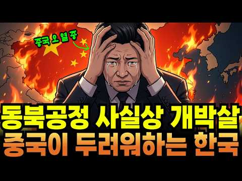
- 챕터: 0:00 우리가 'Korea'라고 불리는 진짜 이유 · 3:04 망한 지 250년 된 나라의 이름을 다시 꺼낸 사내 · 7:20 훈요십조에 남긴 왕건의 유언, "서경을 기억하라" · 9:30 적국 거란조차 인정해버린 고려의 정통성 · 13:47 마르코 폴로의 양피지에 적힌 단어 'Cauli' · 16:42 십수만의 발해 유민, 한반도로 스며들다 · 19:36 중국 동북공정이 고구려보다 '고려'를 두려워하는 이유 · 22:03 여러분의 여권에 박혀 있는 천 년의 못
- 설명 앞부분: ✈️ 지금 당장 책상 서랍 속 여권을 꺼내 표지를 보세요. 거기에 박힌 'KOREA'라는 다섯 글자가 어떻게 만들어졌는지 아시나요? 놀랍게도 이 이름은 우리가 스스로 세계에 알린 것이 아닙니다. 현재 중국이 천문학적인 예산을 쏟아붓고 있는 거대한 역사 왜곡 프로젝트, '동북공정'을 무너뜨리는 가장 강력한 무기가 되고 있다는 것입니다. 📜 🤫 "우리는 옛 고구려의 후예다." 918년, 망한 지 250년이나 지난 나라의 이름을 새 나라의 간판으로 내건 왕건의 치밀한 설계. 그리고 그 주장을 적국이었던 거란과 대국 송나라조차 인정할 수…
- 같은 채널 평소 대비 ×155.1 (채널 최근 롱폼 중앙값 3,812회) · 평소 영상: 조선이 흉내 낼 수 없던 고려 474년, 그들이 대륙을 차지했던 이유 ∣ 고려거란전쟁 ∣… (3,812회) / 우리가 몰랐던 6.25 남침의 충격적 뒷이야기 57시간동안 무엇을 했나? ∣ 역사다큐 ∣… (3,626회)
- 대본 없음 (설명) — 음성인식이 끝나면 도입부·흐름이 들어감
- 댓글 1,754/1,754: 좋은 점 — 영상 10 · 감사·응원 19 · 더 알고 싶은 것 12 · 아쉬운 점 — 영상 6 · 반박·불만 — 의견 다름 55 · 정치·사회 191 · 경험 공유 35 · 구독·다음 기대 1
  - 좋은 점 — 영상 👍3 “이런 내용은 처음이네요! 정말 잘 풀어내시네요. 구독합니다. 좋은 내용 감사합니다. 앞으로도 부탁드립니다. 주....욱!”
  - 좋은 점 — 영상 👍2 “여기서 말하는 평양은 대륙에 있엇다고 들었습니다 고려는 세로길이보다 가로길이가 더넓었다고 배웠음~ 그러나 재야사학자들은 연구를 안함(스카이 대학)포함 중국에 돈을 얼마나 받아 쳐먹으면 한심 스러움”
  - 감사·응원 👍11 “우리 할아버지 감사합니다”
  - 감사·응원 👍3 “이런 내용은 처음이네요! 정말 잘 풀어내시네요. 구독합니다. 좋은 내용 감사합니다. 앞으로도 부탁드립니다. 주....욱!”
  - 더 알고 싶은 것 👍3 “이런 내용은 처음이네요! 정말 잘 풀어내시네요. 구독합니다. 좋은 내용 감사합니다. 앞으로도 부탁드립니다. 주....욱!”
  - 더 알고 싶은 것 👍1 “우리는 corea 가 아닌 k 를 쓴 사실을 알려주세요 일본 j 보다 앞인 c가 아닌 k를 쓴 정확한 이유 증명 되나요?”
  - 아쉬운 점 — 영상 👍4 “조선총독부 조선사편수회에서 발간한 조선사를 기반으로한 현재의 한국사 역사관으로는 동북공정에 대응하는데 있어서 논리적 자기 모순에 빠져있다 더군다나 동북아역사재단과 주류사학계의 어용학자들은 하는 짓이 오히려 동북공정을 돕고있는 꼬라지다 동북공정에 제대로 대응하려면 국민…”
  - 아쉬운 점 — 영상 👍2 “팩트가 틀린 부분이 많습니다 1)발해는 고려라는 국호를 병행 사용합니다 고구려(고려,고리) 명말후 고려라는 국호는 단절되지 않고 발해에서도 계속이어집니다 2)후고구려의 공식 국호는 최초 고려입니다 왕건이 독자적으로 쓴게 아닙니다 3)Korea란 국호는 고려에서 처음으…”
  - 반박·불만 — 의견 다름 👍184 “고려가 한반도에만 있었다고 하는 것은 조선의 역사왜곡과 일제의 신민사학이 만들어낸 허구임. 고대 왕국은 강과 산맥을 가지고 영토의 경계가 만들어졌음. 한국사 교과서에 보이는 경계는 이런 규칙에 절대 맞지 않음. 옛날 지역명을 한반도에 때려 박아 놓고 경계를 그으니 말…”
  - 반박·불만 — 의견 다름 👍45 “저기 내용중에서 견훤은 자신의 국가를 후백제라고 한적이 없습니다..그냥 백제라고 했습니다. 현재의 우리가 삼국시대의 백제와 견훤의 백제를 구분하기 위해서 견훤의 백제를 후백제라고 편의상 부르는 거고요,, 마찬가지로 궁예도 건국후 자신의 나라를 후고구려하고 한적이 없습…”
  - 정치·사회 👍538 “드라마로 동북공정 진행중입니다.계속 경계해야합니다.중국인 무비자 입국 금지시키고요.”
  - 정치·사회 👍361 “고려는 한반도뿐만 아니라 만주, 동부대륙도 통치하고 있었습니다 겨우 한반도만 지배하던 나라가 황제국이라고 칭할 수가 있나? 송나라는 요나라한테 발렸지만 요나라와 맞짱 떠서 이긴 나라가 고려구만”
  - 경험 공유 👍14 “나도 역사는 취미에 불과하지만. 이렇게 대중에게 전달할 때는,더 연구해보고 영상 제작해야죠.채널주인장님 방송내용은 동북공정을 은근 슬쩍 돕는 식.. 고려가 고구려 후손이 아님에도 고려의 국명을 빌려썼다가 되니까,그러면 다시 고구려 귀속문제는 논쟁거리, 보세요,송악의 …”
  - 경험 공유 👍1 “이 양반아 왜 고려를 한반도 속에 묶어놓고 얘기를 하나? 중공이 동북공정을 머뭇거리는 이유가 고려때문이라며? 고려는 중원대륙 거의 저역을 차지했었단 말이외다. 자구 개성개성 송도송도 하지 마오.”
  - 구독·다음 기대 👍3 “이런 내용은 처음이네요! 정말 잘 풀어내시네요. 구독합니다. 좋은 내용 감사합니다. 앞으로도 부탁드립니다. 주....욱!”

### 202. 일본이 '괴물'이라 부르며 이순신보다 두려워 했던 인물? 조선 역사상 가장 저평가된 영웅

- https://www.youtube.com/watch?v=5ooDDKo68E0 · 역사동굴 · 구독자 2,470 · 조회수 112,129 (×45.4, 하루 2,041.1) · 좋아요 404 (0.4%) · 17.7분 · 2026-08-27 · 주제 묶음 3. 조선 · 형식 정보·해설 (그 밖) · 폴더 `W_5ooDDKo68E0` (웹 승인)
- 썸네일: 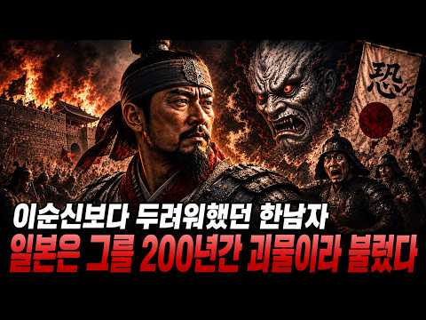
- 챕터: 0:00 일본군이 공포에 떨며 만든 괴물의 정체 · 1:14 적국이 200년 동안 부른 '모쿠소'의 진실 · 2:24 진주성을 지킨 무명의 영웅 김시민 · 3:42 갓을 벗어 던진 무관의 숨겨진 사연 · 6:14 불가능을 가능케 한 진주성의 기적 · 7:18 승리 직후 찾아온 비극과 그 이후 · 8:11 왜 진주성이 호남의 방패였을까? · 9:18 히데요시가 진주성에 집착한 잔혹한 이유 · 10:19 남강에 몸을 던진 최경회와 논개 · 11:15 죽은 지 8개월, 적군은 왜 그를 찾았나 · 12:13 일본 전설 속의 두꺼비 도사가 된 사연 · 13:34 왜 우리는 119년 동안 그를 잊었나 · 14:36 일본으로 끌려간 역사를 되찾은 시민들
- 설명 앞부분: 일본이 이순신보다 두려워 했던 인물? '괴물'이라 부르며 두려워했던 조선의 영웅 일본이 200년 넘게 두려워한 조선 장수, 충무공 김시민의 진짜 이야기. 이순신 장군과 나란히 진주대첩을 승리로 이끈 명장, 정작 일본에서는 '모쿠소'라는 이름의 괴물로 그려지며 두려움의 대상이 되었습니다. 무기 정비를 건의했다가 쫓겨났던 무명 관리는 어떻게 진주성을 지켜낸 명장이 됐을까요. 그리고 그의 임명장은 어쩌다 400년 만에 국민 모금으로 되찾아온 문화유산이 됐을까요. 진주대첩부터 공신교서 환수까지, 잘 알려지지 않은 이야기를 담았습니다. 이…
- 같은 채널 평소 대비 ×72.9 (채널 최근 롱폼 중앙값 1,539회) · 평소 영상: 천하의 송시열도 꺾지 못한 천재, 왜 윤휴는 역사 속에서 지워졌나? [기사환국][사문난적] (1,539회) / 단종보다 슬픈 광해군의 19년 생지옥! 사도세자보다 잔인한 최후와 원수의 파멸 [역사이야… (1,518회)
- 대본 없음 (설명) — 음성인식이 끝나면 도입부·흐름이 들어감
- 댓글 36/36: 좋은 점 — 영상 1 · 감사·응원 2 · 더 알고 싶은 것 0 · 아쉬운 점 — 영상 1 · 반박·불만 — 의견 다름 0 · 정치·사회 0 · 경험 공유 2 · 구독·다음 기대 0
  - 좋은 점 — 영상 👍2 “유익한 정보 감사합니다”
  - 감사·응원 👍3 “정확한 우리 역사를 바로 알려주시니 감사합니다.지속적인 노력으로 바로 세워 알리는 역사가 국민을 바로 세우는 일 이십니다.고맙습니다.”
  - 감사·응원 👍2 “유익한 정보 감사합니다”
  - 아쉬운 점 — 영상 👍1 “왜 ai 목소리가 다 같은거야?”
  - 경험 공유 👍2 “지혜인 의인 애국인 유비무환인은 소수고 그 선견지명은 거부되어 받아들여지지 않고 후대가 기억하고 기리는 악순환 멍청한 짓거리를 하고 있는 조선 사람들....나도 조선 사람인데....유비무환 정신이 강하니 어느 쪽 조선인일까?”

### 203. 조선에서 라면팔면 팔릴까?

- https://www.youtube.com/watch?v=Mj85mD9KvmE · 눕이현 · 구독자 24,300 · 조회수 1,094,793 (×45.0, 하루 18,058.0) · 좋아요 9,937 (0.9%) · 9.3분 · 2026-08-21 · 주제 묶음 3. 조선 · 형식 정보·해설 (그 밖) · 폴더 `W_Mj85mD9KvmE` (웹 승인)
- 썸네일: 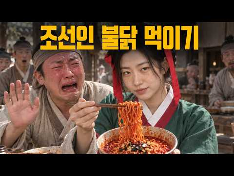
- 대본 없음 (없음) — 음성인식이 끝나면 도입부·흐름이 들어감
- 댓글 1,174/1,174: 좋은 점 — 영상 4 · 감사·응원 26 · 더 알고 싶은 것 17 · 아쉬운 점 — 영상 7 · 반박·불만 — 의견 다름 6 · 정치·사회 2 · 경험 공유 19 · 구독·다음 기대 47
  - 좋은 점 — 영상 👍2 “영상이 너무 좋아요, 처음에는 ai 불펌 같은거줄 알았는데 너무 아이디어랑 편집 영상이 좋아요 ai는 이렇게 쓰여야죠. 근데 문제는 처름 보는 사람들은 오해할 수 있을 듯해서 처음 오프닝을 바꾸던지 하는게 좋을 것 같아요, 특히 쇼츠요, 아이디어는 많이 없지만 조금이…”
  - 좋은 점 — 영상 👍0 “참신한 아이디어에 많이 배우고 갑니다. ㅋ”
  - 감사·응원 👍34 “노고에 눈물이...9분 15초면 한달 크레딧 거의 다 쓰시고....이걸 3일에 한번이라도 올릴 수 있으면 얼마나 좋겠어유...넘 잘 만드셨네영~ 토토와코코가 응원합니다”
  - 감사·응원 👍7 “솔직히 놀랐습니다. 저도 AI 영상 유료로 써보고 생쇼해봤지만 정말 힘든 작업이거든요. 디테일과 각본 등등 미쳐써요 초하이 고 퀄리티. 슈퍼챗이라도 있음 당장 쏘고싶네요 60만구독자까지 응원합니다!!!”
  - 더 알고 싶은 것 👍33 “어허, AI 컨텐츠 중에 다음 퀄리티가 정말 궁금해서 구독한 곳은 여기가 처음입니다. 조선이라는 시대가 그렇게 거부감있는 시대도 아니고, 마치 드라마 시즌1 최종장까지 요약편을 보는 느낌이 드네요. 컨셉을 이어가면서 최종 왕의 입맛까지 홀릴 것이냐, 아니믄 다른 세계…”
  - 더 알고 싶은 것 👍11 “오 뭐야 SF사극 드라마 한편본듯ㅋ 재밌어옄ㅋㅋㅋㅋ 계속만들어주시면 채널 떡상!”
  - 아쉬운 점 — 영상 👍290 “처음엔 AI티가 나네~ 하면서 보고있는데 몰입하다가 와 순간 사람들이 연기하는거로 착각함 재밌다진짜”
  - 아쉬운 점 — 영상 👍2 “뭐지........아무리 가상(AI) 편집이지만.......끌리네요ㅋㅋ 재미도 있고 스토리도 있고!! 구독박고 좋아효!! 믿고 같이 가볼게요~!!”
  - 반박·불만 — 의견 다름 👍7 “현실에서 불가능한 상황을 흡입력있고 유쾌하게 표현하면서 익숙한 유튜브 플랫폼을 따라감 ai 활용에 최고 고점이지않나. 애초에 현실에 있지 않는것을 창조한다면 말도안되는상황을 유쾌하고 트랜디하게풀것 많이배웁니다”
  - 반박·불만 — 의견 다름 👍2 “에비앙은 우라늄이 포함되어 있어요. 좋은 물이 아닙니다.”
  - 정치·사회 👍0 “한국인들은 왜캐 맛도 없고 암유발 음식인 리면을 이리도 좋아하고 라면부심이 강한걸까? 라면은 중국인이 발명한건데”
  - 경험 공유 👍7 “솔직히 놀랐습니다. 저도 AI 영상 유료로 써보고 생쇼해봤지만 정말 힘든 작업이거든요. 디테일과 각본 등등 미쳐써요 초하이 고 퀄리티. 슈퍼챗이라도 있음 당장 쏘고싶네요 60만구독자까지 응원합니다!!!”
  - 경험 공유 👍3 “내가 웬만하면 AI 다 차단 때리는데, 여긴 진짜 맛집이네. 저점매수 구독하고 감”
  - 구독·다음 기대 👍333 “조금 오버해서 방송국놈들이 수천 수억들여 촬영한 영상들보다 각본 연출 스토리 좋구요 시댄스로 이 정도 만들려면 돈이 꽤 들었을텐데요 시댄스의 엄청난 성능과 주인장의 센스가 제대로 콜라보 되었어요 정말 좋은 센스와 재능을 가지셨네요 구독하고 다음영상 기다리겠습니다 굿”
  - 구독·다음 기대 👍12 “이채널 맛집이네 구독박아요❤”

### 204. 지구나이 46억년 우리가 최초의 문명이 아닐수 있다? 실루리안가설 ∣ 고대문명 ∣ 지구역사 ∣ 잃어버린문명

- https://www.youtube.com/watch?v=s_WObkOSKe0 · 지식브리핑 · 구독자 7,320 · 조회수 326,514 (×44.6, 하루 1,832.7) · 좋아요 3,129 (1.0%) · 30.4분 · 2026-04-26 · 주제 묶음 1. 역사 일반·이야기 · 형식 몰아보기·통합본 (긴 영상) · 폴더 `W_s_WObkOSKe0` (웹 승인)
- 썸네일: 
- 챕터: 0:00 인트로: 발 밑의 흙이 품고 있는 비밀 · 1:21 지구의 나이 45억 년, 인류 문명은 단 '0.2초' · 3:05 "지구는 지우개다" 대륙의 이동과 지각의 재활용 · 5:40 학계를 뒤흔든 NASA 과학자들의 '실루리안 가설' · 8:15 인류가 멸종하고 1억 년 후, 도시는 어떻게 사라지는가 · 10:30 영원히 남을 인류의 묘비명: 플라스틱, 핵, 그리고 … · 12:55 5600만 년 전 기후 재앙(PETM)은 과거 문명의… · 14:40 17억 년 전 가봉 광산에서 가동된 '천연 원자로'의… · 18:10 지능과 문명에 대한 우리의 편견 (흰개미, 문어, 까… · 21:00 인류세의 끝: 우리는 지구에 무엇을 남기고 떠나는가
- 설명 앞부분: 지금 우리가 딛고 있는 이 땅 아래, 수억 년 전의 지적인 고대 문명이 존재했다면 우리는 그 흔적을 알아볼 수 있을까요? 우리가 사라지고 1억 년 후, 지구에는 콘크리트 빌딩 대신 미세 플라스틱과 방사성 동위원소, 그리고 수백억 마리의 '닭 뼈'만이 우리의 묘비명으로 남을지도 모릅니다. 우리는 우주의 외로운 선구자일까요, 아니면 긴 흐름 속의 한 점일까요? 끝까지 시청하시고 여러분의 생각을 남겨주세요. ⏱️ 타임라인 (Timeline) 팩트체크 (Fact-Check) 실루리안 가설은 정말 학술지에 발표된 내용인가요? * 네, 20…
- 같은 채널 평소 대비 ×19.1 (채널 최근 롱폼 중앙값 17,114회) · 평소 영상: 200만 년 전으로 떨어진 현대인 첫날 밤을 버틸 수 있을까? ∣ 고대 인류 ∣ 호모사피… (17,984회) / 고양이는 어떻게 우리의 거실을 정복 했을까? ∣ 고양이 ∣ 반려묘 ∣ 가축화 (16,245회)
- 대본 없음 (설명) — 음성인식이 끝나면 도입부·흐름이 들어감
- 댓글 422/422: 좋은 점 — 영상 1 · 감사·응원 6 · 더 알고 싶은 것 3 · 아쉬운 점 — 영상 4 · 반박·불만 — 의견 다름 5 · 정치·사회 0 · 경험 공유 12 · 구독·다음 기대 0
  - 좋은 점 — 영상 👍1 “"방대한 지구의 역사를 24시간으로 비유해서 설명해주시니 정말 이해가 쏙쏙 되네요. 우리가 첫 번째가 아닐 수도 있다는 가설이 무척 흥미로웠습니다. 좋은 영상 감사합니다!"”
  - 감사·응원 👍27 “살고있는 것 보다 죽은게 더 많다 늘 감사하고 행복하게 살다가시길”
  - 감사·응원 👍3 “몸과 마음은 내가 아니며, 이 세상은 교육을 위한 가상세계다. 나는 몸에 머무는 영혼이고, 마음이 기뻐하고 감사하며 사랑하는 영성산업으로 세계통일하여 기아,난민,전쟁을 종식하자.”
  - 더 알고 싶은 것 👍0 “만약 우리가 최초의 문명이.아니라고 가정했을때 그럼 우리 이전의 문명은 언제쯤이었을까요? 공룡시대를 기준으로 이전이었을까요? 이후였을까요?”
  - 더 알고 싶은 것 👍0 “요즘 이런 채널들이 엄청 많이 생겨있고.. 그내용들도 엄청 심오한데.. 도대체 이런 자료들을 어디서 구하는건지.. 엄청 궁금합니다..”
  - 아쉬운 점 — 영상 👍1 “영상하나가 계속반복되는게 세뇌당하는거 같아어짜증나서 안본다”
  - 아쉬운 점 — 영상 👍0 “진짜 이거 맞는거같긴함.. 지구의 생명체는 전부 죽었다가 탄생해서 인류문명 계속 반복되는거같다”
  - 반박·불만 — 의견 다름 👍0 “헛소리 만들지말자 ㅡ”
  - 반박·불만 — 의견 다름 👍0 “절대 말도 안되는 가설... 아니... 소설 ㅋㅋㅋ 하다못해 화석 하나라도 나와야지”
  - 경험 공유 👍5 “전에 생각해봤는데 우리같은 어리석은 인간들이 멸망하고 리셋된 후 똑같은 실수반복 또 멸망아닐까? 하고”
  - 경험 공유 👍3 “몸과 마음은 내가 아니며, 이 세상은 교육을 위한 가상세계다. 나는 몸에 머무는 영혼이고, 마음이 기뻐하고 감사하며 사랑하는 영성산업으로 세계통일하여 기아,난민,전쟁을 종식하자.”

### 205. 조선시대 주막의 충격적인 하룻밤, 사극에서 절대 안 보여준 진짜 모습

- https://www.youtube.com/watch?v=PgkTnWeBMyA · 역사트리 · 구독자 10,100 · 조회수 450,108 (×44.6, 하루 5,826.8) · 좋아요 2,181 (0.5%) · 17.7분 · 2026-08-05 · 주제 묶음 3. 조선 · 형식 정보·해설 (그 밖) · 폴더 `W_PgkTnWeBMyA` (웹 승인)
- 썸네일: 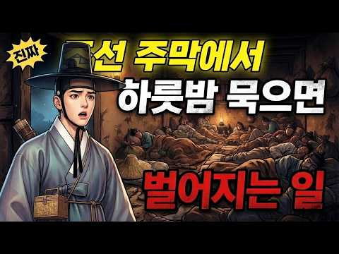
- 설명 앞부분: 조선시대 주막의 충격적인 하룻밤, 사극에서 절대 안 보여준 진짜 모습 🏚 화장실보다 좁은 방에 모르는 사람 10명, 바닥 온도 39도, 창문은 열 수도 없었습니다. 그런데 이 주막에는 돈 한 푼 없이도 전국을 여행할 수 있는 미친 시스템이 숨어 있었습니다 🤯 양반이 큰소리쳤다가 파직당한 이유, 영국 여행가가 "군단"이라 표현한 것의 정체, 25kg 동전을 끝까지 짊어진 외국인의 최후까지. 사극이 만들어낸 깨끗한 주막, 그 안에서 진짜 벌어진 일을 알면 다시는 똑같이 못 봅니다 🔥
- 같은 채널 평소 대비 ×175.9 (채널 최근 롱폼 중앙값 2,558회) · 평소 영상: 왕도 눈치 본 궁녀, 첫 번째 교육이 숨 참는 법이었습니다 (2,573회) / 형제 죽인 조선 왕 5명의 후손에게 벌어진 일, 태종, 세조, 영조까지 ∣ 조선역사 오디… (2,544회)
- 대본 없음 (설명) — 음성인식이 끝나면 도입부·흐름이 들어감
- 댓글 195/197: 좋은 점 — 영상 0 · 감사·응원 3 · 더 알고 싶은 것 2 · 아쉬운 점 — 영상 0 · 반박·불만 — 의견 다름 2 · 정치·사회 7 · 경험 공유 2 · 구독·다음 기대 0
  - 감사·응원 👍15 “우리 조상님들 잘싯지도 못하고 양치도 못하고 그좁은 주막에서 땀흘리며 추위에 떨며 잘 버티셧구나 감사합니다 이시대에 태어나게 해주셔서 ㅠㅠ”
  - 감사·응원 👍2 “차박을 할수있는 시대에 사는건 축복이다 감사하자”
  - 더 알고 싶은 것 👍5 “주막에서 잘때 화장실은 어떻게 했을까요? 전 그게 궁금함..”
  - 더 알고 싶은 것 👍1 “영상이 진실이고 AI아니라면 좋을텐덴데. 맞나요?”
  - 정치·사회 👍12 “폴라드작가 심정이 이해가 가는게 겁나후진국에서 저런시스템을 외국인한테도 제대로 적용시킬지는 믿기힘들지.”
  - 정치·사회 👍1 “하루 12키로가는데 보름 걸린다고? 서울에서 부산 간다며,,,그것도 직선거리도 아니고 산넘고 물건너 갈텐데,,,, 이런 나래이션으로 이동영상을 믿으라고?”
  - 경험 공유 👍31 “저도 1번 죽기싫으면 저기들어가 자야지요! 설악 중천대피소 생각이 납니다! 발냄새 땀냄새 술냄새 소주반병에 라면 버너로 삶아서 먹고 눈감았다뜨면 새벽산행 준비하는소리로 시끌벅적! 재미지겠네요!”

### 206. 이순신이 죽을 뻔한 순간, 선조에게 맞선 72살 대신 정탁의 구명 상소

- https://www.youtube.com/watch?v=rKbIXQkOL-A · 꼬미의 기록장 · 구독자 2,160 · 조회수 95,543 (×44.2, 하루 1,397.5) · 좋아요 692 (0.7%) · 32.6분 · 2026-08-13 · 주제 묶음 3. 조선 · 형식 정보·해설 (그 밖) · 폴더 `W_rKbIXQkOL-A` (웹 승인)
- 썸네일: 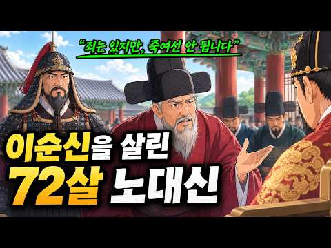
- 설명 앞부분: 1597년, 이순신은 영웅이 아니라 죄인이었습니다. 그런데 그를 살리려 나선 사람은 먼저 “이순신에게 죄가 있다”고 말했던 72살 대신 정탁이었습니다. 선조는 왜 이순신을 버리려 했고, 정탁은 왜 그런 이순신을 끝까지 살려두려 했을까요? 이 영상은 이순신의 파직과 투옥, 정탁의 구명 논리, 칠천량 패전과 명량 직전까지 이어진 숨은 이야기를 따라갑니다. 주요 내용 1597년 선조가 이순신에게 격노한 이유 “이순신은 참으로 죄가 있습니다”라고 말한 정탁의 실제 판단 72살 노대신 정탁은 어떤 정치가였나 이순신 파직과 의금부 투옥까지 …
- 같은 채널 평소 대비 ×291.3 (채널 최근 롱폼 중앙값 328회) · 평소 영상: 수양대군은 어떻게 세조가 되었나? 단종을 몰아낸 계유정난의 진실 (328회) / 조선 최고 권력자 한명회, 자식 5명은 왜 모두 비극으로 끝났나 ∣ 왕비 두 명을 만든 … (319회)
- 대본 없음 (설명) — 음성인식이 끝나면 도입부·흐름이 들어감
- 댓글 82/82: 좋은 점 — 영상 2 · 감사·응원 6 · 더 알고 싶은 것 0 · 아쉬운 점 — 영상 2 · 반박·불만 — 의견 다름 0 · 정치·사회 6 · 경험 공유 2 · 구독·다음 기대 0
  - 좋은 점 — 영상 👍9 “꼬미의 기록장님은 AI 님이시군요. 저는 꼬미님이 인용하시는 2015년 "이순신을 구원한 정탁의 신구차에 관한 연구" 논문을 쓴 방성석입니다. 우연히 동영상을 보고 저의 연구 성과를 인용하는 것에 기뻤습니다. 전개하시는 논리가 매우 합리적이라 많이 배웠습니다. 감사합…”
  - 감사·응원 👍9 “꼬미의 기록장님은 AI 님이시군요. 저는 꼬미님이 인용하시는 2015년 "이순신을 구원한 정탁의 신구차에 관한 연구" 논문을 쓴 방성석입니다. 우연히 동영상을 보고 저의 연구 성과를 인용하는 것에 기뻤습니다. 전개하시는 논리가 매우 합리적이라 많이 배웠습니다. 감사합…”
  - 감사·응원 👍3 “좋은글 감사합니다”
  - 아쉬운 점 — 영상 👍4 “내용은 좋으나 똑같은 내용을 말만 계속 바꾸어서 지루하게 들려요.”
  - 아쉬운 점 — 영상 👍1 “주장의 핵심에 동의함. 다만, 반복해서 너무 길게 말하니 ...”
  - 정치·사회 👍21 “선조는 임진왜란의 휴전기간이 길어지자 차츰 남해안에 주둔중인 일본군과 대치하고 있는 조선수군에게 일본군을 공격하여 몰아낼것을 끊임없이 요구합니다 그러나 현지에서는 일본군이 남해안 요충지에 붙어서 솟아오른 산정상에 성을 쌓은후 함대를 해안가에 정박해놓고 만반의 수비태세…”
  - 정치·사회 👍2 “500년전에 이순신이나 500년이 지난 지금 2026.8.17일 문재인과 이재명정권이나 충신이나 올바른 사람은 대한민국에서 살기가 정말 힘들구나 신뢰는 자신을 가장 아름답게 가장 당당하게 가장 용기있게 만드는 최강의 내공입니다 스스로가 이렇게 보이지 않는 아름다운 신…”
  - 경험 공유 👍5 “정탁 대신은 진정 나라를 위한 애국자이다. 첩의 자식 출신의 열등감으로 똘똘 뭉처져서, 배배꼬인 화가 머리끝까지 나서, 뚜껑이 열린 선조 놈을 염장지않고, 임금의 어명(잘못된 명령)을 어긴 이순신의 잘못을 지적하면서도, 선조를 달래어서 선조의 체면을 세워주고, 나라를…”
  - 경험 공유 👍2 “500년전에 이순신이나 500년이 지난 지금 2026.8.17일 문재인과 이재명정권이나 충신이나 올바른 사람은 대한민국에서 살기가 정말 힘들구나 신뢰는 자신을 가장 아름답게 가장 당당하게 가장 용기있게 만드는 최강의 내공입니다 스스로가 이렇게 보이지 않는 아름다운 신…”

### 207. 유럽을 공포에 떨게 한 600년 이슬람 제국은 왜 흔적도 없이 사라졌을까? ∣ 오스만 제국사 풀스토리

- https://www.youtube.com/watch?v=EjRxsCOhmGY · 달빛 세계사 · 구독자 18,000 · 조회수 787,423 (×43.8, 하루 14,366.3) · 좋아요 2,881 (0.4%) · 77.4분 · 2026-08-27 · 주제 묶음 6. 동양사 (중국·일본·몽골) · 형식 수면·낭독 (잠잘 때 듣는) · 폴더 `W_EjRxsCOhmGY` (웹 승인)
- 썸네일: 
- 챕터: 0:00 인트로: 세 대륙을 호령한 푸른 눈의 이슬람 제국 · 1:29 아나톨리아의 유목민에서 발칸의 패자로 · 12:13 앙카라 전투의 파멸과 부활 · 20:22 1453년 콘스탄티노플 함락과 메흐메트 2세 · 29:35 이슬람 세계를 하나로 묶은 셀림 1세 · 37:29 쉴레이만 대제와 록셀라나의 암투 · 48:51 빈의 성벽과 윙드 후사르, 꺾여버린 초승달 · 57:44 '유럽의 병자'와 피의 개혁 · 67:05 갈리폴리의 기적과 제국의 장례식 · 75:07 에필로그: 역사 속에서 마주한 질문
- 설명 앞부분: 중앙아시아의 거친 바람을 피해 흘러들어온 이름 없는 작은 유목 부족. 말안장 위에서 태어난 이들은 어떻게 천년 로마의 심장을 도려내고, 아시아·유럽·아프리카 3대 대륙을 호령하는 거대한 패자가 되었을까요? 기독교 소년들을 강철 전사로 개조한 공포의 군단 '예니체리', 왕위에 오른 자는 형제들을 목 졸라 죽여야 했던 잔혹한 '형제 살해법', 배를 끌고 산을 넘어 콘스탄티노플을 무너뜨린 21세 정복자 메흐메트 2세, 그리고 제국의 영광 뒤편에서 피비린내 나는 암투를 벌인 하렘의 여인들까지. 세 대륙을 호령하던 찬란한 황금기부터 '유럽…
- 같은 채널 평소 대비 ×13.9 (채널 최근 롱폼 중앙값 56,563회) · 평소 영상: 인류 역사상 가장 잔혹하고 기묘했던 문명, 마야는 왜 흔적도 없이 사라졌을까? [🌙 꿀잠… (60,233회) / 초고대문명, 세계 최초의 완벽한 도시가 사라진 이유, 인더스 문명 5,000년의 수수께끼… (52,893회)
- 대본 없음 (설명) — 음성인식이 끝나면 도입부·흐름이 들어감
- 댓글 66/69: 좋은 점 — 영상 1 · 감사·응원 9 · 더 알고 싶은 것 0 · 아쉬운 점 — 영상 1 · 반박·불만 — 의견 다름 1 · 정치·사회 3 · 경험 공유 2 · 구독·다음 기대 1
  - 좋은 점 — 영상 👍6 “오스만 제국 초기부터 중기와 말기까지 상세한 설명을 잘 시청하였습니다.”
  - 감사·응원 👍33 “위대한 세기를 재밌게 봤었는데 대충은 알았지만 자세하게 제국의 멸망까지 설명해주니 고맙습니다”
  - 감사·응원 👍9 “잘보았습니다 ~감사를 드립니다😊”
  - 아쉬운 점 — 영상 👍3 “광고가 너무 자주 하네요. 어떻게 보기싫을 정도로 몇분에 한번씩 하나요. 보기싫어서 나갑니다.”
  - 정치·사회 👍0 “미국에 이익이 된다해도, 미국이 이 세상의 지도자 나라가 되기를 원합니다. 본래의 창조주 하나님을 두려워할 줄 아는 사람들이 세웠던 그 정신을 더 강하게 세워갈 줄 아는 지도자로 굳게 상승하기를 바랍니다. 딥스가요? , 중 공산당이요?, 테러 독재 중동이요? 오스만 …”
  - 경험 공유 👍6 “정말 재밌게. 잘들었습니다 발음도 정확하고 목소리도좋네요 오스만의역사 궁금했었는데 잘들었습니다 감사해용~~”
  - 구독·다음 기대 👍2 “진짜 너무 재및네요 바로 구독합니다”

### 208. 조선 왕조 실록 1대 태조부터 27대 순종까지 한번에 몰아보기 ∣ 27명의 임금 중 진짜 왕이 단 5명뿐인 소름 돋는 이유

- https://www.youtube.com/watch?v=DY0tRfuxRhQ · 새벽이 깨운 역사 · 구독자 9,750 · 조회수 426,495 (×43.7, 하루 3,234.6) · 좋아요 7,365 (1.7%) · 64.6분 · 2026-06-11 · 주제 묶음 3. 조선 · 형식 몰아보기·통합본 (긴 영상) · 폴더 `W_DY0tRfuxRhQ` (웹 승인)
- 썸네일: 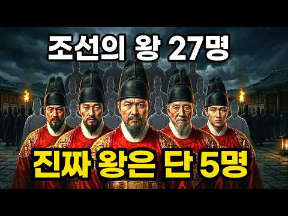
- 챕터: 0:00 오프닝 — 왕은 27명, 진짜 왕은 몇 명일까 · 2:33 태조 이성계 · 정도전과 1차 왕자의 난 · 6:35 태종 이방원 — 피로 닦은 왕좌 · 10:00 세종과 문종 — 두 저울을 다 채운 왕 · 15:30 단종과 세조 · 사육신의 죽음 · 21:39 성종과 연산군 — 두 얼굴의 권력 · 26:21 중종 · 명종 · 외척 문정왕후 · 30:33 선조 · 임진왜란과 이순신 · 36:03 광해군 · 인조 · 삼전도의 굴욕 · 41:44 효종 · 숙종 · 경종 · 46:33 영조 · 사도세자의 뒤주 · 정조 · 51:07 순조 · 철종 · 세도정치 60년 · 54:59 고종 · 대한제국 · 순종, 그리고 1910년 · 61:01 결론 — 진짜 왕은 단 5명이었다
- 설명 앞부분: 조선왕조실록 518년, 27명의 왕을 단 하나의 영상에 모두 담았습니다. 그런데 그 27명 중, 진짜 왕은 단 5명뿐이었습니다. 1392년 태조 이성계의 위화도 회군부터 1910년 순종까지. 이 영상은 조선의 모든 왕을 '정통성'과 '실권'이라는 두 개의 저울 위에 올려놓고, 한 명씩 그 무게를 달아본 조선왕조실록 완벽 몰아보기입니다. 떳떳하게 왕위에 오른 자는 왜 일찍 무너졌고, 강한 권력을 쥔 자는 왜 그 자리를 빼앗아 온 자였을까요? 임진왜란과 병자호란, 삼전도의 굴욕, 사도세자의 뒤주, 세도정치와 대한제국의 멸망까지. 조선…
- 같은 채널 평소 대비 ×317.3 (채널 최근 롱폼 중앙값 1,344회) · 평소 영상: 고구려 멸망, 수십만 당나라 대군을 막고도 무너진 진짜 이유 (1,379회) / 김이박이 인구 절반인 이유 ∣ 조선 후기, 신분에는 가격표가 붙어 있었다 (1,309회)
- 대본 없음 (설명) — 음성인식이 끝나면 도입부·흐름이 들어감
- 댓글 319/319: 좋은 점 — 영상 2 · 감사·응원 9 · 더 알고 싶은 것 1 · 아쉬운 점 — 영상 5 · 반박·불만 — 의견 다름 4 · 정치·사회 18 · 경험 공유 9 · 구독·다음 기대 0
  - 좋은 점 — 영상 👍30 “518년을 짧은 시간에 명쾌하게- 쉽게 잘 설명해주셔서 대단히 감사합니다 감명깊게 잘 들었습니다”
  - 좋은 점 — 영상 👍4 “광해군, 세종,성종, 정조..재미있고 유익한 영상 감사합니다”
  - 감사·응원 👍49 “저는 북한에서 왔어요.한국에와서 사극을 보면서 우리나라 역사에 관심을 갖기시작했어요.그 관심이 왕족실록 왕비실록 책을사서 보기시작했고 우리 조상들이 위대함에대하여 제대로 알기시작했어요.이젠 눈이 아파 유트브에서 역사를 듣기시작했어요.이젠 그냥 나이 들어가는 평범한 아…”
  - 감사·응원 👍30 “518년을 짧은 시간에 명쾌하게- 쉽게 잘 설명해주셔서 대단히 감사합니다 감명깊게 잘 들었습니다”
  - 더 알고 싶은 것 👍2 “저는 78세, 허리가 얼마나 아파야 하는지 모르겠지만 조금 심합나다. 어떻게 알려 주실수 있으신지요?”
  - 아쉬운 점 — 영상 👍32 “가장 아까운 사람이 문종과 정조였음. 두분 다 똑똑했는데 더 오래 다스리지 못래서 아쉬웠고 일찍 가시는 바람에 단종비화가 발생했고 조선후기 세도정치로 조선이 망가졌지..”
  - 아쉬운 점 — 영상 👍4 “조선의 27대 임금 가운데, 실질적인 왕권과 통치권을 확고하게 행사한 군주는 **태종, 세종, 성종, 숙종, 영조, 정조** 여섯 명이라고 생각합니다. 물론 **문종**도 여기에 포함될 가능성은 있습니다. 그러나 건강이 좋지 않아 즉위 후 재위 기간이 매우 짧았고, …”
  - 반박·불만 — 의견 다름 👍4 “조선건국의 일등공신은 이방원을 세자로 봉해야지 영웅호걸인 이성계도 강비와 정도전에게 휘둘려 코흐리개 막내인 강비소생에게 세자로 봉한 대가가 그 소생과 정도전의 일당이 방원에게 다 도륙당했지 정도전. 참 아까운 인물이다😢 조선 27명 왕들 공이 있는 왕은 祖. 덕이 있…”
  - 반박·불만 — 의견 다름 👍2 “와위에 오르면 빙신도 왕이 되는법입니다 무슨 헛소리하는가요 사실 연산군과 광해군도 왕입니다 종묘에 안올린건 그당시 사림파들 때문이지요 반역자는 중종과 인조입니다 중종은 그대마 명분이 서지만 인조는 명분이 없어요”
  - 정치·사회 👍4 “백성을 위한 왕이 누구였던가? 조선은 역사에 없어야 할 왕조다. 정도전의 백성을 위한 정치가 펼쳤졌다면 이 나라가 일찍 근대화되고 발전 되었을 것이라 생각해본다.”
  - 정치·사회 👍3 “현시대에서도 진짜 대한민국에 역대 대통령중에 진짜 대통령은? (이승만,박정희) 입니다”
  - 경험 공유 👍4 “조선의 27대 임금 가운데, 실질적인 왕권과 통치권을 확고하게 행사한 군주는 **태종, 세종, 성종, 숙종, 영조, 정조** 여섯 명이라고 생각합니다. 물론 **문종**도 여기에 포함될 가능성은 있습니다. 그러나 건강이 좋지 않아 즉위 후 재위 기간이 매우 짧았고, …”
  - 경험 공유 👍1 “저당시, 내가 있엇다면..? 조선은 지금 일본하고 북한까지..접수해서..영토강 국으로..”

### 209. 📷 일반에 공개되기엔 너무 대담했던 숨겨진 빈티지 사진 100장

- https://www.youtube.com/watch?v=NSnNg56q-RY · World of Lost Photos · 구독자 5,310 · 조회수 231,129 (×43.5, 하루 1,531.3) · 좋아요 2,232 (1.0%) · 20분 · 2026-05-23 · 주제 묶음 1. 역사 일반·이야기 · 형식 인터뷰·강연·대담 · 폴더 `W_NSnNg56q-RY` (웹 승인)
- 썸네일: 
- 설명 앞부분: 📷 일반에 공개되기엔 너무 대담했던 숨겨진 빈티지 사진 100장 역사의 수많은 순간들은 사진으로 남겨졌지만, 그중 일부는 너무 강렬하고 예상 밖이어서 오랫동안 세상에 공개되지 않았습니다. 이번 영상에서 잊혀진 역사 사진들은 거의 알려지지 않았던 희귀한 빈티지 사진들을 통해 숨겨진 과거의 진짜 모습을 보여드립니다. 📸 세상이 보지 못했던 순간들 이 사진들은 단순한 기록 이상의 의미를 담고 있습니다. 자연스럽게 포착된 표정들, 시대를 그대로 담아낸 거리 풍경, 그리고 당시 사람들의 솔직한 삶의 순간들이 생생하게 남아 있습니다. 연출되…
- 같은 채널 평소 대비 ×91.8 (채널 최근 롱폼 중앙값 2,518회) · 평소 영상: 📷 그들은 당신이 이 50장의 사진을 보지 않기를 바랐다. (2,376회) / 📸 우리가 알고 있던 역사와 완전히 다른 이야기 (2,345회)
- 대본 없음 (설명) — 음성인식이 끝나면 도입부·흐름이 들어감
- 댓글 34/34: 좋은 점 — 영상 0 · 감사·응원 4 · 더 알고 싶은 것 1 · 아쉬운 점 — 영상 0 · 반박·불만 — 의견 다름 0 · 정치·사회 2 · 경험 공유 3 · 구독·다음 기대 0
  - 감사·응원 👍2 “밴쿠버아랫동네 화이트락에서 감사히 잘봤습니다. 🙏🙏🙏”
  - 감사·응원 👍1 “영상 구성에 감사합니다 또ㆍ감탄합니다”
  - 더 알고 싶은 것 👍4 “개인적으로 참 본인이 태어난 해에. 세계가 어떤 환경속에 있는지 내가 살던곳 과 그시대의 여러나라들의 생활을 볼수있어 생각을 많이 할수 있어 좋왔고 음악이 좀더 회상할수 있게끔 도움을 준게 너무 좋습니다. 개인적으로. 배경음악이 궁금하군요 알수 있을까요?”
  - 정치·사회 👍4 “국힘 정신바짝차려 일치 단합해라 국가외 민족을 위한 박근혜대통령님의 열정을 본받아 재탄생시키기를 바란다!!!!”
  - 경험 공유 👍4 “개인적으로 참 본인이 태어난 해에. 세계가 어떤 환경속에 있는지 내가 살던곳 과 그시대의 여러나라들의 생활을 볼수있어 생각을 많이 할수 있어 좋왔고 음악이 좀더 회상할수 있게끔 도움을 준게 너무 좋습니다. 개인적으로. 배경음악이 궁금하군요 알수 있을까요?”
  - 경험 공유 👍1 “마를린먼로 데미무어 이 둘의 얼굴을 보면서 아름답다고 생각했다 내가 느끼는 이 감정의 정의는 무엇인가....무엇을 근거로 난 이 감정을 느끼는걸까?”

### 210. 수면용 다큐: 찬란했던 그리스 문명은 왜 로마 앞에 무너졌을까. [잠들기 전 / 역사]🔥

- https://www.youtube.com/watch?v=4ABLLl6jGes · 교훈과 지혜 · 구독자 2,470 · 조회수 106,694 (×43.2, 하루 647.5) · 좋아요 1,174 (1.1%) · 65.6분 · 2026-05-09 · 주제 묶음 5. 세계사·서양사 · 형식 수면·낭독 (잠잘 때 듣는) · 폴더 `W_4ABLLl6jGes` (웹 승인)
- 썸네일: 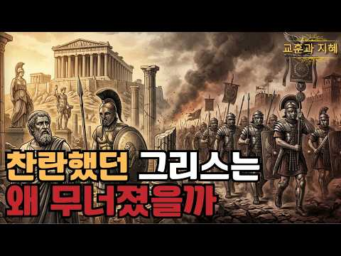
- 설명 앞부분: 🌙 철학과 예술, 민주주의의 시작. 한때 세상에서 가장 찬란했던 문명은 왜 결국 로마 앞에 무너지게 되었을까요? 고대 그리스. 수많은 철학자와 학자들, 그리고 인간의 사고방식을 바꿔버린 문화까지. 그리스는 단순한 국가가 아니라, 서양 문명의 뿌리였습니다. 하지만 그 찬란함은 영원하지 않았습니다. 왜 그리스는 점점 약해지기 시작했는가 도시 국가들은 왜 서로 싸우게 되었는가 그리고 로마는 어떻게 그 거대한 문명을 집어삼켰는가 이 영상에서는 그리스의 몰락을 단순한 패배가 아니라, 한 시대가 끝나고 새로운 제국이 등장하는 거대한 전환점으…
- 같은 채널 평소 대비 ×239.2 (채널 최근 롱폼 중앙값 446회) · 평소 영상: [잠들기 전 / 역사]🔥트라야누스와 하드리아누스: 로마의 팽창과 후퇴의 시대 (446회) / [잠들기 전 / 역사]🔥 잠들기 전 듣는 칭기즈칸의 비밀, 가뭄이 아닌 풍요가 만든 거대… (444회)
- 대본 없음 (설명) — 음성인식이 끝나면 도입부·흐름이 들어감
- 댓글 18/18: 좋은 점 — 영상 2 · 감사·응원 2 · 더 알고 싶은 것 0 · 아쉬운 점 — 영상 0 · 반박·불만 — 의견 다름 1 · 정치·사회 0 · 경험 공유 0 · 구독·다음 기대 0
  - 좋은 점 — 영상 👍1 “목소리좋다. 배경.음악없으니까 더 좋다. 잘 들린다.❤❤❤”
  - 좋은 점 — 영상 👍0 “모두 침입자들이고 대륙 고려조선엔 침입자들의 역사가 없다 침입자들은 300년 전에 문자를 배웠고 고려조선의 대륙 개방으로 밀려들었다 그릭도 1950년대에 나찌와 함께 시작했다”
  - 감사·응원 👍1 “재밌고 흥미로운 영상 감사드립니다. 잘보고 갑니다.”
  - 감사·응원 👍1 “감사합니다 ❤❤❤”
  - 반박·불만 — 의견 다름 👍3 “광장 선동 투표제 때문에 망했지. ㅡ소크라테스ㅡ”

### 211. 한국 학계가 주목한 충의의 상징, 악비의 삶과 교훈 [몰아보기]

- https://www.youtube.com/watch?v=2BtJRlNcTSg · 중국사 노트 · 구독자 629 · 조회수 27,100 (×43.1, 하루 244.4) · 좋아요 509 (1.9%) · 97.5분 · 2026-07-02 · 주제 묶음 기타 · 형식 몰아보기·통합본 (긴 영상) · 폴더 `W_2BtJRlNcTSg` (웹 승인)
- 썸네일: 
- 설명 앞부분: 구국의 명장 악비는 왜 자신이 지키려 했던 황제 고종에게 숙청당했는가? 남송 시대 절대 권력의 잔혹한 진실과 진충보국에 얽힌 역사적 비극을 분석합니다.
- 같은 채널 평소 대비 ×5.8 (채널 최근 롱폼 중앙값 4,686회) · 평소 영상: 송강은 정말 108호걸을 이끌었나?｜《수호지》와 실제 역사의 차이 (4,717회) / 최악의 겁쟁이가 남송 최고의 왕으로 추존된 미스터리, 유광세의 반전 인생과 교훈 [총정리] (4,654회)
- 대본 없음 (설명) — 음성인식이 끝나면 도입부·흐름이 들어감
- 댓글 54/54: 좋은 점 — 영상 0 · 감사·응원 0 · 더 알고 싶은 것 0 · 아쉬운 점 — 영상 3 · 반박·불만 — 의견 다름 0 · 정치·사회 6 · 경험 공유 1 · 구독·다음 기대 0
  - 아쉬운 점 — 영상 👍1 “설명이 너무 길어 지루해 간결하게 하셔. 짜증나요”
  - 정치·사회 👍10 “나라가 망하려면 충신을 죽이는 법 역사는 기록할 뿐”
  - 정치·사회 👍2 “그러고 보면 우리도 대한제국 마지막때 어쩌면 민비의 나댐으로 인해 (누가 생각나네 갑자기 깅겨니😮‍💨) 나라가 망했는지도 모른다..고종의 착함과 선함을 민비의 나댐과 전횡으로 무능력으로 비쳐지고 그걸 민비가 붙잡고 흔들어서 대한제국 국력이 더 약해져서 망했는지도😢😢 …”
  - 경험 공유 👍2 “그러고 보면 우리도 대한제국 마지막때 어쩌면 민비의 나댐으로 인해 (누가 생각나네 갑자기 깅겨니😮‍💨) 나라가 망했는지도 모른다..고종의 착함과 선함을 민비의 나댐과 전횡으로 무능력으로 비쳐지고 그걸 민비가 붙잡고 흔들어서 대한제국 국력이 더 약해져서 망했는지도😢😢 …”

### 212. 448년간 숨겨진 한글의 비밀. 세종이 아니었다

- https://www.youtube.com/watch?v=qlAGk8dcK8s · 역사소리방 · 구독자 1,240 · 조회수 52,716 (×42.5, 하루 348.1) · 좋아요 2,734 (5.2%) · 23.6분 · 2026-05-22 · 주제 묶음 3. 조선 · 형식 정보·해설 (그 밖) · 폴더 `W_qlAGk8dcK8s` (웹 승인)
- 썸네일: 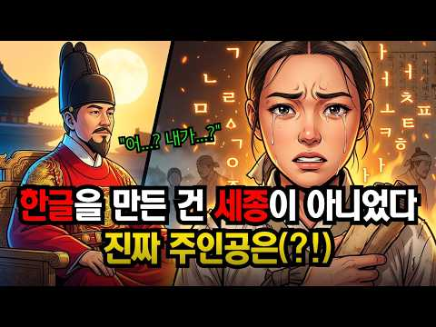
- 설명 앞부분: 주요 내용 눈이 거의 멀어가던 왕이 만든 글자. 나라는 450여 년 동안 공식 글자로 인정하지 않았습니다. 일제는 아예 말 자체를 없애려 했고, 사전을 만들던 학자들은 감옥에서 죽었습니다. 그런데 지금, 여러분이 이 글자를 읽고 있어요. 누가 살려냈을까요? 세종대왕의 창제부터 조선어학회 사건, 간송 전형필의 목숨 건 보존까지. 한글이 살아남은 진짜 이유를 추적합니다. 🤖 본 영상은 생성형 AI를 활용해 제작되었습니다.
- 대본 없음 (설명) — 음성인식이 끝나면 도입부·흐름이 들어감
- 댓글 345/345: 좋은 점 — 영상 2 · 감사·응원 21 · 더 알고 싶은 것 0 · 아쉬운 점 — 영상 1 · 반박·불만 — 의견 다름 9 · 정치·사회 21 · 경험 공유 7 · 구독·다음 기대 1
  - 좋은 점 — 영상 👍0 “앞만안보여? 등창에 눞지도못했다한다 거기에 아내가 12명 심씨왕후하 가장나이어린 아내가 겨우 15살이였데 한글만들었다는건 구라라하더라 절간같은곳에서 만들어진걸 반포한거지 1970년대까지 창제로 안배웠다 초등학교이상나온 70대 어르신들에게 물어봐 반포로배웠다고그러지 반…”
  - 감사·응원 👍31 “세종대왕 우리나라 대한민국 성군 고맙습니다,!”
  - 감사·응원 👍17 “세종대왕은 우리 지구상에서 드문 훌륭하신 왕 이셨습니다. 정말이지 자랑스럽습니다.하므로 선진들께서 물려주신 우리 글자를 더욱소중하게 다루어야 할것입니다.감사 합니다.”
  - 반박·불만 — 의견 다름 👍2 “광장의 촛불? 이건 잘못된 겁니다. 광장의 촛불은 대한민국 자유민주주의 체제를 전복하려는 반민주행위였습니다. 결코 자랑스러워할 일이 아닙니다!”
  - 반박·불만 — 의견 다름 👍1 “훈민정음이 좋은 글짜라고는 하지만, 현대한글은 별로 정확한 음자가 아닙니다. 전세계사람들이 ’땓드‘라고 말하는데 우리나라만 ’싸드‘라하고, 누구나 아는 ‘땡큐’는 쌩큐인지 탱큐인지… 그뿐입니까? 오뤤지를 오렌지, 리버는 강입니까 간입니까? 한국뉴스나 영화를 보면서 참…”
  - 정치·사회 👍23 “지금 우리나라가 바로 잡아야할것은 뭘까요 ? 투표 선관위를 바로잡아야 나라가살것이다.”
  - 정치·사회 👍12 “지금 우리나라는 선거위기이다 주권이 빼앗기고 있다”
  - 경험 공유 👍0 “202663지목 ㅡㅡ 1 일一유일신하나님신유 훈민정음님됨신유 태양양명 전기ㆍ전자ㆍ전파 에너지ㆍ에테르님됨신유 다잘다복됨 경제됨 가치됨님신유 유신 현재 현실 창조 생각 느낌유유유유柔流有ㅡㅡㅡ. 유신 유신유 유신임해요유 유신 민주주의 민주화는유 경제발전됨해서유 개인 각자 …”
  - 경험 공유 👍0 “202663지목 ㅡㅡ 2 일一유일신하나님신유 훈민정음님됨신유 태양양명 전기ㆍ전자ㆍ전파 에너지ㆍ에테르님됨신유 다잘다복됨 경제됨 가치됨님신유 유신 현재 현실 창조 생각 느낌유유유유柔流有ㅡㅡㅡ. 유신 유신유 유신임해요유 유신 625유혈사태 인민해방우동은유 1026유혈사태유…”

### 213. 촉나라 몰락 후 제갈 가문은 어떻게 한국과 이어졌을까? ∣ 역사 ∣ 역사를 짚다

- https://www.youtube.com/watch?v=ymSL8cjjxqU · 짚다 ZIPDA · 구독자 6,590 · 조회수 280,148 (×42.5, 하루 7,377.0) · 좋아요 1,011 (0.4%) · 35분 · 2026-09-13 · 주제 묶음 1. 역사 일반·이야기 · 형식 정보·해설 (그 밖) · 폴더 `W_ymSL8cjjxqU` (웹 승인)
- 썸네일: 
- 챕터: 0:00 촉나라 멸망과 1,700년 뒤의 뜻밖의 사건 · 1:41 제갈량보다 먼저 존재했던 제갈 가문 · 4:06 제갈량의 실제 후계자와 자손들 · 6:21 촉나라 멸망, 제갈 가문의 운명 · 8:28 한국 계보에 등장한 새로운 연결고리 · 15:36 500년 뒤 다시 등장한 또 하나의 전승 · 17:27 고려시대, 제갈 성씨에 생긴 변화 · 21:33 고려 이후 이어진 제씨와 갈씨 · 23:58 조선 기록에서 확인되는 가문의 흔적 · 28:45 다시 ‘제갈’을 찾으려는 움직임 · 30:57 현대에 벌어진 대규모 복성 · 32:50 한국의 제갈씨, 정말 제갈량과 이어질까?
- 설명 앞부분: 삼국지에서 가장 유명한 인물 가운데 한 명인 제갈량. 그런데 그의 이름과 같은 ‘제갈’이라는 성씨가 한국에도 오랫동안 이어져 왔습니다. 그렇다면 한국의 제갈씨는 제갈량과 어떤 관계가 있을까요? 그리고 제갈씨와 함께 등장하는 제씨·갈씨의 이야기는 어디에서 시작된 것일까요? 이번 영상에서는 중국의 역사 기록부터 한국에 전해오는 문중 계보, 고려와 조선시대의 기록, 그리고 현대까지 이어진 성씨의 흔적을 차례대로 따라가 봅니다. 📚 제갈량의 실제 가족과 후손들은 어떻게 이어졌는지, 한국의 계보에는 어떤 인물들이 등장하는지, 기록과 전승을…
- 같은 채널 평소 대비 ×8.5 (채널 최근 롱폼 중앙값 32,823회) · 평소 영상: 부여 왕자가 세운 수수께끼의 나라 46년 만에 사라진 갈사국의 정체 (32,823회) / 아골타 가문이 한반도와 이어진 이유 금나라 황실의 수상한 기록 (35,118회)
- 대본 없음 (설명) — 음성인식이 끝나면 도입부·흐름이 들어감
- 댓글 191/191: 좋은 점 — 영상 0 · 감사·응원 1 · 더 알고 싶은 것 2 · 아쉬운 점 — 영상 1 · 반박·불만 — 의견 다름 5 · 정치·사회 10 · 경험 공유 3 · 구독·다음 기대 0
  - 감사·응원 👍5 “칠원 제씨인데 설명 하신대로 족보에 기록 되어 있습니다. 감사 합니다”
  - 더 알고 싶은 것 👍0 “제가 민씨인데 중국에는 없는 한반도에만 있는 성인가요? 이방원의 아내이자 세종대왕의 어머니가 민씨인데 자고로 명성황후 까지 왕후계열은 민씨라는 가문인데 한번 영상 만들어주세요”
  - 아쉬운 점 — 영상 👍1 “똑같은 멘트 반복이 많네”
  - 반박·불만 — 의견 다름 👍6 “그리고 한중일 삼국의 유교뭔화권게서 가문의 계승이란 단순히 혈연의 계승을 의미하는 것은 아닙니다. 가문이라는 것은 혈연을 넘어서는 형이상학적이지만, 또한 재산과 관련된 실체이기도 했지요. 그래서 혈연이 끊어지만 양자를 들여서 가문을 계승하는 일이 그렇게 드물지 않았습…”
  - 반박·불만 — 의견 다름 👍0 “제갈씨가 제갈량의 후손인게 아니라 우리나라 성씨 대부분이 성씨들중에서 위인한두명을 배출한거지 제갈씨가 제갈량후손은 아닙니다 그사람 후손일려면 시조를 정확히 특정해야하는데 우리나라성씨 대부분 중시조를 모십니다.”
  - 정치·사회 👍36 “고대 중국성씨는 허구일 가능성이 큰데 원나라나 명나라 청나라시대 때는 한반도로 이주한 중국인들 기록이 꽤 있어서 사실인 경우가 많습니다 대표적으로 주원장과 중국대륙을 다투고 싸웠던 진우량이 전사하기 전 아들에게 만약 패하거든 고려로 가서 피신하라고 한 기록이 있고 고…”
  - 정치·사회 👍9 “족보가 조선 중기에 처음 생겼다. 그런데 자기 시조가 대부분 중국에서 왔다고 한다. 심지어 김씨마저도 조상이 중국인 김일제라고 할 정도다. 왕건은 자기 증조할아버지가 중국 황제라고 할 정도니 말 다했다. 애매한 성씨는 다들 자기 시조가 송나라 한림원 학사였다고 한다.…”
  - 경험 공유 👍4 “일제강점 때 창씨개명이 이뤄지는데, (정확한 통계인지 알 수 없으나, 우리나라 사람 중에 이무렵 일본식 창씨 개명한 사람이 70% 넘었다고 합니다. ) 그러나 생각이 높으신 분들이 일본의 창씨를 거부하며, 자신의 성씨를 지키려고 하는데, 이로써 먼 옛날 자기의 조상이…”
  - 경험 공유 👍0 “제가 민씨인데 중국에는 없는 한반도에만 있는 성인가요? 이방원의 아내이자 세종대왕의 어머니가 민씨인데 자고로 명성황후 까지 왕후계열은 민씨라는 가문인데 한번 영상 만들어주세요”

### 214. 명나라 사신들이 기겁했다! 얼굴 하나로 대륙을 뒤흔든 조선 최고 미남 왕의 정체

- https://www.youtube.com/watch?v=RJMbPAxJLaE · 역사풀이 · 구독자 6,620 · 조회수 279,002 (×42.1, 하루 2,574.2) · 좋아요 5,421 (1.9%) · 27.7분 · 2026-07-04 · 주제 묶음 6. 동양사 (중국·일본·몽골) · 형식 정보·해설 (그 밖) · 폴더 `W_RJMbPAxJLaE` (웹 승인)
- 썸네일: 
- 설명 앞부분: 조선 역사상 가장 잘생긴 왕으로 기록된 인물이 있습니다. 그의 외모는 조선 안에서만 회자된 것이 아니었습니다. 명나라 사신들조차 그의 얼굴과 기품에 놀랐다고 전해지죠. 하지만 그는 단순히 잘생긴 왕이 아니었습니다. 그런데 왜 우리는 이 왕을 오래 기억하지 못했을까요? 왜 그의 이름보다, 그의 짧은 재위와 비극적인 가족사가 더 강하게 남아 있을까요? 이번 영상에서는 명나라까지 놀라게 했다는 조선 왕의 외모 기록, 그가 왕이 되기 전부터 보여준 능력, 그리고 너무 짧았던 재위 뒤에 남겨진 비극까지 함께 살펴봅니다. 조선 왕실의 빛나는…
- 같은 채널 평소 대비 ×388.0 (채널 최근 롱폼 중앙값 719회) · 평소 영상: 사도세자는 왜 뒤주에서 죽었나 ∣ 영조 부자 비극의 모든 것 (조선 왕실 최악의 사건) (719회) / 이 사람이 살았다면, 조선은 강대국이 되었을 것이다 ∣ 정약용도 인정한 역대급 천재 (706회)
- 대본 없음 (설명) — 음성인식이 끝나면 도입부·흐름이 들어감
- 댓글 594/599: 좋은 점 — 영상 2 · 감사·응원 7 · 더 알고 싶은 것 2 · 아쉬운 점 — 영상 7 · 반박·불만 — 의견 다름 7 · 정치·사회 3 · 경험 공유 7 · 구독·다음 기대 0
  - 좋은 점 — 영상 👍1 “와 영상 10개 올리신 거 모두 알차고 유익하네요. 이 영상이 대박나서 앞으로 다른 영상도 클릭 많이 할것 같아요. 좋댓구알 완료요~^^”
  - 좋은 점 — 영상 👍0 “문종정말훌륭임금님셨내요단종임금 님이 너무불쌍했지요감사드려요 앞으로도계속좋은 말씀전해주세요”
  - 감사·응원 👍13 “문종,,, 덕분에 슬픈 역사 한조각을 알았어요. 감사합니다 ♡.”
  - 감사·응원 👍4 “문종에재해서 알게되어서 감사합니다.”
  - 더 알고 싶은 것 👍194 “부인복도 없고 수명도 짧았으니....참으로 애통하네요 세종은 영특한 세자가 얼마나 기특하고 대견했을까요? 그런데 그 어린 아들은 비참한 죽임을 당했으니”
  - 더 알고 싶은 것 👍10 “이분이 오래 살고 단종이 왕이 됐으면 정조도 없었겠네. 그래도 궁금하다. 어떤 역사가 쓰였을지.”
  - 아쉬운 점 — 영상 👍10 “문종이네..명이 짧아서 아쉬웠든 왕.. 그가 오래살았다면 또 다른 역사가 시작되었을건데...”
  - 아쉬운 점 — 영상 👍6 “세자기간이 29년으로 너무 길었고 그중 8년은 세종대왕을 대신하여 대리 청정...그러나 세종대왕의 후광에 가려진 분..실제 재위기간은 2년 정도 그래도 단명은 아닌 분인데..”
  - 반박·불만 — 의견 다름 👍44 “문종대왕님이 훌융하십니다 세조는 아닙니다”
  - 반박·불만 — 의견 다름 👍2 “앵두나무가 어떻게 생겼는지 어떤모습의 열매인지 고증좀하세요 앵두나무모습 아닙니다 벚찐줄~~~~”
  - 정치·사회 👍22 “문종임금 이군요 이런분들이 오래 집권했다면 그만큼 나라가 많이 발전했을 텐데 문종임금님 안되었네요”
  - 정치·사회 👍0 “문종이 ㅣㅇ년만 더 살아계셨어도 나라가 달라졌을텐데”
  - 경험 공유 👍51 “이향 문종 임금님 정말 힘드셨지요 세종임금님 모시고 8년 대리청정 다방면으로 연구하시고 그때 수양을 죽여 놓으셔야 했었는데 발로 차고 싶습니다 저 세상서 편안하게 계시고 아는체도 마세요”
  - 경험 공유 👍8 “아니어도세종의맏아들(이향-문종)이궁금했었답니다.이영상이많이알려지길바랍니다.”

### 215. [조선 다잇소] 2화 : 세종대왕의 만성 두통을 타이레놀로 고쳐버렸다.

- https://www.youtube.com/watch?v=r-JOlwuvsDA · 다잇소 스튜디오 · 구독자 1,070 · 조회수 45,051 (×42.1, 하루 3,263.1) · 좋아요 341 (0.8%) · 7.7분 · 2026-10-07 · 주제 묶음 3. 조선 · 형식 정보·해설 (그 밖) · 폴더 `W_r-JOlwuvsDA` (웹 승인)
- 썸네일: 
- 챕터: 0:00 관아에서 돌아온 현우와 주모의 재회 · 0:57 조선 저잣거리를 강타한 신라면 & 안성탕면 & 육개장 · 2:16 깊은 밤, 은밀하게 찾아온 도승지 김돈 · 3:42 세종대왕과의 첫 알현과 지독한 편두통 · 4:03 타이레놀과 열내림 냉각 시트의 기적 · 5:07 흐릿하던 글자를 띄워준 돋보기안경 · 5:52 과인이 지켜주마, 어명패 하사와 대궐 별채 입주 · 6:26 별채에서 꺼낸 현대 공구들 (줄자, 드라이버) · 6:44 천재 과학자 장영실의 방문과 풀리지 않는 고민 · 7:23 [3화 예고] 세종의 실신, 그리고 모습을 드러낸 왕…
- 설명 앞부분: [조선 다잇소] 2화 : 세종대왕의 만성 두통을 타이레놀로 고쳐버렸다. 대궐 나으리의 치통을 단숨에 잠재우고 '납품 허가'를 따낸 현우! 주막으로 돌아와 얼큰하고 칼칼한 '신라면'과 '육개장 사발면'을 개시하며 한양 사람들의 입맛을 뒤흔든다. 하지만 그날 밤, 도승지 김돈이 다시 현우를 은밀히 찾아오는데... 그가 이끌려 도착한 곳은 다름 아닌 조선 제4대 국왕, 세종대왕의 편전?! 평생을 옥죄어온 극심한 편두통과 안질로 고통받던 세종대왕. 침도 탕약도 듣지 않던 어전에서 현우가 꺼내든 것은 다름 아닌 만병통치약 '타이레놀'과 이…
- 대본 없음 (설명) — 음성인식이 끝나면 도입부·흐름이 들어감
- 댓글 26/26: 좋은 점 — 영상 0 · 감사·응원 0 · 더 알고 싶은 것 0 · 아쉬운 점 — 영상 0 · 반박·불만 — 의견 다름 0 · 정치·사회 0 · 경험 공유 0 · 구독·다음 기대 0

### 216. 비단옷보다 무거웠던 것 ∣ 조선 중전의 진짜 하루 공개

- https://www.youtube.com/watch?v=e12EIRsz6Xo · 진짜역사한잔 · 구독자 11,400 · 조회수 479,502 (×42.1, 하루 6,081.0) · 좋아요 3,464 (0.7%) · 89.8분 · 2026-08-03 · 주제 묶음 3. 조선 · 형식 정보·해설 (그 밖) · 폴더 `W_e12EIRsz6Xo` (웹 승인)
- 썸네일: 
- 챕터: 0:00 새벽 네 시, 중궁전에 켜진 불 · 2:10 나라가 뽑는 왕비 - 금혼령과 삼간택 · 6:30 가례 육례와 책봉, 품계가 없는 사람 · 10:20 새벽 문안 - 국모이면서 며느리였던 자리 · 14:00 내명부, 수백 명을 다스리는 관리자 · 18:30 정치에 관여할 수 없지만 그 자체가 정치였던 존재 · 22:40 수라와 예복, 그리고 궁궐의 살림 · 27:00 후궁과의 관계, 적자를 낳으라는 압박 · 32:10 폐비 윤씨와 갑자사화 · 37:20 이레 만에 폐위된 왕비, 단경왕후 · 41:00 인현왕후와 장희빈 - 왕비 교체는 정치의 결과였다 · 46:30 왕실 의례와 예송, 상복이 권력을 바꾸다 · 51:00 궁궐의 밤, 인정과 파루 · 55:20 출산과 의녀, 목숨을 건 국가의 사업 · 60:00 궁녀들의 세계와 상궁의 힘 · 65:10 대비가 되어야 비로소 열리는 발언권 · 70:00 조선의 마지막 왕비까지 · 75:00 이름 대신 자리로 기억된 사람들
- 설명 앞부분: 조선에서 여성이 오를 수 있는 가장 높은 자리, 중전. 모든 궁녀가 무릎을 꿇고, 백관의 아내들이 머리를 숙이며, 왕조 전체가 국모라 부르던 자리입니다. 그런데 왜 어떤 양반 집안은 딸이 왕비 후보로 뽑혔다는 소식에 잔치가 아니라 통곡을 했을까요. 왜 어떤 왕비는 궁에 들어간 지 이레 만에 쫓겨났고, 어떤 왕비는 사약을 받았을까요. 조선왕조실록, 경국대전, 궁중 의궤, 승정원일기 등 기록을 바탕으로 새벽 네 시의 어둠에서 자정이 넘도록 꺼지지 않던 중궁전의 등불까지, 조선 중전의 하루를 처음부터 끝까지 복원했습니다. 이 영상은 확…
- 같은 채널 평소 대비 ×30.3 (채널 최근 롱폼 중앙값 15,849회) · 평소 영상: [4시간연속재생] 교과서에 없는 조선시대 평민생활 세번째 이야기 (16,991회) / 매년 10명씩 죽였다 조선왕조실록이 직접 기록한 왕자 순화군의 실체 (14,707회)
- 대본 없음 (설명) — 음성인식이 끝나면 도입부·흐름이 들어감
- 댓글 85/89: 좋은 점 — 영상 1 · 감사·응원 1 · 더 알고 싶은 것 4 · 아쉬운 점 — 영상 1 · 반박·불만 — 의견 다름 0 · 정치·사회 1 · 경험 공유 1 · 구독·다음 기대 1
  - 좋은 점 — 영상 👍2 “유익한 영상 감사합니다 내레이션의 목소리도 듣기 편합니다 다음 영상도 기대하며 구독합니다 😊❤”
  - 감사·응원 👍2 “유익한 영상 감사합니다 내레이션의 목소리도 듣기 편합니다 다음 영상도 기대하며 구독합니다 😊❤”
  - 더 알고 싶은 것 👍23 “이런 콘텐츠는 오래오래 만들어 주세요.”
  - 더 알고 싶은 것 👍18 “그러면 간택 시험을 대충 봐서 떨어지면 되지 않을까 궁금하네요”
  - 아쉬운 점 — 영상 👍4 “집중할라치면광고가~~광고진짜많네요 이해는하지만적당히좀~~~ 구독은안하고시퍼~”
  - 정치·사회 👍6 “그런 효에 나라가 지금은 개에 나라가 됐다”
  - 구독·다음 기대 👍2 “유익한 영상 감사합니다 내레이션의 목소리도 듣기 편합니다 다음 영상도 기대하며 구독합니다 😊❤”

### 217. 미국인이 인생을 걸고 그린 이순신, 스탠 리까지 움직였다

- https://www.youtube.com/watch?v=g9WR1Dmtp4E · 스트레인지 · 구독자 1,150 · 조회수 47,913 (×41.7, 하루 478.7) · 좋아요 815 (1.7%) · 16분 · 2026-07-13 · 주제 묶음 3. 조선 · 형식 애니메이션·지도 · 폴더 `W_g9WR1Dmtp4E` (웹 승인)
- 썸네일: 
- 설명 앞부분: 아이언맨과 스파이더맨을 만든 미국 만화계의 전설, 스탠 리. 그가 생전에 직접 서문을 써준 만화의 주인공은 놀랍게도 미국의 슈퍼히어로가 아니었습니다. 바로 사백여 년 전 조선의 장군, 이순신이었습니다. 이 만화를 만든 사람은 한국인이 아니라 시카고 출신의 미국인 만화가 온리 콤판입니다. 그는 KBS 대하드라마 《불멸의 이순신》을 본 뒤 이순신의 삶에 매료됐고, 난중일기와 임진왜란 관련 자료를 직접 공부하며 이순신의 이야기를 미국 만화로 만들기 시작했습니다. 메이저 출판사의 지원도 없이 자비로 출간한 이 만화는 미국 코믹콘과 박람회…
- 같은 채널 평소 대비 ×6.6 (채널 최근 롱폼 중앙값 7,275회) · 평소 영상: "1997년, 2009년, 그리고 2026년... 환율이 또 보내는 신호" (6,631회) / "국내에서 밀렸던 브랜드가 러시아 시장에서 국민 라면이 된 의외의 반전." (4,634회)
- 대본 없음 (설명) — 음성인식이 끝나면 도입부·흐름이 들어감
- 댓글 39/39: 좋은 점 — 영상 1 · 감사·응원 4 · 더 알고 싶은 것 0 · 아쉬운 점 — 영상 0 · 반박·불만 — 의견 다름 0 · 정치·사회 0 · 경험 공유 2 · 구독·다음 기대 0
  - 좋은 점 — 영상 👍22 “미국인, 콘판 만화작가님~ 대한민국의 이순신 장군님을 널리 알려주셔서 정말 감사합니다!!!”
  - 감사·응원 👍22 “미국인, 콘판 만화작가님~ 대한민국의 이순신 장군님을 널리 알려주셔서 정말 감사합니다!!!”
  - 감사·응원 👍12 “장하십니다 응원합니다너무감사하고고맙습니다ㅡ수년전부터 얘기를전해들엇지만”
  - 경험 공유 👍11 “아 왜 내가 다 눈물이나냐ㅠ 감사합니다ㅠ”
  - 경험 공유 👍3 “임진왜란,정유재란,병자호란 겪고도 정신 안차리고ㅡ안보국방부실ㅡ일강점.”

### 218. 7발의 총성, 사라진 탄환…육영수 여사 사건의 미스터리 (암살자는 누구인가?) #육영수 #박정희 #암살 #총격 #문세광 #암살자(들) #한국사 #썬킴

- https://www.youtube.com/watch?v=QMZbscMfVpo · 매불세계 · 구독자 9,780 · 조회수 406,851 (×41.6, 하루 14,076.0) · 좋아요 3,066 (0.8%) · 47.3분 · 2026-09-22 · 주제 묶음 4. 한국 근현대사 · 형식 정보·해설 (그 밖) · 폴더 `W_QMZbscMfVpo` (웹 승인)
- 썸네일: 
- 같은 채널 평소 대비 ×55.6 (채널 최근 롱폼 중앙값 7,321회) · 평소 영상: 미국 건국 250주년! 절대 공개하지 않는 흑역사 (배은망덕의 역사) #미국 #미국역사 … (7,321회) / 중국이 미군을 세뇌한 방법, CIA의 '인간 세뇌 프로젝트' #마오쩌둥 #덩샤오핑 #포로… (7,669회)
- 대본 없음 (없음) — 음성인식이 끝나면 도입부·흐름이 들어감
- 댓글 509/513: 좋은 점 — 영상 1 · 감사·응원 2 · 더 알고 싶은 것 3 · 아쉬운 점 — 영상 2 · 반박·불만 — 의견 다름 9 · 정치·사회 81 · 경험 공유 14 · 구독·다음 기대 0
  - 좋은 점 — 영상 👍4 “이거랑 별개로 썬킴은 이만갑 출연하면서 북한 실체 알만한 사람이 김정은 듣기 좋은 말을 하더라”
  - 감사·응원 👍3 “최욱 앵커님 정감 있으세요 감사합니다 나오신분들 역사 선생님 잘 보고있습니다 국힘당 한나라당 막말 남탓 억지뿐 인 민패 당 맞습니다 지금도 내란자 억지당 국힘당 해체”
  - 더 알고 싶은 것 👍14 “육영수 여사님의 총격 사망은.... 당시에 권총 가진놈의 소행이다. 문세광이의 권총과 경호원의 권총, 또는 다른 권총소지자가 한 사고입니다. 제대로 수사를 했는지? 경호팀에서 조사를 묻어버렸는지? 중앙정보부가 덮었는지? 글쎄요 저도 멍청 궁금합니다.”
  - 더 알고 싶은 것 👍4 “주제가 궁금해서 들어왔다가..최욱얼굴보고 나간다.”
  - 아쉬운 점 — 영상 👍3 “썬킴 진짜 실망이네 구역질난다”
  - 반박·불만 — 의견 다름 👍14 “육영수 여사님의 총격 사망은.... 당시에 권총 가진놈의 소행이다. 문세광이의 권총과 경호원의 권총, 또는 다른 권총소지자가 한 사고입니다. 제대로 수사를 했는지? 경호팀에서 조사를 묻어버렸는지? 중앙정보부가 덮었는지? 글쎄요 저도 멍청 궁금합니다.”
  - 반박·불만 — 의견 다름 👍8 “518도 북한이 했다고 자기네들이 학교에서 애덜한테 교과서로 가르칠정도인데 그건죽어도 안믿고 ㅋㅋ북한이체제선동같은 영화는 찰떡같이믿네!!!”
  - 정치·사회 👍72 “썰에는 박정희가 여색을 즐겨해 방탕한 생활을 하면서 육영수여사와 자주 싸웠는데 한번은 선거때 유세하던 지역 호텔에서 대낮에 여자랑 바람피우다 육영수여사한테 걸려서 대판 싸웠고 열받은 박정희가 던진 재털이에 육여사 이마에 맞아 깨졌다고...그 이후 부부는 자주 다퉜고 …”
  - 정치·사회 👍42 “암살자(들) 영화감상평 들어가봐요.. 일부러 사람들 못보게 전부 1점 주는데 진짜 조직적으로 댓글을 다는 사람들이 있나봐요..정말 깜짝 놀랐습니다. 재미가 없으면 주관적인 감상평을 적으면 되는 데 전부 좌파 얘기밖에 없어요... 그러니 더 보고 싶어서 오늘 보러갑니다.”
  - 경험 공유 👍17 “내가 85년에서 88년까지 군대에서(의무병) 근무 했었는데, 내가 있던 부대의 의무대 환자중에 총에 발바닥을 관통한 환자가 있었다 그 친구가 천만다행으로 발의 뼈는 다치지 않고 오직 살만 관통한 총상이었다 그런데도 내 기억에 1년이 넘게 의무대에 입원 하였었다 그런데…”
  - 경험 공유 👍14 “육영수 여사님의 총격 사망은.... 당시에 권총 가진놈의 소행이다. 문세광이의 권총과 경호원의 권총, 또는 다른 권총소지자가 한 사고입니다. 제대로 수사를 했는지? 경호팀에서 조사를 묻어버렸는지? 중앙정보부가 덮었는지? 글쎄요 저도 멍청 궁금합니다.”

### 219. 몰락한 명나라 귀족들 어떻게 한국 성씨가 되었을까? ∣ 역사 ∣ 역사를 짚다

- https://www.youtube.com/watch?v=fKoRyiUc1O8 · 짚다 ZIPDA · 구독자 6,590 · 조회수 271,123 (×41.1, 하루 4,664.1) · 좋아요 1,848 (0.7%) · 40.5분 · 2026-08-24 · 주제 묶음 6. 동양사 (중국·일본·몽골) · 형식 정보·해설 (그 밖) · 폴더 `W_fKoRyiUc1O8` (웹 승인)
- 썸네일: 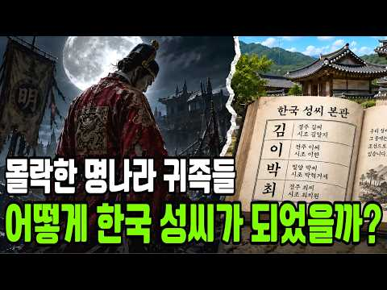
- 챕터: 0:00 🌑 압록강에서 시작된 이야기 · 2:52 🧭 그들은 왜 조선을 선택했을까? · 5:03 ⚔️ 조선으로 들어온 사람들의 정체 · 7:37 🌊 한반도 남쪽으로 향한 사람들 · 11:08 📜 살아남기 위해 지워야 했던 흔적 · 16:00 🏯 조선은 왜 이들을 품었을까? · 18:37 🌾 낯선 땅에서 시작된 새로운 삶 · 23:15 🕯️ 사라진 조국을 기억하는 공간 · 25:45 ⏳ 100년이 흐른 뒤 달라진 후손들 · 29:57 🌏 일본으로 향한 사람들은 달랐다 · 32:24 📊 오늘날까지 남아 있는 흔적 · 37:27 🧬 성씨와 본관이 들려주는 이야기
- 설명 앞부분: 1644년, 거대한 제국 명나라가 무너진 뒤 일부 사람들은 목숨을 걸고 압록강을 넘어 조선으로 향했습니다. 그들은 왜 수많은 선택지 가운데 하필 조선을 택했을까요? 그리고 낯선 땅에 정착한 뒤, 자신들의 성씨와 본관은 어떻게 오늘날까지 이어질 수 있었을까요? 🧭 이번 영상에서는 **명나라 멸망 이후 한반도로 들어온 사람들과 그 후손들의 정착 과정**, 그리고 우리가 평소 익숙하게 생각했던 **한국 성씨와 본관 속에 숨겨진 역사**를 따라가 봅니다. 족보와 본관, 조선의 기록 속에 남아 있는 흔적들을 따라가다 보면 우리가 알고 있던…
- 같은 채널 평소 대비 ×8.3 (채널 최근 롱폼 중앙값 32,823회) · 평소 영상: 부여 왕자가 세운 수수께끼의 나라 46년 만에 사라진 갈사국의 정체 (32,823회) / 아골타 가문이 한반도와 이어진 이유 금나라 황실의 수상한 기록 (35,118회)
- 대본 없음 (설명) — 음성인식이 끝나면 도입부·흐름이 들어감
- 댓글 262/263: 좋은 점 — 영상 1 · 감사·응원 4 · 더 알고 싶은 것 2 · 아쉬운 점 — 영상 1 · 반박·불만 — 의견 다름 6 · 정치·사회 28 · 경험 공유 5 · 구독·다음 기대 0
  - 감사·응원 👍9 “주원장은 남경 출신 고려인 명나라 황족, 귀족은 고려 출신이 많았지 청나라의 황족, 귀족은 신라 경주 김씨들 << 명나라가 한국인 주원장의 나라야 >> 노예 한족들은 명나라가 노예 한족의 나라라고 크게 착각하고 있는데... 주원장은 남경출신 고려인 ("고려는 동서 1…”
  - 감사·응원 👍4 “ㅋ킄~~ 찾았따용~~ 화이팅하이숑~~ ㅋㅋㅋ”
  - 더 알고 싶은 것 👍2 “명나라 사람들이 귀순을 했다는 근거는 어디에 있나요? 출처좀 알려주세요.”
  - 더 알고 싶은 것 👍1 “이여송이 임진왜란 때 어떤 일을 했나요?”
  - 아쉬운 점 — 영상 👍2 “명나라 사람들이 귀순을 했다는 근거는 어디에 있나요? 출처좀 알려주세요.”
  - 반박·불만 — 의견 다름 👍0 “어이없는 사대주의. 시진핑의 동북공정. 한심한...”
  - 정치·사회 👍9 “주원장은 남경 출신 고려인 명나라 황족, 귀족은 고려 출신이 많았지 청나라의 황족, 귀족은 신라 경주 김씨들 << 명나라가 한국인 주원장의 나라야 >> 노예 한족들은 명나라가 노예 한족의 나라라고 크게 착각하고 있는데... 주원장은 남경출신 고려인 ("고려는 동서 1…”
  - 정치·사회 👍6 “중국이 본관인 성씨들 많음 대전 뿌리공원게 가보면 임진왜란 이전에도 중국에 환란이 있을 때 기근이나 기술 무역등으로 많이 들어 옴. 한국 성씨가 중국에 간 영우도 많고 중국에서 장수로 유명한 사람도 엄청 많은데 기록에 없는 사람은 얼마나 많겠어요. 그런게 머 중요하겠…”
  - 경험 공유 👍3 “해남에 광동에서 배로 왔다고 실록에 기록돼있고 조선이 지방에 살라고 했고 조선은 비호했었지”
  - 경험 공유 👍0 “우리가 천한 성씨라고 말하는 천 방 지 추 마 골 피 이성씨는 만주쪽에서 지배계급 지위였는데 나라가 멸망하면서 조선으로 숨어들어 망명한 성씨라고 저희 큰아버님이 말씀하시는걸 들었습니다 사위를 보시는데 성씨가 천씨성 가진분인데 우리가 천한신분의 성씨라고 하니 큰아버님이…”

### 220. 영화보다 더 영화 같은 '임경업 장군'의 파란만장한 일대기!

- https://www.youtube.com/watch?v=jav15__Z528 · 세상의 모든 역사 - 세모역 · 구독자 1,300 · 조회수 53,021 (×40.8, 하루 329.5) · 좋아요 1,036 (1.9%) · 21.6분 · 2026-05-13 · 주제 묶음 7. 전쟁·군사사 · 형식 정보·해설 (그 밖) · 폴더 `W_jav15__Z528` (웹 승인)
- 썸네일: 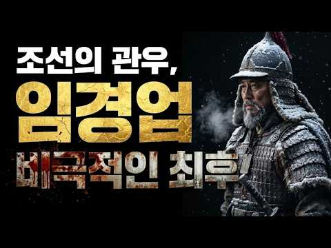
- 챕터: 0:00 청나라 10만 대군이 우회하다? · 1:32 '조선의 관우' 임경업의 탄생과 어린 시절 · 2:35 안현 전투의 영웅 · 2:51 명나라의 신임과 '총병' 벼슬 하사 · 3:57 1636년, 운명의 병자호란 발발 · 4:22 임경업의 치밀한 방어와 백마산성 요새화 · 5:12 청나라 군대의 우회와 삼전도의 굴욕 · 7:20 명나라를 쳐야 하는 운명, 임경업의 선택은? · 7:56 임경업의 첩보 작전과 가짜 전쟁 · 9:26 결국 들통난 임경업의 명나라 망명 · 10:46 명나라의 멸망과 임경업의 체포 · 11:55 황해도 금천에서의 탈출과 위장 생활 · 13:25 조선으로 송환된 임경업과 인조의 친국 · 14:02 김자점의 모함과 임경업의 억울한 죽음 · 15:13 임경업의 아내 완산 이씨의 비극적인 선택 · 15:57 백성들의 분노와 '임경업전' 탄생 · 17:49 신이 된 임경업 장군 · 18:27 역사적 평가와 임경업의 죽음이 남긴 교훈
- 설명 앞부분: 당대 최고의 무장으로 칭송받았지만, 비극적인 최후를 맞이해야 했던 임경업 장군. 명나라와 조선을 오가며 펼친 영화 같은 첩보 작전부터, 억울한 누명과 고문, 그리고 400년이 지난 지금까지도 백성들의 신으로 모셔지는 것까지. 임경업 장군의 파란만장한 일대기를 지금 바로 영상으로 확인하세요! [타임라인]
- 같은 채널 평소 대비 ×284.3 (채널 최근 롱폼 중앙값 186회) · 평소 영상: 사형수로 10년… 그런데 검안서 한 장이 모든 걸 뒤집었다 (190회) / 자면서 듣는 한국사6시간 연속 재생 (183회)
- 대본 없음 (설명) — 음성인식이 끝나면 도입부·흐름이 들어감
- 댓글 67/67: 좋은 점 — 영상 0 · 감사·응원 0 · 더 알고 싶은 것 1 · 아쉬운 점 — 영상 1 · 반박·불만 — 의견 다름 1 · 정치·사회 4 · 경험 공유 0 · 구독·다음 기대 0
  - 더 알고 싶은 것 👍7 “근데 대체 어떤 전투에서 파란만장한 전공을 세웠나요? 개 풀뜯어먹는 소리하면 조회수 올라가나요? 장군이 이름만 남기면 그냥 아몰랑 명장인가요?”
  - 반박·불만 — 의견 다름 👍8 “임경업이 무슨 전공이 있나요? 한번도 적군에게 승리한적도 없는 장군입니다. 그는 영웅도 아니고 위인도 아닙니다. 서인세력을 위해 동분서주한 정치군인이고 그의 명성은 허명일 뿐입니다.”
  - 정치·사회 👍2 “잘 이해안됨. 그렇게 임겅업을 두려워했는데 청나라가 그 근처로 쳐들어와? 청나라가 임경업을 언제 봤다고 그리고 배후에 있는 그 임경업은 왜 뒤치기를 안해?”
  - 정치·사회 👍2 “임경업의 장수로서의 평가는 0점입니다. 나라의 허락없이 명나라로 망명가서 활약하는 바람에 조선이 청나라의 외교적 압박에 시달렸음. 자신의 나라가 아닌 남의 나라에 대한 의리로 행동한거임.”

### 221. 사극은 거짓말이었다∣ 조선 백성이 진짜 씻던 방법 ∣ 조선 사람들이 1년에 두 번만 씻은 충격적 이유

- https://www.youtube.com/watch?v=hoE9aioaOxY · 한번은 알아야 할 역사 · 구독자 4,360 · 조회수 174,858 (×40.1, 하루 1,384.4) · 좋아요 1,356 (0.8%) · 23분 · 2026-06-17 · 주제 묶음 3. 조선 · 형식 정보·해설 (그 밖) · 폴더 `W_hoE9aioaOxY` (웹 승인)
- 썸네일: 
- 설명 앞부분: ❌ "조선 사람들은 게을러서 안 씻었다" – 사실이 아닙니다 우리가 당연하게 알고 있던 조선시대 위생 상식, 실은 완전히 잘못된 정보였습니다. 이 영상에서 팩트체크하는 것들 ❌ 통념: "조선 사람들은 더러워서 안 씻었다" 사실: 물·나무·비누가 없어서 못 씻었다 ❌ 통념: "100년 전 산은 지금보다 울창했다" 사실: 산 4개 중 1개가 민둥산이었다 ❌ 통념: "그냥 냇가에서 씻으면 됐잖아" 사실: 전신욕은 1년에 2번, 연례행사 수준이었다 ⚠️ AI 활용 고지 본 영상은 AI 도구 (자료 정리, 이미지 생성, 음성 합성 등)를 …
- 같은 채널 평소 대비 ×419.8 (채널 최근 롱폼 중앙값 416회) · 평소 영상: 조선 왕은 단명했는데 '이것' 없는 자들만 109세 장수한 충격적인 진실 (437회) / 🏛️ 영화보다 먼저 만나는 오디세이 ∣ 3,000년 전 한 편의 시가 인류의 모든 이야기… (396회)
- 대본 없음 (설명) — 음성인식이 끝나면 도입부·흐름이 들어감
- 댓글 228/228: 좋은 점 — 영상 1 · 감사·응원 1 · 더 알고 싶은 것 1 · 아쉬운 점 — 영상 0 · 반박·불만 — 의견 다름 7 · 정치·사회 16 · 경험 공유 12 · 구독·다음 기대 1
  - 좋은 점 — 영상 👍1 “역사 속 생활상을 이렇게 흥미롭고 자세하게 풀어주시다니 정말 유익해요! 다음 영상도 기대할게요 👏”
  - 감사·응원 👍2 “조선 500년을 멸해준 일본에 감사해야 옳다. 이게 맞다.”
  - 반박·불만 — 의견 다름 👍6 “조선 시대에도 세수, 양치, 발 씻기, 뒷물 등 매일 하는 위생 관리는 철저했습니다. 전신 목욕이 드물었던 건 물과 땔감을 구하기 힘든 전근대 농경 사회의 보편적인 기술 한계였지 조선인들만 유독 더러워서가 아닙니다. 당시 런던이나 파리 등 서구 대도시들도 하수도가 없…”
  - 반박·불만 — 의견 다름 👍4 “그냥 멀 생활을 모르는 사람이 헛소리 하는. 토착노비들이 좋아라할 조선문화 비하”
  - 정치·사회 👍12 “실제적으로 생활환경이 개선되기 시작한 것은 박정희대통령 새마을운동 시작부터입니다. 이는 정치적 성향을 떠나 그가 이룬 위대한 업적입니다 그가 새마을 운동을 시작하므로써 인지재구성이 이루어졌고 산업화와 맞물려 선순환을 이뤄서 지금이 있게 된것입니다”
  - 정치·사회 👍4 “이런 민둥산을 박정희대통령님 살리셨지”
  - 경험 공유 👍11 “난 60년대 사람이고, 충남에서 살았다. 우리집 부엌은 가마솓이 세개 걸려있었는데 하나는 밥솥, 다른 하나는 국솥, 나머지 하나는 물솥이었다. 어머니는 가장 먼저 물을 끓이고, 다음에 국을 끓이고 마지막으로 밥을 지었다. 그 밥솥의 누릉지는 최고의 맛이었다. 그리고 …”
  - 경험 공유 👍5 “나 빠른89년생인데 내가 초딩 4학년때인 98년 99년 imf때만해도 때가 꼬질꼬질한애들 바글바글햇음 머릿니도 많았고”
  - 구독·다음 기대 👍1 “역사 속 생활상을 이렇게 흥미롭고 자세하게 풀어주시다니 정말 유익해요! 다음 영상도 기대할게요 👏”

### 222. 화학 지식도 없던 고대인은 어떻게 철을 만들어냈을까?

- https://www.youtube.com/watch?v=12EyJuBAyOg · 지구연구실 · 구독자 7,820 · 조회수 311,543 (×39.8, 하루 4,102.7) · 좋아요 1,947 (0.6%) · 25.7분 · 2026-08-06 · 주제 묶음 8. 문명·고고학 · 형식 정보·해설 (그 밖) · 폴더 `W_12EyJuBAyOg` (웹 승인)
- 썸네일: 
- 설명 앞부분: 철을 녹일 수도 없었던 고대 인류는 어떻게 철을 만들었을까요? 수천 년 전 철광석은 그저 붉고 무거운 돌에 불과했습니다. 하지만 이름 없는 고대 장인들은 숯과 화로, 풀무를 이용한 수많은 시행착오 끝에 돌 속에 숨어 있던 철을 꺼내기 시작했죠. 이 영상에서는 인류가 처음 접한 운석 철부터 철광석을 녹이지 않고 금속으로 바꾼 제련 기술, 화로에서 나온 검은 철 덩어리인 블룸, 그리고 연철이 강철로 발전한 과정까지 쉽고 재미있게 살펴봅니다. 고대 인류의 철 발견과 철기시대의 시작이 궁금했다면 영상에서 확인해 보세요. 지구의 오래된 이…
- 같은 채널 평소 대비 ×22.2 (채널 최근 롱폼 중앙값 14,018회) · 평소 영상: 인류 최초의 금속, 구리는 어떻게 발견되었을까? (14,018회) / 인류는 어떻게 토마토를 재배했을까? 작은 야생 열매가 커다란 토마토가 된 과정 (13,978회)
- 대본 없음 (설명) — 음성인식이 끝나면 도입부·흐름이 들어감
- 댓글 131/131: 좋은 점 — 영상 1 · 감사·응원 0 · 더 알고 싶은 것 4 · 아쉬운 점 — 영상 1 · 반박·불만 — 의견 다름 1 · 정치·사회 0 · 경험 공유 0 · 구독·다음 기대 0
  - 좋은 점 — 영상 👍0 “구구절절 늘어놓아서 들어줄수가없다”
  - 더 알고 싶은 것 👍3 “구리는 어떻게 구했고 청동의 비율은 또 어떻게 알았을까요?”
  - 더 알고 싶은 것 👍0 “숯은 어떻게 발견됐고 어떻게 제작 방법을 발전시켜왔는지도 다뤄주세요!”
  - 아쉬운 점 — 영상 👍1 “영상 내용은 괜찬은데 말 한 마디 나올때마다 나오는 영상이 너무 중구난방 ai티가 난다...”
  - 반박·불만 — 의견 다름 👍1 “우연에 우연이 겹치고 그 우연이 또 우연을 만나 우연을 낳고 그 낳은 우연이 대대손손 우연에 우연을 거쳐서 인류가 돌도끼를 만들고, 말도 안되는 우연이 청동기를 만들고, 인류가 어찌 어찌 하다보니 또 우연이 겹쳐서 철기가 도래했다.. 이렇게 우연을 가장한 생각을 하는…”

### 223. 황제 자리에서 끌려 내려온 고종, 그 뒤 12년 어떻게 살았을까?ㅣ여생록

- https://www.youtube.com/watch?v=7HJVltWXC2Q · 여생록 · 구독자 967 · 조회수 37,934 (×39.2, 하루 6,447.6) · 좋아요 251 (0.7%) · 22.4분 · 2026-10-15 · 주제 묶음 11. 황제·왕·인물 · 형식 정보·해설 (그 밖) · 폴더 `W_7HJVltWXC2Q` (웹 승인)
- 썸네일: 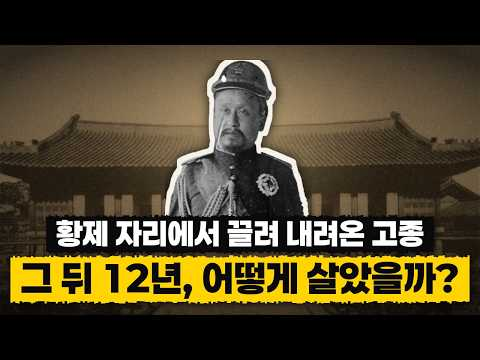
- 챕터: 0:00 오프닝 · 1:21 서명하지 않은 황제 · 3:11 헤이그 · 4:21 열흘의 압박 · 5:34 대리인가, 양위인가 · 6:49 덕수궁이라는 이름 · 7:38 열 살의 아들 · 8:34 떠나려 한 황제 · 9:05 덕수궁 이태왕 · 10:28 이왕가의 세비 · 11:02 덕수궁의 나날 · 12:43 막내딸과 아들 · 13:58 기록과 전해지는 이야기 · 15:35 1919년 1월 21일 · 16:46 식혜와 소문 · 18:21 3월 3일 · 19:24 판 사람인가, 버틴 사람인가 · 21:34 이태왕의 12년
- 설명 앞부분: 1907년 7월, 헤이그 특사 사건 뒤 황제 자리에서 끌려 내려온 고종. 1919년 1월 덕수궁 함녕전에서 숨을 거두기까지 12년, 그는 어떻게 살았을까요? 이번 편은 어느 한쪽 편을 들지 않습니다. "나라를 판 건 고종이다"와 "고종은 끝까지 버텼다", 두 주장의 근거를 같은 무게로 놓고, 기록에 남은 것과 남지 않은 것을 나눠 보여 드립니다. 을사조약에 없는 황제의 서명, 루스벨트에게 보낸 친서, 헤이그 특사, 그리고 퇴위 조칙에 그가 쓴 단어 '대리'. 1910년 그는 '덕수궁 이태왕'이 되었고, 그의 살림은 조선총독이 감독…
- 같은 채널 평소 대비 ×1.8 (채널 최근 롱폼 중앙값 20,764회) · 평소 영상: 명성황후를 시해한 일본인들은 그 뒤 어떻게 살았을까?ㅣ여생록 (23,070회) / 백범 김구를 쏜 남자는 그 뒤 47년을 어떻게 살았을까? 안두희ㅣ여생록 (18,457회)
- 대본 없음 (설명) — 음성인식이 끝나면 도입부·흐름이 들어감
- 댓글 58/80: 좋은 점 — 영상 0 · 감사·응원 1 · 더 알고 싶은 것 1 · 아쉬운 점 — 영상 1 · 반박·불만 — 의견 다름 0 · 정치·사회 3 · 경험 공유 0 · 구독·다음 기대 0
  - 감사·응원 👍1 “여생록님 훌륭한 자료 몇번 반복 시청합니다. 고맙습니다.”
  - 더 알고 싶은 것 👍2 “2:59 고종이 보내려다가 못보낸 편지가 발견된 미국의 대학교 이름이 궁금합니다. 어느 대학교 인지 알려주세요...ㅠㅠ”
  - 정치·사회 👍12 “능력도 없었고 제국시대말 세계가 어떻게 돌아가는지 정확히 알지도 못한 왕. 황제가 되고 싶으면 그 밑에 제후국들인 왕들이 있어야 되는데 아무 제후국도 없이 혼자 황제라고 칭했으니 세계 어느나라가 그걸 인정 하냐. 고종 혼자 코메디 한것이지”
  - 정치·사회 👍1 “고종 이재명 김현지 누가 최악일까 단군이래”

### 224. [역사한줄] 교과서에서 가려버린 임진왜란의 참혹한 민낯 ∣ 400년 전 양반의 피란 일기 #한국사 #조선역사 #조선왕조실록

- https://www.youtube.com/watch?v=yJ9x4dJJgwI · 역사한줄 · 구독자 3,500 · 조회수 137,075 (×39.2, 하루 1,601.1) · 좋아요 1,407 (1.0%) · 27.1분 · 2026-07-27 · 주제 묶음 3. 조선 · 형식 정보·해설 (그 밖) · 폴더 `W_yJ9x4dJJgwI` (웹 승인)
- 썸네일: 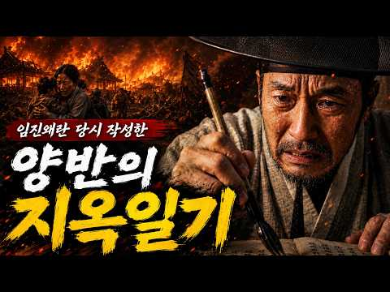
- 설명 앞부분: 오희문 《쇄미록》, 보물 제1096호 오희문은 관직도 병권도 없었던 평범한 양반이었습니다. 하지만 1591년부터 1601년까지 9년 3개월 동안 피란길에서 본 일을 거의 매일 적었습니다. 그 기록의 이름은 《쇄미록》. 전투의 승리보다 굶주린 가족, 도망친 노비, 무너진 신분 질서, 딸을 잃은 아버지의 눈물이 먼저 등장합니다. 명나라 구원군이 도착했을 때 백성들은 안도했습니다. 하지만 저잣거리에서 말을 빼앗고, 아무 상관 없는 조선 사람을 붙잡아 매질하며 물품을 요구한 장면도 일기에 남아 있습니다. 구원자와 수탈자가 한 얼굴에 겹쳐…
- 같은 채널 평소 대비 ×23.5 (채널 최근 롱폼 중앙값 5,822회) · 평소 영상: [역사한줄] 교과서에 없는 역사기록 12대를 이어온 조선시대 부자가문 풀스토리 ∣ 경주최… (5,822회) / [역사한줄] 조선시대 양반들의 실체, 5억을 쓰고도 관직이 없었다? #한국사 #조선역사 (6,037회)
- 대본 없음 (설명) — 음성인식이 끝나면 도입부·흐름이 들어감
- 댓글 300/300: 좋은 점 — 영상 0 · 감사·응원 10 · 더 알고 싶은 것 0 · 아쉬운 점 — 영상 3 · 반박·불만 — 의견 다름 5 · 정치·사회 51 · 경험 공유 6 · 구독·다음 기대 1
  - 감사·응원 👍35 “이런 기록을 들을 수 있게 해주어 감사합니다. 널리 알려지기를..”
  - 감사·응원 👍7 “오희문. 감사합니다.”
  - 아쉬운 점 — 영상 👍32 “역사는 반복되지요. 인육을 먹을때가 오지않기를 바래봅니다.”
  - 반박·불만 — 의견 다름 👍1 “글쎄 왜란시대 비참하게 죽어가던 백성의 내용은 전무하다 즉 잘 조작된 양반의 일지일뿐이다”
  - 정치·사회 👍8 “영상 잘 봤습니다. 전쟁은 지금도 민초들의 피폐로 이어지죠.. 특히 자국땅에 벌어지면 더더욱.. 옛날이나 지금이나 .. 그래서 선거가 중요하고 부정선거를 없에야 민초들의 삶이 나아집니다. 중상층이 무너지면 공산국가가 되는 것입니다.”
  - 정치·사회 👍3 “우리나라가 이렇게 부흥할수있는 원동력은 기록을 남긴 것이다”
  - 경험 공유 👍19 “쇄미록 읽어보면 오희문은 40년 가까이 자기 집에서 일했던 할머니 노비가 굶주리면서 고기먹고 싶다며 밤새 소리 지르다 아침에 죽은 걸 발견했을땐 그냥 무뚝뚝하게 가엷다. 한마디로 끝. 자기의 어린 딸이 병으로 죽었을땐 몇 개월 동안 식음을 전폐하고 멘붕에 빠져 정신을…”
  - 경험 공유 👍15 “제가 사랑 땜시 도망친 노비 입니다 괜히 도망쳤어요 그 당시 넓린게 처녀였는데 😢😢😢😢”
  - 구독·다음 기대 👍3 “재미있게 잘 시청했습니다 좋아요와 구독합니다!”

### 225. 밥 한 끼에 3공기 먹고도 굶어 죽었다?" 사극이 철저히 숨긴 조선 백성들의 소름 돋는 진짜 밥상

- https://www.youtube.com/watch?v=AcrIqDy_Okc · 실록책방 · 구독자 2,230 · 조회수 86,531 (×38.8, 하루 927.0) · 좋아요 401 (0.5%) · 19.5분 · 2026-07-19 · 주제 묶음 3. 조선 · 형식 정보·해설 (그 밖) · 폴더 `W_AcrIqDy_Okc` (웹 승인)
- 썸네일: 
- 챕터: 0:00 많이 먹어도 배고팠던 이유 · 0:57 봄, 풀을 캐야 사는 계절 · 3:22 여름, 고기 앞의 높은 벽 · 7:10 가을, 장독대에 담긴 지혜 · 10:44 겨울, 그리고 뒤늦게 온 구원자 · 15:52 세 공기 반의 진짜 비밀 · 18:37 오늘 우리 밥상 앞에서
- 설명 앞부분: 조선 백성은 밥 한 끼에 세 공기 반씩 먹고도 늘 배가 고팠습니다. 봄엔 산에서 풀을 캐고, 여름엔 고기의 벽 앞에서 버티고, 겨울엔 흉년이 겹치면 흙까지 팠던 사람들. 그 한 해 밥상을 사계절 통째로 따라가 봅니다. 사극 속 주막의 고기 안주와 새빨간 김치는, 정작 조선 백성 대부분에겐 평생 몇 번 없던 풍경이었어요. 진짜 밥상은 잡곡과 풀, 그리고 계절마다 다른 생존의 지혜였습니다. 이 영상에서는: 봄 보릿고개에 왜 온 밥상이 초록빛이었는지 (봄나물의 진짜 정체) 소를 못 잡게 한 우금령, 그리고 고기 때문에 병든 임금 세종의…
- 같은 채널 평소 대비 ×185.5 (채널 최근 롱폼 중앙값 466회) · 평소 영상: 해가 지면 나타났다… 조선의 밤을 지킨 순라군 (467회) / 조선 왕릉의 흙 봉분을 파 내려간다면 왕의 관에 닿기 전 무엇을 지나야 할까 (475회)
- 대본 없음 (설명) — 음성인식이 끝나면 도입부·흐름이 들어감
- 댓글 100/100: 좋은 점 — 영상 4 · 감사·응원 2 · 더 알고 싶은 것 2 · 아쉬운 점 — 영상 2 · 반박·불만 — 의견 다름 5 · 정치·사회 1 · 경험 공유 2 · 구독·다음 기대 0
  - 좋은 점 — 영상 👍0 “해설이 듣기 편해서 완주했어요~ 감사합니다”
  - 좋은 점 — 영상 👍0 “해설이 듣기 편해서 완주했어요~ 감사합니다~”
  - 감사·응원 👍0 “해설이 듣기 편해서 완주했어요~ 감사합니다”
  - 감사·응원 👍0 “해설이 듣기 편해서 완주했어요~ 감사합니다~”
  - 더 알고 싶은 것 👍4 “이런 영상 만들기 전에 단 몇시간이라도 팩트 체크를 위한 공부나 자료 조사를 철저하게 하고 만들기를 부탁드립니다. 어느 책이나 영상에서 들은 엉터리 잘못된 정보를 올리는 건 조심해야 합니다.”
  - 더 알고 싶은 것 👍0 “근데 먹고 죽을 쌀이 항상 부족했는데, 어떻게 많은 양을 먹었을까요? 지금시대야 대체제가 많으니까 그렇다 쳐도, 조선시대에는 대체제가 감자 옥수수 고구마 등이 다 일것 같은데...”
  - 아쉬운 점 — 영상 👍4 “이런 영상 만들기 전에 단 몇시간이라도 팩트 체크를 위한 공부나 자료 조사를 철저하게 하고 만들기를 부탁드립니다. 어느 책이나 영상에서 들은 엉터리 잘못된 정보를 올리는 건 조심해야 합니다.”
  - 아쉬운 점 — 영상 👍0 “걍 사극에 나오는 백성모습 개구라지 조선시대백성=거지나 똑같은대 사람들이 흰색옷만 입은게 백의민족이 아니라 최소한의 멋부릴 여유조차 없어서 였구만 그만큼 조선시대가 답도없는시대인대 이상하게 저때를 중세시대마냥 미화질하는건지”
  - 반박·불만 — 의견 다름 👍87 “중요한걸 놓쳤습니다. 조선 평민들의 밥그릇을 가득 채운건 쌀밥이 아닙니다. 잡곡밥 혹은 잡곡죽이였습니다. 조선은 벼농사에 불리한 기후와 지형이였기에 벼농사는 선사시대부터 시도했지만 조선 후기까지도 보리, 기장, 조와 같은 잡곡이 식사에서 차지하는 비중이 높았습니다. …”
  - 경험 공유 👍12 “조선 경신대기근때 수백만이 굶어죽었지만 유일하게 아사를 면하고 그나마 살았던 사람들이 바닷가 해안가 섬에 살던 백성들이었음 농사가 망해 굶어도 물질로 해루질로 해초랑 미역 톳 돌김, 파래, 불가사리도 먹고, 성게 해삼 멍게 전복 문어 조개 소라 주서먹으며 생존함 이때…”

### 226. 이집트가 멈춘 피라미드를 천 년 동안 쌓은 나라 — 쿠시 왕국의 흥망사

- https://www.youtube.com/watch?v=XneTj9iI6Y8 · 역사쥐 · 구독자 406 · 조회수 15,603 (×38.4, 하루 606.9) · 좋아요 52 (0.3%) · 17.5분 · 2026-09-25 · 주제 묶음 8. 문명·고고학 · 형식 정보·해설 (그 밖) · 폴더 `W_XneTj9iI6Y8` (웹 승인)
- 썸네일: 
- 챕터: 0:00 피라미드가 가장 많은 나라는? · 1:11 무덤 둘레에서 나온 소머리 4,899개 · 3:05 굶은 말들을 보고 분노한 왕 · 5:26 800년 만에 다시 올라간 피라미드 · 6:57 목이 부러진 석상 일곱 개 · 9:27 왕에게 죽으라 명한 신관들 · 11:15 계단 밑에 묻힌 황제의 얼굴 · 13:29 요란한 멸망 없이 사라진 왕국 · 15:04 아직 아무도 읽지 못한 글자
- 설명 앞부분: 피라미드가 가장 많은 나라는 어디일까요? 이집트라고 답하셨다면, 다시 생각해 보셔야 합니다. 이집트의 왕들이 800년 넘게 손을 놓았던 피라미드를, 다시 쌓아 올리기 시작한 나라가 있었습니다. 이집트의 식민지였던 나라가 어떻게 파라오의 자리에 앉았을까요? 로마 황제의 얼굴은 왜 신전 계단 밑 모래 속에서 발견되었을까요? 그리고 이렇게 많은 피라미드를 남긴 나라를, 우리는 왜 거의 몰랐을까요? 이집트가 멈춘 피라미드를 천 년 동안 쌓은 나라, 쿠시 왕국의 이야기를 시작합니다. 역사쥐가 파고든 이야기, 끝까지 함께해 주세요. 타임라인…
- 같은 채널 평소 대비 ×17.1 (채널 최근 롱폼 중앙값 914회) · 평소 영상: 잉카의 오백 년 생존법 — 극복이 아니라 순응이었다 (1,135회) / 유럽을 벌벌 떨게 만든 600년 제국, 오스만의 시작과 몰락 (693회)
- 대본 없음 (설명) — 음성인식이 끝나면 도입부·흐름이 들어감
- 댓글 10/10: 좋은 점 — 영상 0 · 감사·응원 0 · 더 알고 싶은 것 0 · 아쉬운 점 — 영상 0 · 반박·불만 — 의견 다름 0 · 정치·사회 1 · 경험 공유 0 · 구독·다음 기대 0
  - 정치·사회 👍4 “피라미드가 이집트에만 있는건 아니네요. 쿠시라는 나라가 있었다는걸 새롭게 알게되어 좋았습니다.^^ 다음 영상도 빨리 올려주세요!!”

### 227. 성벽도 없는 유목 부족이 어떻게 한나라를 굴복시키고 로마제국을 멸망으로 몰고 갔을까? ∣ 600년 흉노의 대역사 [잠잘 때 듣는 역사]

- https://www.youtube.com/watch?v=Z1Cxh6mktng · 먼 옛날 · 구독자 1,700 · 조회수 64,934 (×38.2, 하루 1,809.1) · 좋아요 169 (0.3%) · 68.3분 · 2026-09-15 · 주제 묶음 1. 역사 일반·이야기 · 형식 수면·낭독 (잠잘 때 듣는) · 폴더 `W_Z1Cxh6mktng` (웹 승인)
- 썸네일: 
- 설명 앞부분: 한나라와 로마 제국을 절체절명의 위기로 몰아넣은 흉노. 생존을 위해 멈출 수 없었던 초원의 늑대들이 남긴 잔혹하고도 거대한 역사의 진실을 파헤칩니다
- 같은 채널 평소 대비 ×4.8 (채널 최근 롱폼 중앙값 13,663회) · 평소 영상: 100만 대군을 키운 북송은 왜 금나라 군대 앞에 단 한 시간도 버티지 못하고 무너졌는가? (15,906회) / 소수의 만주족 팔기군이 어떻게 거대한 명나라를 오랫동안 무릎 꿇릴 수 있었을까? [잠잘 … (16,053회)
- 대본 없음 (설명) — 음성인식이 끝나면 도입부·흐름이 들어감
- 댓글 4/4: 좋은 점 — 영상 0 · 감사·응원 0 · 더 알고 싶은 것 0 · 아쉬운 점 — 영상 0 · 반박·불만 — 의견 다름 0 · 정치·사회 0 · 경험 공유 0 · 구독·다음 기대 0

### 228. 한나라를 무릎 꿇린 흉노, 왜 사라졌을까? 신라 왕족은 그 후손이었나?

- https://www.youtube.com/watch?v=1V5KZiQQCuY · Damir Merzhalimov · 구독자 961 · 조회수 36,622 (×38.1, 하루 2,100.4) · 좋아요 500 (1.4%) · 150.1분 · 2026-10-03 · 주제 묶음 2. 한국 고대·삼국·고려 · 형식 정보·해설 (그 밖) · 폴더 `W_1V5KZiQQCuY` (웹 승인)
- 썸네일: 
- 챕터: 0:00 밤이 시작됩니다 · 5:52 제국 이전의 초원 · 22:14 묵특, 우는 화살 · 37:56 백등산과 화친 · 53:59 무제, 전쟁의 값 · 69:14 같은 황제, 조선의 멸망 · 83:52 장건, 서쪽이 열리다 · 95:00 소무와 이릉, 그리고 사마천 · 106:54 남과 북으로 · 115:52 훈족설을 따져본다 · 125:16 땅에 남은 것 · 132:07 선비, 그리고 환도성 · 137:52 김일제와 신라의 김씨 · 145:44 후손은 어디에
- 설명 앞부분: 한나라와 맞서며 초원을 지배했던 강대한 제국, 흉노. 중국의 강력한 경쟁자였던 이들은 왜 역사의 중심에서 사라졌을까요? 이번 영상에서는 흉노 제국의 흥망과 그 이후의 행방을 살펴보고, 신라 왕족과 흉노를 연결하는 기원설이 어떤 의문을 던지는지 함께 탐구합니다. 제국의 몰락은 곧 사람들의 소멸을 의미했을까요? 초원에서 한반도로 이어지는 이야기는 역사적 연결의 흔적일까요, 아니면 후대에 만들어진 계보일까요? 흉노와 신라 왕족의 관계를 확정된 혈통으로 단정하지 않고, 기록과 해석을 구분하며 고대 동아시아 역사의 미스터리를 따라갑니다. …
- 같은 채널 평소 대비 ×26.1 (채널 최근 롱폼 중앙값 1,404회) · 평소 영상: 흉노에 쫓겨난 유목민이 어떻게 인도에서 제국을 세웠을까? 한국 불상의 얼굴은 어디서 왔나 (1,697회) / 물리학의 한계를 넘어선 우주 최대의 별 (1,112회)
- 대본 없음 (설명) — 음성인식이 끝나면 도입부·흐름이 들어감
- 댓글 21/23: 좋은 점 — 영상 1 · 감사·응원 1 · 더 알고 싶은 것 1 · 아쉬운 점 — 영상 0 · 반박·불만 — 의견 다름 1 · 정치·사회 2 · 경험 공유 0 · 구독·다음 기대 0
  - 좋은 점 — 영상 👍0 “나는 노인인데, 아기자기 새록새록 구구절절... 이게 좋구만요...”
  - 반박·불만 — 의견 다름 👍1 “신라는 제국이 아닙니다. 제국(帝國)은 메이지시대 일본이 "Reich(라이흐)"와 "Realm(레름)"을 번역하면서 만들어낸 신조어입니다. 전근대 동아시아는 존재하지 않았던 단어이죠. 다만, 현대 사학자들이 현대의 관념을 소급하여 고대에 적용하려는 시도는 있습니다. …”
  - 정치·사회 👍0 “2300년경 인류최소 말을 길드려 가축화하고 제철기술을 습득하고 무기화한 기마유목민Scythian(스키타이) 둘이 한반도 남쪽의 농경민 부족국가들을 정복하였다. 삼국사기와 삼국유사에 기록되어있다. 또한 수 많은 거대 능들(경주, 가야지역, 영산강지역, 광주)은 Scy…”

### 229. 충격실화! 조선시대 헬보직 T0P5 ─ 출근길이 황천길이었습니다.

- https://www.youtube.com/watch?v=Uu3Hv3Ft2VA · 역사 뒷풀이 · 구독자 1,720 · 조회수 65,065 (×37.8, 하루 428.0) · 좋아요 886 (1.4%) · 12.5분 · 2026-05-22 · 주제 묶음 3. 조선 · 형식 정보·해설 (그 밖) · 폴더 `W_Uu3Hv3Ft2VA` (웹 승인)
- 썸네일: 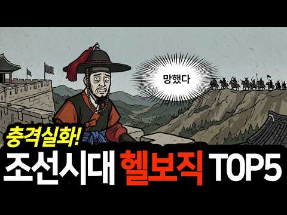
- 설명 앞부분: 과거 급제하고도 도망친 사람들이 있었습니다. 조선의 엘리트들이 죽기보다 싫어했던 헬보직 5가지, 1위는 意외로 여러분이 매일 감탄하는 그것과 연결됩니다. 고됨과 고통의 종류가 달라 순위는 주관적입니다. 여러분이 생각하는 순위를 댓글로 알려주세요.
- 같은 채널 평소 대비 ×47.0 (채널 최근 롱폼 중앙값 1,384회) · 평소 영상: 대감집 숨은 권력자들 ─ 조선시대 실세 하인 TOP5 │한국사│조선역사 (1,384회) / 충격실화! 조선시대 땅부자 TOP 5 ─ 현재 가치로 계산해봤습니다 (1,259회)
- 대본 없음 (설명) — 음성인식이 끝나면 도입부·흐름이 들어감
- 댓글 78/78: 좋은 점 — 영상 0 · 감사·응원 2 · 더 알고 싶은 것 2 · 아쉬운 점 — 영상 0 · 반박·불만 — 의견 다름 1 · 정치·사회 1 · 경험 공유 1 · 구독·다음 기대 0
  - 감사·응원 👍3 “230번째 like 👍 감사합니다요 ! 항상 건강하시고 행복하세요 !”
  - 감사·응원 👍1 “조선시대 지방도 제일 좋은데가 평양 감사 아닌가요 맨날 예쁜 기생들과 술판에 놀고 먹으니까”
  - 정치·사회 👍1 “국힘스럽던나라”
  - 경험 공유 👍0 “그래도 조선은 낫다. 동아시아 최고의 헬보직 원탑! *일남태수* 그 곳으로 유배를 당하면 장례식 먼저 치르고 출발한다는 전설의 유배지, 악명높은 그 곳, *중국 역사상 최고의 지옥 일남.* 날씨는 허구한날 40도에 폭염 아니면 기약없는 폭우에, 물고기 한 번 잘못 먹…”

### 230. 왕이 되지 못한 조선 왕자들의 충격적인 진짜 삶 #조선시대 #조선역사 #역사이야기

- https://www.youtube.com/watch?v=cuwkTGyvORY · 담너머 조선 이야기 · 구독자 4,560 · 조회수 171,187 (×37.5, 하루 2,319.0) · 좋아요 745 (0.4%) · 22분 · 2026-08-08 · 주제 묶음 1. 역사 일반·이야기 · 형식 정보·해설 (그 밖) · 폴더 `W_cuwkTGyvORY` (웹 승인)
- 썸네일: 
- 설명 앞부분: 화려한 왕실의 피를 타고났지만, 왕관을 쓰지 못한 조선의 왕자들. 세자가 되지 못한 대군과 군들은 궁궐 밖으로 나가 평생을 어떤 모습으로 살아가야 했을까요? 왕권을 위협할 수 있다는 이유로 평생 조정의 정치 참여가 철저히 금지되었고, 작은 언행 하나에도 역모의 혐의를 뒤집어쓸 수 있었던 살얼음판 같았던 삶. 어떤 왕자는 예술과 유흥에 몰두하며 자신에게 야심이 없음을 증명해야 했고, 어떤 왕자는 끊임없는 견제 속에서 비극적인 결말을 맞이해야 했습니다. 권력의 중심에서 밀려난 채 평생을 감시와 불안 속에서 살아가야 했던 조선 왕자들의…
- 같은 채널 평소 대비 ×19.6 (채널 최근 롱폼 중앙값 8,740회) · 평소 영상: 사극에서는 보여주지 않는 조선시대 백정의 삶 #조선시대 #조선역사 #역사이야기 (8,740회) / 약과와 유과는 꿈도 못 꾸던 조선 백성들은 간식으로 뭘 먹었을까? #조선시대 #조선역사 … (7,274회)
- 대본 없음 (설명) — 음성인식이 끝나면 도입부·흐름이 들어감
- 댓글 119/119: 좋은 점 — 영상 0 · 감사·응원 0 · 더 알고 싶은 것 1 · 아쉬운 점 — 영상 1 · 반박·불만 — 의견 다름 3 · 정치·사회 2 · 경험 공유 3 · 구독·다음 기대 0
  - 더 알고 싶은 것 👍1 “대군들의 아들들은 군으로 책봉되기도 하고, 그냥 군의 아들이면 똑같은 군이 되거나 아예 아뮤런 호칭이 없는 경우도 있던데, 기준이 무엇인지 알고 싶네요”
  - 아쉬운 점 — 영상 👍2 “Ai로 영상도 제대로 못 뽑아내 그렇다고 자막이나 한국어에 맞게 뽑아 내기를 해. 이거 한국인이 운영하는 채널 맞기는 함?”
  - 정치·사회 👍15 “정확하게는 왕족이 정걔전출을 법으로 금지한 시기는 성종때부터 입니다 종친사환금지법으로 정계진출을 막은것이죠 아이러니하게도 성종이 이런법울 만든게 자기 친할아버지 세조가 계유정난을 일으켜 정권을 장악하고 왕위를 찬탈까지 하면서 입니다 할아버지가 쿠데타를 일으켜 왕이된 …”
  - 경험 공유 👍1 “우리집이 세종의아들 임영대군파던데 내 조상이 저런삶을 사셨겠네”
  - 경험 공유 👍0 “이거 아님. 왕실 신용을 바탕으로 무역을 했었어요...”

### 231. 세종도 수양대군도 미치도록 사랑한 여인,!! 그런데 노비 출신이라고?ㅣ조선왕조실록ㅣ한국사

- https://www.youtube.com/watch?v=2QiExRW-Dg8 · 호기심 사록 · 구독자 10,400 · 조회수 387,143 (×37.2, 하루 2,779.0) · 좋아요 5,514 (1.4%) · 49.7분 · 2026-06-03 · 주제 묶음 3. 조선 · 형식 정보·해설 (그 밖) · 폴더 `W_2QiExRW-Dg8` (웹 승인)
- 썸네일: 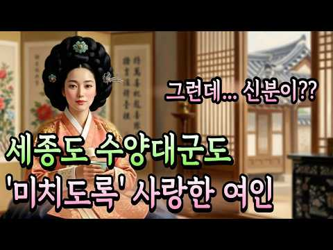
- 챕터: 0:00 당대 최고 권력자들이 늙은 비구니 앞에서 통곡한 이유 · 3:16 지옥 같았던 내자시, 13살 관노비 옥분의 입궐 · 7:11 친정을 잃은 왕비와 천한 노비의 기묘한 동거 · 11:58 세종의 마음을 흔든 옥분의 고요한 배려와 파격적인 신… · 15:52 12년간 8번의 출산, 중전이 친자식을 맡긴 조선판 … · 21:38 노비 출신 최초 정1품 '빈'에 오르다 · 26:40 세종의 죽음, 모든 것을 버리고 스스로 삭발을 택한 … · 31:18 계유정난의 피바람! 수양대군의 칼날이 유일하게 멈춘 곳 · 33:14 세종이 남긴 완벽한 방패막이, 겹사돈의 비밀 · 36:43 아웃트로
- 설명 앞부분: 영상에서 사용한 ‘옥분’이라는 이름은 주요 사료에는 나타나지 않습니다. 신빈 김씨는 실록 등에서 작호와 성씨로 기록됩니다. 따라서 ‘옥분’은 후대 스토리텔링에서 붙은 이름이며, 보다 정확한 표현은 ‘신빈 김씨(본명 미상)’입니다. 조선 500년 역사상 유일무이하게 가장 천한 '관노비'로 태어나, 내명부 최고 품계인 정1품 '빈(嬪)'의 자리에 오른 여인이 있습니다. 바로 세종대왕의 영원한 안식처였던 '신빈 김씨'입니다. 13살의 어린 나이에 내자시의 험한 잡일을 하던 노비 옥분이는 어떻게 왕비의 마음을 사로잡고, 세종의 승은을 입…
- 같은 채널 평소 대비 ×86.1 (채널 최근 롱폼 중앙값 4,494회) · 평소 영상: 정약용이 두 아들에게 꼭 '한양'에서 버티라고 한 진짜 이유 !! l 충격적인 '조선' … (4,494회) / 첩의 끝없는 탐욕인가 본처의 가스라이팅인가 도요토미 히데요시의 두 아내에게 일어난 비극ㅣ… (4,430회)
- 대본 없음 (설명) — 음성인식이 끝나면 도입부·흐름이 들어감
- 댓글 195/195: 좋은 점 — 영상 2 · 감사·응원 12 · 더 알고 싶은 것 1 · 아쉬운 점 — 영상 2 · 반박·불만 — 의견 다름 3 · 정치·사회 1 · 경험 공유 4 · 구독·다음 기대 1
  - 좋은 점 — 영상 👍1 “가슴을울리는 내용이군요 어떤이는 그러한심성을갖고있기도하고 또 어떤이는 하루에도 몇번이나 바뀌는심성이있기도합니다 저또한 너를속이지말라 라고 마음을다잡지만 얼마가지않아 흐트러집니다 오늘 이렇듯 좋은영상올려주심에 감사드립니다 😊 꾸벅”
  - 좋은 점 — 영상 👍0 “많이 배우고 갑니다”
  - 감사·응원 👍7 “신빈 김씨 훌륭한 분 고단했던 이야기를 눈물이 납니다 감사합니다”
  - 감사·응원 👍6 “역사의 새로운 한 페이지를 알개 됐습니다. 감사합니다.”
  - 더 알고 싶은 것 👍5 “조선의 왕들은 목숨걸고, 홍건적이랑 싸워야 했었고, 백성들은 그런 왕족을 섬기느라 고생했었군요 .. 지금도 여전히 왕의직계 후손들은 목숨걸고 한반도를 지키고 있었고, 지금의 대한민국 국민들은 무엇하고 있을까요 ?”
  - 아쉬운 점 — 영상 👍58 “미치도록 사랑한 이라니 제목이 너무 자극적이다. 진심으로 사랑했다도 아니고”
  - 아쉬운 점 — 영상 👍12 “잘 시청해습니다ㅡ보통 이런 역사고증을 하시는 유튜브방송중엔 짜집기 야사와 재미를 가미한 출처없는야길 버무려 방송하는곳이 있어서~저는 어릴때 부터ㅡ역사 야사.를 조아하다보니 이런 방송이 올라오면 날까롭게(?)들어봅니다ㅡ 그리하여 이상한버릇...검증된 학자가 나와서 하는…”
  - 반박·불만 — 의견 다름 👍5 “헤빈양씨는 권력을 탐했던게 아닙니다. 잘못됨.”
  - 경험 공유 👍7 “계양군은 납짝 업드려 수양의 개처럼 행동했었죠😅 혜빈양씨는 단종을 업어키운 유모였죠 문종이 혜빈에게 단종을 부탁하고 운명했어요 혜빈은 귄력에 앞에 선게 아니라 어머니같은 존재로 단종을 지킨겁니다 이부분은 반드시 역사앞에 투명하게 말해야 합니다”
  - 경험 공유 👍5 “조선의 왕들은 목숨걸고, 홍건적이랑 싸워야 했었고, 백성들은 그런 왕족을 섬기느라 고생했었군요 .. 지금도 여전히 왕의직계 후손들은 목숨걸고 한반도를 지키고 있었고, 지금의 대한민국 국민들은 무엇하고 있을까요 ?”
  - 구독·다음 기대 👍12 “잘 시청해습니다ㅡ보통 이런 역사고증을 하시는 유튜브방송중엔 짜집기 야사와 재미를 가미한 출처없는야길 버무려 방송하는곳이 있어서~저는 어릴때 부터ㅡ역사 야사.를 조아하다보니 이런 방송이 올라오면 날까롭게(?)들어봅니다ㅡ 그리하여 이상한버릇...검증된 학자가 나와서 하는…”

### 232. “아이언맨 슈퍼맨 다 필요없다” 미국에서 갑자기 역대급 이순신 대열풍이 일어난 이유

- https://www.youtube.com/watch?v=tZ6pzMh4JYU · 한반도 백과사전 · 구독자 4,810 · 조회수 178,880 (×37.2, 하루 8,047.7) · 좋아요 1,150 (0.6%) · 20.3분 · 2026-09-29 · 주제 묶음 3. 조선 · 형식 애니메이션·지도 · 폴더 `W_tZ6pzMh4JYU` (웹 승인)
- 썸네일: 
- 챕터: 0:00 단 1척으로 돌진한 이순신 · 0:55 백의종군과 칠천량 패전 · 2:46 명량해전 – 13척 vs 130여척 · 4:37 한산도대첩과 학익진 · 5:25 미국 만화가 온리 콤판과 스탠 리 · 9:31 사무라이와 다른 실존 영웅, 난중일기 · 11:34 넬슨과 나란히 선 조선의 제독 · 14:14 23전 23승과 거북선의 진실 · 16:42 LA에 놓인 거북선 · 18:05 미국인들이 이순신에게 열광하는 이유
- 설명 앞부분: 🇰🇷 "아이언맨 대신 이순신?" 미국 만화가가 17년 동안 이순신에 빠져있는 이유 드라마 〈불멸의 이순신〉을 보고 매료되어 17년째 미국에서 이순신 만화(《Yi Soon Shin》 시리즈)를 그리고 있는 미국 만화가 온리 콤판(Onrie Kompan). 출판사의 외면 속에서도 120개 이상의 컨벤션 현장을 발로 뛰며 25만 부 이상을 판매해 냈고, 마블의 거장 스탠 리(Stan Lee)조차 이순신의 삶에 감탄해 직접 양장본 서문을 써주었습니다. 2013년 유네스코 세계기록유산으로 등재된 《난중일기》 속에 적힌 군량미(둔전) 셈법,…
- 같은 채널 평소 대비 ×9.0 (채널 최근 롱폼 중앙값 19,861회) · 평소 영상: "한국의 시민의식은 세계 1위" 세계가 한국 주차장 풍경에 극찬하는 이유 (19,861회) / “속도와 성질머리로 성공한 민족” 전세계 학자들이 분석하고 극찬한 한국의 진짜 성공 이유 (19,437회)
- 대본 없음 (설명) — 음성인식이 끝나면 도입부·흐름이 들어감
- 댓글 85/88: 좋은 점 — 영상 1 · 감사·응원 1 · 더 알고 싶은 것 0 · 아쉬운 점 — 영상 0 · 반박·불만 — 의견 다름 3 · 정치·사회 11 · 경험 공유 1 · 구독·다음 기대 0
  - 반박·불만 — 의견 다름 👍1 “누군가 영웅이 되려하면 정치공세가 장난아니죠”
  - 정치·사회 👍6 “이런 역사는 안 배우고, 518, 43....좌골병으로 나라가 뷸구가 되고 있다...😢”
  - 정치·사회 👍3 “난 그 포수가.. 조선의 정권에서 보냈다는게 훨신 확률이 높다... 고 생각한다.”
  - 경험 공유 👍0 “하나님이 세상을 이처럼 사랑하사 독생자를 주셧으니 이는 저를 믿는자마다 멸망치않고 영생을 얻게 하려 하심이라 요 3 :16 예수께서 이르시되 내가 곧 길이요 진리요 생명이니,나로 말미암지 않고는 아버지께로 올 자가 없느니라 요 14 : 6 수고하고 무거운 짐 진 자들…”

### 233. [시니어역사] 주역, 세상이 아무리 바뀌어도 흔들리지 않는 법

- https://www.youtube.com/watch?v=GaOAwSMZYl8 · 역사 너머 · 구독자 7,700 · 조회수 285,325 (×37.1, 하루 2,150.5) · 좋아요 5,161 (1.8%) · 90분 · 2026-06-10 · 주제 묶음 1. 역사 일반·이야기 · 형식 오디오북·낭독 (명언·인생조언) · 폴더 `W_GaOAwSMZYl8` (웹 승인)
- 썸네일: 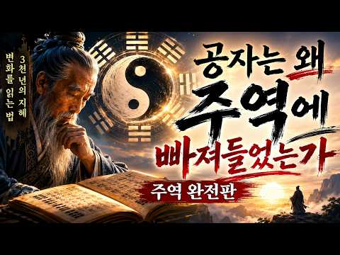
- 챕터: 0:00 오프닝: 잘 산다는 것 '주역' · 2:01 1부 — 주역은 어떻게 탄생했는가 · 15:22 2부 — 변화를 받아들이는 법 (음양의 철학) · 26:49 3부 — 때를 아는 것이 지혜다 (기다림과 결단) · 36:13 4부 — 가득 찬 것은 반드시 비워진다 (겸손의 철학) · 46:02 5부 — 위기 속에서 길을 찾는 법 · 57:55 6부 — 공자는 왜 말년에 주역에 빠져들었는가 · 69:44 7부 — 주역이 말하는 삶의 완성 · 79:31 8부 — 현대인에게 주역이란 무엇인가
- 설명 앞부분: 지금으로부터 3천 년 전, 억울하게 감옥에 갇힌 한 남자가 있었습니다. 언제 죽을지도 모르는 시간 속에서, 그는 무너지지 않고 붓을 들었습니다. 그렇게 써 내려간 것이 인류 역사상 가장 오래 읽힌 책 중 하나가 되었습니다. '주역'입니다. 세상은 변한다. 그 변화에는 이치가 있다. 그 이치를 아는 사람은 흔들리지 않는다. 좋을 때 교만하지 않는 법, 나쁠 때 무너지지 않는 법, 때를 알고 기다리는 법, 위기 속에서 길을 찾는 법. 주역은 3천 년 동안 그것을 가르쳐 왔습니다. 공자도 말년에 이 책을 너무 깊이 읽은 나머지, 책을 …
- 같은 채널 평소 대비 ×242.2 (채널 최근 롱폼 중앙값 1,178회) · 평소 영상: [시니어역사] 어우동, 고관대작 17명과 스캔들? 조선 사대부들이 그녀를 죽여야만 했던 … (1,178회) / [시니어역사] 고조선 시대부터 남북국 시대까지, 우리 고대사 3,300년 몰아보기 (1,076회)
- 대본 없음 (설명) — 음성인식이 끝나면 도입부·흐름이 들어감
- 댓글 166/166: 좋은 점 — 영상 8 · 감사·응원 27 · 더 알고 싶은 것 3 · 아쉬운 점 — 영상 1 · 반박·불만 — 의견 다름 1 · 정치·사회 1 · 경험 공유 3 · 구독·다음 기대 0
  - 좋은 점 — 영상 👍28 “Ai 라도 목소리가 너무 듣기좋습니다 편안하네요”
  - 좋은 점 — 영상 👍16 “저는 교회를 미치도록 나가거나 목사들을 우상화하능 사람은 아닙니다. 사실 교회는 않갑니다. 그러마 제인생이 힘들때마다 제옆에 예수님이 있었습니다 . 종교에 회의적인사람글는 믿지 않겠지만 제경우가 그렇다는 겁니다. 교회는 도움이 되지 않았었어요. 그냥 예수님이 있습니더…”
  - 감사·응원 👍23 “모든것은변한다❤ 감사합니다”
  - 감사·응원 👍18 “주역은 모든것을자연 스럽게 바다 드려라 감사 합니다 아 멘”
  - 더 알고 싶은 것 👍3 “복히씨은 뭐가 궁금해서? 5000년 전에 그렇게 빨리 태어났지?”
  - 더 알고 싶은 것 👍2 “아주 좋은글 잘들었습니다~ 자세히 주역을 읽고 싶은데 책좀 추천해 주세요”
  - 아쉬운 점 — 영상 👍28 “Ai 라도 목소리가 너무 듣기좋습니다 편안하네요”
  - 반박·불만 — 의견 다름 👍16 “저는 교회를 미치도록 나가거나 목사들을 우상화하능 사람은 아닙니다. 사실 교회는 않갑니다. 그러마 제인생이 힘들때마다 제옆에 예수님이 있었습니다 . 종교에 회의적인사람글는 믿지 않겠지만 제경우가 그렇다는 겁니다. 교회는 도움이 되지 않았었어요. 그냥 예수님이 있습니더…”
  - 경험 공유 👍14 “3000년 전이면 내가 태어나기 전인데 훨씬”
  - 경험 공유 👍8 “이 생은 내가 선택해서 온 삶이란 걸 알게되니 뭐든 이해가 되데요”

### 234. 세종보다 완벽했던 조선 최고 '먼치킨' 군주는 왜 2년 만에 암살당해야 했나

- https://www.youtube.com/watch?v=M0j4utufB5A · 세상의 모든 역사 - 세모역 · 구독자 1,300 · 조회수 47,966 (×36.9, 하루 272.9) · 좋아요 0 (0.0%) · 33.6분 · 2026-04-28 · 주제 묶음 3. 조선 · 형식 정보·해설 (그 밖) · 폴더 `W_M0j4utufB5A` (웹 승인)
- 썸네일: 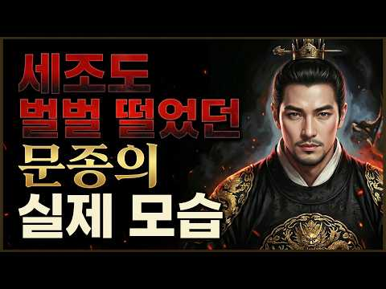
- 설명 앞부분: 병약한 왕으로만 알려졌던 조선의 5대 왕 문종. 하지만 그 실체는 동생 수양대군(세조)조차 고개를 숙였던 완벽한 '먼치킨' 군주였던 거 알고 계셨나요? 아마 살아있었다면 계유정난도, 단종의 비극도 없었을 것입니다. 세종대왕의 적장자로 29년간 세자 수업을 받으며 다방면에서 천재성을 보였던 문종. 측우기와 화차를 직접 설계하고, 조선군의 진법을 완성했던 그가 왜 재위 2년 만에 허무하게 세상을 떠나야 했을까요? 단종의 비극을 낳은 문종의 죽음을 둘러싼 독살설의 전말과 승자의 역사 속에 철저히 감춰진 진짜 문종의 모습을 파헤쳐 봅니다.
- 같은 채널 평소 대비 ×257.2 (채널 최근 롱폼 중앙값 186회) · 평소 영상: 사형수로 10년… 그런데 검안서 한 장이 모든 걸 뒤집었다 (190회) / 자면서 듣는 한국사6시간 연속 재생 (183회)
- 대본 없음 (설명) — 음성인식이 끝나면 도입부·흐름이 들어감
- 댓글 62/62: 좋은 점 — 영상 0 · 감사·응원 2 · 더 알고 싶은 것 1 · 아쉬운 점 — 영상 2 · 반박·불만 — 의견 다름 0 · 정치·사회 3 · 경험 공유 1 · 구독·다음 기대 0
  - 감사·응원 👍30 “고맙습니다. 진실한 역사를 알게 되었네요. 문종이 병약한 임금님 이라고만 알았네요.”
  - 감사·응원 👍0 “처음듣는 문종이 이야기 ㅡ감사합니다. 앞으로 부탁드립니다.”
  - 더 알고 싶은 것 👍0 “처음듣는 문종이 이야기 ㅡ감사합니다. 앞으로 부탁드립니다.”
  - 아쉬운 점 — 영상 👍11 “최태성선생이JTCB사기꾼에 나와 수양이 황표정사때문에 왕권확립하려고 거사(계유정난)했다는식으로 발언함 실망했음”
  - 아쉬운 점 — 영상 👍0 “암살이라뇨??이 제목으로 어그로 끕니까?”
  - 정치·사회 👍1 “예나 현 시국이나 권력싸움으로 피 비린내 나는 학살이 없섰다면 이나라가 선진국이 이니었을까 싶네요”
  - 정치·사회 👍1 “윤석열 한동훈의 이재명 범죄자 프레임 작업과 비슷하네”
  - 경험 공유 👍3 “이씨 조선이 임진왜란 병자 호란을 겪고 결국 한일 합방까지 당했던 것은 세조의 찬탈로부터 시작되는 정통성의 명분이 없었던 무능한 후손들에서 기인한다.”

### 235. 2,500년 동안 누구도 답을 못 낸 고대 미스터리 TOP 7

- https://www.youtube.com/watch?v=rNrXJodHv8g · 잡학도깨비 · 구독자 1,630 · 조회수 58,716 (×36.0, 하루 382.7) · 좋아요 458 (0.8%) · 16.6분 · 2026-05-20 · 주제 묶음 8. 문명·고고학 · 형식 정보·해설 (그 밖) · 폴더 `W_rNrXJodHv8g` (웹 승인)
- 썸네일: 
- 챕터: 0:00 인트로 — 2,500년에 걸친 일곱 번의 시도 · 1:00 ① 헤로도토스 — 직접 들어가 기록한 미궁 · 3:30 ② 앙리 무오 — 발견 1년 만의 죽음 · 6:00 ③ 플린더스 페트리 — 1889년 기단만 남은 자리 · 8:30 ④ 마타하 익스페디션 — 국가안보 사유 동결 · 11:00 ⑤ 데미언 에반스의 LiDAR — 정글 속 사라진 도시 · 13:30 ⑥ 르네 차베스 — 봉인된 통로의 발견 · 16:00 ⑦ 진시황릉 본묘 — 50년 동결 · 18:30 마무리 — 일곱 자리의 공통점
- 설명 앞부분: 2,500년에 걸쳐, 학자 일곱 명이 고대 유적을 직접 들여다봤다. 누군가는 직접 들어가 기록했고, 누군가는 첨단 장비를 들고 갔다. 그리고 일곱 번 모두 — 같은 자리에서 멈췄다. 학교 교과서에서는 한 줄도 다뤄지지 않는, 진짜 고대 미스터리 일곱 가지. 헤로도토스가 직접 들어간 이집트 미궁부터, 50년째 한 삽도 닿지 않은 진시황릉 본묘까지. 귀로만 들어도 알찬 잔잔한 잡학 다큐. 헤로도토스가 본 3,000개 방의 미궁, 지금은 흔적조차 없다 앙코르와트를 알린 박물학자 앙리 무오, 발견 1년 만에 정글에서 죽다 플린더스 페트리…
- 같은 채널 평소 대비 ×24.4 (채널 최근 롱폼 중앙값 2,404회) · 평소 영상: "소설을 읽어주다 죽었습니다" 한국엔 왜 삼국지 같은 영웅 소설이 없을까? (2,557회) / 세계에서 가장 큰 고인돌은 이집트에 없습니다. 350톤짜리 그 돌에 벌어진 일 ∣ 역사 … (2,250회)
- 대본 없음 (설명) — 음성인식이 끝나면 도입부·흐름이 들어감
- 댓글 7/7: 좋은 점 — 영상 0 · 감사·응원 0 · 더 알고 싶은 것 0 · 아쉬운 점 — 영상 0 · 반박·불만 — 의견 다름 0 · 정치·사회 0 · 경험 공유 0 · 구독·다음 기대 0

### 236. 이순신 사후 84일의 비밀, 선조가 대첩 승리 당일 저지른 비정한 보복

- https://www.youtube.com/watch?v=T0Vb2yu89Tc · 어른의 역사 시간 · 구독자 2,430 · 조회수 87,181 (×35.9, 하루 724.3) · 좋아요 1,162 (1.3%) · 58.4분 · 2026-06-22 · 주제 묶음 3. 조선 · 형식 정보·해설 (그 밖) · 폴더 `W_T0Vb2yu89Tc` (웹 승인)
- 썸네일: 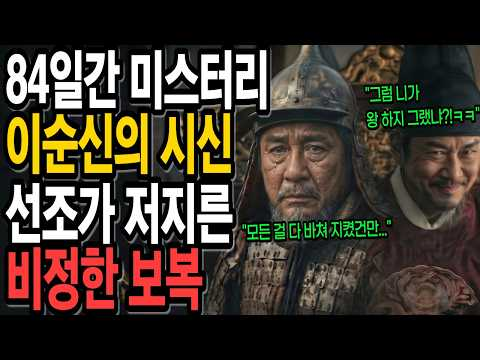
- 챕터: 0:00 84일간 썩지 않은 시신과 잔인한 보복 · 1:42 장례 법도 뒤에 숨은 선조의 비정한 명령 · 5:29 한겨울 400km 운구길에 감춰진 비밀 · 8:33 피 안 흘릴 전쟁을 영웅이 자원한 이유 · 11:46 7년 왜란 중 가장 처참했던 노량 사투 · 14:58 아들이 피 묻은 손으로 대장기를 쥔 순간 · 19:36 영웅이 전사한 날 무너진 마지막 방패 · 20:46 "갑옷 자살설?" 400년 동안 속았던 오해 · 23:18 이길수록 칼날로 돌아온 조선 왕실의 민낯 · 30:00 죽음 앞에 엎어져 통곡한 이국의 장수 · 34:19 이 나라는 왜 영웅의 안식처를 막았나 · 37:01 난중일기 100번의 병 기록과 진짜 진실 · 45:12 426년째 풀 안 자라는 의문의 1미터 맨땅 · 51:06 100년 뒤에야 울려 퍼진 뒤늦은 눈물
- 설명 앞부분: 살아서는 이 나라의 감옥에 갇혔고, 죽어서는 땅 한 평조차 제때 내어주지 않았습니다. 7년 왜란을 승리로 이끌고 온 나라를 구한 영웅의 관은, 그렇게 두 달이 넘도록 구천을 떠돌아야 했습니다. 영하를 오가는 매서운 한겨울, 냉장 시설도 없던 그 길에서 그의 몸은 왜 단 한 치도 무너지지 않았을까요? 왜 시신에서 은은한 향기가 났다는 기록이 전해질까요? 더 소름 끼치는 것은, 426년이 지난 지금 이 순간에도 그가 누워 있던 자리에는 풀 한 포기 자라지 않는다는 사실입니다. 과학계조차 답하지 못한 이 미스터리 뒤에 숨겨진 조선 왕실…
- 같은 채널 평소 대비 ×83.2 (채널 최근 롱폼 중앙값 1,048회) · 평소 영상: 아브라함, 흔적 하나 없는데 어떻게 '43억 명'의 조상이 됐을까 (1,048회) / 전쟁에 지고도 중국에 안 먹혔다.. 대륙의 정복자들이 한반도에서 멈춘 이유 (918회)
- 대본 없음 (설명) — 음성인식이 끝나면 도입부·흐름이 들어감
- 댓글 294/295: 좋은 점 — 영상 1 · 감사·응원 13 · 더 알고 싶은 것 0 · 아쉬운 점 — 영상 1 · 반박·불만 — 의견 다름 3 · 정치·사회 15 · 경험 공유 2 · 구독·다음 기대 0
  - 좋은 점 — 영상 👍7 “과학도 아니고 기적도 아니고 하늘의 뜻같기도합니다 그러나 과학적으로도 믿을수 없는일이 벌어지는것도 있지 않습니까 하이튼 하늘의 도움이 아닐까요 미신 풍수 있다 없다 말할수는 없는것이기에”
  - 감사·응원 👍20 “구국의 영웅인 이순신장군님께서 누워계신 곳에ᆢ 감히 산천초목이 뿌리를 내리지 않은것은ㅡ구국의 영웅께 최고의 예우를 다 한 것이 아닐런지요ㆍ위대한 장군님 감사합니다 🎉🎉🎉🎉🎉🎉🎉🎉🎉🎉”
  - 감사·응원 👍17 “역사의 새로운 사실 많이 알았습니다 고맙습니다 감사합니다~”
  - 아쉬운 점 — 영상 👍2 “간단히 말해라.서론이 너무길다”
  - 반박·불만 — 의견 다름 👍3 “근데, 이순신방전면주(李舜臣方戰免胄), 이 구절 한국말로만 읽어도 될걸 왜 중공발음으로 읽는지 이해가 안 됩니다. 한국사람들 수천년까지 되는지는 확언 못 하겠지만, 우리말로 한자 읽으면서 사용했슴요. 사실 한자는 동이족이 만든 상형문자입니다. 중공 한족(漢族)이 만든…”
  - 반박·불만 — 의견 다름 👍0 “이슨신 장군께서는 왕때위 한테 인정받고 칭찬 받으려고 왜적을 물리친게 아닙니다.. 장군은 나라를 위해 나라의 주인인 백성을 위해 싸웠습니다...”
  - 정치·사회 👍12 “지금은 중국인을 위한 연금이며..열불터져서”
  - 정치·사회 👍4 “이런 나라가 안망한것도 희안하다”
  - 경험 공유 👍3 “이순신 그분의 공이 얼마나 크고 훌륭했으면 또 범인은. 보고도. 깨닭지 모했던 일들이 수백년이 지난 오늘까지도 후세사람 알아낼수 있었던. 행적들을 지금도 많이 전설을 통해서 탐색을 통해서. 알아낼것이 있으니 그인간됨이. 오직자기만 알고 외롭게 해쳐서 나라를 지켰으니 …”
  - 경험 공유 👍2 “내가 장군이라면 일본을치고 명나라를치고 금나라를 치고 조선으로돌아와 선조를엄벌하고 일본은 무인도로만들것입니다”

### 237. 15살에 66세 영조와 결혼한 정순왕후, 그날 밤 영조가 잠을 못 잤다 [조선왕조실록]

- https://www.youtube.com/watch?v=gwmPtcxsmYE · 조선왕조실록이야기 · 구독자 19,500 · 조회수 694,331 (×35.6, 하루 8,380.4) · 좋아요 14,618 (2.1%) · 49.2분 · 2026-07-30 · 주제 묶음 3. 조선 · 형식 정보·해설 (그 밖) · 폴더 `W_gwmPtcxsmYE` (웹 승인)
- 썸네일: 
- 챕터: 0:00 1759년, 66세 영조와 15세 소녀의 51살 차이… · 1:55 왜 아무도 딸을 왕비 후보로 내놓지 않았는가 (영조의… · 4:22 왕비 간택의 현실적인 계산과 위험 요소들 · 5:17 금혼령 선포와 간택 단자를 올리는 과정의 뒷이야기 · 8:54 간택의 정식 절차: 초간택, 재간택, 삼간택과 면접 … · 11:45 삼간택에 오른 처녀들의 가혹한 운명 · 12:24 정순왕후의 지혜가 돋보인 전설적인 문답 (방석, 가장… · 17:08 정순왕후의 집안 배경: 경주 김씨 가문과 영조의 정치… · 21:05 15세 소녀가 감당해야 했던 국모라는 자리의 무게 · 23:53 영조가 명분과 실리를 모두 갖춘 집안을 선택한 이유 · 28:32 화려했던 혼례 행렬과 사치를 경계하던 영조의 변화 · 32:21 기록에는 없는 첫날밤 이야기와 정순왕후의 기개 · 35:31 15세 국모가 마주한 궁궐의 기묘한 가족 관계 (사도… · 36:53 300년 만에 부활시킨 친잠례: 조선의 역사를 뒤진 … · 41:42 자식이 없었던 왕비의 쓸쓸함과 임오화변(사도세자의 죽… · 44:25 영조의 죽음과 홀로 남겨진 32세 정순왕후의 삶 · 45:20 정조 즉위와 친정 가문의 몰락, 그리고 정조와의 관계 · 47:45 사후에야 영조 곁에 묻히게 된 정순왕후의 마지막 이야기
- 설명 앞부분: 열다섯 살 소녀가 예순여섯 살의 조선 왕 영조와 혼인했습니다. 쉰한 살의 나이 차이. 조선 역사상 가장 큰 나이 차이의 국혼이었습니다. 그런데 이상한 일이 있습니다. 왕비 자리는 온 나라가 탐낼 자리인데, 딸을 내겠다고 나선 집이 서른 집도 되지 않았습니다. 명문가들은 딸의 나이를 속이고, 아프다고 둘러대고, 아예 종이를 내지 않았습니다. 왜 모두가 도망친 자리에 벼슬 하나 없는 집안의 딸이 홀로 걸어 들어왔을까요? 금혼령 대상은 열여섯에서 스무 살이었는데 뽑힌 아이는 열다섯이었습니다. 규정에 들지도 않는 아이가 어떻게 왕비가 되…
- 같은 채널 평소 대비 ×66.5 (채널 최근 롱폼 중앙값 10,448회) · 평소 영상: 역대 조선 왕들의 진짜 인성과 몰랐던 사생활 조선왕조실록 재밌는 이야기 (10,448회) / 12살에 팔려간 기생, 그녀가 조선의 법을 깨버렸다 [조선왕조실록] (10,166회)
- 대본 없음 (설명) — 음성인식이 끝나면 도입부·흐름이 들어감
- 댓글 3,815/3,835: 좋은 점 — 영상 120 · 감사·응원 304 · 더 알고 싶은 것 31 · 아쉬운 점 — 영상 29 · 반박·불만 — 의견 다름 9 · 정치·사회 11 · 경험 공유 20 · 구독·다음 기대 16
  - 좋은 점 — 영상 👍21 “너무재미있게 새벽이지나갔어요.좋은영상 감사합니다. 15살 소녀야 고생많았어”
  - 좋은 점 — 영상 👍21 “역사를 이렇게 쉽게 설명해주시니 재미있게 들었습니다 수고 하셨어요 ❤”
  - 감사·응원 👍43 “역사를 알수있게 해주셔서 감사합니다 고생 하셨 습니다 좋은날 되세요”
  - 감사·응원 👍40 “대단하신 일을 하셨습니다. 시간을 거슬러 한획을 긋는 새로운 역사의 시간을 익혔습니다. 감사합니다. 귀하게 시청했습니다.”
  - 더 알고 싶은 것 👍2 “혼자만의 시간이 얼마나 고독하고 무서웠을까요? 고작 15살인데 안타갑네요~~”
  - 더 알고 싶은 것 👍2 “오늘 역사공부 잘 했습니다🎉 앞으로도 잘 부탁드려요^^”
  - 아쉬운 점 — 영상 👍239 “그 시대에 없던집안의 딸로 태어나서 집안을 위해 희생된 여인. 얼마나 남몰래 울었을지..감히 상상도 못하겠네요. 영조가 정조에게 빨리 넘기고 혼례를 안했다면 더 좋았을지도... 기록이 조금만 더 자세히 남아있었더라면 하는 아쉬움이 늘 남네요! 더운데 고생하셨습니다!!”
  - 아쉬운 점 — 영상 👍9 “정순왕후가 간택된 이유를 알았습니다. 그런데 자식이 없어 아쉽네요.”
  - 반박·불만 — 의견 다름 👍10 “영조의나라에 행운의 여인 그녀에겐... 글쎄요 얼마나 무섭고 외로웠을까 ;;”
  - 반박·불만 — 의견 다름 👍3 “오늘날의 시각으로 보면 이해가 안 되지만 조선의 왕비는 처녀만 가능했으므로 어쩔 수 없었습니다. 당시 양반가 규수 결혼 적령기를 생각하면 어린것이 아니죠. 참고로 선조의 계비 인목왕후가 임진 왜란으로 혼인이 늦어져 간택 당시 19세었는데 상당히 드문 케이스었죠”
  - 정치·사회 👍85 “불행했다 !, 앞으로도 그런혼례는 없어져야 한다 !, 영조가 죽은후, 나중에 정순왕후, 경주김씨가 세도를 잡고, 반대편 정치편을 모조리 죽이고, 결국,또 정치사화가 일어나고,많은 사람이 죽고, 나라가 피폐해지고, 못다누린 권력을, 쥐고 흔들고, 정조대까지 당파싸움에 …”
  - 정치·사회 👍21 “그렇니 나라가 풍비 박산되어 나라가 망조 들어 백성이 고생들했지~”
  - 경험 공유 👍70 “쇼츠만 보던 내가 이 긴 영상을 다 봤다.”
  - 경험 공유 👍8 “역사를 전공한 저도 몰랐던 얘기가 참 많네요. 아주 훌륭한 내용 잘 들었습니다. 구독, 좋아요.”
  - 구독·다음 기대 👍3 “15세에 간택되어 왕비가 되었으니 행운입니다. 더우기 3명 중에서 뽑히지 않았으면 어차피 결혼도 하지 못 하고 평생을 고독하게 살았어야 했으니 왕비가 살게 됨이 어찌 행운이라고 말하지 않을 수가 있으리요. 설명하시는 말투도 참 좋으시고요 목소리 또한 또박 또박 발음도…”
  - 구독·다음 기대 👍2 “고생하셨습니다. 잘 보고 구독합니다. 감사합니다.”

### 238. 조선시대에 키 180Cm가 넘으면 일어나는 일

- https://www.youtube.com/watch?v=6wCWuqNY_aw · 바람이들려준역사 · 구독자 2,470 · 조회수 87,596 (×35.5, 하루 1,289.7) · 좋아요 644 (0.7%) · 16분 · 2026-08-14 · 주제 묶음 3. 조선 · 형식 정보·해설 (그 밖) · 폴더 `W_6wCWuqNY_aw` (웹 승인)
- 썸네일: 
- 설명 앞부분: 📏 조선시대에 키가 180을 넘는다는 건 어떤 의미였을까요? 평균 161cm의 세상에서 홀로 우뚝 솟은 사람. 저잣거리를 걸으면 사람들이 하던 일을 멈추고 돌아봤고, 때로는 임금 앞까지 불려 갔다고 합니다. 그런데 그렇게 눈에 띄는 몸이 과연 그 사람에게 축복이었을까요? 🤔 아니면 우리가 짐작도 못 한 반전이 숨어 있는 걸까요? 이 영상에서는 실제 유골 계측 연구로 밝혀진 조선 사람들의 진짜 키, 그리고 '8척 장신'이라는 표현에 숨은 놀라운 함정을 하나하나 파헤칩니다. 📜 평균 161cm의 세상에서 큰 키를 가진 사람은 집에서,…
- 같은 채널 평소 대비 ×92.6 (채널 최근 롱폼 중앙값 946회) · 평소 영상: 대만도, 몽골도 지운 강희제가 이미 손에 넣은 조선만은 통째로 삼키지 않은 진짜 이유 ∣… (946회) / [폐비 윤씨] "피 토하며 죽은 적 없다!" 500년 동안 대한민국을 속인 사약 사건의 … (937회)
- 대본 없음 (설명) — 음성인식이 끝나면 도입부·흐름이 들어감
- 댓글 181/181: 좋은 점 — 영상 2 · 감사·응원 0 · 더 알고 싶은 것 0 · 아쉬운 점 — 영상 5 · 반박·불만 — 의견 다름 9 · 정치·사회 5 · 경험 공유 9 · 구독·다음 기대 0
  - 좋은 점 — 영상 👍5 “국가에서 종족번식을 위해서 특별히 관리하고 국방력에 도움이 되도록했을것 같다.”
  - 아쉬운 점 — 영상 👍17 “내용이 좀 헛소리가 길어서 수면제로 쓰려했는데 잠도안오네”
  - 아쉬운 점 — 영상 👍2 “아..겁나 지루하다...”
  - 반박·불만 — 의견 다름 👍17 “내용이 좀 헛소리가 길어서 수면제로 쓰려했는데 잠도안오네”
  - 반박·불만 — 의견 다름 👍4 “이순신도 184였다는데 뭐가 저게 대단하다고?? 조선시대 사람들은 키가 난장이똥자루인줄 알았나 봐. 그 때 사람들 무덤 파헤쳐 유골의 신장 조사해보니 현대인들과 별 차이도 없어!! 또 잘 먹으면 키가 커진다는 말도 안되는 억지꾼이 나섰군!~”
  - 정치·사회 👍0 “조선만 그런게 아니고 산업혁명 전까지 모든 나라가 그랬어요... 그리고, 키큰유전자를 선호하는것은 외형적인 아름다움을 추구하는것이고, 그건 먹고살만해져야 가능한거죠.”
  - 정치·사회 👍0 “이게 말이 안맞는게 조선후기 또는 구한말에 왔던 서양의 외국인들이 말하는게 조선사람들은 키가 컷다고 합니다. 실제 구한말의 남자를 찍은 사진을 보면 제법 키가 큰 사진들이 많아보였습니다. 160cm이라는 키는 구한말이 되면서 각종수탈로 먹기 힘들어지면서 대부분의 영양…”
  - 경험 공유 👍3 “제가 180넘는데 어릴때는 큰키였는데 요즘 아이들이 커서 중간인듯 내 동생도 내보다 크고 할머니께 들은 바로는 고조부께서는 나보다 훨씬 크고 손도 엄청 컸다고 하시던데”
  - 경험 공유 👍1 “나도 살면서 손해 많이 봤다. 끊임없이... 끝도 없이...”

### 239. [세계사] 한 아버지의 한 손짓이 유대교, 기독교, 이슬람교인 43억 명의 운명을 가른 충격적 이유 ∣ 아브라함, 이삭, 이스마엘, 43억 ∣ 종교사

- https://www.youtube.com/watch?v=MlHcNPc7h-A · 역사로그 · 구독자 21,500 · 조회수 762,342 (×35.5, 하루 4,400.8) · 좋아요 7,866 (1.0%) · 23.5분 · 2026-05-01 · 주제 묶음 5. 세계사·서양사 · 형식 정보·해설 (그 밖) · 폴더 `W_MlHcNPc7h-A` (웹 승인)
- 썸네일: 
- 챕터: 0:00 4천년 전 한 새벽 — 한 아버지의 손짓 · 1:06 우르의 한 천막, 함무라비 법전 §146과 사라의 결정 · 3:00 광야의 하갈, 신에게 이름을 붙인 유일한 인물 · 6:36 예수와 바울 — 기독교가 유대교에서 갈라진 첫 줄 · 8:34 AD 70 성전 파괴와 통곡의 벽 · 9:56 325 니케아 공의회 — 콘스탄티누스 친서의 낙인 · 10:51 무함마드와 메디나 헌장 — 한 도시의 짧은 공존 · 13:13 예루살렘 0.9km² — 한 바위 두 신앙 · 13:55 1095 클레르몽 + 1096 라인란트 학살 · 15:13 1099년 7월 15일, 회당의 불 · 16:07 1187년 살라딘 — 88년 만의 다른 선택 · 17:29 추방의 천년 — 1290 영국, 1306 프랑스, 1… · 18:31 1215 노란 표식이 600년 뒤 가스실 문까지 · 18:51 1896 헤르츨, 1917 벨푸어, 1947 UN 결… · 19:51 1948 나크바 — 530개 마을이 사라진 봄 · 20:32 1967 6일 전쟁 — 통곡의 벽 70세대 만의 회귀 · 20:54 1993 오슬로와 1995 라빈 암살 · 21:38 2024 ICJ — "이스라엘 점령은 불법" · 22:14 그 새벽이 오늘 가자에서 아직 멈추지 않는 이유
- 설명 앞부분: 아브라함(BC 2100~1900경)은 유대교·기독교·이슬람교 세 종교가 공통의 조상으로 받드는 인물로, 그의 두 아들 이삭과 이스마엘이 갈라진 사건이 세 종교 분기의 시작점이다. 오늘 지구에 사는 두 명 중 한 명, 약 43억 명이 그 두 아들 중 한 명을 자기 조상으로 부른다. 4천년 전 한 새벽, 한 아버지가 두 아들 중 한 명을 광야로 보냈습니다. 그 손짓 한 번이 천년 뒤 한 회당의 문을 잠갔고, 어제 가자의 한 사진까지 한 번도 멈춘 적이 없습니다. 같은 아버지, 같은 신, 같은 첫 책 — 그런데 왜 한 뿌리에서 시작된 …
- 같은 채널 평소 대비 ×8.0 (채널 최근 롱폼 중앙값 94,719회) · 평소 영상: [세계사] 유럽을 300년간 떨게 한 바이킹은 왜 흔적도 없이 사라졌나?｜당신이 아는 바… (94,719회) / [세계사] 나라 없는 세계 최대 민족, 쿠르드족의 모든 것 ∣ 쿠르드족 버림받은 민족 3… (97,120회)
- 대본 없음 (설명) — 음성인식이 끝나면 도입부·흐름이 들어감
- 댓글 909/910: 좋은 점 — 영상 9 · 감사·응원 17 · 더 알고 싶은 것 7 · 아쉬운 점 — 영상 10 · 반박·불만 — 의견 다름 38 · 정치·사회 7 · 경험 공유 21 · 구독·다음 기대 2
  - 좋은 점 — 영상 👍68 “유익한영상입니다.제작하시느라고생하셨습니다.감사합니다.”
  - 좋은 점 — 영상 👍7 “유익한 정보에 감사드립니다. 다음의 정보도 기대됩니다.”
  - 감사·응원 👍68 “유익한영상입니다.제작하시느라고생하셨습니다.감사합니다.”
  - 감사·응원 👍38 “방대한 역사를 아주 알기 쉽게 간략히 요약해 주셨습니다. 귀한 수고에 감사드립니다,^^ ❤❤”
  - 더 알고 싶은 것 👍5 “하갈이 나갈 때 이스마엘의 나이는 몇살인가요? 이 점을 유의 하여 이야기를 하시기 바랍니다. 그림과 아울러...”
  - 더 알고 싶은 것 👍0 “기왕에수고하시는거정확한정보로방송부탁합니다”
  - 아쉬운 점 — 영상 👍7 “유산 문제? 낳아 준 이는 아브라함인데, 유산은 하늘 아버지가 말씀 한마디로 뭉뚱그려서 얘기했는데, 해석은 또 지들 마음대로 해서리... 다 부질없는 짓이구만~ 그 명분 아래 죽어간 신같은 인간들의 숫자가 하늘의 별만큼 많으니. 우주에 떠도는 그 원성이 헤아릴 길이 …”
  - 아쉬운 점 — 영상 👍1 “이 AI 음성, 너무너무 싫어!!!”
  - 반박·불만 — 의견 다름 👍34 “여든여섯의 아브라함이 하갈을 통해서 이스마엘을 얻었는데 사라가 아흔이 넘어서 아이를 낳았다고 했으니 이 때 사라의 나이도 76세 정도인가요? 당시에 결혼을 해서 2년 동안 아이가 없으면 여종에게서 아이를 본다고 법에 있었다는데 젊은 나이에 결혼을 해서 사라가 질투가 …”
  - 반박·불만 — 의견 다름 👍33 “아랍의 후손은 이스마엘 자손에게서만 나온게 아닙니다. 노아홍수 후 3아들에게서 나온 자손이 엄청납니다. 셈 함 야벳의 자손까지 생각해야 합니다. 셈족 중 아브라함은 작은 씨족에 불과하고 아람족을 비롯한 많은 족속이 나오고 함의 후손에게서 가나안 족속과 아프리카 족속이…”
  - 정치·사회 👍0 “내용이 전부 팩트를 전혀모르고 있군요 사실 히브리인과 아랍은 이복지간으로 지금도 형제로 생각합니다 십자군전쟁이나 지금의 중동을 보면 히브리인과 아랍이 싸운다고 보면 정말 잘못 본것 입니다. 이방인과 아랍이 싸운 겁니다. 지금의 이스라엘의 인구 구조를 보면 현 정권을 …”
  - 정치·사회 👍0 “환웅이 신단수 아래 내려와 나라를 열고 다스린 나라가 배달국이다. 배달국은 수메르 지역이며 금성이 빛나고 초생달이 뜨는 시기에 나라를 열고 다섯개의 신전을 지어 신을 모셨다. 몽골과 카자흐스탄 국기에서 잘 나타난다. 중동 국가들이 금성과 초승달을 국기로 신성시 하는 …”
  - 경험 공유 👍6 “간단하게 설명해줌. 야훼를 숭배하는 유대교가 있음. 그런데 어느날 예수라는 사이비 교주가 나타나서는 내가 야훼의 아들이라고 함. 나를 안통하면 천국에 못간다고 함. 유대교 입장에서는 이건 완전 미틴넘이고 이단중의 이단임. 그래서 죽임. 그랬더니 예수 숭배자들이 예수 …”
  - 경험 공유 👍2 “웃기는 종교다... 하느님을 두고 인간들 특히 금력 권력 종교권력을 쥔 인간들끼리... 지랄병을 했다는 거네... 아직도 서로 처 싸우고 있고... 내가 불교를 믿기를 잘한 선택인거 같다...”
  - 구독·다음 기대 👍7 “유익한 정보에 감사드립니다. 다음의 정보도 기대됩니다.”
  - 구독·다음 기대 👍1 “너네들 조상족보나 좀 챙겨봐라!”

### 240. 독립자금에 전 재산을 쏟아부은 조선 최고 부자 경주 최부잣집 클라스

- https://www.youtube.com/watch?v=bcLdcEWs4yw · 역사본능 · 구독자 25,200 · 조회수 890,265 (×35.3, 하루 24,518.2) · 좋아요 3,491 (0.4%) · 31.7분 · 2026-09-15 · 주제 묶음 3. 조선 · 형식 정보·해설 (그 밖) · 폴더 `W_bcLdcEWs4yw` (웹 승인)
- 썸네일: 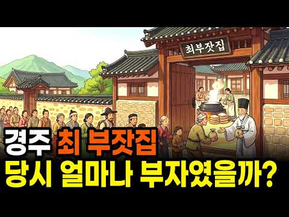
- 설명 앞부분: 조선에서 제일 부자였던 집인데, 대문을 잠근 적이 없습니다. 부자가 삼대를 못 간다는 말과, 열두 대를 간 집이 스스로 빈손이 된 이야기를 함께 담았습니다. ※ 본 영상은 특정 인물이나 단체를 비방할 목적이 없으며, 역사·교육 정보 제공을 목적으로 제작되었습니다. 국사편찬위원회, 『우리역사넷』 교과서 용어해설 '백산상회' 독립기념관, 『월간 독립기념관』 「노블리스 오블리주를 실천한 경주 최부자」 한국학중앙연구원, 『한국민족문화대백과사전』 '경주 최부자댁', '대한광복회' 국가유산청, 국가민속문화재 제27호 경주 최부자댁 지정 자료…
- 같은 채널 평소 대비 ×66.8 (채널 최근 롱폼 중앙값 13,323회) · 평소 영상: 같은 신을 믿는데 서로 왜 죽일까? 수니파와 시아파는 왜 갈라졌을까? (13,323회) / 존 F.케네디 암살 사건의 비밀, 진짜 범인은 따로 있다 (13,216회)
- 대본 없음 (설명) — 음성인식이 끝나면 도입부·흐름이 들어감
- 댓글 254/263: 좋은 점 — 영상 1 · 감사·응원 11 · 더 알고 싶은 것 0 · 아쉬운 점 — 영상 0 · 반박·불만 — 의견 다름 0 · 정치·사회 17 · 경험 공유 17 · 구독·다음 기대 1
  - 좋은 점 — 영상 👍8 “요즘 보기 드문 재미와 교훈이 함께 있는 좋은 이야기네요.”
  - 감사·응원 👍40 “대단합니다. 경주 최부자댁 기억하겠습니다. 감사합니다.”
  - 감사·응원 👍22 “존경합니다. 그리고 감사합니다.”
  - 정치·사회 👍151 “이 얘기가 사실이라면 이런 집안이 국가 유공자 대훈장을 받아야 한다. 언젠가 제대로 된 정권이 들어서면 유공자를 분별하여 진짜만 대대손손 국가가 공훈대로 혜택을 주는 날이 있길 바랍니다.”
  - 정치·사회 👍30 “영남대는 최준선생이 자금을대고 만들어 이병철한테 운영을 맡겼는데 삼성 사카린밀수 사건으로 박정희한테 땅이랑 재단 다 홀라당 뺏끼고 나몰라라 함 영남대 부지는 120만평임 울나라에서 젤 크다고 봐도 무방함 영남대는 경주 최씨 종가에 넘겨야됨 이사장에 박근혜 박근령이 왠…”
  - 경험 공유 👍215 “경주최씨 입니다 ^^ 조상님들께서 훌륭하셨으니 후손들도 멋지게 살아야죠 ㅎㅎ 저도 좋은 기운 이어받고 열심히 살고 있습니다”
  - 경험 공유 👍85 “최부자집 2형제분들 이회영 6형제분들이랑 제가 가장 존경하는분들 진짜 참어른들이시고 훌륭하신분들”
  - 구독·다음 기대 👍2 “경주 최씨..후손이 리스팩 하고 정주행 하고 갑니다.. 감사합니다..”

