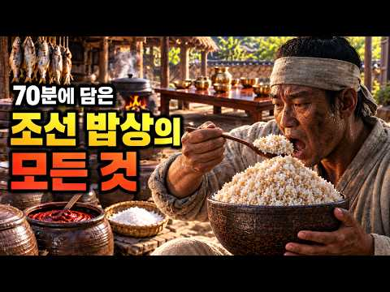

# 역사 — 성공 사례 분석: 사례별 자세히 #201–#240

`analysis.md` 의 9번 (같은 # 번호). 자동 생성 — `tools/success_analysis.py` v1.6 (2026-10-28 10:14 UTC). ※ 연구·교육용 — 투자 권유가 아님.

### 201. 제주도는 원래 우리나라가 아니었다고? ∣한국사}탐라국}제주도의역사∣오디오북

- https://www.youtube.com/watch?v=Knxr-xtwiKw · 오늘역사 · 구독자 889 · 조회수 91,516 (×102.9, 하루 648.5) · 좋아요 1,757 (1.9%) · 34.7분 · 2026-06-09 · 주제 묶음 10. 수면·낭독 · 형식 수면·낭독 (잠잘 때 듣는) · 폴더 `W_Knxr-xtwiKw` (웹 승인)
- 썸네일: 
- 설명 앞부분: 탐라는 왜 한반도 남쪽에서 사라졌을까요? 7세기 독립국 탐라의 역사와 제주도가 고려의 땅이 된 과정을 정리했습니다. 동아시아 역사서에 당당히 기록된 독립국 탐라는 왕이 아닌 별의 주인이 다스리던 나라였습니다. 이 영상은 탐라가 어떤 과정을 거쳐 국가의 면모를 유지했는지, 그리고 왜 하루아침에 역사 속으로 사라지게 되었는지 그 배경을 추적합니다. 1368년 원나라가 멸망하고 고려가 명나라와 복잡한 정세 속에 놓였을 때, 제주도에서 일어난 목호의 난은 탐라의 운명을 바꾸는 결정적인 사건이었습니다. 이번 영상을 통해 원나라의 지배를 받…
- 같은 채널 평소 대비 ×247.3 (채널 최근 롱폼 중앙값 370회) · 평소 영상: 성공확률 5000분의 1, 인천상륙작전 성공은 왜 기적이었나 ∣한국사∣맥아더∣오디오북 (399회) / 최악의 무능으로 최고 비호감인 조선의 왕 3인은?∣한국사∣오디오북∣무능한왕∣ (341회)
- 대본 없음 (설명) — 음성인식이 끝나면 도입부·흐름이 들어감
- 댓글 127/127: 좋은 점 — 영상 1 · 감사·응원 1 · 더 알고 싶은 것 0 · 아쉬운 점 — 영상 1 · 반박·불만 — 의견 다름 4 · 정치·사회 11 · 경험 공유 3 · 구독·다음 기대 0
  - 반박·불만 — 의견 다름 👍11 “제주도 사람들은 한반도 육지사람들이랑 인종자체가 다릅니다ㅠ 뭔 고씨 부씨 양씨가 중국 계열이라 한반도에서 흘러갔다는 엉터리같은..제주 창도신화가 단군보다 앞섭니다. 그리고 제주도 토착민들 보면 실제로 한반도 사람들과 외형적인 모습 차이가 매우 큽니다. 체형도 작고 이…”
  - 반박·불만 — 의견 다름 👍5 “먼개소리임? 탐라국 건국신화에 부계는 양고부 삼성이 나오는뎅 이3개의 성씨는 대표적인 고구려계성씨 임니다만. 양만춘, 고선지, 부여씨 이렇게 대표적인 고구려의 3개의 성입니다만. 글쿠 고조선의 흔적이 남아잇어 한라산의 원래 이름이 한울산 즉 하나님의 산, 즉 환웅의 …”
  - 정치·사회 👍20 “저는 탐라국 시조 고을라 왕의 98대 손입니다. 지금은 100대가 넘었으니 4500년이나 됩니다. 보통 한대를 잇기를 45년 정도 봅니다. 그리고 삼신인 고을라, 양을라, 부을라 가 각각 세명의 일본 공주를 부인으로 맞이 했다고 하는데. 일본이 아니라. 벽락국 입니다…”
  - 정치·사회 👍13 “옛날에 라고 하면 독립국 아닌 나라가 세상에 어디 있나요?”
  - 경험 공유 👍7 “제가 아는 제주도 아저씨가 있었는데 이목구비가 뚜렷한 서구적인 미남상이었습니다. 제주도 토박이인지는 모르겠지만, 이것도 관련이 있는 건지?”

### 202. 명나라 역사상 가장 끔찍하게 죽은 남자ㅣ환관 유근의 일생

- https://www.youtube.com/watch?v=DisrEocrnVY · 역사노다지 · 구독자 4,240 · 조회수 324,898 (×76.6, 하루 3,022.7) · 좋아요 1,915 (0.6%) · 36.1분 · 2026-07-12 · 주제 묶음 6. 동양사 (중국·일본·몽골) · 형식 정보·해설 (그 밖) · 폴더 `W_DisrEocrnVY` (웹 승인)
- 썸네일: 
- 설명 앞부분: 🔥 변소를 청소하던 환관이 황제보다 부유해졌습니다. 그리고 3,357번의 칼질 끝에, 백성들이 그의 살점을 사 먹었습니다. 명나라 역사상 가장 충격적인 최후를 맞은 환관 유근. 가난한 농가의 아이가 어떻게 나라 전체를 손에 쥐었는지, 그리고 왜 이토록 처참하게 무너졌는지를 이야기합니다. 이 영상에서 다루는 내용 ━━━━━━━━━━━━━━━━━━━━ ⚔️ 유근의 출생과 환관이 되기까지 👑 정덕제와 팔호(八虎)의 탄생 🏴 사례감 장악과 서황제의 등장 🕵️ 내창 — 유근이 직접 만든 비밀경찰 💰 은 5천만 냥 — 나라 예산 수십 배의 …
- 같은 채널 평소 대비 ×193.0 (채널 최근 롱폼 중앙값 1,683회) · 평소 영상: 한국인 DNA를 열어봤더니 과학자들이 말을 잃었다, 우리가 알던 상식이 전부 틀렸다 (2,161회) / 병자호란 13년 뒤, 청나라로 보내진 열여섯 살 '가짜 공주' (1,205회)
- 대본 없음 (설명) — 음성인식이 끝나면 도입부·흐름이 들어감
- 댓글 230/230: 좋은 점 — 영상 0 · 감사·응원 1 · 더 알고 싶은 것 0 · 아쉬운 점 — 영상 0 · 반박·불만 — 의견 다름 4 · 정치·사회 19 · 경험 공유 1 · 구독·다음 기대 0
  - 감사·응원 👍16 “역사를 통해 현재를 보게 됩니다. 감사합니다.”
  - 반박·불만 — 의견 다름 👍4 “"놀이를 좋아하는 황제의 성격은 바뀌지 않았으니까요. 유근이 어떻게 황제보다 부유해졌을까요. 황제가 비워둔 자리를 채웠기 때문입니다. 황제가 하기 싫어한 일을 대신 했고 그 대가로 황제의 권력을 가져갔으며 그 권력으로 황제의 돈을 가져간 거죠. 유근이 특별히 뛰어난 …”
  - 정치·사회 👍21 “우리나라도 그런 인간 있지요 . 국회의장 우원식 은 1년 동안 해외 출장비용으로 96억을 썻다는데 . 이게 가당키나 합니까 . 회당 6억을 넘게 썻다는데 뭘 먹고 어디서 자기에 의장이 이렇게 쓸수 있답니까 ? 특검 해야 합니다 .”
  - 정치·사회 👍14 “현재의 대한민국의 실상. 다만 환관이 아니라,국회와 행정수반 찢@@.”
  - 경험 공유 👍57 “형벌 중 하나인 '능지'는 죄인의 살점을 한점씩 바르면서...죄인이 최대한 고통을 겪지만, 오래 살려두는 걸 말하며~~ 보통 기술자의 경우에 1천포 가까이 살을 뜨고, 3일이상 살아있게 만들기도 했었음. 재미있는 건, 죄인의 살점을 먹으면 복이 온다고 믿어서... 능…”

### 203. 수천㎞ 떨어진 세 문명에 똑같은 기록이 있습니다… 우연일까?

- https://www.youtube.com/watch?v=9a31LH4SAgM · 역사백화점 · 구독자 2,510 · 조회수 123,811 (×49.3, 하루 1,765.8) · 좋아요 0 (0.0%) · 23.4분 · 2026-08-19 · 주제 묶음 8. 문명·고고학 · 형식 정보·해설 (그 밖) · 폴더 `W_9a31LH4SAgM` (웹 승인)
- 썸네일: 
- 설명 앞부분: 🌊 노아의 방주와 닮은 ‘대홍수 이야기’가 왜 세계 곳곳에 남아 있을까요? 성경보다 오래된 점토판에서 발견된 홍수 기록부터 메소포타미아의 길가메시, 그리스와 인도, 그리고 우리나라 산에 남은 이야기까지. 수천 년 전 사람들이 정말 남기고 싶었던 것은 배였을까요, 아니면 재난의 기억이었을까요?
- 같은 채널 평소 대비 ×257.4 (채널 최근 롱폼 중앙값 481회) · 평소 영상: 왕도 도망치게 만든 조선 최악의 적… 그런데 눈에 보이지 않았다 (497회) / 왕을 만든 여인이었는데, 역사책에는 한 줄도 없다 (465회)
- 대본 없음 (설명) — 음성인식이 끝나면 도입부·흐름이 들어감
- 댓글 104/105: 좋은 점 — 영상 1 · 감사·응원 0 · 더 알고 싶은 것 1 · 아쉬운 점 — 영상 2 · 반박·불만 — 의견 다름 2 · 정치·사회 0 · 경험 공유 4 · 구독·다음 기대 0
  - 좋은 점 — 영상 👍6 “길가메시를 뒤집은 노아홍수 진흙층발견 1) 수메르 문명 직전의 대홍수 진흙층 발견 우바이드 문화와 수메르 문명 사이의 단일 이벤트 퇴적물 확인 1920년대 레너드 울리 발굴에서 확인된 건 2.4에서 3.7미터 두께의 수성 점토와 실트층이었다. 인간 흔적이 전혀 없고,…”
  - 더 알고 싶은 것 👍1 “여떤놈이 그러데요 그래서 어쩌라구요? 알면 뭐가 달라지나요?”
  - 아쉬운 점 — 영상 👍6 “길가메시를 뒤집은 노아홍수 진흙층발견 1) 수메르 문명 직전의 대홍수 진흙층 발견 우바이드 문화와 수메르 문명 사이의 단일 이벤트 퇴적물 확인 1920년대 레너드 울리 발굴에서 확인된 건 2.4에서 3.7미터 두께의 수성 점토와 실트층이었다. 인간 흔적이 전혀 없고,…”
  - 아쉬운 점 — 영상 👍1 “아니 그런일이있었으면 그렇게안되게 어떻게할까를 봐야지, 그건 그것이고 아쉽네요..”
  - 반박·불만 — 의견 다름 👍1 “답은 성경에 다 나와있습니다.성경의 기록을 역사적 사실로 받아들이면 모든 퍼즐이 맞춰집니다 우선 저 배모양 언덕은 방주가 아닙니다 성경은 분명 궤짝 처럼 생긴 방주라고 했으니깐요 세상 온 땅이 잠기는 대홍수라는 대격변속에는 어디로 가야할지 어디에 도착할지는 필요가 없…”
  - 경험 공유 👍1 “재미있게 잘 봤습니다. 저도 옛날 사람들에게 가장 무서운 재앙이 홍수라서 이렇게 비슷한 이야기들이 많이 남은걸까 하는 생각을 했는데, 홍수가 오히려 축복이었던 이집트에만 이런 이야기가 없다는 말을 들으니 뭔가 정리되는 느낌입니다.”
  - 경험 공유 👍1 “답은 성경에 다 나와있습니다.성경의 기록을 역사적 사실로 받아들이면 모든 퍼즐이 맞춰집니다 우선 저 배모양 언덕은 방주가 아닙니다 성경은 분명 궤짝 처럼 생긴 방주라고 했으니깐요 세상 온 땅이 잠기는 대홍수라는 대격변속에는 어디로 가야할지 어디에 도착할지는 필요가 없…”

### 204. CCTV 없던 조선, 주모는 어떻게 그많은 사람들을 만족시켰을까? l 역사이야기 l 조선시대 한국사

- https://www.youtube.com/watch?v=X46M1yoKC8s · 역사원탑 · 구독자 5,970 · 조회수 571,511 (×95.7, 하루 4,174.4) · 좋아요 6,479 (1.1%) · 29분 · 2026-06-13 · 주제 묶음 1. 역사 일반·이야기 · 형식 정보·해설 (그 밖) · 폴더 `W_X46M1yoKC8s` (웹 승인)
- 썸네일: 
- 챕터: 0:00 인트로 · 0:39 도입 - 술집인 줄 알았던 주막, 그리고 모든 걸 본… · 2:13 주모의 진짜 정체 · 5:17 주모가 본 하루 · 7:35 주막이란 어떤 곳이었나 + 기원 · 9:53 길 위의 주막 - 스무 날 여정 · 11:24 정보·소문·범죄의 길목 · 14:11 주막의 밥상, 국밥의 정체 · 16:55 사극 속 주모 로맨스의 진실 · 18:53 봉놋방 하룻밤 · 21:01 떠도는 썰 검증 (10만 개·은행설) · 23:55 마지막 주막, 삼강주막 · 25:43 현대 연결 · 27:36 결론 - 정보의 길목
- 설명 앞부분: 거리마다 CCTV가 달리고, 차에는 블랙박스가 도는 지금. 그런데 그런 기계가 단 하나도 없던 조선에서, 누가 도둑이고 누가 큰돈을 만졌는지 '모든 걸 본 사람'이 딱 한 명 있었습니다. 바로 — 주막의 주모예요. 양반의 소문도, 장사꾼의 정보도, 도둑의 장물 거래까지. 조선 팔도의 모든 사람과 모든 비밀이 하룻밤은 반드시 거쳐 가던 곳, 주막. 그 한가운데 앉아 모든 걸 보고 들은 주모는, 사극 속 '정 많은 아주머니'가 아니라 조선에서 가장 많은 비밀을 알던 사람이었습니다. 1. 이 영상에서는 사료를 한 장씩 펼쳐 이렇게 풀어…
- 같은 채널 평소 대비 ×19.0 (채널 최근 롱폼 중앙값 30,122회) · 평소 영상: 🔥 "여름철 야심한밤 참을 수 있을까?" 무더위를 참지못한 조선평민 남성과 여성은 밤마다… (45,349회) / "그렇게 먹고 오래 살겠나?" 조선 왕들을 죽인 범인의 충격적인 정체 l 역사이야기 (14,896회)
- 대본 없음 (설명) — 음성인식이 끝나면 도입부·흐름이 들어감
- 댓글 327/342: 좋은 점 — 영상 0 · 감사·응원 3 · 더 알고 싶은 것 1 · 아쉬운 점 — 영상 13 · 반박·불만 — 의견 다름 7 · 정치·사회 7 · 경험 공유 3 · 구독·다음 기대 0
  - 감사·응원 👍2 “매우매우 응원합니다 🎁 🎁 🎁 👍”
  - 감사·응원 👍1 “수능시험을 폐지하고, 중고 6년간 한 과목의 모의고사 점수로 대학에 입학하여 사교육비 줄이고, 기뻐하고 감사하며 사랑하는 영성산업으로 세계통일하여 기아,난민, 전쟁을 종식하자.”
  - 더 알고 싶은 것 👍0 “당시 국밥은 지금 보다 맛이 있었을까요? 궁금합니다.”
  - 아쉬운 점 — 영상 👍9 “13:05 영조4년 자막이 왜 저래 ?”
  - 아쉬운 점 — 영상 👍3 “왜이렇게 지루해요 반복 반복 ㅡㅡㅡㅡ”
  - 반박·불만 — 의견 다름 👍2 “내용중에 모주는 실제론 전국적으로 먹었단 내용은 없고 전주지역에서 주로 먹었단 내용만 있슴 중간중간 짜깁기로 사실이 아닌데 사실인거처럼 얘기하는게 섞여있음”
  - 반박·불만 — 의견 다름 👍0 “바다도 아닌데 왠 낚시???”
  - 정치·사회 👍9 “대한민국 전대통령 부인의 전직업 !😅”
  - 정치·사회 👍1 “인간의 호기심 이용한 어그로네 ㅋㅋ조선족 AI 작품”
  - 경험 공유 👍20 “내 어릴적 우리 집에도 보부상이 자고 가곤 ...”

### 205. 독립자금에 전 재산을 쏟아부은 조선 최고 부자 경주 최부잣집 클라스

- https://www.youtube.com/watch?v=bcLdcEWs4yw · 역사본능 · 구독자 32,700 · 조회수 969,741 (×29.7, 하루 22,341.9) · 좋아요 3,696 (0.4%) · 31.7분 · 2026-09-15 · 주제 묶음 3. 조선 · 형식 정보·해설 (그 밖) · 폴더 `W_bcLdcEWs4yw` (웹 승인)
- 썸네일: 
- 설명 앞부분: 조선에서 제일 부자였던 집인데, 대문을 잠근 적이 없습니다. 부자가 삼대를 못 간다는 말과, 열두 대를 간 집이 스스로 빈손이 된 이야기를 함께 담았습니다. ※ 본 영상은 특정 인물이나 단체를 비방할 목적이 없으며, 역사·교육 정보 제공을 목적으로 제작되었습니다. 국사편찬위원회, 『우리역사넷』 교과서 용어해설 '백산상회' 독립기념관, 『월간 독립기념관』 「노블리스 오블리주를 실천한 경주 최부자」 한국학중앙연구원, 『한국민족문화대백과사전』 '경주 최부자댁', '대한광복회' 국가유산청, 국가민속문화재 제27호 경주 최부자댁 지정 자료…
- 같은 채널 평소 대비 ×57.5 (채널 최근 롱폼 중앙값 16,876회) · 평소 영상: 야인 시대 레전드, 김두한 VS 이정재 누가 더 강했을까? (17,219회) / "북괴가 알면 큰일이다" 대통령을 쏜 사람이 차 안에서 한 첫마디 (16,534회)
- 대본 없음 (설명) — 음성인식이 끝나면 도입부·흐름이 들어감
- 댓글 254/286: 좋은 점 — 영상 1 · 감사·응원 11 · 더 알고 싶은 것 0 · 아쉬운 점 — 영상 0 · 반박·불만 — 의견 다름 0 · 정치·사회 17 · 경험 공유 17 · 구독·다음 기대 1
  - 좋은 점 — 영상 👍8 “요즘 보기 드문 재미와 교훈이 함께 있는 좋은 이야기네요.”
  - 감사·응원 👍40 “대단합니다. 경주 최부자댁 기억하겠습니다. 감사합니다.”
  - 감사·응원 👍22 “존경합니다. 그리고 감사합니다.”
  - 정치·사회 👍151 “이 얘기가 사실이라면 이런 집안이 국가 유공자 대훈장을 받아야 한다. 언젠가 제대로 된 정권이 들어서면 유공자를 분별하여 진짜만 대대손손 국가가 공훈대로 혜택을 주는 날이 있길 바랍니다.”
  - 정치·사회 👍30 “영남대는 최준선생이 자금을대고 만들어 이병철한테 운영을 맡겼는데 삼성 사카린밀수 사건으로 박정희한테 땅이랑 재단 다 홀라당 뺏끼고 나몰라라 함 영남대 부지는 120만평임 울나라에서 젤 크다고 봐도 무방함 영남대는 경주 최씨 종가에 넘겨야됨 이사장에 박근혜 박근령이 왠…”
  - 경험 공유 👍215 “경주최씨 입니다 ^^ 조상님들께서 훌륭하셨으니 후손들도 멋지게 살아야죠 ㅎㅎ 저도 좋은 기운 이어받고 열심히 살고 있습니다”
  - 경험 공유 👍85 “최부자집 2형제분들 이회영 6형제분들이랑 제가 가장 존경하는분들 진짜 참어른들이시고 훌륭하신분들”
  - 구독·다음 기대 👍2 “경주 최씨..후손이 리스팩 하고 정주행 하고 갑니다.. 감사합니다..”

### 206. 일본이 '괴물'이라 부르며 이순신보다 두려워 했던 인물? 조선 역사상 가장 저평가된 영웅

- https://www.youtube.com/watch?v=5ooDDKo68E0 · 역사동굴 · 구독자 2,650 · 조회수 112,181 (×42.3, 하루 1,808.5) · 좋아요 404 (0.4%) · 17.7분 · 2026-08-27 · 주제 묶음 3. 조선 · 형식 정보·해설 (그 밖) · 폴더 `W_5ooDDKo68E0` (웹 승인)
- 썸네일: 
- 챕터: 0:00 일본군이 공포에 떨며 만든 괴물의 정체 · 1:14 적국이 200년 동안 부른 '모쿠소'의 진실 · 2:24 진주성을 지킨 무명의 영웅 김시민 · 3:42 갓을 벗어 던진 무관의 숨겨진 사연 · 6:14 불가능을 가능케 한 진주성의 기적 · 7:18 승리 직후 찾아온 비극과 그 이후 · 8:11 왜 진주성이 호남의 방패였을까? · 9:18 히데요시가 진주성에 집착한 잔혹한 이유 · 10:19 남강에 몸을 던진 최경회와 논개 · 11:15 죽은 지 8개월, 적군은 왜 그를 찾았나 · 12:13 일본 전설 속의 두꺼비 도사가 된 사연 · 13:34 왜 우리는 119년 동안 그를 잊었나 · 14:36 일본으로 끌려간 역사를 되찾은 시민들
- 설명 앞부분: 일본이 이순신보다 두려워 했던 인물? '괴물'이라 부르며 두려워했던 조선의 영웅 일본이 200년 넘게 두려워한 조선 장수, 충무공 김시민의 진짜 이야기. 이순신 장군과 나란히 진주대첩을 승리로 이끈 명장, 정작 일본에서는 '모쿠소'라는 이름의 괴물로 그려지며 두려움의 대상이 되었습니다. 무기 정비를 건의했다가 쫓겨났던 무명 관리는 어떻게 진주성을 지켜낸 명장이 됐을까요. 그리고 그의 임명장은 어쩌다 400년 만에 국민 모금으로 되찾아온 문화유산이 됐을까요. 진주대첩부터 공신교서 환수까지, 잘 알려지지 않은 이야기를 담았습니다. 이…
- 같은 채널 평소 대비 ×72.3 (채널 최근 롱폼 중앙값 1,551회) · 평소 영상: 단종보다 슬픈 광해군의 19년 생지옥! 사도세자보다 잔인한 최후와 원수의 파멸 [역사이야… (1,551회) / 천하의 송시열도 꺾지 못한 천재, 왜 윤휴는 역사 속에서 지워졌나? [기사환국][사문난적] (1,549회)
- 대본 없음 (설명) — 음성인식이 끝나면 도입부·흐름이 들어감
- 댓글 36/36: 좋은 점 — 영상 1 · 감사·응원 2 · 더 알고 싶은 것 0 · 아쉬운 점 — 영상 1 · 반박·불만 — 의견 다름 0 · 정치·사회 0 · 경험 공유 2 · 구독·다음 기대 0
  - 좋은 점 — 영상 👍2 “유익한 정보 감사합니다”
  - 감사·응원 👍3 “정확한 우리 역사를 바로 알려주시니 감사합니다.지속적인 노력으로 바로 세워 알리는 역사가 국민을 바로 세우는 일 이십니다.고맙습니다.”
  - 감사·응원 👍2 “유익한 정보 감사합니다”
  - 아쉬운 점 — 영상 👍1 “왜 ai 목소리가 다 같은거야?”
  - 경험 공유 👍2 “지혜인 의인 애국인 유비무환인은 소수고 그 선견지명은 거부되어 받아들여지지 않고 후대가 기억하고 기리는 악순환 멍청한 짓거리를 하고 있는 조선 사람들....나도 조선 사람인데....유비무환 정신이 강하니 어느 쪽 조선인일까?”

### 207. 🔥조선 영의정의 외아들🔥이 갑자기 노비로 전락하면 벌어지는 일...

- https://www.youtube.com/watch?v=Kj46XmMz4u0 · 드라마상점 · 구독자 4,990 · 조회수 571,892 (×114.6, 하루 3,403.2) · 좋아요 2,590 (0.4%) · 23.5분 · 2026-05-13 · 주제 묶음 3. 조선 · 형식 사극·드라마·영화 리뷰 · 폴더 `W_Kj46XmMz4u0` (웹 승인)
- 썸네일: 
- 설명 앞부분: 제목은 화면 왼쪽 위를 참고해주세요 영상 시청 감사합니다 🙂
- 같은 채널 평소 대비 ×1.7 (채널 최근 롱폼 중앙값 339,762회) · 평소 영상: 🔥가족 중 누군가가 날 죽이려 한다🔥 500억 유산을 둘러싼 김혜준 주연의 치열한 상속싸… (668,398회)
- 대본 없음 (설명) — 음성인식이 끝나면 도입부·흐름이 들어감
- 댓글 142/143: 좋은 점 — 영상 0 · 감사·응원 0 · 더 알고 싶은 것 2 · 아쉬운 점 — 영상 0 · 반박·불만 — 의견 다름 2 · 정치·사회 6 · 경험 공유 4 · 구독·다음 기대 0
  - 더 알고 싶은 것 👍39 “언제의 드라마죠? 못본거같은데 재밋네요..”
  - 더 알고 싶은 것 👍0 “언제고 그런 날이 오겠죠?”
  - 반박·불만 — 의견 다름 👍1 “아무리 드라마여도 판타지를 만들어 놨네.. 조선시대가 어떤나라인데 저런 말도 안되는 사극을 만드냐??”
  - 정치·사회 👍2 “그놈이 대통령이 되었으니 .참..”
  - 정치·사회 👍0 “그런 날이 왔더니 불펴안 가득한 불임세대가 왔네요. 외노자 없으면 나라가 안 돌아가네요.”
  - 경험 공유 👍82 “권율장군도 불혹이될때까지 한량짓을하고돌아다녔다고합니다 심지어 사위인 백사이항복이 먼저등과했습니다 영의정이었던 그의부친께서 임종하시며 그를 물끄러미보다가 ,너를 내가낳았구나, 라고말하고 임종했다고합니다 이에 감발된 권율이 왜란 십년전인1582년 등과해 훗날 류성룡 이순…”
  - 경험 공유 👍2 “조우진이 여기에도 출연 했었네 ㅎ”

### 208. 조선에서 라면팔면 팔릴까?

- https://www.youtube.com/watch?v=Mj85mD9KvmE · 눕이현 · 구독자 24,800 · 조회수 1,127,975 (×45.5, 하루 16,656.3) · 좋아요 10,090 (0.9%) · 9.3분 · 2026-08-21 · 주제 묶음 3. 조선 · 형식 정보·해설 (그 밖) · 폴더 `W_Mj85mD9KvmE` (웹 승인)
- 썸네일: 
- 대본 없음 (없음) — 음성인식이 끝나면 도입부·흐름이 들어감
- 댓글 1,174/1,183: 좋은 점 — 영상 4 · 감사·응원 26 · 더 알고 싶은 것 17 · 아쉬운 점 — 영상 7 · 반박·불만 — 의견 다름 6 · 정치·사회 2 · 경험 공유 19 · 구독·다음 기대 47
  - 좋은 점 — 영상 👍2 “영상이 너무 좋아요, 처음에는 ai 불펌 같은거줄 알았는데 너무 아이디어랑 편집 영상이 좋아요 ai는 이렇게 쓰여야죠. 근데 문제는 처름 보는 사람들은 오해할 수 있을 듯해서 처음 오프닝을 바꾸던지 하는게 좋을 것 같아요, 특히 쇼츠요, 아이디어는 많이 없지만 조금이…”
  - 좋은 점 — 영상 👍0 “참신한 아이디어에 많이 배우고 갑니다. ㅋ”
  - 감사·응원 👍34 “노고에 눈물이...9분 15초면 한달 크레딧 거의 다 쓰시고....이걸 3일에 한번이라도 올릴 수 있으면 얼마나 좋겠어유...넘 잘 만드셨네영~ 토토와코코가 응원합니다”
  - 감사·응원 👍7 “솔직히 놀랐습니다. 저도 AI 영상 유료로 써보고 생쇼해봤지만 정말 힘든 작업이거든요. 디테일과 각본 등등 미쳐써요 초하이 고 퀄리티. 슈퍼챗이라도 있음 당장 쏘고싶네요 60만구독자까지 응원합니다!!!”
  - 더 알고 싶은 것 👍33 “어허, AI 컨텐츠 중에 다음 퀄리티가 정말 궁금해서 구독한 곳은 여기가 처음입니다. 조선이라는 시대가 그렇게 거부감있는 시대도 아니고, 마치 드라마 시즌1 최종장까지 요약편을 보는 느낌이 드네요. 컨셉을 이어가면서 최종 왕의 입맛까지 홀릴 것이냐, 아니믄 다른 세계…”
  - 더 알고 싶은 것 👍11 “오 뭐야 SF사극 드라마 한편본듯ㅋ 재밌어옄ㅋㅋㅋㅋ 계속만들어주시면 채널 떡상!”
  - 아쉬운 점 — 영상 👍290 “처음엔 AI티가 나네~ 하면서 보고있는데 몰입하다가 와 순간 사람들이 연기하는거로 착각함 재밌다진짜”
  - 아쉬운 점 — 영상 👍2 “뭐지........아무리 가상(AI) 편집이지만.......끌리네요ㅋㅋ 재미도 있고 스토리도 있고!! 구독박고 좋아효!! 믿고 같이 가볼게요~!!”
  - 반박·불만 — 의견 다름 👍7 “현실에서 불가능한 상황을 흡입력있고 유쾌하게 표현하면서 익숙한 유튜브 플랫폼을 따라감 ai 활용에 최고 고점이지않나. 애초에 현실에 있지 않는것을 창조한다면 말도안되는상황을 유쾌하고 트랜디하게풀것 많이배웁니다”
  - 반박·불만 — 의견 다름 👍2 “에비앙은 우라늄이 포함되어 있어요. 좋은 물이 아닙니다.”
  - 정치·사회 👍0 “한국인들은 왜캐 맛도 없고 암유발 음식인 리면을 이리도 좋아하고 라면부심이 강한걸까? 라면은 중국인이 발명한건데”
  - 경험 공유 👍7 “솔직히 놀랐습니다. 저도 AI 영상 유료로 써보고 생쇼해봤지만 정말 힘든 작업이거든요. 디테일과 각본 등등 미쳐써요 초하이 고 퀄리티. 슈퍼챗이라도 있음 당장 쏘고싶네요 60만구독자까지 응원합니다!!!”
  - 경험 공유 👍3 “내가 웬만하면 AI 다 차단 때리는데, 여긴 진짜 맛집이네. 저점매수 구독하고 감”
  - 구독·다음 기대 👍333 “조금 오버해서 방송국놈들이 수천 수억들여 촬영한 영상들보다 각본 연출 스토리 좋구요 시댄스로 이 정도 만들려면 돈이 꽤 들었을텐데요 시댄스의 엄청난 성능과 주인장의 센스가 제대로 콜라보 되었어요 정말 좋은 센스와 재능을 가지셨네요 구독하고 다음영상 기다리겠습니다 굿”
  - 구독·다음 기대 👍12 “이채널 맛집이네 구독박아요❤”

### 209. 왕의 밥상을 차리던 수라간 궁녀들, 그 산더미 같은 '남은 반찬'은 어떻게 처리 했을까? ∣ 한국사 ∣ 조선왕조실록 ∣ 역사 ∣ 세계사

- https://www.youtube.com/watch?v=i88zvql3pbc · 시대산책 · 구독자 1,580 · 조회수 177,705 (×112.5, 하루 1,057.3) · 좋아요 3,388 (1.9%) · 47.9분 · 2026-05-13 · 주제 묶음 3. 조선 · 형식 정보·해설 (그 밖) · 폴더 `W_i88zvql3pbc` (웹 승인)
- 썸네일: 
- 챕터: 0:00 경종 독살설과 게장 한 그릇 · 1:30 12첩 반상의 함정 · 4:00 수라상 세 개의 상차림 · 6:30 사옹원과 400명의 궁중 주방 시스템 · 9:00 대장금의 거짓 — 수라간은 남자들의 공간이었다 · 11:30 기미상궁과 은수저, 이중 독 검사 시스템 · 14:00 상물림 — 남은 음식은 어디로 갔을까 · 16:30 조선 vs 청나라, 같은 밥상의 다른 운명 · 18:30 4시간짜리 점심시간, 관아의 상물림 · 20:00 영조의 감선, 정조의 절제, 연산군의 폭식 · 23:00 수라상은 왕의 거울이었다
- 설명 앞부분: 조선 왕의 밥상, 그 뒤에 숨겨진 충격적인 진실, 수라상의 비밀 ∣ 한국사 ∣ 조선왕조실록 ∣ 역사 ∣ 세계사 1724년 8월, 경종이 게장과 생감을 먹고 닷새 만에 사망했습니다. 그 게장을 올리라고 지시한 사람은 바로 다음 왕, 영조였죠. 영조는 52년간 "게장으로 형을 죽인 왕"이라는 의혹에 시달렸습니다. 밥상 하나가 사람을 죽이고, 정치를 흔들고, 한 왕조의 운명을 바꿨습니다. 한 끼에 30가지, 하루 다섯 끼. 호텔 뷔페 풀코스를 매일 두 번씩 받는 셈인 왕의 수라상. 그런데 정작 세종조차 그 절반을 비우지 못했다고 합니다…
- 같은 채널 평소 대비 ×673.1 (채널 최근 롱폼 중앙값 264회) · 평소 영상: 83세 장수한 영조는 이걸 뒤집었습니다. 조선 왕실 밥상의 충격적 진실 ∣ 수라상 ∣ 한… (264회) / 고구려 원정 실패의 진짜 이유 ∣ 수 양제와 당 태종, 두 황제가 똑같이 무너진 땅 ∣ … (262회)
- 대본 없음 (설명) — 음성인식이 끝나면 도입부·흐름이 들어감
- 댓글 140/140: 좋은 점 — 영상 1 · 감사·응원 1 · 더 알고 싶은 것 1 · 아쉬운 점 — 영상 1 · 반박·불만 — 의견 다름 1 · 정치·사회 3 · 경험 공유 3 · 구독·다음 기대 0
  - 좋은 점 — 영상 👍5 “하루 3번 먹어요 정보 유익하네요”
  - 감사·응원 👍1 “왕을 위해 차린 음식을 나누어 먹었다니 역시 정이 많은 민족입니다. 소주방에서 일하는 사람들도 즐겁게 일했을 거같아요. 결국 자신들을 위한 밥상이니까요. 몰랐던 지식을 나누어 주셔서 고맙습니다. 역사를 배울수록 궁궐안의 사람들은 모두 극한 직업 같습니다. 왕을 비롯하…”
  - 더 알고 싶은 것 👍12 “궁중 역사공부 잘 들었습니다 얼마나 힘들었을까요???”
  - 아쉬운 점 — 영상 👍1 “재있는채널이긴한데 좀 길어요 지루하다고해야할까요 구독은 좀 고민 ㅜㅜ”
  - 반박·불만 — 의견 다름 👍13 “아닌데...임금의밥상이 오히려 검소했다는 기록이 있는데.”
  - 정치·사회 👍1 “움직이지도 않으면서. 뭘 그리 치 드셨을까? 어이없다 왕 정권하에. 우리나라 백성. 참. 불쌍했다 전쟁이. 국민 살렸다 지금은 얼마나 좋은가??”
  - 정치·사회 👍1 “궁궐이. 먹는데. 쓸데없이 돈을 썼네 일자리 창출도 있었을까? 하긴. 나라가. 자기네꺼니까 즉. 모든게 내꺼 몇 천 년 동안이나”
  - 경험 공유 👍23 “수라상이 고도의 정치도구였다니...재밌어요!몇년전 고궁박물관에서 왕가의 밥상인가? 전시회가 있었는데 그대로 재현했었거든요,,”
  - 경험 공유 👍5 “내가 왕이라면, 매일 가까운 근처의 가난한 행실 좋은 백성을 불러서 식사를 같이 하겠습니다”

### 210. 충격실화! 조선시대 꿀보직 TOP5 — 일 안 해도 나라에서 월급 줬습니다

- https://www.youtube.com/watch?v=F708KFpG_5U · 역사 뒷풀이 · 구독자 1,720 · 조회수 191,921 (×111.6, 하루 1,148.1) · 좋아요 1,767 (0.9%) · 11.4분 · 2026-05-14 · 주제 묶음 3. 조선 · 형식 정보·해설 (그 밖) · 폴더 `W_F708KFpG_5U` (웹 승인)
- 썸네일: 
- 설명 앞부분: 일 안 해도 월급 나오고, 출근 안 해도 품계는 인정받고, 심지어 9급인데 정승도 잡아들였습니다. 황당하지만 전부 경국대전에 기록된 조선 공식 제도였습니다. 도대체 어떤 자리였을까요? 1위까지 보시면 조선이 다르게 보이실 겁니다.
- 같은 채널 평소 대비 ×138.0 (채널 최근 롱폼 중앙값 1,391회) · 평소 영상: 대감집 숨은 권력자들 ─ 조선시대 실세 하인 TOP5 │한국사│조선역사 (1,391회) / 충격실화! 조선시대 땅부자 TOP 5 ─ 현재 가치로 계산해봤습니다 (1,271회)
- 대본 없음 (설명) — 음성인식이 끝나면 도입부·흐름이 들어감
- 댓글 154/154: 좋은 점 — 영상 0 · 감사·응원 1 · 더 알고 싶은 것 1 · 아쉬운 점 — 영상 2 · 반박·불만 — 의견 다름 1 · 정치·사회 16 · 경험 공유 3 · 구독·다음 기대 0
  - 감사·응원 👍0 “평양감사는요? 얼마나 꿀보직이면 평양감사도 저싫으면그만 속담까지있을까요?”
  - 더 알고 싶은 것 👍0 “평양감사는요? 얼마나 꿀보직이면 평양감사도 저싫으면그만 속담까지있을까요?”
  - 아쉬운 점 — 영상 👍0 “내용은 참 흥미롭고 좋은데 짧은 주기로 계속 반복되는 BGM이 너무 거슬려요 ㅠㅠ”
  - 아쉬운 점 — 영상 👍0 “유교 재상 정치는 그냥 공산주의 와 같아 약간 모자란 자들이 이런 꿈속세계를 믿는대 조선초기에 이천년전 공자시대를 따라간 것이다 미친자들이야 이미 중극은 수나라때 대규모 토목공사로 국가경영에 눈을 떳는대 한반도에 사이비 주역음양을 제왕학에 기초로 삼아 신정정치를 햇다…”
  - 반박·불만 — 의견 다름 👍4 “죄송하나 참봉의 직책은 지금의 9급 공무원. 쉽지 않았고 돈은 글쎄?”
  - 정치·사회 👍22 “지금과 비교하면 국회의원 자리네 자리 다 빼자”
  - 정치·사회 👍19 “1위와 3위는 그냥 보면 놀고먹는 꿀보직으로 보이지만... 예우는 하되 실권을 대부분 뺏는.. 권력 중앙에서 밀어내는 좌천성 인사로도 볼수있겠네요 장관 , 국회의원 하다 밀려난 사람을 무슨무슨 단체 명예회장 으로 보내는 느낌”
  - 경험 공유 👍2 “0:54 권지는 일부러 그것만 고집하는 사람이 있었다. 자리가 나도 일부러 관직에 안 나갔다. 브라질 축구선수인 *카를로스 카이저* 마냥 타이틀은 갖고 싶은데 해당 업무는 하기 싫어하는 놈이 어디나 존재했다. 4:56 검교는 임진왜란이 끝나자 무더기로 쏟아져 나왔다.…”
  - 경험 공유 👍0 “나를 보는것같네. 내가. 조선시대 에서. 일했던. 곳이요. 하하하”

### 211. [광복절동화] 소중하고 기쁜 국경일 광복절 8월 15일 의미 어린이 역사교육 계기교육 유아 초등

- https://www.youtube.com/watch?v=gCpZreiHwT0 · 누리과정유치원 · 구독자 347 · 조회수 17,834 (×51.4, 하루 230.8) · 좋아요 62 (0.4%) · 5.5분 · 2026-08-12 · 주제 묶음 1. 역사 일반·이야기 · 형식 정보·해설 (그 밖) · 폴더 `W_gCpZreiHwT0` (웹 승인)
- 썸네일: 
- 설명 앞부분: 광복절의 의미를 알아보아요^^
- 같은 채널 평소 대비 ×16.4 (채널 최근 롱폼 중앙값 1,086회) · 평소 영상: [유치원과친구] 동화 나랑 같이놀래?유치원 어린이집 신학기 새학기 적응 동화 (1,237회) / [30분동화] 5월동화 가정의달 동화 이어보기 연속보기ㅣ나와가족ㅣ하원시간 동화ㅣ어린이동화… (936회)
- 대본 없음 (설명) — 음성인식이 끝나면 도입부·흐름이 들어감
- 댓글 0/0: 좋은 점 — 영상 0 · 감사·응원 0 · 더 알고 싶은 것 0 · 아쉬운 점 — 영상 0 · 반박·불만 — 의견 다름 0 · 정치·사회 0 · 경험 공유 0 · 구독·다음 기대 0

### 212. 수메르인의 DNA를 전 세계 고대 문명과 비교했다… 문명사의 판도를 흔든 뜻밖의 결과

- https://www.youtube.com/watch?v=V40fQEAfXbM · DNA의 비밀 · 구독자 2,310 · 조회수 35,969 (×15.6, 하루 1,531.3) · 좋아요 166 (0.5%) · 19.4분 · 2026-10-04 · 주제 묶음 8. 문명·고고학 · 형식 정보·해설 (그 밖) · 폴더 `W_V40fQEAfXbM` (웹 승인)
- 썸네일: 
- 챕터: 0:00 하버드 유전학팀의 충격적인 발견 · 1:30 우바이드 문화와 수메르의 갑작스런 등장 · 4:00 레너드 울리와 수메르 문제 (언어적 고립) · 8:00 막스 플랑크 연구소의 DNA 분석 (급격한 인구 교체) · 11:20 에리두 창세비기와 수메르 왕명록의 비밀 · 14:15 고아 유전자 634개와 진화론의 모순 · 17:40 사그기가(Sag-gigga)와 아누나키의 인류 창조 · 19:30 결론: 우리는 누구인가?
- 설명 앞부분: Video: 수메르인의 DNA를 전 세계 고대 문명과 비교했다… 문명사의 판도를 흔든 뜻밖의 결과 """2018년 하버드 유전학 연구팀과 2019년 막스 플랑크 연구소의 고대 DNA 분석 결과, 수메르인의 유전자는 인류 역사상 그 어떤 집단과도 일치하지 않는 완벽한 고립을 보여주었습니다. 그들은 어디서 왔을까요? 우바이드 원시 문화에서 갑자기 고도의 수학, 천문학, 문자를 갖춘 수메르 문명으로 도약한 이유는 무엇일까요? 이 영상에서는 진화론으로 설명할 수 없는 '고아 유전자(Orphan genes)', J2a 하플로그룹의 미스터리…
- 같은 채널 평소 대비 ×80.0 (채널 최근 롱폼 중앙값 450회) · 평소 영상: 바빌론의 마지막 왕은 땅속에서 무엇을 찾고 있었을까? 그것을 발견한 뒤 도시를 떠났다는 … (476회) / 고대 기록에 등장하는 최초의 핵전쟁? 파멸의 밤에 사라진 신들의 미스터리 (423회)
- 대본 없음 (설명) — 음성인식이 끝나면 도입부·흐름이 들어감
- 댓글 9/9: 좋은 점 — 영상 0 · 감사·응원 0 · 더 알고 싶은 것 0 · 아쉬운 점 — 영상 0 · 반박·불만 — 의견 다름 1 · 정치·사회 0 · 경험 공유 0 · 구독·다음 기대 0
  - 반박·불만 — 의견 다름 👍1 “헛소리~~ 시간 낭비~~”

### 213. 고조선 이전_또 다른 문명이 있었다

- https://www.youtube.com/watch?v=u_tS1xBdjn8 · 리워크531(REWORK 531) · 구독자 220 · 조회수 25,029 (×113.8, 하루 143.2) · 좋아요 452 (1.8%) · 12.2분 · 2026-05-06 · 주제 묶음 2. 한국 고대·삼국·고려 · 형식 정보·해설 (그 밖) · 폴더 `W_u_tS1xBdjn8` (웹 승인)
- 썸네일: 
- 설명 앞부분: 교과서는 단군조선부터 가르칩니다. 그런데 그 이전 5,667년은 어디에 있을까요. 유물이 말하고 있습니다. 발굴지가 말하고 있습니다. DNA가 말하고 있습니다. 오늘은 아무도 가르쳐주지 않은 한반도 잃어버린 왕조의 진실을 파헤쳐 봅니다. 이 영상에서 다루는 핵심 증거들 ▸ 전 세계 고인돌 40,000개 — 한반도 집중 분포 ▸ 기원전 2333년 — 4대 문명 절정과 동시에 기록된 단군조선 ▸ 홍산문화 유물 — 곰 토템·빗살무늬·적석총이 한국과 동일 ▸ 고대 DNA 분석 — 8,000년 전 신석기인과 현재 한국인의 직계 연결 ▸ 다…
- 같은 채널 평소 대비 ×338.2 (채널 최근 롱폼 중앙값 74회) · 평소 영상: 5년간 아무도 몰랐다 커튼 속 그 얼굴의 정체 (74회) / 금기를 깨다_죽은 자를 부르는 AI (51회)
- 대본 없음 (설명) — 음성인식이 끝나면 도입부·흐름이 들어감
- 댓글 47/47: 좋은 점 — 영상 0 · 감사·응원 1 · 더 알고 싶은 것 1 · 아쉬운 점 — 영상 0 · 반박·불만 — 의견 다름 1 · 정치·사회 1 · 경험 공유 1 · 구독·다음 기대 0
  - 감사·응원 👍37 “이런 역사적인 사실을 더 연구하고 밝히는것은 역사학자들의 의무일진데 거꾸로 배달국 단군의 진실을 얘기하면 환빠 유사역사학으로 매도하면서 폄화하는 대한민국강단사학자들은 비난받아 마땅한자들입니다 우실하교수님 이덕일교수님의 강의는 진실을 알려주는 열쇠입니다 채널작가님의 관…”
  - 더 알고 싶은 것 👍0 “저 유물은 어디에 있나요? 이거 실화입니까?”
  - 반박·불만 — 의견 다름 👍1 “또 헛소리 하고있네 어째 홍산문화 대부분의 고구려 발해 등등 이 우리 역사냐 깊이 생각 안해본 모양이네 쇄뇌 됐어”
  - 정치·사회 👍19 “대한민국 한국인들의 99퍼센트가 모르는 지금 중국의 한자는 원래 동이족이 만든 은나라가 만든 은자이며 은자라고 이름이 지어져야 합니다 은나라의 은허에 무덤들은 모두 지금의 발해만 만주를 바라보며 지어져 있고 중국인들이 발굴하다가 멈추고 덮었습니다 갑골문자 은자가 현재…”
  - 경험 공유 👍11 “이 AI는 그냥 있었던 역사적 발굴상황만을 시대별로 나레이팅을 할 뿐이다. 그리고 이런 유물의 발굴은 실제 있었던 상황이다. 그런데 여기에 무슨 환빠가 있는가? 홍산문명에 대한 입증은 중공이 먼저했었고 그리고 발굴은 지금도 이어지고 있다. 홍산에서 나온 옥의 성분과 …”

### 214. 천하를 통일한 유방, 모든 걸 이긴 뒤에 진짜 공포가 시작됐다 ∣ 초한전쟁 그 후의 이야기

- https://www.youtube.com/watch?v=9LJDKInAPkg · 역사의실마리 · 구독자 1,560 · 조회수 93,341 (×59.8, 하루 977.1) · 좋아요 692 (0.7%) · 22.9분 · 2026-07-24 · 주제 묶음 7. 전쟁·군사사 · 형식 인터뷰·강연·대담 · 폴더 `W_9LJDKInAPkg` (웹 승인)
- 썸네일: 
- 챕터: 0:00 다 가진 황제가 밤마다 떨었던 이유 · 0:25 시골 건달, 맨손으로 황제가 되다 · 0:46 진시황의 몰락과 5년 전쟁의 승자 · 1:50 첫 번째 용의자 항우, 홍문연의 칼춤 · 4:54 두 번째 용의자 범증, 말로 벤 머리 · 6:57 천하를 삼켰지만 삼키지 못한 아이러니 · 7:41 세 번째 용의자 한신과 정형 전투의 기적 · 10:04 명장은 왜 황제의 표적이 되었나 · 12:34 한신은 정말 반역했을까 · 13:51 네 번째·다섯 번째 용의자, 팽월과 경포 · 17:29 끝까지 살아남은 단 한 사람 · 20:37 그가 진짜로 두려워했던 것
- 설명 앞부분: 천하를 통일한 황제 유방. 최강의 적 항우를 꺾고 5년 전쟁을 끝낸 그는, 왜 밤마다 잠들지 못하고 식은땀에 떨어야 했을까요? 이 영상은 초한전쟁의 승자 유방이 황제가 된 뒤에 시작된 '진짜 공포'를 추적합니다. 항우, 범증, 한신, 팽월, 경포. 유방을 위협했던 다섯 인물을 하나씩 따라가다 보면, 그가 정말로 두려워한 것의 정체가 서서히 드러납니다. 명장 한신의 정형 전투와 배수진, 홍문연의 칼춤, 토사구팽의 유래, 그리고 유일하게 살아남은 책사 장량의 선택까지. 2천 년 전 이야기지만, 오늘날 우리의 삶과도 놀랍도록 닮아 있는…
- 같은 채널 평소 대비 ×260.0 (채널 최근 롱폼 중앙값 359회) · 평소 영상: 세종대왕 국장의 진실｜조선은 왜 임금을 다섯 달이나 묻지 않았을까? (360회) / 칭기즈칸의 생애와 정복 전략 ∣ 역사상 가장 넓은 제국의 비밀 (358회)
- 대본 없음 (설명) — 음성인식이 끝나면 도입부·흐름이 들어감
- 댓글 49/49: 좋은 점 — 영상 1 · 감사·응원 0 · 더 알고 싶은 것 0 · 아쉬운 점 — 영상 0 · 반박·불만 — 의견 다름 0 · 정치·사회 3 · 경험 공유 1 · 구독·다음 기대 0
  - 좋은 점 — 영상 👍1 “명쾌합니다❤❤❤”
  - 정치·사회 👍1 “중국인들 특징은 통일후 다죽인다 진시황보다 더 토사구팽을 충실하게 해낸자 백만대군이 죽어도 위령비조차 안세우는 중국인”
  - 정치·사회 👍0 “이재명은 힘들게 잡은 권력을 순순히 놓을까요”

### 215. 몰락한 명나라 귀족들 어떻게 한국 성씨가 되었을까? ∣ 역사 ∣ 역사를 짚다

- https://www.youtube.com/watch?v=fKoRyiUc1O8 · 짚다 ZIPDA · 구독자 6,730 · 조회수 271,576 (×40.4, 하루 4,163.7) · 좋아요 1,852 (0.7%) · 40.5분 · 2026-08-24 · 주제 묶음 6. 동양사 (중국·일본·몽골) · 형식 정보·해설 (그 밖) · 폴더 `W_fKoRyiUc1O8` (웹 승인)
- 썸네일: 
- 챕터: 0:00 🌑 압록강에서 시작된 이야기 · 2:52 🧭 그들은 왜 조선을 선택했을까? · 5:03 ⚔️ 조선으로 들어온 사람들의 정체 · 7:37 🌊 한반도 남쪽으로 향한 사람들 · 11:08 📜 살아남기 위해 지워야 했던 흔적 · 16:00 🏯 조선은 왜 이들을 품었을까? · 18:37 🌾 낯선 땅에서 시작된 새로운 삶 · 23:15 🕯️ 사라진 조국을 기억하는 공간 · 25:45 ⏳ 100년이 흐른 뒤 달라진 후손들 · 29:57 🌏 일본으로 향한 사람들은 달랐다 · 32:24 📊 오늘날까지 남아 있는 흔적 · 37:27 🧬 성씨와 본관이 들려주는 이야기
- 설명 앞부분: 1644년, 거대한 제국 명나라가 무너진 뒤 일부 사람들은 목숨을 걸고 압록강을 넘어 조선으로 향했습니다. 그들은 왜 수많은 선택지 가운데 하필 조선을 택했을까요? 그리고 낯선 땅에 정착한 뒤, 자신들의 성씨와 본관은 어떻게 오늘날까지 이어질 수 있었을까요? 🧭 이번 영상에서는 **명나라 멸망 이후 한반도로 들어온 사람들과 그 후손들의 정착 과정**, 그리고 우리가 평소 익숙하게 생각했던 **한국 성씨와 본관 속에 숨겨진 역사**를 따라가 봅니다. 족보와 본관, 조선의 기록 속에 남아 있는 흔적들을 따라가다 보면 우리가 알고 있던…
- 같은 채널 평소 대비 ×7.7 (채널 최근 롱폼 중앙값 35,309회) · 평소 영상: 아골타 가문이 한반도와 이어진 이유 금나라 황실의 수상한 기록 (35,309회) / 부여 왕자가 세운 수수께끼의 나라 46년 만에 사라진 갈사국의 정체 (33,680회)
- 대본 없음 (설명) — 음성인식이 끝나면 도입부·흐름이 들어감
- 댓글 262/263: 좋은 점 — 영상 1 · 감사·응원 4 · 더 알고 싶은 것 2 · 아쉬운 점 — 영상 1 · 반박·불만 — 의견 다름 6 · 정치·사회 28 · 경험 공유 5 · 구독·다음 기대 0
  - 감사·응원 👍9 “주원장은 남경 출신 고려인 명나라 황족, 귀족은 고려 출신이 많았지 청나라의 황족, 귀족은 신라 경주 김씨들 << 명나라가 한국인 주원장의 나라야 >> 노예 한족들은 명나라가 노예 한족의 나라라고 크게 착각하고 있는데... 주원장은 남경출신 고려인 ("고려는 동서 1…”
  - 감사·응원 👍4 “ㅋ킄~~ 찾았따용~~ 화이팅하이숑~~ ㅋㅋㅋ”
  - 더 알고 싶은 것 👍2 “명나라 사람들이 귀순을 했다는 근거는 어디에 있나요? 출처좀 알려주세요.”
  - 더 알고 싶은 것 👍1 “이여송이 임진왜란 때 어떤 일을 했나요?”
  - 아쉬운 점 — 영상 👍2 “명나라 사람들이 귀순을 했다는 근거는 어디에 있나요? 출처좀 알려주세요.”
  - 반박·불만 — 의견 다름 👍0 “어이없는 사대주의. 시진핑의 동북공정. 한심한...”
  - 정치·사회 👍9 “주원장은 남경 출신 고려인 명나라 황족, 귀족은 고려 출신이 많았지 청나라의 황족, 귀족은 신라 경주 김씨들 << 명나라가 한국인 주원장의 나라야 >> 노예 한족들은 명나라가 노예 한족의 나라라고 크게 착각하고 있는데... 주원장은 남경출신 고려인 ("고려는 동서 1…”
  - 정치·사회 👍6 “중국이 본관인 성씨들 많음 대전 뿌리공원게 가보면 임진왜란 이전에도 중국에 환란이 있을 때 기근이나 기술 무역등으로 많이 들어 옴. 한국 성씨가 중국에 간 영우도 많고 중국에서 장수로 유명한 사람도 엄청 많은데 기록에 없는 사람은 얼마나 많겠어요. 그런게 머 중요하겠…”
  - 경험 공유 👍3 “해남에 광동에서 배로 왔다고 실록에 기록돼있고 조선이 지방에 살라고 했고 조선은 비호했었지”
  - 경험 공유 👍0 “우리가 천한 성씨라고 말하는 천 방 지 추 마 골 피 이성씨는 만주쪽에서 지배계급 지위였는데 나라가 멸망하면서 조선으로 숨어들어 망명한 성씨라고 저희 큰아버님이 말씀하시는걸 들었습니다 사위를 보시는데 성씨가 천씨성 가진분인데 우리가 천한신분의 성씨라고 하니 큰아버님이…”

### 216. 조선왕조실록 1대 태조~27대 순조까지 완벽 총정리 l 조선역사 l 한국사

- https://www.youtube.com/watch?v=8rmf4SkvKpc · 시대를 훔친 이야기 · 구독자 3,300 · 조회수 261,971 (×79.4, 하루 2,038.8) · 좋아요 2,580 (1.0%) · 131분 · 2026-06-21 · 주제 묶음 3. 조선 · 형식 몰아보기·통합본 (긴 영상) · 폴더 `W_8rmf4SkvKpc` (웹 승인)
- 썸네일: 
- 설명 앞부분: 👑 조선왕조실록 1대 태조부터 27대 순종까지, 조선 500년 역사를 한 편의 영화처럼 몰아보기! 농사짓던 청년이 갑자기 왕이 되고, 어떤 임금은 궁궐을 버리고 남의 나라로 도망친 나라. 믿기 어렵겠지만 모두 조선왕조실록에 기록된 조선 왕조 500년의 진짜 이야기입니다. 📜 조선왕조실록 몰아보기, 이 영상에서 만나볼 조선 역사 🔹 조선 건국 태조 이성계와 왕자의 난 🔹 한글 창제 세종대왕의 빛나는 업적 🔹 수양대군 세조와 단종의 비극 🔹 폭군 연산군과 중종반정 🔹 임진왜란과 선조, 광해군 이야기 🔹 아들을 뒤주에 가둔 영조와 사도…
- 같은 채널 평소 대비 ×441.8 (채널 최근 롱폼 중앙값 593회) · 평소 영상: 왜? 추석의 송편을 먹는 걸까? 송편의 충격진실ㅣ송편유래ㅣ추석역사 (593회) / 조선왕조실록에 "이것"까지 낱낱히 적었다? 왕들이 끝까지 감추고 싶었던 비밀 TOP3 (595회)
- 대본 없음 (설명) — 음성인식이 끝나면 도입부·흐름이 들어감
- 댓글 66/69: 좋은 점 — 영상 3 · 감사·응원 6 · 더 알고 싶은 것 0 · 아쉬운 점 — 영상 1 · 반박·불만 — 의견 다름 0 · 정치·사회 2 · 경험 공유 1 · 구독·다음 기대 0
  - 좋은 점 — 영상 👍9 “역사에 관심잇는한사람으로서 귀에 쏙쏙 들어오네요 그시대를 경험 한거 같아요”
  - 좋은 점 — 영상 👍1 “너무 좋은 영상입니다 🎉”
  - 감사·응원 👍5 “감사히 잘 듣고갑니다”
  - 감사·응원 👍4 “감사하게 잘 듣고갑니다”
  - 아쉬운 점 — 영상 👍1 “너무너무재밌었어요~조선왕조오백년 하룻밤에다읽었네요 몇번만반복해서듣는다면 완전숙지하게네요 내적지식완전상승 ㅋㅋ감사해요~”
  - 정치·사회 👍5 “요즘 정치상황이 그때와 똑같다 국격이 이렇게 높아진 때에 아직도 중국과 러시아를 추종하는 세력과 저멀리 떨어져 있는 패권국 미국과의 우호를 중시하는 보수우파의 생각중 어느쪽이 옳은 생각일까? 적은 늘가까이에 있다는 진리를 왜 모를까?”
  - 정치·사회 👍2 “문종이 오래도록 자리를 지켰다면 조선은 정말 멋진 나라가 되었을텐데..영조 같은놈 시간을 빼았을수만 있었다면”
  - 경험 공유 👍1 “세종대왕님❤ 한글을 만드신 위대하신 분 지금 내가 이렇게 댓글쓸수있는!!”

### 217. 같은 해 두 달 차이로 사라진 두 여인, 인현왕후 vs 장희빈, 진짜 악녀는 누구였나

- https://www.youtube.com/watch?v=mU85T1GMwSc · 역사선생김선생 · 구독자 64 · 조회수 10,252 (×102.5, 하루 60.3) · 좋아요 51 (0.5%) · 19.4분 · 2026-05-11 · 주제 묶음 3. 조선 · 형식 정보·해설 (그 밖) · 폴더 `W_mU85T1GMwSc` (웹 승인)
- 썸네일: 
- 설명 앞부분: 1701년 가을, 한 임금이 두 여인을 잃었습니다. 한 사람은 8월에 병으로, 다른 한 사람은 두 달 뒤 자진을 명받고요. 이 영상은 사람의 역사 채널 6편 — 시리즈 1차 매듭(1~5편) 직후의 톤 전환입니다. 같은 시대를 같은 카메라로 본 5편의 부자 비극에서, 6편은 카메라를 한 번 옆으로 옮겨 같은 시대를 여성의 자리에서 봅니다. 후세는 두 사람을 정실과 첩, 인덕과 악첩, 성녀와 악녀로 그렸습니다. 사극은 그 두 사람을 아홉 번이나 영상화했고, 우리는 그 이분법을 한 번도 의심해 본 적이 없습니다. 그런데 1701년 음력…
- 같은 채널 평소 대비 ×96.7 (채널 최근 롱폼 중앙값 106회) · 평소 영상: "삼일천하가 아니었습니다" 조선을 바꾸겠다던 정부가 버틴 46시간과 죽은 백성 95명 (110회) / "숨이 아직 끊어지지 않았는데" 고려장의 증거라는 그 한 줄, 끝까지 읽으면 정반대가 나… (102회)
- 대본 없음 (설명) — 음성인식이 끝나면 도입부·흐름이 들어감
- 댓글 7/7: 좋은 점 — 영상 0 · 감사·응원 0 · 더 알고 싶은 것 0 · 아쉬운 점 — 영상 0 · 반박·불만 — 의견 다름 1 · 정치·사회 0 · 경험 공유 1 · 구독·다음 기대 0
  - 반박·불만 — 의견 다름 👍12 “저는 인현왕후 악녀는 아닙니다 단지 인현왕후 만만한 왕비 아님을 언젠가 강하게 느꼈습니다 인현왕후 침묵으로 삶을 버틴 왕비 그게 보통 여자는 그렇게 못 살아요”
  - 경험 공유 👍3 “환국을 두 번이나 겪었는데 당시 대신들의 정치싸움이 어디 보콩이었을까 남린세력의 아들 경종이 왕이 되는 걸 노론 소론이 보면서 가만히만 있었읆까 영조의 어머니도 자기 아들을 왕으로 만들기 위해 무슨 일을 했을지 모르는 거 아닌가”

### 218. [숨겨진 중국사] 유방이 두려워한 건 번쾌의 배신이 아니라 충성이었다 ∣ 임종 직전 내려진 참수 명령의 진짜 이유 ∣ 역사인물 ∣ 야사 ∣ 비사

- https://www.youtube.com/watch?v=lZkbngqXdeg · 숨겨진중국사 · 구독자 12,800 · 조회수 400,712 (×31.3, 하루 7,666.3) · 좋아요 934 (0.2%) · 27.9분 · 2026-09-06 · 주제 묶음 6. 동양사 (중국·일본·몽골) · 형식 정보·해설 (그 밖) · 폴더 `W_lZkbngqXdeg` (웹 승인)
- 썸네일: 
- 설명 앞부분: 저희는 숨겨진 역사를 재미있고 정확한 한 편의 이야기로 풀어내고자 영상을 만들고 있습니다. "매주 화,목,일 오후 12시에 새로운 이야기가 업로드 됩니다 ❤" 🎬 더 많은 영상 보기 👇
- 같은 채널 평소 대비 ×32.0 (채널 최근 롱폼 중앙값 12,528회) · 평소 영상: [숨겨진 중국사] 고려가 이방인을 삼키는 방법 ∣ 역사인물 ∣ 야사 ∣ 비사 (12,553회) / [숨겨진 중국사] 청나라가 없었다면 지금의 중국도 없었다.. 소수민족한테 다 주면 남는 … (12,502회)
- 대본 없음 (설명) — 음성인식이 끝나면 도입부·흐름이 들어감
- 댓글 58/77: 좋은 점 — 영상 0 · 감사·응원 2 · 더 알고 싶은 것 0 · 아쉬운 점 — 영상 0 · 반박·불만 — 의견 다름 1 · 정치·사회 4 · 경험 공유 1 · 구독·다음 기대 0
  - 감사·응원 👍8 “수를 헤아리지못할만큼 지혜로운 고견을 듣는 시간이었습니다 평생 가슴에 남아있겠네요 감사드리고 건강하세요”
  - 반박·불만 — 의견 다름 👍10 “유방 자체가 개인 능력치로 통일한 놈이 아닌데다....부인한테 쥐어 잡혀 살아서 에혀....ㅋㅋ”
  - 정치·사회 👍17 “이재명 생각나냐”
  - 정치·사회 👍6 “현재로 대입하면 유방 = 이재명 여치 = 김민석 장량 = 유시민 한신 = 김어준 주발 = 이동형 팽월 = 조국 번쾌 = 정청래”
  - 경험 공유 👍34 “번쾌는 나름 시류를 잘 읽는 지혜로운 인물이고 너무도 충직한 사람이었다. 다만 부인이 여후의 친동생인게 탈이었지. 유방이 죽으면서 간신히 목숨을 건지고서 번쾌의 여생내내 번쾌는 어떤 삶을 살았을까? 많이 허무했을 것이다. 그가 여씨의 몰락과 후손의 화를 안보고 죽은게…”

### 219. 조선 궁녀 500명은 도대체 어떻게 버텼을까? ∣ 조선시대 ∣ 조선궁녀

- https://www.youtube.com/watch?v=ASsTr0jROpQ · 배우는역사 · 구독자 2,870 · 조회수 268,182 (×93.4, 하루 1,692.6) · 좋아요 5,006 (1.9%) · 28.1분 · 2026-05-22 · 주제 묶음 3. 조선 · 형식 정보·해설 (그 밖) · 폴더 `W_ASsTr0jROpQ` (웹 승인)
- 썸네일: 
- 챕터: 0:00 인트로 · 2:19 궁녀의 하루 · 3:50 영조의 어머니 · 5:57 왕의 목욕 · 7:21 궁녀의 목욕 · 8:42 비누의 탄생 · 10:45 500명의 빨래 · 13:25 화장실 전쟁 · 14:58 매화틀 · 17:12 개짐과 다리속곳 · 20:42 고려 vs 조선 · 23:43 경복궁 화장실 발굴
- 설명 앞부분: 설명글: 목욕탕도, 생리대도, 화장실도 부족했던 조선 궁궐 🏯 궁녀 500명은 대체 어떻게 위생을 유지했을까요? 드라마에서는 절대 보여주지 않았던 조선 궁녀들의 실제 위생 생활을 낱낱이 파헤칩니다. 왕은 향나무 욕조에서 난초탕으로 목욕하고, 매화틀이라는 전용 변기에 전담 궁녀까지 붙었습니다. 그런데 같은 지붕 아래 살던 궁녀들은? 부엌 구석에서 문 잠그고 수건 한 장으로 몸을 닦았습니다. 화장실 75.5칸을 수백 명이 나눠 쓰고, 생리대 대신 '개짐'이라 불리는 광목천을 평생 빨아 재사용했습니다. 팥가루와 녹두가루를 물에 풀어 세…
- 같은 채널 평소 대비 ×331.3 (채널 최근 롱폼 중앙값 810회) · 평소 영상: 영조는 왜 52년간 "내가 옳다"를 멈출 수 없었나? 성군의 말 뒤에 숨은 진짜 이야기 (841회) / 조선 최악의 역적 가문 ∣ 조선이 망하는데 1등 공신 (778회)
- 대본 없음 (설명) — 음성인식이 끝나면 도입부·흐름이 들어감
- 댓글 251/261: 좋은 점 — 영상 4 · 감사·응원 5 · 더 알고 싶은 것 1 · 아쉬운 점 — 영상 2 · 반박·불만 — 의견 다름 4 · 정치·사회 4 · 경험 공유 8 · 구독·다음 기대 0
  - 좋은 점 — 영상 👍31 “제가 어릴적 80년대 초중반에도 시골에서는 어머니들이 아기들 면기저귀를 생리대로 사용하셨던 기억이 납니다 번거로웠겠지만 지금 일회용생리대보다 건강엔 훨씬 도움이 많이 되었을거 같아요”
  - 좋은 점 — 영상 👍6 “좋은영상 잘 봣읍니다 감사합니다”
  - 감사·응원 👍76 “대한민국 지금 삶에 무조건 감사감사 입니다”
  - 감사·응원 👍45 “지금을 살고 있는 나 감사하다 절대로 저 시대에 살고 싶지 앓다”
  - 더 알고 싶은 것 👍2 “경복궁을 예를 들더라도 궁궐에는 상당한 수의 화장실이 존재하였습니다. 이는 왕실사람들이 사용하는 것이 아니라~ 그곳에서 일하거나 드나드는 사람들이 사용하는 공간입니다. 누가 글을 올린 것인지는 모르나, 조선궁궐에 화장실이 없었다는 것은 어떤 연유일까요? 물론, 목욕탕…”
  - 아쉬운 점 — 영상 👍4 “AI 음성 쓰는 건 알겠는데 좀 딕션 제대로 하는 걸로 골라라...뭐냐 말투가 저게?!”
  - 반박·불만 — 의견 다름 👍15 “경복궁 창덕궁은 목욕탕 시설도 계급에 따라 여러곳 있었고 자연 처리되는 정화조도 있었어요. 어이없는 이슈를 만들어서 역사 왜곡 하지 맙시다.”
  - 반박·불만 — 의견 다름 👍2 “말도 안되는 얘기를...화장실이 진짜 없었을까요? 그리고 그 당시에는 서양에도 생리대라는게 없었고 천을 기저귀같은 모양으로 만들어 생리대로 사용했을텐데...”
  - 정치·사회 👍2 “세종대왕은 백성들은 굶어 죽는데 간식 제도 만들어 간식도 처드시고 온갖 질병 달고살고 백성을 연민의 정으로 백성을 모신게 아닌 고기 엄청 처먹고 당뇨병 걸려 38년 집권 내내 온갖 질병으로 개고생 한 임금이 세종대왕 ... 전두환 박근혜 윤석열 이도 500년 후에 성…”
  - 정치·사회 👍1 “전 알 것 같습니다, 이재명 하는 것 보세요 5년 했으면 어떻게 될 까요? 하고 싶은 구석 구석이 우습 잔아요! 이언주는 어디에 갔나요? 없나요?”
  - 경험 공유 👍31 “제가 어릴적 80년대 초중반에도 시골에서는 어머니들이 아기들 면기저귀를 생리대로 사용하셨던 기억이 납니다 번거로웠겠지만 지금 일회용생리대보다 건강엔 훨씬 도움이 많이 되었을거 같아요”
  - 경험 공유 👍0 “화장실이 없었다고 그러면 먹어치웠겠지 내가 너무심했나 ...?”

### 220. 이순신이 죽을 뻔한 순간, 선조에게 맞선 72살 대신 정탁의 구명 상소

- https://www.youtube.com/watch?v=rKbIXQkOL-A · 꼬미의 기록장 · 구독자 2,160 · 조회수 95,860 (×44.4, 하루 1,270.3) · 좋아요 695 (0.7%) · 32.6분 · 2026-08-13 · 주제 묶음 3. 조선 · 형식 정보·해설 (그 밖) · 폴더 `W_rKbIXQkOL-A` (웹 승인)
- 썸네일: 
- 설명 앞부분: 1597년, 이순신은 영웅이 아니라 죄인이었습니다. 그런데 그를 살리려 나선 사람은 먼저 “이순신에게 죄가 있다”고 말했던 72살 대신 정탁이었습니다. 선조는 왜 이순신을 버리려 했고, 정탁은 왜 그런 이순신을 끝까지 살려두려 했을까요? 이 영상은 이순신의 파직과 투옥, 정탁의 구명 논리, 칠천량 패전과 명량 직전까지 이어진 숨은 이야기를 따라갑니다. 주요 내용 1597년 선조가 이순신에게 격노한 이유 “이순신은 참으로 죄가 있습니다”라고 말한 정탁의 실제 판단 72살 노대신 정탁은 어떤 정치가였나 이순신 파직과 의금부 투옥까지 …
- 같은 채널 평소 대비 ×288.7 (채널 최근 롱폼 중앙값 332회) · 평소 영상: 수양대군은 어떻게 세조가 되었나? 단종을 몰아낸 계유정난의 진실 (332회) / 조선 최고 권력자 한명회, 자식 5명은 왜 모두 비극으로 끝났나 ∣ 왕비 두 명을 만든 … (319회)
- 대본 없음 (설명) — 음성인식이 끝나면 도입부·흐름이 들어감
- 댓글 82/82: 좋은 점 — 영상 2 · 감사·응원 6 · 더 알고 싶은 것 0 · 아쉬운 점 — 영상 2 · 반박·불만 — 의견 다름 0 · 정치·사회 6 · 경험 공유 2 · 구독·다음 기대 0
  - 좋은 점 — 영상 👍9 “꼬미의 기록장님은 AI 님이시군요. 저는 꼬미님이 인용하시는 2015년 "이순신을 구원한 정탁의 신구차에 관한 연구" 논문을 쓴 방성석입니다. 우연히 동영상을 보고 저의 연구 성과를 인용하는 것에 기뻤습니다. 전개하시는 논리가 매우 합리적이라 많이 배웠습니다. 감사합…”
  - 감사·응원 👍9 “꼬미의 기록장님은 AI 님이시군요. 저는 꼬미님이 인용하시는 2015년 "이순신을 구원한 정탁의 신구차에 관한 연구" 논문을 쓴 방성석입니다. 우연히 동영상을 보고 저의 연구 성과를 인용하는 것에 기뻤습니다. 전개하시는 논리가 매우 합리적이라 많이 배웠습니다. 감사합…”
  - 감사·응원 👍3 “좋은글 감사합니다”
  - 아쉬운 점 — 영상 👍4 “내용은 좋으나 똑같은 내용을 말만 계속 바꾸어서 지루하게 들려요.”
  - 아쉬운 점 — 영상 👍1 “주장의 핵심에 동의함. 다만, 반복해서 너무 길게 말하니 ...”
  - 정치·사회 👍21 “선조는 임진왜란의 휴전기간이 길어지자 차츰 남해안에 주둔중인 일본군과 대치하고 있는 조선수군에게 일본군을 공격하여 몰아낼것을 끊임없이 요구합니다 그러나 현지에서는 일본군이 남해안 요충지에 붙어서 솟아오른 산정상에 성을 쌓은후 함대를 해안가에 정박해놓고 만반의 수비태세…”
  - 정치·사회 👍2 “500년전에 이순신이나 500년이 지난 지금 2026.8.17일 문재인과 이재명정권이나 충신이나 올바른 사람은 대한민국에서 살기가 정말 힘들구나 신뢰는 자신을 가장 아름답게 가장 당당하게 가장 용기있게 만드는 최강의 내공입니다 스스로가 이렇게 보이지 않는 아름다운 신…”
  - 경험 공유 👍5 “정탁 대신은 진정 나라를 위한 애국자이다. 첩의 자식 출신의 열등감으로 똘똘 뭉처져서, 배배꼬인 화가 머리끝까지 나서, 뚜껑이 열린 선조 놈을 염장지않고, 임금의 어명(잘못된 명령)을 어긴 이순신의 잘못을 지적하면서도, 선조를 달래어서 선조의 체면을 세워주고, 나라를…”
  - 경험 공유 👍2 “500년전에 이순신이나 500년이 지난 지금 2026.8.17일 문재인과 이재명정권이나 충신이나 올바른 사람은 대한민국에서 살기가 정말 힘들구나 신뢰는 자신을 가장 아름답게 가장 당당하게 가장 용기있게 만드는 최강의 내공입니다 스스로가 이렇게 보이지 않는 아름다운 신…”

### 221. 종기하나에 왜 조선 왕들은 줄줄이 목숨을 잃었을까? 조선왕조실록 속 숨겨진 비밀

- https://www.youtube.com/watch?v=9pevoSr0BEk · 스티브잡학 · 구독자 1,500 · 조회수 150,238 (×100.2, 하루 878.4) · 좋아요 1,111 (0.7%) · 14.4분 · 2026-05-10 · 주제 묶음 3. 조선 · 형식 정보·해설 (그 밖) · 폴더 `W_9pevoSr0BEk` (웹 승인)
- 썸네일: 
- 챕터: 0:00 천하를 쥔 왕조차 꼼짝 못한 병. · 0:45 왕의 지옥, 종기가 뭐길래 · 2:24 30센티미터 고름 주머니의 공포 · 4:20 걸어 다니는 세균 배양기, 곤룡포의 비밀 · 5:56 하루 다섯 끼, 걷기는 0분 · 7:31 칼을 들고도 찌르지 못한 의원들 · 9:29 백성은 살고 왕은 죽는 조선 · 11:13 고름 한 덩어리가 무너뜨린 나라 · 13:13 조선왕과 현재
- 설명 앞부분: '종기' 하나에 왜 최고 권력자인 조선왕들은 줄줄이 죽음을 맞이했을까요? 조선왕조실록을 샅샅이 뒤져보면, 조선의 역대 왕 27명 중 무려 12명이 종기로 끔찍한 고통을 겪었습니다. 그리고 피의군주 세조를 비롯, 준비된 성군이었던 문종과 개혁 군주 정조를 포함한 무려 5명의 왕이 결국 이 병을 이기지 못하고 세상을 떠났죠. 우리가 몰랐던 곤룡포의 치명적인 단점부터, 어의의 수전증이 부른 어처구니없는 참사까지, 역사 비하인드 스토리를 지금 영상으로 확인하세요! 🍿 타임라인 《조선왕조실록(朝鮮王朝實錄)》 《승정원일기(承政院日記)》 《효…
- 같은 채널 평소 대비 ×1,164.6 (채널 최근 롱폼 중앙값 129회) · 평소 영상: 합격률 0.02%의 지옥..조선 500년 과거시험 역사상 최고의 천재는? (129회) / 왕의 술주정? 조선시대 왕들의 사생활, 눈물겨운 스트레스 해소법 (129회)
- 대본 없음 (설명) — 음성인식이 끝나면 도입부·흐름이 들어감
- 댓글 218/218: 좋은 점 — 영상 0 · 감사·응원 1 · 더 알고 싶은 것 0 · 아쉬운 점 — 영상 0 · 반박·불만 — 의견 다름 3 · 정치·사회 1 · 경험 공유 5 · 구독·다음 기대 0
  - 감사·응원 👍7 “이것만 보면 왕이란 직업은 그냥 국가를 위한 희생자들. 하지만 그 직업 밑에서 일하던 수없이 많던 직업들과 가족 이웃. 참으로 우리나라란...고맙습니다. 조상님들. 잘 살아주셔서. 힘드셨을 텐데.”
  - 반박·불만 — 의견 다름 👍0 “혹시 2차감염? 무섭습니다. 현대의학에서 별거아닌것이 아닙니다. 2차 감염(봉화직염) 때문에 다리를 자를뻔했습니다. 결국 일주일동안 가장강한 항염제를 쓰고 여러번 고생했습니다.”
  - 반박·불만 — 의견 다름 👍0 “1번 2번 댓글은 살짝 무의미.... 요즘은 적어도 '왕사남' 때문이라도, 1번에 마음이 가는 사람이 많을 수 밖에요.... 현대인들의 마음은.... 조선 초기냐, 중후기냐, 이런 문제가 아니죠. 종기라는게 결국은 세포가 죽어서 고이는 질환인건데... 외과 치료에 소…”
  - 정치·사회 👍0 “조선은 왕의 나라가 아니었음. 사대부의 나라였음. 등, 사타구니, 두피등 땀이 많이 차는 곳에 주로 생기고 씻지않고 그냥 말리면 세균번식으로 뾰루지, 종기가 많이 생김. 땀이 많은 체질에 잘생김.”
  - 경험 공유 👍34 “1970년대까지만 해도 종기가 다반사였어. 나도 초등학교 때 눈두덩이에 밤톨만한 종기로 고생하다가 외과에 가서 마취도 없이 칼로 째고 나았지. 왜 마취도 없이 쨌나 몰라. 너무 상처가 심해서 마취가 의미가 없었는지도 몰라. 하여간 그래도 나았다. 조선시대 태어났다면 …”
  - 경험 공유 👍9 “문종에게 한표 던집니다. 5년만 더 살았어도 단종은 성군이 되고 역사는 바뀌었을텐데.. 저도 초딩때 무릎종기로 고생했던 기억이ㅠㅠ 무릎 성할날 없던 어린 시절이지만 그립네요😂”

### 222. 조선 왕의 침소는 왜 가장 추웠을까, 궁녀의 방이 더 따뜻했던 이유

- https://www.youtube.com/watch?v=apLiHkAgHfY · 역사한폭 · 구독자 539 · 조회수 10,798 (×20.0, 하루 309.2) · 좋아요 17 (0.2%) · 18.6분 · 2026-09-23 · 주제 묶음 3. 조선 · 형식 정보·해설 (그 밖) · 폴더 `W_apLiHkAgHfY` (웹 승인)
- 썸네일: 
- 챕터: 0:00 궁궐에서 가장 추운 방 · 1:13 고래와 구들장, 열이 걷는 길 · 3:25 산 하나가 연기가 되던 겨울 · 5:34 강녕전, 네 겹의 추위 · 10:49 담장 너머, 세 평의 뜨거운 밤 · 12:43 궁녀의 방이 더 따뜻했던 이유 · 14:16 태평양을 건넌 온돌 · 16:19 왕이 갖지 못한 밤, 오늘의 이불 아래
- 설명 앞부분: 우리는 궁궐 하면 가장 따뜻한 방부터 떠올립니다. 두꺼운 구들장, 밤새 꺼지지 않는 아궁이, 전담 인력까지 붙은 최고 사양의 온돌이었으니까요. 그런데 그 방의 주인, 조선의 임금은 겨울마다 입김을 뿜으며 잠을 설쳤습니다. 넓은 방, 아득히 높은 천장, 바람이 스미는 창호, 그리고 안전을 위해 멀리 떨어진 아궁이. 나라 살림과 먼 산의 숲을 태워도 열은 신분을 알아보지 못했고, 궁궐에서 가장 따뜻한 밤은 오히려 궁녀들의 작은 곁방에 있었습니다. 그리고 왕이 누리지 못한 그 온기의 원리는, 훗날 태평양을 건너 미국 가정의 밤을 데우게…
- 같은 채널 평소 대비 ×4.9 (채널 최근 롱폼 중앙값 2,200회) · 평소 영상: 400년 전 조선 사람들이 먹던 김치는 왜 빨갛지 않았을까 — 잊혀진 200년의 밥상 (2,246회) / 왕이 따로 있던 섬 제주, 천 년 왕국은 어떻게 우리나라가 됐을까 (2,155회)
- 대본 없음 (설명) — 음성인식이 끝나면 도입부·흐름이 들어감
- 댓글 2/2: 좋은 점 — 영상 1 · 감사·응원 1 · 더 알고 싶은 것 0 · 아쉬운 점 — 영상 0 · 반박·불만 — 의견 다름 0 · 정치·사회 0 · 경험 공유 0 · 구독·다음 기대 0
  - 좋은 점 — 영상 👍1 “좋은영상 감사합니다!”
  - 감사·응원 👍1 “좋은영상 감사합니다!”

### 223. 같은 근친혼, 왜 한쪽만 망했을까? ∣ 유전자 복권의 진실

- https://www.youtube.com/watch?v=8Bsvg1loL0c · 역사 보따리 · 구독자 318 · 조회수 31,054 (×97.7, 하루 179.8) · 좋아요 250 (0.8%) · 10.6분 · 2026-05-03 · 주제 묶음 1. 역사 일반·이야기 · 형식 수면·낭독 (잠잘 때 듣는) · 폴더 `W_8Bsvg1loL0c` (웹 승인)
- 썸네일: 
- 챕터: 0:00 침을 질질 흘린 왕 · 0:47 역사가 흐르는 밤 · 1:10 합스부르크, 결혼으로 제국을 만들다 · 2:36 카를로스 2세, 저주받은 마지막 왕 · 4:26 투탕카멘, 파라오도 피할 수 없었다 · 5:46 로스차일드, 같은 선택 다른 결과 · 7:54 창시자 효과, 운명을 가른 유전자 · 9:46 같은 근친혼, 왜 한쪽만 망했을까
- 설명 앞부분: 합스부르크 근친혼 유전병 로스차일드 비밀 ∣ 역사가 숨긴 유전자의 진실 600년간 근친혼을 반복한 합스부르크 왕가. 마지막 왕 카를로스 2세는 밥도 씹지 못하고 침을 흘리며 살다 39살에 숨졌습니다. 그런데 같은 시기, 로스차일드 가문은 71% 이상이 집안끼리 결혼했는데도 유전병이 하나도 나타나지 않았습니다. 같은 근친혼인데 왜 결과가 이렇게 달랐을까요? 유전학이 밝혀낸 '창시자 효과'의 비밀을 파헤칩니다. 🌙 역사가 흐르는 밤은 잠들기 전, 편안하게 들을 수 있는 역사 인물 이야기를 들려드리는 채널입니다.
- 같은 채널 평소 대비 ×776.4 (채널 최근 롱폼 중앙값 40회) · 평소 영상: 내시는 거세를 안 했다? — 조선 환관이 결혼하고 자식까지 둔 진짜 이유 (40회) / 빨간 김치는 사실 250년밖에 안 되었다고?!세종대왕도 못 먹은 김치 (39회)
- 대본 없음 (설명) — 음성인식이 끝나면 도입부·흐름이 들어감
- 댓글 13/13: 좋은 점 — 영상 0 · 감사·응원 0 · 더 알고 싶은 것 0 · 아쉬운 점 — 영상 0 · 반박·불만 — 의견 다름 0 · 정치·사회 1 · 경험 공유 1 · 구독·다음 기대 0
  - 정치·사회 👍1 “한국인은 절대적 근친혼이 불가한국가인데.. 턱이 긴 현ㅈ는 내가볼땐.. 중국인 화교출신인듯..”
  - 경험 공유 👍1 “한국인은 절대적 근친혼이 불가한국가인데.. 턱이 긴 현ㅈ는 내가볼땐.. 중국인 화교출신인듯..”

### 224. 인류 최초 문명 수메르, 5000년 전 사라진 이유

- https://www.youtube.com/watch?v=myMdhdaPwgQ · 인류미터기 · 구독자 658 · 조회수 16,057 (×24.4, 하루 370.1) · 좋아요 71 (0.4%) · 17.4분 · 2026-09-15 · 주제 묶음 8. 문명·고고학 · 형식 정보·해설 (그 밖) · 폴더 `W_myMdhdaPwgQ` (웹 승인)
- 썸네일: 
- 챕터: 0:00 뒷자리에 오늘 태운 손님 · 0:52 5000년 전 세계 최초의 도시 · 2:59 세금 계산서에서 태어난 글자 · 5:06 오늘도 하루 종일 쓰는 그들의 발명 · 6:27 노아 홍수보다 먼저 적힌 이야기 · 7:51 없는 민족을 그려낸 형사 · 10:09 세상 어디에도 없는 언어의 지문 · 12:57 칼이 아니라 조용히 저문 도시 · 14:46 백지로 남은 진짜 이름
- 설명 앞부분: 인류 최초의 대도시를 세우고도, 정작 자신들의 이름조차 남기지 않은 사람들이 있습니다. 5000여 년 전 메소포타미아에 나타난 수메르인들은 세계 최초의 도시 우루크를 세우고, 인류 최초의 문자 쐐기문자를 만들고, 학교와 법전, 길가메시 서사시까지 수많은 '최초'를 남겼습니다. 그런데 그들의 기원과 민족적 정체는 여전히 미스터리입니다. 언어는 사라졌지만 그들이 만든 글자는 3천 년간 중동 전역을 지배했고, 19세기 재발견 이후 인류 역사의 시작점을 통째로 앞당겼습니다. 도대체 수메르인은 어디서 왔고, 왜 이름 없이 사라졌을까? 오늘…
- 같은 채널 평소 대비 ×22.1 (채널 최근 롱폼 중앙값 727회) · 평소 영상: 인류 역사상 가장 오래된 신전, 괴베클리 테페의 진실 (734회) / 진시황릉을 털었다는 말, 700년 동안 숫자만 불어난 이유 (720회)
- 대본 없음 (설명) — 음성인식이 끝나면 도입부·흐름이 들어감
- 댓글 10/10: 좋은 점 — 영상 0 · 감사·응원 0 · 더 알고 싶은 것 0 · 아쉬운 점 — 영상 0 · 반박·불만 — 의견 다름 0 · 정치·사회 0 · 경험 공유 0 · 구독·다음 기대 0

### 225. 폐위된 왕의 하루 ∣ 궁궐에서 가시 울타리까지, 연산군과 광해군 ∣ 조선 폐위 왕들

- https://www.youtube.com/watch?v=lWYjoJ3bUO0 · 타임슬림 한국사 · 구독자 6,050 · 조회수 493,816 (×81.6, 하루 3,383.6) · 좋아요 4,489 (0.9%) · 89.3분 · 2026-06-04 · 주제 묶음 3. 조선 · 형식 정보·해설 (그 밖) · 폴더 `W_lWYjoJ3bUO0` (웹 승인)
- 썸네일: 
- 챕터: 0:00 오프닝 — 왕이 사라진 날 · 2:00 구독 CTA · 2:30 조선의 왕권과 반정의 구조 · 6:00 연산군 — 흥청망청의 왕, 교동의 죄인 · 14:00 광해군의 치적과 폐모살제 · 20:00 인조반정과 광해군의 도주 · 25:00 19년 유배 — 강화도에서 제주까지 · 33:00 소현세자 세 아들의 비극 · 38:00 폐위 왕 처우 팩트체크 · 43:00 진짜 지옥 — 정체성의 소멸 · 48:00 역사적 재평가와 마무리
- 설명 앞부분: 🎈영상설명 오늘의 주제: 조선 폐위 왕들의 유배 생활 — 연산군과 광해군 한때 조선 팔도를 호령하던 왕이 왕좌를 빼앗기고 유배지에서 살아야 했다면 어떤 삶이 기다리고 있었을까요? 오늘은 중종반정으로 폐위된 연산군과 인조반정으로 폐위된 광해군의 유배 생활을, 역사적 사실에 기반하여 깊이 있게 살펴봅니다. 📖 주요 내용 조선의 왕권 구조와 반정의 논리 연산군의 교동 유배와 두 달 만의 죽음 광해군의 강화도·제주 유배 19년의 실체 소현세자 세 아들의 제주 유배 비극 폐위 왕들에 대한 조선의 처우 — 팩트체크 진짜 지옥: 왕이 아닌 자…
- 대본 없음 (설명) — 음성인식이 끝나면 도입부·흐름이 들어감
- 댓글 183/186: 좋은 점 — 영상 2 · 감사·응원 3 · 더 알고 싶은 것 0 · 아쉬운 점 — 영상 4 · 반박·불만 — 의견 다름 0 · 정치·사회 7 · 경험 공유 4 · 구독·다음 기대 0
  - 좋은 점 — 영상 👍11 “잘봤습니다. 역사를 알수있어 너무 좋은 영상이네요”
  - 감사·응원 👍16 “좋아요!!!!!!! 감사드립니다!!!!!!!”
  - 감사·응원 👍10 “반갑습니다 ❤❤🎉임진왜란이라는 가장 어려운때에 백성을 돌본 광해군의 업적 대단하고 재평가 받아야 된다고 봅니다,체널번창하시길 바라며 구독과 좋아요로 응원하며 유친맺고자 합니다😊^^”
  - 아쉬운 점 — 영상 👍36 “광해군은 유배지 제주에서는 시를 썼다는데, 그것을 남겨 보관하지 않은 게 참 아쉽네요. 재평가가 이뤄져야 할 광해군인데... 안타깝습니다”
  - 아쉬운 점 — 영상 👍2 “너무 길어효😢”
  - 정치·사회 👍18 “지금세상이면 선조임금 탄핵시키고 광해군이 왕이되었을걸요”
  - 정치·사회 👍4 “문재인 의 반정 폐위된 박근혜 대통령 이재명 의 반정 폐위된 윤석열 대통령 대통령”
  - 경험 공유 👍13 “광해 억울하다는 이미지 그만 만들었으면... 연산은 제위기간에 폭정기간은 2년밖에 안되고 나머지 10여년은 잘 했지만 광해는 극초반 제외하면 쭉 폭정기 였는데 치적이라 할건 해봤자 동의보감 완성 정도고 대동법 막은게 광해고 중립외교는 과장된 허상이고”

### 226. 교과서가 숨긴 정약용의 두 얼굴ㅣ18살에 수천만 원을 기생에게 뿌린 남자#정약용 #다산정약용 #조선역사#정해인#정조 정약용#역사

- https://www.youtube.com/watch?v=E2CnbVqR8N0 · 역사 쏙쏙 · 구독자 3,800 · 조회수 328,630 (×86.5, 하루 2,104.5) · 좋아요 4,963 (1.5%) · 47.4분 · 2026-05-25 · 주제 묶음 1. 역사 일반·이야기 · 형식 정보·해설 (그 밖) · 폴더 `W_E2CnbVqR8N0` (웹 승인)
- 썸네일: 
- 챕터: 0:00 도입 — 교과서가 말하지 않는 정약용 · 3:20 꽃미남 정약용 — 정조가 외모를 칭찬한 이유 · 6:40 조선 3대 도박 해부 — 쌍륙, 투전, 골패 · 12:30 촉석루의 밤 — 18살, 3000전, 기생 · 18:00 정조와 17년 — 종이 100필, 밤의 독대 · 24:10 신유박해 — 형은 참수, 나는 유배 · 28:40 강진 18년 — 두 평 골방에서 500권 · 34:00 하피첩 — 34년 된 치마를 가위로 자르다 · 38:20 결론 — 위선인가, 솔직인가
- 설명 앞부분: 교과서 속 청렴한 실학자 정약용, 그의 진짜 인생을 파헤칩니다. 18살에 조선 3대 도박(투전·골패·쌍륙)을 마스터하고, 진주 촉석루에서 하룻밤에 3,000전(현재 가치 수천만 원)을 따서 전부 기생에게 뿌린 남자. 왕 정조가 직접 "아름다운 자태"라고 칭찬한 꽃미남. 배우 정해인의 6대 조상. 유배지에서 500권을 쓴 천재. 그런데 왜, 도박 기록을 지우지 않았을까? 이 영상에서 다루는 내용: 📚 참고 사료: 다산시문집 제18권 (김이재에게 보낸 편지) 정조실록 목민심서 조선왕조실록 성종 21년 댓글로 알려주세요 👇 촉석루 기록…
- 같은 채널 평소 대비 ×69.6 (채널 최근 롱폼 중앙값 4,722회) · 평소 영상: 정조가 사촌형을 죽인 진짜 이유 (4,722회) / 정조가 가장 믿었던 남자, 홍국영을 직접 내친 진짜 이유 (6,340회)
- 대본 없음 (설명) — 음성인식이 끝나면 도입부·흐름이 들어감
- 댓글 370/374: 좋은 점 — 영상 5 · 감사·응원 23 · 더 알고 싶은 것 1 · 아쉬운 점 — 영상 4 · 반박·불만 — 의견 다름 2 · 정치·사회 6 · 경험 공유 12 · 구독·다음 기대 1
  - 좋은 점 — 영상 👍12 “유익한 내용 감사드립니다.”
  - 좋은 점 — 영상 👍3 “잘알려주셔서 감사합니다 고맙습니다”
  - 감사·응원 👍50 “지금우리시대로보면.국방장관급.국무총리겸사해도될정도로아주훌륭한선비.고맙습니다”
  - 감사·응원 👍12 “유익한 내용 감사드립니다.”
  - 더 알고 싶은 것 👍9 “감사합니.다 이렇게 훌륭하신분들이 계셨기에 지금에 우리들이 있읍니다 많은걸 배우고 반성했어요 너무 감사합니다 교육이 되는 좋은글 많이 부탁드립니다 강사합니다 !,”
  - 아쉬운 점 — 영상 👍12 “조선의 위대한 학자 그런데 한권이라도 한글로된 책을 남겼으면 아쉬움”
  - 아쉬운 점 — 영상 👍4 “광고가 너무 많아요.”
  - 정치·사회 👍8 “이승만 대통령에 대한 평가도 재평가 돼야한다 역사왜곡한 놈들에 의해 과소평가 된 분 이승만 같은 분 전에도 없고 후에도 없을 정도 세계는 아는데 정작 대한민국 국민은 초대 대통령을 모른다”
  - 정치·사회 👍6 “정조와정약용의반대세력이현재는국짐당으로~정순왕후만없었어도나라가이꼴나진않았겠지”
  - 경험 공유 👍22 “내가 맘에 드는 남의 물건 하나를 얻었다면 나도 아끼는 물건 하나를 상대에게 줘라”
  - 경험 공유 👍22 “곱게보면 꽃 아닌 사람이 없고 밉게보면 잡초 아닌 사람이 없으되 내가 잡초되기 싫으니 상대를 꽃으로 볼일이로다라는 글귀가 생각나네요 부산에서 듣고있어요”
  - 구독·다음 기대 👍1 “좋은 내용입니다. 구독합니다.”

### 227. 세종대왕이 사랑한 단 한 여자, 노비에서 정1품 빈이 된 숨겨진 사랑 이야기

- https://www.youtube.com/watch?v=SbAPKCB9hbk · 힛토리 · 구독자 678 · 조회수 64,454 (×95.1, 하루 368.3) · 좋아요 450 (0.7%) · 21.8분 · 2026-05-06 · 주제 묶음 3. 조선 · 형식 정보·해설 (그 밖) · 폴더 `W_SbAPKCB9hbk` (웹 승인)
- 썸네일: 
- 설명 앞부분: “이름 없던 노비 소녀… 결국 조선 왕실을 뒤흔들었다” 세종대왕의 곁에는 언제나 조용히 차를 올리고 먹을 갈던 한 여인이 있었습니다. 하지만 그녀의 시작은 화려한 왕족도, 명문가 규수도 아니었습니다. 이름조차 제대로 불리지 못하던 공노비의 딸. 이 영상은 조선 오백 년 역사상 가장 극적인 신분 상승으로 불리는 신빈 김씨의 숨겨진 이야기에서 출발합니다. 왜 세종은 수많은 양반가 규수들을 두고 천민 출신의 여인에게 마음을 주었을까요. 이 영상에서는 세종이 그녀의 외모가 아니라 꺾이지 않는 성품과 따뜻한 배려에 끌렸다는 점, 그리고 그…
- 같은 채널 평소 대비 ×337.5 (채널 최근 롱폼 중앙값 191회) · 평소 영상: 왕의 온돌 아래 숨겨진 지옥… 조선 궁궐 난방의 민낯 (191회) / 조선을 건국한 이성계가 혼자가 된 이유? (190회)
- 대본 없음 (설명) — 음성인식이 끝나면 도입부·흐름이 들어감
- 댓글 52/52: 좋은 점 — 영상 0 · 감사·응원 1 · 더 알고 싶은 것 0 · 아쉬운 점 — 영상 1 · 반박·불만 — 의견 다름 1 · 정치·사회 1 · 경험 공유 0 · 구독·다음 기대 0
  - 감사·응원 👍2 “새로운 사실을 알았네요ᆢ 감사합니다ㆍ”
  - 아쉬운 점 — 영상 👍0 “썸네일에 '세종이 환장했던'이 뭡니까?! 꼭 저렇게 자극적이고 격떨어지는 제목으로 어그로 끌어야 합니까? 내용을 떠나서 그래도 역사를 다루는 컨텐츠에서.. 흥미를 첨가해서 관심유발하고 많은 사람들의 역사지식이 쌓이는 건 바람직하다고 보는데.. 꼭 저런 천박한 자극적인…”
  - 정치·사회 👍0 “남성의 지위와 상관없이 노비여자가 낳은 자식은 자동으로 노비다. 세종이 만든 법이다. 그전까지는 양반 아버지를 아버지라 부르며 중인 위치지만 세종이후로 대감님으로 불러야하며 졸지에 종신세로 전락했다. 그러므로 세종의 총애를 받은 저 노비의 세종자식은 노비여야 맞다. …”

### 228. 세종대왕님 감사합니다. 베토벤 9번 환희의 송가 지휘하면서 한글로 불러봤습니다ㅣ닌텐도 스위치 마에스트로

- https://www.youtube.com/watch?v=tN1bnh8GQOI · 사이좋음 · 구독자 3,230 · 조회수 33,788 (×10.5, 하루 1,746.2) · 좋아요 605 (1.8%) · 5.3분 · 2026-10-09 · 주제 묶음 3. 조선 · 형식 브이로그·직접 해본 이야기 · 폴더 `W_tN1bnh8GQOI` (웹 승인)
- 썸네일: 
- 설명 앞부분: 🇰🇷 **한글날 특집! 베토벤 9번을 한글로?! 준비했습니다. 🎼 베토벤 교향곡 제9번 4악장 「환희의 송가」 독일어 가사를 한국어로 번역하고, 직접 노래까지 부르면서 지휘해봤습니다. 🎤 그런데 왜 곤룡포에 익선관까지 썼냐고요? 한글날 기념으로 남편 놀리면 재밌잖아요. 👑 성악 전공자가 마에스트로 게임을 만나면 벌어지는 일ㅋㅋㅋ 오늘도 쓸데없이 진지한 남편의 도전, 재밌게 봐주세요! 🇰🇷 **훈민정음 창제의 뜻을 기리며, 한글날을 축하합니다. 나랏말싸미 듕귁에 달아 문자 와로 서르 사맛디 아니할세 이런 전차로 어린 백셩이 니르고져…
- 같은 채널 평소 대비 ×0.7 (채널 최근 롱폼 중앙값 50,075회) · 평소 영상: [전문가 난이도] 음대 출신 남편이 낋여주는 베르디 레퀴엠中 진노의 날:Dies irae… (71,770회) / 지휘게임에 너무 진심이었더니 댓글이 쏟아졌습니다ㅋㅋ ∣ 닌텐도 스위치 마에스트로 (76,464회)
- 대본 없음 (설명) — 음성인식이 끝나면 도입부·흐름이 들어감
- 댓글 242/242: 좋은 점 — 영상 1 · 감사·응원 8 · 더 알고 싶은 것 0 · 아쉬운 점 — 영상 1 · 반박·불만 — 의견 다름 0 · 정치·사회 0 · 경험 공유 9 · 구독·다음 기대 1
  - 좋은 점 — 영상 👍2 “잘 봤어요!! 친근하게 좋은 곡을 알려줘서 고마워요😊”
  - 감사·응원 👍22 “배 보고 성악 전공이라고 예상했는데 바리톤이셨다니👍 고품격 게임방송 감사합니다 ❤”
  - 감사·응원 👍3 “진화하는 컨텐츠에 댓글을 안쓸 수가 없었습니다 존경스럽습니다 ㅠㅠ.. 부드러운 날개가 귓가에 맴도는 ㅋㅋㅋㅋ 가사에서 빵빵터지네요 정성 가득한 영상 멋집니다 화이팅 😂”
  - 아쉬운 점 — 영상 👍1 “제목에 노래부르면서 한 점을 강조해봐요 어그로 좀 더 끌어봅시다!”
  - 경험 공유 👍122 “내가 살다살다 나인심포니 소프라노 멜로디를 다 불러보네... 지금 살아서 이 댓글 달고 있는 게 기적이다 진짜😢”
  - 경험 공유 👍18 “이런 정성스런 영상을 누추한 제가 보다니...너무 멋져요”

### 229. 조선시대 주막의 충격적인 하룻밤, 사극에서 절대 안 보여준 진짜 모습

- https://www.youtube.com/watch?v=PgkTnWeBMyA · 역사트리 · 구독자 10,500 · 조회수 475,138 (×45.2, 하루 5,633.1) · 좋아요 2,236 (0.5%) · 17.7분 · 2026-08-05 · 주제 묶음 3. 조선 · 형식 정보·해설 (그 밖) · 폴더 `W_PgkTnWeBMyA` (웹 승인)
- 썸네일: 
- 설명 앞부분: 조선시대 주막의 충격적인 하룻밤, 사극에서 절대 안 보여준 진짜 모습 🏚 화장실보다 좁은 방에 모르는 사람 10명, 바닥 온도 39도, 창문은 열 수도 없었습니다. 그런데 이 주막에는 돈 한 푼 없이도 전국을 여행할 수 있는 미친 시스템이 숨어 있었습니다 🤯 양반이 큰소리쳤다가 파직당한 이유, 영국 여행가가 "군단"이라 표현한 것의 정체, 25kg 동전을 끝까지 짊어진 외국인의 최후까지. 사극이 만들어낸 깨끗한 주막, 그 안에서 진짜 벌어진 일을 알면 다시는 똑같이 못 봅니다 🔥
- 같은 채널 평소 대비 ×177.2 (채널 최근 롱폼 중앙값 2,682회) · 평소 영상: 배탈 나면 '이것'부터 마셨다 ∣ 조선시대 민간요법에 숨겨진 과학 (2,760회) / 형제 죽인 조선 왕 5명의 후손에게 벌어진 일, 태종, 세조, 영조까지 ∣ 조선역사 오디… (2,603회)
- 대본 없음 (설명) — 음성인식이 끝나면 도입부·흐름이 들어감
- 댓글 195/200: 좋은 점 — 영상 0 · 감사·응원 3 · 더 알고 싶은 것 2 · 아쉬운 점 — 영상 0 · 반박·불만 — 의견 다름 2 · 정치·사회 7 · 경험 공유 2 · 구독·다음 기대 0
  - 감사·응원 👍15 “우리 조상님들 잘싯지도 못하고 양치도 못하고 그좁은 주막에서 땀흘리며 추위에 떨며 잘 버티셧구나 감사합니다 이시대에 태어나게 해주셔서 ㅠㅠ”
  - 감사·응원 👍2 “차박을 할수있는 시대에 사는건 축복이다 감사하자”
  - 더 알고 싶은 것 👍5 “주막에서 잘때 화장실은 어떻게 했을까요? 전 그게 궁금함..”
  - 더 알고 싶은 것 👍1 “영상이 진실이고 AI아니라면 좋을텐덴데. 맞나요?”
  - 정치·사회 👍12 “폴라드작가 심정이 이해가 가는게 겁나후진국에서 저런시스템을 외국인한테도 제대로 적용시킬지는 믿기힘들지.”
  - 정치·사회 👍1 “하루 12키로가는데 보름 걸린다고? 서울에서 부산 간다며,,,그것도 직선거리도 아니고 산넘고 물건너 갈텐데,,,, 이런 나래이션으로 이동영상을 믿으라고?”
  - 경험 공유 👍31 “저도 1번 죽기싫으면 저기들어가 자야지요! 설악 중천대피소 생각이 납니다! 발냄새 땀냄새 술냄새 소주반병에 라면 버너로 삶아서 먹고 눈감았다뜨면 새벽산행 준비하는소리로 시끌벅적! 재미지겠네요!”

### 230. 연산군도 비비지 못하는 고려 최악의 폭군 ∣ 고려 충혜왕의 실제 기록

- https://www.youtube.com/watch?v=y3ouJ8UuWqA · 역사판 · 구독자 2,320 · 조회수 170,568 (×73.5, 하루 1,240.6) · 좋아요 677 (0.4%) · 24.4분 · 2026-06-12 · 주제 묶음 3. 조선 · 형식 정보·해설 (그 밖) · 폴더 `W_y3ouJ8UuWqA` (웹 승인)
- 썸네일: 
- 설명 앞부분: 연산군은 비비지도 못합니다. 고려 역사상 최악의 폭군, 충혜왕의 실제 기록을 파헤칩니다. "왕이 아버지의 후궁을 범하고, 신하의 아내를 빼앗고, 하루에 소고기 9kg을 먹었다." 이것은 지어낸 이야기가 아닙니다. 고려사에 실제로 기록된 내용입니다. [이 영상에서 다루는 내용] 충혜왕은 열여섯 살에 즉위하자마자 사냥에 빠졌고, 아버지 충숙왕의 후궁과 정비를 범했으며, 100명이 넘는 여인을 강제로 궁에 들였습니다. 결국 원나라에 의해 폐위되었지만, 7년 후 다시 왕위에 올랐습니다. 두 번째 기회를 받은 그는 달라졌을까요? 보흥고 설…
- 같은 채널 평소 대비 ×113.2 (채널 최근 롱폼 중앙값 1,507회) · 평소 영상: [세계사] 이집트는 어떻게 3천년을 버텼을까? ∣ 이집트를 버티게 한 것 (1,595회) / 조선 500년 부동산 규제, 매매 금지해도 집값이 10배 오른 이유 ∣ 부동산 정책 (1,419회)
- 대본 없음 (설명) — 음성인식이 끝나면 도입부·흐름이 들어감
- 댓글 54/54: 좋은 점 — 영상 0 · 감사·응원 1 · 더 알고 싶은 것 0 · 아쉬운 점 — 영상 0 · 반박·불만 — 의견 다름 1 · 정치·사회 2 · 경험 공유 0 · 구독·다음 기대 0
  - 감사·응원 👍1 “고려사 감사합니다”
  - 정치·사회 👍1 “현대사에서도 결혼한 지 얼마 안 된 김삼화 배우를 불러다 욕정을 채우다 미국 할아버지한테 팔아넘긴 대통령이 있었지”

### 231. 세상에 단 하나뿐인 비구니 종단, 대한불교보문종의 숨겨진 역사,

- https://www.youtube.com/watch?v=d_WxsDC7L1U · 부처님 말씀 ASMR · 구독자 24,800 · 조회수 98,128 (×4.0, 하루 13,113.4) · 좋아요 459 (0.5%) · 23.5분 · 2026-10-20 · 주제 묶음 1. 역사 일반·이야기 · 형식 수면·낭독 (잠잘 때 듣는) · 폴더 `W_d_WxsDC7L1U` (웹 승인)
- 썸네일: 
- 설명 앞부분: 한국 불교에는 스님이 모두 여성인 종단이 있습니다. 서울 성북구 보문동의 보문사를 총본산으로 하는 대한불교보문종, 자료에 따라 세계에서도 하나뿐인 비구니 종단으로 소개되는 곳이에요. 그런데 이 종단은 거창한 이상보다 절을 지키려는 간절한 마음에서 시작되었습니다. 이천오백 년 전 인도의 마하파자파티, 조선의 탑골승방, 갑신정변의 비밀 모임, 그리고 긍탄 스님과 은영 스님의 결단까지. 기승전결 네 장면으로 보문종의 이야기를 차근차근 풀어 보았어요. 영상에서 다루는 내용은, 여성 출가의 시작, 보문사의 오랜 역사, 비구와 대처의 갈등 …
- 같은 채널 평소 대비 ×30.5 (채널 최근 롱폼 중앙값 3,212회) · 평소 영상: 절마다 부처님이 다른 이유, 그리고 아무도 안 알려준 부처님의 서열, 아미타불, 석가모니… (3,220회) / 석가모니, 아미타, 비로자나, 대체 누가 진짜 부처님일까, (3,205회)
- 대본 없음 (설명) — 음성인식이 끝나면 도입부·흐름이 들어감
- 댓글 10/10: 좋은 점 — 영상 0 · 감사·응원 2 · 더 알고 싶은 것 1 · 아쉬운 점 — 영상 0 · 반박·불만 — 의견 다름 0 · 정치·사회 0 · 경험 공유 1 · 구독·다음 기대 0
  - 감사·응원 👍2 “감사합니다”
  - 감사·응원 👍0 “각막 이식을 받아야 하는데 너무 막막합니다 시력을 조금씩 잃어 가고 있는 절망과 좌절 희망이 없는 저의 삶에 도움을 구하고자 개인적인 사정을 전하게 되어 마음이 무겁습니다 읽어 주신다면 정말 감사 하겠습니다 하고있던 사업이 잘안되어 아이 입양이나 고아원에 보내는것도 …”
  - 더 알고 싶은 것 👍0 “각막 이식을 받아야 하는데 너무 막막합니다 시력을 조금씩 잃어 가고 있는 절망과 좌절 희망이 없는 저의 삶에 도움을 구하고자 개인적인 사정을 전하게 되어 마음이 무겁습니다 읽어 주신다면 정말 감사 하겠습니다 하고있던 사업이 잘안되어 아이 입양이나 고아원에 보내는것도 …”
  - 경험 공유 👍0 “각막 이식을 받아야 하는데 너무 막막합니다 시력을 조금씩 잃어 가고 있는 절망과 좌절 희망이 없는 저의 삶에 도움을 구하고자 개인적인 사정을 전하게 되어 마음이 무겁습니다 읽어 주신다면 정말 감사 하겠습니다 하고있던 사업이 잘안되어 아이 입양이나 고아원에 보내는것도 …”

### 232. 진시황릉을 파는 순간, 중국은 큰일 난다? 절대 발굴 금지 이유 3가지 #진시황 #진시황릉 #병마용

- https://www.youtube.com/watch?v=1UUDO7-0e6E · 역사로 힐링 · 구독자 217 · 조회수 13,238 (×61.0, 하루 113.1) · 좋아요 189 (1.4%) · 18.6분 · 2026-07-03 · 주제 묶음 6. 동양사 (중국·일본·몽골) · 형식 정보·해설 (그 밖) · 폴더 `W_1UUDO7-0e6E` (웹 승인)
- 썸네일: 
- 설명 앞부분: 중국을 최초로 통일한 진시황. 하지만 그의 무덤은 2200년이 넘도록 단 한 번도 개봉되지 않았습니다. 중국은 세계 최고 수준의 토목기술과 우주기술, 원격 탐사 기술을 보유하고 있는데도 왜 진시황릉만큼은 발굴하지 못하는 걸까요? 이번 영상에서는 병마용과 진짜 진시황릉의 차이 사마천이 기록한 '수은의 강'은 사실일까? 실제로 검출된 고농도 수은의 진실 중국 정부가 밝히는 공식적인 발굴 불가 이유 병마용의 화려한 색이 사라진 이유 70만 인부와 수천 궁녀의 생매장 기록 그리고 중국이 아직 공개하지 않는 또 다른 가능성까지 역사 기록과…
- 대본 없음 (설명) — 음성인식이 끝나면 도입부·흐름이 들어감
- 댓글 71/71: 좋은 점 — 영상 1 · 감사·응원 0 · 더 알고 싶은 것 3 · 아쉬운 점 — 영상 0 · 반박·불만 — 의견 다름 2 · 정치·사회 1 · 경험 공유 0 · 구독·다음 기대 1
  - 더 알고 싶은 것 👍1 “궁금하네요 뭐가있을지”
  - 더 알고 싶은 것 👍0 “제 댓글이 블라인드 처리되었는데 이유를 알려주실수 있나요?”
  - 정치·사회 👍5 “서역에서 중원대륙으로 건너온 아리안 계통의 민족들이 중원의 일부를 정복하고 중원 최초의 봉건제 국가인 주나라를 세웠죠,,, 당시 농경생활이나 하던 강한 성조억양의 언어를 사용하던 남방계 황인종이자 중화한족의 원조인 화하족들은 봉건제가 뭔지도 몰랐고 ,,,, 아리안계통…”
  - 구독·다음 기대 👍5 “지나 가다 홀린 듯이 들어와서 끝까지 다 봤네요. 영상 편집 감각이 진짜 좋으세요! 다음 영상도 기대됩니다. 구독 누르고 가요!”

### 233. 조선의 역대급 변절자 신숙주가 성삼문 아내를 노비로 들인 이유 #계유정난 #사육신

- https://www.youtube.com/watch?v=h9lGe72Y4NM · 국사의품격 · 구독자 3,970 · 조회수 303,516 (×76.5, 하루 2,063.7) · 좋아요 5,377 (1.8%) · 19.2분 · 2026-06-03 · 주제 묶음 3. 조선 · 형식 정보·해설 (그 밖) · 폴더 `W_h9lGe72Y4NM` (웹 승인)
- 썸네일: 
- 설명 앞부분: "나으리, 어찌 배반이라 하십니까. 나의 임금은 상왕 단종이십니다." 달군 쇠로 다리가 지져지면서도 성삼문은 세조를 끝까지 '전하'라고 부르지 않았습니다. 그날 그 친국 자리에, 영의정 관복 차림으로 같은 마당에 서 있던 한 사람이 있었습니다. 신숙주, 성삼문과 같은 책상에서 한글을 만들고 요동을 열세 번 함께 다닌 친구였습니다. 성삼문이 죽던 그날 신숙주는 친구의 아내를 자기 집 노비로 들였다는 이야기, 그의 부인 윤씨가 그 부끄러움에 다락방에서 목을 매었다는 이야기. 그가 어찌나 변절을 잘했던지 잘 쉬는 나물에까지 그의 이름이…
- 같은 채널 평소 대비 ×10.4 (채널 최근 롱폼 중앙값 29,286회) · 평소 영상: [세계사] 영화《오디세이》보다 더 재미있는 트로이전쟁이 일어난 진짜 이유 ∣ 사과 하나에… (29,286회) / 정조가 14년을 벼른 복수 ∣ 영조가 품은 여인, 숙의문씨 #조선왕조실록 #한국사 #정조… (24,822회)
- 대본 없음 (설명) — 음성인식이 끝나면 도입부·흐름이 들어감
- 댓글 394/394: 좋은 점 — 영상 4 · 감사·응원 2 · 더 알고 싶은 것 6 · 아쉬운 점 — 영상 4 · 반박·불만 — 의견 다름 13 · 정치·사회 18 · 경험 공유 11 · 구독·다음 기대 0
  - 좋은 점 — 영상 👍3 “1단종이 폐위 된건, 할아버지 세종 때문이었어요. 자기도 첫째가 아니었음에도 그놈에 장자 타령해서 문종 즉위(형이 수양을 밀어줌). 2. 문종도 죽을때 수양에게 양위했어야 옳은 일이었지만 아들에게 양위. 3. 성상문은 수양이 왕의 될사을 보았지만 그놈의 똥고집(장자가…”
  - 좋은 점 — 영상 👍3 “신숙주 비호하고 싶지 않지만 세조와 인간적인 교감이 있었고 대세가 기울었고 기회포착이 빨랐던것 같아요.. 그러나 진심이 있었을수도 있어요... 본인이 살아야 해서 죽어서 국가에 도움이 안되어 변절했다고 볼까요? 친구의 고통을 어찌할수없었다고 보아도 될까요? 억지로 합…”
  - 감사·응원 👍2 “신숙주를 자세히 알았어요. 고맙습니다.”
  - 더 알고 싶은 것 👍1 “국사의 품격을 처음 만난 감성편지입니다. 백제 초도를 연구하는 중입니다. 고조선과 부여와 고구려를 더 알고 싶어요. 신숙주와 성삼문의 아내. 진실을 알고 싶네요. ㅎㅎ 시 ~ 작.”
  - 더 알고 싶은 것 👍1 “신숙주는 단종이 수양에게 죽임을 당하고 단종비가 노비가 되자 수양에게 자신의 종으로 달라고 한 무도한 작자임. 자신의 섬기던 단종의 왕비, 자신이 섬기던 문종의 세자비, 자신이 섬기던 세종의 세손비를 종으로 데려가려 한 극악무도한 놈이 신숙주임. 신숙주는 단종의 왕비…”
  - 아쉬운 점 — 영상 👍8 “신숙주는 비록 세조의 편에 섰지만 친구의 처가 나락에 빠져있는걸 차마 보지 못했습니다 그는 옛정을 못이겨 성삼문의 식솔을 보호하려 했고 이를 뻔히 눈치챈 세조는 그의 요청을 단칼에 거절합니다 진짜 처를 범하기위한 단순한 목적이었다면 일등공신인 그의 요청을 세조가 단칼…”
  - 아쉬운 점 — 영상 👍5 “인기에 영합해 역사에 없는 이야기로 왜곡하고 비난하는 철면피 작자에게 고한다. 신숙주는 계유정난에는 성삼문과 집현전 학자들과 함께 세조를 도와 당시 김종서, 황보인 일당의 패당정치를 반대하여 이들을 살해해 제거하고 성삼문과 함께 1등공신이 되었다. 그러나 반난진압에는…”
  - 반박·불만 — 의견 다름 👍43 “정말 고증 이따위로 하고 엉터리 컨텐츠 만들래? 1. 임금이 숙직하는 사람을 용포로 덮어준것은 성삼문이 아니라 신숙주다. 2. 성삼문의 아내를 신숙주에게 준것은 실록에 정확히 나와 있다. 3.황찬에게 한글에 대해 물어본것은 한글 창제 이후이며 세종이 한글을 창제한후 …”
  - 반박·불만 — 의견 다름 👍11 “성삼문과 신숙주 누가 더 현명하나? 왕도 사람인것을 한 사람을 위해 일족의 몰살을 택한다? 글쎄 그건 아니라고 봄 자신 한 사람이라면 몰라도...”
  - 정치·사회 👍6 “아마 세조가 없었다면, 만약에 라는 의미는 없겠지만 만약 세조가 없었다면 이 나라가 온전히 왕실의 나라가 되었을까요, 김종서 황보인의 권력 독점(단종 위의 신하인 최고 권력자)이 고착화 되어 후일 안동 김문의 세도 정치처럼, 일찍 시작되어 세도 정치가 빨리 왔었을 수…”
  - 정치·사회 👍3 “세뇌교육이 무섭긴 하다. 이성계의 정권의 세뇌교육, 이싱만의 세뇌교육, 박정희의 세뇌교육, 전두환의 세뇌교육... 북한 김일성의 세뇌교육, 김정일 김정은의 세뇌교육...... 등등의 세뇌교육은 그것을 해석하지 못하고 두엄지고 시장가는 무뇌인들의 뇌를 대대손손 망가지게…”
  - 경험 공유 👍20 “내가 볼 땐 친구의 식솔들을 보호했을 가느성이 짙다”
  - 경험 공유 👍6 “아마 세조가 없었다면, 만약에 라는 의미는 없겠지만 만약 세조가 없었다면 이 나라가 온전히 왕실의 나라가 되었을까요, 김종서 황보인의 권력 독점(단종 위의 신하인 최고 권력자)이 고착화 되어 후일 안동 김문의 세도 정치처럼, 일찍 시작되어 세도 정치가 빨리 왔었을 수…”

### 234. 조선시대 진짜 밥상의 비밀, 우리가 알던 건 다 틀렸다. 400년 전 조선 사람들은 도대체 뭘 먹었을까?

- https://www.youtube.com/watch?v=gimD7JtQT68 · 흥미진진 한국사 · 구독자 1,070 · 조회수 95,808 (×89.5, 하루 554.2) · 좋아요 667 (0.7%) · 9.2분 · 2026-05-03 · 주제 묶음 3. 조선 · 형식 정보·해설 (그 밖) · 폴더 `W_gimD7JtQT68` (웹 승인)
- 썸네일: 
- 챕터: 0:00 소개 · 1:30 조선시대 식사 패턴 · 3:00 김치의 역사 · 5:00 백성의 밥상 · 6:00 왕의 수라상 · 7:00 주막과 국밥의 탄생 · 8:00 오늘날과의 비교 · 9:00 마무리
- 설명 앞부분: 조선시대의 두 끼 식사 패턴 김치의 진짜 모습과 역사 백성의 식탁과 왕의 수라상 차이 이 영상은 우리가 당연하게 여기는 음식이 얼마나 소중한 것인지를 다시 한번 생각해보게 합니다. 400년 전 그들의 삶을 통해 현재를 돌아보는 기회가 되길 바랍니다. 타임라인
- 같은 채널 평소 대비 ×887.1 (채널 최근 롱폼 중앙값 108회) · 평소 영상: 하늘을 날던 새도 떨어뜨리던 한명회, 그의 다섯 자식은 왜 모두 울며 죽어갔나 (115회) / 조선의 여름 전쟁은 왜 한겨울에 시작됐을까? 얼음 13만 덩어리의 비밀 (101회)
- 대본 없음 (설명) — 음성인식이 끝나면 도입부·흐름이 들어감
- 댓글 84/84: 좋은 점 — 영상 0 · 감사·응원 0 · 더 알고 싶은 것 1 · 아쉬운 점 — 영상 0 · 반박·불만 — 의견 다름 3 · 정치·사회 0 · 경험 공유 0 · 구독·다음 기대 0
  - 더 알고 싶은 것 👍1 “맞나요? 세종대왕은 고기좋아하셨고 궁궐에 닭고기도 늘 있었다던데”
  - 반박·불만 — 의견 다름 👍4 “난 아직도 의문인게 나포함 여태 주위사람들 하루 세끼 먹는사람 거의 본적이 없어...왜 하루에 식사를 세끼라고 말하는걸까...솔직히 아침먹으면 점심까지 배 안꺼짐...그리고 아침에 인나서 별로 먹고싶은 맘도 없음..글고 아침먹고 점심까지 3~4시간인데 멀 또 먹어. …”
  - 반박·불만 — 의견 다름 👍1 “아닙니다. 조선초기인 15세기 세종때 향약집성방과 식료찬요에 이미 고추장을 먹었다는 기록이 있고 이수광의 지봉유설에 나오는 매운 풀은 와사비일 가능성이 높습니다.”

### 235. 작은 땅에 축복받은 민족, 강대국조차 한반도와 한국를 부러워하는 진짜 이유 총정리(8편 통합본)

- https://www.youtube.com/watch?v=NCOnYDCLHag · 안경 경제학 · 구독자 16,000 · 조회수 480,634 (×30.0, 하루 8,153.1) · 좋아요 8,988 (1.9%) · 231.5분 · 2026-08-30 · 주제 묶음 1. 역사 일반·이야기 · 형식 몰아보기·통합본 (긴 영상) · 폴더 `W_NCOnYDCLHag` (웹 승인)
- 썸네일: 
- 챕터: 0:00 오프닝 · 강대국조차 부러워하는 이 작은 땅의 정체 · 1:32 1부 · 아무도 안 살던 땅이 세상에서 가장 독한 민… · 32:03 2부 · 극단의 사계절과 한강, 우리가 몰랐던 땅의 … · 59:23 3부 · 강대국도 돈으로 못 사는 것, 갯벌과 물의 … · 87:48 4부 · 500년을 짓밟히고도 살아남은 한글의 진짜 … · 117:01 5부 · 세계가 포기한 죽은 산을 되살린 유일한 나라 · 145:14 6부 · 지하 1,000m 파독 광부와 간호사가 남긴… · 175:42 7부 · 강대국이 기술 주기를 두려워하는 한국인의 근성 · 203:30 8부 · 인류 최초로 아흔 살을 넘보게 만든 한국의 …
- 설명 앞부분: 개별 영상 및 통합본까지 3시간이 넘는데 70만명 이상 봐주셨습니다! 많은 관심 감사합니다! 자, 세계 지도를 한번 쫙 펼쳐 놓고 보세요. 미국은 다 보려면 비행기로 일주일, 러시아는 겨울이면 국토 절반이 얼어붙고, 중국은 3분의1이 사막입니다. 다들 뭐 하나씩은 크게 아쉬운데, 이 손톱만 한 땅 대한민국만 그게 다 있습니다. 뚜렷한 사계절에, 어느 나라 눈치도 안 보는 물에, 세계가 탐내는 갯벌에, 세종이 만든 글자에, 세계가 배우겠다고 줄 서는 밥상까지요. 도대체 왜 하필 이 좁은 땅에, 그리고 여기 사는 우리가 이렇게 됐을까…
- 같은 채널 평소 대비 ×76.5 (채널 최근 롱폼 중앙값 6,279회) · 평소 영상: 전세계가 줄서는 축복받은 한국경제, 400년 건너뛴 평행이론의 정체 (6,656회) / 석 달이면 무너진다던 한국, 중소기업들이 일본을 대역전한 진짜 이유 (5,902회)
- 대본 없음 (설명) — 음성인식이 끝나면 도입부·흐름이 들어감
- 댓글 580/636: 좋은 점 — 영상 9 · 감사·응원 228 · 더 알고 싶은 것 3 · 아쉬운 점 — 영상 1 · 반박·불만 — 의견 다름 5 · 정치·사회 39 · 경험 공유 9 · 구독·다음 기대 0
  - 좋은 점 — 영상 👍27 “진짜 문제점과 원인과 결과 분석이 탁월하십니다 해결의 과정도 자세히 잘 설명해주셔서 감사합니다. 공무원이었던 저도 식목일 마다 학생들과 함께 뒷산에 올라서 심고 물주고 심고 물주기를 했던 기억이 납니다. 살겠나? 싶었는뎨 다음해 가고면 더러 살아남은 것을 보았습니다.…”
  - 좋은 점 — 영상 👍10 “좋은영상 감사합니다 그시대를 살아온 자로로 공감하고인정 합나다”
  - 감사·응원 👍49 “나무도 심고 소나무에 기생하던 송충이도 잡아서 없애던 학교시절이 생각난다 녹음이 우거진 산을 보니 감사하다”
  - 감사·응원 👍41 “대한민국 최고입니다 화이팅 🎉🎉🎉”
  - 더 알고 싶은 것 👍4 “참으로 해박한 지식으로 알려주시는내용에감탄스럽다 목소리도 좋고 한마디로쉽게 얘기해서 무척 똑소리나는전하는 내용에 감탄스럽다 누군지 궁금합니다 대한민국 화이팅!”
  - 더 알고 싶은 것 👍3 “좋아요..좋아요 좋은영상 앞으로도 계속 부탁해요”
  - 아쉬운 점 — 영상 👍1 “ㅡ 철공소. 기계음 ?을. 살짝 피햇노 .... 음”
  - 반박·불만 — 의견 다름 👍1 “헛소리 집어쳐라.”
  - 반박·불만 — 의견 다름 👍0 “외국으로.막노동자.일하는시대.사다리.오러내리는.시험에.합격하여야.(건강검진은물론.)외국근로자.나갈수.있었던시절이.생각남니다.ㅠㅠㅠ피눈물.흘리는시절이었죠.부산.대우실업..오억불.수출목표.달성했다고.구내식당에서.쌀밥.배식하던시절1979년일입닉다..지난시절이,,,,,😂😂😂…”
  - 정치·사회 👍23 “천혜의 땅과 지덕의 땅에 부지런한 국민이 땀흘려 일군 나라가 대한민국 입니다.🎉🎉🎉”
  - 정치·사회 👍7 “우리나라가 부강해진 모든것은 박정희대통령님의 깊은 혜안이 있었기 때문에 지금의 경제대국 방산강국이 된것입니다”
  - 경험 공유 👍27 “진짜 문제점과 원인과 결과 분석이 탁월하십니다 해결의 과정도 자세히 잘 설명해주셔서 감사합니다. 공무원이었던 저도 식목일 마다 학생들과 함께 뒷산에 올라서 심고 물주고 심고 물주기를 했던 기억이 납니다. 살겠나? 싶었는뎨 다음해 가고면 더러 살아남은 것을 보았습니다.…”
  - 경험 공유 👍19 “우리조상님들. 고생하시고 부모님들 의 고생 이. 저희가 이어받아. 서 고생하며 살아온 우리들자식이또이어가고 한고생한 댓가가. 지금. 세계가 알아주는 대한민국. 이 되였네요. ㆍ대한민국. 최고. 입니다”

### 236. 부여 당일치기로 국사책 표지모델 찾아왔습니다 (feat. 제72회 백제문화제) ∣ KOOKIES

- https://www.youtube.com/watch?v=bd5gpHAMqPg · Kookies Box [쿠키스] · 구독자 2,280 · 조회수 41,412 (×18.2, 하루 1,150.2) · 좋아요 38 (0.1%) · 27.8분 · 2026-09-22 · 주제 묶음 1. 역사 일반·이야기 · 형식 인터뷰·강연·대담 · 폴더 `W_bd5gpHAMqPg` (웹 승인)
- 썸네일: 
- 챕터: 0:00 인트로 - 부여로 출발, 버스에서부터 우당탕 · 0:44 오늘의 목적지, 제72회 백제문화제가 열리는 부여 · 1:19 강민 진행비 횡령(?) 사건 · 2:36 오늘의 목적 - 백제금동대향로를 찾아서 · 3:50 부여행 버스 안 벼락치기 (538년 사비 천도, 66… · 4:41 부여중앙시장 먹방 & 굿뜨래페이 체험 · 8:50 국립부여박물관 - 백제금동대향로 실물 영접 · 10:01 해설사님과 함께하는 향로 이야기 (1993년 발굴 비… · 13:40 즉흥 결정, 부소산성으로! · 14:08 백마강 황포돛배 유람선 (낙화암 · 고란사) · 16:27 정림사지 오층석탑 - 홀수 탑엔 이유가 있다 · 19:05 궁남지 - 서동과 선화공주 설화 속으로 · 21:06 저녁 연잎밥정식 & 백제 상식 서바이벌 퀴즈 · 24:31 백제문화제 홍보 & 오늘 하루 소감 · 26:18 정림사지의 밤, 미디어아트로 물든 백제 · 0:00 Intro - Off to Buyeo, chaos s… · 0:44 Today's destination: Buyeo, h… · 1:19 The great "embezzlement" scan… · 2:36 Today's mission - finding the… · 3:50 Cramming Baekje history on th…
- 설명 앞부분: 계획 1도 없이 떠난 부여 당일치기 여행 🚌 그런데 국사책 표지모델(백제금동대향로)부터 정림사지, 백마강 유람선, 궁남지까지 백제의 흔적을 하루 만에 다 만나고 왔습니다 🍂 버스에서 조는 것도 잠시, 해설사님 만나서 제대로 배운 백제 역사 "왜 하필 봉황이에요?" "이게 어떻게 5층이에요?" 쿠키즈의 궁금증 폭발 현장, 지금 확인하세요! 그리고 우리가 부여를 찾은 진짜 이유 한 달 뒤 이곳에서 열리는 진짜 큰 축제, 제72회 백제문화제! 쿠키즈가 하루 동안 미리 체험한 코스, 여러분도 그대로 따라가 보세요 😊 백제의 향연 - 기억…
- 대본 없음 (설명) — 음성인식이 끝나면 도입부·흐름이 들어감
- 댓글 6/6: 좋은 점 — 영상 0 · 감사·응원 0 · 더 알고 싶은 것 0 · 아쉬운 점 — 영상 0 · 반박·불만 — 의견 다름 0 · 정치·사회 0 · 경험 공유 0 · 구독·다음 기대 0

### 237. 김진명이 들려주는 한글 창제 이야기｜한글날 제정 100주년 기념

- https://www.youtube.com/watch?v=NAdCvYWmsRc · 김진명의 사적인 대화 · 구독자 17,400 · 조회수 168,174 (×9.7, 하루 8,701.8) · 좋아요 2,738 (1.6%) · 15.6분 · 2026-10-09 · 주제 묶음 1. 역사 일반·이야기 · 형식 인터뷰·강연·대담 · 폴더 `W_NAdCvYWmsRc` (웹 승인)
- 썸네일: 
- 설명 앞부분: 대한민국 대표 소설가 김진명의 공식 유튜브 채널 [김진명의 사적인 대화]입니다. 한글은 세종대왕 혼자 만들었을까요? 집현전 학자들은 어떤 역할을 했을까요? 한글날 제정 100주년을 맞아, 김진명 작가가 한글 창제 이야기를 들려드립니다! 한글 창제를 둘러싼 반발 속에서도 새로운 문자를 만들고자 했던 세종의 뜻을 돌아봅니다. 그리고 세종이 남긴 위대한 유산 앞에서, 김진명 작가는 오늘날 대한민국이 마주한 큰 비극으로 ‘문해력 붕괴’를 이야기합니다. 영상에서 가장 인상 깊었던 이야기나 김진명 작가에게 궁금한 점을 댓글로 남겨주세요. […
- 대본 없음 (설명) — 음성인식이 끝나면 도입부·흐름이 들어감
- 댓글 136/148: 좋은 점 — 영상 4 · 감사·응원 30 · 더 알고 싶은 것 7 · 아쉬운 점 — 영상 1 · 반박·불만 — 의견 다름 1 · 정치·사회 4 · 경험 공유 6 · 구독·다음 기대 2
  - 좋은 점 — 영상 👍16 “최근 세종의 나라 그 어느 소설보다 재미와 감동을 느끼며 읽었습니다. 손에서 놓을 수가 없을 정도로 몇 시간이고 연결해서 읽었습니다. 저는 한자가 처음 만들어질 때의 발음이 중국보다 우리 것이 많다는 것이 충격이었고 과연 그러할 만하다는 생각이 들었습니다. 요즘 세종…”
  - 좋은 점 — 영상 👍15 “다른 데와 다른 정말 유익하고 좋은 채널이 생겼군요. 자주 들르겠습니다. 선생님 감사합니다.”
  - 감사·응원 👍26 “모르고있던 역사적 사실을 이제야 제대로 알게해주셨읍니다. 감사합니다.”
  - 감사·응원 👍16 “최근 세종의 나라 그 어느 소설보다 재미와 감동을 느끼며 읽었습니다. 손에서 놓을 수가 없을 정도로 몇 시간이고 연결해서 읽었습니다. 저는 한자가 처음 만들어질 때의 발음이 중국보다 우리 것이 많다는 것이 충격이었고 과연 그러할 만하다는 생각이 들었습니다. 요즘 세종…”
  - 더 알고 싶은 것 👍76 “진명 작가님, 진명이형, 진명교수님,진명 석학님...........제발.... 고구려 완결좀 내주셔요 ..형! 부탁합니다. 고구려 완결도 완전히 결판좀 내주세요 ㅠ 아니면 언제까지 나온다고라도 좀 알려주세요! 광펜으로써 제발 묻고 싶습니다. 세종의나라도 몽땅 읽었습니…”
  - 더 알고 싶은 것 👍5 “안녕하세요^^ 저는 세종대왕께서 분명히 애민정신도 함께 가지고 계셨다고 믿습니다. 당연히 작가님이 말씀하신 세종대왕의 혁명도 맞다고 생각합니다. 서양에서도 중세 이전 기득권들은 지식의 독점을 중요시한것 같은데 그런것들을 보면 역시 세종대왕은 특별하다고 생각합니다. 그…”
  - 아쉬운 점 — 영상 👍7 “漢字가 동이족의 ‘은자(殷字)’라고 말씀하신 것처럼, 옛날부터 우리 민족이 쓰던 한자를 버리고 어떻게 깊이 있는 문해력이 올라갈 수 있을까요? ​한자는 우리말의 음서(陰書)이고, 한글은 우리말의 양서(陽書)로서 서로 보완적인 관계에 있다고 봅니다. 또한 훈민정음 창제…”
  - 반박·불만 — 의견 다름 👍0 “한글이 창제되었고 한글로 우리문화를 지켜올 수 있었다는 사실은 (저도 몰랐는데) 정말 중요한 기틀이자, 한국이란 나라의 근간이 되어준 것 같습니다. 한글로써 우리나라는 지금 섞여버리고 선동, 현혹되기 쉬운 문화전쟁에서 우리만의 뿌리로 뭉칠 수 있는 구심점이 되어주기 …”
  - 정치·사회 👍4 “명 나라 눈치 보느라 숨어서 만든 것으로 생각된다. 이성계는 쿠테타로 근세 조선을 창업하면서 우리의 역사를 축소 시키고 영토를 축소 시킨 반역자로 나는 규정한다. 그러니 고려사를 쓰는데 60 년이 걸릴 이유가 있었나! 진나라 황제만 분서갱유 를 한 것이 아니고 이성계…”
  - 정치·사회 👍0 “젊었을때 연로하시고 이승만 대통령 주치의까지 하셨던 한의사 선생님이 한글을 세종대왕께서 화장실에서 변을 볼때 만들었다고 하신 말씀이 떠오르네요 그 당시에는 헛소리인가했는데 요즘 현대과학이 장뇌축을 인정하고 장에 뇌보다 더 많은 신경세포가 있고 배변시 세로토닌(흔히 ‘…”
  - 경험 공유 👍30 “가정이나.학교 교육이 문제인듯 합니다...저도 작가님 말에 동의 합니다.”
  - 경험 공유 👍6 “김진명 작가님채널 축하드립니다 🎉🎉🎉 저도 독후감대회 참여했네요. 고구려출간도 기다리고 있습니다. 건강 잘 챙기시고요. 항상 응원하겠습니다. ~~~”
  - 구독·다음 기대 👍11 “선생님 사적이며 지적인 대화~ 기대합니다 🎉🎉”
  - 구독·다음 기대 👍1 “와우우 바로 구독하고 감사히 듣겠습니다.”

### 238. [역사한줄] 4K 조선 백성들이 먹은 음식들 총정리 ∣ 역사교육 #한국사 #조선역사 #조선왕조실록 #시니어역사 #수면영상

- https://www.youtube.com/watch?v=KyiRjwyGe0s · 역사한줄 · 구독자 3,530 · 조회수 81,792 (×23.2, 하루 1,761.6) · 좋아요 199 (0.2%) · 70.7분 · 2026-09-11 · 주제 묶음 3. 조선 · 형식 정보·해설 (그 밖) · 폴더 `W_KyiRjwyGe0s` (웹 승인)
- 썸네일: 
- 설명 앞부분: 조선에서 소고기를 썰던 사람은 그 고기를 먹지 못했습니다. 소금을 구워낸 사람도, 한겨울 강에서 얼음을 캐낸 사람도, 논에 쌀을 길러낸 사람도 마찬가지였지요. 이 영상은 조선의 밥상을 여섯 갈래로 따라갑니다. 백정이 양반보다 부자가 되고도 자식을 학교에 못 보낸 이야기. 가마솥 앞에서 평생 등이 휜 염한이 정작 소금을 마음껏 쓰지 못한 이야기. 영하 십 도 새벽에 캔 얼음이 한 조각도 백성에게 가지 않은 이야기. 독일보다 백칠십 년 앞선 온실을 짓고도 그 푸성귀를 구경 못 한 이야기. 열 명 중 여덟이 평생 쌀밥을 못 먹어본 밥상…
- 같은 채널 평소 대비 ×14.2 (채널 최근 롱폼 중앙값 5,753회) · 평소 영상: [역사한줄] 교과서에 없는 역사기록 12대를 이어온 조선시대 부자가문 풀스토리 ∣ 경주최… (5,881회) / [역사한줄] 조선과 청이 9년 못 푼 외국말, 홍어장수가 풀었다 #한국사 #조선역사 #문… (5,625회)
- 대본 없음 (설명) — 음성인식이 끝나면 도입부·흐름이 들어감
- 댓글 11/22: 좋은 점 — 영상 0 · 감사·응원 0 · 더 알고 싶은 것 0 · 아쉬운 점 — 영상 0 · 반박·불만 — 의견 다름 0 · 정치·사회 2 · 경험 공유 1 · 구독·다음 기대 0
  - 정치·사회 👍0 “천민이라고 날때부터가 아니라 전쟁때 포로로 잡힌 이들이었을 것이다. 특히 왕족들도 포함됐을 텐데 고려 왕씨가 흔적도 없이 사 라지고 전씨로 둔갑한걸 봐서도 권력이 바뀔때마다 상당수의 노예 나 천민이 발생했을 것이다. 대표적으로 백제의 각살은 고위 관료인데 나라가 망한…”
  - 경험 공유 👍3 “민주주의가 이렇게 중요하다 나도 한표 저사람도 한표 동등한 위치의 한표 독재는 저렇게 사람들을 나누면서 내 안위를 챙기지 그리고 내 아래 계급을 만들고.. 독재를 좋아하는 사람들은 북한으로 가면 되겠다 거기는 철저한 계급제니까”

### 239. 왜 해모수를 주몽의 아버지로 만들었나? 고구려 건국 신화의 재구성

- https://www.youtube.com/watch?v=PwKBqRk1_yQ · 한국사종사관 · 구독자 3,610 · 조회수 169,409 (×46.9, 하루 1,796.6) · 좋아요 1,259 (0.7%) · 23.5분 · 2026-07-26 · 주제 묶음 2. 한국 고대·삼국·고려 · 형식 정보·해설 (그 밖) · 폴더 `W_PwKBqRk1_yQ` (웹 승인)
- 썸네일: 
- 챕터: 0:00 비석에 없는 이름, 오늘 열 사건 파일 · 0:51 우발수의 진술로 남은 해모수와 우리가 아는 계보 · 5:27 414년 광개토왕릉비, 아버지 자리에 이름이 없다 · 10:38 사서마다 옮겨 앉는 해모수의 자리와 더 오래된 부여의… · 16:11 지운 게 아니라 나중에 얹은 이름, 부여 사람들이 고… · 21:09 빈칸의 정체와 아직 안 풀린 계보 하나
- 설명 앞부분: 고구려 사람들이 자기 손으로 새긴 414년의 비석에는 시조 추모왕의 아버지가 하늘의 임금, 천제라고만 적혀 있습니다. 우리가 아는 해모수라는 이름은 그 돌 어디에도 없습니다. 그런데 700여 년 뒤 종이 사서에서는 해모수가 계보 맨 윗줄에 올라와 있고, 사서를 넘길 때마다 그 자리가 바뀝니다. 여기선 주몽의 아버지, 저기선 해부루의 아버지, 또 어디선 하늘 그 자체입니다. 이 이름은 언제, 왜 족보에 들어왔을까요. 삼국사기와 삼국유사, 동명왕편, 그리고 부여의 동명 신화를 전하는 1세기 기록까지 나란히 놓고 그 빈칸의 정체를 추적…
- 같은 채널 평소 대비 ×33.5 (채널 최근 롱폼 중앙값 5,056회) · 평소 영상: 왜 왕은 아들을 고집했나: 무열왕 직계가 끊어진 진짜 이유 (5,472회) / 에밀레종이 울리던 시대, 신라의 왕은 왜 궁궐 한복판에서 '미제 사건'이 되었나 (4,639회)
- 대본 없음 (설명) — 음성인식이 끝나면 도입부·흐름이 들어감
- 댓글 292/292: 좋은 점 — 영상 1 · 감사·응원 4 · 더 알고 싶은 것 2 · 아쉬운 점 — 영상 2 · 반박·불만 — 의견 다름 6 · 정치·사회 11 · 경험 공유 6 · 구독·다음 기대 0
  - 좋은 점 — 영상 👍2 “환단고기에는 명쾌하게 다 설명되어 있는데, 굳이 식민사학자들이 붙인 위서 낙인으로 왜 보지도 연구하지도 않는지 모르겠다.”
  - 감사·응원 👍0 “공부많이 하였습니다~고맙습니다~^^”
  - 더 알고 싶은 것 👍0 “영상 잘 봤습니다!! 뭔가 보니까 그리스-로마 신화가 떠오르네요. 로마가 부족한 문화적 깊이와 정통성을 채우기 위해 그리스 신화를 흡수하고 재해석 한 거 처럼 고구려도 초기 부족한 정통성을 채우기 위해 부여 쪽 신화를 가져다가 재해석 한 게 아닐까라는 생각도 듭니다.…”
  - 아쉬운 점 — 영상 👍0 “참 아쉽네요 기록도 고구려 멸망당시 대부분 없어지고 유물도 대부분 중국이나 북한에 있으니 발해나 고구려 역사를 연구하고 싶어도 안되니 한편으로 답답하네요”
  - 아쉬운 점 — 영상 👍0 “AI 목소리 ㅈㄴ 거슬리네..”
  - 반박·불만 — 의견 다름 👍5 “해모수는 사람이름이 아닙니다,해머슴(하늘의 아들,태양의 아들),즉 직책입니다,단군,선우,천독도 직책이구요,주뭉도 졸몬(몽골어로 금성,하늘의 아들 )의 한자음차로 직책입니다,하백의 딸 유화는 백인의 딸,아 당시 아람,페르시아와의 혼혈입니다,신라의 화랑도 백인입니다,”
  - 반박·불만 — 의견 다름 👍0 “"The rebirth of the BaeDal Empire" Dangun Joseon(land of eternal dynamic morning calm) is united nations of Hunic Turkish Mongolian Manturian and Jap…”
  - 정치·사회 👍38 “고조선의 멸망이라기 보다는 연방 체제가 조금씩 쇠퇴하면서 고조선의 마지막 단군 고열가 이후 해모수가 부여(북부여)의 단군으로 계승되었다고 봅니다. 고조선과 부여는 단일 국가(또는 단일 민족)가 아닌 여러 부족(민족)의 연합체라 보아야 하지 않을까요? 거대한 연방체의 …”
  - 정치·사회 👍1 “역사좀 그만 건들어야 합니다.이러니 나라가 이러지. ,😢”
  - 경험 공유 👍15 “백제도 비류계와 온조계가 서로 다투며 결국 온조계(근초고왕)가 역사를 새롭게 정리 했고, 고구려도 주기적으로 부여계를 흡수하면서 역사를 다시 정리 해서 원래의 역사를 정확하게 알기는 어렵게 된것 같네여. 뭔가 서로 다른 세력을 합칠때 형제라는 표현을 자주 사용했었던거…”
  - 경험 공유 👍1 “솔직이 전 한국고대사는 너무많은 왜곡과 기록삭제로 실상을 알기 어렵다입니다 제가 지나(자칭 중국)옛지명이 참 우리역사의 지명과 많이 너무많이 겹친다는것과 아직도 문제인 부여의 위치와 부여의 존재할때 어떤 이름으로 불렸냐는겁니다. 지나의 기록에 부여가 사서에나오는 때는…”

### 240. 이순신 장군을 죽음에서 구한 단 한 명의 충신 ∣ 조선 청백리, 오리 이원익

- https://www.youtube.com/watch?v=uqbaeQokoCI · 초설야담 · 구독자 3,690 · 조회수 202,731 (×54.9, 하루 1,819.8) · 좋아요 1,743 (0.9%) · 26.9분 · 2026-07-09 · 주제 묶음 3. 조선 · 형식 야담·옛날이야기 · 폴더 `W_uqbaeQokoCI` (웹 승인)
- 썸네일: 
- 챕터: 0:00 영의정 여섯 번인데 돗자리를 짜던 노인 · 3:12 왕족의 피를 받고 태어났는데 끼니를 걱정한 소년 · 7:45 임진왜란과 평양 탈환 그리고 이순신을 만나다 · 12:30 왕 앞에서 이순신은 제일 훌륭하다고 말한 순간 · 16:20 대동법의 시작과 광해군에게 맞선 유배길 · 20:05 인조반정 광해군의 목숨을 구하고 다시 돗자리를 짜다 · 23:40 나는 백성 앞에 죄인이다 마지막 유언
- 설명 앞부분: 영의정을 여섯 번 지내고도 비 새는 두 칸 초가집에서 돗자리를 짜며 살았던 남자. 임진왜란을 수습하고, 이순신을 살렸고, 대동법의 씨앗을 뿌렸지만 죽는 순간까지 자기를 죄인이라 불렀습니다. 조선 오백년 최고의 청백리, 오리 이원익. 교과서에도 잘 나오지 않는 이 사람의 이야기를 처음부터 끝까지 따라갑니다. 조선왕조실록 선조실록 1596년 10월 5일 이원익 이순신 변호 기사 조선왕조실록 광해군일기 즉위년 1608년 5월 7일 경기선혜법 건의 기사 조선왕조실록 인조실록 1631년 1월 10일 강홍중 보고 기사 한국민족문화대백과사전 …
- 같은 채널 평소 대비 ×9.9 (채널 최근 롱폼 중앙값 20,566회) · 평소 영상: 조선 인구 절반이 '재산'이었던 소름 돋는 진실 ∣ 조선역사,조선시대 몰랐던 이야기,노비… (33,961회) / 사극에서 절대 안 보여주는 조선 평민의 밥상 ∣ 조선시대음식,조선평민,조선밥상,한국역사 (52,583회)
- 대본 없음 (설명) — 음성인식이 끝나면 도입부·흐름이 들어감
- 댓글 164/164: 좋은 점 — 영상 1 · 감사·응원 7 · 더 알고 싶은 것 0 · 아쉬운 점 — 영상 0 · 반박·불만 — 의견 다름 2 · 정치·사회 6 · 경험 공유 3 · 구독·다음 기대 0
  - 좋은 점 — 영상 👍3 “본받고 싶은 분이네요 좋은 영상 만들어 주셔서 감사합니다”
  - 감사·응원 👍9 “정탁과 권율 그리고 이원익같은 분들께 감사하는 저녁밤이네요.❤”
  - 감사·응원 👍3 “본받고 싶은 분이네요 좋은 영상 만들어 주셔서 감사합니다”
  - 반박·불만 — 의견 다름 👍4 “이분 뿐이 아닙니다 좌찬성으로 있던 약포 정탁대감이 선조임금을 강력히 설득하여 이순신장군이 참형을 먼하고 백의 종군”
  - 반박·불만 — 의견 다름 👍0 “이순신 헛소리마라”
  - 정치·사회 👍49 “우리 나라는 국회를 비롯해서 관료들 같은 모든 정치인들은 쓸데없는 관광용 해외연수 금지시키고 이런 내용들을 찾아서 의무적으로 자주 시청각 교육을 시켜서 정신개조를 하도록 해야 한다”
  - 정치·사회 👍1 “2:19 류승룡마저 등 돌릴때 정탁이 나서서 탄핵반대.”
  - 경험 공유 👍0 “저도 결과가 어찌됐든 내 지시를 잘 따르는 부하를 원합니다”
  - 경험 공유 👍0 “굿모닝 친구야 청산리 청산하고 벽계수야 수이감을 자랑마라 때끼야 계수야 내가 벽이다 몰라용 왜그랬어요 니가알겠지용 소인이 어찌 알겠어요”

