# 역사 — 성공 사례 분석: 사례별 자세히 #201–#240

`analysis.md` 의 9번 (같은 # 번호). 자동 생성 — `tools/success_analysis.py` v1.6 (2026-11-12 04:34 UTC). ※ 연구·교육용 — 투자 권유가 아님.

### 201. 한명회도 탄핵한 조선 천재 간신, 아들 넷을 직접 도살대에 올린 아버지 ∣ 갑자사화 ∣ 무오사화 ∣ 조선왕조실록

- https://www.youtube.com/watch?v=8A-zm5k03_A · 역사보고서 · 구독자 3,620 · 조회수 216,953 (×59.9, 하루 1,384.2) · 좋아요 3,503 (1.6%) · 28.9분 · 2026-06-06 · 주제 묶음 3. 조선 · 형식 정보·해설 (그 밖) · 폴더 `W_8A-zm5k03_A` (웹 승인)
- 썸네일: 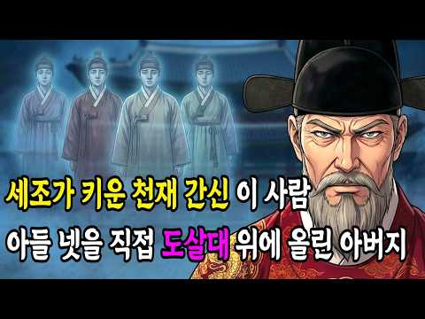
- 설명 앞부분: 조선 500년 역사상 가장 끔찍한 비극의 주인공, 혹은 가장 잔인한 아버지라 불리는 남자 '임사홍'. 첫째는 31세에 요절, 둘째는 32세에 능지처사, 셋째는 기록 말살, 넷째는 30세에 맞아 죽기까지... 자식 네 명을 모두 비극적인 죽음으로 몰고 간 아버지가 있습니다. 놀랍게도 그의 직업은 지금의 국방부 장관인 '병조판서'였습니다. 군사권까지 쥔 권력자가 왜 자기 자식들을 살리지 않고 방관했을까요? 심지어 둘째 아들이 처형당하던 날, 집에서 풍악을 울리며 연회를 즐겼다는 소름 돋는 기록까지 존재합니다. 27세에 최연소 승지에 …
- 같은 채널 평소 대비 ×221.5 (채널 최근 롱폼 중앙값 980회) · 평소 영상: 송시열을 모르면 조선 역사를 논하지마라, 왕 4명도 꺾지 못한 선비 ∣ 예송논쟁 ∣ 노론… (1,094회) / 단종의 눈물에 속았다? 조선을 구한 진짜 영웅 ∣ 조선시대 ∣ 한국사 ∣ 계유정난 (865회)
- 대본 없음 (설명) — 음성인식이 끝나면 도입부·흐름이 들어감
- 댓글 451/451: 좋은 점 — 영상 3 · 감사·응원 9 · 더 알고 싶은 것 1 · 아쉬운 점 — 영상 2 · 반박·불만 — 의견 다름 6 · 정치·사회 6 · 경험 공유 9 · 구독·다음 기대 1
  - 좋은 점 — 영상 👍4 “제가 유투브에서 본 영상 중 정말 정말 최고 중의 최고라고 생각했습니다 ~ 가장 이슈?되는 인물인데다... 그의 생애... 정말 많이 많이 배웠습니다. 감사합니다. 승승장구 하시기를 축복기원 드립니다 ~ 이런거 보면, 부처님께서 말씀하시는 업... 이라는게 진짜 있을…”
  - 좋은 점 — 영상 👍3 “부패하기 쉬운 인간의 본질에 대해 깊이 생각테 한 좋은 영상이네요”
  - 감사·응원 👍21 “저도 그 처지로부터 자유롭지 못한다에 100%입니다. 시간은 환경(인간)을 변화시키지 않을까요? 선택의 여지없는 기구한 안생사... 저에게도 많은 숙제를 남기는 영상이군요. 감사드립니다 ^^*”
  - 감사·응원 👍17 “역사를 알기쉽게 설명해 주셔서 감사합니다”
  - 더 알고 싶은 것 👍2 “와..이 영상 하나로 수창 뚫겠네..부럽습니다. 구독했어요. 혹시 노출클릭률 몇나오시나요?”
  - 아쉬운 점 — 영상 👍35 “임사홍이 언뜻 기억은 났는데 이런 내용은 몰랐네요. 이야기가 지루하지 않고 술술 귀에 흘러들어오네요.”
  - 아쉬운 점 — 영상 👍0 “첫 11분에 나가요. 별 정보가 없이 엿가락 늘이긴가요? 지루해요”
  - 반박·불만 — 의견 다름 👍12 “인성 양심 다버린 지혜없고 악한꾀만가득한 인간 ㆍ천재? 글쎄요”
  - 반박·불만 — 의견 다름 👍0 “흥청망청 역사는 이긴자의 기술 이것저것 가만해서 들어야지 사극은 드라마 시청률 때문에 극적은 대결구도와 선악이 분명해야 인기가 높지 복잡한 관계보다는 그래서 지금도 백성들은 쉽게 선동 당한다”
  - 정치·사회 👍2 “조선역사는 중종반정 인조반정후 권력을 잡은 서인 송시열의 후예 노론의 승자의 전리품같은 기록일뿐이다. 그들은 일본에 나라를 팔아먹은 세력이된다. 결국 그들도 자기와 자기세력의 이익과 안위를 위해 삶을 소비한 소인들일뿐임을 스스로 증명했음이다. 서인 노론에 패배한 훈구…”
  - 정치·사회 👍1 “수고하십니다.종교혁명가 입니다. 민주당 황 @ 회 역사 학자 you tube 께서 지금 선관위 의 부정부패 선거법 과 관련된 정치인들을 수사.조사 해서 재산몰수 해야 합니다. 박 근혜 대통 령 비서 .김종 * 이. 조선시대 에 임 사홍 아들의 스승 정치 를 종교적으로…”
  - 경험 공유 👍29 “자기권력 지키려고. 아들하나 버렸구나 어떻게 잡은 자리인데.. 내가 당해본 일이 아니면 함부로 말 할수 없다.”
  - 경험 공유 👍21 “저도 그 처지로부터 자유롭지 못한다에 100%입니다. 시간은 환경(인간)을 변화시키지 않을까요? 선택의 여지없는 기구한 안생사... 저에게도 많은 숙제를 남기는 영상이군요. 감사드립니다 ^^*”
  - 구독·다음 기대 👍2 “와..이 영상 하나로 수창 뚫겠네..부럽습니다. 구독했어요. 혹시 노출클릭률 몇나오시나요?”

### 202. 우리가 알고있던 역사는 가짜다! 태조왕건은 영웅이 아닌 역사상 최악의 배신자였다? ∣ 역사다큐 ∣ 한국사 ∣ 태조왕건 ∣ 고구려 ∣ 조선왕조실록 ∣ 후삼국

- https://www.youtube.com/watch?v=B5_SPRpG_oA · 역사틀 · 구독자 2,530 · 조회수 135,052 (×53.4, 하루 929.6) · 좋아요 2,131 (1.6%) · 30.7분 · 2026-06-05 · 주제 묶음 3. 조선 · 형식 정보·해설 (그 밖) · 폴더 `W_B5_SPRpG_oA` (웹 승인)
- 썸네일: 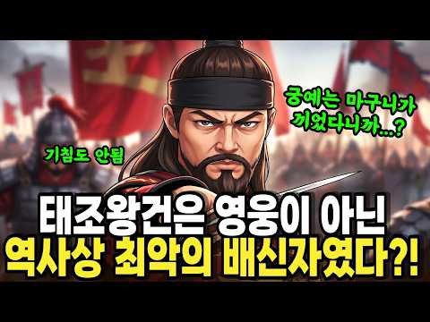
- 챕터: 0:00 애꾸눈 미치광이, 우리가 아는 궁예 · 1:30 궁예의 악행은 533년 뒤에 쓰였다 · 3:00 패자는 변명할 기회가 없다 — 강진의 비석 · 4:15 비석에 새겨진 두 글자 '대왕' · 6:00 거지가 아니라 버려진 신라 왕자였다 · 8:10 맨손으로 한반도 최강국을 세우다 · 10:20 미치광이는 나라를 세우지 못한다 · 11:40 관심법, 마음을 읽는다는 임금 · 13:30 왕건을 살린 최응의 붓 한 자루 · 16:00 부인과 두 아들을 죽인 진짜 이유 · 19:30 왕건을 가리킨 거울 속 예언 · 21:30 충신은 왜 끝까지 망설였나 · 22:50 보리 이삭 훔치다 맞아 죽은 임금? · 24:20 천 년의 침묵을 깬 돌, 선각대사비 · 26:10 학계가 두 쪽으로 갈라지다 — 대왕은 누구인가 · 28:30 그래서, 궁예는 누구였나
- 설명 앞부분: 천 년 동안 미치광이 폭군으로 기록된 궁예. 그런데 전남 강진의 한 비석에서 발견된 두 글자가 역사학계를 뒤집었습니다. 종이는 고쳐 써도 돌은 거짓말을 못 합니다. 우리가 교과서에서 배운 궁예와 왕건, 정말 전부 사실일까요? 승자의 붓끝에 가려진 진짜 얼굴을 지금 확인해 보세요. 본 영상의 제목, 썸네일, 대본, 영상 전체는 '역사틀' 채널의 자산으로 모든 형태의 2차 사용을 금지합니다. 📖 본 영상은 AI 기술을 활용해 제작되었으며, 역사적 사실을 바탕으로 한 정보 전달을 목적으로 합니다. 일부 해석과 비유는 이해를 돕기 위한 …
- 같은 채널 평소 대비 ×189.1 (채널 최근 롱폼 중앙값 714회) · 평소 영상: 교과서에도 없던 충격적 진실! 대부분이 몰랐던 단종 죽음의 진짜 진실!┃조선실록┃한국사┃… (854회) / 조선은 일본에게 똥까지 모두 뺏겼다 #역사이야기 #한국사 #역사다큐 #조선생활 #역사상식… (574회)
- 대본 없음 (설명) — 음성인식이 끝나면 도입부·흐름이 들어감
- 댓글 535/536: 좋은 점 — 영상 2 · 감사·응원 3 · 더 알고 싶은 것 2 · 아쉬운 점 — 영상 1 · 반박·불만 — 의견 다름 9 · 정치·사회 21 · 경험 공유 8 · 구독·다음 기대 1
  - 좋은 점 — 영상 👍1 “🌿🇰🇷🌿사마천 사기도 왜곡된 기록이 많습니다!👀 🔥2🌿?🔥 經典外는 액면 기록대로 믿는다는 건! 아니지요! 바른 사학자는 당시 정황도 분석해 봐야 합니다! 해설자 공론을 공감합니다! 🤔💦ㅡ칠순필부ㅡ”
  - 좋은 점 — 영상 👍0 “맞는 말씀입니다 처음은 형제의 맺어진것은 왕권으ㅏ 부친 왕륜개성 세력가이자 재산이 나라세우는데 기초로”
  - 감사·응원 👍2 “이런 영상이 바로 거짓역사인 것입니다. 역사는 승자의 것이라고요? 역사 수준이 초등학교 역사 수준 그 이상도 이하도 아니네요. 수많은 사람들의 눈과 귀는 그냥 밥먹는데만 썼는줄 아나보네요. 역사기록의 한계성과 그 너머의 것도 분명 있긴 하지만 그 한계성을 인정하고 공…”
  - 더 알고 싶은 것 👍10 “궁예의 몰락은 궁예 본인이 버림 받은 신라 왕자 출신 이라는 점이 크다고 봅니다. 패서 지역의 고구려 유민, 호족들 입장에서는 고구려를 계승한 새 나라의 왕이 버림 받은 신라 왕자 출신 이라는 것에 대한 거리감도 있었을 것 같습니다. 궁예가 수도를 송악에서 철원으로 …”
  - 더 알고 싶은 것 👍3 “역사를 보면 너무 옳은삶ㆍ강직한 사람들은 일찍 돌아가십니다ㆍ 현재나 과거나 기록은 산자들이 남기고 쓰여지기에~~ 타임머신이 있다면 그 시간속 이야기들을 바로 알고 싶네요ㆍ 드라마로 나올때 재미로만 보다가 점점ㆍ의아해지는 이야기들을 접하다보니ㆍ더욱 그렇습니다ㆍ”
  - 반박·불만 — 의견 다름 👍1 “역사를 100% 진실되게 알 순 없겠으나, 너무 지나친 비약이다. 물론 궁예가 예삿 인물이 아니었기에 초창기에는 후고구려를 건설했고 그만큼 사람들이 따랐을 것이다. 허나, 아무리 인물 출중하다고 하더라도 말기에는 타락했기에 주위사람들이 궁예를 떠났을 것이고, 왕건이라…”
  - 반박·불만 — 의견 다름 👍0 “삼국사기에 나오는 궁예가 세력을 일으킨 명주는 지금의 절강성에 있습니다. 강원도 강릉이라고 계속 학교에서는 가르치는데 근거 대보라고 역사학회에 질의하면 근거도 못대고 수십년째 그냥 그렇게 비정한다고 헛소리 하거나 아예 답이 없습니다. 그 당시 명주는 해상 실크로드의 …”
  - 정치·사회 👍20 “가장 배신자는 이조의 이성계 이성계는 고려때 귀화한 중국인이 최영 대장군 머함하고 한국의 역사사 정체성을 통째로 바꿨고 고려이전 문화 사회보다 퇴보시킨 왕조였다 종국에는 고종이 일본에다 돈받고 조선을 팔았다”
  - 정치·사회 👍3 “배신이 없이 나라가 세워지나?신라가 외세를 끌어들여 삼국을 통일하고 만주를 포함한 영토의 반을 당에 빼앗기고 다시는 만주를 회복하지 못했다.조선도 그렇고! 야비함이 지혜로움과 능력이 되고 배신이 강함과 생존력이 되는세상.작금의 세상은 뭐 다른가?”
  - 경험 공유 👍2 “왕건이 역적 쓰 ㄹ ㅐ기임. 이성계와 똑같이 역적 배신자들 특징이 지들이집권하면 지들에게 완전유리하게 역사조작하고 상대방은 어떻게든 온갓 조작된 모함으로뒤집어 씌워서 악마화함. 전세계 역사상 모든 베신자 역적들이 필수로 행하던 기본중에 기본인일을 바보같은 국민들이 드…”
  - 경험 공유 👍1 “역사는 승자의 붓으로 쓰여신건 맞지마 내가 아는 내용은 궁예가 처음에는 백성을 생각하는 훌륭한 왕이였다라는것 역사드라마 왕건에도 그러했고 누가 처음부터 나쁜왕을 따르겠나? 영상 내용은 그런 처음부터 나쁜 왕 뜻으로 사람들이 생각 했다는 뜻으로 만들었고 ... 사람이란…”
  - 구독·다음 기대 👍4 “구독합니다 잘 볼게요”

### 203. 🔥최고 시청률 12.9%🔥 찍어버린... 남궁민이 인생 캐릭터를 갱신한 ✨레전드 사극 드라마✨

- https://www.youtube.com/watch?v=g9youcD9-z0 · 무비프라자 · 구독자 24,700 · 조회수 820,766 (×33.2, 하루 8,996.1) · 좋아요 3,368 (0.4%) · 187분 · 2026-08-11 · 주제 묶음 3. 조선 · 형식 사극·드라마·영화 리뷰 · 폴더 `W_g9youcD9-z0` (웹 승인)
- 썸네일: 
- 설명 앞부분: 끝까지 시청해주셔서 감사합니다🙏 영상 제목은 왼쪽 상단에서 확인하실 수 있습니다
- 같은 채널 평소 대비 ×1.7 (채널 최근 롱폼 중앙값 471,192회) · 평소 영상: "니가 왕의 딸이라고?" 조선의 공주가 평민이라고? 소녀시대 🔥유리🔥 주연의 숨겨진 명작… (490,825회) / 조선판 🔥영혼 체인지🔥의녀와 대군이 서로 영혼이 바뀌면 벌어지는 일 [결말까지몰아보기] (451,559회)
- 대본 없음 (설명) — 음성인식이 끝나면 도입부·흐름이 들어감
- 댓글 180/222: 좋은 점 — 영상 1 · 감사·응원 7 · 더 알고 싶은 것 0 · 아쉬운 점 — 영상 2 · 반박·불만 — 의견 다름 3 · 정치·사회 8 · 경험 공유 4 · 구독·다음 기대 3
  - 좋은 점 — 영상 👍0 “마음을 나의몸안에모으며 지관이나 중관을하며 원두커피가는거 왼쪽으로돌리면 머리코의 병이낫습니다 사띠지관이하단전주 무심 무아입니다 고집멸도괴로움을 하단전에마음을모으니멸해지고도가닦이더라 에코볼트 크레오에스지주식매수하십시요 미국 brk.a 처럼 억대주가가될수있습니다 중관이 …”
  - 감사·응원 👍10 “최고의 편집으로 맘껏 웃고 맘껏 울었네요~~ 넘넘 감사드려요 ~~~”
  - 감사·응원 👍9 “마지막 편 작가님 게 감사 드립니다”
  - 아쉬운 점 — 영상 👍0 “용두사미인 드라마... 뒤에 끝맺음만 잘했어도 대박이였을텐데 아쉬움..”
  - 반박·불만 — 의견 다름 👍12 “길채는 막 절세 미인은 아닌데 매력이 잇슴..안은진 배우가 매력이 잇슴 ㅋㅋ”
  - 반박·불만 — 의견 다름 👍0 “1600년에 망해 없어졌어야 할 조선 왕조가 뭐 잘 한 것도 없고 유능한 것도 똑똑한 것도 아닌데도 질기게도 살아남아서 저 꼬라지를 겪고, 결국 1900년 까지 가서는 결국 총 한방도 못 쏘고 왕이 나라를 팔아먹고 끝났지. 에휴 조선..... 에휴 조선 진짜....”
  - 정치·사회 👍31 “나라가 이렇게 힘이 없으니, 몇 번을 처 먹혀도 정신 못차리는 왕과 신하를 찢어 죽이고 싶은 역사. 지금의 대한민국은 진짜 기적이다.”
  - 정치·사회 👍0 “검세종물받이하가가 딸이 검세부인이 되면 대한민국 대통령 부인도 될수있다 막장은 빵에 가겠지만 ㅋㅋㅋㅋㅋㅋㅋㅋㅋㅋㅋ”
  - 경험 공유 👍44 “내가최근본드라마중탑임.”
  - 경험 공유 👍1 “어제부터 재밌게 보고 있었는데 영상이 갑자기 기록에서도 사라지고 없어져서 당황했었어요.. ㅠㅠ 다시 볼 수 있어서 너무 행복하고 감사한 마음에 댓글 남깁니다. 훌륭한 내용 요약과 나레이션 덕분에 너무 잘 보고있습니다🙏 정말 감사합니다!”
  - 구독·다음 기대 👍48 “진심 지금 정주행만 5번 넘게했는데 계속 봐도 질리지가 않고 볼때마다 눈물나옴😢”
  - 구독·다음 기대 👍1 “아… 놔… 잘못 눌러서 꼬박 3시간을 정주행해 버렸네… 미치겠네…드라마 넘 잼나네..”

### 204. 정조가 홍국영을 버린 충격적인 이유

- https://www.youtube.com/watch?v=x-wWAo2juoU · 재역이(재미있는역사이야기) · 구독자 6,290 · 조회수 328,349 (×52.2, 하루 2,291.0) · 좋아요 4,122 (1.3%) · 34.9분 · 2026-06-20 · 주제 묶음 기타 · 형식 정보·해설 (그 밖) · 폴더 `W_x-wWAo2juoU` (웹 승인)
- 썸네일: 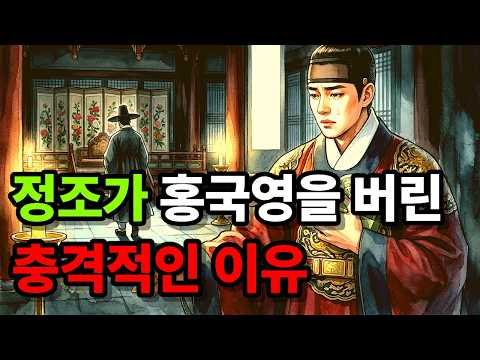
- 설명 앞부분: 조선 22대 임금 정조에게는 목숨을 빚진 단 한 명의 절친이 있었습니다. 죄인의 아들이라는 굴레 속에서 매일 밤 자객의 위협에 시달리던 세손 시절, 모두가 등을 돌릴 때 홀로 칼을 들고 곁을 지킨 남자, 바로 홍국영입니다. 정조는 그를 "나의 오른쪽 날개"라 부르며 무한한 신뢰를 보냈습니다. 즉위 후 도승지와 군권까지 한 손에 쥐여주며, 한 신하에게 조선 역사상 전무후무한 권력을 안겨주었죠. 그러나 그 권력은 홍국영을 변하게 만들었습니다. 열세 살 여동생을 후궁(원빈)으로 들이고, 죽은 누이에게 양자를 들여 왕통까지 넘보던 순간,…
- 같은 채널 평소 대비 ×25.4 (채널 최근 롱폼 중앙값 12,927회) · 평소 영상: 허균이 죄목도 없이 능지처첨을 당한 진짜 이유 ∣ 허균 ∣ 허난설헌 (12,927회) / 계유정난의 진범은 한명회가 아니었다? ∣ 계유정난 ∣ 수양대군 ∣ 세종 ∣ 한명회 ∣ 단종 (17,303회)
- 대본 없음 (설명) — 음성인식이 끝나면 도입부·흐름이 들어감
- 댓글 248/259: 좋은 점 — 영상 2 · 감사·응원 6 · 더 알고 싶은 것 0 · 아쉬운 점 — 영상 3 · 반박·불만 — 의견 다름 3 · 정치·사회 2 · 경험 공유 3 · 구독·다음 기대 0
  - 좋은 점 — 영상 👍5 “재미있고 유익합니다”
  - 좋은 점 — 영상 👍1 “너무 좋은 내용인데, 구독과 좋아요.를 왜 첨부터 말하나요 좋은거면 나중에 알아서 하잖아요 에효ㅡㅡ”
  - 감사·응원 👍5 “역사의 뒷면을 자세히 알려주어 60 넘게 우리 역사의 깊은 이해를 하게 되네요 왕들의 삶이 안타깝고 서글픈 느낌으로 와 닿네요 감사합니다”
  - 감사·응원 👍3 “감사합니다 ~”
  - 아쉬운 점 — 영상 👍3 “설명이 난삽 하다 같은말이 겹치고 지루해.”
  - 아쉬운 점 — 영상 👍0 “증간 광고가 너므 많아서 맥이 뚝뚝. 좋은 컨텐츠인데 구독취소가 고민되어요 ㅠㅠㅠ”
  - 반박·불만 — 의견 다름 👍39 “홍국영과. 정조 말만들어도. 가슴아립니다 홍국영이 제 분수대로만. 처신햇어도 아름다운 인연이엇을텐데. 거두절미하고. 토사구팽은 아닙니다. 안타깝지만. 홍국영의 실책이 오만방자 모든게 자충수였어요. 안타깝죠 정조가얼마나 신임햇는지 믿음뒤에서의 실책에 얼마나마음아팟을지.…”
  - 반박·불만 — 의견 다름 👍2 “홍국영의 발음은 홍궁영 이 아닙니다! 정확한 발음은 "홍구경" 입니다! 홍구경 이란 발음과 홍궁영 이란 발음이 왔다갔다 하고 있읍니다! 그런점을 감안하면 AI가 발음 하는것도 아닌 것이니 이런 정황에 근거해 볼때 컨텐 츠 제작자 의 국어실력 이 수준급이 아님을 알려주…”
  - 정치·사회 👍1 “이재명 너 조심해임마. 비참한 최후를 보고싶지 않다. 적당히만 해라”
  - 경험 공유 👍6 “세계사적으로보면 15세기부터 대항해시대가 시작되어 서양문물의 힘에 편승한 임진왜란의 참화를 겪었고, 허균과 같은 혁명가, 실학자들도 있었고, 서양문물이 들어오던 시절이고 계몽주의에 따른 몽테스큐의 법의정신, 루소 등의 영향이라 할 미독립 및 프랑스혁명기에 왕으로 재직…”
  - 경험 공유 👍1 “가장높은곳에 있는순간 가장 험한곳에 있다란 마지막 말이 최고의 명언 !!! 저도 잘 새기며 평생 잠언으로 간직하며 살겠읍니다 감사 감사 합니다!!! 요즘 잼통님의 미국 살해 위험과 부하들의 반역이 없도록 기도해주세요 아멘!!”

### 205. 누만티아 공성전 (기원전 134–133년) — 난공불락의 요새: 로마군 6만 대 수비대 4천

- https://www.youtube.com/watch?v=lUI6y2G873w · 박지훈 — 역사 · 구독자 1,910 · 조회수 65,624 (×34.4, 하루 685.5) · 좋아요 688 (1.1%) · 61.9분 · 2026-07-19 · 주제 묶음 5. 세계사·서양사 · 형식 정보·해설 (그 밖) · 폴더 `W_lUI6y2G873w` (웹 승인)
- 썸네일: 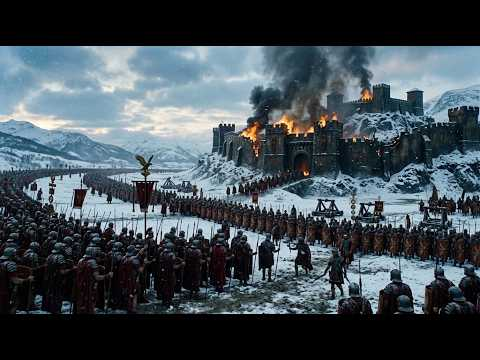
- 설명 앞부분: 4,000명의 전사가 60,000명의 로마 군단을 20년 동안 막아낸 비결은 무엇일까요? 이 다큐멘터리는 세계 역사 속에서 가장 잔혹했던 포위전의 진실을 파헤칩니다. 역사적 전투의 패러다임을 바꾼 누만시아 전쟁을 분석합니다. 스키피오 에밀리아누스는 칼 대신 삽을 들고 나타났습니다. 그는 군대 내부의 부패를 척결하기 위해 은식기와 매춘부, 점술가들을 쫓아내고 병사들에게 토목 공사를 강요했습니다. 강물에 설치된 칼날 달린 사슬, 9km에 달하는 거대한 이중 성벽, 그리고 지원군을 보내려던 청년 400명의 오른손을 잘라버린 냉혹한 결단…
- 같은 채널 평소 대비 ×76.4 (채널 최근 롱폼 중앙값 858회) · 평소 영상: 버르비차 협곡 전투 (811년) — 10만 비잔티움군에 맞선 불가리아군의 천재적 매복 (887회) / 카르발라 전투 (680년) — 3만 우마이야 군대에 맞선 72인의 용사 (830회)
- 대본 없음 (설명) — 음성인식이 끝나면 도입부·흐름이 들어감
- 댓글 24/24: 좋은 점 — 영상 2 · 감사·응원 3 · 더 알고 싶은 것 0 · 아쉬운 점 — 영상 1 · 반박·불만 — 의견 다름 0 · 정치·사회 2 · 경험 공유 0 · 구독·다음 기대 0
  - 좋은 점 — 영상 👍6 “생각할 것이 많은 좋은 영상 감사합니다. 이전에 자주보던 전쟁사와는 또다른 매력이 있네요. 담백하지만, 사실적으로..”
  - 좋은 점 — 영상 👍5 “좋은 영상입니다~ 꼭 영화를 보는것 같습니다.”
  - 감사·응원 👍6 “생각할 것이 많은 좋은 영상 감사합니다. 이전에 자주보던 전쟁사와는 또다른 매력이 있네요. 담백하지만, 사실적으로..”
  - 감사·응원 👍0 “감사합니다........”
  - 아쉬운 점 — 영상 👍8 “좀 지루하네. 30분이면 깔끔했을 것을.... 한 말 또하고, 또 하고, 또 하고....”

### 206. 15살에 66세 영조와 결혼한 정순왕후, 그날 밤 영조가 잠을 못 잤다 [조선왕조실록]

- https://www.youtube.com/watch?v=gwmPtcxsmYE · 조선왕조실록이야기 · 구독자 19,700 · 조회수 716,944 (×36.4, 하루 6,947.5) · 좋아요 14,710 (2.1%) · 49.2분 · 2026-07-30 · 주제 묶음 3. 조선 · 형식 정보·해설 (그 밖) · 폴더 `W_gwmPtcxsmYE` (웹 승인)
- 썸네일: 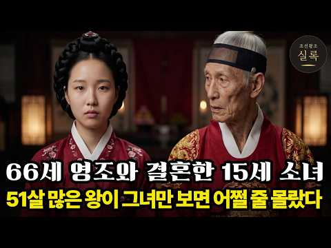
- 챕터: 0:00 1759년, 66세 영조와 15세 소녀의 51살 차이… · 1:55 왜 아무도 딸을 왕비 후보로 내놓지 않았는가 (영조의… · 4:22 왕비 간택의 현실적인 계산과 위험 요소들 · 5:17 금혼령 선포와 간택 단자를 올리는 과정의 뒷이야기 · 8:54 간택의 정식 절차: 초간택, 재간택, 삼간택과 면접 … · 11:45 삼간택에 오른 처녀들의 가혹한 운명 · 12:24 정순왕후의 지혜가 돋보인 전설적인 문답 (방석, 가장… · 17:08 정순왕후의 집안 배경: 경주 김씨 가문과 영조의 정치… · 21:05 15세 소녀가 감당해야 했던 국모라는 자리의 무게 · 23:53 영조가 명분과 실리를 모두 갖춘 집안을 선택한 이유 · 28:32 화려했던 혼례 행렬과 사치를 경계하던 영조의 변화 · 32:21 기록에는 없는 첫날밤 이야기와 정순왕후의 기개 · 35:31 15세 국모가 마주한 궁궐의 기묘한 가족 관계 (사도… · 36:53 300년 만에 부활시킨 친잠례: 조선의 역사를 뒤진 … · 41:42 자식이 없었던 왕비의 쓸쓸함과 임오화변(사도세자의 죽… · 44:25 영조의 죽음과 홀로 남겨진 32세 정순왕후의 삶 · 45:20 정조 즉위와 친정 가문의 몰락, 그리고 정조와의 관계 · 47:45 사후에야 영조 곁에 묻히게 된 정순왕후의 마지막 이야기
- 설명 앞부분: 열다섯 살 소녀가 예순여섯 살의 조선 왕 영조와 혼인했습니다. 쉰한 살의 나이 차이. 조선 역사상 가장 큰 나이 차이의 국혼이었습니다. 그런데 이상한 일이 있습니다. 왕비 자리는 온 나라가 탐낼 자리인데, 딸을 내겠다고 나선 집이 서른 집도 되지 않았습니다. 명문가들은 딸의 나이를 속이고, 아프다고 둘러대고, 아예 종이를 내지 않았습니다. 왜 모두가 도망친 자리에 벼슬 하나 없는 집안의 딸이 홀로 걸어 들어왔을까요? 금혼령 대상은 열여섯에서 스무 살이었는데 뽑힌 아이는 열다섯이었습니다. 규정에 들지도 않는 아이가 어떻게 왕비가 되…
- 같은 채널 평소 대비 ×98.4 (채널 최근 롱폼 중앙값 7,283회) · 평소 영상: 조선 500년 유일한 왕비, 시아버지가 친정을 몰살했는데 쫓겨나지 않은 진짜 이유 ∣ 세… (7,283회) / 조선 500년에 딱 한 번, 임금 인조가 며느리에게 벌인 일 [소현세자빈 강씨·조선왕조실… (7,250회)
- 대본 없음 (설명) — 음성인식이 끝나면 도입부·흐름이 들어감
- 댓글 3,815/3,853: 좋은 점 — 영상 120 · 감사·응원 304 · 더 알고 싶은 것 31 · 아쉬운 점 — 영상 29 · 반박·불만 — 의견 다름 9 · 정치·사회 11 · 경험 공유 20 · 구독·다음 기대 16
  - 좋은 점 — 영상 👍21 “너무재미있게 새벽이지나갔어요.좋은영상 감사합니다. 15살 소녀야 고생많았어”
  - 좋은 점 — 영상 👍21 “역사를 이렇게 쉽게 설명해주시니 재미있게 들었습니다 수고 하셨어요 ❤”
  - 감사·응원 👍43 “역사를 알수있게 해주셔서 감사합니다 고생 하셨 습니다 좋은날 되세요”
  - 감사·응원 👍40 “대단하신 일을 하셨습니다. 시간을 거슬러 한획을 긋는 새로운 역사의 시간을 익혔습니다. 감사합니다. 귀하게 시청했습니다.”
  - 더 알고 싶은 것 👍2 “혼자만의 시간이 얼마나 고독하고 무서웠을까요? 고작 15살인데 안타갑네요~~”
  - 더 알고 싶은 것 👍2 “오늘 역사공부 잘 했습니다🎉 앞으로도 잘 부탁드려요^^”
  - 아쉬운 점 — 영상 👍239 “그 시대에 없던집안의 딸로 태어나서 집안을 위해 희생된 여인. 얼마나 남몰래 울었을지..감히 상상도 못하겠네요. 영조가 정조에게 빨리 넘기고 혼례를 안했다면 더 좋았을지도... 기록이 조금만 더 자세히 남아있었더라면 하는 아쉬움이 늘 남네요! 더운데 고생하셨습니다!!”
  - 아쉬운 점 — 영상 👍9 “정순왕후가 간택된 이유를 알았습니다. 그런데 자식이 없어 아쉽네요.”
  - 반박·불만 — 의견 다름 👍10 “영조의나라에 행운의 여인 그녀에겐... 글쎄요 얼마나 무섭고 외로웠을까 ;;”
  - 반박·불만 — 의견 다름 👍3 “오늘날의 시각으로 보면 이해가 안 되지만 조선의 왕비는 처녀만 가능했으므로 어쩔 수 없었습니다. 당시 양반가 규수 결혼 적령기를 생각하면 어린것이 아니죠. 참고로 선조의 계비 인목왕후가 임진 왜란으로 혼인이 늦어져 간택 당시 19세었는데 상당히 드문 케이스었죠”
  - 정치·사회 👍85 “불행했다 !, 앞으로도 그런혼례는 없어져야 한다 !, 영조가 죽은후, 나중에 정순왕후, 경주김씨가 세도를 잡고, 반대편 정치편을 모조리 죽이고, 결국,또 정치사화가 일어나고,많은 사람이 죽고, 나라가 피폐해지고, 못다누린 권력을, 쥐고 흔들고, 정조대까지 당파싸움에 …”
  - 정치·사회 👍21 “그렇니 나라가 풍비 박산되어 나라가 망조 들어 백성이 고생들했지~”
  - 경험 공유 👍70 “쇼츠만 보던 내가 이 긴 영상을 다 봤다.”
  - 경험 공유 👍8 “역사를 전공한 저도 몰랐던 얘기가 참 많네요. 아주 훌륭한 내용 잘 들었습니다. 구독, 좋아요.”
  - 구독·다음 기대 👍3 “15세에 간택되어 왕비가 되었으니 행운입니다. 더우기 3명 중에서 뽑히지 않았으면 어차피 결혼도 하지 못 하고 평생을 고독하게 살았어야 했으니 왕비가 살게 됨이 어찌 행운이라고 말하지 않을 수가 있으리요. 설명하시는 말투도 참 좋으시고요 목소리 또한 또박 또박 발음도…”
  - 구독·다음 기대 👍2 “고생하셨습니다. 잘 보고 구독합니다. 감사합니다.”

### 207. 역모로 쫓긴 대감집 아씨를 가마니에 숨겨온 심마니, 조선 거상이 되다∣ 야담.수면 오디오북.조선야담.조선한국사.조선로맨스.조선사업이야기

- https://www.youtube.com/watch?v=wl-pu2vCAY4 · 설주야담 · 구독자 32,500 · 조회수 710,269 (×21.9, 하루 11,450.4) · 좋아요 7,400 (1.0%) · 53.4분 · 2026-08-27 · 주제 묶음 10. 수면·낭독 · 형식 수면·낭독 (잠잘 때 듣는) · 폴더 `W_wl-pu2vCAY4` (웹 승인)
- 썸네일: 
- 설명 앞부분: ❤️설주야담에 오신 것을 환영합니다. 조선시대를 배경으로 한 야담, 민담, 설화와 흥미로운 옛이야기를 들려드립니다. 버려지고 쫓겨난 이들이 뜻밖의 인연을 만나 서로를 구하고, 작은 은혜가 사랑과 가족으로 이어지는 이야기. 가난과 신분의 벽을 넘어 운명을 바꾸는 사람들의 이야기를 담고 있습니다. 눈보라 속에 버려진 과부를 구한 나무꾼, 갈 곳 없는 처녀에게 손을 내민 가난한 총각, 아무도 예상하지 못했던 숨겨진 사연과 반전까지. 때로는 가슴 뭉클한 사랑과 효심, 때로는 속 시원한 권선징악과 인생 역전, 그리고 마지막에는 사람의 따뜻…
- 같은 채널 평소 대비 ×19.3 (채널 최근 롱폼 중앙값 36,889회) · 평소 영상: "죽은 사람 건드리지 마라" 그녀를 집으로 업고간 짚신장수,조선의 거상이되다. ∣ 야담,… (36,889회) / "그 여종 건드리지 마시오!"눈더미 속에 버려진 노비를 주워왔더니, 가문을 일으킨 '금빛… (37,718회)
- 대본 없음 (설명) — 음성인식이 끝나면 도입부·흐름이 들어감
- 댓글 174/180: 좋은 점 — 영상 4 · 감사·응원 18 · 더 알고 싶은 것 3 · 아쉬운 점 — 영상 1 · 반박·불만 — 의견 다름 0 · 정치·사회 0 · 경험 공유 3 · 구독·다음 기대 2
  - 좋은 점 — 영상 👍5 “좋은 이야기 잘 보았습니다, 아쉬운 건 아들 딸 소식이 없어 아쉽네요,”
  - 좋은 점 — 영상 👍5 “좋은이야기였읍니다”
  - 감사·응원 👍8 “귀하고 소중하신 영상 대단히 감사드립니다 서울입니다😅”
  - 감사·응원 👍7 “참 아름다운 애기네요 무진과 서린 잘만 난것갇으며 어머니도 인품 이좋으시네요 큰보물을서로 얻으셧네요 잘보앗 습니다 감사합니다”
  - 더 알고 싶은 것 👍7 “잘들었습니다~ 자주 올려주세요~”
  - 더 알고 싶은 것 👍4 “영상이 정말 재미있고 정성이 느껴집니다! 이렇게 좋은 콘텐츠를 만들어 주셔서 감사합니다. 앞으로도 좋은 영상 많이 만들어 주세요. 채널의 더 큰 발전을 응원합니다! 👏❤”
  - 아쉬운 점 — 영상 👍5 “좋은 이야기 잘 보았습니다, 아쉬운 건 아들 딸 소식이 없어 아쉽네요,”
  - 경험 공유 👍4 “나도 내일부터 약초캐러가야긋다. 잘하면 장가갈수도..”
  - 경험 공유 👍3 “나도 시골에 내려가 산속에서 나무하고 약초캐며 살아볼까 ? 서린이 같은 낭자를 만나게 될지”
  - 구독·다음 기대 👍4 “미국 텍사스주 휴스턴에서 잘 들었습니다. 깔끔한 내용전개가 좋아서 구독 및 알림설정 했습니다.”
  - 구독·다음 기대 👍4 “최근 방문한 같은 야담러중 최고십니다 ㅋ 구독하고 갈게요”

### 208. 조선시대 사람들이 30살에 이가 다 빠져버린 소름돋는 이유는? ∣ 조선역사 ∣ 한국사 ∣ 조선왕조실록 ∣

- https://www.youtube.com/watch?v=5vBTGmcYA5w · 시대를 훔친 이야기 · 구독자 3,380 · 조회수 186,275 (×55.1, 하루 1,185.0) · 좋아요 2,474 (1.3%) · 18.4분 · 2026-06-06 · 주제 묶음 3. 조선 · 형식 정보·해설 (그 밖) · 폴더 `W_5vBTGmcYA5w` (웹 승인)
- 썸네일: 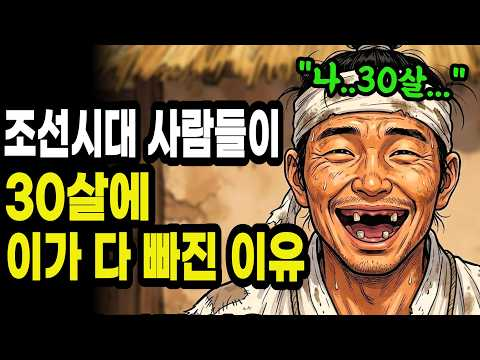
- 챕터: 0:00 👑 영조의 한숨 "양치할 때마다 한숨이 나온다" · 1:00 ⚰️ 조선 충치율 단 1~5%의 충격 · 1:36 🌿 '양치질' 어원과 버드나무 가지의 비밀 · 3:40 🎎 신분별 양치 도구 (왕실·양반·평민·빈민) · 5:46 🍚 진짜 범인은 '매일 먹던 밥'이었다 · 7:21 💎 에나멜질도 못 이긴 모래의 위력 · 8:09 🔥 풍치(風齒)의 정체, 현대의 치주염 · 9:19 👑 임금 영조는 왜 같은 시기에 무너졌을까 · 10:42 📖 동의보감 속 충격의 치통 처방 · 12:00 🔨 대장간 집게로 이를 뽑던 조선의 치과 · 13:18 🤔 21세기 우리는 정말 이기고 있을까? · 15:15 🍰 우리의 적은 '너무 부드러운 음식' · 16:21 🧠 조선은 몰라서 졌고, 우리는 알면서도 진다 · 17:11 🪞 오늘 밤 거울 앞에서 30초만…
- 설명 앞부분: 🦷 조선시대 사람들은 왜 서른만 넘으면 이가 다 빠졌을까요? 조선에서 가장 오래 산 왕, 영조. 여든셋까지 살았던 그가 서른일곱에 이미 잇몸이 무너지고 있었습니다. 😱 어의가 매일 진맥하고, 치아 전담 여의까지 있었던 임금. 말린 벚꽃잎과 소금으로 만든 왕실 전용 양치 가루까지 썼던 그 사람의 입 속이, 왜 그렇게 빨리 무너졌을까요? 🔍 이 영상에서 다루는 이야기 ✅ 조선시대 충치율이 단 1~5%였던 충격적인 진실 ✅ 충치도 없는데 이가 다 빠진 진짜 이유 ✅ '양치질'이라는 단어의 어원, 버드나무 가지의 비밀 🌿 ✅ 왕실 · 양…
- 같은 채널 평소 대비 ×314.1 (채널 최근 롱폼 중앙값 593회) · 평소 영상: 왜? 추석의 송편을 먹는 걸까? 송편의 충격진실ㅣ송편유래ㅣ추석역사 (593회) / 조선왕조실록에 "이것"까지 낱낱히 적었다? 왕들이 끝까지 감추고 싶었던 비밀 TOP3 (595회)
- 대본 없음 (설명) — 음성인식이 끝나면 도입부·흐름이 들어감
- 댓글 522/522: 좋은 점 — 영상 2 · 감사·응원 5 · 더 알고 싶은 것 3 · 아쉬운 점 — 영상 4 · 반박·불만 — 의견 다름 12 · 정치·사회 1 · 경험 공유 25 · 구독·다음 기대 0
  - 좋은 점 — 영상 👍2 “지인이 알려준 꿀팁 아침에 일어나서 수돗물 말고 정수물 한컵에 아무기름(식용유.들.참기름.올리브)이나 한두방울 떨어뜨려 젖가락으로 저은다음 가글해 보세요 저도 실천하고 입냄새 잇몸튼튼 놀라운 효과 보고 있어요 돈드는것도 아니고 조금만 부지런하면 잇몸염증 충치균에 좋아…”
  - 감사·응원 👍19 “이 시대에 대한민국에 태어난거에 감사하다”
  - 감사·응원 👍2 “의미있는 흥미로운 정보 감사히 잘 봤습니다. ^^”
  - 더 알고 싶은 것 👍4 “46세.. 살아온 동안 양치 4일에 한번만 해온 저로서 1년전 치아 2개 소실, 잇몸 말랑말랑하다 못해 어금니가 뒤틀렸다 바로 돌아올 정도로 안좋아 치과가니 노인보다 안좋아하며 모든 치아가 흔들린다 벼랑 끝이이시다.라고 하여 먹고나면 꼭 음파칫솔 쓰고 했더니 아주 건…”
  - 더 알고 싶은 것 👍2 “돌가루 때문에 잇몸병이 생겼다는건 납득이 안갑니다. 저도 어렸을때 벼를 절구에 갈아 먹고는 했는데 모래를 씹어 이가 상했던 기억은 없어요. 조리로 잘 행구면 가끔 돌이 들어가는 경우는 있어도 모래가 항시 씹는 느낌은 없었습니다. 근본적인 것은 영양 부족으로 치아 자체…”
  - 아쉬운 점 — 영상 👍2 “너무 영상을 길게 만들어서 참고 끝까지 보기가 힘듭니다. 이런 영상은 너무 길면 역효과 납니다.”
  - 아쉬운 점 — 영상 👍1 “광고가 넘 많다”
  - 반박·불만 — 의견 다름 👍8 “조선시대에 밥에 모래가 있다는것에 동의 안합니다. 쌀을 씻을때 조리로 돌을 걸러서 밥을 지었는데 말이 안됩니다.”
  - 반박·불만 — 의견 다름 👍4 “46세.. 살아온 동안 양치 4일에 한번만 해온 저로서 1년전 치아 2개 소실, 잇몸 말랑말랑하다 못해 어금니가 뒤틀렸다 바로 돌아올 정도로 안좋아 치과가니 노인보다 안좋아하며 모든 치아가 흔들린다 벼랑 끝이이시다.라고 하여 먹고나면 꼭 음파칫솔 쓰고 했더니 아주 건…”
  - 정치·사회 👍6 “쌀을 주식으로 하는 나라가 한두 개도 아니고 도정기술이 마찬기지로 안 좋았던 옛날에 모두들 서른 전후로 이가 다 빠지기 시작햇단 말임??”
  - 경험 공유 👍11 “내가 늘 말하길 사람답게 산 건 얼마 안 되었다고 혔지 내가 어렸을 때만 해도 밥 억다 돌을 씹을 때가 자주 있었지 여기선 조선이라는건 그 시대를 말하는 거지 전 세계가 다 그랬지”
  - 경험 공유 👍3 “저희 모친은 60이신데 치과에서 치료받은이가 단하나도 없어요 양치를 자기전에 한번만 하시고 소금물로 가글을 하십니다”

### 209. 조선을 비웃으려던 명나라 사신이 세 가지 난제를 던졌다… 말똥 치우던 10살 종놈이 첫 번째 답을 내놓는 순간, 사신의 웃음이 순식간에 사라졌다 ∣ 야담 ∣ 민…

- https://www.youtube.com/watch?v=06ORKfm5PHU · 달빛야담방 · 구독자 3,330 · 조회수 84,588 (×25.4, 하루 1,155.2) · 좋아요 1,291 (1.5%) · 94.3분 · 2026-08-29 · 주제 묶음 6. 동양사 (중국·일본·몽골) · 형식 수면·낭독 (잠잘 때 듣는) · 폴더 `W_06ORKfm5PHU` (웹 승인)
- 썸네일: 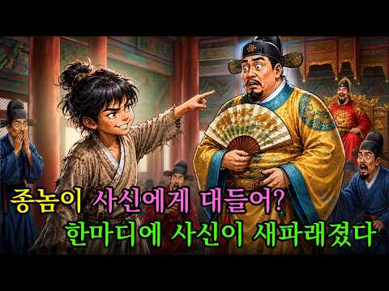
- 설명 앞부분: 조선을 비웃으려던 명나라 사신이 모두를 시험하려 세 가지 난제를 내놓았습니다. 대신들과 학자들조차 쉽게 입을 열지 못하던 그때, 말똥을 치우던 열 살 종놈이 앞으로 걸어 나왔습니다. 그리고 아이가 첫 번째 답을 말하는 순간, 사신의 얼굴에서 여유로운 웃음이 순식간에 사라졌습니다. 조선 어느 때, 명나라에서 온 사신이 자신의 지식과 지위를 믿고 조선의 사람들을 얕보며 세 가지 어려운 난제를 내놓았습니다. 궁궐의 대신들과 이름난 학자들까지 모였지만, 문제는 생각보다 훨씬 까다로웠고 누구도 선뜻 답을 내놓지 못했습니다. 사신은 그런 모…
- 같은 채널 평소 대비 ×12.1 (채널 최근 롱폼 중앙값 6,993회) · 평소 영상: “누가 너에게 이 병법을 가르쳤느냐?” 거지 아이에게서 용 모양의 점을 발견한 태사가 갑… (6,993회) / “이 장만 거꾸로예요!” 5살 아이가 문서 속 단 한 장을 가리키며 내뱉은 한마디… 20… (7,194회)
- 대본 없음 (설명) — 음성인식이 끝나면 도입부·흐름이 들어감
- 댓글 13/13: 좋은 점 — 영상 0 · 감사·응원 0 · 더 알고 싶은 것 0 · 아쉬운 점 — 영상 0 · 반박·불만 — 의견 다름 0 · 정치·사회 0 · 경험 공유 0 · 구독·다음 기대 0

### 210. 밥 한 끼에 3공기 먹고도 굶어 죽었다?" 사극이 철저히 숨긴 조선 백성들의 소름 돋는 진짜 밥상

- https://www.youtube.com/watch?v=AcrIqDy_Okc · 실록책방 · 구독자 2,230 · 조회수 87,216 (×39.1, 하루 767.1) · 좋아요 404 (0.5%) · 19.5분 · 2026-07-19 · 주제 묶음 3. 조선 · 형식 정보·해설 (그 밖) · 폴더 `W_AcrIqDy_Okc` (웹 승인)
- 썸네일: 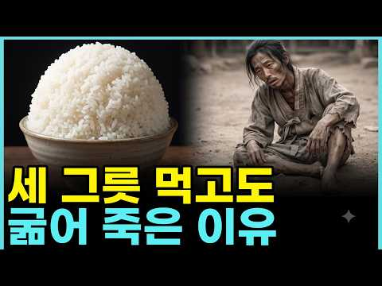
- 챕터: 0:00 많이 먹어도 배고팠던 이유 · 0:57 봄, 풀을 캐야 사는 계절 · 3:22 여름, 고기 앞의 높은 벽 · 7:10 가을, 장독대에 담긴 지혜 · 10:44 겨울, 그리고 뒤늦게 온 구원자 · 15:52 세 공기 반의 진짜 비밀 · 18:37 오늘 우리 밥상 앞에서
- 설명 앞부분: 조선 백성은 밥 한 끼에 세 공기 반씩 먹고도 늘 배가 고팠습니다. 봄엔 산에서 풀을 캐고, 여름엔 고기의 벽 앞에서 버티고, 겨울엔 흉년이 겹치면 흙까지 팠던 사람들. 그 한 해 밥상을 사계절 통째로 따라가 봅니다. 사극 속 주막의 고기 안주와 새빨간 김치는, 정작 조선 백성 대부분에겐 평생 몇 번 없던 풍경이었어요. 진짜 밥상은 잡곡과 풀, 그리고 계절마다 다른 생존의 지혜였습니다. 이 영상에서는: 봄 보릿고개에 왜 온 밥상이 초록빛이었는지 (봄나물의 진짜 정체) 소를 못 잡게 한 우금령, 그리고 고기 때문에 병든 임금 세종의…
- 같은 채널 평소 대비 ×244.0 (채널 최근 롱폼 중앙값 358회) · 평소 영상: "죄인이 아니었습니다" 조선 감옥엔 징역형이 없었는데 왜 아무도 살아 나오지 못한 충격적… (358회) / 정조의 화성 공사, 일꾼에게 돈을 주면 모든 문제가 풀렸을까 (357회)
- 대본 없음 (설명) — 음성인식이 끝나면 도입부·흐름이 들어감
- 댓글 100/101: 좋은 점 — 영상 4 · 감사·응원 2 · 더 알고 싶은 것 2 · 아쉬운 점 — 영상 2 · 반박·불만 — 의견 다름 5 · 정치·사회 1 · 경험 공유 2 · 구독·다음 기대 0
  - 좋은 점 — 영상 👍0 “해설이 듣기 편해서 완주했어요~ 감사합니다”
  - 좋은 점 — 영상 👍0 “해설이 듣기 편해서 완주했어요~ 감사합니다~”
  - 감사·응원 👍0 “해설이 듣기 편해서 완주했어요~ 감사합니다”
  - 감사·응원 👍0 “해설이 듣기 편해서 완주했어요~ 감사합니다~”
  - 더 알고 싶은 것 👍4 “이런 영상 만들기 전에 단 몇시간이라도 팩트 체크를 위한 공부나 자료 조사를 철저하게 하고 만들기를 부탁드립니다. 어느 책이나 영상에서 들은 엉터리 잘못된 정보를 올리는 건 조심해야 합니다.”
  - 더 알고 싶은 것 👍0 “근데 먹고 죽을 쌀이 항상 부족했는데, 어떻게 많은 양을 먹었을까요? 지금시대야 대체제가 많으니까 그렇다 쳐도, 조선시대에는 대체제가 감자 옥수수 고구마 등이 다 일것 같은데...”
  - 아쉬운 점 — 영상 👍4 “이런 영상 만들기 전에 단 몇시간이라도 팩트 체크를 위한 공부나 자료 조사를 철저하게 하고 만들기를 부탁드립니다. 어느 책이나 영상에서 들은 엉터리 잘못된 정보를 올리는 건 조심해야 합니다.”
  - 아쉬운 점 — 영상 👍0 “걍 사극에 나오는 백성모습 개구라지 조선시대백성=거지나 똑같은대 사람들이 흰색옷만 입은게 백의민족이 아니라 최소한의 멋부릴 여유조차 없어서 였구만 그만큼 조선시대가 답도없는시대인대 이상하게 저때를 중세시대마냥 미화질하는건지”
  - 반박·불만 — 의견 다름 👍87 “중요한걸 놓쳤습니다. 조선 평민들의 밥그릇을 가득 채운건 쌀밥이 아닙니다. 잡곡밥 혹은 잡곡죽이였습니다. 조선은 벼농사에 불리한 기후와 지형이였기에 벼농사는 선사시대부터 시도했지만 조선 후기까지도 보리, 기장, 조와 같은 잡곡이 식사에서 차지하는 비중이 높았습니다. …”
  - 경험 공유 👍12 “조선 경신대기근때 수백만이 굶어죽었지만 유일하게 아사를 면하고 그나마 살았던 사람들이 바닷가 해안가 섬에 살던 백성들이었음 농사가 망해 굶어도 물질로 해루질로 해초랑 미역 톳 돌김, 파래, 불가사리도 먹고, 성게 해삼 멍게 전복 문어 조개 소라 주서먹으며 생존함 이때…”

### 211. 하필이면 은둔하며 평범히 살려 했던 조선 NO.1 검객을 못 알아보고 건드려 버린...

- https://www.youtube.com/watch?v=GTC_IBKGQgc · 하필이면TV · 구독자 12,500 · 조회수 643,937 (×51.5, 하루 4,252.9) · 좋아요 1,964 (0.3%) · 30.1분 · 2026-06-12 · 주제 묶음 3. 조선 · 형식 사극·드라마·영화 리뷰 · 폴더 `W_GTC_IBKGQgc` (웹 승인)
- 썸네일: 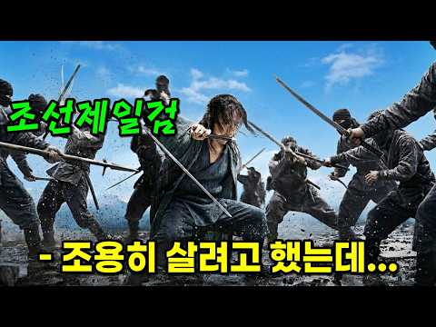
- 대본 없음 (없음) — 음성인식이 끝나면 도입부·흐름이 들어감
- 댓글 100/103: 좋은 점 — 영상 0 · 감사·응원 1 · 더 알고 싶은 것 2 · 아쉬운 점 — 영상 0 · 반박·불만 — 의견 다름 0 · 정치·사회 6 · 경험 공유 1 · 구독·다음 기대 0
  - 감사·응원 👍18 “연기의 신 장혁 ! 항상 믿고보는 장혁 연기 항상 응원 합니다.”
  - 더 알고 싶은 것 👍6 “조선제일검은 한동훈이라는데. . . . . . 맞나요?”
  - 더 알고 싶은 것 👍1 “어디서볼수있을까요?”
  - 정치·사회 👍2 “저때도 친명이니 친청이니 정치하는것들 백성은 안중에 없고 지들 밥그릇 싸움이나하고 전쟁을 억제 하기위해 힘은 키울생각 안허고 대가리 바짝 땅에대어 대국이라 받들어 모시니 조선이 결국 외세에 의해 멸망했지 지금도 정치는 저때나 똑같아 국민이 정신 차리지 않으면 이 나라…”
  - 정치·사회 👍0 “광해군 시대적 배경이라면 임진왜란 시절인데.. 이순신 장군님께 받들어~ 총!! 그리고 우리가 잊지말아야 할것은 명나라가 임진왜란때 7년간 4만3천명의 대군을 지원해줘서 일본과의 전쟁을 마무리 지었다.. 그 이후에 몇몇 군인들과 중국인들이 명나라로 돌아가지 않고 조선에…”
  - 경험 공유 👍6 “내가 검객이다 오늘도 스테이크 썰면서 칼질하고 있다”

### 212. 3일마다 버리는 신발을 왜 500년이나 신었을까? 알고 보니 이유가 있었습니다

- https://www.youtube.com/watch?v=Kp25Hlg6e0M · 역사트리 · 구독자 11,000 · 조회수 326,082 (×29.6, 하루 3,742.0) · 좋아요 5,035 (1.5%) · 20.9분 · 2026-07-28 · 주제 묶음 기타 · 형식 정보·해설 (그 밖) · 폴더 `W_Kp25Hlg6e0M` (웹 승인)
- 썸네일: 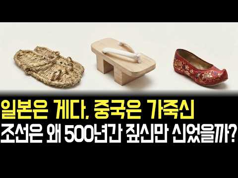
- 설명 앞부분: 일본은 게다, 중국은 가죽신… 그런데 조선만 500년간 짚신을 고집했다? 🤔 알고 보니 조선에는 한 켤레에 40만 원짜리 명품 신발도 있었습니다. 그런데 왜 우리 기억 속엔 짚신만 남았을까요? 일본 짚신의 원조가 사실 한반도였다는 충격적인 사실까지… 👣 이 영상을 끝까지 보시면, 다시는 짚신을 "가난한 신발"이라고 말 못 하실 겁니다. 이 포스팅은 쿠팡 파트너스 활동의 일환으로, 이에 따른 일정액의 수수료를 제공받습니다.
- 같은 채널 평소 대비 ×121.6 (채널 최근 롱폼 중앙값 2,682회) · 평소 영상: 배탈 나면 '이것'부터 마셨다 ∣ 조선시대 민간요법에 숨겨진 과학 (2,760회) / 형제 죽인 조선 왕 5명의 후손에게 벌어진 일, 태종, 세조, 영조까지 ∣ 조선역사 오디… (2,603회)
- 대본 없음 (설명) — 음성인식이 끝나면 도입부·흐름이 들어감
- 댓글 478/502: 좋은 점 — 영상 8 · 감사·응원 8 · 더 알고 싶은 것 5 · 아쉬운 점 — 영상 6 · 반박·불만 — 의견 다름 9 · 정치·사회 1 · 경험 공유 17 · 구독·다음 기대 0
  - 좋은 점 — 영상 👍5 “어릴때 새끼꼬는법을 배웠는데 아직도 생각나요 생각보다 쉬웠어요 유년기때 배웠는데 ...”
  - 좋은 점 — 영상 👍2 “2번입니다. 좋은 이야기 잘 듣었습니다. 감사드림니다.”
  - 감사·응원 👍87 “저 짚신신고 평시에는 가족의 생계를 위해 농사를 짓고 전시에는 민족과 나라를 지킨 백성들 조상님들께 감사합니다.”
  - 감사·응원 👍5 “감사합니다 새로운 지식이네요”
  - 더 알고 싶은 것 👍6 “북방을 지키는 군인들은 어떻게 했는지 궁금하네요. 짚신이면 전투에 지장이 있었을 텐데.”
  - 더 알고 싶은 것 👍5 “영상 초반부에 대략 사흘씩 썻다하고 후반부엔 1인당 년간 십여켤레 썻다하고 어떤게 맞을까요 ? 정보와 설명에 좀더 신경 써주길 바람니다.”
  - 아쉬운 점 — 영상 👍1 “말을 하도 빙빙 돌리는 데다가 광고가 엄청 끼어 있어 끝까지 못보고 그냥 갑니다. 수고.”
  - 아쉬운 점 — 영상 👍0 “영상 내용의 기본 설정부터 잘못된 정보입니다. 이런 AI영상이 오해와 오인을 불러 일으킵니다. 책임감 있는 검증된 정보와 영상을 만들기 바랍니다.”
  - 반박·불만 — 의견 다름 👍59 “짚신만 신은 것은 아닌데 .....”
  - 반박·불만 — 의견 다름 👍24 “AI화면을 좀 더 꼼꼼히 확인하셔요 짚신의 모양이 틀렸습니다”
  - 정치·사회 👍0 “영상 끝까지 다 봐도 ㅈㄴ구리네. 개 쓰레기같은 유교가 나라를 퇴보시켰다. 발전 못하고 허울만 쫒는 조선. 근데 한국은 지금도 마찬가지다. 발전 좀 했다고 유전자에 세겨진 근성이 올라옴. 허울만 쫒지. 도덕적으로 우월해 보이려고 되도 않는 소리 하는 것들이 대통령이나…”
  - 경험 공유 👍16 “지지리 가난해서 짚신을 신은 것은 그들이 알고 내가 알고 니가 아는데.. 아홉 개 단점을 두고 한 개의 장점을 두고.. 참~~나~~ 기적의 논리다.”
  - 경험 공유 👍3 “옛날에 양반이 잘 살았다? 못사는 양반이 더 많지 않았을까. 가난을 견디지 못해서 족보를 파는 양반도 있었다던데. 옛날에 양반은 잘 사는 사람이 아니라, 문.무반에 등용됐던 사람을 말하는데, 그마저도 몇 대 자손 중에 과거 급제를 못했을 경우에는 양반 소리도 못듣고,…”

### 213. 명나라 사신들이 기겁했다! 얼굴 하나로 대륙을 뒤흔든 조선 최고 미남 왕의 정체

- https://www.youtube.com/watch?v=RJMbPAxJLaE · 역사풀이 · 구독자 7,620 · 조회수 327,808 (×43.0, 하루 2,546.6) · 좋아요 5,662 (1.7%) · 27.7분 · 2026-07-04 · 주제 묶음 6. 동양사 (중국·일본·몽골) · 형식 정보·해설 (그 밖) · 폴더 `W_RJMbPAxJLaE` (웹 승인)
- 썸네일: 
- 설명 앞부분: 조선 역사상 가장 잘생긴 왕으로 기록된 인물이 있습니다. 그의 외모는 조선 안에서만 회자된 것이 아니었습니다. 명나라 사신들조차 그의 얼굴과 기품에 놀랐다고 전해지죠. 하지만 그는 단순히 잘생긴 왕이 아니었습니다. 그런데 왜 우리는 이 왕을 오래 기억하지 못했을까요? 왜 그의 이름보다, 그의 짧은 재위와 비극적인 가족사가 더 강하게 남아 있을까요? 이번 영상에서는 명나라까지 놀라게 했다는 조선 왕의 외모 기록, 그가 왕이 되기 전부터 보여준 능력, 그리고 너무 짧았던 재위 뒤에 남겨진 비극까지 함께 살펴봅니다. 조선 왕실의 빛나는…
- 같은 채널 평소 대비 ×455.9 (채널 최근 롱폼 중앙값 719회) · 평소 영상: 사도세자는 왜 뒤주에서 죽었나 ∣ 영조 부자 비극의 모든 것 (조선 왕실 최악의 사건) (719회) / 이 사람이 살았다면, 조선은 강대국이 되었을 것이다 ∣ 정약용도 인정한 역대급 천재 (706회)
- 대본 없음 (설명) — 음성인식이 끝나면 도입부·흐름이 들어감
- 댓글 594/639: 좋은 점 — 영상 2 · 감사·응원 7 · 더 알고 싶은 것 2 · 아쉬운 점 — 영상 7 · 반박·불만 — 의견 다름 7 · 정치·사회 3 · 경험 공유 7 · 구독·다음 기대 0
  - 좋은 점 — 영상 👍1 “와 영상 10개 올리신 거 모두 알차고 유익하네요. 이 영상이 대박나서 앞으로 다른 영상도 클릭 많이 할것 같아요. 좋댓구알 완료요~^^”
  - 좋은 점 — 영상 👍0 “문종정말훌륭임금님셨내요단종임금 님이 너무불쌍했지요감사드려요 앞으로도계속좋은 말씀전해주세요”
  - 감사·응원 👍13 “문종,,, 덕분에 슬픈 역사 한조각을 알았어요. 감사합니다 ♡.”
  - 감사·응원 👍4 “문종에재해서 알게되어서 감사합니다.”
  - 더 알고 싶은 것 👍194 “부인복도 없고 수명도 짧았으니....참으로 애통하네요 세종은 영특한 세자가 얼마나 기특하고 대견했을까요? 그런데 그 어린 아들은 비참한 죽임을 당했으니”
  - 더 알고 싶은 것 👍10 “이분이 오래 살고 단종이 왕이 됐으면 정조도 없었겠네. 그래도 궁금하다. 어떤 역사가 쓰였을지.”
  - 아쉬운 점 — 영상 👍10 “문종이네..명이 짧아서 아쉬웠든 왕.. 그가 오래살았다면 또 다른 역사가 시작되었을건데...”
  - 아쉬운 점 — 영상 👍6 “세자기간이 29년으로 너무 길었고 그중 8년은 세종대왕을 대신하여 대리 청정...그러나 세종대왕의 후광에 가려진 분..실제 재위기간은 2년 정도 그래도 단명은 아닌 분인데..”
  - 반박·불만 — 의견 다름 👍44 “문종대왕님이 훌융하십니다 세조는 아닙니다”
  - 반박·불만 — 의견 다름 👍2 “앵두나무가 어떻게 생겼는지 어떤모습의 열매인지 고증좀하세요 앵두나무모습 아닙니다 벚찐줄~~~~”
  - 정치·사회 👍22 “문종임금 이군요 이런분들이 오래 집권했다면 그만큼 나라가 많이 발전했을 텐데 문종임금님 안되었네요”
  - 정치·사회 👍0 “문종이 ㅣㅇ년만 더 살아계셨어도 나라가 달라졌을텐데”
  - 경험 공유 👍51 “이향 문종 임금님 정말 힘드셨지요 세종임금님 모시고 8년 대리청정 다방면으로 연구하시고 그때 수양을 죽여 놓으셔야 했었는데 발로 차고 싶습니다 저 세상서 편안하게 계시고 아는체도 마세요”
  - 경험 공유 👍8 “아니어도세종의맏아들(이향-문종)이궁금했었답니다.이영상이많이알려지길바랍니다.”

### 214. 사극은 거짓말이었다∣ 조선 백성이 진짜 씻던 방법 ∣ 조선 사람들이 1년에 두 번만 씻은 충격적 이유

- https://www.youtube.com/watch?v=hoE9aioaOxY · 한번은 알아야 할 역사 · 구독자 4,350 · 조회수 177,708 (×40.9, 하루 1,385.0) · 좋아요 1,363 (0.8%) · 23분 · 2026-06-17 · 주제 묶음 3. 조선 · 형식 정보·해설 (그 밖) · 폴더 `W_hoE9aioaOxY` (웹 승인)
- 썸네일: 
- 설명 앞부분: ❌ "조선 사람들은 게을러서 안 씻었다" – 사실이 아닙니다 우리가 당연하게 알고 있던 조선시대 위생 상식, 실은 완전히 잘못된 정보였습니다. 이 영상에서 팩트체크하는 것들 ❌ 통념: "조선 사람들은 더러워서 안 씻었다" 사실: 물·나무·비누가 없어서 못 씻었다 ❌ 통념: "100년 전 산은 지금보다 울창했다" 사실: 산 4개 중 1개가 민둥산이었다 ❌ 통념: "그냥 냇가에서 씻으면 됐잖아" 사실: 전신욕은 1년에 2번, 연례행사 수준이었다 ⚠️ AI 활용 고지 본 영상은 AI 도구 (자료 정리, 이미지 생성, 음성 합성 등)를 …
- 대본 없음 (설명) — 음성인식이 끝나면 도입부·흐름이 들어감
- 댓글 228/228: 좋은 점 — 영상 1 · 감사·응원 1 · 더 알고 싶은 것 1 · 아쉬운 점 — 영상 0 · 반박·불만 — 의견 다름 7 · 정치·사회 16 · 경험 공유 12 · 구독·다음 기대 1
  - 좋은 점 — 영상 👍1 “역사 속 생활상을 이렇게 흥미롭고 자세하게 풀어주시다니 정말 유익해요! 다음 영상도 기대할게요 👏”
  - 감사·응원 👍2 “조선 500년을 멸해준 일본에 감사해야 옳다. 이게 맞다.”
  - 반박·불만 — 의견 다름 👍6 “조선 시대에도 세수, 양치, 발 씻기, 뒷물 등 매일 하는 위생 관리는 철저했습니다. 전신 목욕이 드물었던 건 물과 땔감을 구하기 힘든 전근대 농경 사회의 보편적인 기술 한계였지 조선인들만 유독 더러워서가 아닙니다. 당시 런던이나 파리 등 서구 대도시들도 하수도가 없…”
  - 반박·불만 — 의견 다름 👍4 “그냥 멀 생활을 모르는 사람이 헛소리 하는. 토착노비들이 좋아라할 조선문화 비하”
  - 정치·사회 👍12 “실제적으로 생활환경이 개선되기 시작한 것은 박정희대통령 새마을운동 시작부터입니다. 이는 정치적 성향을 떠나 그가 이룬 위대한 업적입니다 그가 새마을 운동을 시작하므로써 인지재구성이 이루어졌고 산업화와 맞물려 선순환을 이뤄서 지금이 있게 된것입니다”
  - 정치·사회 👍4 “이런 민둥산을 박정희대통령님 살리셨지”
  - 경험 공유 👍11 “난 60년대 사람이고, 충남에서 살았다. 우리집 부엌은 가마솓이 세개 걸려있었는데 하나는 밥솥, 다른 하나는 국솥, 나머지 하나는 물솥이었다. 어머니는 가장 먼저 물을 끓이고, 다음에 국을 끓이고 마지막으로 밥을 지었다. 그 밥솥의 누릉지는 최고의 맛이었다. 그리고 …”
  - 경험 공유 👍5 “나 빠른89년생인데 내가 초딩 4학년때인 98년 99년 imf때만해도 때가 꼬질꼬질한애들 바글바글햇음 머릿니도 많았고”
  - 구독·다음 기대 👍1 “역사 속 생활상을 이렇게 흥미롭고 자세하게 풀어주시다니 정말 유익해요! 다음 영상도 기대할게요 👏”

### 215. 왜 'KOREA'가 되었을까? 동북공정이 무너지는 역사적 사실 ∣ 역사다큐 ∣ 동북공정 ∣ 중국 ∣ 고려 ∣ 왕건

- https://www.youtube.com/watch?v=QwkJdNsHHFg · 역사의작은그림자 · 구독자 13,000 · 조회수 591,830 (×45.5, 하루 4,095.3) · 좋아요 10,658 (1.8%) · 23.5분 · 2026-06-19 · 주제 묶음 1. 역사 일반·이야기 · 형식 정보·해설 (그 밖) · 폴더 `W_QwkJdNsHHFg` (웹 승인)
- 썸네일: 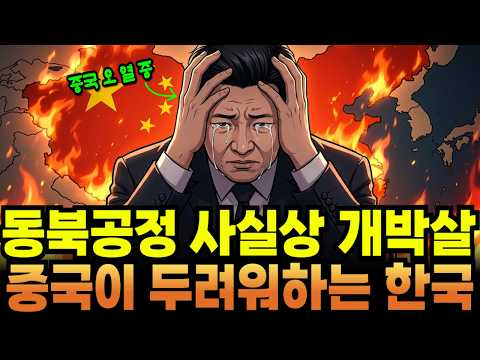
- 챕터: 0:00 우리가 'Korea'라고 불리는 진짜 이유 · 3:04 망한 지 250년 된 나라의 이름을 다시 꺼낸 사내 · 7:20 훈요십조에 남긴 왕건의 유언, "서경을 기억하라" · 9:30 적국 거란조차 인정해버린 고려의 정통성 · 13:47 마르코 폴로의 양피지에 적힌 단어 'Cauli' · 16:42 십수만의 발해 유민, 한반도로 스며들다 · 19:36 중국 동북공정이 고구려보다 '고려'를 두려워하는 이유 · 22:03 여러분의 여권에 박혀 있는 천 년의 못
- 설명 앞부분: ✈️ 지금 당장 책상 서랍 속 여권을 꺼내 표지를 보세요. 거기에 박힌 'KOREA'라는 다섯 글자가 어떻게 만들어졌는지 아시나요? 놀랍게도 이 이름은 우리가 스스로 세계에 알린 것이 아닙니다. 현재 중국이 천문학적인 예산을 쏟아붓고 있는 거대한 역사 왜곡 프로젝트, '동북공정'을 무너뜨리는 가장 강력한 무기가 되고 있다는 것입니다. 📜 🤫 "우리는 옛 고구려의 후예다." 918년, 망한 지 250년이나 지난 나라의 이름을 새 나라의 간판으로 내건 왕건의 치밀한 설계. 그리고 그 주장을 적국이었던 거란과 대국 송나라조차 인정할 수…
- 같은 채널 평소 대비 ×155.2 (채널 최근 롱폼 중앙값 3,813회) · 평소 영상: 조선이 흉내 낼 수 없던 고려 474년, 그들이 대륙을 차지했던 이유 ∣ 고려거란전쟁 ∣… (3,813회) / 우리가 몰랐던 6.25 남침의 충격적 뒷이야기 57시간동안 무엇을 했나? ∣ 역사다큐 ∣… (3,632회)
- 대본 없음 (설명) — 음성인식이 끝나면 도입부·흐름이 들어감
- 댓글 1,754/1,756: 좋은 점 — 영상 10 · 감사·응원 19 · 더 알고 싶은 것 12 · 아쉬운 점 — 영상 6 · 반박·불만 — 의견 다름 55 · 정치·사회 191 · 경험 공유 35 · 구독·다음 기대 1
  - 좋은 점 — 영상 👍3 “이런 내용은 처음이네요! 정말 잘 풀어내시네요. 구독합니다. 좋은 내용 감사합니다. 앞으로도 부탁드립니다. 주....욱!”
  - 좋은 점 — 영상 👍2 “여기서 말하는 평양은 대륙에 있엇다고 들었습니다 고려는 세로길이보다 가로길이가 더넓었다고 배웠음~ 그러나 재야사학자들은 연구를 안함(스카이 대학)포함 중국에 돈을 얼마나 받아 쳐먹으면 한심 스러움”
  - 감사·응원 👍11 “우리 할아버지 감사합니다”
  - 감사·응원 👍3 “이런 내용은 처음이네요! 정말 잘 풀어내시네요. 구독합니다. 좋은 내용 감사합니다. 앞으로도 부탁드립니다. 주....욱!”
  - 더 알고 싶은 것 👍3 “이런 내용은 처음이네요! 정말 잘 풀어내시네요. 구독합니다. 좋은 내용 감사합니다. 앞으로도 부탁드립니다. 주....욱!”
  - 더 알고 싶은 것 👍1 “우리는 corea 가 아닌 k 를 쓴 사실을 알려주세요 일본 j 보다 앞인 c가 아닌 k를 쓴 정확한 이유 증명 되나요?”
  - 아쉬운 점 — 영상 👍4 “조선총독부 조선사편수회에서 발간한 조선사를 기반으로한 현재의 한국사 역사관으로는 동북공정에 대응하는데 있어서 논리적 자기 모순에 빠져있다 더군다나 동북아역사재단과 주류사학계의 어용학자들은 하는 짓이 오히려 동북공정을 돕고있는 꼬라지다 동북공정에 제대로 대응하려면 국민…”
  - 아쉬운 점 — 영상 👍2 “팩트가 틀린 부분이 많습니다 1)발해는 고려라는 국호를 병행 사용합니다 고구려(고려,고리) 명말후 고려라는 국호는 단절되지 않고 발해에서도 계속이어집니다 2)후고구려의 공식 국호는 최초 고려입니다 왕건이 독자적으로 쓴게 아닙니다 3)Korea란 국호는 고려에서 처음으…”
  - 반박·불만 — 의견 다름 👍184 “고려가 한반도에만 있었다고 하는 것은 조선의 역사왜곡과 일제의 신민사학이 만들어낸 허구임. 고대 왕국은 강과 산맥을 가지고 영토의 경계가 만들어졌음. 한국사 교과서에 보이는 경계는 이런 규칙에 절대 맞지 않음. 옛날 지역명을 한반도에 때려 박아 놓고 경계를 그으니 말…”
  - 반박·불만 — 의견 다름 👍45 “저기 내용중에서 견훤은 자신의 국가를 후백제라고 한적이 없습니다..그냥 백제라고 했습니다. 현재의 우리가 삼국시대의 백제와 견훤의 백제를 구분하기 위해서 견훤의 백제를 후백제라고 편의상 부르는 거고요,, 마찬가지로 궁예도 건국후 자신의 나라를 후고구려하고 한적이 없습…”
  - 정치·사회 👍538 “드라마로 동북공정 진행중입니다.계속 경계해야합니다.중국인 무비자 입국 금지시키고요.”
  - 정치·사회 👍361 “고려는 한반도뿐만 아니라 만주, 동부대륙도 통치하고 있었습니다 겨우 한반도만 지배하던 나라가 황제국이라고 칭할 수가 있나? 송나라는 요나라한테 발렸지만 요나라와 맞짱 떠서 이긴 나라가 고려구만”
  - 경험 공유 👍14 “나도 역사는 취미에 불과하지만. 이렇게 대중에게 전달할 때는,더 연구해보고 영상 제작해야죠.채널주인장님 방송내용은 동북공정을 은근 슬쩍 돕는 식.. 고려가 고구려 후손이 아님에도 고려의 국명을 빌려썼다가 되니까,그러면 다시 고구려 귀속문제는 논쟁거리, 보세요,송악의 …”
  - 경험 공유 👍1 “이 양반아 왜 고려를 한반도 속에 묶어놓고 얘기를 하나? 중공이 동북공정을 머뭇거리는 이유가 고려때문이라며? 고려는 중원대륙 거의 저역을 차지했었단 말이외다. 자구 개성개성 송도송도 하지 마오.”
  - 구독·다음 기대 👍3 “이런 내용은 처음이네요! 정말 잘 풀어내시네요. 구독합니다. 좋은 내용 감사합니다. 앞으로도 부탁드립니다. 주....욱!”

### 216. 신화를 넘어서 팩트로 따라가 보는 고대 그리스 역사 시작의 흥미진진한 스토리 ∣ 역사감동사연 ∣ 역사라디오 ∣ 시니어역사 ∣ 오디오북

- https://www.youtube.com/watch?v=PlAkehM46F0 · 태양의 연대기 · 구독자 7,040 · 조회수 167,269 (×23.8, 하루 2,186.1) · 좋아요 433 (0.3%) · 58.9분 · 2026-08-12 · 주제 묶음 10. 수면·낭독 · 형식 수면·낭독 (잠잘 때 듣는) · 폴더 `W_PlAkehM46F0` (웹 승인)
- 썸네일: 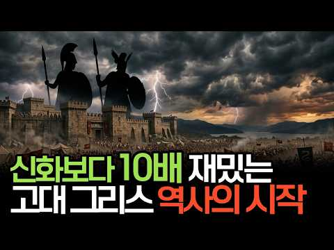
- 설명 앞부분: 신들의 장엄한 서사시 뒤에 철저히 가려져 있던, 척박한 땅과 거친 바다를 맨몸으로 개척해 낸 고대 그리스인들의 치열한 생존의 기록을 낱낱이 파헤쳐 봅니다. 수천 년의 침묵을 깨고 흙 속에서 걸어 나온 고고학적 진실을 통해, 허구의 전설을 넘어선 가장 위대하고도 비극적인 진짜 역사의 대서사시를 지금 시작합니다. 요즘 유튜브를 비롯한 여러 매체를 보면 참으로 많은 정보가 쏟아집니다. 그중에는 재미를 위해 사실이 왜곡되거나, 잘못된 역사적 지식이 기정사실처럼 퍼지는 경우도 많아 안타까운 마음이 듭니다. 그래서❤️ '태양의 연대기'❤️는…
- 같은 채널 평소 대비 ×61.5 (채널 최근 롱폼 중앙값 2,720회) · 평소 영상: 알아두면 인생에 도움이 되는 조선 임금들의 뒷이야기!! ∣ 역사감동사연 ∣ 역사라디오 ∣… (3,541회) / 경제 공부! 세계 8대 부국, 잘 살던 아르헨티나가 망한 이유 확실하게 알려드립니다! ∣… (1,899회)
- 대본 없음 (설명) — 음성인식이 끝나면 도입부·흐름이 들어감
- 댓글 12/12: 좋은 점 — 영상 1 · 감사·응원 1 · 더 알고 싶은 것 1 · 아쉬운 점 — 영상 0 · 반박·불만 — 의견 다름 0 · 정치·사회 0 · 경험 공유 0 · 구독·다음 기대 0
  - 좋은 점 — 영상 👍2 “목소리사 졸리긴 하지만 잘 보고 배우고 갑니다”
  - 감사·응원 👍1 “감사합니다 수고하셨습니다”
  - 더 알고 싶은 것 👍1 “참고문헌 알려주세요”

### 217. 나라를 잃고 미얀마로 도망친 명나라 마지막 황제, 배신 끝에 최후를 맞다 ∣ 영력제의 최후

- https://www.youtube.com/watch?v=PknqtorX34s · 대명제국 흑역사【심층 다큐】 · 구독자 2,270 · 조회수 50,089 (×22.1, 하루 693.4) · 좋아요 210 (0.4%) · 64.8분 · 2026-08-30 · 주제 묶음 6. 동양사 (중국·일본·몽골) · 형식 정보·해설 (그 밖) · 폴더 `W_PknqtorX34s` (웹 승인)
- 썸네일: 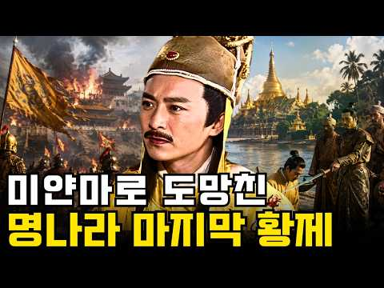
- 같은 채널 평소 대비 ×12.3 (채널 최근 롱폼 중앙값 4,057회) · 평소 영상: 수많은 대신을 몰아낸 명나라 권신 엄숭, 결국 자신의 아들조차 구하지 못했다 (4,057회) / 항복에서 처형까지 15년, 청나라는 정지룡에게 무엇을 원했나 (4,131회)
- 대본 없음 (없음) — 음성인식이 끝나면 도입부·흐름이 들어감
- 댓글 17/17: 좋은 점 — 영상 0 · 감사·응원 3 · 더 알고 싶은 것 0 · 아쉬운 점 — 영상 0 · 반박·불만 — 의견 다름 0 · 정치·사회 1 · 경험 공유 0 · 구독·다음 기대 0
  - 감사·응원 👍2 “존칭어 과잉시대에 비존칭어(반말?)가 훨씬 듣기에 좋습니다. 잘 듣겠습니다. 감사합니다.”
  - 감사·응원 👍1 “감사합니다”
  - 정치·사회 👍0 “이정국과 손가망이 내전을 벌이지 않고 만주족 타도를 위해 정성공과 완벽하게 협력했다면, 오삼계 홍승주같은 배신자들이 없었다면 과연 청나라가 중국 전 영토를 지배하고 지금의 티벳 신장위구르를 아우르는 영토를 짱개들에게 물려줄수 있었을까요? 역사에 만약은 없지만 안타깝네…”

### 218. 총도 없이 40cm 창으로 영국군 총과 대포를 맞서 싸운 아프리카 줄루족들의 용기

- https://www.youtube.com/watch?v=25PIXdjZbuU · 어른들의자장가 · 구독자 6,230 · 조회수 182,787 (×29.3, 하루 1,901.9) · 좋아요 842 (0.5%) · 22.4분 · 2026-08-06 · 주제 묶음 5. 세계사·서양사 · 형식 정보·해설 (그 밖) · 폴더 `W_25PIXdjZbuU` (웹 승인)
- 썸네일: 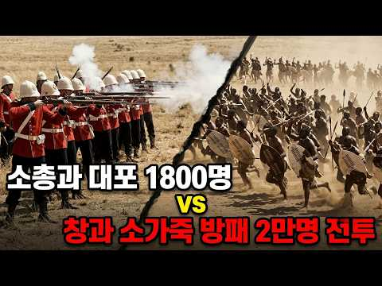
- 설명 앞부분: 1879년 1월 22일 아침, 남아프리카의 한 계곡에서 2만 명이 넘는 줄루 전사들이 몸을 일으켰습니다. 손에 든 것은 마을 대장장이가 하나씩 두드려 만든 날 길이 40센티미터짜리 창과 소가죽 방패가 전부였고, 글자가 없어 왕의 명령도 조상의 역사도 사람의 입으로만 전하던 사람들이었습니다. 6킬로미터 앞에는 세계에서 가장 먼저 산업혁명을 이룬 나라의 군대가 최신 후장식 소총과 대포, 로켓 발사대까지 갖추고 진을 치고 있었습니다. 그런데 이 사람들은 그날 싸울 계획이 없었습니다. 달이 죽는 날이라 공격은 다음 날 새벽으로 미뤄져 있…
- 같은 채널 평소 대비 ×16.4 (채널 최근 롱폼 중앙값 11,169회) · 평소 영상: 독일군 전차와 대포 총공세를 처절하게 막아냈던 고작 20명의 최정예 소련 중대 이야기 (11,169회) / 길드 노조가 시민들로 군대를 조직해서 최정예 엘리트 군대랑 전쟁을 벌인 날 (11,001회)
- 대본 없음 (설명) — 음성인식이 끝나면 도입부·흐름이 들어감
- 댓글 123/137: 좋은 점 — 영상 0 · 감사·응원 2 · 더 알고 싶은 것 0 · 아쉬운 점 — 영상 1 · 반박·불만 — 의견 다름 1 · 정치·사회 4 · 경험 공유 6 · 구독·다음 기대 0
  - 반박·불만 — 의견 다름 👍1 “줄루족들이 화승총 또는 머스킷을 가지고 있었다고 합니다. 물론 비율이 어찌되었는지는 모르겠지만, 당시에는 전세계에 돈없는 가난뱅이 나라라도 화승총정도는 다들 장만하고 있었기 때문에, 줄루족이 화승총같은걸 가지고 있는건 이상한 일이 아닙니다. 영국군은 단발식 소총을 가…”
  - 경험 공유 👍11 “내가 제일 좋아하는 전투들중 하나. 당시 유럽인들이 주장하는 문명이란게 얼마나 작위적인지를 알려주는 사건임.”
  - 경험 공유 👍3 “몇 년 전 제가 줄루 영화를 보았었는데 이걸 보니 그때가 생각나고 영상 퀄리티가 대박이네요!~”

### 219. 조선 왕조 실록 1대 태조부터 27대 순종까지 한번에 몰아보기 ∣ 27명의 임금 중 진짜 왕이 단 5명뿐인 소름 돋는 이유

- https://www.youtube.com/watch?v=DY0tRfuxRhQ · 새벽이 깨운 역사 · 구독자 10,500 · 조회수 462,316 (×44.0, 하루 3,037.7) · 좋아요 7,513 (1.6%) · 64.6분 · 2026-06-11 · 주제 묶음 3. 조선 · 형식 몰아보기·통합본 (긴 영상) · 폴더 `W_DY0tRfuxRhQ` (웹 승인)
- 썸네일: 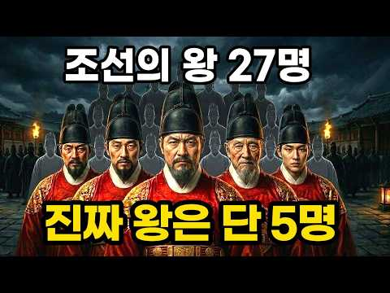
- 챕터: 0:00 오프닝 — 왕은 27명, 진짜 왕은 몇 명일까 · 2:33 태조 이성계 · 정도전과 1차 왕자의 난 · 6:35 태종 이방원 — 피로 닦은 왕좌 · 10:00 세종과 문종 — 두 저울을 다 채운 왕 · 15:30 단종과 세조 · 사육신의 죽음 · 21:39 성종과 연산군 — 두 얼굴의 권력 · 26:21 중종 · 명종 · 외척 문정왕후 · 30:33 선조 · 임진왜란과 이순신 · 36:03 광해군 · 인조 · 삼전도의 굴욕 · 41:44 효종 · 숙종 · 경종 · 46:33 영조 · 사도세자의 뒤주 · 정조 · 51:07 순조 · 철종 · 세도정치 60년 · 54:59 고종 · 대한제국 · 순종, 그리고 1910년 · 61:01 결론 — 진짜 왕은 단 5명이었다
- 설명 앞부분: 조선왕조실록 518년, 27명의 왕을 단 하나의 영상에 모두 담았습니다. 그런데 그 27명 중, 진짜 왕은 단 5명뿐이었습니다. 1392년 태조 이성계의 위화도 회군부터 1910년 순종까지. 이 영상은 조선의 모든 왕을 '정통성'과 '실권'이라는 두 개의 저울 위에 올려놓고, 한 명씩 그 무게를 달아본 조선왕조실록 완벽 몰아보기입니다. 떳떳하게 왕위에 오른 자는 왜 일찍 무너졌고, 강한 권력을 쥔 자는 왜 그 자리를 빼앗아 온 자였을까요? 임진왜란과 병자호란, 삼전도의 굴욕, 사도세자의 뒤주, 세도정치와 대한제국의 멸망까지. 조선…
- 같은 채널 평소 대비 ×215.9 (채널 최근 롱폼 중앙값 2,141회) · 평소 영상: 세조를 왕으로 만든 남자, 죽은 지 17년 만에 목이 잘린 이유 ∣ 부관참시 ∣ 계유정난… (2,141회) / 스물여덟에 사지가 찢긴 병조판서 ∣ 남이는 역적이었나, 조작당한 천재였나 (2,069회)
- 대본 없음 (설명) — 음성인식이 끝나면 도입부·흐름이 들어감
- 댓글 319/351: 좋은 점 — 영상 2 · 감사·응원 9 · 더 알고 싶은 것 1 · 아쉬운 점 — 영상 5 · 반박·불만 — 의견 다름 4 · 정치·사회 18 · 경험 공유 9 · 구독·다음 기대 0
  - 좋은 점 — 영상 👍30 “518년을 짧은 시간에 명쾌하게- 쉽게 잘 설명해주셔서 대단히 감사합니다 감명깊게 잘 들었습니다”
  - 좋은 점 — 영상 👍4 “광해군, 세종,성종, 정조..재미있고 유익한 영상 감사합니다”
  - 감사·응원 👍49 “저는 북한에서 왔어요.한국에와서 사극을 보면서 우리나라 역사에 관심을 갖기시작했어요.그 관심이 왕족실록 왕비실록 책을사서 보기시작했고 우리 조상들이 위대함에대하여 제대로 알기시작했어요.이젠 눈이 아파 유트브에서 역사를 듣기시작했어요.이젠 그냥 나이 들어가는 평범한 아…”
  - 감사·응원 👍30 “518년을 짧은 시간에 명쾌하게- 쉽게 잘 설명해주셔서 대단히 감사합니다 감명깊게 잘 들었습니다”
  - 더 알고 싶은 것 👍2 “저는 78세, 허리가 얼마나 아파야 하는지 모르겠지만 조금 심합나다. 어떻게 알려 주실수 있으신지요?”
  - 아쉬운 점 — 영상 👍32 “가장 아까운 사람이 문종과 정조였음. 두분 다 똑똑했는데 더 오래 다스리지 못래서 아쉬웠고 일찍 가시는 바람에 단종비화가 발생했고 조선후기 세도정치로 조선이 망가졌지..”
  - 아쉬운 점 — 영상 👍4 “조선의 27대 임금 가운데, 실질적인 왕권과 통치권을 확고하게 행사한 군주는 **태종, 세종, 성종, 숙종, 영조, 정조** 여섯 명이라고 생각합니다. 물론 **문종**도 여기에 포함될 가능성은 있습니다. 그러나 건강이 좋지 않아 즉위 후 재위 기간이 매우 짧았고, …”
  - 반박·불만 — 의견 다름 👍4 “조선건국의 일등공신은 이방원을 세자로 봉해야지 영웅호걸인 이성계도 강비와 정도전에게 휘둘려 코흐리개 막내인 강비소생에게 세자로 봉한 대가가 그 소생과 정도전의 일당이 방원에게 다 도륙당했지 정도전. 참 아까운 인물이다😢 조선 27명 왕들 공이 있는 왕은 祖. 덕이 있…”
  - 반박·불만 — 의견 다름 👍2 “와위에 오르면 빙신도 왕이 되는법입니다 무슨 헛소리하는가요 사실 연산군과 광해군도 왕입니다 종묘에 안올린건 그당시 사림파들 때문이지요 반역자는 중종과 인조입니다 중종은 그대마 명분이 서지만 인조는 명분이 없어요”
  - 정치·사회 👍4 “백성을 위한 왕이 누구였던가? 조선은 역사에 없어야 할 왕조다. 정도전의 백성을 위한 정치가 펼쳤졌다면 이 나라가 일찍 근대화되고 발전 되었을 것이라 생각해본다.”
  - 정치·사회 👍3 “현시대에서도 진짜 대한민국에 역대 대통령중에 진짜 대통령은? (이승만,박정희) 입니다”
  - 경험 공유 👍4 “조선의 27대 임금 가운데, 실질적인 왕권과 통치권을 확고하게 행사한 군주는 **태종, 세종, 성종, 숙종, 영조, 정조** 여섯 명이라고 생각합니다. 물론 **문종**도 여기에 포함될 가능성은 있습니다. 그러나 건강이 좋지 않아 즉위 후 재위 기간이 매우 짧았고, …”
  - 경험 공유 👍1 “저당시, 내가 있엇다면..? 조선은 지금 일본하고 북한까지..접수해서..영토강 국으로..”

### 220. 조선 최고령 사형수 ∣ 88세 영의정은 왜 목이 잘렸나

- https://www.youtube.com/watch?v=FSUt5VNvoj4 · 진짜역사한잔 · 구독자 15,800 · 조회수 385,668 (×24.4, 하루 4,528.6) · 좋아요 2,420 (0.6%) · 101.6분 · 2026-08-17 · 주제 묶음 3. 조선 · 형식 정보·해설 (그 밖) · 폴더 `W_FSUt5VNvoj4` (웹 승인)
- 썸네일: 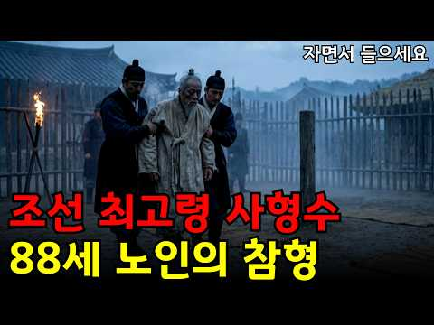
- 챕터: 0:00 프롤로그 · 여든여덟 살의 사형수 · 2:46 합천의 소년, 남명 조식을 만나다 · 7:06 동인과 북인 · 타협을 모르는 사헌부 · 11:18 임진왜란 · 쉰일곱에 의병을 일으키다 · 15:14 의병은 무엇으로 싸웠는가 · 17:02 전쟁이 끝나고 · 세자 자리를 둘러싼 균열 · 20:50 1608년 정월의 상소 · 한 달 만의 반전 · 24:31 광해군의 시대와 산림정승 · 27:57 천 리 밖에서 조정을 움직인다는 것 · 29:39 회퇴변척소 · 조선 전체를 적으로 만들다 · 33:14 계축옥사와 전은론 논쟁 · 36:10 폐모 논쟁 · 기록이 엇갈리는 지점 · 39:27 정치를 떠난 정인홍이라는 사람 · 41:03 1623년 3월 12일 밤, 반정 · 43:50 압송과 국문 · 왜 나이를 참작하지 않았나 · 46:36 4월 3일 · 복주하였다 · 49:08 설화가 된 사람 · 그리고 제자 정온 · 51:58 200년의 금기 · 실패한 복권 시도 · 54:33 1908년의 신원과 내암집 · 57:05 그를 무너뜨린 것은 미덕의 과잉이었다
- 설명 앞부분: 1623년 4월 3일, 한양의 형장에 여든여덟 살의 노인이 세워졌습니다. 그는 조선의 영의정을 지낸 사람이었고, 30년 전 임진왜란 때는 직접 의병을 일으켜 낙동강을 지킨 의병장이었습니다. 그런 그가 인조반정 직후 역적으로 몰려 참형을 당했습니다. 조선왕조실록 인조실록은 그날의 일을 단 한 줄로 기록합니다. 정인홍을 복주하였다. 그 한 줄 뒤에 88년의 삶이 있었습니다. 남명 조식의 수제자, 임진왜란의 의병장, 광해군 시대의 영의정, 인조반정의 역적, 그리고 285년 뒤에 신원된 사람. 이 다섯 개의 이름표는 모두 한 사람의 것이…
- 같은 채널 평소 대비 ×22.5 (채널 최근 롱폼 중앙값 17,138회) · 평소 영상: [4시간연속재생] 교과서에 없는 조선시대 평민생활 세번째 이야기 (18,515회) / 굶주림이 만들어낸 나라 ∣ 조선 오일장 오백 년의 숨겨진 역사 (15,762회)
- 대본 없음 (설명) — 음성인식이 끝나면 도입부·흐름이 들어감
- 댓글 160/164: 좋은 점 — 영상 3 · 감사·응원 5 · 더 알고 싶은 것 0 · 아쉬운 점 — 영상 3 · 반박·불만 — 의견 다름 2 · 정치·사회 8 · 경험 공유 4 · 구독·다음 기대 0
  - 좋은 점 — 영상 👍12 “이런 역사...알려 주셔서 정말정말 감사드립니다... 정인홍영상님... 어쩌다 이런 험악한 꼴을.., 나라와 삶을 생각하면 마음아프고 눈물흐르는 일이 너무 많은...”
  - 좋은 점 — 영상 👍2 “1시간41분. 모르고 들어왔네요. 이렇게 긴건 바빠 못봐요. 수입에 도움되나요.. 싫어요”
  - 감사·응원 👍16 “조선시대에 안태어 난것이 참다행이고 대한민국에서 태어난것 이 부모님께 감사합니다”
  - 감사·응원 👍12 “이런 역사...알려 주셔서 정말정말 감사드립니다... 정인홍영상님... 어쩌다 이런 험악한 꼴을.., 나라와 삶을 생각하면 마음아프고 눈물흐르는 일이 너무 많은...”
  - 아쉬운 점 — 영상 👍2 “중간 광고가 없어서 무한 틀어놓구 잡니다 감사합니다^^ 불면증에 역사두 배우고”
  - 아쉬운 점 — 영상 👍0 “광고가 너무자주 나와 듣지 못해 철수”
  - 반박·불만 — 의견 다름 👍0 “의병장과 정치인 으로써 손자들과 목숨바쳐 나라를 지킨 대장공 으로써 공은 어딜가고 사형을 판결 하는지 대장공 으로써 사리싸욕 한것도 아닌데 육신을 뺏는다는 것은 개인감정 아니고선 생각해 볼일이 아닌가 생각케 한다 88세 사형이면 110세인들 사형하지 않갠는가 그때나 …”
  - 반박·불만 — 의견 다름 👍0 “참 이런 소리하는게 한심한건대... 엘리자베스가 칼레에서 무적함대 박살낸게 15??년도이고 뉴턴이 미적분 개발하고 운동법칙증명한게 16??년이고 청교도 혁명으로 크롬월이 찰스왕 죽이고 공화정 세운게 1648년이고 영국인이 미국에 집단으로 정착한게 1620년 경이고 일…”
  - 정치·사회 👍37 “광해군을잃은조선은빨리망해야되었고 정인홍체제를처단했다는 정권은이적단체에불과했다고봅니다 비극입니다”
  - 정치·사회 👍3 “특검 정부가 인조 반정은 특검 안 합니까?”
  - 경험 공유 👍39 “조선은 임진왜란 이후 망했어야 했었다.”
  - 경험 공유 👍0 “저도 조선의 임금들 가운데 선조와 인조, 고종은 여러 면에서 아쉬움이 큰 왕들이라고 생각합니다. 특히 나라가 어려운 시기에 보여준 판단과 대응을 보면 답답하게 느껴지는 부분이 많네요. 역사 속 인물들을 다시 돌아보게 만드는 이야기였습니다.”

### 221. 중국사ㅣ가족들, 집안에 갇혀 굶어 죽었다. 죽은 지 5개월 후 가문 몰락의 시작ㅣ스승이 죽자 복수를 시작한 만력제ㅣ명나라개혁ㅣ역사인물ㅣ시니어 역사

- https://www.youtube.com/watch?v=bKSQ9iKsGA0 · 역사답다 · 구독자 4,350 · 조회수 96,624 (×22.2, 하루 1,231.8) · 좋아요 588 (0.6%) · 32.7분 · 2026-08-24 · 주제 묶음 6. 동양사 (중국·일본·몽골) · 형식 정보·해설 (그 밖) · 폴더 `W_bKSQ9iKsGA0` (웹 승인)
- 썸네일: 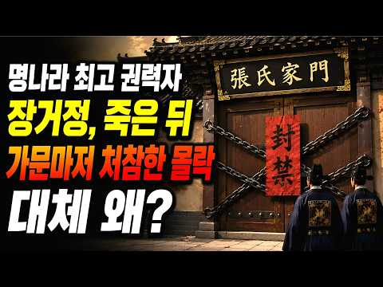
- 챕터: 0:00 융경제의 죽음, 열 살 황제의 탄생과 권력 암투의 시작 · 4:25 장거정의 권력 장악 — 풍보·이태후와의 삼각동맹, 고… · 8:50 어린 황제를 옥죄는 통제 — 서예 금지, 반성문, 그… · 13:15 명나라를 뒤흔든 개혁 — 고성법, 전국 토지 측량, … · 18:00 권력의 폭주 — 탈정 강행, 곤장 세례, 서원 폐지,… · 22:30 스승의 죽음, 그리고 만력제의 칼 — 시호 박탈과 가… · 27:00 장거정이 남긴 것 — 개혁가인가, 권신인가
- 설명 앞부분: 죽은 지 5개월 후 가문 몰락의 시작 , 집안에 갇혀 굶어 죽었다. 명나라 제14대 황제 만력제는 겨우 열 살에 옥좌에 올랐습니다. 그의 곁에는 명나라 역사상 가장 강력한 재상 장거정이 있었죠. 무너져가던 국고를 살려냈고, 썩어빠진 관료 사회를 도려냈으며, 북방의 외적까지 막아낸 전무후무한 개혁가, 하지만 그 권력의 끝은 참혹했습니다. 🎭 살아서는 명나라를 구했지만, 죽어서는 가문이 멸족당한 장거정. ⚖️ 그는 최고의 개혁가였을까요, 아니면 선을 넘어버린 권신이었을까요? 🔥이 영상에서는 장거정이 어떻게 권력을 잡았는지 어린 황제를…
- 같은 채널 평소 대비 ×82.5 (채널 최근 롱폼 중앙값 1,172회) · 평소 영상: 조선 왕은 매일 파인다이닝ㅣ왕의 한끼는 얼마였을까?ㅣ조선시대 수라상의 모든 것 ∣ #조선… (1,202회) / 한국사ㅣ광복, 정말 원폭 '한 방' 때문이었을까?ㅣ소련때문이었을까?ㅣ원폭을 맞고도 조선을… (1,141회)
- 대본 없음 (설명) — 음성인식이 끝나면 도입부·흐름이 들어감
- 댓글 85/86: 좋은 점 — 영상 0 · 감사·응원 3 · 더 알고 싶은 것 0 · 아쉬운 점 — 영상 1 · 반박·불만 — 의견 다름 1 · 정치·사회 4 · 경험 공유 0 · 구독·다음 기대 0
  - 감사·응원 👍2 “좋아여 감사해여❤”
  - 감사·응원 👍0 “ㅋㅋㅋ 좋은 동영상임, 감사합니다.”
  - 정치·사회 👍3 “적어도 장거정 개헉 덕분에 명나라가 이후 40년을 버틸 수 있었습니다”
  - 정치·사회 👍2 “어떻게 보면 영국처럼 황실과 정치를 분리한 선진정치가 당시 장거정의 명나라 아닌가? 싶기도 하다. 왜 꼭 황제가 정치를 직접해야 정의고 신하가 하면 나쁜거로 봐야할까? 후기에 권력에 너무 과잉 집착한 부분이나 섬세하게 만력제를 고려하지 못한 부분은 장거정의 단점이였지…”

### 222. 📷 일반에 공개되기엔 너무 대담했던 숨겨진 빈티지 사진 100장

- https://www.youtube.com/watch?v=NSnNg56q-RY · World of Lost Photos · 구독자 5,380 · 조회수 231,289 (×43.0, 하루 1,463.6) · 좋아요 2,232 (1.0%) · 20분 · 2026-05-23 · 주제 묶음 1. 역사 일반·이야기 · 형식 인터뷰·강연·대담 · 폴더 `W_NSnNg56q-RY` (웹 승인)
- 썸네일: 
- 설명 앞부분: 📷 일반에 공개되기엔 너무 대담했던 숨겨진 빈티지 사진 100장 역사의 수많은 순간들은 사진으로 남겨졌지만, 그중 일부는 너무 강렬하고 예상 밖이어서 오랫동안 세상에 공개되지 않았습니다. 이번 영상에서 잊혀진 역사 사진들은 거의 알려지지 않았던 희귀한 빈티지 사진들을 통해 숨겨진 과거의 진짜 모습을 보여드립니다. 📸 세상이 보지 못했던 순간들 이 사진들은 단순한 기록 이상의 의미를 담고 있습니다. 자연스럽게 포착된 표정들, 시대를 그대로 담아낸 거리 풍경, 그리고 당시 사람들의 솔직한 삶의 순간들이 생생하게 남아 있습니다. 연출되…
- 같은 채널 평소 대비 ×91.8 (채널 최근 롱폼 중앙값 2,518회) · 평소 영상: 📷 그들은 당신이 이 50장의 사진을 보지 않기를 바랐다. (2,379회) / 📸 우리가 알고 있던 역사와 완전히 다른 이야기 (2,356회)
- 대본 없음 (설명) — 음성인식이 끝나면 도입부·흐름이 들어감
- 댓글 34/34: 좋은 점 — 영상 0 · 감사·응원 4 · 더 알고 싶은 것 1 · 아쉬운 점 — 영상 0 · 반박·불만 — 의견 다름 0 · 정치·사회 2 · 경험 공유 3 · 구독·다음 기대 0
  - 감사·응원 👍2 “밴쿠버아랫동네 화이트락에서 감사히 잘봤습니다. 🙏🙏🙏”
  - 감사·응원 👍1 “영상 구성에 감사합니다 또ㆍ감탄합니다”
  - 더 알고 싶은 것 👍4 “개인적으로 참 본인이 태어난 해에. 세계가 어떤 환경속에 있는지 내가 살던곳 과 그시대의 여러나라들의 생활을 볼수있어 생각을 많이 할수 있어 좋왔고 음악이 좀더 회상할수 있게끔 도움을 준게 너무 좋습니다. 개인적으로. 배경음악이 궁금하군요 알수 있을까요?”
  - 정치·사회 👍4 “국힘 정신바짝차려 일치 단합해라 국가외 민족을 위한 박근혜대통령님의 열정을 본받아 재탄생시키기를 바란다!!!!”
  - 경험 공유 👍4 “개인적으로 참 본인이 태어난 해에. 세계가 어떤 환경속에 있는지 내가 살던곳 과 그시대의 여러나라들의 생활을 볼수있어 생각을 많이 할수 있어 좋왔고 음악이 좀더 회상할수 있게끔 도움을 준게 너무 좋습니다. 개인적으로. 배경음악이 궁금하군요 알수 있을까요?”
  - 경험 공유 👍1 “마를린먼로 데미무어 이 둘의 얼굴을 보면서 아름답다고 생각했다 내가 느끼는 이 감정의 정의는 무엇인가....무엇을 근거로 난 이 감정을 느끼는걸까?”

### 223. 세종도 수양대군도 미치도록 사랑한 여인,!! 그런데 노비 출신이라고?ㅣ조선왕조실록ㅣ한국사

- https://www.youtube.com/watch?v=2QiExRW-Dg8 · 호기심 사록 · 구독자 10,700 · 조회수 461,336 (×43.1, 하루 2,889.6) · 좋아요 5,750 (1.2%) · 49.7분 · 2026-06-03 · 주제 묶음 3. 조선 · 형식 정보·해설 (그 밖) · 폴더 `W_2QiExRW-Dg8` (웹 승인)
- 썸네일: 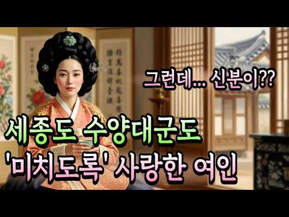
- 챕터: 0:00 당대 최고 권력자들이 늙은 비구니 앞에서 통곡한 이유 · 3:16 지옥 같았던 내자시, 13살 관노비 옥분의 입궐 · 7:11 친정을 잃은 왕비와 천한 노비의 기묘한 동거 · 11:58 세종의 마음을 흔든 옥분의 고요한 배려와 파격적인 신… · 15:52 12년간 8번의 출산, 중전이 친자식을 맡긴 조선판 … · 21:38 노비 출신 최초 정1품 '빈'에 오르다 · 26:40 세종의 죽음, 모든 것을 버리고 스스로 삭발을 택한 … · 31:18 계유정난의 피바람! 수양대군의 칼날이 유일하게 멈춘 곳 · 33:14 세종이 남긴 완벽한 방패막이, 겹사돈의 비밀 · 36:43 아웃트로
- 설명 앞부분: 영상에서 사용한 ‘옥분’이라는 이름은 주요 사료에는 나타나지 않습니다. 신빈 김씨는 실록 등에서 작호와 성씨로 기록됩니다. 따라서 ‘옥분’은 후대 스토리텔링에서 붙은 이름이며, 보다 정확한 표현은 ‘신빈 김씨(본명 미상)’입니다. 조선 500년 역사상 유일무이하게 가장 천한 '관노비'로 태어나, 내명부 최고 품계인 정1품 '빈(嬪)'의 자리에 오른 여인이 있습니다. 바로 세종대왕의 영원한 안식처였던 '신빈 김씨'입니다. 13살의 어린 나이에 내자시의 험한 잡일을 하던 노비 옥분이는 어떻게 왕비의 마음을 사로잡고, 세종의 승은을 입…
- 같은 채널 평소 대비 ×96.2 (채널 최근 롱폼 중앙값 4,795회) · 평소 영상: 첩의 끝없는 탐욕인가 본처의 가스라이팅인가 도요토미 히데요시의 두 아내에게 일어난 비극ㅣ… (4,795회) / 정약용이 두 아들에게 꼭 '한양'에서 버티라고 한 진짜 이유 !! l 충격적인 '조선' … (4,558회)
- 대본 없음 (설명) — 음성인식이 끝나면 도입부·흐름이 들어감
- 댓글 195/194: 좋은 점 — 영상 2 · 감사·응원 12 · 더 알고 싶은 것 1 · 아쉬운 점 — 영상 2 · 반박·불만 — 의견 다름 3 · 정치·사회 1 · 경험 공유 4 · 구독·다음 기대 1
  - 좋은 점 — 영상 👍1 “가슴을울리는 내용이군요 어떤이는 그러한심성을갖고있기도하고 또 어떤이는 하루에도 몇번이나 바뀌는심성이있기도합니다 저또한 너를속이지말라 라고 마음을다잡지만 얼마가지않아 흐트러집니다 오늘 이렇듯 좋은영상올려주심에 감사드립니다 😊 꾸벅”
  - 좋은 점 — 영상 👍0 “많이 배우고 갑니다”
  - 감사·응원 👍7 “신빈 김씨 훌륭한 분 고단했던 이야기를 눈물이 납니다 감사합니다”
  - 감사·응원 👍6 “역사의 새로운 한 페이지를 알개 됐습니다. 감사합니다.”
  - 더 알고 싶은 것 👍5 “조선의 왕들은 목숨걸고, 홍건적이랑 싸워야 했었고, 백성들은 그런 왕족을 섬기느라 고생했었군요 .. 지금도 여전히 왕의직계 후손들은 목숨걸고 한반도를 지키고 있었고, 지금의 대한민국 국민들은 무엇하고 있을까요 ?”
  - 아쉬운 점 — 영상 👍58 “미치도록 사랑한 이라니 제목이 너무 자극적이다. 진심으로 사랑했다도 아니고”
  - 아쉬운 점 — 영상 👍12 “잘 시청해습니다ㅡ보통 이런 역사고증을 하시는 유튜브방송중엔 짜집기 야사와 재미를 가미한 출처없는야길 버무려 방송하는곳이 있어서~저는 어릴때 부터ㅡ역사 야사.를 조아하다보니 이런 방송이 올라오면 날까롭게(?)들어봅니다ㅡ 그리하여 이상한버릇...검증된 학자가 나와서 하는…”
  - 반박·불만 — 의견 다름 👍5 “헤빈양씨는 권력을 탐했던게 아닙니다. 잘못됨.”
  - 경험 공유 👍7 “계양군은 납짝 업드려 수양의 개처럼 행동했었죠😅 혜빈양씨는 단종을 업어키운 유모였죠 문종이 혜빈에게 단종을 부탁하고 운명했어요 혜빈은 귄력에 앞에 선게 아니라 어머니같은 존재로 단종을 지킨겁니다 이부분은 반드시 역사앞에 투명하게 말해야 합니다”
  - 경험 공유 👍5 “조선의 왕들은 목숨걸고, 홍건적이랑 싸워야 했었고, 백성들은 그런 왕족을 섬기느라 고생했었군요 .. 지금도 여전히 왕의직계 후손들은 목숨걸고 한반도를 지키고 있었고, 지금의 대한민국 국민들은 무엇하고 있을까요 ?”
  - 구독·다음 기대 👍12 “잘 시청해습니다ㅡ보통 이런 역사고증을 하시는 유튜브방송중엔 짜집기 야사와 재미를 가미한 출처없는야길 버무려 방송하는곳이 있어서~저는 어릴때 부터ㅡ역사 야사.를 조아하다보니 이런 방송이 올라오면 날까롭게(?)들어봅니다ㅡ 그리하여 이상한버릇...검증된 학자가 나와서 하는…”

### 224. 448년간 숨겨진 한글의 비밀. 세종이 아니었다

- https://www.youtube.com/watch?v=qlAGk8dcK8s · 역사소리방 · 구독자 1,240 · 조회수 52,733 (×42.5, 하루 332.6) · 좋아요 2,734 (5.2%) · 23.6분 · 2026-05-22 · 주제 묶음 3. 조선 · 형식 정보·해설 (그 밖) · 폴더 `W_qlAGk8dcK8s` (웹 승인)
- 썸네일: 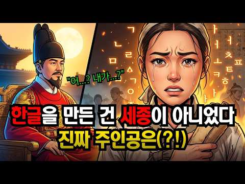
- 설명 앞부분: 주요 내용 눈이 거의 멀어가던 왕이 만든 글자. 나라는 450여 년 동안 공식 글자로 인정하지 않았습니다. 일제는 아예 말 자체를 없애려 했고, 사전을 만들던 학자들은 감옥에서 죽었습니다. 그런데 지금, 여러분이 이 글자를 읽고 있어요. 누가 살려냈을까요? 세종대왕의 창제부터 조선어학회 사건, 간송 전형필의 목숨 건 보존까지. 한글이 살아남은 진짜 이유를 추적합니다. 🤖 본 영상은 생성형 AI를 활용해 제작되었습니다.
- 대본 없음 (설명) — 음성인식이 끝나면 도입부·흐름이 들어감
- 댓글 345/345: 좋은 점 — 영상 2 · 감사·응원 21 · 더 알고 싶은 것 0 · 아쉬운 점 — 영상 1 · 반박·불만 — 의견 다름 9 · 정치·사회 21 · 경험 공유 7 · 구독·다음 기대 1
  - 좋은 점 — 영상 👍0 “앞만안보여? 등창에 눞지도못했다한다 거기에 아내가 12명 심씨왕후하 가장나이어린 아내가 겨우 15살이였데 한글만들었다는건 구라라하더라 절간같은곳에서 만들어진걸 반포한거지 1970년대까지 창제로 안배웠다 초등학교이상나온 70대 어르신들에게 물어봐 반포로배웠다고그러지 반…”
  - 감사·응원 👍31 “세종대왕 우리나라 대한민국 성군 고맙습니다,!”
  - 감사·응원 👍17 “세종대왕은 우리 지구상에서 드문 훌륭하신 왕 이셨습니다. 정말이지 자랑스럽습니다.하므로 선진들께서 물려주신 우리 글자를 더욱소중하게 다루어야 할것입니다.감사 합니다.”
  - 반박·불만 — 의견 다름 👍2 “광장의 촛불? 이건 잘못된 겁니다. 광장의 촛불은 대한민국 자유민주주의 체제를 전복하려는 반민주행위였습니다. 결코 자랑스러워할 일이 아닙니다!”
  - 반박·불만 — 의견 다름 👍1 “훈민정음이 좋은 글짜라고는 하지만, 현대한글은 별로 정확한 음자가 아닙니다. 전세계사람들이 ’땓드‘라고 말하는데 우리나라만 ’싸드‘라하고, 누구나 아는 ‘땡큐’는 쌩큐인지 탱큐인지… 그뿐입니까? 오뤤지를 오렌지, 리버는 강입니까 간입니까? 한국뉴스나 영화를 보면서 참…”
  - 정치·사회 👍23 “지금 우리나라가 바로 잡아야할것은 뭘까요 ? 투표 선관위를 바로잡아야 나라가살것이다.”
  - 정치·사회 👍12 “지금 우리나라는 선거위기이다 주권이 빼앗기고 있다”
  - 경험 공유 👍0 “202663지목 ㅡㅡ 1 일一유일신하나님신유 훈민정음님됨신유 태양양명 전기ㆍ전자ㆍ전파 에너지ㆍ에테르님됨신유 다잘다복됨 경제됨 가치됨님신유 유신 현재 현실 창조 생각 느낌유유유유柔流有ㅡㅡㅡ. 유신 유신유 유신임해요유 유신 민주주의 민주화는유 경제발전됨해서유 개인 각자 …”
  - 경험 공유 👍0 “202663지목 ㅡㅡ 2 일一유일신하나님신유 훈민정음님됨신유 태양양명 전기ㆍ전자ㆍ전파 에너지ㆍ에테르님됨신유 다잘다복됨 경제됨 가치됨님신유 유신 현재 현실 창조 생각 느낌유유유유柔流有ㅡㅡㅡ. 유신 유신유 유신임해요유 유신 625유혈사태 인민해방우동은유 1026유혈사태유…”

### 225. 《한국사》 조선 왕들이 쓰러진 충격적 비밀… 수라상에 있는 비밀은? l 조선시대 l 실록

- https://www.youtube.com/watch?v=3kLrgAozH3w · 한국사 이야기 · 구독자 24,200 · 조회수 289,540 (×12.0, 하루 6,358.2) · 좋아요 500 (0.2%) · 37.9분 · 2026-09-26 · 주제 묶음 3. 조선 · 형식 정보·해설 (그 밖) · 폴더 `W_3kLrgAozH3w` (웹 승인)
- 썸네일: 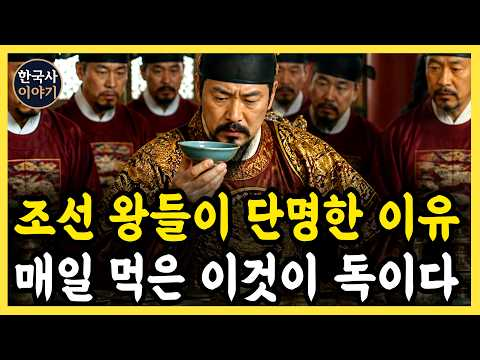
- 설명 앞부분: 조선 왕 27명의 평균 수명은 왜 짧았을까요? 수라상의 과식, 운동 부족, 스트레스와 당시 의료의 한계가 왕들의 건강을 악화시킨 과정을 살펴봅니다.
- 같은 채널 평소 대비 ×21.2 (채널 최근 롱폼 중앙값 13,638회) · 평소 영상: 《한국사》 조선 왕들을 괴롭힌 정체는? 종기의 잔혹사 l 역사 l 조선시대 l 야사 (13,638회) / 《한국사》 조선시대 평민들의 연애와 결혼은 어떤 모습이었을까요? l 조선시대 l 생활사 (13,551회)
- 대본 없음 (설명) — 음성인식이 끝나면 도입부·흐름이 들어감
- 댓글 19/20: 좋은 점 — 영상 0 · 감사·응원 0 · 더 알고 싶은 것 0 · 아쉬운 점 — 영상 0 · 반박·불만 — 의견 다름 1 · 정치·사회 0 · 경험 공유 1 · 구독·다음 기대 0
  - 반박·불만 — 의견 다름 👍7 “틀렸습니다. 커다란 교자상에 수라를 들지 않았습니다. 임금의 밥상 크기가 궁금하면 국립민속박물관 16수장고 소반을 가서 보시오. 당시 백성들이 잘 죽는 이유는 영양실조로 허약해졌고, 쉴새 없는 출산으로 뼈가 삭았고, 그래서 전염병을 이길 힘이 없었기 때문이오.”
  - 경험 공유 👍0 “무슨 소리야? 어릴때 죽은 얘들이 무슨 기록에 있다고 어른 수명을 깍아먹어 이 무슨 개소리지? 그 시대에는 전염병. 홍역 장티프스 등 걸리면 사망이고.... 이사람 완전히 ×도 모르면서 완전 웃기네. 당신 몇살인지 모르지만 1960년대 시골 가봤니? 파리가 얼마나 많…”

### 226. 세종대왕이 너무도 사랑한 하루도 빠짐없이 매일밤 찾아갈 수밖에 없었던 여인 신빈 김씨

- https://www.youtube.com/watch?v=MiSjJNMeiGo · 역사만담 · 구독자 5,080 · 조회수 166,742 (×32.8, 하루 1,331.7) · 좋아요 2,855 (1.7%) · 24.9분 · 2026-07-08 · 주제 묶음 3. 조선 · 형식 정보·해설 (그 밖) · 폴더 `W_MiSjJNMeiGo` (웹 승인)
- 썸네일: 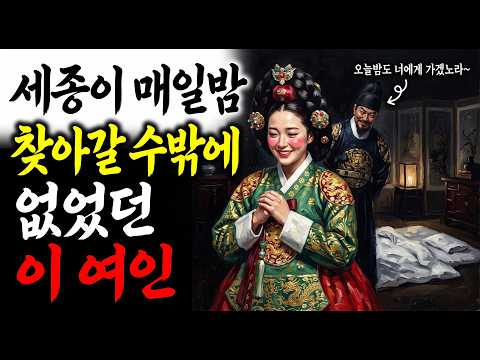
- 챕터: 0:00 오프닝: 관청 노비 문서에 적힌 소녀, 정1품 '신빈… · 4:12 궁궐 입성과 소헌왕후와의 운명적인 만남 · 7:55 세종의 눈에 든 성실함, 지밀나인에서 후궁으로의 비상 · 10:28 소헌왕후의 굳건한 신뢰: "내 아이들을 부탁하네" · 14:45 가장 화려한 자리에서 가장 낮은 곳으로, 자수궁의 1… · 19:36 계유정난의 피바람 속에서도 가문을 지켜낸 부드러움의 힘 · 22:59 에필로그: 권력보다 빛난 조용한 성실함, 신빈 김씨의…
- 설명 앞부분: 조선 오백 년 역사상 유일무이한 기록! 관청 노비 문서에 이름이 올랐던 열세 살 소녀가 왕비 다음가는 정1품 '빈(嬪)'의 자리까지 오른 놀라운 이야기를 아시나요? 왕비 소헌왕후가 숨을 거두며 자신의 친자식들을 부탁했던 단 한 사람. 계유정난의 피바람 속에서도 화를 면하고 굳건히 살아남았던 세종의 후궁, '신빈 김씨'의 입지전적인 삶을 추적합니다. 화려한 권력 암투보다 더 강했던 '조용한 성실함'의 이면 속으로 함께 들어가 보시죠. 📜 [영상 타임라인] 💡 [핵심 역사 교육 포인트] 1. 신분제 사회 조선의 파격: 엄격한 신분제 …
- 같은 채널 평소 대비 ×532.7 (채널 최근 롱폼 중앙값 313회) · 평소 영상: 왕도 견딜수 없었던 이와 벼룩, 빈대와 동거, 치약도 비누도 없던 조선시대, 신분별 위생… (324회) / 고려 17만이 포기한 여진족 철옹성 하루만에 뚫어버린 한반도 소드마스터 척준경 (302회)
- 대본 없음 (설명) — 음성인식이 끝나면 도입부·흐름이 들어감
- 댓글 123/123: 좋은 점 — 영상 2 · 감사·응원 5 · 더 알고 싶은 것 1 · 아쉬운 점 — 영상 0 · 반박·불만 — 의견 다름 0 · 정치·사회 2 · 경험 공유 2 · 구독·다음 기대 1
  - 좋은 점 — 영상 👍8 “신빈에 대해 몰랐는데 자세히 알려 주셔서 알게되었습니다 감사합니다 구독할게요”
  - 좋은 점 — 영상 👍6 “좋은내용 고맙습니다 BGM 넣지않는게...”
  - 감사·응원 👍8 “신빈에 대해 몰랐는데 자세히 알려 주셔서 알게되었습니다 감사합니다 구독할게요”
  - 감사·응원 👍7 “역사 공부 잘하고 있습니다 . 감사합니다”
  - 더 알고 싶은 것 👍5 “너무 잘만들어주시니 감사합니다~앞으로도 귀한영상 부탁드려요~~”
  - 경험 공유 👍7 “내가 조선시대 왕이었다면 후궁을 몇명이나 두었을까”
  - 경험 공유 👍2 “예전 드라마 했었는데 한효주가 여주 하고 기억이 가물가물 하네요”
  - 구독·다음 기대 👍8 “신빈에 대해 몰랐는데 자세히 알려 주셔서 알게되었습니다 감사합니다 구독할게요”

### 227. 제1차 세계대전 최악의 소모전, 베르됭 전투 3D ∣ 완전판

- https://www.youtube.com/watch?v=34eZlgvSfDM · 에픽히스토리 코리아 · 구독자 26,000 · 조회수 548,173 (×21.1, 하루 6,749.7) · 좋아요 2,902 (0.5%) · 40.1분 · 2026-08-21 · 주제 묶음 7. 전쟁·군사사 · 형식 정보·해설 (그 밖) · 폴더 `W_34eZlgvSfDM` (웹 승인)
- 썸네일: 
- 설명 앞부분: 1916년 2월 21일, 독일군의 대포 1,000문이 베르됭 일대의 프랑스군 진지를 향해 포격을 시작했다. 인류 역사상 가장 참혹한 전투 중 하나인 베르됭 전투의 시작이었다. 300일 동안 이어진 전투에서 매일 평균 1,000명이 목숨을 잃었다. 독일군은 프랑스군을 소모전으로 끌어들여 피를 말리려 했지만, 프랑스군은 “그들은 통과하지 못한다”는 결의 아래 필사적으로 맞섰다. 정교한 3D 그래픽을 통해 베르됭이 전략적으로 중요했던 이유와 프랑스 동부를 지키던 요새망, 두오몽 요새를 둘러싼 사투, 그리고 독일군과 프랑스군의 치열한 공…
- 같은 채널 평소 대비 ×12.1 (채널 최근 롱폼 중앙값 45,333회) · 평소 영상: [나폴레옹 전쟁 시리즈] 1807년 아일라우 전투 (45,333회) / 넬슨의 해전 3D: 코펜하겐 해전 1801 (40,023회)
- 대본 없음 (설명) — 음성인식이 끝나면 도입부·흐름이 들어감
- 댓글 151/159: 좋은 점 — 영상 3 · 감사·응원 6 · 더 알고 싶은 것 2 · 아쉬운 점 — 영상 1 · 반박·불만 — 의견 다름 1 · 정치·사회 2 · 경험 공유 5 · 구독·다음 기대 2
  - 좋은 점 — 영상 👍6 “당시 영상과 사진으로만 설명 되던걸 이렇게 보니 한눈에 이해가 잘 되네요.. 좋아요~~”
  - 좋은 점 — 영상 👍0 “오랜만에 정말 아주 잘 짜여진 내용을 알기쉽게 설명해 주어 너무 고맙습니다”
  - 감사·응원 👍0 “에픽채널 영어로 겨우 듣다가 번역본 들으니 넘 좋네요 퀄리티가 넘사벽입니다. 감사드립니다.”
  - 감사·응원 👍0 “오랜만에 정말 아주 잘 짜여진 내용을 알기쉽게 설명해 주어 너무 고맙습니다”
  - 더 알고 싶은 것 👍30 “와 엄청나네요 퀄리티가... 이런 영상만 찾아보는데 제가 본 것들 중에서 1위네요 다른 1차대전 2차대전 대평양전쟁 대규모 전투도 다뤄주시면 좋겠어요”
  - 더 알고 싶은 것 👍0 “내용도 좋고 매우 잘 만들어져 있습니다 다만 배경음악을 다른 것을 써 주세요. 또 나레이션이 있을 때와 그 시이사이의 음량차이가 너무 큽니다. 음압이 너무 커서 피로도가 큽니다. 조정 부탁드립니다”
  - 아쉬운 점 — 영상 👍1 “영상이 존나 지겹습니다. 했던말 계속 언급 반복하면 넘 지루하져”
  - 정치·사회 👍0 “(약 26분 31초까지 보던 중에 문득) 샤를 드골 전 프랑스 대통령이 이 전투에 참전했다가 독일군에 포로로 붙잡히게 되었죠.”
  - 정치·사회 👍0 “전쟁이란 딱 한명의 미치광이가 일으키고 수천만명이 영문도 모른 채 학살 당하는 것이다.... 러우전쟁은 푸틴, 중동전쟁은 네타냐후, 이란전쟁은 트럼프.... 이것들이 미치광이들!!!! 우리도 하마터면 윤석열 때문에 전쟁날 뻔!!!! 베르됭 전투에서 사망한 병사 수는 …”
  - 경험 공유 👍30 “와 엄청나네요 퀄리티가... 이런 영상만 찾아보는데 제가 본 것들 중에서 1위네요 다른 1차대전 2차대전 대평양전쟁 대규모 전투도 다뤄주시면 좋겠어요”
  - 경험 공유 👍0 “서로를 죽여야 내가 살고 끝없이 죽고 죽는 가운데 사람은 존재의미를 잃고 악마가된다”
  - 구독·다음 기대 👍0 “고퀄이네 구독합니다”
  - 구독·다음 기대 👍0 “구독합니다 정말 감동적으로 잘 소재를 선정하고 만드신 영상이네요”

### 228. 역사는 사실대로 기억해야 합니다｜「암살자들」논란에 대한 생각 #임동진 #암살자들 #영화

- https://www.youtube.com/watch?v=mcOVtFOj-jk · 임동진TV · 구독자 24,200 · 조회수 100,130 (×4.1, 하루 6,275.5) · 좋아요 5,018 (5.0%) · 19분 · 2026-10-07 · 주제 묶음 1. 역사 일반·이야기 · 형식 정보·해설 (그 밖) · 폴더 `W_mcOVtFOj-jk` (웹 승인)
- 썸네일: 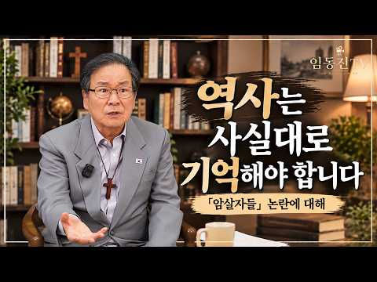
- 설명 앞부분: 이번 영상에서는 최근 **영화 「암살자들」을 둘러싼 논란**을 계기로, 임동진이 생각하는 **역사와 기억**에 대한 이야기를 나눕니다. 한 시대를 직접 살아오며 보고 느낀 경험을 바탕으로 대한민국 현대사의 여러 순간을 되돌아보고, 역사를 바라보는 자신의 생각을 솔직하게 이야기합니다. 영화를 직접 관람한 감상이 아닌, 최근 제기되고 있는 논란을 접하며 떠올린 생각과 개인적인 견해를 담은 영상입니다. “역사는 사실대로 기억해야 합니다.” 임동진TV에서 임동진이 직접 들려주는 이야기를 만나보세요.
- 같은 채널 평소 대비 ×3.5 (채널 최근 롱폼 중앙값 29,005회) · 평소 영상: 배우 임동진이 목회자의 길을 선택한 이유 ∣ 배우에서 목사로 #임동진 #배우 #배우에서목… (36,118회) / “엄마는 네 강아지가 되고 싶구나” 98세 어머니가 남긴 말｜추석에 생각하는 부모님의 사… (21,892회)
- 대본 없음 (설명) — 음성인식이 끝나면 도입부·흐름이 들어감
- 댓글 431/454: 좋은 점 — 영상 33 · 감사·응원 104 · 더 알고 싶은 것 5 · 아쉬운 점 — 영상 3 · 반박·불만 — 의견 다름 21 · 정치·사회 92 · 경험 공유 30 · 구독·다음 기대 1
  - 좋은 점 — 영상 👍135 “옳은 말씀 해주셔서 고맙습니다”
  - 좋은 점 — 영상 👍127 “목사님 말씀 잘듣고 기쁜 마음으로 돌아갑니다. 목사님의 말씀에 절대공감합니다. 감사드립니다!!”
  - 감사·응원 👍254 “어릴적부터 제일 좋아하는 남자탈렌트였던 분에서 지금은 정의로운 자유우파 목사님으로 그자리에 계시고 실망시키지 않으셨습니다.존경합니다.고맙고 감사드립니다.오래도록 건강하시기 바랍니다.”
  - 감사·응원 👍234 “진실을 말씀하셔서 감사합니다 ^^”
  - 더 알고 싶은 것 👍3 “좌편향 된 문화계와 홀로 싸우고 있으신 김규나작가님 이라는 분이 계십니다 많은 응원 부탁드립니다”
  - 더 알고 싶은 것 👍1 “개독박멸! 이만이사형! 목사님! 정신 차리세요! 아직도 연기 잘하시네요 그 가면 언제 벚으 실건가요?”
  - 아쉬운 점 — 영상 👍0 “아.....양만춘 장군님.....정정하신모습뵈니.....정말좋습니다......”
  - 아쉬운 점 — 영상 👍0 “목사님~~ 쓸데없는 헛소리 마시구 목회자의길이나 열심히 가세요 실망스럽습니다”
  - 반박·불만 — 의견 다름 👍5 “고맙습니다 저역시 그과정 을겪은 사람 입니다. 독재아닙니다 그때그렇게 안하셨음 간첩들이 난무하고 우린 초토화 됬을겁니다”
  - 반박·불만 — 의견 다름 👍4 “예술을 빙자한 선전선동에 이제껏 놀아난 게 정말 분하네요 옳은 말씀 감사합니다 임동진 목사님!”
  - 정치·사회 👍254 “어릴적부터 제일 좋아하는 남자탈렌트였던 분에서 지금은 정의로운 자유우파 목사님으로 그자리에 계시고 실망시키지 않으셨습니다.존경합니다.고맙고 감사드립니다.오래도록 건강하시기 바랍니다.”
  - 정치·사회 👍77 “누구는 조금만 껄끄러우면 드럼통 당하는데ᆢ 어쩌다 나라가 공산당들이 날뛰는 정부가되었는지ᆢ”
  - 경험 공유 👍83 “정말 공감이 됩니다 목사님. 제가 하고 싶은 얘기 시원하게 해주셔서 감사합니다.”
  - 경험 공유 👍12 “저도 공감 합니다 확실한 진실만 이야기 하시네요 감사합니다”
  - 구독·다음 기대 👍1 “감사합니다 ❤❤❤❤❤ 목소리 내주셔서 ㅠㅠㅠㅠㅠㅠ 구독하고 응원합니다 ❤❤❤❤❤❤ 존경하고 사랑합니다 🎉🎉🎉”

### 229. 조선시대, 난방도 패딩도 없던 시대 혹독한 추위 어떻게 버텼나?

- https://www.youtube.com/watch?v=jljGmlOxqMc · 바람이들려준역사 · 구독자 2,480 · 조회수 86,175 (×34.8, 하루 641.2) · 좋아요 727 (0.8%) · 17.9분 · 2026-06-29 · 주제 묶음 3. 조선 · 형식 정보·해설 (그 밖) · 폴더 `W_jljGmlOxqMc` (웹 승인)
- 썸네일: 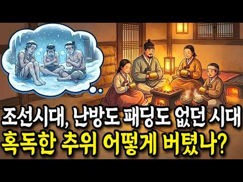
- 챕터: 0:00 영하 30도, 상상도 못 할 조선의 겨울 · 1:03 그 시대가 더 가혹했던 진짜 이유 · 1:48 몸에 가장 가까운 첫 번째 무기 · 2:09 솜에 대한 뜻밖의 오해 · 2:59 가난이 짜낸 놀라운 지혜 · 3:58 같은 하늘 아래 갈린 두 개의 겨울 · 4:38 가난한 집 방 안의 겨울밤 풍경 · 5:41 조선 사람들이 겨울을 이겨낸 진짜 무기 · 6:14 단순해 보이는 구조 속 어마어마한 비밀 · 7:08 서양의 방식과 나란히 놓고 보면 · 7:45 따뜻함에 드리운 무서운 그림자 · 8:42 이 난방을 처음 본 외국인의 반응 · 11:55 견딜 만한 수준을 넘어선 이야기 · 12:11 하늘이 등을 돌린 2년 · 14:11 조선만의 일이 아니었던 충격적 진실 · 15:26 그 긴 역사가 지금 우리 곁에 남긴 것 · 16:44 그래서, 그들은 무엇으로 버텼을까
- 설명 앞부분: ❄️ 영하 30도의 혹독한 조선의 겨울, 패딩도 보일러도 핫팩도 없던 그 시대… 우리 조상들은 대체 무엇으로 이 살인적인 추위를 버텨냈을까요? 🥶 지금 우리가 한파특보에 들썩이는 기온의 두 배에 가까운 추위. 두꺼운 유리창은커녕 얇은 한지 한 장이 전부였던 그 겨울을, 사람들은 평생, 그것도 수백 년 동안 견뎌냈습니다. 🏠 이 영상에서는 조선 사람들이 목숨을 걸고 겨울을 살아낸 생존의 비밀을 몸에 가장 가까운 것부터 하나씩 풀어봅니다. 옷부터 시작해, 그들이 추위와 맞섰던 진짜 무기들, 그리고 우리가 미처 몰랐던 그 시대의 충격적…
- 같은 채널 평소 대비 ×90.7 (채널 최근 롱폼 중앙값 950회) · 평소 영상: 대만도, 몽골도 지운 강희제가 이미 손에 넣은 조선만은 통째로 삼키지 않은 진짜 이유 ∣… (950회) / [폐비 윤씨] "피 토하며 죽은 적 없다!" 500년 동안 대한민국을 속인 사약 사건의 … (938회)
- 대본 없음 (설명) — 음성인식이 끝나면 도입부·흐름이 들어감
- 댓글 52/52: 좋은 점 — 영상 0 · 감사·응원 0 · 더 알고 싶은 것 0 · 아쉬운 점 — 영상 0 · 반박·불만 — 의견 다름 0 · 정치·사회 0 · 경험 공유 4 · 구독·다음 기대 0
  - 경험 공유 👍5 “시골출신인 나도 80년대 중반까지 아궁이에 불 때고 한지로 방문을 한 집에서 지냈다ᆢ지나고 보니 사람은 환경에 적응하며 맞추어 살게 되어 있는거 같다”
  - 경험 공유 👍3 “한복에 솜을 넣어서 만들어 입었다. 조선시대에는 살지 않았지만 내가 어릴때에 어머니는 솜을 넣으셨다 !!”

### 230. 이순신 사후 84일의 비밀, 선조가 대첩 승리 당일 저지른 비정한 보복

- https://www.youtube.com/watch?v=T0Vb2yu89Tc · 어른의 역사 시간 · 구독자 2,530 · 조회수 89,799 (×35.5, 하루 638.2) · 좋아요 1,201 (1.3%) · 58.4분 · 2026-06-22 · 주제 묶음 3. 조선 · 형식 정보·해설 (그 밖) · 폴더 `W_T0Vb2yu89Tc` (웹 승인)
- 썸네일: 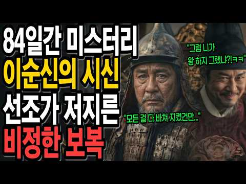
- 챕터: 0:00 84일간 썩지 않은 시신과 잔인한 보복 · 1:42 장례 법도 뒤에 숨은 선조의 비정한 명령 · 5:29 한겨울 400km 운구길에 감춰진 비밀 · 8:33 피 안 흘릴 전쟁을 영웅이 자원한 이유 · 11:46 7년 왜란 중 가장 처참했던 노량 사투 · 14:58 아들이 피 묻은 손으로 대장기를 쥔 순간 · 19:36 영웅이 전사한 날 무너진 마지막 방패 · 20:46 "갑옷 자살설?" 400년 동안 속았던 오해 · 23:18 이길수록 칼날로 돌아온 조선 왕실의 민낯 · 30:00 죽음 앞에 엎어져 통곡한 이국의 장수 · 34:19 이 나라는 왜 영웅의 안식처를 막았나 · 37:01 난중일기 100번의 병 기록과 진짜 진실 · 45:12 426년째 풀 안 자라는 의문의 1미터 맨땅 · 51:06 100년 뒤에야 울려 퍼진 뒤늦은 눈물
- 설명 앞부분: 살아서는 이 나라의 감옥에 갇혔고, 죽어서는 땅 한 평조차 제때 내어주지 않았습니다. 7년 왜란을 승리로 이끌고 온 나라를 구한 영웅의 관은, 그렇게 두 달이 넘도록 구천을 떠돌아야 했습니다. 영하를 오가는 매서운 한겨울, 냉장 시설도 없던 그 길에서 그의 몸은 왜 단 한 치도 무너지지 않았을까요? 왜 시신에서 은은한 향기가 났다는 기록이 전해질까요? 더 소름 끼치는 것은, 426년이 지난 지금 이 순간에도 그가 누워 있던 자리에는 풀 한 포기 자라지 않는다는 사실입니다. 과학계조차 답하지 못한 이 미스터리 뒤에 숨겨진 조선 왕실…
- 같은 채널 평소 대비 ×142.8 (채널 최근 롱폼 중앙값 629회) · 평소 영상: 조선에 콜레라가 왔을 때 유럽보다 초토화되지 않은 "의외의 이유" (629회) / 유방이 죽자 천하를 쥔 여태후, 그 집안이 사라진 충격적인 밤 (614회)
- 대본 없음 (설명) — 음성인식이 끝나면 도입부·흐름이 들어감
- 댓글 294/297: 좋은 점 — 영상 1 · 감사·응원 13 · 더 알고 싶은 것 0 · 아쉬운 점 — 영상 1 · 반박·불만 — 의견 다름 3 · 정치·사회 15 · 경험 공유 2 · 구독·다음 기대 0
  - 좋은 점 — 영상 👍7 “과학도 아니고 기적도 아니고 하늘의 뜻같기도합니다 그러나 과학적으로도 믿을수 없는일이 벌어지는것도 있지 않습니까 하이튼 하늘의 도움이 아닐까요 미신 풍수 있다 없다 말할수는 없는것이기에”
  - 감사·응원 👍20 “구국의 영웅인 이순신장군님께서 누워계신 곳에ᆢ 감히 산천초목이 뿌리를 내리지 않은것은ㅡ구국의 영웅께 최고의 예우를 다 한 것이 아닐런지요ㆍ위대한 장군님 감사합니다 🎉🎉🎉🎉🎉🎉🎉🎉🎉🎉”
  - 감사·응원 👍17 “역사의 새로운 사실 많이 알았습니다 고맙습니다 감사합니다~”
  - 아쉬운 점 — 영상 👍2 “간단히 말해라.서론이 너무길다”
  - 반박·불만 — 의견 다름 👍3 “근데, 이순신방전면주(李舜臣方戰免胄), 이 구절 한국말로만 읽어도 될걸 왜 중공발음으로 읽는지 이해가 안 됩니다. 한국사람들 수천년까지 되는지는 확언 못 하겠지만, 우리말로 한자 읽으면서 사용했슴요. 사실 한자는 동이족이 만든 상형문자입니다. 중공 한족(漢族)이 만든…”
  - 반박·불만 — 의견 다름 👍0 “이슨신 장군께서는 왕때위 한테 인정받고 칭찬 받으려고 왜적을 물리친게 아닙니다.. 장군은 나라를 위해 나라의 주인인 백성을 위해 싸웠습니다...”
  - 정치·사회 👍12 “지금은 중국인을 위한 연금이며..열불터져서”
  - 정치·사회 👍4 “이런 나라가 안망한것도 희안하다”
  - 경험 공유 👍3 “이순신 그분의 공이 얼마나 크고 훌륭했으면 또 범인은. 보고도. 깨닭지 모했던 일들이 수백년이 지난 오늘까지도 후세사람 알아낼수 있었던. 행적들을 지금도 많이 전설을 통해서 탐색을 통해서. 알아낼것이 있으니 그인간됨이. 오직자기만 알고 외롭게 해쳐서 나라를 지켰으니 …”
  - 경험 공유 👍2 “내가 장군이라면 일본을치고 명나라를치고 금나라를 치고 조선으로돌아와 선조를엄벌하고 일본은 무인도로만들것입니다”

### 231. [시니어역사] 주역, 세상이 아무리 바뀌어도 흔들리지 않는 법

- https://www.youtube.com/watch?v=GaOAwSMZYl8 · 역사 너머 · 구독자 8,430 · 조회수 319,290 (×37.9, 하루 2,086.6) · 좋아요 5,456 (1.7%) · 90분 · 2026-06-10 · 주제 묶음 1. 역사 일반·이야기 · 형식 오디오북·낭독 (명언·인생조언) · 폴더 `W_GaOAwSMZYl8` (웹 승인)
- 썸네일: 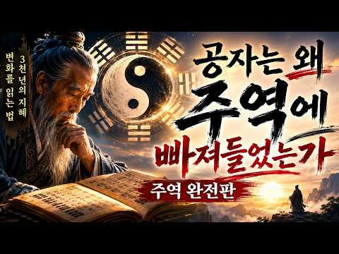
- 챕터: 0:00 오프닝: 잘 산다는 것 '주역' · 2:01 1부 — 주역은 어떻게 탄생했는가 · 15:22 2부 — 변화를 받아들이는 법 (음양의 철학) · 26:49 3부 — 때를 아는 것이 지혜다 (기다림과 결단) · 36:13 4부 — 가득 찬 것은 반드시 비워진다 (겸손의 철학) · 46:02 5부 — 위기 속에서 길을 찾는 법 · 57:55 6부 — 공자는 왜 말년에 주역에 빠져들었는가 · 69:44 7부 — 주역이 말하는 삶의 완성 · 79:31 8부 — 현대인에게 주역이란 무엇인가
- 설명 앞부분: 지금으로부터 3천 년 전, 억울하게 감옥에 갇힌 한 남자가 있었습니다. 언제 죽을지도 모르는 시간 속에서, 그는 무너지지 않고 붓을 들었습니다. 그렇게 써 내려간 것이 인류 역사상 가장 오래 읽힌 책 중 하나가 되었습니다. '주역'입니다. 세상은 변한다. 그 변화에는 이치가 있다. 그 이치를 아는 사람은 흔들리지 않는다. 좋을 때 교만하지 않는 법, 나쁠 때 무너지지 않는 법, 때를 알고 기다리는 법, 위기 속에서 길을 찾는 법. 주역은 3천 년 동안 그것을 가르쳐 왔습니다. 공자도 말년에 이 책을 너무 깊이 읽은 나머지, 책을 …
- 같은 채널 평소 대비 ×219.4 (채널 최근 롱폼 중앙값 1,456회) · 평소 영상: [시니어역사] 한국을 빛낸 100명의 위인들, 노래 가사 속 인물들 완벽 정리 (1,674회) / [시니어역사] 어우동, 고관대작 17명과 스캔들? 조선 사대부들이 그녀를 죽여야만 했던 … (1,237회)
- 대본 없음 (설명) — 음성인식이 끝나면 도입부·흐름이 들어감
- 댓글 166/166: 좋은 점 — 영상 8 · 감사·응원 27 · 더 알고 싶은 것 3 · 아쉬운 점 — 영상 1 · 반박·불만 — 의견 다름 1 · 정치·사회 1 · 경험 공유 3 · 구독·다음 기대 0
  - 좋은 점 — 영상 👍28 “Ai 라도 목소리가 너무 듣기좋습니다 편안하네요”
  - 좋은 점 — 영상 👍16 “저는 교회를 미치도록 나가거나 목사들을 우상화하능 사람은 아닙니다. 사실 교회는 않갑니다. 그러마 제인생이 힘들때마다 제옆에 예수님이 있었습니다 . 종교에 회의적인사람글는 믿지 않겠지만 제경우가 그렇다는 겁니다. 교회는 도움이 되지 않았었어요. 그냥 예수님이 있습니더…”
  - 감사·응원 👍23 “모든것은변한다❤ 감사합니다”
  - 감사·응원 👍18 “주역은 모든것을자연 스럽게 바다 드려라 감사 합니다 아 멘”
  - 더 알고 싶은 것 👍3 “복히씨은 뭐가 궁금해서? 5000년 전에 그렇게 빨리 태어났지?”
  - 더 알고 싶은 것 👍2 “아주 좋은글 잘들었습니다~ 자세히 주역을 읽고 싶은데 책좀 추천해 주세요”
  - 아쉬운 점 — 영상 👍28 “Ai 라도 목소리가 너무 듣기좋습니다 편안하네요”
  - 반박·불만 — 의견 다름 👍16 “저는 교회를 미치도록 나가거나 목사들을 우상화하능 사람은 아닙니다. 사실 교회는 않갑니다. 그러마 제인생이 힘들때마다 제옆에 예수님이 있었습니다 . 종교에 회의적인사람글는 믿지 않겠지만 제경우가 그렇다는 겁니다. 교회는 도움이 되지 않았었어요. 그냥 예수님이 있습니더…”
  - 경험 공유 👍14 “3000년 전이면 내가 태어나기 전인데 훨씬”
  - 경험 공유 👍8 “이 생은 내가 선택해서 온 삶이란 걸 알게되니 뭐든 이해가 되데요”

### 232. 노량해전의 숨겨진 기록에 충격! 전세계가 이순신 장군에 놀랄 수 밖에 없던 이유 #썬킴 #매불쇼 #이순신 #명량 #노량

- https://www.youtube.com/watch?v=PpJ3imzubBw · 강펀치 · 구독자 11,300 · 조회수 229,153 (×20.3, 하루 2,633.4) · 좋아요 3,880 (1.7%) · 29.6분 · 2026-08-15 · 주제 묶음 3. 조선 · 형식 정보·해설 (그 밖) · 폴더 `W_PpJ3imzubBw` (웹 승인)
- 썸네일: 
- 설명 앞부분: 오늘 영상에서는 단순히 '이순신이 승리했다'는 사실을 넘어, 왜 전 세계가 이순신 장군을 위대한 영웅으로 칭송하는지 그 이유를 파헤칩니다. 주요 내용: 임진왜란과 노량해전의 실체: 7년 전쟁으로 알려진 임진왜란의 복잡한 전개 과정과 휴전 협상, 그리고 전쟁의 마지막을 장식한 노량해전의 역사적 의미를 짚어봅니다. 특히 7천량 해전의 비극을 딛고 다시 일어선 우리 수군의 투혼을 다룹니다. 역사 속 충격적인 비하인드: 정유재란 당시 명나라군이 투입한 전력에는 아프리카 출신의 흑인 용병들을 비롯해, 적을 교란하기 위한 원숭이 부대와 중앙…
- 같은 채널 평소 대비 ×76.1 (채널 최근 롱폼 중앙값 3,010회) · 평소 영상: 뉴스공장 출연한 김민석, 거북한 이름 나오자 표정 대반전! 이낙연 꼴 된다 경고인가...… (3,010회) / 충격! 언론에서 캐나다 총리 발표를 주목하지 않은 이유... '독일 들러리 섰다'더니 K… (3,064회)
- 대본 없음 (설명) — 음성인식이 끝나면 도입부·흐름이 들어감
- 댓글 279/280: 좋은 점 — 영상 1 · 감사·응원 5 · 더 알고 싶은 것 1 · 아쉬운 점 — 영상 2 · 반박·불만 — 의견 다름 6 · 정치·사회 15 · 경험 공유 11 · 구독·다음 기대 0
  - 감사·응원 👍20 “감사함보다 시기와 질투가 판을치면 목숨을 걸고 내가 옳다는 것을 증명해야 합니다 역사는 결과를 기록 합니다”
  - 감사·응원 👍13 “너무 너무 재미있게 봤어요. 감사합니다”
  - 아쉬운 점 — 영상 👍0 “나라위해 목숨바친 숭고한 영웅이름가지고 낄낄거리면서 조롱하면 일베놈들과 뭐가다른가. 대단히 실망이다.”
  - 반박·불만 — 의견 다름 👍16 “백의종군은 이등병강등이 아닙니다.... 그냥 보직만 내려놓는거라, 전직 통제사로 예우받고 다 합니다.”
  - 반박·불만 — 의견 다름 👍0 “이긴전쟁은 아닙니다 조선전체가 초토화됐는데 일본은 잃은건 군대밖에 없는데 이겼다고하기에는 좀뭔가 이상하지않나요 한가정에 강도가들어와서 가정이 파탄나고 강도는 뒈졌음 그러면 내가 이겼다 할수있나 애초에 왜구는 바다에서 물리쳐야 이긴것이 아닌가”
  - 정치·사회 👍3 “원균 = 윤석열”
  - 정치·사회 👍3 “나라가 쑥대밭이 되고 수많은 사람들이 죽고 노예로 잡혀갔는데 그게 진짜 이긴 전쟁인가?”
  - 경험 공유 👍129 “내가 70인데 전남 영광에서는 코 귀를 베갈 때 그 당시에 이비야 ~! 라고 했답니다 그 후 일제강점기 때도 순사 온다 ~! 이비야 ~! 라고 헸다는 어른들 말씀을 기억합니다 죽을지 모르니 피하라 라는 말로 했다고 해요 이비야 ~! 나중에는 아이들 울음을 그치라는 뜻…”
  - 경험 공유 👍20 “감사함보다 시기와 질투가 판을치면 목숨을 걸고 내가 옳다는 것을 증명해야 합니다 역사는 결과를 기록 합니다”

### 233. [리부트] 흑선봉명록 1 ∣ The King's Mystic: Chronicles of Seoha ∣ 조선 판타지 사극

- https://www.youtube.com/watch?v=Enoqsssxx5Y · 로보랩 스튜디오 · 구독자 14,900 · 조회수 200,244 (×13.4, 하루 3,436.1) · 좋아요 1,852 (0.9%) · 22.2분 · 2026-09-13 · 주제 묶음 3. 조선 · 형식 정보·해설 (그 밖) · 폴더 `W_Enoqsssxx5Y` (웹 승인)
- 썸네일: 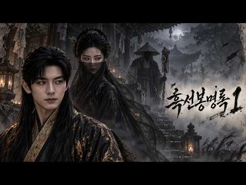
- 설명 앞부분: [설명] 조선의 밤, 죽은 자들이 다시 일어나기 시작한다. 왕명을 받들어 인간의 힘으로는 감당할 수 없는 기이한 사건을 해결하는 봉명방사(奉命方士), 서하. 황해도 곡산에 나타난 시귀들. 그리고 그들을 토벌하기 위해 움직이는 서하와 요괴 토벌 정예부대 암영단. 하지만 서하는 평소와 달리 직접 전투에 나서지 않고, 조용히 모든 것을 지켜보기만 하는데... 《흑선봉명록》의 새로운 시작, 첫 번째 이야기입니다. [AI 제작 / AI Production] 《흑선봉명록》은 다양한 생성형 AI 도구를 활용하여 제작한 AI 기반 실사 판타지 …
- 같은 채널 평소 대비 ×1.7 (채널 최근 롱폼 중앙값 118,454회) · 평소 영상: 흑선봉명록 6화 ∣ 영혼을 모으는 무당 The King's Mystic: Chronicl… (127,735회) / 흑선봉명록 5화｜비극의 시작 ∣ The King's Mystic: Chronicles o… (109,172회)
- 대본 없음 (설명) — 음성인식이 끝나면 도입부·흐름이 들어감
- 댓글 133/146: 좋은 점 — 영상 0 · 감사·응원 8 · 더 알고 싶은 것 3 · 아쉬운 점 — 영상 0 · 반박·불만 — 의견 다름 1 · 정치·사회 2 · 경험 공유 3 · 구독·다음 기대 7
  - 감사·응원 👍29 “정말이지 어쩔수가 없는 프로정신 구독자를 위함이라셔도 좋은 작품에 대한 욕심 또한 대단하신듯 합니다. 건강 상하시지 않는 것이 제일 우선시 되어야 할것 같습니다. 수준 높으신 구독자 분들께선 이런 이유라면 충분히 기다리며 좋은 작품을 기다릴수 있을겁니다. 말이 쓸데없…”
  - 감사·응원 👍7 “아니아니 이럴수가!!! 드디어 1편이!!! 정말 감사합니다. 얼마나 힘드셨을까요... 1편과 함께 4편도 제작했다니... 일단 댓글부터 달고 영상 봅니다. 정말 고생하셨어요. 감사합니다!!!! 🎉😂😊”
  - 더 알고 싶은 것 👍2 “4번 보고 있습니다. 건강 챙겨 가시면서 만들어 주세요..😊😊”
  - 더 알고 싶은 것 👍1 “혹시 이거 썸네일 그림 그록으로 뽑으셨나요?제얼굴처럼 나와서 ㅠ.ㅠ다른게아니라 제가그록으로 제얼굴로 유튜브 영상작업많이했어가지고 그록이 전체서버에 남을수도있다고해서 학습된것같아서 그록으로 생성하신건지 궁금해서 여쭤봅니다 ㅠㅠ 요즘따라 제얼굴이 다른사람들 그록생성작품에…”
  - 정치·사회 👍1 “남녀 주인공들 헤어스타일과 복식을 중국 스타일로 한 게 참 아쉽네요. 그것만 빼면 일반서민들 복식과 관아 사또, 포졸들 그리고 고을 건축양식까지 전부 한국사극 그대로 재현해놓았는데 유일하게 주인공들만 중국인들 데려다 놓은 것처럼 중국스타일의 머리모양과 의복을 해놓은 …”
  - 정치·사회 👍0 “조선 판타지 사극인데.. 주인공이 외모부터 의상까지 너무 중국인 같아요~~ 무비자로 조선 귀화한 화교인가요??”
  - 경험 공유 👍4 “오!제가1등이군요? 잘 보겠습니다”
  - 경험 공유 👍1 “와 디테일 미쳤다리 내가 본것중에 제일이네 왜만해서는 잘한다고 안하는 성격인데 정말 얼마나 노력했을까라는 딱봐도 정말 작품이 너무 디테일하게 잘했어 넘 쪼앙 최고얌”
  - 구독·다음 기대 👍13 “다음편도 기대할께요😊”
  - 구독·다음 기대 👍7 “늘 다음편이 기다려지는 멋진 작품 감사해요”

### 234. "충무공에 푹 빠진 미국" 초능력도 없는 400년 전 이순신 장군 이야기에 열광하는 진짜 이유

- https://www.youtube.com/watch?v=HlGkmhX0J6c · 코믹스 경제 · 구독자 35,700 · 조회수 380,313 (×10.7, 하루 7,891.3) · 좋아요 2,586 (0.7%) · 24.1분 · 2026-09-23 · 주제 묶음 3. 조선 · 형식 애니메이션·지도 · 폴더 `W_HlGkmhX0J6c` (웹 승인)
- 썸네일: 
- 설명 앞부분: 📚 【교육 콘텐츠】 "아시아 이야기는 안 팔린다던 미국에서, 조선 장군이 25만 부를 팔았습니다." 🇰🇷 미국 출판사들은 이순신 만화를 한 곳도 빠짐없이 돌려보냈습니다. 이유는 딱 하나, 아시아 이야기라서였습니다. 시카고의 한 미국 만화가는 16년 동안 코믹콘 장터를 돌며 이 책을 손으로 팔았습니다. 마블과 DC가 시장의 63%를 쥔 미국 한복판에서요. 🎬 이번 영상의 핵심 정보 ✓ 드라마 DVD 한 장이 미국 청년의 인생을 바꾼 과정 ✓ 가게에 들어가지 못한 책을 행사장마다 매진시킨 판매 전략 ✓ 스탠 리가 서문을 쓰고 업계 거…
- 같은 채널 평소 대비 ×7.1 (채널 최근 롱폼 중앙값 53,563회) · 평소 영상: "아마존도 포기한 걸 해냈다고?" 한국인들이 유달리 똑똑한 진짜 이유, 속도와 효율성이 … (53,563회) / "미국마저 등 돌렸다!" 100년 동안 독점하던 질레트, 한국 도루코 6중날에 무너진 진… (57,351회)
- 대본 없음 (설명) — 음성인식이 끝나면 도입부·흐름이 들어감
- 댓글 154/154: 좋은 점 — 영상 0 · 감사·응원 4 · 더 알고 싶은 것 2 · 아쉬운 점 — 영상 2 · 반박·불만 — 의견 다름 4 · 정치·사회 13 · 경험 공유 2 · 구독·다음 기대 0
  - 감사·응원 👍4 “감사합니다. 만화책 만들려고 한국에 여러차례 와서 공부하고 배우고 갔어요.”
  - 감사·응원 👍2 “온리 콤판! 진심으로 감사합니다. 17년간 이순신 알리기에 목숨을 걸었다니... 그것도 순 미국인이...”
  - 더 알고 싶은 것 👍14 “구역질나는 정치판 꼴을 보다 참으로 오랜만에 신선한 보람을 느꼈습니다. 참 설명 내용과 화면이 가슴 벅차게 하네요. 국운이 이렇게 사방에서 상승하건만 우리 국민들의 진가는 언제 쯤 발현 될 수 있을까요?”
  - 더 알고 싶은 것 👍10 “와 이순신장군을 미국인이 만화로 그렸다고 대단하다 콤판 대단하다 이제 k콘텐츠 바람을 타고 1위는 따논당상이다 과연 미국인이 한국인의 정서를 얼마나 잘 전달했을지 궁금하다”
  - 아쉬운 점 — 영상 👍0 “이순신이 100원짜리 동전이고, 새가 500원짜리고, 천원, 오천원 짜리의 인물은 뭐냐? 만원 짜리 세종은 억지로 이해 하겠다만, 신사임당이 오만원짜리 라니 참 우습다 오래전에 오백원 커다란 짜리 지폐가 있었는데 거북선 이었지? 화폐 디자인 좀 바꾸자, 미국은 조지워…”
  - 아쉬운 점 — 영상 👍0 “Ai목소리가 좀 구리네 신경좀 쓰세요”
  - 반박·불만 — 의견 다름 👍1 “한국의 아무도 못한것을 미국인이 해 냈군요 ..10년전에 미국에 5성호텔에 갔을때 후론트 남자직원이 '이순신'을 알고 있다고 감동이었다고 한국인을 다시 보게 되었다고 .. 내게 말한적이 있었습니다.. 이 무명작가의 말도 안되는 노력이었군요 ...대한민국 정치인 수천명…”
  - 반박·불만 — 의견 다름 👍0 “동벌이도 좋고 뽕도 좋은데..제발 선은 지키자. 선동 꺼리라도 되면 그나마 인정.. 쌩 구라 수준이면 이건 범죄야”
  - 정치·사회 👍50 “콤판은 대단한 미국인입니다. 한국정부가 콤판에게 표창장이라도 수여해야 할 듯 합니다.”
  - 정치·사회 👍25 “한국 정부나 삼성이나 현대같은 기업은 저런 사람 후원 안하고 뭐하고있나? 삼성도 이제는 국가 마케팅을 해야할 때 아닌가? 20년 전에는 한국 기업임을 숨기고 일본 기업처럼 속였으나, 이젠 한국 마케팅 해야할 때가 아닌가? 이제는 국가 홍보도 좀 하고 문화, 예술영역에…”
  - 경험 공유 👍1 “이순신 해전 이야기를 "오딧세이" 영화 처럼 만들날이 왔으면 합니다. 내가 돈이 있으면 미국에서 만들어 보고 싶네요.”

### 235. 그리스 로마 신화 완벽 정리 : 태초의 창세부터 올림포스 12신, 트로이 전쟁의 종말까지 [🌙꿀잠 오디오북]

- https://www.youtube.com/watch?v=_KdSJr42TXI · 달빛 세계사 · 구독자 19,400 · 조회수 437,153 (×22.5, 하루 4,277.7) · 좋아요 2,914 (0.7%) · 80.3분 · 2026-07-31 · 주제 묶음 10. 수면·낭독 · 형식 수면·낭독 (잠잘 때 듣는) · 폴더 `W__KdSJr42TXI` (웹 승인)
- 썸네일: 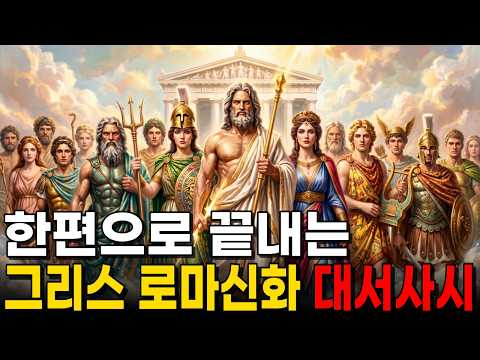
- 챕터: 0:00 아버지를 삼킨 신들 : 카오스, 우라노스, 그리고 크… · 8:29 거인들의 대격돌 : 티타노마키아와 올림포스 핵심 신들… · 16:56 인간의 탄생과 대홍수 : 프로메테우스의 불꽃과 데우칼… · 27:20 올림포스의 밀실 : 사계절의 기원과 디오니소스의 비극 · 35:08 신의 영역을 침범한 자들 : 메두사, 아라크네, 그리… · 43:20 영웅들의 수난사 (상) : 페르세우스의 모험과 헤라클… · 54:23 영웅들의 수난사 (하) : 테세우스의 미궁과 이아손의… · 65:06 황금사과와 10년의 전쟁 : 불화의 여신과 트로이의 … · 71:38 트로이의 목마와 영웅들의 종말 : 아킬레우스의 비극과…
- 설명 앞부분: 태초의 혼돈 카오스에서 시작된 세상을 바꾼 위대한 창세 신화, 올림포스 12신의 치열한 권력 투쟁과 신의 피를 물려받은 영웅들의 거대한 수난사, 그리고 지상에서 신들의 시대가 막을 내리는 트로이 전쟁의 거대한 불꽃까지. 그리스 로마 신화의 전체 궤적과 핵심 서사를 빠짐없이 담아낸 통합 풀버전입니다. 차분하고 정갈한 스토리텔링과 함께 고대 신화가 오늘날 우리 삶과 운명에 던지는 깊은 인문학적 통찰을 느껴보시기 바랍니다. ⏱️ 타임라인 [에필로그] 신화가 인간에게 던지는 질문 : 오만, 운명, 그리고 삶의 본질 [콘텐츠 안내] 본 영…
- 같은 채널 평소 대비 ×7.7 (채널 최근 롱폼 중앙값 56,802회) · 평소 영상: 인류 역사상 가장 잔혹하고 기묘했던 문명, 마야는 왜 흔적도 없이 사라졌을까? [🌙 꿀잠… (60,433회) / 초고대문명, 세계 최초의 완벽한 도시가 사라진 이유, 인더스 문명 5,000년의 수수께끼… (53,172회)
- 대본 없음 (설명) — 음성인식이 끝나면 도입부·흐름이 들어감
- 댓글 91/91: 좋은 점 — 영상 3 · 감사·응원 6 · 더 알고 싶은 것 3 · 아쉬운 점 — 영상 1 · 반박·불만 — 의견 다름 1 · 정치·사회 0 · 경험 공유 5 · 구독·다음 기대 1
  - 좋은 점 — 영상 👍9 “너무 유익하게 잘들었습니다”
  - 좋은 점 — 영상 👍8 “어제 오디세이를 보고 호기심 해결했습니다. 너무 유익하게 잘 들었습니다. 감사합니다.”
  - 감사·응원 👍12 “오디세이 보고 전체적인 맥락이 궁금해서 찾아봤어요... 많은 이해가 되었습니다. 자세한 설명과 그림에 감사드려요..❤”
  - 감사·응원 👍8 “어제 오디세이를 보고 호기심 해결했습니다. 너무 유익하게 잘 들었습니다. 감사합니다.”
  - 더 알고 싶은 것 👍12 “오디세이 보고 전체적인 맥락이 궁금해서 찾아봤어요... 많은 이해가 되었습니다. 자세한 설명과 그림에 감사드려요..❤”
  - 더 알고 싶은 것 👍4 “근데 오디세이에서 키클롭스는 포세이돈의 아들이랬는데 여기서는 우라노스의 아들이라고 하시는데 뭐가 맞는건가요??”
  - 아쉬운 점 — 영상 👍0 “광고가 너무길다”
  - 반박·불만 — 의견 다름 👍2 “말도안돼는스토리”
  - 경험 공유 👍84 “제가 어렸을적 계몽사 라는 출판사에서 50권짜리 세계명작전집이 집에 있었습니다 . 1권이 그리스신화 2권이 호머이야기였던가 .. 그 호머이야기가 트로이전쟁을 소재로했던거같은데 어릴때 읽기는읽었지만 내용을 온전히 이해하지못한채 전쟁장면묘사에 집중했던거같네요 .. 어릴때…”
  - 경험 공유 👍0 “내가 우지호를 낳았다.”
  - 구독·다음 기대 👍2 “오디세이 영화보고 바로 정주행 시간이 가는줄 모르고 과자 3봉지 순삭 감사합니다 😊”

### 236. 충격실화! 조선시대 헬보직 T0P5 ─ 출근길이 황천길이었습니다.

- https://www.youtube.com/watch?v=Uu3Hv3Ft2VA · 역사 뒷풀이 · 구독자 1,720 · 조회수 65,107 (×37.9, 하루 377.7) · 좋아요 886 (1.4%) · 12.5분 · 2026-05-22 · 주제 묶음 3. 조선 · 형식 정보·해설 (그 밖) · 폴더 `W_Uu3Hv3Ft2VA` (웹 승인)
- 썸네일: 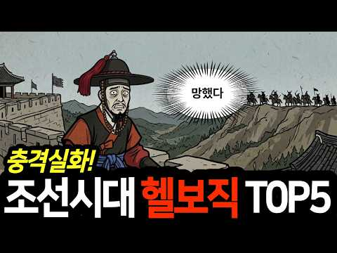
- 설명 앞부분: 과거 급제하고도 도망친 사람들이 있었습니다. 조선의 엘리트들이 죽기보다 싫어했던 헬보직 5가지, 1위는 意외로 여러분이 매일 감탄하는 그것과 연결됩니다. 고됨과 고통의 종류가 달라 순위는 주관적입니다. 여러분이 생각하는 순위를 댓글로 알려주세요.
- 같은 채널 평소 대비 ×46.8 (채널 최근 롱폼 중앙값 1,391회) · 평소 영상: 대감집 숨은 권력자들 ─ 조선시대 실세 하인 TOP5 │한국사│조선역사 (1,391회) / 충격실화! 조선시대 땅부자 TOP 5 ─ 현재 가치로 계산해봤습니다 (1,271회)
- 대본 없음 (설명) — 음성인식이 끝나면 도입부·흐름이 들어감
- 댓글 78/78: 좋은 점 — 영상 0 · 감사·응원 2 · 더 알고 싶은 것 2 · 아쉬운 점 — 영상 0 · 반박·불만 — 의견 다름 1 · 정치·사회 1 · 경험 공유 1 · 구독·다음 기대 0
  - 감사·응원 👍3 “230번째 like 👍 감사합니다요 ! 항상 건강하시고 행복하세요 !”
  - 감사·응원 👍1 “조선시대 지방도 제일 좋은데가 평양 감사 아닌가요 맨날 예쁜 기생들과 술판에 놀고 먹으니까”
  - 정치·사회 👍1 “국힘스럽던나라”
  - 경험 공유 👍0 “그래도 조선은 낫다. 동아시아 최고의 헬보직 원탑! *일남태수* 그 곳으로 유배를 당하면 장례식 먼저 치르고 출발한다는 전설의 유배지, 악명높은 그 곳, *중국 역사상 최고의 지옥 일남.* 날씨는 허구한날 40도에 폭염 아니면 기약없는 폭우에, 물고기 한 번 잘못 먹…”

### 237. "정약용이 인정한 조선 후기 1위?" 역사 자체를 바꿀 수 있었던 최고의 천재

- https://www.youtube.com/watch?v=Z37l5sHivjA · 한국사 다시읽기 · 구독자 29,900 · 조회수 621,752 (×20.8, 하루 6,526.9) · 좋아요 6,849 (1.1%) · 24.3분 · 2026-08-07 · 주제 묶음 1. 역사 일반·이야기 · 형식 브이로그·직접 해본 이야기 · 폴더 `W_Z37l5sHivjA` (웹 승인)
- 썸네일: 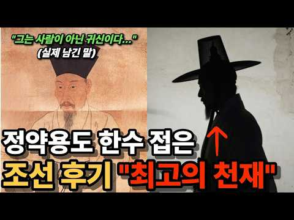
- 챕터: 0:00 🎙️ 오프닝 ∣ 정약용이 '귀신'이라 부른 사나이 · 1:39 📜 나모전 사건 ∣ 정약용을 무너뜨린 글자 하나 · 4:47 ✍️ '지이' 두 글자 ∣ 시험장에서 벌어진 일 · 6:05 🌙 소동파 시구 ∣ 남의 마음까지 읽어내다 · 10:29 🔭 서학과 천문·수학 ∣ 시대를 앞선 지성과 정조의 … · 16:47 🛡️ 무너진 방패 ∣ 정조의 죽음과 신유박해 · 19:02 🕯️ 지워진 이름 ∣ 옥중의 최후
- 설명 앞부분: 🎬 "내가 죽으면 조선의 미래는 끝난다" — 정약용이 '귀신'이라 불렀던 후기 원탑 천재 ⏱️ 타임라인 📚 참고 자료 『조선왕조실록』(정조실록·순조실록), 『일성록』 성대중, 『청성잡기』 / 황사영, 「백서」 — 당대 인물평 한국민족문화대백과사전(이가환·이익), 국사편찬위원회 우리역사넷, 한국고전종합DB ⚠️ 안내 본 영상의 일부 이미지는 생성형 AI로 제작되었으며, 실제 역사 속 인물과 장면의 모습과는 다를 수 있습니다. 시청에 참고해 주세요. 🙏
- 같은 채널 평소 대비 ×107.9 (채널 최근 롱폼 중앙값 5,761회) · 평소 영상: '최대 1000명 숙청...' 남인의 핵심 정약용은 왜 살려둔 걸까? (5,761회) / "철의 여인 정희왕후" 세조의 아내가 조선 최고의 대모인 이유 (5,944회)
- 대본 없음 (설명) — 음성인식이 끝나면 도입부·흐름이 들어감
- 댓글 557/612: 좋은 점 — 영상 5 · 감사·응원 12 · 더 알고 싶은 것 3 · 아쉬운 점 — 영상 5 · 반박·불만 — 의견 다름 10 · 정치·사회 57 · 경험 공유 11 · 구독·다음 기대 2
  - 좋은 점 — 영상 👍5 “좋은 내용 감사합니다. 그림에 신발 신은 모습이 아쉽습니다. 버선 신은 모습이었으면 합니다. ^^;”
  - 좋은 점 — 영상 👍3 “역사 공부 잘 배웠습니다”
  - 감사·응원 👍139 “조선의 귀한 인물을 알게 하셔서 감사합니다.”
  - 감사·응원 👍67 “와우.. 그 정약용조차 경악하던 천재라니 놀랍네요. 이런 사람을 알게되어 감사합니다.”
  - 더 알고 싶은 것 👍8 “최고입니다 이런 역사얘기 많이올려주세요 ^^”
  - 더 알고 싶은 것 👍1 “당시 백성들은 왕이 바뀌면 어떻게 느꼈을까요?”
  - 아쉬운 점 — 영상 👍5 “좋은 내용 감사합니다. 그림에 신발 신은 모습이 아쉽습니다. 버선 신은 모습이었으면 합니다. ^^;”
  - 아쉬운 점 — 영상 👍0 “정약용은 이가환을읆엇다 사질뻔한천재르남김🎉🎉🎉❤❤❤”
  - 반박·불만 — 의견 다름 👍29 “요즘 인공지능에 비할 천재인듯.. 아까운 인재가 서학의 괴수라는 누명으로 고문받다 고통스럽게 옥사. 이런 천재의 .어이없는 죽음이 간신배들의 모략이었음이 안타까움을 넘어 조선역사의 어마어마한 손실이 되었네요. .. 천재는 천재를 알아본다고 이가환 정약용같은 인물들이 …”
  - 반박·불만 — 의견 다름 👍1 “대한민국은 식민사관과 반국가세력들에 의한 민족의 역사와 정체성을 왜곡선동에 의해 거짓속에서 몇세대가 살아왔습니다. 허울좋은 간판에 집착하고 실제를 모른채 암기하고 자격증따고 학위받았으나. 진짜실력을갖춘사람들을 내쳤지요 그래서 힘든 대한민국이지만 진실에 이끌려 나라를 …”
  - 정치·사회 👍195 “이가환이 어떤 인물인지 처음 알고 탄식이 나옵니다. 지금도 시대에 저항하는 족속들이 나라의 녹을 먹으며 고개를 빧빧히 들고 삽니다. 우리 사회가 외국인들이 말하듯 부러운 사회인지 의심하지 않을 수 없습니다.”
  - 정치·사회 👍84 “조선중후기 실학적인 남인이 계속 정권을 잡았다면 한국역사는 완전히 달랐을텐데..노론의 이름은 민족의 역사에서 근본주의 패거리이익 우물안개구리 어리석음 무능력..으로 영원히 기록되고 타산지석으로 삼아야한다.”
  - 경험 공유 👍17 “지금도 그래. 좌우로 나뉘어 서로 죽일듯이 물고 뜯으니, 국가적 에너지 낭비가 너무 심하다. 니가 죽어야 내가 사는 이 구조를 뜯어 고치지 않으면 대한민국 성장 엔진도 꺼질 것. 국민들이 먼저 깨어야 한다. 당리당략보다 국가를 위해 옳은 말을 하고 옳은 정치를 하는 …”
  - 경험 공유 👍4 “이가환을 아냐구요? 내가 아는 천재중에 최고였어요.”
  - 구독·다음 기대 👍3 “참 좋은 체널입니다. 구독합니다”
  - 구독·다음 기대 👍0 “이 채널을 통해 귀한 사실을 알게되네요. 정조대왕이 좀 더 오래 살았다면 조선의 운명이 바뀌었을텐데… 😢 앞으로 채널의 활약이 기대됩니다! 구독하고 갑니다 👍👍👍”

### 238. 세계 고고학계가 은폐하려던 미스터리 ㅣ 전세계 고인돌 40%가 왜 한국에 서 있나 ㅣ 한국사

- https://www.youtube.com/watch?v=2vAcvC3aPNE · 대한역사 · 구독자 4,760 · 조회수 151,914 (×31.9, 하루 1,037.1) · 좋아요 3,087 (2.0%) · 23.3분 · 2026-06-17 · 주제 묶음 4. 한국 근현대사 · 형식 정보·해설 (그 밖) · 폴더 `W_2vAcvC3aPNE` (웹 승인)
- 썸네일: 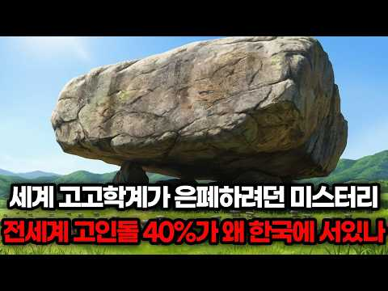
- 설명 앞부분: 우리가 속았던 4대 문명의 진실, 세계 고고학계가 끝내 풀지 못한 미스터리. 전세계 고인돌의 무려 40$, 4만기가 왜 유독 한반도라는 작은땅에 집중되어 세워졌을까요? 3000년 전 청동기 시절, 280톤짜리 거대 돌덩이를 맨손으로 움직엿던 청동기 한반도인들의 충격적인 기술력과 사회구조. 그리고 우리가 역사 교과서에서 한번도 의심해본적 없던 4대 문명이라는 틀뒤에 숨겨진 정치적 조작과 왜곡의 실체를 낱낱이 파헤칩니다. 요령에서부터 한반도 남단까지 정확히 일치하는 비파형 동검, 미송리식 토기, 그리고 고인돌 레이어. 이 거대한 체계…
- 대본 없음 (설명) — 음성인식이 끝나면 도입부·흐름이 들어감
- 댓글 270/270: 좋은 점 — 영상 4 · 감사·응원 3 · 더 알고 싶은 것 0 · 아쉬운 점 — 영상 2 · 반박·불만 — 의견 다름 5 · 정치·사회 6 · 경험 공유 9 · 구독·다음 기대 0
  - 좋은 점 — 영상 👍34 “70년대 국사를 배울 때는 세계의 고인돌 중 70%가 한반도에 있다고 배웠다. 그런데 요즘은 40%라고 해서 세계 다른 곳에서 계속 발굴되고있나? 의문이 들었다.”
  - 좋은 점 — 영상 👍8 “너무 좋은 내용입니다. 고인돌과 관련유적을 더 연구하여 5대 문명 중 하나임을 밝혀야 할것 같습니다.”
  - 감사·응원 👍5 “알려주셔서 감사합니다”
  - 감사·응원 👍1 “우리의 문명을 다시 쓰자! 대한 문명? 고조선 문명, 새로운 문명을 만들어 주어 감사합니다. 이것이 자긍심이다. 내 마음에 다시 한 켜의 자부심이 쌓였습니다. 기회되면 화순으로 고인돌 여행가자!”
  - 아쉬운 점 — 영상 👍0 “없다 아쉽네요”
  - 아쉬운 점 — 영상 👍0 “내용이 너무 길어요,,,,,15분 내외가 좋아요”
  - 반박·불만 — 의견 다름 👍10 “서구 역사와 문명사는 전체가 다 거짓으로 그야말로 망상이 더해진 창작소설 입니다. 고사리는 5억년전 고생대 중생대 화석에 새겨진 식물입니다. 그걸 한민족이 먹고 살았다고요. 고인돌이 청동기 시대 유적이라는 데 고인돌은 그보다 까마득히 오래된 선사시대의 영역표시입니다.…”
  - 반박·불만 — 의견 다름 👍3 “고인돌은 무덤이 아닙니다. 하늘에 제사 지내던 제단입니다. 고인돌 주변에서 인골이 발견되었다고 해서 무덤으로 잘못 알고 있는 것입니다. 구약성경에서와 같이 내 죄를 대신해서 고인돌 위에 동물(양 등)을 잡아 올려놓고 불태우는 것입니다.”
  - 정치·사회 👍3 “3000년전이 아닙니다. 몇천년 더 오래됐죠. 아니 몇만년일지도...한국역사학계는 우리역사를 축소시켰습니다. 비파형동검은 요하문명족=고조선족의 유물이고 중국 산동및 화북지방에서도 발견됩니다. 고조선의 영역을 말해주죠. 우리 역사학계는 매국노로 가득합니다. 자국 역사를…”
  - 정치·사회 👍1 “4대 문명이란 하계용어 없다 중국인 양계초의 컴플렉스 표현!”
  - 경험 공유 👍10 “진짜 고인돌이 많았었다. 밭 하나가 전부 고인돌이였음. 어릴적 고인돌에 올라 가서 잡기놀이 했었다. 지금 가 보니 모두 정비하고 사라짐. 1만년 전부터 우리서해와 중국쪽으로 연결된 거대 문명 (고조선?)이 있었고, 갑자기 해수면 상승으로 별이된 흔적이 고인돌로 추측.”
  - 경험 공유 👍0 “육십년대엔가까운낮은산엔작은고인돌들이많았었다근데육십년대후반엔그게다없어졌다고인돌뿐아니라그게뭔지모르겠는데미니왕릉묘가크지않은데밑엔이끼가잔뜩낀돌테두리가있고앞엔신하들석상들이작은데양쪽으로쭉여러개가있는왕능으로보이는묘들과뭔지모를비석한문으로잔뜩써있는데굉장히오래되보이는크고중간작은비석들이…”

### 239. 미국 인터넷을 뜨겁게 달군 "이순신 장군 열풍"뜨거운 댓글 반응 / “이런 사람이 진짜 있었냐” 지금 미국이 이순신에 열광하는 진짜 이유

- https://www.youtube.com/watch?v=iuHGTcdrKzs · 홍시채널 · 구독자 46,300 · 조회수 481,325 (×10.4, 하루 10,089.7) · 좋아요 5,962 (1.2%) · 26.3분 · 2026-09-23 · 주제 묶음 3. 조선 · 형식 애니메이션·지도 · 폴더 `W_iuHGTcdrKzs` (웹 승인)
- 썸네일: 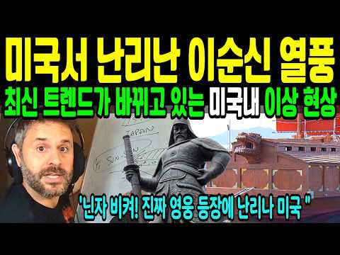
- 설명 앞부분: 이제 한국 역사까지 파고 있는 미국인들 동북아 역사에 대한 미국인들의 뜨거운 관심 '닌자 사무라이 비켜' '실존 영웅 나가신다' 미국의 한 만화 가게, 슈퍼맨과 배트맨이 늘어선 진열대 사이에 낯선 얼굴 하나가 놓여 있습니다. 400여 년 전, 배 열세 척으로 133척의 적을 막아낸 조선의 장군. 닌자와 사무라이에 열광하던 미국 젊은 세대가 이제 "진짜 영웅"을 찾아내고 눈을 반짝이고 있습니다. 미국 해군이 100년 전부터 주목했던 그 이름, 이순신. 지구 반대편에서 다시 살아나고 있는 그의 이야기를 지금 만나보세요. ⚠️ 안내 사…
- 같은 채널 평소 대비 ×5.0 (채널 최근 롱폼 중앙값 95,516회) · 평소 영상: '유럽에는 없는데 한국에는 있다' 외국인들이 한국 산에 와보고 놀라는 이유, "한국은 축… (102,906회) / “한국이 날 망쳐놨어요” 미국으로 돌아간 그가 남긴 말 ∣ 외국인들이 말하지 못한 한국의… (104,238회)
- 대본 없음 (설명) — 음성인식이 끝나면 도입부·흐름이 들어감
- 댓글 473/477: 좋은 점 — 영상 3 · 감사·응원 36 · 더 알고 싶은 것 2 · 아쉬운 점 — 영상 3 · 반박·불만 — 의견 다름 7 · 정치·사회 32 · 경험 공유 14 · 구독·다음 기대 1
  - 좋은 점 — 영상 👍182 “이순신 장군은 현실 영웅입니다 만화 영웅하곤 차원이 다릅니다 현신했던 레전드 입니다 가장 유명하고 한국인은 잊지말아야할 장군님의 가르침은 " 왜는 간사하기 짝이없어 신의를 지켰다는 얘기를 들은적이 없다 " 였습니다”
  - 좋은 점 — 영상 👍4 “귀에 쏙쏙 들어오네요. 도서관에서 블루투스로 집중해서 듣고 있어요. 구독, 꾹 하고 갑니다.”
  - 감사·응원 👍68 “이순신 장군 최고이십니다 😊 대란민국 화이팅🎉🎉🎉”
  - 감사·응원 👍36 “대한민국 화이팅! 이순신 장군님 만세!”
  - 더 알고 싶은 것 👍1 “이순신 장군님은 진짜 영웅입니다 세게에 알려주세요”
  - 더 알고 싶은 것 👍0 “아무리 그래도 진실은 알고 합시다. 난중일기 읽어보면 그 당시 문화였지만 수많은 관노들과 잠자리를 하고 직접 기록한 기록들이 많이 있습니다. 그럼에도 우리 민족의 가장 위대한 영웅 중 한명이라는 사실은 변함 없습니다. 단, 대조적으로 조선의 왕이란 것들과 문관 양반이…”
  - 아쉬운 점 — 영상 👍1 “국뽕이 아니라 아쉬움만 듭니다. 지구 역사상 가장 위대한 제독! 그 분을 이제사 지구인들이 알게되었다는 것! 그것은 우리의 국력이 세계 5위에 이르렇을매 가능하게 되었다는 것! 나는 이번달 초에 스파이더맨을 보면서 너무 너무 유치하고 촌스럽고 말도 안되는 100% 거…”
  - 아쉬운 점 — 영상 👍1 “이순신 장군님은 실제 영웅 이시니까...사무라이? 이게 미친 놈들인게 사무라이 자체가 악당이었지 칼 시험한다고 지들 백성들을 베고 다닌다는게 말이 되나? 미개하고 미친놈들일 뿐이었지. 그리고 화면을 좀더 연구하세요 같은거 돌리고 또 이거 짜집기 저거 짜집기 보기 안좋…”
  - 반박·불만 — 의견 다름 👍1 “국뽕이 아니라 아쉬움만 듭니다. 지구 역사상 가장 위대한 제독! 그 분을 이제사 지구인들이 알게되었다는 것! 그것은 우리의 국력이 세계 5위에 이르렇을매 가능하게 되었다는 것! 나는 이번달 초에 스파이더맨을 보면서 너무 너무 유치하고 촌스럽고 말도 안되는 100% 거…”
  - 반박·불만 — 의견 다름 👍1 “넬슨은 이순신에 견줄 수준이 못되지. 넬슨은 당시 영국이라는 강력한 국가의 최대의 지원을 받으며 싸웠고, 이순신장군님은 이건 그냥 나가서 죽으라는 환경이었음. 말도 안되는 최악의 여건에서 그냥 너무 쉽게 개발라버림. 압살함. 넬슨은 어디까지나 인간의 범주고, 이순신 …”
  - 정치·사회 👍49 “그동안 우리나라가 너무 힘이 없어 전세계가 알지도 못했고 관심도 없었기 때문입니다. 지금은 우리나라의 국력이 엄청나게 상승해서 세상이 관심을 갖게되고 역사를 알게 되어 비로소 이순신장군을 알게되었다고 생각합니다. 그래서 국력이 중요하다고 생각합니다”
  - 정치·사회 👍19 “이순신 장군님이 목숨걸고 지켜낸 이강토 이강산을 중국인들과 불체자들이 야금야금 잠식하고 있는 현실이 너무 슬프다~~ㅠ”
  - 경험 공유 👍66 “내가 세상에서 제일 존경하는 두분이 있습니다 충무공 이순신님 세종대왕님”
  - 경험 공유 👍29 “인품도 대단하셨지요. 감옥을 방문해보고 포로된 일본군 소년에게 명심보감을 보내 주면서 감옥에서 공부하도록까지 해 주셨지요.. 제가 고등학교 다니던 1968년. 광화문에 전차가 없어지고 이순신 장군 동상이 세워졌습니다(박정희 지시로 알고 있습니다. 왜정시대 일본군 했던…”
  - 구독·다음 기대 👍2 “헐리우드 대작 기대합니다 1억달러제작비 대작❤❤❤❤❤❤❤”

### 240. 일본이 이순신보다 두려워 했던 인물? '괴물'이라 부르며 두려워했던 조선의 영웅

- https://www.youtube.com/watch?v=Q9d1dEUVJHI · 역사스토리 · 구독자 21,700 · 조회수 443,926 (×20.5, 하루 4,664.3) · 좋아요 3,136 (0.7%) · 15.7분 · 2026-08-07 · 주제 묶음 3. 조선 · 형식 정보·해설 (그 밖) · 폴더 `W_Q9d1dEUVJHI` (웹 승인)
- 썸네일: 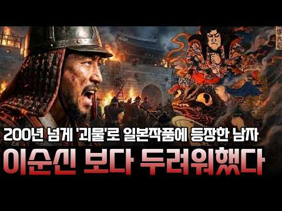
- 챕터: 0:00 일본 무대에 오른 조선인 요괴 · 0:59 모쿠소는 이름이 아니었다 · 2:09 일본군이 진주로 몰려온 이유 · 3:24 하필 그 자리에 있던 사람 · 4:36 6일 동안 무슨 일이 있었나 · 5:55 승리가 확정된 순간의 유탄 · 6:48 진주가 없으면 호남이 없다 · 7:50 히데요시의 섬뜩한 명령 · 10:12 죽은 사람이 무대에 오르다 · 12:27 조선의 기록은 한 줄이었다 · 13:25 400년 만에 돌아온 교서
- 설명 앞부분: 1804년 일본 가부키 무대에 거대한 두꺼비를 탄 남자가 등장합니다. 그가 복수를 다짐한 이유는 아버지가 일본군에게 목이 잘렸기 때문인데, 그 아버지는 일본인이 아니라 조선인이었습니다. 에도 시대 일본의 연극과 소설에는 '모쿠소'라 불리는 조선 장수가 200년 가까이 단골로 등장했습니다. 산에서 솟아나 일본군을 잡아먹는 괴물, 죽어서도 일본을 저주하는 원귀로 그려진 이 인물은 이순신 장군이 아니었습니다. 모쿠소는 사람 이름이 아니라 '진주 목사'라는 직책이 일본식으로 발음된 것이었고, 그 주인공은 임진왜란 3대 대첩 중 하나인 진…
- 같은 채널 평소 대비 ×383.9 (채널 최근 롱폼 중앙값 1,156회) · 평소 영상: 임금이 도망친 자리에서 혼자 칼 든 의병장, 전쟁 후 역적으로 몰린 이유 (1,203회) / 1·21 사태 총정리 ∣ 김신조 침투 루트·실미도·푸에블로호 연결고리까지 (1,110회)
- 대본 없음 (설명) — 음성인식이 끝나면 도입부·흐름이 들어감
- 댓글 417/417: 좋은 점 — 영상 12 · 감사·응원 13 · 더 알고 싶은 것 2 · 아쉬운 점 — 영상 3 · 반박·불만 — 의견 다름 13 · 정치·사회 31 · 경험 공유 8 · 구독·다음 기대 1
  - 좋은 점 — 영상 👍163 “경매에 나온것 조차 국가가 못가져오고 저것도 국민들 모금으로 가져온게 레전드네 이놈의 국가꼬라지 봐라”
  - 좋은 점 — 영상 👍29 “많은 것을 생각하게 하는 이야기였습니다. 좋은 영상을 올려 주셔서 정말 고맙습니다.”
  - 감사·응원 👍29 “많은 것을 생각하게 하는 이야기였습니다. 좋은 영상을 올려 주셔서 정말 고맙습니다.”
  - 감사·응원 👍27 “김시민 장군님 감사합니다! 당신의 호국 정신을 잊지않겠습니다!”
  - 더 알고 싶은 것 👍0 “제발 누가 영화로 만들어주세요~ 호프같은거 만들지 말고... 진짜 누가보면 한국 영웅은 이순신 장군 밖에 없는줄 알아요 뒤돌아보면 어벤져스 어셈블할만큼 이리도 영웅들이 많는데 안타깝습니다”
  - 더 알고 싶은 것 👍0 “김시민 장군님이 총에 안 맞고 일본 과의 전투를 지휘했다면 임진왜란 판세는 어떻게 변했을가요??”
  - 아쉬운 점 — 영상 👍1 “7:05 그동안 조선을 괴롭히던 보급문제라...ㅋ 하 자막이거 왜그러노 Ai로 만들어놓는 거 손도 안보나... 깝깝하네”
  - 반박·불만 — 의견 다름 👍1 “2005년도 1억이 없다고? 그 시절 1억이면 큰 돈도 아닌데 공무원들 먹고 쓰고 하는데 1억이면 껌값이였을건데 한심하다 .. 70년 80년 시절도 아니고 지들끼리 치고 박고 ㅈㄹ을 잘도 하면서 부끄럽다.”
  - 정치·사회 👍63 “한국사를 소홀히 해서는 나라가 바로 설수 없다. 국영수와 동급으로 올려라”
  - 정치·사회 👍1 “국민이 주인인 나라가 진심인 나라”
  - 경험 공유 👍41 “모쿠소 김시민 목사님이 지킨 진주외성을 제가 잘 정성다해 복원 설계하겠습니다.”
  - 경험 공유 👍27 “우리나라의 역사는 왜 ? 이렇게 가슴 아픈가.? 단지 내가 한국인 이어서 그런것일까??”

