# 역사 — 성공 사례 분석: 사례별 자세히 #241–#280

`analysis.md` 의 9번 (같은 # 번호). 자동 생성 — `tools/success_analysis.py` v1.5.1 (2026-10-24 07:34 UTC). ※ 연구·교육용 — 투자 권유가 아님.

### 241. 왕자 6명을 죽이려던 '정도전' 그날 밤 왜 보초도 없이 웃고 있었나?

- https://www.youtube.com/watch?v=k_3kn2lXbjg · 역사 한 숟갈 · 구독자 7,920 · 조회수 314,556 (×39.7, 하루 1,795.5) · 좋아요 5,217 (1.7%) · 64.5분 · 2026-05-02 · 주제 묶음 기타 · 형식 정보·해설 (그 밖) · 폴더 `W_k_3kn2lXbjg` (웹 승인)
- 썸네일: 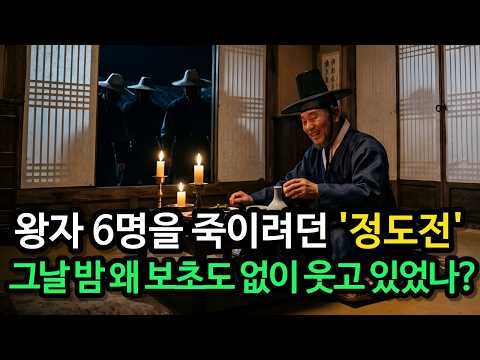
- 설명 앞부분: "이방원은 조선을 세운 최대 공신이다." 우리 모두가 끄덕이는 이 문장, 사실은 틀렸습니다. 1392년 조선 개국공신 명단 어디에도 이방원의 이름은 없었습니다. ✋ 빠뜨린 게 아닙니다. 태조 이성계가 의도적으로 뺀 겁니다. 🔹 25세의 핵심 공신은 왜 6년간 철저히 밀려났을까? 🔹 열 살짜리 막내 이방석은 어떻게 형 6명을 제치고 세자가 되었을까? 🔹 정도전은 정말 왕자들을 죽이려 했을까, 아니면 이방원이 먼저 판을 짠 걸까? 🔹 1398년 송현방,쿠데타를 기획한 사람들이 왜 보초도 없이 등불 아래 웃고 있나? 🔹 이성계의 여덟 …
- 같은 채널 평소 대비 ×280.9 (채널 최근 롱폼 중앙값 1,120회) · 평소 영상: 홍국영의 이름이 실록에서 사라진 믿기 힘든 이유 (1,132회) / 김구 암살범의 최후, 47년 뒤 몽둥이 하나에 벌어진 충격적인 일 (1,108회)
- 대본 없음 (설명) — 음성인식이 끝나면 도입부·흐름이 들어감
- 댓글 347/347: 좋은 점 — 영상 4 · 감사·응원 6 · 더 알고 싶은 것 2 · 아쉬운 점 — 영상 1 · 반박·불만 — 의견 다름 3 · 정치·사회 21 · 경험 공유 6 · 구독·다음 기대 0
  - 좋은 점 — 영상 👍3 “좋은 영상 감사합니다. 저절로 몰입해서 시청했습니다”
  - 좋은 점 — 영상 👍3 “1.고려 우왕시대의 사회상이 망국의 상황이였습니다. 2.문신은 붓이 힘이고 무신은 칼이 힘입니다. 3.조선은 고려 무신정변 주역 이의방 후손의 역사서입니다. 4.태조는 정도전을 믿었지 신권정치(내각제)를 몰랐을 겁니다. 5.이방원은 과거에 급제한 머리는 문신이지만 핏…”
  - 감사·응원 👍3 “좋은 영상 감사합니다. 저절로 몰입해서 시청했습니다”
  - 감사·응원 👍3 “1.고려 우왕시대의 사회상이 망국의 상황이였습니다. 2.문신은 붓이 힘이고 무신은 칼이 힘입니다. 3.조선은 고려 무신정변 주역 이의방 후손의 역사서입니다. 4.태조는 정도전을 믿었지 신권정치(내각제)를 몰랐을 겁니다. 5.이방원은 과거에 급제한 머리는 문신이지만 핏…”
  - 더 알고 싶은 것 👍2 “너무나도 편향된 시각에서 바라본 사례, 이런 시각으로 세상의 모든 것을 바라 본다먼 선과 악이 따로 있을까요?”
  - 아쉬운 점 — 영상 👍3 “방석이 왕권을 이어받는 걸 그냥 두면, 왕권의 제일 큰 위협인 본인의 목이 날아갈게 뻔한데.. 방원이 바보도 아니고, 순순히 그냥 당하고만 있겠나? 따라서 방원의 반발은 당연한 수순인데, 이성계와 정도전이 이걸 예상하지 못했다는 건 진짜 의문임.”
  - 반박·불만 — 의견 다름 👍2 “이 나라의 주인은 군왕이요 틀렸다 이 나라의 주인은 백성이다 그럼 임금은 뭐요 백성을 위한 도구 나같은 정씨 김씨 이씨 박씨 최씨 이들을 통털어 무어라 하는지 아느냐 뭐라고 합니까 백성이다 이제 내가 너와 함께 갈 수 없는 이유를 알겠느냐 ㅎㅎ”
  - 반박·불만 — 의견 다름 👍1 “정도전이 왕자들을 모두 죽이려 했다고? 말도 안되는 개소리.”
  - 정치·사회 👍64 “이방원이 손에 피를 묻힌건 이성계 잘못이다. 정권잡으려고 손에 피를 묻힌 세조와도 다르다.”
  - 정치·사회 👍5 “나라가 신하에 넘어가면 망하지”
  - 경험 공유 👍3 “지금의 시각에서 옛날 저 당시 상황을 살아보고 경험하지 않은 사람은 누가 잘했고 누가 잘못했는지를 섣불리 판단해서는 안되고 저 시대에서는 현재와는 다르게 전쟁이나 강직한 사람들의 성향으로 인해서 알지 못하거나 밝혀지지 않은 살벌한 시대적 분위기, 정서, 관습 등이 복…”
  - 경험 공유 👍2 “이 나라의 주인은 군왕이요 틀렸다 이 나라의 주인은 백성이다 그럼 임금은 뭐요 백성을 위한 도구 나같은 정씨 김씨 이씨 박씨 최씨 이들을 통털어 무어라 하는지 아느냐 뭐라고 합니까 백성이다 이제 내가 너와 함께 갈 수 없는 이유를 알겠느냐 ㅎㅎ”

### 242. 세키가하라 뒤에도 살아남은 도요토미 가문은 왜 15년 만에 무너졌나? ∣ 지도로 보는 임진왜란 그 후 3편

- https://www.youtube.com/watch?v=DohihpZrvjE · Terra Scripta · 구독자 1,820 · 조회수 71,127 (×39.1, 하루 9,293.4) · 좋아요 163 (0.2%) · 15.8분 · 2026-10-16 · 주제 묶음 3. 조선 · 형식 애니메이션·지도 · 폴더 `W_DohihpZrvjE` (웹 승인)
- 썸네일: 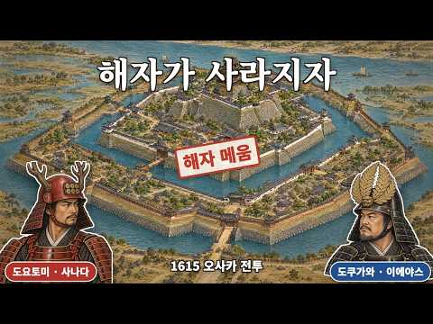
- 챕터: 0:00 질문 — 덴노지의 돌격 · 0:39 오사카성에 남은 도요토미 · 1:27 쇼군 자리는 도쿠가와가 잇는다 · 2:11 니조성 회견과 잇따른 죽음 · 3:11 종에 새긴 여덟 글자 · 4:22 쫓겨난 가로와 모여든 낭인 · 5:02 다시 만난 임진왜란의 장수들 · 6:07 겨울 전투 — 사나다마루와 세 겹 해자 · 7:41 대포와 강화 — 해자를 메우다 · 9:07 여름 전투 — 안개 속 도묘지 · 10:47 같은 날, 야오와 와카에 · 11:40 덴노지 — 이에야스 본진으로 · 13:05 오사카성이 불탄 날 · 14:11 끝난 전쟁, 그리고 조선 · 15:24 엔딩
- 설명 앞부분: 1615년 6월, 오사카성 남쪽 덴노지 벌판에서 사나다 노부시게의 붉은 군대가 도쿠가와 이에야스의 본진으로 돌격했습니다. 세키가하라에서 이에야스가 이긴 지 15년, 도요토미 가문은 아직 오사카성에 남아 있었습니다. 세키가하라 뒤에도 살아남은 도요토미 가문은 왜 15년 만에 무너졌을까요? 니조성 회견과 가토 기요마사의 죽음, 종에 새긴 여덟 글자, 다시 만난 임진왜란의 장수들, 겨울 전투의 사나다마루와 겹겹의 해자, 해자를 메운 강화, 여름 전투의 도묘지·야오·와카에·덴노지, 그리고 오사카성이 불탄 날까지 지도 위에서 따라갑니다. …
- 같은 채널 평소 대비 ×3.2 (채널 최근 롱폼 중앙값 22,278회) · 평소 영상: 한양을 20일 만에 함락한 일본군은 왜 조선을 정복하지 못했나? ∣ 지도로 보는 임진왜란… (26,912회) / 히데요시가 죽은 뒤, 7년 전쟁은 어떻게 끝났나? ∣ 지도로 보는 임진왜란 4편 (17,644회)
- 대본 없음 (설명) — 음성인식이 끝나면 도입부·흐름이 들어감
- 댓글 23/23: 좋은 점 — 영상 1 · 감사·응원 0 · 더 알고 싶은 것 0 · 아쉬운 점 — 영상 1 · 반박·불만 — 의견 다름 0 · 정치·사회 1 · 경험 공유 1 · 구독·다음 기대 0
  - 좋은 점 — 영상 👍1 “목소리가 참 듣기좋고 집중이 잘 됩니다.”
  - 아쉬운 점 — 영상 👍5 “아니 근데 조약 이후로도 저렇게 될거 뻔한데 무슨 생각으로 해자를 자기손으로 메우냐 하다못해 그럴거면 대가리 박고 그냥 바닥에 기던가 이건 뭐 결사항전도 아니고 백기든것도 아니고 애매하게 굴다가 다 망했네”
  - 정치·사회 👍0 “지금 우리나라에서 벌어지고 있는 일이지 군사분계선에 지뢰 깔아놓으면서 계속 좁혀오는데도 대응 제대로 못하는 진보좌파매국노들”
  - 경험 공유 👍2 “남의 나라를 무단 침략해 수많은 조선인들을 학살하고 납치해간 살인귀 히데요시 결국 천벌을 받아 그 자손까지 완전 멸족 당하는군,, 아주 깨소금이다. 당한 조선들에게는 통쾌한 복수극 같다. 저도 곧 뒤질것을 모르는게 인간의 어리석음이어라”

### 243. [역사한줄] 교과서에서 가려버린 임진왜란의 참혹한 민낯 ∣ 400년 전 양반의 피란 일기 #한국사 #조선역사 #조선왕조실록

- https://www.youtube.com/watch?v=yJ9x4dJJgwI · 역사한줄 · 구독자 3,530 · 조회수 137,184 (×38.9, 하루 1,548.1) · 좋아요 1,407 (1.0%) · 27.1분 · 2026-07-27 · 주제 묶음 3. 조선 · 형식 정보·해설 (그 밖) · 폴더 `W_yJ9x4dJJgwI` (웹 승인)
- 썸네일: 
- 설명 앞부분: 오희문 《쇄미록》, 보물 제1096호 오희문은 관직도 병권도 없었던 평범한 양반이었습니다. 하지만 1591년부터 1601년까지 9년 3개월 동안 피란길에서 본 일을 거의 매일 적었습니다. 그 기록의 이름은 《쇄미록》. 전투의 승리보다 굶주린 가족, 도망친 노비, 무너진 신분 질서, 딸을 잃은 아버지의 눈물이 먼저 등장합니다. 명나라 구원군이 도착했을 때 백성들은 안도했습니다. 하지만 저잣거리에서 말을 빼앗고, 아무 상관 없는 조선 사람을 붙잡아 매질하며 물품을 요구한 장면도 일기에 남아 있습니다. 구원자와 수탈자가 한 얼굴에 겹쳐…
- 같은 채널 평소 대비 ×23.3 (채널 최근 롱폼 중앙값 5,881회) · 평소 영상: [역사한줄] 교과서에 없는 역사기록 12대를 이어온 조선시대 부자가문 풀스토리 ∣ 경주최… (5,881회) / [역사한줄] 조선시대 양반들의 실체, 5억을 쓰고도 관직이 없었다? #한국사 #조선역사 (6,052회)
- 대본 없음 (설명) — 음성인식이 끝나면 도입부·흐름이 들어감
- 댓글 300/300: 좋은 점 — 영상 0 · 감사·응원 10 · 더 알고 싶은 것 0 · 아쉬운 점 — 영상 3 · 반박·불만 — 의견 다름 5 · 정치·사회 51 · 경험 공유 6 · 구독·다음 기대 1
  - 감사·응원 👍35 “이런 기록을 들을 수 있게 해주어 감사합니다. 널리 알려지기를..”
  - 감사·응원 👍7 “오희문. 감사합니다.”
  - 아쉬운 점 — 영상 👍32 “역사는 반복되지요. 인육을 먹을때가 오지않기를 바래봅니다.”
  - 반박·불만 — 의견 다름 👍1 “글쎄 왜란시대 비참하게 죽어가던 백성의 내용은 전무하다 즉 잘 조작된 양반의 일지일뿐이다”
  - 정치·사회 👍8 “영상 잘 봤습니다. 전쟁은 지금도 민초들의 피폐로 이어지죠.. 특히 자국땅에 벌어지면 더더욱.. 옛날이나 지금이나 .. 그래서 선거가 중요하고 부정선거를 없에야 민초들의 삶이 나아집니다. 중상층이 무너지면 공산국가가 되는 것입니다.”
  - 정치·사회 👍3 “우리나라가 이렇게 부흥할수있는 원동력은 기록을 남긴 것이다”
  - 경험 공유 👍19 “쇄미록 읽어보면 오희문은 40년 가까이 자기 집에서 일했던 할머니 노비가 굶주리면서 고기먹고 싶다며 밤새 소리 지르다 아침에 죽은 걸 발견했을땐 그냥 무뚝뚝하게 가엷다. 한마디로 끝. 자기의 어린 딸이 병으로 죽었을땐 몇 개월 동안 식음을 전폐하고 멘붕에 빠져 정신을…”
  - 경험 공유 👍15 “제가 사랑 땜시 도망친 노비 입니다 괜히 도망쳤어요 그 당시 넓린게 처녀였는데 😢😢😢😢”
  - 구독·다음 기대 👍3 “재미있게 잘 시청했습니다 좋아요와 구독합니다!”

### 244. 밥 한 끼에 3공기 먹고도 굶어 죽었다?" 사극이 철저히 숨긴 조선 백성들의 소름 돋는 진짜 밥상

- https://www.youtube.com/watch?v=AcrIqDy_Okc · 실록책방 · 구독자 2,240 · 조회수 86,730 (×38.7, 하루 900.1) · 좋아요 401 (0.5%) · 19.5분 · 2026-07-19 · 주제 묶음 3. 조선 · 형식 정보·해설 (그 밖) · 폴더 `W_AcrIqDy_Okc` (웹 승인)
- 썸네일: 
- 챕터: 0:00 많이 먹어도 배고팠던 이유 · 0:57 봄, 풀을 캐야 사는 계절 · 3:22 여름, 고기 앞의 높은 벽 · 7:10 가을, 장독대에 담긴 지혜 · 10:44 겨울, 그리고 뒤늦게 온 구원자 · 15:52 세 공기 반의 진짜 비밀 · 18:37 오늘 우리 밥상 앞에서
- 설명 앞부분: 조선 백성은 밥 한 끼에 세 공기 반씩 먹고도 늘 배가 고팠습니다. 봄엔 산에서 풀을 캐고, 여름엔 고기의 벽 앞에서 버티고, 겨울엔 흉년이 겹치면 흙까지 팠던 사람들. 그 한 해 밥상을 사계절 통째로 따라가 봅니다. 사극 속 주막의 고기 안주와 새빨간 김치는, 정작 조선 백성 대부분에겐 평생 몇 번 없던 풍경이었어요. 진짜 밥상은 잡곡과 풀, 그리고 계절마다 다른 생존의 지혜였습니다. 이 영상에서는: 봄 보릿고개에 왜 온 밥상이 초록빛이었는지 (봄나물의 진짜 정체) 소를 못 잡게 한 우금령, 그리고 고기 때문에 병든 임금 세종의…
- 같은 채널 평소 대비 ×186.1 (채널 최근 롱폼 중앙값 466회) · 평소 영상: 해가 지면 나타났다… 조선의 밤을 지킨 순라군 (467회) / 조선 왕릉의 흙 봉분을 파 내려간다면 왕의 관에 닿기 전 무엇을 지나야 할까 (475회)
- 대본 없음 (설명) — 음성인식이 끝나면 도입부·흐름이 들어감
- 댓글 100/101: 좋은 점 — 영상 4 · 감사·응원 2 · 더 알고 싶은 것 2 · 아쉬운 점 — 영상 2 · 반박·불만 — 의견 다름 5 · 정치·사회 1 · 경험 공유 2 · 구독·다음 기대 0
  - 좋은 점 — 영상 👍0 “해설이 듣기 편해서 완주했어요~ 감사합니다”
  - 좋은 점 — 영상 👍0 “해설이 듣기 편해서 완주했어요~ 감사합니다~”
  - 감사·응원 👍0 “해설이 듣기 편해서 완주했어요~ 감사합니다”
  - 감사·응원 👍0 “해설이 듣기 편해서 완주했어요~ 감사합니다~”
  - 더 알고 싶은 것 👍4 “이런 영상 만들기 전에 단 몇시간이라도 팩트 체크를 위한 공부나 자료 조사를 철저하게 하고 만들기를 부탁드립니다. 어느 책이나 영상에서 들은 엉터리 잘못된 정보를 올리는 건 조심해야 합니다.”
  - 더 알고 싶은 것 👍0 “근데 먹고 죽을 쌀이 항상 부족했는데, 어떻게 많은 양을 먹었을까요? 지금시대야 대체제가 많으니까 그렇다 쳐도, 조선시대에는 대체제가 감자 옥수수 고구마 등이 다 일것 같은데...”
  - 아쉬운 점 — 영상 👍4 “이런 영상 만들기 전에 단 몇시간이라도 팩트 체크를 위한 공부나 자료 조사를 철저하게 하고 만들기를 부탁드립니다. 어느 책이나 영상에서 들은 엉터리 잘못된 정보를 올리는 건 조심해야 합니다.”
  - 아쉬운 점 — 영상 👍0 “걍 사극에 나오는 백성모습 개구라지 조선시대백성=거지나 똑같은대 사람들이 흰색옷만 입은게 백의민족이 아니라 최소한의 멋부릴 여유조차 없어서 였구만 그만큼 조선시대가 답도없는시대인대 이상하게 저때를 중세시대마냥 미화질하는건지”
  - 반박·불만 — 의견 다름 👍87 “중요한걸 놓쳤습니다. 조선 평민들의 밥그릇을 가득 채운건 쌀밥이 아닙니다. 잡곡밥 혹은 잡곡죽이였습니다. 조선은 벼농사에 불리한 기후와 지형이였기에 벼농사는 선사시대부터 시도했지만 조선 후기까지도 보리, 기장, 조와 같은 잡곡이 식사에서 차지하는 비중이 높았습니다. …”
  - 경험 공유 👍12 “조선 경신대기근때 수백만이 굶어죽었지만 유일하게 아사를 면하고 그나마 살았던 사람들이 바닷가 해안가 섬에 살던 백성들이었음 농사가 망해 굶어도 물질로 해루질로 해초랑 미역 톳 돌김, 파래, 불가사리도 먹고, 성게 해삼 멍게 전복 문어 조개 소라 주서먹으며 생존함 이때…”

### 245. 이집트가 멈춘 피라미드를 천 년 동안 쌓은 나라 — 쿠시 왕국의 흥망사

- https://www.youtube.com/watch?v=XneTj9iI6Y8 · 역사쥐 · 구독자 409 · 조회수 15,608 (×38.2, 하루 543.6) · 좋아요 52 (0.3%) · 17.5분 · 2026-09-25 · 주제 묶음 8. 문명·고고학 · 형식 정보·해설 (그 밖) · 폴더 `W_XneTj9iI6Y8` (웹 승인)
- 썸네일: 
- 챕터: 0:00 피라미드가 가장 많은 나라는? · 1:11 무덤 둘레에서 나온 소머리 4,899개 · 3:05 굶은 말들을 보고 분노한 왕 · 5:26 800년 만에 다시 올라간 피라미드 · 6:57 목이 부러진 석상 일곱 개 · 9:27 왕에게 죽으라 명한 신관들 · 11:15 계단 밑에 묻힌 황제의 얼굴 · 13:29 요란한 멸망 없이 사라진 왕국 · 15:04 아직 아무도 읽지 못한 글자
- 설명 앞부분: 피라미드가 가장 많은 나라는 어디일까요? 이집트라고 답하셨다면, 다시 생각해 보셔야 합니다. 이집트의 왕들이 800년 넘게 손을 놓았던 피라미드를, 다시 쌓아 올리기 시작한 나라가 있었습니다. 이집트의 식민지였던 나라가 어떻게 파라오의 자리에 앉았을까요? 로마 황제의 얼굴은 왜 신전 계단 밑 모래 속에서 발견되었을까요? 그리고 이렇게 많은 피라미드를 남긴 나라를, 우리는 왜 거의 몰랐을까요? 이집트가 멈춘 피라미드를 천 년 동안 쌓은 나라, 쿠시 왕국의 이야기를 시작합니다. 역사쥐가 파고든 이야기, 끝까지 함께해 주세요. 타임라인…
- 같은 채널 평소 대비 ×16.1 (채널 최근 롱폼 중앙값 969회) · 평소 영상: 삼국지에서 이긴 조조의 나라는 왜 사라졌을까 ∣ 병상의 노인 '사마의'가 하루 만에 뒤집… (969회) / 잉카의 오백 년 생존법 — 극복이 아니라 순응이었다 (1,135회)
- 대본 없음 (설명) — 음성인식이 끝나면 도입부·흐름이 들어감
- 댓글 10/10: 좋은 점 — 영상 0 · 감사·응원 0 · 더 알고 싶은 것 0 · 아쉬운 점 — 영상 0 · 반박·불만 — 의견 다름 0 · 정치·사회 1 · 경험 공유 0 · 구독·다음 기대 0
  - 정치·사회 👍4 “피라미드가 이집트에만 있는건 아니네요. 쿠시라는 나라가 있었다는걸 새롭게 알게되어 좋았습니다.^^ 다음 영상도 빨리 올려주세요!!”

### 246. 충격실화! 조선시대 헬보직 T0P5 ─ 출근길이 황천길이었습니다.

- https://www.youtube.com/watch?v=Uu3Hv3Ft2VA · 역사 뒷풀이 · 구독자 1,720 · 조회수 65,071 (×37.8, 하루 419.7) · 좋아요 886 (1.4%) · 12.5분 · 2026-05-22 · 주제 묶음 3. 조선 · 형식 정보·해설 (그 밖) · 폴더 `W_Uu3Hv3Ft2VA` (웹 승인)
- 썸네일: 
- 설명 앞부분: 과거 급제하고도 도망친 사람들이 있었습니다. 조선의 엘리트들이 죽기보다 싫어했던 헬보직 5가지, 1위는 意외로 여러분이 매일 감탄하는 그것과 연결됩니다. 고됨과 고통의 종류가 달라 순위는 주관적입니다. 여러분이 생각하는 순위를 댓글로 알려주세요.
- 같은 채널 평소 대비 ×46.8 (채널 최근 롱폼 중앙값 1,391회) · 평소 영상: 대감집 숨은 권력자들 ─ 조선시대 실세 하인 TOP5 │한국사│조선역사 (1,391회) / 충격실화! 조선시대 땅부자 TOP 5 ─ 현재 가치로 계산해봤습니다 (1,271회)
- 대본 없음 (설명) — 음성인식이 끝나면 도입부·흐름이 들어감
- 댓글 78/78: 좋은 점 — 영상 0 · 감사·응원 2 · 더 알고 싶은 것 2 · 아쉬운 점 — 영상 0 · 반박·불만 — 의견 다름 1 · 정치·사회 1 · 경험 공유 1 · 구독·다음 기대 0
  - 감사·응원 👍3 “230번째 like 👍 감사합니다요 ! 항상 건강하시고 행복하세요 !”
  - 감사·응원 👍1 “조선시대 지방도 제일 좋은데가 평양 감사 아닌가요 맨날 예쁜 기생들과 술판에 놀고 먹으니까”
  - 정치·사회 👍1 “국힘스럽던나라”
  - 경험 공유 👍0 “그래도 조선은 낫다. 동아시아 최고의 헬보직 원탑! *일남태수* 그 곳으로 유배를 당하면 장례식 먼저 치르고 출발한다는 전설의 유배지, 악명높은 그 곳, *중국 역사상 최고의 지옥 일남.* 날씨는 허구한날 40도에 폭염 아니면 기약없는 폭우에, 물고기 한 번 잘못 먹…”

### 247. 이집트인이 머리를 민 이유

- https://www.youtube.com/watch?v=Sj1WbyliNRA · 역사얘기 · 구독자 1,940 · 조회수 73,308 (×37.8, 하루 3,834.6) · 좋아요 121 (0.2%) · 16.1분 · 2026-10-05 · 주제 묶음 8. 문명·고고학 · 형식 정보·해설 (그 밖) · 폴더 `W_Sj1WbyliNRA` (웹 승인)
- 썸네일: 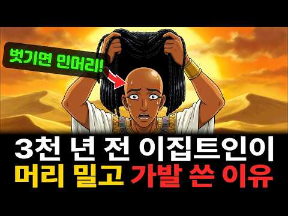
- 설명 앞부분: 한낮 45도의 사막에서, 2천 년 넘게 머리를 밀고 그 위에 다시 가발을 쓰고 다닌 사람들이 있습니다. 더워서 밀었다면 맨머리로 다니면 되고, 덮을 거였다면 밀 필요가 없었을 텐데 — 이집트인들은 왜 밀고, 다시 덮었을까요? 5천 년 된 서캐, 3,700년 전 빗에 새겨진 '이 퇴치' 기도문, 녹지 않는 밀랍 가발, 2019년 무덤에서 처음 나온 머리 위 원뿔까지. 여러분이라면 45도의 사막에서 가발을 쓰시겠습니까, 맨머리로 버티시겠습니까? 댓글로 들려주세요. 이 영상은 역사 기록과 학술 자료를 바탕으로 제작되었습니다. 가설과 확…
- 같은 채널 평소 대비 ×50.0 (채널 최근 롱폼 중앙값 1,465회) · 평소 영상: 중국 역사상 가장 뛰어난 천재.. 제자는 단 4명뿐, 하지만 그 4명이 전국시대를 삼킨 … (2,137회) / 세종이 인정한 천재 김시습 이야기 (793회)
- 대본 없음 (설명) — 음성인식이 끝나면 도입부·흐름이 들어감
- 댓글 10/10: 좋은 점 — 영상 0 · 감사·응원 0 · 더 알고 싶은 것 0 · 아쉬운 점 — 영상 0 · 반박·불만 — 의견 다름 0 · 정치·사회 0 · 경험 공유 0 · 구독·다음 기대 0

### 248. 비단옷보다 무거웠던 것 ∣ 조선 중전의 진짜 하루 공개

- https://www.youtube.com/watch?v=e12EIRsz6Xo · 진짜역사한잔 · 구독자 13,400 · 조회수 504,804 (×37.7, 하루 6,166.9) · 좋아요 3,675 (0.7%) · 89.8분 · 2026-08-03 · 주제 묶음 3. 조선 · 형식 정보·해설 (그 밖) · 폴더 `W_e12EIRsz6Xo` (웹 승인)
- 썸네일: 
- 챕터: 0:00 새벽 네 시, 중궁전에 켜진 불 · 2:10 나라가 뽑는 왕비 - 금혼령과 삼간택 · 6:30 가례 육례와 책봉, 품계가 없는 사람 · 10:20 새벽 문안 - 국모이면서 며느리였던 자리 · 14:00 내명부, 수백 명을 다스리는 관리자 · 18:30 정치에 관여할 수 없지만 그 자체가 정치였던 존재 · 22:40 수라와 예복, 그리고 궁궐의 살림 · 27:00 후궁과의 관계, 적자를 낳으라는 압박 · 32:10 폐비 윤씨와 갑자사화 · 37:20 이레 만에 폐위된 왕비, 단경왕후 · 41:00 인현왕후와 장희빈 - 왕비 교체는 정치의 결과였다 · 46:30 왕실 의례와 예송, 상복이 권력을 바꾸다 · 51:00 궁궐의 밤, 인정과 파루 · 55:20 출산과 의녀, 목숨을 건 국가의 사업 · 60:00 궁녀들의 세계와 상궁의 힘 · 65:10 대비가 되어야 비로소 열리는 발언권 · 70:00 조선의 마지막 왕비까지 · 75:00 이름 대신 자리로 기억된 사람들
- 설명 앞부분: 조선에서 여성이 오를 수 있는 가장 높은 자리, 중전. 모든 궁녀가 무릎을 꿇고, 백관의 아내들이 머리를 숙이며, 왕조 전체가 국모라 부르던 자리입니다. 그런데 왜 어떤 양반 집안은 딸이 왕비 후보로 뽑혔다는 소식에 잔치가 아니라 통곡을 했을까요. 왜 어떤 왕비는 궁에 들어간 지 이레 만에 쫓겨났고, 어떤 왕비는 사약을 받았을까요. 조선왕조실록, 경국대전, 궁중 의궤, 승정원일기 등 기록을 바탕으로 새벽 네 시의 어둠에서 자정이 넘도록 꺼지지 않던 중궁전의 등불까지, 조선 중전의 하루를 처음부터 끝까지 복원했습니다. 이 영상은 확…
- 같은 채널 평소 대비 ×31.9 (채널 최근 롱폼 중앙값 15,849회) · 평소 영상: [4시간연속재생] 교과서에 없는 조선시대 평민생활 세번째 이야기 (16,991회) / 매년 10명씩 죽였다 조선왕조실록이 직접 기록한 왕자 순화군의 실체 (14,707회)
- 대본 없음 (설명) — 음성인식이 끝나면 도입부·흐름이 들어감
- 댓글 85/92: 좋은 점 — 영상 1 · 감사·응원 1 · 더 알고 싶은 것 4 · 아쉬운 점 — 영상 1 · 반박·불만 — 의견 다름 0 · 정치·사회 1 · 경험 공유 1 · 구독·다음 기대 1
  - 좋은 점 — 영상 👍2 “유익한 영상 감사합니다 내레이션의 목소리도 듣기 편합니다 다음 영상도 기대하며 구독합니다 😊❤”
  - 감사·응원 👍2 “유익한 영상 감사합니다 내레이션의 목소리도 듣기 편합니다 다음 영상도 기대하며 구독합니다 😊❤”
  - 더 알고 싶은 것 👍23 “이런 콘텐츠는 오래오래 만들어 주세요.”
  - 더 알고 싶은 것 👍18 “그러면 간택 시험을 대충 봐서 떨어지면 되지 않을까 궁금하네요”
  - 아쉬운 점 — 영상 👍4 “집중할라치면광고가~~광고진짜많네요 이해는하지만적당히좀~~~ 구독은안하고시퍼~”
  - 정치·사회 👍6 “그런 효에 나라가 지금은 개에 나라가 됐다”
  - 구독·다음 기대 👍2 “유익한 영상 감사합니다 내레이션의 목소리도 듣기 편합니다 다음 영상도 기대하며 구독합니다 😊❤”

### 249. 세종도 수양대군도 미치도록 사랑한 여인,!! 그런데 노비 출신이라고?ㅣ조선왕조실록ㅣ한국사

- https://www.youtube.com/watch?v=2QiExRW-Dg8 · 호기심 사록 · 구독자 10,500 · 조회수 395,280 (×37.6, 하루 2,777.5) · 좋아요 5,547 (1.4%) · 49.7분 · 2026-06-03 · 주제 묶음 3. 조선 · 형식 정보·해설 (그 밖) · 폴더 `W_2QiExRW-Dg8` (웹 승인)
- 썸네일: 
- 챕터: 0:00 당대 최고 권력자들이 늙은 비구니 앞에서 통곡한 이유 · 3:16 지옥 같았던 내자시, 13살 관노비 옥분의 입궐 · 7:11 친정을 잃은 왕비와 천한 노비의 기묘한 동거 · 11:58 세종의 마음을 흔든 옥분의 고요한 배려와 파격적인 신… · 15:52 12년간 8번의 출산, 중전이 친자식을 맡긴 조선판 … · 21:38 노비 출신 최초 정1품 '빈'에 오르다 · 26:40 세종의 죽음, 모든 것을 버리고 스스로 삭발을 택한 … · 31:18 계유정난의 피바람! 수양대군의 칼날이 유일하게 멈춘 곳 · 33:14 세종이 남긴 완벽한 방패막이, 겹사돈의 비밀 · 36:43 아웃트로
- 설명 앞부분: 영상에서 사용한 ‘옥분’이라는 이름은 주요 사료에는 나타나지 않습니다. 신빈 김씨는 실록 등에서 작호와 성씨로 기록됩니다. 따라서 ‘옥분’은 후대 스토리텔링에서 붙은 이름이며, 보다 정확한 표현은 ‘신빈 김씨(본명 미상)’입니다. 조선 500년 역사상 유일무이하게 가장 천한 '관노비'로 태어나, 내명부 최고 품계인 정1품 '빈(嬪)'의 자리에 오른 여인이 있습니다. 바로 세종대왕의 영원한 안식처였던 '신빈 김씨'입니다. 13살의 어린 나이에 내자시의 험한 잡일을 하던 노비 옥분이는 어떻게 왕비의 마음을 사로잡고, 세종의 승은을 입…
- 같은 채널 평소 대비 ×88.0 (채널 최근 롱폼 중앙값 4,494회) · 평소 영상: 정약용이 두 아들에게 꼭 '한양'에서 버티라고 한 진짜 이유 !! l 충격적인 '조선' … (4,494회) / 첩의 끝없는 탐욕인가 본처의 가스라이팅인가 도요토미 히데요시의 두 아내에게 일어난 비극ㅣ… (4,430회)
- 대본 없음 (설명) — 음성인식이 끝나면 도입부·흐름이 들어감
- 댓글 195/195: 좋은 점 — 영상 2 · 감사·응원 12 · 더 알고 싶은 것 1 · 아쉬운 점 — 영상 2 · 반박·불만 — 의견 다름 3 · 정치·사회 1 · 경험 공유 4 · 구독·다음 기대 1
  - 좋은 점 — 영상 👍1 “가슴을울리는 내용이군요 어떤이는 그러한심성을갖고있기도하고 또 어떤이는 하루에도 몇번이나 바뀌는심성이있기도합니다 저또한 너를속이지말라 라고 마음을다잡지만 얼마가지않아 흐트러집니다 오늘 이렇듯 좋은영상올려주심에 감사드립니다 😊 꾸벅”
  - 좋은 점 — 영상 👍0 “많이 배우고 갑니다”
  - 감사·응원 👍7 “신빈 김씨 훌륭한 분 고단했던 이야기를 눈물이 납니다 감사합니다”
  - 감사·응원 👍6 “역사의 새로운 한 페이지를 알개 됐습니다. 감사합니다.”
  - 더 알고 싶은 것 👍5 “조선의 왕들은 목숨걸고, 홍건적이랑 싸워야 했었고, 백성들은 그런 왕족을 섬기느라 고생했었군요 .. 지금도 여전히 왕의직계 후손들은 목숨걸고 한반도를 지키고 있었고, 지금의 대한민국 국민들은 무엇하고 있을까요 ?”
  - 아쉬운 점 — 영상 👍58 “미치도록 사랑한 이라니 제목이 너무 자극적이다. 진심으로 사랑했다도 아니고”
  - 아쉬운 점 — 영상 👍12 “잘 시청해습니다ㅡ보통 이런 역사고증을 하시는 유튜브방송중엔 짜집기 야사와 재미를 가미한 출처없는야길 버무려 방송하는곳이 있어서~저는 어릴때 부터ㅡ역사 야사.를 조아하다보니 이런 방송이 올라오면 날까롭게(?)들어봅니다ㅡ 그리하여 이상한버릇...검증된 학자가 나와서 하는…”
  - 반박·불만 — 의견 다름 👍5 “헤빈양씨는 권력을 탐했던게 아닙니다. 잘못됨.”
  - 경험 공유 👍7 “계양군은 납짝 업드려 수양의 개처럼 행동했었죠😅 혜빈양씨는 단종을 업어키운 유모였죠 문종이 혜빈에게 단종을 부탁하고 운명했어요 혜빈은 귄력에 앞에 선게 아니라 어머니같은 존재로 단종을 지킨겁니다 이부분은 반드시 역사앞에 투명하게 말해야 합니다”
  - 경험 공유 👍5 “조선의 왕들은 목숨걸고, 홍건적이랑 싸워야 했었고, 백성들은 그런 왕족을 섬기느라 고생했었군요 .. 지금도 여전히 왕의직계 후손들은 목숨걸고 한반도를 지키고 있었고, 지금의 대한민국 국민들은 무엇하고 있을까요 ?”
  - 구독·다음 기대 👍12 “잘 시청해습니다ㅡ보통 이런 역사고증을 하시는 유튜브방송중엔 짜집기 야사와 재미를 가미한 출처없는야길 버무려 방송하는곳이 있어서~저는 어릴때 부터ㅡ역사 야사.를 조아하다보니 이런 방송이 올라오면 날까롭게(?)들어봅니다ㅡ 그리하여 이상한버릇...검증된 학자가 나와서 하는…”

### 250. 성벽도 없는 유목 부족이 어떻게 한나라를 굴복시키고 로마제국을 멸망으로 몰고 갔을까? ∣ 600년 흉노의 대역사 [잠잘 때 듣는 역사]

- https://www.youtube.com/watch?v=Z1Cxh6mktng · 먼 옛날 · 구독자 1,730 · 조회수 65,062 (×37.6, 하루 1,672.6) · 좋아요 170 (0.3%) · 68.3분 · 2026-09-15 · 주제 묶음 1. 역사 일반·이야기 · 형식 수면·낭독 (잠잘 때 듣는) · 폴더 `W_Z1Cxh6mktng` (웹 승인)
- 썸네일: 
- 설명 앞부분: 한나라와 로마 제국을 절체절명의 위기로 몰아넣은 흉노. 생존을 위해 멈출 수 없었던 초원의 늑대들이 남긴 잔혹하고도 거대한 역사의 진실을 파헤칩니다
- 같은 채널 평소 대비 ×5.7 (채널 최근 롱폼 중앙값 11,420회) · 평소 영상: [오디오 역사북] 강력하게 다져진 금나라 대군이 칭기즈칸의 몽골군에게 순식간에 붕괴된 이유 (11,420회) / 오랜 세월 숨겨진 안사의 난의 진실: 양귀비와 무신들의 반란이 아니었던 진짜 이유 (수면… (8,307회)
- 대본 없음 (설명) — 음성인식이 끝나면 도입부·흐름이 들어감
- 댓글 4/4: 좋은 점 — 영상 0 · 감사·응원 0 · 더 알고 싶은 것 0 · 아쉬운 점 — 영상 0 · 반박·불만 — 의견 다름 0 · 정치·사회 0 · 경험 공유 0 · 구독·다음 기대 0

### 251. 왕이 되지 못한 조선 왕자들의 충격적인 진짜 삶 #조선시대 #조선역사 #역사이야기

- https://www.youtube.com/watch?v=cuwkTGyvORY · 담너머 조선 이야기 · 구독자 4,640 · 조회수 171,946 (×37.1, 하루 2,238.1) · 좋아요 749 (0.4%) · 22분 · 2026-08-08 · 주제 묶음 1. 역사 일반·이야기 · 형식 정보·해설 (그 밖) · 폴더 `W_cuwkTGyvORY` (웹 승인)
- 썸네일: 
- 설명 앞부분: 화려한 왕실의 피를 타고났지만, 왕관을 쓰지 못한 조선의 왕자들. 세자가 되지 못한 대군과 군들은 궁궐 밖으로 나가 평생을 어떤 모습으로 살아가야 했을까요? 왕권을 위협할 수 있다는 이유로 평생 조정의 정치 참여가 철저히 금지되었고, 작은 언행 하나에도 역모의 혐의를 뒤집어쓸 수 있었던 살얼음판 같았던 삶. 어떤 왕자는 예술과 유흥에 몰두하며 자신에게 야심이 없음을 증명해야 했고, 어떤 왕자는 끊임없는 견제 속에서 비극적인 결말을 맞이해야 했습니다. 권력의 중심에서 밀려난 채 평생을 감시와 불안 속에서 살아가야 했던 조선 왕자들의…
- 같은 채널 평소 대비 ×19.3 (채널 최근 롱폼 중앙값 8,914회) · 평소 영상: 사극에서는 보여주지 않는 조선시대 백정의 삶 #조선시대 #조선역사 #역사이야기 (8,914회) / 약과와 유과는 꿈도 못 꾸던 조선 백성들은 간식으로 뭘 먹었을까? #조선시대 #조선역사 … (7,377회)
- 대본 없음 (설명) — 음성인식이 끝나면 도입부·흐름이 들어감
- 댓글 119/119: 좋은 점 — 영상 0 · 감사·응원 0 · 더 알고 싶은 것 1 · 아쉬운 점 — 영상 1 · 반박·불만 — 의견 다름 3 · 정치·사회 2 · 경험 공유 3 · 구독·다음 기대 0
  - 더 알고 싶은 것 👍1 “대군들의 아들들은 군으로 책봉되기도 하고, 그냥 군의 아들이면 똑같은 군이 되거나 아예 아뮤런 호칭이 없는 경우도 있던데, 기준이 무엇인지 알고 싶네요”
  - 아쉬운 점 — 영상 👍2 “Ai로 영상도 제대로 못 뽑아내 그렇다고 자막이나 한국어에 맞게 뽑아 내기를 해. 이거 한국인이 운영하는 채널 맞기는 함?”
  - 정치·사회 👍15 “정확하게는 왕족이 정걔전출을 법으로 금지한 시기는 성종때부터 입니다 종친사환금지법으로 정계진출을 막은것이죠 아이러니하게도 성종이 이런법울 만든게 자기 친할아버지 세조가 계유정난을 일으켜 정권을 장악하고 왕위를 찬탈까지 하면서 입니다 할아버지가 쿠데타를 일으켜 왕이된 …”
  - 경험 공유 👍1 “우리집이 세종의아들 임영대군파던데 내 조상이 저런삶을 사셨겠네”
  - 경험 공유 👍0 “이거 아님. 왕실 신용을 바탕으로 무역을 했었어요...”

### 252. 세종보다 완벽했던 조선 최고 '먼치킨' 군주는 왜 2년 만에 암살당해야 했나

- https://www.youtube.com/watch?v=M0j4utufB5A · 세상의 모든 역사 - 세모역 · 구독자 1,300 · 조회수 47,969 (×36.9, 하루 268.3) · 좋아요 0 (0.0%) · 33.6분 · 2026-04-28 · 주제 묶음 3. 조선 · 형식 정보·해설 (그 밖) · 폴더 `W_M0j4utufB5A` (웹 승인)
- 썸네일: 
- 설명 앞부분: 병약한 왕으로만 알려졌던 조선의 5대 왕 문종. 하지만 그 실체는 동생 수양대군(세조)조차 고개를 숙였던 완벽한 '먼치킨' 군주였던 거 알고 계셨나요? 아마 살아있었다면 계유정난도, 단종의 비극도 없었을 것입니다. 세종대왕의 적장자로 29년간 세자 수업을 받으며 다방면에서 천재성을 보였던 문종. 측우기와 화차를 직접 설계하고, 조선군의 진법을 완성했던 그가 왜 재위 2년 만에 허무하게 세상을 떠나야 했을까요? 단종의 비극을 낳은 문종의 죽음을 둘러싼 독살설의 전말과 승자의 역사 속에 철저히 감춰진 진짜 문종의 모습을 파헤쳐 봅니다.
- 같은 채널 평소 대비 ×252.5 (채널 최근 롱폼 중앙값 190회) · 평소 영상: 사형수로 10년… 그런데 검안서 한 장이 모든 걸 뒤집었다 (190회) / 자면서 듣는 한국사6시간 연속 재생 (183회)
- 대본 없음 (설명) — 음성인식이 끝나면 도입부·흐름이 들어감
- 댓글 62/62: 좋은 점 — 영상 0 · 감사·응원 2 · 더 알고 싶은 것 1 · 아쉬운 점 — 영상 2 · 반박·불만 — 의견 다름 0 · 정치·사회 3 · 경험 공유 1 · 구독·다음 기대 0
  - 감사·응원 👍30 “고맙습니다. 진실한 역사를 알게 되었네요. 문종이 병약한 임금님 이라고만 알았네요.”
  - 감사·응원 👍0 “처음듣는 문종이 이야기 ㅡ감사합니다. 앞으로 부탁드립니다.”
  - 더 알고 싶은 것 👍0 “처음듣는 문종이 이야기 ㅡ감사합니다. 앞으로 부탁드립니다.”
  - 아쉬운 점 — 영상 👍11 “최태성선생이JTCB사기꾼에 나와 수양이 황표정사때문에 왕권확립하려고 거사(계유정난)했다는식으로 발언함 실망했음”
  - 아쉬운 점 — 영상 👍0 “암살이라뇨??이 제목으로 어그로 끕니까?”
  - 정치·사회 👍1 “예나 현 시국이나 권력싸움으로 피 비린내 나는 학살이 없섰다면 이나라가 선진국이 이니었을까 싶네요”
  - 정치·사회 👍1 “윤석열 한동훈의 이재명 범죄자 프레임 작업과 비슷하네”
  - 경험 공유 👍3 “이씨 조선이 임진왜란 병자 호란을 겪고 결국 한일 합방까지 당했던 것은 세조의 찬탈로부터 시작되는 정통성의 명분이 없었던 무능한 후손들에서 기인한다.”

### 253. [시니어역사] 주역, 세상이 아무리 바뀌어도 흔들리지 않는 법

- https://www.youtube.com/watch?v=GaOAwSMZYl8 · 역사 너머 · 구독자 7,870 · 조회수 288,676 (×36.7, 하루 2,127.6) · 좋아요 5,198 (1.8%) · 90분 · 2026-06-10 · 주제 묶음 1. 역사 일반·이야기 · 형식 오디오북·낭독 (명언·인생조언) · 폴더 `W_GaOAwSMZYl8` (웹 승인)
- 썸네일: 
- 챕터: 0:00 오프닝: 잘 산다는 것 '주역' · 2:01 1부 — 주역은 어떻게 탄생했는가 · 15:22 2부 — 변화를 받아들이는 법 (음양의 철학) · 26:49 3부 — 때를 아는 것이 지혜다 (기다림과 결단) · 36:13 4부 — 가득 찬 것은 반드시 비워진다 (겸손의 철학) · 46:02 5부 — 위기 속에서 길을 찾는 법 · 57:55 6부 — 공자는 왜 말년에 주역에 빠져들었는가 · 69:44 7부 — 주역이 말하는 삶의 완성 · 79:31 8부 — 현대인에게 주역이란 무엇인가
- 설명 앞부분: 지금으로부터 3천 년 전, 억울하게 감옥에 갇힌 한 남자가 있었습니다. 언제 죽을지도 모르는 시간 속에서, 그는 무너지지 않고 붓을 들었습니다. 그렇게 써 내려간 것이 인류 역사상 가장 오래 읽힌 책 중 하나가 되었습니다. '주역'입니다. 세상은 변한다. 그 변화에는 이치가 있다. 그 이치를 아는 사람은 흔들리지 않는다. 좋을 때 교만하지 않는 법, 나쁠 때 무너지지 않는 법, 때를 알고 기다리는 법, 위기 속에서 길을 찾는 법. 주역은 3천 년 동안 그것을 가르쳐 왔습니다. 공자도 말년에 이 책을 너무 깊이 읽은 나머지, 책을 …
- 같은 채널 평소 대비 ×245.1 (채널 최근 롱폼 중앙값 1,178회) · 평소 영상: [시니어역사] 어우동, 고관대작 17명과 스캔들? 조선 사대부들이 그녀를 죽여야만 했던 … (1,178회) / [시니어역사] 고조선 시대부터 남북국 시대까지, 우리 고대사 3,300년 몰아보기 (1,076회)
- 대본 없음 (설명) — 음성인식이 끝나면 도입부·흐름이 들어감
- 댓글 166/166: 좋은 점 — 영상 8 · 감사·응원 27 · 더 알고 싶은 것 3 · 아쉬운 점 — 영상 1 · 반박·불만 — 의견 다름 1 · 정치·사회 1 · 경험 공유 3 · 구독·다음 기대 0
  - 좋은 점 — 영상 👍28 “Ai 라도 목소리가 너무 듣기좋습니다 편안하네요”
  - 좋은 점 — 영상 👍16 “저는 교회를 미치도록 나가거나 목사들을 우상화하능 사람은 아닙니다. 사실 교회는 않갑니다. 그러마 제인생이 힘들때마다 제옆에 예수님이 있었습니다 . 종교에 회의적인사람글는 믿지 않겠지만 제경우가 그렇다는 겁니다. 교회는 도움이 되지 않았었어요. 그냥 예수님이 있습니더…”
  - 감사·응원 👍23 “모든것은변한다❤ 감사합니다”
  - 감사·응원 👍18 “주역은 모든것을자연 스럽게 바다 드려라 감사 합니다 아 멘”
  - 더 알고 싶은 것 👍3 “복히씨은 뭐가 궁금해서? 5000년 전에 그렇게 빨리 태어났지?”
  - 더 알고 싶은 것 👍2 “아주 좋은글 잘들었습니다~ 자세히 주역을 읽고 싶은데 책좀 추천해 주세요”
  - 아쉬운 점 — 영상 👍28 “Ai 라도 목소리가 너무 듣기좋습니다 편안하네요”
  - 반박·불만 — 의견 다름 👍16 “저는 교회를 미치도록 나가거나 목사들을 우상화하능 사람은 아닙니다. 사실 교회는 않갑니다. 그러마 제인생이 힘들때마다 제옆에 예수님이 있었습니다 . 종교에 회의적인사람글는 믿지 않겠지만 제경우가 그렇다는 겁니다. 교회는 도움이 되지 않았었어요. 그냥 예수님이 있습니더…”
  - 경험 공유 👍14 “3000년 전이면 내가 태어나기 전인데 훨씬”
  - 경험 공유 👍8 “이 생은 내가 선택해서 온 삶이란 걸 알게되니 뭐든 이해가 되데요”

### 254. “아이언맨 슈퍼맨 다 필요없다” 미국에서 갑자기 역대급 이순신 대열풍이 일어난 이유

- https://www.youtube.com/watch?v=tZ6pzMh4JYU · 한반도 백과사전 · 구독자 5,070 · 조회수 184,832 (×36.5, 하루 7,325.3) · 좋아요 1,171 (0.6%) · 20.3분 · 2026-09-29 · 주제 묶음 3. 조선 · 형식 애니메이션·지도 · 폴더 `W_tZ6pzMh4JYU` (웹 승인)
- 썸네일: 
- 챕터: 0:00 단 1척으로 돌진한 이순신 · 0:55 백의종군과 칠천량 패전 · 2:46 명량해전 – 13척 vs 130여척 · 4:37 한산도대첩과 학익진 · 5:25 미국 만화가 온리 콤판과 스탠 리 · 9:31 사무라이와 다른 실존 영웅, 난중일기 · 11:34 넬슨과 나란히 선 조선의 제독 · 14:14 23전 23승과 거북선의 진실 · 16:42 LA에 놓인 거북선 · 18:05 미국인들이 이순신에게 열광하는 이유
- 설명 앞부분: 🇰🇷 "아이언맨 대신 이순신?" 미국 만화가가 17년 동안 이순신에 빠져있는 이유 드라마 〈불멸의 이순신〉을 보고 매료되어 17년째 미국에서 이순신 만화(《Yi Soon Shin》 시리즈)를 그리고 있는 미국 만화가 온리 콤판(Onrie Kompan). 출판사의 외면 속에서도 120개 이상의 컨벤션 현장을 발로 뛰며 25만 부 이상을 판매해 냈고, 마블의 거장 스탠 리(Stan Lee)조차 이순신의 삶에 감탄해 직접 양장본 서문을 써주었습니다. 2013년 유네스코 세계기록유산으로 등재된 《난중일기》 속에 적힌 군량미(둔전) 셈법,…
- 같은 채널 평소 대비 ×9.5 (채널 최근 롱폼 중앙값 19,426회) · 평소 영상: “속도와 성질머리로 성공한 민족” 전세계 학자들이 분석하고 극찬한 한국의 진짜 성공 이유 (19,437회) / "한글날 100주년의 위대함" 외국인들이 줄 서서 한글을 배우는 진짜 이유 (19,414회)
- 대본 없음 (설명) — 음성인식이 끝나면 도입부·흐름이 들어감
- 댓글 85/90: 좋은 점 — 영상 1 · 감사·응원 1 · 더 알고 싶은 것 0 · 아쉬운 점 — 영상 0 · 반박·불만 — 의견 다름 3 · 정치·사회 11 · 경험 공유 1 · 구독·다음 기대 0
  - 반박·불만 — 의견 다름 👍1 “누군가 영웅이 되려하면 정치공세가 장난아니죠”
  - 정치·사회 👍6 “이런 역사는 안 배우고, 518, 43....좌골병으로 나라가 뷸구가 되고 있다...😢”
  - 정치·사회 👍3 “난 그 포수가.. 조선의 정권에서 보냈다는게 훨신 확률이 높다... 고 생각한다.”
  - 경험 공유 👍0 “하나님이 세상을 이처럼 사랑하사 독생자를 주셧으니 이는 저를 믿는자마다 멸망치않고 영생을 얻게 하려 하심이라 요 3 :16 예수께서 이르시되 내가 곧 길이요 진리요 생명이니,나로 말미암지 않고는 아버지께로 올 자가 없느니라 요 14 : 6 수고하고 무거운 짐 진 자들…”

### 255. '중국으로부터 조선을 지켜야 했다" 조선 최고의 두뇌, 세종의 한글 창제 속사정 [김진명 작가 통합본] #한글날

- https://www.youtube.com/watch?v=o2KlUqYjzR0 · 광화문로 · 구독자 5,520 · 조회수 201,129 (×36.4, 하루 13,168.6) · 좋아요 0 (0.0%) · 37.4분 · 2026-10-09 · 주제 묶음 3. 조선 · 형식 몰아보기·통합본 (긴 영상) · 폴더 `W_o2KlUqYjzR0` (웹 승인)
- 썸네일: 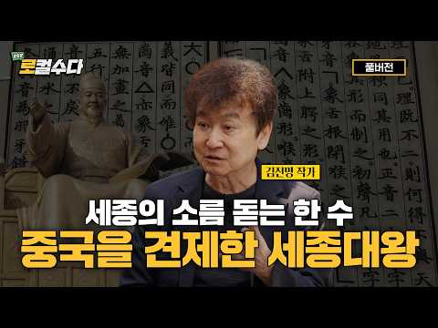
- 설명 앞부분: 수다쟁이 변호사들의 법과 문화(Law&Culture)이야기『로컬수다』 '한글날 특집' 📖김진명 작가와 함께하는 우리가 몰랐던 세종 이야기📖 한글 창제를 결심한 세종의 진짜 이유 세종은 집현전 학자들을 피해 숨어서 한글을 만들었다? 세종이 중국을 견제할 수 밖에 없던 속사정 한글이 세계에서 가장 과학적인 문자가 된 배경 출연자 및 타인을 향한 비난, 욕설 등 불쾌감을 줄 수 있는 댓글은 안내 없이 삭제될 수 있습니다.
- 같은 채널 평소 대비 ×8.1 (채널 최근 롱폼 중앙값 24,682회) · 평소 영상: AI로 역대급 호황 맞은 전력산업, 최대 수혜는 원전? 태양광? LNG? ESS? 딱 정… (25,818회) / "AI 데이터센터가 대한민국 1년치 전기의 80%를 씁니다" ⚡충격적인 대한민국 전력 전… (23,545회)
- 대본 없음 (설명) — 음성인식이 끝나면 도입부·흐름이 들어감
- 댓글 105/105: 좋은 점 — 영상 0 · 감사·응원 5 · 더 알고 싶은 것 1 · 아쉬운 점 — 영상 1 · 반박·불만 — 의견 다름 5 · 정치·사회 5 · 경험 공유 1 · 구독·다음 기대 0
  - 감사·응원 👍24 “한국역사 5천년 중 조선은 가장 쇄국적이고, 사대주의적, 붕당정치 폐해가 많아 별로 안 좋아하지만 한자로부터 해방 시켜준 것 하나만으로도 감사함.”
  - 감사·응원 👍19 “한국에는 김진명작가님이 있어서 참 다행이라고 생각합니다 존경하고 응원합니다 감사합니다”
  - 반박·불만 — 의견 다름 👍1 “훈민정음 혜례본 앞 장에 이르길. 중국은 황제계신 곳이니 우리나랏 상담에 강남이라 하느니라.. 뭔 말인가? 우리나라 안에 중국이 있고 이글을 쓰는 우리가 있다는 뜻 아닌가? 이따구 조작된 역사를 논하니 미리 규정해 반포했거늘 뭣 헛소리들을 해댈까 ... 어찌 생각합니…”
  - 반박·불만 — 의견 다름 👍1 “조선은 명나라의 속국이었는데 뭔 헛소리!!! 이성계-이방원-세종은 원나라에서 이주한 지 얼마 안되는 원나라에서 귀화한 자들임. 개소리도 적당히...”
  - 정치·사회 👍3 “세종대왕께서 지금 대통령이셨다면, 후손을위해, 미ㆍ중 쪼개기 작업에 들어가셨을것! 중국을 쪼개기위해선, 중동을 무장시키고, 미국을 쪼개려면, 케나다중남미 무장시켜야”
  - 정치·사회 👍3 “한글의 위대함은 과학성이지,한국만이 고유문자 만들었다는 식으로 과장하면 안 됨.우리가 오랑캐라고 깔보던 거란,여진 전부 문자 만들었었음.일본도 마찬가지. 또 세종이 자주성을 위해 그랬다?그것도 과한 이야기.조선의 성리학 교조주의 그 기틀을 놓은 게 세종임. 세종이 만…”
  - 경험 공유 👍0 “나랏말싸미 듕귁에 달아 문자와로 서로 사맛디 아니할씨 이런 젼차로 여린 빅셩이 니르고져 홀베이셔도 마참 내제뜻을 시려펴지 못하노미라. 내!!!!!!이를 어엿비녀겨 날로 쓰메 편안게 하고저 할 따람이니라... 내 이를 어엿비녀겨... 내... 내가... 내가 보기에..…”

### 256. [세계사] 한 아버지의 한 손짓이 유대교, 기독교, 이슬람교인 43억 명의 운명을 가른 충격적 이유 ∣ 아브라함, 이삭, 이스마엘, 43억 ∣ 종교사

- https://www.youtube.com/watch?v=MlHcNPc7h-A · 역사로그 · 구독자 21,600 · 조회수 770,794 (×35.7, 하루 4,373.8) · 좋아요 7,873 (1.0%) · 23.5분 · 2026-05-01 · 주제 묶음 5. 세계사·서양사 · 형식 정보·해설 (그 밖) · 폴더 `W_MlHcNPc7h-A` (웹 승인)
- 썸네일: 
- 챕터: 0:00 4천년 전 한 새벽 — 한 아버지의 손짓 · 1:06 우르의 한 천막, 함무라비 법전 §146과 사라의 결정 · 3:00 광야의 하갈, 신에게 이름을 붙인 유일한 인물 · 6:36 예수와 바울 — 기독교가 유대교에서 갈라진 첫 줄 · 8:34 AD 70 성전 파괴와 통곡의 벽 · 9:56 325 니케아 공의회 — 콘스탄티누스 친서의 낙인 · 10:51 무함마드와 메디나 헌장 — 한 도시의 짧은 공존 · 13:13 예루살렘 0.9km² — 한 바위 두 신앙 · 13:55 1095 클레르몽 + 1096 라인란트 학살 · 15:13 1099년 7월 15일, 회당의 불 · 16:07 1187년 살라딘 — 88년 만의 다른 선택 · 17:29 추방의 천년 — 1290 영국, 1306 프랑스, 1… · 18:31 1215 노란 표식이 600년 뒤 가스실 문까지 · 18:51 1896 헤르츨, 1917 벨푸어, 1947 UN 결… · 19:51 1948 나크바 — 530개 마을이 사라진 봄 · 20:32 1967 6일 전쟁 — 통곡의 벽 70세대 만의 회귀 · 20:54 1993 오슬로와 1995 라빈 암살 · 21:38 2024 ICJ — "이스라엘 점령은 불법" · 22:14 그 새벽이 오늘 가자에서 아직 멈추지 않는 이유
- 설명 앞부분: 아브라함(BC 2100~1900경)은 유대교·기독교·이슬람교 세 종교가 공통의 조상으로 받드는 인물로, 그의 두 아들 이삭과 이스마엘이 갈라진 사건이 세 종교 분기의 시작점이다. 오늘 지구에 사는 두 명 중 한 명, 약 43억 명이 그 두 아들 중 한 명을 자기 조상으로 부른다. 4천년 전 한 새벽, 한 아버지가 두 아들 중 한 명을 광야로 보냈습니다. 그 손짓 한 번이 천년 뒤 한 회당의 문을 잠갔고, 어제 가자의 한 사진까지 한 번도 멈춘 적이 없습니다. 같은 아버지, 같은 신, 같은 첫 책 — 그런데 왜 한 뿌리에서 시작된 …
- 같은 채널 평소 대비 ×8.1 (채널 최근 롱폼 중앙값 94,853회) · 평소 영상: [세계사] 유럽을 300년간 떨게 한 바이킹은 왜 흔적도 없이 사라졌나?｜당신이 아는 바… (94,853회) / [세계사] 나라 없는 세계 최대 민족, 쿠르드족의 모든 것 ∣ 쿠르드족 버림받은 민족 3… (97,238회)
- 대본 없음 (설명) — 음성인식이 끝나면 도입부·흐름이 들어감
- 댓글 909/910: 좋은 점 — 영상 9 · 감사·응원 17 · 더 알고 싶은 것 7 · 아쉬운 점 — 영상 10 · 반박·불만 — 의견 다름 38 · 정치·사회 7 · 경험 공유 21 · 구독·다음 기대 2
  - 좋은 점 — 영상 👍68 “유익한영상입니다.제작하시느라고생하셨습니다.감사합니다.”
  - 좋은 점 — 영상 👍7 “유익한 정보에 감사드립니다. 다음의 정보도 기대됩니다.”
  - 감사·응원 👍68 “유익한영상입니다.제작하시느라고생하셨습니다.감사합니다.”
  - 감사·응원 👍38 “방대한 역사를 아주 알기 쉽게 간략히 요약해 주셨습니다. 귀한 수고에 감사드립니다,^^ ❤❤”
  - 더 알고 싶은 것 👍5 “하갈이 나갈 때 이스마엘의 나이는 몇살인가요? 이 점을 유의 하여 이야기를 하시기 바랍니다. 그림과 아울러...”
  - 더 알고 싶은 것 👍0 “기왕에수고하시는거정확한정보로방송부탁합니다”
  - 아쉬운 점 — 영상 👍7 “유산 문제? 낳아 준 이는 아브라함인데, 유산은 하늘 아버지가 말씀 한마디로 뭉뚱그려서 얘기했는데, 해석은 또 지들 마음대로 해서리... 다 부질없는 짓이구만~ 그 명분 아래 죽어간 신같은 인간들의 숫자가 하늘의 별만큼 많으니. 우주에 떠도는 그 원성이 헤아릴 길이 …”
  - 아쉬운 점 — 영상 👍1 “이 AI 음성, 너무너무 싫어!!!”
  - 반박·불만 — 의견 다름 👍34 “여든여섯의 아브라함이 하갈을 통해서 이스마엘을 얻었는데 사라가 아흔이 넘어서 아이를 낳았다고 했으니 이 때 사라의 나이도 76세 정도인가요? 당시에 결혼을 해서 2년 동안 아이가 없으면 여종에게서 아이를 본다고 법에 있었다는데 젊은 나이에 결혼을 해서 사라가 질투가 …”
  - 반박·불만 — 의견 다름 👍33 “아랍의 후손은 이스마엘 자손에게서만 나온게 아닙니다. 노아홍수 후 3아들에게서 나온 자손이 엄청납니다. 셈 함 야벳의 자손까지 생각해야 합니다. 셈족 중 아브라함은 작은 씨족에 불과하고 아람족을 비롯한 많은 족속이 나오고 함의 후손에게서 가나안 족속과 아프리카 족속이…”
  - 정치·사회 👍0 “내용이 전부 팩트를 전혀모르고 있군요 사실 히브리인과 아랍은 이복지간으로 지금도 형제로 생각합니다 십자군전쟁이나 지금의 중동을 보면 히브리인과 아랍이 싸운다고 보면 정말 잘못 본것 입니다. 이방인과 아랍이 싸운 겁니다. 지금의 이스라엘의 인구 구조를 보면 현 정권을 …”
  - 정치·사회 👍0 “환웅이 신단수 아래 내려와 나라를 열고 다스린 나라가 배달국이다. 배달국은 수메르 지역이며 금성이 빛나고 초생달이 뜨는 시기에 나라를 열고 다섯개의 신전을 지어 신을 모셨다. 몽골과 카자흐스탄 국기에서 잘 나타난다. 중동 국가들이 금성과 초승달을 국기로 신성시 하는 …”
  - 경험 공유 👍6 “간단하게 설명해줌. 야훼를 숭배하는 유대교가 있음. 그런데 어느날 예수라는 사이비 교주가 나타나서는 내가 야훼의 아들이라고 함. 나를 안통하면 천국에 못간다고 함. 유대교 입장에서는 이건 완전 미틴넘이고 이단중의 이단임. 그래서 죽임. 그랬더니 예수 숭배자들이 예수 …”
  - 경험 공유 👍2 “웃기는 종교다... 하느님을 두고 인간들 특히 금력 권력 종교권력을 쥔 인간들끼리... 지랄병을 했다는 거네... 아직도 서로 처 싸우고 있고... 내가 불교를 믿기를 잘한 선택인거 같다...”
  - 구독·다음 기대 👍7 “유익한 정보에 감사드립니다. 다음의 정보도 기대됩니다.”
  - 구독·다음 기대 👍1 “너네들 조상족보나 좀 챙겨봐라!”

### 257. 조선시대에 키 180Cm가 넘으면 일어나는 일

- https://www.youtube.com/watch?v=6wCWuqNY_aw · 바람이들려준역사 · 구독자 2,470 · 조회수 88,005 (×35.6, 하루 1,240.8) · 좋아요 644 (0.7%) · 16분 · 2026-08-14 · 주제 묶음 3. 조선 · 형식 정보·해설 (그 밖) · 폴더 `W_6wCWuqNY_aw` (웹 승인)
- 썸네일: 
- 설명 앞부분: 📏 조선시대에 키가 180을 넘는다는 건 어떤 의미였을까요? 평균 161cm의 세상에서 홀로 우뚝 솟은 사람. 저잣거리를 걸으면 사람들이 하던 일을 멈추고 돌아봤고, 때로는 임금 앞까지 불려 갔다고 합니다. 그런데 그렇게 눈에 띄는 몸이 과연 그 사람에게 축복이었을까요? 🤔 아니면 우리가 짐작도 못 한 반전이 숨어 있는 걸까요? 이 영상에서는 실제 유골 계측 연구로 밝혀진 조선 사람들의 진짜 키, 그리고 '8척 장신'이라는 표현에 숨은 놀라운 함정을 하나하나 파헤칩니다. 📜 평균 161cm의 세상에서 큰 키를 가진 사람은 집에서,…
- 같은 채널 평소 대비 ×92.9 (채널 최근 롱폼 중앙값 947회) · 평소 영상: 대만도, 몽골도 지운 강희제가 이미 손에 넣은 조선만은 통째로 삼키지 않은 진짜 이유 ∣… (947회) / [폐비 윤씨] "피 토하며 죽은 적 없다!" 500년 동안 대한민국을 속인 사약 사건의 … (937회)
- 대본 없음 (설명) — 음성인식이 끝나면 도입부·흐름이 들어감
- 댓글 181/181: 좋은 점 — 영상 2 · 감사·응원 0 · 더 알고 싶은 것 0 · 아쉬운 점 — 영상 5 · 반박·불만 — 의견 다름 9 · 정치·사회 5 · 경험 공유 9 · 구독·다음 기대 0
  - 좋은 점 — 영상 👍5 “국가에서 종족번식을 위해서 특별히 관리하고 국방력에 도움이 되도록했을것 같다.”
  - 아쉬운 점 — 영상 👍17 “내용이 좀 헛소리가 길어서 수면제로 쓰려했는데 잠도안오네”
  - 아쉬운 점 — 영상 👍2 “아..겁나 지루하다...”
  - 반박·불만 — 의견 다름 👍17 “내용이 좀 헛소리가 길어서 수면제로 쓰려했는데 잠도안오네”
  - 반박·불만 — 의견 다름 👍4 “이순신도 184였다는데 뭐가 저게 대단하다고?? 조선시대 사람들은 키가 난장이똥자루인줄 알았나 봐. 그 때 사람들 무덤 파헤쳐 유골의 신장 조사해보니 현대인들과 별 차이도 없어!! 또 잘 먹으면 키가 커진다는 말도 안되는 억지꾼이 나섰군!~”
  - 정치·사회 👍0 “조선만 그런게 아니고 산업혁명 전까지 모든 나라가 그랬어요... 그리고, 키큰유전자를 선호하는것은 외형적인 아름다움을 추구하는것이고, 그건 먹고살만해져야 가능한거죠.”
  - 정치·사회 👍0 “이게 말이 안맞는게 조선후기 또는 구한말에 왔던 서양의 외국인들이 말하는게 조선사람들은 키가 컷다고 합니다. 실제 구한말의 남자를 찍은 사진을 보면 제법 키가 큰 사진들이 많아보였습니다. 160cm이라는 키는 구한말이 되면서 각종수탈로 먹기 힘들어지면서 대부분의 영양…”
  - 경험 공유 👍3 “제가 180넘는데 어릴때는 큰키였는데 요즘 아이들이 커서 중간인듯 내 동생도 내보다 크고 할머니께 들은 바로는 고조부께서는 나보다 훨씬 크고 손도 엄청 컸다고 하시던데”
  - 경험 공유 👍1 “나도 살면서 손해 많이 봤다. 끊임없이... 끝도 없이...”

### 258. 15살에 66세 영조와 결혼한 정순왕후, 그날 밤 영조가 잠을 못 잤다 [조선왕조실록]

- https://www.youtube.com/watch?v=gwmPtcxsmYE · 조선왕조실록이야기 · 구독자 19,700 · 조회수 698,979 (×35.5, 하루 8,141.2) · 좋아요 14,636 (2.1%) · 49.2분 · 2026-07-30 · 주제 묶음 3. 조선 · 형식 정보·해설 (그 밖) · 폴더 `W_gwmPtcxsmYE` (웹 승인)
- 썸네일: 
- 챕터: 0:00 1759년, 66세 영조와 15세 소녀의 51살 차이… · 1:55 왜 아무도 딸을 왕비 후보로 내놓지 않았는가 (영조의… · 4:22 왕비 간택의 현실적인 계산과 위험 요소들 · 5:17 금혼령 선포와 간택 단자를 올리는 과정의 뒷이야기 · 8:54 간택의 정식 절차: 초간택, 재간택, 삼간택과 면접 … · 11:45 삼간택에 오른 처녀들의 가혹한 운명 · 12:24 정순왕후의 지혜가 돋보인 전설적인 문답 (방석, 가장… · 17:08 정순왕후의 집안 배경: 경주 김씨 가문과 영조의 정치… · 21:05 15세 소녀가 감당해야 했던 국모라는 자리의 무게 · 23:53 영조가 명분과 실리를 모두 갖춘 집안을 선택한 이유 · 28:32 화려했던 혼례 행렬과 사치를 경계하던 영조의 변화 · 32:21 기록에는 없는 첫날밤 이야기와 정순왕후의 기개 · 35:31 15세 국모가 마주한 궁궐의 기묘한 가족 관계 (사도… · 36:53 300년 만에 부활시킨 친잠례: 조선의 역사를 뒤진 … · 41:42 자식이 없었던 왕비의 쓸쓸함과 임오화변(사도세자의 죽… · 44:25 영조의 죽음과 홀로 남겨진 32세 정순왕후의 삶 · 45:20 정조 즉위와 친정 가문의 몰락, 그리고 정조와의 관계 · 47:45 사후에야 영조 곁에 묻히게 된 정순왕후의 마지막 이야기
- 설명 앞부분: 열다섯 살 소녀가 예순여섯 살의 조선 왕 영조와 혼인했습니다. 쉰한 살의 나이 차이. 조선 역사상 가장 큰 나이 차이의 국혼이었습니다. 그런데 이상한 일이 있습니다. 왕비 자리는 온 나라가 탐낼 자리인데, 딸을 내겠다고 나선 집이 서른 집도 되지 않았습니다. 명문가들은 딸의 나이를 속이고, 아프다고 둘러대고, 아예 종이를 내지 않았습니다. 왜 모두가 도망친 자리에 벼슬 하나 없는 집안의 딸이 홀로 걸어 들어왔을까요? 금혼령 대상은 열여섯에서 스무 살이었는데 뽑힌 아이는 열다섯이었습니다. 규정에 들지도 않는 아이가 어떻게 왕비가 되…
- 같은 채널 평소 대비 ×67.5 (채널 최근 롱폼 중앙값 10,358회) · 평소 영상: 역대 조선 왕들의 진짜 인성과 몰랐던 사생활 조선왕조실록 재밌는 이야기 (10,525회) / 12살에 팔려간 기생, 그녀가 조선의 법을 깨버렸다 [조선왕조실록] (10,192회)
- 대본 없음 (설명) — 음성인식이 끝나면 도입부·흐름이 들어감
- 댓글 3,815/3,839: 좋은 점 — 영상 120 · 감사·응원 304 · 더 알고 싶은 것 31 · 아쉬운 점 — 영상 29 · 반박·불만 — 의견 다름 9 · 정치·사회 11 · 경험 공유 20 · 구독·다음 기대 16
  - 좋은 점 — 영상 👍21 “너무재미있게 새벽이지나갔어요.좋은영상 감사합니다. 15살 소녀야 고생많았어”
  - 좋은 점 — 영상 👍21 “역사를 이렇게 쉽게 설명해주시니 재미있게 들었습니다 수고 하셨어요 ❤”
  - 감사·응원 👍43 “역사를 알수있게 해주셔서 감사합니다 고생 하셨 습니다 좋은날 되세요”
  - 감사·응원 👍40 “대단하신 일을 하셨습니다. 시간을 거슬러 한획을 긋는 새로운 역사의 시간을 익혔습니다. 감사합니다. 귀하게 시청했습니다.”
  - 더 알고 싶은 것 👍2 “혼자만의 시간이 얼마나 고독하고 무서웠을까요? 고작 15살인데 안타갑네요~~”
  - 더 알고 싶은 것 👍2 “오늘 역사공부 잘 했습니다🎉 앞으로도 잘 부탁드려요^^”
  - 아쉬운 점 — 영상 👍239 “그 시대에 없던집안의 딸로 태어나서 집안을 위해 희생된 여인. 얼마나 남몰래 울었을지..감히 상상도 못하겠네요. 영조가 정조에게 빨리 넘기고 혼례를 안했다면 더 좋았을지도... 기록이 조금만 더 자세히 남아있었더라면 하는 아쉬움이 늘 남네요! 더운데 고생하셨습니다!!”
  - 아쉬운 점 — 영상 👍9 “정순왕후가 간택된 이유를 알았습니다. 그런데 자식이 없어 아쉽네요.”
  - 반박·불만 — 의견 다름 👍10 “영조의나라에 행운의 여인 그녀에겐... 글쎄요 얼마나 무섭고 외로웠을까 ;;”
  - 반박·불만 — 의견 다름 👍3 “오늘날의 시각으로 보면 이해가 안 되지만 조선의 왕비는 처녀만 가능했으므로 어쩔 수 없었습니다. 당시 양반가 규수 결혼 적령기를 생각하면 어린것이 아니죠. 참고로 선조의 계비 인목왕후가 임진 왜란으로 혼인이 늦어져 간택 당시 19세었는데 상당히 드문 케이스었죠”
  - 정치·사회 👍85 “불행했다 !, 앞으로도 그런혼례는 없어져야 한다 !, 영조가 죽은후, 나중에 정순왕후, 경주김씨가 세도를 잡고, 반대편 정치편을 모조리 죽이고, 결국,또 정치사화가 일어나고,많은 사람이 죽고, 나라가 피폐해지고, 못다누린 권력을, 쥐고 흔들고, 정조대까지 당파싸움에 …”
  - 정치·사회 👍21 “그렇니 나라가 풍비 박산되어 나라가 망조 들어 백성이 고생들했지~”
  - 경험 공유 👍70 “쇼츠만 보던 내가 이 긴 영상을 다 봤다.”
  - 경험 공유 👍8 “역사를 전공한 저도 몰랐던 얘기가 참 많네요. 아주 훌륭한 내용 잘 들었습니다. 구독, 좋아요.”
  - 구독·다음 기대 👍3 “15세에 간택되어 왕비가 되었으니 행운입니다. 더우기 3명 중에서 뽑히지 않았으면 어차피 결혼도 하지 못 하고 평생을 고독하게 살았어야 했으니 왕비가 살게 됨이 어찌 행운이라고 말하지 않을 수가 있으리요. 설명하시는 말투도 참 좋으시고요 목소리 또한 또박 또박 발음도…”
  - 구독·다음 기대 👍2 “고생하셨습니다. 잘 보고 구독합니다. 감사합니다.”

### 259. 이순신 사후 84일의 비밀, 선조가 대첩 승리 당일 저지른 비정한 보복

- https://www.youtube.com/watch?v=T0Vb2yu89Tc · 어른의 역사 시간 · 구독자 2,470 · 조회수 87,440 (×35.4, 하루 708.8) · 좋아요 1,170 (1.3%) · 58.4분 · 2026-06-22 · 주제 묶음 3. 조선 · 형식 정보·해설 (그 밖) · 폴더 `W_T0Vb2yu89Tc` (웹 승인)
- 썸네일: 
- 챕터: 0:00 84일간 썩지 않은 시신과 잔인한 보복 · 1:42 장례 법도 뒤에 숨은 선조의 비정한 명령 · 5:29 한겨울 400km 운구길에 감춰진 비밀 · 8:33 피 안 흘릴 전쟁을 영웅이 자원한 이유 · 11:46 7년 왜란 중 가장 처참했던 노량 사투 · 14:58 아들이 피 묻은 손으로 대장기를 쥔 순간 · 19:36 영웅이 전사한 날 무너진 마지막 방패 · 20:46 "갑옷 자살설?" 400년 동안 속았던 오해 · 23:18 이길수록 칼날로 돌아온 조선 왕실의 민낯 · 30:00 죽음 앞에 엎어져 통곡한 이국의 장수 · 34:19 이 나라는 왜 영웅의 안식처를 막았나 · 37:01 난중일기 100번의 병 기록과 진짜 진실 · 45:12 426년째 풀 안 자라는 의문의 1미터 맨땅 · 51:06 100년 뒤에야 울려 퍼진 뒤늦은 눈물
- 설명 앞부분: 살아서는 이 나라의 감옥에 갇혔고, 죽어서는 땅 한 평조차 제때 내어주지 않았습니다. 7년 왜란을 승리로 이끌고 온 나라를 구한 영웅의 관은, 그렇게 두 달이 넘도록 구천을 떠돌아야 했습니다. 영하를 오가는 매서운 한겨울, 냉장 시설도 없던 그 길에서 그의 몸은 왜 단 한 치도 무너지지 않았을까요? 왜 시신에서 은은한 향기가 났다는 기록이 전해질까요? 더 소름 끼치는 것은, 426년이 지난 지금 이 순간에도 그가 누워 있던 자리에는 풀 한 포기 자라지 않는다는 사실입니다. 과학계조차 답하지 못한 이 미스터리 뒤에 숨겨진 조선 왕실…
- 같은 채널 평소 대비 ×89.0 (채널 최근 롱폼 중앙값 983회) · 평소 영상: 아브라함, 흔적 하나 없는데 어떻게 '43억 명'의 조상이 됐을까 (1,048회) / 전쟁에 지고도 중국에 안 먹혔다.. 대륙의 정복자들이 한반도에서 멈춘 이유 (918회)
- 대본 없음 (설명) — 음성인식이 끝나면 도입부·흐름이 들어감
- 댓글 294/297: 좋은 점 — 영상 1 · 감사·응원 13 · 더 알고 싶은 것 0 · 아쉬운 점 — 영상 1 · 반박·불만 — 의견 다름 3 · 정치·사회 15 · 경험 공유 2 · 구독·다음 기대 0
  - 좋은 점 — 영상 👍7 “과학도 아니고 기적도 아니고 하늘의 뜻같기도합니다 그러나 과학적으로도 믿을수 없는일이 벌어지는것도 있지 않습니까 하이튼 하늘의 도움이 아닐까요 미신 풍수 있다 없다 말할수는 없는것이기에”
  - 감사·응원 👍20 “구국의 영웅인 이순신장군님께서 누워계신 곳에ᆢ 감히 산천초목이 뿌리를 내리지 않은것은ㅡ구국의 영웅께 최고의 예우를 다 한 것이 아닐런지요ㆍ위대한 장군님 감사합니다 🎉🎉🎉🎉🎉🎉🎉🎉🎉🎉”
  - 감사·응원 👍17 “역사의 새로운 사실 많이 알았습니다 고맙습니다 감사합니다~”
  - 아쉬운 점 — 영상 👍2 “간단히 말해라.서론이 너무길다”
  - 반박·불만 — 의견 다름 👍3 “근데, 이순신방전면주(李舜臣方戰免胄), 이 구절 한국말로만 읽어도 될걸 왜 중공발음으로 읽는지 이해가 안 됩니다. 한국사람들 수천년까지 되는지는 확언 못 하겠지만, 우리말로 한자 읽으면서 사용했슴요. 사실 한자는 동이족이 만든 상형문자입니다. 중공 한족(漢族)이 만든…”
  - 반박·불만 — 의견 다름 👍0 “이슨신 장군께서는 왕때위 한테 인정받고 칭찬 받으려고 왜적을 물리친게 아닙니다.. 장군은 나라를 위해 나라의 주인인 백성을 위해 싸웠습니다...”
  - 정치·사회 👍12 “지금은 중국인을 위한 연금이며..열불터져서”
  - 정치·사회 👍4 “이런 나라가 안망한것도 희안하다”
  - 경험 공유 👍3 “이순신 그분의 공이 얼마나 크고 훌륭했으면 또 범인은. 보고도. 깨닭지 모했던 일들이 수백년이 지난 오늘까지도 후세사람 알아낼수 있었던. 행적들을 지금도 많이 전설을 통해서 탐색을 통해서. 알아낼것이 있으니 그인간됨이. 오직자기만 알고 외롭게 해쳐서 나라를 지켰으니 …”
  - 경험 공유 👍2 “내가 장군이라면 일본을치고 명나라를치고 금나라를 치고 조선으로돌아와 선조를엄벌하고 일본은 무인도로만들것입니다”

### 260. 한국사 최악의 배신자 5인 최고의 1인은?

- https://www.youtube.com/watch?v=rMcAaykM45c · 오늘도 역사 · 구독자 1,050 · 조회수 36,934 (×35.2, 하루 224.6) · 좋아요 1,649 (4.5%) · 36.5분 · 2026-05-12 · 주제 묶음 4. 한국 근현대사 · 형식 정보·해설 (그 밖) · 폴더 `W_rMcAaykM45c` (웹 승인)
- 썸네일: 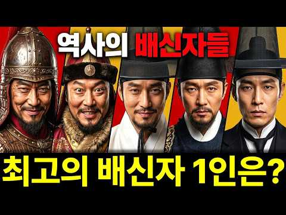
- 설명 앞부분: 안녕하세요 오늘도 역사 채널 입니다 "우리가 몰랐던 역사 속 진짜 이야기, 그 이면의 진실을 파헤칩니다. 교과서에는 한 줄로 기록된 사건들, 하지만 그 속에는 우리와 닮은 사람들의 뜨거운 욕망과 선택이 있었습니다. 오늘, 시간을 거슬러 그 현장으로 함께 떠나보시죠."
- 같은 채널 평소 대비 ×155.8 (채널 최근 롱폼 중앙값 237회) · 평소 영상: 조선시대 평균수명３５세 영조는 ８２세까지 살았다 (237회) / 광개토 대왕은 왜 중원 정복을 안했나 (224회)
- 대본 없음 (설명) — 음성인식이 끝나면 도입부·흐름이 들어감
- 댓글 245/245: 좋은 점 — 영상 0 · 감사·응원 0 · 더 알고 싶은 것 0 · 아쉬운 점 — 영상 1 · 반박·불만 — 의견 다름 2 · 정치·사회 27 · 경험 공유 0 · 구독·다음 기대 0
  - 아쉬운 점 — 영상 👍8 “서론이 너무길다..ㅋ”
  - 반박·불만 — 의견 다름 👍5 “신숙주는 결코 배신자도 아니고 조선에서 배출한 최고의 천재 중 한 명입니다. 숙주나물은 예전에 신숙주의 이름이라고 말 하지만 한자도 다르고 그런 연유로 나온 이름도 아닙니다. 솔직히 말하면 조선왕조를 개창할 때 정도전은 주자성리학의 원리를 내세워 "王權과 臣權은 같아…”
  - 정치·사회 👍31 “박근혜배신 김무성 유승민 윤석열배신 한동훈 권성동 권영세”
  - 정치·사회 👍29 “요즘 정치인들 선거땐 개같이 구석구석 굽신데면서. 허리한번 안펴다가 당선되면 바로 배신 지가 최고이듯 ᆢ”

### 261. 왕족이 너무 많아 망한 나라 ∣ 명나라 황실 30만의 비밀, 분봉제

- https://www.youtube.com/watch?v=OggTD1ptneA · 타임트래블로그 · 구독자 6,410 · 조회수 223,827 (×34.9, 하루 1,383.0) · 좋아요 1,481 (0.7%) · 20.4분 · 2026-05-15 · 주제 묶음 6. 동양사 (중국·일본·몽골) · 형식 정보·해설 (그 밖) · 폴더 `W_OggTD1ptneA` (웹 승인)
- 썸네일: 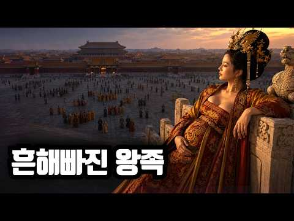
- 설명 앞부분: 1644년, 명나라 황실 가족 30만 명이 한 해에 죽었습니다. 왕족이라서 죽은 게 아닙니다. 왕족이 너무 많아서 죽었습니다. 한 황제가 자기 가족을 다시는 굶어 죽게 두지 않겠다며 만든 분봉제가, 어떻게 300년 만에 친왕·군왕·봉국중위까지 8등급의 황손을 30만 명으로 불려 놓았는지. 그 30만 명이 어떻게 옥첩이라는 명부 한 장에 묶인 채 이자성, 장헌충, 청군의 손에 한 해에 모두 사라졌는지. 만력제의 복왕 낙양 4만 경, 숭정제 매산의 마지막, 그리고 같은 시기 정반대 답을 낸 오스만 제국의 형제살해법까지. 명청 교체기와…
- 같은 채널 평소 대비 ×38.4 (채널 최근 롱폼 중앙값 5,831회) · 평소 영상: 복수조차 허가 없인 못 했던 나라 ∣ 에도 막부 복수 제도 250년, 카타키우치 (5,890회) / 28년간 옥좌가 비어도 잘만 굴러간 나라 ∣ 명나라 멸망의 진짜 시작, 만력제의 침묵 (5,772회)
- 대본 없음 (설명) — 음성인식이 끝나면 도입부·흐름이 들어감
- 댓글 243/243: 좋은 점 — 영상 1 · 감사·응원 2 · 더 알고 싶은 것 2 · 아쉬운 점 — 영상 2 · 반박·불만 — 의견 다름 5 · 정치·사회 11 · 경험 공유 4 · 구독·다음 기대 0
  - 좋은 점 — 영상 👍9 “요즘 혼자서 이 주제 공부하고있었는데 도움이 많이 됐습니다 이해가 쏙 쏙되네요 ❤❤ 감사합니다”
  - 감사·응원 👍9 “요즘 혼자서 이 주제 공부하고있었는데 도움이 많이 됐습니다 이해가 쏙 쏙되네요 ❤❤ 감사합니다”
  - 감사·응원 👍1 “망할짓 했네. 청나라에 감사해라.”
  - 더 알고 싶은 것 👍1 “유럽은 왕족 관리가 어땠는지 궁금합니다. 왕, 공작, 후작, 백작, 자작, 남작 등 귀족 작위가 많던데요.”
  - 아쉬운 점 — 영상 👍7 “본래 근세이후 한국이든 중국이든 왕조교체시 전왕조의 왕족들은 씨를 말리는게 일종의 불문의 관습이 되었는데 놀랍게도 나라와 백성을 일본에 팔아먹고 재벌이된 망국 이왕가의 떨거지들은 도살하지 못함. 상반신은 반일에 하반신은 친일인 모가지가 길어서 슬픈 짐승들이여. 명나라…”
  - 반박·불만 — 의견 다름 👍2 “명나라의 대부분의 고질적 문제는 때중이 도적놈이 만든것이라 예를 들어 해금령, 명 말기 f4의 원인인 환관정치 이 동영상의 사례처럼요 이것들 말고도 많을 것입니다. 괜히 사학자들이 송나라보다 퇴화한 통일제국이라 폄하하는 것이 아니죠”
  - 정치·사회 👍51 “30만 황살이라도 정작 직계는 희소. 청나라가 거의 다 죽임”
  - 정치·사회 👍39 “저렇게 멸족시킬라고 청나라 순치연간에도 갖은 노력을 했지만 숫자가 너무많아서 못없엤음. 결국 청황실이 탄탄해진 강희연간에 주원장 직계후손을 찾아 연은후에 봉하였고 청나라 팔기한군에 속해서 팔기군으로 청나라가 망할때까지 떵떵거리면서 살게됨..... 다만 영락제 직계후손…”
  - 경험 공유 👍161 “명청 교체는 이자성의난 때문이라 생각했었는데 알고보니 분봉제가 진짜 원인이었네요”
  - 경험 공유 👍2 “개인적인 의견은 왕족 형제들의 시선이 어디인지가 달랐던것 같습니다. 중국은 사마씨 고평릉의 난 으로 촉발된 8왕자의 내전으로 왕조가 망하는 참극을 겪었지만 조선초기 이방원의 경우는 왕자의 난을 빠르게 진압한것도 다 이때의 교훈인듯 합니다. 중국왕족의 야망은 권력에 있…”

### 262. 조선시대, 난방도 패딩도 없던 시대 혹독한 추위 어떻게 버텼나?

- https://www.youtube.com/watch?v=jljGmlOxqMc · 바람이들려준역사 · 구독자 2,470 · 조회수 85,894 (×34.8, 하루 733.8) · 좋아요 727 (0.9%) · 17.9분 · 2026-06-29 · 주제 묶음 3. 조선 · 형식 정보·해설 (그 밖) · 폴더 `W_jljGmlOxqMc` (웹 승인)
- 썸네일: 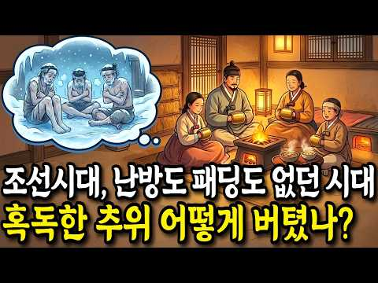
- 챕터: 0:00 영하 30도, 상상도 못 할 조선의 겨울 · 1:03 그 시대가 더 가혹했던 진짜 이유 · 1:48 몸에 가장 가까운 첫 번째 무기 · 2:09 솜에 대한 뜻밖의 오해 · 2:59 가난이 짜낸 놀라운 지혜 · 3:58 같은 하늘 아래 갈린 두 개의 겨울 · 4:38 가난한 집 방 안의 겨울밤 풍경 · 5:41 조선 사람들이 겨울을 이겨낸 진짜 무기 · 6:14 단순해 보이는 구조 속 어마어마한 비밀 · 7:08 서양의 방식과 나란히 놓고 보면 · 7:45 따뜻함에 드리운 무서운 그림자 · 8:42 이 난방을 처음 본 외국인의 반응 · 11:55 견딜 만한 수준을 넘어선 이야기 · 12:11 하늘이 등을 돌린 2년 · 14:11 조선만의 일이 아니었던 충격적 진실 · 15:26 그 긴 역사가 지금 우리 곁에 남긴 것 · 16:44 그래서, 그들은 무엇으로 버텼을까
- 설명 앞부분: ❄️ 영하 30도의 혹독한 조선의 겨울, 패딩도 보일러도 핫팩도 없던 그 시대… 우리 조상들은 대체 무엇으로 이 살인적인 추위를 버텨냈을까요? 🥶 지금 우리가 한파특보에 들썩이는 기온의 두 배에 가까운 추위. 두꺼운 유리창은커녕 얇은 한지 한 장이 전부였던 그 겨울을, 사람들은 평생, 그것도 수백 년 동안 견뎌냈습니다. 🏠 이 영상에서는 조선 사람들이 목숨을 걸고 겨울을 살아낸 생존의 비밀을 몸에 가장 가까운 것부터 하나씩 풀어봅니다. 옷부터 시작해, 그들이 추위와 맞섰던 진짜 무기들, 그리고 우리가 미처 몰랐던 그 시대의 충격적…
- 같은 채널 평소 대비 ×90.7 (채널 최근 롱폼 중앙값 947회) · 평소 영상: 대만도, 몽골도 지운 강희제가 이미 손에 넣은 조선만은 통째로 삼키지 않은 진짜 이유 ∣… (947회) / [폐비 윤씨] "피 토하며 죽은 적 없다!" 500년 동안 대한민국을 속인 사약 사건의 … (937회)
- 대본 없음 (설명) — 음성인식이 끝나면 도입부·흐름이 들어감
- 댓글 52/52: 좋은 점 — 영상 0 · 감사·응원 0 · 더 알고 싶은 것 0 · 아쉬운 점 — 영상 0 · 반박·불만 — 의견 다름 0 · 정치·사회 0 · 경험 공유 4 · 구독·다음 기대 0
  - 경험 공유 👍5 “시골출신인 나도 80년대 중반까지 아궁이에 불 때고 한지로 방문을 한 집에서 지냈다ᆢ지나고 보니 사람은 환경에 적응하며 맞추어 살게 되어 있는거 같다”
  - 경험 공유 👍3 “한복에 솜을 넣어서 만들어 입었다. 조선시대에는 살지 않았지만 내가 어릴때에 어머니는 솜을 넣으셨다 !!”

### 263. [조선 다잇소] 2화 : 세종대왕의 만성 두통을 타이레놀로 고쳐버렸다.

- https://www.youtube.com/watch?v=r-JOlwuvsDA · 다잇소 스튜디오 · 구독자 1,410 · 조회수 48,670 (×34.5, 하루 2,895.2) · 좋아요 363 (0.8%) · 7.7분 · 2026-10-07 · 주제 묶음 3. 조선 · 형식 정보·해설 (그 밖) · 폴더 `W_r-JOlwuvsDA` (웹 승인)
- 썸네일: 
- 챕터: 0:00 관아에서 돌아온 현우와 주모의 재회 · 0:57 조선 저잣거리를 강타한 신라면 & 안성탕면 & 육개장 · 2:16 깊은 밤, 은밀하게 찾아온 도승지 김돈 · 3:42 세종대왕과의 첫 알현과 지독한 편두통 · 4:03 타이레놀과 열내림 냉각 시트의 기적 · 5:07 흐릿하던 글자를 띄워준 돋보기안경 · 5:52 과인이 지켜주마, 어명패 하사와 대궐 별채 입주 · 6:26 별채에서 꺼낸 현대 공구들 (줄자, 드라이버) · 6:44 천재 과학자 장영실의 방문과 풀리지 않는 고민 · 7:23 [3화 예고] 세종의 실신, 그리고 모습을 드러낸 왕…
- 설명 앞부분: [조선 다잇소] 2화 : 세종대왕의 만성 두통을 타이레놀로 고쳐버렸다. 대궐 나으리의 치통을 단숨에 잠재우고 '납품 허가'를 따낸 현우! 주막으로 돌아와 얼큰하고 칼칼한 '신라면'과 '육개장 사발면'을 개시하며 한양 사람들의 입맛을 뒤흔든다. 하지만 그날 밤, 도승지 김돈이 다시 현우를 은밀히 찾아오는데... 그가 이끌려 도착한 곳은 다름 아닌 조선 제4대 국왕, 세종대왕의 편전?! 평생을 옥죄어온 극심한 편두통과 안질로 고통받던 세종대왕. 침도 탕약도 듣지 않던 어전에서 현우가 꺼내든 것은 다름 아닌 만병통치약 '타이레놀'과 이…
- 대본 없음 (설명) — 음성인식이 끝나면 도입부·흐름이 들어감
- 댓글 26/27: 좋은 점 — 영상 0 · 감사·응원 0 · 더 알고 싶은 것 0 · 아쉬운 점 — 영상 0 · 반박·불만 — 의견 다름 0 · 정치·사회 0 · 경험 공유 0 · 구독·다음 기대 0

### 264. 누만티아 공성전 (기원전 134–133년) — 난공불락의 요새: 로마군 6만 대 수비대 4천

- https://www.youtube.com/watch?v=lUI6y2G873w · 박지훈 — 역사 · 구독자 1,910 · 조회수 65,624 (×34.4, 하루 678.4) · 좋아요 688 (1.1%) · 61.9분 · 2026-07-19 · 주제 묶음 5. 세계사·서양사 · 형식 정보·해설 (그 밖) · 폴더 `W_lUI6y2G873w` (웹 승인)
- 썸네일: 
- 설명 앞부분: 4,000명의 전사가 60,000명의 로마 군단을 20년 동안 막아낸 비결은 무엇일까요? 이 다큐멘터리는 세계 역사 속에서 가장 잔혹했던 포위전의 진실을 파헤칩니다. 역사적 전투의 패러다임을 바꾼 누만시아 전쟁을 분석합니다. 스키피오 에밀리아누스는 칼 대신 삽을 들고 나타났습니다. 그는 군대 내부의 부패를 척결하기 위해 은식기와 매춘부, 점술가들을 쫓아내고 병사들에게 토목 공사를 강요했습니다. 강물에 설치된 칼날 달린 사슬, 9km에 달하는 거대한 이중 성벽, 그리고 지원군을 보내려던 청년 400명의 오른손을 잘라버린 냉혹한 결단…
- 같은 채널 평소 대비 ×60.4 (채널 최근 롱폼 중앙값 1,086회) · 평소 영상: 아크로이논 전투 (740년) — 7만 알 바탈 군대의 배후를 친 2만 비잔티움군 (1,086회) / 코바동가 전투 (722년) — 칼리파국에 맞선 양치기들: 770년에 걸친 레콩키스타의 서… (1,110회)
- 대본 없음 (설명) — 음성인식이 끝나면 도입부·흐름이 들어감
- 댓글 24/24: 좋은 점 — 영상 2 · 감사·응원 3 · 더 알고 싶은 것 0 · 아쉬운 점 — 영상 1 · 반박·불만 — 의견 다름 0 · 정치·사회 2 · 경험 공유 0 · 구독·다음 기대 0
  - 좋은 점 — 영상 👍6 “생각할 것이 많은 좋은 영상 감사합니다. 이전에 자주보던 전쟁사와는 또다른 매력이 있네요. 담백하지만, 사실적으로..”
  - 좋은 점 — 영상 👍5 “좋은 영상입니다~ 꼭 영화를 보는것 같습니다.”
  - 감사·응원 👍6 “생각할 것이 많은 좋은 영상 감사합니다. 이전에 자주보던 전쟁사와는 또다른 매력이 있네요. 담백하지만, 사실적으로..”
  - 감사·응원 👍0 “감사합니다........”
  - 아쉬운 점 — 영상 👍8 “좀 지루하네. 30분이면 깔끔했을 것을.... 한 말 또하고, 또 하고, 또 하고....”

### 265. 한나라를 무릎 꿇린 흉노, 왜 사라졌을까? 신라 왕족은 그 후손이었나?

- https://www.youtube.com/watch?v=1V5KZiQQCuY · Damir Merzhalimov · 구독자 1,090 · 조회수 37,393 (×34.3, 하루 1,829.4) · 좋아요 506 (1.4%) · 150.1분 · 2026-10-03 · 주제 묶음 2. 한국 고대·삼국·고려 · 형식 정보·해설 (그 밖) · 폴더 `W_1V5KZiQQCuY` (웹 승인)
- 썸네일: 
- 챕터: 0:00 밤이 시작됩니다 · 5:52 제국 이전의 초원 · 22:14 묵특, 우는 화살 · 37:56 백등산과 화친 · 53:59 무제, 전쟁의 값 · 69:14 같은 황제, 조선의 멸망 · 83:52 장건, 서쪽이 열리다 · 95:00 소무와 이릉, 그리고 사마천 · 106:54 남과 북으로 · 115:52 훈족설을 따져본다 · 125:16 땅에 남은 것 · 132:07 선비, 그리고 환도성 · 137:52 김일제와 신라의 김씨 · 145:44 후손은 어디에
- 설명 앞부분: 한나라와 맞서며 초원을 지배했던 강대한 제국, 흉노. 중국의 강력한 경쟁자였던 이들은 왜 역사의 중심에서 사라졌을까요? 이번 영상에서는 흉노 제국의 흥망과 그 이후의 행방을 살펴보고, 신라 왕족과 흉노를 연결하는 기원설이 어떤 의문을 던지는지 함께 탐구합니다. 제국의 몰락은 곧 사람들의 소멸을 의미했을까요? 초원에서 한반도로 이어지는 이야기는 역사적 연결의 흔적일까요, 아니면 후대에 만들어진 계보일까요? 흉노와 신라 왕족의 관계를 확정된 혈통으로 단정하지 않고, 기록과 해석을 구분하며 고대 동아시아 역사의 미스터리를 따라갑니다. …
- 같은 채널 평소 대비 ×22.0 (채널 최근 롱폼 중앙값 1,697회) · 평소 영상: 흉노에 쫓겨난 유목민이 어떻게 인도에서 제국을 세웠을까? 한국 불상의 얼굴은 어디서 왔나 (1,697회) / 49년째 우주를 날고 있는데… 보이저 1호는 왜 아무것에도 부딪히지 않을까? (2,200회)
- 대본 없음 (설명) — 음성인식이 끝나면 도입부·흐름이 들어감
- 댓글 21/22: 좋은 점 — 영상 1 · 감사·응원 1 · 더 알고 싶은 것 1 · 아쉬운 점 — 영상 0 · 반박·불만 — 의견 다름 1 · 정치·사회 2 · 경험 공유 0 · 구독·다음 기대 0
  - 좋은 점 — 영상 👍0 “나는 노인인데, 아기자기 새록새록 구구절절... 이게 좋구만요...”
  - 반박·불만 — 의견 다름 👍1 “신라는 제국이 아닙니다. 제국(帝國)은 메이지시대 일본이 "Reich(라이흐)"와 "Realm(레름)"을 번역하면서 만들어낸 신조어입니다. 전근대 동아시아는 존재하지 않았던 단어이죠. 다만, 현대 사학자들이 현대의 관념을 소급하여 고대에 적용하려는 시도는 있습니다. …”
  - 정치·사회 👍0 “2300년경 인류최소 말을 길드려 가축화하고 제철기술을 습득하고 무기화한 기마유목민Scythian(스키타이) 둘이 한반도 남쪽의 농경민 부족국가들을 정복하였다. 삼국사기와 삼국유사에 기록되어있다. 또한 수 많은 거대 능들(경주, 가야지역, 영산강지역, 광주)은 Scy…”

### 266. 133척을 격파하고도 '야반도주'? 이순신이 승리 직후 짐을 싸야 했던 소름 돋는 이유 ∣ 조선시대 ∣ 한국사 ∣ 조선왕조실록

- https://www.youtube.com/watch?v=ssq5V-PjPTI · 역사한방울 · 구독자 2,240 · 조회수 75,051 (×33.5, 하루 447.2) · 좋아요 2,863 (3.8%) · 21.3분 · 2026-05-09 · 주제 묶음 3. 조선 · 형식 정보·해설 (그 밖) · 폴더 `W_ssq5V-PjPTI` (웹 승인)
- 썸네일: 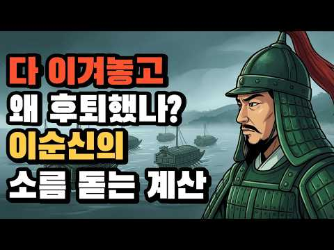
- 챕터: 0:00 승리한 장군은 왜 바다를 등졌나 · 1:25 133척 중 31척, 나머지 102척의 행방 · 3:12 주머니가 텅 비어버린 '전술적 승리' · 4:50 백성들이 차려준 마지막 밥상 · 6:30 200km의 후퇴, 칠산바다라는 천연 방패 · 8:15 아들 면의 죽음: 승리의 대가는 가혹했다 · 11:04 소금 창고에서 혼자 울던 삼도수군통제사 · 13:20 왜덕산과 코무덤, 그 품격의 차이 · 15:10 여러분께 묻습니다. 나라는 영웅을 어떻게 대했습니까?
- 설명 앞부분: 우리는 명량해전을 '13척으로 133척을 이긴 기적'으로만 기억합니다. 하지만 승리의 환호가 채 가시기도 전, 이순신 장군은 배를 돌려 북쪽으로 200km를 후퇴했습니다. "이겼는데 왜 도망쳐야 했을까?" 이 질문 하나가 우리가 몰랐던 명량해전의 진짜 민낯을 드러냅니다. 전술적으로는 완벽한 승리였지만, 전략적으로는 가진 모든 것을 쏟아부어 '빈털터리'가 되어버린 지옥 같은 상황. 그리고 그 대가로 치러야 했던 가장 가슴 아픈 희생, 막내아들 이면의 죽음까지. 교과서가 알려주지 않는, 승리 이후의 처절한 기록을 난중일기를 통해 따라…
- 같은 채널 평소 대비 ×62.2 (채널 최근 롱폼 중앙값 1,206회) · 평소 영상: 조선의 노비들은 정말 가난했을까 ? ∣ 조선시대 ∣ 한국사 ∣ 조선왕조실록 (1,206회) / 15년의 짝사랑, 궁녀를 사랑한 정조 ∣ 의빈성덕임 ∣ 조선왕조실록 ∣ 역사 (949회)
- 대본 없음 (설명) — 음성인식이 끝나면 도입부·흐름이 들어감
- 댓글 416/416: 좋은 점 — 영상 5 · 감사·응원 4 · 더 알고 싶은 것 3 · 아쉬운 점 — 영상 2 · 반박·불만 — 의견 다름 2 · 정치·사회 25 · 경험 공유 8 · 구독·다음 기대 0
  - 좋은 점 — 영상 👍9 “나도 똑같이 공감합니다.”
  - 좋은 점 — 영상 👍1 “좋은 영상입니다. 명량대첩의 승리를 이야기하는 영상은 많지만 그 이후 일에 대해 이렇게 소상히 다루는 영상은 드물지요. 다만 정보를 보충하자면 1. 당시 일본 수군의 함선은 333척입니다. 임진년에 보트 크기의 세키부네나 코바야부네로 판옥선을 공략했다가 어이없이 털린…”
  - 감사·응원 👍11 “명량해전은 당시 전라도 어선과 어부 민간인까지 총동원된 전투였을겁니다. 서남해로 총 진출할려는 왜군을 명랑에서 만조때 전투에 임해서 썰물에 전투가 엄청 치열했을거 같습니다. 들물이 시작될때까지 6시간 동안의 엄청난 전투 였을겁니다. 바다와 육지에서 진도와 해남의 민간…”
  - 감사·응원 👍3 “2번ᆢ감사 합니다”
  - 더 알고 싶은 것 👍1 “조선과백성을 구한장군 진짜장군을보라 임진왜란 승리의 일등공신 바로 경장정걸장군이시다 세계해전사 세계전쟁사 인류역사상 세계역사상 우리나라역사상 세계최고의명장 해군제독 경장정걸장군이시다 역사학자들은 역사왜곡조작 말고진실사실을 전하라 선조대왕재조명하라 선조대왕긴급명령들을보…”
  - 더 알고 싶은 것 👍1 “마니올려주시길”
  - 아쉬운 점 — 영상 👍5 “그야말로 작전상 후퇴! 적의 전력이 아직도 막강하니 정면 충돌시 재기 불가의 손실 뻔한! 일본군은 이순신따라 북상하지 않았다”
  - 아쉬운 점 — 영상 👍0 “간단한걸 빙빔둘러서 지루하게하네”
  - 반박·불만 — 의견 다름 👍1 “좋은 영상입니다. 명량대첩의 승리를 이야기하는 영상은 많지만 그 이후 일에 대해 이렇게 소상히 다루는 영상은 드물지요. 다만 정보를 보충하자면 1. 당시 일본 수군의 함선은 333척입니다. 임진년에 보트 크기의 세키부네나 코바야부네로 판옥선을 공략했다가 어이없이 털린…”
  - 정치·사회 👍11 “백성들은 적의 시체를 장사지내 주고 덕을 쌓는데... 권력층은 나라가 위태한데도 수군을 없애고 사령관을 해칠 음모를 꾸몄다....라.... 옛날이나 지금이나.....그런 것들 때문에 고생하는 건 백성들.... 백성들이 정신 차리고....맑고 선한 사람들이 권력층으로 …”
  - 정치·사회 👍5 “지금의대통령을 악마화한 자들같네 ㅠㅠ”
  - 경험 공유 👍14 “2010년대 60중반이 넘어 공부가 끝이있냐 해서 방송대 농학과를 다녔다 그때 쓴 논문이 이순신이 한산도에서 파직되고 옥에 갖히고 고문받고 풀려나고 어머님이 돌아가시고 상을 치루고 합천삼가로 내려가 권율밑에 백의종군하고 원균이 칠천량에서 조선수군 다 궤멸시키고 다시 …”
  - 경험 공유 👍11 “명량해전은 당시 전라도 어선과 어부 민간인까지 총동원된 전투였을겁니다. 서남해로 총 진출할려는 왜군을 명랑에서 만조때 전투에 임해서 썰물에 전투가 엄청 치열했을거 같습니다. 들물이 시작될때까지 6시간 동안의 엄청난 전투 였을겁니다. 바다와 육지에서 진도와 해남의 민간…”

### 267. 세종대왕이 너무도 사랑한 하루도 빠짐없이 매일밤 찾아갈 수밖에 없었던 여인 신빈 김씨

- https://www.youtube.com/watch?v=MiSjJNMeiGo · 역사만담 · 구독자 5,100 · 조회수 166,667 (×32.7, 하루 1,545.0) · 좋아요 2,855 (1.7%) · 24.9분 · 2026-07-08 · 주제 묶음 3. 조선 · 형식 정보·해설 (그 밖) · 폴더 `W_MiSjJNMeiGo` (웹 승인)
- 썸네일: 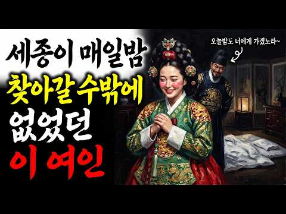
- 챕터: 0:00 오프닝: 관청 노비 문서에 적힌 소녀, 정1품 '신빈… · 4:12 궁궐 입성과 소헌왕후와의 운명적인 만남 · 7:55 세종의 눈에 든 성실함, 지밀나인에서 후궁으로의 비상 · 10:28 소헌왕후의 굳건한 신뢰: "내 아이들을 부탁하네" · 14:45 가장 화려한 자리에서 가장 낮은 곳으로, 자수궁의 1… · 19:36 계유정난의 피바람 속에서도 가문을 지켜낸 부드러움의 힘 · 22:59 에필로그: 권력보다 빛난 조용한 성실함, 신빈 김씨의…
- 설명 앞부분: 조선 오백 년 역사상 유일무이한 기록! 관청 노비 문서에 이름이 올랐던 열세 살 소녀가 왕비 다음가는 정1품 '빈(嬪)'의 자리까지 오른 놀라운 이야기를 아시나요? 왕비 소헌왕후가 숨을 거두며 자신의 친자식들을 부탁했던 단 한 사람. 계유정난의 피바람 속에서도 화를 면하고 굳건히 살아남았던 세종의 후궁, '신빈 김씨'의 입지전적인 삶을 추적합니다. 화려한 권력 암투보다 더 강했던 '조용한 성실함'의 이면 속으로 함께 들어가 보시죠. 📜 [영상 타임라인] 💡 [핵심 역사 교육 포인트] 1. 신분제 사회 조선의 파격: 엄격한 신분제 …
- 같은 채널 평소 대비 ×534.2 (채널 최근 롱폼 중앙값 312회) · 평소 영상: 왕도 견딜수 없었던 이와 벼룩, 빈대와 동거, 치약도 비누도 없던 조선시대, 신분별 위생… (322회) / 고려 17만이 포기한 여진족 철옹성 하루만에 뚫어버린 한반도 소드마스터 척준경 (302회)
- 대본 없음 (설명) — 음성인식이 끝나면 도입부·흐름이 들어감
- 댓글 123/123: 좋은 점 — 영상 2 · 감사·응원 5 · 더 알고 싶은 것 1 · 아쉬운 점 — 영상 0 · 반박·불만 — 의견 다름 0 · 정치·사회 2 · 경험 공유 2 · 구독·다음 기대 1
  - 좋은 점 — 영상 👍8 “신빈에 대해 몰랐는데 자세히 알려 주셔서 알게되었습니다 감사합니다 구독할게요”
  - 좋은 점 — 영상 👍6 “좋은내용 고맙습니다 BGM 넣지않는게...”
  - 감사·응원 👍8 “신빈에 대해 몰랐는데 자세히 알려 주셔서 알게되었습니다 감사합니다 구독할게요”
  - 감사·응원 👍7 “역사 공부 잘하고 있습니다 . 감사합니다”
  - 더 알고 싶은 것 👍5 “너무 잘만들어주시니 감사합니다~앞으로도 귀한영상 부탁드려요~~”
  - 경험 공유 👍7 “내가 조선시대 왕이었다면 후궁을 몇명이나 두었을까”
  - 경험 공유 👍2 “예전 드라마 했었는데 한효주가 여주 하고 기억이 가물가물 하네요”
  - 구독·다음 기대 👍8 “신빈에 대해 몰랐는데 자세히 알려 주셔서 알게되었습니다 감사합니다 구독할게요”

### 268. 미국 인터넷과 댓글을 뜨겁게 달군 이순신 장군 열풍, 한국 영웅에 흥분하는 진짜 이유

- https://www.youtube.com/watch?v=pQ-R6g1dNIg · 1프로경제학 · 구독자 1,240 · 조회수 40,178 (×32.4, 하루 1,376.4) · 좋아요 1,287 (3.2%) · 33.8분 · 2026-09-25 · 주제 묶음 3. 조선 · 형식 애니메이션·지도 · 폴더 `W_pQ-R6g1dNIg` (웹 승인)
- 썸네일: 
- 챕터: 0:00 미국 인터넷에서 벌어진 이상한 일 · 1:28 16년째 이순신만 그리는 미국인 · 3:37 조회수 1,600만 회, 미국 채널의 다섯 편 · 5:49 명량이 미국 극장에서 슈퍼히어로를 이긴 날 · 7:43 첫 번째, 23전 23승이라는 기록 · 11:35 두 번째, 나라에 버림받은 장군 · 13:33 열세 척 대 백서른세 척 · 16:02 세 번째, 영국과 일본 제독의 증언 · 18:13 니미츠가 읽은 1592년의 승전보 · 20:22 나의 죽음을 알리지 마라 · 23:05 이순신의 바다에 찾아온 미국 해군 · 26:31 워싱턴에 걸린 간판 · 28:28 우리 자식과 손주에게 남는 것 · 31:03 정리와 5070 행동 지침
- 설명 앞부분: 미국 역사 채널이 올린 팔 분짜리 이순신 영상, 조회수 450만 회. 시카고의 한 미국인 만화가는 16년째 이순신만 그리고 있습니다. 슈퍼맨의 나라 사람들이 왜 조선의 장군에게 빠져든 걸까요. 오늘 다루는 것은 세 가지입니다. 첫째, 미국 사람들이 처음 보고 눈을 의심한 기록. 둘째, 모든 걸 빼앗긴 사람이 걸어간 길. 셋째, 적과 세계가 남긴 증언. 미국 해군 사령관이 전쟁 한복판에서 꺼낸 이름이 있습니다. 그리고 그 이야기 끝에, 지금 이순신의 바다에서 벌어지고 있는 일이 있습니다. 썸네일 이미지는 인공지능으로 제작했습니다.
- 같은 채널 평소 대비 ×17.2 (채널 최근 롱폼 중앙값 2,342회) · 평소 영상: 석유 한 방울 안 나는 나라에 1억 톤 묻혀 있던 하얀 흙, 미국 학회가 귀를 기울인 진… (2,342회) / 미국 인터넷과 댓글을 뜨겁게 달군 한국 화장품 열풍, 샤넬의 나라 프랑스를 제치고 미국인… (2,542회)
- 대본 없음 (설명) — 음성인식이 끝나면 도입부·흐름이 들어감
- 댓글 70/70: 좋은 점 — 영상 2 · 감사·응원 10 · 더 알고 싶은 것 1 · 아쉬운 점 — 영상 0 · 반박·불만 — 의견 다름 1 · 정치·사회 4 · 경험 공유 2 · 구독·다음 기대 1
  - 좋은 점 — 영상 👍3 “이순신 장군님 감사합니다.😌💕 더 좋은 이야기 올려주세요. 수고하셨습니다. 😊”
  - 좋은 점 — 영상 👍0 “좋은영상 잘봤어요😊”
  - 감사·응원 👍23 “감사합니다 우리 조상님 ㅜㅜ”
  - 감사·응원 👍13 “너무나 자랑스러운 우리 선조. 감사 합니다.”
  - 더 알고 싶은 것 👍3 “이순신 장군님 감사합니다.😌💕 더 좋은 이야기 올려주세요. 수고하셨습니다. 😊”
  - 반박·불만 — 의견 다름 👍11 “동아시아 역사가 그것도 미국 유럽 시각으로 보면 중국 일본 위주의 역사라해도 과언이 아닌데 임진란 당시 적국이었던 일본 장수 와키자카도 발틱함대를 작살낸 도고 헤이하치로도 이순신을 추앙했으니(이 부분은 논란이 있음)이 증언과 기록이 있으니 미국 유럽 사학자들이 알아본…”
  - 정치·사회 👍2 “이순신과이재명차이말돌리기대북송금”
  - 정치·사회 👍1 “국뽕도 도를 넘으면 부메랑으로 돌아온다. 너무 포장하면 판타지라고 반발하는 외국인도 늘어난다.”
  - 경험 공유 👍4 “우리집 울돌목 아닙니까 해남 현산 인입니다”
  - 경험 공유 👍1 “K-팝, K- 드라마, K-푸드, K-무비, K-가곡, K-방산.... 이렇게 나가더니, 이제는 K-히스토리 까지... 김구선생님의 글이 생각납니다. "나는 우리나라가 세계에서 가장 아름다운 나라가 되기를 원한다. 가장 부강한 나라가 되기를 원하지 않는다." "오직 …”
  - 구독·다음 기대 👍0 “자막글 이 너무 오자가 많습니다. a l 로 발음을직역하여 옮겨서 그렇게된건 이해하지만...많은분들이 뜻을 헷갈려하고있읍니다.단어들이 정확하게 되어야합니다. 기대합니다.”

### 269. 세계 고고학계가 은폐하려던 미스터리 ㅣ 전세계 고인돌 40%가 왜 한국에 서 있나 ㅣ 한국사

- https://www.youtube.com/watch?v=2vAcvC3aPNE · 대한역사 · 구독자 4,770 · 조회수 151,776 (×31.8, 하루 1,175.2) · 좋아요 3,088 (2.0%) · 23.3분 · 2026-06-17 · 주제 묶음 4. 한국 근현대사 · 형식 정보·해설 (그 밖) · 폴더 `W_2vAcvC3aPNE` (웹 승인)
- 썸네일: 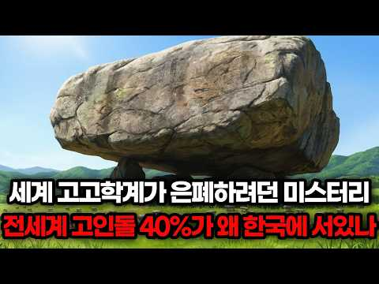
- 설명 앞부분: 우리가 속았던 4대 문명의 진실, 세계 고고학계가 끝내 풀지 못한 미스터리. 전세계 고인돌의 무려 40$, 4만기가 왜 유독 한반도라는 작은땅에 집중되어 세워졌을까요? 3000년 전 청동기 시절, 280톤짜리 거대 돌덩이를 맨손으로 움직엿던 청동기 한반도인들의 충격적인 기술력과 사회구조. 그리고 우리가 역사 교과서에서 한번도 의심해본적 없던 4대 문명이라는 틀뒤에 숨겨진 정치적 조작과 왜곡의 실체를 낱낱이 파헤칩니다. 요령에서부터 한반도 남단까지 정확히 일치하는 비파형 동검, 미송리식 토기, 그리고 고인돌 레이어. 이 거대한 체계…
- 대본 없음 (설명) — 음성인식이 끝나면 도입부·흐름이 들어감
- 댓글 270/270: 좋은 점 — 영상 4 · 감사·응원 3 · 더 알고 싶은 것 0 · 아쉬운 점 — 영상 2 · 반박·불만 — 의견 다름 5 · 정치·사회 6 · 경험 공유 9 · 구독·다음 기대 0
  - 좋은 점 — 영상 👍34 “70년대 국사를 배울 때는 세계의 고인돌 중 70%가 한반도에 있다고 배웠다. 그런데 요즘은 40%라고 해서 세계 다른 곳에서 계속 발굴되고있나? 의문이 들었다.”
  - 좋은 점 — 영상 👍8 “너무 좋은 내용입니다. 고인돌과 관련유적을 더 연구하여 5대 문명 중 하나임을 밝혀야 할것 같습니다.”
  - 감사·응원 👍5 “알려주셔서 감사합니다”
  - 감사·응원 👍1 “우리의 문명을 다시 쓰자! 대한 문명? 고조선 문명, 새로운 문명을 만들어 주어 감사합니다. 이것이 자긍심이다. 내 마음에 다시 한 켜의 자부심이 쌓였습니다. 기회되면 화순으로 고인돌 여행가자!”
  - 아쉬운 점 — 영상 👍0 “없다 아쉽네요”
  - 아쉬운 점 — 영상 👍0 “내용이 너무 길어요,,,,,15분 내외가 좋아요”
  - 반박·불만 — 의견 다름 👍10 “서구 역사와 문명사는 전체가 다 거짓으로 그야말로 망상이 더해진 창작소설 입니다. 고사리는 5억년전 고생대 중생대 화석에 새겨진 식물입니다. 그걸 한민족이 먹고 살았다고요. 고인돌이 청동기 시대 유적이라는 데 고인돌은 그보다 까마득히 오래된 선사시대의 영역표시입니다.…”
  - 반박·불만 — 의견 다름 👍3 “고인돌은 무덤이 아닙니다. 하늘에 제사 지내던 제단입니다. 고인돌 주변에서 인골이 발견되었다고 해서 무덤으로 잘못 알고 있는 것입니다. 구약성경에서와 같이 내 죄를 대신해서 고인돌 위에 동물(양 등)을 잡아 올려놓고 불태우는 것입니다.”
  - 정치·사회 👍3 “3000년전이 아닙니다. 몇천년 더 오래됐죠. 아니 몇만년일지도...한국역사학계는 우리역사를 축소시켰습니다. 비파형동검은 요하문명족=고조선족의 유물이고 중국 산동및 화북지방에서도 발견됩니다. 고조선의 영역을 말해주죠. 우리 역사학계는 매국노로 가득합니다. 자국 역사를…”
  - 정치·사회 👍1 “4대 문명이란 하계용어 없다 중국인 양계초의 컴플렉스 표현!”
  - 경험 공유 👍10 “진짜 고인돌이 많았었다. 밭 하나가 전부 고인돌이였음. 어릴적 고인돌에 올라 가서 잡기놀이 했었다. 지금 가 보니 모두 정비하고 사라짐. 1만년 전부터 우리서해와 중국쪽으로 연결된 거대 문명 (고조선?)이 있었고, 갑자기 해수면 상승으로 별이된 흔적이 고인돌로 추측.”
  - 경험 공유 👍0 “육십년대엔가까운낮은산엔작은고인돌들이많았었다근데육십년대후반엔그게다없어졌다고인돌뿐아니라그게뭔지모르겠는데미니왕릉묘가크지않은데밑엔이끼가잔뜩낀돌테두리가있고앞엔신하들석상들이작은데양쪽으로쭉여러개가있는왕능으로보이는묘들과뭔지모를비석한문으로잔뜩써있는데굉장히오래되보이는크고중간작은비석들이…”

### 270. 산에서 쓰러진 사내를 아버지라 부른 7살 딸, 그는 사실 도망 중인 임금이었는데... 옛날이야기 ∣ 민담 ∣ 야담ㅣ수면동화 ∣ 오디오북

- https://www.youtube.com/watch?v=jApSZXpwkLE · 야담야사 라디오 · 구독자 8,270 · 조회수 262,420 (×31.7, 하루 6,547.2) · 좋아요 6,434 (2.5%) · 102.7분 · 2026-09-14 · 주제 묶음 9. 야사·야담·옛날이야기 · 형식 수면·낭독 (잠잘 때 듣는) · 폴더 `W_jApSZXpwkLE` (웹 승인)
- 썸네일: 
- 설명 앞부분: ‘야담야사 라디오'는 조선 시대 야담, 실화 민담, 옛날 이야기, 전설, 설화, 이야기를 차분한 낭독 형식으로 전하는 오디오북 채널입니다. 잠들기 전 듣는 이야기, 운전 중 편안히 들을 수 있는 이야기, 50대·60대·70대 시청자분들께 특히 잘 어울리는 조용하고 단정한 밤 이야기 콘텐츠를 전합니다. 자극적이지 않게, 그러나 깊이 있게. 사람의 정과 삶의 지혜가 남는 이야기를 전하겠습니다. 😊 📝오늘의 이야기 요약글 “아부지… 정신 차리세요!” 산속 풀숲에 쓰러진 사내를 발견한 일곱 살 복순이의 목소리가 산을 울렸습니다. 2년 전…
- 같은 채널 평소 대비 ×285.9 (채널 최근 롱폼 중앙값 918회) · 평소 영상: 논에 소금뿌린 바보며느리,쫓겨날 줄 알았는데 대풍년 민담ㅣ옛날이야기ㅣ수면동화ㅣ인생이야기ㅣ… (918회) / 떠돌이 장터 거지를 남편으로 사들인 객주 딸 옛날 이야기 ∣ 민담 ∣ 수면동화 ∣ 오디오북 (979회)
- 대본 없음 (설명) — 음성인식이 끝나면 도입부·흐름이 들어감
- 댓글 357/402: 좋은 점 — 영상 3 · 감사·응원 34 · 더 알고 싶은 것 2 · 아쉬운 점 — 영상 3 · 반박·불만 — 의견 다름 0 · 정치·사회 2 · 경험 공유 3 · 구독·다음 기대 1
  - 좋은 점 — 영상 👍2 “옛날이야기라 그런지 더욱 정겹고 즐겁게 잘 들었습니다. 어릴 적 어른들께 듣던 이야기도 떠올라 마음이 따뜻해지네요. 좋은 이야기 늘 응원합니다.”
  - 좋은 점 — 영상 👍1 “목소리가 너무 좋아서 몰입해서 들었어요. 슬프면서도 감동적인 이야기라 긴 줄도 모르고 끝까지 들었네요. 좋은 영상 감사합니다!”
  - 감사·응원 👍13 “옛날에 이야기가 제법 즐기면서 ❤유친하고 응원합니다 선물 🎁 👍”
  - 감사·응원 👍10 “부산에서듯고이습니다감사합니다❤❤❤❤❤”
  - 더 알고 싶은 것 👍10 “언제오나요?? 행복이요”
  - 더 알고 싶은 것 👍0 “Bạn có thể dùng bình luận này, vừa **logic vừa tạo tò mò**, hợp với nội dung 야담: > **7살 어린 딸이 쓰러진 사내를 아버지라고 부른 순간, 단순한 우연이라고 보기엔 너무 많은 것이 연결되어 있네요. 도…”
  - 아쉬운 점 — 영상 👍2 “나오는 사람들이 직접 그목소리로 들려주면 지루히ㅣ지않고 재미있어오”
  - 아쉬운 점 — 영상 👍1 “목소리가 너무 좋아서 몰입해서 들었어요. 슬프면서도 감동적인 이야기라 긴 줄도 모르고 끝까지 들었네요. 좋은 영상 감사합니다!”
  - 정치·사회 👍4 “의정부에서듣고있습니다(구독좋아요)기본입니다😅”
  - 정치·사회 👍2 “진실이 드러나는 두려운자들 현 시대에 범죄자 전과자 역적 ㅇ 가짜대통령 이재명과 너무 흡사합니다”
  - 경험 공유 👍2 “주인공의 감정이 너무 잘 전달돼서 저도 같이 울컥했네요.”
  - 경험 공유 👍2 “저희집입니다 ❤❤❤”
  - 구독·다음 기대 👍0 “잘봤습니다 구독해요”

### 271. 2,500년 동안 누구도 답을 못 낸 고대 미스터리 TOP 7

- https://www.youtube.com/watch?v=rNrXJodHv8g · 잡학도깨비 · 구독자 1,870 · 조회수 58,723 (×31.4, 하루 375.4) · 좋아요 458 (0.8%) · 16.6분 · 2026-05-20 · 주제 묶음 8. 문명·고고학 · 형식 정보·해설 (그 밖) · 폴더 `W_rNrXJodHv8g` (웹 승인)
- 썸네일: 
- 챕터: 0:00 인트로 — 2,500년에 걸친 일곱 번의 시도 · 1:00 ① 헤로도토스 — 직접 들어가 기록한 미궁 · 3:30 ② 앙리 무오 — 발견 1년 만의 죽음 · 6:00 ③ 플린더스 페트리 — 1889년 기단만 남은 자리 · 8:30 ④ 마타하 익스페디션 — 국가안보 사유 동결 · 11:00 ⑤ 데미언 에반스의 LiDAR — 정글 속 사라진 도시 · 13:30 ⑥ 르네 차베스 — 봉인된 통로의 발견 · 16:00 ⑦ 진시황릉 본묘 — 50년 동결 · 18:30 마무리 — 일곱 자리의 공통점
- 설명 앞부분: 2,500년에 걸쳐, 학자 일곱 명이 고대 유적을 직접 들여다봤다. 누군가는 직접 들어가 기록했고, 누군가는 첨단 장비를 들고 갔다. 그리고 일곱 번 모두 — 같은 자리에서 멈췄다. 학교 교과서에서는 한 줄도 다뤄지지 않는, 진짜 고대 미스터리 일곱 가지. 헤로도토스가 직접 들어간 이집트 미궁부터, 50년째 한 삽도 닿지 않은 진시황릉 본묘까지. 귀로만 들어도 알찬 잔잔한 잡학 다큐. 헤로도토스가 본 3,000개 방의 미궁, 지금은 흔적조차 없다 앙코르와트를 알린 박물학자 앙리 무오, 발견 1년 만에 정글에서 죽다 플린더스 페트리…
- 같은 채널 평소 대비 ×23.0 (채널 최근 롱폼 중앙값 2,557회) · 평소 영상: "소설을 읽어주다 죽었습니다" 한국엔 왜 삼국지 같은 영웅 소설이 없을까? (2,557회) / 세계에서 가장 큰 고인돌은 이집트에 없습니다. 350톤짜리 그 돌에 벌어진 일 ∣ 역사 … (2,250회)
- 대본 없음 (설명) — 음성인식이 끝나면 도입부·흐름이 들어감
- 댓글 7/7: 좋은 점 — 영상 0 · 감사·응원 0 · 더 알고 싶은 것 0 · 아쉬운 점 — 영상 0 · 반박·불만 — 의견 다름 0 · 정치·사회 0 · 경험 공유 0 · 구독·다음 기대 0

### 272. 화려한 삶은 거짓? 조선시대 중전의 진짜 하루 #조선시대 #역사 #역사이야기

- https://www.youtube.com/watch?v=jh1DX5QxaLU · 담너머 조선 이야기 · 구독자 4,640 · 조회수 145,563 (×31.4, 하루 1,716.4) · 좋아요 507 (0.4%) · 20.4분 · 2026-07-31 · 주제 묶음 1. 역사 일반·이야기 · 형식 정보·해설 (그 밖) · 폴더 `W_jh1DX5QxaLU` (웹 승인)
- 썸네일: 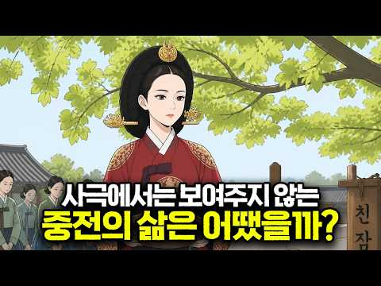
- 설명 앞부분: 화려한 비단 옷과 궁궐의 권력 중심. 우리가 사극을 통해 접하는 조선 중전의 삶은 늘 화려해 보입니다. 하지만 그 이면에는 엄격한 유교적 법도와 숨 막히는 일과가 기다리고 있었습니다. 새벽 일찍 시작되는 왕실 어른들에 대한 문안인사부터, 내명부를 관형하는 엄격한 규율 관리, 그리고 단 한순간도 마음을 놓을 수 없었던 궁궐 내부의 정쟁과 압박까지. 조선 왕비라는 가장 높은 자리에 올랐지만, 정작 한 인간으로서의 자유는 철저히 제한되어야 했던 중전의 진짜 하루. 사극 속 판타지 너머에 숨겨진 조선 시대 왕비들의 치열하고 고독했던 현실…
- 같은 채널 평소 대비 ×16.3 (채널 최근 롱폼 중앙값 8,914회) · 평소 영상: 사극에서는 보여주지 않는 조선시대 백정의 삶 #조선시대 #조선역사 #역사이야기 (8,914회) / 약과와 유과는 꿈도 못 꾸던 조선 백성들은 간식으로 뭘 먹었을까? #조선시대 #조선역사 … (7,377회)
- 대본 없음 (설명) — 음성인식이 끝나면 도입부·흐름이 들어감
- 댓글 40/40: 좋은 점 — 영상 0 · 감사·응원 0 · 더 알고 싶은 것 1 · 아쉬운 점 — 영상 0 · 반박·불만 — 의견 다름 0 · 정치·사회 1 · 경험 공유 0 · 구독·다음 기대 0
  - 더 알고 싶은 것 👍4 “너무 좋아여, 많이 더 좋게 만들어주시길 바랍니다.”
  - 정치·사회 👍5 “아니 .... 영상 고증도 안되어 있는데 내용은 믿을만한거 맞나요? 흉배만 있으면 전통복식인건 아니잖아요? 이게 진짜면 실제 역사 기록이 슬퍼하지 않을까요? 이렇게 AI로 영상 대충만드시면 안돼요... 요즘엔 외국인들도 보는데... 이미 지나간 시간이라 "이래도 되지…”

### 273. 황성옛터 (1928) — 일제강점기 금지곡 ∣ Rachel Kim ∣ 트로트 커버

- https://www.youtube.com/watch?v=a-4VLGM6YMk · 추억의 그루브 (The Nostalgia Groove) · 구독자 340 · 조회수 10,588 (×31.1, 하루 65.8) · 좋아요 119 (1.1%) · 4.2분 · 2026-05-16 · 주제 묶음 4. 한국 근현대사 · 형식 정보·해설 (그 밖) · 폴더 `W_a-4VLGM6YMk` (웹 승인)
- 썸네일: 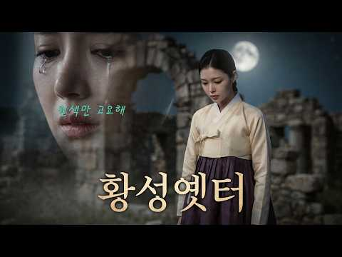
- 설명 앞부분: 이 노래를 처음 들었을 때, 왜 이렇게 마음이 아플까 궁금하셨나요? 그 이유가 있습니다. 1928년, 작곡가 전수린은 개성에 있는 고려 왕조의 옛 궁터 만월대를 바라보며 이 멜로디를 즉흥적으로 만들었습니다. 작사가 왕평이 가사를 붙였고, 가수 이애리수가 무대에서 처음 불렀습니다. 노래가 울려 퍼지자 객석은 눈물바다가 되었습니다. 왜였을까요? 가사 속 "황성 옛터"는 단순한 폐허가 아니었습니다. 일제강점기를 살아가던 조선인들에게 그것은 빼앗긴 나라 그 자체였습니다. "끝없는 꿈의 거리를 헤매어 있노라"는 단순한 방황이 아니라, 나라…
- 같은 채널 평소 대비 ×91.3 (채널 최근 롱폼 중앙값 116회) · 평소 영상: 미안해, 너무 미안해 ∣ 전하지 못한 진심과 후회의 기록 (감성 & 서사 강조) (118회) / 1970년대 감성으로 재탄생한 Two Steps From Hell 'Victory' ∣ … (114회)
- 대본 없음 (설명) — 음성인식이 끝나면 도입부·흐름이 들어감
- 댓글 15/15: 좋은 점 — 영상 0 · 감사·응원 0 · 더 알고 싶은 것 1 · 아쉬운 점 — 영상 0 · 반박·불만 — 의견 다름 1 · 정치·사회 0 · 경험 공유 0 · 구독·다음 기대 0
  - 더 알고 싶은 것 👍1 “아씨부탁합니다”
  - 반박·불만 — 의견 다름 👍0 “이거 모야?...자작곡이네?...원곡이 아닌데?..”

### 274. 3일마다 버리는 신발을 왜 500년이나 신었을까? 알고 보니 이유가 있었습니다

- https://www.youtube.com/watch?v=Kp25Hlg6e0M · 역사트리 · 구독자 10,500 · 조회수 326,082 (×31.1, 하루 3,699.2) · 좋아요 5,035 (1.5%) · 20.9분 · 2026-07-28 · 주제 묶음 기타 · 형식 정보·해설 (그 밖) · 폴더 `W_Kp25Hlg6e0M` (웹 승인)
- 썸네일: 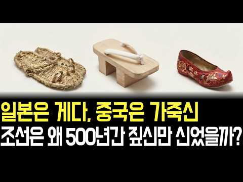
- 설명 앞부분: 일본은 게다, 중국은 가죽신… 그런데 조선만 500년간 짚신을 고집했다? 🤔 알고 보니 조선에는 한 켤레에 40만 원짜리 명품 신발도 있었습니다. 그런데 왜 우리 기억 속엔 짚신만 남았을까요? 일본 짚신의 원조가 사실 한반도였다는 충격적인 사실까지… 👣 이 영상을 끝까지 보시면, 다시는 짚신을 "가난한 신발"이라고 말 못 하실 겁니다. 이 포스팅은 쿠팡 파트너스 활동의 일환으로, 이에 따른 일정액의 수수료를 제공받습니다.
- 같은 채널 평소 대비 ×121.6 (채널 최근 롱폼 중앙값 2,682회) · 평소 영상: 배탈 나면 '이것'부터 마셨다 ∣ 조선시대 민간요법에 숨겨진 과학 (2,760회) / 형제 죽인 조선 왕 5명의 후손에게 벌어진 일, 태종, 세조, 영조까지 ∣ 조선역사 오디… (2,603회)
- 대본 없음 (설명) — 음성인식이 끝나면 도입부·흐름이 들어감
- 댓글 478/502: 좋은 점 — 영상 7 · 감사·응원 7 · 더 알고 싶은 것 4 · 아쉬운 점 — 영상 6 · 반박·불만 — 의견 다름 9 · 정치·사회 1 · 경험 공유 17 · 구독·다음 기대 0
  - 좋은 점 — 영상 👍5 “어릴때 새끼꼬는법을 배웠는데 아직도 생각나요 생각보다 쉬웠어요 유년기때 배웠는데 ...”
  - 좋은 점 — 영상 👍2 “2번입니다. 좋은 이야기 잘 듣었습니다. 감사드림니다.”
  - 감사·응원 👍87 “저 짚신신고 평시에는 가족의 생계를 위해 농사를 짓고 전시에는 민족과 나라를 지킨 백성들 조상님들께 감사합니다.”
  - 감사·응원 👍5 “감사합니다 새로운 지식이네요”
  - 더 알고 싶은 것 👍6 “북방을 지키는 군인들은 어떻게 했는지 궁금하네요. 짚신이면 전투에 지장이 있었을 텐데.”
  - 더 알고 싶은 것 👍5 “영상 초반부에 대략 사흘씩 썻다하고 후반부엔 1인당 년간 십여켤레 썻다하고 어떤게 맞을까요 ? 정보와 설명에 좀더 신경 써주길 바람니다.”
  - 아쉬운 점 — 영상 👍1 “말을 하도 빙빙 돌리는 데다가 광고가 엄청 끼어 있어 끝까지 못보고 그냥 갑니다. 수고.”
  - 아쉬운 점 — 영상 👍0 “영상 내용의 기본 설정부터 잘못된 정보입니다. 이런 AI영상이 오해와 오인을 불러 일으킵니다. 책임감 있는 검증된 정보와 영상을 만들기 바랍니다.”
  - 반박·불만 — 의견 다름 👍59 “짚신만 신은 것은 아닌데 .....”
  - 반박·불만 — 의견 다름 👍24 “AI화면을 좀 더 꼼꼼히 확인하셔요 짚신의 모양이 틀렸습니다”
  - 정치·사회 👍0 “영상 끝까지 다 봐도 ㅈㄴ구리네. 개 쓰레기같은 유교가 나라를 퇴보시켰다. 발전 못하고 허울만 쫒는 조선. 근데 한국은 지금도 마찬가지다. 발전 좀 했다고 유전자에 세겨진 근성이 올라옴. 허울만 쫒지. 도덕적으로 우월해 보이려고 되도 않는 소리 하는 것들이 대통령이나…”
  - 경험 공유 👍16 “지지리 가난해서 짚신을 신은 것은 그들이 알고 내가 알고 니가 아는데.. 아홉 개 단점을 두고 한 개의 장점을 두고.. 참~~나~~ 기적의 논리다.”
  - 경험 공유 👍3 “옛날에 양반이 잘 살았다? 못사는 양반이 더 많지 않았을까. 가난을 견디지 못해서 족보를 파는 양반도 있었다던데. 옛날에 양반은 잘 사는 사람이 아니라, 문.무반에 등용됐던 사람을 말하는데, 그마저도 몇 대 자손 중에 과거 급제를 못했을 경우에는 양반 소리도 못듣고,…”

### 275. 🔥최고 시청률 12.9%🔥 찍어버린... 남궁민이 인생 캐릭터를 갱신한 ✨레전드 사극 드라마✨

- https://www.youtube.com/watch?v=g9youcD9-z0 · 무비프라자 · 구독자 23,700 · 조회수 726,122 (×30.6, 하루 9,825.9) · 좋아요 3,062 (0.4%) · 187분 · 2026-08-11 · 주제 묶음 3. 조선 · 형식 사극·드라마·영화 리뷰 · 폴더 `W_g9youcD9-z0` (웹 승인)
- 썸네일: 
- 설명 앞부분: 끝까지 시청해주셔서 감사합니다🙏 영상 제목은 왼쪽 상단에서 확인하실 수 있습니다
- 같은 채널 평소 대비 ×1.6 (채널 최근 롱폼 중앙값 448,515회) · 평소 영상: "니가 왕의 딸이라고?" 조선의 공주가 평민이라고? 소녀시대 🔥유리🔥 주연의 숨겨진 명작… (448,515회) / 조선판 🔥영혼 체인지🔥의녀와 대군이 서로 영혼이 바뀌면 벌어지는 일 [결말까지몰아보기] (414,118회)
- 대본 없음 (설명) — 음성인식이 끝나면 도입부·흐름이 들어감
- 댓글 180/198: 좋은 점 — 영상 1 · 감사·응원 7 · 더 알고 싶은 것 0 · 아쉬운 점 — 영상 2 · 반박·불만 — 의견 다름 3 · 정치·사회 8 · 경험 공유 4 · 구독·다음 기대 3
  - 좋은 점 — 영상 👍0 “마음을 나의몸안에모으며 지관이나 중관을하며 원두커피가는거 왼쪽으로돌리면 머리코의 병이낫습니다 사띠지관이하단전주 무심 무아입니다 고집멸도괴로움을 하단전에마음을모으니멸해지고도가닦이더라 에코볼트 크레오에스지주식매수하십시요 미국 brk.a 처럼 억대주가가될수있습니다 중관이 …”
  - 감사·응원 👍10 “최고의 편집으로 맘껏 웃고 맘껏 울었네요~~ 넘넘 감사드려요 ~~~”
  - 감사·응원 👍9 “마지막 편 작가님 게 감사 드립니다”
  - 아쉬운 점 — 영상 👍0 “용두사미인 드라마... 뒤에 끝맺음만 잘했어도 대박이였을텐데 아쉬움..”
  - 반박·불만 — 의견 다름 👍12 “길채는 막 절세 미인은 아닌데 매력이 잇슴..안은진 배우가 매력이 잇슴 ㅋㅋ”
  - 반박·불만 — 의견 다름 👍0 “1600년에 망해 없어졌어야 할 조선 왕조가 뭐 잘 한 것도 없고 유능한 것도 똑똑한 것도 아닌데도 질기게도 살아남아서 저 꼬라지를 겪고, 결국 1900년 까지 가서는 결국 총 한방도 못 쏘고 왕이 나라를 팔아먹고 끝났지. 에휴 조선..... 에휴 조선 진짜....”
  - 정치·사회 👍31 “나라가 이렇게 힘이 없으니, 몇 번을 처 먹혀도 정신 못차리는 왕과 신하를 찢어 죽이고 싶은 역사. 지금의 대한민국은 진짜 기적이다.”
  - 정치·사회 👍0 “검세종물받이하가가 딸이 검세부인이 되면 대한민국 대통령 부인도 될수있다 막장은 빵에 가겠지만 ㅋㅋㅋㅋㅋㅋㅋㅋㅋㅋㅋ”
  - 경험 공유 👍44 “내가최근본드라마중탑임.”
  - 경험 공유 👍1 “어제부터 재밌게 보고 있었는데 영상이 갑자기 기록에서도 사라지고 없어져서 당황했었어요.. ㅠㅠ 다시 볼 수 있어서 너무 행복하고 감사한 마음에 댓글 남깁니다. 훌륭한 내용 요약과 나레이션 덕분에 너무 잘 보고있습니다🙏 정말 감사합니다!”
  - 구독·다음 기대 👍48 “진심 지금 정주행만 5번 넘게했는데 계속 봐도 질리지가 않고 볼때마다 눈물나옴😢”
  - 구독·다음 기대 👍1 “아… 놔… 잘못 눌러서 꼬박 3시간을 정주행해 버렸네… 미치겠네…드라마 넘 잼나네..”

### 276. [숨겨진 중국사] 유방이 두려워한 건 번쾌의 배신이 아니라 충성이었다 ∣ 임종 직전 내려진 참수 명령의 진짜 이유 ∣ 역사인물 ∣ 야사 ∣ 비사

- https://www.youtube.com/watch?v=lZkbngqXdeg · 숨겨진중국사 · 구독자 12,800 · 조회수 391,977 (×30.6, 하루 8,135.7) · 좋아요 882 (0.2%) · 27.9분 · 2026-09-06 · 주제 묶음 6. 동양사 (중국·일본·몽골) · 형식 정보·해설 (그 밖) · 폴더 `W_lZkbngqXdeg` (웹 승인)
- 썸네일: 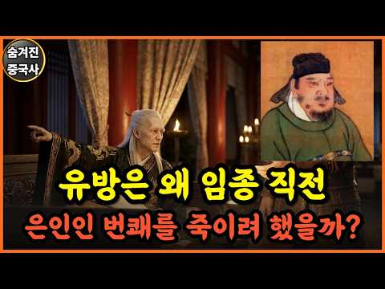
- 설명 앞부분: 저희는 숨겨진 역사를 재미있고 정확한 한 편의 이야기로 풀어내고자 영상을 만들고 있습니다. "매주 화,목,일 오후 12시에 새로운 이야기가 업로드 됩니다 ❤" 🎬 더 많은 영상 보기 👇
- 같은 채널 평소 대비 ×35.3 (채널 최근 롱폼 중앙값 11,111회) · 평소 영상: [숨겨진 중국사] 현재 중국 땅을 원래 주인들에게 다 반환하면 어떻게 될까? ∣ 역사인물… (12,319회) / [숨겨진 중국사] 청나라가 없었다면 지금의 중국도 없었다.. 소수민족한테 다 주면 남는 … (12,463회)
- 대본 없음 (설명) — 음성인식이 끝나면 도입부·흐름이 들어감
- 댓글 58/75: 좋은 점 — 영상 0 · 감사·응원 2 · 더 알고 싶은 것 0 · 아쉬운 점 — 영상 0 · 반박·불만 — 의견 다름 1 · 정치·사회 4 · 경험 공유 1 · 구독·다음 기대 0
  - 감사·응원 👍8 “수를 헤아리지못할만큼 지혜로운 고견을 듣는 시간이었습니다 평생 가슴에 남아있겠네요 감사드리고 건강하세요”
  - 반박·불만 — 의견 다름 👍10 “유방 자체가 개인 능력치로 통일한 놈이 아닌데다....부인한테 쥐어 잡혀 살아서 에혀....ㅋㅋ”
  - 정치·사회 👍17 “이재명 생각나냐”
  - 정치·사회 👍6 “현재로 대입하면 유방 = 이재명 여치 = 김민석 장량 = 유시민 한신 = 김어준 주발 = 이동형 팽월 = 조국 번쾌 = 정청래”
  - 경험 공유 👍34 “번쾌는 나름 시류를 잘 읽는 지혜로운 인물이고 너무도 충직한 사람이었다. 다만 부인이 여후의 친동생인게 탈이었지. 유방이 죽으면서 간신히 목숨을 건지고서 번쾌의 여생내내 번쾌는 어떤 삶을 살았을까? 많이 허무했을 것이다. 그가 여씨의 몰락과 후손의 화를 안보고 죽은게…”

### 277. 김창룡 — '대통령의 오른팔', 옛 부하의 손에 최후를 맞은 대한민국 특무부대장.

- https://www.youtube.com/watch?v=GX_Hq2wRnBQ · 한국인물열전 TV · 구독자 2,350 · 조회수 71,453 (×30.4, 하루 467.4) · 좋아요 1,449 (2.0%) · 84.9분 · 2026-05-24 · 주제 묶음 4. 한국 근현대사 · 형식 정보·해설 (그 밖) · 폴더 `W_GX_Hq2wRnBQ` (웹 승인)
- 썸네일: 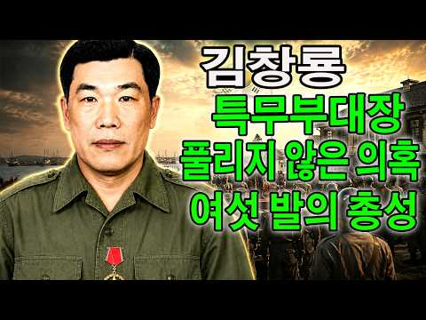
- 설명 앞부분: 🔥 김창룡 — '대통령의 오른팔': 권력의 정점에서 여섯 발의 총성에 쓰러진 특무부대장 이번 에피소드: 천구백오십육년 겨울 아침, 원효로에서 여섯 발의 총성과 함께 한 시대의 권력자가 쓰러졌다. 관동군 헌병에서 대한민국 특무부대장까지, 그는 어떻게 한 시대의 가장 강력한 권력을 손에 쥐었는가. 충신과 공포 사이, 반공과 친일 사이에 놓인 한 인물의 부상과 몰락을 기록으로 추적한다. 🎯 이 영상에서 다룰 내용: ✓ 노숙자에서 장교로 — 월남 직후의 재기와 정보 세계 입문 ✓ 여순 사건과 숙군 — 박정희를 체포하고 살린 운명적 교차 …
- 같은 채널 평소 대비 ×12.8 (채널 최근 롱폼 중앙값 5,586회) · 평소 영상: 신현준 - 초대 해병사령관. 적의 편지를 받은 조선인 장교, 운명이 바뀌다. 제국의 훈장… (5,809회) / 임부택 — 춘천의 방패. 그 3일이 없었다면, 대한민국은 존재하지 못했다.한국전쟁 최대 … (5,813회)
- 대본 없음 (설명) — 음성인식이 끝나면 도입부·흐름이 들어감
- 댓글 185/185: 좋은 점 — 영상 2 · 감사·응원 4 · 더 알고 싶은 것 0 · 아쉬운 점 — 영상 3 · 반박·불만 — 의견 다름 0 · 정치·사회 37 · 경험 공유 6 · 구독·다음 기대 0
  - 감사·응원 👍0 “온갖고난행군? 알겄따 @@ㅈ@ 내대리 입니다 감사합니다 @@ㅈ@”
  - 감사·응원 👍0 “인간 행동 ᆢ다 자 잘 못이 ᆢ있게 마련 중요한것 오늘 의 대한민국 밑거름 ᆢ누구 행동 이 더 기여 를 했느냐 ? 인간사 =정치 결과 물 승자 의 편 정의 로와도 결과 ᆢ××× 라면 민주주의 ㆍ3.6만불 소득 78세 핏 뎅이 지만 결과가 오늘 날 국방 5대 강국 OE…”
  - 아쉬운 점 — 영상 👍1 “자막이 있었으면 좋겠네요”
  - 아쉬운 점 — 영상 👍0 “잔말이 많아 지루해서 끝까지 못 보겠다.”
  - 정치·사회 👍25 “대한민국이 현재 존재할수있었던 기초를 만든 사람중에는 수많은 이름없는 애국자들이 있었다,상층부에는이승만 대통령이 있다면 하층부에는 "나는공산당이 싷다"고외치며 죽 어간 어린애부터 침투한 개릴라들과 총격전을 하며 죽어간 이름도 알려지지않은 수많은국군장병이 있었기에 현재…”
  - 정치·사회 👍24 “남로당과 좌파들이 나라를 적화통일하려던 그 시대 상황을 제대로 이해해야 합니다. 암살자과 그들의 배후자들은 애국을 하기 위해 그를 살해했나요? 아닙니다. 배후자들을 잘 살펴보면 어느 정도의 해답이 나옵니다.”
  - 경험 공유 👍10 “김구는 해방이후 대한민국에 해로운 인물로 전략했었다”
  - 경험 공유 👍9 “김창룡 이 인간이 안두희를 시켜서 백범 김구 선생의 암살을 지시했었지..... 이승만은 안두희를 대통령 특별 사면권을 사용했고.....”

### 278. 《한국사》정도전은 왜 죽어야 했나, 조선을 설계한 천재의 비극적인 최후.

- https://www.youtube.com/watch?v=bVTJY1keq4w · 한국사의 비밀 · 구독자 1,100 · 조회수 33,053 (×30.1, 하루 343.6) · 좋아요 573 (1.7%) · 56분 · 2026-07-20 · 주제 묶음 4. 한국 근현대사 · 형식 수면·낭독 (잠잘 때 듣는) · 폴더 `W_bVTJY1keq4w` (웹 승인)
- 썸네일: 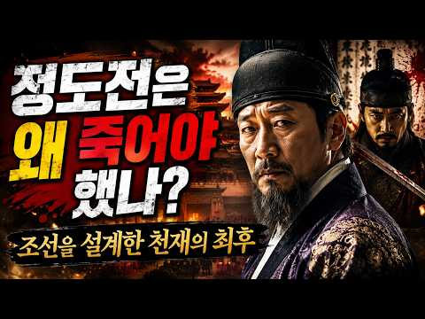
- 설명 앞부분: 조선을 설계한 천재, 정도전은 왜 반드시 죽어야 했을까요? 새로운 나라 조선을 세우는 데 누구보다 큰 역할을 했던 정도전. 그는 단순한 신하가 아니라 조선왕조의 방향과 제도, 그리고 왕권과 신권의 질서를 구상한 핵심 인물이었습니다. 하지만 조선의 건국 공신이었던 그는 결국 권력의 중심에서 밀려나 비극적인 최후를 맞이하게 됩니다. 이번 영상에서는 한국사 속 가장 극적인 정치 비극 중 하나인 정도전의 죽음을 중심으로, 조선역사에 숨겨진 권력의 충돌과 조선왕실 내부의 긴장을 깊이 있게 살펴봅니다. 정도전은 왜 이방원과 충돌할 수밖에 없…
- 같은 채널 평소 대비 ×52.5 (채널 최근 롱폼 중앙값 629회) · 평소 영상: 《한국사》조선 왕실을 울린 영조의 첫사랑, 28세에 사라진 그녀의 숨겨진 이야기 (698회) / 《한국사》피로 세운 권력의 길, 이방원이 조선왕조의 중심에 선 충격적인 이유 (560회)
- 대본 없음 (설명) — 음성인식이 끝나면 도입부·흐름이 들어감
- 댓글 47/47: 좋은 점 — 영상 0 · 감사·응원 0 · 더 알고 싶은 것 0 · 아쉬운 점 — 영상 0 · 반박·불만 — 의견 다름 0 · 정치·사회 1 · 경험 공유 1 · 구독·다음 기대 0
  - 정치·사회 👍0 “나라가 새로 세워졌는데 당연히 개는 삶아야지! 그 옛날 중국의 한 나라 통일했을 때 생각을 해 봐라. 죽은 놈과 살아난 놈 보면 알잖아. 장량 하나 살았는데 모든 거 버리고 낙향했잖아. 당신은 죽을 수밖에 없고 통치 개념으로 유교를 들고 온 게 잘못됐다.”
  - 경험 공유 👍0 “삼봉에 도전했으니까 한양 사대문 내에는 모두 정도전이 설계 내가 영주에서 삼봉이랑 같이 갈비 뜯었는데”

### 279. 왕이 지나가면 그 마을이 망하는 이유? 조선시대 임금 행차의 비극

- https://www.youtube.com/watch?v=VHZ90COisw4 · 역사와인생 · 구독자 1,260 · 조회수 37,348 (×29.6, 하루 253.6) · 좋아요 595 (1.6%) · 19.1분 · 2026-05-30 · 주제 묶음 3. 조선 · 형식 정보·해설 (그 밖) · 폴더 `W_VHZ90COisw4` (웹 승인)
- 썸네일: 
- 설명 앞부분: 사극에서 보던 화려한 임금의 행차. 그 행렬이 지나간 마을은 그 후 어떻게 됐을까요? 1670년 충청도의 한 고을이 사라진 진짜 이유, 조선왕조실록 속 '지대(支待)' 제도와 향리들의 착복, 세종·현종·정조·고종까지 임금의 행차가 백성의 부엌에 남긴 흔적을 차분히 정리해드립니다. ✓ 임금 행차 한 번에 2년 치 살림이 사라진 이유 ✓ 6,000명 행렬과 길가 마을의 현실 ✓ 정조 화성 행차와 내탕금의 의미 ✓ 고종 홍릉 행차가 한반도 최초 전차를 만든 사연 교과서 한 줄 뒤에 가려져 있던 조선 백성들의 이야기, 끝까지 함께 봐주세…
- 같은 채널 평소 대비 ×450.0 (채널 최근 롱폼 중앙값 83회) · 평소 영상: 범잡는 특수부대 조선 호랑이 사냥꾼 착호갑사 한국사 (83회) / 오천원 속 인물 조선이 무시한 천재 율곡이이 조선역사ㅣ한국사 (85회)
- 대본 없음 (설명) — 음성인식이 끝나면 도입부·흐름이 들어감
- 댓글 155/155: 좋은 점 — 영상 0 · 감사·응원 2 · 더 알고 싶은 것 1 · 아쉬운 점 — 영상 1 · 반박·불만 — 의견 다름 4 · 정치·사회 15 · 경험 공유 2 · 구독·다음 기대 0
  - 감사·응원 👍0 “감사합니다”
  - 아쉬운 점 — 영상 👍32 “호환, 마마보다 무서운게 저런 행차였군요. 그래서 왕의 행차는 매년 몇회 이내로 제한했음에도 저리도 자주행차를 하고 그에따라 향리들의 수탈이 반복되었군요.”
  - 반박·불만 — 의견 다름 👍4 “저는 솔직히 경제구조의 문제도 없지 않다고 생각합니다. 조선은 농업에만 치우쳤고 공업,상업,어업,축산업,서비스업등을 홀대했고 신분을 두어 차별했으니 당연히 조선의 경제구조는 빈약할 수밖에 없고 국력이 제일 약할수 밖에 없어 만주등 잃어버린땅을 되찾지 못하고 오히려 녹…”
  - 반박·불만 — 의견 다름 👍0 “말은 바로합시다 지방향리들은 따로 녹봉이 없어서 이런식으로 충당해야했습니다 이들이 부패해서가 아닙니다”
  - 정치·사회 👍52 “법은 있지만 지켜지지 않는 나라가 조선. 지금 한국도 비슷함. 정치하는 놈들이 비슷한 놈들임”
  - 정치·사회 👍51 “조선이라는 나라가 문제”
  - 경험 공유 👍0 “1년에 휴가를 몇 번 씩 간 거야! 백성은 인간이 아니었네.... 양반만 인간이었어.... 조선의 임금은 나쁜 임금이 맞다. 국가 예산에 왕의 행차비를 책정하고 지나는 길에 거치는 마을에 하사금까지 준비해야 했었다. 그랬으면 향리, 아전, 사또들이 고을 백성의 등골을…”

### 280. “아버지, 저 버려진 논을 꼭 사야 합니다” 사흘 뒤 마을이 뒤집힌 이유∣옛날이야기∣야담∣야사∣전래동화∣라디오북∣

- https://www.youtube.com/watch?v=yWVNqrh3WUo · 옥단야담 · 구독자 12,800 · 조회수 375,418 (×29.3, 하루 2,570.3) · 좋아요 8,614 (2.3%) · 70분 · 2026-05-31 · 주제 묶음 9. 야사·야담·옛날이야기 · 형식 야담·옛날이야기 · 폴더 `W_yWVNqrh3WUo` (웹 승인)
- 썸네일: 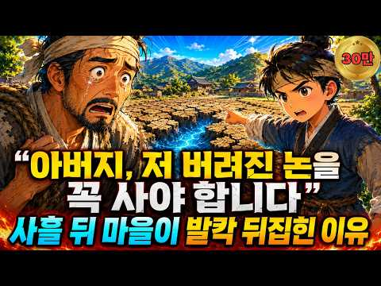
- 설명 앞부분: 옥단야담은 우리 조상들의 지혜와 해학이 담긴 야담, 민담, 전설을 오늘의 감성에 맞게 각색하여 들려드리는 이야기 채널입니다. 흥미롭고 신비로운 옛이야기 속에서 때로는 웃음을, 때로는 긴장감을, 때로는 깊은 여운을 전해드립니다. ✍️ 여러분의 소중한 댓글은 영상 제작에 큰 힘이 됩니다. 본 영상은 AI 기술을 보조 도구로 활용하여 제작될 수 있으나, 대본 집필과 이야기 각색, 이미지 기획을 비롯한 핵심 콘텐츠는 채널 운영자의 고유한 창작물입니다.
- 같은 채널 평소 대비 ×43.5 (채널 최근 롱폼 중앙값 8,632회) · 평소 영상: 추수 끝난 들판에서 메뚜기를 돈 주고 사온 며느리, 시어머니가 한 달 뒤 곳간 열쇠를 주… (8,888회) / “이제 남의 집에서는 안 살아요” 쫓겨난 하인 모녀가 빈 논 한 마지기를 빌린 이유 (8,376회)
- 대본 없음 (설명) — 음성인식이 끝나면 도입부·흐름이 들어감
- 댓글 130/130: 좋은 점 — 영상 0 · 감사·응원 12 · 더 알고 싶은 것 0 · 아쉬운 점 — 영상 2 · 반박·불만 — 의견 다름 2 · 정치·사회 0 · 경험 공유 1 · 구독·다음 기대 0
  - 감사·응원 👍31 “축하해 도윤아 믿어주신 아버님 감사합니다”
  - 감사·응원 👍27 “다행히 관아사또가 그래도 정직한 사람이라서 위안이되는군요 강진태편을 들지않고 공정하게 사또가 판결을 하고 도윤이와 만석씨 지혜로운 대처로 논을 지킬수있어서 통쾌하고 흐뭇하네요 감사합니다”
  - 아쉬운 점 — 영상 👍1 “자막이 왜이래요”
  - 아쉬운 점 — 영상 👍0 “했지요 와 했답니다의 반복이 듣기 힘드네요.”
  - 반박·불만 — 의견 다름 👍7 “엣날이야그지요....요즈음에 저런 바보들이 있을까요......한번 배신한 놈들은 또 배신하고...고마움은 잠시...시기와 질투는 영원합니다.....그리고 또 배신할겁니다......방법은 강진태에게 10000배 주고 팔고 다른 마을가서 논사고 밭사고 농사짓고 살면 될듯…”
  - 반박·불만 — 의견 다름 👍6 “서울종로익선동에서”

