# 역사 — 성공 사례 분석: 사례별 자세히 #241–#280

`analysis.md` 의 9번 (같은 # 번호). 자동 생성 — `tools/success_analysis.py` v1.6 (2026-11-12 04:34 UTC). ※ 연구·교육용 — 투자 권유가 아님.

### 241. 왕의남자 감독이 만들고 주연급 배우만 10명이 나오는 역대급 명작 사극

- https://www.youtube.com/watch?v=La_DA95E-Ag · 재미난 영화  · 구독자 35,000 · 조회수 760,535 (×21.7, 하루 7,510.6) · 좋아요 3,478 (0.5%) · 44.5분 · 2026-08-01 · 주제 묶음 3. 조선 · 형식 사극·드라마·영화 리뷰 · 폴더 `W_La_DA95E-Ag` (웹 승인)
- 썸네일: 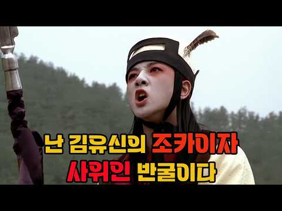
- 같은 채널 평소 대비 ×0.9 (채널 최근 롱폼 중앙값 803,466회) · 평소 영상: 후배에게 무시당하고 완주가 불가능해도 태극마크를 달고 달려야하는 무명 선수의 이야기 (811,315회) / 사기꾼 전도연과 간암환자 정재영에 연변깡패 오만석이 돈과 간을 찾기 위해 벌리는 쫓고쫓기… (795,616회)
- 대본 없음 (없음) — 음성인식이 끝나면 도입부·흐름이 들어감
- 댓글 980/993: 좋은 점 — 영상 9 · 감사·응원 2 · 더 알고 싶은 것 1 · 아쉬운 점 — 영상 7 · 반박·불만 — 의견 다름 9 · 정치·사회 26 · 경험 공유 17 · 구독·다음 기대 0
  - 좋은 점 — 영상 👍28 “이 영화 명언 '호랭이는 가죽땜시 뒤지고 사람은 이름땜시 뒤지는거여' 가 참 와닿고 나이 먹어 20년 넘게 지난 지금도 깊이 남아 마음에 새겨 있습니다”
  - 좋은 점 — 영상 👍3 “자식죽이는 레전드나라”
  - 아쉬운 점 — 영상 👍0 “Ai 리마스터에요?? 화질이 겁나 거시기 해졌네요”
  - 아쉬운 점 — 영상 👍0 “저 사자대면 씬에서 아쉬웠던 건, 당나라 사자 혼자만 진지 빠니까 뭔가 따로 놀음. 8~90년대 홍콩 영화의 코메디 배우들처럼 깐죽였으면 저 자리가 더 정신없고 재밌었을 걸 하는 아쉬움.”
  - 반박·불만 — 의견 다름 👍1 “원본 영화를 보다가 하도 욕설이 적나라해서 꺼버렸는데, 한국사람들 상스러운 면에 부끄러움을 느끼지 못하는 말도 안되는 영화였음. 원본은 시청하지 말아야.”
  - 반박·불만 — 의견 다름 👍0 “고증 다 좋은데 전라도 말고 충청도 사투리였으면 더 완벽 했을텐데 백제의 수도는 충청도지 전라도가 아닙니다”
  - 정치·사회 👍3 “나당연합은 고구려는 당나라가 먹고 백제는 신라가 먹는다는 조건이었는데 당나라가 뒤통수 때림 솔직히 신라가 먼저 도움을 요청한 대상은 당나라가 아니었음 김춘추가 직접 고구려로 가서 도움을 요청했는데 거절 당하자 당나라로 감”
  - 정치·사회 👍2 “신라가 당이랑 붙어서 배신했다고 욕들 많이 하는데 저때는 한반도의 삼국은 각자 다른 나라였음 사투리라는게 사실 다른 나라 언어였던 것. 인종도 다 다를때임. 그래서 그걸 지금의 관점으로 보면 안됨. 당나라 지배층은 지금 중국 한족의 선조가 아닌 신라와 비슷한 계통인 …”
  - 경험 공유 👍50 “정치인의 전쟁, 병사로서의 전쟁 이 걸 정말 너무 현실감 있게 표현한 수작임 안타깝게도 이 당시 한국 영화가 너무너무 좋은 작품이 많아서 당시 비평가들에게 혹평을 받음 지금 봐도 재밌는 영화고 저도 많이 좋아합니다.”
  - 경험 공유 👍7 “0:55 내가 가장좋아하는 명대사중 하나입니다”

### 242. "스파이더맨보다 이순신" 미국 덕후들이 46만 부 사재기한 진짜 이유

- https://www.youtube.com/watch?v=6pf_oTBbTws · 이상하TV · 구독자 18,000 · 조회수 135,159 (×7.5, 하루 3,831.3) · 좋아요 1,909 (1.4%) · 18.9분 · 2026-10-06 · 주제 묶음 3. 조선 · 형식 애니메이션·지도 · 폴더 `W_6pf_oTBbTws` (웹 승인)
- 썸네일: 
- 챕터: 0:00 미국 박람회의 이순신 열풍 · 0:35 작가 온리 콤판의 출발점 · 2:25 출판 거절과 직접 판매 · 4:13 실존 영웅의 압도적 기록 · 5:57 열세를 뒤집은 해전 서사 · 7:09 세계 작가들이 만든 협업 · 8:16 스탠 리가 쓴 특별한 서문 · 9:11 사료 연구와 역사 고증 · 10:53 인디 만화의 판매 기록 · 13:59 한국 방문과 다음 이야기
- 같은 채널 평소 대비 ×20.5 (채널 최근 롱폼 중앙값 6,578회) · 평소 영상: 혼자 다 만드는 미친 나라 — 조선·반도체·원전·방산, 하버드가 경악한 한국의 비밀 (6,578회) / "한국인은 설명이 안 됩니다" — 30년간 한국을 관찰한 외국인이 결론 내린 단 하나의 … (6,499회)
- 대본 없음 (없음) — 음성인식이 끝나면 도입부·흐름이 들어감
- 댓글 120/121: 좋은 점 — 영상 1 · 감사·응원 8 · 더 알고 싶은 것 1 · 아쉬운 점 — 영상 1 · 반박·불만 — 의견 다름 1 · 정치·사회 13 · 경험 공유 2 · 구독·다음 기대 0
  - 좋은 점 — 영상 👍18 “콤판 당신을 이순신만큼 존경합니다😊감사합니다 우리이순신님을 널리, 알려주셔서”
  - 감사·응원 👍40 “미국인이 답답할수도 있는 불멸의 이순신을 보고..이순신장군님한테 빠져서 8년을 공부하고 만화를 그렸어요 정말 대단한분임.. 이런 짜집기 ai영상 말고 콤판유투브를 봐야함 Onrie Kompan 10년전에 알게되었는데 진짜 고맙고 존경스러움”
  - 감사·응원 👍18 “콤판 당신을 이순신만큼 존경합니다😊감사합니다 우리이순신님을 널리, 알려주셔서”
  - 더 알고 싶은 것 👍0 “헉... 한반도라니;;;;; 진심 두근거리네요. 미국의 간접 지배 80년사를 어떻게 바라볼지.. 너무나 궁금합니다.”
  - 아쉬운 점 — 영상 👍40 “미국인이 답답할수도 있는 불멸의 이순신을 보고..이순신장군님한테 빠져서 8년을 공부하고 만화를 그렸어요 정말 대단한분임.. 이런 짜집기 ai영상 말고 콤판유투브를 봐야함 Onrie Kompan 10년전에 알게되었는데 진짜 고맙고 존경스러움”
  - 반박·불만 — 의견 다름 👍11 “어릴때 꼬맹이때부터 드라마로 봤던 이순신이라..이정도는 기본인줄 알았지만, 가만생각해보면, 그 모함과 모진 고문, 일본의 침략앞에 배도 다 타버리거나 파괴되버린 상황에서 "신에게는 아직 12척의 배가 있습니다" 라고 목숨을 다해 싸워 이겨낸 정말 말도안되는 영웅이라는…”
  - 정치·사회 👍13 “이재명대통령은 콤판씨에게 문화훈장 수여하시길.❤❤❤.”
  - 정치·사회 👍6 “우리나라 사람들이 못한걸 외국인이 해주네...”
  - 경험 공유 👍1 “오, 부천에 왔었구나 가려고 했었는데 ㅠ.ㅠ”
  - 경험 공유 👍1 “더디어 올 것이 왔네 성웅이순신은 조선 한국에만 알기엔 너무나 안타까웠다 일찍이 세계각국의해군사관학교에서 이순신을 가르쳐왔지마는 세계적 인물로서는 크게 유명하지는 않았다 이제 미국의 한 만화가의 노력으로 세상에 크게 알려지게되어 너무나 기쁘다 내가 가장 존경하는분 성…”

### 243. 황제마저 벌벌 떨게 만든 명나라 최고의 천재, 그러나 죽어서 가문 전체가 몰살당한 남자 ∣ 장거정의 위대한 개혁과 비극적인 삶

- https://www.youtube.com/watch?v=YrBIFiEaMvY · 대명제국 흑역사【심층 다큐】 · 구독자 2,270 · 조회수 59,593 (×26.2, 하루 474.1) · 좋아요 840 (1.4%) · 94.3분 · 2026-07-07 · 주제 묶음 6. 동양사 (중국·일본·몽골) · 형식 정보·해설 (그 밖) · 폴더 `W_YrBIFiEaMvY` (웹 승인)
- 썸네일: 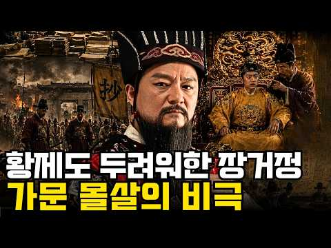
- 같은 채널 평소 대비 ×14.7 (채널 최근 롱폼 중앙값 4,057회) · 평소 영상: 수많은 대신을 몰아낸 명나라 권신 엄숭, 결국 자신의 아들조차 구하지 못했다 (4,057회) / 항복에서 처형까지 15년, 청나라는 정지룡에게 무엇을 원했나 (4,131회)
- 대본 없음 (없음) — 음성인식이 끝나면 도입부·흐름이 들어감
- 댓글 38/40: 좋은 점 — 영상 0 · 감사·응원 3 · 더 알고 싶은 것 0 · 아쉬운 점 — 영상 0 · 반박·불만 — 의견 다름 0 · 정치·사회 7 · 경험 공유 1 · 구독·다음 기대 0
  - 감사·응원 👍37 “명나라가 스스로 무덤을 팠네요. 그런 황제 제사를 신주단지 모시듯 모시고 조선을 흔든 송시열, 우리 역사의 희극이자 비극. 만력제한테 감사하는 정도가 아니라 몇 백년간 우리 역사를 과거로 회귀시킨 일이 바로 비극이란 얘기”
  - 감사·응원 👍14 “장거정이 만든 시스템 덕분에 ㅡㅡ만력제가 임진란 조선을 도울 국력이 남아있어 조선을 풍성하게 도와줄 여력이 되었네ㅡㅡ장거정과 만력제에게 감사합니다”
  - 정치·사회 👍37 “명나라가 스스로 무덤을 팠네요. 그런 황제 제사를 신주단지 모시듯 모시고 조선을 흔든 송시열, 우리 역사의 희극이자 비극. 만력제한테 감사하는 정도가 아니라 몇 백년간 우리 역사를 과거로 회귀시킨 일이 바로 비극이란 얘기”
  - 정치·사회 👍29 “명나라 신하들은 천재도 많았는데 병신같은 왕들이 다 죽여없애고 나라가 망했지...”

### 244. 세상에 단 하나뿐인 비구니 종단, 대한불교보문종의 숨겨진 역사,

- https://www.youtube.com/watch?v=d_WxsDC7L1U · 부처님 말씀 ASMR · 구독자 25,400 · 조회수 107,273 (×4.2, 하루 5,175.8) · 좋아요 489 (0.5%) · 23.5분 · 2026-10-20 · 주제 묶음 1. 역사 일반·이야기 · 형식 수면·낭독 (잠잘 때 듣는) · 폴더 `W_d_WxsDC7L1U` (웹 승인)
- 썸네일: 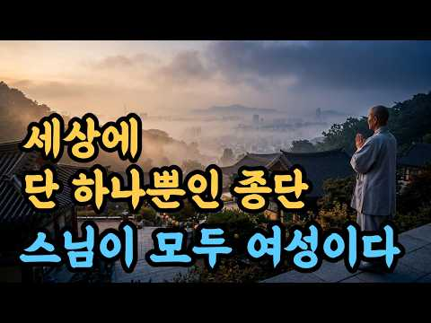
- 설명 앞부분: 한국 불교에는 스님이 모두 여성인 종단이 있습니다. 서울 성북구 보문동의 보문사를 총본산으로 하는 대한불교보문종, 자료에 따라 세계에서도 하나뿐인 비구니 종단으로 소개되는 곳이에요. 그런데 이 종단은 거창한 이상보다 절을 지키려는 간절한 마음에서 시작되었습니다. 이천오백 년 전 인도의 마하파자파티, 조선의 탑골승방, 갑신정변의 비밀 모임, 그리고 긍탄 스님과 은영 스님의 결단까지. 기승전결 네 장면으로 보문종의 이야기를 차근차근 풀어 보았어요. 영상에서 다루는 내용은, 여성 출가의 시작, 보문사의 오랜 역사, 비구와 대처의 갈등 …
- 같은 채널 평소 대비 ×33.5 (채널 최근 롱폼 중앙값 3,205회) · 평소 영상: 석가모니, 아미타, 비로자나, 대체 누가 진짜 부처님일까, (3,205회) / 절마다 부처님이 다른 이유, 그리고 아무도 안 알려준 부처님의 서열, 아미타불, 석가모니… (3,220회)
- 대본 없음 (설명) — 음성인식이 끝나면 도입부·흐름이 들어감
- 댓글 10/13: 좋은 점 — 영상 0 · 감사·응원 2 · 더 알고 싶은 것 1 · 아쉬운 점 — 영상 0 · 반박·불만 — 의견 다름 0 · 정치·사회 0 · 경험 공유 1 · 구독·다음 기대 0
  - 감사·응원 👍2 “감사합니다”
  - 감사·응원 👍0 “각막 이식을 받아야 하는데 너무 막막합니다 시력을 조금씩 잃어 가고 있는 절망과 좌절 희망이 없는 저의 삶에 도움을 구하고자 개인적인 사정을 전하게 되어 마음이 무겁습니다 읽어 주신다면 정말 감사 하겠습니다 하고있던 사업이 잘안되어 아이 입양이나 고아원에 보내는것도 …”
  - 더 알고 싶은 것 👍0 “각막 이식을 받아야 하는데 너무 막막합니다 시력을 조금씩 잃어 가고 있는 절망과 좌절 희망이 없는 저의 삶에 도움을 구하고자 개인적인 사정을 전하게 되어 마음이 무겁습니다 읽어 주신다면 정말 감사 하겠습니다 하고있던 사업이 잘안되어 아이 입양이나 고아원에 보내는것도 …”
  - 경험 공유 👍0 “각막 이식을 받아야 하는데 너무 막막합니다 시력을 조금씩 잃어 가고 있는 절망과 좌절 희망이 없는 저의 삶에 도움을 구하고자 개인적인 사정을 전하게 되어 마음이 무겁습니다 읽어 주신다면 정말 감사 하겠습니다 하고있던 사업이 잘안되어 아이 입양이나 고아원에 보내는것도 …”

### 245. 팰월드 1.0 중후반 희귀 자원 쉽게 얻는 방법 (크로마이트,코랄리움,솔라이트,팰키사이트,고대 문명의 코어)

- https://www.youtube.com/watch?v=IMg_-t4j4Q8 · 퇴근한광대 · 구독자 7,220 · 조회수 162,572 (×22.5, 하루 1,462.3) · 좋아요 1,565 (1.0%) · 6.9분 · 2026-07-22 · 주제 묶음 5. 세계사·서양사 · 형식 정보·해설 (그 밖) · 폴더 `W_IMg_-t4j4Q8` (웹 승인)
- 썸네일: 
- 챕터: 0:00 오프닝 · 1:06 원정소 소개 · 1:38 원정전력이론 · 2:29 원정전력실전 · 4:17 레벨업시키기 · 4:35 팰작업연구소 · 4:48 원정 테스트 · 6:08 마무리
- 설명 앞부분: 중후반이 되면 크로마이트, 코랄리움, 슬라이트, 펠키사이트, 고대 문명의 코어 등 희귀 자원이 계속 부족해집니다. 하지만 원정을 쉽게 시작하면 직접 파밍하는 시간을 크게 줄일 수 있습니다. 이번 영상에서는 원정을 빨리 시작해야 하는 이유 추천 원정 팰 농축과 영혼 강화는 어느 정도만 하면 되는지 희귀 자원을 자동으로 수급하는 방법 을 정리했습니다. 원정은 생각보다 어렵지 않습니다. 너무 지레 겁먹지 마시고 지금부터 하나씩 시작해 보세요. 게임이 훨씬 편해질 겁니다. 타임라인
- 같은 채널 평소 대비 ×21.3 (채널 최근 롱폼 중앙값 7,616회) · 평소 영상: 팰월드 1.0 속성 추천 기술 총정리 #2 풀 속성 (8,050회) / 팰월드 1.0 속성 추천 기술 총정리 #4 얼음 속성 (7,182회)
- 대본 없음 (설명) — 음성인식이 끝나면 도입부·흐름이 들어감
- 댓글 259/259: 좋은 점 — 영상 12 · 감사·응원 31 · 더 알고 싶은 것 20 · 아쉬운 점 — 영상 7 · 반박·불만 — 의견 다름 0 · 정치·사회 0 · 경험 공유 6 · 구독·다음 기대 1
  - 좋은 점 — 영상 👍4 “팰월드 하는데 막힐때마다 영상 찾아볼 때 중요한 내용 알려주셔서 구독하고갑니다”
  - 좋은 점 — 영상 👍2 “좋은 정보 감사합니다~”
  - 감사·응원 👍6 “안그래도 오늘 팰키 캐느라 너무 힘들엇는데 감사합니다..”
  - 감사·응원 👍4 “와 딱 이때 저 코어 필요했는데 감사합니다”
  - 더 알고 싶은 것 👍2 “영혼은 어디서 파밍하나요? 펠 한마리 풀영혼 강화조차 빡센데.. 해체하면 영혼나오는펠이 있나요?”
  - 더 알고 싶은 것 👍2 “탐험으로만 렙이 70이 넘었는데 세계수 진입보스도 못 깨고 코어먹을데도 막막해서 스트레스직전이었는데 꿀영상 감사합니다! 혹시 중반 전투팰 공략 만들어 주실 수 있을까요? 얼리때 잡은 애들이 너무 허접이라 렙 50이상짜리 팰사냥은 너무 힘드네요”
  - 아쉬운 점 — 영상 👍0 “이분진짜 핵심만 골라서 너무 잘알려줌 개추임”
  - 아쉬운 점 — 영상 👍0 “이거 좋다~ 코랄에서 막혀서 낚시 찍고있는데 잘안되서 해봤는데 훨낫네요”
  - 경험 공유 👍0 “오~~굿 굿 너무 궁금 했었는대 대박 ㅎ”
  - 경험 공유 👍0 “이거 좋다~ 코랄에서 막혀서 낚시 찍고있는데 잘안되서 해봤는데 훨낫네요”
  - 구독·다음 기대 👍4 “팰월드 하는데 막힐때마다 영상 찾아볼 때 중요한 내용 알려주셔서 구독하고갑니다”

### 246. 산골 동네 주민들이 모여 합스부르크 정예 군사들을 제압하고 귀족들을 몰살시킨 전투

- https://www.youtube.com/watch?v=e-vAN1KFcCQ · 어른들의자장가 · 구독자 6,230 · 조회수 127,836 (×20.5, 하루 1,225.5) · 좋아요 709 (0.5%) · 17.9분 · 2026-07-29 · 주제 묶음 7. 전쟁·군사사 · 형식 정보·해설 (그 밖) · 폴더 `W_e-vAN1KFcCQ` (웹 승인)
- 썸네일: 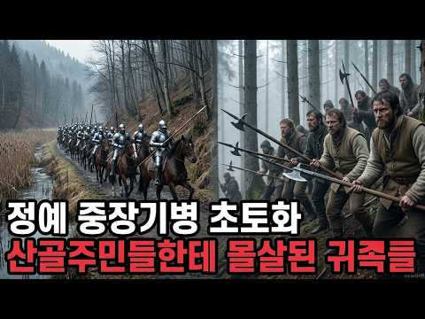
- 설명 앞부분: 1315년 11월 15일 아침, 애게리 호숫가의 좁은 길 위에 합스부르크 기사와 보병이 2킬로미터로 늘어섰습니다. 왼쪽은 가파른 비탈, 오른쪽은 늪이었고, 비탈 위 숲에는 소와 염소를 치며 사는 사람들 1,500명이 엎드려 있었어요. 두 시간 뒤 그 길에서 죽은 사람은 1,500명이 넘었고, 죽은 쪽은 기사들이었습니다. 71년 뒤 젬파흐에서 합스부르크는 기사 1,500명을 아예 말에서 내려 창 울타리를 세웠지만, 그날 공작 한 명과 귀족 400명이 함께 죽었어요. 다시 2년 뒤 네펠스에서는 방어벽을 내주고 산으로 물러난 400여 …
- 같은 채널 평소 대비 ×11.4 (채널 최근 롱폼 중앙값 11,169회) · 평소 영상: 독일군 전차와 대포 총공세를 처절하게 막아냈던 고작 20명의 최정예 소련 중대 이야기 (11,169회) / 길드 노조가 시민들로 군대를 조직해서 최정예 엘리트 군대랑 전쟁을 벌인 날 (11,001회)
- 대본 없음 (설명) — 음성인식이 끝나면 도입부·흐름이 들어감
- 댓글 28/28: 좋은 점 — 영상 0 · 감사·응원 1 · 더 알고 싶은 것 0 · 아쉬운 점 — 영상 1 · 반박·불만 — 의견 다름 2 · 정치·사회 0 · 경험 공유 0 · 구독·다음 기대 1
  - 아쉬운 점 — 영상 👍1 “지루한 설명이다”
  - 반박·불만 — 의견 다름 👍4 “스위스 는 산골 촌동네 목동 국가 거 아닙니다 로마 제국 때문에 알프스 에서 봉인된 헬베티아 人 들로서 용병 국가 이며 호전적이고 용맹 무쌍 합니다.”
  - 반박·불만 — 의견 다름 👍0 “잡스러운 헛소리를 뭐 이렇게 요란하게 뜨더냐?”
  - 구독·다음 기대 👍3 “재밌네요 ~~ 구독했습니다”

### 247. 김창룡 — '대통령의 오른팔', 옛 부하의 손에 최후를 맞은 대한민국 특무부대장.

- https://www.youtube.com/watch?v=GX_Hq2wRnBQ · 한국인물열전 TV · 구독자 2,350 · 조회수 71,749 (×30.5, 하루 457.1) · 좋아요 1,454 (2.0%) · 84.9분 · 2026-05-24 · 주제 묶음 4. 한국 근현대사 · 형식 정보·해설 (그 밖) · 폴더 `W_GX_Hq2wRnBQ` (웹 승인)
- 썸네일: 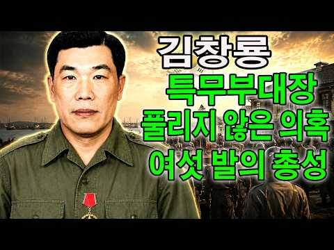
- 설명 앞부분: 🔥 김창룡 — '대통령의 오른팔': 권력의 정점에서 여섯 발의 총성에 쓰러진 특무부대장 이번 에피소드: 천구백오십육년 겨울 아침, 원효로에서 여섯 발의 총성과 함께 한 시대의 권력자가 쓰러졌다. 관동군 헌병에서 대한민국 특무부대장까지, 그는 어떻게 한 시대의 가장 강력한 권력을 손에 쥐었는가. 충신과 공포 사이, 반공과 친일 사이에 놓인 한 인물의 부상과 몰락을 기록으로 추적한다. 🎯 이 영상에서 다룰 내용: ✓ 노숙자에서 장교로 — 월남 직후의 재기와 정보 세계 입문 ✓ 여순 사건과 숙군 — 박정희를 체포하고 살린 운명적 교차 …
- 같은 채널 평소 대비 ×12.8 (채널 최근 롱폼 중앙값 5,609회) · 평소 영상: 임부택 — 춘천의 방패. 그 3일이 없었다면, 대한민국은 존재하지 못했다.한국전쟁 최대 … (5,837회) / 채명신 - 백골병단의 그림자 - 적진에서 사라진 지휘관. 기록되지 않은 순간 - 그날 밤… (5,381회)
- 대본 없음 (설명) — 음성인식이 끝나면 도입부·흐름이 들어감
- 댓글 185/186: 좋은 점 — 영상 2 · 감사·응원 4 · 더 알고 싶은 것 0 · 아쉬운 점 — 영상 3 · 반박·불만 — 의견 다름 0 · 정치·사회 37 · 경험 공유 6 · 구독·다음 기대 0
  - 감사·응원 👍0 “온갖고난행군? 알겄따 @@ㅈ@ 내대리 입니다 감사합니다 @@ㅈ@”
  - 감사·응원 👍0 “인간 행동 ᆢ다 자 잘 못이 ᆢ있게 마련 중요한것 오늘 의 대한민국 밑거름 ᆢ누구 행동 이 더 기여 를 했느냐 ? 인간사 =정치 결과 물 승자 의 편 정의 로와도 결과 ᆢ××× 라면 민주주의 ㆍ3.6만불 소득 78세 핏 뎅이 지만 결과가 오늘 날 국방 5대 강국 OE…”
  - 아쉬운 점 — 영상 👍1 “자막이 있었으면 좋겠네요”
  - 아쉬운 점 — 영상 👍0 “잔말이 많아 지루해서 끝까지 못 보겠다.”
  - 정치·사회 👍25 “대한민국이 현재 존재할수있었던 기초를 만든 사람중에는 수많은 이름없는 애국자들이 있었다,상층부에는이승만 대통령이 있다면 하층부에는 "나는공산당이 싷다"고외치며 죽 어간 어린애부터 침투한 개릴라들과 총격전을 하며 죽어간 이름도 알려지지않은 수많은국군장병이 있었기에 현재…”
  - 정치·사회 👍24 “남로당과 좌파들이 나라를 적화통일하려던 그 시대 상황을 제대로 이해해야 합니다. 암살자과 그들의 배후자들은 애국을 하기 위해 그를 살해했나요? 아닙니다. 배후자들을 잘 살펴보면 어느 정도의 해답이 나옵니다.”
  - 경험 공유 👍10 “김구는 해방이후 대한민국에 해로운 인물로 전략했었다”
  - 경험 공유 👍9 “김창룡 이 인간이 안두희를 시켜서 백범 김구 선생의 암살을 지시했었지..... 이승만은 안두희를 대통령 특별 사면권을 사용했고.....”

### 248. 미국서 터진 새로운 한류 충무공 이순신, 그들이 열광하는 진짜 이유

- https://www.youtube.com/watch?v=yhTI4EZgG5g · 스피드경제 · 구독자 8,640 · 조회수 76,286 (×8.8, 하루 1,641.1) · 좋아요 1,958 (2.6%) · 22분 · 2026-09-25 · 주제 묶음 3. 조선 · 형식 정보·해설 (그 밖) · 폴더 `W_yhTI4EZgG5g` (웹 승인)
- 썸네일: 
- 설명 앞부분: ⚔️ 칼의 전사라던 사무라이가 들고 온 건 총이었습니다. 그리고 그 총 앞에서 한 번도 지지 않은 조선 제독이 지금 미국에서 새로운 한류가 되고 있습니다. 🔥 일본 학자는 거북선을 깎아내렸지만 일본 해군 제독은 넬슨보다 위라고 적었고, 미국 해군은 100년 가까이 이 이름을 연구해 왔습니다. 다루는 내용 ・ 미국 시장에서 46만 부 넘게 팔린 이순신 그래픽노블 ・ 미 해군연구소 독자 투표에서 주목받은 거북선 ・ 13척 대 133척, 울돌목의 물살을 읽은 명량해전 ・ 1901년 일본 학자 하야시 다이스케의 거북선 철갑 부정 ・ 19…
- 같은 채널 평소 대비 ×81.9 (채널 최근 롱폼 중앙값 931회) · 평소 영상: "가르쳐 줬더니 옆에 가게를 냈다" 코스트코가 트레이더스를 그냥 경쟁자로 못 보는 진짜 … (931회) / 미국에 트럼프가 최우방도 버리자 일본이 새우등 터진 이유 (935회)
- 대본 없음 (설명) — 음성인식이 끝나면 도입부·흐름이 들어감
- 댓글 91/91: 좋은 점 — 영상 0 · 감사·응원 5 · 더 알고 싶은 것 0 · 아쉬운 점 — 영상 2 · 반박·불만 — 의견 다름 0 · 정치·사회 9 · 경험 공유 1 · 구독·다음 기대 0
  - 감사·응원 👍13 “대다나다 대한민국 화이팅 입니다.🎉🎉🎉”
  - 감사·응원 👍1 “대한민국화이팅”
  - 아쉬운 점 — 영상 👍2 “이것이 다는 이니죠 닛뽕국 사무라이는 용병으로 쓰였지요 언제 나는 펙트만 1624년쯤 네달란드 동인도회사 용병으로 채용된거죠 채용이유는 체격이 작고 먹는것도 짜디짠 밥에 작은생선조각 하나 올려주면 그만 끝 이들이 한짖은 인도네시아 어느섬에 있는 향신로 정향을 독점하려…”
  - 아쉬운 점 — 영상 👍1 “구독 완료!!! 좋아요는 sure~^^ 왜냐하면? 최소한 AI음성이 아니기 때문에~ 사람 목소리!!! 이거 쭈욱 유지하시길~^^”
  - 정치·사회 👍10 “생각할수록 찌질한 선조 그래도 나라가 버틴건 도처에서 나라를 위해. 싸웠던 애국열사들 덕분이었다”
  - 정치·사회 👍8 “정부는 그작가 찾아 표창하고 현금포상하세요ᆢ”
  - 경험 공유 👍0 “나도 어릴때부터 지금까지 제일존경하는이순신장군님 요즘은 너무너무좋아”

### 249. 2026년, 대한민국을 대한제국으로 만드는 왕과 사는 남자들 — 유시민에게 "감히"를 묻는 그들은 누구인가?

- https://www.youtube.com/watch?v=AI8f_HV3rZk · 민주 파수꾼 · 구독자 9,150 · 조회수 54,814 (×6.0, 하루 1,724.9) · 좋아요 2,815 (5.1%) · 21.9분 · 2026-10-09 · 주제 묶음 4. 한국 근현대사 · 형식 정보·해설 (그 밖) · 폴더 `W_AI8f_HV3rZk` (웹 승인)
- 썸네일: 
- 설명 앞부분: 대통령을 비판하는 사람에게 「감히」를 묻는 이들은, 대통령을 무엇이라고 생각하는 걸까요. 원로와 곁의 정치인, 그리고 대통령 자신의 말을 날짜와 함께 그대로 옮겼습니다. 그리고 그 물음에 가장 먼저 답한 사람의 말로 마무리합니다. 지난 영상 — 황석영 도올 김갑수가 이재명 대통령 비판은 막고 칭송하는 이유 인용 영상: 최욱의 매불쇼 (2026.03.18 · 03.25) / 미디어오늘 유시민 작가 대담 (2026.09.22) 들머리 이야기는 안데르센 「벌거벗은 임금님」(1837)을 옮긴 것입니다. 이미지: 위키미디어 공용 (장면 이…
- 같은 채널 평소 대비 ×4.4 (채널 최근 롱폼 중앙값 12,467회) · 평소 영상: 이재명의 대표 브랜드 기본소득은 어디로 갔나? ∣ 공약 점검 2호 (12,467회) / 정치인 이재명의 최저임금과 대통령 이재명의 최저임금 — "더 올려야"에서 "올린다고 해결… (14,982회)
- 대본 없음 (설명) — 음성인식이 끝나면 도입부·흐름이 들어감
- 댓글 177/180: 좋은 점 — 영상 4 · 감사·응원 15 · 더 알고 싶은 것 0 · 아쉬운 점 — 영상 1 · 반박·불만 — 의견 다름 1 · 정치·사회 71 · 경험 공유 7 · 구독·다음 기대 1
  - 좋은 점 — 영상 👍25 “와! 일목요연하게 정리해 주셔서 감사! 소장각이네여~”
  - 좋은 점 — 영상 👍21 “사건과 말을 시간별로 그리고 주제별로 잘 정리해주는 영상을 만나 기쁜 마음으로 구독했습니다. 더 좋은 영상을 계속 올려주시기를 기대합니다. 구독자도 더 늘어나길 기원합니다.”
  - 감사·응원 👍25 “와! 일목요연하게 정리해 주셔서 감사! 소장각이네여~”
  - 감사·응원 👍23 “우리가 하고 싶은 말을 매번 잘 요약, 정리해서 알려줘 감사합니다 뉴이재명들이 한명이라도 더 이 채널을 보고 각성하기를 기대합니다.”
  - 아쉬운 점 — 영상 👍0 “3년은 너무 길다!!!”
  - 반박·불만 — 의견 다름 👍0 “그렇잖아도 거슬린 표현 많았는데 정리 잘 하셨습니다. 응원하고요. 제국의 신민도 아닌데 충臣 간臣 이런 표현을 과도하게 쓰는 사례도 언급해주시길”
  - 정치·사회 👍48 “기괴하다 이재명”
  - 정치·사회 👍37 “어~~~~이 이재명씨 , 당신이 보따리싸고 청와대에서 기어 나갈날을 기다리기엔 너무 지루하오 !!!”
  - 경험 공유 👍12 “나도 처음에는 백낙청 김용옥 황석영 김갑수 등과 같은 생각을 했었다. 너무 잘했으니까. 그 이후 대통령과 그 주변의 인물들이 하는 언행을 보고는 너무 실망해서 마음이 바뀌었다. 아마 백낙청 같은 분들도 지금은 나와 같은 심정일 것이다. 처참하고 부끄럽고 후회되는 마음…”
  - 경험 공유 👍12 “윤석열 검찰총장 될 때 사람에게 충성하지 않는다는 말이 쎄했었고, 이재명이 왕과 사는 남자 봤다고 했을 때 세했었다. 흠. 왕이라............”
  - 구독·다음 기대 👍21 “사건과 말을 시간별로 그리고 주제별로 잘 정리해주는 영상을 만나 기쁜 마음으로 구독했습니다. 더 좋은 영상을 계속 올려주시기를 기대합니다. 구독자도 더 늘어나길 기원합니다.”

### 250. 일본을 400년간 트라우마에 시달리게 한 장수. 이순신이 아닙니다 ∣ 김시민

- https://www.youtube.com/watch?v=CF4biSGrwOg · 그랬구나! · 구독자 9,010 · 조회수 196,227 (×21.8, 하루 1,680.9) · 좋아요 5,258 (2.7%) · 65.2분 · 2026-07-16 · 주제 묶음 3. 조선 · 형식 인터뷰·강연·대담 · 폴더 `W_CF4biSGrwOg` (웹 승인)
- 썸네일: 
- 챕터: 0:00 인트로 · 1:44 모쿠소 호간의 정체 · 2:49 김시민, 그는 누구인가 · 5:42 이순신과 같은 전장에 서다 · 7:17 전쟁 준비 · 9:52 성문을 열지 않은 판단 · 14:23 전투 시작 · 16:55 둘째 날 · 20:10 셋째 날 · 22:07 넷째 날 · 25:01 다섯째 날 · 28:28 여섯째 날 — 최후의 공방 · 31:39 진주대첩 · 34:17 승리 직후 · 39:57 기록의 무게 · 43:30 공신 교서의 수난 · 45:45 2차 진주성 전투 · 52:00 일본 속의 김시민 · 61:35 에필로그
- 설명 앞부분: 3만 대군을 3,800명으로 막아낸 장수가 있습니다. 6일간 십여 차례 싸워 단 한 번도 지지 않았습니다. 조선왕조실록은 이 사람의 죽음을 딱 한 줄로 처리했습니다. "김시민을 경상우도병마절도사로 삼았는데, 얼마 뒤에 졸하였다." 이게 전부입니다. 그런데 적국 일본에서는 전혀 달랐습니다. 진주목사를 뜻하는 '모쿠소'라는 두 글자가 1626년부터 400년 넘게 가부키 무대 위에 살아 있었습니다. 이름도 모른 채, 직함 하나만으로 공포의 상징이 된 것입니다. 기록한 쪽은 한 줄로 끝냈고, 당한 쪽은 400년간 떨었습니다. 이순신과 같…
- 같은 채널 평소 대비 ×45.1 (채널 최근 롱폼 중앙값 4,348회) · 평소 영상: 이순신보다 150년 전, 세종이 문신들을 제치고 우의정에 앉힌 무신 (4,348회) / 알고보면 황당한 서울이 수도가 된 이유 ∣ 태종실록 ∣ 한양천도 ∣ 조선역사 (4,292회)
- 대본 없음 (설명) — 음성인식이 끝나면 도입부·흐름이 들어감
- 댓글 505/505: 좋은 점 — 영상 4 · 감사·응원 25 · 더 알고 싶은 것 2 · 아쉬운 점 — 영상 3 · 반박·불만 — 의견 다름 9 · 정치·사회 24 · 경험 공유 5 · 구독·다음 기대 1
  - 좋은 점 — 영상 👍20 “선조와 간신들이 문제로 국민들이 개고생 도륙당했고 화랑오개를 배웠어야 했다”
  - 좋은 점 — 영상 👍0 “김시민 장군의 이름은 들었지만 자세한 내용은 아무래도 이순신 장군만큼 알려지지 않았으니까요! 사실 강감찬, 이순신 장군 외에는 역사를 기억 못 하는 것이 현재의 문제죠. 김시민 장군뿐 아니라 훌륭한 우리 장군들이 많았습니다만 일제강점기 때 많이 전승이 끊겼을 겁니다.…”
  - 감사·응원 👍130 “김시민장군이 이토록 위대하신 분인지 몰랐습니다. 감사합니다.”
  - 감사·응원 👍83 “눈물을 흘리며 듣습니다. ㅠㅠㅠ 오늘이 있도록 희생하신 모든 선조님들께 감사를 올립니다. 부디 하늘에서 평안 하소서. _()_ .”
  - 더 알고 싶은 것 👍0 “곽재우 장군도 가망없다고 진주성 버렸듯이 경상도 장수들이 진주성을 버렸을 때, 1등 공신을 따지자면 이치전투의 영웅 남원출신 황진 장군을 비롯해 전라도 출신 장수들이 2차 진주성 전투에서 활약상도 영상 부탁드려요. 그리고 이치전투와 황진 장군을 찾아보세요. 대단한 분…”
  - 더 알고 싶은 것 👍0 “2차 진주성 전투 영웅 황진장군님도 다뤄주세요 바다엔 이순신장군님 육지엔 황진장군님 진정한 조선의 소드마스터 황진장군님 만세 만세 만세!”
  - 아쉬운 점 — 영상 👍21 “답을 내려고 하지마세요 수긍하고 다시 같은일이 반복되지 않게 하는게 역사를 배우는 목표라 생각합니다”
  - 아쉬운 점 — 영상 👍0 “역사에서 버림받을뻔한 김시민장군을 국민들 가슴에 영원히 살려주셔서 감사합니다 김시민장군님 감사합니다 님은 영웅이십니다 언젠가 어느 후손이 님을 기릴 영화를 만들날이 올것입니다 평안히 잠드소서 ()()()”
  - 반박·불만 — 의견 다름 👍74 “올공 민주화운동 열사를 국민이 지켜야 합니다ㆍ 역사에 기록하고 후손이 알아야 합니다 ㆍ 자유는 공짜가 아니죠”
  - 반박·불만 — 의견 다름 👍1 “십만양병설 사실아닙니다. 사실 아닌걸 여기저기 쓰면서 가짜를 진짜 역사로 오해. 빨리 바로 잡고 고쳐 나가야합니다. 오류가”
  - 정치·사회 👍12 “김시민이를 2등으로 평가할 정도의 선조의 실력 이러한 나라가 어찌 망하지 않겠는가? 그래서 결국 망했지. 지금도 역사는 반복되고 있다.”
  - 정치·사회 👍3 “오늘날 현대사의 역적들을 상세히 기록하여 남기길 바랍니다. 이재명 한동훈 등등등”
  - 경험 공유 👍1 “이 훌륭한 분이 나의 선대 할아버지 셨구나 나도 부끄럽지않게 살고 뭔가 사회에 좋은 기여를 해야겠다”
  - 경험 공유 👍1 “옛 어렵게 기록한 내용을 세세하고 긴박 하고 절실 했었던 (그때의) 마음을 담아 알려 주시어 감사할 따름입니다. 😢”
  - 구독·다음 기대 👍0 “좋은시간을 가졌어요. 다음편을 기대할게요”

### 251. 🌙 고려 474년 전체 역사 몰아보기 풀버전｜한 번 보면 잊을 수 없는 고려 이야기

- https://www.youtube.com/watch?v=MPhEoG48MGw · 달빛 역사관 : 자면서 듣는 세계사 · 구독자 9,570 · 조회수 131,591 (×13.8, 하루 1,728.2) · 좋아요 780 (0.6%) · 187.9분 · 2026-08-26 · 주제 묶음 1. 역사 일반·이야기 · 형식 수면·낭독 (잠잘 때 듣는) · 폴더 `W_MPhEoG48MGw` (웹 승인)
- 썸네일: 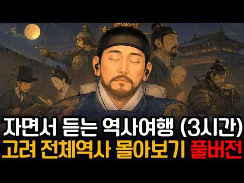
- 챕터: 0:00 프롤로그 · 6:45 1부 918년, 철원의 밤 · 14:39 2부 갑옷 한 벌 · 23:13 3부 아들에게 갇힌 아버지 · 31:17 4부 낙타다리 · 38:13 5부 칼과 붓 · 46:01 6부 뜰 아래에서 절하라 · 52:47 7부 종이로 감싼 화살 · 60:35 8부 화살이 다 떨어질 때까지 · 68:43 9부 귀주 · 76:20 10부 아홉 개의 성 · 84:03 11부 궁궐이 탄 밤 · 92:06 12부 하늘이 열린다는 이름 · 99:30 13부 보현원의 밤 · 106:51 14부 씨가 따로 있는가 · 114:40 15부 바다를 건넌 사람들 · 122:10 16부 태워 버린 이름 · 129:09 17부 오천이백만 자 · 137:01 18부 마지막 배 · 144:55 19부 화장값
- 설명 앞부분: 918년 유월, 철원의 어느 집 마당. 한밤중에 사내 넷이 문을 두드립니다. 1392년 칠월, 개경. 옥새 하나가 손을 바꿉니다. 그 사이에 놓인 사백칠십사 해의 이야기입니다. 거란이 세 번 왔고 몽골이 여섯 번 왔습니다. 도읍이 세 번 비었고, 궁궐은 불탔다가 다시 섰다가 또 불탔습니다. 바다 건너 섬으로 옮겨 간 조정이 있었고, 그 조정이 삼십 년을 버티는 동안 본토에서는 곡식을 지고 산으로 올라갔다 내려오기를 되풀이한 사람들이 있었습니다. 성을 지키다 죽은 사람이 있었고, 종의 이름으로 태어나 종으로 죽은 사람이 있었으며, …
- 같은 채널 평소 대비 ×2.1 (채널 최근 롱폼 중앙값 63,086회) · 평소 영상: 🌙 들으면서 주무세요 ∣ 약소국에서 삼국통일까지, 신라 천 년의 이야기 ｜달빛 역사관 (63,086회) / 🌙 들으면서 주무세요｜단군, 신화인가 역사인가 고조선의 역사 이야기 풀스토리｜달빛 역사관 (63,515회)
- 대본 없음 (설명) — 음성인식이 끝나면 도입부·흐름이 들어감
- 댓글 14/18: 좋은 점 — 영상 1 · 감사·응원 3 · 더 알고 싶은 것 0 · 아쉬운 점 — 영상 0 · 반박·불만 — 의견 다름 0 · 정치·사회 0 · 경험 공유 0 · 구독·다음 기대 0
  - 좋은 점 — 영상 👍0 “이런 유익한 영상은 많은 보템ㅇ 되어있습니다 감사합니다”
  - 감사·응원 👍18 “매번 잘 듣고 있습니다 역사 공부도 되고 좋네요 감사해요~😀”
  - 감사·응원 👍2 “고려 에서 유래한 코리아 자랑스러운 고려 태조 왕건 님 😊❤ 고려때 영토가 지금보다 넓었다 고려 역사 이야기 잘들었습니다 감사합니다”

### 252. 세종대왕이 600년 전 숨겨둔 비밀 ∣ 지금 전 세계가 뒤집힌 이유

- https://www.youtube.com/watch?v=JLOhGgZAKeA · 이상하TV · 구독자 18,000 · 조회수 235,933 (×13.1, 하루 3,219.7) · 좋아요 2,017 (0.9%) · 22.1분 · 2026-08-29 · 주제 묶음 3. 조선 · 형식 정보·해설 (그 밖) · 폴더 `W_JLOhGgZAKeA` (웹 승인)
- 썸네일: 
- 챕터: 0:00 600년 전 한글의 비밀 · 1:20 세계 문자와 한글의 차이 · 2:46 세종대왕이 글자를 만든 이유 · 5:05 과학적으로 설계된 자음 · 7:15 소리와 획의 놀라운 규칙 · 10:23 한글 창제를 둘러싼 반대 · 12:17 사라질 뻔한 해례본 · 14:30 디지털 시대에 빛난 한글 · 18:48 국경을 넘어선 한글
- 설명 앞부분: 매일 스마트폰 자판을 두드리는 순간에도 600년 전 세종대왕의 설계가 작동하고 있습니다. 한글은 누가, 왜, 어떤 원리로 만들었는지가 기록으로 남은 특별한 문자입니다. 하지만 그 위대한 글자는 탄생부터 환영받은 것은 아니었고, 창제 원리를 담은 책마저 역사 속에서 사라질 위기를 겪었습니다. 한글이 오늘날 세계의 주목을 받게 된 과정을 끝까지 확인해 보세요.
- 같은 채널 평소 대비 ×31.5 (채널 최근 롱폼 중앙값 7,488회) · 평소 영상: 한때 세계 GDP의 30%였던 유럽… 2026년 지금은 왜 이렇게 됐을까? (8,399회) / 혼자 다 만드는 미친 나라 — 조선·반도체·원전·방산, 하버드가 경악한 한국의 비밀 (6,578회)
- 대본 없음 (설명) — 음성인식이 끝나면 도입부·흐름이 들어감
- 댓글 68/68: 좋은 점 — 영상 0 · 감사·응원 10 · 더 알고 싶은 것 0 · 아쉬운 점 — 영상 2 · 반박·불만 — 의견 다름 2 · 정치·사회 4 · 경험 공유 1 · 구독·다음 기대 0
  - 감사·응원 👍22 “그져고개숙여 감사합니다라고 할뿐 감사합니다.”
  - 감사·응원 👍20 “우리 한민족은 지혜롭고 똑똑한 민족입니다 우리 손주들을 보면 너무 너무 예쁩니다 자손이 예뻐야 후손도 더 잘 되지 않을까요 너무너무 감사하고 너무 사랑했어요”
  - 아쉬운 점 — 영상 👍2 “비슷한 얘기 이곳저곳 채널에서 계속 반복해서 올리는 이유가 무엇인가,,,,,,?”
  - 아쉬운 점 — 영상 👍0 “중국 한자 아닙니다. 정정요. 신라,백제,고리가 다 말이 틀리니 지역마다 말이 틀린거구요.”
  - 반박·불만 — 의견 다름 👍0 “우리의 자랑 한글은 고작 15세기의 문자가 아닙니다 4천2백년의 오랜 역사를 자랑합니다 그렇게 위대한 문자 한글을 세종은 자신의 업적으로 꾸미면서 매우 초라하게 축소시켜 버렸지요 한글은 고조선 3세 가륵단군의 명을 받은 을보륵님에 의해 창제 되어 사용되며 발전해 왔습…”
  - 반박·불만 — 의견 다름 👍0 “중국 한자 아닙니다. 정정요. 신라,백제,고리가 다 말이 틀리니 지역마다 말이 틀린거구요.”
  - 정치·사회 👍4 “중국인들이 가장 싫어하는 한국인 1위가 세종대왕이래요.ㅋㅋ”
  - 정치·사회 👍0 “우리 민족이 세계의 중심이 되실것을 미리 알고 계시었던,, 우리 민족의 정신적 지도자 이셨던, 백범 김구 선생님의 높으신 혜안, """문화를 주도하는 나라가 세계의 중심이 된다 !!!! """ 깊이 새겨야 헐 것이며, 나라가 부유 해질수록 가난하고,, 어려운 나라를 …”
  - 경험 공유 👍4 “세종대왕의 백성을 사랑하는 마음 덕에 후손인 저희 뿐만 아니라, 오늘날, 자기 글자 없는 나라에게도 기록하는 문화보전의 첨병이 됐어요. 감사합니다!”

### 253. 유대 역사가 요세푸스는 예수를 어떻게 기록했는가 ∣ 성경 밖의 결정적 증언

- https://www.youtube.com/watch?v=PE6zM8WI08M · Coram Deo · 구독자 30,200 · 조회수 198,748 (×6.6, 하루 5,378.4) · 좋아요 1,458 (0.7%) · 22.5분 · 2026-09-21 · 주제 묶음 1. 역사 일반·이야기 · 형식 정보·해설 (그 밖) · 폴더 `W_PE6zM8WI08M` (웹 승인)
- 썸네일: 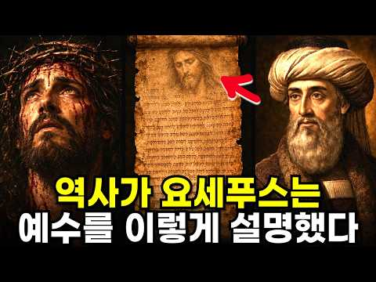
- 챕터: 0:00 인트로 – 성경 밖에서 예수를 찾는 이유 · 1:58 요세푸스, 두 세계의 증인 (유대-로마 전쟁과 그의 … · 8:57 『유대 고대사』에 숨겨진 예수의 기록 · 15:24 타키투스와 플리니우스, 로마의 기록 속 예수 · 19:51 마무리 – 이천 년을 건너온 이름
- 설명 앞부분: 유대 역사가 요세푸스는 예수를 어떻게 기록했을까요? 성경이 아닌 1세기 역사 기록 속에 남은 예수의 흔적을 따라가 봅니다. 예수를 믿지 않았던 유대인 역사가 플라비우스 요세푸스. 그가 서기 93~94년경에 완성한 방대한 역사서 『유대 고대사』에는, 놀랍게도 예수에 관한 기록이 남아 있습니다. 신앙의 눈이 아니라 역사가의 눈으로 남긴 이 기록은 과연 무엇을 증언하고 있을까요. 이 영상에서는 요세푸스가 누구인지, 그가 남긴 책들이 어떤 것인지부터 시작해, 『유대 고대사』 속 예수에 관한 두 대목을 살펴봅니다. 또한 로마 역사가 타키투…
- 같은 채널 평소 대비 ×6.3 (채널 최근 롱폼 중앙값 31,776회) · 평소 영상: 솔로몬 성전 앞에서 자식을 불태웠다고? 우리가 몰랐던 성경 속 우상들의 충격적 민낯 (총… (31,776회) / 언약궤는 지금 어디에 있는가 ∣ 성경이 침묵하는 3천 년의 미스터리 (31,620회)
- 대본 없음 (설명) — 음성인식이 끝나면 도입부·흐름이 들어감
- 댓글 228/232: 좋은 점 — 영상 1 · 감사·응원 8 · 더 알고 싶은 것 2 · 아쉬운 점 — 영상 1 · 반박·불만 — 의견 다름 16 · 정치·사회 5 · 경험 공유 19 · 구독·다음 기대 0
  - 좋은 점 — 영상 👍1 “마지막 멘트가 말이 어긋났네요 좋은 설명 감사합니다”
  - 감사·응원 👍8 “요세프스 이야기를 들려 주셔서 감사합니다 전혀 들어본적 없는 재미있는 옛날이야기에요 ❤❤❤”
  - 감사·응원 👍2 “고맙습니다 .”
  - 더 알고 싶은 것 👍1 “큰 은혜를 누렸습니다. 참고하신 책좀 알려주세요. 요세푸스. 티키타스 등”
  - 아쉬운 점 — 영상 👍9 “거짓말을 이렇게 뻔뻔하게도 하네요 요세푸스는 유대전쟁사 라는 저서를 남겼고 그는 로마와 전쟁을 반대했지만 유대부족들의 총사령관의 임무를 일정기간 맡았던 인물입니다 요세푸스는 유대인 귀족으로 태어났지만 베스파시아누스와의 인연으로(베스파시아누스가 후에 황제가 될 거라는 …”
  - 반박·불만 — 의견 다름 👍9 “거짓말을 이렇게 뻔뻔하게도 하네요 요세푸스는 유대전쟁사 라는 저서를 남겼고 그는 로마와 전쟁을 반대했지만 유대부족들의 총사령관의 임무를 일정기간 맡았던 인물입니다 요세푸스는 유대인 귀족으로 태어났지만 베스파시아누스와의 인연으로(베스파시아누스가 후에 황제가 될 거라는 …”
  - 반박·불만 — 의견 다름 👍2 “예수님은 역사하셨으니까 서양 달력 부터 기원 전후를 예수 전후로 나뉜것이겠죠 . 또한 그분을 따르던 영성 직제자들의 활동이나 로마시대 빌라도 전후의 활동 등ᆢㆍ역사들은 믿고 안믿고의 문제가 아니죠 ! 그런데 한국에서. 잘모르는 사람들에게만 죽도록 전도할것이 아니라 ,…”
  - 경험 공유 👍16 “예수는 내 안에서 부활했고 살고 계십니다. 내가 그의 증거이며 나의 부활이 또한 증거입니다.”
  - 경험 공유 👍1 “댓글로들 종교인이 맞는지?? 어찌 무교인 제가 보니 이슬람과 하나도 안틀려요”

### 254. 막부가 무너진 뒤, 도쿠가와 가문은 어떻게 되었을까?

- https://www.youtube.com/watch?v=kkwFyuynkKQ · 제국 그 후  · 구독자 8,250 · 조회수 136,865 (×16.6, 하루 1,468.6) · 좋아요 1,118 (0.8%) · 25분 · 2026-08-09 · 주제 묶음 6. 동양사 (중국·일본·몽골) · 형식 정보·해설 (그 밖) · 폴더 `W_kkwFyuynkKQ` (웹 승인)
- 썸네일: 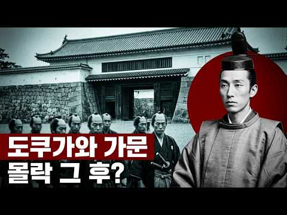
- 설명 앞부분: 이백육십오 년. 열다섯 명의 쇼군. 사백만 석. 그리고 거의 하룻밤 사이에, 그것이 사라졌습니다. 막부가 무너졌을 때 도쿠가와 가문은 처형되지 않았습니다. 추방되지도, 국적을 잃지도 않았습니다. 그러나 만 명이 넘는 사람들이 봉급 없이 주군을 따라 시즈오카로 떠났고, 그들 중 상당수는 물도 없는 자갈 고원에서 나무뿌리를 캐며 살았습니다. 칼을 팔아 호미를 산 무사들, 인력거를 끌게 된 하타모토, 그리고 팔십 년 뒤 호텔이 들어선 쇼군들의 무덤. 로마노프는 총으로, 합스부르크는 법으로, 청 황실은 계약으로 끝났습니다. 도쿠가와 가문…
- 같은 채널 평소 대비 ×5.5 (채널 최근 롱폼 중앙값 24,781회) · 평소 영상: 삼미그룹이 무너진 뒤, 김현철 가문은 어떻게 되었을까? (24,928회) / 금호아시아나그룹이 무너진 뒤, 박삼구 가문은 어떻게 되었을까? (24,634회)
- 대본 없음 (설명) — 음성인식이 끝나면 도입부·흐름이 들어감
- 댓글 34/34: 좋은 점 — 영상 1 · 감사·응원 1 · 더 알고 싶은 것 1 · 아쉬운 점 — 영상 1 · 반박·불만 — 의견 다름 1 · 정치·사회 3 · 경험 공유 0 · 구독·다음 기대 0
  - 좋은 점 — 영상 👍4 “좋은 영상 감사합니다 🎉”
  - 감사·응원 👍4 “좋은 영상 감사합니다 🎉”
  - 더 알고 싶은 것 👍6 “아하~ 재미있는 에도 막부의 마지막이네요. 다른 제국들도 궁금합니다.”
  - 아쉬운 점 — 영상 👍3 “다 좋은데 년도에 년은 붙여서 만드세요 ai티가 너무나서 불쾌함의 골짜기 최대치 입니다 이런 사소한거부터 수정하시는게 좋을듯 합니다”
  - 반박·불만 — 의견 다름 👍1 “말도 안되는 제도. 전세가 집주인이 필요해서 세입자에게 돈을 빌리는 제도인데 이런 제도를 한다면 그냥 월세를 받고 말지”
  - 정치·사회 👍6 “도구가와 이에야스 후손들 현황: 정권 몽괴 이후 그의 후손들은 약 600명 정도로 추산, 대부분 평범한 평민들로~! <우리 조선인 전통 씨족 성씨 집안>처럼, 도구가와 가문이 현재 종씨 단체가<일본 다른 종씨 비교해서> 나름 지켜내고있는 편입니다. <다른 수 많은 인…”
  - 정치·사회 👍5 “도쿠가와 막부는 조선을 침략하지 않는 좋은 정권이었는데 미국 페리제독 땜에 결국 무너짐”

### 255. 삼국을 낳은 나라, 교과서가 지운 700년 ∣ 부여

- https://www.youtube.com/watch?v=i6EHwdbLAcU · 그랬구나! · 구독자 9,010 · 조회수 133,318 (×14.8, 하루 1,597.7) · 좋아요 1,209 (0.9%) · 123.7분 · 2026-08-19 · 주제 묶음 2. 한국 고대·삼국·고려 · 형식 인터뷰·강연·대담 · 폴더 `W_i6EHwdbLAcU` (웹 승인)
- 썸네일: 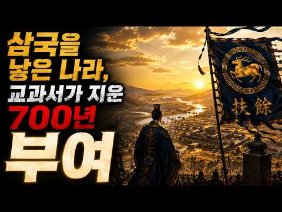
- 챕터: 0:00 인트로 — 열 글자로 끝난 700년 왕국 · 4:38 부여의 좌표 — 이름, 위치, 수도 논쟁 · 10:07 만주 대평원 위의 나라 — 지형의 축복과 저주 · 13:44 수도는 어디였는가 — 다섯 가지 설 · 17:07 영고 — 제사·재판·국무회의를 한꺼번에 연 국가 행사 · 25:02 우제점법과 전쟁 의사결정 · 26:50 부여 사람들의 생활 — 복식, 특산물, 장례 · 31:04 동명신화의 원형 — 부여에서 고구려로 · 38:44 고구려와 백제의 부여 계승 경쟁 · 46:44 흉년이 들면 왕을 죽이는 나라 — 부여의 정치 구조 · 52:20 부여의 대외 전략 — 중국과의 동맹, 읍루와의 관계 · 58:50 북부여·동부여·부여 — 이름 하나를 둘러싼 100년 … · 65:10 285년, 첫 번째 함락 — 왕의 자살과 복국 · 72:48 346년, 두 번째 재앙 — 5만 명이 끌려간 날 · 80:00 410년 광개토대왕의 동부여 정벌 · 83:30 494년, 마지막 열 글자 — 이름 없는 왕의 항복 · 87:30 두막루 — 부여의 가장 먼 그림자 · 93:10 동북공정 — 부여를 둘러싼 역사 전쟁 · 101:10 교과서 2페이지의 비밀 — 사료 부족, 영토 문제, … · 111:00 부여의 이름이 살아남은 곳들 — 충남 부여군, 발해 …
- 설명 앞부분: 700년. 조선보다 길고, 고려보다 길고, 로마 서방제국보다 긴 시간을 버틴 나라 — 부여. 그런데 한국사 교과서에서 이 나라에 할애된 분량은 고작 2~3페이지뿐입니다. 왜 그럴까요? 이 영상은 삼국사기 고구려본기의 단 한 줄, "부여왕이 처자를 거느리고 나라를 들어 항복해 왔다"는 열 글자에서 출발합니다. 이름조차 남기지 못한 마지막 왕의 항복 장면부터, 부여의 위치와 규모, '영고'라는 제천행사의 실체, 동명신화의 원형과 고구려·백제로의 계승, 285년 선비족 침공에서 494년 멸망까지의 200년 몰락사, 그리고 두막루와 발해…
- 같은 채널 평소 대비 ×30.7 (채널 최근 롱폼 중앙값 4,348회) · 평소 영상: 이순신보다 150년 전, 세종이 문신들을 제치고 우의정에 앉힌 무신 (4,348회) / 알고보면 황당한 서울이 수도가 된 이유 ∣ 태종실록 ∣ 한양천도 ∣ 조선역사 (4,292회)
- 대본 없음 (설명) — 음성인식이 끝나면 도입부·흐름이 들어감
- 댓글 205/222: 좋은 점 — 영상 5 · 감사·응원 11 · 더 알고 싶은 것 4 · 아쉬운 점 — 영상 2 · 반박·불만 — 의견 다름 2 · 정치·사회 13 · 경험 공유 3 · 구독·다음 기대 0
  - 좋은 점 — 영상 👍7 “부여 역사가 상당히 궁금했는데, 잘 정리해주셔서 재미있었습니다. 😊❤ 동북공정에 대해서도 잘 대응해야겠다는 생각도 드네요. 그런데 몇옃 답글들을 보니, 다 듣지도 않고 답글을 단다는 느낌도 받네요~”
  - 좋은 점 — 영상 👍6 “좋은 영상자료 감명깊게 보았습니다.감사합니다~^^”
  - 감사·응원 👍27 “안녕하세요.. 부여국민학교 부여중학교 출신입니다...항상 궁금했어요...내고향 부여가 고구려 백제 북부여 남부여 할때 그 부여와 어떤 관계일까...어떻게 만주의 그 고대국가 이름이 충청도 작은도시에 남아 있을까..설마..아니겠지...혹시 뭔 관계가 있는건가... 혼자…”
  - 감사·응원 👍19 “부여에 관한 설명이 이렇게 자세한 영상은 처음입니다. 정말 좋은 영상 감사합니다!”
  - 더 알고 싶은 것 👍8 “간도협약에 대해서도 언젠가 설명해주시면 좋겠습니다.”
  - 더 알고 싶은 것 👍0 “고조선과의 관계도 궁금해요”
  - 아쉬운 점 — 영상 👍9 “신라가 중국과 동맹을 맺고 백제와 고구려를 멸망시켜서 고구려땅인 만주와 요동, 연해주를 중국이 차지하게 된것이 정말 불행이고 비극이다. 그래놓고 삼국통일이라고 하는게 정말 뻔뻔한 역사이다”
  - 정치·사회 👍4 “서울대 국사학과 초대교수 이병도는 조선총독부 산하 조선사편수회에서 만든 식민사관 위서 『조선사』에 저자로 이름실린 식민사학자이자 친일매국노입니다. 2024년 5월 대한민국 교육부에서 행정법원에 제출한 입장문에서 대한민국 교육부는 반도사관이 식민사관 『조선사』와 내용이…”
  - 정치·사회 👍4 “당나라 정사 구당서와 신당서에 남부여=백제=일본 같은 나라로 기록되어있습니다. 그리고 당나라는 당태종 이세민시기 백제 의자왕초기까지는 백제를 종주국으로 모시던 신하국으로 기록하고 있습니다. 한반도의 작은 국가 백제가 어떻게 가능했을까요? 정답은 한반도의 작은 국가가 …”

### 256. 영의정만 6번 지낸 조선 최고의 천재가 죽기 직전 자신을 '죄인'이라 부른 진짜 이유∣오리 이원익,청백리,조선사

- https://www.youtube.com/watch?v=n_nHYw8fWkY · 거꾸로한국사 · 구독자 17,700 · 조회수 465,023 (×26.3, 하루 3,128.3) · 좋아요 8,536 (1.8%) · 43.8분 · 2026-06-15 · 주제 묶음 3. 조선 · 형식 정보·해설 (그 밖) · 폴더 `W_n_nHYw8fWkY` (웹 승인)
- 썸네일: 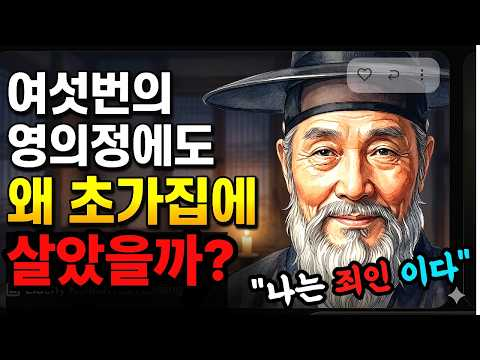
- 챕터: 0:00 프롤로그: 비 새는 초가집에 사는 영의정 · 4:15 굽 높은 나막신을 벗어던진 137cm의 청년 · 9:30 율곡 이이의 발탁, 그리고 조선을 덮친 임진왜란 · 14:50 명나라 장수를 놀라게 한 평양성 탈환 작전 · 20:10 "이순신을 죽이려거든 나를 먼저 베시옵소서" · 26:45 백성을 살린 세금 혁명, 대동법의 시작 · 31:20 일흔 노인의 유배 생활과 거절당한 짚 돗자리 · 36:40 임금도 울어버린 두 칸 초가집과 관감당의 진실 · 40:15 "나는 백성 앞에 죄인이다" 400년을 이어온 부모님…
- 설명 앞부분: 조선 오백 년 역사상 유일하게 영의정을 여섯 번이나 지낸 오리 이원익 대감. 이순신 장군을 죽음의 문턱에서 살려내고 백성을 위한 대동법을 처음 시행한 위대한 재상이었지만, 그가 평생 살았던 곳은 비가 새는 두 칸 초가집이었습니다. 임금마저 눈물짓게 한 그의 삶과 마지막 유언에 담긴 진짜 의미는 무엇이었을까요? 평생을 묵묵히 희생하며 늙어서도 자식에게 짐이 되지 않으려 홀로 버티시는 우리네 부모님의 모습과 너무도 닮아있는 400년 전 작은 거인의 먹먹한 이야기를 전해드립니다. 타임라인 『조선왕조실록』 (선조실록, 광해군일기, 인조실…
- 같은 채널 평소 대비 ×27.1 (채널 최근 롱폼 중앙값 17,173회) · 평소 영상: 정승 15년에 나물 밥상과 낡은 관복을 고집한 청백리 전쟁 영웅 ∣ 오성 이항복,조선청백리 (17,173회) / 세종 다음 성군이 될 뻔했던 천재 왕세자 ∣ 효명세자,조선역사,조선왕조,승정원일기 (15,144회)
- 대본 없음 (설명) — 음성인식이 끝나면 도입부·흐름이 들어감
- 댓글 444/482: 좋은 점 — 영상 6 · 감사·응원 28 · 더 알고 싶은 것 1 · 아쉬운 점 — 영상 0 · 반박·불만 — 의견 다름 6 · 정치·사회 26 · 경험 공유 12 · 구독·다음 기대 0
  - 좋은 점 — 영상 👍29 “오리대감에 대해 정사거나 야사던 조선시대에 대단한 청백리라는 사실을 알려주셔서 감사합니다”
  - 좋은 점 — 영상 👍5 “청백리 황희, 맹사성, 이원익, 정승 공감합니다. 지금 한국은 범죄인이 호의호식 하는 나라입니다.”
  - 감사·응원 👍55 “이원익대감님 고맙습니다~^^”
  - 감사·응원 👍43 “감동입니다 감사합니다 이런인물을 몰랐다니”
  - 반박·불만 — 의견 다름 👍1 “황희는 절대 청백리가 아닙니다. 조선 3대 청백리 이원익, 맹사성, 박수량”
  - 반박·불만 — 의견 다름 👍0 “쌍놈에 후손 선조가 이순신을 시기 한거지 누가 비틀어 쌍놈후손'선조에게 보고한게 아닌데”
  - 정치·사회 👍38 “국회의원 나라국자쓰는 의원 조심조심살아라 원로”
  - 정치·사회 👍9 “국회의원들 꼭.읽어라 국가원로회의 특보”
  - 경험 공유 👍2 “예나 지금이나 고위 관직은 그냥 고위 관직이 아니에요. 정확한 명칭은 "돈 벌 기회" 에요. 어디를 개발할 지, 국가가 무슨 산업에 돈을 투자할지... 그거 결정하는 사람들이니 그시기에 부동산 사고, 주식 사면 그냥 땅짚고 헤엄치기로 돈 벌지요. 옛날이라고 달랐을까.…”
  - 경험 공유 👍2 “중국 주 은 래 , 피델 카스트로< 유 언 ,비석도 세우지 말고 화장 하라.이름도 어디에도 남기지 말고 우상 화 금지 법안 통과. 공산 주의 답 다.>체게 바라< 쿠 바 국가 은행 장 하면서도 쉬는 날 이면 노동자?<근로인지 노동인지 ?>들 과 같이 일 하며 지냄>.…”

### 257. 제자 4명이 전국시대를 지배했다ㅣ2500년간 금서였던 귀곡자 완전해부 ∣ 역사 ∣ 세계사 ∣ 숨겨진 중국역사 ∣ 귀곡자 ∣ 손자병법 ∣ 역사인물 ∣ 오디오북

- https://www.youtube.com/watch?v=nxTN1r6q7FE · 역사깨침 · 구독자 30,900 · 조회수 701,644 (×22.7, 하루 5,306.5) · 좋아요 8,067 (1.1%) · 44.5분 · 2026-07-01 · 주제 묶음 10. 수면·낭독 · 형식 수면·낭독 (잠잘 때 듣는) · 폴더 `W_nxTN1r6q7FE` (웹 승인)
- 썸네일: 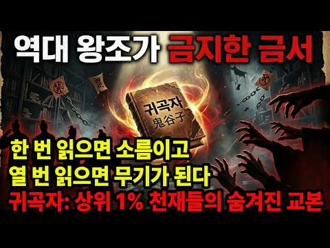
- 설명 앞부분: 공자에게는 제자가 3000명, 이 스승에게는 4명뿐이었습니다. 그런데 그 4명이 전국시대의 외교와 전쟁을 통째로 뒤흔들었습니다. 소진은 6국의 재상을 동시에 겸임하며 진나라를 15년간 봉쇄했고, 장의는 세 치 혀 하나로 그 동맹을 해체해 진나라 천하통일의 길을 열었습니다. 손빈은 두 무릎이 잘린 몸으로 천하무적 방연을 마릉 계곡에서 끝장냈고, 방연은 자기 이름이 새겨진 나무 아래서 스스로 목숨을 끊었습니다. 이 네 사람의 스승, 귀곡자. 그가 남긴 책 『귀곡자』 12편에는 사람의 마음을 읽고 움직이는 기술이 적혀 있었고, 역대 중…
- 같은 채널 평소 대비 ×1.7 (채널 최근 롱폼 중앙값 406,539회) · 평소 영상: 왜 어떤 사람은 흥하고 어떤 사람은 망하는가？사기(史記): 사람을 읽는 상위 1%의 통찰… (424,030회) / 효장태후 — 8살 손자를 중국 최고의 황제로 키운 할머니 강희제 뒤에 숨은 진짜 권력자 … (389,048회)
- 대본 없음 (설명) — 음성인식이 끝나면 도입부·흐름이 들어감
- 댓글 283/292: 좋은 점 — 영상 8 · 감사·응원 7 · 더 알고 싶은 것 5 · 아쉬운 점 — 영상 1 · 반박·불만 — 의견 다름 1 · 정치·사회 8 · 경험 공유 7 · 구독·다음 기대 0
  - 좋은 점 — 영상 👍5 “좋은 영상을 볼 수 있게 되어서 감사드립니다.”
  - 좋은 점 — 영상 👍2 “이런 걸 보면 늦은 나이라도 성경을 읽게 된 것이 얼마나 복된가. 어릴 때 춘추전국 시대 이야기를 제일 좋아했는데 귀곡선생 제자들 이야기도 재밌게 읽었다. 성경을 읽고보니 소진이나 장의나 다 부질 없고 악하고 악한 인간들의 복마전에 이용된 불쌍한 존재들이다. 인간의 …”
  - 감사·응원 👍50 “소진. "뭉치면 살고 흩어지면 죽는다." 더하고 합치고, 탐욕으로 배터져 죽는 돼지로 살고파요.ㅎ 왕비와 사랑은 종말의 일부 아닌가 싶고요. 사랑에는 죄가 없습니다. 소진, 장의, 방연, 손빈 스승이 '귀곡자'라는 역사, 이 영상으로 알게되었습니다. '귀곡자' 무협지…”
  - 감사·응원 👍5 “좋은 영상을 볼 수 있게 되어서 감사드립니다.”
  - 더 알고 싶은 것 👍1 “조나탄 분신 까지 Before Life Count 하면 무한인데 꼭 잡아주세요 . 부탁드립니다.”
  - 더 알고 싶은 것 👍0 “왜 영상 중간 중간에 나오는 이상한 소리가 나오나요? 텍스트 작성할때 오타가 영향을 준건가요? 이유가 뭔지 궁금하네요”
  - 반박·불만 — 의견 다름 👍3 “제자가 멍청하면 스승이 아무리 뛰어나도 빛을 발하지 못합니다. 청출어람이란 말이 괜히 있는게 아니죠. 여튼 이론을 실제로 펼쳐 행했다면 4명의 제자는 분명 그 빛을 발한 존재들임을”
  - 정치·사회 👍2 “군주의 영토욕심에 수백만의 백성이 죽는다 그중에는 어린아이도 있을 것이다 그리고 병법이란게 죄다 속임수인데 단기간에는 이익 일수 있으나 길게 보면 손해다 중국인들이 아직도 거짓말을 잘하고 사기 잘치는게 저런거의 영향이다 그렇게 병법에 능한 한족이 역사의 대부분을 북방…”
  - 정치·사회 👍0 “기록을 남기는 사람이나 나라가 승자임.손자병법 당대 권력자들은 필수 학문이라는거😅.김유신부터 삼국시대 귀족들은 필수 학문이었을거임.킹덤 이목 제거할라고 간자가 이목왕 만세 ㅋ 이목 전쟁은 이겨도 정치가 제거하게 만드는”
  - 경험 공유 👍7 “내가 죄를 저질렀어도 끝까지 결백을 주장하라. 그리고 쌩까라. 맹째맹”
  - 경험 공유 👍1 “내가 다 아는 내용을 디지털 ai로? 손 쉽네.”

### 258. 🌙 자면서듣는 역사 ∣ 조선왕조실록 : 조선의역사 풀스토리 500년 대서사｜달빛 역사관

- https://www.youtube.com/watch?v=Tq1ADCDu3hQ · 달빛 역사관 : 자면서 듣는 세계사 · 구독자 9,570 · 조회수 270,521 (×28.3, 하루 1,609.0) · 좋아요 1,885 (0.7%) · 104.3분 · 2026-05-26 · 주제 묶음 3. 조선 · 형식 수면·낭독 (잠잘 때 듣는) · 폴더 `W_Tq1ADCDu3hQ` (웹 승인)
- 썸네일: 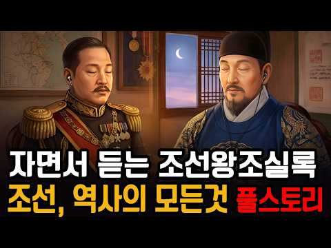
- 챕터: 0:00 프롤로그 — 오늘 밤의 초대 · 2:58 1부 — 칼을 돌린 사람 (고려 말, 위화도 회군, … · 11:37 2부 — 피로 다진 기초 (왕자의 난, 태종, 세종 … · 23:19 3부 — 빛의 왕조 (세종, 훈민정음, 집현전, 4군… · 33:03 4부 — 균열 (단종, 계유정난, 세조, 사육신, 성… · 44:18 5부 — 선비들의 꿈과 좌절 (연산군, 사화, 조광조… · 57:51 6부 — 바다가 나라를 구했다 (임진왜란, 이순신, … · 72:10 7부 — 치욕과 굴욕 사이에서 (광해군, 병자호란, … · 84:18 8부 — 마지막 빛과 긴 황혼 (영조, 사도세자, 정… · 99:48 에필로그 — 오백 년이 남긴 것
- 설명 앞부분: 잠들기 전, 오백십팔 년의 조선 역사 이야기를 들려드립니다. 위화도의 빗속에서 칼의 방향을 바꾼 한 장수의 결단으로 시작된 나라. 형제의 피로 기초를 다지고, 세종의 붓으로 찬란하게 빛났으며, 사화와 전쟁과 치욕을 버텨낸 끝에 조용히 문을 닫은 왕조. 조선 오백 년의 이야기를 오늘 밤 달빛 역사관이 머리맡에서 들려드립니다. 이번 영상은 단순한 연표가 아닙니다. 뜻을 품었다가 꺾인 사람들, 불가능한 상황에서 기적을 만들어낸 사람들, 역사가 끝난 자리에 조용히 남아 살아간 사람들의 이야기입니다. 왕들의 이야기이기도 하지만, 사실은 사…
- 같은 채널 평소 대비 ×4.3 (채널 최근 롱폼 중앙값 63,086회) · 평소 영상: 🌙 들으면서 주무세요 ∣ 약소국에서 삼국통일까지, 신라 천 년의 이야기 ｜달빛 역사관 (63,086회) / 🌙 들으면서 주무세요｜단군, 신화인가 역사인가 고조선의 역사 이야기 풀스토리｜달빛 역사관 (63,515회)
- 대본 없음 (설명) — 음성인식이 끝나면 도입부·흐름이 들어감
- 댓글 27/36: 좋은 점 — 영상 0 · 감사·응원 1 · 더 알고 싶은 것 0 · 아쉬운 점 — 영상 1 · 반박·불만 — 의견 다름 0 · 정치·사회 1 · 경험 공유 2 · 구독·다음 기대 0
  - 감사·응원 👍0 “감사합니다. 수고하셨습니다.”
  - 아쉬운 점 — 영상 👍0 “쓸데없는 말이 너무 길다”
  - 정치·사회 👍8 “내가 그냥 안보면 되는데 조선시대는 한마디로 공산당 세습정권하고 하나도 다를바가 없다.”
  - 경험 공유 👍8 “내가 그냥 안보면 되는데 조선시대는 한마디로 공산당 세습정권하고 하나도 다를바가 없다.”
  - 경험 공유 👍1 “《이씨,조선왕조 오백년 유지 비결》 1.자기보다 난사람들 싹~죽여버리고,못난사람만 살려 부역자(사대부)부리고 2.음주섹스(관기)제도로,지네李왕족만 급번식시킨 반면,고려원주민들은 노예(상놈)신분제도로 인간가축 만들어 가난,빈곤(식민)통치 521년!"현재,중국계 李왕손1…”

### 259. 66살 할아버지 영조와 결혼한 15살 소녀 정순왕후의 최후｜한국사｜조선역사｜신유박해

- https://www.youtube.com/watch?v=_Il2QJpOgZw · 역사콕테일 · 구독자 8,700 · 조회수 167,567 (×19.3, 하루 1,452.2) · 좋아요 1,625 (1.0%) · 24.6분 · 2026-06-23 · 주제 묶음 4. 한국 근현대사 · 형식 정보·해설 (그 밖) · 폴더 `W__Il2QJpOgZw` (웹 승인)
- 썸네일: 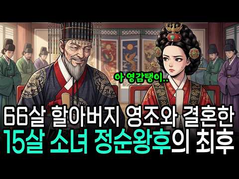
- 챕터: 0:00 1759년 창경궁 간택장 · 2:05 힘없는 가문의 딸, 경주 김씨가 국모로 결정된 이유 · 4:11 간택장에서 전해지는 소녀의 영리한 일화와 그 진실 · 6:37 15세 새어머니와 25세 아들 사도세자의 기묘한 관계 · 9:56 1762년 여름, 조선 왕실 최대의 비극 · 11:21 비극을 둘러싼 '어린 왕비 배후설'의 실상 · 13:34 1776년 영조의 승하와 정조의 즉위, 그리고 24년… · 16:24 1800년 정조의 갑작스러운 죽음과 쉰여섯 여인의 수…
- 설명 앞부분: 66세 영조와 혼인한 15살 정순왕후. 쉰한 살 나이 차이의 어린 신부는 어떻게 조선에서 가장 무서운 권력자가 되었을까요? 영조는 왜 하필 가장 가난한 집 딸을 골랐고, 우리가 아는 '악녀 정순왕후'의 이미지는 과연 사실일까요? 1759년, 예순여섯 살의 임금 영조는 직접 새 왕비를 골랐습니다. 그가 선택한 건 명문가의 딸이 아니라, 겨울에 멍석을 덮고 잤다는 이야기가 전해질 만큼 가난한 집안의 열다섯 살 소녀였습니다. 손녀뻘 소녀를 신부로 맞은 늙은 임금의 속셈은 무엇이었을까요. 그리고 그 어린 신부는 24년의 인내 끝에, 발 …
- 같은 채널 평소 대비 ×33.5 (채널 최근 롱폼 중앙값 5,000회) · 평소 영상: 세조가 잊지 못한다는 경혜공주의 충격적인 복수극｜한국사｜조선역사｜단종 (5,766회) / 조선시대 사람들은 진짜로 다들 40살에 죽었을까?｜한국사｜조선평균수명｜역사 (4,235회)
- 대본 없음 (설명) — 음성인식이 끝나면 도입부·흐름이 들어감
- 댓글 201/201: 좋은 점 — 영상 0 · 감사·응원 0 · 더 알고 싶은 것 0 · 아쉬운 점 — 영상 1 · 반박·불만 — 의견 다름 3 · 정치·사회 2 · 경험 공유 0 · 구독·다음 기대 0
  - 아쉬운 점 — 영상 👍3 “말이 너무 길다 지루해”
  - 반박·불만 — 의견 다름 👍13 “정순왕후는 정치력있고 중립적인 인물이지 악녀가 아닙니다 수렴청정하면서 중심을 잡은게 악녀면 권력자중 악인이 아닌 사람은 아무도 없습니다 신유박해는 조선 역사에서 미미한 천주교 박해인데 최대규모라고 하다니 팩트체크를 하고 영상을 올리십시오 조선역사상 최대 천주교 박해는…”
  - 정치·사회 👍3 “김건희네 지가 대통령인줄 알던..”

### 260. [세계사] "1분은 왜 하필 60초일까?" 오늘 아침 당신의 시계 속에 잠든 인류 최초의 문명, 수메르가 사라진 진짜 이유 l 60진법 길가메시 메소포타미아 노…

- https://www.youtube.com/watch?v=xhC-7TrEdrg · 역사로그 · 구독자 22,000 · 조회수 527,024 (×24.0, 하루 3,664.5) · 좋아요 8,809 (1.7%) · 52분 · 2026-06-19 · 주제 묶음 5. 세계사·서양사 · 형식 몰아보기·통합본 (긴 영상) · 폴더 `W_xhC-7TrEdrg` (웹 승인)
- 썸네일: 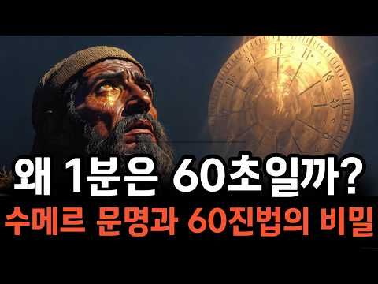
- 챕터: 0:00 시계 속에 잠든 5천 년 — 인류 최초의 문명 수메르 · 1:02 외계인이 만들었다? — 수메르 외계인설의 진실 · 2:26 신도 외계인도 아니다 — 결핍의 땅이 문명을 낳다 · 4:45 국가는 왜 태어났나 — 물길 다툼과 최초의 권위 · 7:43 인류 최초의 글자는 영수증이었다 — 회계에서 태어난 … · 9:33 그림에서 소리로 — 쐐기문자의 위대한 도약 · 12:31 불에 타도 살아남은 점토판 — 수십만 점의 기록 · 13:39 바퀴·쟁기·학교 — 진흙 벌판의 발명들 · 16:28 당신의 손목시계는 5천 년 전에서 왔다 — 60진법과… · 20:39 함무라비보다 350년 빠른 법 — 우르남무 법전 · 22:06 임금으로 받은 맥주 — 닌카시 찬가의 비밀 · 23:38 신들의 산, 지구라트 — 정부이자 은행이자 신전 · 27:15 바벨탑·노아의 방주·에덴 — 성경의 가장 오래된 그림자 · 29:54 강물에 버려진 아기 사르곤과 최초의 작가 앤헤두안나 · 35:14 죽음의 구덩이 — 우르 왕릉 74구의 미스터리 · 39:20 그들은 사라지지 않았다 — 소금·흡수·재발견 · 46:37 길가메시의 질문 — 영생을 좇은 왕이 얻은 답 · 51:07 그들은 지금 당신의 손목 위에 살아 있다
- 설명 앞부분: 5천 년 전, 비 한 방울 아쉬운 진흙 벌판에서 인류 최초의 문명 수메르가 태어났습니다. 수메르(약 BC 3500~2004)는 메소포타미아 남부에 글자·바퀴·법·학교·60진법을 처음 세운 인류 최초의 문명입니다. 지금 이 순간 지구의 80억 인류 전부가, 그들이 짜 놓은 한 시간 60분·1분 60초의 시간 위에서 살아갑니다. 비가 거의 오지 않는 땅이라 강물을 끌어와야 했고, 그 물길을 함께 파고 다투지 않으려 규칙을 정하면서 마을은 도시가 되고 도시는 국가가 되었습니다. 국가는 영웅의 야망이 아니라 물길 다툼을 중재할 필요에서 …
- 같은 채널 평소 대비 ×5.6 (채널 최근 롱폼 중앙값 94,853회) · 평소 영상: [세계사] 유럽을 300년간 떨게 한 바이킹은 왜 흔적도 없이 사라졌나?｜당신이 아는 바… (94,853회) / [세계사] 나라 없는 세계 최대 민족, 쿠르드족의 모든 것 ∣ 쿠르드족 버림받은 민족 3… (97,238회)
- 대본 없음 (설명) — 음성인식이 끝나면 도입부·흐름이 들어감
- 댓글 270/277: 좋은 점 — 영상 9 · 감사·응원 25 · 더 알고 싶은 것 4 · 아쉬운 점 — 영상 9 · 반박·불만 — 의견 다름 3 · 정치·사회 5 · 경험 공유 9 · 구독·다음 기대 1
  - 좋은 점 — 영상 👍47 “알아듣기 편안한 설명 감사드립니다”
  - 좋은 점 — 영상 👍24 “차분하게 설명 ,참좋아요. 이해가 쏙쏙. 특히 배경음악이 없어서 교수님의 강의를 흡수합니다.”
  - 감사·응원 👍47 “알아듣기 편안한 설명 감사드립니다”
  - 감사·응원 👍9 “국회의원 100명으로 축소하고 무보수 명예직으로 하며 지자체선거 폐지하고 정당지원금 폐지하여 세금절약하여 국민배당금 월150만원이상 지급하고, 기뻐하고 감사하며 사랑하는 영성산업으로 세계통일하여 기아,난민,전쟁을 종식하자.”
  - 더 알고 싶은 것 👍4 “수메르인들이 바보인가? 왜 그렇게 힘든 지역에서 살았지? 농사짓기 좋은 지역에서 살면 되는 거였었잖아? 어떤 사람들은 그 당시에는 그 지역이 농사짓기 좋은 지역이었다고 하던데 어느 말이 맞는 거야? 답변 좀 부탁해요.”
  - 더 알고 싶은 것 👍1 “오천년 이전에 남녀가 어덯게 생겠는가 하는게 궁금하네요”
  - 아쉬운 점 — 영상 👍4 “다 아는 이야기 지루하다 제대로 알기나 하고 방송 하냐?”
  - 아쉬운 점 — 영상 👍1 “잘못된 정보가 있네요. 74명의 순장 유골 발견된 건 [거대한 죽음의 구덩이] 라는 무덤입니다. 그 옆에 푸아비 왕비의 무덤이 있는데 거긴 52명의 순장자가 발견됐습니다. 거대한 죽음의 구덩이 무덤과 푸아비 왕비의 무덤은 서로 다른 무덤입니다.”
  - 반박·불만 — 의견 다름 👍28 “수메르인들이 살던시대 기후를 지금의 그지역 기후와 같다고 단정하고 있네요 웃기는 일이군요 그린란드에서 목축을 하고 시베리아에서 공룡이 살던 때도 있었습니다”
  - 반박·불만 — 의견 다름 👍0 “서울국립중앙박물관에 견학온 유치원생들에게 메소포타미안관 쐐기문자를 벌레같이 생겨서 쐐기문자라한다는 유치원교사 말을 듣고 어이없어했던 일이 있습니다.”
  - 정치·사회 👍9 “국회의원 100명으로 축소하고 무보수 명예직으로 하며 지자체선거 폐지하고 정당지원금 폐지하여 세금절약하여 국민배당금 월150만원이상 지급하고, 기뻐하고 감사하며 사랑하는 영성산업으로 세계통일하여 기아,난민,전쟁을 종식하자.”
  - 정치·사회 👍0 “60진법이 얼마나 끈질긴지 보여 주는 일화가 하나 더 있더라고요. 프랑스 혁명 정부가 1793년에 하루를 10시간으로 나누는 십진법 시간을 법으로 정했는데, 1795년에 의무 사용을 멈췄대요. 4,000년 된 약속은 혁명으로도 못 바꿨네요.”
  - 경험 공유 👍12 “60진법을 사용하게 된 이유가 목성 공전주기가 약 12년 토성 공전주기가 약 30년 그래서 둘의 최소공배수 60을 사용하였고 환갑도 태어난 지 60년이 지나면 우주가 한바쿼 돌아 내가 태어난 해의 우주가 된다는 것에서 발전하지 않았을까요?”
  - 경험 공유 👍3 “어렸을때 궁금했었는데, 이렇게 설명해 주셔서 감사합니다. 너무 재밌었어요.❤”
  - 구독·다음 기대 👍4 “재미있어서 구독했어요 😂 모두 "팩트" 사실이길 바랄게요 🙏 영상도 고급이고, 목소리도 듣기 편하고, 정성이 담겨있어서 진심을 느낍니다...감사합니다 ^^”

### 261. 박정희 정권 최대의 미스터리 ∣ 제3공화국 뒤흔든 정인숙 피살사건 ∣ 50년 만에 다시 보는 아들의 삶

- https://www.youtube.com/watch?v=KHWMK-goPxs · 역사의 수레바퀴 · 구독자 19,900 · 조회수 478,846 (×24.1, 하루 3,244.7) · 좋아요 5,750 (1.2%) · 42.5분 · 2026-06-16 · 주제 묶음 4. 한국 근현대사 · 형식 정보·해설 (그 밖) · 폴더 `W_KHWMK-goPxs` (웹 승인)
- 썸네일: 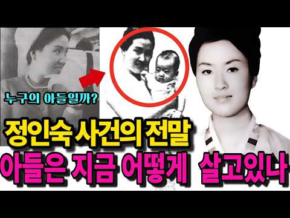
- 챕터: 0:00 세 발의 총성, 그리고 사라진 권총 (오프닝) · 10:15 1막: 엘리트 신여성의 꿈, 그리고 요정 '선운각'의… · 19:55 2막: 세 살배기 아들과 '검은 수첩', 권력의 시한… · 28:40 3막: 일주일 만의 수사 종결, 과학적 모순과 은폐된… · 36:24 4막: 19년 만의 자백 번복 "나는 동생을 쏘지 않… · 39:50 에필로그: 남겨진 아들의 비극, 그리고 지워진 이름 …
- 설명 앞부분: 1970년 3월 17일 밤 11시, 강변도로에서 세 발의 총성이 울려 퍼졌습니다. 차갑게 식어버린 26세 정인숙, 그리고 허벅지에 총상을 입은 채 신음하던 친오빠 정종욱. 단순한 강도 살인인 줄 알았던 이 사건은 그녀의 피 묻은 가방이 열리면서 대한민국 현대사 최대의 정치 스캔들로 번지게 됩니다. 가방 안에서 쏟아져 나온 거액의 달러와 고위층만 가질 수 있던 회수 여권. 그리고 가장 치명적이었던 '검은 수첩'. 그 안에는 박정희 대통령, 정일권 국무총리, 이후락, 김형욱 등 당대 최고 권력자 26명의 이름이 빼곡히 적혀 있었습니다…
- 같은 채널 평소 대비 ×22.5 (채널 최근 롱폼 중앙값 21,322회) · 평소 영상: 라면 한 그릇에 담긴 비밀 ∣ 박정희와 정주영이 새벽 공사장에서 나눈 이야기 (21,588회) / "열차를 세워라!" 1969년 진흙탕에 뛰어든 박정희, 5천년 가난을 깨부순 거인의 결단… (21,057회)
- 대본 없음 (설명) — 음성인식이 끝나면 도입부·흐름이 들어감
- 댓글 421/555: 좋은 점 — 영상 2 · 감사·응원 10 · 더 알고 싶은 것 4 · 아쉬운 점 — 영상 4 · 반박·불만 — 의견 다름 2 · 정치·사회 71 · 경험 공유 14 · 구독·다음 기대 0
  - 좋은 점 — 영상 👍1 “살명을 너무잘해주시고 이해가쏙쏙 고맙게 잘들었습니다 이유야 어쨋든 똑똑여자 정인숙 여사께서 명대로살지못하고간점 유감으로생각합니다 입만조심했더라면 더오래살수있을수도 오만함 권력을조금 이용했다는것이 좀 안타깝네요 그래서 여자는 입조심해야하는법 암튼 영리하고 똑똑하네요 고…”
  - 좋은 점 — 영상 👍1 “다른 나라도 역사 비사가 있소이다 오랫되고 희미한 옛이야기일 뿐, 국가발전에 도움되는 것은 없소이다”
  - 감사·응원 👍81 “잘듣고 갑니다 저는 그때 충비 6비 건설을 위해 나온 외국인 회사 마포 강변도로를 끼고 위치한 회사에 근무하고 있었죠 그때 당시 회자 되었던 소문과 뉴스 다시 들으니 마음이 이상해집니다 수고 하셨습니다 감사합니다”
  - 감사·응원 👍38 “진짜로 감사합니다”
  - 더 알고 싶은 것 👍3 “진실을부탁해요”
  - 더 알고 싶은 것 👍1 “유뷰녀 김삼화 사건에 대해서도 자세히 알려주시길”
  - 아쉬운 점 — 영상 👍13 “아오~ 같은말 하고 또하고. . . 지루하네”
  - 아쉬운 점 — 영상 👍13 “그시대는 먹고사는게 어려운시절이라 요정정치시대인듯 구타패싸움 이 많았던시대라 암흑시대 힘겨운시대였습니다”
  - 반박·불만 — 의견 다름 👍2 “박정희가 권력잡고살았다면 이나라 잘난여자 건드리고 정치 글쎄 김재규가 이나라살린거3ㅣ”
  - 정치·사회 👍81 “잘듣고 갑니다 저는 그때 충비 6비 건설을 위해 나온 외국인 회사 마포 강변도로를 끼고 위치한 회사에 근무하고 있었죠 그때 당시 회자 되었던 소문과 뉴스 다시 들으니 마음이 이상해집니다 수고 하셨습니다 감사합니다”
  - 정치·사회 👍67 “저의 남편은 정인숙이 자란 이웃에서 같이 자랐어요. 본명은 정금지 어릴 때도 뛰어나게 예뻐서 남학생들이 많이 따랐다고 했어요. 슬픈 이야기입니다. 피흘려 민주정부가 세워져서 얼마나 다행인지요. 국민이 권력자가 되어 그런일은 절대로 없어야 합니다.”
  - 경험 공유 👍30 “여자가 지혜로윘으면 저도 살고 아이도 살렸을텐데 친정에미라도 지혜롭던지 지금 누구 같으네”
  - 경험 공유 👍26 “정인숙 사건은 어릴적 아빠한데서 들었던 기억이 납니다 그리고 역사을 좋아한 나로썬 정인숙사건 정일권국무총리~~^^^ 아들만 불쌍 합니다 박정희정권은 어릴적에도 무시무시 했던것 같습니다 저희 아빠도 지역 유지이셨는데~~^^^ 참 지금아이들은 상상 할수 없는 시대 였으닌…”

### 262. 한양 제일 거상이 직접 사위 집 문을 두드렸다, 매질 당하던 그날 밤 안채에서 들려온 소리에 오라버니가 한 일 ∣ 야담 옛날이야기 민담 전설 수면동화 오디오북

- https://www.youtube.com/watch?v=kHzQXzGwkkA · 붉은실야담 · 구독자 9,340 · 조회수 103,270 (×11.1, 하루 1,521.6) · 좋아요 3,585 (3.5%) · 88분 · 2026-08-21 · 주제 묶음 9. 야사·야담·옛날이야기 · 형식 수면·낭독 (잠잘 때 듣는) · 폴더 `W_kHzQXzGwkkA` (웹 승인)
- 썸네일: 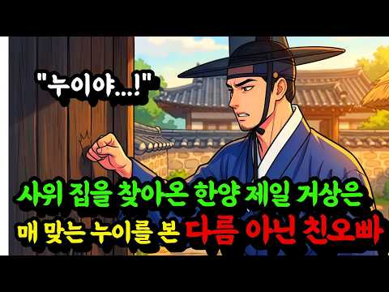
- 설명 앞부분: 안녕하세요. 이야기로 당신의 밤을 잇는 붉은실 야담 입니다. 붉은실 야담은 옛 장터와 깊은 골목, 담장 너머에서 은밀하게 전해 내려오던 사람 냄새 나는 야담과 민담, 그리고 기묘한 전설을 흥미진진하게 각색하여 들려주는 공간입니다. 기나긴 밤 잠들기 전, 혹은 조용히 눈을 감고 귀 기울이고 싶은 순간, 당신의 마음을 끝까지 붙잡아둘 단 한 편의 이야기가 되기를 바랍니다. 🕯️ 기나긴 밤, 잠들기 전 마음을 차분하게 채워줄 옛날이야기가 필요하신 분 📜 조선시대를 배경으로 한 흥미진진한 야담과 민담에 푹 빠지고 싶으신 분 ⚡ 답답한 가…
- 같은 채널 평소 대비 ×15.9 (채널 최근 롱폼 중앙값 6,496회) · 평소 영상: 정혼한 아씨 가마 앞에서 여종을 며느리로 택한 영감, 그날 밤부터 감춰둔 사연이 드러나는… (6,496회) / 바보 머슴을 거둔 몰락한 아씨, 알고 보니 조선 근위대 장군을 품에 들인 것이었는데.. … (6,400회)
- 대본 없음 (설명) — 음성인식이 끝나면 도입부·흐름이 들어감
- 댓글 64/68: 좋은 점 — 영상 0 · 감사·응원 7 · 더 알고 싶은 것 0 · 아쉬운 점 — 영상 1 · 반박·불만 — 의견 다름 2 · 정치·사회 0 · 경험 공유 2 · 구독·다음 기대 0
  - 감사·응원 👍9 “끈끈한 가족애중에도 여동생을 아끼는 오라비는 마음은 더 특별하죠. 감사히 잘 듣고 갑니다.😊”
  - 감사·응원 👍6 “감사합니다.”
  - 반박·불만 — 의견 다름 👍7 “말도안돼”
  - 반박·불만 — 의견 다름 👍1 “관아에서 '이기고 진 것이 아닙니다, 누이가 맞아서는 안 됩니다' 하던 우진이 한양 집 밥상에선 '맛있다' 한마디뿐인데, 그 말에 선옥이 그 집에 와서 처음 웃었다는 대목이 한참 머뭅니다.”
  - 경험 공유 👍9 “나도 이 이야기의 오라버니 같은 오빠가 있다면 차 ~~암 좋겠다는 생각이 드네요...😊💕 아늑하고 행복한 남매의 우정이 너무 아름답습니다...💕😻”

### 263. 《무장가문을 사로잡은 아기 복덩이》∣ [사극 힐링] 거친 무장 가문에 떨어진 복덩이 아기?! 냉혹한 장군 형제들을 전부 사로잡는다🏮🍡

- https://www.youtube.com/watch?v=WkSUWR9v6uY · 드라마 정주행 DramaBinge · 구독자 16,900 · 조회수 173,493 (×10.3, 하루 2,706.2) · 좋아요 1,368 (0.8%) · 109분 · 2026-09-07 · 주제 묶음 3. 조선 · 형식 몰아보기·통합본 (긴 영상) · 폴더 `W_WkSUWR9v6uY` (웹 승인)
- 썸네일: 
- 설명 앞부분: 민간에서 떠돌던 행운의 아기. 냉혹한 장군 가문에 돌아와 모든 위험을 막아낸다. 온 가족이 아기만 바라보는 총애받는 삶. ❗❗❗미성년자는 팔로우 및 시청을 금지합니다❗❗❗ [창작물 성명] 콘텐츠 성격: 본 채널의 콘텐츠는 주로 독창적인 숏폼 드라마와 영화로 구성되어 있으며, 이는 유튜브의 EDSA(교육, 다큐멘터리, 과학 및 예술) 정책의 "예술적" 범주에 속합니다. 미성년자 보호: 본 영상에 등장하는 모든 미성년자 인물은 전문 배우 또는 자원봉사 배우가 연기했습니다. 모든 촬영은 안전하고 전적으로 규정을 준수하는 환경을 보장하기…
- 같은 채널 평소 대비 ×91.2 (채널 최근 롱폼 중앙값 1,902회) · 평소 영상: 《빛을 보는 여자, 날 삼킨 재벌》∣ [집착로맨스] "3억 빚 남기고 버린 전남편 보란 … (2,001회) / 《보디가드가 너무 달콤해서 곤란해》∣【달달/심쿵】 "다치지 마, 내 세상이니까" 킬러 1… (1,803회)
- 대본 없음 (설명) — 음성인식이 끝나면 도입부·흐름이 들어감
- 댓글 63/63: 좋은 점 — 영상 1 · 감사·응원 1 · 더 알고 싶은 것 0 · 아쉬운 점 — 영상 2 · 반박·불만 — 의견 다름 0 · 정치·사회 0 · 경험 공유 0 · 구독·다음 기대 0
  - 좋은 점 — 영상 👍1 “좋은 내용입니다. 아침이 즐겁네요. 한 사람에 영향력은 남녀노소를 가르지 않지만 어린아이에 영향력은 와~ 좋은 영상 감사합니다 ^^”
  - 감사·응원 👍1 “좋은 내용입니다. 아침이 즐겁네요. 한 사람에 영향력은 남녀노소를 가르지 않지만 어린아이에 영향력은 와~ 좋은 영상 감사합니다 ^^”
  - 아쉬운 점 — 영상 👍4 “마오마오 고대버전이네요. 마오마오 귀여움을 제대로 못살린게 너무 아쉽네요. 이건 무조건 애니버전으로 보는 걸 추천!! 보면 무슨 말인지 이해 될거임.”
  - 아쉬운 점 — 영상 👍1 “간만에 재미있게 힐링 하고 가요 ~ 스토리가 쫌 짧은게 아쉬워요 ~ 수고 하세요...😊😊😊😊”

### 264. 사극은 절대 안 보여준 조선 주막의 진실 - 봉놋방·주모·1박의 기록

- https://www.youtube.com/watch?v=SiPh04Hz_ps · 해태연표 · 구독자 4,250 · 조회수 96,326 (×22.7, 하루 669.2) · 좋아요 995 (1.0%) · 33.8분 · 2026-06-01 · 주제 묶음 3. 조선 · 형식 브이로그·직접 해본 이야기 · 폴더 `W_SiPh04Hz_ps` (웹 승인)
- 썸네일: 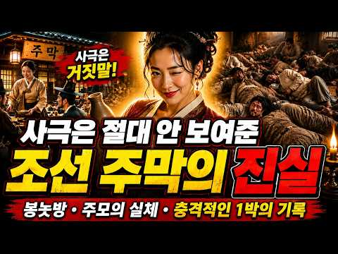
- 설명 앞부분: 🏮 "여기서… 자야 한단 말인가." 1779년 가을, 충주로 가던 한 양반이 봉놋방 문을 열고 멈춰 섰습니다. 사극이 그린 그 정겨운 주막은, 사실 절반이 거짓말이었습니다. 📜 이번 영상에서 다루는 진실 🔹 봉놋방 한 칸에 십수 명이 뒤엉켜 자던 진짜 풍경 🔹 사극이 단 한 번도 그리지 않은 '색주가'의 그늘 🔹 주모는 왜 조선의 가장 강력한 여성 자영업자였나 🔹 영국 여행가 이사벨라 비숍이 기록한 조선 주막의 충격 🔹 주막이 조선 후기의 정보망이자 비공식 은행이었던 이유 🔹 70년을 강가에서 한 자리를 지킨 마지막 주모, 유옥련…
- 대본 없음 (설명) — 음성인식이 끝나면 도입부·흐름이 들어감
- 댓글 45/45: 좋은 점 — 영상 0 · 감사·응원 0 · 더 알고 싶은 것 0 · 아쉬운 점 — 영상 1 · 반박·불만 — 의견 다름 0 · 정치·사회 1 · 경험 공유 0 · 구독·다음 기대 0
  - 아쉬운 점 — 영상 👍9 “영상을 너무 길게 늘려논 느낌이에요ㅜ 보다가 질림…”
  - 정치·사회 👍1 “드라마에 양반이 주연이면 그의 역할이 중요하고 주모가 주연이면 그역할이 많았겠지 고의로 안한것처럼 선동하지마라 좌파채널”

### 265. 영화도 담지 못한 단종의 진짜 최후, 삼족을 멸한다는데 그 시신을 거둔 아전이 있었다 [조선왕조실록]

- https://www.youtube.com/watch?v=HbaG82CmZF4 · 조선왕조실록이야기 · 구독자 19,700 · 조회수 219,812 (×11.2, 하루 3,098.1) · 좋아요 3,689 (1.7%) · 50.1분 · 2026-08-18 · 주제 묶음 3. 조선 · 형식 정보·해설 (그 밖) · 폴더 `W_HbaG82CmZF4` (웹 승인)
- 썸네일: 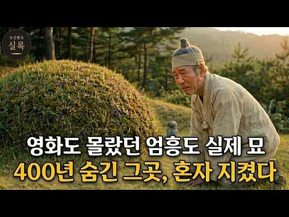
- 챕터: 0:00 400년 만에 세상에 드러난 무덤과 엄흥도의 비밀 · 1:38 영월의 평범한 아전이었던 엄흥도, 그는 누구인가? · 4:34 12살 어린 나이에 왕위에 오른 단종의 외로운 시작 · 7:00 수양대군의 야심과 피바람의 시작 '계유정난' · 11:15 눈물의 양위와 세조의 즉위, 그리고 단종의 영월 유배 · 15:38 강과 절벽에 갇힌 기이한 감옥 '청령포'에서의 삶 · 18:58 홍수로 인해 관풍헌으로 옮겨진 단종과 엄흥도와의 거리 · 21:20 단종 복위 운동의 실패와 사육신의 장렬한 죽음 · 23:59 금성대군의 복위 거사와 수북 땅의 참혹한 학살 · 26:41 17세 소년 단종의 마지막 순간과 뒤섞인 역사적 기록들 · 31:33 삼족을 멸하는 위협 속에서 단종의 시신을 거둔 엄흥도… · 37:34 자취를 감춘 엄흥도 일가와 400년간 이어진 숨바꼭질 · 40:10 숙종 대에 이르러 단종의 복권과 함께 빛을 발한 엄흥… · 44:50 가짜 무덤 뒤에 숨겨진 진짜 무덤과 500년 만의 진실
- 설명 앞부분: 단종의 죽음과 그 시신을 거둔 아전 엄흥도의 실화입니다. 최근 발견된 엄흥도 진묘 소식과 함께, 계유정난부터 영월 유배, 단종의 마지막까지 조선왕조실록에 기록된 그대로 풀어드립니다. 영화 「왕과 사는 남자」로 다시 주목받은 단종과 엄흥도. 하지만 영화도 다 담지 못한 진짜 이야기가 실록 속에 남아 있습니다. 삼족을 멸한다는 서슬 퍼런 위협 속에서, 버려진 어린 임금의 시신을 목숨 걸고 거둔 한 사람. 영월의 늙은 아전, 엄흥도의 이야기를 들려드립니다. 400년 넘게 숨겨져 있던 엄흥도 무덤의 진짜 위치를 추적합니다. 후손들이 여러…
- 같은 채널 평소 대비 ×30.2 (채널 최근 롱폼 중앙값 7,283회) · 평소 영상: 조선 500년 유일한 왕비, 시아버지가 친정을 몰살했는데 쫓겨나지 않은 진짜 이유 ∣ 세… (7,283회) / 조선 500년에 딱 한 번, 임금 인조가 며느리에게 벌인 일 [소현세자빈 강씨·조선왕조실… (7,250회)
- 대본 없음 (설명) — 음성인식이 끝나면 도입부·흐름이 들어감
- 댓글 535/536: 좋은 점 — 영상 2 · 감사·응원 15 · 더 알고 싶은 것 1 · 아쉬운 점 — 영상 0 · 반박·불만 — 의견 다름 0 · 정치·사회 8 · 경험 공유 1 · 구독·다음 기대 1
  - 좋은 점 — 영상 👍2 “당연 충신이죠 잘듣고 배우고 갑니다”
  - 감사·응원 👍24 “충신 중에 충신이었음을 고백하며 너무나 위대한 우리의 선조 이 셨음을 감사드립니다”
  - 감사·응원 👍6 “슬프고 가슴아픈 역사이야기 고맙습니다.”
  - 더 알고 싶은 것 👍2 “하필 영월인지 궁금해서요”
  - 정치·사회 👍3 “엄흥도 .환생,지금,나라지키려 희생으로 ,박정희 .윤석열 ,전한길 ,장동혁 .또 애국자님들 다 엄흥동 .혼을담아지요 ,.”
  - 정치·사회 👍2 “세조가조카죽였지만그가조선을살린거는왜말이없나세종이만든국경을확실히한임금이고김종서가충신이라도혼자독단적으로 국정을농단하는데가만히있어야하나계유정난이없어서면김종서는권신으로살아생전에국정농단하다가 임금을허수아비로만들인물아무리충신이라도혼자독단적으로하면나라가온전할수없다고려시대무신의난예…”
  - 경험 공유 👍25 “인간이라면 내가모시든 왕이 죄없이 죽음을당하고 강물에던져 뜨 있는걸보면 선비로서 충신이었다면 비록 삼족을 멸한다해도 뛰어들지 않았을까 싶네요 옛 시대에는 충신은 두 임금을 섬기지 않는다죠 엄흥도 또한 진정한 충신이시죠”
  - 구독·다음 기대 👍24 “조선의 훌륭한 인물 입니다 단종도 엄홍도 모두 자랑스럽습니다 요즘에도 이런 인물이 나타나길 기대합니다 관세음 보살 ❤❤❤”

### 266. 왜선 300척이 다시 몰려왔다, 이순신은 새 거북선 3척을 띄웠다 ∣ 대한국 프로젝트2 불침 최종편 ∣ 4K

- https://www.youtube.com/watch?v=i9VrWPX2dWg · 대한 타임슬립 본부 · 구독자 17,100 · 조회수 196,900 (×11.5, 하루 2,639.0) · 좋아요 491 (0.2%) · 9분 · 2026-08-28 · 주제 묶음 3. 조선 · 형식 사연·드라마 · 폴더 `W_i9VrWPX2dWg` (웹 승인)
- 썸네일: 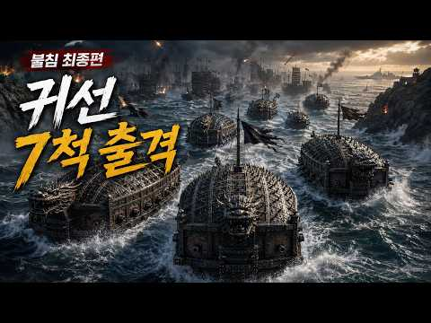
- 설명 앞부분: 왜선 300여 척이 다시 남해로 몰려옵니다. 마지막 송환선 5척을 지키기 위해 이순신과 조선 수군, 그리고 1598년에 남겨진 대한민국 함대가 마지막 물목에 섭니다. 이번 편은 「대한국 프로젝트2 — 불침: 살아남은 칼」 최종편입니다. 남아 있는 현대 화력은 이제 얼마 되지 않습니다. 그리고 조선에서 새로 만든 귀선이 처음으로 실전에 나섭니다. ■ 작전 제작 노트 불침의 마지막을 일본을 정복하는 이야기로 끝내고 싶지는 않았습니다. 이번 시리즈에서 끝까지 남기고 싶었던 것은, 현대의 화력이 멈춘 뒤에도 조선이 스스로 지킬 수 있는 …
- 같은 채널 평소 대비 ×5.7 (채널 최근 롱폼 중앙값 34,362회) · 평소 영상: 임진왜란 코무덤, 이순신이 규슈에서 일본군 전공 기록을 찾았다 ∣ 대한국 프로젝트2 ∣ … (20,626회) / 2026년 항구에서 시간 경계가 무너졌다… 그리고 무언가가 넘어왔다 ∣ 4K (18,825회)
- 대본 없음 (설명) — 음성인식이 끝나면 도입부·흐름이 들어감
- 댓글 26/26: 좋은 점 — 영상 0 · 감사·응원 3 · 더 알고 싶은 것 2 · 아쉬운 점 — 영상 0 · 반박·불만 — 의견 다름 0 · 정치·사회 0 · 경험 공유 0 · 구독·다음 기대 0
  - 감사·응원 👍4 “구독과 좋아요 이렇게나마 항상 응원 합니다 ^^”
  - 감사·응원 👍3 “아따마~ 주인장 양반 영상 자알 보고 늦게라도 고맙다고 인사드리오. 올매전에 억수로 내린비로 우리동네 통영하고 거제가 허들시리 난리가 나갔고 온동네가 젖을담은기라 그래갓고 영상도 인자 본깅께 이해하소. 그라고 다음 영상도 싸개 올리주고 그라소. 그라모 욕좀보소.”
  - 더 알고 싶은 것 👍3 “현대군 투입 전투영상도 자주 부탁드립니다 대한님!”
  - 더 알고 싶은 것 👍2 “다음 전투영상도 부탁드립니다 대한님!”

### 267. 의적이 아니었다 ∣ 조선왕조실록이 기록한 임꺽정의 진짜 얼굴

- https://www.youtube.com/watch?v=Tq2dRv5ICiw · 역사아카이브 - History Archive KR · 구독자 25,000 · 조회수 147,893 (×5.9, 하루 3,799.9) · 좋아요 797 (0.5%) · 89.8분 · 2026-09-19 · 주제 묶음 3. 조선 · 형식 정보·해설 (그 밖) · 폴더 `W_Tq2dRv5ICiw` (웹 승인)
- 썸네일: 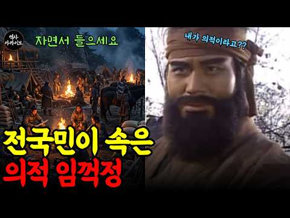
- 챕터: 0:00 구월산의 마지막 아침 · 2:10 명종의 조선, 무너지는 나라 · 6:30 백정으로 태어난다는 것 · 11:00 구월산으로 들어가다 · 16:20 포도관 이억근의 죽음 · 21:40 눈 위에 거꾸로 찍힌 발자국 · 25:30 도성 한복판에 나타나다 · 30:10 배신 — 참모 서림이 잡히다 · 35:00 평산 마산리, 관군 오백 명의 패배 · 40:20 두 번의 가짜 임꺽정 · 46:00 토벌이 만든 또 다른 피해 · 50:30 대낮의 불길, 평산 서른여 호 · 55:00 남치근과 국가 총동원 · 60:10 도둑이야 — 최후의 순간 · 66:00 처형, 그리고 서림의 운명 · 70:30 왕정의 잘못이다 — 사관의 기록 · 76:00 전설은 어떻게 태어나는가 · 82:00 소설이 완성한 얼굴 · 88:00 의적인가 흉악범인가
- 설명 앞부분: 사람들은 임꺽정을 의적이라 부릅니다. 탐관오리의 곳간을 털어 굶주린 백성에게 나눠준 민중의 영웅. 그런데 조선왕조실록을 펼치면 전혀 다른 장면이 나옵니다. 개성부 포도관이 살해되고, 선전관이 살해되고, 관군 오백 명이 무너지고, 대낮에 민가 서른여 호가 불탔습니다. 조선은 이 사내 하나를 잡기 위해 다섯 개 도에 장수를 배치하고, 한양의 시장을 닫고, 황해도의 세금을 전부 면제했습니다. 그 사이 가짜 임꺽정이 두 번 잡혔고, 보고를 올린 관리들은 모두 파직당했습니다. 그리고 실록의 사관은 이렇게 적었습니다. 그들이 도둑이 된 것은…
- 같은 채널 평소 대비 ×7.7 (채널 최근 롱폼 중앙값 19,232회) · 평소 영상: [5시간 연속재생] 조선시대 생활사 8번째 통합 ∣ 우리 조상들의 모습 (20,263회) / 황후의 치마를 들춘 남자｜이완용보다 오래 살아남은 진짜 매국노, 윤덕영 (18,201회)
- 대본 없음 (설명) — 음성인식이 끝나면 도입부·흐름이 들어감
- 댓글 46/53: 좋은 점 — 영상 0 · 감사·응원 0 · 더 알고 싶은 것 0 · 아쉬운 점 — 영상 3 · 반박·불만 — 의견 다름 1 · 정치·사회 3 · 경험 공유 1 · 구독·다음 기대 1
  - 아쉬운 점 — 영상 👍1 “번역한거야? AI목소리 진짜 구셕질이 난다”
  - 아쉬운 점 — 영상 👍0 “서론이 너무 길어요”
  - 반박·불만 — 의견 다름 👍1 “어지러운 시대의 썩은 관리들로 인하여 생겨난 도적놈이 백성들에게 좋은 일을 하기도 하고 백성들에게 노략질도 하고.... 복합적 인물이죠. 동학난도 같습니다. 어지러운 시대에 썩은 관리의 학정으로 일어난 백성들이 집단으로 난을 일으켜서 항의를 하고 동시에 백성들을 노략…”
  - 정치·사회 👍2 “제2의 홍길동과 임꺽정은 쌍팔년도 민주화폭동시대 폭동전과자와 폭동앵벌이 촛불폭동앵벌이 탄핵폭동앵벌이”
  - 정치·사회 👍2 “임꺽정도 지금 시대에 나타났으면 좌파의 선봉이 되었을까? 우파이 선봉이 되었을까?”
  - 경험 공유 👍3 “내가 고등학교때 국사시간에 선생님이 그랬슴 "홍길동 임꺽정 이런책은 커가는 애들에게 읽지 못하게 해야한다 신세한탄 불평불만 폭력난동만 배우게하는 불량 잡서다 " 이런 말씀이 백번 맞다고 본다 다른학교에서는 어떻게 가르쳤는지 모르지만 ....”
  - 구독·다음 기대 👍4 “임꺽정에 대해 우리가 몰랐던 진짜 역사 이야기를 알기 쉽게 풀어주셔서 정말 흥미진진하게 잘 봤습니다! 다음 영상도 기대할게요 👍”

### 268. 광해를 내쫓고 왜 하필 인조를 세워서 나라를 망쳐놨을까?｜인조반정｜병자호란｜삼전도의굴욕｜한국사｜조선사｜역사

- https://www.youtube.com/watch?v=aDOcfa9fnjg · 역사콕테일 · 구독자 8,700 · 조회수 99,591 (×11.4, 하루 1,314.9) · 좋아요 380 (0.4%) · 28.9분 · 2026-08-26 · 주제 묶음 3. 조선 · 형식 정보·해설 (그 밖) · 폴더 `W_aDOcfa9fnjg` (웹 승인)
- 썸네일: 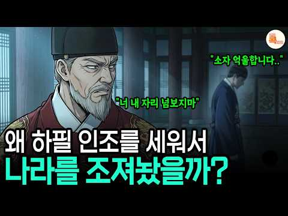
- 챕터: 0:00 목숨 걸고 왕을 갈아치웠는데, 왜 하필 그 사람? · 4:34 광해군이 지워버린 왕자들 — 사라진 후보들 · 7:03 인조반정의 진실 — 그는 '뽑힌 왕'이 아니었다 · 8:42 서인은 왜 능양군의 손을 잡았나 · 13:37 이괄의 난 — 즉위 1년, 왕이 도성을 버리다 · 15:55 광해군의 중립외교 vs 인조의 친명배금 · 18:57 병자호란과 삼전도, 그 겨울의 47일 · 22:07 소현세자의 죽음 — 화살이 안으로 향하다
- 설명 앞부분: 광해군을 몰아내고 왕이 된 인조, 그런데 왜 하필 그였을까요? 똑똑한 왕자들을 다 놔두고 무능한 인조를 세운 대가로, 조선은 정묘호란과 병자호란, 그리고 삼전도의 굴욕까지 최악의 시기를 맞이합니다. 인조반정의 진짜 이유와 조선 몰락의 결정적 순간을 낱낱이 파헤칩니다. 1623년 인조반정, 서인 세력은 정말 인조가 이렇게까지 무능할 줄 몰랐을까요? 아니면 무능함이 오히려 그들이 원한 조건이었을까요? 능양군이 직접 병력을 쥐고 일으킨 쿠데타의 숨겨진 진실부터, 이괄의 난, 정묘호란, 병자호란, 삼전도의 삼배구고두, 그리고 아들 소현세…
- 같은 채널 평소 대비 ×19.9 (채널 최근 롱폼 중앙값 5,000회) · 평소 영상: 세조가 잊지 못한다는 경혜공주의 충격적인 복수극｜한국사｜조선역사｜단종 (5,766회) / 조선시대 사람들은 진짜로 다들 40살에 죽었을까?｜한국사｜조선평균수명｜역사 (4,235회)
- 대본 없음 (설명) — 음성인식이 끝나면 도입부·흐름이 들어감
- 댓글 92/92: 좋은 점 — 영상 0 · 감사·응원 0 · 더 알고 싶은 것 1 · 아쉬운 점 — 영상 0 · 반박·불만 — 의견 다름 2 · 정치·사회 29 · 경험 공유 2 · 구독·다음 기대 0
  - 더 알고 싶은 것 👍0 “흥미롭게 잘봤습니다~ 1900년대 이후의 영웅들의삶도 궁금하니 꼭 만들어주세요^^”
  - 정치·사회 👍20 “광해군과 인조의 비교는 결국 조선 정치가 어떻게 스스로 파국을 불러왔는지를 보여주는 대표적 사례다. 광해군은 외교·군사·정치·민생 모든 면에서 인조보다 훨씬 뛰어났다. 국제정세를 정확히 읽고 명과 후금 사이에서 중립을 유지했으며, 조선의 국력을 회복시키는 데 집중했다…”
  - 정치·사회 👍8 “자기가 무엇을 잘못했는지 모르는 사람이 정말무서운거다 인조가 딱 그런 인간이다 그러니 자기 아들 며느리 손자들까지 죽음으로몰아같지 적어도 연산군은 자기가 무엇을 잘못하는지 알고 폭정을 일으킨 거고 인조같은 인간은 한가족을 넘어서 한나라가 멸망한다 해도 자기가 무슨짓을…”
  - 경험 공유 👍1 “만일 영창대군이 정상적으로 살아있었다면 언젠가는 서인들이 영창대군을 옹립하려는 반정을 도모할것이 분명합니다. 김제남일파역시 서인이기 때문입니다. 그리고 분명히 주지할 사안은 아직 공식적인 기록이나 연구는 없지만 분명 광해군은 세자시절부터 왕위계승에 매우 불안심리를 가…”
  - 경험 공유 👍0 “사르후 전투와 관련 광해군이 강홍립 장군에게 은밀히 지시했다는 건 최근에는 근거없다고 봄. 당시 상황을 보면 조선군은 유정이 이끄는 동로군과 함께 했는데 명나라군이 앞에 그 뒤를 조선군이 따라가고 있었음. 그런데 후금군이 우선 명나라군을 거의 전멸시키고 일부 생존자가…”

### 269. [세계사] 이슬람은 왜 돼지고기를 절대 안 먹을까? 1400년 금기의 진실과 역사 ∣ 이슬람 돼지고기 꾸란 할랄 하람

- https://www.youtube.com/watch?v=KKDzQPaZCao · 역사로그 · 구독자 22,000 · 조회수 321,292 (×14.6, 하루 3,305.7) · 좋아요 4,221 (1.3%) · 39.1분 · 2026-08-05 · 주제 묶음 5. 세계사·서양사 · 형식 정보·해설 (그 밖) · 폴더 `W_KKDzQPaZCao` (웹 승인)
- 썸네일: 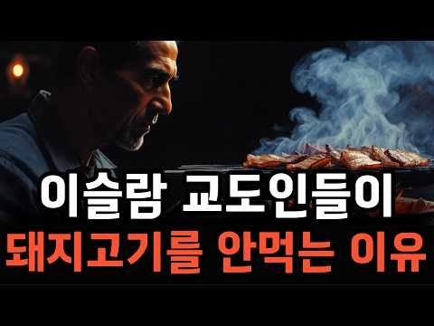
- 챕터: 0:00 회식 자리, 젓가락을 대지 않는 한 사람 · 0:47 19억 2천만 명 — 무슬림이 가장 많은 나라는 인도… · 2:05 할랄과 하람, 순대·젤라틴까지 뻗는 금기 · 3:12 우리가 아는 네 가지 답 · 5:24 첫 번째 붕괴 — 아나톨리아에서 시작된 돼지 가축화 · 8:08 왜 어느 종교도 닭은 금하지 않았나 · 9:25 두 번째 붕괴 — 기생충설과 연표의 충돌 · 10:12 1835년 런던, 의대생 제임스 패짓의 선모충 · 13:20 세 번째 붕괴 — 곡식 경쟁설을 깨는 낙타 · 15:05 헤로도토스의 이집트 — 신전에 못 들어간 돼지치기 · 16:39 네 번째 붕괴 — 보름달에는 왜 돼지를 먹었나 · 18:04 돼지는 이슬람보다 먼저 사라졌다 — 맥스 프라이스 · 19:36 2025년 사피르헨 — 돼지뼈 종족 지표가 무너지다 · 21:02 조선의 우금령 — 태형 50대에도 몰래 먹었다 · 22:58 꾸란 네 구절, 그리고 레위기 11장 7절의 대조 · 26:52 할랄 도축법과 예외 조항 · 29:44 학계의 여섯 갈래 가설 — "모릅니다" · 31:24 '이슬람'은 복종이라는 뜻 — 질문을 바꾸다 · 34:32 잊힌 것이 아니라 묻지 않은 것 · 37:35 밥그릇에 숟가락을 꽂지 말라던 어머니
- 설명 앞부분: 이슬람의 돼지고기 금기(하람)는 꾸란 네 구절(2장 173절·5장 3절·6장 145절·16장 115절)이 죽은 고기, 피, 돼지고기, 신이 아닌 다른 이름으로 잡은 고기를 나란히 금한 규정입니다. 오늘 세계 인구 넷 중 하나, 약 19억 2천만 명이 이 금기를 지키는데, 정작 꾸란은 왜 부정한지 그 이유를 한 줄도 적어 두지 않았습니다. 회사 회식 자리에 삼겹살이 올라오고, 한 사람만 젓가락을 대지 않습니다. 우리는 그 이유를 안다고 생각합니다. 더워서 상하니까, 기생충 때문에. 그런데 그 답들이 자료 앞에서 차례로 무너집니다. …
- 같은 채널 평소 대비 ×3.4 (채널 최근 롱폼 중앙값 94,853회) · 평소 영상: [세계사] 유럽을 300년간 떨게 한 바이킹은 왜 흔적도 없이 사라졌나?｜당신이 아는 바… (94,853회) / [세계사] 나라 없는 세계 최대 민족, 쿠르드족의 모든 것 ∣ 쿠르드족 버림받은 민족 3… (97,238회)
- 대본 없음 (설명) — 음성인식이 끝나면 도입부·흐름이 들어감
- 댓글 289/297: 좋은 점 — 영상 2 · 감사·응원 2 · 더 알고 싶은 것 2 · 아쉬운 점 — 영상 7 · 반박·불만 — 의견 다름 5 · 정치·사회 1 · 경험 공유 6 · 구독·다음 기대 0
  - 좋은 점 — 영상 👍7 “유익하게 시청했습니다,”
  - 감사·응원 👍2 “감사합니다 ~❤”
  - 감사·응원 👍0 “고맙게 시청했습니다. 군인이 실전에는 필요없는 제식훈련을 하는 것이 연상되었습니다. 제식훈련을 통해 연대감과 집단력을 키우는 것처럼 종교도 그들만의 방법이 있구나 싶었습니다. 그러나 비종교인 입장에서는 그저 자아도취며 가스라이팅이라 느껴짐도 어쩔 수 없습니다.그리고 …”
  - 더 알고 싶은 것 👍0 “설명이 아주 훌륭합니다. 상식순서대로 차분히 논리적으로 풀어갔습니다. 특히 방해음악이 없어서 좋았습니다. 그리고 우리가 '그냥' 별생각 없이 따르는 일상의 예는 무엇이 있을까요?”
  - 더 알고 싶은 것 👍0 “이슬람만 돼지고기를 안먹는 것은 아니지요....유태교인도 안식일교인도 안먹어요....코란을 믿지 않는 유태교인과 안식일교인이 돼지고기를 안먹는다는 사실은 어떻게 해석해야하나요? 이 사실은 코란에서 금한 규율이기 때문에 안먹는다는 것에는 무리한 해석입니다. 더 거슬러 …”
  - 아쉬운 점 — 영상 👍2 “댓글위 광고가 옛날돼지고기 ㅎ”
  - 아쉬운 점 — 영상 👍0 “상당히 분석적인 것 같아서 거의 끝까지 봤습니다. 원인을 찾는 것은 쉽지 않겠지만 그래도 시작부터 중간까지 상당히 분석적이라 열심히 봤는데 결국은 결론이 추측성으로 끝나서 조금은 아쉽네요.”
  - 반박·불만 — 의견 다름 👍1 “돼지하고 원수졌나요. 그 맛있는 고기를 왜 안먹어요. 참 희한한 것들입니다. 우상. 돼지고기. 모두다 제정신이 아닙니다.”
  - 반박·불만 — 의견 다름 👍0 “뭔 헛소리여 이슬람이 돼지고기 안먹는건 이슬람성전인 코란에 여러차례 돼지고기 먹지말라는 구절이 나와 그 경전을 따르는거지”
  - 정치·사회 👍0 “환경의 지배를 받는게 허접한 인간이 아닐까, 난 누구나 관심이 있으면 5분안에 설명해서 알수있는 부정선거를 설명하면서 느꼈다. 학자들 없다. 그냥 직업의 이름이다. 돼지를 일반 사람이 지금 시리아에서 키워서 팔려면 얼마이고 가능한지가 답이다. 경제에서 노인거고 그래서…”
  - 경험 공유 👍7 “원래 좋아했었는데 키우기 힘드니깐”
  - 경험 공유 👍0 “영상 볼 시간이 없으시다고요? 제가 요약해드릴게요. ' 이슬람은 돼지고기를 왜 안먹을까? 모릅니다 ' 저도 이 영상보고 날린 39분이 아깝습니다. 답이 있는줄 알고 봤는데.”

### 270. 역사책이 안 가르쳐준 이순신의 진짜 모습

- https://www.youtube.com/watch?v=h1eEOaC8OUo · 재역이(재미있는역사이야기) · 구독자 6,290 · 조회수 127,792 (×20.3, 하루 938.7) · 좋아요 3,233 (2.5%) · 37.1분 · 2026-06-27 · 주제 묶음 3. 조선 · 형식 정보·해설 (그 밖) · 폴더 `W_h1eEOaC8OUo` (웹 승인)
- 썸네일: 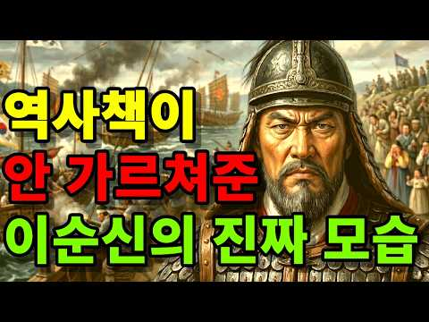
- 설명 앞부분: 곤장을 맞고 형틀에 묶인 조선 최고의 장수, 이순신. 그를 때리라 명령한 건 적장이 아니라 그가 지키던 나라의 임금이었습니다. 전쟁 내내 일본도 죽이지 못한 사람을, 정작 조선이 죽이려 했습니다. 벼슬을 빼앗기고, 누명을 쓰고, 어머니와 막내아들까지 잃은 사람. 그런데 그는 매를 다 맞고 풀려나자마자 다시 칼을 들고 바다로 나갔습니다. 자신을 죽이려던 바로 그 나라를 위해서요. 나라가 이렇게까지 자신을 내쳤는데, 이순신은 왜 끝까지 그 나라를 지켰을까요. "충성심이 강해서"라는 흔한 답으로는 설명되지 않는, 그를 진짜로 움직인 이…
- 같은 채널 평소 대비 ×9.9 (채널 최근 롱폼 중앙값 12,927회) · 평소 영상: 허균이 죄목도 없이 능지처첨을 당한 진짜 이유 ∣ 허균 ∣ 허난설헌 (12,927회) / 계유정난의 진범은 한명회가 아니었다? ∣ 계유정난 ∣ 수양대군 ∣ 세종 ∣ 한명회 ∣ 단종 (17,303회)
- 대본 없음 (설명) — 음성인식이 끝나면 도입부·흐름이 들어감
- 댓글 387/389: 좋은 점 — 영상 2 · 감사·응원 13 · 더 알고 싶은 것 5 · 아쉬운 점 — 영상 1 · 반박·불만 — 의견 다름 2 · 정치·사회 24 · 경험 공유 6 · 구독·다음 기대 0
  - 좋은 점 — 영상 👍3 “동서고금을 막론하고 상식.개념.정의.양심을 말아먹은 수구들에게는 어떠한 공직도 맡겨선 안된다는것을 선조가 잘 증명하고있네요 수구의 레전드 선조 !”
  - 감사·응원 👍29 “이순신 장군의 진정한 모습을 볼수 있는 이야기입니다 감사합니다”
  - 감사·응원 👍28 “이순신 통제사에 대해 과장하지 않고, 이순신 통제사의 일기를 근거로 설명해주니 고맙소.”
  - 더 알고 싶은 것 👍2 “만약 이순신 장군님이 무능한 선조를 몰아내고 직접 왕이 되었다면 지금 우리의 역사는 어떻게 바뀌었을까요? 🔥”
  - 더 알고 싶은 것 👍1 “세계해전사 세계전쟁사 인류역사상 세계역사상 전설적인장군 하늘이내려준 전쟁의신 유비무환 세계의주인공 세계해전사 병법의달인 발명가였다 지략전술가 일본어중국어 능통한천재 영웅 위인 전쟁의신 유비무환 세계의주인공 조선역사상 조선해군역사상 우리나라 역사상 세계최고의 총사령관 …”
  - 아쉬운 점 — 영상 👍1 “구독과 좋아요라는 광고가 나오는 즉시 영상 내립니다 싫어요는 어디갔어”
  - 반박·불만 — 의견 다름 👍0 “응 아닙니다. 이순신은 살려고 하다가 죽게되니 자신이 한 말이 있어 쪽팔림에 영끌해 남긴 나으 주금을 누구에게도 알리지 말라는 유언이 유명한 장수로 동상에도 죽고자 하거든 살 수 있었다는 문구가 있죠 ㅋ 거참 살려고 그리 바둥 대냐ㅉㅉ”
  - 정치·사회 👍3 “옛날이나 지금이나 지도자를 잘못 만나면 적보다 더 위험하다 돈키호테 같은 문재인이 탈원전하고 소득주도성장같은 짓거리해서 국민들 힘들게 했지 그래도 조선시대에는 백성들의 선택여지도 없었지만 지금은 투표권도 있는데 어리한 국민들이 어리한 지도자를 뽑으니 누굴 탓하랴”
  - 정치·사회 👍1 “윤석열과 동급 선조 꼴값떠는건 예나 지금이나 변하질 않아”
  - 경험 공유 👍1 “가토 이미 도착했었지~~~제시한 날짜보다 훨씬먼저 상륙했지”
  - 경험 공유 👍0 “이긍...당연하지.. 어머니가 사는 나라고... 친구가 사는 나라기 때문이지요... 임금이야... 몇십년후에 바뀌는 허수아비에 불과하니까... 버려진들 어떠하리.... 내가 사는 나라는 나의 부모 형제가 사는 나라인것을...”

### 271. 미국에서 계속 완판되는 이순신책 — 400년 전 조선시대 장군이 미국 영웅이 된 진짜 이유

- https://www.youtube.com/watch?v=kk5ieUmNeJU · 247경제 · 구독자 15,300 · 조회수 114,929 (×7.5, 하루 2,274.1) · 좋아요 0 (0.0%) · 21.9분 · 2026-09-21 · 주제 묶음 3. 조선 · 형식 애니메이션·지도 · 폴더 `W_kk5ieUmNeJU` (웹 승인)
- 썸네일: 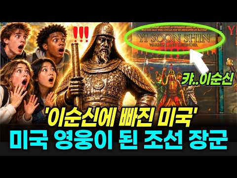
- 챕터: 0:00 미국 행사장에서 매대가 비는 만화책 · 1:28 만든 사람은 한국인이 아닙니다 · 2:03 출판사 없이 혼자 만든 책 · 3:34 2004년 드라마 한 편에서 시작됐습니다 · 5:35 "누가 이걸 사겠냐" — 전부 거절 · 5:53 미국 만화 시장의 벽 · 7:30 코믹콘 부스를 빌렸습니다 · 8:13 차에 책을 싣고 도시를 돌았습니다 · 9:33 그런데 그 자리에서 동났습니다 · 10:13 행사 120회, 16년 · 11:20 그래서 얼마나 팔렸나 — 25만 부 · 12:55 스탠 리가 서문을 썼습니다 · 14:30 미국 독자는 왜 샀을까 · 16:23 이순신 만화가 19금인 이유 · 17:27 지금 벌어지는 일 · 19:34 정직하게 짚어야 할 여섯 가지 · 20:44 "누가 사겠냐"의 답
- 설명 앞부분: 미국 행사장에서 나올 때마다 매대가 비는 책이 있습니다. 주인공이 이순신 장군입니다. 그것도 15년 넘게 이어지고 있습니다. ⚠️ 먼저 말씀드립니다 — 이건 위인전 이야기가 아니라 시장 이야기입니다. 누가 만들었나 미국 일리노이주의 만화가 **온리 콤판(Onrie Kompan)** — 한국인도 교포도 아닙니다 제목도 영어 발음 그대로 **Yi Soon Shin 자비 출판·자체 유통** — 큰 출판사 없이 작가가 직접 만들고 직접 팔았습니다 글은 미국 작가, 그림은 이탈리아 출신 만화가 등 여러 나라 사람이 참여 어떻게 시작됐나 2…
- 같은 채널 평소 대비 ×44.5 (채널 최근 롱폼 중앙값 2,583회) · 평소 영상: "명절마다 타는 그 버스 회사" 재계 7위 금호가 6조 4천억 한 번에 무너진 진짜 이유 (2,583회) / "삼성이 텍사스 깡시골을 통째로 바꿔 놨다" 70년 멈춘 미국 시골 마을에 삼성 공장 들… (2,763회)
- 대본 없음 (설명) — 음성인식이 끝나면 도입부·흐름이 들어감
- 댓글 121/121: 좋은 점 — 영상 0 · 감사·응원 4 · 더 알고 싶은 것 0 · 아쉬운 점 — 영상 0 · 반박·불만 — 의견 다름 4 · 정치·사회 5 · 경험 공유 1 · 구독·다음 기대 0
  - 감사·응원 👍42 “정말 속상합니다 이렇게 해서라도 이순신장군을 빛내주시니 감동 입니다 이순신은 세계최고 장군입니다 역사의 소중함을 잊어서는 안됩니다 방송해주셔서 감사합니다”
  - 감사·응원 👍6 “대한민국화이팅”
  - 반박·불만 — 의견 다름 👍11 “그리스 로마 신화는 그리스인 로마인만 그리는건 아니죠 미국에서 이순신 장군님을 알린 미국만화가 잘했다고 봅니다”
  - 반박·불만 — 의견 다름 👍2 “나폴레옹과 넬슨을 프랑인과 영국인이 알려준건 아닙니다.지식이란게 대부분 그럿듯”
  - 정치·사회 👍5 “내용과 맞는 - 작가의 사진 등 출연하고 만화 작품 실물 자체를 보여줘야지 - 뭔 신빙성이... 쯧 만약 사실이라면 저 만화작가는 대한민국 정부에서 상을 줘야 함.”
  - 정치·사회 👍2 “우리가 하면 아시아인이라고 무조건 무시 오희려 외국인 미국인이 하는게 더 좋타고 생각 됩니다”
  - 경험 공유 👍1 “내가 세상에서 제일 존경하는 두분이있습니다 충무공이순신님 세종대왕님”

### 272. 《한국사》 조선시대 가장 못생긴 왕은 누구였을까? 왕들의 실제 외모 l 역사 인물 l 조선왕조실록

- https://www.youtube.com/watch?v=UBBAEzyQQMA · 한국사 이야기 · 구독자 24,200 · 조회수 72,814 (×3.0, 하루 3,588.5) · 좋아요 383 (0.5%) · 37.8분 · 2026-10-08 · 주제 묶음 3. 조선 · 형식 정보·해설 (그 밖) · 폴더 `W_UBBAEzyQQMA` (웹 승인)
- 썸네일: 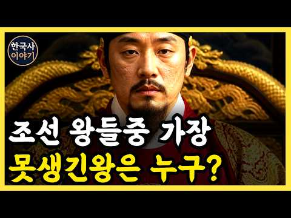
- 설명 앞부분: 조선시대 왕들의 실제 외모는 어땠을까요? 세종·세조·중종의 얼굴 기록부터 어진 소실, 천연두 흔적, 고종과 순종의 사진까지 역사 속 왕들의 진짜 모습을 살펴봅니다.
- 같은 채널 평소 대비 ×5.3 (채널 최근 롱폼 중앙값 13,638회) · 평소 영상: 《한국사》 조선 왕들을 괴롭힌 정체는? 종기의 잔혹사 l 역사 l 조선시대 l 야사 (13,638회) / 《한국사》 조선시대 평민들의 연애와 결혼은 어떤 모습이었을까요? l 조선시대 l 생활사 (13,551회)
- 대본 없음 (설명) — 음성인식이 끝나면 도입부·흐름이 들어감
- 댓글 56/56: 좋은 점 — 영상 1 · 감사·응원 2 · 더 알고 싶은 것 1 · 아쉬운 점 — 영상 0 · 반박·불만 — 의견 다름 1 · 정치·사회 1 · 경험 공유 2 · 구독·다음 기대 0
  - 좋은 점 — 영상 👍1 “고기가 비만 당뇨 일으킨다는 비의학적 궤변은 왜 맨날 역사 유튜브에서 퍼트리는거임? 그냥 과식하고 운동안해서지 단백질은 오히려 비만 당뇨에 도움이 됨. 당뇨엔 탄수화물 줄이고 고기 더 많이 먹어야 함”
  - 더 알고 싶은 것 👍3 “선조들의얼굴은 사진도 없던시절의 왕의 얼굴가지고 가타부타 말을 안했으면 좋겠습니다 얼굴이 잘생겻으면뭐? 어쩔것이고 못생겻다면 뭘어떻게 할것인가요? 서양에서도 그랫네요”
  - 정치·사회 👍5 “사진도 안찍어놓았다는게 놀랍다. 우리나라가 그런 나라다. 참으로 한심하지않나?”

### 273. 같은 시대 일본 서민의 충격적 집 ∣ 조선 초가 vs 일본 나가야 ∣ 어느 쪽이 더 비참했나? ∣ 역사 ∣ 한국사 ∣ 세계사 ∣ 시니어역사 ∣ 오디오북

- https://www.youtube.com/watch?v=4qt5zccnK44 · 역사깨침 · 구독자 30,900 · 조회수 364,167 (×11.8, 하루 4,545.7) · 좋아요 3,319 (0.9%) · 37.8분 · 2026-08-22 · 주제 묶음 10. 수면·낭독 · 형식 수면·낭독 (잠잘 때 듣는) · 폴더 `W_4qt5zccnK44` (웹 승인)
- 썸네일: 
- 설명 앞부분: 1735년, 한양 외곽의 초가삼간에서 눈을 뜬 남자. 같은 해, 에도의 나가야에서 눈을 뜬 남자. 한쪽은 두 평 반짜리 흙집, 다른 한쪽은 세 평짜리 나무 칸막이. 크기는 거의 같았습니다. 재료도 비슷하게 허술했습니다. 그런데 안으로 들어가면 전혀 다른 세계가 펼쳐집니다. 조선의 초가에는 온돌이 있었습니다. 한겨울에도 등을 대면 따뜻한 바닥, 그 하나로 260년을 버텼습니다. 대신 연기를 마셨고, 매년 지붕을 갈아야 했고, 도시 인프라는 없었습니다. 일본의 나가야에는 센토(공중목욕탕) 600곳, 43km 상수도, 분뇨 거래 시스템…
- 같은 채널 평소 대비 ×0.8 (채널 최근 롱폼 중앙값 474,928회) · 평소 영상: 여태후는 황제의 여자를 왜 인간돼지로 만들었을까? 중국 역사상 가장 잔인한 복수, 인체(… (525,826회) / 왜 어떤 사람은 흥하고 어떤 사람은 망하는가？사기(史記): 사람을 읽는 상위 1%의 통찰… (424,030회)
- 대본 없음 (설명) — 음성인식이 끝나면 도입부·흐름이 들어감
- 댓글 662/681: 좋은 점 — 영상 5 · 감사·응원 8 · 더 알고 싶은 것 2 · 아쉬운 점 — 영상 5 · 반박·불만 — 의견 다름 28 · 정치·사회 70 · 경험 공유 35 · 구독·다음 기대 0
  - 좋은 점 — 영상 👍6 “이 영상은 저처럼 역사를 좋아하는 사람들에게 정말 유익하고 도움이 많이 되네요. 정말 감사합니다.”
  - 좋은 점 — 영상 👍0 “00건강,면역성에서 가장중요한게..공기다. 특히.. 본인이 가장 오래 머무는 실내공간의 공기가 맑은가..시멘트라돈가스와 화학가스에 오염되어 있는가에 따라서..호흡을통해..오염된 독성공기가 폐로들어가서 혈액을 오염시켜.. 병들이고, 독성화시키면서..혈액세포를 병들이고.…”
  - 감사·응원 👍6 “이 영상은 저처럼 역사를 좋아하는 사람들에게 정말 유익하고 도움이 많이 되네요. 정말 감사합니다.”
  - 감사·응원 👍2 “저도 가난하게 자랐었는데 이십대때 지하실 살때가 그때 지하실 산다면 엄습하고 초라해 보였겠지만 저한테는 생활편의시설이 좋아서 참으로 행복했었던 기억이 있네요!!!^^--::그전집은 푸세식집이었는데 너무 좁고 냄새가 지독해 단 일분도 견딘기가 쉽지않은 나오면 머리가 띵…”
  - 더 알고 싶은 것 👍3 “고증좀 하고 만드세요 조선은 철저히 주방과 거주공간이 분리돼있는데 한곳에 다있다하니 말이안돼고 거적을 이불로 사용했다? 어느문헌에 나오나요? 좀 공부좀합시다쫌”
  - 더 알고 싶은 것 👍0 “일본 납의 집 소릴르 들으면서 어떻게 사나요?”
  - 아쉬운 점 — 영상 👍0 “영상이 너무 길어요. 더 간략하게 편집하면 좋을것 같아요.”
  - 아쉬운 점 — 영상 👍0 “너무 길다. 10분으로 줄여라!”
  - 반박·불만 — 의견 다름 👍9 “평민이 기와집와 살지 못하도록 한 적은 없었습니다. 그리고, 초가 지붕은 해마다 교체하는게 아닙니다. 몇년 사용허고, 그것도 전체가 아닌 겉만 교체 합니다.”
  - 반박·불만 — 의견 다름 👍7 “초가는 지붕 매년 교체안합니다 고증틀렸어요”
  - 정치·사회 👍2 “저도 가난하게 자랐었는데 이십대때 지하실 살때가 그때 지하실 산다면 엄습하고 초라해 보였겠지만 저한테는 생활편의시설이 좋아서 참으로 행복했었던 기억이 있네요!!!^^--::그전집은 푸세식집이었는데 너무 좁고 냄새가 지독해 단 일분도 견딘기가 쉽지않은 나오면 머리가 띵…”
  - 정치·사회 👍2 “조선은 산이 국토의 70%이다. (일본은 산이 국토의 73%이다.) << 생략 결론 조선은 땅이 부족한 나라이다. 결론 일본은 땅이 부족한 나라가 아니다. 영상 초반부터 장난질이 심하시네 ....”
  - 경험 공유 👍146 “우리 부모님도 일제시대때 10대를 보냈는데 이불이 없어 부들이나 왕골로 만든 자리를 덮고 살았고 나도 60대 지만 초등학교 졸업때까지 초가집에서 겨울에 떠놓은 물이 쾅쾅 어는 집에서 살았습니다. 어린얘들은 영양부족으로 얼굴에 버즘이 대부분 있었죠 우리나라 빠른시간에 …”
  - 경험 공유 👍23 “온돌방에 연기가 들어오는 경우는 온돌바닥이 깨진 경우입니다. 흙바름으로 마감된 바닥에 대나무나 갈대 자리를 깔았고, 건조되면서 흙바닥이 갈라지는 것이 자연스러운 현상이었습니다. 정기적으로 흙반죽을 발라 수리하면서 살았습니다. 나도 어릴 적에는 초가 세 칸 흙집에서 살…”

### 274. 1시간이면 완벽 이해 조선왕조실록 1대부터 27대까지 몰아보기ㅣ건국부터 멸망까지 한번에 자면서 들으세요

- https://www.youtube.com/watch?v=YfPUeVAhmfw · 한밤의 한국사 · 구독자 50,000 · 조회수 978,290 (×19.6, 하루 7,344.8) · 좋아요 8,364 (0.9%) · 69.5분 · 2026-06-30 · 주제 묶음 3. 조선 · 형식 수면·낭독 (잠잘 때 듣는) · 폴더 `W_YfPUeVAhmfw` (웹 승인)
- 썸네일: 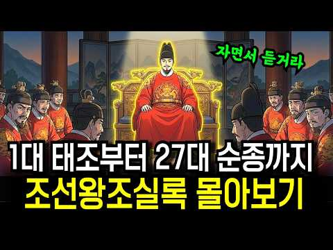
- 챕터: 0:00 오프닝 – 27명의 임금, 519년의 드라마 · 0:56 건국 – 이성계와 정도전 · 9:22 형제의 피로 쌓은 왕좌 – 태종 · 15:36 조선의 황금기 – 세종 · 21:25 빼앗긴 왕좌 – 단종과 세조 · 27:25 폭군과 개혁가 – 연산군과 조광조 · 32:41 임금이 도망친 전쟁 – 선조와 임진왜란 · 37:56 능력 있는 왕의 몰락 – 광해군 0 · 42:27 임금이 무릎 꿇은 날 – 인조와 병자호란 · 47:44 마지막 르네상스 – 영조와 정조 · 52:54 왕이 사라진 시대 – 세도 정치 · 57:52 저무는 나라 – 고종과 개항 · 63:10 500년의 끝 – 대한제국 멸망
- 설명 앞부분: 조선의 임금 스물일곱 명 중, 제 명에 편히 눈감은 왕은 과연 몇이나 될까요? 1392년 이성계의 건국부터 1910년 대한제국의 멸망까지, 519년 조선 왕조의 흥망성쇠를 단 한 편에 담았습니다. 형제를 죽인 왕, 조카의 왕좌를 빼앗은 왕, 아들을 뒤주에 가둔 왕, 전쟁 앞에서 백성을 버린 왕, 적장 앞에 무릎 꿇은 왕, 그리고 끝내 나라를 빼앗긴 왕까지. 조선 27명의 임금이 내린 선택이 어떻게 나라의 운명을 갈랐는지, 조선 역사 전체를 처음부터 끝까지 따라가 봅니다. 조선 건국과 정도전의 설계, 세종의 황금기, 단종과 세조의 …
- 같은 채널 평소 대비 ×14.0 (채널 최근 롱폼 중앙값 70,008회) · 평소 영상: 한국사 총정리 몰아보기ㅣ고조선부터 대한민국까지 5000년 풀스토리ㅣ자면서 들으세요 (70,008회) / 신선이라 불린 조선의 괴짜 홍유손의 놀라운 비밀 (73,357회)
- 대본 없음 (설명) — 음성인식이 끝나면 도입부·흐름이 들어감
- 댓글 126/151: 좋은 점 — 영상 8 · 감사·응원 27 · 더 알고 싶은 것 1 · 아쉬운 점 — 영상 1 · 반박·불만 — 의견 다름 0 · 정치·사회 7 · 경험 공유 2 · 구독·다음 기대 2
  - 좋은 점 — 영상 👍88 “휴가3일 내내 영상봅니다. 세종대왕의 마누라 신빈 김씨 돌아가신 년도까지 외워지네 방금 고려역사 1시간40분짜리 정주행후 잘시간에 또 봅니다. AI목소리가 듣기 좋아요”
  - 좋은 점 — 영상 👍30 “단종부터 시작하여 조선의 역사공부를 계속하며 여기까지 왔습니다.들어온 내용들이 이로써 정리가 잘 되는 큰깨달음에 깊은 감사드립니다.~”
  - 감사·응원 👍30 “단종부터 시작하여 조선의 역사공부를 계속하며 여기까지 왔습니다.들어온 내용들이 이로써 정리가 잘 되는 큰깨달음에 깊은 감사드립니다.~”
  - 감사·응원 👍27 “역사의 흐름을 알게 해주셔서 감사합니다”
  - 더 알고 싶은 것 👍2 “조선왕들 중에 제대로된 왕이 몇명이 될까요 ? 썩은왕이 매우 많은듯”
  - 아쉬운 점 — 영상 👍88 “휴가3일 내내 영상봅니다. 세종대왕의 마누라 신빈 김씨 돌아가신 년도까지 외워지네 방금 고려역사 1시간40분짜리 정주행후 잘시간에 또 봅니다. AI목소리가 듣기 좋아요”
  - 정치·사회 👍20 “기가 막힌 우리 이씨조선의 역사를 아픈 마음으로 다 봤고 힘이 없는 나라는 굴욕의 종알이 온다는 것 그래서 우리는 언제나 힘을 길러야 합니다 나와 너 여와 야 그런 모든 것 위에 내나라가 강대국으로 버티고 있어야 하는 것이 절체절명의 진리!!!! 오직 대-한-민-국 …”
  - 정치·사회 👍4 “나라가 너무썩었음 리셋코리아”
  - 경험 공유 👍3 “빠진 임금도 있지만 나름 연대별로 조선왕의 공과를 잘 들었습니다. 1910.8.29 한일합방되어 35년간의 일제강점기 거쳐 스스로의 힘(일부는 인정)이 아닌 외세에 의해 겨우 1945.8.15 독립을 맞이하자 마자 15년간의 좌우 이념 싸움 끝에 하나의 나라 기틀을 …”
  - 구독·다음 기대 👍88 “휴가3일 내내 영상봅니다. 세종대왕의 마누라 신빈 김씨 돌아가신 년도까지 외워지네 방금 고려역사 1시간40분짜리 정주행후 잘시간에 또 봅니다. AI목소리가 듣기 좋아요”
  - 구독·다음 기대 👍3 “역사 공부 세삼스럽습니다. 현제 정치인들은 조선의 역사문화를 기역하고 국민을 위한 정치 기대합니다.”

### 275. “아버지, 저 버려진 논을 꼭 사야 합니다” 사흘 뒤 마을이 뒤집힌 이유∣옛날이야기∣야담∣야사∣전래동화∣라디오북∣

- https://www.youtube.com/watch?v=yWVNqrh3WUo · 옥단야담 · 구독자 15,700 · 조회수 375,684 (×23.9, 하루 2,299.2) · 좋아요 8,614 (2.3%) · 70분 · 2026-05-31 · 주제 묶음 9. 야사·야담·옛날이야기 · 형식 야담·옛날이야기 · 폴더 `W_yWVNqrh3WUo` (웹 승인)
- 썸네일: 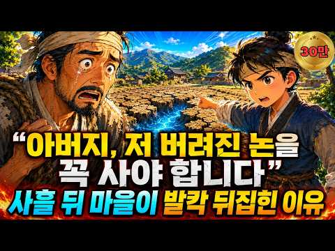
- 설명 앞부분: 옥단야담은 우리 조상들의 지혜와 해학이 담긴 야담, 민담, 전설을 오늘의 감성에 맞게 각색하여 들려드리는 이야기 채널입니다. 흥미롭고 신비로운 옛이야기 속에서 때로는 웃음을, 때로는 긴장감을, 때로는 깊은 여운을 전해드립니다. ✍️ 여러분의 소중한 댓글은 영상 제작에 큰 힘이 됩니다. 본 영상은 AI 기술을 보조 도구로 활용하여 제작될 수 있으나, 대본 집필과 이야기 각색, 이미지 기획을 비롯한 핵심 콘텐츠는 채널 운영자의 고유한 창작물입니다.
- 같은 채널 평소 대비 ×72.3 (채널 최근 롱폼 중앙값 5,194회) · 평소 영상: “시아버지 앞에서는 모르는 척하세요, 그래야 삽니다!” 굶주린 소녀에게 밥을 나눠준 며느… (5,194회) / “아까운 보리쌀을 왜 버리느냐!” 보리쌀을 매일 한 줌씩 항아리에 따로 모은 며느리, 겨… (4,892회)
- 대본 없음 (설명) — 음성인식이 끝나면 도입부·흐름이 들어감
- 댓글 130/130: 좋은 점 — 영상 0 · 감사·응원 12 · 더 알고 싶은 것 0 · 아쉬운 점 — 영상 2 · 반박·불만 — 의견 다름 2 · 정치·사회 0 · 경험 공유 1 · 구독·다음 기대 0
  - 감사·응원 👍31 “축하해 도윤아 믿어주신 아버님 감사합니다”
  - 감사·응원 👍27 “다행히 관아사또가 그래도 정직한 사람이라서 위안이되는군요 강진태편을 들지않고 공정하게 사또가 판결을 하고 도윤이와 만석씨 지혜로운 대처로 논을 지킬수있어서 통쾌하고 흐뭇하네요 감사합니다”
  - 아쉬운 점 — 영상 👍1 “자막이 왜이래요”
  - 아쉬운 점 — 영상 👍0 “했지요 와 했답니다의 반복이 듣기 힘드네요.”
  - 반박·불만 — 의견 다름 👍7 “엣날이야그지요....요즈음에 저런 바보들이 있을까요......한번 배신한 놈들은 또 배신하고...고마움은 잠시...시기와 질투는 영원합니다.....그리고 또 배신할겁니다......방법은 강진태에게 10000배 주고 팔고 다른 마을가서 논사고 밭사고 농사짓고 살면 될듯…”
  - 반박·불만 — 의견 다름 👍6 “서울종로익선동에서”

### 276. [감동 사극] 악독한 계모를 피해 도망친 두 자매! 자식 없이 늙어가는 농부의 수양딸이 되어 조선 최고의 거상으로 거듭난 기막힌 사연 (힐링 썰)

- https://www.youtube.com/watch?v=9MZ_w0MHkpE · 이야기와 인생 · 구독자 5,350 · 조회수 85,217 (×15.9, 하루 761.4) · 좋아요 2,897 (3.4%) · 176.9분 · 2026-07-08 · 주제 묶음 3. 조선 · 형식 수면·낭독 (잠잘 때 듣는) · 폴더 `W_9MZ_w0MHkpE` (웹 승인)
- 썸네일: 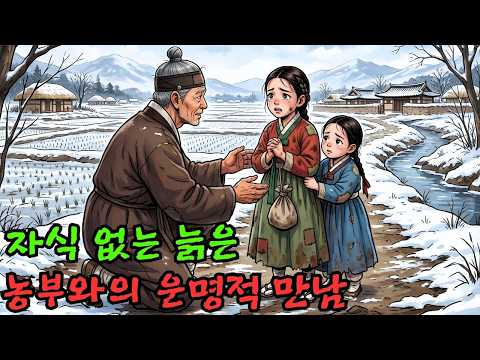
- 설명 앞부분: 피보다 진한 눈물로 맺어진 진짜 가족! 계모의 구박을 피해 도망친 두 자매가 일궈낸 완벽하고 가슴 뭉클한 인생 역전기 🌾✨ 안녕하세요! 저희 채널을 찾아주셔서 진심으로 감사합니다. 오늘 들려드릴 이야기는 아버지가 돌아가신 후 악독한 계모의 모진 매질과 굶주림을 견디다 못해 한겨울 밤 도망친 두 자매가, 외롭게 홀로 늙어가던 마음씨 고운 부농(富農)을 만나 벌어지는 따뜻하고 통쾌한 사극 썰입니다. "너희 같은 혹덩이들은 당장 얼어 죽어도 싸다!" 계모의 저주를 뒤로한 채 거리를 헤매다 쓰러진 자매. 그들을 거두어준 것은 평생 흙을 …
- 같은 채널 평소 대비 ×24.2 (채널 최근 롱폼 중앙값 3,526회) · 평소 영상: [감동 사극] "제발 이 아이만은 살려주십시오!" 피투성이 여인이 매달린 선비의 소름 돋… (3,526회) / [사극 로맨스] 숲에서 길을 잃은 태자의 입맛을 사로잡은 산골 처녀의 '비법 훈제 고기'… (3,644회)
- 대본 없음 (설명) — 음성인식이 끝나면 도입부·흐름이 들어감
- 댓글 73/73: 좋은 점 — 영상 2 · 감사·응원 7 · 더 알고 싶은 것 1 · 아쉬운 점 — 영상 4 · 반박·불만 — 의견 다름 1 · 정치·사회 0 · 경험 공유 0 · 구독·다음 기대 0
  - 좋은 점 — 영상 👍10 “너무 아름답고 좋은 내용입니다. 감동 받고 갑니다.”
  - 좋은 점 — 영상 👍5 “좋은 내용에 쥔장께 감사드립니다 사람이 왜 살아가야 하는지 조용히 생각해 보게 하는 사연이네요~감사합니다~”
  - 감사·응원 👍7 “감동깊게 잘 듣고갑니다 감사합니다~~^^”
  - 감사·응원 👍5 “좋은 내용에 쥔장께 감사드립니다 사람이 왜 살아가야 하는지 조용히 생각해 보게 하는 사연이네요~감사합니다~”
  - 더 알고 싶은 것 👍10 “댓글좀 보세요. 화면을 제대로 올려주세요”
  - 아쉬운 점 — 영상 👍3 “광고가 왜이리많아 질리네”
  - 아쉬운 점 — 영상 👍2 “광고가 너무 많아 듣고 싶지 않아요”
  - 반박·불만 — 의견 다름 👍3 “화면 을 굳이 여러개를 올리는 까닥이 뭔가요 작가라는 사람 이 독자 생각을 안하고 글쓰는 모습은 화면안에 안보여도 됩니다 문장의 구성은 좋지만 내용하고 화면이 전혀 맞지 않아 이런 Ai작품은 보고 싶지 않습니다 어른만 이런것 보는것이 아닙니다. 뒷화면은 버려주세요 ㅠ…”

### 277. 《삼국지》 제갈량을 능가한 삼국지 최고의 책사는 누구? 와룡의 라이벌 6인 l 역사 인물 l 고전

- https://www.youtube.com/watch?v=V26QZgQ3Ejw · 동양사 이야기 · 구독자 16,800 · 조회수 219,687 (×13.1, 하루 2,357.5) · 좋아요 1,161 (0.5%) · 40.2분 · 2026-07-27 · 주제 묶음 6. 동양사 (중국·일본·몽골) · 형식 오디오북·낭독 (명언·인생조언) · 폴더 `W_V26QZgQ3Ejw` (웹 승인)
- 썸네일: 
- 설명 앞부분: 삼국지 시대를 뒤흔든 최고의 책사 6인을 소개합니다. 제갈량 공명과 어깨를 나란히 한 지략가들은 누가 있었을까요? 주유, 곽가, 방통, 사마의, 육손 등 와룡의 라이벌들이 펼친 지혜와 전략의 깊이를 함께 살펴보세요.
- 같은 채널 평소 대비 ×10.4 (채널 최근 롱폼 중앙값 21,179회) · 평소 영상: 《중국 역사》 당신이 명나라 황제로 환생한다면? 정통제 주기진의 파란만장한 일대기 l 역… (21,179회) / 《삼국지》 제갈량보다 똑똑해서 죽었다고? 제갈씨 가문을 멸망시킨 천재의 비극적인 몰락 l… (21,604회)
- 대본 없음 (설명) — 음성인식이 끝나면 도입부·흐름이 들어감
- 댓글 185/185: 좋은 점 — 영상 1 · 감사·응원 3 · 더 알고 싶은 것 1 · 아쉬운 점 — 영상 4 · 반박·불만 — 의견 다름 7 · 정치·사회 3 · 경험 공유 10 · 구독·다음 기대 0
  - 감사·응원 👍0 “감사합니다.”
  - 아쉬운 점 — 영상 👍0 “설명이. 지루하다 간단하게 요약만”
  - 아쉬운 점 — 영상 👍0 “숟가락얹냐 더 알만한 조사하구해라 뻔한거퍼서 나르지마리ㅜ”
  - 반박·불만 — 의견 다름 👍0 “행정가로선 엄청 뛰어났다 생각하네요 위나라에 비해 인재 자원풀이 말도 안되게 떨어져도 북벌이란 꿈을 꿀 수 있게 군사적 행정적 뒷 받침을 한건 사실이니깐요 위 촉 오 기준 인구 비율로 따지면 6:1:2수준이라는데 저런 국력으로 곽가 사마의 주유 육손??? 누가와도 북…”
  - 정치·사회 👍0 “삼국지 시대는 지금으로 치면 나라가 내전에 빠지고 군웅이 할거하는 동남아 아프리카 그리고 중동같은 지옥 그 자체였을 듯. 위촉오 그 어느쪽이든 같은 나라 국민들끼리 벌인 내전이고 그 결과물은 위진남북조 그리고 5호16국의 대환장 시대 😊”
  - 경험 공유 👍0 “내가 보았던 어린이 만화 삼국지는 왜 유비가 삼국통일하고 끝난걸까 어린애들 속이려구 만들었나 보다”
  - 경험 공유 👍0 “이거슨 몇년의 시간을 결과로 판단하는거고 인정합니다. 다만 시간을 더 쪼개고 우리가 그 시점으로 가서 살아본게 아니니 뭐라고 단정지을수 없겠습니다. 그래도. 제갈량이 죽으면서 유선한테 한 말이, 내가 가진게없다는말을한거는 내 자식들이 본인이 죽어도 유선을 배신할 능력…”

### 278. 《삼국지》 사마의, 왜 그는 천하를 얻고도 가문이 멸문지화를 당했나? l 역사 인물 l 고전

- https://www.youtube.com/watch?v=0gnfP3KZ31E · 동양사 이야기 · 구독자 16,800 · 조회수 290,876 (×17.3, 하루 2,305.0) · 좋아요 3,176 (1.1%) · 46분 · 2026-06-24 · 주제 묶음 6. 동양사 (중국·일본·몽골) · 형식 정보·해설 (그 밖) · 폴더 `W_0gnfP3KZ31E` (웹 승인)
- 썸네일: 
- 설명 앞부분: 삼국지의 숨은 주인공 사마의 가문이 천하를 통일하고도 결국 멸망할 수밖에 없었던 비극적인 이유를 아시나요? 권력에 대한 끝없는 야망과 배신 그리고 무능한 후계자 선택이 불러온 파멸의 역사를 통해 진정한 국정 운영의 교훈을 함께 알아보세요.
- 같은 채널 평소 대비 ×13.6 (채널 최근 롱폼 중앙값 21,392회) · 평소 영상: 《삼국지》 제갈량보다 똑똑해서 죽었다고? 제갈씨 가문을 멸망시킨 천재의 비극적인 몰락 l… (21,604회) / 《중국 역사》 당신이 명나라 황제로 환생한다면? 정통제 주기진의 파란만장한 일대기 l 역… (21,179회)
- 대본 없음 (설명) — 음성인식이 끝나면 도입부·흐름이 들어감
- 댓글 85/85: 좋은 점 — 영상 2 · 감사·응원 0 · 더 알고 싶은 것 0 · 아쉬운 점 — 영상 0 · 반박·불만 — 의견 다름 1 · 정치·사회 9 · 경험 공유 1 · 구독·다음 기대 0
  - 좋은 점 — 영상 👍1 “너무 유익합니다❤❤❤❤❤”
  - 좋은 점 — 영상 👍1 “유익한데... 기껏해야 한국 정치 뉴스 관련된 수다 듣고 있는 자칭 애국노인들이 소화하기에는 어려운 내용입니다. 잘 봤습니다.”
  - 반박·불만 — 의견 다름 👍1 “글쎄요. 이런 식으로 따지면 지구 상에 성공만 한 가족이 있나요 ? 성실패를 따질 땐 그 범위를 특정사건이나 특정인에 국한해야지 않을까요 ?”
  - 정치·사회 👍9 “아니 천하통일하고 황제가 되었는데 멸문지화라니, 역사적으로 어느 나라든지 세월이 가면 망하지 않는 나라가 없고 망하면 대부분 그 황족은 멸문되기 마련인데 사마의 가문만이 아니지. 그리고 사마의의 진나라뿐 아니라 원래 그 쪽 지방의 나라들은 몇 대 못가 단명한 것이 대…”
  - 정치·사회 👍3 “제갈량이 촉의 국력을 파악하고 북벌을 하지않고 국력을 기르며 때를 기다렸다면 위나라가 삼국을 텅일하지 못했을 것이다”

### 279. 우리가 몰랐던 조선시대 평민들의 충격적인 삶 ∣ 조선역사 ∣ 한국사 ∣ 조선왕조실록 ∣ 자면서 듣기 좋은 역사 이야기 ∣ 자면서 듣는 역사 이야기

- https://www.youtube.com/watch?v=IbaIAa8VCR8 · 역사킴 · 구독자 4,310 · 조회수 93,133 (×21.6, 하루 585.4) · 좋아요 697 (0.8%) · 30.3분 · 2026-06-04 · 주제 묶음 1. 역사 일반·이야기 · 형식 수면·낭독 (잠잘 때 듣는) · 폴더 `W_IbaIAa8VCR8` (웹 승인)
- 썸네일: 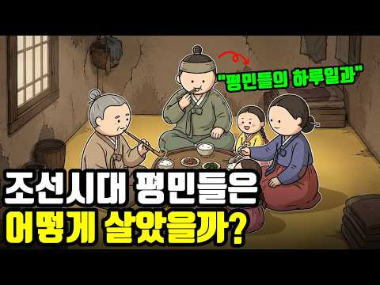
- 설명 앞부분: 우리가 몰랐던 조선시대 평민들의 충격적인 삶
- 같은 채널 평소 대비 ×64.5 (채널 최근 롱폼 중앙값 1,445회) · 평소 영상: 조선시대 사람들의 충격적인 탈모 이유 ∣ 조선역사 ∣ 한국사 ∣ 조선왕조실록 ∣ 잠잘 때… (1,445회) / 영화 '왕사남' 속 단종과는 달랐던 사실?! 단종의 진짜 이야기 ∣ 조선역사 ∣ 한국사 … (1,142회)
- 대본 없음 (설명) — 음성인식이 끝나면 도입부·흐름이 들어감
- 댓글 75/78: 좋은 점 — 영상 1 · 감사·응원 1 · 더 알고 싶은 것 1 · 아쉬운 점 — 영상 1 · 반박·불만 — 의견 다름 1 · 정치·사회 0 · 경험 공유 2 · 구독·다음 기대 0
  - 좋은 점 — 영상 👍2 “ㅡ0건강,면역성에서 가장중요한게..공기다. 특히.. 본인이 가장 오래 머무는 실내공간의 공기가 맑은가..시멘트라돈가스와 화학가스에 오염되어 있는가에 따라서..호흡을통해..오염된 독성공기가 폐로들어가서 혈액을 오염시켜.. 병들이고, 독성화시키면서..혈액세포를 병들이고.…”
  - 더 알고 싶은 것 👍0 “금줄... 자세히 알려주세요. 조선 후기에 고추가 온걸로 아는데 그전엔 남자는 멀 걸었나요?”
  - 아쉬운 점 — 영상 👍8 “애니메이션 이. 일본. 캐릭터예요 . 머리가. 일본 머리모양이예요 .아쉽네요 중간중간. 틀려요. 모자도 요.”
  - 반박·불만 — 의견 다름 👍2 “ㅡ0건강,면역성에서 가장중요한게..공기다. 특히.. 본인이 가장 오래 머무는 실내공간의 공기가 맑은가..시멘트라돈가스와 화학가스에 오염되어 있는가에 따라서..호흡을통해..오염된 독성공기가 폐로들어가서 혈액을 오염시켜.. 병들이고, 독성화시키면서..혈액세포를 병들이고.…”
  - 경험 공유 👍3 “사실 우리나라의 온돌 문화는 책에서는 고조선 시대때부터 온돌이 있었다고 나와 있어서 고조선 시절부터 모든 백성들이 온돌 난방을 했던것처럼 알고 있지만 우리나라의 온돌 난방은 조선시대때도 왕족들과 극히 일부 사대부 권력층들만 온돌 난방을 했었고 대부분의 백성들은 화로만…”

### 280. 12만 대군을 궤멸시킨 영하 40도의 사투, 장진호 포위망 돌파극 #세계사 #역사다큐 #장진호전투 #625전쟁 #흥남철

- https://www.youtube.com/watch?v=ODl3vZ-txdc · 역사 전략실 · 구독자 11,200 · 조회수 214,781 (×19.2, 하루 1,488.2) · 좋아요 3,774 (1.8%) · 28.9분 · 2026-06-19 · 주제 묶음 5. 세계사·서양사 · 형식 정보·해설 (그 밖) · 폴더 `W_ODl3vZ-txdc` (웹 승인)
- 썸네일: 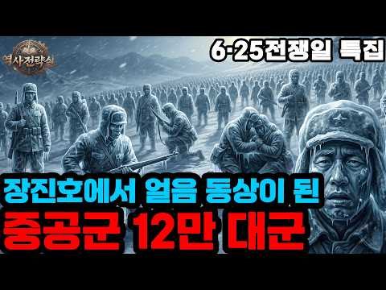
- 챕터: 0:00 승리에 도취된 사령부, 덫에 빠진 미군 · 5:14 영하 40도, 무기마저 파괴한 극한의 추위 · 8:01 스미스 장군의 선견지명: 하갈우리 임시 활주로 건설 · 8:20 12만 대군의 기습과 톡동고개 여우 중대의 사투 · 10:16 "퇴각이 아니다!" 불가능을 뚫는 능선 쟁탈전 · 20:58 절망의 수문교, 하늘에서 떨어진 강철 다리 · 23:27 얼음 동상이 되어버린 중공군의 비극 · 25:17 흥남 부두, 10만 명을 살려낸 크리스마스의 기적
- 설명 앞부분: 1950년 겨울, 영하 40도의 장진호에서 미 해병대 1만 5천 명은 12만 명의 중공군 최정예 부대에게 완벽히 포위당했습니다. 맥아더 사령부의 오만함이 부른 절망적인 위기 속에서, 살인적인 추위와 압도적인 적의 인해전술을 뚫고 나온 올리버 스미스 장군의 천재적인 전술과 병사들의 처절한 사투를 조명합니다. 인류 전쟁사상 가장 기적적인 포위망 돌파 작전이자 적의 주력을 궤멸시킨 핏빛 역사를 역사 전략실에서 파헤쳐 봅니다. 타임라인: 로이 애플먼 (Roy E. Appleman), 『East of Chosin: Entrapment an…
- 같은 채널 평소 대비 ×26.5 (채널 최근 롱폼 중앙값 8,108회) · 평소 영상: 손톱과 머리카락을 남기고 떠난 75명의 청춘들, 맹호부대 특공결사대의 핏빛 15일 #안케… (8,605회) / 100만 대군을 찢어버린 4만 7천의 기적, 가우가멜라 전투의 소름 돋는 전술 #세계사 … (7,612회)
- 대본 없음 (설명) — 음성인식이 끝나면 도입부·흐름이 들어감
- 댓글 514/514: 좋은 점 — 영상 1 · 감사·응원 73 · 더 알고 싶은 것 2 · 아쉬운 점 — 영상 2 · 반박·불만 — 의견 다름 7 · 정치·사회 43 · 경험 공유 10 · 구독·다음 기대 0
  - 감사·응원 👍314 “미군 병사들 너무 감사합니다. 당신들이 있었기에 오늘날 대한민국이 있습니다.”
  - 감사·응원 👍278 “625전쟁때 희생하신 미군장병들께 깊이 감사합니다 부디 천국에서 행복을 누리시길 바랍니다”
  - 더 알고 싶은 것 👍59 “국방부의 항미원조를 인정하는듯한 작금의 태도를 국민은 어떻게 해석해야하는지 ???? 진짜 걱정입니다 ....”
  - 더 알고 싶은 것 👍0 “26분37초 지도 표기 SEA OF JAPAN? 언제부터 동해가 일본해가 됐죠? 보기 안좋네요. 역사 관련 영상에 큰 오류 같네요.”
  - 아쉬운 점 — 영상 👍1 “당시 무조건 북진하지 말고 한반도에서 동서라인이 가장 짧은 안주, 원산 라인에서 진격 멈추고 중공군과 일전을 벌였어야 하는데, 맥아더가 상황을 너무 안이하게 판단한 잘못이 두고두고 아쉽네요. 그 이후도 휴전선 부근에서 일진일퇴의 고지전만을 전개할 것이 아니라, 원산,…”
  - 아쉬운 점 — 영상 👍0 “북괴도 무리하게 낙동강을 넘어 설려다 후방을 소흘히 하고 지키지 못해 작전을 허용했듯이 하여간 욕심이 지나치면 안된다는 평범한 진리를 외면한 채 미국이 병법을 모르고 자만감에 무작정 밀고 올라간게 큰 실수였음. 쥐도 도망갈 구멍을 만들어 주면서 쫓고 바둑에서도 아생연…”
  - 반박·불만 — 의견 다름 👍7 “다좋은데 어이없게 피난민속에 죄인이가 있었다는거😢”
  - 반박·불만 — 의견 다름 👍0 “와 그걸 맥아더의 오만한 오판으로 몰고 가다니 ㅎㄷㄷ 당시 미군이 중공군을 이길 수 없어서 북한지역을 다 내준 거라 생각하는 사람은 아무 것도 모르는 것임. 한국전쟁 때 미군은 융단폭격이라는 것을 밥멋듯 했었는데, 이것은 하늘이 새까맣게 보일 정도로 셀 수도 없이 많…”
  - 정치·사회 👍96 “미군들의 수많은 희생이 있었기에 이나라가 자유를 지킬 수 있었습니다. 감사합니다 이것을 잊으면 인간도 아니고 나라도 아니다”
  - 정치·사회 👍15 “모든 일에는 반드시 비주류의 이야기에 한번은 귀를 기울여야 한다. 운동, 선거, 사업, 전쟁 모두 같다.”
  - 경험 공유 👍81 “남의 나라에 와서 이렇게 희생되고 고생을 하고 돈을 쏟아 붓고 믿어지지 않아요 우리도 남을 위하여 이렇게 전쟁을 해봤던가요 ?? 감사합니다 고맙습니다”
  - 경험 공유 👍10 “그동안 내가 알던 장진호 전투보다 훨씬 열악하고 치열 했네요. 자유를 위해 고생하고 죽어가신 분들께 감사드립니다. 스미스소장은 원예학과 출신이고 매러디스 빅토리아호 선장님은 기적을 체험하시고 후에 종교인이 되셨습니다”

