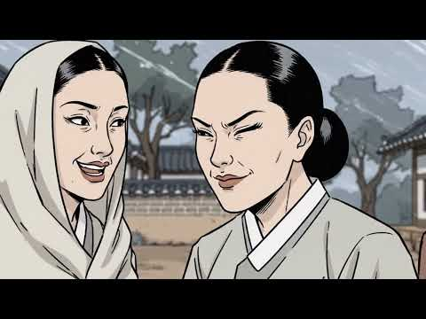
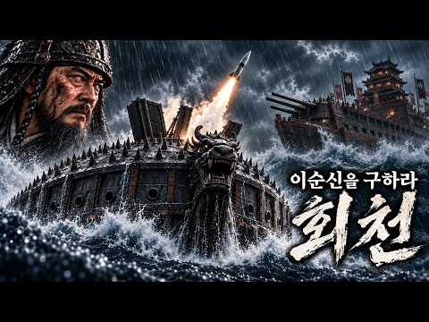
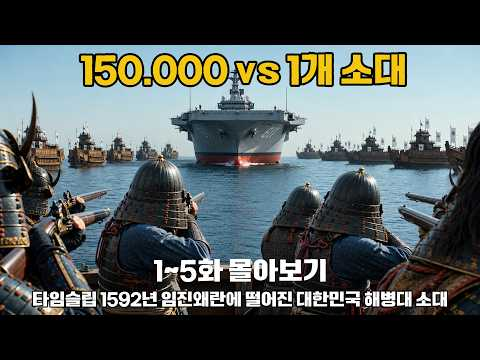
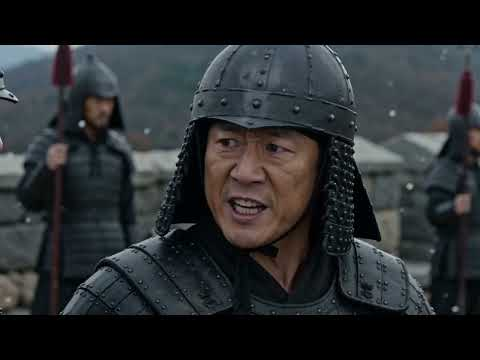
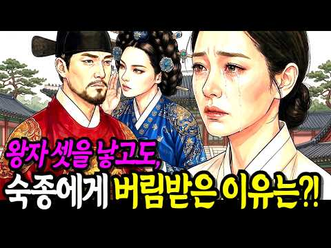
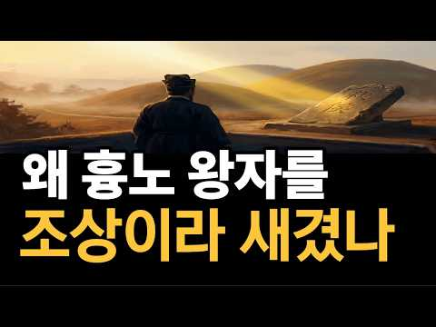

# 역사 — 성공 사례 분석: 사례별 자세히 #241–#280

`analysis.md` 의 9번 (같은 # 번호). 자동 생성 — `tools/success_analysis.py` v1.4.1 (2026-10-17 07:39 UTC). ※ 연구·교육용 — 투자 권유가 아님.

### 241. 칭기즈칸보다 잔혹했던 절름발이 몸으로 유라시아를 떨게 한 공포의 정복자 티무르

- https://www.youtube.com/watch?v=XI61XGQiilU · 역사를읽다 · 구독자 15,800 · 조회수 561,644 (×35.5, 하루 3,157.8) · 좋아요 6,463 (1.1%) · 36.9분 · 2026-04-22 · 주제 묶음 6. 동양사 (중국·일본·몽골) · 형식 정보·해설 (그 밖) · 폴더 `W_XI61XGQiilU` (웹 승인)
- 썸네일: 
- 챕터: 0:00 인트로 · 0:42 친기즈칸을 넘어선 공포 · 2:18 절름발이 전사의 탄생 · 4:35 배신과 권력 장악 · 6:20 해골탑의 진짜 목적 · 9:10 학살과 창조의 두 얼굴 · 12:45 번개 술탄과의 세기의 대결 · 17:00 저주받은 무덤의 비밀
- 설명 앞부분: 해골 탑을 백오십 개 넘게 쌓은 남자. 절름발이 몸으로 유라시아 절반을 정복한 공포의 정복자 티무르의 모든 것을 파헤칩니다. 이스파한에서 이십만 명을 학살하고, 오스만 제국의 번개 바예지드를 철창에 가둔 남자. 그런데 같은 손으로 세계에서 가장 아름다운 도시 사마르칸트를 세우고 타지마할의 원형을 만들어낸 사람. 그리고 오백 년 뒤 그의 무덤이 열리자 이틀 만에 제 2차 세계대전이 시작됐다는 소름 돋는 우연까지. 모순의 거인 티무르의 핏빛 드라마, 지금 시작합니다. 여러분은 티무르를 악마로 기억하시겠습니까, 아니면 비운의 천재로 기…
- 같은 채널 평소 대비 ×56.7 (채널 최근 롱폼 중앙값 9,908회) · 평소 영상: 알렉산드리아 도서관은 카이사르가 불태운게 아니다 인류 지식을 지운 진짜 주범들 인류 지식… (9,908회) / 인구 절반을 몰살시킨 흑사병 매달 받는 월급의 시초였다 (8,855회)
- 대본 없음 (설명) — 음성인식이 끝나면 도입부·흐름이 들어감
- 댓글 383/383: 좋은 점 — 영상 8 · 감사·응원 4 · 더 알고 싶은 것 0 · 아쉬운 점 — 영상 0 · 반박·불만 — 의견 다름 3 · 정치·사회 24 · 경험 공유 3 · 구독·다음 기대 0
  - 좋은 점 — 영상 👍43 “명나라와 붙기 전에 죽었기에 결국 중동사 내에서의 인물이 되어버려 한국 입장에서는 접점이 없어서 자연스럽게 인지도가 떨어짐... 심지어 국가 운영 능력에서의 차이도 그렇고 모든 종교에 관대했던 칭기스칸과는 달리 티무르는 골수 이슬람 신자다보니 인간적인 매력도 그리 와…”
  - 좋은 점 — 영상 👍3 “와. 재미있어서 끝까지 잘보았고 많은 생각을 하게됩니다~~명나라와 오늘날 이스탄불 바그다드~~정말 흥미진진 했어요~~좋은영상 잘보았네요 감사합니다”
  - 감사·응원 👍3 “와. 재미있어서 끝까지 잘보았고 많은 생각을 하게됩니다~~명나라와 오늘날 이스탄불 바그다드~~정말 흥미진진 했어요~~좋은영상 잘보았네요 감사합니다”
  - 감사·응원 👍2 “위대한티무르에대해잘재밌게경청했습니다감사함니다영원한것은없다”
  - 반박·불만 — 의견 다름 👍1 “글쎄요...티무르가 1200만~1700만명을 죽였다고 주장하는 사람들 출처는 단 한곳에서도 그 증거가 없다는겁니다.. 무엇보다 1200만명 혹은 1500만명 그리고 1700만명이라 주장한사람들 각각 개인이였고 이를 긍정적으로 바라본 학자는 없다는것이 팩트입니다.. 많…”
  - 정치·사회 👍13 “2003년의 일자리 절반도 안되는 2026년에 외국인고용이 300만명이 정상이 아닙니다 모든 분야에서 1등한 사람이 공사와 일를 도급한후에 외국인만을 고용하고 한국사회의 강자가 약자를 짓밦는사회현상은 한국인1000만명실직시켜서 정신이 피페하게 정신병걸리고 범죄하게하고…”
  - 정치·사회 👍8 “그래서 김정숙이 대통령 전용기 타고 그곳에 갔구나”
  - 경험 공유 👍0 “2천만명의 사람을 죽인건 악마나 하는 짓이다. 정복자는 무슨! 악마세끼구만! 내가 제일 싫어하는 인물들이다, 역사적 인물이든, 현세의 인물인든! 한명회 히틀러 같은 놈들은 초기에 제거해야 한다.”

### 242. 이순신 사후 84일의 비밀, 선조가 대첩 승리 당일 저지른 비정한 보복

- https://www.youtube.com/watch?v=T0Vb2yu89Tc · 어른의 역사 시간 · 구독자 2,430 · 조회수 86,286 (×35.5, 하루 741.5) · 좋아요 1,132 (1.3%) · 58.4분 · 2026-06-22 · 주제 묶음 3. 조선 · 형식 정보·해설 (그 밖) · 폴더 `W_T0Vb2yu89Tc` (웹 승인)
- 썸네일: 
- 챕터: 0:00 84일간 썩지 않은 시신과 잔인한 보복 · 1:42 장례 법도 뒤에 숨은 선조의 비정한 명령 · 5:29 한겨울 400km 운구길에 감춰진 비밀 · 8:33 피 안 흘릴 전쟁을 영웅이 자원한 이유 · 11:46 7년 왜란 중 가장 처참했던 노량 사투 · 14:58 아들이 피 묻은 손으로 대장기를 쥔 순간 · 19:36 영웅이 전사한 날 무너진 마지막 방패 · 20:46 "갑옷 자살설?" 400년 동안 속았던 오해 · 23:18 이길수록 칼날로 돌아온 조선 왕실의 민낯 · 30:00 죽음 앞에 엎어져 통곡한 이국의 장수 · 34:19 이 나라는 왜 영웅의 안식처를 막았나 · 37:01 난중일기 100번의 병 기록과 진짜 진실 · 45:12 426년째 풀 안 자라는 의문의 1미터 맨땅 · 51:06 100년 뒤에야 울려 퍼진 뒤늦은 눈물
- 설명 앞부분: 살아서는 이 나라의 감옥에 갇혔고, 죽어서는 땅 한 평조차 제때 내어주지 않았습니다. 7년 왜란을 승리로 이끌고 온 나라를 구한 영웅의 관은, 그렇게 두 달이 넘도록 구천을 떠돌아야 했습니다. 영하를 오가는 매서운 한겨울, 냉장 시설도 없던 그 길에서 그의 몸은 왜 단 한 치도 무너지지 않았을까요? 왜 시신에서 은은한 향기가 났다는 기록이 전해질까요? 더 소름 끼치는 것은, 426년이 지난 지금 이 순간에도 그가 누워 있던 자리에는 풀 한 포기 자라지 않는다는 사실입니다. 과학계조차 답하지 못한 이 미스터리 뒤에 숨겨진 조선 왕실…
- 대본 없음 (설명) — 음성인식이 끝나면 도입부·흐름이 들어감
- 댓글 294/294: 좋은 점 — 영상 1 · 감사·응원 13 · 더 알고 싶은 것 0 · 아쉬운 점 — 영상 1 · 반박·불만 — 의견 다름 3 · 정치·사회 15 · 경험 공유 2 · 구독·다음 기대 0
  - 좋은 점 — 영상 👍7 “과학도 아니고 기적도 아니고 하늘의 뜻같기도합니다 그러나 과학적으로도 믿을수 없는일이 벌어지는것도 있지 않습니까 하이튼 하늘의 도움이 아닐까요 미신 풍수 있다 없다 말할수는 없는것이기에”
  - 감사·응원 👍20 “구국의 영웅인 이순신장군님께서 누워계신 곳에ᆢ 감히 산천초목이 뿌리를 내리지 않은것은ㅡ구국의 영웅께 최고의 예우를 다 한 것이 아닐런지요ㆍ위대한 장군님 감사합니다 🎉🎉🎉🎉🎉🎉🎉🎉🎉🎉”
  - 감사·응원 👍17 “역사의 새로운 사실 많이 알았습니다 고맙습니다 감사합니다~”
  - 아쉬운 점 — 영상 👍2 “간단히 말해라.서론이 너무길다”
  - 반박·불만 — 의견 다름 👍3 “근데, 이순신방전면주(李舜臣方戰免胄), 이 구절 한국말로만 읽어도 될걸 왜 중공발음으로 읽는지 이해가 안 됩니다. 한국사람들 수천년까지 되는지는 확언 못 하겠지만, 우리말로 한자 읽으면서 사용했슴요. 사실 한자는 동이족이 만든 상형문자입니다. 중공 한족(漢族)이 만든…”
  - 반박·불만 — 의견 다름 👍0 “이슨신 장군께서는 왕때위 한테 인정받고 칭찬 받으려고 왜적을 물리친게 아닙니다.. 장군은 나라를 위해 나라의 주인인 백성을 위해 싸웠습니다...”
  - 정치·사회 👍12 “지금은 중국인을 위한 연금이며..열불터져서”
  - 정치·사회 👍4 “이런 나라가 안망한것도 희안하다”
  - 경험 공유 👍3 “이순신 그분의 공이 얼마나 크고 훌륭했으면 또 범인은. 보고도. 깨닭지 모했던 일들이 수백년이 지난 오늘까지도 후세사람 알아낼수 있었던. 행적들을 지금도 많이 전설을 통해서 탐색을 통해서. 알아낼것이 있으니 그인간됨이. 오직자기만 알고 외롭게 해쳐서 나라를 지켰으니 …”
  - 경험 공유 👍2 “내가 장군이라면 일본을치고 명나라를치고 금나라를 치고 조선으로돌아와 선조를엄벌하고 일본은 무인도로만들것입니다”

### 243. 조선시대에 키 180Cm가 넘으면 일어나는 일

- https://www.youtube.com/watch?v=6wCWuqNY_aw · 바람이들려준역사 · 구독자 2,470 · 조회수 87,236 (×35.3, 하루 1,364.6) · 좋아요 644 (0.7%) · 16분 · 2026-08-14 · 주제 묶음 3. 조선 · 형식 정보·해설 (그 밖) · 폴더 `W_6wCWuqNY_aw` (웹 승인)
- 썸네일: 
- 설명 앞부분: 📏 조선시대에 키가 180을 넘는다는 건 어떤 의미였을까요? 평균 161cm의 세상에서 홀로 우뚝 솟은 사람. 저잣거리를 걸으면 사람들이 하던 일을 멈추고 돌아봤고, 때로는 임금 앞까지 불려 갔다고 합니다. 그런데 그렇게 눈에 띄는 몸이 과연 그 사람에게 축복이었을까요? 🤔 아니면 우리가 짐작도 못 한 반전이 숨어 있는 걸까요? 이 영상에서는 실제 유골 계측 연구로 밝혀진 조선 사람들의 진짜 키, 그리고 '8척 장신'이라는 표현에 숨은 놀라운 함정을 하나하나 파헤칩니다. 📜 평균 161cm의 세상에서 큰 키를 가진 사람은 집에서,…
- 대본 없음 (설명) — 음성인식이 끝나면 도입부·흐름이 들어감
- 댓글 181/181: 좋은 점 — 영상 2 · 감사·응원 0 · 더 알고 싶은 것 0 · 아쉬운 점 — 영상 5 · 반박·불만 — 의견 다름 9 · 정치·사회 5 · 경험 공유 9 · 구독·다음 기대 0
  - 좋은 점 — 영상 👍5 “국가에서 종족번식을 위해서 특별히 관리하고 국방력에 도움이 되도록했을것 같다.”
  - 아쉬운 점 — 영상 👍17 “내용이 좀 헛소리가 길어서 수면제로 쓰려했는데 잠도안오네”
  - 아쉬운 점 — 영상 👍2 “아..겁나 지루하다...”
  - 반박·불만 — 의견 다름 👍17 “내용이 좀 헛소리가 길어서 수면제로 쓰려했는데 잠도안오네”
  - 반박·불만 — 의견 다름 👍4 “이순신도 184였다는데 뭐가 저게 대단하다고?? 조선시대 사람들은 키가 난장이똥자루인줄 알았나 봐. 그 때 사람들 무덤 파헤쳐 유골의 신장 조사해보니 현대인들과 별 차이도 없어!! 또 잘 먹으면 키가 커진다는 말도 안되는 억지꾼이 나섰군!~”
  - 정치·사회 👍0 “조선만 그런게 아니고 산업혁명 전까지 모든 나라가 그랬어요... 그리고, 키큰유전자를 선호하는것은 외형적인 아름다움을 추구하는것이고, 그건 먹고살만해져야 가능한거죠.”
  - 정치·사회 👍0 “이게 말이 안맞는게 조선후기 또는 구한말에 왔던 서양의 외국인들이 말하는게 조선사람들은 키가 컷다고 합니다. 실제 구한말의 남자를 찍은 사진을 보면 제법 키가 큰 사진들이 많아보였습니다. 160cm이라는 키는 구한말이 되면서 각종수탈로 먹기 힘들어지면서 대부분의 영양…”
  - 경험 공유 👍3 “제가 180넘는데 어릴때는 큰키였는데 요즘 아이들이 커서 중간인듯 내 동생도 내보다 크고 할머니께 들은 바로는 고조부께서는 나보다 훨씬 크고 손도 엄청 컸다고 하시던데”
  - 경험 공유 👍1 “나도 살면서 손해 많이 봤다. 끊임없이... 끝도 없이...”

### 244. 한국사 최악의 배신자 5인 최고의 1인은?

- https://www.youtube.com/watch?v=rMcAaykM45c · 오늘도 역사 · 구독자 1,050 · 조회수 36,928 (×35.2, 하루 234.6) · 좋아요 1,649 (4.5%) · 36.5분 · 2026-05-12 · 주제 묶음 4. 한국 근현대사 · 형식 정보·해설 (그 밖) · 폴더 `W_rMcAaykM45c` (웹 승인)
- 썸네일: 
- 설명 앞부분: 안녕하세요 오늘도 역사 채널 입니다 "우리가 몰랐던 역사 속 진짜 이야기, 그 이면의 진실을 파헤칩니다. 교과서에는 한 줄로 기록된 사건들, 하지만 그 속에는 우리와 닮은 사람들의 뜨거운 욕망과 선택이 있었습니다. 오늘, 시간을 거슬러 그 현장으로 함께 떠나보시죠."
- 대본 없음 (설명) — 음성인식이 끝나면 도입부·흐름이 들어감
- 댓글 245/245: 좋은 점 — 영상 0 · 감사·응원 0 · 더 알고 싶은 것 0 · 아쉬운 점 — 영상 1 · 반박·불만 — 의견 다름 2 · 정치·사회 27 · 경험 공유 0 · 구독·다음 기대 0
  - 아쉬운 점 — 영상 👍8 “서론이 너무길다..ㅋ”
  - 반박·불만 — 의견 다름 👍5 “신숙주는 결코 배신자도 아니고 조선에서 배출한 최고의 천재 중 한 명입니다. 숙주나물은 예전에 신숙주의 이름이라고 말 하지만 한자도 다르고 그런 연유로 나온 이름도 아닙니다. 솔직히 말하면 조선왕조를 개창할 때 정도전은 주자성리학의 원리를 내세워 "王權과 臣權은 같아…”
  - 정치·사회 👍31 “박근혜배신 김무성 유승민 윤석열배신 한동훈 권성동 권영세”
  - 정치·사회 👍29 “요즘 정치인들 선거땐 개같이 구석구석 굽신데면서. 허리한번 안펴다가 당선되면 바로 배신 지가 최고이듯 ᆢ”

### 245. [세계사] 한 아버지의 한 손짓이 유대교, 기독교, 이슬람교인 43억 명의 운명을 가른 충격적 이유 ∣ 아브라함, 이삭, 이스마엘, 43억 ∣ 종교사

- https://www.youtube.com/watch?v=MlHcNPc7h-A · 역사로그 · 구독자 21,500 · 조회수 751,520 (×35.0, 하루 4,440.7) · 좋아요 7,840 (1.0%) · 23.5분 · 2026-05-01 · 주제 묶음 5. 세계사·서양사 · 형식 정보·해설 (그 밖) · 폴더 `W_MlHcNPc7h-A` (웹 승인)
- 썸네일: 
- 챕터: 0:00 4천년 전 한 새벽 — 한 아버지의 손짓 · 1:06 우르의 한 천막, 함무라비 법전 §146과 사라의 결정 · 3:00 광야의 하갈, 신에게 이름을 붙인 유일한 인물 · 6:36 예수와 바울 — 기독교가 유대교에서 갈라진 첫 줄 · 8:34 AD 70 성전 파괴와 통곡의 벽 · 9:56 325 니케아 공의회 — 콘스탄티누스 친서의 낙인 · 10:51 무함마드와 메디나 헌장 — 한 도시의 짧은 공존 · 13:13 예루살렘 0.9km² — 한 바위 두 신앙 · 13:55 1095 클레르몽 + 1096 라인란트 학살 · 15:13 1099년 7월 15일, 회당의 불 · 16:07 1187년 살라딘 — 88년 만의 다른 선택 · 17:29 추방의 천년 — 1290 영국, 1306 프랑스, 1… · 18:31 1215 노란 표식이 600년 뒤 가스실 문까지 · 18:51 1896 헤르츨, 1917 벨푸어, 1947 UN 결… · 19:51 1948 나크바 — 530개 마을이 사라진 봄 · 20:32 1967 6일 전쟁 — 통곡의 벽 70세대 만의 회귀 · 20:54 1993 오슬로와 1995 라빈 암살 · 21:38 2024 ICJ — "이스라엘 점령은 불법" · 22:14 그 새벽이 오늘 가자에서 아직 멈추지 않는 이유
- 설명 앞부분: 아브라함(BC 2100~1900경)은 유대교·기독교·이슬람교 세 종교가 공통의 조상으로 받드는 인물로, 그의 두 아들 이삭과 이스마엘이 갈라진 사건이 세 종교 분기의 시작점이다. 오늘 지구에 사는 두 명 중 한 명, 약 43억 명이 그 두 아들 중 한 명을 자기 조상으로 부른다. 4천년 전 한 새벽, 한 아버지가 두 아들 중 한 명을 광야로 보냈습니다. 그 손짓 한 번이 천년 뒤 한 회당의 문을 잠갔고, 어제 가자의 한 사진까지 한 번도 멈춘 적이 없습니다. 같은 아버지, 같은 신, 같은 첫 책 — 그런데 왜 한 뿌리에서 시작된 …
- 같은 채널 평소 대비 ×7.9 (채널 최근 롱폼 중앙값 94,719회) · 평소 영상: [세계사] 유럽을 300년간 떨게 한 바이킹은 왜 흔적도 없이 사라졌나?｜당신이 아는 바… (94,719회) / [세계사] 나라 없는 세계 최대 민족, 쿠르드족의 모든 것 ∣ 쿠르드족 버림받은 민족 3… (97,120회)
- 대본 없음 (설명) — 음성인식이 끝나면 도입부·흐름이 들어감
- 댓글 909/909: 좋은 점 — 영상 9 · 감사·응원 17 · 더 알고 싶은 것 7 · 아쉬운 점 — 영상 10 · 반박·불만 — 의견 다름 38 · 정치·사회 7 · 경험 공유 21 · 구독·다음 기대 2
  - 좋은 점 — 영상 👍68 “유익한영상입니다.제작하시느라고생하셨습니다.감사합니다.”
  - 좋은 점 — 영상 👍7 “유익한 정보에 감사드립니다. 다음의 정보도 기대됩니다.”
  - 감사·응원 👍68 “유익한영상입니다.제작하시느라고생하셨습니다.감사합니다.”
  - 감사·응원 👍38 “방대한 역사를 아주 알기 쉽게 간략히 요약해 주셨습니다. 귀한 수고에 감사드립니다,^^ ❤❤”
  - 더 알고 싶은 것 👍5 “하갈이 나갈 때 이스마엘의 나이는 몇살인가요? 이 점을 유의 하여 이야기를 하시기 바랍니다. 그림과 아울러...”
  - 더 알고 싶은 것 👍0 “기왕에수고하시는거정확한정보로방송부탁합니다”
  - 아쉬운 점 — 영상 👍7 “유산 문제? 낳아 준 이는 아브라함인데, 유산은 하늘 아버지가 말씀 한마디로 뭉뚱그려서 얘기했는데, 해석은 또 지들 마음대로 해서리... 다 부질없는 짓이구만~ 그 명분 아래 죽어간 신같은 인간들의 숫자가 하늘의 별만큼 많으니. 우주에 떠도는 그 원성이 헤아릴 길이 …”
  - 아쉬운 점 — 영상 👍1 “이 AI 음성, 너무너무 싫어!!!”
  - 반박·불만 — 의견 다름 👍34 “여든여섯의 아브라함이 하갈을 통해서 이스마엘을 얻었는데 사라가 아흔이 넘어서 아이를 낳았다고 했으니 이 때 사라의 나이도 76세 정도인가요? 당시에 결혼을 해서 2년 동안 아이가 없으면 여종에게서 아이를 본다고 법에 있었다는데 젊은 나이에 결혼을 해서 사라가 질투가 …”
  - 반박·불만 — 의견 다름 👍33 “아랍의 후손은 이스마엘 자손에게서만 나온게 아닙니다. 노아홍수 후 3아들에게서 나온 자손이 엄청납니다. 셈 함 야벳의 자손까지 생각해야 합니다. 셈족 중 아브라함은 작은 씨족에 불과하고 아람족을 비롯한 많은 족속이 나오고 함의 후손에게서 가나안 족속과 아프리카 족속이…”
  - 정치·사회 👍0 “내용이 전부 팩트를 전혀모르고 있군요 사실 히브리인과 아랍은 이복지간으로 지금도 형제로 생각합니다 십자군전쟁이나 지금의 중동을 보면 히브리인과 아랍이 싸운다고 보면 정말 잘못 본것 입니다. 이방인과 아랍이 싸운 겁니다. 지금의 이스라엘의 인구 구조를 보면 현 정권을 …”
  - 정치·사회 👍0 “환웅이 신단수 아래 내려와 나라를 열고 다스린 나라가 배달국이다. 배달국은 수메르 지역이며 금성이 빛나고 초생달이 뜨는 시기에 나라를 열고 다섯개의 신전을 지어 신을 모셨다. 몽골과 카자흐스탄 국기에서 잘 나타난다. 중동 국가들이 금성과 초승달을 국기로 신성시 하는 …”
  - 경험 공유 👍6 “간단하게 설명해줌. 야훼를 숭배하는 유대교가 있음. 그런데 어느날 예수라는 사이비 교주가 나타나서는 내가 야훼의 아들이라고 함. 나를 안통하면 천국에 못간다고 함. 유대교 입장에서는 이건 완전 미틴넘이고 이단중의 이단임. 그래서 죽임. 그랬더니 예수 숭배자들이 예수 …”
  - 경험 공유 👍2 “웃기는 종교다... 하느님을 두고 인간들 특히 금력 권력 종교권력을 쥔 인간들끼리... 지랄병을 했다는 거네... 아직도 서로 처 싸우고 있고... 내가 불교를 믿기를 잘한 선택인거 같다...”
  - 구독·다음 기대 👍7 “유익한 정보에 감사드립니다. 다음의 정보도 기대됩니다.”
  - 구독·다음 기대 👍1 “너네들 조상족보나 좀 챙겨봐라!”

### 246. 조선시대, 난방도 패딩도 없던 시대 혹독한 추위 어떻게 버텼나?

- https://www.youtube.com/watch?v=jljGmlOxqMc · 바람이들려준역사 · 구독자 2,470 · 조회수 85,797 (×34.7, 하루 779.6) · 좋아요 727 (0.9%) · 17.9분 · 2026-06-29 · 주제 묶음 3. 조선 · 형식 정보·해설 (그 밖) · 폴더 `W_jljGmlOxqMc` (웹 승인)
- 썸네일: 
- 챕터: 0:00 영하 30도, 상상도 못 할 조선의 겨울 · 1:03 그 시대가 더 가혹했던 진짜 이유 · 1:48 몸에 가장 가까운 첫 번째 무기 · 2:09 솜에 대한 뜻밖의 오해 · 2:59 가난이 짜낸 놀라운 지혜 · 3:58 같은 하늘 아래 갈린 두 개의 겨울 · 4:38 가난한 집 방 안의 겨울밤 풍경 · 5:41 조선 사람들이 겨울을 이겨낸 진짜 무기 · 6:14 단순해 보이는 구조 속 어마어마한 비밀 · 7:08 서양의 방식과 나란히 놓고 보면 · 7:45 따뜻함에 드리운 무서운 그림자 · 8:42 이 난방을 처음 본 외국인의 반응 · 11:55 견딜 만한 수준을 넘어선 이야기 · 12:11 하늘이 등을 돌린 2년 · 14:11 조선만의 일이 아니었던 충격적 진실 · 15:26 그 긴 역사가 지금 우리 곁에 남긴 것 · 16:44 그래서, 그들은 무엇으로 버텼을까
- 설명 앞부분: ❄️ 영하 30도의 혹독한 조선의 겨울, 패딩도 보일러도 핫팩도 없던 그 시대… 우리 조상들은 대체 무엇으로 이 살인적인 추위를 버텨냈을까요? 🥶 지금 우리가 한파특보에 들썩이는 기온의 두 배에 가까운 추위. 두꺼운 유리창은커녕 얇은 한지 한 장이 전부였던 그 겨울을, 사람들은 평생, 그것도 수백 년 동안 견뎌냈습니다. 🏠 이 영상에서는 조선 사람들이 목숨을 걸고 겨울을 살아낸 생존의 비밀을 몸에 가장 가까운 것부터 하나씩 풀어봅니다. 옷부터 시작해, 그들이 추위와 맞섰던 진짜 무기들, 그리고 우리가 미처 몰랐던 그 시대의 충격적…
- 대본 없음 (설명) — 음성인식이 끝나면 도입부·흐름이 들어감
- 댓글 52/52: 좋은 점 — 영상 0 · 감사·응원 0 · 더 알고 싶은 것 0 · 아쉬운 점 — 영상 0 · 반박·불만 — 의견 다름 0 · 정치·사회 0 · 경험 공유 4 · 구독·다음 기대 0
  - 경험 공유 👍5 “시골출신인 나도 80년대 중반까지 아궁이에 불 때고 한지로 방문을 한 집에서 지냈다ᆢ지나고 보니 사람은 환경에 적응하며 맞추어 살게 되어 있는거 같다”
  - 경험 공유 👍3 “한복에 솜을 넣어서 만들어 입었다. 조선시대에는 살지 않았지만 내가 어릴때에 어머니는 솜을 넣으셨다 !!”

### 247. 15살에 66세 영조와 결혼한 정순왕후, 그날 밤 영조가 잠을 못 잤다 [조선왕조실록]

- https://www.youtube.com/watch?v=gwmPtcxsmYE · 조선왕조실록이야기 · 구독자 19,500 · 조회수 675,428 (×34.6, 하루 8,564.8) · 좋아요 14,492 (2.1%) · 49.2분 · 2026-07-30 · 주제 묶음 3. 조선 · 형식 정보·해설 (그 밖) · 폴더 `W_gwmPtcxsmYE` (웹 승인)
- 썸네일: 
- 챕터: 0:00 1759년, 66세 영조와 15세 소녀의 51살 차이… · 1:55 왜 아무도 딸을 왕비 후보로 내놓지 않았는가 (영조의… · 4:22 왕비 간택의 현실적인 계산과 위험 요소들 · 5:17 금혼령 선포와 간택 단자를 올리는 과정의 뒷이야기 · 8:54 간택의 정식 절차: 초간택, 재간택, 삼간택과 면접 … · 11:45 삼간택에 오른 처녀들의 가혹한 운명 · 12:24 정순왕후의 지혜가 돋보인 전설적인 문답 (방석, 가장… · 17:08 정순왕후의 집안 배경: 경주 김씨 가문과 영조의 정치… · 21:05 15세 소녀가 감당해야 했던 국모라는 자리의 무게 · 23:53 영조가 명분과 실리를 모두 갖춘 집안을 선택한 이유 · 28:32 화려했던 혼례 행렬과 사치를 경계하던 영조의 변화 · 32:21 기록에는 없는 첫날밤 이야기와 정순왕후의 기개 · 35:31 15세 국모가 마주한 궁궐의 기묘한 가족 관계 (사도… · 36:53 300년 만에 부활시킨 친잠례: 조선의 역사를 뒤진 … · 41:42 자식이 없었던 왕비의 쓸쓸함과 임오화변(사도세자의 죽… · 44:25 영조의 죽음과 홀로 남겨진 32세 정순왕후의 삶 · 45:20 정조 즉위와 친정 가문의 몰락, 그리고 정조와의 관계 · 47:45 사후에야 영조 곁에 묻히게 된 정순왕후의 마지막 이야기
- 설명 앞부분: 열다섯 살 소녀가 예순여섯 살의 조선 왕 영조와 혼인했습니다. 쉰한 살의 나이 차이. 조선 역사상 가장 큰 나이 차이의 국혼이었습니다. 그런데 이상한 일이 있습니다. 왕비 자리는 온 나라가 탐낼 자리인데, 딸을 내겠다고 나선 집이 서른 집도 되지 않았습니다. 명문가들은 딸의 나이를 속이고, 아프다고 둘러대고, 아예 종이를 내지 않았습니다. 왜 모두가 도망친 자리에 벼슬 하나 없는 집안의 딸이 홀로 걸어 들어왔을까요? 금혼령 대상은 열여섯에서 스무 살이었는데 뽑힌 아이는 열다섯이었습니다. 규정에 들지도 않는 아이가 어떻게 왕비가 되…
- 같은 채널 평소 대비 ×64.6 (채널 최근 롱폼 중앙값 10,448회) · 평소 영상: 역대 조선 왕들의 진짜 인성과 몰랐던 사생활 조선왕조실록 재밌는 이야기 (10,448회) / 12살에 팔려간 기생, 그녀가 조선의 법을 깨버렸다 [조선왕조실록] (10,166회)
- 대본 없음 (설명) — 음성인식이 끝나면 도입부·흐름이 들어감
- 댓글 3,815/3,814: 좋은 점 — 영상 120 · 감사·응원 304 · 더 알고 싶은 것 31 · 아쉬운 점 — 영상 29 · 반박·불만 — 의견 다름 9 · 정치·사회 11 · 경험 공유 20 · 구독·다음 기대 16
  - 좋은 점 — 영상 👍21 “너무재미있게 새벽이지나갔어요.좋은영상 감사합니다. 15살 소녀야 고생많았어”
  - 좋은 점 — 영상 👍21 “역사를 이렇게 쉽게 설명해주시니 재미있게 들었습니다 수고 하셨어요 ❤”
  - 감사·응원 👍43 “역사를 알수있게 해주셔서 감사합니다 고생 하셨 습니다 좋은날 되세요”
  - 감사·응원 👍40 “대단하신 일을 하셨습니다. 시간을 거슬러 한획을 긋는 새로운 역사의 시간을 익혔습니다. 감사합니다. 귀하게 시청했습니다.”
  - 더 알고 싶은 것 👍2 “혼자만의 시간이 얼마나 고독하고 무서웠을까요? 고작 15살인데 안타갑네요~~”
  - 더 알고 싶은 것 👍2 “오늘 역사공부 잘 했습니다🎉 앞으로도 잘 부탁드려요^^”
  - 아쉬운 점 — 영상 👍239 “그 시대에 없던집안의 딸로 태어나서 집안을 위해 희생된 여인. 얼마나 남몰래 울었을지..감히 상상도 못하겠네요. 영조가 정조에게 빨리 넘기고 혼례를 안했다면 더 좋았을지도... 기록이 조금만 더 자세히 남아있었더라면 하는 아쉬움이 늘 남네요! 더운데 고생하셨습니다!!”
  - 아쉬운 점 — 영상 👍9 “정순왕후가 간택된 이유를 알았습니다. 그런데 자식이 없어 아쉽네요.”
  - 반박·불만 — 의견 다름 👍10 “영조의나라에 행운의 여인 그녀에겐... 글쎄요 얼마나 무섭고 외로웠을까 ;;”
  - 반박·불만 — 의견 다름 👍3 “오늘날의 시각으로 보면 이해가 안 되지만 조선의 왕비는 처녀만 가능했으므로 어쩔 수 없었습니다. 당시 양반가 규수 결혼 적령기를 생각하면 어린것이 아니죠. 참고로 선조의 계비 인목왕후가 임진 왜란으로 혼인이 늦어져 간택 당시 19세었는데 상당히 드문 케이스었죠”
  - 정치·사회 👍85 “불행했다 !, 앞으로도 그런혼례는 없어져야 한다 !, 영조가 죽은후, 나중에 정순왕후, 경주김씨가 세도를 잡고, 반대편 정치편을 모조리 죽이고, 결국,또 정치사화가 일어나고,많은 사람이 죽고, 나라가 피폐해지고, 못다누린 권력을, 쥐고 흔들고, 정조대까지 당파싸움에 …”
  - 정치·사회 👍21 “그렇니 나라가 풍비 박산되어 나라가 망조 들어 백성이 고생들했지~”
  - 경험 공유 👍70 “쇼츠만 보던 내가 이 긴 영상을 다 봤다.”
  - 경험 공유 👍8 “역사를 전공한 저도 몰랐던 얘기가 참 많네요. 아주 훌륭한 내용 잘 들었습니다. 구독, 좋아요.”
  - 구독·다음 기대 👍3 “15세에 간택되어 왕비가 되었으니 행운입니다. 더우기 3명 중에서 뽑히지 않았으면 어차피 결혼도 하지 못 하고 평생을 고독하게 살았어야 했으니 왕비가 살게 됨이 어찌 행운이라고 말하지 않을 수가 있으리요. 설명하시는 말투도 참 좋으시고요 목소리 또한 또박 또박 발음도…”
  - 구독·다음 기대 👍2 “고생하셨습니다. 잘 보고 구독합니다. 감사합니다.”

### 248. 독립자금에 전 재산을 쏟아부은 조선 최고 부자 경주 최부잣집 클라스

- https://www.youtube.com/watch?v=bcLdcEWs4yw · 역사본능 · 구독자 25,200 · 조회수 864,461 (×34.3, 하루 26,747.8) · 좋아요 3,434 (0.4%) · 31.7분 · 2026-09-15 · 주제 묶음 3. 조선 · 형식 정보·해설 (그 밖) · 폴더 `W_bcLdcEWs4yw` (웹 승인)
- 썸네일: 
- 설명 앞부분: 조선에서 제일 부자였던 집인데, 대문을 잠근 적이 없습니다. 부자가 삼대를 못 간다는 말과, 열두 대를 간 집이 스스로 빈손이 된 이야기를 함께 담았습니다. ※ 본 영상은 특정 인물이나 단체를 비방할 목적이 없으며, 역사·교육 정보 제공을 목적으로 제작되었습니다. 국사편찬위원회, 『우리역사넷』 교과서 용어해설 '백산상회' 독립기념관, 『월간 독립기념관』 「노블리스 오블리주를 실천한 경주 최부자」 한국학중앙연구원, 『한국민족문화대백과사전』 '경주 최부자댁', '대한광복회' 국가유산청, 국가민속문화재 제27호 경주 최부자댁 지정 자료…
- 대본 없음 (설명) — 음성인식이 끝나면 도입부·흐름이 들어감
- 댓글 254/254: 좋은 점 — 영상 1 · 감사·응원 11 · 더 알고 싶은 것 0 · 아쉬운 점 — 영상 0 · 반박·불만 — 의견 다름 0 · 정치·사회 17 · 경험 공유 17 · 구독·다음 기대 1
  - 좋은 점 — 영상 👍8 “요즘 보기 드문 재미와 교훈이 함께 있는 좋은 이야기네요.”
  - 감사·응원 👍40 “대단합니다. 경주 최부자댁 기억하겠습니다. 감사합니다.”
  - 감사·응원 👍22 “존경합니다. 그리고 감사합니다.”
  - 정치·사회 👍151 “이 얘기가 사실이라면 이런 집안이 국가 유공자 대훈장을 받아야 한다. 언젠가 제대로 된 정권이 들어서면 유공자를 분별하여 진짜만 대대손손 국가가 공훈대로 혜택을 주는 날이 있길 바랍니다.”
  - 정치·사회 👍30 “영남대는 최준선생이 자금을대고 만들어 이병철한테 운영을 맡겼는데 삼성 사카린밀수 사건으로 박정희한테 땅이랑 재단 다 홀라당 뺏끼고 나몰라라 함 영남대 부지는 120만평임 울나라에서 젤 크다고 봐도 무방함 영남대는 경주 최씨 종가에 넘겨야됨 이사장에 박근혜 박근령이 왠…”
  - 경험 공유 👍215 “경주최씨 입니다 ^^ 조상님들께서 훌륭하셨으니 후손들도 멋지게 살아야죠 ㅎㅎ 저도 좋은 기운 이어받고 열심히 살고 있습니다”
  - 경험 공유 👍85 “최부자집 2형제분들 이회영 6형제분들이랑 제가 가장 존경하는분들 진짜 참어른들이시고 훌륭하신분들”
  - 구독·다음 기대 👍2 “경주 최씨..후손이 리스팩 하고 정주행 하고 갑니다.. 감사합니다..”

### 249. 누만티아 공성전 (기원전 134–133년) — 난공불락의 요새: 로마군 6만 대 수비대 4천

- https://www.youtube.com/watch?v=lUI6y2G873w · 박지훈 — 역사 · 구독자 1,910 · 조회수 65,428 (×34.3, 하루 729.1) · 좋아요 686 (1.1%) · 61.9분 · 2026-07-19 · 주제 묶음 5. 세계사·서양사 · 형식 정보·해설 (그 밖) · 폴더 `W_lUI6y2G873w` (웹 승인)
- 썸네일: 
- 설명 앞부분: 4,000명의 전사가 60,000명의 로마 군단을 20년 동안 막아낸 비결은 무엇일까요? 이 다큐멘터리는 세계 역사 속에서 가장 잔혹했던 포위전의 진실을 파헤칩니다. 역사적 전투의 패러다임을 바꾼 누만시아 전쟁을 분석합니다. 스키피오 에밀리아누스는 칼 대신 삽을 들고 나타났습니다. 그는 군대 내부의 부패를 척결하기 위해 은식기와 매춘부, 점술가들을 쫓아내고 병사들에게 토목 공사를 강요했습니다. 강물에 설치된 칼날 달린 사슬, 9km에 달하는 거대한 이중 성벽, 그리고 지원군을 보내려던 청년 400명의 오른손을 잘라버린 냉혹한 결단…
- 대본 없음 (설명) — 음성인식이 끝나면 도입부·흐름이 들어감
- 댓글 24/24: 좋은 점 — 영상 2 · 감사·응원 3 · 더 알고 싶은 것 0 · 아쉬운 점 — 영상 1 · 반박·불만 — 의견 다름 0 · 정치·사회 2 · 경험 공유 0 · 구독·다음 기대 0
  - 좋은 점 — 영상 👍6 “생각할 것이 많은 좋은 영상 감사합니다. 이전에 자주보던 전쟁사와는 또다른 매력이 있네요. 담백하지만, 사실적으로..”
  - 좋은 점 — 영상 👍5 “좋은 영상입니다~ 꼭 영화를 보는것 같습니다.”
  - 감사·응원 👍6 “생각할 것이 많은 좋은 영상 감사합니다. 이전에 자주보던 전쟁사와는 또다른 매력이 있네요. 담백하지만, 사실적으로..”
  - 감사·응원 👍0 “감사합니다........”
  - 아쉬운 점 — 영상 👍8 “좀 지루하네. 30분이면 깔끔했을 것을.... 한 말 또하고, 또 하고, 또 하고....”

### 250. 시아버지는 하루 세 번 며느리 방에 들었다… 전쟁터에서 아들을 잃은 뒤 시작된 일이었다 ∣조선이야기∣조선시대이야기∣감동사연

- https://www.youtube.com/watch?v=6KTo0gGjuZo · 조선이야기 · 구독자 6,390 · 조회수 218,813 (×34.2, 하루 1,250.5) · 좋아요 5,347 (2.4%) · 53분 · 2026-04-25 · 주제 묶음 3. 조선 · 형식 수면·낭독 (잠잘 때 듣는) · 폴더 `W_6KTo0gGjuZo` (웹 승인)
- 썸네일: 
- 설명 앞부분: 시아버지는 하루 세 번 며느리 방에 들었다… 전쟁터에서 아들을 잃은 뒤 시작된 일이었습니다. 남편을 잃고 홀로 남겨진 젊은 며느리, 그리고 하나뿐인 아들을 잃은 늙은 시아버지. 조용해야 할 집안에 이상한 소문이 퍼지기 시작했습니다. 시아버지가 매일 세 번씩 며느리의 방을 드나든다는 말에 마을 사람들은 손가락질했고, 담장 밖 수군거림은 날이 갈수록 커져만 갔습니다. 그러나 누구도 그 방문 안에서 벌어지는 진짜 이유는 알지 못했습니다. 왜 시아버지는 며느리 방을 찾았을까요? 아들을 잃은 뒤 두 사람에게는 어떤 사연이 남겨졌을까요? 세…
- 대본 없음 (설명) — 음성인식이 끝나면 도입부·흐름이 들어감
- 댓글 206/206: 좋은 점 — 영상 1 · 감사·응원 3 · 더 알고 싶은 것 1 · 아쉬운 점 — 영상 3 · 반박·불만 — 의견 다름 2 · 정치·사회 0 · 경험 공유 2 · 구독·다음 기대 1
  - 좋은 점 — 영상 👍2 “매번 좋은 이야기 들려주셔서 감사합니다. 이번 편도 최고였어요.”
  - 감사·응원 👍51 “사 아버지 의 참 희생과 노고에 깊이 감사합니다 요즘도 그런사아비가 잇을까요 요즘세상도 저런분들이 많이 잇어서 좋은 👍🏻 사회를 만들어 지기를 바라며 사람사는 세상을”
  - 감사·응원 👍19 “왜들 남의 일에관심이 많은지 에나 지금이나 웃겨 아이의 할아버님 감사합니다”
  - 더 알고 싶은 것 👍5 “잘들었습니다 요즘도 저런 시아버지가 있을까요?”
  - 아쉬운 점 — 영상 👍11 “말이 너무 많고 길어서 지루하다. ai 너무 지루해”
  - 아쉬운 점 — 영상 👍0 “아아구 서론이길어서 듣기힘드네~”
  - 반박·불만 — 의견 다름 👍28 “사실 칼이 아니더라도 말이 사람을 죽인다고 조선인들의 이웃에 대한 관심과 뒷말들이 예나 지금이나 같은 지역 같은직장 사람들을 죽이는 경우가 너무나도 비일비재 합니다 조선인들이 선해서 백의민족이니 헛소리 하지만 그것은 돈이 없어서 가는해서 염색을 못했을뿐이고 인도나 유…”
  - 경험 공유 👍4 “그건 나라님이 정치를 못해서 아닐까요 .그리고 이웃에 관심이 많은건 할일이 없고 즉 직업이 없어서 시간이많고 또 내가 못하는것 갖지못한것에 질투심 때문이 아니었을까?”
  - 경험 공유 👍1 “얘기를들으니 내가 숨차네요”
  - 구독·다음 기대 👍1 “구독했습니다.~보고듣는 내내~~ 넘 가슴아파 울었네요.ㅠㅠ 시아버지가 어찌저리 희생적이실까요.😢 좋은곳으로 가셔서 호강을 누리셨음 하는 마음이 크네요. 인간은 참 험담하기 좋아하고 어리석은 존재란 생각이 짙게 밀려오네요.🥺”

### 251. "일본어 너무 잘해서 턱 빠질 뻔" 일제강점기 한국 드라마가 일본 넷플릭스 TOP10에 들자 일본 시청자들이 남긴 말

- https://www.youtube.com/watch?v=RPBvkCsjnSY · 왓더 · 구독자 3,130 · 조회수 105,907 (×33.8, 하루 44,141.4) · 좋아요 592 (0.6%) · 9.4분 · 2026-10-14 · 주제 묶음 4. 한국 근현대사 · 형식 정보·해설 (그 밖) · 폴더 `W_RPBvkCsjnSY` (웹 승인)
- 썸네일: 
- 설명 앞부분: 1932년 일제강점기 경성, 조선총독부를 무대로 한 한국 드라마 '100일의 거짓말'. 공개 전 일본에서는 반일 드라마라는 말이 나왔지만, 공개 사흘 만에 일본 넷플릭스 시리즈 TOP10에 들었습니다. 정무총감 사토 신이치를 연기한 진선규의 일본어에 "턱이 빠질 뻔했다"는 반응까지 나왔습니다. 일본 리뷰 사이트와 넷플릭스 예고편에 남은 일본 시청자들의 실제 반응을 정리했습니다. 순위·수치: 플릭스패트롤(10월 12~13일 기준), 닐슨코리아 전국 기준, 한국경제·TV리포트·나비콘 보도 배경음악: "Inspired" Kevin Ma…
- 대본 없음 (설명) — 음성인식이 끝나면 도입부·흐름이 들어감
- 댓글 105/105: 좋은 점 — 영상 0 · 감사·응원 1 · 더 알고 싶은 것 1 · 아쉬운 점 — 영상 0 · 반박·불만 — 의견 다름 3 · 정치·사회 11 · 경험 공유 5 · 구독·다음 기대 0
  - 정치·사회 👍5 “피해자인 우리나라가 반일 드라마 만들수도있는거지 뭘 맨날 그런거가지고 떠들어ㅋㅋ 개인적으로는 이런 드라마가 더더욱 넷플릭스에서 많이 나와야한다고 생각함 전세계에서 볼수있게. 드라마로 이러쿵 저러쿵 할시간에 교과서 탓하지말고 역사공부나하고왔으면..요즘같이 인터넷이랑 A…”
  - 정치·사회 👍1 “실제 일제 강점기를 몸소 겪었던 대부분의 일반적인국민이었던 할머니 할아버지 세대는 일본에 대한 반감이 없는데 이런 영화나 드라마에서는 독립운동을 했던 인물들은 모두 선한 역으로 나라를 위해서 희생한 것으로 그려지고 일본 군인들은 길거리에서 조선인들을 총으로 쏴도 아무…”
  - 경험 공유 👍11 “저도 배우들의 일본어가 완벽해서 깜짝 놀랐어요. 역시 대한민국의 배우님은 글로벌이예요~~”
  - 경험 공유 👍2 “연기 너무 못한다 내가 제일 잘나가 이러고 있는 것 같네 일반인 사이에 조증걸린 인간 같다 저 매력적인 캐릭터를 이따위로 해석하다니”

### 252. 왕족이 너무 많아 망한 나라 ∣ 명나라 황실 30만의 비밀, 분봉제

- https://www.youtube.com/watch?v=OggTD1ptneA · 타임트래블로그 · 구독자 6,340 · 조회수 213,598 (×33.7, 하루 1,379.4) · 좋아요 1,469 (0.7%) · 20.4분 · 2026-05-15 · 주제 묶음 6. 동양사 (중국·일본·몽골) · 형식 정보·해설 (그 밖) · 폴더 `W_OggTD1ptneA` (웹 승인)
- 썸네일: 
- 설명 앞부분: 1644년, 명나라 황실 가족 30만 명이 한 해에 죽었습니다. 왕족이라서 죽은 게 아닙니다. 왕족이 너무 많아서 죽었습니다. 한 황제가 자기 가족을 다시는 굶어 죽게 두지 않겠다며 만든 분봉제가, 어떻게 300년 만에 친왕·군왕·봉국중위까지 8등급의 황손을 30만 명으로 불려 놓았는지. 그 30만 명이 어떻게 옥첩이라는 명부 한 장에 묶인 채 이자성, 장헌충, 청군의 손에 한 해에 모두 사라졌는지. 만력제의 복왕 낙양 4만 경, 숭정제 매산의 마지막, 그리고 같은 시기 정반대 답을 낸 오스만 제국의 형제살해법까지. 명청 교체기와…
- 대본 없음 (설명) — 음성인식이 끝나면 도입부·흐름이 들어감
- 댓글 243/243: 좋은 점 — 영상 1 · 감사·응원 2 · 더 알고 싶은 것 2 · 아쉬운 점 — 영상 2 · 반박·불만 — 의견 다름 5 · 정치·사회 11 · 경험 공유 4 · 구독·다음 기대 0
  - 좋은 점 — 영상 👍9 “요즘 혼자서 이 주제 공부하고있었는데 도움이 많이 됐습니다 이해가 쏙 쏙되네요 ❤❤ 감사합니다”
  - 감사·응원 👍9 “요즘 혼자서 이 주제 공부하고있었는데 도움이 많이 됐습니다 이해가 쏙 쏙되네요 ❤❤ 감사합니다”
  - 감사·응원 👍1 “망할짓 했네. 청나라에 감사해라.”
  - 더 알고 싶은 것 👍1 “유럽은 왕족 관리가 어땠는지 궁금합니다. 왕, 공작, 후작, 백작, 자작, 남작 등 귀족 작위가 많던데요.”
  - 아쉬운 점 — 영상 👍7 “본래 근세이후 한국이든 중국이든 왕조교체시 전왕조의 왕족들은 씨를 말리는게 일종의 불문의 관습이 되었는데 놀랍게도 나라와 백성을 일본에 팔아먹고 재벌이된 망국 이왕가의 떨거지들은 도살하지 못함. 상반신은 반일에 하반신은 친일인 모가지가 길어서 슬픈 짐승들이여. 명나라…”
  - 반박·불만 — 의견 다름 👍2 “명나라의 대부분의 고질적 문제는 때중이 도적놈이 만든것이라 예를 들어 해금령, 명 말기 f4의 원인인 환관정치 이 동영상의 사례처럼요 이것들 말고도 많을 것입니다. 괜히 사학자들이 송나라보다 퇴화한 통일제국이라 폄하하는 것이 아니죠”
  - 정치·사회 👍51 “30만 황살이라도 정작 직계는 희소. 청나라가 거의 다 죽임”
  - 정치·사회 👍39 “저렇게 멸족시킬라고 청나라 순치연간에도 갖은 노력을 했지만 숫자가 너무많아서 못없엤음. 결국 청황실이 탄탄해진 강희연간에 주원장 직계후손을 찾아 연은후에 봉하였고 청나라 팔기한군에 속해서 팔기군으로 청나라가 망할때까지 떵떵거리면서 살게됨..... 다만 영락제 직계후손…”
  - 경험 공유 👍161 “명청 교체는 이자성의난 때문이라 생각했었는데 알고보니 분봉제가 진짜 원인이었네요”
  - 경험 공유 👍2 “개인적인 의견은 왕족 형제들의 시선이 어디인지가 달랐던것 같습니다. 중국은 사마씨 고평릉의 난 으로 촉발된 8왕자의 내전으로 왕조가 망하는 참극을 겪었지만 조선초기 이방원의 경우는 왕자의 난을 빠르게 진압한것도 다 이때의 교훈인듯 합니다. 중국왕족의 야망은 권력에 있…”

### 253. 미래 일본군이 이순신을 암살하러 왔다 ∣ 회천 ∣ 천군 ∣ AI 역사 SF 영화

- https://www.youtube.com/watch?v=tvOXhCQr_a8 · TIME ZERO · 구독자 1,110 · 조회수 37,386 (×33.7, 하루 1,322.6) · 좋아요 380 (1.0%) · 16.8분 · 2026-09-19 · 주제 묶음 3. 조선 · 형식 정보·해설 (그 밖) · 폴더 `W_tvOXhCQr_a8` (웹 승인)
- 썸네일: 
- 설명 앞부분: TIME ZERO STUDIO 시간과 시대의 경계를 넘어 전쟁, 생존, 인간의 선택을 그려내는 AI 시네마틱 드라마 채널입니다. 1598년, 노량해전을 앞둔 조선. 미래의 일본은 역사를 바꾸기 위해 과거로 함선을 보내 이순신 장군의 암살을 시도합니다. 이순신이 사라지면서 노량해전의 결과가 뒤바뀌고, 대한민국의 역사도 서서히 변하기 시작합니다. 빼앗긴 역사를 되돌리기 위해 대한민국은 현대 기술로 재탄생한 거북선과 군인들을 1598년으로 보냅니다. 새로운 역사를 만들기 위한 전쟁이 아닙니다. 우리가 알고 있던 역사를 되찾기 위한 마지…
- 대본 없음 (설명) — 음성인식이 끝나면 도입부·흐름이 들어감
- 댓글 52/52: 좋은 점 — 영상 0 · 감사·응원 0 · 더 알고 싶은 것 3 · 아쉬운 점 — 영상 0 · 반박·불만 — 의견 다름 0 · 정치·사회 0 · 경험 공유 0 · 구독·다음 기대 0
  - 더 알고 싶은 것 👍3 “다음 전투영상도 부탁드립니다 타임님!”
  - 더 알고 싶은 것 👍3 “임진왜란 마지막 육지의 공성전 진주성 2차 전투도 만들어주세요!”

### 254. "나 안 돌아갈래!" 왕은 요절하고 신하는 90세 장수? 유배지에서 '신선놀음' 즐긴 조선 죄인들의 반전 기록

- https://www.youtube.com/watch?v=tCn0W7-u_h4 · 역사 한 소절 · 구독자 1,600 · 조회수 53,528 (×33.5, 하루 368.0) · 좋아요 884 (1.7%) · 18.2분 · 2026-05-24 · 주제 묶음 3. 조선 · 형식 오디오북·낭독 (명언·인생조언) · 폴더 `W_tCn0W7-u_h4` (웹 승인)
- 썸네일: 
- 설명 앞부분: "전하, 저는 한양 안 갑니다! 여기가 천국인데 제가 왜 가겠습니까?" 조선 시대 최악의 형벌로 알려진 '유배'. 하지만 실록을 뒤져보니 우리가 알던 상식과는 전혀 다른 기막힌 반전이 숨겨져 있었습니다. 어떤 죄인은 유배지에서 전복과 홍어를 하도 먹어서 임금보다 40년을 더 살았고, 어떤 죄인은 쫓겨난 그곳에서 나라 돈으로 18년 동안 '럭셔리 제주도 살기'를 즐겼습니다. 왕은 좁은 궁궐에서 종기로 고생할 때, 죄인들은 90세까지 신선놀음을 했던 진짜 이유! 지옥인 줄 알았더니 인생 '노다지'였던 조선 선비들의 역대급 반전 드라마…
- 대본 없음 (설명) — 음성인식이 끝나면 도입부·흐름이 들어감
- 댓글 105/105: 좋은 점 — 영상 0 · 감사·응원 2 · 더 알고 싶은 것 0 · 아쉬운 점 — 영상 1 · 반박·불만 — 의견 다름 1 · 정치·사회 1 · 경험 공유 2 · 구독·다음 기대 0
  - 감사·응원 👍1 “내가 본 유튜브중에서 올해 가장 감명깊은 내용입니다 감사합니다”
  - 감사·응원 👍0 “구독 좋아요 꾸욱 누르고 화이팅입니다 🎉🎉”
  - 아쉬운 점 — 영상 👍0 “그런데 했던 얘기 계속 또하고 너무 길어요”
  - 반박·불만 — 의견 다름 👍0 “말도 안되는 소리하네. 귀향은 죄인이 순전히 걸어서 갔다던데. 가는동안 죽을수도 있다던데. 먹을거리도 자신이 구해서 가고 귀향지에서 편할까봐 별짓을 다했다던데.”
  - 정치·사회 👍27 “고산윤선도 두번에 유배를 받았는데 성균관 유생시절 광해군 이이첨탄핵상소냈다가 함경도 7년보내고 예송논쟁 서인 송시열 남인의전면에 서면서 함경도 삼수로 다시 유배 그에나이 74세였다 그이후 광양으로 옮겨졌고 81세에 석방 보길도로 유배지가 아니라 개인소유 은거지였다 8…”
  - 경험 공유 👍27 “고산윤선도 두번에 유배를 받았는데 성균관 유생시절 광해군 이이첨탄핵상소냈다가 함경도 7년보내고 예송논쟁 서인 송시열 남인의전면에 서면서 함경도 삼수로 다시 유배 그에나이 74세였다 그이후 광양으로 옮겨졌고 81세에 석방 보길도로 유배지가 아니라 개인소유 은거지였다 8…”
  - 경험 공유 👍1 “내가 본 유튜브중에서 올해 가장 감명깊은 내용입니다 감사합니다”

### 255. 133척을 격파하고도 '야반도주'? 이순신이 승리 직후 짐을 싸야 했던 소름 돋는 이유 ∣ 조선시대 ∣ 한국사 ∣ 조선왕조실록

- https://www.youtube.com/watch?v=ssq5V-PjPTI · 역사한방울 · 구독자 2,240 · 조회수 74,916 (×33.4, 하루 465.8) · 좋아요 2,861 (3.8%) · 21.3분 · 2026-05-09 · 주제 묶음 3. 조선 · 형식 정보·해설 (그 밖) · 폴더 `W_ssq5V-PjPTI` (웹 승인)
- 썸네일: 
- 챕터: 0:00 승리한 장군은 왜 바다를 등졌나 · 1:25 133척 중 31척, 나머지 102척의 행방 · 3:12 주머니가 텅 비어버린 '전술적 승리' · 4:50 백성들이 차려준 마지막 밥상 · 6:30 200km의 후퇴, 칠산바다라는 천연 방패 · 8:15 아들 면의 죽음: 승리의 대가는 가혹했다 · 11:04 소금 창고에서 혼자 울던 삼도수군통제사 · 13:20 왜덕산과 코무덤, 그 품격의 차이 · 15:10 여러분께 묻습니다. 나라는 영웅을 어떻게 대했습니까?
- 설명 앞부분: 우리는 명량해전을 '13척으로 133척을 이긴 기적'으로만 기억합니다. 하지만 승리의 환호가 채 가시기도 전, 이순신 장군은 배를 돌려 북쪽으로 200km를 후퇴했습니다. "이겼는데 왜 도망쳐야 했을까?" 이 질문 하나가 우리가 몰랐던 명량해전의 진짜 민낯을 드러냅니다. 전술적으로는 완벽한 승리였지만, 전략적으로는 가진 모든 것을 쏟아부어 '빈털터리'가 되어버린 지옥 같은 상황. 그리고 그 대가로 치러야 했던 가장 가슴 아픈 희생, 막내아들 이면의 죽음까지. 교과서가 알려주지 않는, 승리 이후의 처절한 기록을 난중일기를 통해 따라…
- 대본 없음 (설명) — 음성인식이 끝나면 도입부·흐름이 들어감
- 댓글 416/416: 좋은 점 — 영상 5 · 감사·응원 4 · 더 알고 싶은 것 3 · 아쉬운 점 — 영상 2 · 반박·불만 — 의견 다름 2 · 정치·사회 25 · 경험 공유 8 · 구독·다음 기대 0
  - 좋은 점 — 영상 👍9 “나도 똑같이 공감합니다.”
  - 좋은 점 — 영상 👍1 “좋은 영상입니다. 명량대첩의 승리를 이야기하는 영상은 많지만 그 이후 일에 대해 이렇게 소상히 다루는 영상은 드물지요. 다만 정보를 보충하자면 1. 당시 일본 수군의 함선은 333척입니다. 임진년에 보트 크기의 세키부네나 코바야부네로 판옥선을 공략했다가 어이없이 털린…”
  - 감사·응원 👍11 “명량해전은 당시 전라도 어선과 어부 민간인까지 총동원된 전투였을겁니다. 서남해로 총 진출할려는 왜군을 명랑에서 만조때 전투에 임해서 썰물에 전투가 엄청 치열했을거 같습니다. 들물이 시작될때까지 6시간 동안의 엄청난 전투 였을겁니다. 바다와 육지에서 진도와 해남의 민간…”
  - 감사·응원 👍3 “2번ᆢ감사 합니다”
  - 더 알고 싶은 것 👍1 “조선과백성을 구한장군 진짜장군을보라 임진왜란 승리의 일등공신 바로 경장정걸장군이시다 세계해전사 세계전쟁사 인류역사상 세계역사상 우리나라역사상 세계최고의명장 해군제독 경장정걸장군이시다 역사학자들은 역사왜곡조작 말고진실사실을 전하라 선조대왕재조명하라 선조대왕긴급명령들을보…”
  - 더 알고 싶은 것 👍1 “마니올려주시길”
  - 아쉬운 점 — 영상 👍5 “그야말로 작전상 후퇴! 적의 전력이 아직도 막강하니 정면 충돌시 재기 불가의 손실 뻔한! 일본군은 이순신따라 북상하지 않았다”
  - 아쉬운 점 — 영상 👍0 “간단한걸 빙빔둘러서 지루하게하네”
  - 반박·불만 — 의견 다름 👍1 “좋은 영상입니다. 명량대첩의 승리를 이야기하는 영상은 많지만 그 이후 일에 대해 이렇게 소상히 다루는 영상은 드물지요. 다만 정보를 보충하자면 1. 당시 일본 수군의 함선은 333척입니다. 임진년에 보트 크기의 세키부네나 코바야부네로 판옥선을 공략했다가 어이없이 털린…”
  - 정치·사회 👍11 “백성들은 적의 시체를 장사지내 주고 덕을 쌓는데... 권력층은 나라가 위태한데도 수군을 없애고 사령관을 해칠 음모를 꾸몄다....라.... 옛날이나 지금이나.....그런 것들 때문에 고생하는 건 백성들.... 백성들이 정신 차리고....맑고 선한 사람들이 권력층으로 …”
  - 정치·사회 👍5 “지금의대통령을 악마화한 자들같네 ㅠㅠ”
  - 경험 공유 👍14 “2010년대 60중반이 넘어 공부가 끝이있냐 해서 방송대 농학과를 다녔다 그때 쓴 논문이 이순신이 한산도에서 파직되고 옥에 갖히고 고문받고 풀려나고 어머님이 돌아가시고 상을 치루고 합천삼가로 내려가 권율밑에 백의종군하고 원균이 칠천량에서 조선수군 다 궤멸시키고 다시 …”
  - 경험 공유 👍11 “명량해전은 당시 전라도 어선과 어부 민간인까지 총동원된 전투였을겁니다. 서남해로 총 진출할려는 왜군을 명랑에서 만조때 전투에 임해서 썰물에 전투가 엄청 치열했을거 같습니다. 들물이 시작될때까지 6시간 동안의 엄청난 전투 였을겁니다. 바다와 육지에서 진도와 해남의 민간…”

### 256. 맹호소대: 1592년 임진왜란에 떨어진 대한민국 해병대 소대 1~5화 전편 몰아보기 [AI 단편 영화]

- https://www.youtube.com/watch?v=xZI-Xl25xbQ · 전쟁극장 Films · 구독자 21,900 · 조회수 732,268 (×33.4, 하루 8,418.7) · 좋아요 7,516 (1.0%) · 42.5분 · 2026-07-22 · 주제 묶음 3. 조선 · 형식 몰아보기·통합본 (긴 영상) · 폴더 `W_xZI-Xl25xbQ` (웹 승인)
- 썸네일: 
- 설명 앞부분: 1592년, 조선을 뒤흔든 임진왜란이 시작되기 직전. 일본군이 조선을 침공하기 위해 대규모 병력을 이끌고 바다를 건너오던 그 순간, 대한민국 해병대 맹호소대가 알 수 없는 시공간 이상 현상에 휘말려 1592년 조선 땅에 떨어지게 됩니다. 처음에는 자신들이 처한 상황조차 이해하지 못한 채 혼란에 빠진 맹호소대. 그러나 곧 이곳이 임진왜란이 시작되려는 조선이라는 사실을 알게 되고, 눈앞에서 조선의 성과 백성들이 왜군의 공격에 위협받고 있다는 현실을 마주하게 됩니다. 강태현 중위와 해병대원들은 더 이상 방관할 수 없다고 판단하고, 현대…
- 대본 없음 (설명) — 음성인식이 끝나면 도입부·흐름이 들어감
- 댓글 1,329/1,318: 좋은 점 — 영상 6 · 감사·응원 12 · 더 알고 싶은 것 9 · 아쉬운 점 — 영상 10 · 반박·불만 — 의견 다름 10 · 정치·사회 12 · 경험 공유 21 · 구독·다음 기대 0
  - 좋은 점 — 영상 👍0 “조선시대 의병이나 관군으로만 이긴게 아니었어. 역시 미래의 기술과 병력 도움이 있었던걸 알겠어. 내가 생각했던게 맞는것 같아. 잘 봤어요. 좋아요. 시간 여행.”
  - 좋은 점 — 영상 👍0 “국뽕차오르네.. 항공모함인데 도움이 안되는게 안타깝네..”
  - 감사·응원 👍130 “50대 아재입니다. 어릴적 이런 상상을 하곤했죠. 재밌게 봅니다 고맙습니다^^”
  - 감사·응원 👍17 “저도 맹호사단출신인데 그많고많은 부대중에 맹호사단이 특별히 임진왜란에ㅣ 투입되어서 영공스럽습니다 감사합니다 많은 공을 세우십시오”
  - 더 알고 싶은 것 👍5 “현대군 투입 전투영상도 자주 부탁드립니다 전쟁님!”
  - 더 알고 싶은 것 👍3 “다음 전투영상도 부탁드립니다 전쟁님!”
  - 아쉬운 점 — 영상 👍1 “해병대..충성..아쉽네요..필승.”
  - 아쉬운 점 — 영상 👍1 “보급이 없는 상황에서 탄약을 저리쓰나? 미필이나 여자가 쓴거지요 ? 그리고 Ai 음성이 괴뢰감이드네요”
  - 반박·불만 — 의견 다름 👍47 “상당히 잘 만드셨내요 영상 작업 이게 쉬운게 아닙니다 자꾸 제작하면 실력은. 상당히 늘어나기에 계속 제작 해주셔도 좋을 것 같습니다 내용 시나리오 좋습니다❤”
  - 반박·불만 — 의견 다름 👍0 “처음에는어색했는데 점점 자연스럽고 재미있어지네요. 편집이 쉬운게 아닌데 대단합니다.”
  - 정치·사회 👍1 “재미있는 구성이 긴 하지만 어차피 재미를 주려면 일본군이 죽을 때 사자 한테 쫓겨서 죽는 하이에나 소리를 좀 내주고 죽으면 더 재밌을 것 같습니다~ㅋㅋ 다음에는 우리나라가 일본을 쳐 들어가 수 탈도 하고 쪽바리 유린하는 걸 보여주세요 만들어 주시면 좋겠습니다~ 부탁해…”
  - 정치·사회 👍0 “우리나라가 일본과 북방을 정벌해 지금도 우리땅이었음 얼마나 좋을까 하는 생각이 듭니다. 방어만 하지말고 일본 본토를 점령해 우리땅으로 만듭시다.”
  - 경험 공유 👍17 “저도 맹호사단출신인데 그많고많은 부대중에 맹호사단이 특별히 임진왜란에ㅣ 투입되어서 영공스럽습니다 감사합니다 많은 공을 세우십시오”
  - 경험 공유 👍2 “만화네 만화 .. 수백년을 침략당하며 억압 받아왔지만 그들에게 적의를 가지긴 커녕 아직도 우방이랍시고 그들에게 아첨하기 바쁜 민족인데 이런거라도 나오니 .. 하다못해 어느놈은 식민지 기념물인 조선 총독부 꼭대기에 있던 첨탑을 일본에 돌려 주려고 광복회 회장 자리에 친…”

### 257. 세종대왕이 너무도 사랑한 하루도 빠짐없이 매일밤 찾아갈 수밖에 없었던 여인 신빈 김씨

- https://www.youtube.com/watch?v=MiSjJNMeiGo · 역사만담 · 구독자 5,100 · 조회수 166,611 (×32.7, 하루 1,651.6) · 좋아요 2,855 (1.7%) · 24.9분 · 2026-07-08 · 주제 묶음 3. 조선 · 형식 정보·해설 (그 밖) · 폴더 `W_MiSjJNMeiGo` (웹 승인)
- 썸네일: 
- 챕터: 0:00 오프닝: 관청 노비 문서에 적힌 소녀, 정1품 '신빈… · 4:12 궁궐 입성과 소헌왕후와의 운명적인 만남 · 7:55 세종의 눈에 든 성실함, 지밀나인에서 후궁으로의 비상 · 10:28 소헌왕후의 굳건한 신뢰: "내 아이들을 부탁하네" · 14:45 가장 화려한 자리에서 가장 낮은 곳으로, 자수궁의 1… · 19:36 계유정난의 피바람 속에서도 가문을 지켜낸 부드러움의 힘 · 22:59 에필로그: 권력보다 빛난 조용한 성실함, 신빈 김씨의…
- 설명 앞부분: 조선 오백 년 역사상 유일무이한 기록! 관청 노비 문서에 이름이 올랐던 열세 살 소녀가 왕비 다음가는 정1품 '빈(嬪)'의 자리까지 오른 놀라운 이야기를 아시나요? 왕비 소헌왕후가 숨을 거두며 자신의 친자식들을 부탁했던 단 한 사람. 계유정난의 피바람 속에서도 화를 면하고 굳건히 살아남았던 세종의 후궁, '신빈 김씨'의 입지전적인 삶을 추적합니다. 화려한 권력 암투보다 더 강했던 '조용한 성실함'의 이면 속으로 함께 들어가 보시죠. 📜 [영상 타임라인] 💡 [핵심 역사 교육 포인트] 1. 신분제 사회 조선의 파격: 엄격한 신분제 …
- 대본 없음 (설명) — 음성인식이 끝나면 도입부·흐름이 들어감
- 댓글 123/123: 좋은 점 — 영상 2 · 감사·응원 5 · 더 알고 싶은 것 1 · 아쉬운 점 — 영상 0 · 반박·불만 — 의견 다름 0 · 정치·사회 2 · 경험 공유 2 · 구독·다음 기대 1
  - 좋은 점 — 영상 👍8 “신빈에 대해 몰랐는데 자세히 알려 주셔서 알게되었습니다 감사합니다 구독할게요”
  - 좋은 점 — 영상 👍6 “좋은내용 고맙습니다 BGM 넣지않는게...”
  - 감사·응원 👍8 “신빈에 대해 몰랐는데 자세히 알려 주셔서 알게되었습니다 감사합니다 구독할게요”
  - 감사·응원 👍7 “역사 공부 잘하고 있습니다 . 감사합니다”
  - 더 알고 싶은 것 👍5 “너무 잘만들어주시니 감사합니다~앞으로도 귀한영상 부탁드려요~~”
  - 경험 공유 👍7 “내가 조선시대 왕이었다면 후궁을 몇명이나 두었을까”
  - 경험 공유 👍2 “예전 드라마 했었는데 한효주가 여주 하고 기억이 가물가물 하네요”
  - 구독·다음 기대 👍8 “신빈에 대해 몰랐는데 자세히 알려 주셔서 알게되었습니다 감사합니다 구독할게요”

### 258. 조선 궁궐의 그림자 정부: 상궁들의 치열한 서열과 권력 관계 ∣ 한국사 ∣ 조선역사

- https://www.youtube.com/watch?v=SfyXkieRomg · 역사빚다 · 구독자 3,550 · 조회수 115,974 (×32.7, 하루 651.6) · 좋아요 670 (0.6%) · 15.6분 · 2026-04-22 · 주제 묶음 4. 한국 근현대사 · 형식 정보·해설 (그 밖) · 폴더 `W_SfyXkieRomg` (웹 승인)
- 썸네일: 
- 챕터: 0:00 도입: 왕의 그림자 · 0:40 궁궐의 여인들 · 1:09 첫 번째 문: 아기나인 · 2:19 15년의 인내와 관례 · 3:13 두 번째 문: 상궁의 무게 · 3:46 상궁의 5대 핵심 보직 · 6:03 특별한 존재, 승은상궁 · 6:20 세 번째 문: 처소 권력 · 7:36 네 번째 문: 보이지 않는 기싸움 · 10:10 다섯 번째 문: 왕을 움직인 여인 · 12:23 김개시의 몰락과 최후 · 12:55 여섯 번째 문: 화려한 감옥 · 14:24 맺음말: 이름 없는 묘비
- 설명 앞부분: 화려한 비단 저고리 뒤에 숨겨진 잔혹한 서열 전쟁, 여러분은 조선시대 상궁들의 진짜 권력을 알고 계시나요? 단순히 왕실의 수발을 드는 여인이 아니었습니다. 때로는 영의정보다 힘이 셌고, 때로는 왕의 귀와 입을 통제하며 정치를 주물렀던 조선의 ‘비선 실세’들! 상궁 이야기 입니다🔥 💟타임라인
- 같은 채널 평소 대비 ×83.9 (채널 최근 롱폼 중앙값 1,382회) · 평소 영상: 조선이 궁녀에게 유독 잔인했던 이유 : '임금의 여자'라는 이름의 가혹한 굴레 ∣ 한국사… (1,806회) / 몽유도원도, 조선 최고의 그림이 살생부가 된 진실 ∣안평대군 ∣ 왕과사는남자 ∣ 한국사 … (959회)
- 대본 없음 (설명) — 음성인식이 끝나면 도입부·흐름이 들어감
- 댓글 76/76: 좋은 점 — 영상 2 · 감사·응원 2 · 더 알고 싶은 것 0 · 아쉬운 점 — 영상 1 · 반박·불만 — 의견 다름 0 · 정치·사회 1 · 경험 공유 0 · 구독·다음 기대 0
  - 좋은 점 — 영상 👍5 “좋은 내용 감사합니다 복색이 조금 다르네요 조선은 복색으로 신분 고하를 알수있기에 복색이 중요한 요소입니다 Ai에 한계일테지만 처음 보는 아이들을 위해 설명은 필요한것 같습니다!”
  - 감사·응원 👍5 “좋은 내용 감사합니다 복색이 조금 다르네요 조선은 복색으로 신분 고하를 알수있기에 복색이 중요한 요소입니다 Ai에 한계일테지만 처음 보는 아이들을 위해 설명은 필요한것 같습니다!”
  - 아쉬운 점 — 영상 👍2 “의복이며 가채하며 제조상궁 앉는 자리묘사며 영상자체 수정하셔야할듯 역사적 정보를 전달하는건데 잘못된 정보 전달할봐엔 다시만드는게”
  - 정치·사회 👍7 “모든걸 하지 않았고 선조 말때 나라가 혼란한 틈을 이용했습니다. 광해군 중반까지 권력 유지 됐으나 여자가 인사에 개입한다는 상소가 많았습니다”

### 259. 미국 인터넷과 댓글을 뜨겁게 달군 이순신 장군 열풍, 한국 영웅에 흥분하는 진짜 이유

- https://www.youtube.com/watch?v=pQ-R6g1dNIg · 1프로경제학 · 구독자 1,240 · 조회수 39,744 (×32.0, 하루 1,790.8) · 좋아요 1,283 (3.2%) · 33.8분 · 2026-09-25 · 주제 묶음 3. 조선 · 형식 애니메이션·지도 · 폴더 `W_pQ-R6g1dNIg` (웹 승인)
- 썸네일: 
- 챕터: 0:00 미국 인터넷에서 벌어진 이상한 일 · 1:28 16년째 이순신만 그리는 미국인 · 3:37 조회수 1,600만 회, 미국 채널의 다섯 편 · 5:49 명량이 미국 극장에서 슈퍼히어로를 이긴 날 · 7:43 첫 번째, 23전 23승이라는 기록 · 11:35 두 번째, 나라에 버림받은 장군 · 13:33 열세 척 대 백서른세 척 · 16:02 세 번째, 영국과 일본 제독의 증언 · 18:13 니미츠가 읽은 1592년의 승전보 · 20:22 나의 죽음을 알리지 마라 · 23:05 이순신의 바다에 찾아온 미국 해군 · 26:31 워싱턴에 걸린 간판 · 28:28 우리 자식과 손주에게 남는 것 · 31:03 정리와 5070 행동 지침
- 설명 앞부분: 미국 역사 채널이 올린 팔 분짜리 이순신 영상, 조회수 450만 회. 시카고의 한 미국인 만화가는 16년째 이순신만 그리고 있습니다. 슈퍼맨의 나라 사람들이 왜 조선의 장군에게 빠져든 걸까요. 오늘 다루는 것은 세 가지입니다. 첫째, 미국 사람들이 처음 보고 눈을 의심한 기록. 둘째, 모든 걸 빼앗긴 사람이 걸어간 길. 셋째, 적과 세계가 남긴 증언. 미국 해군 사령관이 전쟁 한복판에서 꺼낸 이름이 있습니다. 그리고 그 이야기 끝에, 지금 이순신의 바다에서 벌어지고 있는 일이 있습니다. 썸네일 이미지는 인공지능으로 제작했습니다.
- 대본 없음 (설명) — 음성인식이 끝나면 도입부·흐름이 들어감
- 댓글 70/70: 좋은 점 — 영상 2 · 감사·응원 10 · 더 알고 싶은 것 1 · 아쉬운 점 — 영상 0 · 반박·불만 — 의견 다름 1 · 정치·사회 4 · 경험 공유 2 · 구독·다음 기대 1
  - 좋은 점 — 영상 👍3 “이순신 장군님 감사합니다.😌💕 더 좋은 이야기 올려주세요. 수고하셨습니다. 😊”
  - 좋은 점 — 영상 👍0 “좋은영상 잘봤어요😊”
  - 감사·응원 👍23 “감사합니다 우리 조상님 ㅜㅜ”
  - 감사·응원 👍13 “너무나 자랑스러운 우리 선조. 감사 합니다.”
  - 더 알고 싶은 것 👍3 “이순신 장군님 감사합니다.😌💕 더 좋은 이야기 올려주세요. 수고하셨습니다. 😊”
  - 반박·불만 — 의견 다름 👍11 “동아시아 역사가 그것도 미국 유럽 시각으로 보면 중국 일본 위주의 역사라해도 과언이 아닌데 임진란 당시 적국이었던 일본 장수 와키자카도 발틱함대를 작살낸 도고 헤이하치로도 이순신을 추앙했으니(이 부분은 논란이 있음)이 증언과 기록이 있으니 미국 유럽 사학자들이 알아본…”
  - 정치·사회 👍2 “이순신과이재명차이말돌리기대북송금”
  - 정치·사회 👍1 “국뽕도 도를 넘으면 부메랑으로 돌아온다. 너무 포장하면 판타지라고 반발하는 외국인도 늘어난다.”
  - 경험 공유 👍4 “우리집 울돌목 아닙니까 해남 현산 인입니다”
  - 경험 공유 👍1 “K-팝, K- 드라마, K-푸드, K-무비, K-가곡, K-방산.... 이렇게 나가더니, 이제는 K-히스토리 까지... 김구선생님의 글이 생각납니다. "나는 우리나라가 세계에서 가장 아름다운 나라가 되기를 원한다. 가장 부강한 나라가 되기를 원하지 않는다." "오직 …”
  - 구독·다음 기대 👍0 “자막글 이 너무 오자가 많습니다. a l 로 발음을직역하여 옮겨서 그렇게된건 이해하지만...많은분들이 뜻을 헷갈려하고있읍니다.단어들이 정확하게 되어야합니다. 기대합니다.”

### 260. 세계 고고학계가 은폐하려던 미스터리 ㅣ 전세계 고인돌 40%가 왜 한국에 서 있나 ㅣ 한국사

- https://www.youtube.com/watch?v=2vAcvC3aPNE · 대한역사 · 구독자 4,770 · 조회수 151,725 (×31.8, 하루 1,242.1) · 좋아요 3,087 (2.0%) · 23.3분 · 2026-06-17 · 주제 묶음 4. 한국 근현대사 · 형식 정보·해설 (그 밖) · 폴더 `W_2vAcvC3aPNE` (웹 승인)
- 썸네일: 
- 설명 앞부분: 우리가 속았던 4대 문명의 진실, 세계 고고학계가 끝내 풀지 못한 미스터리. 전세계 고인돌의 무려 40$, 4만기가 왜 유독 한반도라는 작은땅에 집중되어 세워졌을까요? 3000년 전 청동기 시절, 280톤짜리 거대 돌덩이를 맨손으로 움직엿던 청동기 한반도인들의 충격적인 기술력과 사회구조. 그리고 우리가 역사 교과서에서 한번도 의심해본적 없던 4대 문명이라는 틀뒤에 숨겨진 정치적 조작과 왜곡의 실체를 낱낱이 파헤칩니다. 요령에서부터 한반도 남단까지 정확히 일치하는 비파형 동검, 미송리식 토기, 그리고 고인돌 레이어. 이 거대한 체계…
- 대본 없음 (설명) — 음성인식이 끝나면 도입부·흐름이 들어감
- 댓글 270/270: 좋은 점 — 영상 4 · 감사·응원 3 · 더 알고 싶은 것 0 · 아쉬운 점 — 영상 2 · 반박·불만 — 의견 다름 5 · 정치·사회 6 · 경험 공유 9 · 구독·다음 기대 0
  - 좋은 점 — 영상 👍34 “70년대 국사를 배울 때는 세계의 고인돌 중 70%가 한반도에 있다고 배웠다. 그런데 요즘은 40%라고 해서 세계 다른 곳에서 계속 발굴되고있나? 의문이 들었다.”
  - 좋은 점 — 영상 👍8 “너무 좋은 내용입니다. 고인돌과 관련유적을 더 연구하여 5대 문명 중 하나임을 밝혀야 할것 같습니다.”
  - 감사·응원 👍5 “알려주셔서 감사합니다”
  - 감사·응원 👍1 “우리의 문명을 다시 쓰자! 대한 문명? 고조선 문명, 새로운 문명을 만들어 주어 감사합니다. 이것이 자긍심이다. 내 마음에 다시 한 켜의 자부심이 쌓였습니다. 기회되면 화순으로 고인돌 여행가자!”
  - 아쉬운 점 — 영상 👍0 “없다 아쉽네요”
  - 아쉬운 점 — 영상 👍0 “내용이 너무 길어요,,,,,15분 내외가 좋아요”
  - 반박·불만 — 의견 다름 👍10 “서구 역사와 문명사는 전체가 다 거짓으로 그야말로 망상이 더해진 창작소설 입니다. 고사리는 5억년전 고생대 중생대 화석에 새겨진 식물입니다. 그걸 한민족이 먹고 살았다고요. 고인돌이 청동기 시대 유적이라는 데 고인돌은 그보다 까마득히 오래된 선사시대의 영역표시입니다.…”
  - 반박·불만 — 의견 다름 👍3 “고인돌은 무덤이 아닙니다. 하늘에 제사 지내던 제단입니다. 고인돌 주변에서 인골이 발견되었다고 해서 무덤으로 잘못 알고 있는 것입니다. 구약성경에서와 같이 내 죄를 대신해서 고인돌 위에 동물(양 등)을 잡아 올려놓고 불태우는 것입니다.”
  - 정치·사회 👍3 “3000년전이 아닙니다. 몇천년 더 오래됐죠. 아니 몇만년일지도...한국역사학계는 우리역사를 축소시켰습니다. 비파형동검은 요하문명족=고조선족의 유물이고 중국 산동및 화북지방에서도 발견됩니다. 고조선의 영역을 말해주죠. 우리 역사학계는 매국노로 가득합니다. 자국 역사를…”
  - 정치·사회 👍1 “4대 문명이란 하계용어 없다 중국인 양계초의 컴플렉스 표현!”
  - 경험 공유 👍10 “진짜 고인돌이 많았었다. 밭 하나가 전부 고인돌이였음. 어릴적 고인돌에 올라 가서 잡기놀이 했었다. 지금 가 보니 모두 정비하고 사라짐. 1만년 전부터 우리서해와 중국쪽으로 연결된 거대 문명 (고조선?)이 있었고, 갑자기 해수면 상승으로 별이된 흔적이 고인돌로 추측.”
  - 경험 공유 👍0 “육십년대엔가까운낮은산엔작은고인돌들이많았었다근데육십년대후반엔그게다없어졌다고인돌뿐아니라그게뭔지모르겠는데미니왕릉묘가크지않은데밑엔이끼가잔뜩낀돌테두리가있고앞엔신하들석상들이작은데양쪽으로쭉여러개가있는왕능으로보이는묘들과뭔지모를비석한문으로잔뜩써있는데굉장히오래되보이는크고중간작은비석들이…”

### 261. 조선 최고령 사형수 ∣ 88세 영의정은 왜 목이 잘렸나

- https://www.youtube.com/watch?v=FSUt5VNvoj4 · 진짜역사한잔 · 구독자 11,400 · 조회수 356,662 (×31.3, 하루 5,863.3) · 좋아요 2,325 (0.7%) · 101.6분 · 2026-08-17 · 주제 묶음 3. 조선 · 형식 정보·해설 (그 밖) · 폴더 `W_FSUt5VNvoj4` (웹 승인)
- 썸네일: 
- 챕터: 0:00 프롤로그 · 여든여덟 살의 사형수 · 2:46 합천의 소년, 남명 조식을 만나다 · 7:06 동인과 북인 · 타협을 모르는 사헌부 · 11:18 임진왜란 · 쉰일곱에 의병을 일으키다 · 15:14 의병은 무엇으로 싸웠는가 · 17:02 전쟁이 끝나고 · 세자 자리를 둘러싼 균열 · 20:50 1608년 정월의 상소 · 한 달 만의 반전 · 24:31 광해군의 시대와 산림정승 · 27:57 천 리 밖에서 조정을 움직인다는 것 · 29:39 회퇴변척소 · 조선 전체를 적으로 만들다 · 33:14 계축옥사와 전은론 논쟁 · 36:10 폐모 논쟁 · 기록이 엇갈리는 지점 · 39:27 정치를 떠난 정인홍이라는 사람 · 41:03 1623년 3월 12일 밤, 반정 · 43:50 압송과 국문 · 왜 나이를 참작하지 않았나 · 46:36 4월 3일 · 복주하였다 · 49:08 설화가 된 사람 · 그리고 제자 정온 · 51:58 200년의 금기 · 실패한 복권 시도 · 54:33 1908년의 신원과 내암집 · 57:05 그를 무너뜨린 것은 미덕의 과잉이었다
- 설명 앞부분: 1623년 4월 3일, 한양의 형장에 여든여덟 살의 노인이 세워졌습니다. 그는 조선의 영의정을 지낸 사람이었고, 30년 전 임진왜란 때는 직접 의병을 일으켜 낙동강을 지킨 의병장이었습니다. 그런 그가 인조반정 직후 역적으로 몰려 참형을 당했습니다. 조선왕조실록 인조실록은 그날의 일을 단 한 줄로 기록합니다. 정인홍을 복주하였다. 그 한 줄 뒤에 88년의 삶이 있었습니다. 남명 조식의 수제자, 임진왜란의 의병장, 광해군 시대의 영의정, 인조반정의 역적, 그리고 285년 뒤에 신원된 사람. 이 다섯 개의 이름표는 모두 한 사람의 것이…
- 대본 없음 (설명) — 음성인식이 끝나면 도입부·흐름이 들어감
- 댓글 160/160: 좋은 점 — 영상 3 · 감사·응원 5 · 더 알고 싶은 것 0 · 아쉬운 점 — 영상 3 · 반박·불만 — 의견 다름 2 · 정치·사회 8 · 경험 공유 4 · 구독·다음 기대 0
  - 좋은 점 — 영상 👍12 “이런 역사...알려 주셔서 정말정말 감사드립니다... 정인홍영상님... 어쩌다 이런 험악한 꼴을.., 나라와 삶을 생각하면 마음아프고 눈물흐르는 일이 너무 많은...”
  - 좋은 점 — 영상 👍2 “1시간41분. 모르고 들어왔네요. 이렇게 긴건 바빠 못봐요. 수입에 도움되나요.. 싫어요”
  - 감사·응원 👍16 “조선시대에 안태어 난것이 참다행이고 대한민국에서 태어난것 이 부모님께 감사합니다”
  - 감사·응원 👍12 “이런 역사...알려 주셔서 정말정말 감사드립니다... 정인홍영상님... 어쩌다 이런 험악한 꼴을.., 나라와 삶을 생각하면 마음아프고 눈물흐르는 일이 너무 많은...”
  - 아쉬운 점 — 영상 👍2 “중간 광고가 없어서 무한 틀어놓구 잡니다 감사합니다^^ 불면증에 역사두 배우고”
  - 아쉬운 점 — 영상 👍0 “광고가 너무자주 나와 듣지 못해 철수”
  - 반박·불만 — 의견 다름 👍0 “의병장과 정치인 으로써 손자들과 목숨바쳐 나라를 지킨 대장공 으로써 공은 어딜가고 사형을 판결 하는지 대장공 으로써 사리싸욕 한것도 아닌데 육신을 뺏는다는 것은 개인감정 아니고선 생각해 볼일이 아닌가 생각케 한다 88세 사형이면 110세인들 사형하지 않갠는가 그때나 …”
  - 반박·불만 — 의견 다름 👍0 “참 이런 소리하는게 한심한건대... 엘리자베스가 칼레에서 무적함대 박살낸게 15??년도이고 뉴턴이 미적분 개발하고 운동법칙증명한게 16??년이고 청교도 혁명으로 크롬월이 찰스왕 죽이고 공화정 세운게 1648년이고 영국인이 미국에 집단으로 정착한게 1620년 경이고 일…”
  - 정치·사회 👍37 “광해군을잃은조선은빨리망해야되었고 정인홍체제를처단했다는 정권은이적단체에불과했다고봅니다 비극입니다”
  - 정치·사회 👍3 “특검 정부가 인조 반정은 특검 안 합니까?”
  - 경험 공유 👍39 “조선은 임진왜란 이후 망했어야 했었다.”
  - 경험 공유 👍0 “저도 조선의 임금들 가운데 선조와 인조, 고종은 여러 면에서 아쉬움이 큰 왕들이라고 생각합니다. 특히 나라가 어려운 시기에 보여준 판단과 대응을 보면 답답하게 느껴지는 부분이 많네요. 역사 속 인물들을 다시 돌아보게 만드는 이야기였습니다.”

### 262. 황성옛터 (1928) — 일제강점기 금지곡 ∣ Rachel Kim ∣ 트로트 커버

- https://www.youtube.com/watch?v=a-4VLGM6YMk · 추억의 그루브 (The Nostalgia Groove) · 구독자 338 · 조회수 10,386 (×30.7, 하루 67.5) · 좋아요 117 (1.1%) · 4.2분 · 2026-05-16 · 주제 묶음 4. 한국 근현대사 · 형식 정보·해설 (그 밖) · 폴더 `W_a-4VLGM6YMk` (웹 승인)
- 썸네일: 
- 설명 앞부분: 이 노래를 처음 들었을 때, 왜 이렇게 마음이 아플까 궁금하셨나요? 그 이유가 있습니다. 1928년, 작곡가 전수린은 개성에 있는 고려 왕조의 옛 궁터 만월대를 바라보며 이 멜로디를 즉흥적으로 만들었습니다. 작사가 왕평이 가사를 붙였고, 가수 이애리수가 무대에서 처음 불렀습니다. 노래가 울려 퍼지자 객석은 눈물바다가 되었습니다. 왜였을까요? 가사 속 "황성 옛터"는 단순한 폐허가 아니었습니다. 일제강점기를 살아가던 조선인들에게 그것은 빼앗긴 나라 그 자체였습니다. "끝없는 꿈의 거리를 헤매어 있노라"는 단순한 방황이 아니라, 나라…
- 대본 없음 (설명) — 음성인식이 끝나면 도입부·흐름이 들어감
- 댓글 15/15: 좋은 점 — 영상 0 · 감사·응원 0 · 더 알고 싶은 것 1 · 아쉬운 점 — 영상 0 · 반박·불만 — 의견 다름 1 · 정치·사회 0 · 경험 공유 0 · 구독·다음 기대 0
  - 더 알고 싶은 것 👍1 “아씨부탁합니다”
  - 반박·불만 — 의견 다름 👍0 “이거 모야?...자작곡이네?...원곡이 아닌데?..”

### 263. 김창룡 — '대통령의 오른팔', 옛 부하의 손에 최후를 맞은 대한민국 특무부대장.

- https://www.youtube.com/watch?v=GX_Hq2wRnBQ · 한국인물열전 TV · 구독자 2,340 · 조회수 70,917 (×30.3, 하루 486.2) · 좋아요 1,442 (2.0%) · 84.9분 · 2026-05-24 · 주제 묶음 4. 한국 근현대사 · 형식 정보·해설 (그 밖) · 폴더 `W_GX_Hq2wRnBQ` (웹 승인)
- 썸네일: 
- 설명 앞부분: 🔥 김창룡 — '대통령의 오른팔': 권력의 정점에서 여섯 발의 총성에 쓰러진 특무부대장 이번 에피소드: 천구백오십육년 겨울 아침, 원효로에서 여섯 발의 총성과 함께 한 시대의 권력자가 쓰러졌다. 관동군 헌병에서 대한민국 특무부대장까지, 그는 어떻게 한 시대의 가장 강력한 권력을 손에 쥐었는가. 충신과 공포 사이, 반공과 친일 사이에 놓인 한 인물의 부상과 몰락을 기록으로 추적한다. 🎯 이 영상에서 다룰 내용: ✓ 노숙자에서 장교로 — 월남 직후의 재기와 정보 세계 입문 ✓ 여순 사건과 숙군 — 박정희를 체포하고 살린 운명적 교차 …
- 대본 없음 (설명) — 음성인식이 끝나면 도입부·흐름이 들어감
- 댓글 185/185: 좋은 점 — 영상 2 · 감사·응원 4 · 더 알고 싶은 것 0 · 아쉬운 점 — 영상 3 · 반박·불만 — 의견 다름 0 · 정치·사회 37 · 경험 공유 6 · 구독·다음 기대 0
  - 감사·응원 👍0 “온갖고난행군? 알겄따 @@ㅈ@ 내대리 입니다 감사합니다 @@ㅈ@”
  - 감사·응원 👍0 “인간 행동 ᆢ다 자 잘 못이 ᆢ있게 마련 중요한것 오늘 의 대한민국 밑거름 ᆢ누구 행동 이 더 기여 를 했느냐 ? 인간사 =정치 결과 물 승자 의 편 정의 로와도 결과 ᆢ××× 라면 민주주의 ㆍ3.6만불 소득 78세 핏 뎅이 지만 결과가 오늘 날 국방 5대 강국 OE…”
  - 아쉬운 점 — 영상 👍1 “자막이 있었으면 좋겠네요”
  - 아쉬운 점 — 영상 👍0 “잔말이 많아 지루해서 끝까지 못 보겠다.”
  - 정치·사회 👍25 “대한민국이 현재 존재할수있었던 기초를 만든 사람중에는 수많은 이름없는 애국자들이 있었다,상층부에는이승만 대통령이 있다면 하층부에는 "나는공산당이 싷다"고외치며 죽 어간 어린애부터 침투한 개릴라들과 총격전을 하며 죽어간 이름도 알려지지않은 수많은국군장병이 있었기에 현재…”
  - 정치·사회 👍24 “남로당과 좌파들이 나라를 적화통일하려던 그 시대 상황을 제대로 이해해야 합니다. 암살자과 그들의 배후자들은 애국을 하기 위해 그를 살해했나요? 아닙니다. 배후자들을 잘 살펴보면 어느 정도의 해답이 나옵니다.”
  - 경험 공유 👍10 “김구는 해방이후 대한민국에 해로운 인물로 전략했었다”
  - 경험 공유 👍9 “김창룡 이 인간이 안두희를 시켜서 백범 김구 선생의 암살을 지시했었지..... 이승만은 안두희를 대통령 특별 사면권을 사용했고.....”

### 264. 산에서 쓰러진 사내를 아버지라 부른 7살 딸, 그는 사실 도망 중인 임금이었는데... 옛날이야기 ∣ 민담 ∣ 야담ㅣ수면동화 ∣ 오디오북

- https://www.youtube.com/watch?v=jApSZXpwkLE · 야담야사 라디오 · 구독자 7,610 · 조회수 230,300 (×30.3, 하루 6,960.8) · 좋아요 5,751 (2.5%) · 102.7분 · 2026-09-14 · 주제 묶음 9. 야사·야담·옛날이야기 · 형식 수면·낭독 (잠잘 때 듣는) · 폴더 `W_jApSZXpwkLE` (웹 승인)
- 썸네일: 
- 설명 앞부분: ‘야담야사 라디오'는 조선 시대 야담, 실화 민담, 옛날 이야기, 전설, 설화, 이야기를 차분한 낭독 형식으로 전하는 오디오북 채널입니다. 잠들기 전 듣는 이야기, 운전 중 편안히 들을 수 있는 이야기, 50대·60대·70대 시청자분들께 특히 잘 어울리는 조용하고 단정한 밤 이야기 콘텐츠를 전합니다. 자극적이지 않게, 그러나 깊이 있게. 사람의 정과 삶의 지혜가 남는 이야기를 전하겠습니다. 😊 📝오늘의 이야기 요약글 “아부지… 정신 차리세요!” 산속 풀숲에 쓰러진 사내를 발견한 일곱 살 복순이의 목소리가 산을 울렸습니다. 2년 전…
- 대본 없음 (설명) — 음성인식이 끝나면 도입부·흐름이 들어감
- 댓글 357/357: 좋은 점 — 영상 3 · 감사·응원 34 · 더 알고 싶은 것 2 · 아쉬운 점 — 영상 3 · 반박·불만 — 의견 다름 0 · 정치·사회 3 · 경험 공유 4 · 구독·다음 기대 1
  - 좋은 점 — 영상 👍2 “옛날이야기라 그런지 더욱 정겹고 즐겁게 잘 들었습니다. 어릴 적 어른들께 듣던 이야기도 떠올라 마음이 따뜻해지네요. 좋은 이야기 늘 응원합니다.”
  - 좋은 점 — 영상 👍1 “목소리가 너무 좋아서 몰입해서 들었어요. 슬프면서도 감동적인 이야기라 긴 줄도 모르고 끝까지 들었네요. 좋은 영상 감사합니다!”
  - 감사·응원 👍13 “옛날에 이야기가 제법 즐기면서 ❤유친하고 응원합니다 선물 🎁 👍”
  - 감사·응원 👍10 “부산에서듯고이습니다감사합니다❤❤❤❤❤”
  - 더 알고 싶은 것 👍10 “언제오나요?? 행복이요”
  - 더 알고 싶은 것 👍0 “Bạn có thể dùng bình luận này, vừa **logic vừa tạo tò mò**, hợp với nội dung 야담: > **7살 어린 딸이 쓰러진 사내를 아버지라고 부른 순간, 단순한 우연이라고 보기엔 너무 많은 것이 연결되어 있네요. 도…”
  - 아쉬운 점 — 영상 👍2 “나오는 사람들이 직접 그목소리로 들려주면 지루히ㅣ지않고 재미있어오”
  - 아쉬운 점 — 영상 👍1 “목소리가 너무 좋아서 몰입해서 들었어요. 슬프면서도 감동적인 이야기라 긴 줄도 모르고 끝까지 들었네요. 좋은 영상 감사합니다!”
  - 정치·사회 👍4 “의정부에서듣고있습니다(구독좋아요)기본입니다😅”
  - 정치·사회 👍2 “진실이 드러나는 두려운자들 현 시대에 범죄자 전과자 역적 ㅇ 가짜대통령 이재명과 너무 흡사합니다”
  - 경험 공유 👍2 “주인공의 감정이 너무 잘 전달돼서 저도 같이 울컥했네요.”
  - 경험 공유 👍2 “저희집입니다 ❤❤❤”
  - 구독·다음 기대 👍0 “잘봤습니다 구독해요”

### 265. 《한국사》정도전은 왜 죽어야 했나, 조선을 설계한 천재의 비극적인 최후.

- https://www.youtube.com/watch?v=bVTJY1keq4w · 한국사의 비밀 · 구독자 1,100 · 조회수 33,049 (×30.0, 하루 370.5) · 좋아요 573 (1.7%) · 56분 · 2026-07-20 · 주제 묶음 4. 한국 근현대사 · 형식 수면·낭독 (잠잘 때 듣는) · 폴더 `W_bVTJY1keq4w` (웹 승인)
- 썸네일: 
- 설명 앞부분: 조선을 설계한 천재, 정도전은 왜 반드시 죽어야 했을까요? 새로운 나라 조선을 세우는 데 누구보다 큰 역할을 했던 정도전. 그는 단순한 신하가 아니라 조선왕조의 방향과 제도, 그리고 왕권과 신권의 질서를 구상한 핵심 인물이었습니다. 하지만 조선의 건국 공신이었던 그는 결국 권력의 중심에서 밀려나 비극적인 최후를 맞이하게 됩니다. 이번 영상에서는 한국사 속 가장 극적인 정치 비극 중 하나인 정도전의 죽음을 중심으로, 조선역사에 숨겨진 권력의 충돌과 조선왕실 내부의 긴장을 깊이 있게 살펴봅니다. 정도전은 왜 이방원과 충돌할 수밖에 없…
- 대본 없음 (설명) — 음성인식이 끝나면 도입부·흐름이 들어감
- 댓글 47/47: 좋은 점 — 영상 0 · 감사·응원 0 · 더 알고 싶은 것 0 · 아쉬운 점 — 영상 0 · 반박·불만 — 의견 다름 0 · 정치·사회 1 · 경험 공유 1 · 구독·다음 기대 0
  - 정치·사회 👍0 “나라가 새로 세워졌는데 당연히 개는 삶아야지! 그 옛날 중국의 한 나라 통일했을 때 생각을 해 봐라. 죽은 놈과 살아난 놈 보면 알잖아. 장량 하나 살았는데 모든 거 버리고 낙향했잖아. 당신은 죽을 수밖에 없고 통치 개념으로 유교를 들고 온 게 잘못됐다.”
  - 경험 공유 👍0 “삼봉에 도전했으니까 한양 사대문 내에는 모두 정도전이 설계 내가 영주에서 삼봉이랑 같이 갈비 뜯었는데”

### 266. [숨겨진 중국사] 유방이 두려워한 건 번쾌의 배신이 아니라 충성이었다 ∣ 임종 직전 내려진 참수 명령의 진짜 이유 ∣ 역사인물 ∣ 야사 ∣ 비사

- https://www.youtube.com/watch?v=lZkbngqXdeg · 숨겨진중국사 · 구독자 12,500 · 조회수 375,082 (×30.0, 하루 9,107.6) · 좋아요 825 (0.2%) · 27.9분 · 2026-09-06 · 주제 묶음 6. 동양사 (중국·일본·몽골) · 형식 정보·해설 (그 밖) · 폴더 `W_lZkbngqXdeg` (웹 승인)
- 썸네일: 
- 설명 앞부분: 저희는 숨겨진 역사를 재미있고 정확한 한 편의 이야기로 풀어내고자 영상을 만들고 있습니다. "매주 화,목,일 오후 12시에 새로운 이야기가 업로드 됩니다 ❤" 🎬 더 많은 영상 보기 👇
- 대본 없음 (설명) — 음성인식이 끝나면 도입부·흐름이 들어감
- 댓글 58/58: 좋은 점 — 영상 0 · 감사·응원 2 · 더 알고 싶은 것 0 · 아쉬운 점 — 영상 0 · 반박·불만 — 의견 다름 1 · 정치·사회 4 · 경험 공유 1 · 구독·다음 기대 0
  - 감사·응원 👍8 “수를 헤아리지못할만큼 지혜로운 고견을 듣는 시간이었습니다 평생 가슴에 남아있겠네요 감사드리고 건강하세요”
  - 반박·불만 — 의견 다름 👍10 “유방 자체가 개인 능력치로 통일한 놈이 아닌데다....부인한테 쥐어 잡혀 살아서 에혀....ㅋㅋ”
  - 정치·사회 👍17 “이재명 생각나냐”
  - 정치·사회 👍6 “현재로 대입하면 유방 = 이재명 여치 = 김민석 장량 = 유시민 한신 = 김어준 주발 = 이동형 팽월 = 조국 번쾌 = 정청래”
  - 경험 공유 👍34 “번쾌는 나름 시류를 잘 읽는 지혜로운 인물이고 너무도 충직한 사람이었다. 다만 부인이 여후의 친동생인게 탈이었지. 유방이 죽으면서 간신히 목숨을 건지고서 번쾌의 여생내내 번쾌는 어떤 삶을 살았을까? 많이 허무했을 것이다. 그가 여씨의 몰락과 후손의 화를 안보고 죽은게…”

### 267. 조선시대에 유배를 당한 사람들은 어떻게 살았을까? #역사 #조선시대 #역사이야기

- https://www.youtube.com/watch?v=BL2vtVh5qWg · 담너머 조선 이야기 · 구독자 4,560 · 조회수 136,187 (×29.9, 하루 1,568.1) · 좋아요 883 (0.7%) · 19.1분 · 2026-07-22 · 주제 묶음 1. 역사 일반·이야기 · 형식 정보·해설 (그 밖) · 폴더 `W_BL2vtVh5qWg` (웹 승인)
- 썸네일: 
- 설명 앞부분: 드라마나 영화 속 유배는 한가롭게 글을 읽거나 시를 읊는 낭만적인 모습으로 그려지곤 합니다. 하지만 조선시대 진짜 유배 생활의 실상은 상상을 초월할 정도로 처참하고 혹독했습니다. 왕족이나 고위 관료라 할지라도 유배길에 오르는 순간 죄인 신분으로 전락하여 가시 울타리 속에 갇히는 위리안치나, 먼 섬으로 쫓겨나는 절도안치 같은 가혹한 형벌을 받아야 했습니다. 현지에 도착해서도 삶은 결코 녹록지 않았습니다. 집주인에게 얹혀살며 끼니를 구걸해야 하는 가시밭길이 펼쳐졌고, 낯선 풍토병과 극심한 고독감은 유배자들의 몸과 마음을 끊임없이 갉아…
- 같은 채널 평소 대비 ×15.6 (채널 최근 롱폼 중앙값 8,740회) · 평소 영상: 사극에서는 보여주지 않는 조선시대 백정의 삶 #조선시대 #조선역사 #역사이야기 (8,740회) / 약과와 유과는 꿈도 못 꾸던 조선 백성들은 간식으로 뭘 먹었을까? #조선시대 #조선역사 … (7,274회)
- 대본 없음 (설명) — 음성인식이 끝나면 도입부·흐름이 들어감
- 댓글 71/71: 좋은 점 — 영상 1 · 감사·응원 3 · 더 알고 싶은 것 0 · 아쉬운 점 — 영상 0 · 반박·불만 — 의견 다름 0 · 정치·사회 4 · 경험 공유 0 · 구독·다음 기대 0
  - 좋은 점 — 영상 👍1 “실록담 좋아요 좋은 내용으로 재미있게 역사 공부를 할수 있어 좋아요”
  - 감사·응원 👍2 “112번째 like 👍 감사합니다요 ! 지금시대에 꼭 필요한 것입니다요 ! 항상 건행하십시요 !”
  - 감사·응원 👍1 “재미있게 잘봤습니다, 감사합니다”
  - 정치·사회 👍12 “제발 전과자는 국회의원안되게하자 그게 기본이아니냐?”
  - 정치·사회 👍6 “지금은 민노총 좌파들이 방송국.언론을 장악해서 TV는 사극뿐 아니라 모든 드라마 심지어 뉴스도 다 거짓...”

### 268. 왕이 지나가면 그 마을이 망하는 이유? 조선시대 임금 행차의 비극

- https://www.youtube.com/watch?v=VHZ90COisw4 · 역사와인생 · 구독자 1,260 · 조회수 37,329 (×29.6, 하루 266.1) · 좋아요 595 (1.6%) · 19.1분 · 2026-05-30 · 주제 묶음 3. 조선 · 형식 정보·해설 (그 밖) · 폴더 `W_VHZ90COisw4` (웹 승인)
- 썸네일: 
- 설명 앞부분: 사극에서 보던 화려한 임금의 행차. 그 행렬이 지나간 마을은 그 후 어떻게 됐을까요? 1670년 충청도의 한 고을이 사라진 진짜 이유, 조선왕조실록 속 '지대(支待)' 제도와 향리들의 착복, 세종·현종·정조·고종까지 임금의 행차가 백성의 부엌에 남긴 흔적을 차분히 정리해드립니다. ✓ 임금 행차 한 번에 2년 치 살림이 사라진 이유 ✓ 6,000명 행렬과 길가 마을의 현실 ✓ 정조 화성 행차와 내탕금의 의미 ✓ 고종 홍릉 행차가 한반도 최초 전차를 만든 사연 교과서 한 줄 뒤에 가려져 있던 조선 백성들의 이야기, 끝까지 함께 봐주세…
- 대본 없음 (설명) — 음성인식이 끝나면 도입부·흐름이 들어감
- 댓글 155/155: 좋은 점 — 영상 0 · 감사·응원 2 · 더 알고 싶은 것 1 · 아쉬운 점 — 영상 1 · 반박·불만 — 의견 다름 4 · 정치·사회 15 · 경험 공유 2 · 구독·다음 기대 0
  - 감사·응원 👍0 “감사합니다”
  - 아쉬운 점 — 영상 👍32 “호환, 마마보다 무서운게 저런 행차였군요. 그래서 왕의 행차는 매년 몇회 이내로 제한했음에도 저리도 자주행차를 하고 그에따라 향리들의 수탈이 반복되었군요.”
  - 반박·불만 — 의견 다름 👍4 “저는 솔직히 경제구조의 문제도 없지 않다고 생각합니다. 조선은 농업에만 치우쳤고 공업,상업,어업,축산업,서비스업등을 홀대했고 신분을 두어 차별했으니 당연히 조선의 경제구조는 빈약할 수밖에 없고 국력이 제일 약할수 밖에 없어 만주등 잃어버린땅을 되찾지 못하고 오히려 녹…”
  - 반박·불만 — 의견 다름 👍0 “말은 바로합시다 지방향리들은 따로 녹봉이 없어서 이런식으로 충당해야했습니다 이들이 부패해서가 아닙니다”
  - 정치·사회 👍52 “법은 있지만 지켜지지 않는 나라가 조선. 지금 한국도 비슷함. 정치하는 놈들이 비슷한 놈들임”
  - 정치·사회 👍51 “조선이라는 나라가 문제”
  - 경험 공유 👍0 “1년에 휴가를 몇 번 씩 간 거야! 백성은 인간이 아니었네.... 양반만 인간이었어.... 조선의 임금은 나쁜 임금이 맞다. 국가 예산에 왕의 행차비를 책정하고 지나는 길에 거치는 마을에 하사금까지 준비해야 했었다. 그랬으면 향리, 아전, 사또들이 고을 백성의 등골을…”

### 269. 일본이 억지로 바꿔 놓은 좌측통행, 한국은 차가 7천 대뿐이던 해방 이듬해 통째로 뒤집어 버렸습니다

- https://www.youtube.com/watch?v=r2ziZQKriJI · 경제 이야기꾼 · 구독자 553 · 조회수 16,088 (×29.1, 하루 872.3) · 좋아요 0 (0.0%) · 17.2분 · 2026-09-28 · 주제 묶음 1. 역사 일반·이야기 · 형식 정보·해설 (그 밖) · 폴더 `W_r2ziZQKriJI` (웹 승인)
- 썸네일: 
- 설명 앞부분: 일제강점기 좌측통행을 강요받던 우리나라는 광복 후 어떻게 우측통행으로 바꿨을까요? 7천 대뿐이던 자동차 문화가 지금의 중고차 시장까지 이어진 과정을 살핍니다. 일제강점기 일본의 영향으로 차량이 왼쪽으로 다니던 시절이 있었습니다. 하지만 광복 직후인 1946년, 우리나라는 차량 통행 방식을 오른쪽으로 과감히 뒤집었습니다. 단순히 방향만 바뀐 것이 아니라, 이후 대한민국 자동차 산업이 어떻게 성장하고 체계를 잡아갔는지 그 역사를 확인합니다. 한편, 2025년 1월부터 11월까지 신차의 빈자리를 채우며 급격히 성장한 중고차 시장의 현황…
- 대본 없음 (설명) — 음성인식이 끝나면 도입부·흐름이 들어감
- 댓글 43/43: 좋은 점 — 영상 0 · 감사·응원 0 · 더 알고 싶은 것 1 · 아쉬운 점 — 영상 2 · 반박·불만 — 의견 다름 1 · 정치·사회 1 · 경험 공유 4 · 구독·다음 기대 0
  - 아쉬운 점 — 영상 👍1 “유튜버들 하나같이 똑같은 이ai목소리를 쓰는데 참으로 희한하단 말이지 한사람이 여러채널을 돌리나... 이ai톤은 시비를 걸어오는 말투라 듣기 상당히 거북하다...”
  - 정치·사회 👍0 “박정희 대통령당시에 전국 모든 초등학교에선 좌측통행을 생활화하는 강제 교육을 했었습니다”
  - 경험 공유 👍0 “박정희 대통령당시에 전국 모든 초등학교에선 좌측통행을 생활화하는 강제 교육을 했었습니다”

### 270. 🔥최고 시청률 12.9%🔥 찍어버린... 남궁민이 인생 캐릭터를 갱신한 ✨레전드 사극 드라마✨

- https://www.youtube.com/watch?v=g9youcD9-z0 · 무비프라자 · 구독자 23,300 · 조회수 675,152 (×29.0, 하루 10,091.6) · 좋아요 2,886 (0.4%) · 187분 · 2026-08-11 · 주제 묶음 3. 조선 · 형식 사극·드라마·영화 리뷰 · 폴더 `W_g9youcD9-z0` (웹 승인)
- 썸네일: 
- 설명 앞부분: 끝까지 시청해주셔서 감사합니다🙏 영상 제목은 왼쪽 상단에서 확인하실 수 있습니다
- 대본 없음 (설명) — 음성인식이 끝나면 도입부·흐름이 들어감
- 댓글 180/180: 좋은 점 — 영상 1 · 감사·응원 7 · 더 알고 싶은 것 0 · 아쉬운 점 — 영상 2 · 반박·불만 — 의견 다름 3 · 정치·사회 8 · 경험 공유 4 · 구독·다음 기대 3
  - 좋은 점 — 영상 👍0 “마음을 나의몸안에모으며 지관이나 중관을하며 원두커피가는거 왼쪽으로돌리면 머리코의 병이낫습니다 사띠지관이하단전주 무심 무아입니다 고집멸도괴로움을 하단전에마음을모으니멸해지고도가닦이더라 에코볼트 크레오에스지주식매수하십시요 미국 brk.a 처럼 억대주가가될수있습니다 중관이 …”
  - 감사·응원 👍10 “최고의 편집으로 맘껏 웃고 맘껏 울었네요~~ 넘넘 감사드려요 ~~~”
  - 감사·응원 👍9 “마지막 편 작가님 게 감사 드립니다”
  - 아쉬운 점 — 영상 👍0 “용두사미인 드라마... 뒤에 끝맺음만 잘했어도 대박이였을텐데 아쉬움..”
  - 반박·불만 — 의견 다름 👍12 “길채는 막 절세 미인은 아닌데 매력이 잇슴..안은진 배우가 매력이 잇슴 ㅋㅋ”
  - 반박·불만 — 의견 다름 👍0 “1600년에 망해 없어졌어야 할 조선 왕조가 뭐 잘 한 것도 없고 유능한 것도 똑똑한 것도 아닌데도 질기게도 살아남아서 저 꼬라지를 겪고, 결국 1900년 까지 가서는 결국 총 한방도 못 쏘고 왕이 나라를 팔아먹고 끝났지. 에휴 조선..... 에휴 조선 진짜....”
  - 정치·사회 👍31 “나라가 이렇게 힘이 없으니, 몇 번을 처 먹혀도 정신 못차리는 왕과 신하를 찢어 죽이고 싶은 역사. 지금의 대한민국은 진짜 기적이다.”
  - 정치·사회 👍0 “검세종물받이하가가 딸이 검세부인이 되면 대한민국 대통령 부인도 될수있다 막장은 빵에 가겠지만 ㅋㅋㅋㅋㅋㅋㅋㅋㅋㅋㅋ”
  - 경험 공유 👍44 “내가최근본드라마중탑임.”
  - 경험 공유 👍1 “어제부터 재밌게 보고 있었는데 영상이 갑자기 기록에서도 사라지고 없어져서 당황했었어요.. ㅠㅠ 다시 볼 수 있어서 너무 행복하고 감사한 마음에 댓글 남깁니다. 훌륭한 내용 요약과 나레이션 덕분에 너무 잘 보고있습니다🙏 정말 감사합니다!”
  - 구독·다음 기대 👍48 “진심 지금 정주행만 5번 넘게했는데 계속 봐도 질리지가 않고 볼때마다 눈물나옴😢”
  - 구독·다음 기대 👍1 “아… 놔… 잘못 눌러서 꼬박 3시간을 정주행해 버렸네… 미치겠네…드라마 넘 잼나네..”

### 271. 작은 땅에 축복받은 민족, 강대국조차 한반도와 한국를 부러워하는 진짜 이유 총정리(8편 통합본)

- https://www.youtube.com/watch?v=NCOnYDCLHag · 안경 경제학 · 구독자 15,400 · 조회수 441,634 (×28.7, 하루 9,227.5) · 좋아요 8,364 (1.9%) · 231.5분 · 2026-08-30 · 주제 묶음 1. 역사 일반·이야기 · 형식 몰아보기·통합본 (긴 영상) · 폴더 `W_NCOnYDCLHag` (웹 승인)
- 썸네일: 
- 챕터: 0:00 오프닝 · 강대국조차 부러워하는 이 작은 땅의 정체 · 1:32 1부 · 아무도 안 살던 땅이 세상에서 가장 독한 민… · 32:03 2부 · 극단의 사계절과 한강, 우리가 몰랐던 땅의 … · 59:23 3부 · 강대국도 돈으로 못 사는 것, 갯벌과 물의 … · 87:48 4부 · 500년을 짓밟히고도 살아남은 한글의 진짜 … · 117:01 5부 · 세계가 포기한 죽은 산을 되살린 유일한 나라 · 145:14 6부 · 지하 1,000m 파독 광부와 간호사가 남긴… · 175:42 7부 · 강대국이 기술 주기를 두려워하는 한국인의 근성 · 203:30 8부 · 인류 최초로 아흔 살을 넘보게 만든 한국의 …
- 설명 앞부분: 개별 영상 및 통합본까지 3시간이 넘는데 70만명 이상 봐주셨습니다! 많은 관심 감사합니다! 자, 세계 지도를 한번 쫙 펼쳐 놓고 보세요. 미국은 다 보려면 비행기로 일주일, 러시아는 겨울이면 국토 절반이 얼어붙고, 중국은 3분의1이 사막입니다. 다들 뭐 하나씩은 크게 아쉬운데, 이 손톱만 한 땅 대한민국만 그게 다 있습니다. 뚜렷한 사계절에, 어느 나라 눈치도 안 보는 물에, 세계가 탐내는 갯벌에, 세종이 만든 글자에, 세계가 배우겠다고 줄 서는 밥상까지요. 도대체 왜 하필 이 좁은 땅에, 그리고 여기 사는 우리가 이렇게 됐을까…
- 대본 없음 (설명) — 음성인식이 끝나면 도입부·흐름이 들어감
- 댓글 580/580: 좋은 점 — 영상 9 · 감사·응원 228 · 더 알고 싶은 것 3 · 아쉬운 점 — 영상 1 · 반박·불만 — 의견 다름 5 · 정치·사회 39 · 경험 공유 9 · 구독·다음 기대 0
  - 좋은 점 — 영상 👍27 “진짜 문제점과 원인과 결과 분석이 탁월하십니다 해결의 과정도 자세히 잘 설명해주셔서 감사합니다. 공무원이었던 저도 식목일 마다 학생들과 함께 뒷산에 올라서 심고 물주고 심고 물주기를 했던 기억이 납니다. 살겠나? 싶었는뎨 다음해 가고면 더러 살아남은 것을 보았습니다.…”
  - 좋은 점 — 영상 👍10 “좋은영상 감사합니다 그시대를 살아온 자로로 공감하고인정 합나다”
  - 감사·응원 👍49 “나무도 심고 소나무에 기생하던 송충이도 잡아서 없애던 학교시절이 생각난다 녹음이 우거진 산을 보니 감사하다”
  - 감사·응원 👍41 “대한민국 최고입니다 화이팅 🎉🎉🎉”
  - 더 알고 싶은 것 👍4 “참으로 해박한 지식으로 알려주시는내용에감탄스럽다 목소리도 좋고 한마디로쉽게 얘기해서 무척 똑소리나는전하는 내용에 감탄스럽다 누군지 궁금합니다 대한민국 화이팅!”
  - 더 알고 싶은 것 👍3 “좋아요..좋아요 좋은영상 앞으로도 계속 부탁해요”
  - 아쉬운 점 — 영상 👍1 “ㅡ 철공소. 기계음 ?을. 살짝 피햇노 .... 음”
  - 반박·불만 — 의견 다름 👍1 “헛소리 집어쳐라.”
  - 반박·불만 — 의견 다름 👍0 “외국으로.막노동자.일하는시대.사다리.오러내리는.시험에.합격하여야.(건강검진은물론.)외국근로자.나갈수.있었던시절이.생각남니다.ㅠㅠㅠ피눈물.흘리는시절이었죠.부산.대우실업..오억불.수출목표.달성했다고.구내식당에서.쌀밥.배식하던시절1979년일입닉다..지난시절이,,,,,😂😂😂…”
  - 정치·사회 👍23 “천혜의 땅과 지덕의 땅에 부지런한 국민이 땀흘려 일군 나라가 대한민국 입니다.🎉🎉🎉”
  - 정치·사회 👍7 “우리나라가 부강해진 모든것은 박정희대통령님의 깊은 혜안이 있었기 때문에 지금의 경제대국 방산강국이 된것입니다”
  - 경험 공유 👍27 “진짜 문제점과 원인과 결과 분석이 탁월하십니다 해결의 과정도 자세히 잘 설명해주셔서 감사합니다. 공무원이었던 저도 식목일 마다 학생들과 함께 뒷산에 올라서 심고 물주고 심고 물주기를 했던 기억이 납니다. 살겠나? 싶었는뎨 다음해 가고면 더러 살아남은 것을 보았습니다.…”
  - 경험 공유 👍19 “우리조상님들. 고생하시고 부모님들 의 고생 이. 저희가 이어받아. 서 고생하며 살아온 우리들자식이또이어가고 한고생한 댓가가. 지금. 세계가 알아주는 대한민국. 이 되였네요. ㆍ대한민국. 최고. 입니다”

### 272. 1636년, 조선에 떨어진 대한민국 소대의 만주군 격퇴전 ∣ 강철소대 5화

- https://www.youtube.com/watch?v=DrsCsmw1sbc · 악션Channel AI · 구독자 6,530 · 조회수 185,785 (×28.4, 하루 1,238.8) · 좋아요 1,144 (0.6%) · 8.5분 · 2026-05-20 · 주제 묶음 3. 조선 · 형식 정보·해설 (그 밖) · 폴더 `W_DrsCsmw1sbc` (웹 승인)
- 썸네일: 
- 챕터: 0:00 남한산성으로 향하며 적 야영지 소탕 · 1:54 일부 야영지 함락 소식을 들은 만주군 황제 · 2:12 남한산성에 도착한 강철소대 · 2:31 남한산성을 향해 이동하는 만주군 대군 · 2:46 인조와 처음 마주한 강태현 중위 · 4:10 남한산성 전투 시작 · 7:30 패배 후 철수하기 시작한 만주군 · 8:00 승리 후 성으로 돌아오는 조선군과 강철소대
- 설명 앞부분: 1636년, 남한산성으로 향하던 강철소대는 산길 곳곳에 배치된 만주군 야영지를 차례로 돌파하며 끝내 남한산성에 도착하게 된다. 그리고 인조의 허락 아래, 강태현 중위는 조선군과 현대 대한민국 소대를 통합 지휘하며 본격적인 반격 작전을 시작한다. 현대 화력과 조선군의 결사항전이 이어지자 만주군은 엄청난 피해를 입기 시작하고, 결국 절반 이상의 병력을 잃은 채 조선 땅에서 철수하게 된다. [ 강철소대 ] 하지만 전쟁은 아직 끝나지 않았다. 만주군은 철수 과정에서 소현세자와 봉림대군을 본국으로 데려가 인질로 삼았고, 인조에게 청을 새로…
- 대본 없음 (설명) — 음성인식이 끝나면 도입부·흐름이 들어감
- 댓글 115/115: 좋은 점 — 영상 0 · 감사·응원 1 · 더 알고 싶은 것 4 · 아쉬운 점 — 영상 1 · 반박·불만 — 의견 다름 1 · 정치·사회 1 · 경험 공유 0 · 구독·다음 기대 0
  - 감사·응원 👍6 “AI 초창기 인데도 나름 잼나게 잘 만드신듯. 계속 존 영상 응원 할게요 😅”
  - 더 알고 싶은 것 👍1 “다음 전투영상도 부탁드립니다 전쟁님!”
  - 더 알고 싶은 것 👍1 “현대군 투입 전투영상도 자주 부탁드립니다 전쟁님!”
  - 아쉬운 점 — 영상 👍1 “장갑차 기관총은 몸이 여러 조각으로 날라 갈것인데 소총처럼 맞는게 조금 아쉽네요 ..그러지만 너무 재미나는 영상입니다”
  - 반박·불만 — 의견 다름 👍0 “당신은 그냥 재미로 만들었겠지만 만주군은 즉 여진족은 우리 한민족의 또 다른 피붙이이고 그런 동족과의 싸움인 병자호란은 현대적 시각에서 보면 한민족에 대한 정통성 싸움이라고 볼 수 있다. 그런데도 당신이 이런 동영상을 올리는 건 만주여진은 우리의 원수이 며 따라서 우…”
  - 정치·사회 👍0 “햐 이거 중국인들이 보면 한국을 어떻게 생각할까 안타깝다”

### 273. 왕자 셋을 낳고도 버림받았다? 영조의 어머니 숙빈 최씨는 왜 궁 밖으로 내쳐졌나? ∣ 조선야사 야담 오디오북

- https://www.youtube.com/watch?v=cJrTHxxYL9s · Reframe History · 구독자 4,430 · 조회수 124,976 (×28.2, 하루 714.6) · 좋아요 2,941 (2.4%) · 80분 · 2026-04-25 · 주제 묶음 10. 수면·낭독 · 형식 수면·낭독 (잠잘 때 듣는) · 폴더 `W_cJrTHxxYL9s` (웹 승인)
- 썸네일: 
- 설명 앞부분: 조선 숙종 대를 배경으로, 무수리에서 정1품 빈에 오른 숙빈 최씨를 둘러싼 궁중 이야기를 들려드립니다. 숙종, 장희빈, 인현왕후와 얽힌 궁중의 갈등 속에서 숙빈 최씨가 겪었다고 전해지는 이야기를 바탕으로, 한 여인의 삶과 선택을 현대적인 시각으로 재구성했습니다. 조선 왕실을 배경으로 펼쳐지는 권력, 운명, 그리고 인간적인 이야기를 편안한 마음으로 감상해 보세요. ※ 본 콘텐츠는 조선 시대 야사와 다양한 전승을 바탕으로 창작자가 현대적으로 각색한 콘텐츠입니다. 역사적 사실로 확정되지 않은 내용과 창작적 해석이 포함되어 있습니다. ※…
- 대본 없음 (설명) — 음성인식이 끝나면 도입부·흐름이 들어감
- 댓글 68/68: 좋은 점 — 영상 2 · 감사·응원 4 · 더 알고 싶은 것 1 · 아쉬운 점 — 영상 3 · 반박·불만 — 의견 다름 0 · 정치·사회 1 · 경험 공유 1 · 구독·다음 기대 0
  - 좋은 점 — 영상 👍23 “목소리가 좋아서 집중이 잘되네요❤❤❤❤❤”
  - 감사·응원 👍16 “참으로 감동적인 내용의 이야기입니다!!!!!! 감사드립니다!!!!!!!”
  - 감사·응원 👍7 “감사합니다. 잘듣고 있읍니다.”
  - 더 알고 싶은 것 👍20 “사설이 엄청길어요. 왜버려졌는지 그게 궁금해서봤는데. 으악”
  - 아쉬운 점 — 영상 👍8 “간결하게 팩트만. 집어 차분하게 이야기를 이어가니. 듣기도 참 편하고 지루하지 않아 참 조았어요. 아주 잘 들었습니다”
  - 아쉬운 점 — 영상 👍3 “사설이 너무 많아요 지루해요”

### 274. 3일마다 버리는 신발을 왜 500년이나 신었을까? 알고 보니 이유가 있었습니다

- https://www.youtube.com/watch?v=Kp25Hlg6e0M · 역사트리 · 구독자 10,100 · 조회수 283,943 (×28.1, 하루 3,498.9) · 좋아요 4,730 (1.7%) · 20.9분 · 2026-07-28 · 주제 묶음 기타 · 형식 정보·해설 (그 밖) · 폴더 `W_Kp25Hlg6e0M` (웹 승인)
- 썸네일: 
- 설명 앞부분: 일본은 게다, 중국은 가죽신… 그런데 조선만 500년간 짚신을 고집했다? 🤔 알고 보니 조선에는 한 켤레에 40만 원짜리 명품 신발도 있었습니다. 그런데 왜 우리 기억 속엔 짚신만 남았을까요? 일본 짚신의 원조가 사실 한반도였다는 충격적인 사실까지… 👣 이 영상을 끝까지 보시면, 다시는 짚신을 "가난한 신발"이라고 말 못 하실 겁니다. 이 포스팅은 쿠팡 파트너스 활동의 일환으로, 이에 따른 일정액의 수수료를 제공받습니다.
- 같은 채널 평소 대비 ×111.0 (채널 최근 롱폼 중앙값 2,558회) · 평소 영상: 왕도 눈치 본 궁녀, 첫 번째 교육이 숨 참는 법이었습니다 (2,573회) / 형제 죽인 조선 왕 5명의 후손에게 벌어진 일, 태종, 세조, 영조까지 ∣ 조선역사 오디… (2,544회)
- 대본 없음 (설명) — 음성인식이 끝나면 도입부·흐름이 들어감
- 댓글 478/477: 좋은 점 — 영상 8 · 감사·응원 8 · 더 알고 싶은 것 5 · 아쉬운 점 — 영상 6 · 반박·불만 — 의견 다름 9 · 정치·사회 1 · 경험 공유 17 · 구독·다음 기대 0
  - 좋은 점 — 영상 👍5 “어릴때 새끼꼬는법을 배웠는데 아직도 생각나요 생각보다 쉬웠어요 유년기때 배웠는데 ...”
  - 좋은 점 — 영상 👍2 “2번입니다. 좋은 이야기 잘 듣었습니다. 감사드림니다.”
  - 감사·응원 👍87 “저 짚신신고 평시에는 가족의 생계를 위해 농사를 짓고 전시에는 민족과 나라를 지킨 백성들 조상님들께 감사합니다.”
  - 감사·응원 👍5 “감사합니다 새로운 지식이네요”
  - 더 알고 싶은 것 👍6 “북방을 지키는 군인들은 어떻게 했는지 궁금하네요. 짚신이면 전투에 지장이 있었을 텐데.”
  - 더 알고 싶은 것 👍5 “영상 초반부에 대략 사흘씩 썻다하고 후반부엔 1인당 년간 십여켤레 썻다하고 어떤게 맞을까요 ? 정보와 설명에 좀더 신경 써주길 바람니다.”
  - 아쉬운 점 — 영상 👍1 “말을 하도 빙빙 돌리는 데다가 광고가 엄청 끼어 있어 끝까지 못보고 그냥 갑니다. 수고.”
  - 아쉬운 점 — 영상 👍0 “영상 내용의 기본 설정부터 잘못된 정보입니다. 이런 AI영상이 오해와 오인을 불러 일으킵니다. 책임감 있는 검증된 정보와 영상을 만들기 바랍니다.”
  - 반박·불만 — 의견 다름 👍59 “짚신만 신은 것은 아닌데 .....”
  - 반박·불만 — 의견 다름 👍24 “AI화면을 좀 더 꼼꼼히 확인하셔요 짚신의 모양이 틀렸습니다”
  - 정치·사회 👍0 “영상 끝까지 다 봐도 ㅈㄴ구리네. 개 쓰레기같은 유교가 나라를 퇴보시켰다. 발전 못하고 허울만 쫒는 조선. 근데 한국은 지금도 마찬가지다. 발전 좀 했다고 유전자에 세겨진 근성이 올라옴. 허울만 쫒지. 도덕적으로 우월해 보이려고 되도 않는 소리 하는 것들이 대통령이나…”
  - 경험 공유 👍16 “지지리 가난해서 짚신을 신은 것은 그들이 알고 내가 알고 니가 아는데.. 아홉 개 단점을 두고 한 개의 장점을 두고.. 참~~나~~ 기적의 논리다.”
  - 경험 공유 👍3 “옛날에 양반이 잘 살았다? 못사는 양반이 더 많지 않았을까. 가난을 견디지 못해서 족보를 파는 양반도 있었다던데. 옛날에 양반은 잘 사는 사람이 아니라, 문.무반에 등용됐던 사람을 말하는데, 그마저도 몇 대 자손 중에 과거 급제를 못했을 경우에는 양반 소리도 못듣고,…”

### 275. 직업이 없던 시대, 고대 인간은 하루 종일 무엇을 했을까?

- https://www.youtube.com/watch?v=de9kdpnsnzo · 한국 옛이야기 보따리 · 구독자 467 · 조회수 12,967 (×27.8, 하루 123.6) · 좋아요 197 (1.5%) · 18분 · 2026-07-04 · 주제 묶음 8. 문명·고고학 · 형식 애니메이션·지도 · 폴더 `W_de9kdpnsnzo` (웹 승인)
- 썸네일: 
- 설명 앞부분: 직업도, 회사도, 월급도 없던 시대. 고대 인간은 하루 종일 무엇을 하며 살았을까요? 우리는 흔히 원시인들이 동굴 앞에 앉아 쉬거나, 매일 사냥만 했을 거라고 생각합니다. 하지만 실제 고대 인간의 하루는 훨씬 더 복잡하고 흥미로웠습니다. 그들은 먹을 것을 찾고, 불을 지키고, 도구를 만들고, 아이를 돌보고, 가죽을 손질하고, 이동 경로를 기억하며 살아남았습니다. 직업이라는 이름은 없었지만, 공동체 안에는 각자의 역할과 지식, 기술이 존재했습니다. 이번 영상에서는 직업이 생기기 전 고대 인간들이 하루를 어떻게 보냈는지, 사냥과 채집…
- 대본 없음 (설명) — 음성인식이 끝나면 도입부·흐름이 들어감
- 댓글 9/9: 좋은 점 — 영상 0 · 감사·응원 1 · 더 알고 싶은 것 0 · 아쉬운 점 — 영상 0 · 반박·불만 — 의견 다름 0 · 정치·사회 0 · 경험 공유 0 · 구독·다음 기대 0
  - 감사·응원 👍1 “얼마나 힘들었을까요. 먼 과거의 할아버지 할머님께 깊은 감사를 드립니다.”

### 276. 바보아내와 결혼한 첫날밤 "소리내면 죽어요" ∣ 조선시대 소설 ∣ 야담 ∣ 오디오북

- https://www.youtube.com/watch?v=4NZndWA73cE · 인형극 야담 · 구독자 18,400 · 조회수 506,403 (×27.5, 하루 3,109.2) · 좋아요 7,678 (1.5%) · 80.1분 · 2026-05-07 · 주제 묶음 3. 조선 · 형식 수면·낭독 (잠잘 때 듣는) · 폴더 `W_4NZndWA73cE` (웹 승인)
- 썸네일: 
- 설명 앞부분: 이 영상은 일부 제작 과정에서 AI 기술을 참고하였지만, 화면에 등장하는 인물과 장면은 종이를 직접 오려 만든 인형과 소품을 활용해 하나하나 촬영하고 연출한 실제 인형극 영상입니다. 인형극 야담**은 조선시대를 배경으로 한 다양한 이야기와 분위기에서 영감을 받아 새롭게 구성된 창작 콘텐츠를 선보입니다. 이야기의 흐름과 몰입을 위해 등장인물의 이름, 지역, 설정 등은 일부 각색 및 재구성되어 표현됩니다. 영상에 사용된 인형, 소품, 장면 구성, 편집 결과물은 모두 직접 제작된 창작물이며, 허가 없는 복제, 재업로드, 2차 가공을 금…
- 대본 없음 (설명) — 음성인식이 끝나면 도입부·흐름이 들어감
- 댓글 160/160: 좋은 점 — 영상 0 · 감사·응원 11 · 더 알고 싶은 것 0 · 아쉬운 점 — 영상 1 · 반박·불만 — 의견 다름 1 · 정치·사회 1 · 경험 공유 3 · 구독·다음 기대 0
  - 감사·응원 👍15 “익산시에서 보고있습니다 감사합니다”
  - 감사·응원 👍5 “덕분입니다 감사합니다”
  - 아쉬운 점 — 영상 👍2 “광고가 너무 자주 나와 아쉽네요.”
  - 반박·불만 — 의견 다름 👍0 “한국에서 만든게 아닌데? 벽에 글도 그렇고 ai대화도 그렇고”
  - 정치·사회 👍0 “평양 에서 듣고있수다 반골의 자부심 을 생태적으로 갖고있는 전라도 개딸 십만명만 평양으로 이주시키면 한두달,길어도 일년이면 북한 정권은. 무너진다 ,는걸 누구도 의심하지 않는다. 우리는 전라도 동학형명 등 519까지 전라민의 반골.기질 을 보았기때문이다.”
  - 경험 공유 👍2 “염라대왕님과 함게 듣고 있어요 제가 부르지 말라고 극구 말리고 있어요 😂😂❤”
  - 경험 공유 👍1 “우리집”

### 277. 철: 지구에서 가장 강력한 금속의 숨겨진 역사

- https://www.youtube.com/watch?v=cPSuGyyaGf0 · 고요한 우주 · 구독자 675 · 조회수 18,367 (×27.2, 하루 438.0) · 좋아요 109 (0.6%) · 55.3분 · 2026-09-05 · 주제 묶음 1. 역사 일반·이야기 · 형식 정보·해설 (그 밖) · 폴더 `W_cPSuGyyaGf0` (웹 승인)
- 썸네일: 
- 챕터: 0:00 핏방울 속 별의 파편과 숨겨진 역사 · 2:37 별의 심장부 규소 핵융합과 철 피크의 한계 · 12:52 지구 내부 끓어오르는 외핵과 자기장 다이나모 · 23:01 대산화 사건과 헤모글로빈의 산소 운반 마법 · 32:34 하늘의 운철에서 최초의 제련로와 강철의 탄생 · 41:43 베세머 전로와 스테인리스강 부동태 피막 · 51:18 철-공기 배터리와 소행성 프시케의 미래
- 설명 앞부분: 왜 철의 기원과 역사는 거대한 별을 붕괴시키는 사형 선고이자 우리 몸속 심장을 뛰게 하는 생명의 열쇠일까요? 우주의 극단적인 용광로에서 탄생해 지구의 중심과 혈관 속으로 이어진 가장 강력한 금속의 경이로운 여정을 만나보세요. 이 영상에서는 원자핵 결합 에너지 곡선의 정점인 철 피크와 거대한 초신성 폭발의 메커니즘을 과학적으로 깊이 파헤칩니다. 지구 깊은 곳 외핵의 액체 철 대류가 만들어내는 지구 다이나모와 자기장 방어막의 원리, 대산화 사건으로 원시 바다에 붉은 녹이 침전되며 형성된 호상철광층, 그리고 적혈구 헤모글로빈 중심에서 …
- 대본 없음 (설명) — 음성인식이 끝나면 도입부·흐름이 들어감
- 댓글 5/5: 좋은 점 — 영상 0 · 감사·응원 2 · 더 알고 싶은 것 0 · 아쉬운 점 — 영상 0 · 반박·불만 — 의견 다름 0 · 정치·사회 0 · 경험 공유 0 · 구독·다음 기대 0
  - 감사·응원 👍2 “말씀 잘 들었습니다. 감사합니다.”
  - 감사·응원 👍1 “감사합니다. 그래서 철들었다고 하는군...”

### 278. [세계사] 교회(개신교)와 성당(카톨릭)의 진짜 차이, 그들이 500년 전 나뉜 진짜 이유 ∣ 천주교 정교회 개신교 기독교

- https://www.youtube.com/watch?v=YqDWoNyHmgI · 역사로그 · 구독자 21,500 · 조회수 582,081 (×27.1, 하루 3,583.3) · 좋아요 6,635 (1.1%) · 46.7분 · 2026-05-07 · 주제 묶음 5. 세계사·서양사 · 형식 정보·해설 (그 밖) · 폴더 `W_YqDWoNyHmgI` (웹 승인)
- 썸네일: 
- 챕터: 0:00 도입부 — 길에서 본 십자가의 작은 차이 · 3:44 1세기~11세기, 천 년 동안 한 줄기였던 기독교 · 5:57 마태복음 16장 — 두 문장의 폭발력 · 9:59 1054년 균열의 지층 — 8세기부터 250년의 응축 · 11:59 하기아 소피아의 그날 — 훔베르트와 케룰라리오스 · 15:23 표면의 4가지 쟁점 — 빵·필리오케·결혼·교황권 · 17:44 진짜 이유 — 두 도시의 자존심 · 19:13 1204년 콘스탄티노플 약탈, 진짜 분기점 · 24:48 1517년 — 비텐베르크 성문의 95개조 · 26:12 면죄부 뒤의 세 사람 — 메디치·알브레히트·테첼 · 28:55 보름스→바르트부르크 — 독일어 성경의 탄생 · 32:33 1534년 영국 — 헨리 8세와 수장령 · 34:27 정리 — 한 줄기에서 세 줄기로 · 39:02 현대의 화해 — 바티칸2·JDDJ·룬드 · 41:18 현대의 분열 — 우크라이나와 키릴 · 43:50 결론 — 십자가 앞의 마지막 질문
- 설명 앞부분: 가톨릭(약 13억)·정교회(약 3억 1,700만)·개신교(약 9억 8,000만)는 1세기 한 줄기에서 출발해 1054년 동서대분열과 1517년 종교개혁을 거치며 셋으로 갈라진 23억 기독교인의 세 갈래다. 오늘 길에서 마주치는 매단 십자가와 빈 십자가, 마리아상의 유무, 성찬 빵 한 조각, 손으로 긋는 십자성호 방향까지 — 그 작은 차이 하나하나가 모두 그 1,000년 분열의 흔적이다. 지금 가까운 교회 십자가에 예수님이 매달려 계신가요, 아니면 십자가만 비어 있나요. 이 질문 하나로 시작합니다. 1054년 7월 16일 토요일 오…
- 같은 채널 평소 대비 ×6.1 (채널 최근 롱폼 중앙값 94,719회) · 평소 영상: [세계사] 유럽을 300년간 떨게 한 바이킹은 왜 흔적도 없이 사라졌나?｜당신이 아는 바… (94,719회) / [세계사] 나라 없는 세계 최대 민족, 쿠르드족의 모든 것 ∣ 쿠르드족 버림받은 민족 3… (97,120회)
- 대본 없음 (설명) — 음성인식이 끝나면 도입부·흐름이 들어감
- 댓글 935/935: 좋은 점 — 영상 17 · 감사·응원 25 · 더 알고 싶은 것 23 · 아쉬운 점 — 영상 8 · 반박·불만 — 의견 다름 67 · 정치·사회 13 · 경험 공유 66 · 구독·다음 기대 1
  - 좋은 점 — 영상 👍14 “최고점드립니다. 모든게 인간.즉 사람 문제인걸요. 요즘 우리나라의 종교 현실이 똑같다는 것을 알수있는 좋은 영상이군요.역사는늘 돌고 도는군요. 목사나.신부나 모두다 똑같은 광인들이지요. 신자들은요?”
  - 좋은 점 — 영상 👍8 “기독교는 왜 기독교이고, 천주교는 왜 천주교인가 한국 사회에서는 종종 "개신교는 가톨릭에서 분리되어 나온 종교"라는 설명이 당연한 역사적 사실처럼 반복된다. 그러나 이 표현이 과연 얼마나 정확한지, 그리고 그 안에 어떤 전제가 숨어 있는지 한 번쯤 생각해 볼 필요가 …”
  - 감사·응원 👍11 “종교 역사, 고맙습니다 마음이 아프기도 합니다만🌍🌎🌏”
  - 감사·응원 👍9 “여고시절(개신교미션스쿨)에 매주월요일 마다 듣던 종교철학 강의내용입니다. 덕분에 교리는 확실하게 알게됐고, 그때문에 지금은 개종하여 천주교신자로 살고 있습니다. 행복하고, 편안합니다. ❤하느님 구원해주셔서 감사합니다 아멘❤”
  - 더 알고 싶은 것 👍2 “몇가지 오류가 있어서 말씀드립니다. 저들의 갈등에 신학은 없고 인간만이 있다고 하셨는데 마르틴 루터는 목숨을 걸어가며 신학을 지키려고 종교개혁을 반박문을 써내려 갔습니다. 또 모든 사람이 하나님의 말씀을 읽을 수 있도록 번역을 해나갔습니다. 인간의 욕심이 종교를 분열…”
  - 더 알고 싶은 것 👍2 “수고하셨습니다 고맙고 감사합니다 얼마나 기억할지 몰라도 참 소중한 말씀 감사합니다 천주님 보호안에서 건강하시고 행복하세요 아멘🙏😌😂천주교 신자라서 행복합니다😂😂성모님을 함부로 말하지 마세요 개신교 분들 제발요 예수님 어머니 시잔아요 얼마전깢는 개신교 십자가 보면 고개…”
  - 아쉬운 점 — 영상 👍2 “몇가지 오류가 있어서 말씀드립니다. 저들의 갈등에 신학은 없고 인간만이 있다고 하셨는데 마르틴 루터는 목숨을 걸어가며 신학을 지키려고 종교개혁을 반박문을 써내려 갔습니다. 또 모든 사람이 하나님의 말씀을 읽을 수 있도록 번역을 해나갔습니다. 인간의 욕심이 종교를 분열…”
  - 아쉬운 점 — 영상 👍0 “흥미롭긴한데 잘못된 정보 잘못된 비유들이 있네요”
  - 반박·불만 — 의견 다름 👍24 “개신교나 천주고. 예수님 믿는거는 동일 합니다 마리아는 예수님어머니 일뿐 믿거나 숭배하는건 아닙니다 개신교 다니는 님들 제발 우상이니. 지옥들어가니 맘대로 잣대를 지어 말하지 않았으면 좋겠어요 심판은 하나님이 하십니다. 삼위일체. 믿는건 동일합니다”
  - 반박·불만 — 의견 다름 👍9 “숫자부터 오류가 있습니다. 계신교 신자는 6억명 정도 입니다. 하지만 교파는 10,000개가 넘지요. 문제의 중심에 카톨릭을 두고 설명하신것 같습니다. 카톨릭이던 정교회든 문제가 없다고 할 수는 없겠지요. 과거를 반성하는 현재의 모습은 매우 중요합니다. 초기교회부터 …”
  - 정치·사회 👍1 “예수가없어요 어리석은 양반 종교 따지지말고 남대문 사공회 비밀 알어봤요 어리석은 종교 인들 나라가 다넘어갔어요”
  - 정치·사회 👍1 “어차피 빵은 똑같이 육의떡이다 의미는 예수를 기억하라는 의미 형식 기독교는 말씀의 종교다 윤정부는 탐욕의 떡으로 무너진 가짜 가면 교만 오만 위장위선 가면들 가라지 자칭보수 모든사이비 도둑이다”
  - 경험 공유 👍6 “대부분의 교리와 형식, 예식은 저희 인간들이 대부분 해석하여 정하였으니 그만큼 마음(본질)이 더 중요하다고 생각합니다.”
  - 경험 공유 👍5 “" 마리아의 아들 예수야 ! 네가 사람들에게 말하기를 내가 너고 네가 바로 나라고 말하고 다녔느뇨? " 예수님이 대답했다 " 그렇게 말하지 않았고 감히 그렇게 말할 수도 없습니다 " 인간들에 의해서 선지자 예수는 졸지에 하느님이 되었고 .. 아리우스파가 싸움판에서 이…”

### 279. 박혁거세가 아닌 흉노 왕자 문무왕이 비석에 조상으로 새긴 이름

- https://www.youtube.com/watch?v=Pz93F35MnVU · 문명원정대  · 구독자 3,180 · 조회수 85,448 (×26.9, 하루 480.1) · 좋아요 1,432 (1.7%) · 51.8분 · 2026-04-22 · 주제 묶음 2. 한국 고대·삼국·고려 · 형식 정보·해설 (그 밖) · 폴더 `W_Pz93F35MnVU` (웹 승인)
- 썸네일: 
- 챕터: 0:00 박혁거세가 아닌 흉노 왕자, 문무왕이 비석에 남긴 낯… · 1:35 경주박물관 비석과 200년 만의 재발견, 투후 제천지… · 7:30 한무제의 총애를 받은 흉노 왕자 김일제의 생애 · 13:30 신라 왕실 금석문 다섯 계통이 가리키는 하나의 시조 · 20:00 황남대총과 몽골 노용올, 유물로 이어지는 초원의 선 · 27:00 2026년 경산 임당 aDNA, 과학은 어디까지 답했나 · 34:00 왜 새겼나, 학계의 관념적 시조 해석 · 40:00 한반도 틀을 넘어 유럽 훈족까지 이어지는 계보 · 46:30 1300년 전 비석이 오늘 우리에게 남기는 질문
- 설명 앞부분: ※ 본 영상의 "신라 시조"는 신라 김씨 왕조의 시조를 의미합니다. 신라 건국 시조는 박혁거세(박씨)입니다. 신라의 시조는 박혁거세라고 학교에서 배우셨을 겁니다. 그런데 정작 삼국통일을 이룬 문무왕이 자기 조상이라고 돌에 새긴 이름은, 한나라에 포로로 끌려간 흉노 왕자 투후 김일제였습니다. 혈통의 고백일까요, 1300년 전 왕실이 정교하게 골라 박은 정치적 선언일까요. 1796년 정조 때 경주의 한 농부가 쟁기질 중에 캐낸 뒤 오랜 세월 사라져 있다가, 2009년 경주 동부동 한 가정집 수돗가에서 상단부 조각이 다시 발견된 문무왕…
- 대본 없음 (설명) — 음성인식이 끝나면 도입부·흐름이 들어감
- 댓글 537/537: 좋은 점 — 영상 3 · 감사·응원 6 · 더 알고 싶은 것 3 · 아쉬운 점 — 영상 2 · 반박·불만 — 의견 다름 16 · 정치·사회 29 · 경험 공유 6 · 구독·다음 기대 0
  - 좋은 점 — 영상 👍2 “좋은자료와 분석 잘들었습니다 감사합니다,,”
  - 좋은 점 — 영상 👍1 “우리나라 역사는 전교조가 만들어낸 허구 예전에 우리는 신라가흉노족이라 배웠는데 지금의 역사는 뭔가? 다허구다”
  - 감사·응원 👍7 “잘 들었습니다 고맙습니다”
  - 감사·응원 👍2 “좋은자료와 분석 잘들었습니다 감사합니다,,”
  - 더 알고 싶은 것 👍26 “흉노는 중국사관에서 비롯된 명칭이며, 이제는 훈족등으로 바꿔야 합니다. 몽골 현지에서는 흉노를 어떻게 부르는지 궁금합니다.”
  - 더 알고 싶은 것 👍3 “신라시대 제상까지한 페르시아인으로 알고 있는 다음엔 처용에 대해서도 좀 알려주세요 경주에 터번을 쓴 석상이 있는데 그게 처용상이라고 하던데”
  - 아쉬운 점 — 영상 👍3 “고생많으십니다 지금 한국 교육의 한계를 극명히 보이주시네요. 민족이라는 프레임.여전히 그 안에 갇혀있는 사고. 가야의 김씨 역시 신라 김씨와 동일 계보임을 . 323~414 이후 백제 가야 신라가 문언기록에 나옴에 대해 조금 아쉬움이 남습니다.민족은 존재하지 않습니다…”
  - 아쉬운 점 — 영상 👍2 “투후 김일제는 한 무제로부터 승상 작위를 받은 게 맞나? (제미나이)결론부터 말씀드리면, 김일제(金日磾)가 한무제로부터 '승상(丞相)' 작위를 받았다는 것은 사실이 아닙니다. 역사적 기록에 따른 김일제의 정확한 관직과 지위는 다음과 같습니다. 1. 주요 관직과 작위 …”
  - 반박·불만 — 의견 다름 👍52 “김씨라는 성은 한무제가 하사해서 처음 나타난게 아닙니다 김씨부인묘비에 정확히 씌여 있군요 동아시아의 김씨 성은 모두 소호금천에서 나온 성씨 입니다 흉노 김일제, 신라 김씨, 금나라 완안씨, 청의 애신각라 김씨, 가야의 김씨 모두 동이족 시조중 하나인 소호금천의 후예입…”
  - 반박·불만 — 의견 다름 👍4 “두번이나 망쪼난 집안을 내 진짜 조상도 아닌데, 우리 조상이라고 할 미친 왕족이 있을까 ㅎ 흉노 얘기만 나오면 노예로 끌려갔다 또는 왕망이 어쩌고 저쩌고 집안 망했다며 신라 얘기가 나오더라. 난 여기에서 김일재 후손이 신라 왕족이라 확신한다.”
  - 정치·사회 👍7 “한나라가 망하면서 .. 신나라가 망하면서 .. (이 둘사이에 길어야 20년도 안돼요) ... 이두나라가 망할때 마다 .. 김씨는 세군데로 이주합니다. 1. 지금의 만주지역 깊숙한곳. 대당부인 김씨 . 흇날에 금나라와 청나라 를 세운다. 2. 지금의 양자강 산둥성 지역…”
  - 정치·사회 👍6 “금으로 만든 그릇에 음식을 정성스레 담아 하늘에 제사를 지내는 민족 ... 충 과 의 를 중요시한 민족. 그래서 한무제가 붙여준 이름이다. 황제헌원의 후예이요 .. 소호금천씨의 후손이라 .. 김씨의 시조는 투정후(투후) 김일제 이시니 ....... 김일제 일화를 ..…”
  - 경험 공유 👍6 “금으로 만든 그릇에 음식을 정성스레 담아 하늘에 제사를 지내는 민족 ... 충 과 의 를 중요시한 민족. 그래서 한무제가 붙여준 이름이다. 황제헌원의 후예이요 .. 소호금천씨의 후손이라 .. 김씨의 시조는 투정후(투후) 김일제 이시니 ....... 김일제 일화를 ..…”
  - 경험 공유 👍3 “고생많으십니다 지금 한국 교육의 한계를 극명히 보이주시네요. 민족이라는 프레임.여전히 그 안에 갇혀있는 사고. 가야의 김씨 역시 신라 김씨와 동일 계보임을 . 323~414 이후 백제 가야 신라가 문언기록에 나옴에 대해 조금 아쉬움이 남습니다.민족은 존재하지 않습니다…”

### 280. 황제마저 벌벌 떨게 만든 명나라 최고의 천재, 그러나 죽어서 가문 전체가 몰살당한 남자 ∣ 장거정의 위대한 개혁과 비극적인 삶

- https://www.youtube.com/watch?v=YrBIFiEaMvY · 대명제국 흑역사【심층 다큐】 · 구독자 2,200 · 조회수 59,097 (×26.9, 하루 583.0) · 좋아요 837 (1.4%) · 94.3분 · 2026-07-07 · 주제 묶음 6. 동양사 (중국·일본·몽골) · 형식 정보·해설 (그 밖) · 폴더 `W_YrBIFiEaMvY` (웹 승인)
- 썸네일: 
- 대본 없음 (없음) — 음성인식이 끝나면 도입부·흐름이 들어감
- 댓글 38/38: 좋은 점 — 영상 0 · 감사·응원 3 · 더 알고 싶은 것 0 · 아쉬운 점 — 영상 0 · 반박·불만 — 의견 다름 0 · 정치·사회 7 · 경험 공유 1 · 구독·다음 기대 0
  - 감사·응원 👍37 “명나라가 스스로 무덤을 팠네요. 그런 황제 제사를 신주단지 모시듯 모시고 조선을 흔든 송시열, 우리 역사의 희극이자 비극. 만력제한테 감사하는 정도가 아니라 몇 백년간 우리 역사를 과거로 회귀시킨 일이 바로 비극이란 얘기”
  - 감사·응원 👍14 “장거정이 만든 시스템 덕분에 ㅡㅡ만력제가 임진란 조선을 도울 국력이 남아있어 조선을 풍성하게 도와줄 여력이 되었네ㅡㅡ장거정과 만력제에게 감사합니다”
  - 정치·사회 👍37 “명나라가 스스로 무덤을 팠네요. 그런 황제 제사를 신주단지 모시듯 모시고 조선을 흔든 송시열, 우리 역사의 희극이자 비극. 만력제한테 감사하는 정도가 아니라 몇 백년간 우리 역사를 과거로 회귀시킨 일이 바로 비극이란 얘기”
  - 정치·사회 👍29 “명나라 신하들은 천재도 많았는데 병신같은 왕들이 다 죽여없애고 나라가 망했지...”

