# 역사 — 성공 사례 분석: 사례별 자세히 #241–#280

`analysis.md` 의 9번 (같은 # 번호). 자동 생성 — `tools/success_analysis.py` v1.5.1 (2026-10-23 07:28 UTC). ※ 연구·교육용 — 투자 권유가 아님.

### 241. 산에서 쓰러진 사내를 아버지라 부른 7살 딸, 그는 사실 도망 중인 임금이었는데... 옛날이야기 ∣ 민담 ∣ 야담ㅣ수면동화 ∣ 오디오북

- https://www.youtube.com/watch?v=jApSZXpwkLE · 야담야사 라디오 · 구독자 7,610 · 조회수 262,420 (×34.5, 하루 6,715.4) · 좋아요 6,434 (2.5%) · 102.7분 · 2026-09-14 · 주제 묶음 9. 야사·야담·옛날이야기 · 형식 수면·낭독 (잠잘 때 듣는) · 폴더 `W_jApSZXpwkLE` (웹 승인)
- 썸네일: 
- 설명 앞부분: ‘야담야사 라디오'는 조선 시대 야담, 실화 민담, 옛날 이야기, 전설, 설화, 이야기를 차분한 낭독 형식으로 전하는 오디오북 채널입니다. 잠들기 전 듣는 이야기, 운전 중 편안히 들을 수 있는 이야기, 50대·60대·70대 시청자분들께 특히 잘 어울리는 조용하고 단정한 밤 이야기 콘텐츠를 전합니다. 자극적이지 않게, 그러나 깊이 있게. 사람의 정과 삶의 지혜가 남는 이야기를 전하겠습니다. 😊 📝오늘의 이야기 요약글 “아부지… 정신 차리세요!” 산속 풀숲에 쓰러진 사내를 발견한 일곱 살 복순이의 목소리가 산을 울렸습니다. 2년 전…
- 같은 채널 평소 대비 ×285.9 (채널 최근 롱폼 중앙값 918회) · 평소 영상: 논에 소금뿌린 바보며느리,쫓겨날 줄 알았는데 대풍년 민담ㅣ옛날이야기ㅣ수면동화ㅣ인생이야기ㅣ… (918회) / 떠돌이 장터 거지를 남편으로 사들인 객주 딸 옛날 이야기 ∣ 민담 ∣ 수면동화 ∣ 오디오북 (979회)
- 대본 없음 (설명) — 음성인식이 끝나면 도입부·흐름이 들어감
- 댓글 357/402: 좋은 점 — 영상 3 · 감사·응원 34 · 더 알고 싶은 것 2 · 아쉬운 점 — 영상 3 · 반박·불만 — 의견 다름 0 · 정치·사회 2 · 경험 공유 3 · 구독·다음 기대 1
  - 좋은 점 — 영상 👍2 “옛날이야기라 그런지 더욱 정겹고 즐겁게 잘 들었습니다. 어릴 적 어른들께 듣던 이야기도 떠올라 마음이 따뜻해지네요. 좋은 이야기 늘 응원합니다.”
  - 좋은 점 — 영상 👍1 “목소리가 너무 좋아서 몰입해서 들었어요. 슬프면서도 감동적인 이야기라 긴 줄도 모르고 끝까지 들었네요. 좋은 영상 감사합니다!”
  - 감사·응원 👍13 “옛날에 이야기가 제법 즐기면서 ❤유친하고 응원합니다 선물 🎁 👍”
  - 감사·응원 👍10 “부산에서듯고이습니다감사합니다❤❤❤❤❤”
  - 더 알고 싶은 것 👍10 “언제오나요?? 행복이요”
  - 더 알고 싶은 것 👍0 “Bạn có thể dùng bình luận này, vừa **logic vừa tạo tò mò**, hợp với nội dung 야담: > **7살 어린 딸이 쓰러진 사내를 아버지라고 부른 순간, 단순한 우연이라고 보기엔 너무 많은 것이 연결되어 있네요. 도…”
  - 아쉬운 점 — 영상 👍2 “나오는 사람들이 직접 그목소리로 들려주면 지루히ㅣ지않고 재미있어오”
  - 아쉬운 점 — 영상 👍1 “목소리가 너무 좋아서 몰입해서 들었어요. 슬프면서도 감동적인 이야기라 긴 줄도 모르고 끝까지 들었네요. 좋은 영상 감사합니다!”
  - 정치·사회 👍4 “의정부에서듣고있습니다(구독좋아요)기본입니다😅”
  - 정치·사회 👍2 “진실이 드러나는 두려운자들 현 시대에 범죄자 전과자 역적 ㅇ 가짜대통령 이재명과 너무 흡사합니다”
  - 경험 공유 👍2 “주인공의 감정이 너무 잘 전달돼서 저도 같이 울컥했네요.”
  - 경험 공유 👍2 “저희집입니다 ❤❤❤”
  - 구독·다음 기대 👍0 “잘봤습니다 구독해요”

### 242. 누만티아 공성전 (기원전 134–133년) — 난공불락의 요새: 로마군 6만 대 수비대 4천

- https://www.youtube.com/watch?v=lUI6y2G873w · 박지훈 — 역사 · 구독자 1,910 · 조회수 65,624 (×34.4, 하루 685.5) · 좋아요 688 (1.1%) · 61.9분 · 2026-07-19 · 주제 묶음 5. 세계사·서양사 · 형식 정보·해설 (그 밖) · 폴더 `W_lUI6y2G873w` (웹 승인)
- 썸네일: 
- 설명 앞부분: 4,000명의 전사가 60,000명의 로마 군단을 20년 동안 막아낸 비결은 무엇일까요? 이 다큐멘터리는 세계 역사 속에서 가장 잔혹했던 포위전의 진실을 파헤칩니다. 역사적 전투의 패러다임을 바꾼 누만시아 전쟁을 분석합니다. 스키피오 에밀리아누스는 칼 대신 삽을 들고 나타났습니다. 그는 군대 내부의 부패를 척결하기 위해 은식기와 매춘부, 점술가들을 쫓아내고 병사들에게 토목 공사를 강요했습니다. 강물에 설치된 칼날 달린 사슬, 9km에 달하는 거대한 이중 성벽, 그리고 지원군을 보내려던 청년 400명의 오른손을 잘라버린 냉혹한 결단…
- 같은 채널 평소 대비 ×59.8 (채널 최근 롱폼 중앙값 1,098회) · 평소 영상: 코바동가 전투 (722년) — 칼리파국에 맞선 양치기들: 770년에 걸친 레콩키스타의 서… (1,110회) / 아크로이논 전투 (740년) — 7만 알 바탈 군대의 배후를 친 2만 비잔티움군 (1,086회)
- 대본 없음 (설명) — 음성인식이 끝나면 도입부·흐름이 들어감
- 댓글 24/24: 좋은 점 — 영상 2 · 감사·응원 3 · 더 알고 싶은 것 0 · 아쉬운 점 — 영상 1 · 반박·불만 — 의견 다름 0 · 정치·사회 2 · 경험 공유 0 · 구독·다음 기대 0
  - 좋은 점 — 영상 👍6 “생각할 것이 많은 좋은 영상 감사합니다. 이전에 자주보던 전쟁사와는 또다른 매력이 있네요. 담백하지만, 사실적으로..”
  - 좋은 점 — 영상 👍5 “좋은 영상입니다~ 꼭 영화를 보는것 같습니다.”
  - 감사·응원 👍6 “생각할 것이 많은 좋은 영상 감사합니다. 이전에 자주보던 전쟁사와는 또다른 매력이 있네요. 담백하지만, 사실적으로..”
  - 감사·응원 👍0 “감사합니다........”
  - 아쉬운 점 — 영상 👍8 “좀 지루하네. 30분이면 깔끔했을 것을.... 한 말 또하고, 또 하고, 또 하고....”

### 243. 133척을 격파하고도 '야반도주'? 이순신이 승리 직후 짐을 싸야 했던 소름 돋는 이유 ∣ 조선시대 ∣ 한국사 ∣ 조선왕조실록

- https://www.youtube.com/watch?v=ssq5V-PjPTI · 역사한방울 · 구독자 2,240 · 조회수 75,051 (×33.5, 하루 449.9) · 좋아요 2,863 (3.8%) · 21.3분 · 2026-05-09 · 주제 묶음 3. 조선 · 형식 정보·해설 (그 밖) · 폴더 `W_ssq5V-PjPTI` (웹 승인)
- 썸네일: 
- 챕터: 0:00 승리한 장군은 왜 바다를 등졌나 · 1:25 133척 중 31척, 나머지 102척의 행방 · 3:12 주머니가 텅 비어버린 '전술적 승리' · 4:50 백성들이 차려준 마지막 밥상 · 6:30 200km의 후퇴, 칠산바다라는 천연 방패 · 8:15 아들 면의 죽음: 승리의 대가는 가혹했다 · 11:04 소금 창고에서 혼자 울던 삼도수군통제사 · 13:20 왜덕산과 코무덤, 그 품격의 차이 · 15:10 여러분께 묻습니다. 나라는 영웅을 어떻게 대했습니까?
- 설명 앞부분: 우리는 명량해전을 '13척으로 133척을 이긴 기적'으로만 기억합니다. 하지만 승리의 환호가 채 가시기도 전, 이순신 장군은 배를 돌려 북쪽으로 200km를 후퇴했습니다. "이겼는데 왜 도망쳐야 했을까?" 이 질문 하나가 우리가 몰랐던 명량해전의 진짜 민낯을 드러냅니다. 전술적으로는 완벽한 승리였지만, 전략적으로는 가진 모든 것을 쏟아부어 '빈털터리'가 되어버린 지옥 같은 상황. 그리고 그 대가로 치러야 했던 가장 가슴 아픈 희생, 막내아들 이면의 죽음까지. 교과서가 알려주지 않는, 승리 이후의 처절한 기록을 난중일기를 통해 따라…
- 같은 채널 평소 대비 ×62.2 (채널 최근 롱폼 중앙값 1,206회) · 평소 영상: 조선의 노비들은 정말 가난했을까 ? ∣ 조선시대 ∣ 한국사 ∣ 조선왕조실록 (1,206회) / 15년의 짝사랑, 궁녀를 사랑한 정조 ∣ 의빈성덕임 ∣ 조선왕조실록 ∣ 역사 (949회)
- 대본 없음 (설명) — 음성인식이 끝나면 도입부·흐름이 들어감
- 댓글 416/416: 좋은 점 — 영상 5 · 감사·응원 4 · 더 알고 싶은 것 3 · 아쉬운 점 — 영상 2 · 반박·불만 — 의견 다름 2 · 정치·사회 25 · 경험 공유 8 · 구독·다음 기대 0
  - 좋은 점 — 영상 👍9 “나도 똑같이 공감합니다.”
  - 좋은 점 — 영상 👍1 “좋은 영상입니다. 명량대첩의 승리를 이야기하는 영상은 많지만 그 이후 일에 대해 이렇게 소상히 다루는 영상은 드물지요. 다만 정보를 보충하자면 1. 당시 일본 수군의 함선은 333척입니다. 임진년에 보트 크기의 세키부네나 코바야부네로 판옥선을 공략했다가 어이없이 털린…”
  - 감사·응원 👍11 “명량해전은 당시 전라도 어선과 어부 민간인까지 총동원된 전투였을겁니다. 서남해로 총 진출할려는 왜군을 명랑에서 만조때 전투에 임해서 썰물에 전투가 엄청 치열했을거 같습니다. 들물이 시작될때까지 6시간 동안의 엄청난 전투 였을겁니다. 바다와 육지에서 진도와 해남의 민간…”
  - 감사·응원 👍3 “2번ᆢ감사 합니다”
  - 더 알고 싶은 것 👍1 “조선과백성을 구한장군 진짜장군을보라 임진왜란 승리의 일등공신 바로 경장정걸장군이시다 세계해전사 세계전쟁사 인류역사상 세계역사상 우리나라역사상 세계최고의명장 해군제독 경장정걸장군이시다 역사학자들은 역사왜곡조작 말고진실사실을 전하라 선조대왕재조명하라 선조대왕긴급명령들을보…”
  - 더 알고 싶은 것 👍1 “마니올려주시길”
  - 아쉬운 점 — 영상 👍5 “그야말로 작전상 후퇴! 적의 전력이 아직도 막강하니 정면 충돌시 재기 불가의 손실 뻔한! 일본군은 이순신따라 북상하지 않았다”
  - 아쉬운 점 — 영상 👍0 “간단한걸 빙빔둘러서 지루하게하네”
  - 반박·불만 — 의견 다름 👍1 “좋은 영상입니다. 명량대첩의 승리를 이야기하는 영상은 많지만 그 이후 일에 대해 이렇게 소상히 다루는 영상은 드물지요. 다만 정보를 보충하자면 1. 당시 일본 수군의 함선은 333척입니다. 임진년에 보트 크기의 세키부네나 코바야부네로 판옥선을 공략했다가 어이없이 털린…”
  - 정치·사회 👍11 “백성들은 적의 시체를 장사지내 주고 덕을 쌓는데... 권력층은 나라가 위태한데도 수군을 없애고 사령관을 해칠 음모를 꾸몄다....라.... 옛날이나 지금이나.....그런 것들 때문에 고생하는 건 백성들.... 백성들이 정신 차리고....맑고 선한 사람들이 권력층으로 …”
  - 정치·사회 👍5 “지금의대통령을 악마화한 자들같네 ㅠㅠ”
  - 경험 공유 👍14 “2010년대 60중반이 넘어 공부가 끝이있냐 해서 방송대 농학과를 다녔다 그때 쓴 논문이 이순신이 한산도에서 파직되고 옥에 갖히고 고문받고 풀려나고 어머님이 돌아가시고 상을 치루고 합천삼가로 내려가 권율밑에 백의종군하고 원균이 칠천량에서 조선수군 다 궤멸시키고 다시 …”
  - 경험 공유 👍11 “명량해전은 당시 전라도 어선과 어부 민간인까지 총동원된 전투였을겁니다. 서남해로 총 진출할려는 왜군을 명랑에서 만조때 전투에 임해서 썰물에 전투가 엄청 치열했을거 같습니다. 들물이 시작될때까지 6시간 동안의 엄청난 전투 였을겁니다. 바다와 육지에서 진도와 해남의 민간…”

### 244. "나 안 돌아갈래!" 왕은 요절하고 신하는 90세 장수? 유배지에서 '신선놀음' 즐긴 조선 죄인들의 반전 기록

- https://www.youtube.com/watch?v=tCn0W7-u_h4 · 역사 한 소절 · 구독자 1,600 · 조회수 53,560 (×33.5, 하루 353.7) · 좋아요 884 (1.7%) · 18.2분 · 2026-05-24 · 주제 묶음 3. 조선 · 형식 오디오북·낭독 (명언·인생조언) · 폴더 `W_tCn0W7-u_h4` (웹 승인)
- 썸네일: 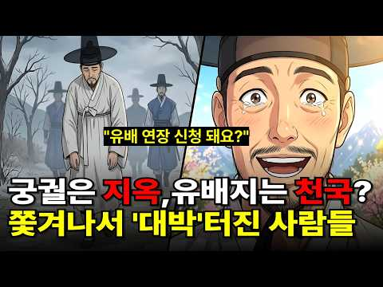
- 설명 앞부분: "전하, 저는 한양 안 갑니다! 여기가 천국인데 제가 왜 가겠습니까?" 조선 시대 최악의 형벌로 알려진 '유배'. 하지만 실록을 뒤져보니 우리가 알던 상식과는 전혀 다른 기막힌 반전이 숨겨져 있었습니다. 어떤 죄인은 유배지에서 전복과 홍어를 하도 먹어서 임금보다 40년을 더 살았고, 어떤 죄인은 쫓겨난 그곳에서 나라 돈으로 18년 동안 '럭셔리 제주도 살기'를 즐겼습니다. 왕은 좁은 궁궐에서 종기로 고생할 때, 죄인들은 90세까지 신선놀음을 했던 진짜 이유! 지옥인 줄 알았더니 인생 '노다지'였던 조선 선비들의 역대급 반전 드라마…
- 같은 채널 평소 대비 ×97.2 (채널 최근 롱폼 중앙값 551회) · 평소 영상: 조선 백성 90%가 신던 짚신, 어쩌다 순식간에 사라졌을까? (551회) / 토사구팽된 류성룡이 피땀 흘려 만든 문서 ∣ 조선은 내다 버리고, 일본은 300년을 탐독… (563회)
- 대본 없음 (설명) — 음성인식이 끝나면 도입부·흐름이 들어감
- 댓글 105/105: 좋은 점 — 영상 0 · 감사·응원 2 · 더 알고 싶은 것 0 · 아쉬운 점 — 영상 1 · 반박·불만 — 의견 다름 1 · 정치·사회 1 · 경험 공유 2 · 구독·다음 기대 0
  - 감사·응원 👍1 “내가 본 유튜브중에서 올해 가장 감명깊은 내용입니다 감사합니다”
  - 감사·응원 👍0 “구독 좋아요 꾸욱 누르고 화이팅입니다 🎉🎉”
  - 아쉬운 점 — 영상 👍0 “그런데 했던 얘기 계속 또하고 너무 길어요”
  - 반박·불만 — 의견 다름 👍0 “말도 안되는 소리하네. 귀향은 죄인이 순전히 걸어서 갔다던데. 가는동안 죽을수도 있다던데. 먹을거리도 자신이 구해서 가고 귀향지에서 편할까봐 별짓을 다했다던데.”
  - 정치·사회 👍27 “고산윤선도 두번에 유배를 받았는데 성균관 유생시절 광해군 이이첨탄핵상소냈다가 함경도 7년보내고 예송논쟁 서인 송시열 남인의전면에 서면서 함경도 삼수로 다시 유배 그에나이 74세였다 그이후 광양으로 옮겨졌고 81세에 석방 보길도로 유배지가 아니라 개인소유 은거지였다 8…”
  - 경험 공유 👍27 “고산윤선도 두번에 유배를 받았는데 성균관 유생시절 광해군 이이첨탄핵상소냈다가 함경도 7년보내고 예송논쟁 서인 송시열 남인의전면에 서면서 함경도 삼수로 다시 유배 그에나이 74세였다 그이후 광양으로 옮겨졌고 81세에 석방 보길도로 유배지가 아니라 개인소유 은거지였다 8…”
  - 경험 공유 👍1 “내가 본 유튜브중에서 올해 가장 감명깊은 내용입니다 감사합니다”

### 245. 조선 최고령 사형수 ∣ 88세 영의정은 왜 목이 잘렸나

- https://www.youtube.com/watch?v=FSUt5VNvoj4 · 진짜역사한잔 · 구독자 11,400 · 조회수 375,906 (×33.0, 하루 5,625.5) · 좋아요 2,390 (0.6%) · 101.6분 · 2026-08-17 · 주제 묶음 3. 조선 · 형식 정보·해설 (그 밖) · 폴더 `W_FSUt5VNvoj4` (웹 승인)
- 썸네일: 
- 챕터: 0:00 프롤로그 · 여든여덟 살의 사형수 · 2:46 합천의 소년, 남명 조식을 만나다 · 7:06 동인과 북인 · 타협을 모르는 사헌부 · 11:18 임진왜란 · 쉰일곱에 의병을 일으키다 · 15:14 의병은 무엇으로 싸웠는가 · 17:02 전쟁이 끝나고 · 세자 자리를 둘러싼 균열 · 20:50 1608년 정월의 상소 · 한 달 만의 반전 · 24:31 광해군의 시대와 산림정승 · 27:57 천 리 밖에서 조정을 움직인다는 것 · 29:39 회퇴변척소 · 조선 전체를 적으로 만들다 · 33:14 계축옥사와 전은론 논쟁 · 36:10 폐모 논쟁 · 기록이 엇갈리는 지점 · 39:27 정치를 떠난 정인홍이라는 사람 · 41:03 1623년 3월 12일 밤, 반정 · 43:50 압송과 국문 · 왜 나이를 참작하지 않았나 · 46:36 4월 3일 · 복주하였다 · 49:08 설화가 된 사람 · 그리고 제자 정온 · 51:58 200년의 금기 · 실패한 복권 시도 · 54:33 1908년의 신원과 내암집 · 57:05 그를 무너뜨린 것은 미덕의 과잉이었다
- 설명 앞부분: 1623년 4월 3일, 한양의 형장에 여든여덟 살의 노인이 세워졌습니다. 그는 조선의 영의정을 지낸 사람이었고, 30년 전 임진왜란 때는 직접 의병을 일으켜 낙동강을 지킨 의병장이었습니다. 그런 그가 인조반정 직후 역적으로 몰려 참형을 당했습니다. 조선왕조실록 인조실록은 그날의 일을 단 한 줄로 기록합니다. 정인홍을 복주하였다. 그 한 줄 뒤에 88년의 삶이 있었습니다. 남명 조식의 수제자, 임진왜란의 의병장, 광해군 시대의 영의정, 인조반정의 역적, 그리고 285년 뒤에 신원된 사람. 이 다섯 개의 이름표는 모두 한 사람의 것이…
- 같은 채널 평소 대비 ×23.7 (채널 최근 롱폼 중앙값 15,849회) · 평소 영상: [4시간연속재생] 교과서에 없는 조선시대 평민생활 세번째 이야기 (16,991회) / 매년 10명씩 죽였다 조선왕조실록이 직접 기록한 왕자 순화군의 실체 (14,707회)
- 대본 없음 (설명) — 음성인식이 끝나면 도입부·흐름이 들어감
- 댓글 160/165: 좋은 점 — 영상 3 · 감사·응원 5 · 더 알고 싶은 것 0 · 아쉬운 점 — 영상 3 · 반박·불만 — 의견 다름 2 · 정치·사회 8 · 경험 공유 4 · 구독·다음 기대 0
  - 좋은 점 — 영상 👍12 “이런 역사...알려 주셔서 정말정말 감사드립니다... 정인홍영상님... 어쩌다 이런 험악한 꼴을.., 나라와 삶을 생각하면 마음아프고 눈물흐르는 일이 너무 많은...”
  - 좋은 점 — 영상 👍2 “1시간41분. 모르고 들어왔네요. 이렇게 긴건 바빠 못봐요. 수입에 도움되나요.. 싫어요”
  - 감사·응원 👍16 “조선시대에 안태어 난것이 참다행이고 대한민국에서 태어난것 이 부모님께 감사합니다”
  - 감사·응원 👍12 “이런 역사...알려 주셔서 정말정말 감사드립니다... 정인홍영상님... 어쩌다 이런 험악한 꼴을.., 나라와 삶을 생각하면 마음아프고 눈물흐르는 일이 너무 많은...”
  - 아쉬운 점 — 영상 👍2 “중간 광고가 없어서 무한 틀어놓구 잡니다 감사합니다^^ 불면증에 역사두 배우고”
  - 아쉬운 점 — 영상 👍0 “광고가 너무자주 나와 듣지 못해 철수”
  - 반박·불만 — 의견 다름 👍0 “의병장과 정치인 으로써 손자들과 목숨바쳐 나라를 지킨 대장공 으로써 공은 어딜가고 사형을 판결 하는지 대장공 으로써 사리싸욕 한것도 아닌데 육신을 뺏는다는 것은 개인감정 아니고선 생각해 볼일이 아닌가 생각케 한다 88세 사형이면 110세인들 사형하지 않갠는가 그때나 …”
  - 반박·불만 — 의견 다름 👍0 “참 이런 소리하는게 한심한건대... 엘리자베스가 칼레에서 무적함대 박살낸게 15??년도이고 뉴턴이 미적분 개발하고 운동법칙증명한게 16??년이고 청교도 혁명으로 크롬월이 찰스왕 죽이고 공화정 세운게 1648년이고 영국인이 미국에 집단으로 정착한게 1620년 경이고 일…”
  - 정치·사회 👍37 “광해군을잃은조선은빨리망해야되었고 정인홍체제를처단했다는 정권은이적단체에불과했다고봅니다 비극입니다”
  - 정치·사회 👍3 “특검 정부가 인조 반정은 특검 안 합니까?”
  - 경험 공유 👍39 “조선은 임진왜란 이후 망했어야 했었다.”
  - 경험 공유 👍0 “저도 조선의 임금들 가운데 선조와 인조, 고종은 여러 면에서 아쉬움이 큰 왕들이라고 생각합니다. 특히 나라가 어려운 시기에 보여준 판단과 대응을 보면 답답하게 느껴지는 부분이 많네요. 역사 속 인물들을 다시 돌아보게 만드는 이야기였습니다.”

### 246. 세종대왕이 너무도 사랑한 하루도 빠짐없이 매일밤 찾아갈 수밖에 없었던 여인 신빈 김씨

- https://www.youtube.com/watch?v=MiSjJNMeiGo · 역사만담 · 구독자 5,100 · 조회수 166,667 (×32.7, 하루 1,559.5) · 좋아요 2,855 (1.7%) · 24.9분 · 2026-07-08 · 주제 묶음 3. 조선 · 형식 정보·해설 (그 밖) · 폴더 `W_MiSjJNMeiGo` (웹 승인)
- 썸네일: 
- 챕터: 0:00 오프닝: 관청 노비 문서에 적힌 소녀, 정1품 '신빈… · 4:12 궁궐 입성과 소헌왕후와의 운명적인 만남 · 7:55 세종의 눈에 든 성실함, 지밀나인에서 후궁으로의 비상 · 10:28 소헌왕후의 굳건한 신뢰: "내 아이들을 부탁하네" · 14:45 가장 화려한 자리에서 가장 낮은 곳으로, 자수궁의 1… · 19:36 계유정난의 피바람 속에서도 가문을 지켜낸 부드러움의 힘 · 22:59 에필로그: 권력보다 빛난 조용한 성실함, 신빈 김씨의…
- 설명 앞부분: 조선 오백 년 역사상 유일무이한 기록! 관청 노비 문서에 이름이 올랐던 열세 살 소녀가 왕비 다음가는 정1품 '빈(嬪)'의 자리까지 오른 놀라운 이야기를 아시나요? 왕비 소헌왕후가 숨을 거두며 자신의 친자식들을 부탁했던 단 한 사람. 계유정난의 피바람 속에서도 화를 면하고 굳건히 살아남았던 세종의 후궁, '신빈 김씨'의 입지전적인 삶을 추적합니다. 화려한 권력 암투보다 더 강했던 '조용한 성실함'의 이면 속으로 함께 들어가 보시죠. 📜 [영상 타임라인] 💡 [핵심 역사 교육 포인트] 1. 신분제 사회 조선의 파격: 엄격한 신분제 …
- 같은 채널 평소 대비 ×534.2 (채널 최근 롱폼 중앙값 312회) · 평소 영상: 왕도 견딜수 없었던 이와 벼룩, 빈대와 동거, 치약도 비누도 없던 조선시대, 신분별 위생… (322회) / 고려 17만이 포기한 여진족 철옹성 하루만에 뚫어버린 한반도 소드마스터 척준경 (302회)
- 대본 없음 (설명) — 음성인식이 끝나면 도입부·흐름이 들어감
- 댓글 123/123: 좋은 점 — 영상 2 · 감사·응원 5 · 더 알고 싶은 것 1 · 아쉬운 점 — 영상 0 · 반박·불만 — 의견 다름 0 · 정치·사회 2 · 경험 공유 2 · 구독·다음 기대 1
  - 좋은 점 — 영상 👍8 “신빈에 대해 몰랐는데 자세히 알려 주셔서 알게되었습니다 감사합니다 구독할게요”
  - 좋은 점 — 영상 👍6 “좋은내용 고맙습니다 BGM 넣지않는게...”
  - 감사·응원 👍8 “신빈에 대해 몰랐는데 자세히 알려 주셔서 알게되었습니다 감사합니다 구독할게요”
  - 감사·응원 👍7 “역사 공부 잘하고 있습니다 . 감사합니다”
  - 더 알고 싶은 것 👍5 “너무 잘만들어주시니 감사합니다~앞으로도 귀한영상 부탁드려요~~”
  - 경험 공유 👍7 “내가 조선시대 왕이었다면 후궁을 몇명이나 두었을까”
  - 경험 공유 👍2 “예전 드라마 했었는데 한효주가 여주 하고 기억이 가물가물 하네요”
  - 구독·다음 기대 👍8 “신빈에 대해 몰랐는데 자세히 알려 주셔서 알게되었습니다 감사합니다 구독할게요”

### 247. 미국 인터넷과 댓글을 뜨겁게 달군 이순신 장군 열풍, 한국 영웅에 흥분하는 진짜 이유

- https://www.youtube.com/watch?v=pQ-R6g1dNIg · 1프로경제학 · 구독자 1,240 · 조회수 40,178 (×32.4, 하루 1,425.5) · 좋아요 1,287 (3.2%) · 33.8분 · 2026-09-25 · 주제 묶음 3. 조선 · 형식 애니메이션·지도 · 폴더 `W_pQ-R6g1dNIg` (웹 승인)
- 썸네일: 
- 챕터: 0:00 미국 인터넷에서 벌어진 이상한 일 · 1:28 16년째 이순신만 그리는 미국인 · 3:37 조회수 1,600만 회, 미국 채널의 다섯 편 · 5:49 명량이 미국 극장에서 슈퍼히어로를 이긴 날 · 7:43 첫 번째, 23전 23승이라는 기록 · 11:35 두 번째, 나라에 버림받은 장군 · 13:33 열세 척 대 백서른세 척 · 16:02 세 번째, 영국과 일본 제독의 증언 · 18:13 니미츠가 읽은 1592년의 승전보 · 20:22 나의 죽음을 알리지 마라 · 23:05 이순신의 바다에 찾아온 미국 해군 · 26:31 워싱턴에 걸린 간판 · 28:28 우리 자식과 손주에게 남는 것 · 31:03 정리와 5070 행동 지침
- 설명 앞부분: 미국 역사 채널이 올린 팔 분짜리 이순신 영상, 조회수 450만 회. 시카고의 한 미국인 만화가는 16년째 이순신만 그리고 있습니다. 슈퍼맨의 나라 사람들이 왜 조선의 장군에게 빠져든 걸까요. 오늘 다루는 것은 세 가지입니다. 첫째, 미국 사람들이 처음 보고 눈을 의심한 기록. 둘째, 모든 걸 빼앗긴 사람이 걸어간 길. 셋째, 적과 세계가 남긴 증언. 미국 해군 사령관이 전쟁 한복판에서 꺼낸 이름이 있습니다. 그리고 그 이야기 끝에, 지금 이순신의 바다에서 벌어지고 있는 일이 있습니다. 썸네일 이미지는 인공지능으로 제작했습니다.
- 같은 채널 평소 대비 ×17.2 (채널 최근 롱폼 중앙값 2,342회) · 평소 영상: 석유 한 방울 안 나는 나라에 1억 톤 묻혀 있던 하얀 흙, 미국 학회가 귀를 기울인 진… (2,342회) / 미국 인터넷과 댓글을 뜨겁게 달군 한국 화장품 열풍, 샤넬의 나라 프랑스를 제치고 미국인… (2,542회)
- 대본 없음 (설명) — 음성인식이 끝나면 도입부·흐름이 들어감
- 댓글 70/70: 좋은 점 — 영상 2 · 감사·응원 10 · 더 알고 싶은 것 1 · 아쉬운 점 — 영상 0 · 반박·불만 — 의견 다름 1 · 정치·사회 4 · 경험 공유 2 · 구독·다음 기대 1
  - 좋은 점 — 영상 👍3 “이순신 장군님 감사합니다.😌💕 더 좋은 이야기 올려주세요. 수고하셨습니다. 😊”
  - 좋은 점 — 영상 👍0 “좋은영상 잘봤어요😊”
  - 감사·응원 👍23 “감사합니다 우리 조상님 ㅜㅜ”
  - 감사·응원 👍13 “너무나 자랑스러운 우리 선조. 감사 합니다.”
  - 더 알고 싶은 것 👍3 “이순신 장군님 감사합니다.😌💕 더 좋은 이야기 올려주세요. 수고하셨습니다. 😊”
  - 반박·불만 — 의견 다름 👍11 “동아시아 역사가 그것도 미국 유럽 시각으로 보면 중국 일본 위주의 역사라해도 과언이 아닌데 임진란 당시 적국이었던 일본 장수 와키자카도 발틱함대를 작살낸 도고 헤이하치로도 이순신을 추앙했으니(이 부분은 논란이 있음)이 증언과 기록이 있으니 미국 유럽 사학자들이 알아본…”
  - 정치·사회 👍2 “이순신과이재명차이말돌리기대북송금”
  - 정치·사회 👍1 “국뽕도 도를 넘으면 부메랑으로 돌아온다. 너무 포장하면 판타지라고 반발하는 외국인도 늘어난다.”
  - 경험 공유 👍4 “우리집 울돌목 아닙니까 해남 현산 인입니다”
  - 경험 공유 👍1 “K-팝, K- 드라마, K-푸드, K-무비, K-가곡, K-방산.... 이렇게 나가더니, 이제는 K-히스토리 까지... 김구선생님의 글이 생각납니다. "나는 우리나라가 세계에서 가장 아름다운 나라가 되기를 원한다. 가장 부강한 나라가 되기를 원하지 않는다." "오직 …”
  - 구독·다음 기대 👍0 “자막글 이 너무 오자가 많습니다. a l 로 발음을직역하여 옮겨서 그렇게된건 이해하지만...많은분들이 뜻을 헷갈려하고있읍니다.단어들이 정확하게 되어야합니다. 기대합니다.”

### 248. 3일마다 버리는 신발을 왜 500년이나 신었을까? 알고 보니 이유가 있었습니다

- https://www.youtube.com/watch?v=Kp25Hlg6e0M · 역사트리 · 구독자 10,100 · 조회수 326,082 (×32.3, 하루 3,741.8) · 좋아요 5,035 (1.5%) · 20.9분 · 2026-07-28 · 주제 묶음 기타 · 형식 정보·해설 (그 밖) · 폴더 `W_Kp25Hlg6e0M` (웹 승인)
- 썸네일: 
- 설명 앞부분: 일본은 게다, 중국은 가죽신… 그런데 조선만 500년간 짚신을 고집했다? 🤔 알고 보니 조선에는 한 켤레에 40만 원짜리 명품 신발도 있었습니다. 그런데 왜 우리 기억 속엔 짚신만 남았을까요? 일본 짚신의 원조가 사실 한반도였다는 충격적인 사실까지… 👣 이 영상을 끝까지 보시면, 다시는 짚신을 "가난한 신발"이라고 말 못 하실 겁니다. 이 포스팅은 쿠팡 파트너스 활동의 일환으로, 이에 따른 일정액의 수수료를 제공받습니다.
- 같은 채널 평소 대비 ×127.5 (채널 최근 롱폼 중앙값 2,558회) · 평소 영상: 왕도 눈치 본 궁녀, 첫 번째 교육이 숨 참는 법이었습니다 (2,573회) / 형제 죽인 조선 왕 5명의 후손에게 벌어진 일, 태종, 세조, 영조까지 ∣ 조선역사 오디… (2,544회)
- 대본 없음 (설명) — 음성인식이 끝나면 도입부·흐름이 들어감
- 댓글 478/502: 좋은 점 — 영상 7 · 감사·응원 7 · 더 알고 싶은 것 4 · 아쉬운 점 — 영상 6 · 반박·불만 — 의견 다름 9 · 정치·사회 1 · 경험 공유 17 · 구독·다음 기대 0
  - 좋은 점 — 영상 👍5 “어릴때 새끼꼬는법을 배웠는데 아직도 생각나요 생각보다 쉬웠어요 유년기때 배웠는데 ...”
  - 좋은 점 — 영상 👍2 “2번입니다. 좋은 이야기 잘 듣었습니다. 감사드림니다.”
  - 감사·응원 👍87 “저 짚신신고 평시에는 가족의 생계를 위해 농사를 짓고 전시에는 민족과 나라를 지킨 백성들 조상님들께 감사합니다.”
  - 감사·응원 👍5 “감사합니다 새로운 지식이네요”
  - 더 알고 싶은 것 👍6 “북방을 지키는 군인들은 어떻게 했는지 궁금하네요. 짚신이면 전투에 지장이 있었을 텐데.”
  - 더 알고 싶은 것 👍5 “영상 초반부에 대략 사흘씩 썻다하고 후반부엔 1인당 년간 십여켤레 썻다하고 어떤게 맞을까요 ? 정보와 설명에 좀더 신경 써주길 바람니다.”
  - 아쉬운 점 — 영상 👍1 “말을 하도 빙빙 돌리는 데다가 광고가 엄청 끼어 있어 끝까지 못보고 그냥 갑니다. 수고.”
  - 아쉬운 점 — 영상 👍0 “영상 내용의 기본 설정부터 잘못된 정보입니다. 이런 AI영상이 오해와 오인을 불러 일으킵니다. 책임감 있는 검증된 정보와 영상을 만들기 바랍니다.”
  - 반박·불만 — 의견 다름 👍59 “짚신만 신은 것은 아닌데 .....”
  - 반박·불만 — 의견 다름 👍24 “AI화면을 좀 더 꼼꼼히 확인하셔요 짚신의 모양이 틀렸습니다”
  - 정치·사회 👍0 “영상 끝까지 다 봐도 ㅈㄴ구리네. 개 쓰레기같은 유교가 나라를 퇴보시켰다. 발전 못하고 허울만 쫒는 조선. 근데 한국은 지금도 마찬가지다. 발전 좀 했다고 유전자에 세겨진 근성이 올라옴. 허울만 쫒지. 도덕적으로 우월해 보이려고 되도 않는 소리 하는 것들이 대통령이나…”
  - 경험 공유 👍16 “지지리 가난해서 짚신을 신은 것은 그들이 알고 내가 알고 니가 아는데.. 아홉 개 단점을 두고 한 개의 장점을 두고.. 참~~나~~ 기적의 논리다.”
  - 경험 공유 👍3 “옛날에 양반이 잘 살았다? 못사는 양반이 더 많지 않았을까. 가난을 견디지 못해서 족보를 파는 양반도 있었다던데. 옛날에 양반은 잘 사는 사람이 아니라, 문.무반에 등용됐던 사람을 말하는데, 그마저도 몇 대 자손 중에 과거 급제를 못했을 경우에는 양반 소리도 못듣고,…”

### 249. 세계 고고학계가 은폐하려던 미스터리 ㅣ 전세계 고인돌 40%가 왜 한국에 서 있나 ㅣ 한국사

- https://www.youtube.com/watch?v=2vAcvC3aPNE · 대한역사 · 구독자 4,770 · 조회수 151,776 (×31.8, 하루 1,184.4) · 좋아요 3,088 (2.0%) · 23.3분 · 2026-06-17 · 주제 묶음 4. 한국 근현대사 · 형식 정보·해설 (그 밖) · 폴더 `W_2vAcvC3aPNE` (웹 승인)
- 썸네일: 
- 설명 앞부분: 우리가 속았던 4대 문명의 진실, 세계 고고학계가 끝내 풀지 못한 미스터리. 전세계 고인돌의 무려 40$, 4만기가 왜 유독 한반도라는 작은땅에 집중되어 세워졌을까요? 3000년 전 청동기 시절, 280톤짜리 거대 돌덩이를 맨손으로 움직엿던 청동기 한반도인들의 충격적인 기술력과 사회구조. 그리고 우리가 역사 교과서에서 한번도 의심해본적 없던 4대 문명이라는 틀뒤에 숨겨진 정치적 조작과 왜곡의 실체를 낱낱이 파헤칩니다. 요령에서부터 한반도 남단까지 정확히 일치하는 비파형 동검, 미송리식 토기, 그리고 고인돌 레이어. 이 거대한 체계…
- 대본 없음 (설명) — 음성인식이 끝나면 도입부·흐름이 들어감
- 댓글 270/270: 좋은 점 — 영상 4 · 감사·응원 3 · 더 알고 싶은 것 0 · 아쉬운 점 — 영상 2 · 반박·불만 — 의견 다름 5 · 정치·사회 6 · 경험 공유 9 · 구독·다음 기대 0
  - 좋은 점 — 영상 👍34 “70년대 국사를 배울 때는 세계의 고인돌 중 70%가 한반도에 있다고 배웠다. 그런데 요즘은 40%라고 해서 세계 다른 곳에서 계속 발굴되고있나? 의문이 들었다.”
  - 좋은 점 — 영상 👍8 “너무 좋은 내용입니다. 고인돌과 관련유적을 더 연구하여 5대 문명 중 하나임을 밝혀야 할것 같습니다.”
  - 감사·응원 👍5 “알려주셔서 감사합니다”
  - 감사·응원 👍1 “우리의 문명을 다시 쓰자! 대한 문명? 고조선 문명, 새로운 문명을 만들어 주어 감사합니다. 이것이 자긍심이다. 내 마음에 다시 한 켜의 자부심이 쌓였습니다. 기회되면 화순으로 고인돌 여행가자!”
  - 아쉬운 점 — 영상 👍0 “없다 아쉽네요”
  - 아쉬운 점 — 영상 👍0 “내용이 너무 길어요,,,,,15분 내외가 좋아요”
  - 반박·불만 — 의견 다름 👍10 “서구 역사와 문명사는 전체가 다 거짓으로 그야말로 망상이 더해진 창작소설 입니다. 고사리는 5억년전 고생대 중생대 화석에 새겨진 식물입니다. 그걸 한민족이 먹고 살았다고요. 고인돌이 청동기 시대 유적이라는 데 고인돌은 그보다 까마득히 오래된 선사시대의 영역표시입니다.…”
  - 반박·불만 — 의견 다름 👍3 “고인돌은 무덤이 아닙니다. 하늘에 제사 지내던 제단입니다. 고인돌 주변에서 인골이 발견되었다고 해서 무덤으로 잘못 알고 있는 것입니다. 구약성경에서와 같이 내 죄를 대신해서 고인돌 위에 동물(양 등)을 잡아 올려놓고 불태우는 것입니다.”
  - 정치·사회 👍3 “3000년전이 아닙니다. 몇천년 더 오래됐죠. 아니 몇만년일지도...한국역사학계는 우리역사를 축소시켰습니다. 비파형동검은 요하문명족=고조선족의 유물이고 중국 산동및 화북지방에서도 발견됩니다. 고조선의 영역을 말해주죠. 우리 역사학계는 매국노로 가득합니다. 자국 역사를…”
  - 정치·사회 👍1 “4대 문명이란 하계용어 없다 중국인 양계초의 컴플렉스 표현!”
  - 경험 공유 👍10 “진짜 고인돌이 많았었다. 밭 하나가 전부 고인돌이였음. 어릴적 고인돌에 올라 가서 잡기놀이 했었다. 지금 가 보니 모두 정비하고 사라짐. 1만년 전부터 우리서해와 중국쪽으로 연결된 거대 문명 (고조선?)이 있었고, 갑자기 해수면 상승으로 별이된 흔적이 고인돌로 추측.”
  - 경험 공유 👍0 “육십년대엔가까운낮은산엔작은고인돌들이많았었다근데육십년대후반엔그게다없어졌다고인돌뿐아니라그게뭔지모르겠는데미니왕릉묘가크지않은데밑엔이끼가잔뜩낀돌테두리가있고앞엔신하들석상들이작은데양쪽으로쭉여러개가있는왕능으로보이는묘들과뭔지모를비석한문으로잔뜩써있는데굉장히오래되보이는크고중간작은비석들이…”

### 250. [숨겨진 중국사] 유방이 두려워한 건 번쾌의 배신이 아니라 충성이었다 ∣ 임종 직전 내려진 참수 명령의 진짜 이유 ∣ 역사인물 ∣ 야사 ∣ 비사

- https://www.youtube.com/watch?v=lZkbngqXdeg · 숨겨진중국사 · 구독자 12,500 · 조회수 391,977 (×31.4, 하루 8,308.9) · 좋아요 882 (0.2%) · 27.9분 · 2026-09-06 · 주제 묶음 6. 동양사 (중국·일본·몽골) · 형식 정보·해설 (그 밖) · 폴더 `W_lZkbngqXdeg` (웹 승인)
- 썸네일: 
- 설명 앞부분: 저희는 숨겨진 역사를 재미있고 정확한 한 편의 이야기로 풀어내고자 영상을 만들고 있습니다. "매주 화,목,일 오후 12시에 새로운 이야기가 업로드 됩니다 ❤" 🎬 더 많은 영상 보기 👇
- 같은 채널 평소 대비 ×35.3 (채널 최근 롱폼 중앙값 11,090회) · 평소 영상: [숨겨진 중국사] 현재 중국 땅을 원래 주인들에게 다 반환하면 어떻게 될까? ∣ 역사인물… (12,319회) / [숨겨진 중국사] 청나라가 없었다면 지금의 중국도 없었다.. 소수민족한테 다 주면 남는 … (12,463회)
- 대본 없음 (설명) — 음성인식이 끝나면 도입부·흐름이 들어감
- 댓글 58/75: 좋은 점 — 영상 0 · 감사·응원 2 · 더 알고 싶은 것 0 · 아쉬운 점 — 영상 0 · 반박·불만 — 의견 다름 1 · 정치·사회 4 · 경험 공유 1 · 구독·다음 기대 0
  - 감사·응원 👍8 “수를 헤아리지못할만큼 지혜로운 고견을 듣는 시간이었습니다 평생 가슴에 남아있겠네요 감사드리고 건강하세요”
  - 반박·불만 — 의견 다름 👍10 “유방 자체가 개인 능력치로 통일한 놈이 아닌데다....부인한테 쥐어 잡혀 살아서 에혀....ㅋㅋ”
  - 정치·사회 👍17 “이재명 생각나냐”
  - 정치·사회 👍6 “현재로 대입하면 유방 = 이재명 여치 = 김민석 장량 = 유시민 한신 = 김어준 주발 = 이동형 팽월 = 조국 번쾌 = 정청래”
  - 경험 공유 👍34 “번쾌는 나름 시류를 잘 읽는 지혜로운 인물이고 너무도 충직한 사람이었다. 다만 부인이 여후의 친동생인게 탈이었지. 유방이 죽으면서 간신히 목숨을 건지고서 번쾌의 여생내내 번쾌는 어떤 삶을 살았을까? 많이 허무했을 것이다. 그가 여씨의 몰락과 후손의 화를 안보고 죽은게…”

### 251. 황성옛터 (1928) — 일제강점기 금지곡 ∣ Rachel Kim ∣ 트로트 커버

- https://www.youtube.com/watch?v=a-4VLGM6YMk · 추억의 그루브 (The Nostalgia Groove) · 구독자 338 · 조회수 10,588 (×31.3, 하루 66.2) · 좋아요 119 (1.1%) · 4.2분 · 2026-05-16 · 주제 묶음 4. 한국 근현대사 · 형식 정보·해설 (그 밖) · 폴더 `W_a-4VLGM6YMk` (웹 승인)
- 썸네일: 
- 설명 앞부분: 이 노래를 처음 들었을 때, 왜 이렇게 마음이 아플까 궁금하셨나요? 그 이유가 있습니다. 1928년, 작곡가 전수린은 개성에 있는 고려 왕조의 옛 궁터 만월대를 바라보며 이 멜로디를 즉흥적으로 만들었습니다. 작사가 왕평이 가사를 붙였고, 가수 이애리수가 무대에서 처음 불렀습니다. 노래가 울려 퍼지자 객석은 눈물바다가 되었습니다. 왜였을까요? 가사 속 "황성 옛터"는 단순한 폐허가 아니었습니다. 일제강점기를 살아가던 조선인들에게 그것은 빼앗긴 나라 그 자체였습니다. "끝없는 꿈의 거리를 헤매어 있노라"는 단순한 방황이 아니라, 나라…
- 같은 채널 평소 대비 ×91.3 (채널 최근 롱폼 중앙값 116회) · 평소 영상: 미안해, 너무 미안해 ∣ 전하지 못한 진심과 후회의 기록 (감성 & 서사 강조) (118회) / 1970년대 감성으로 재탄생한 Two Steps From Hell 'Victory' ∣ … (114회)
- 대본 없음 (설명) — 음성인식이 끝나면 도입부·흐름이 들어감
- 댓글 15/15: 좋은 점 — 영상 0 · 감사·응원 0 · 더 알고 싶은 것 1 · 아쉬운 점 — 영상 0 · 반박·불만 — 의견 다름 1 · 정치·사회 0 · 경험 공유 0 · 구독·다음 기대 0
  - 더 알고 싶은 것 👍1 “아씨부탁합니다”
  - 반박·불만 — 의견 다름 👍0 “이거 모야?...자작곡이네?...원곡이 아닌데?..”

### 252. 이무기가 왕이 된 조선 ∣ ‘찬룡’ 1~6화 완전판 몰아보기

- https://www.youtube.com/watch?v=kq8suKRpa7s · 투모로우 TO:MORROW · 구독자 12,900 · 조회수 401,296 (×31.1, 하루 11,179.8) · 좋아요 3,673 (0.9%) · 52.1분 · 2026-09-17 · 주제 묶음 3. 조선 · 형식 몰아보기·통합본 (긴 영상) · 폴더 `W_kq8suKRpa7s` (웹 승인)
- 썸네일: 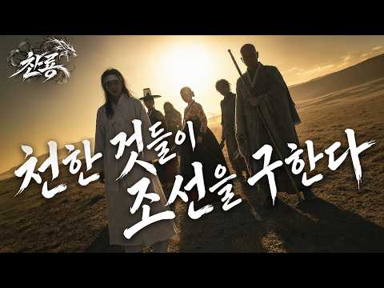
- 설명 앞부분: 안녕하세요, TO:MORROW입니다. 지금까지 〈찬룡〉을 한 편 한 편 기다려주신 분들, 그리고 이번 영상을 통해 처음 〈찬룡〉을 찾아와주신 분들 모두 진심으로 반갑고 감사합니다. 이번 영상은 지금까지 공개된 〈찬룡〉 1~6화의 이야기를 약 50분 분량으로 다시 구성한 완전판입니다. 기존 에피소드를 단순히 이어 붙이는 것에 그치지 않고, 해상도와 화면 비율을 다시 다듬고 기존 회차에서 공개되지 않았던 신규·미공개 장면들도 추가했습니다. 이미 〈찬룡〉을 보셨던 분들에게는 조금 더 완성된 하나의 이야기로, 처음 찾아오신 분들에게는 〈…
- 같은 채널 평소 대비 ×3.6 (채널 최근 롱폼 중앙값 110,429회) · 평소 영상: 이무기가 왕이 된 조선 - 귀신 잡는 전설의 탈 ∣ 찬룡 EP.6 (120,774회) / 이무기가 왕이 된 조선 - 선녀와 나무꾼 ∣ 찬룡 EP.9 (100,084회)
- 대본 없음 (설명) — 음성인식이 끝나면 도입부·흐름이 들어감
- 댓글 318/358: 좋은 점 — 영상 2 · 감사·응원 10 · 더 알고 싶은 것 1 · 아쉬운 점 — 영상 1 · 반박·불만 — 의견 다름 1 · 정치·사회 1 · 경험 공유 4 · 구독·다음 기대 8
  - 좋은 점 — 영상 👍1 “최고의 영상미 중국거는 비교도 안됨”
  - 좋은 점 — 영상 👍1 “요즘 뭐이리 퀄좋은 영상만드는사람들이 많냐…”
  - 감사·응원 👍3 “AI영화 만드는데 제작비 많이 든다고 뉴공에서 봤는데 잘 되시기를 바랍니다 살면서 영화 많이 봤지만 퀄리티가 장난 아니네요 화이팅~!!!”
  - 감사·응원 👍2 “잘만들었지만 만화를 보아도 감동이 있는데 스토리가 약함.전체적 스케일이 좋은편이나 너무 광활함.반면 게임설정이 둔함.관계에 따른 스토리 디테일 호랑장면 . 광대춤. 반지 거시기... 장면 연출이 영화 맛집 느낌. 지나간 영화 맛집 패러디 느낌. 디터일은 좋으나 잔인함…”
  - 더 알고 싶은 것 👍1 “커매라 각도와 움직임의 자연스러움이 여느 작품들 보다 나은 듯 합니다. 앞으로 좋은 작품 많이 부탁합니다.”
  - 아쉬운 점 — 영상 👍2 “너무재밌습니다 회차가 갈수록 ai같지않고 실존배우들같습니다 퀄리티가 너무좋아요 몰아보기도 좋으네요 기다리지 않고 한번에 쭉 연달아 볼수 있어서요 다음화들도 재밌게 시청하겠습니다~~”
  - 반박·불만 — 의견 다름 👍6 “"와... 화면 구성과 스토리 모두 일반인의 바이브가 아닙니다. 제대로 공부하고 내공을 쌓은 진짜 프로의 작품 그 자체네요. AI 영화의 격을 높이셨습니다. 최고예요!"”
  - 정치·사회 👍0 “AI 기술이 엄청 발전했군요...이제 AI 영화 드라마가 활성화 되어 국민들 눈을 가리고 나라를 어지럽히는 좌파연예인들 사라지면 좋겠네요...”
  - 경험 공유 👍2 “와우 퀄리티가...쥑이네~내가 좋아하는 사극에다 스토리가 맘에듦.영화나 드라마로 만들어도 될듯....구독 좋아요 냅다 꾹~~”
  - 경험 공유 👍1 “소재도 제가 좋아하는 오컬트, 좀비, 괴물, 사극이네요 !!! AI영화 드라마의 최고가 될 것 같습니다!! 계속 기대하며 볼게요 😊”
  - 구독·다음 기대 👍4 “이런건 제대로 시작부터 완결까지 해줫으면 좋겟습니다 시간 가는줄 모르고 봣네요 ^^ 구독 좋아요 알림설정 하고 갑니다 완전 굿👍”
  - 구독·다음 기대 👍1 “시간가는줄 모르고 봤습니다... 너무 재밌게 봤어요 구독하고 자주 올께요!!!!!”

### 253. 김창룡 — '대통령의 오른팔', 옛 부하의 손에 최후를 맞은 대한민국 특무부대장.

- https://www.youtube.com/watch?v=GX_Hq2wRnBQ · 한국인물열전 TV · 구독자 2,340 · 조회수 71,453 (×30.5, 하루 470.5) · 좋아요 1,449 (2.0%) · 84.9분 · 2026-05-24 · 주제 묶음 4. 한국 근현대사 · 형식 정보·해설 (그 밖) · 폴더 `W_GX_Hq2wRnBQ` (웹 승인)
- 썸네일: 
- 설명 앞부분: 🔥 김창룡 — '대통령의 오른팔': 권력의 정점에서 여섯 발의 총성에 쓰러진 특무부대장 이번 에피소드: 천구백오십육년 겨울 아침, 원효로에서 여섯 발의 총성과 함께 한 시대의 권력자가 쓰러졌다. 관동군 헌병에서 대한민국 특무부대장까지, 그는 어떻게 한 시대의 가장 강력한 권력을 손에 쥐었는가. 충신과 공포 사이, 반공과 친일 사이에 놓인 한 인물의 부상과 몰락을 기록으로 추적한다. 🎯 이 영상에서 다룰 내용: ✓ 노숙자에서 장교로 — 월남 직후의 재기와 정보 세계 입문 ✓ 여순 사건과 숙군 — 박정희를 체포하고 살린 운명적 교차 …
- 같은 채널 평소 대비 ×12.8 (채널 최근 롱폼 중앙값 5,586회) · 평소 영상: 신현준 - 초대 해병사령관. 적의 편지를 받은 조선인 장교, 운명이 바뀌다. 제국의 훈장… (5,809회) / 임부택 — 춘천의 방패. 그 3일이 없었다면, 대한민국은 존재하지 못했다.한국전쟁 최대 … (5,813회)
- 대본 없음 (설명) — 음성인식이 끝나면 도입부·흐름이 들어감
- 댓글 185/185: 좋은 점 — 영상 2 · 감사·응원 4 · 더 알고 싶은 것 0 · 아쉬운 점 — 영상 3 · 반박·불만 — 의견 다름 0 · 정치·사회 37 · 경험 공유 6 · 구독·다음 기대 0
  - 감사·응원 👍0 “온갖고난행군? 알겄따 @@ㅈ@ 내대리 입니다 감사합니다 @@ㅈ@”
  - 감사·응원 👍0 “인간 행동 ᆢ다 자 잘 못이 ᆢ있게 마련 중요한것 오늘 의 대한민국 밑거름 ᆢ누구 행동 이 더 기여 를 했느냐 ? 인간사 =정치 결과 물 승자 의 편 정의 로와도 결과 ᆢ××× 라면 민주주의 ㆍ3.6만불 소득 78세 핏 뎅이 지만 결과가 오늘 날 국방 5대 강국 OE…”
  - 아쉬운 점 — 영상 👍1 “자막이 있었으면 좋겠네요”
  - 아쉬운 점 — 영상 👍0 “잔말이 많아 지루해서 끝까지 못 보겠다.”
  - 정치·사회 👍25 “대한민국이 현재 존재할수있었던 기초를 만든 사람중에는 수많은 이름없는 애국자들이 있었다,상층부에는이승만 대통령이 있다면 하층부에는 "나는공산당이 싷다"고외치며 죽 어간 어린애부터 침투한 개릴라들과 총격전을 하며 죽어간 이름도 알려지지않은 수많은국군장병이 있었기에 현재…”
  - 정치·사회 👍24 “남로당과 좌파들이 나라를 적화통일하려던 그 시대 상황을 제대로 이해해야 합니다. 암살자과 그들의 배후자들은 애국을 하기 위해 그를 살해했나요? 아닙니다. 배후자들을 잘 살펴보면 어느 정도의 해답이 나옵니다.”
  - 경험 공유 👍10 “김구는 해방이후 대한민국에 해로운 인물로 전략했었다”
  - 경험 공유 👍9 “김창룡 이 인간이 안두희를 시켜서 백범 김구 선생의 암살을 지시했었지..... 이승만은 안두희를 대통령 특별 사면권을 사용했고.....”

### 254. 작은 땅에 축복받은 민족, 강대국조차 한반도와 한국를 부러워하는 진짜 이유 총정리(8편 통합본)

- https://www.youtube.com/watch?v=NCOnYDCLHag · 안경 경제학 · 구독자 15,400 · 조회수 466,650 (×30.3, 하루 8,665.3) · 좋아요 8,831 (1.9%) · 231.5분 · 2026-08-30 · 주제 묶음 1. 역사 일반·이야기 · 형식 몰아보기·통합본 (긴 영상) · 폴더 `W_NCOnYDCLHag` (웹 승인)
- 썸네일: 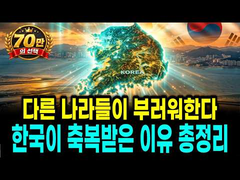
- 챕터: 0:00 오프닝 · 강대국조차 부러워하는 이 작은 땅의 정체 · 1:32 1부 · 아무도 안 살던 땅이 세상에서 가장 독한 민… · 32:03 2부 · 극단의 사계절과 한강, 우리가 몰랐던 땅의 … · 59:23 3부 · 강대국도 돈으로 못 사는 것, 갯벌과 물의 … · 87:48 4부 · 500년을 짓밟히고도 살아남은 한글의 진짜 … · 117:01 5부 · 세계가 포기한 죽은 산을 되살린 유일한 나라 · 145:14 6부 · 지하 1,000m 파독 광부와 간호사가 남긴… · 175:42 7부 · 강대국이 기술 주기를 두려워하는 한국인의 근성 · 203:30 8부 · 인류 최초로 아흔 살을 넘보게 만든 한국의 …
- 설명 앞부분: 개별 영상 및 통합본까지 3시간이 넘는데 70만명 이상 봐주셨습니다! 많은 관심 감사합니다! 자, 세계 지도를 한번 쫙 펼쳐 놓고 보세요. 미국은 다 보려면 비행기로 일주일, 러시아는 겨울이면 국토 절반이 얼어붙고, 중국은 3분의1이 사막입니다. 다들 뭐 하나씩은 크게 아쉬운데, 이 손톱만 한 땅 대한민국만 그게 다 있습니다. 뚜렷한 사계절에, 어느 나라 눈치도 안 보는 물에, 세계가 탐내는 갯벌에, 세종이 만든 글자에, 세계가 배우겠다고 줄 서는 밥상까지요. 도대체 왜 하필 이 좁은 땅에, 그리고 여기 사는 우리가 이렇게 됐을까…
- 같은 채널 평소 대비 ×51.4 (채널 최근 롱폼 중앙값 9,080회) · 평소 영상: 세계가 거절했던 3가지로 한국인들이 일냈다, 세계가 한국에 줄을 서는 이유 (10,063회) / 미국 대통령까지 배우자고 했다" 전 세계가 한국 교육 앞에 줄을 선 진짜 이유 (8,098회)
- 대본 없음 (설명) — 음성인식이 끝나면 도입부·흐름이 들어감
- 댓글 580/621: 좋은 점 — 영상 9 · 감사·응원 228 · 더 알고 싶은 것 3 · 아쉬운 점 — 영상 1 · 반박·불만 — 의견 다름 5 · 정치·사회 39 · 경험 공유 9 · 구독·다음 기대 0
  - 좋은 점 — 영상 👍27 “진짜 문제점과 원인과 결과 분석이 탁월하십니다 해결의 과정도 자세히 잘 설명해주셔서 감사합니다. 공무원이었던 저도 식목일 마다 학생들과 함께 뒷산에 올라서 심고 물주고 심고 물주기를 했던 기억이 납니다. 살겠나? 싶었는뎨 다음해 가고면 더러 살아남은 것을 보았습니다.…”
  - 좋은 점 — 영상 👍10 “좋은영상 감사합니다 그시대를 살아온 자로로 공감하고인정 합나다”
  - 감사·응원 👍49 “나무도 심고 소나무에 기생하던 송충이도 잡아서 없애던 학교시절이 생각난다 녹음이 우거진 산을 보니 감사하다”
  - 감사·응원 👍41 “대한민국 최고입니다 화이팅 🎉🎉🎉”
  - 더 알고 싶은 것 👍4 “참으로 해박한 지식으로 알려주시는내용에감탄스럽다 목소리도 좋고 한마디로쉽게 얘기해서 무척 똑소리나는전하는 내용에 감탄스럽다 누군지 궁금합니다 대한민국 화이팅!”
  - 더 알고 싶은 것 👍3 “좋아요..좋아요 좋은영상 앞으로도 계속 부탁해요”
  - 아쉬운 점 — 영상 👍1 “ㅡ 철공소. 기계음 ?을. 살짝 피햇노 .... 음”
  - 반박·불만 — 의견 다름 👍1 “헛소리 집어쳐라.”
  - 반박·불만 — 의견 다름 👍0 “외국으로.막노동자.일하는시대.사다리.오러내리는.시험에.합격하여야.(건강검진은물론.)외국근로자.나갈수.있었던시절이.생각남니다.ㅠㅠㅠ피눈물.흘리는시절이었죠.부산.대우실업..오억불.수출목표.달성했다고.구내식당에서.쌀밥.배식하던시절1979년일입닉다..지난시절이,,,,,😂😂😂…”
  - 정치·사회 👍23 “천혜의 땅과 지덕의 땅에 부지런한 국민이 땀흘려 일군 나라가 대한민국 입니다.🎉🎉🎉”
  - 정치·사회 👍7 “우리나라가 부강해진 모든것은 박정희대통령님의 깊은 혜안이 있었기 때문에 지금의 경제대국 방산강국이 된것입니다”
  - 경험 공유 👍27 “진짜 문제점과 원인과 결과 분석이 탁월하십니다 해결의 과정도 자세히 잘 설명해주셔서 감사합니다. 공무원이었던 저도 식목일 마다 학생들과 함께 뒷산에 올라서 심고 물주고 심고 물주기를 했던 기억이 납니다. 살겠나? 싶었는뎨 다음해 가고면 더러 살아남은 것을 보았습니다.…”
  - 경험 공유 👍19 “우리조상님들. 고생하시고 부모님들 의 고생 이. 저희가 이어받아. 서 고생하며 살아온 우리들자식이또이어가고 한고생한 댓가가. 지금. 세계가 알아주는 대한민국. 이 되였네요. ㆍ대한민국. 최고. 입니다”

### 255. 《한국사》정도전은 왜 죽어야 했나, 조선을 설계한 천재의 비극적인 최후.

- https://www.youtube.com/watch?v=bVTJY1keq4w · 한국사의 비밀 · 구독자 1,100 · 조회수 33,053 (×30.1, 하루 347.2) · 좋아요 573 (1.7%) · 56분 · 2026-07-20 · 주제 묶음 4. 한국 근현대사 · 형식 수면·낭독 (잠잘 때 듣는) · 폴더 `W_bVTJY1keq4w` (웹 승인)
- 썸네일: 
- 설명 앞부분: 조선을 설계한 천재, 정도전은 왜 반드시 죽어야 했을까요? 새로운 나라 조선을 세우는 데 누구보다 큰 역할을 했던 정도전. 그는 단순한 신하가 아니라 조선왕조의 방향과 제도, 그리고 왕권과 신권의 질서를 구상한 핵심 인물이었습니다. 하지만 조선의 건국 공신이었던 그는 결국 권력의 중심에서 밀려나 비극적인 최후를 맞이하게 됩니다. 이번 영상에서는 한국사 속 가장 극적인 정치 비극 중 하나인 정도전의 죽음을 중심으로, 조선역사에 숨겨진 권력의 충돌과 조선왕실 내부의 긴장을 깊이 있게 살펴봅니다. 정도전은 왜 이방원과 충돌할 수밖에 없…
- 같은 채널 평소 대비 ×52.5 (채널 최근 롱폼 중앙값 629회) · 평소 영상: 《한국사》조선 왕실을 울린 영조의 첫사랑, 28세에 사라진 그녀의 숨겨진 이야기 (698회) / 《한국사》피로 세운 권력의 길, 이방원이 조선왕조의 중심에 선 충격적인 이유 (560회)
- 대본 없음 (설명) — 음성인식이 끝나면 도입부·흐름이 들어감
- 댓글 47/47: 좋은 점 — 영상 0 · 감사·응원 0 · 더 알고 싶은 것 0 · 아쉬운 점 — 영상 0 · 반박·불만 — 의견 다름 0 · 정치·사회 1 · 경험 공유 1 · 구독·다음 기대 0
  - 정치·사회 👍0 “나라가 새로 세워졌는데 당연히 개는 삶아야지! 그 옛날 중국의 한 나라 통일했을 때 생각을 해 봐라. 죽은 놈과 살아난 놈 보면 알잖아. 장량 하나 살았는데 모든 거 버리고 낙향했잖아. 당신은 죽을 수밖에 없고 통치 개념으로 유교를 들고 온 게 잘못됐다.”
  - 경험 공유 👍0 “삼봉에 도전했으니까 한양 사대문 내에는 모두 정도전이 설계 내가 영주에서 삼봉이랑 같이 갈비 뜯었는데”

### 256. 조선시대에 유배를 당한 사람들은 어떻게 살았을까? #역사 #조선시대 #역사이야기

- https://www.youtube.com/watch?v=BL2vtVh5qWg · 담너머 조선 이야기 · 구독자 4,560 · 조회수 136,680 (×30.0, 하루 1,472.2) · 좋아요 883 (0.7%) · 19.1분 · 2026-07-22 · 주제 묶음 1. 역사 일반·이야기 · 형식 정보·해설 (그 밖) · 폴더 `W_BL2vtVh5qWg` (웹 승인)
- 썸네일: 
- 설명 앞부분: 드라마나 영화 속 유배는 한가롭게 글을 읽거나 시를 읊는 낭만적인 모습으로 그려지곤 합니다. 하지만 조선시대 진짜 유배 생활의 실상은 상상을 초월할 정도로 처참하고 혹독했습니다. 왕족이나 고위 관료라 할지라도 유배길에 오르는 순간 죄인 신분으로 전락하여 가시 울타리 속에 갇히는 위리안치나, 먼 섬으로 쫓겨나는 절도안치 같은 가혹한 형벌을 받아야 했습니다. 현지에 도착해서도 삶은 결코 녹록지 않았습니다. 집주인에게 얹혀살며 끼니를 구걸해야 하는 가시밭길이 펼쳐졌고, 낯선 풍토병과 극심한 고독감은 유배자들의 몸과 마음을 끊임없이 갉아…
- 같은 채널 평소 대비 ×15.6 (채널 최근 롱폼 중앙값 8,740회) · 평소 영상: 사극에서는 보여주지 않는 조선시대 백정의 삶 #조선시대 #조선역사 #역사이야기 (8,740회) / 약과와 유과는 꿈도 못 꾸던 조선 백성들은 간식으로 뭘 먹었을까? #조선시대 #조선역사 … (7,274회)
- 대본 없음 (설명) — 음성인식이 끝나면 도입부·흐름이 들어감
- 댓글 71/71: 좋은 점 — 영상 1 · 감사·응원 3 · 더 알고 싶은 것 0 · 아쉬운 점 — 영상 0 · 반박·불만 — 의견 다름 0 · 정치·사회 4 · 경험 공유 0 · 구독·다음 기대 0
  - 좋은 점 — 영상 👍1 “실록담 좋아요 좋은 내용으로 재미있게 역사 공부를 할수 있어 좋아요”
  - 감사·응원 👍2 “112번째 like 👍 감사합니다요 ! 지금시대에 꼭 필요한 것입니다요 ! 항상 건행하십시요 !”
  - 감사·응원 👍1 “재미있게 잘봤습니다, 감사합니다”
  - 정치·사회 👍12 “제발 전과자는 국회의원안되게하자 그게 기본이아니냐?”
  - 정치·사회 👍6 “지금은 민노총 좌파들이 방송국.언론을 장악해서 TV는 사극뿐 아니라 모든 드라마 심지어 뉴스도 다 거짓...”

### 257. 하멜 표류기, 13년간 조선에 체류한 네덜란드인 하멜

- https://www.youtube.com/watch?v=iwQcR8HMeSQ · 역사본능 · 구독자 25,200 · 조회수 752,051 (×29.8, 하루 43,443.0) · 좋아요 3,389 (0.4%) · 24.9분 · 2026-10-06 · 주제 묶음 3. 조선 · 형식 정보·해설 (그 밖) · 폴더 `W_iwQcR8HMeSQ` (웹 승인)
- 썸네일: 
- 설명 앞부분: 이 영상은 하멜이 어쩌다 조선에서 13년을 살게 됐는지, 그 13년을 어떻게 먹고 자고 버텼는지를 따라갑니다. 왕 앞의 장기자랑과 양반 술자리에 불려다니던 구경거리 생활, 청나라 사신 앞에서 옷을 찢고 굶어 죽은 동료, 전라도 강진 병영에서의 7년, 흉년에 남의 집 문을 두드리며 밥을 얻던 나날까지요. 그리고 그 사이 하멜이 조용히 적어 둔 조선의 모습도 함께 봅니다. 네댓 살 아이도 담배를 물던 나라, 세상에 나라가 열두 개뿐이라 믿던 사람들, 낯선 얼굴에게 흰 피부가 부럽다고 말하던 사람들이요. 마지막에는 이 이야기의 진짜 반…
- 같은 채널 평소 대비 ×56.4 (채널 최근 롱폼 중앙값 13,323회) · 평소 영상: 같은 신을 믿는데 서로 왜 죽일까? 수니파와 시아파는 왜 갈라졌을까? (13,323회) / 존 F.케네디 암살 사건의 비밀, 진짜 범인은 따로 있다 (13,216회)
- 대본 없음 (설명) — 음성인식이 끝나면 도입부·흐름이 들어감
- 댓글 236/548: 좋은 점 — 영상 3 · 감사·응원 7 · 더 알고 싶은 것 3 · 아쉬운 점 — 영상 1 · 반박·불만 — 의견 다름 6 · 정치·사회 17 · 경험 공유 6 · 구독·다음 기대 0
  - 좋은 점 — 영상 👍34 “회계사라서 조선입장에서는 쓸모가없다고 판단해서 대우 별로였음. 멍청한 조선이 사실 수학부터 과학까지 번역만하면 좋은 정보를 배울수 있었는데 팽시킴. 얼마나 조선이 싫었으면 내용중에 비하하는글도 많이있음.”
  - 좋은 점 — 영상 👍14 “동네 사람들이 몰랐을리가 없지… 사람 마음을 얻었기에 가능했다. 뭔가 계획을 가지고 노력하니 큰 경을 치르더라도 모르쇠 마을 사람들 모두 그걸 일러받치지 않고 막지 않고 지켜봐준거지. 안정적인 느낌을 받는 쯤이지 않았겠나 놔줄 것이라는 믿음이 있을 때. 일본으로 해류…”
  - 감사·응원 👍17 “와 너무 재밌게 들었어요 감사”
  - 감사·응원 👍10 “잘 보았습니다~ 고맙습니다~”
  - 더 알고 싶은 것 👍4 “결국에 임금은 못받은걸로 알고있고, 최기 제주도나 한양에서 거주햇을땐 나름 좋은대우를받앗으나 유배지인 전라도로가선 그곳 사람들에 대해 안좋게써잇던건 그곳이 유배지인탓이라고 알고잇거든요. 팩트체크부탁드려요”
  - 더 알고 싶은 것 👍0 “하멜은 너무 표현력이 없었던 사람 표류기를 보면 강진 등에서 겪었던 일이나 풍습을 자세히 묘사하지 않고 그냥 궁금해서 답답항 정도다. 초등학교 일기장을 보는 느낌”
  - 아쉬운 점 — 영상 👍0 “틀린 내용이 좀 있는데”
  - 반박·불만 — 의견 다름 👍11 “바로 보내버리면 되는데 뭘 많이 봤다고 놓지 못하나 말도 안되는 소리다”
  - 반박·불만 — 의견 다름 👍8 “훈련도감으로 보낸거 보면 덩치가 있고 힘도 쎄고 그래서 이용해 먹으려고 한 것 전쟁터에도 보내서 2명이 전사 이걸 보면 힌쎈넘 이용한 것 밥만 주면 일을 부려먹을 수 있으니 인력면에서도 대박난거지 저비용 고효율 학교에서 하맬은 이름만 알았지 자세한 내용은 몰랐는데 지…”
  - 정치·사회 👍63 “명,청,일본이 어떤 나라가 표류한 선원을 저렇게 대우하나? 부끄러운 줄 알아야해요.”
  - 정치·사회 👍14 “우리가 세계를 몰랐던것은 위에가 막혀 있었던 탓이다 만약 고구려처럼 열려 있으면 지금우리나라가 이렇게 되지 않았을텐데 어떻하겠나 ~”
  - 경험 공유 👍156 “제가 의외였던건 10년이상 넘게 사실상 감금하고 종신형이라고 할수밖에 없는 대우를 한 조선에 비해 당시 일본은 하멜일행이 도망쳐오자 이들을 단 몇시간에 조사하고 네덜란드 공관으로 이송하고 나중 고국으로 보내는 절차를 아주 체계있고 나름 당시 국제법 매뉴얼에 맞게 처리…”
  - 경험 공유 👍26 “일본처럼 교역을 했었어야지. 너무 무지했어”

### 258. 왕이 지나가면 그 마을이 망하는 이유? 조선시대 임금 행차의 비극

- https://www.youtube.com/watch?v=VHZ90COisw4 · 역사와인생 · 구독자 1,260 · 조회수 37,348 (×29.6, 하루 255.4) · 좋아요 595 (1.6%) · 19.1분 · 2026-05-30 · 주제 묶음 3. 조선 · 형식 정보·해설 (그 밖) · 폴더 `W_VHZ90COisw4` (웹 승인)
- 썸네일: 
- 설명 앞부분: 사극에서 보던 화려한 임금의 행차. 그 행렬이 지나간 마을은 그 후 어떻게 됐을까요? 1670년 충청도의 한 고을이 사라진 진짜 이유, 조선왕조실록 속 '지대(支待)' 제도와 향리들의 착복, 세종·현종·정조·고종까지 임금의 행차가 백성의 부엌에 남긴 흔적을 차분히 정리해드립니다. ✓ 임금 행차 한 번에 2년 치 살림이 사라진 이유 ✓ 6,000명 행렬과 길가 마을의 현실 ✓ 정조 화성 행차와 내탕금의 의미 ✓ 고종 홍릉 행차가 한반도 최초 전차를 만든 사연 교과서 한 줄 뒤에 가려져 있던 조선 백성들의 이야기, 끝까지 함께 봐주세…
- 같은 채널 평소 대비 ×450.0 (채널 최근 롱폼 중앙값 83회) · 평소 영상: 범잡는 특수부대 조선 호랑이 사냥꾼 착호갑사 한국사 (83회) / 오천원 속 인물 조선이 무시한 천재 율곡이이 조선역사ㅣ한국사 (85회)
- 대본 없음 (설명) — 음성인식이 끝나면 도입부·흐름이 들어감
- 댓글 155/155: 좋은 점 — 영상 0 · 감사·응원 2 · 더 알고 싶은 것 1 · 아쉬운 점 — 영상 1 · 반박·불만 — 의견 다름 4 · 정치·사회 15 · 경험 공유 2 · 구독·다음 기대 0
  - 감사·응원 👍0 “감사합니다”
  - 아쉬운 점 — 영상 👍32 “호환, 마마보다 무서운게 저런 행차였군요. 그래서 왕의 행차는 매년 몇회 이내로 제한했음에도 저리도 자주행차를 하고 그에따라 향리들의 수탈이 반복되었군요.”
  - 반박·불만 — 의견 다름 👍4 “저는 솔직히 경제구조의 문제도 없지 않다고 생각합니다. 조선은 농업에만 치우쳤고 공업,상업,어업,축산업,서비스업등을 홀대했고 신분을 두어 차별했으니 당연히 조선의 경제구조는 빈약할 수밖에 없고 국력이 제일 약할수 밖에 없어 만주등 잃어버린땅을 되찾지 못하고 오히려 녹…”
  - 반박·불만 — 의견 다름 👍0 “말은 바로합시다 지방향리들은 따로 녹봉이 없어서 이런식으로 충당해야했습니다 이들이 부패해서가 아닙니다”
  - 정치·사회 👍52 “법은 있지만 지켜지지 않는 나라가 조선. 지금 한국도 비슷함. 정치하는 놈들이 비슷한 놈들임”
  - 정치·사회 👍51 “조선이라는 나라가 문제”
  - 경험 공유 👍0 “1년에 휴가를 몇 번 씩 간 거야! 백성은 인간이 아니었네.... 양반만 인간이었어.... 조선의 임금은 나쁜 임금이 맞다. 국가 예산에 왕의 행차비를 책정하고 지나는 길에 거치는 마을에 하사금까지 준비해야 했었다. 그랬으면 향리, 아전, 사또들이 고을 백성의 등골을…”

### 259. 일본이 억지로 바꿔 놓은 좌측통행, 한국은 차가 7천 대뿐이던 해방 이듬해 통째로 뒤집어 버렸습니다

- https://www.youtube.com/watch?v=r2ziZQKriJI · 경제 이야기꾼 · 구독자 553 · 조회수 16,097 (×29.1, 하루 658.7) · 좋아요 0 (0.0%) · 17.2분 · 2026-09-28 · 주제 묶음 1. 역사 일반·이야기 · 형식 정보·해설 (그 밖) · 폴더 `W_r2ziZQKriJI` (웹 승인)
- 썸네일: 
- 설명 앞부분: 일제강점기 좌측통행을 강요받던 우리나라는 광복 후 어떻게 우측통행으로 바꿨을까요? 7천 대뿐이던 자동차 문화가 지금의 중고차 시장까지 이어진 과정을 살핍니다. 일제강점기 일본의 영향으로 차량이 왼쪽으로 다니던 시절이 있었습니다. 하지만 광복 직후인 1946년, 우리나라는 차량 통행 방식을 오른쪽으로 과감히 뒤집었습니다. 단순히 방향만 바뀐 것이 아니라, 이후 대한민국 자동차 산업이 어떻게 성장하고 체계를 잡아갔는지 그 역사를 확인합니다. 한편, 2025년 1월부터 11월까지 신차의 빈자리를 채우며 급격히 성장한 중고차 시장의 현황…
- 같은 채널 평소 대비 ×8.2 (채널 최근 롱폼 중앙값 1,964회) · 평소 영상: 한집에서 나온 롯데 신격호와 농심 신춘호 두 형제가 갈라선 해, 동생은 라면 회사 이름에… (1,964회) / 북극항로는 중국이 먼저 열었는데, 그 바다 주인 러시아는 얼음 뚫는 배를 한국에 주문했습… (1,979회)
- 대본 없음 (설명) — 음성인식이 끝나면 도입부·흐름이 들어감
- 댓글 43/43: 좋은 점 — 영상 0 · 감사·응원 0 · 더 알고 싶은 것 1 · 아쉬운 점 — 영상 2 · 반박·불만 — 의견 다름 1 · 정치·사회 1 · 경험 공유 4 · 구독·다음 기대 0
  - 아쉬운 점 — 영상 👍1 “유튜버들 하나같이 똑같은 이ai목소리를 쓰는데 참으로 희한하단 말이지 한사람이 여러채널을 돌리나... 이ai톤은 시비를 걸어오는 말투라 듣기 상당히 거북하다...”
  - 정치·사회 👍0 “박정희 대통령당시에 전국 모든 초등학교에선 좌측통행을 생활화하는 강제 교육을 했었습니다”
  - 경험 공유 👍0 “박정희 대통령당시에 전국 모든 초등학교에선 좌측통행을 생활화하는 강제 교육을 했었습니다”

### 260. 🔥최고 시청률 12.9%🔥 찍어버린... 남궁민이 인생 캐릭터를 갱신한 ✨레전드 사극 드라마✨

- https://www.youtube.com/watch?v=g9youcD9-z0 · 무비프라자 · 구독자 23,300 · 조회수 675,152 (×29.0, 하루 9,262.0) · 좋아요 2,886 (0.4%) · 187분 · 2026-08-11 · 주제 묶음 3. 조선 · 형식 사극·드라마·영화 리뷰 · 폴더 `W_g9youcD9-z0` (웹 승인)
- 썸네일: 
- 설명 앞부분: 끝까지 시청해주셔서 감사합니다🙏 영상 제목은 왼쪽 상단에서 확인하실 수 있습니다
- 같은 채널 평소 대비 ×1.5 (채널 최근 롱폼 중앙값 448,515회) · 평소 영상: "니가 왕의 딸이라고?" 조선의 공주가 평민이라고? 소녀시대 🔥유리🔥 주연의 숨겨진 명작… (448,515회) / 조선판 🔥영혼 체인지🔥의녀와 대군이 서로 영혼이 바뀌면 벌어지는 일 [결말까지몰아보기] (401,063회)
- 대본 없음 (설명) — 음성인식이 끝나면 도입부·흐름이 들어감
- 댓글 180/180: 좋은 점 — 영상 1 · 감사·응원 7 · 더 알고 싶은 것 0 · 아쉬운 점 — 영상 2 · 반박·불만 — 의견 다름 3 · 정치·사회 8 · 경험 공유 4 · 구독·다음 기대 3
  - 좋은 점 — 영상 👍0 “마음을 나의몸안에모으며 지관이나 중관을하며 원두커피가는거 왼쪽으로돌리면 머리코의 병이낫습니다 사띠지관이하단전주 무심 무아입니다 고집멸도괴로움을 하단전에마음을모으니멸해지고도가닦이더라 에코볼트 크레오에스지주식매수하십시요 미국 brk.a 처럼 억대주가가될수있습니다 중관이 …”
  - 감사·응원 👍10 “최고의 편집으로 맘껏 웃고 맘껏 울었네요~~ 넘넘 감사드려요 ~~~”
  - 감사·응원 👍9 “마지막 편 작가님 게 감사 드립니다”
  - 아쉬운 점 — 영상 👍0 “용두사미인 드라마... 뒤에 끝맺음만 잘했어도 대박이였을텐데 아쉬움..”
  - 반박·불만 — 의견 다름 👍12 “길채는 막 절세 미인은 아닌데 매력이 잇슴..안은진 배우가 매력이 잇슴 ㅋㅋ”
  - 반박·불만 — 의견 다름 👍0 “1600년에 망해 없어졌어야 할 조선 왕조가 뭐 잘 한 것도 없고 유능한 것도 똑똑한 것도 아닌데도 질기게도 살아남아서 저 꼬라지를 겪고, 결국 1900년 까지 가서는 결국 총 한방도 못 쏘고 왕이 나라를 팔아먹고 끝났지. 에휴 조선..... 에휴 조선 진짜....”
  - 정치·사회 👍31 “나라가 이렇게 힘이 없으니, 몇 번을 처 먹혀도 정신 못차리는 왕과 신하를 찢어 죽이고 싶은 역사. 지금의 대한민국은 진짜 기적이다.”
  - 정치·사회 👍0 “검세종물받이하가가 딸이 검세부인이 되면 대한민국 대통령 부인도 될수있다 막장은 빵에 가겠지만 ㅋㅋㅋㅋㅋㅋㅋㅋㅋㅋㅋ”
  - 경험 공유 👍44 “내가최근본드라마중탑임.”
  - 경험 공유 👍1 “어제부터 재밌게 보고 있었는데 영상이 갑자기 기록에서도 사라지고 없어져서 당황했었어요.. ㅠㅠ 다시 볼 수 있어서 너무 행복하고 감사한 마음에 댓글 남깁니다. 훌륭한 내용 요약과 나레이션 덕분에 너무 잘 보고있습니다🙏 정말 감사합니다!”
  - 구독·다음 기대 👍48 “진심 지금 정주행만 5번 넘게했는데 계속 봐도 질리지가 않고 볼때마다 눈물나옴😢”
  - 구독·다음 기대 👍1 “아… 놔… 잘못 눌러서 꼬박 3시간을 정주행해 버렸네… 미치겠네…드라마 넘 잼나네..”

### 261. 조선에서 가장 잊힌 왕, 정말 무능하고 나약했던 왕일까? ∣ 역사이야기

- https://www.youtube.com/watch?v=LZQFW5QA-BM · 숨겨진 역사 서재 · 구독자 890 · 조회수 24,773 (×27.8, 하루 1,245.7) · 좋아요 110 (0.4%) · 72.2분 · 2026-10-03 · 주제 묶음 1. 역사 일반·이야기 · 형식 정보·해설 (그 밖) · 폴더 `W_LZQFW5QA-BM` (웹 승인)
- 썸네일: 
- 챕터: 0:00 효종의 죽음과 19세 현종의 즉위 · 3:06 심양에서 태어난 왕세자의 특별한 출생 배경 · 10:26 첫 번째 예송과 현종의 왕권 논쟁 · 22:32 두 번째 예송과 현종의 정치적 대응 · 32:29 경신대기근과 ‘100만 명 사망설’의 진실 · 44:23 혼천시계·대동법 등 현종 시대의 업적 · 50:22 현종이 후궁을 두지 않았던 이유에 대한 여러 해석 · 57:30 두 딸의 죽음과 현종 가족의 비극 · 62:55 현종실록과 현종개수실록, 기록이 엇갈린 이유
- 설명 앞부분: 조선에서 가장 잊힌 왕, 정말 무능하고 나약했던 왕일까? ∣ 역사이야기 👑 조선의 왕 현종은 왜 15년 동안 후궁을 두지 않았을까요? 이번 역사이야기에서는 현종의 즉위부터 예송 논쟁, 경신대기근, 그리고 왕실의 비극까지 핵심 사건을 짚어봅니다. 📜 특히 후궁을 두지 않은 이유에 대해서는 기록과 여러 해석을 바탕으로 당시의 시대적 배경을 살펴봅니다. 역사이야기를 통해 우리가 익숙하게 알고 있던 현종의 이미지를 다시 바라봅니다. 🔎 두 차례 예송에서 드러난 왕권의 문제와 현종실록·현종개수실록이 남긴 서로 다른 기록도 함께 확인합니다.…
- 같은 채널 평소 대비 ×11.2 (채널 최근 롱폼 중앙값 2,218회) · 평소 영상: 【성종】왕을 만든 한명회가 왜 무너졌나? 압구정 하나로 뒤집힌 조선의 권력 ∣ 역사이야기 (2,311회) / 조선 519년, 전쟁보다 무서웠던 ‘단 하나의 선택’은? ∣ 한국사 ∣ 숨겨진 역사 서재 (2,125회)
- 대본 없음 (설명) — 음성인식이 끝나면 도입부·흐름이 들어감
- 댓글 5/5: 좋은 점 — 영상 0 · 감사·응원 0 · 더 알고 싶은 것 0 · 아쉬운 점 — 영상 0 · 반박·불만 — 의견 다름 0 · 정치·사회 0 · 경험 공유 0 · 구독·다음 기대 0

### 262. 직업이 없던 시대, 고대 인간은 하루 종일 무엇을 했을까?

- https://www.youtube.com/watch?v=de9kdpnsnzo · 한국 옛이야기 보따리 · 구독자 467 · 조회수 12,984 (×27.8, 하루 117.1) · 좋아요 197 (1.5%) · 18분 · 2026-07-04 · 주제 묶음 8. 문명·고고학 · 형식 애니메이션·지도 · 폴더 `W_de9kdpnsnzo` (웹 승인)
- 썸네일: 
- 설명 앞부분: 직업도, 회사도, 월급도 없던 시대. 고대 인간은 하루 종일 무엇을 하며 살았을까요? 우리는 흔히 원시인들이 동굴 앞에 앉아 쉬거나, 매일 사냥만 했을 거라고 생각합니다. 하지만 실제 고대 인간의 하루는 훨씬 더 복잡하고 흥미로웠습니다. 그들은 먹을 것을 찾고, 불을 지키고, 도구를 만들고, 아이를 돌보고, 가죽을 손질하고, 이동 경로를 기억하며 살아남았습니다. 직업이라는 이름은 없었지만, 공동체 안에는 각자의 역할과 지식, 기술이 존재했습니다. 이번 영상에서는 직업이 생기기 전 고대 인간들이 하루를 어떻게 보냈는지, 사냥과 채집…
- 같은 채널 평소 대비 ×99.1 (채널 최근 롱폼 중앙값 131회) · 평소 영상: 야생동물은 왜 인간을 몰래 따라올까? (131회) / “5억의 절반은 내 거야!” 이혼 7일 만에 찾아온 전남편과 시어머니, 결국 망신당했다 (142회)
- 대본 없음 (설명) — 음성인식이 끝나면 도입부·흐름이 들어감
- 댓글 9/9: 좋은 점 — 영상 0 · 감사·응원 1 · 더 알고 싶은 것 0 · 아쉬운 점 — 영상 0 · 반박·불만 — 의견 다름 0 · 정치·사회 0 · 경험 공유 0 · 구독·다음 기대 0
  - 감사·응원 👍1 “얼마나 힘들었을까요. 먼 과거의 할아버지 할머님께 깊은 감사를 드립니다.”

### 263. 바보아내와 결혼한 첫날밤 "소리내면 죽어요" ∣ 조선시대 소설 ∣ 야담 ∣ 오디오북

- https://www.youtube.com/watch?v=4NZndWA73cE · 인형극 야담 · 구독자 18,400 · 조회수 506,744 (×27.5, 하루 3,000.8) · 좋아요 7,678 (1.5%) · 80.1분 · 2026-05-07 · 주제 묶음 3. 조선 · 형식 수면·낭독 (잠잘 때 듣는) · 폴더 `W_4NZndWA73cE` (웹 승인)
- 썸네일: 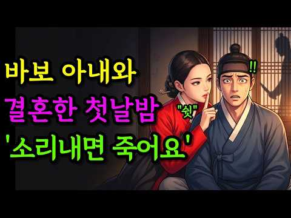
- 설명 앞부분: 이 영상은 일부 제작 과정에서 AI 기술을 참고하였지만, 화면에 등장하는 인물과 장면은 종이를 직접 오려 만든 인형과 소품을 활용해 하나하나 촬영하고 연출한 실제 인형극 영상입니다. 인형극 야담**은 조선시대를 배경으로 한 다양한 이야기와 분위기에서 영감을 받아 새롭게 구성된 창작 콘텐츠를 선보입니다. 이야기의 흐름과 몰입을 위해 등장인물의 이름, 지역, 설정 등은 일부 각색 및 재구성되어 표현됩니다. 영상에 사용된 인형, 소품, 장면 구성, 편집 결과물은 모두 직접 제작된 창작물이며, 허가 없는 복제, 재업로드, 2차 가공을 금…
- 같은 채널 평소 대비 ×26.0 (채널 최근 롱폼 중앙값 19,478회) · 평소 영상: "뒤에 암살자 있어요!" 천재소녀 외치자 왕은 충격받는데.. ∣ 조선시대 소설 ∣ 야담 … (19,763회) / "송장인 척 하세요" 쫓기는 왕비를 관속에 넣어버린 천재 쌍둥이∣ 조선시대 소설 ∣ 야담… (19,192회)
- 대본 없음 (설명) — 음성인식이 끝나면 도입부·흐름이 들어감
- 댓글 160/160: 좋은 점 — 영상 0 · 감사·응원 11 · 더 알고 싶은 것 0 · 아쉬운 점 — 영상 1 · 반박·불만 — 의견 다름 1 · 정치·사회 1 · 경험 공유 3 · 구독·다음 기대 0
  - 감사·응원 👍15 “익산시에서 보고있습니다 감사합니다”
  - 감사·응원 👍5 “덕분입니다 감사합니다”
  - 아쉬운 점 — 영상 👍2 “광고가 너무 자주 나와 아쉽네요.”
  - 반박·불만 — 의견 다름 👍0 “한국에서 만든게 아닌데? 벽에 글도 그렇고 ai대화도 그렇고”
  - 정치·사회 👍0 “평양 에서 듣고있수다 반골의 자부심 을 생태적으로 갖고있는 전라도 개딸 십만명만 평양으로 이주시키면 한두달,길어도 일년이면 북한 정권은. 무너진다 ,는걸 누구도 의심하지 않는다. 우리는 전라도 동학형명 등 519까지 전라민의 반골.기질 을 보았기때문이다.”
  - 경험 공유 👍2 “염라대왕님과 함게 듣고 있어요 제가 부르지 말라고 극구 말리고 있어요 😂😂❤”
  - 경험 공유 👍1 “우리집”

### 264. 철: 지구에서 가장 강력한 금속의 숨겨진 역사

- https://www.youtube.com/watch?v=cPSuGyyaGf0 · 고요한 우주 · 구독자 675 · 조회수 18,461 (×27.4, 하루 385.2) · 좋아요 110 (0.6%) · 55.3분 · 2026-09-05 · 주제 묶음 1. 역사 일반·이야기 · 형식 정보·해설 (그 밖) · 폴더 `W_cPSuGyyaGf0` (웹 승인)
- 썸네일: 
- 챕터: 0:00 핏방울 속 별의 파편과 숨겨진 역사 · 2:37 별의 심장부 규소 핵융합과 철 피크의 한계 · 12:52 지구 내부 끓어오르는 외핵과 자기장 다이나모 · 23:01 대산화 사건과 헤모글로빈의 산소 운반 마법 · 32:34 하늘의 운철에서 최초의 제련로와 강철의 탄생 · 41:43 베세머 전로와 스테인리스강 부동태 피막 · 51:18 철-공기 배터리와 소행성 프시케의 미래
- 설명 앞부분: 왜 철의 기원과 역사는 거대한 별을 붕괴시키는 사형 선고이자 우리 몸속 심장을 뛰게 하는 생명의 열쇠일까요? 우주의 극단적인 용광로에서 탄생해 지구의 중심과 혈관 속으로 이어진 가장 강력한 금속의 경이로운 여정을 만나보세요. 이 영상에서는 원자핵 결합 에너지 곡선의 정점인 철 피크와 거대한 초신성 폭발의 메커니즘을 과학적으로 깊이 파헤칩니다. 지구 깊은 곳 외핵의 액체 철 대류가 만들어내는 지구 다이나모와 자기장 방어막의 원리, 대산화 사건으로 원시 바다에 붉은 녹이 침전되며 형성된 호상철광층, 그리고 적혈구 헤모글로빈 중심에서 …
- 같은 채널 평소 대비 ×11.5 (채널 최근 롱폼 중앙값 1,605회) · 평소 영상: 알루미늄: 한때 금보다 비쌌던 금속 — 어떻게 이렇게 흔해졌을까? (1,806회) / 다이아몬드 시대를 열다: 실리콘을 뛰어넘는 플라즈마 반응기 (1,404회)
- 대본 없음 (설명) — 음성인식이 끝나면 도입부·흐름이 들어감
- 댓글 5/5: 좋은 점 — 영상 0 · 감사·응원 2 · 더 알고 싶은 것 0 · 아쉬운 점 — 영상 0 · 반박·불만 — 의견 다름 0 · 정치·사회 0 · 경험 공유 0 · 구독·다음 기대 0
  - 감사·응원 👍2 “말씀 잘 들었습니다. 감사합니다.”
  - 감사·응원 👍1 “감사합니다. 그래서 철들었다고 하는군...”

### 265. [세계사] 교회(개신교)와 성당(카톨릭)의 진짜 차이, 그들이 500년 전 나뉜 진짜 이유 ∣ 천주교 정교회 개신교 기독교

- https://www.youtube.com/watch?v=YqDWoNyHmgI · 역사로그 · 구독자 21,500 · 조회수 584,302 (×27.2, 하루 3,469.0) · 좋아요 6,656 (1.1%) · 46.7분 · 2026-05-07 · 주제 묶음 5. 세계사·서양사 · 형식 정보·해설 (그 밖) · 폴더 `W_YqDWoNyHmgI` (웹 승인)
- 썸네일: 
- 챕터: 0:00 도입부 — 길에서 본 십자가의 작은 차이 · 3:44 1세기~11세기, 천 년 동안 한 줄기였던 기독교 · 5:57 마태복음 16장 — 두 문장의 폭발력 · 9:59 1054년 균열의 지층 — 8세기부터 250년의 응축 · 11:59 하기아 소피아의 그날 — 훔베르트와 케룰라리오스 · 15:23 표면의 4가지 쟁점 — 빵·필리오케·결혼·교황권 · 17:44 진짜 이유 — 두 도시의 자존심 · 19:13 1204년 콘스탄티노플 약탈, 진짜 분기점 · 24:48 1517년 — 비텐베르크 성문의 95개조 · 26:12 면죄부 뒤의 세 사람 — 메디치·알브레히트·테첼 · 28:55 보름스→바르트부르크 — 독일어 성경의 탄생 · 32:33 1534년 영국 — 헨리 8세와 수장령 · 34:27 정리 — 한 줄기에서 세 줄기로 · 39:02 현대의 화해 — 바티칸2·JDDJ·룬드 · 41:18 현대의 분열 — 우크라이나와 키릴 · 43:50 결론 — 십자가 앞의 마지막 질문
- 설명 앞부분: 가톨릭(약 13억)·정교회(약 3억 1,700만)·개신교(약 9억 8,000만)는 1세기 한 줄기에서 출발해 1054년 동서대분열과 1517년 종교개혁을 거치며 셋으로 갈라진 23억 기독교인의 세 갈래다. 오늘 길에서 마주치는 매단 십자가와 빈 십자가, 마리아상의 유무, 성찬 빵 한 조각, 손으로 긋는 십자성호 방향까지 — 그 작은 차이 하나하나가 모두 그 1,000년 분열의 흔적이다. 지금 가까운 교회 십자가에 예수님이 매달려 계신가요, 아니면 십자가만 비어 있나요. 이 질문 하나로 시작합니다. 1054년 7월 16일 토요일 오…
- 같은 채널 평소 대비 ×6.2 (채널 최근 롱폼 중앙값 94,719회) · 평소 영상: [세계사] 유럽을 300년간 떨게 한 바이킹은 왜 흔적도 없이 사라졌나?｜당신이 아는 바… (94,719회) / [세계사] 나라 없는 세계 최대 민족, 쿠르드족의 모든 것 ∣ 쿠르드족 버림받은 민족 3… (97,120회)
- 대본 없음 (설명) — 음성인식이 끝나면 도입부·흐름이 들어감
- 댓글 935/935: 좋은 점 — 영상 17 · 감사·응원 25 · 더 알고 싶은 것 23 · 아쉬운 점 — 영상 8 · 반박·불만 — 의견 다름 67 · 정치·사회 13 · 경험 공유 66 · 구독·다음 기대 1
  - 좋은 점 — 영상 👍14 “최고점드립니다. 모든게 인간.즉 사람 문제인걸요. 요즘 우리나라의 종교 현실이 똑같다는 것을 알수있는 좋은 영상이군요.역사는늘 돌고 도는군요. 목사나.신부나 모두다 똑같은 광인들이지요. 신자들은요?”
  - 좋은 점 — 영상 👍8 “기독교는 왜 기독교이고, 천주교는 왜 천주교인가 한국 사회에서는 종종 "개신교는 가톨릭에서 분리되어 나온 종교"라는 설명이 당연한 역사적 사실처럼 반복된다. 그러나 이 표현이 과연 얼마나 정확한지, 그리고 그 안에 어떤 전제가 숨어 있는지 한 번쯤 생각해 볼 필요가 …”
  - 감사·응원 👍11 “종교 역사, 고맙습니다 마음이 아프기도 합니다만🌍🌎🌏”
  - 감사·응원 👍9 “여고시절(개신교미션스쿨)에 매주월요일 마다 듣던 종교철학 강의내용입니다. 덕분에 교리는 확실하게 알게됐고, 그때문에 지금은 개종하여 천주교신자로 살고 있습니다. 행복하고, 편안합니다. ❤하느님 구원해주셔서 감사합니다 아멘❤”
  - 더 알고 싶은 것 👍2 “몇가지 오류가 있어서 말씀드립니다. 저들의 갈등에 신학은 없고 인간만이 있다고 하셨는데 마르틴 루터는 목숨을 걸어가며 신학을 지키려고 종교개혁을 반박문을 써내려 갔습니다. 또 모든 사람이 하나님의 말씀을 읽을 수 있도록 번역을 해나갔습니다. 인간의 욕심이 종교를 분열…”
  - 더 알고 싶은 것 👍2 “수고하셨습니다 고맙고 감사합니다 얼마나 기억할지 몰라도 참 소중한 말씀 감사합니다 천주님 보호안에서 건강하시고 행복하세요 아멘🙏😌😂천주교 신자라서 행복합니다😂😂성모님을 함부로 말하지 마세요 개신교 분들 제발요 예수님 어머니 시잔아요 얼마전깢는 개신교 십자가 보면 고개…”
  - 아쉬운 점 — 영상 👍2 “몇가지 오류가 있어서 말씀드립니다. 저들의 갈등에 신학은 없고 인간만이 있다고 하셨는데 마르틴 루터는 목숨을 걸어가며 신학을 지키려고 종교개혁을 반박문을 써내려 갔습니다. 또 모든 사람이 하나님의 말씀을 읽을 수 있도록 번역을 해나갔습니다. 인간의 욕심이 종교를 분열…”
  - 아쉬운 점 — 영상 👍0 “흥미롭긴한데 잘못된 정보 잘못된 비유들이 있네요”
  - 반박·불만 — 의견 다름 👍24 “개신교나 천주고. 예수님 믿는거는 동일 합니다 마리아는 예수님어머니 일뿐 믿거나 숭배하는건 아닙니다 개신교 다니는 님들 제발 우상이니. 지옥들어가니 맘대로 잣대를 지어 말하지 않았으면 좋겠어요 심판은 하나님이 하십니다. 삼위일체. 믿는건 동일합니다”
  - 반박·불만 — 의견 다름 👍9 “숫자부터 오류가 있습니다. 계신교 신자는 6억명 정도 입니다. 하지만 교파는 10,000개가 넘지요. 문제의 중심에 카톨릭을 두고 설명하신것 같습니다. 카톨릭이던 정교회든 문제가 없다고 할 수는 없겠지요. 과거를 반성하는 현재의 모습은 매우 중요합니다. 초기교회부터 …”
  - 정치·사회 👍1 “예수가없어요 어리석은 양반 종교 따지지말고 남대문 사공회 비밀 알어봤요 어리석은 종교 인들 나라가 다넘어갔어요”
  - 정치·사회 👍1 “어차피 빵은 똑같이 육의떡이다 의미는 예수를 기억하라는 의미 형식 기독교는 말씀의 종교다 윤정부는 탐욕의 떡으로 무너진 가짜 가면 교만 오만 위장위선 가면들 가라지 자칭보수 모든사이비 도둑이다”
  - 경험 공유 👍6 “대부분의 교리와 형식, 예식은 저희 인간들이 대부분 해석하여 정하였으니 그만큼 마음(본질)이 더 중요하다고 생각합니다.”
  - 경험 공유 👍5 “" 마리아의 아들 예수야 ! 네가 사람들에게 말하기를 내가 너고 네가 바로 나라고 말하고 다녔느뇨? " 예수님이 대답했다 " 그렇게 말하지 않았고 감히 그렇게 말할 수도 없습니다 " 인간들에 의해서 선지자 예수는 졸지에 하느님이 되었고 .. 아리우스파가 싸움판에서 이…”

### 266. 황제마저 벌벌 떨게 만든 명나라 최고의 천재, 그러나 죽어서 가문 전체가 몰살당한 남자 ∣ 장거정의 위대한 개혁과 비극적인 삶

- https://www.youtube.com/watch?v=YrBIFiEaMvY · 대명제국 흑역사【심층 다큐】 · 구독자 2,200 · 조회수 59,263 (×26.9, 하루 552.0) · 좋아요 839 (1.4%) · 94.3분 · 2026-07-07 · 주제 묶음 6. 동양사 (중국·일본·몽골) · 형식 정보·해설 (그 밖) · 폴더 `W_YrBIFiEaMvY` (웹 승인)
- 썸네일: 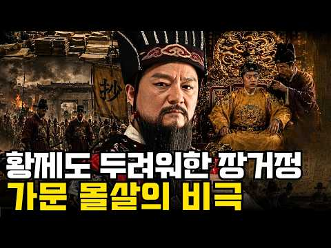
- 같은 채널 평소 대비 ×15.2 (채널 최근 롱폼 중앙값 3,888회) · 평소 영상: 중국에서는 최악의 황제로 불리지만, 한국에서는 '천자 고려'로 추앙받는 남자 ∣ 명 만력… (3,888회) / 화평의 사자'라는 이름 뒤에 숨겨진 정화의 진짜 임무 ∣ 명나라가 조선에 숨기려 했던 바… (3,840회)
- 대본 없음 (없음) — 음성인식이 끝나면 도입부·흐름이 들어감
- 댓글 38/38: 좋은 점 — 영상 0 · 감사·응원 3 · 더 알고 싶은 것 0 · 아쉬운 점 — 영상 0 · 반박·불만 — 의견 다름 0 · 정치·사회 7 · 경험 공유 1 · 구독·다음 기대 0
  - 감사·응원 👍37 “명나라가 스스로 무덤을 팠네요. 그런 황제 제사를 신주단지 모시듯 모시고 조선을 흔든 송시열, 우리 역사의 희극이자 비극. 만력제한테 감사하는 정도가 아니라 몇 백년간 우리 역사를 과거로 회귀시킨 일이 바로 비극이란 얘기”
  - 감사·응원 👍14 “장거정이 만든 시스템 덕분에 ㅡㅡ만력제가 임진란 조선을 도울 국력이 남아있어 조선을 풍성하게 도와줄 여력이 되었네ㅡㅡ장거정과 만력제에게 감사합니다”
  - 정치·사회 👍37 “명나라가 스스로 무덤을 팠네요. 그런 황제 제사를 신주단지 모시듯 모시고 조선을 흔든 송시열, 우리 역사의 희극이자 비극. 만력제한테 감사하는 정도가 아니라 몇 백년간 우리 역사를 과거로 회귀시킨 일이 바로 비극이란 얘기”
  - 정치·사회 👍29 “명나라 신하들은 천재도 많았는데 병신같은 왕들이 다 죽여없애고 나라가 망했지...”

### 267. 세계를 다 삼킨 중국 황제 조선만은 못 건드린 이유

- https://www.youtube.com/watch?v=xuJSO9q8Wl8 · 역사탐구 · 구독자 4,930 · 조회수 130,809 (×26.5, 하루 2,051.6) · 좋아요 1,008 (0.8%) · 28.6분 · 2026-08-20 · 주제 묶음 3. 조선 · 형식 정보·해설 (그 밖) · 폴더 `W_xuJSO9q8Wl8` (웹 승인)
- 썸네일: 
- 설명 앞부분: 참고한 자료 위키백과 강희제 항목 — 재위 기간, 삼번의 난, 대만 정복, 네르친스크 조약, 준가르 갈단 원정, 티베트 관계, 오보이 제거 등 생애와 업적 전반 국사편찬위원회 우리역사넷 백두산 정계비 문제 — 1712년 정계비 건립 경위, 목극등 파견, 박권의 소극적 태도, 토문강 해석 논쟁 국사편찬위원회 우리역사넷 조공 및 중국에서 오는 사신 — 조선과 명 청의 조공책봉 관계, 조공국의 내정 자율성 한국민족문화대백과사전 한국학중앙연구원 조공 — 조선 청 관계가 조공제도의 대표 모델이라는 학술 설명 가톨릭신문 중국 황제와 서양 선…
- 같은 채널 평소 대비 ×397.6 (채널 최근 롱폼 중앙값 329회) · 평소 영상: 가장 발전한 인더스 문명이 흔적도 없이 증발한 이유 (329회) / 왜 역사책은 제갈량만 기억할까?정작 대륙을 지배했던진짜 천재 3인이 숨겨진 이유 (324회)
- 대본 없음 (설명) — 음성인식이 끝나면 도입부·흐름이 들어감
- 댓글 175/177: 좋은 점 — 영상 1 · 감사·응원 1 · 더 알고 싶은 것 0 · 아쉬운 점 — 영상 1 · 반박·불만 — 의견 다름 7 · 정치·사회 23 · 경험 공유 5 · 구독·다음 기대 0
  - 좋은 점 — 영상 👍10 “우리 어린 시절 많이 듣던 말 중에 " 세상에 조선 없이 되는 것이 없다." 이는 이성계의 쿠테타로 건국한 조선이 아니고 우리의 고조선을 말한다는 것을 훗날 알았다. 대표적으로 조공=朝貢 이 글자는 조선에 바치는 공물을 말함이다. 역사를 개판으로 배워서 우리가 사대나…”
  - 감사·응원 👍0 “제가 평소에 궁금해 했던 것을 정리하여 이렇게 알려주시니 정말 감사합니다. 제가 궁금했던 것이 또 있습니다. 정말 조선이 중국에서 독립국이었을까 하는 겁니다. 고조선에서 고려까지는 중국과 피터지게 싸운 100% 독립국임이 확실합니다. 그런데, 이성계가 중국에 스스로 …”
  - 아쉬운 점 — 영상 👍0 “해설소리가 늘어져서 지루하네”
  - 반박·불만 — 의견 다름 👍2 “백두산 정계비의 토문강은 두만강이 맞습니다. 숙종실록 38년 (1712년) 청나라 오라총관 목극등과 조선 접반사 박권의 대화를 보면, 목극등이 "청과 조선의 경계는 어디까지 인가.?" 라고 묻고, 이에 박권이 "압록강과 두만강 입니다." 답변합니다. 이에 목극등이 "…”
  - 반박·불만 — 의견 다름 👍0 “패권국의 관리방법이겟죠. 먹을것도 없는데 굳이 왜 직접통치하겟음? 전략적 요충지도 아닌데”
  - 정치·사회 👍41 “조선이 청나라에 바친 조공은 강희제에 들어 크게 줄어서 인삼과 종이, 호랑이 가죽같은 특산품으로 대체됬고 대신 청나라가 내려주는 하사품은 은과 최고급 비단과 도자기등을 갑어치로는 조공의 10배에 달해 조선으로선 개꿀. 거기다 강희제는 조선에 큰 가뭄이 들었다는 얘기를…”
  - 정치·사회 👍29 “청나라는 중국이아니다....여진족 금나라가세운 왕국이다....여진족은 절대한족하고 아무상관없다....명나라가 한족 정통중국이다....”
  - 경험 공유 👍4 “결론은 왕조시대 !! 특히 강희제은 주변국을모두 강제합병의 주 군주로 오늘날의 중국국경을 있게한 주인공! 이런 저런 소리 다 쓰잘데없는 소리! 조선을 병자호란때 보면 바로 알수 있음. 즉 조선을 정벌하고도 단지 군신관계만 확인하고 비석 하나로 끝냄. 이것이 당시 주변…”
  - 경험 공유 👍3 “그 당시 핏줄과 가문 뿌리가 가장 큰 명분이자 아이덴티티였음 북방계 지배자들은 뿌리가 모두 한국인이었음 그래서 중국을 통일해도 북방에서 힘이 엄청나게 강력해도 한반도를 내비두거나 예우해준 것은 자신들의 조상땅임을 알기 때문임 패권자가 쓸데없이 이상하게 한 나라만 챙겨…”

### 268. 조선을 비웃으려던 명나라 사신이 세 가지 난제를 던졌다… 말똥 치우던 10살 종놈이 첫 번째 답을 내놓는 순간, 사신의 웃음이 순식간에 사라졌다 ∣ 야담 ∣ 민…

- https://www.youtube.com/watch?v=06ORKfm5PHU · 달빛야담방 · 구독자 3,190 · 조회수 84,439 (×26.5, 하루 1,538.5) · 좋아요 1,296 (1.5%) · 94.3분 · 2026-08-29 · 주제 묶음 6. 동양사 (중국·일본·몽골) · 형식 수면·낭독 (잠잘 때 듣는) · 폴더 `W_06ORKfm5PHU` (웹 승인)
- 썸네일: 
- 설명 앞부분: 조선을 비웃으려던 명나라 사신이 모두를 시험하려 세 가지 난제를 내놓았습니다. 대신들과 학자들조차 쉽게 입을 열지 못하던 그때, 말똥을 치우던 열 살 종놈이 앞으로 걸어 나왔습니다. 그리고 아이가 첫 번째 답을 말하는 순간, 사신의 얼굴에서 여유로운 웃음이 순식간에 사라졌습니다. 조선 어느 때, 명나라에서 온 사신이 자신의 지식과 지위를 믿고 조선의 사람들을 얕보며 세 가지 어려운 난제를 내놓았습니다. 궁궐의 대신들과 이름난 학자들까지 모였지만, 문제는 생각보다 훨씬 까다로웠고 누구도 선뜻 답을 내놓지 못했습니다. 사신은 그런 모…
- 같은 채널 평소 대비 ×11.1 (채널 최근 롱폼 중앙값 7,623회) · 평소 영상: “이 어려운 대구를 누가 받아치겠느냐?” 흠차가 현령을 몰아붙이자, 관아에서 차를 나르던… (7,623회) / 저잣거리에 잠행 나온 임금을 구한 침술 천재 소년, 모두가 비웃었으나… 마지막 침 하나를… (7,603회)
- 대본 없음 (설명) — 음성인식이 끝나면 도입부·흐름이 들어감
- 댓글 13/13: 좋은 점 — 영상 0 · 감사·응원 0 · 더 알고 싶은 것 0 · 아쉬운 점 — 영상 0 · 반박·불만 — 의견 다름 0 · 정치·사회 0 · 경험 공유 0 · 구독·다음 기대 0

### 269. 막부가 무너진 뒤, 도쿠가와 가문은 어떻게 되었을까?

- https://www.youtube.com/watch?v=kkwFyuynkKQ · 제국 그 후  · 구독자 5,240 · 조회수 136,458 (×26.0, 하루 1,823.0) · 좋아요 1,115 (0.8%) · 25분 · 2026-08-09 · 주제 묶음 6. 동양사 (중국·일본·몽골) · 형식 정보·해설 (그 밖) · 폴더 `W_kkwFyuynkKQ` (웹 승인)
- 썸네일: 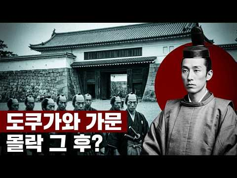
- 설명 앞부분: 이백육십오 년. 열다섯 명의 쇼군. 사백만 석. 그리고 거의 하룻밤 사이에, 그것이 사라졌습니다. 막부가 무너졌을 때 도쿠가와 가문은 처형되지 않았습니다. 추방되지도, 국적을 잃지도 않았습니다. 그러나 만 명이 넘는 사람들이 봉급 없이 주군을 따라 시즈오카로 떠났고, 그들 중 상당수는 물도 없는 자갈 고원에서 나무뿌리를 캐며 살았습니다. 칼을 팔아 호미를 산 무사들, 인력거를 끌게 된 하타모토, 그리고 팔십 년 뒤 호텔이 들어선 쇼군들의 무덤. 로마노프는 총으로, 합스부르크는 법으로, 청 황실은 계약으로 끝났습니다. 도쿠가와 가문…
- 같은 채널 평소 대비 ×9.0 (채널 최근 롱폼 중앙값 15,149회) · 평소 영상: 응우옌 왕조가 무너진 뒤, 베트남 황실은 어떻게 되었을까? (16,606회) / 황장엽이 망명한 뒤, 북한에 남은 그의 가족은 어떻게 되었을까? (13,692회)
- 대본 없음 (설명) — 음성인식이 끝나면 도입부·흐름이 들어감
- 댓글 34/34: 좋은 점 — 영상 1 · 감사·응원 1 · 더 알고 싶은 것 1 · 아쉬운 점 — 영상 1 · 반박·불만 — 의견 다름 1 · 정치·사회 3 · 경험 공유 0 · 구독·다음 기대 0
  - 좋은 점 — 영상 👍4 “좋은 영상 감사합니다 🎉”
  - 감사·응원 👍4 “좋은 영상 감사합니다 🎉”
  - 더 알고 싶은 것 👍6 “아하~ 재미있는 에도 막부의 마지막이네요. 다른 제국들도 궁금합니다.”
  - 아쉬운 점 — 영상 👍3 “다 좋은데 년도에 년은 붙여서 만드세요 ai티가 너무나서 불쾌함의 골짜기 최대치 입니다 이런 사소한거부터 수정하시는게 좋을듯 합니다”
  - 반박·불만 — 의견 다름 👍1 “말도 안되는 제도. 전세가 집주인이 필요해서 세입자에게 돈을 빌리는 제도인데 이런 제도를 한다면 그냥 월세를 받고 말지”
  - 정치·사회 👍6 “도구가와 이에야스 후손들 현황: 정권 몽괴 이후 그의 후손들은 약 600명 정도로 추산, 대부분 평범한 평민들로~! <우리 조선인 전통 씨족 성씨 집안>처럼, 도구가와 가문이 현재 종씨 단체가<일본 다른 종씨 비교해서> 나름 지켜내고있는 편입니다. <다른 수 많은 인…”
  - 정치·사회 👍5 “도쿠가와 막부는 조선을 침략하지 않는 좋은 정권이었는데 미국 페리제독 땜에 결국 무너짐”

### 270. 총도 없이 40cm 창으로 영국군 총과 대포를 맞서 싸운 아프리카 줄루족들의 용기

- https://www.youtube.com/watch?v=25PIXdjZbuU · 어른들의자장가 · 구독자 5,840 · 조회수 151,790 (×26.0, 하루 1,951.9) · 좋아요 747 (0.5%) · 22.4분 · 2026-08-06 · 주제 묶음 5. 세계사·서양사 · 형식 정보·해설 (그 밖) · 폴더 `W_25PIXdjZbuU` (웹 승인)
- 썸네일: 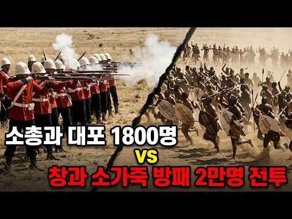
- 설명 앞부분: 1879년 1월 22일 아침, 남아프리카의 한 계곡에서 2만 명이 넘는 줄루 전사들이 몸을 일으켰습니다. 손에 든 것은 마을 대장장이가 하나씩 두드려 만든 날 길이 40센티미터짜리 창과 소가죽 방패가 전부였고, 글자가 없어 왕의 명령도 조상의 역사도 사람의 입으로만 전하던 사람들이었습니다. 6킬로미터 앞에는 세계에서 가장 먼저 산업혁명을 이룬 나라의 군대가 최신 후장식 소총과 대포, 로켓 발사대까지 갖추고 진을 치고 있었습니다. 그런데 이 사람들은 그날 싸울 계획이 없었습니다. 달이 죽는 날이라 공격은 다음 날 새벽으로 미뤄져 있…
- 같은 채널 평소 대비 ×13.6 (채널 최근 롱폼 중앙값 11,144회) · 평소 영상: 독일군 전차와 대포 총공세를 처절하게 막아냈던 고작 20명의 최정예 소련 중대 이야기 (11,144회) / 길드 노조가 시민들로 군대를 조직해서 최정예 엘리트 군대랑 전쟁을 벌인 날 (10,742회)
- 대본 없음 (설명) — 음성인식이 끝나면 도입부·흐름이 들어감
- 댓글 123/134: 좋은 점 — 영상 0 · 감사·응원 2 · 더 알고 싶은 것 0 · 아쉬운 점 — 영상 1 · 반박·불만 — 의견 다름 1 · 정치·사회 4 · 경험 공유 6 · 구독·다음 기대 0
  - 반박·불만 — 의견 다름 👍1 “줄루족들이 화승총 또는 머스킷을 가지고 있었다고 합니다. 물론 비율이 어찌되었는지는 모르겠지만, 당시에는 전세계에 돈없는 가난뱅이 나라라도 화승총정도는 다들 장만하고 있었기 때문에, 줄루족이 화승총같은걸 가지고 있는건 이상한 일이 아닙니다. 영국군은 단발식 소총을 가…”
  - 경험 공유 👍11 “내가 제일 좋아하는 전투들중 하나. 당시 유럽인들이 주장하는 문명이란게 얼마나 작위적인지를 알려주는 사건임.”
  - 경험 공유 👍3 “몇 년 전 제가 줄루 영화를 보았었는데 이걸 보니 그때가 생각나고 영상 퀄리티가 대박이네요!~”

### 271. 조선 과부는 밤을 어떻게 보냈나? 500년간 숨겨온 4가지 진실∣조선시대 ∣ 풍속화 ∣ 한국역사 ∣ 조선과부 ∣ 신윤복

- https://www.youtube.com/watch?v=nlBAu4hyMXY · 조선의 호기심 · 구독자 1,730 · 조회수 44,894 (×25.9, 하루 305.6) · 좋아요 704 (1.6%) · 13.7분 · 2026-05-29 · 주제 묶음 3. 조선 · 형식 정보·해설 (그 밖) · 폴더 `W_nlBAu4hyMXY` (웹 승인)
- 썸네일: 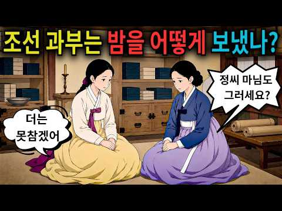
- 챕터: 0:00 오프닝 — 한양의 긴 밤 · 1:00 연화의 이야기 — 재가금지법의 실체 · 3:30 첫 번째 방법 — 춘화첩 (인조실록 1624 기록) · 6:30 두 번째 방법 — 시장 골목의 비밀 · 9:30 세 번째 방법 — 산사와 스님 (고려말 어사대 기록) · 13:30 네 번째 방법 — 대식(對食) (세종실록 원문 공개) · 17:00 충격의 반전 — 나라는 죽음에 상을 주었다
- 설명 앞부분: 조선 과부는 재혼이 금지된 채, 긴 밤을 어떻게 버텼을까? 세종실록에 실제로 기록된 충격적인 진실 4가지를 파헤칩니다. 이 영상에서 다루는 내용 조선 경국대전(1477년)은 과부의 재혼을 금지했습니다. 재혼하면 자식과 손자까지 3대가 과거 시험을 볼 수 없었죠. 그렇다면 젊고 건강한 몸으로 평생 혼자 살아야 했던 조선 과부들은 도대체 어떻게 버텼을까요? 오늘은 교과서에도, 사극에도 나오지 않는 조선 여성의 진짜 밤 이야기를 신윤복의 풍속화와 함께 전합니다. ⏱️ 타임스탬프 📚 참고 사료 경국대전 (1477, 성종 8년) — 재가금…
- 같은 채널 평소 대비 ×55.4 (채널 최근 롱폼 중앙값 810회) · 평소 영상: 조선에서 남녀는 어떻게 결혼했나 —얼굴도 모르는 사람과 결혼해야 했던충격적인 혼인 풍습【… (810회) / 비누도 샴푸도 수돗물도 없었는데 조선인이 세계에서 가장 청결했던 충격적인 이유 【조선시대… (828회)
- 대본 없음 (설명) — 음성인식이 끝나면 도입부·흐름이 들어감
- 댓글 41/41: 좋은 점 — 영상 1 · 감사·응원 0 · 더 알고 싶은 것 0 · 아쉬운 점 — 영상 0 · 반박·불만 — 의견 다름 0 · 정치·사회 2 · 경험 공유 0 · 구독·다음 기대 0
  - 좋은 점 — 영상 👍21 “시대를 초월하여 성적 욕망은 억지로 눌러지지 않는다.. 조선 여인들의 삶을 이해할 수 있는 좋은 영상이군요.....”
  - 정치·사회 👍4 “조선이라는나라가잘살아졌다불쌍한여인들의삶”
  - 정치·사회 👍0 “이씨조선이 아니었다면 세종의 한글도없었다. 이제라도 더늦기전에 이씨조선으로다시 돌아가아한다. 이재명 만세!만세!만만세!!!”

### 272. 🌙 자면서듣는 역사 ∣ 조선왕조실록 : 조선의역사 풀스토리 500년 대서사｜달빛 역사관

- https://www.youtube.com/watch?v=Tq1ADCDu3hQ · 달빛 역사관 : 자면서 듣는 세계사 · 구독자 9,220 · 조회수 236,475 (×25.6, 하루 1,578.7) · 좋아요 1,797 (0.8%) · 104.3분 · 2026-05-26 · 주제 묶음 3. 조선 · 형식 수면·낭독 (잠잘 때 듣는) · 폴더 `W_Tq1ADCDu3hQ` (웹 승인)
- 썸네일: 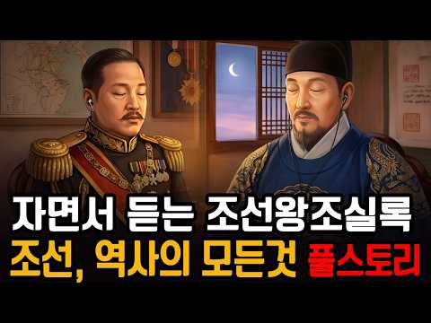
- 챕터: 0:00 프롤로그 — 오늘 밤의 초대 · 2:58 1부 — 칼을 돌린 사람 (고려 말, 위화도 회군, … · 11:37 2부 — 피로 다진 기초 (왕자의 난, 태종, 세종 … · 23:19 3부 — 빛의 왕조 (세종, 훈민정음, 집현전, 4군… · 33:03 4부 — 균열 (단종, 계유정난, 세조, 사육신, 성… · 44:18 5부 — 선비들의 꿈과 좌절 (연산군, 사화, 조광조… · 57:51 6부 — 바다가 나라를 구했다 (임진왜란, 이순신, … · 72:10 7부 — 치욕과 굴욕 사이에서 (광해군, 병자호란, … · 84:18 8부 — 마지막 빛과 긴 황혼 (영조, 사도세자, 정… · 99:48 에필로그 — 오백 년이 남긴 것
- 설명 앞부분: 잠들기 전, 오백십팔 년의 조선 역사 이야기를 들려드립니다. 위화도의 빗속에서 칼의 방향을 바꾼 한 장수의 결단으로 시작된 나라. 형제의 피로 기초를 다지고, 세종의 붓으로 찬란하게 빛났으며, 사화와 전쟁과 치욕을 버텨낸 끝에 조용히 문을 닫은 왕조. 조선 오백 년의 이야기를 오늘 밤 달빛 역사관이 머리맡에서 들려드립니다. 이번 영상은 단순한 연표가 아닙니다. 뜻을 품었다가 꺾인 사람들, 불가능한 상황에서 기적을 만들어낸 사람들, 역사가 끝난 자리에 조용히 남아 살아간 사람들의 이야기입니다. 왕들의 이야기이기도 하지만, 사실은 사…
- 같은 채널 평소 대비 ×3.8 (채널 최근 롱폼 중앙값 62,031회) · 평소 영상: 🌙 들으면서 주무세요｜단군, 신화인가 역사인가 고조선의 역사 이야기 풀스토리｜달빛 역사관 (62,031회) / 🌙 들으면서 주무세요 ∣ 약소국에서 삼국통일까지, 신라 천 년의 이야기 ｜달빛 역사관 (62,211회)
- 대본 없음 (설명) — 음성인식이 끝나면 도입부·흐름이 들어감
- 댓글 27/27: 좋은 점 — 영상 0 · 감사·응원 1 · 더 알고 싶은 것 0 · 아쉬운 점 — 영상 1 · 반박·불만 — 의견 다름 0 · 정치·사회 1 · 경험 공유 2 · 구독·다음 기대 0
  - 감사·응원 👍0 “감사합니다. 수고하셨습니다.”
  - 아쉬운 점 — 영상 👍0 “쓸데없는 말이 너무 길다”
  - 정치·사회 👍8 “내가 그냥 안보면 되는데 조선시대는 한마디로 공산당 세습정권하고 하나도 다를바가 없다.”
  - 경험 공유 👍8 “내가 그냥 안보면 되는데 조선시대는 한마디로 공산당 세습정권하고 하나도 다를바가 없다.”
  - 경험 공유 👍1 “《이씨,조선왕조 오백년 유지 비결》 1.자기보다 난사람들 싹~죽여버리고,못난사람만 살려 부역자(사대부)부리고 2.음주섹스(관기)제도로,지네李왕족만 급번식시킨 반면,고려원주민들은 노예(상놈)신분제도로 인간가축 만들어 가난,빈곤(식민)통치 521년!"현재,중국계 李왕손1…”

### 273. 박정희 정권 최대의 미스터리 ∣ 제3공화국 뒤흔든 정인숙 피살사건 ∣ 50년 만에 다시 보는 아들의 삶

- https://www.youtube.com/watch?v=KHWMK-goPxs · 역사의 수레바퀴 · 구독자 16,900 · 조회수 431,079 (×25.5, 하루 3,335.5) · 좋아요 5,347 (1.2%) · 42.5분 · 2026-06-16 · 주제 묶음 4. 한국 근현대사 · 형식 정보·해설 (그 밖) · 폴더 `W_KHWMK-goPxs` (웹 승인)
- 썸네일: 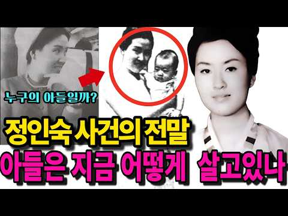
- 챕터: 0:00 세 발의 총성, 그리고 사라진 권총 (오프닝) · 10:15 1막: 엘리트 신여성의 꿈, 그리고 요정 '선운각'의… · 19:55 2막: 세 살배기 아들과 '검은 수첩', 권력의 시한… · 28:40 3막: 일주일 만의 수사 종결, 과학적 모순과 은폐된… · 36:24 4막: 19년 만의 자백 번복 "나는 동생을 쏘지 않… · 39:50 에필로그: 남겨진 아들의 비극, 그리고 지워진 이름 …
- 설명 앞부분: 1970년 3월 17일 밤 11시, 강변도로에서 세 발의 총성이 울려 퍼졌습니다. 차갑게 식어버린 26세 정인숙, 그리고 허벅지에 총상을 입은 채 신음하던 친오빠 정종욱. 단순한 강도 살인인 줄 알았던 이 사건은 그녀의 피 묻은 가방이 열리면서 대한민국 현대사 최대의 정치 스캔들로 번지게 됩니다. 가방 안에서 쏟아져 나온 거액의 달러와 고위층만 가질 수 있던 회수 여권. 그리고 가장 치명적이었던 '검은 수첩'. 그 안에는 박정희 대통령, 정일권 국무총리, 이후락, 김형욱 등 당대 최고 권력자 26명의 이름이 빼곡히 적혀 있었습니다…
- 같은 채널 평소 대비 ×21.4 (채널 최근 롱폼 중앙값 20,173회) · 평소 영상: 라면 한 그릇에 담긴 비밀 ∣ 박정희와 정주영이 새벽 공사장에서 나눈 이야기 (21,489회) / "열차를 세워라!" 1969년 진흙탕에 뛰어든 박정희, 5천년 가난을 깨부순 거인의 결단… (18,857회)
- 대본 없음 (설명) — 음성인식이 끝나면 도입부·흐름이 들어감
- 댓글 421/524: 좋은 점 — 영상 2 · 감사·응원 10 · 더 알고 싶은 것 4 · 아쉬운 점 — 영상 4 · 반박·불만 — 의견 다름 2 · 정치·사회 71 · 경험 공유 14 · 구독·다음 기대 0
  - 좋은 점 — 영상 👍1 “살명을 너무잘해주시고 이해가쏙쏙 고맙게 잘들었습니다 이유야 어쨋든 똑똑여자 정인숙 여사께서 명대로살지못하고간점 유감으로생각합니다 입만조심했더라면 더오래살수있을수도 오만함 권력을조금 이용했다는것이 좀 안타깝네요 그래서 여자는 입조심해야하는법 암튼 영리하고 똑똑하네요 고…”
  - 좋은 점 — 영상 👍1 “다른 나라도 역사 비사가 있소이다 오랫되고 희미한 옛이야기일 뿐, 국가발전에 도움되는 것은 없소이다”
  - 감사·응원 👍81 “잘듣고 갑니다 저는 그때 충비 6비 건설을 위해 나온 외국인 회사 마포 강변도로를 끼고 위치한 회사에 근무하고 있었죠 그때 당시 회자 되었던 소문과 뉴스 다시 들으니 마음이 이상해집니다 수고 하셨습니다 감사합니다”
  - 감사·응원 👍38 “진짜로 감사합니다”
  - 더 알고 싶은 것 👍3 “진실을부탁해요”
  - 더 알고 싶은 것 👍1 “유뷰녀 김삼화 사건에 대해서도 자세히 알려주시길”
  - 아쉬운 점 — 영상 👍13 “아오~ 같은말 하고 또하고. . . 지루하네”
  - 아쉬운 점 — 영상 👍13 “그시대는 먹고사는게 어려운시절이라 요정정치시대인듯 구타패싸움 이 많았던시대라 암흑시대 힘겨운시대였습니다”
  - 반박·불만 — 의견 다름 👍2 “박정희가 권력잡고살았다면 이나라 잘난여자 건드리고 정치 글쎄 김재규가 이나라살린거3ㅣ”
  - 정치·사회 👍81 “잘듣고 갑니다 저는 그때 충비 6비 건설을 위해 나온 외국인 회사 마포 강변도로를 끼고 위치한 회사에 근무하고 있었죠 그때 당시 회자 되었던 소문과 뉴스 다시 들으니 마음이 이상해집니다 수고 하셨습니다 감사합니다”
  - 정치·사회 👍67 “저의 남편은 정인숙이 자란 이웃에서 같이 자랐어요. 본명은 정금지 어릴 때도 뛰어나게 예뻐서 남학생들이 많이 따랐다고 했어요. 슬픈 이야기입니다. 피흘려 민주정부가 세워져서 얼마나 다행인지요. 국민이 권력자가 되어 그런일은 절대로 없어야 합니다.”
  - 경험 공유 👍30 “여자가 지혜로윘으면 저도 살고 아이도 살렸을텐데 친정에미라도 지혜롭던지 지금 누구 같으네”
  - 경험 공유 👍26 “정인숙 사건은 어릴적 아빠한데서 들었던 기억이 납니다 그리고 역사을 좋아한 나로썬 정인숙사건 정일권국무총리~~^^^ 아들만 불쌍 합니다 박정희정권은 어릴적에도 무시무시 했던것 같습니다 저희 아빠도 지역 유지이셨는데~~^^^ 참 지금아이들은 상상 할수 없는 시대 였으닌…”

### 274. [숨겨진 중국사] 만주의 주인은 중국이 아니었다, 금나라 정사 1권이 남긴 시조의 출신지 ∣ 역사인물 ∣ 야사 ∣ 비사

- https://www.youtube.com/watch?v=ptxr6rzOhA4 · 숨겨진중국사 · 구독자 12,500 · 조회수 313,900 (×25.1, 하루 5,490.1) · 좋아요 2,278 (0.7%) · 31.4분 · 2026-08-27 · 주제 묶음 6. 동양사 (중국·일본·몽골) · 형식 정보·해설 (그 밖) · 폴더 `W_ptxr6rzOhA4` (웹 승인)
- 썸네일: 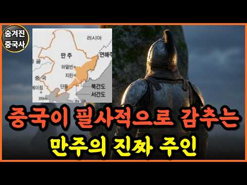
- 설명 앞부분: 저희는 숨겨진 역사를 재미있고 정확한 한 편의 이야기로 풀어내고자 영상을 만들고 있습니다. "매주 화,목,일 오후 12시에 새로운 이야기가 업로드 됩니다 ❤" 🎬 더 많은 영상 보기 👇
- 같은 채널 평소 대비 ×28.3 (채널 최근 롱폼 중앙값 11,090회) · 평소 영상: [숨겨진 중국사] 현재 중국 땅을 원래 주인들에게 다 반환하면 어떻게 될까? ∣ 역사인물… (12,319회) / [숨겨진 중국사] 청나라가 없었다면 지금의 중국도 없었다.. 소수민족한테 다 주면 남는 … (12,463회)
- 대본 없음 (설명) — 음성인식이 끝나면 도입부·흐름이 들어감
- 댓글 369/372: 좋은 점 — 영상 1 · 감사·응원 4 · 더 알고 싶은 것 0 · 아쉬운 점 — 영상 2 · 반박·불만 — 의견 다름 9 · 정치·사회 55 · 경험 공유 16 · 구독·다음 기대 0
  - 감사·응원 👍2 “관련해서는 내용을 잘썼고 제가보니 고려와 조선영토도 매우중요한데 내용이없고 빈약한거같아서 고려나 조선국경을 잘정리해서 소스를 드릴테니 이부분도 정리하셔서 유튜브 꼭 정리해주시면 좋을거같으니 참고하세요. 지금 제가 정리한것은 기록너머 뿐아니라 역사적팩트입니다 . 최근 …”
  - 아쉬운 점 — 영상 👍2 “간도는 우리땅 이지만 만주.연해주는우리땅 아니다? 청러 간에 맺은 국경조약이 바로 공식문서로서 맺은 건데 그러나 조선과 청 사이에 왜 그런 공식적인 국경선이란 게 문서적으로는 등장하지 않고 실록으로 간간히 전해지는가 이 문제를 풀어야 한다. 바로 당시 조선의 땅인데도…”
  - 반박·불만 — 의견 다름 👍2 “간도는 우리땅 이지만 만주.연해주는우리땅 아니다? 청러 간에 맺은 국경조약이 바로 공식문서로서 맺은 건데 그러나 조선과 청 사이에 왜 그런 공식적인 국경선이란 게 문서적으로는 등장하지 않고 실록으로 간간히 전해지는가 이 문제를 풀어야 한다. 바로 당시 조선의 땅인데도…”
  - 반박·불만 — 의견 다름 👍1 “금나라를 발해의 후예인 고려(고구려)라 함은 틀린것입니다 고구려가 복속인 지역이 있고 발해지배층이 복속인지역이 있습니다 대부분 발해가 멸망하면서 토착인과 그대로 잔존한 족속이 있었습니다. 그게 말갈. 여진이라는것은 삼강평원의 토착인이 주입니다. 후대에 후금(청)은 주…”
  - 정치·사회 👍9 “고구려와 백제, 신라는 중국 본토에 있었습니다. 고려또한 개경은 중국 탕산시일 가능성이 90%이상. 고려서경은 개경에서 걸어서 일주일 정도 현재 베이징이 고려 서경! 고려영(군사기지)이 북경에 있고, 연개소문 무덤이 베이징 옆에 있고, 최씨 무신정권이 있던 최씨 집성…”
  - 정치·사회 👍6 “대조영 이세운 나라 이름은 발해 가 아니야.고구려야. 약칭 고려 발해 라는 이름은 당나라에서 지어진 이름이야.당나라와서 신을 교신할 때 만발해 라는 이름을 썼고 평상시에는 고려 였어.오직 당나라와 만발해 한 이름을 썼어요. 일본과의 교역이나 교신에서도 고려라고 썼어.…”
  - 경험 공유 👍3 “금시조는 신라계임... 후금(청)도 조선을 형제국이라 불렀음. 만주는 예로부터 우리나라 땅이었음... 이후 몇 번이나 수복하려고 정벌 계획도 했었음... 이제 다시 가져와야 함.”
  - 경험 공유 👍2 “관련해서는 내용을 잘썼고 제가보니 고려와 조선영토도 매우중요한데 내용이없고 빈약한거같아서 고려나 조선국경을 잘정리해서 소스를 드릴테니 이부분도 정리하셔서 유튜브 꼭 정리해주시면 좋을거같으니 참고하세요. 지금 제가 정리한것은 기록너머 뿐아니라 역사적팩트입니다 . 최근 …”

### 275. [조선 다잇소] 3화 : 편전에서 쓰러진 세종대왕, 조선 제일검 앞에서도 주사기를 꺼내든 이유

- https://www.youtube.com/watch?v=AAyf0Os9xt0 · 다잇소 스튜디오 · 구독자 1,070 · 조회수 26,709 (×25.0, 하루 2,012.8) · 좋아요 202 (0.8%) · 8분 · 2026-10-10 · 주제 묶음 3. 조선 · 형식 정보·해설 (그 밖) · 폴더 `W_AAyf0Os9xt0` (웹 승인)
- 썸네일: 
- 챕터: 0:00 자꾸만 어긋나는 물시계, 장영실의 깊은 고뇌 · 1:03 물길을 여닫는 마법? 현대식 '볼탑 밸브'의 등장 · 2:45 현우의 당돌한 제안 "한양에 다잇소를 열고 싶사옵니다" · 3:55 갑자기 편전에서 쓰러진 세종대왕 (소갈증 쇼크) · 4:31 "멈춰라!" 정체불명의 기물을 막아선 호위관 무명 · 6:40 세종을 살려낸 마운자로와 현대의 혈당 측정기 · 7:44 [4화 예고] 다잇소 첫날 밤 남겨진 수상한 은괴
- 설명 앞부분: 어긋나는 자격루의 물길 때문에 깊은 시름에 빠진 조선 최고의 천재 장영실! 현우가 초록색 장바구니에서 꺼낸 단돈 2천 원짜리 '볼탑 밸브'가 조선 유체역학의 흐름을 단숨에 통제해 버린다?! 기물이 스스로 물길을 여닫는 마법 같은 이치에 감탄한 장영실의 도움으로, 현우는 마침내 한양 운종가 한복판에 상점 '다잇소(多잇所)'를 열 기회를 얻게 된다. 하지만 기쁨도 잠시, 밤낮없이 옥체를 혹사하던 세종대왕이 편전 한복판에서 소갈증(당뇨) 쇼크로 의식을 잃고 쓰러지는데... 명주실과 바늘을 찾는 어전에서 현우가 꺼내든 것은 낯선 형태의 …
- 대본 없음 (설명) — 음성인식이 끝나면 도입부·흐름이 들어감
- 댓글 21/21: 좋은 점 — 영상 0 · 감사·응원 0 · 더 알고 싶은 것 0 · 아쉬운 점 — 영상 0 · 반박·불만 — 의견 다름 0 · 정치·사회 0 · 경험 공유 1 · 구독·다음 기대 1
  - 경험 공유 👍1 “제미나이한테 물어보니 세종대왕은 오히려 혈당수치가 높았을거라네요 나도 당뇨가 있는건 알고있어서 혈당높았을텐데 왠 저혈당? 이러고 봤네요”
  - 구독·다음 기대 👍3 “다잇소 4편도 기대됩니다”

### 276. "세종 없으면 이 사람이 1등?" 100년을 앞서간 조선 최고의 두뇌

- https://www.youtube.com/watch?v=W9NKVCxalr4 · 한국사 다시읽기 · 구독자 28,200 · 조회수 687,530 (×24.4, 하루 3,888.0) · 좋아요 6,629 (1.0%) · 27.2분 · 2026-04-29 · 주제 묶음 3. 조선 · 형식 정보·해설 (그 밖) · 폴더 `W_W9NKVCxalr4` (웹 승인)
- 썸네일: 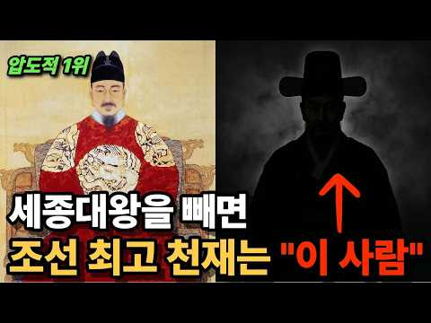
- 챕터: 0:00 오프닝 ㅣ 세종대왕 다음, 진짜 천재는? · 1:04 1부 ㅣ 구도장원공 - 아홉 번 시험, 아홉 번 일등… · 5:02 2부 ㅣ 천도책 - 명나라를 경악시킨 답안지 📜 · 10:19 3부 ㅣ 수미법 - 사십 년 앞서간 시스템 설계 💡 · 13:47 4부 ㅣ 금강산의 일 년 - 천재의 인간적 방황 🏔️ · 19:16 5부 ㅣ 십만양병설의 비극 - 너무 앞서간 통찰 ⚔️ · 24:30 클로징 ㅣ 오천 원권에 새겨진 이름
- 설명 앞부분: 📜 세종대왕 다음, 조선 최고의 천재는 누구일까요? 열세 살에 첫 장원, 아홉 번의 시험 모두 일등. 스물세 살에 명나라까지 경악시킨 천재. 국가 재정의 모순을 숫자로 분석하고, 수십 년 앞서 대동법의 원형을 설계했으며, 임진왜란을 정확히 예측한 비운의 천재. 오늘, 그 천재를 파헤쳐 봅니다. 🔍 ⏰ 타임라인 📚 참고 문헌 조선왕조실록 (명종실록, 선조실록, 선조수정실록) 율곡전서 ㅣ 율곡 이이 문집 동호문답 ㅣ 율곡 이이, 1569년 율곡행장 ㅣ 김장생, 1597년 한국민족문화대백과사전 십만양병설 관련 현대 학계 연구 (송복, …
- 같은 채널 평소 대비 ×145.3 (채널 최근 롱폼 중앙값 4,731회) · 평소 영상: "사극이 심은 환상" 암행어사가 기피 직업 1순위였던 이유 (4,731회) / 당신이 조선 서민의 밥상 앞에서, 한 숟가락도 먹을 수 없는 이유ㅣ조선으로 간다면? (4,484회)
- 대본 없음 (설명) — 음성인식이 끝나면 도입부·흐름이 들어감
- 댓글 735/761: 좋은 점 — 영상 14 · 감사·응원 17 · 더 알고 싶은 것 9 · 아쉬운 점 — 영상 1 · 반박·불만 — 의견 다름 13 · 정치·사회 42 · 경험 공유 15 · 구독·다음 기대 0
  - 좋은 점 — 영상 👍38 “선생님.좋은내용감사합니다.율곡이이에대해서는 유명세에비해서 잘알지 못했는데 전도책.수미법.10만 양병설.시스템분석가.청책설계자.현실정책자.방황에 대해서 잘알게되었습니다.”
  - 좋은 점 — 영상 👍11 “내가 보기에는 그냥 공부 잘 하는 학생이다. 백성에게 어떤 도움을 줬나? 수미법? 이것은 세금 걷기 편한 방법을 제안한 것. 천도설 그게 나라와 백성에 뭔 도움이 되었나? 수학도 아니고 농학도 아니고 공학도 아니다. 그냥 공부 잘 하는 사람이다. 그렇게 머리가 좋았으…”
  - 감사·응원 👍45 “장영실 정약용 김시습 율곡이이 ... 율곡선생 을 알아보고 장원을 주신 분들도 역시 천재... 천재도 천재지만 조선 500년 세종대왕 제외하고 가장 위대한 성인이신분 율곡선생 그리고 율곡선생을 알아보시고 영상 만들어주신 분께 감사드립니다.”
  - 감사·응원 👍38 “선생님.좋은내용감사합니다.율곡이이에대해서는 유명세에비해서 잘알지 못했는데 전도책.수미법.10만 양병설.시스템분석가.청책설계자.현실정책자.방황에 대해서 잘알게되었습니다.”
  - 더 알고 싶은 것 👍4 “진정한 천재였다면 자기의 경륜을 어떻게 실행해야 하는 방법도 찾았서야 하지 않았을까요?”
  - 더 알고 싶은 것 👍1 “십만 양병설? 그 기록이 어디에 있나요? 이이가 죽고 후대가 가필한거지. 뭔증거도 읎이 ....,”
  - 아쉬운 점 — 영상 👍18 “구도장원공으로 조선의 천재 중 한명이라는 것은 사실이며 동호문답에서 오패법의 폐해를 주장하고 시무육조를 통해 십만(?)양병설을 주창하기도 하였으나 그 좋은 자질을 이기호발설, 이발과 기발, 사단과 칠정 등 등 당시 주리철학에 따른 관념적이상론에 매몰된 천재 학자라는 …”
  - 반박·불만 — 의견 다름 👍14 “틀렸음 천재인줄 모르고 출신이 어째 천출이네 하면서 죽게 만든 천재들이 더 많음 암기천재는 인정못해 정약용이 제일 필요한 천재다 세종은 인정해”
  - 반박·불만 — 의견 다름 👍5 “지폐에서 없애야 할 1순위 인물 '이이'! 천재지만 별다른 '업적'이 없는 신기한 인물 이이... 시험 1등으로 자기과시만 하다가 세월을 보낸 사람? 그 좋은 머리로 뭘했는지... 참나~ 관리가 되어 국정을 리드한 것도 아니고... 그의 제안을 그가 아닌 후대의 사람…”
  - 정치·사회 👍9 “우리나라는 문치의나라 군사력을 너무등한시해서 비슷한국력의일본에게 나라가 쑥대밭되었읍 현재의우리도 다사는그런과거를 되풀이말아야 문화가발달해도 군사력등한시하면 쑥대밭댄다는걸 명심해야합니다”
  - 정치·사회 👍5 “시대를 너무 앞서 가서 힘들었던 사례는…최근에 노무현 대통령님도 계시죠…우리는 역사에서 배워야 합니다…국민들이 알아봐줍시다. 지금의 세계정세도 혼란스럽습니다… 우리나라가 다시 외세에 엉망되기 전에 우리 모두 미래를 준비합시다. 안락한 생활에 빠져서 미래를 대비하지 못…”
  - 경험 공유 👍11 “내가 보기에는 그냥 공부 잘 하는 학생이다. 백성에게 어떤 도움을 줬나? 수미법? 이것은 세금 걷기 편한 방법을 제안한 것. 천도설 그게 나라와 백성에 뭔 도움이 되었나? 수학도 아니고 농학도 아니고 공학도 아니다. 그냥 공부 잘 하는 사람이다. 그렇게 머리가 좋았으…”
  - 경험 공유 👍1 “내가 아는 신사임당은 희대의 악처요 율곡은 천하의 불효자로 후대에 남을 업적이 일도 없다, 과학지식이 많다고 전해지나 현제 고등학생 중위권 보다 못한 사람으로 전형적인 과대평가된 인간이다”

### 277. 영의정만 6번 지낸 조선 최고의 천재가 죽기 직전 자신을 '죄인'이라 부른 진짜 이유∣오리 이원익,청백리,조선사

- https://www.youtube.com/watch?v=n_nHYw8fWkY · 거꾸로한국사 · 구독자 17,000 · 조회수 414,384 (×24.4, 하루 3,180.0) · 좋아요 8,001 (1.9%) · 43.8분 · 2026-06-15 · 주제 묶음 3. 조선 · 형식 정보·해설 (그 밖) · 폴더 `W_n_nHYw8fWkY` (웹 승인)
- 썸네일: 
- 챕터: 0:00 프롤로그: 비 새는 초가집에 사는 영의정 · 4:15 굽 높은 나막신을 벗어던진 137cm의 청년 · 9:30 율곡 이이의 발탁, 그리고 조선을 덮친 임진왜란 · 14:50 명나라 장수를 놀라게 한 평양성 탈환 작전 · 20:10 "이순신을 죽이려거든 나를 먼저 베시옵소서" · 26:45 백성을 살린 세금 혁명, 대동법의 시작 · 31:20 일흔 노인의 유배 생활과 거절당한 짚 돗자리 · 36:40 임금도 울어버린 두 칸 초가집과 관감당의 진실 · 40:15 "나는 백성 앞에 죄인이다" 400년을 이어온 부모님…
- 설명 앞부분: 조선 오백 년 역사상 유일하게 영의정을 여섯 번이나 지낸 오리 이원익 대감. 이순신 장군을 죽음의 문턱에서 살려내고 백성을 위한 대동법을 처음 시행한 위대한 재상이었지만, 그가 평생 살았던 곳은 비가 새는 두 칸 초가집이었습니다. 임금마저 눈물짓게 한 그의 삶과 마지막 유언에 담긴 진짜 의미는 무엇이었을까요? 평생을 묵묵히 희생하며 늙어서도 자식에게 짐이 되지 않으려 홀로 버티시는 우리네 부모님의 모습과 너무도 닮아있는 400년 전 작은 거인의 먹먹한 이야기를 전해드립니다. 타임라인 『조선왕조실록』 (선조실록, 광해군일기, 인조실…
- 같은 채널 평소 대비 ×24.5 (채널 최근 롱폼 중앙값 16,943회) · 평소 영상: 정승 15년에 나물 밥상과 낡은 관복을 고집한 청백리 전쟁 영웅 ∣ 오성 이항복,조선청백리 (16,943회) / 한국인이 꼭 알아야 하는 조선을 망친 최악의 왕비 5명 ∣ 조선역사,승정원일기,조선왕조실록 (19,237회)
- 대본 없음 (설명) — 음성인식이 끝나면 도입부·흐름이 들어감
- 댓글 444/446: 좋은 점 — 영상 6 · 감사·응원 28 · 더 알고 싶은 것 1 · 아쉬운 점 — 영상 0 · 반박·불만 — 의견 다름 6 · 정치·사회 26 · 경험 공유 12 · 구독·다음 기대 0
  - 좋은 점 — 영상 👍29 “오리대감에 대해 정사거나 야사던 조선시대에 대단한 청백리라는 사실을 알려주셔서 감사합니다”
  - 좋은 점 — 영상 👍5 “청백리 황희, 맹사성, 이원익, 정승 공감합니다. 지금 한국은 범죄인이 호의호식 하는 나라입니다.”
  - 감사·응원 👍55 “이원익대감님 고맙습니다~^^”
  - 감사·응원 👍43 “감동입니다 감사합니다 이런인물을 몰랐다니”
  - 반박·불만 — 의견 다름 👍1 “황희는 절대 청백리가 아닙니다. 조선 3대 청백리 이원익, 맹사성, 박수량”
  - 반박·불만 — 의견 다름 👍0 “쌍놈에 후손 선조가 이순신을 시기 한거지 누가 비틀어 쌍놈후손'선조에게 보고한게 아닌데”
  - 정치·사회 👍38 “국회의원 나라국자쓰는 의원 조심조심살아라 원로”
  - 정치·사회 👍9 “국회의원들 꼭.읽어라 국가원로회의 특보”
  - 경험 공유 👍2 “예나 지금이나 고위 관직은 그냥 고위 관직이 아니에요. 정확한 명칭은 "돈 벌 기회" 에요. 어디를 개발할 지, 국가가 무슨 산업에 돈을 투자할지... 그거 결정하는 사람들이니 그시기에 부동산 사고, 주식 사면 그냥 땅짚고 헤엄치기로 돈 벌지요. 옛날이라고 달랐을까.…”
  - 경험 공유 👍2 “중국 주 은 래 , 피델 카스트로< 유 언 ,비석도 세우지 말고 화장 하라.이름도 어디에도 남기지 말고 우상 화 금지 법안 통과. 공산 주의 답 다.>체게 바라< 쿠 바 국가 은행 장 하면서도 쉬는 날 이면 노동자?<근로인지 노동인지 ?>들 과 같이 일 하며 지냄>.…”

### 278. 40분 전까지 이름도 몰랐는데 울었다 — 이순신을 처음 알게 된 외국인들

- https://www.youtube.com/watch?v=PGedVpjYgEk · 경제냥 · 구독자 3,310 · 조회수 79,637 (×24.1, 하루 3,311.5) · 좋아요 779 (1.0%) · 14.7분 · 2026-09-29 · 주제 묶음 3. 조선 · 형식 애니메이션·지도 · 폴더 `W_PGedVpjYgEk` (웹 승인)
- 썸네일: 
- 설명 앞부분: 스파르타 300 이야기 말고, '조선의 13' 이야기를 아시나요? 시카고의 한 만화가가 17년째 그리고 있는 조선 장군, 그리고 그 이야기를 처음 들은 외국 유튜버들이 어디서 놀라고, 어디서 화내고, 어디서 울었는지 따라가 봤습니다. 외국 사람들이 이 이야기에서 가장 놀란 대목, 여러분은 어디셨나요? 댓글로 남겨 주세요. 반응 영상 속 애니메이션: Extra History 'Korea: Admiral Yi' 시리즈 (2015) ■ 크리에이티브 커먼즈 저작자 표시(CC BY) 영상 ■ 유물 사진 (공공누리 제1유형 · 국립중앙박물관…
- 대본 없음 (설명) — 음성인식이 끝나면 도입부·흐름이 들어감
- 댓글 64/70: 좋은 점 — 영상 0 · 감사·응원 1 · 더 알고 싶은 것 1 · 아쉬운 점 — 영상 0 · 반박·불만 — 의견 다름 2 · 정치·사회 4 · 경험 공유 3 · 구독·다음 기대 0
  - 감사·응원 👍1 “좋은 영상 감사드립니다 멸공!❤”
  - 반박·불만 — 의견 다름 👍25 “후손들은 명량해전 이긴 걸 알고 있지만, 그 시점에는 선조의 육군 편입 요청은 오히려 더 현실적이다. 이순신은 누가 봐도 가망이 없는 전력차이를 심지어 1척도 안잃고 이겼어. 영국인들은 인정하기 싫겠지만 솔직히 넬슨과 이순신은 수준 차이가 너무 남. 그냥 중요 전투 …”
  - 반박·불만 — 의견 다름 👍5 “우리나라 사람들도 역사를 잘 모르는데 거북선을 이순신 장군이 설계하고 만든건 아닙니다~!! 그 전부터 돌격선이라고 거북선을 왜구들을 막는 용도로 있었죠~!! 그것을 이순신 장군이 현장에 상황과 자신의 실전 경험과 그 당시 현실에 맞추어서 개량한겁니다~!! 그게 거북선…”
  - 정치·사회 👍2 “왜 외국인이 나랑 똑같은 생각을 갖고 이야기하지... 진짜 이순신은 무서운 사람이네. 근데... 박정희가 세운 이명박이가 세운 동상은 치우자. 남 생각 안하는 것들이... 광화문 앞에 동상을. ㅋ 이순신이 세종이 이걸 알면!!!!!!! 스스로 그 동상에 머릴 박을 것”
  - 정치·사회 👍1 “지금도 기득권들은 영웅을 품을 만큼의 아량이 없다 지들보다 잘나면 시기와 질투로 밤잠을 설칠거다 영웅을 무너뜨려야 드발뻗고 자는 놈들이 저 국힘들이 아닌가”
  - 경험 공유 👍0 “^^ 네 이 버 ^^ 의 ^^ 메 르 카 츠 ^^ 님 ^^ 의 ^^ 글 ^^ : ^^.......^^ 명 량 대 첩 ^^ 시 ^^ 에 ^^ ....... ^^ 신에게는 아직도 열두척이 있사오니 라고 말할때는 12척이였고 장계가 올라가서 선조에게 닿을때쯤 한척을 수리하…”
  - 경험 공유 👍0 “이순신장군이 옥살이와 모진고문당한건 훙노족 노론벽파들의 모함때문인데 친일교육부가 그걸 안가르치고 왕탓으로 가르치고있다! ★이순신 장군을 명장으로 만든건 전라도 사람들이 임진왜란 이긴건 신라휴ㅇ노족에의한 매국통일신라시대때부터 일본의 해적질로부터 조정에서 물리칠 생각 않…”

### 279. 왕이 되어 약속을 지키러 돌아왔는데, 정혼녀는 날 거지 취급했다… 진짜 은인은 그녀의 동생이었다!

- https://www.youtube.com/watch?v=Pl3jaa_L3Pw · 역전 극장 · 구독자 20,500 · 조회수 483,368 (×23.6, 하루 16,851.9) · 좋아요 3,375 (0.7%) · 119.3분 · 2026-09-24 · 주제 묶음 기타 · 형식 몰아보기·통합본 (긴 영상) · 폴더 `W_Pl3jaa_L3Pw` (웹 승인)
- 썸네일: 
- 챕터: 0:00 새 왕의 귀환 — 이훤, 약속했던 여인을 중전으로 맞… · 20:10 왕을 가둔 탐관오리 — 신분을 모른 채 이훤을 짓밟는… · 40:05 목숨을 건 진짜 은인 — 박청현이 이훤을 지키다 쓰러… · 60:08 가례연의 덫 — 왕을 조롱한 권문세가들이 스스로 한자… · 80:12 왕의 분노 — 군권까지 등에 업은 탐관오리들과 이훤의…
- 설명 앞부분: 💔거지인 줄 알고 버린 정혼자, 알고 보니 조선의 왕이었다! 그날 탐관오리 가문이 무너졌다... 도시 역전, 복수 반격, 재벌 상속! 통쾌한 남자 중심 숏드라마를 만날 수 있는 역전 극장입니다. 짜릿한 반전과 몰입감 넘치는 전개, 매일 업데이트되는 인기 숏드라마를 지금 바로 만나보세요! 🔥새 왕조의 주상 이훤은 과거 굶어 죽을 위기에 놓였던 자신을 구해 주고 혼인을 약속했던 여인을 중전으로 맞이하기 위해 신분을 숨긴 채 고향 제양군으로 돌아온다. 하지만 그를 기다리고 있을 것이라 믿었던 박화진은 초라한 차림의 이훤을 거지 취급하며…
- 같은 채널 평소 대비 ×74.3 (채널 최근 롱폼 중앙값 6,503회) · 평소 영상: 모두가 죽었다 믿은 무패의 군신, 기억을 잃고 돌아와 재벌가를 뒤집었다! (6,503회) / 상장사 회장이 도축업자 아들로 빙의했다! 일일 정보 시스템으로 배신녀를 버리고 전국 1위… (6,446회)
- 대본 없음 (설명) — 음성인식이 끝나면 도입부·흐름이 들어감
- 댓글 159/304: 좋은 점 — 영상 0 · 감사·응원 4 · 더 알고 싶은 것 0 · 아쉬운 점 — 영상 9 · 반박·불만 — 의견 다름 4 · 정치·사회 10 · 경험 공유 3 · 구독·다음 기대 0
  - 감사·응원 👍8 “이거 짤만보고 끝까지못봐서 찾다가 완본없어서아쉬웟는데 감사😊”
  - 감사·응원 👍2 “영상 감사 합니다. 👍👍👍👏👏👏 ❤❤❤❤❤❤❤”
  - 아쉬운 점 — 영상 👍4 “영상은 잘만었네요 2시간을 지루함 없이 잘봐씁니다.”
  - 아쉬운 점 — 영상 👍3 “중국거 처럼 질질 끌고 말도 않되는 상황이 많네여 보실분들은 다 넘기고 결론만 보세요”
  - 반박·불만 — 의견 다름 👍0 “이거 배경만 우리나라지, 전형적인 중국 스토리. 이렇게 유치 찬란한 어이없는 스토리가 처음부터 끝까지 이어짐.”
  - 반박·불만 — 의견 다름 👍0 “왕이 멍청멍청 고구마열매 먹었나..그리고 중국에서 만들어 그런가 말도안돼는 억지억지 우격다짐과 꽥꽥 소리지르기..극한까지 몰고 간다고 너무 억지..중국판만 보다 한국판으로 보는데도 역시 말도 안돼..”
  - 정치·사회 👍2 “ㅋㅋ. 위계가 고증이 안됨. 현대판 훌륭하신 이재명. 대통령님.”
  - 정치·사회 👍0 “계속 소리만 지르고 앞으로 감기 않했으면 2시간동안 같은 내용반복할뻔 했네 저런놈이 왕이니 나라가 저지경이지~~ㅋㅋ”
  - 경험 공유 👍0 “30분을 내가 주상이다 기다림 ㅋ”
  - 경험 공유 👍0 “너 내가 누군지 몰라? 니 상관 데려와. 너도 나 몰라? 니 상관 데려와. 너도 나 몰라? 니 상관 데려와. 반복하다 쨔란! 나 사실 왕임”

### 280. 그리스 로마 신화 완벽 정리 : 태초의 창세부터 올림포스 12신, 트로이 전쟁의 종말까지 [🌙꿀잠 오디오북]

- https://www.youtube.com/watch?v=_KdSJr42TXI · 달빛 세계사 · 구독자 18,000 · 조회수 420,646 (×23.4, 하루 5,016.5) · 좋아요 2,866 (0.7%) · 80.3분 · 2026-07-31 · 주제 묶음 10. 수면·낭독 · 형식 수면·낭독 (잠잘 때 듣는) · 폴더 `W__KdSJr42TXI` (웹 승인)
- 썸네일: 
- 챕터: 0:00 아버지를 삼킨 신들 : 카오스, 우라노스, 그리고 크… · 8:29 거인들의 대격돌 : 티타노마키아와 올림포스 핵심 신들… · 16:56 인간의 탄생과 대홍수 : 프로메테우스의 불꽃과 데우칼… · 27:20 올림포스의 밀실 : 사계절의 기원과 디오니소스의 비극 · 35:08 신의 영역을 침범한 자들 : 메두사, 아라크네, 그리… · 43:20 영웅들의 수난사 (상) : 페르세우스의 모험과 헤라클… · 54:23 영웅들의 수난사 (하) : 테세우스의 미궁과 이아손의… · 65:06 황금사과와 10년의 전쟁 : 불화의 여신과 트로이의 … · 71:38 트로이의 목마와 영웅들의 종말 : 아킬레우스의 비극과…
- 설명 앞부분: 태초의 혼돈 카오스에서 시작된 세상을 바꾼 위대한 창세 신화, 올림포스 12신의 치열한 권력 투쟁과 신의 피를 물려받은 영웅들의 거대한 수난사, 그리고 지상에서 신들의 시대가 막을 내리는 트로이 전쟁의 거대한 불꽃까지. 그리스 로마 신화의 전체 궤적과 핵심 서사를 빠짐없이 담아낸 통합 풀버전입니다. 차분하고 정갈한 스토리텔링과 함께 고대 신화가 오늘날 우리 삶과 운명에 던지는 깊은 인문학적 통찰을 느껴보시기 바랍니다. ⏱️ 타임라인 [에필로그] 신화가 인간에게 던지는 질문 : 오만, 운명, 그리고 삶의 본질 [콘텐츠 안내] 본 영…
- 같은 채널 평소 대비 ×7.4 (채널 최근 롱폼 중앙값 56,563회) · 평소 영상: 인류 역사상 가장 잔혹하고 기묘했던 문명, 마야는 왜 흔적도 없이 사라졌을까? [🌙 꿀잠… (60,233회) / 초고대문명, 세계 최초의 완벽한 도시가 사라진 이유, 인더스 문명 5,000년의 수수께끼… (52,893회)
- 대본 없음 (설명) — 음성인식이 끝나면 도입부·흐름이 들어감
- 댓글 91/92: 좋은 점 — 영상 3 · 감사·응원 6 · 더 알고 싶은 것 3 · 아쉬운 점 — 영상 1 · 반박·불만 — 의견 다름 1 · 정치·사회 0 · 경험 공유 5 · 구독·다음 기대 1
  - 좋은 점 — 영상 👍9 “너무 유익하게 잘들었습니다”
  - 좋은 점 — 영상 👍8 “어제 오디세이를 보고 호기심 해결했습니다. 너무 유익하게 잘 들었습니다. 감사합니다.”
  - 감사·응원 👍12 “오디세이 보고 전체적인 맥락이 궁금해서 찾아봤어요... 많은 이해가 되었습니다. 자세한 설명과 그림에 감사드려요..❤”
  - 감사·응원 👍8 “어제 오디세이를 보고 호기심 해결했습니다. 너무 유익하게 잘 들었습니다. 감사합니다.”
  - 더 알고 싶은 것 👍12 “오디세이 보고 전체적인 맥락이 궁금해서 찾아봤어요... 많은 이해가 되었습니다. 자세한 설명과 그림에 감사드려요..❤”
  - 더 알고 싶은 것 👍4 “근데 오디세이에서 키클롭스는 포세이돈의 아들이랬는데 여기서는 우라노스의 아들이라고 하시는데 뭐가 맞는건가요??”
  - 아쉬운 점 — 영상 👍0 “광고가 너무길다”
  - 반박·불만 — 의견 다름 👍2 “말도안돼는스토리”
  - 경험 공유 👍84 “제가 어렸을적 계몽사 라는 출판사에서 50권짜리 세계명작전집이 집에 있었습니다 . 1권이 그리스신화 2권이 호머이야기였던가 .. 그 호머이야기가 트로이전쟁을 소재로했던거같은데 어릴때 읽기는읽었지만 내용을 온전히 이해하지못한채 전쟁장면묘사에 집중했던거같네요 .. 어릴때…”
  - 경험 공유 👍0 “내가 우지호를 낳았다.”
  - 구독·다음 기대 👍2 “오디세이 영화보고 바로 정주행 시간이 가는줄 모르고 과자 3봉지 순삭 감사합니다 😊”

