# 역사 — 성공 사례 분석: 사례별 자세히 #241–#280

`analysis.md` 의 9번 (같은 # 번호). 자동 생성 — `tools/success_analysis.py` v1.6 (2026-10-28 10:14 UTC). ※ 연구·교육용 — 투자 권유가 아님.

### 241. 비단옷보다 무거웠던 것 ∣ 조선 중전의 진짜 하루 공개

- https://www.youtube.com/watch?v=e12EIRsz6Xo · 진짜역사한잔 · 구독자 13,400 · 조회수 565,534 (×42.2, 하루 6,580.1) · 좋아요 3,991 (0.7%) · 89.8분 · 2026-08-03 · 주제 묶음 3. 조선 · 형식 정보·해설 (그 밖) · 폴더 `W_e12EIRsz6Xo` (웹 승인)
- 썸네일: 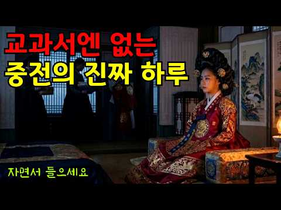
- 챕터: 0:00 새벽 네 시, 중궁전에 켜진 불 · 2:10 나라가 뽑는 왕비 - 금혼령과 삼간택 · 6:30 가례 육례와 책봉, 품계가 없는 사람 · 10:20 새벽 문안 - 국모이면서 며느리였던 자리 · 14:00 내명부, 수백 명을 다스리는 관리자 · 18:30 정치에 관여할 수 없지만 그 자체가 정치였던 존재 · 22:40 수라와 예복, 그리고 궁궐의 살림 · 27:00 후궁과의 관계, 적자를 낳으라는 압박 · 32:10 폐비 윤씨와 갑자사화 · 37:20 이레 만에 폐위된 왕비, 단경왕후 · 41:00 인현왕후와 장희빈 - 왕비 교체는 정치의 결과였다 · 46:30 왕실 의례와 예송, 상복이 권력을 바꾸다 · 51:00 궁궐의 밤, 인정과 파루 · 55:20 출산과 의녀, 목숨을 건 국가의 사업 · 60:00 궁녀들의 세계와 상궁의 힘 · 65:10 대비가 되어야 비로소 열리는 발언권 · 70:00 조선의 마지막 왕비까지 · 75:00 이름 대신 자리로 기억된 사람들
- 설명 앞부분: 조선에서 여성이 오를 수 있는 가장 높은 자리, 중전. 모든 궁녀가 무릎을 꿇고, 백관의 아내들이 머리를 숙이며, 왕조 전체가 국모라 부르던 자리입니다. 그런데 왜 어떤 양반 집안은 딸이 왕비 후보로 뽑혔다는 소식에 잔치가 아니라 통곡을 했을까요. 왜 어떤 왕비는 궁에 들어간 지 이레 만에 쫓겨났고, 어떤 왕비는 사약을 받았을까요. 조선왕조실록, 경국대전, 궁중 의궤, 승정원일기 등 기록을 바탕으로 새벽 네 시의 어둠에서 자정이 넘도록 꺼지지 않던 중궁전의 등불까지, 조선 중전의 하루를 처음부터 끝까지 복원했습니다. 이 영상은 확…
- 같은 채널 평소 대비 ×38.2 (채널 최근 롱폼 중앙값 14,804회) · 평소 영상: 매년 10명씩 죽였다 조선왕조실록이 직접 기록한 왕자 순화군의 실체 (14,804회) / 굶주림이 만들어낸 나라 ∣ 조선 오일장 오백 년의 숨겨진 역사 (14,527회)
- 대본 없음 (설명) — 음성인식이 끝나면 도입부·흐름이 들어감
- 댓글 85/105: 좋은 점 — 영상 1 · 감사·응원 1 · 더 알고 싶은 것 4 · 아쉬운 점 — 영상 1 · 반박·불만 — 의견 다름 0 · 정치·사회 1 · 경험 공유 1 · 구독·다음 기대 1
  - 좋은 점 — 영상 👍2 “유익한 영상 감사합니다 내레이션의 목소리도 듣기 편합니다 다음 영상도 기대하며 구독합니다 😊❤”
  - 감사·응원 👍2 “유익한 영상 감사합니다 내레이션의 목소리도 듣기 편합니다 다음 영상도 기대하며 구독합니다 😊❤”
  - 더 알고 싶은 것 👍23 “이런 콘텐츠는 오래오래 만들어 주세요.”
  - 더 알고 싶은 것 👍18 “그러면 간택 시험을 대충 봐서 떨어지면 되지 않을까 궁금하네요”
  - 아쉬운 점 — 영상 👍4 “집중할라치면광고가~~광고진짜많네요 이해는하지만적당히좀~~~ 구독은안하고시퍼~”
  - 정치·사회 👍6 “그런 효에 나라가 지금은 개에 나라가 됐다”
  - 구독·다음 기대 👍2 “유익한 영상 감사합니다 내레이션의 목소리도 듣기 편합니다 다음 영상도 기대하며 구독합니다 😊❤”

### 242. 이순신을 살린 대한민국 함대, 1598년 조선에 갇혔다 ∣ 1시간 Full Movie ∣ 4K

- https://www.youtube.com/watch?v=dUD9yKNxGps · 대한 타임슬립 본부 · 구독자 16,500 · 조회수 270,217 (×16.4, 하루 8,099.1) · 좋아요 1,893 (0.7%) · 60.4분 · 2026-09-25 · 주제 묶음 3. 조선 · 형식 몰아보기·통합본 (긴 영상) · 폴더 `W_dUD9yKNxGps` (웹 승인)
- 썸네일: 
- 챕터: 0:00 부산진·동래성 — 왜선 700척, 전쟁의 시작 · 7:27 노량 — 대한민국 함대가 1598년에 갇히다 · 22:20 체포령 — 이순신을 다시 잡아오라 · 32:22 부산 — 묶인 조선인을 태운 수송선 · 40:16 대마도 — 끌려간 백성을 되찾다 · 46:35 규슈 — 코무덤과 남겨진 기록 · 51:48 노량 — 왜선 300척, 다시 남해로 · 56:56 1603 — 현대 화력이 멈춘 뒤, 조선은 달라졌다
- 설명 앞부분: 1592년 부산진과 동래성에서 시작된 전쟁. 1598년 노량에서 이순신을 살린 대한민국 함대는 돌아가지 못했습니다. 그리고 그들은 조선에 남았습니다. 부산 회수, 대마도와 규슈, 코무덤에 남겨진 기록, 다시 조선을 향해 몰려온 왜선 300척. 그리고 1603년, 현대의 화력이 멈춘 뒤에도 스스로 침략을 막아내기 시작한 조선까지. 《대한국 프로젝트2 — 불침》 부산진·동래성 서막 + 전 7편 + 1603 확장 피날레를 하나의 장편으로 구성한 완성판 Full Movie입니다. ■ 작전 제작 노트 대한국 프로젝트를 처음 기획할 때, 하…
- 같은 채널 평소 대비 ×5.6 (채널 최근 롱폼 중앙값 48,098회) · 평소 영상: 400년 전 조선에 남겨진 한국 잠수함을 찾아갔다… 그런데 우리가 처음이 아니었다 ∣ 4K (67,754회) / 이순신 대마도 상륙, 대한민국 구축함이 왜군 포대를 쐈다 ∣ 대한국 프로젝트2 ∣ 4K (79,468회)
- 대본 없음 (설명) — 음성인식이 끝나면 도입부·흐름이 들어감
- 댓글 108/176: 좋은 점 — 영상 1 · 감사·응원 2 · 더 알고 싶은 것 7 · 아쉬운 점 — 영상 0 · 반박·불만 — 의견 다름 3 · 정치·사회 0 · 경험 공유 0 · 구독·다음 기대 0
  - 좋은 점 — 영상 👍1 “통 쾌 하 다 시 원 하 다 좋은영상 감사합니다 👏 👏 👏 👏 👏 👏 👏 👏 👏 👏 👏 👏”
  - 감사·응원 👍1 “통 쾌 하 다 시 원 하 다 좋은영상 감사합니다 👏 👏 👏 👏 👏 👏 👏 👏 👏 👏 👏 👏”
  - 감사·응원 👍1 “돌아가면 가짜 국방부에. 엄청깨지겠네. 그래도 고맙다”
  - 더 알고 싶은 것 👍7 “다음 전투영사아도 부탁드립니다 대한님!”
  - 더 알고 싶은 것 👍4 “해군의 어느 함정에서도 정복을 착용하고 근무하는 경우가 있으면 ✋️ 손 꼽아 보시오!(근무복/전투복으로 변경 부탁드립니다 🙏)😮”
  - 반박·불만 — 의견 다름 👍1 “통통배에 기계식 한다고 물바퀴을 할봐에야 뒤에 프로펠라 방식으로하지 말도안돼😂😂😂하긴 조선시대에 간자체 말이안돼지😢😢😢”
  - 반박·불만 — 의견 다름 👍0 “이지스함 중량이 얼마인데 그냥 깔아뭉개도 될일을 왜 함포를 쏘나요? 함포는 멀리서 쏘는 용도이고 항모전단이 대열을 이탈하는 것도 웃기는데 대열갖춰서 쏴도 당시 왜군을 다 물리칠만한 탄약이 존재하는지도 체크해야하는데 우리전단이 96셀 자랑하는 이지스함이 두어척에 구축함…”

### 243. 화학 지식도 없던 고대인은 어떻게 철을 만들어냈을까?

- https://www.youtube.com/watch?v=12EyJuBAyOg · 지구연구실 · 구독자 7,820 · 조회수 312,979 (×40.0, 하루 3,769.5) · 좋아요 1,950 (0.6%) · 25.7분 · 2026-08-06 · 주제 묶음 8. 문명·고고학 · 형식 정보·해설 (그 밖) · 폴더 `W_12EyJuBAyOg` (웹 승인)
- 썸네일: 
- 설명 앞부분: 철을 녹일 수도 없었던 고대 인류는 어떻게 철을 만들었을까요? 수천 년 전 철광석은 그저 붉고 무거운 돌에 불과했습니다. 하지만 이름 없는 고대 장인들은 숯과 화로, 풀무를 이용한 수많은 시행착오 끝에 돌 속에 숨어 있던 철을 꺼내기 시작했죠. 이 영상에서는 인류가 처음 접한 운석 철부터 철광석을 녹이지 않고 금속으로 바꾼 제련 기술, 화로에서 나온 검은 철 덩어리인 블룸, 그리고 연철이 강철로 발전한 과정까지 쉽고 재미있게 살펴봅니다. 고대 인류의 철 발견과 철기시대의 시작이 궁금했다면 영상에서 확인해 보세요. 지구의 오래된 이…
- 같은 채널 평소 대비 ×21.0 (채널 최근 롱폼 중앙값 14,873회) · 평소 영상: 인류는 어떻게 비누를 발명했을까? 물로 지워지지 않던 기름때를 없앤 뜻밖의 발견 (14,980회) / 인류는 어떻게 초콜릿을 만들었을까? 쓰디쓴 씨앗에서 시작된 뜻밖의 발견 (14,766회)
- 대본 없음 (설명) — 음성인식이 끝나면 도입부·흐름이 들어감
- 댓글 131/131: 좋은 점 — 영상 1 · 감사·응원 0 · 더 알고 싶은 것 4 · 아쉬운 점 — 영상 1 · 반박·불만 — 의견 다름 1 · 정치·사회 0 · 경험 공유 0 · 구독·다음 기대 0
  - 좋은 점 — 영상 👍0 “구구절절 늘어놓아서 들어줄수가없다”
  - 더 알고 싶은 것 👍3 “구리는 어떻게 구했고 청동의 비율은 또 어떻게 알았을까요?”
  - 더 알고 싶은 것 👍0 “숯은 어떻게 발견됐고 어떻게 제작 방법을 발전시켜왔는지도 다뤄주세요!”
  - 아쉬운 점 — 영상 👍1 “영상 내용은 괜찬은데 말 한 마디 나올때마다 나오는 영상이 너무 중구난방 ai티가 난다...”
  - 반박·불만 — 의견 다름 👍1 “우연에 우연이 겹치고 그 우연이 또 우연을 만나 우연을 낳고 그 낳은 우연이 대대손손 우연에 우연을 거쳐서 인류가 돌도끼를 만들고, 말도 안되는 우연이 청동기를 만들고, 인류가 어찌 어찌 하다보니 또 우연이 겹쳐서 철기가 도래했다.. 이렇게 우연을 가장한 생각을 하는…”

### 244. 조선시대에 키 180Cm가 넘으면 일어나는 일

- https://www.youtube.com/watch?v=6wCWuqNY_aw · 바람이들려준역사 · 구독자 2,470 · 조회수 88,847 (×36.0, 하루 1,184.4) · 좋아요 646 (0.7%) · 16분 · 2026-08-14 · 주제 묶음 3. 조선 · 형식 정보·해설 (그 밖) · 폴더 `W_6wCWuqNY_aw` (웹 승인)
- 썸네일: 
- 설명 앞부분: 📏 조선시대에 키가 180을 넘는다는 건 어떤 의미였을까요? 평균 161cm의 세상에서 홀로 우뚝 솟은 사람. 저잣거리를 걸으면 사람들이 하던 일을 멈추고 돌아봤고, 때로는 임금 앞까지 불려 갔다고 합니다. 그런데 그렇게 눈에 띄는 몸이 과연 그 사람에게 축복이었을까요? 🤔 아니면 우리가 짐작도 못 한 반전이 숨어 있는 걸까요? 이 영상에서는 실제 유골 계측 연구로 밝혀진 조선 사람들의 진짜 키, 그리고 '8척 장신'이라는 표현에 숨은 놀라운 함정을 하나하나 파헤칩니다. 📜 평균 161cm의 세상에서 큰 키를 가진 사람은 집에서,…
- 같은 채널 평소 대비 ×93.5 (채널 최근 롱폼 중앙값 950회) · 평소 영상: 대만도, 몽골도 지운 강희제가 이미 손에 넣은 조선만은 통째로 삼키지 않은 진짜 이유 ∣… (950회) / [폐비 윤씨] "피 토하며 죽은 적 없다!" 500년 동안 대한민국을 속인 사약 사건의 … (938회)
- 대본 없음 (설명) — 음성인식이 끝나면 도입부·흐름이 들어감
- 댓글 181/181: 좋은 점 — 영상 2 · 감사·응원 0 · 더 알고 싶은 것 0 · 아쉬운 점 — 영상 5 · 반박·불만 — 의견 다름 9 · 정치·사회 5 · 경험 공유 9 · 구독·다음 기대 0
  - 좋은 점 — 영상 👍5 “국가에서 종족번식을 위해서 특별히 관리하고 국방력에 도움이 되도록했을것 같다.”
  - 아쉬운 점 — 영상 👍17 “내용이 좀 헛소리가 길어서 수면제로 쓰려했는데 잠도안오네”
  - 아쉬운 점 — 영상 👍2 “아..겁나 지루하다...”
  - 반박·불만 — 의견 다름 👍17 “내용이 좀 헛소리가 길어서 수면제로 쓰려했는데 잠도안오네”
  - 반박·불만 — 의견 다름 👍4 “이순신도 184였다는데 뭐가 저게 대단하다고?? 조선시대 사람들은 키가 난장이똥자루인줄 알았나 봐. 그 때 사람들 무덤 파헤쳐 유골의 신장 조사해보니 현대인들과 별 차이도 없어!! 또 잘 먹으면 키가 커진다는 말도 안되는 억지꾼이 나섰군!~”
  - 정치·사회 👍0 “조선만 그런게 아니고 산업혁명 전까지 모든 나라가 그랬어요... 그리고, 키큰유전자를 선호하는것은 외형적인 아름다움을 추구하는것이고, 그건 먹고살만해져야 가능한거죠.”
  - 정치·사회 👍0 “이게 말이 안맞는게 조선후기 또는 구한말에 왔던 서양의 외국인들이 말하는게 조선사람들은 키가 컷다고 합니다. 실제 구한말의 남자를 찍은 사진을 보면 제법 키가 큰 사진들이 많아보였습니다. 160cm이라는 키는 구한말이 되면서 각종수탈로 먹기 힘들어지면서 대부분의 영양…”
  - 경험 공유 👍3 “제가 180넘는데 어릴때는 큰키였는데 요즘 아이들이 커서 중간인듯 내 동생도 내보다 크고 할머니께 들은 바로는 고조부께서는 나보다 훨씬 크고 손도 엄청 컸다고 하시던데”
  - 경험 공유 👍1 “나도 살면서 손해 많이 봤다. 끊임없이... 끝도 없이...”

### 245. 직업이 없던 시대, 고대 인류는 하루 종일 무엇을 했을까? ∣ 인류역사

- https://www.youtube.com/watch?v=MbnWhQOwocM · 태고의 세계 · 구독자 714 · 조회수 52,534 (×73.6, 하루 342.3) · 좋아요 728 (1.4%) · 11.6분 · 2026-05-27 · 주제 묶음 1. 역사 일반·이야기 · 형식 오디오북·낭독 (명언·인생조언) · 폴더 `W_MbnWhQOwocM` (웹 승인)
- 썸네일: 
- 설명 앞부분: 인류 역사 대부분의 시간 동안 인간은 “직업” 없이 살았습니다. 상사도 없었고, 월급도 없었으며, 끝없는 일정도 없었습니다. 사람들은 하루 몇 시간만 먹을 것을 구했고, 남은 시간에는 예술을 만들고, 음악을 연주하고, 이야기를 나누며 살아갔습니다. 하지만 농업이 등장하면서 모든 것이 바뀌기 시작했습니다. 이 영상은 인류 존재의 99% 동안 인간이 실제로 어떻게 살았는지를 탐험합니다. 그리고 우리가 무엇을 얻고, 무엇을 잃었는지 보여줍니다.
- 같은 채널 평소 대비 ×153.6 (채널 최근 롱폼 중앙값 342회) · 평소 영상: 고대 인류는 매일 술에 취해 있었다 ∣ 인류역사 (342회) / 당신의 혈액형은 2천만 년 전부터 정해져 있었다 ∣ 인류역사 (345회)
- 대본 없음 (설명) — 음성인식이 끝나면 도입부·흐름이 들어감
- 댓글 209/209: 좋은 점 — 영상 0 · 감사·응원 2 · 더 알고 싶은 것 1 · 아쉬운 점 — 영상 3 · 반박·불만 — 의견 다름 1 · 정치·사회 1 · 경험 공유 5 · 구독·다음 기대 0
  - 아쉬운 점 — 영상 👍1 “근데 현대사회에서 모든 노동을 줄여주는 기술이 발달했음에도 불구하고 하루 8시간을 일하고. 일끝나면 넋다운되어 밥먹고 자야하는 하루의 반복이라니ㅠ 내가 버는 돈은 겨우 먹고 살만큼인데 왜 이렇게 힘들게 사는걸까요ㄷㄷ누구를 위하여 나의 소중한 시간과 노동을 쓰고 있나요…”
  - 반박·불만 — 의견 다름 👍1 “먹고살아야했기에 더 힘들게 움직이며 살았으니 몸이 튼튼한거다. 뭔 말도안되는 결론을 내냐”
  - 정치·사회 👍0 “맞아..맞아요. 그래서 초기 농경인들은 혐오와 질시의 대상이 되었죠. 화전농이 시초였고 숲을 불태워 버렸으니까요. 구전된 고대 설화에서는... 농경혐오의 흔적을 엿볼수 있습니다. 기독교 바이블... 실낙원 ㅡ 과수재배 혐오. 출애굽기 ㅡ 대규모 농경 생태파괴. 카인과…”
  - 경험 공유 👍32 “6년째 지속되고 있는 나의 일상이 꼭 이런 일상이네 가진것 별로 없어도 마음 내키는대로 사는 삶 내가 원시인이네”
  - 경험 공유 👍10 “제가 그때 살았었는데 구석기 시대가 나름 웰빙이었습니다 고기도 많이 먹고 문제는 빙하기 겨울이었음 훈제육포 만들고 집 보수하는게 일상이었음”

### 246. 세조는 왜 정순왕후를 죽이지 못했나?ㅣ조선왕조실록ㅣ조선역사ㅣ단종ㅣ

- https://www.youtube.com/watch?v=rNcjDyncTfI · 콕역사 · 구독자 1,540 · 조회수 124,929 (×81.1, 하루 735.7) · 좋아요 2,147 (1.7%) · 48.5분 · 2026-05-11 · 주제 묶음 3. 조선 · 형식 정보·해설 (그 밖) · 폴더 `W_rNcjDyncTfI` (웹 승인)
- 썸네일: 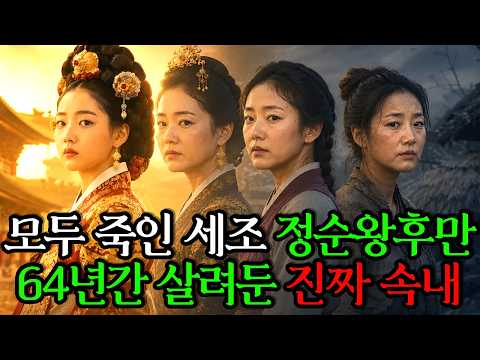
- 설명 앞부분: 조선 역사상 가장 잔혹한 권력 다툼. 세조는 왜 조카 단종을 죽이고도, 정순왕후 송씨만은 64년 동안 살려두었을까요? 이번 영상에서는 조선 6대 왕 단종과 그의 왕비 정순왕후의 비극적인 삶, 그리고 세조가 남긴 기묘한 명령 “노비이되, 아무도 범하지 못하게 하라” 그 숨겨진 의미를 깊이 있게 따라가 봅니다. 👍이 영상은 생성형 AI로 제작되었습니다. 댓글은 다음 역사 콘텐츠 제작에 큰 힘이 됩니다.
- 같은 채널 평소 대비 ×570.5 (채널 최근 롱폼 중앙값 219회) · 평소 영상: 최하층 노비에서 정1품 빈까지 올라간 여인. 신빈김씨ㅣ세종대왕후궁ㅣ조선시대신분상승ㅣ (219회) / "시인 백석을 사랑한 기생" 평생모은 1000억 기부이야기 l 길상사ㅣ백석ㅣ한국사 (347회)
- 대본 없음 (설명) — 음성인식이 끝나면 도입부·흐름이 들어감
- 댓글 210/210: 좋은 점 — 영상 0 · 감사·응원 2 · 더 알고 싶은 것 0 · 아쉬운 점 — 영상 2 · 반박·불만 — 의견 다름 0 · 정치·사회 5 · 경험 공유 2 · 구독·다음 기대 0
  - 아쉬운 점 — 영상 👍1 “수양대군은 권력욕과 탐욕이 극에 달했던 인물로 평가받으며, 그의 행동은 가족까지 희생시키는 잔혹함을 보여줍니다. 겉으로는 담대해 보였지만, 내면에는 깊은 두려움과 불안을 가진 인간이었을 가능성이 큽니다. 한국 역사 속 배신과 밀고는 시대를 막론하고 반복되었으며, 특히…”
  - 아쉬운 점 — 영상 👍0 “말이 너무길다 유치원생도 지겹겠다 나머지는 구독자 몫으로 둬야지 생각까지 설명해주냐 멍청해”
  - 정치·사회 👍3 “요즘으로치면 이재명같은 놈이네 죄명아 권력이 영원할것같나 너도 머지 않았다 역사가 증거하잖아”
  - 정치·사회 👍3 “권력은 오래 가지 않는다. 언제 머지 않아 심판 받는다. 더듬어당과 이죄명 정권 기억해야 한다.”
  - 경험 공유 👍4 “잘들었습니다! 세조가 물품을 보냈다는걸로 알고있어서 연민이 없지않아 있었구나 생각했었는데 다르게 듣고보니 아닐수도 있구나 싶네요”
  - 경험 공유 👍0 “좋아했었나??”

### 247. [🌙조선시대] 조선 산성방어 왜 무너졌나? - 병자호란

- https://www.youtube.com/watch?v=TiyiiqTQTWs · 별빛연대기 · 구독자 3,030 · 조회수 31,401 (×10.4, 하루 1,441.5) · 좋아요 83 (0.3%) · 100.7분 · 2026-10-06 · 주제 묶음 3. 조선 · 형식 수면·낭독 (잠잘 때 듣는) · 폴더 `W_TiyiiqTQTWs` (웹 승인)
- 썸네일: 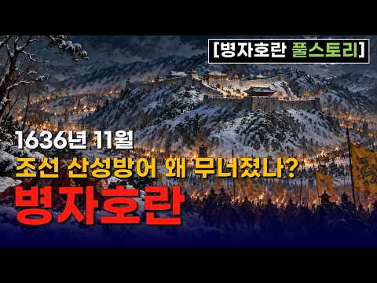
- 설명 앞부분: 🌙 잠자기 전에 듣는 역사이야기 — 병자호란 풀스토리 1636년 겨울, 청 태종 홍타이지가 이끄는 청군이 압록강을 넘어 조선으로 진격합니다. 불과 열흘 남짓한 시간 만에 청군은 한양 가까이까지 도달했고, 인조와 조선 조정은 남한산성으로 들어갑니다. 그러나 혹독한 겨울. 끊어져 가는 식량과 군량. 도착하지 못한 근왕군. 그리고 강화도의 함락. 남한산성 안에서는 끝까지 싸워야 한다는 척화론과 백성과 나라를 보존하기 위해 화의를 해야 한다는 주화론이 충돌합니다. 결국 1637년 음력 1월 30일, 인조는 남한산성을 나와 삼전도로 향합니…
- 같은 채널 평소 대비 ×4.0 (채널 최근 롱폼 중앙값 7,805회) · 평소 영상: [🌙별빛 전투사 ] 1편 전격전의 서막, 폴란드 침공 (7,805회) / [🌙한국전쟁] 북한군의 남하를 늦춘, 국군 제6사단의 6일 - 춘천,홍천 전투 (8,912회)
- 대본 없음 (설명) — 음성인식이 끝나면 도입부·흐름이 들어감
- 댓글 13/13: 좋은 점 — 영상 1 · 감사·응원 1 · 더 알고 싶은 것 0 · 아쉬운 점 — 영상 0 · 반박·불만 — 의견 다름 0 · 정치·사회 0 · 경험 공유 0 · 구독·다음 기대 0
  - 좋은 점 — 영상 👍2 “삼전도 장면으로 시작해서 끝까지 몰입해서 봤습니다. 정묘호란부터 차근차근 짚어주시니 왜 그 지경까지 갔는지 비로소 이해가 되네요. 잘 봤습니다”

### 248. [𝙋𝙡𝙖𝙮𝙡𝙞𝙨𝙩] 세종대왕이 경복궁에서 야근하며 듣던 가야금 재즈

- https://www.youtube.com/watch?v=q3oC3zdfyw4 · 조선재즈 · 구독자 10,200 · 조회수 652,072 (×63.9, 하루 4,722.9) · 좋아요 23,189 (3.6%) · 180.7분 · 2026-06-12 · 주제 묶음 2. 한국 고대·삼국·고려 · 형식 정보·해설 (그 밖) · 폴더 `W_q3oC3zdfyw4` (웹 승인)
- 썸네일: 
- 설명 앞부분: 세종대왕도 야근은 힘들었을 겁니다. 경복궁 깊은 밤, 촛불 아래 가야금이 흐릅니다. 조선의 밤과 재즈가 만났습니다:)
- 같은 채널 평소 대비 ×121.2 (채널 최근 롱폼 중앙값 5,379회) · 평소 영상: [𝙋𝙡𝙖𝙮𝙡𝙞𝙨𝙩] 세종대왕도 주식 물렸다📉 ∣ 조선 가야금 재즈 (5,404회) / [𝙋𝙡𝙖𝙮𝙡𝙞𝙨𝙩] 세종대왕이 코딩하며 들었던 가야금 재즈 (5,354회)
- 대본 없음 (설명) — 음성인식이 끝나면 도입부·흐름이 들어감
- 댓글 469/483: 좋은 점 — 영상 2 · 감사·응원 8 · 더 알고 싶은 것 6 · 아쉬운 점 — 영상 2 · 반박·불만 — 의견 다름 4 · 정치·사회 1 · 경험 공유 10 · 구독·다음 기대 5
  - 좋은 점 — 영상 👍0 “생활안복 자주 입는데, 한복입고 어디 놀러갈때 듣기 좋아요. 굿뜨 뭐랄까 혼자 마패를 들고 암행어사 하러 가는 기분이랑 연모하는 사내 담벼락에 훔쳐보러 가는 기분”
  - 좋은 점 — 영상 👍0 “너무좋아요 나도만들고싶네요 많이배우고갑니다❤❤❤❤❤❤❤”
  - 감사·응원 👍5 “와.... 가야금 너무 좋아하는데 이런 귀한 플리를 올려주시다니 감사합니다....”
  - 감사·응원 👍4 “오 좋아요... 제작 감사함당 잘 들을게요”
  - 더 알고 싶은 것 👍3 “구독 좋아요 알림설정합니다. 한국의 미를 잃지 않는 퓨전음악 많이 부탁드립니다. 덕분에 출근길이 즐거워요.”
  - 더 알고 싶은 것 👍1 “집현전 학자들 편도 부탁합니다. 엄지척!”
  - 아쉬운 점 — 영상 👍7 “ㅋㅋㅋㅋㅋㅋㅋ 고얀 AI 같으니라고”
  - 아쉬운 점 — 영상 👍3 “구간반복해서 들을 수 있게 해주세요”
  - 반박·불만 — 의견 다름 👍4 “와 재즈 좋아하는데 가야금과 재즈가 이렇게 잘 어울리다니. 가야금의 선율이 그루비해서 깜짝 놀랐습니다. AI 작곡이란데서 한번 더 놀람.. 말도안됨 😂”
  - 반박·불만 — 의견 다름 👍1 “절대음감이라 AI 음악이 맞으실 수도ㅋㅋㅋ 근데 저렇게 누워 계실 분이 아닌데 두 눈 부릅 뜨고 계셔야 하지 않을까요?”
  - 정치·사회 👍0 “전하 .. 요즘 나라가 말이 아닙니다 이걸 어찌해야 된답니까 ...”
  - 경험 공유 👍9 “클래식 공부를 어릴때 부터 하면서 재즈도 같이 조금 했었는데 살면서 들은 재즈 중에 제일 좋습니다….”
  - 경험 공유 👍3 “세종대왕도 야근하는데 내가 뭐라고”
  - 구독·다음 기대 👍3 “구독 좋아요 알림설정합니다. 한국의 미를 잃지 않는 퓨전음악 많이 부탁드립니다. 덕분에 출근길이 즐거워요.”
  - 구독·다음 기대 👍1 “가능하구나 재즈라는 것이!!!! 감탄하고 구독하고 갑니다~!”

### 249. 왕이 되지 못한 조선 왕자들의 충격적인 진짜 삶 #조선시대 #조선역사 #역사이야기

- https://www.youtube.com/watch?v=cuwkTGyvORY · 담너머 조선 이야기 · 구독자 4,640 · 조회수 173,724 (×37.4, 하루 2,146.9) · 좋아요 753 (0.4%) · 22분 · 2026-08-08 · 주제 묶음 1. 역사 일반·이야기 · 형식 정보·해설 (그 밖) · 폴더 `W_cuwkTGyvORY` (웹 승인)
- 썸네일: 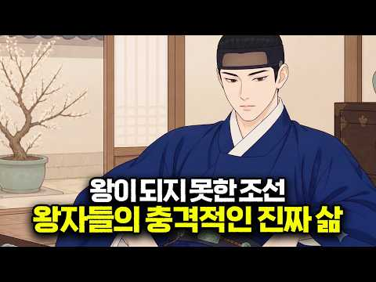
- 설명 앞부분: 화려한 왕실의 피를 타고났지만, 왕관을 쓰지 못한 조선의 왕자들. 세자가 되지 못한 대군과 군들은 궁궐 밖으로 나가 평생을 어떤 모습으로 살아가야 했을까요? 왕권을 위협할 수 있다는 이유로 평생 조정의 정치 참여가 철저히 금지되었고, 작은 언행 하나에도 역모의 혐의를 뒤집어쓸 수 있었던 살얼음판 같았던 삶. 어떤 왕자는 예술과 유흥에 몰두하며 자신에게 야심이 없음을 증명해야 했고, 어떤 왕자는 끊임없는 견제 속에서 비극적인 결말을 맞이해야 했습니다. 권력의 중심에서 밀려난 채 평생을 감시와 불안 속에서 살아가야 했던 조선 왕자들의…
- 같은 채널 평소 대비 ×19.5 (채널 최근 롱폼 중앙값 8,914회) · 평소 영상: 사극에서는 보여주지 않는 조선시대 백정의 삶 #조선시대 #조선역사 #역사이야기 (8,914회) / 약과와 유과는 꿈도 못 꾸던 조선 백성들은 간식으로 뭘 먹었을까? #조선시대 #조선역사 … (7,377회)
- 대본 없음 (설명) — 음성인식이 끝나면 도입부·흐름이 들어감
- 댓글 119/119: 좋은 점 — 영상 0 · 감사·응원 0 · 더 알고 싶은 것 1 · 아쉬운 점 — 영상 1 · 반박·불만 — 의견 다름 3 · 정치·사회 2 · 경험 공유 3 · 구독·다음 기대 0
  - 더 알고 싶은 것 👍1 “대군들의 아들들은 군으로 책봉되기도 하고, 그냥 군의 아들이면 똑같은 군이 되거나 아예 아뮤런 호칭이 없는 경우도 있던데, 기준이 무엇인지 알고 싶네요”
  - 아쉬운 점 — 영상 👍2 “Ai로 영상도 제대로 못 뽑아내 그렇다고 자막이나 한국어에 맞게 뽑아 내기를 해. 이거 한국인이 운영하는 채널 맞기는 함?”
  - 정치·사회 👍15 “정확하게는 왕족이 정걔전출을 법으로 금지한 시기는 성종때부터 입니다 종친사환금지법으로 정계진출을 막은것이죠 아이러니하게도 성종이 이런법울 만든게 자기 친할아버지 세조가 계유정난을 일으켜 정권을 장악하고 왕위를 찬탈까지 하면서 입니다 할아버지가 쿠데타를 일으켜 왕이된 …”
  - 경험 공유 👍1 “우리집이 세종의아들 임영대군파던데 내 조상이 저런삶을 사셨겠네”
  - 경험 공유 👍0 “이거 아님. 왕실 신용을 바탕으로 무역을 했었어요...”

### 250. 교과서에서 자세히 다루지 않는 조선 왕실 기록 10가지 ∣ 3시간 몰아보기

- https://www.youtube.com/watch?v=n-4NHLlhbts · 세상의모든역사 · 구독자 4,100 · 조회수 270,147 (×65.9, 하루 1,863.6) · 좋아요 3,555 (1.3%) · 213.2분 · 2026-06-05 · 주제 묶음 3. 조선 · 형식 수면·낭독 (잠잘 때 듣는) · 폴더 `W_n-4NHLlhbts` (웹 승인)
- 썸네일: 
- 챕터: 0:00 🌙 인트로: 518년의 기록, 조선왕조실록이 감춘 위… · 3:46 🥀 제1부: 세종의 눈물과 며느리들의 비극 - 휘빈 … · 31:37 ⚔️ 제2부: 피로 세운 왕권, 태종 이방원 - 형제… · 56:58 📦 제3부: 임오화변의 진실 - 영조는 왜 아들 사도… · 77:46 🏛️ 제4부: 사육신과 단종 - 역적으로 기록되었다가… · 100:42 🌊 제5부: 광해군, 폭군인가 성군인가? - 전란을 … · 122:12 🌸 제6부: 정조 독살설의 미스터리 - 개혁 군주가 … · 135:08 🏹 제7부: 의적 임꺽정의 실체 - 백정이 도적이 될… · 168:06 ❄️ 제8부: 비운의 세자, 소현세자 - 9년의 인질… · 148:52 🔥 제9부: 장희빈과 숙종 - 사랑과 권력 사이에서 … · 187:50 🕯️ 제10부: 을미사변, 건청궁의 새벽 - 제국의 … · 210:04 🌙 에필로그: 실록이 우리에게 남긴 질문 - 기록된 …
- 설명 앞부분: 🌙틀어놓고 주무세요 성군 세종은 며느리 두 명을 폐출했고, 영조는 자신의 아들을 뒤주에 가뒀으며, 광해군과 장희빈은 후대에 전혀 다른 평가를 받게 됐습니다. 사도세자와 사육신, 정조의 죽음, 임꺽정, 소현세자와 명성황후까지. 조선왕조실록을 중심으로 『한중록』과 후대 기록, 당대의 여러 자료를 함께 따라가며 우리가 익숙하게 알고 있던 조선의 인물과 사건을 다시 들여다봅니다. 누가 성군이고 누가 폭군이었는지를 다시 정하는 이야기가 아닙니다. 기록에 무엇이 남았고, 무엇은 후대에 덧붙여졌으며, 같은 사건이 시대에 따라 어떻게 다르게 기…
- 같은 채널 평소 대비 ×261.8 (채널 최근 롱폼 중앙값 1,032회) · 평소 영상: 쿠빌라이는 왜 두 번이나 일본을 공격했나｜1274·1281 몽골 일본 원정의 모든 흐름 (1,032회) / 고려 시대 딸들이 조선보다 훨씬 부자였다? 700년 재산권의 역사 (1,162회)
- 대본 없음 (설명) — 음성인식이 끝나면 도입부·흐름이 들어감
- 댓글 193/350: 좋은 점 — 영상 4 · 감사·응원 19 · 더 알고 싶은 것 0 · 아쉬운 점 — 영상 1 · 반박·불만 — 의견 다름 1 · 정치·사회 3 · 경험 공유 1 · 구독·다음 기대 1
  - 좋은 점 — 영상 👍16 “너무 목소리가 편안하고 듣기 좋아요. 유익한 클립입니다. 잘때 들어도👍🏻”
  - 좋은 점 — 영상 👍6 “잘 본곤 아니구영 아주 자알 들었습니다 감사합니다 유익했어요!! 꾸벅!!”
  - 감사·응원 👍28 “ㅂㅓㄹ칙은 부모로서 줄수 있다. 그러나 그 땡볕에 왜 하필이면 뒤주였고 왜 땡볕이고. 왜 굶겨 죽게 했나! 역사가들은 아무도 그 이유가 한개도 없다! 세상에! 이런식으로 벌칙이나 잘못을 물은 부모는 이세상에 어디에도 없을거다! 사도세자를 옹호하지 않는다.하지만 영조는…”
  - 감사·응원 👍14 “이런 일들이 없었다면 우리나라는 지금 다른 모습이 되어 있을 겁니다. 하지만 모든 일들을 통해 배우면서 로 나아가야 되겠죠! 가슴아픈 삶의 이야기 감사합니다.”
  - 아쉬운 점 — 영상 👍1 “참 고맙습니다 ㆍ역사를 다시 상세하게 지루하지않게 아니 호기심 가득한 마음으로 그대의 맑은 음성으로 휴일 아침 긴 시간을 보냈습니다ㆍ경기도 양평 에서 듣고 있습니다ㆍ아프고 아픈 사연 많은 조선의 역사 ㅋ 예나 지금이나 정치의 세켸는 ~~ㅠ 감사합니다ㆍ팔십 노인이 고마…”
  - 반박·불만 — 의견 다름 👍0 “세종이 왜 그렇게 위인인지 이해가 안 된다..한글도 백성위해 만든 것도 아닌데 정치도 못 했고 백성 입장에서는 최악의 왕인데”
  - 정치·사회 👍0 “1882년군인들의밥에모래 운형궁 창덕궁으로명서왕후숨어서 외국인들의의해 갑신정변 청나라에게클려들어감”
  - 정치·사회 👍0 “청일전쟁 1895년 라우둥반도 모든것을움직이는이 미우라구르특명 여우사냥 운여궁 가마에태워경복궁으로명성황후를잡으려 복도를달리다넘어짐 외국인여인으넘어 트려칼로찌름 녹원석유뿌려죽임 창원지로 남양주 6시간후 재판증거불충분으로불려짐 아관파천1897년 명성황후로명함 🎉🎉🎉🎉 1…”
  - 경험 공유 👍0 “숙종은장옥정에게사약43살아들보게해달라하고망쳤다 사년째 죽음 계장을먹고 인현왕후 숙종은😅😅😅”
  - 구독·다음 기대 👍4 “기대합니다”

### 251. 조선왕조 518년 1대 태조부터 27대 순종까지 한번에ㅣ조선 역사ㅣ한국사

- https://www.youtube.com/watch?v=U8mDpoSE4DA · 하옥리책방 · 구독자 7,170 · 조회수 463,308 (×64.6, 하루 3,221.8) · 좋아요 5,264 (1.1%) · 27.9분 · 2026-06-06 · 주제 묶음 3. 조선 · 형식 정보·해설 (그 밖) · 폴더 `W_U8mDpoSE4DA` (웹 승인)
- 썸네일: 
- 설명 앞부분: 조선 1대 태조 이성계부터 27대 순종까지, 518년 동안 왕좌에 앉았던 스물일곱 명의 왕을 한 명도 빠짐없이 순서대로 정리했습니다. 각 왕의 대표 업적은 물론, 그 시대에 어떤 일이 벌어졌는지, 왕과 왕 사이에 어떤 연결고리가 있었는지까지 하나의 흐름으로 꿰었습니다. 위화도 회군으로 시작된 나라가 한일병합으로 끝나기까지, 27명의 선택이 만든 518년의 기록을 지금 확인하세요. 📚 다루는 왕 (순서) 태조 → 정종 → 태종 → 세종 → 문종 → 단종 → 세조 → 예종 → 성종 → 연산군 → 중종 → 인종 → 명종 → 선조 → 광…
- 대본 없음 (설명) — 음성인식이 끝나면 도입부·흐름이 들어감
- 댓글 134/134: 좋은 점 — 영상 5 · 감사·응원 10 · 더 알고 싶은 것 1 · 아쉬운 점 — 영상 0 · 반박·불만 — 의견 다름 1 · 정치·사회 3 · 경험 공유 0 · 구독·다음 기대 0
  - 좋은 점 — 영상 👍6 “75세 할머니가 늘 궁금했던 이조 역사에 이해하기 쉽게 해주세서 너무 감사합니다.노트에 메모하며 몇번을 듣고있읍니다 고맙습니다”
  - 좋은 점 — 영상 👍6 “영조 조선시대 왕의 계보가 정리된 영상 최고 입니다. 잘 봤습니다”
  - 감사·응원 👍6 “75세 할머니가 늘 궁금했던 이조 역사에 이해하기 쉽게 해주세서 너무 감사합니다.노트에 메모하며 몇번을 듣고있읍니다 고맙습니다”
  - 감사·응원 👍3 “구독과 좋아요로 응원합니다. 매우매우 아름다운 영상 👏 ✨️”
  - 더 알고 싶은 것 👍1 “19대 숙종에 대해 알고싶어요 여야당을 바껴가며 정치 판을 움직였다면 그 누구도 무서워하지않고 왕의자리였을꺼같은데 희빈을 왜 사약을줬는지...그아들은왕이되었을때 그 여파는없었는지..”
  - 반박·불만 — 의견 다름 👍3 “정확히 끌어내렸습니다 아니죠 12대 인종 한국 나이31세. 불과 8개월만에 병사”
  - 정치·사회 👍2 “우주통일 대통령 일론 머스크가 아닌 대한민국 통일임시정부 초대 통일대통령 김두기 시인 축전!!! 역사를 잃어버린 민족에게 미래는 없습니다!!! 일제치하 대한민국 임시정부가 민족의 역사적 정통성을 지켜 왔듯이 분단치하 민족의 역사적 정통성은 대한민국 통일임시정부가 지켜…”
  - 정치·사회 👍2 “1457년 17세 세조 이미지 헌법 문서 법전을 남인 한명회 자기손 최대 조선 6섯 운영 시스템 연산군 초기 뒤틀린 1405년 반전공신 개혁 소격서 좌절 제임 20년 문종 14년 선종 북쪽 이순신 바다 전세 뒤집어 초토화 세계대통령 선거 아멘 할렐루야 대한민국 감사합…”

### 252. "나는 조선의 국모다" 이거 정말 맞는건가? 민비에 대한 A부터 Z까지!!

- https://www.youtube.com/watch?v=246Gb3xy0oM · 매불월드 · 구독자 3,060 · 조회수 201,656 (×65.9, 하루 1,368.4) · 좋아요 2,633 (1.3%) · 27.5분 · 2026-06-03 · 주제 묶음 3. 조선 · 형식 브이로그·직접 해본 이야기 · 폴더 `W_246Gb3xy0oM` (웹 승인)
- 썸네일: 
- 설명 앞부분: 역사학자 썬킴이 구한말 명성황후와 흥선대원군 간의 권력 갈등 및 임오군란 전후의 외교적 선택들을 분석합니다. 역사적 사실을 바탕으로 당시 조선의 재정 및 정세 변화를 입체적으로 조명합니다.매불월드는 방대한 영상 속에서 재미있고 의미 있는 장면을 선별해 자막과 편집을 통해 새롭게 재구성합니다. 단순한 영상 전달이 아닌, 핵심 포인트를 더 살리고 맥락을 쉽게 이해할 수 있도록 해설 자막과 편집을 직접 제작하여 콘텐츠의 완성도를 높이고 있습니다. 본 영상은 비평, 정보 전달, 교육적 목적을 기반으로 공정하게 인용되었으며, 유튜브 가이드…
- 같은 채널 평소 대비 ×328.4 (채널 최근 롱폼 중앙값 614회) · 평소 영상: 우리가 먹는 탕수육은 어떻게 시작됐을까? 이름과 탄생의 배경 (614회) / 태극기를 달라고 했던 토트넘 팬, 그날 현장에서 벌어진 일 (531회)
- 대본 없음 (설명) — 음성인식이 끝나면 도입부·흐름이 들어감
- 댓글 411/411: 좋은 점 — 영상 3 · 감사·응원 2 · 더 알고 싶은 것 2 · 아쉬운 점 — 영상 1 · 반박·불만 — 의견 다름 12 · 정치·사회 31 · 경험 공유 17 · 구독·다음 기대 0
  - 좋은 점 — 영상 👍6 “팩트도 맞고 나도 어릴때 민비나쁜여자. 흥선 좋은위인이라고 배웠는데 세월이 지나면서 재평가 됐다. 민비는 조선에 기관총을 수입해서 무장할려고 했고 흥선은 쇄국정책으로 아까운시간 다 날려먹었다.”
  - 좋은 점 — 영상 👍3 “맛 칼럼니스트도 하시던 분이 민비 뮤지컬보다 소리 치셨다는 이야기를 들었는데 정말 이해가 되네..”
  - 감사·응원 👍53 “썬킴 역사이야기 우리나라에서는 최고 항상 응원합니다”
  - 감사·응원 👍21 “썬킴선생님 늘 재밌게 역사를 배웁니다 감사합니다”
  - 더 알고 싶은 것 👍2 “썬킴님의 개인적인 사견일뿐입니다. 영어강사가 언제부터 역사가가 되셨나요?”
  - 아쉬운 점 — 영상 👍4 “일제강점기 해방도 미국, 625 주적에게 멸망할뻔한거 구해준것도 미국. 근데 지금 반미운동?? 북한이 이제 우리나라에 무장공비를 보낼 필요도 없어요^^”
  - 반박·불만 — 의견 다름 👍224 “도대체 내가 조선의 국모다 하는 말도안돼는 오페라를 20여년간 그것도 국립극장에서 공연이 가능케한 쌉새들은 도대체 누구여?”
  - 반박·불만 — 의견 다름 👍5 “얘가 미쳤나? 공부안해? 명성황후가 재정을 날렸다고? 헛소리. 흥선이 무리한 경복궁재건으로 재정파탄낸거 아니고? 명성황후 사치 청군요청은 사실이 아니라는게 밝혀졌는데도 헛소릴하는군 민자영도 소설속 이름이지. 본명이니? 허위사실 유포다”
  - 정치·사회 👍107 “민비가 머리가 좋은건 안좋은 쪽으로 머리가 비상했던거임 ~ 나라가 망하는데 민씨가문해먹을 생각만 하고 정권유지시키는데만 관심이 있었음”
  - 정치·사회 👍82 “한국 화폐의 인물도 정말 기가 막힙니다!!! 사용하지도 않는 100원짜리 동전에 충무공이 자리 하신다는게 말이 되나요!!! 당연히 훌륭하신 분들이지만, "율곡 이이" "퇴계 이황" 같은 분들의 업적이 무엇인가요!!!! 십만양병설!!! 이기일원론!!! 그게 뭔가요?? …”
  - 경험 공유 👍224 “도대체 내가 조선의 국모다 하는 말도안돼는 오페라를 20여년간 그것도 국립극장에서 공연이 가능케한 쌉새들은 도대체 누구여?”
  - 경험 공유 👍63 “2001년작 이미연 주연의 드라마 "명성황후"가 히트치면서 "내가 조선의 국모다"라는 대사가 널리 유행하고, 뮤지컬로도 만들어짐.”

### 253. 왕은 하루에 몇 번이나 잠자리를 했을까? ∣ 조선시대 왕 잠자리 횟수 ∣ 조선 왕실 성생활 기록

- https://www.youtube.com/watch?v=HbrtYNiPNdA · 비사록 · 구독자 7,460 · 조회수 363,116 (×48.7, 하루 3,328.5) · 좋아요 6,931 (1.9%) · 27.3분 · 2026-07-11 · 주제 묶음 3. 조선 · 형식 정보·해설 (그 밖) · 폴더 `W_HbrtYNiPNdA` (웹 승인)
- 썸네일: 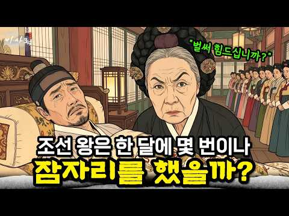
- 챕터: 0:00 인트로 · 1:15 파트 1. 합방의 절차 — 문 하나 사이의 여덟 상궁 · 4:02 파트 2. 날짜를 정하는 사람 — 왕도 못 정한 그날… · 6:25 파트 3. 한 달에 몇 번? — 조선과 중국의 차이 · 7:25 파트 4. 왕비와 후궁, 정치가 된 하룻밤 · 11:47 파트 5. 거부당한 밤 — 왕과 여인들의 선택 · 14:32 파트 6. 승은 한 번의 운명 — 무수리에서 왕의 어… · 19:52 파트 7. 감시받는 몸, 감시받는 침실 · 23:38 파트 8. 간택이라는 이름의 국가 행사 · 25:44 결론 — 왕의 밤이 왕조의 미래였던 이유
- 설명 앞부분: 👑 조선의 왕은 절대 권력자였지만, 침실에서만큼은 스스로 아무것도 결정할 수 없었습니다. 오늘 밤 누구를 만날지조차 상궁과 국가가 정했던 그 은밀한 역사를 풀어봅니다. 이 영상에서는 조선시대 왕의 잠자리 절차와 상궁들의 감시 체계, 왕비와 후궁 사이의 서열을 다룹니다. 교과서에는 없던 조선 왕실의 침실 이야기, 지금 시작합니다. 본 영상의 모든 내용(제목, 섬네일, 대본, 음성, 영상 구성, 데이터 분석 등)은 '비사록' 채널의 독자적인 창작 자산입니다. 적발 시 사전 경고 없이 즉각적인 민·형사상 법적 조치 및 ⓒ 비사록. Al…
- 같은 채널 평소 대비 ×177.6 (채널 최근 롱폼 중앙값 2,045회) · 평소 영상: 사극은 거짓말! 조선 내시의 충격적인 비밀과 정체 ∣ 내시 환관 (2,045회) / 왕자의 아내가 된 여자들은 어떻게 살았을까? ∣ 부부인들의 숨겨진 진실 ∣ 조선 궁중 생… (2,167회)
- 대본 없음 (설명) — 음성인식이 끝나면 도입부·흐름이 들어감
- 댓글 373/385: 좋은 점 — 영상 0 · 감사·응원 2 · 더 알고 싶은 것 1 · 아쉬운 점 — 영상 2 · 반박·불만 — 의견 다름 8 · 정치·사회 3 · 경험 공유 4 · 구독·다음 기대 0
  - 더 알고 싶은 것 👍5 “아 중간중간에 무슨 광고가 어렇게나 많이 나오나요? 영상보는데 집중이안됩니다 몇개만 뺄수엄나요?”
  - 아쉬운 점 — 영상 👍10 “나레이션은 AI인가요? 기계음 치고는 너무 완벽하네요^^”
  - 아쉬운 점 — 영상 👍5 “아 중간중간에 무슨 광고가 어렇게나 많이 나오나요? 영상보는데 집중이안됩니다 몇개만 뺄수엄나요?”
  - 반박·불만 — 의견 다름 👍21 “다 거짓말 같애 난 믿지않음 말도 안되는 규정들...”
  - 반박·불만 — 의견 다름 👍9 “전하! . . .거기가 아닙니다! ~~”
  - 정치·사회 👍1 “《한국사학교수99%가짜논문자들!》여러분! 한국사학계 잘 보면,역사 소설과실사(정사)분별을 못하는,상식없는"유사역사학 상태"인 바,이렇게된 가장 큰 원인은,전국 한국사학교수 99%가,가짜 사기논문 학위로써 즉,가짜교수들이기 때문임은 명백한 사실입니다.중국인들써논 내용만…”
  - 정치·사회 👍0 “옛날 에 수명두짧았는데 ,뭔60~70대 상궁, 거지,머슴나라가막살았지 구라치고있네”
  - 경험 공유 👍144 “모든 세대의 왕이 다 그런 룰에 따랐다고 믿기 어렵다. 내가 왕이라도 당장 불호령을 내렸을 것이다. 왕의 명령에 상궁 따위가 저항할 수 있다고 생각지 않는다”
  - 경험 공유 👍4 “만약 내가 왕이었다면 아침한번 밤에한번 죽을때까지 하루두번씩했겠다”

### 254. 조선을 비웃으려던 명나라 사신이 세 가지 난제를 던졌다… 말똥 치우던 10살 종놈이 첫 번째 답을 내놓는 순간, 사신의 웃음이 순식간에 사라졌다 ∣ 야담 ∣ 민…

- https://www.youtube.com/watch?v=06ORKfm5PHU · 달빛야담방 · 구독자 3,230 · 조회수 84,554 (×26.2, 하루 1,409.8) · 좋아요 1,295 (1.5%) · 94.3분 · 2026-08-29 · 주제 묶음 6. 동양사 (중국·일본·몽골) · 형식 수면·낭독 (잠잘 때 듣는) · 폴더 `W_06ORKfm5PHU` (웹 승인)
- 썸네일: 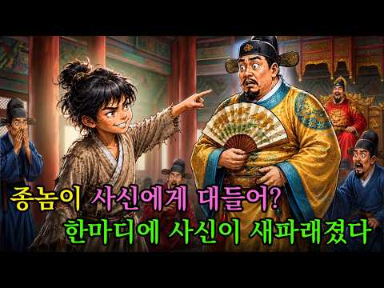
- 설명 앞부분: 조선을 비웃으려던 명나라 사신이 모두를 시험하려 세 가지 난제를 내놓았습니다. 대신들과 학자들조차 쉽게 입을 열지 못하던 그때, 말똥을 치우던 열 살 종놈이 앞으로 걸어 나왔습니다. 그리고 아이가 첫 번째 답을 말하는 순간, 사신의 얼굴에서 여유로운 웃음이 순식간에 사라졌습니다. 조선 어느 때, 명나라에서 온 사신이 자신의 지식과 지위를 믿고 조선의 사람들을 얕보며 세 가지 어려운 난제를 내놓았습니다. 궁궐의 대신들과 이름난 학자들까지 모였지만, 문제는 생각보다 훨씬 까다로웠고 누구도 선뜻 답을 내놓지 못했습니다. 사신은 그런 모…
- 같은 채널 평소 대비 ×11.9 (채널 최근 롱폼 중앙값 7,094회) · 평소 영상: “이 장만 거꾸로예요!” 5살 아이가 문서 속 단 한 장을 가리키며 내뱉은 한마디… 20… (7,194회) / “누가 너에게 이 병법을 가르쳤느냐?” 거지 아이에게서 용 모양의 점을 발견한 태사가 갑… (6,993회)
- 대본 없음 (설명) — 음성인식이 끝나면 도입부·흐름이 들어감
- 댓글 13/13: 좋은 점 — 영상 0 · 감사·응원 0 · 더 알고 싶은 것 0 · 아쉬운 점 — 영상 0 · 반박·불만 — 의견 다름 0 · 정치·사회 0 · 경험 공유 0 · 구독·다음 기대 0

### 255. 철: 지구에서 가장 강력한 금속의 숨겨진 역사

- https://www.youtube.com/watch?v=cPSuGyyaGf0 · 고요한 우주 · 구독자 802 · 조회수 18,552 (×23.1, 하루 349.9) · 좋아요 112 (0.6%) · 55.3분 · 2026-09-05 · 주제 묶음 1. 역사 일반·이야기 · 형식 정보·해설 (그 밖) · 폴더 `W_cPSuGyyaGf0` (웹 승인)
- 썸네일: 
- 챕터: 0:00 핏방울 속 별의 파편과 숨겨진 역사 · 2:37 별의 심장부 규소 핵융합과 철 피크의 한계 · 12:52 지구 내부 끓어오르는 외핵과 자기장 다이나모 · 23:01 대산화 사건과 헤모글로빈의 산소 운반 마법 · 32:34 하늘의 운철에서 최초의 제련로와 강철의 탄생 · 41:43 베세머 전로와 스테인리스강 부동태 피막 · 51:18 철-공기 배터리와 소행성 프시케의 미래
- 설명 앞부분: 왜 철의 기원과 역사는 거대한 별을 붕괴시키는 사형 선고이자 우리 몸속 심장을 뛰게 하는 생명의 열쇠일까요? 우주의 극단적인 용광로에서 탄생해 지구의 중심과 혈관 속으로 이어진 가장 강력한 금속의 경이로운 여정을 만나보세요. 이 영상에서는 원자핵 결합 에너지 곡선의 정점인 철 피크와 거대한 초신성 폭발의 메커니즘을 과학적으로 깊이 파헤칩니다. 지구 깊은 곳 외핵의 액체 철 대류가 만들어내는 지구 다이나모와 자기장 방어막의 원리, 대산화 사건으로 원시 바다에 붉은 녹이 침전되며 형성된 호상철광층, 그리고 적혈구 헤모글로빈 중심에서 …
- 같은 채널 평소 대비 ×9.6 (채널 최근 롱폼 중앙값 1,932회) · 평소 영상: 알루미늄: 한때 금보다 비쌌던 금속 — 어떻게 이렇게 흔해졌을까? (1,932회) / 빛의 속도는 너무 느려서 외계인은 절대로 지구에 도달할 수 없다 (2,197회)
- 대본 없음 (설명) — 음성인식이 끝나면 도입부·흐름이 들어감
- 댓글 5/5: 좋은 점 — 영상 0 · 감사·응원 2 · 더 알고 싶은 것 0 · 아쉬운 점 — 영상 0 · 반박·불만 — 의견 다름 0 · 정치·사회 0 · 경험 공유 0 · 구독·다음 기대 0
  - 감사·응원 👍2 “말씀 잘 들었습니다. 감사합니다.”
  - 감사·응원 👍1 “감사합니다. 그래서 철들었다고 하는군...”

### 256. 세조의 오른팔 한명회 자식 다섯 전원 몰살된 진짜 이유 ∣ 한명회자식비극 ∣ 왕비두명만든남자

- https://www.youtube.com/watch?v=DcJMoVuG9Jw · 역사탐사실 · 구독자 19,000 · 조회수 1,233,244 (×64.9, 하루 8,249.8) · 좋아요 13,107 (1.1%) · 19.4분 · 2026-05-31 · 주제 묶음 11. 황제·왕·인물 · 형식 정보·해설 (그 밖) · 폴더 `W_DcJMoVuG9Jw` (웹 승인)
- 썸네일: 
- 설명 앞부분: 왕 3명을 만들고, 딸 2명을 왕비로 올린 남자 그런데 자식 5명 전부 비극으로 끝났습니다 ∣ 한명회의 저주 😱 조선 최고의 권력자 한명회. 왕을 세 명이나 세우고, 딸 둘을 왕비 자리에 올려놓은 남자. 그런데 그의 자식 다섯 명은 단 한 명도 온전히 살아남지 못했습니다. 셋째 딸 장순왕후 — 열일곱에 출산 후 사망 💔 넷째 딸 공혜왕후 — 열아홉에 자녀 없이 사망 💔 유일한 아들 한보 — 평생 아버지의 업보를 짊어지다 외손자 인성대군 — 세 살에 요절 손자 한경침 — 열일곱에 사망 ⚰️ 죽은 뒤 17년 만에 무덤이 파헤쳐진 남자…
- 같은 채널 평소 대비 ×561.1 (채널 최근 롱폼 중앙값 2,198회) · 평소 영상: 사랑이 아니라 광기였다? 인조와 조귀인 관계의 충격적 결말 ∣ 조귀인자작극저주사건 ∣ 조… (2,198회) / 종기 하나로 죽었다고? 정조 죽음의 14일, 기록이 말해주는 진실 ∣ 정조이산마지막유언수… (2,143회)
- 대본 없음 (설명) — 음성인식이 끝나면 도입부·흐름이 들어감
- 댓글 1,590/1,623: 좋은 점 — 영상 8 · 감사·응원 18 · 더 알고 싶은 것 10 · 아쉬운 점 — 영상 6 · 반박·불만 — 의견 다름 10 · 정치·사회 73 · 경험 공유 24 · 구독·다음 기대 0
  - 좋은 점 — 영상 👍2 “한명회 자식이.두명인줄 알았는데 5명이나 있었구나. 좋은 정보.감사합니다”
  - 좋은 점 — 영상 👍2 “대본이 잘 짜여있고 정말 생각을 많이하고 구성되어 있다는 걸 느꼈어요 좋은 영상 감사합니다 저는 개인적으로 두 딸이나 왕비로 기록되어있기도하고 살아있을때 온갖 부귀영화를 누린 한명회가 더 부럽네요...ㅎㅎ”
  - 감사·응원 👍3 “엄 흥도 이런분을역사가알듯요즘엔 엄흥도같은충신이 어디없을까? 한명희같은작자가정치를하고있는 세상훗날밝혀지겠지.~~글올려주시는분 항상감사드립니다.~~”
  - 감사·응원 👍2 “한명회 자식이.두명인줄 알았는데 5명이나 있었구나. 좋은 정보.감사합니다”
  - 더 알고 싶은 것 👍1 “제가 부탁이 있습니다 방장님께 예전부터 내가 나쁜 일을 하면 자손들한테 해가 된다는 말을 들었는데 그럼 역사적으로 파 보아도 정말 그럴까? 그게 참 궁금했거든요 그래서 대표적인 인물인 한명회 자손들 검색을 해봤는데 알 수 있는게 하나도 없었어요. 오늘 방장님 덕분에 …”
  - 더 알고 싶은 것 👍1 “8:48 전 그 이유를 알거 같네요 바로 단종의 저주 때문에 죽었죠 반면 적장자이지만 단종의 저주를 피한 왕이 숙종인데 어떻게 피했을까요?”
  - 아쉬운 점 — 영상 👍2 “AI 목소리가 아니라서 좋네요”
  - 아쉬운 점 — 영상 👍1 “영상이 쓸데 없이 너무 길어....12분이내로.....길어서 안보고 패스....”
  - 반박·불만 — 의견 다름 👍1 “몰살된 건 아니죠. 한명회는 부귀영화를 누리고 천수 했고. 아들도 장수했죠. 딸들이 건강하지 않았던게 문제지.”
  - 반박·불만 — 의견 다름 👍1 “영상에 의상 고증을 좀 하겼으면 합니다. 왕가가 아닌데 금박이라니요”
  - 정치·사회 👍7 “실력없는데 부정적인방법으로 권력찬탈하는 민주당 찢재명 똑같네”
  - 정치·사회 👍4 “업보와 죄는 자식한테 간다더만 ~~ 맞네 양심껏 잘살자 ~~그런데 지금의 정권의 희생양으로 죽은 억울한 다섯명의 억울한 죽음은 어쩌나 리짜이밍”
  - 경험 공유 👍53 “살아서는 부귀영화의 화신이었으나 아이들은 다 비극을 겪었고 그 자신의 시체는 갈갈이 찢겼다.”
  - 경험 공유 👍7 “오늘날을 살아가는 저희들에게도 큰 교훈이 됩니다 오늘날도 후대에 역사가 평가할 것입니다”

### 257. "스파이더맨보다 이순신" 미국 덕후들이 46만 부 사재기한 진짜 이유

- https://www.youtube.com/watch?v=6pf_oTBbTws · 이상하TV · 구독자 14,300 · 조회수 134,434 (×9.4, 하루 6,102.2) · 좋아요 1,901 (1.4%) · 18.9분 · 2026-10-06 · 주제 묶음 3. 조선 · 형식 애니메이션·지도 · 폴더 `W_6pf_oTBbTws` (웹 승인)
- 썸네일: 
- 챕터: 0:00 미국 박람회의 이순신 열풍 · 0:35 작가 온리 콤판의 출발점 · 2:25 출판 거절과 직접 판매 · 4:13 실존 영웅의 압도적 기록 · 5:57 열세를 뒤집은 해전 서사 · 7:09 세계 작가들이 만든 협업 · 8:16 스탠 리가 쓴 특별한 서문 · 9:11 사료 연구와 역사 고증 · 10:53 인디 만화의 판매 기록 · 13:59 한국 방문과 다음 이야기
- 같은 채널 평소 대비 ×20.6 (채널 최근 롱폼 중앙값 6,538회) · 평소 영상: 혼자 다 만드는 미친 나라 — 조선·반도체·원전·방산, 하버드가 경악한 한국의 비밀 (6,578회) / "한국인은 설명이 안 됩니다" — 30년간 한국을 관찰한 외국인이 결론 내린 단 하나의 … (6,499회)
- 대본 없음 (없음) — 음성인식이 끝나면 도입부·흐름이 들어감
- 댓글 120/120: 좋은 점 — 영상 1 · 감사·응원 8 · 더 알고 싶은 것 1 · 아쉬운 점 — 영상 1 · 반박·불만 — 의견 다름 1 · 정치·사회 13 · 경험 공유 2 · 구독·다음 기대 0
  - 좋은 점 — 영상 👍18 “콤판 당신을 이순신만큼 존경합니다😊감사합니다 우리이순신님을 널리, 알려주셔서”
  - 감사·응원 👍40 “미국인이 답답할수도 있는 불멸의 이순신을 보고..이순신장군님한테 빠져서 8년을 공부하고 만화를 그렸어요 정말 대단한분임.. 이런 짜집기 ai영상 말고 콤판유투브를 봐야함 Onrie Kompan 10년전에 알게되었는데 진짜 고맙고 존경스러움”
  - 감사·응원 👍18 “콤판 당신을 이순신만큼 존경합니다😊감사합니다 우리이순신님을 널리, 알려주셔서”
  - 더 알고 싶은 것 👍0 “헉... 한반도라니;;;;; 진심 두근거리네요. 미국의 간접 지배 80년사를 어떻게 바라볼지.. 너무나 궁금합니다.”
  - 아쉬운 점 — 영상 👍40 “미국인이 답답할수도 있는 불멸의 이순신을 보고..이순신장군님한테 빠져서 8년을 공부하고 만화를 그렸어요 정말 대단한분임.. 이런 짜집기 ai영상 말고 콤판유투브를 봐야함 Onrie Kompan 10년전에 알게되었는데 진짜 고맙고 존경스러움”
  - 반박·불만 — 의견 다름 👍11 “어릴때 꼬맹이때부터 드라마로 봤던 이순신이라..이정도는 기본인줄 알았지만, 가만생각해보면, 그 모함과 모진 고문, 일본의 침략앞에 배도 다 타버리거나 파괴되버린 상황에서 "신에게는 아직 12척의 배가 있습니다" 라고 목숨을 다해 싸워 이겨낸 정말 말도안되는 영웅이라는…”
  - 정치·사회 👍13 “이재명대통령은 콤판씨에게 문화훈장 수여하시길.❤❤❤.”
  - 정치·사회 👍6 “우리나라 사람들이 못한걸 외국인이 해주네...”
  - 경험 공유 👍1 “오, 부천에 왔었구나 가려고 했었는데 ㅠ.ㅠ”
  - 경험 공유 👍1 “더디어 올 것이 왔네 성웅이순신은 조선 한국에만 알기엔 너무나 안타까웠다 일찍이 세계각국의해군사관학교에서 이순신을 가르쳐왔지마는 세계적 인물로서는 크게 유명하지는 않았다 이제 미국의 한 만화가의 노력으로 세상에 크게 알려지게되어 너무나 기쁘다 내가 가장 존경하는분 성…”

### 258. 조선 역사상 가장 아까운 천재 1위 I 당신이 생각하는 천재는 누구?

- https://www.youtube.com/watch?v=BZJ24uQ8qFQ · 역사잼잼 · 구독자 2,910 · 조회수 159,012 (×54.6, 하루 1,221.7) · 좋아요 1,928 (1.2%) · 32.4분 · 2026-06-20 · 주제 묶음 1. 역사 일반·이야기 · 형식 정보·해설 (그 밖) · 폴더 `W_BZJ24uQ8qFQ` (웹 승인)
- 썸네일: 
- 챕터: 0:00 인트로 — 만원권과 오천원권의 소름 돋는 비밀 · 1:30 10위 — 교과서 속 그 화가, 알고 보니 만능 천재 · 4:30 9위 — 조선 최초의 음향 공학자 · 7:00 8위 — 감히 하늘에 도전한 선비 · 9:30 7위 — 낮에는 영의정, 밤에는 천재 · 11:30 6위 — 탄핵 정국을 뚫고 살아남은 의성 · 14:30 5위 — 곤장 80대, 그리고 영원한 미스터리 · 18:00 4위 — 유배지에서 500권을 쓴 괴물 · 21:00 3위 — 9번 수석, 그가 남긴 예언 · 24:00 2위 — 승률 100%, 인류 해전사의 신화 · 27:30 1위 — 모든 천재 위에 군림한 단 한 사람 · 31:00 아웃트로 — 조선이 남긴 씁쓸한 일
- 설명 앞부분: 지갑 속 만원권과 오천원권의 주인공, 이순신 장군과 율곡 이이가 사실 19촌으로 같은 가문이었다는 사실, 알고 계셨나요? 조선 500년 역사 속에는 시대를 수백 년 앞서간 천재들이 있었습니다. 그러나 그들의 마지막은 너무나도 잔혹했습니다. 아들 학비조차 내지 못하고 사라진 조선 최고의 화가, 곤장 80대를 맞고 역사에서 증발한 과학자, 18년 유배지에서 500권의 책을 써낸 불굴의 학자까지... 조선이 위대한 이유는 이 천재들을 탄생시켰기 때문이고, 조선이 아쉬운 이유는 그 천재들을 끝까지 지키지 못했기 때문입니다. ⏱️ 타임라인…
- 같은 채널 평소 대비 ×179.2 (채널 최근 롱폼 중앙값 888회) · 평소 영상: 영화 오디세이에 나오지 않은 섬들의 충격적인 비밀 총정리 ∣ 오디세이 원작 2부 ∣ ∣ … (916회) / 조선이 버린 천한 섬 제주도에서 어떻게 기생이 최고부자가 되었을까? ∣ 정조가 인정한 김… (859회)
- 대본 없음 (설명) — 음성인식이 끝나면 도입부·흐름이 들어감
- 댓글 155/160: 좋은 점 — 영상 1 · 감사·응원 4 · 더 알고 싶은 것 4 · 아쉬운 점 — 영상 0 · 반박·불만 — 의견 다름 3 · 정치·사회 4 · 경험 공유 2 · 구독·다음 기대 0
  - 좋은 점 — 영상 👍1 “공자, 맹자만 외우던 성리학자들은 천재 리스트에서 빼야함. 민생에 1도 도움이 안되고, 오히려 해악만 끼친 자들이라는 생각.”
  - 감사·응원 👍4 “재미있게 잘봤습니다, 감사합니다”
  - 감사·응원 👍2 “덕분입니다 감사합니다”
  - 더 알고 싶은 것 👍2 “나랏말쌈이 중국에 달아. 에서 거의 대부분이 중국을 오늘날의 중국의 의미로 받아 들여 해설하는데 당시는 명나라이고 20세기에 와서야 중화인민공화국인데 ??? 이에대한 검토 부탁해요”
  - 더 알고 싶은 것 👍1 “조선 최고의 재상들을 올려주세요. 후대에 귀감이 되었으면 합니다.”
  - 반박·불만 — 의견 다름 👍5 “세종대왕 이도는 훌륭한 관리자입니다 훈민정음은 직접 창제한것이 아닙니다 이미 중 신미대사가 주관하여 세종대왕 발표전 8년전에 신미대사가 지은 불경이 발견되어있음 자료를 공부좀하세요 훌륭한 지도자 제세이화 홍익인간철학입니다”
  - 반박·불만 — 의견 다름 👍2 “한두놈이 아닌데 ㅋㅋ”
  - 정치·사회 👍15 “역사의 현실이 오늘날 부정선거와 판박이 참 아이러니 합니다 그놈의 기득권이 뭔지?”
  - 정치·사회 👍2 “어쪄면정말조선이라는 나라는처음부테세워져서는 않될나라였다우리5천년역사에많은나라가있었다 그러나조선많큼무능한 나라는없었다천5백년 전삼국시대에도고려시대까지모두황제국이었다 외세로침략을많이받았지만그래도잘막아내고나라 을굳건이지켔다그러나 무능한왕조로나라가침탈 당하고마지막에는일본의 …”
  - 경험 공유 👍5 “세종대왕보다위인 분은 군대고참입니다. 제가군대에서직접경험한얘기입니다. ㅋ”
  - 경험 공유 👍3 “최석정 선생은 생전 처음 듣는 이름입니다. 공학도인 제가 그분을 70대 중반이 되도록 알지 못했을까요?”

### 259. 세조를 넘어 한명회 가문까지… 단종의 저주는 계속되었다 (다섯 자식의 끔찍한 운명)

- https://www.youtube.com/watch?v=iRByyYtg5uY · 한국사 산책 · 구독자 3,210 · 조회수 227,876 (×71.0, 하루 1,340.2) · 좋아요 1,918 (0.8%) · 16.2분 · 2026-05-11 · 주제 묶음 1. 역사 일반·이야기 · 형식 정보·해설 (그 밖) · 폴더 `W_iRByyYtg5uY` (웹 승인)
- 썸네일: 
- 챕터: 0:00 소개 · 1:00 단종의 저주 시작 · 3:30 한명회의 출생과 성장 · 5:15 한명회의 권력 상승 · 7:00 첫째 딸 이야기 · 9:30 둘째 딸 이야기 · 12:00 셋째 딸 이야기 · 14:00 막내딸과 외아들 이야기 · 16:30 한명회의 최후 · 19:00 정리 및 마무리
- 설명 앞부분: 🔥 한명회의 다섯 자식의 운명은 과연 저주였을까요? 아니면 단순한 우연이었을까요? 조선 제6대 왕 단종의 비극적인 죽음과 그의 저주가 한명회의 자식들에게까지 이어진 이야기를 전해드립니다. 혜택 3가지: ✨ 역사 속 숨은 진실을 밝혀드립니다! ✨ 조선 시대 권력의 이면을 들여다봅니다! ✨ 한명회와 그의 가족의 비극적인 운명을 분석합니다! “권력은 사람을 왕으로 만들 수 있지만, 자식을 살릴 수는 없습니다.” 🕒 타임라인:
- 같은 채널 평소 대비 ×1,947.7 (채널 최근 롱폼 중앙값 117회) · 평소 영상: 피 한 방울 안 흘리고 '장인 한명회'의 발톱을 뽑아버린 성종의 무서운 빅피처 l 한국사… (117회) / 손에 피 한 방울 묻히지 않고 경쟁자를 몰살한 한명회의 소름 돋는 설계법 (115회)
- 대본 없음 (설명) — 음성인식이 끝나면 도입부·흐름이 들어감
- 댓글 207/207: 좋은 점 — 영상 0 · 감사·응원 0 · 더 알고 싶은 것 0 · 아쉬운 점 — 영상 2 · 반박·불만 — 의견 다름 3 · 정치·사회 10 · 경험 공유 1 · 구독·다음 기대 0
  - 아쉬운 점 — 영상 👍1 “능환으로 견훤의 책사로 있다가 천하를 통일하지 못하고 왕건에게 참수당하자 다음생에서 다시 재기를 노리고 있었는데 고려가 끝나고 조선에서 점술가로 태어났다. 앞을 내다보는 천기능력의 영향이 다음생으로 이어진거 같음. 그것이 한명회임. 남은, 심효생, 박위가 이성계의 다…”
  - 아쉬운 점 — 영상 👍0 “내란범과 매국노들의 끝이 좋으면 말이되나? 끝까지 파헤쳐 씨를 말려야 다시는 그 더러운 짓거리가 반복되지 않는다”
  - 반박·불만 — 의견 다름 👍1 “한명회 후손과 수양이 후손은 아주 잘살고있는데? 무슨 저주? 어이없음”
  - 반박·불만 — 의견 다름 👍0 “세조나 한명회나 쥐새끼 같은놈들...인간이기를 포기한놈들...우째 이런자들이 왕을하고 영의정을하며 조선을 흔들었을까? 조선은 나라꼴이 참...어이없다!”
  - 정치·사회 👍15 “민주당 박지원ㅡ 한명회를 보는것 같다.”
  - 정치·사회 👍4 “이죄명과 민주당이 생각나는건 왜 일까?”
  - 경험 공유 👍5 “인과응보!! 지은 죄 멀리 안 간다! 부메랑처럼 내가 아니면 자식이 그리고 후손으로 이어진다.”

### 260. 한명회도 탄핵한 조선 천재 간신, 아들 넷을 직접 도살대에 올린 아버지 ∣ 갑자사화 ∣ 무오사화 ∣ 조선왕조실록

- https://www.youtube.com/watch?v=8A-zm5k03_A · 역사보고서 · 구독자 3,620 · 조회수 216,647 (×59.9, 하루 1,509.9) · 좋아요 3,503 (1.6%) · 28.9분 · 2026-06-06 · 주제 묶음 3. 조선 · 형식 정보·해설 (그 밖) · 폴더 `W_8A-zm5k03_A` (웹 승인)
- 썸네일: 
- 설명 앞부분: 조선 500년 역사상 가장 끔찍한 비극의 주인공, 혹은 가장 잔인한 아버지라 불리는 남자 '임사홍'. 첫째는 31세에 요절, 둘째는 32세에 능지처사, 셋째는 기록 말살, 넷째는 30세에 맞아 죽기까지... 자식 네 명을 모두 비극적인 죽음으로 몰고 간 아버지가 있습니다. 놀랍게도 그의 직업은 지금의 국방부 장관인 '병조판서'였습니다. 군사권까지 쥔 권력자가 왜 자기 자식들을 살리지 않고 방관했을까요? 심지어 둘째 아들이 처형당하던 날, 집에서 풍악을 울리며 연회를 즐겼다는 소름 돋는 기록까지 존재합니다. 27세에 최연소 승지에 …
- 같은 채널 평소 대비 ×221.2 (채널 최근 롱폼 중앙값 980회) · 평소 영상: 송시열을 모르면 조선 역사를 논하지마라, 왕 4명도 꺾지 못한 선비 ∣ 예송논쟁 ∣ 노론… (1,094회) / 단종의 눈물에 속았다? 조선을 구한 진짜 영웅 ∣ 조선시대 ∣ 한국사 ∣ 계유정난 (865회)
- 대본 없음 (설명) — 음성인식이 끝나면 도입부·흐름이 들어감
- 댓글 451/451: 좋은 점 — 영상 3 · 감사·응원 9 · 더 알고 싶은 것 1 · 아쉬운 점 — 영상 2 · 반박·불만 — 의견 다름 6 · 정치·사회 6 · 경험 공유 9 · 구독·다음 기대 1
  - 좋은 점 — 영상 👍4 “제가 유투브에서 본 영상 중 정말 정말 최고 중의 최고라고 생각했습니다 ~ 가장 이슈?되는 인물인데다... 그의 생애... 정말 많이 많이 배웠습니다. 감사합니다. 승승장구 하시기를 축복기원 드립니다 ~ 이런거 보면, 부처님께서 말씀하시는 업... 이라는게 진짜 있을…”
  - 좋은 점 — 영상 👍3 “부패하기 쉬운 인간의 본질에 대해 깊이 생각테 한 좋은 영상이네요”
  - 감사·응원 👍21 “저도 그 처지로부터 자유롭지 못한다에 100%입니다. 시간은 환경(인간)을 변화시키지 않을까요? 선택의 여지없는 기구한 안생사... 저에게도 많은 숙제를 남기는 영상이군요. 감사드립니다 ^^*”
  - 감사·응원 👍17 “역사를 알기쉽게 설명해 주셔서 감사합니다”
  - 더 알고 싶은 것 👍2 “와..이 영상 하나로 수창 뚫겠네..부럽습니다. 구독했어요. 혹시 노출클릭률 몇나오시나요?”
  - 아쉬운 점 — 영상 👍35 “임사홍이 언뜻 기억은 났는데 이런 내용은 몰랐네요. 이야기가 지루하지 않고 술술 귀에 흘러들어오네요.”
  - 아쉬운 점 — 영상 👍0 “첫 11분에 나가요. 별 정보가 없이 엿가락 늘이긴가요? 지루해요”
  - 반박·불만 — 의견 다름 👍12 “인성 양심 다버린 지혜없고 악한꾀만가득한 인간 ㆍ천재? 글쎄요”
  - 반박·불만 — 의견 다름 👍0 “흥청망청 역사는 이긴자의 기술 이것저것 가만해서 들어야지 사극은 드라마 시청률 때문에 극적은 대결구도와 선악이 분명해야 인기가 높지 복잡한 관계보다는 그래서 지금도 백성들은 쉽게 선동 당한다”
  - 정치·사회 👍2 “조선역사는 중종반정 인조반정후 권력을 잡은 서인 송시열의 후예 노론의 승자의 전리품같은 기록일뿐이다. 그들은 일본에 나라를 팔아먹은 세력이된다. 결국 그들도 자기와 자기세력의 이익과 안위를 위해 삶을 소비한 소인들일뿐임을 스스로 증명했음이다. 서인 노론에 패배한 훈구…”
  - 정치·사회 👍1 “수고하십니다.종교혁명가 입니다. 민주당 황 @ 회 역사 학자 you tube 께서 지금 선관위 의 부정부패 선거법 과 관련된 정치인들을 수사.조사 해서 재산몰수 해야 합니다. 박 근혜 대통 령 비서 .김종 * 이. 조선시대 에 임 사홍 아들의 스승 정치 를 종교적으로…”
  - 경험 공유 👍29 “자기권력 지키려고. 아들하나 버렸구나 어떻게 잡은 자리인데.. 내가 당해본 일이 아니면 함부로 말 할수 없다.”
  - 경험 공유 👍21 “저도 그 처지로부터 자유롭지 못한다에 100%입니다. 시간은 환경(인간)을 변화시키지 않을까요? 선택의 여지없는 기구한 안생사... 저에게도 많은 숙제를 남기는 영상이군요. 감사드립니다 ^^*”
  - 구독·다음 기대 👍2 “와..이 영상 하나로 수창 뚫겠네..부럽습니다. 구독했어요. 혹시 노출클릭률 몇나오시나요?”

### 261. 🔥최고 시청률 12.9%🔥 찍어버린... 남궁민이 인생 캐릭터를 갱신한 ✨레전드 사극 드라마✨

- https://www.youtube.com/watch?v=g9youcD9-z0 · 무비프라자 · 구독자 23,700 · 조회수 726,122 (×30.6, 하루 9,826.6) · 좋아요 3,062 (0.4%) · 187분 · 2026-08-11 · 주제 묶음 3. 조선 · 형식 사극·드라마·영화 리뷰 · 폴더 `W_g9youcD9-z0` (웹 승인)
- 썸네일: 
- 설명 앞부분: 끝까지 시청해주셔서 감사합니다🙏 영상 제목은 왼쪽 상단에서 확인하실 수 있습니다
- 같은 채널 평소 대비 ×1.7 (채널 최근 롱폼 중앙값 437,609회) · 평소 영상: "니가 왕의 딸이라고?" 조선의 공주가 평민이라고? 소녀시대 🔥유리🔥 주연의 숨겨진 명작… (461,100회) / 조선판 🔥영혼 체인지🔥의녀와 대군이 서로 영혼이 바뀌면 벌어지는 일 [결말까지몰아보기] (414,118회)
- 대본 없음 (설명) — 음성인식이 끝나면 도입부·흐름이 들어감
- 댓글 180/198: 좋은 점 — 영상 1 · 감사·응원 7 · 더 알고 싶은 것 0 · 아쉬운 점 — 영상 2 · 반박·불만 — 의견 다름 3 · 정치·사회 8 · 경험 공유 4 · 구독·다음 기대 3
  - 좋은 점 — 영상 👍0 “마음을 나의몸안에모으며 지관이나 중관을하며 원두커피가는거 왼쪽으로돌리면 머리코의 병이낫습니다 사띠지관이하단전주 무심 무아입니다 고집멸도괴로움을 하단전에마음을모으니멸해지고도가닦이더라 에코볼트 크레오에스지주식매수하십시요 미국 brk.a 처럼 억대주가가될수있습니다 중관이 …”
  - 감사·응원 👍10 “최고의 편집으로 맘껏 웃고 맘껏 울었네요~~ 넘넘 감사드려요 ~~~”
  - 감사·응원 👍9 “마지막 편 작가님 게 감사 드립니다”
  - 아쉬운 점 — 영상 👍0 “용두사미인 드라마... 뒤에 끝맺음만 잘했어도 대박이였을텐데 아쉬움..”
  - 반박·불만 — 의견 다름 👍12 “길채는 막 절세 미인은 아닌데 매력이 잇슴..안은진 배우가 매력이 잇슴 ㅋㅋ”
  - 반박·불만 — 의견 다름 👍0 “1600년에 망해 없어졌어야 할 조선 왕조가 뭐 잘 한 것도 없고 유능한 것도 똑똑한 것도 아닌데도 질기게도 살아남아서 저 꼬라지를 겪고, 결국 1900년 까지 가서는 결국 총 한방도 못 쏘고 왕이 나라를 팔아먹고 끝났지. 에휴 조선..... 에휴 조선 진짜....”
  - 정치·사회 👍31 “나라가 이렇게 힘이 없으니, 몇 번을 처 먹혀도 정신 못차리는 왕과 신하를 찢어 죽이고 싶은 역사. 지금의 대한민국은 진짜 기적이다.”
  - 정치·사회 👍0 “검세종물받이하가가 딸이 검세부인이 되면 대한민국 대통령 부인도 될수있다 막장은 빵에 가겠지만 ㅋㅋㅋㅋㅋㅋㅋㅋㅋㅋㅋ”
  - 경험 공유 👍44 “내가최근본드라마중탑임.”
  - 경험 공유 👍1 “어제부터 재밌게 보고 있었는데 영상이 갑자기 기록에서도 사라지고 없어져서 당황했었어요.. ㅠㅠ 다시 볼 수 있어서 너무 행복하고 감사한 마음에 댓글 남깁니다. 훌륭한 내용 요약과 나레이션 덕분에 너무 잘 보고있습니다🙏 정말 감사합니다!”
  - 구독·다음 기대 👍48 “진심 지금 정주행만 5번 넘게했는데 계속 봐도 질리지가 않고 볼때마다 눈물나옴😢”
  - 구독·다음 기대 👍1 “아… 놔… 잘못 눌러서 꼬박 3시간을 정주행해 버렸네… 미치겠네…드라마 넘 잼나네..”

### 262. 정조가 홍국영을 버린 충격적인 이유

- https://www.youtube.com/watch?v=x-wWAo2juoU · 재역이(재미있는역사이야기) · 구독자 5,800 · 조회수 307,926 (×53.1, 하루 2,367.3) · 좋아요 4,004 (1.3%) · 34.9분 · 2026-06-20 · 주제 묶음 기타 · 형식 정보·해설 (그 밖) · 폴더 `W_x-wWAo2juoU` (웹 승인)
- 썸네일: 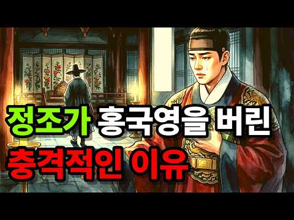
- 설명 앞부분: 조선 22대 임금 정조에게는 목숨을 빚진 단 한 명의 절친이 있었습니다. 죄인의 아들이라는 굴레 속에서 매일 밤 자객의 위협에 시달리던 세손 시절, 모두가 등을 돌릴 때 홀로 칼을 들고 곁을 지킨 남자, 바로 홍국영입니다. 정조는 그를 "나의 오른쪽 날개"라 부르며 무한한 신뢰를 보냈습니다. 즉위 후 도승지와 군권까지 한 손에 쥐여주며, 한 신하에게 조선 역사상 전무후무한 권력을 안겨주었죠. 그러나 그 권력은 홍국영을 변하게 만들었습니다. 열세 살 여동생을 후궁(원빈)으로 들이고, 죽은 누이에게 양자를 들여 왕통까지 넘보던 순간,…
- 같은 채널 평소 대비 ×23.8 (채널 최근 롱폼 중앙값 12,927회) · 평소 영상: 허균이 죄목도 없이 능지처첨을 당한 진짜 이유 ∣ 허균 ∣ 허난설헌 (12,927회) / 계유정난의 진범은 한명회가 아니었다? ∣ 계유정난 ∣ 수양대군 ∣ 세종 ∣ 한명회 ∣ 단종 (17,303회)
- 대본 없음 (설명) — 음성인식이 끝나면 도입부·흐름이 들어감
- 댓글 248/248: 좋은 점 — 영상 2 · 감사·응원 6 · 더 알고 싶은 것 0 · 아쉬운 점 — 영상 3 · 반박·불만 — 의견 다름 3 · 정치·사회 2 · 경험 공유 3 · 구독·다음 기대 0
  - 좋은 점 — 영상 👍5 “재미있고 유익합니다”
  - 좋은 점 — 영상 👍1 “너무 좋은 내용인데, 구독과 좋아요.를 왜 첨부터 말하나요 좋은거면 나중에 알아서 하잖아요 에효ㅡㅡ”
  - 감사·응원 👍5 “역사의 뒷면을 자세히 알려주어 60 넘게 우리 역사의 깊은 이해를 하게 되네요 왕들의 삶이 안타깝고 서글픈 느낌으로 와 닿네요 감사합니다”
  - 감사·응원 👍3 “감사합니다 ~”
  - 아쉬운 점 — 영상 👍3 “설명이 난삽 하다 같은말이 겹치고 지루해.”
  - 아쉬운 점 — 영상 👍0 “증간 광고가 너므 많아서 맥이 뚝뚝. 좋은 컨텐츠인데 구독취소가 고민되어요 ㅠㅠㅠ”
  - 반박·불만 — 의견 다름 👍39 “홍국영과. 정조 말만들어도. 가슴아립니다 홍국영이 제 분수대로만. 처신햇어도 아름다운 인연이엇을텐데. 거두절미하고. 토사구팽은 아닙니다. 안타깝지만. 홍국영의 실책이 오만방자 모든게 자충수였어요. 안타깝죠 정조가얼마나 신임햇는지 믿음뒤에서의 실책에 얼마나마음아팟을지.…”
  - 반박·불만 — 의견 다름 👍2 “홍국영의 발음은 홍궁영 이 아닙니다! 정확한 발음은 "홍구경" 입니다! 홍구경 이란 발음과 홍궁영 이란 발음이 왔다갔다 하고 있읍니다! 그런점을 감안하면 AI가 발음 하는것도 아닌 것이니 이런 정황에 근거해 볼때 컨텐 츠 제작자 의 국어실력 이 수준급이 아님을 알려주…”
  - 정치·사회 👍1 “이재명 너 조심해임마. 비참한 최후를 보고싶지 않다. 적당히만 해라”
  - 경험 공유 👍6 “세계사적으로보면 15세기부터 대항해시대가 시작되어 서양문물의 힘에 편승한 임진왜란의 참화를 겪었고, 허균과 같은 혁명가, 실학자들도 있었고, 서양문물이 들어오던 시절이고 계몽주의에 따른 몽테스큐의 법의정신, 루소 등의 영향이라 할 미독립 및 프랑스혁명기에 왕으로 재직…”
  - 경험 공유 👍1 “가장높은곳에 있는순간 가장 험한곳에 있다란 마지막 말이 최고의 명언 !!! 저도 잘 새기며 평생 잠언으로 간직하며 살겠읍니다 감사 감사 합니다!!! 요즘 잼통님의 미국 살해 위험과 부하들의 반역이 없도록 기도해주세요 아멘!!”

### 263. 15살에 66세 영조와 결혼한 정순왕후, 그날 밤 영조가 잠을 못 잤다 [조선왕조실록]

- https://www.youtube.com/watch?v=gwmPtcxsmYE · 조선왕조실록이야기 · 구독자 19,700 · 조회수 706,527 (×35.9, 하루 7,854.6) · 좋아요 14,668 (2.1%) · 49.2분 · 2026-07-30 · 주제 묶음 3. 조선 · 형식 정보·해설 (그 밖) · 폴더 `W_gwmPtcxsmYE` (웹 승인)
- 썸네일: 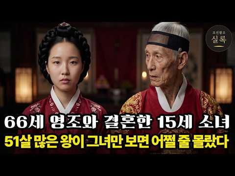
- 챕터: 0:00 1759년, 66세 영조와 15세 소녀의 51살 차이… · 1:55 왜 아무도 딸을 왕비 후보로 내놓지 않았는가 (영조의… · 4:22 왕비 간택의 현실적인 계산과 위험 요소들 · 5:17 금혼령 선포와 간택 단자를 올리는 과정의 뒷이야기 · 8:54 간택의 정식 절차: 초간택, 재간택, 삼간택과 면접 … · 11:45 삼간택에 오른 처녀들의 가혹한 운명 · 12:24 정순왕후의 지혜가 돋보인 전설적인 문답 (방석, 가장… · 17:08 정순왕후의 집안 배경: 경주 김씨 가문과 영조의 정치… · 21:05 15세 소녀가 감당해야 했던 국모라는 자리의 무게 · 23:53 영조가 명분과 실리를 모두 갖춘 집안을 선택한 이유 · 28:32 화려했던 혼례 행렬과 사치를 경계하던 영조의 변화 · 32:21 기록에는 없는 첫날밤 이야기와 정순왕후의 기개 · 35:31 15세 국모가 마주한 궁궐의 기묘한 가족 관계 (사도… · 36:53 300년 만에 부활시킨 친잠례: 조선의 역사를 뒤진 … · 41:42 자식이 없었던 왕비의 쓸쓸함과 임오화변(사도세자의 죽… · 44:25 영조의 죽음과 홀로 남겨진 32세 정순왕후의 삶 · 45:20 정조 즉위와 친정 가문의 몰락, 그리고 정조와의 관계 · 47:45 사후에야 영조 곁에 묻히게 된 정순왕후의 마지막 이야기
- 설명 앞부분: 열다섯 살 소녀가 예순여섯 살의 조선 왕 영조와 혼인했습니다. 쉰한 살의 나이 차이. 조선 역사상 가장 큰 나이 차이의 국혼이었습니다. 그런데 이상한 일이 있습니다. 왕비 자리는 온 나라가 탐낼 자리인데, 딸을 내겠다고 나선 집이 서른 집도 되지 않았습니다. 명문가들은 딸의 나이를 속이고, 아프다고 둘러대고, 아예 종이를 내지 않았습니다. 왜 모두가 도망친 자리에 벼슬 하나 없는 집안의 딸이 홀로 걸어 들어왔을까요? 금혼령 대상은 열여섯에서 스무 살이었는데 뽑힌 아이는 열다섯이었습니다. 규정에 들지도 않는 아이가 어떻게 왕비가 되…
- 같은 채널 평소 대비 ×84.5 (채널 최근 롱폼 중앙값 8,365회) · 평소 영상: 지금 이란이 당하는 일, 조선도 겪었다 ∣ 명나라에 끌려간 1만 3천, 그들은 왜 오랑캐… (8,365회) / 조선 500년 유일한 왕비, 시아버지가 친정을 몰살했는데 쫓겨나지 않은 진짜 이유 ∣ 세… (7,283회)
- 대본 없음 (설명) — 음성인식이 끝나면 도입부·흐름이 들어감
- 댓글 3,815/3,847: 좋은 점 — 영상 120 · 감사·응원 304 · 더 알고 싶은 것 31 · 아쉬운 점 — 영상 29 · 반박·불만 — 의견 다름 9 · 정치·사회 11 · 경험 공유 20 · 구독·다음 기대 16
  - 좋은 점 — 영상 👍21 “너무재미있게 새벽이지나갔어요.좋은영상 감사합니다. 15살 소녀야 고생많았어”
  - 좋은 점 — 영상 👍21 “역사를 이렇게 쉽게 설명해주시니 재미있게 들었습니다 수고 하셨어요 ❤”
  - 감사·응원 👍43 “역사를 알수있게 해주셔서 감사합니다 고생 하셨 습니다 좋은날 되세요”
  - 감사·응원 👍40 “대단하신 일을 하셨습니다. 시간을 거슬러 한획을 긋는 새로운 역사의 시간을 익혔습니다. 감사합니다. 귀하게 시청했습니다.”
  - 더 알고 싶은 것 👍2 “혼자만의 시간이 얼마나 고독하고 무서웠을까요? 고작 15살인데 안타갑네요~~”
  - 더 알고 싶은 것 👍2 “오늘 역사공부 잘 했습니다🎉 앞으로도 잘 부탁드려요^^”
  - 아쉬운 점 — 영상 👍239 “그 시대에 없던집안의 딸로 태어나서 집안을 위해 희생된 여인. 얼마나 남몰래 울었을지..감히 상상도 못하겠네요. 영조가 정조에게 빨리 넘기고 혼례를 안했다면 더 좋았을지도... 기록이 조금만 더 자세히 남아있었더라면 하는 아쉬움이 늘 남네요! 더운데 고생하셨습니다!!”
  - 아쉬운 점 — 영상 👍9 “정순왕후가 간택된 이유를 알았습니다. 그런데 자식이 없어 아쉽네요.”
  - 반박·불만 — 의견 다름 👍10 “영조의나라에 행운의 여인 그녀에겐... 글쎄요 얼마나 무섭고 외로웠을까 ;;”
  - 반박·불만 — 의견 다름 👍3 “오늘날의 시각으로 보면 이해가 안 되지만 조선의 왕비는 처녀만 가능했으므로 어쩔 수 없었습니다. 당시 양반가 규수 결혼 적령기를 생각하면 어린것이 아니죠. 참고로 선조의 계비 인목왕후가 임진 왜란으로 혼인이 늦어져 간택 당시 19세었는데 상당히 드문 케이스었죠”
  - 정치·사회 👍85 “불행했다 !, 앞으로도 그런혼례는 없어져야 한다 !, 영조가 죽은후, 나중에 정순왕후, 경주김씨가 세도를 잡고, 반대편 정치편을 모조리 죽이고, 결국,또 정치사화가 일어나고,많은 사람이 죽고, 나라가 피폐해지고, 못다누린 권력을, 쥐고 흔들고, 정조대까지 당파싸움에 …”
  - 정치·사회 👍21 “그렇니 나라가 풍비 박산되어 나라가 망조 들어 백성이 고생들했지~”
  - 경험 공유 👍70 “쇼츠만 보던 내가 이 긴 영상을 다 봤다.”
  - 경험 공유 👍8 “역사를 전공한 저도 몰랐던 얘기가 참 많네요. 아주 훌륭한 내용 잘 들었습니다. 구독, 좋아요.”
  - 구독·다음 기대 👍3 “15세에 간택되어 왕비가 되었으니 행운입니다. 더우기 3명 중에서 뽑히지 않았으면 어차피 결혼도 하지 못 하고 평생을 고독하게 살았어야 했으니 왕비가 살게 됨이 어찌 행운이라고 말하지 않을 수가 있으리요. 설명하시는 말투도 참 좋으시고요 목소리 또한 또박 또박 발음도…”
  - 구독·다음 기대 👍2 “고생하셨습니다. 잘 보고 구독합니다. 감사합니다.”

### 264. 조선 최고령 사형수 ∣ 88세 영의정은 왜 목이 잘렸나

- https://www.youtube.com/watch?v=FSUt5VNvoj4 · 진짜역사한잔 · 구독자 13,400 · 조회수 382,835 (×28.6, 하루 5,323.4) · 좋아요 2,415 (0.6%) · 101.6분 · 2026-08-17 · 주제 묶음 3. 조선 · 형식 정보·해설 (그 밖) · 폴더 `W_FSUt5VNvoj4` (웹 승인)
- 썸네일: 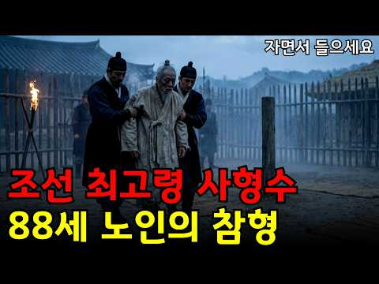
- 챕터: 0:00 프롤로그 · 여든여덟 살의 사형수 · 2:46 합천의 소년, 남명 조식을 만나다 · 7:06 동인과 북인 · 타협을 모르는 사헌부 · 11:18 임진왜란 · 쉰일곱에 의병을 일으키다 · 15:14 의병은 무엇으로 싸웠는가 · 17:02 전쟁이 끝나고 · 세자 자리를 둘러싼 균열 · 20:50 1608년 정월의 상소 · 한 달 만의 반전 · 24:31 광해군의 시대와 산림정승 · 27:57 천 리 밖에서 조정을 움직인다는 것 · 29:39 회퇴변척소 · 조선 전체를 적으로 만들다 · 33:14 계축옥사와 전은론 논쟁 · 36:10 폐모 논쟁 · 기록이 엇갈리는 지점 · 39:27 정치를 떠난 정인홍이라는 사람 · 41:03 1623년 3월 12일 밤, 반정 · 43:50 압송과 국문 · 왜 나이를 참작하지 않았나 · 46:36 4월 3일 · 복주하였다 · 49:08 설화가 된 사람 · 그리고 제자 정온 · 51:58 200년의 금기 · 실패한 복권 시도 · 54:33 1908년의 신원과 내암집 · 57:05 그를 무너뜨린 것은 미덕의 과잉이었다
- 설명 앞부분: 1623년 4월 3일, 한양의 형장에 여든여덟 살의 노인이 세워졌습니다. 그는 조선의 영의정을 지낸 사람이었고, 30년 전 임진왜란 때는 직접 의병을 일으켜 낙동강을 지킨 의병장이었습니다. 그런 그가 인조반정 직후 역적으로 몰려 참형을 당했습니다. 조선왕조실록 인조실록은 그날의 일을 단 한 줄로 기록합니다. 정인홍을 복주하였다. 그 한 줄 뒤에 88년의 삶이 있었습니다. 남명 조식의 수제자, 임진왜란의 의병장, 광해군 시대의 영의정, 인조반정의 역적, 그리고 285년 뒤에 신원된 사람. 이 다섯 개의 이름표는 모두 한 사람의 것이…
- 같은 채널 평소 대비 ×25.9 (채널 최근 롱폼 중앙값 14,804회) · 평소 영상: 매년 10명씩 죽였다 조선왕조실록이 직접 기록한 왕자 순화군의 실체 (14,804회) / 굶주림이 만들어낸 나라 ∣ 조선 오일장 오백 년의 숨겨진 역사 (14,527회)
- 대본 없음 (설명) — 음성인식이 끝나면 도입부·흐름이 들어감
- 댓글 160/164: 좋은 점 — 영상 3 · 감사·응원 5 · 더 알고 싶은 것 0 · 아쉬운 점 — 영상 3 · 반박·불만 — 의견 다름 2 · 정치·사회 8 · 경험 공유 4 · 구독·다음 기대 0
  - 좋은 점 — 영상 👍12 “이런 역사...알려 주셔서 정말정말 감사드립니다... 정인홍영상님... 어쩌다 이런 험악한 꼴을.., 나라와 삶을 생각하면 마음아프고 눈물흐르는 일이 너무 많은...”
  - 좋은 점 — 영상 👍2 “1시간41분. 모르고 들어왔네요. 이렇게 긴건 바빠 못봐요. 수입에 도움되나요.. 싫어요”
  - 감사·응원 👍16 “조선시대에 안태어 난것이 참다행이고 대한민국에서 태어난것 이 부모님께 감사합니다”
  - 감사·응원 👍12 “이런 역사...알려 주셔서 정말정말 감사드립니다... 정인홍영상님... 어쩌다 이런 험악한 꼴을.., 나라와 삶을 생각하면 마음아프고 눈물흐르는 일이 너무 많은...”
  - 아쉬운 점 — 영상 👍2 “중간 광고가 없어서 무한 틀어놓구 잡니다 감사합니다^^ 불면증에 역사두 배우고”
  - 아쉬운 점 — 영상 👍0 “광고가 너무자주 나와 듣지 못해 철수”
  - 반박·불만 — 의견 다름 👍0 “의병장과 정치인 으로써 손자들과 목숨바쳐 나라를 지킨 대장공 으로써 공은 어딜가고 사형을 판결 하는지 대장공 으로써 사리싸욕 한것도 아닌데 육신을 뺏는다는 것은 개인감정 아니고선 생각해 볼일이 아닌가 생각케 한다 88세 사형이면 110세인들 사형하지 않갠는가 그때나 …”
  - 반박·불만 — 의견 다름 👍0 “참 이런 소리하는게 한심한건대... 엘리자베스가 칼레에서 무적함대 박살낸게 15??년도이고 뉴턴이 미적분 개발하고 운동법칙증명한게 16??년이고 청교도 혁명으로 크롬월이 찰스왕 죽이고 공화정 세운게 1648년이고 영국인이 미국에 집단으로 정착한게 1620년 경이고 일…”
  - 정치·사회 👍37 “광해군을잃은조선은빨리망해야되었고 정인홍체제를처단했다는 정권은이적단체에불과했다고봅니다 비극입니다”
  - 정치·사회 👍3 “특검 정부가 인조 반정은 특검 안 합니까?”
  - 경험 공유 👍39 “조선은 임진왜란 이후 망했어야 했었다.”
  - 경험 공유 👍0 “저도 조선의 임금들 가운데 선조와 인조, 고종은 여러 면에서 아쉬움이 큰 왕들이라고 생각합니다. 특히 나라가 어려운 시기에 보여준 판단과 대응을 보면 답답하게 느껴지는 부분이 많네요. 역사 속 인물들을 다시 돌아보게 만드는 이야기였습니다.”

### 265. 조선시대 사람들이 30살에 이가 다 빠져버린 소름돋는 이유는? ∣ 조선역사 ∣ 한국사 ∣ 조선왕조실록 ∣

- https://www.youtube.com/watch?v=5vBTGmcYA5w · 시대를 훔친 이야기 · 구독자 3,300 · 조회수 185,469 (×56.2, 하루 1,288.5) · 좋아요 2,472 (1.3%) · 18.4분 · 2026-06-06 · 주제 묶음 3. 조선 · 형식 정보·해설 (그 밖) · 폴더 `W_5vBTGmcYA5w` (웹 승인)
- 썸네일: 
- 챕터: 0:00 👑 영조의 한숨 "양치할 때마다 한숨이 나온다" · 1:00 ⚰️ 조선 충치율 단 1~5%의 충격 · 1:36 🌿 '양치질' 어원과 버드나무 가지의 비밀 · 3:40 🎎 신분별 양치 도구 (왕실·양반·평민·빈민) · 5:46 🍚 진짜 범인은 '매일 먹던 밥'이었다 · 7:21 💎 에나멜질도 못 이긴 모래의 위력 · 8:09 🔥 풍치(風齒)의 정체, 현대의 치주염 · 9:19 👑 임금 영조는 왜 같은 시기에 무너졌을까 · 10:42 📖 동의보감 속 충격의 치통 처방 · 12:00 🔨 대장간 집게로 이를 뽑던 조선의 치과 · 13:18 🤔 21세기 우리는 정말 이기고 있을까? · 15:15 🍰 우리의 적은 '너무 부드러운 음식' · 16:21 🧠 조선은 몰라서 졌고, 우리는 알면서도 진다 · 17:11 🪞 오늘 밤 거울 앞에서 30초만…
- 설명 앞부분: 🦷 조선시대 사람들은 왜 서른만 넘으면 이가 다 빠졌을까요? 조선에서 가장 오래 산 왕, 영조. 여든셋까지 살았던 그가 서른일곱에 이미 잇몸이 무너지고 있었습니다. 😱 어의가 매일 진맥하고, 치아 전담 여의까지 있었던 임금. 말린 벚꽃잎과 소금으로 만든 왕실 전용 양치 가루까지 썼던 그 사람의 입 속이, 왜 그렇게 빨리 무너졌을까요? 🔍 이 영상에서 다루는 이야기 ✅ 조선시대 충치율이 단 1~5%였던 충격적인 진실 ✅ 충치도 없는데 이가 다 빠진 진짜 이유 ✅ '양치질'이라는 단어의 어원, 버드나무 가지의 비밀 🌿 ✅ 왕실 · 양…
- 같은 채널 평소 대비 ×312.8 (채널 최근 롱폼 중앙값 593회) · 평소 영상: 왜? 추석의 송편을 먹는 걸까? 송편의 충격진실ㅣ송편유래ㅣ추석역사 (593회) / 조선왕조실록에 "이것"까지 낱낱히 적었다? 왕들이 끝까지 감추고 싶었던 비밀 TOP3 (595회)
- 대본 없음 (설명) — 음성인식이 끝나면 도입부·흐름이 들어감
- 댓글 522/522: 좋은 점 — 영상 2 · 감사·응원 5 · 더 알고 싶은 것 3 · 아쉬운 점 — 영상 4 · 반박·불만 — 의견 다름 12 · 정치·사회 1 · 경험 공유 25 · 구독·다음 기대 0
  - 좋은 점 — 영상 👍2 “지인이 알려준 꿀팁 아침에 일어나서 수돗물 말고 정수물 한컵에 아무기름(식용유.들.참기름.올리브)이나 한두방울 떨어뜨려 젖가락으로 저은다음 가글해 보세요 저도 실천하고 입냄새 잇몸튼튼 놀라운 효과 보고 있어요 돈드는것도 아니고 조금만 부지런하면 잇몸염증 충치균에 좋아…”
  - 감사·응원 👍19 “이 시대에 대한민국에 태어난거에 감사하다”
  - 감사·응원 👍2 “의미있는 흥미로운 정보 감사히 잘 봤습니다. ^^”
  - 더 알고 싶은 것 👍4 “46세.. 살아온 동안 양치 4일에 한번만 해온 저로서 1년전 치아 2개 소실, 잇몸 말랑말랑하다 못해 어금니가 뒤틀렸다 바로 돌아올 정도로 안좋아 치과가니 노인보다 안좋아하며 모든 치아가 흔들린다 벼랑 끝이이시다.라고 하여 먹고나면 꼭 음파칫솔 쓰고 했더니 아주 건…”
  - 더 알고 싶은 것 👍2 “돌가루 때문에 잇몸병이 생겼다는건 납득이 안갑니다. 저도 어렸을때 벼를 절구에 갈아 먹고는 했는데 모래를 씹어 이가 상했던 기억은 없어요. 조리로 잘 행구면 가끔 돌이 들어가는 경우는 있어도 모래가 항시 씹는 느낌은 없었습니다. 근본적인 것은 영양 부족으로 치아 자체…”
  - 아쉬운 점 — 영상 👍2 “너무 영상을 길게 만들어서 참고 끝까지 보기가 힘듭니다. 이런 영상은 너무 길면 역효과 납니다.”
  - 아쉬운 점 — 영상 👍1 “광고가 넘 많다”
  - 반박·불만 — 의견 다름 👍8 “조선시대에 밥에 모래가 있다는것에 동의 안합니다. 쌀을 씻을때 조리로 돌을 걸러서 밥을 지었는데 말이 안됩니다.”
  - 반박·불만 — 의견 다름 👍4 “46세.. 살아온 동안 양치 4일에 한번만 해온 저로서 1년전 치아 2개 소실, 잇몸 말랑말랑하다 못해 어금니가 뒤틀렸다 바로 돌아올 정도로 안좋아 치과가니 노인보다 안좋아하며 모든 치아가 흔들린다 벼랑 끝이이시다.라고 하여 먹고나면 꼭 음파칫솔 쓰고 했더니 아주 건…”
  - 정치·사회 👍6 “쌀을 주식으로 하는 나라가 한두 개도 아니고 도정기술이 마찬기지로 안 좋았던 옛날에 모두들 서른 전후로 이가 다 빠지기 시작햇단 말임??”
  - 경험 공유 👍11 “내가 늘 말하길 사람답게 산 건 얼마 안 되었다고 혔지 내가 어렸을 때만 해도 밥 억다 돌을 씹을 때가 자주 있었지 여기선 조선이라는건 그 시대를 말하는 거지 전 세계가 다 그랬지”
  - 경험 공유 👍3 “저희 모친은 60이신데 치과에서 치료받은이가 단하나도 없어요 양치를 자기전에 한번만 하시고 소금물로 가글을 하십니다”

### 266. 미국인이 인생을 걸고 그린 이순신, 스탠 리까지 움직였다

- https://www.youtube.com/watch?v=g9WR1Dmtp4E · 스트레인지 · 구독자 1,150 · 조회수 47,942 (×41.7, 하루 447.3) · 좋아요 815 (1.7%) · 16분 · 2026-07-13 · 주제 묶음 3. 조선 · 형식 애니메이션·지도 · 폴더 `W_g9WR1Dmtp4E` (웹 승인)
- 썸네일: 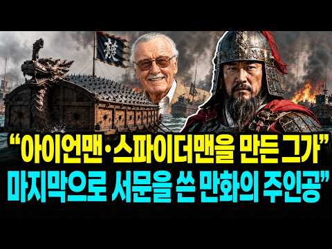
- 설명 앞부분: 아이언맨과 스파이더맨을 만든 미국 만화계의 전설, 스탠 리. 그가 생전에 직접 서문을 써준 만화의 주인공은 놀랍게도 미국의 슈퍼히어로가 아니었습니다. 바로 사백여 년 전 조선의 장군, 이순신이었습니다. 이 만화를 만든 사람은 한국인이 아니라 시카고 출신의 미국인 만화가 온리 콤판입니다. 그는 KBS 대하드라마 《불멸의 이순신》을 본 뒤 이순신의 삶에 매료됐고, 난중일기와 임진왜란 관련 자료를 직접 공부하며 이순신의 이야기를 미국 만화로 만들기 시작했습니다. 메이저 출판사의 지원도 없이 자비로 출간한 이 만화는 미국 코믹콘과 박람회…
- 같은 채널 평소 대비 ×6.6 (채널 최근 롱폼 중앙값 7,279회) · 평소 영상: "1997년, 2009년, 그리고 2026년... 환율이 또 보내는 신호" (6,631회) / "국내에서 밀렸던 브랜드가 러시아 시장에서 국민 라면이 된 의외의 반전." (4,637회)
- 대본 없음 (설명) — 음성인식이 끝나면 도입부·흐름이 들어감
- 댓글 39/39: 좋은 점 — 영상 1 · 감사·응원 4 · 더 알고 싶은 것 0 · 아쉬운 점 — 영상 0 · 반박·불만 — 의견 다름 0 · 정치·사회 0 · 경험 공유 2 · 구독·다음 기대 0
  - 좋은 점 — 영상 👍22 “미국인, 콘판 만화작가님~ 대한민국의 이순신 장군님을 널리 알려주셔서 정말 감사합니다!!!”
  - 감사·응원 👍22 “미국인, 콘판 만화작가님~ 대한민국의 이순신 장군님을 널리 알려주셔서 정말 감사합니다!!!”
  - 감사·응원 👍12 “장하십니다 응원합니다너무감사하고고맙습니다ㅡ수년전부터 얘기를전해들엇지만”
  - 경험 공유 👍11 “아 왜 내가 다 눈물이나냐ㅠ 감사합니다ㅠ”
  - 경험 공유 👍3 “임진왜란,정유재란,병자호란 겪고도 정신 안차리고ㅡ안보국방부실ㅡ일강점.”

### 267. 세계를 다 삼킨 중국 황제 조선만은 못 건드린 이유

- https://www.youtube.com/watch?v=xuJSO9q8Wl8 · 역사탐구 · 구독자 5,020 · 조회수 133,983 (×26.7, 하루 1,945.9) · 좋아요 1,063 (0.8%) · 28.6분 · 2026-08-20 · 주제 묶음 3. 조선 · 형식 정보·해설 (그 밖) · 폴더 `W_xuJSO9q8Wl8` (웹 승인)
- 썸네일: 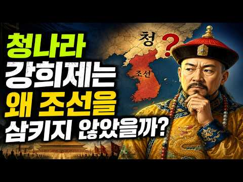
- 설명 앞부분: 참고한 자료 위키백과 강희제 항목 — 재위 기간, 삼번의 난, 대만 정복, 네르친스크 조약, 준가르 갈단 원정, 티베트 관계, 오보이 제거 등 생애와 업적 전반 국사편찬위원회 우리역사넷 백두산 정계비 문제 — 1712년 정계비 건립 경위, 목극등 파견, 박권의 소극적 태도, 토문강 해석 논쟁 국사편찬위원회 우리역사넷 조공 및 중국에서 오는 사신 — 조선과 명 청의 조공책봉 관계, 조공국의 내정 자율성 한국민족문화대백과사전 한국학중앙연구원 조공 — 조선 청 관계가 조공제도의 대표 모델이라는 학술 설명 가톨릭신문 중국 황제와 서양 선…
- 같은 채널 평소 대비 ×363.1 (채널 최근 롱폼 중앙값 369회) · 평소 영상: 넷플릭스 여배우 하영이 자랑한 증조부 안상호 고종 독살 의혹 진실 (369회) / 만주 조선인 216만명 절반은 왜 안 돌아왔나? (373회)
- 대본 없음 (설명) — 음성인식이 끝나면 도입부·흐름이 들어감
- 댓글 175/184: 좋은 점 — 영상 1 · 감사·응원 1 · 더 알고 싶은 것 0 · 아쉬운 점 — 영상 1 · 반박·불만 — 의견 다름 7 · 정치·사회 23 · 경험 공유 5 · 구독·다음 기대 0
  - 좋은 점 — 영상 👍10 “우리 어린 시절 많이 듣던 말 중에 " 세상에 조선 없이 되는 것이 없다." 이는 이성계의 쿠테타로 건국한 조선이 아니고 우리의 고조선을 말한다는 것을 훗날 알았다. 대표적으로 조공=朝貢 이 글자는 조선에 바치는 공물을 말함이다. 역사를 개판으로 배워서 우리가 사대나…”
  - 감사·응원 👍0 “제가 평소에 궁금해 했던 것을 정리하여 이렇게 알려주시니 정말 감사합니다. 제가 궁금했던 것이 또 있습니다. 정말 조선이 중국에서 독립국이었을까 하는 겁니다. 고조선에서 고려까지는 중국과 피터지게 싸운 100% 독립국임이 확실합니다. 그런데, 이성계가 중국에 스스로 …”
  - 아쉬운 점 — 영상 👍0 “해설소리가 늘어져서 지루하네”
  - 반박·불만 — 의견 다름 👍2 “백두산 정계비의 토문강은 두만강이 맞습니다. 숙종실록 38년 (1712년) 청나라 오라총관 목극등과 조선 접반사 박권의 대화를 보면, 목극등이 "청과 조선의 경계는 어디까지 인가.?" 라고 묻고, 이에 박권이 "압록강과 두만강 입니다." 답변합니다. 이에 목극등이 "…”
  - 반박·불만 — 의견 다름 👍0 “패권국의 관리방법이겟죠. 먹을것도 없는데 굳이 왜 직접통치하겟음? 전략적 요충지도 아닌데”
  - 정치·사회 👍41 “조선이 청나라에 바친 조공은 강희제에 들어 크게 줄어서 인삼과 종이, 호랑이 가죽같은 특산품으로 대체됬고 대신 청나라가 내려주는 하사품은 은과 최고급 비단과 도자기등을 갑어치로는 조공의 10배에 달해 조선으로선 개꿀. 거기다 강희제는 조선에 큰 가뭄이 들었다는 얘기를…”
  - 정치·사회 👍29 “청나라는 중국이아니다....여진족 금나라가세운 왕국이다....여진족은 절대한족하고 아무상관없다....명나라가 한족 정통중국이다....”
  - 경험 공유 👍4 “결론은 왕조시대 !! 특히 강희제은 주변국을모두 강제합병의 주 군주로 오늘날의 중국국경을 있게한 주인공! 이런 저런 소리 다 쓰잘데없는 소리! 조선을 병자호란때 보면 바로 알수 있음. 즉 조선을 정벌하고도 단지 군신관계만 확인하고 비석 하나로 끝냄. 이것이 당시 주변…”
  - 경험 공유 👍3 “그 당시 핏줄과 가문 뿌리가 가장 큰 명분이자 아이덴티티였음 북방계 지배자들은 뿌리가 모두 한국인이었음 그래서 중국을 통일해도 북방에서 힘이 엄청나게 강력해도 한반도를 내비두거나 예우해준 것은 자신들의 조상땅임을 알기 때문임 패권자가 쓸데없이 이상하게 한 나라만 챙겨…”

### 268. 밥 한 끼에 3공기 먹고도 굶어 죽었다?" 사극이 철저히 숨긴 조선 백성들의 소름 돋는 진짜 밥상

- https://www.youtube.com/watch?v=AcrIqDy_Okc · 실록책방 · 구독자 2,240 · 조회수 87,188 (×38.9, 하루 868.0) · 좋아요 404 (0.5%) · 19.5분 · 2026-07-19 · 주제 묶음 3. 조선 · 형식 정보·해설 (그 밖) · 폴더 `W_AcrIqDy_Okc` (웹 승인)
- 썸네일: 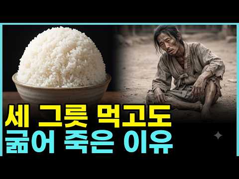
- 챕터: 0:00 많이 먹어도 배고팠던 이유 · 0:57 봄, 풀을 캐야 사는 계절 · 3:22 여름, 고기 앞의 높은 벽 · 7:10 가을, 장독대에 담긴 지혜 · 10:44 겨울, 그리고 뒤늦게 온 구원자 · 15:52 세 공기 반의 진짜 비밀 · 18:37 오늘 우리 밥상 앞에서
- 설명 앞부분: 조선 백성은 밥 한 끼에 세 공기 반씩 먹고도 늘 배가 고팠습니다. 봄엔 산에서 풀을 캐고, 여름엔 고기의 벽 앞에서 버티고, 겨울엔 흉년이 겹치면 흙까지 팠던 사람들. 그 한 해 밥상을 사계절 통째로 따라가 봅니다. 사극 속 주막의 고기 안주와 새빨간 김치는, 정작 조선 백성 대부분에겐 평생 몇 번 없던 풍경이었어요. 진짜 밥상은 잡곡과 풀, 그리고 계절마다 다른 생존의 지혜였습니다. 이 영상에서는: 봄 보릿고개에 왜 온 밥상이 초록빛이었는지 (봄나물의 진짜 정체) 소를 못 잡게 한 우금령, 그리고 고기 때문에 병든 임금 세종의…
- 같은 채널 평소 대비 ×226.2 (채널 최근 롱폼 중앙값 386회) · 평소 영상: 조선 백성은 왜 신문고 대신 왕의 길을 막았나? 격쟁의 뜻밖의 대가 (411회) / "호랑이 잡는 조선 특수부대" 시험은 5과목 중 하나만 붙으면 됐다 (411회)
- 대본 없음 (설명) — 음성인식이 끝나면 도입부·흐름이 들어감
- 댓글 100/101: 좋은 점 — 영상 4 · 감사·응원 2 · 더 알고 싶은 것 2 · 아쉬운 점 — 영상 2 · 반박·불만 — 의견 다름 5 · 정치·사회 1 · 경험 공유 2 · 구독·다음 기대 0
  - 좋은 점 — 영상 👍0 “해설이 듣기 편해서 완주했어요~ 감사합니다”
  - 좋은 점 — 영상 👍0 “해설이 듣기 편해서 완주했어요~ 감사합니다~”
  - 감사·응원 👍0 “해설이 듣기 편해서 완주했어요~ 감사합니다”
  - 감사·응원 👍0 “해설이 듣기 편해서 완주했어요~ 감사합니다~”
  - 더 알고 싶은 것 👍4 “이런 영상 만들기 전에 단 몇시간이라도 팩트 체크를 위한 공부나 자료 조사를 철저하게 하고 만들기를 부탁드립니다. 어느 책이나 영상에서 들은 엉터리 잘못된 정보를 올리는 건 조심해야 합니다.”
  - 더 알고 싶은 것 👍0 “근데 먹고 죽을 쌀이 항상 부족했는데, 어떻게 많은 양을 먹었을까요? 지금시대야 대체제가 많으니까 그렇다 쳐도, 조선시대에는 대체제가 감자 옥수수 고구마 등이 다 일것 같은데...”
  - 아쉬운 점 — 영상 👍4 “이런 영상 만들기 전에 단 몇시간이라도 팩트 체크를 위한 공부나 자료 조사를 철저하게 하고 만들기를 부탁드립니다. 어느 책이나 영상에서 들은 엉터리 잘못된 정보를 올리는 건 조심해야 합니다.”
  - 아쉬운 점 — 영상 👍0 “걍 사극에 나오는 백성모습 개구라지 조선시대백성=거지나 똑같은대 사람들이 흰색옷만 입은게 백의민족이 아니라 최소한의 멋부릴 여유조차 없어서 였구만 그만큼 조선시대가 답도없는시대인대 이상하게 저때를 중세시대마냥 미화질하는건지”
  - 반박·불만 — 의견 다름 👍87 “중요한걸 놓쳤습니다. 조선 평민들의 밥그릇을 가득 채운건 쌀밥이 아닙니다. 잡곡밥 혹은 잡곡죽이였습니다. 조선은 벼농사에 불리한 기후와 지형이였기에 벼농사는 선사시대부터 시도했지만 조선 후기까지도 보리, 기장, 조와 같은 잡곡이 식사에서 차지하는 비중이 높았습니다. …”
  - 경험 공유 👍12 “조선 경신대기근때 수백만이 굶어죽었지만 유일하게 아사를 면하고 그나마 살았던 사람들이 바닷가 해안가 섬에 살던 백성들이었음 농사가 망해 굶어도 물질로 해루질로 해초랑 미역 톳 돌김, 파래, 불가사리도 먹고, 성게 해삼 멍게 전복 문어 조개 소라 주서먹으며 생존함 이때…”

### 269. 나라를 잃고 미얀마로 도망친 명나라 마지막 황제, 배신 끝에 최후를 맞다 ∣ 영력제의 최후

- https://www.youtube.com/watch?v=PknqtorX34s · 대명제국 흑역사【심층 다큐】 · 구독자 2,210 · 조회수 49,907 (×22.6, 하루 846.0) · 좋아요 210 (0.4%) · 64.8분 · 2026-08-30 · 주제 묶음 6. 동양사 (중국·일본·몽골) · 형식 정보·해설 (그 밖) · 폴더 `W_PknqtorX34s` (웹 승인)
- 썸네일: 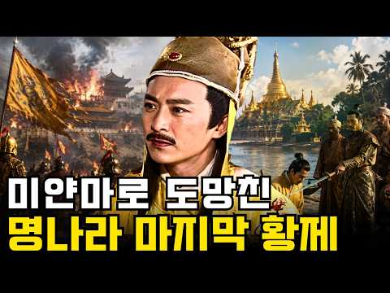
- 같은 채널 평소 대비 ×12.1 (채널 최근 롱폼 중앙값 4,131회) · 평소 영상: 항복에서 처형까지 15년, 청나라는 정지룡에게 무엇을 원했나 (4,131회) / 수많은 대신을 몰아낸 명나라 권신 엄숭, 결국 자신의 아들조차 구하지 못했다 (4,057회)
- 대본 없음 (없음) — 음성인식이 끝나면 도입부·흐름이 들어감
- 댓글 17/17: 좋은 점 — 영상 0 · 감사·응원 3 · 더 알고 싶은 것 0 · 아쉬운 점 — 영상 0 · 반박·불만 — 의견 다름 0 · 정치·사회 1 · 경험 공유 0 · 구독·다음 기대 0
  - 감사·응원 👍2 “존칭어 과잉시대에 비존칭어(반말?)가 훨씬 듣기에 좋습니다. 잘 듣겠습니다. 감사합니다.”
  - 감사·응원 👍1 “감사합니다”
  - 정치·사회 👍0 “이정국과 손가망이 내전을 벌이지 않고 만주족 타도를 위해 정성공과 완벽하게 협력했다면, 오삼계 홍승주같은 배신자들이 없었다면 과연 청나라가 중국 전 영토를 지배하고 지금의 티벳 신장위구르를 아우르는 영토를 짱개들에게 물려줄수 있었을까요? 역사에 만약은 없지만 안타깝네…”

### 270. [리부트] 흑선봉명록 1 ∣ The King's Mystic: Chronicles of Seoha ∣ 조선 판타지 사극

- https://www.youtube.com/watch?v=Enoqsssxx5Y · 로보랩 스튜디오 · 구독자 10,800 · 조회수 185,601 (×17.2, 하루 4,121.7) · 좋아요 1,781 (1.0%) · 22.2분 · 2026-09-13 · 주제 묶음 3. 조선 · 형식 정보·해설 (그 밖) · 폴더 `W_Enoqsssxx5Y` (웹 승인)
- 썸네일: 
- 설명 앞부분: [설명] 조선의 밤, 죽은 자들이 다시 일어나기 시작한다. 왕명을 받들어 인간의 힘으로는 감당할 수 없는 기이한 사건을 해결하는 봉명방사(奉命方士), 서하. 황해도 곡산에 나타난 시귀들. 그리고 그들을 토벌하기 위해 움직이는 서하와 요괴 토벌 정예부대 암영단. 하지만 서하는 평소와 달리 직접 전투에 나서지 않고, 조용히 모든 것을 지켜보기만 하는데... 《흑선봉명록》의 새로운 시작, 첫 번째 이야기입니다. [AI 제작 / AI Production] 《흑선봉명록》은 다양한 생성형 AI 도구를 활용하여 제작한 AI 기반 실사 판타지 …
- 같은 채널 평소 대비 ×1.5 (채널 최근 롱폼 중앙값 127,735회) · 평소 영상: 흑선봉명록 6화 ∣ 영혼을 모으는 무당 The King's Mystic: Chronicl… (127,735회) / 흑선봉명록 5화｜비극의 시작 ∣ The King's Mystic: Chronicles o… (109,172회)
- 대본 없음 (설명) — 음성인식이 끝나면 도입부·흐름이 들어감
- 댓글 133/144: 좋은 점 — 영상 0 · 감사·응원 8 · 더 알고 싶은 것 3 · 아쉬운 점 — 영상 0 · 반박·불만 — 의견 다름 1 · 정치·사회 2 · 경험 공유 3 · 구독·다음 기대 7
  - 감사·응원 👍29 “정말이지 어쩔수가 없는 프로정신 구독자를 위함이라셔도 좋은 작품에 대한 욕심 또한 대단하신듯 합니다. 건강 상하시지 않는 것이 제일 우선시 되어야 할것 같습니다. 수준 높으신 구독자 분들께선 이런 이유라면 충분히 기다리며 좋은 작품을 기다릴수 있을겁니다. 말이 쓸데없…”
  - 감사·응원 👍7 “아니아니 이럴수가!!! 드디어 1편이!!! 정말 감사합니다. 얼마나 힘드셨을까요... 1편과 함께 4편도 제작했다니... 일단 댓글부터 달고 영상 봅니다. 정말 고생하셨어요. 감사합니다!!!! 🎉😂😊”
  - 더 알고 싶은 것 👍2 “4번 보고 있습니다. 건강 챙겨 가시면서 만들어 주세요..😊😊”
  - 더 알고 싶은 것 👍1 “혹시 이거 썸네일 그림 그록으로 뽑으셨나요?제얼굴처럼 나와서 ㅠ.ㅠ다른게아니라 제가그록으로 제얼굴로 유튜브 영상작업많이했어가지고 그록이 전체서버에 남을수도있다고해서 학습된것같아서 그록으로 생성하신건지 궁금해서 여쭤봅니다 ㅠㅠ 요즘따라 제얼굴이 다른사람들 그록생성작품에…”
  - 정치·사회 👍1 “남녀 주인공들 헤어스타일과 복식을 중국 스타일로 한 게 참 아쉽네요. 그것만 빼면 일반서민들 복식과 관아 사또, 포졸들 그리고 고을 건축양식까지 전부 한국사극 그대로 재현해놓았는데 유일하게 주인공들만 중국인들 데려다 놓은 것처럼 중국스타일의 머리모양과 의복을 해놓은 …”
  - 정치·사회 👍0 “조선 판타지 사극인데.. 주인공이 외모부터 의상까지 너무 중국인 같아요~~ 무비자로 조선 귀화한 화교인가요??”
  - 경험 공유 👍4 “오!제가1등이군요? 잘 보겠습니다”
  - 경험 공유 👍1 “와 디테일 미쳤다리 내가 본것중에 제일이네 왜만해서는 잘한다고 안하는 성격인데 정말 얼마나 노력했을까라는 딱봐도 정말 작품이 너무 디테일하게 잘했어 넘 쪼앙 최고얌”
  - 구독·다음 기대 👍13 “다음편도 기대할께요😊”
  - 구독·다음 기대 👍7 “늘 다음편이 기다려지는 멋진 작품 감사해요”

### 271. 세계 최강 러시아도무릎 꿇린 강희제 왜 조선만 건드리지 못했나?

- https://www.youtube.com/watch?v=2asJEOv8rQM · 역사유람기 · 구독자 244 · 조회수 12,201 (×50.0, 하루 92.8) · 좋아요 412 (3.4%) · 45.5분 · 2026-06-18 · 주제 묶음 3. 조선 · 형식 정보·해설 (그 밖) · 폴더 `W_2asJEOv8rQM` (웹 승인)
- 썸네일: 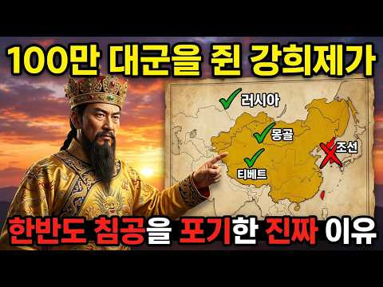
- 설명 앞부분: 병자호란 이후 조선은 청나라의 숨도 쉬지 못하는 노예로 살았을까요? 몽골 준가르를 절멸시키고 세계 최강 러시아 제국마저 무릎 꿇린 청나라 최고의 정복 군주, 강희제. 눈앞의 모든 문명을 씹어 삼키던 그의 100만 대군이 유독 조선의 국경선 앞에서는 기이할 정도로 뚝 멈춰 섭니다. 당시 조선의 숙종은 대놓고 요새를 쌓으며 강희제를 도발하던 일촉즉발의 상황. 청나라 대신들의 전쟁 상소 앞에서도 황제는 기묘한 침묵을 지킵니다. 고작 산세가 험해서 진격을 망설였던 걸까요? 그 이면에는 칼보다 잔혹하고 소름 끼치는 강희제의 ‘천재적인 지정…
- 같은 채널 평소 대비 ×32.1 (채널 최근 롱폼 중앙값 380회) · 평소 영상: 40도폭염에 조선궁궐은 어떨게 냉방했을까? ㅣ조선시대 여름나기 (380회) / 세계가 경악한 이순신의 진짜 능력, 우리가 매일 먹는 이것의 정체! (455회)
- 대본 없음 (설명) — 음성인식이 끝나면 도입부·흐름이 들어감
- 댓글 57/58: 좋은 점 — 영상 0 · 감사·응원 1 · 더 알고 싶은 것 0 · 아쉬운 점 — 영상 0 · 반박·불만 — 의견 다름 1 · 정치·사회 1 · 경험 공유 1 · 구독·다음 기대 0
  - 감사·응원 👍0 “강희제는 역사를 공부했다. 조선은 살아남는데 달인이다. 중국이 조선을 칠려면 서로 목숨을 걸어야 한다. 그 결과는 알 수 없다. 대륙의 수십만 군대가 조선을 공격하다 여러번 몰사당했다. 조선은 청나라에 머리를 숙이고 조공을 바친다. 청나라는 감사하기만 하다. 위험을 …”
  - 정치·사회 👍1 “중국인이 된게 최고의 치적”
  - 경험 공유 👍1 “청나라 자신이 시조가 한반도가 왔다고 기록하는데 명나라 추종 주자성리학에 빠진 보수 꼴통들이 잘나서 정복 당하지 않은 거라고 이야기하면 역사 왜곡이죠. 임진왜란 때 만주족의 파병 제안도 걷어차고 언급도 안 했었습니다. 태어나지 말았어야 할 인조 같은 인간이 지배하는 …”

### 272. 명나라 사신들이 기겁했다! 얼굴 하나로 대륙을 뒤흔든 조선 최고 미남 왕의 정체

- https://www.youtube.com/watch?v=RJMbPAxJLaE · 역사풀이 · 구독자 6,780 · 조회수 297,180 (×43.8, 하루 2,573.5) · 좋아요 5,534 (1.9%) · 27.7분 · 2026-07-04 · 주제 묶음 6. 동양사 (중국·일본·몽골) · 형식 정보·해설 (그 밖) · 폴더 `W_RJMbPAxJLaE` (웹 승인)
- 썸네일: 
- 설명 앞부분: 조선 역사상 가장 잘생긴 왕으로 기록된 인물이 있습니다. 그의 외모는 조선 안에서만 회자된 것이 아니었습니다. 명나라 사신들조차 그의 얼굴과 기품에 놀랐다고 전해지죠. 하지만 그는 단순히 잘생긴 왕이 아니었습니다. 그런데 왜 우리는 이 왕을 오래 기억하지 못했을까요? 왜 그의 이름보다, 그의 짧은 재위와 비극적인 가족사가 더 강하게 남아 있을까요? 이번 영상에서는 명나라까지 놀라게 했다는 조선 왕의 외모 기록, 그가 왕이 되기 전부터 보여준 능력, 그리고 너무 짧았던 재위 뒤에 남겨진 비극까지 함께 살펴봅니다. 조선 왕실의 빛나는…
- 같은 채널 평소 대비 ×413.3 (채널 최근 롱폼 중앙값 719회) · 평소 영상: 사도세자는 왜 뒤주에서 죽었나 ∣ 영조 부자 비극의 모든 것 (조선 왕실 최악의 사건) (719회) / 이 사람이 살았다면, 조선은 강대국이 되었을 것이다 ∣ 정약용도 인정한 역대급 천재 (706회)
- 대본 없음 (설명) — 음성인식이 끝나면 도입부·흐름이 들어감
- 댓글 594/619: 좋은 점 — 영상 2 · 감사·응원 7 · 더 알고 싶은 것 2 · 아쉬운 점 — 영상 7 · 반박·불만 — 의견 다름 7 · 정치·사회 3 · 경험 공유 7 · 구독·다음 기대 0
  - 좋은 점 — 영상 👍1 “와 영상 10개 올리신 거 모두 알차고 유익하네요. 이 영상이 대박나서 앞으로 다른 영상도 클릭 많이 할것 같아요. 좋댓구알 완료요~^^”
  - 좋은 점 — 영상 👍0 “문종정말훌륭임금님셨내요단종임금 님이 너무불쌍했지요감사드려요 앞으로도계속좋은 말씀전해주세요”
  - 감사·응원 👍13 “문종,,, 덕분에 슬픈 역사 한조각을 알았어요. 감사합니다 ♡.”
  - 감사·응원 👍4 “문종에재해서 알게되어서 감사합니다.”
  - 더 알고 싶은 것 👍194 “부인복도 없고 수명도 짧았으니....참으로 애통하네요 세종은 영특한 세자가 얼마나 기특하고 대견했을까요? 그런데 그 어린 아들은 비참한 죽임을 당했으니”
  - 더 알고 싶은 것 👍10 “이분이 오래 살고 단종이 왕이 됐으면 정조도 없었겠네. 그래도 궁금하다. 어떤 역사가 쓰였을지.”
  - 아쉬운 점 — 영상 👍10 “문종이네..명이 짧아서 아쉬웠든 왕.. 그가 오래살았다면 또 다른 역사가 시작되었을건데...”
  - 아쉬운 점 — 영상 👍6 “세자기간이 29년으로 너무 길었고 그중 8년은 세종대왕을 대신하여 대리 청정...그러나 세종대왕의 후광에 가려진 분..실제 재위기간은 2년 정도 그래도 단명은 아닌 분인데..”
  - 반박·불만 — 의견 다름 👍44 “문종대왕님이 훌융하십니다 세조는 아닙니다”
  - 반박·불만 — 의견 다름 👍2 “앵두나무가 어떻게 생겼는지 어떤모습의 열매인지 고증좀하세요 앵두나무모습 아닙니다 벚찐줄~~~~”
  - 정치·사회 👍22 “문종임금 이군요 이런분들이 오래 집권했다면 그만큼 나라가 많이 발전했을 텐데 문종임금님 안되었네요”
  - 정치·사회 👍0 “문종이 ㅣㅇ년만 더 살아계셨어도 나라가 달라졌을텐데”
  - 경험 공유 👍51 “이향 문종 임금님 정말 힘드셨지요 세종임금님 모시고 8년 대리청정 다방면으로 연구하시고 그때 수양을 죽여 놓으셔야 했었는데 발로 차고 싶습니다 저 세상서 편안하게 계시고 아는체도 마세요”
  - 경험 공유 👍8 “아니어도세종의맏아들(이향-문종)이궁금했었답니다.이영상이많이알려지길바랍니다.”

### 273. 우리가 알고있던 역사는 가짜다! 태조왕건은 영웅이 아닌 역사상 최악의 배신자였다? ∣ 역사다큐 ∣ 한국사 ∣ 태조왕건 ∣ 고구려 ∣ 조선왕조실록 ∣ 후삼국

- https://www.youtube.com/watch?v=B5_SPRpG_oA · 역사틀 · 구독자 2,490 · 조회수 135,052 (×54.2, 하루 929.6) · 좋아요 2,131 (1.6%) · 30.7분 · 2026-06-05 · 주제 묶음 3. 조선 · 형식 정보·해설 (그 밖) · 폴더 `W_B5_SPRpG_oA` (웹 승인)
- 썸네일: 
- 챕터: 0:00 애꾸눈 미치광이, 우리가 아는 궁예 · 1:30 궁예의 악행은 533년 뒤에 쓰였다 · 3:00 패자는 변명할 기회가 없다 — 강진의 비석 · 4:15 비석에 새겨진 두 글자 '대왕' · 6:00 거지가 아니라 버려진 신라 왕자였다 · 8:10 맨손으로 한반도 최강국을 세우다 · 10:20 미치광이는 나라를 세우지 못한다 · 11:40 관심법, 마음을 읽는다는 임금 · 13:30 왕건을 살린 최응의 붓 한 자루 · 16:00 부인과 두 아들을 죽인 진짜 이유 · 19:30 왕건을 가리킨 거울 속 예언 · 21:30 충신은 왜 끝까지 망설였나 · 22:50 보리 이삭 훔치다 맞아 죽은 임금? · 24:20 천 년의 침묵을 깬 돌, 선각대사비 · 26:10 학계가 두 쪽으로 갈라지다 — 대왕은 누구인가 · 28:30 그래서, 궁예는 누구였나
- 설명 앞부분: 천 년 동안 미치광이 폭군으로 기록된 궁예. 그런데 전남 강진의 한 비석에서 발견된 두 글자가 역사학계를 뒤집었습니다. 종이는 고쳐 써도 돌은 거짓말을 못 합니다. 우리가 교과서에서 배운 궁예와 왕건, 정말 전부 사실일까요? 승자의 붓끝에 가려진 진짜 얼굴을 지금 확인해 보세요. 본 영상의 제목, 썸네일, 대본, 영상 전체는 '역사틀' 채널의 자산으로 모든 형태의 2차 사용을 금지합니다. 📖 본 영상은 AI 기술을 활용해 제작되었으며, 역사적 사실을 바탕으로 한 정보 전달을 목적으로 합니다. 일부 해석과 비유는 이해를 돕기 위한 …
- 같은 채널 평소 대비 ×189.1 (채널 최근 롱폼 중앙값 714회) · 평소 영상: 교과서에도 없던 충격적 진실! 대부분이 몰랐던 단종 죽음의 진짜 진실!┃조선실록┃한국사┃… (854회) / 조선은 일본에게 똥까지 모두 뺏겼다 #역사이야기 #한국사 #역사다큐 #조선생활 #역사상식… (574회)
- 대본 없음 (설명) — 음성인식이 끝나면 도입부·흐름이 들어감
- 댓글 535/536: 좋은 점 — 영상 2 · 감사·응원 3 · 더 알고 싶은 것 2 · 아쉬운 점 — 영상 1 · 반박·불만 — 의견 다름 9 · 정치·사회 21 · 경험 공유 8 · 구독·다음 기대 1
  - 좋은 점 — 영상 👍1 “🌿🇰🇷🌿사마천 사기도 왜곡된 기록이 많습니다!👀 🔥2🌿?🔥 經典外는 액면 기록대로 믿는다는 건! 아니지요! 바른 사학자는 당시 정황도 분석해 봐야 합니다! 해설자 공론을 공감합니다! 🤔💦ㅡ칠순필부ㅡ”
  - 좋은 점 — 영상 👍0 “맞는 말씀입니다 처음은 형제의 맺어진것은 왕권으ㅏ 부친 왕륜개성 세력가이자 재산이 나라세우는데 기초로”
  - 감사·응원 👍2 “이런 영상이 바로 거짓역사인 것입니다. 역사는 승자의 것이라고요? 역사 수준이 초등학교 역사 수준 그 이상도 이하도 아니네요. 수많은 사람들의 눈과 귀는 그냥 밥먹는데만 썼는줄 아나보네요. 역사기록의 한계성과 그 너머의 것도 분명 있긴 하지만 그 한계성을 인정하고 공…”
  - 더 알고 싶은 것 👍10 “궁예의 몰락은 궁예 본인이 버림 받은 신라 왕자 출신 이라는 점이 크다고 봅니다. 패서 지역의 고구려 유민, 호족들 입장에서는 고구려를 계승한 새 나라의 왕이 버림 받은 신라 왕자 출신 이라는 것에 대한 거리감도 있었을 것 같습니다. 궁예가 수도를 송악에서 철원으로 …”
  - 더 알고 싶은 것 👍3 “역사를 보면 너무 옳은삶ㆍ강직한 사람들은 일찍 돌아가십니다ㆍ 현재나 과거나 기록은 산자들이 남기고 쓰여지기에~~ 타임머신이 있다면 그 시간속 이야기들을 바로 알고 싶네요ㆍ 드라마로 나올때 재미로만 보다가 점점ㆍ의아해지는 이야기들을 접하다보니ㆍ더욱 그렇습니다ㆍ”
  - 반박·불만 — 의견 다름 👍1 “역사를 100% 진실되게 알 순 없겠으나, 너무 지나친 비약이다. 물론 궁예가 예삿 인물이 아니었기에 초창기에는 후고구려를 건설했고 그만큼 사람들이 따랐을 것이다. 허나, 아무리 인물 출중하다고 하더라도 말기에는 타락했기에 주위사람들이 궁예를 떠났을 것이고, 왕건이라…”
  - 반박·불만 — 의견 다름 👍0 “삼국사기에 나오는 궁예가 세력을 일으킨 명주는 지금의 절강성에 있습니다. 강원도 강릉이라고 계속 학교에서는 가르치는데 근거 대보라고 역사학회에 질의하면 근거도 못대고 수십년째 그냥 그렇게 비정한다고 헛소리 하거나 아예 답이 없습니다. 그 당시 명주는 해상 실크로드의 …”
  - 정치·사회 👍20 “가장 배신자는 이조의 이성계 이성계는 고려때 귀화한 중국인이 최영 대장군 머함하고 한국의 역사사 정체성을 통째로 바꿨고 고려이전 문화 사회보다 퇴보시킨 왕조였다 종국에는 고종이 일본에다 돈받고 조선을 팔았다”
  - 정치·사회 👍3 “배신이 없이 나라가 세워지나?신라가 외세를 끌어들여 삼국을 통일하고 만주를 포함한 영토의 반을 당에 빼앗기고 다시는 만주를 회복하지 못했다.조선도 그렇고! 야비함이 지혜로움과 능력이 되고 배신이 강함과 생존력이 되는세상.작금의 세상은 뭐 다른가?”
  - 경험 공유 👍2 “왕건이 역적 쓰 ㄹ ㅐ기임. 이성계와 똑같이 역적 배신자들 특징이 지들이집권하면 지들에게 완전유리하게 역사조작하고 상대방은 어떻게든 온갓 조작된 모함으로뒤집어 씌워서 악마화함. 전세계 역사상 모든 베신자 역적들이 필수로 행하던 기본중에 기본인일을 바보같은 국민들이 드…”
  - 경험 공유 👍1 “역사는 승자의 붓으로 쓰여신건 맞지마 내가 아는 내용은 궁예가 처음에는 백성을 생각하는 훌륭한 왕이였다라는것 역사드라마 왕건에도 그러했고 누가 처음부터 나쁜왕을 따르겠나? 영상 내용은 그런 처음부터 나쁜 왕 뜻으로 사람들이 생각 했다는 뜻으로 만들었고 ... 사람이란…”
  - 구독·다음 기대 👍4 “구독합니다 잘 볼게요”

### 274. 17만 대군도 벌벌 떨게 한 한국사 최강의 인간 병기, '척준경'의 말도 안 되는 실화

- https://www.youtube.com/watch?v=7_UjHlAN6-E · 정치수달TV · 구독자 8,370 · 조회수 529,983 (×63.3, 하루 3,117.2) · 좋아요 5,919 (1.1%) · 32.4분 · 2026-05-11 · 주제 묶음 4. 한국 근현대사 · 형식 인터뷰·강연·대담 · 폴더 `W_7_UjHlAN6-E` (웹 승인)
- 썸네일: 
- 설명 앞부분: 이게 진짜 실화라고? 17만 대군이 며칠 동안 못 뚫은 산성을, 한 줌의 결사대가 들어가 추장 여러 명을 쓰러뜨리고 살아 나왔습니다. 《고려사》가 기록한 실제 사건. 한국사 최강의 인간 병기, 척준경의 이야기입니다. 1107년 12월, 함경도의 어느 산성 아래. 고려 17만 대군과 여진족 결사대가 충돌한 그곳에서 정말 영화 같은 일이 벌어졌습니다. 그날 그 산성 안에서 무슨 일이 있었는지, 그리고 그 사내의 인생이 그 뒤로 어떻게 흘러갔는지, 영상에서 천 년 전 그 겨울로 함께 들어가 봅니다. 한국사 교과서가 한 줄로 지나친 그 …
- 같은 채널 평소 대비 ×12.5 (채널 최근 롱폼 중앙값 42,351회) · 평소 영상: 김민석이 던진 사이다 한마디에 매불쇼 최욱 멘붕 온 이유 (42,351회) / 야사보다 충격적인 중국 5,000년 유일한 여황제, 측천무후의 진짜 이야기 (42,694회)
- 대본 없음 (설명) — 음성인식이 끝나면 도입부·흐름이 들어감
- 댓글 944/944: 좋은 점 — 영상 3 · 감사·응원 5 · 더 알고 싶은 것 1 · 아쉬운 점 — 영상 1 · 반박·불만 — 의견 다름 3 · 정치·사회 9 · 경험 공유 6 · 구독·다음 기대 0
  - 좋은 점 — 영상 👍47 “아무것도 없는 척준경이 고려 황후 배출 가문 왕자지 장군님과 친구 먹고 윤관장군님이 양아들로 삼을 정도면 2천년에 한번 나올까 말까한 무력과 깡다구 있는 레전드😊”
  - 좋은 점 — 영상 👍18 “2 대단한 장군이라 배웠지요.”
  - 감사·응원 👍37 “고려군 척준경 대단한 영웅입니다 감사합니다”
  - 감사·응원 👍4 “감사합니다”
  - 더 알고 싶은 것 👍2 “어떻게 짧은글로 할수있겠나요 나라를 구한사람이 민생 가난한 사람을 구하기로 마음 먹은거죠 얼마나 부폐하고 임금이 자격이없고 감히 누가 척춘경을 단죄할수있나요 ????”
  - 아쉬운 점 — 영상 👍0 “간신들에 의해 토사구팽당해 궁궐에 불을 지르며 궐기했을듯~~ 지금도 몰라주다가 궁지에 몰리면 중용하고 필요없으면 내쫒는 것이 반복되지요. 위기에는 필요하지만 위기 후에는 쓸모가 없어져 짐이되기에 써먹었던 사람들은 앞으로 더 쓸일보다 당장 필요치않고 본인은 공이 이러한…”
  - 반박·불만 — 의견 다름 👍1 “윤관의 동북9성은 함경도가 아닙니다. 그것은 일제의 식민사관이 만든 역사에 불과한 것입니다.”
  - 반박·불만 — 의견 다름 👍0 “공험진 위치가 두만강 이북 700리에 있다는 것이 밝혀졌는데 헛소리하네!”
  - 정치·사회 👍3 “척춘경! 무조건 영화화 해라! 또다른 한국의 역사가 있는데. 그것이 바로 고려이다. 고려는 침략당하는 나라가 아닌 침략을 하는 국가였던 것이라는 것이다. 하인에서 대장군으로 변한 인물!”
  - 정치·사회 👍1 “전젱에서 목슴받치고 이겼다 내가 지킨나라가 임금 양반 권 력자로 인해 부패됬다면 그의 댁가를 받아야 한다 척준경님 역사의 영웅입니다”
  - 경험 공유 👍16 “항상 그랬듯이 성품이 곧은 사람들은 자신의 신념을 굳히지 않죠~~~ 척장군은 아마도 자신의 지위나 돈을 탐하진 않았을것 같습니다. 고지식하고 고집이 한고집했어서 정도를 벗어나는걸 참지 못했었을수도... 그리고 그 패거리들의 꼬임에 넘어가지 않았을까요~~~^^;; 저는…”
  - 경험 공유 👍1 “제가 무인으로써. 존경하는 분이 척준경입니다.”

### 275. 역모로 쫓긴 대감집 아씨를 가마니에 숨겨온 심마니, 조선 거상이 되다∣ 야담.수면 오디오북.조선야담.조선한국사.조선로맨스.조선사업이야기

- https://www.youtube.com/watch?v=wl-pu2vCAY4 · 설주야담 · 구독자 30,800 · 조회수 710,269 (×23.1, 하루 11,450.4) · 좋아요 7,400 (1.0%) · 53.4분 · 2026-08-27 · 주제 묶음 10. 수면·낭독 · 형식 수면·낭독 (잠잘 때 듣는) · 폴더 `W_wl-pu2vCAY4` (웹 승인)
- 썸네일: 
- 설명 앞부분: ❤️설주야담에 오신 것을 환영합니다. 조선시대를 배경으로 한 야담, 민담, 설화와 흥미로운 옛이야기를 들려드립니다. 버려지고 쫓겨난 이들이 뜻밖의 인연을 만나 서로를 구하고, 작은 은혜가 사랑과 가족으로 이어지는 이야기. 가난과 신분의 벽을 넘어 운명을 바꾸는 사람들의 이야기를 담고 있습니다. 눈보라 속에 버려진 과부를 구한 나무꾼, 갈 곳 없는 처녀에게 손을 내민 가난한 총각, 아무도 예상하지 못했던 숨겨진 사연과 반전까지. 때로는 가슴 뭉클한 사랑과 효심, 때로는 속 시원한 권선징악과 인생 역전, 그리고 마지막에는 사람의 따뜻…
- 같은 채널 평소 대비 ×19.3 (채널 최근 롱폼 중앙값 36,889회) · 평소 영상: "죽은 사람 건드리지 마라" 그녀를 집으로 업고간 짚신장수,조선의 거상이되다. ∣ 야담,… (36,889회) / "그 여종 건드리지 마시오!"눈더미 속에 버려진 노비를 주워왔더니, 가문을 일으킨 '금빛… (37,718회)
- 대본 없음 (설명) — 음성인식이 끝나면 도입부·흐름이 들어감
- 댓글 174/180: 좋은 점 — 영상 4 · 감사·응원 18 · 더 알고 싶은 것 3 · 아쉬운 점 — 영상 1 · 반박·불만 — 의견 다름 0 · 정치·사회 0 · 경험 공유 3 · 구독·다음 기대 2
  - 좋은 점 — 영상 👍5 “좋은 이야기 잘 보았습니다, 아쉬운 건 아들 딸 소식이 없어 아쉽네요,”
  - 좋은 점 — 영상 👍5 “좋은이야기였읍니다”
  - 감사·응원 👍8 “귀하고 소중하신 영상 대단히 감사드립니다 서울입니다😅”
  - 감사·응원 👍7 “참 아름다운 애기네요 무진과 서린 잘만 난것갇으며 어머니도 인품 이좋으시네요 큰보물을서로 얻으셧네요 잘보앗 습니다 감사합니다”
  - 더 알고 싶은 것 👍7 “잘들었습니다~ 자주 올려주세요~”
  - 더 알고 싶은 것 👍4 “영상이 정말 재미있고 정성이 느껴집니다! 이렇게 좋은 콘텐츠를 만들어 주셔서 감사합니다. 앞으로도 좋은 영상 많이 만들어 주세요. 채널의 더 큰 발전을 응원합니다! 👏❤”
  - 아쉬운 점 — 영상 👍5 “좋은 이야기 잘 보았습니다, 아쉬운 건 아들 딸 소식이 없어 아쉽네요,”
  - 경험 공유 👍4 “나도 내일부터 약초캐러가야긋다. 잘하면 장가갈수도..”
  - 경험 공유 👍3 “나도 시골에 내려가 산속에서 나무하고 약초캐며 살아볼까 ? 서린이 같은 낭자를 만나게 될지”
  - 구독·다음 기대 👍4 “미국 텍사스주 휴스턴에서 잘 들었습니다. 깔끔한 내용전개가 좋아서 구독 및 알림설정 했습니다.”
  - 구독·다음 기대 👍4 “최근 방문한 같은 야담러중 최고십니다 ㅋ 구독하고 갈게요”

### 276. 인류 최초의 문명 수메르, 그들은 대체 어디서 왔을까? l 세계사 l 역사 l 메소포타미아

- https://www.youtube.com/watch?v=if6WN6ejRYo · 역사의 그림자  · 구독자 720 · 조회수 45,444 (×63.1, 하루 267.2) · 좋아요 609 (1.3%) · 16.7분 · 2026-05-11 · 주제 묶음 5. 세계사·서양사 · 형식 인터뷰·강연·대담 · 폴더 `W_if6WN6ejRYo` (웹 승인)
- 썸네일: 
- 설명 앞부분: 5000년 전, 티그리스강과 유프라테스강 사이에서 인류 최초의 도시 문명이 탄생했습니다. 그들은 최초의 문자, 최초의 법, 최초의 학교, 바퀴, 60진법을 만들었고, 오늘날 우리가 쓰는 시간 체계와 문명의 기초를 남겼습니다. 그 사람들을 우리는 수메르인이라고 부릅니다. 하지만 이상한 점이 있습니다. 수메르인들이 어디서 왔는지는 아직도 명확히 밝혀지지 않았습니다. 그들의 언어는 주변 민족과 달랐고, 그들이 남긴 쐐기 문자와 도시 문명은 이후 아카드, 바빌로니아, 메소포타미아 문명 전체에 거대한 영향을 남겼습니다. 이번 영상에서는 수…
- 같은 채널 평소 대비 ×29.8 (채널 최근 롱폼 중앙값 1,524회) · 평소 영상: 왜 사막 한가운데 거대한 왕국이 탄생했을까?｜사바 왕국｜시바의 여왕｜마립 댐｜고대문명 (1,524회) / 교과서가 지워버린 잉카 2000년 전 안데스 대륙의 진짜 주인 (차빈 문명) 고대문명ㅣ세… (1,739회)
- 대본 없음 (설명) — 음성인식이 끝나면 도입부·흐름이 들어감
- 댓글 44/44: 좋은 점 — 영상 1 · 감사·응원 0 · 더 알고 싶은 것 0 · 아쉬운 점 — 영상 1 · 반박·불만 — 의견 다름 0 · 정치·사회 0 · 경험 공유 1 · 구독·다음 기대 0
  - 좋은 점 — 영상 👍1 “유익합니다”
  - 아쉬운 점 — 영상 👍1 “AI 음성인가 문자를 문짜로 읽지 않고 글자대로 읽는데... 몇가지 어색함 빼면 흥미롭네요.”

### 277. 중국사ㅣ가족들, 집안에 갇혀 굶어 죽었다. 죽은 지 5개월 후 가문 몰락의 시작ㅣ스승이 죽자 복수를 시작한 만력제ㅣ명나라개혁ㅣ역사인물ㅣ시니어 역사

- https://www.youtube.com/watch?v=bKSQ9iKsGA0 · 역사답다 · 구독자 3,990 · 조회수 96,474 (×24.2, 하루 1,479.6) · 좋아요 588 (0.6%) · 32.7분 · 2026-08-24 · 주제 묶음 6. 동양사 (중국·일본·몽골) · 형식 정보·해설 (그 밖) · 폴더 `W_bKSQ9iKsGA0` (웹 승인)
- 썸네일: 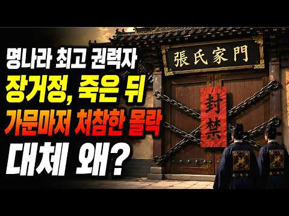
- 챕터: 0:00 융경제의 죽음, 열 살 황제의 탄생과 권력 암투의 시작 · 4:25 장거정의 권력 장악 — 풍보·이태후와의 삼각동맹, 고… · 8:50 어린 황제를 옥죄는 통제 — 서예 금지, 반성문, 그… · 13:15 명나라를 뒤흔든 개혁 — 고성법, 전국 토지 측량, … · 18:00 권력의 폭주 — 탈정 강행, 곤장 세례, 서원 폐지,… · 22:30 스승의 죽음, 그리고 만력제의 칼 — 시호 박탈과 가… · 27:00 장거정이 남긴 것 — 개혁가인가, 권신인가
- 설명 앞부분: 죽은 지 5개월 후 가문 몰락의 시작 , 집안에 갇혀 굶어 죽었다. 명나라 제14대 황제 만력제는 겨우 열 살에 옥좌에 올랐습니다. 그의 곁에는 명나라 역사상 가장 강력한 재상 장거정이 있었죠. 무너져가던 국고를 살려냈고, 썩어빠진 관료 사회를 도려냈으며, 북방의 외적까지 막아낸 전무후무한 개혁가, 하지만 그 권력의 끝은 참혹했습니다. 🎭 살아서는 명나라를 구했지만, 죽어서는 가문이 멸족당한 장거정. ⚖️ 그는 최고의 개혁가였을까요, 아니면 선을 넘어버린 권신이었을까요? 🔥이 영상에서는 장거정이 어떻게 권력을 잡았는지 어린 황제를…
- 같은 채널 평소 대비 ×82.4 (채널 최근 롱폼 중앙값 1,172회) · 평소 영상: 조선 왕은 매일 파인다이닝ㅣ왕의 한끼는 얼마였을까?ㅣ조선시대 수라상의 모든 것 ∣ #조선… (1,202회) / 한국사ㅣ광복, 정말 원폭 '한 방' 때문이었을까?ㅣ소련때문이었을까?ㅣ원폭을 맞고도 조선을… (1,141회)
- 대본 없음 (설명) — 음성인식이 끝나면 도입부·흐름이 들어감
- 댓글 85/85: 좋은 점 — 영상 0 · 감사·응원 3 · 더 알고 싶은 것 0 · 아쉬운 점 — 영상 1 · 반박·불만 — 의견 다름 1 · 정치·사회 4 · 경험 공유 0 · 구독·다음 기대 0
  - 감사·응원 👍2 “좋아여 감사해여❤”
  - 감사·응원 👍0 “ㅋㅋㅋ 좋은 동영상임, 감사합니다.”
  - 정치·사회 👍3 “적어도 장거정 개헉 덕분에 명나라가 이후 40년을 버틸 수 있었습니다”
  - 정치·사회 👍2 “어떻게 보면 영국처럼 황실과 정치를 분리한 선진정치가 당시 장거정의 명나라 아닌가? 싶기도 하다. 왜 꼭 황제가 정치를 직접해야 정의고 신하가 하면 나쁜거로 봐야할까? 후기에 권력에 너무 과잉 집착한 부분이나 섬세하게 만력제를 고려하지 못한 부분은 장거정의 단점이였지…”

### 278. 《한국사》 조선 왕들이 쓰러진 충격적 비밀… 수라상에 있는 비밀은? l 조선시대 l 실록

- https://www.youtube.com/watch?v=3kLrgAozH3w · 한국사 이야기 · 구독자 24,200 · 조회수 289,365 (×12.0, 하루 8,961.3) · 좋아요 499 (0.2%) · 37.9분 · 2026-09-26 · 주제 묶음 3. 조선 · 형식 정보·해설 (그 밖) · 폴더 `W_3kLrgAozH3w` (웹 승인)
- 썸네일: 
- 설명 앞부분: 조선 왕 27명의 평균 수명은 왜 짧았을까요? 수라상의 과식, 운동 부족, 스트레스와 당시 의료의 한계가 왕들의 건강을 악화시킨 과정을 살펴봅니다.
- 같은 채널 평소 대비 ×21.2 (채널 최근 롱폼 중앙값 13,638회) · 평소 영상: 《한국사》 조선 왕들을 괴롭힌 정체는? 종기의 잔혹사 l 역사 l 조선시대 l 야사 (13,638회) / 《한국사》 조선시대 평민들의 연애와 결혼은 어떤 모습이었을까요? l 조선시대 l 생활사 (13,551회)
- 대본 없음 (설명) — 음성인식이 끝나면 도입부·흐름이 들어감
- 댓글 19/20: 좋은 점 — 영상 0 · 감사·응원 0 · 더 알고 싶은 것 0 · 아쉬운 점 — 영상 0 · 반박·불만 — 의견 다름 1 · 정치·사회 0 · 경험 공유 1 · 구독·다음 기대 0
  - 반박·불만 — 의견 다름 👍7 “틀렸습니다. 커다란 교자상에 수라를 들지 않았습니다. 임금의 밥상 크기가 궁금하면 국립민속박물관 16수장고 소반을 가서 보시오. 당시 백성들이 잘 죽는 이유는 영양실조로 허약해졌고, 쉴새 없는 출산으로 뼈가 삭았고, 그래서 전염병을 이길 힘이 없었기 때문이오.”
  - 경험 공유 👍0 “무슨 소리야? 어릴때 죽은 얘들이 무슨 기록에 있다고 어른 수명을 깍아먹어 이 무슨 개소리지? 그 시대에는 전염병. 홍역 장티프스 등 걸리면 사망이고.... 이사람 완전히 ×도 모르면서 완전 웃기네. 당신 몇살인지 모르지만 1960년대 시골 가봤니? 파리가 얼마나 많…”

### 279. 한국 학계가 주목한 충의의 상징, 악비의 삶과 교훈 [몰아보기]

- https://www.youtube.com/watch?v=2BtJRlNcTSg · 중국사 노트 · 구독자 634 · 조회수 27,210 (×42.9, 하루 230.7) · 좋아요 509 (1.9%) · 97.5분 · 2026-07-02 · 주제 묶음 기타 · 형식 몰아보기·통합본 (긴 영상) · 폴더 `W_2BtJRlNcTSg` (웹 승인)
- 썸네일: 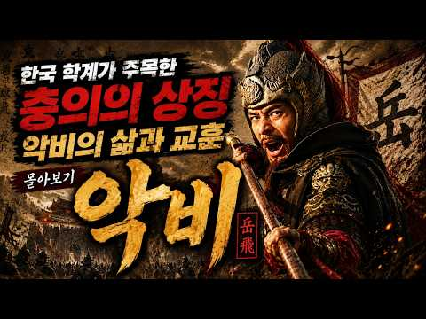
- 설명 앞부분: 구국의 명장 악비는 왜 자신이 지키려 했던 황제 고종에게 숙청당했는가? 남송 시대 절대 권력의 잔혹한 진실과 진충보국에 얽힌 역사적 비극을 분석합니다.
- 같은 채널 평소 대비 ×5.7 (채널 최근 롱폼 중앙값 4,800회) · 평소 영상: 우리가 알아야 할 북송 최악의 환관, 동관의 가짜 영웅담과 안보 파멸 [총정리] (4,852회) / 최악의 겁쟁이가 남송 최고의 왕으로 추존된 미스터리, 유광세의 반전 인생과 교훈 [총정리] (4,749회)
- 대본 없음 (설명) — 음성인식이 끝나면 도입부·흐름이 들어감
- 댓글 54/54: 좋은 점 — 영상 0 · 감사·응원 0 · 더 알고 싶은 것 0 · 아쉬운 점 — 영상 3 · 반박·불만 — 의견 다름 0 · 정치·사회 6 · 경험 공유 1 · 구독·다음 기대 0
  - 아쉬운 점 — 영상 👍1 “설명이 너무 길어 지루해 간결하게 하셔. 짜증나요”
  - 정치·사회 👍10 “나라가 망하려면 충신을 죽이는 법 역사는 기록할 뿐”
  - 정치·사회 👍2 “그러고 보면 우리도 대한제국 마지막때 어쩌면 민비의 나댐으로 인해 (누가 생각나네 갑자기 깅겨니😮‍💨) 나라가 망했는지도 모른다..고종의 착함과 선함을 민비의 나댐과 전횡으로 무능력으로 비쳐지고 그걸 민비가 붙잡고 흔들어서 대한제국 국력이 더 약해져서 망했는지도😢😢 …”
  - 경험 공유 👍2 “그러고 보면 우리도 대한제국 마지막때 어쩌면 민비의 나댐으로 인해 (누가 생각나네 갑자기 깅겨니😮‍💨) 나라가 망했는지도 모른다..고종의 착함과 선함을 민비의 나댐과 전횡으로 무능력으로 비쳐지고 그걸 민비가 붙잡고 흔들어서 대한제국 국력이 더 약해져서 망했는지도😢😢 …”

### 280. 누만티아 공성전 (기원전 134–133년) — 난공불락의 요새: 로마군 6만 대 수비대 4천

- https://www.youtube.com/watch?v=lUI6y2G873w · 박지훈 — 역사 · 구독자 1,910 · 조회수 65,624 (×34.4, 하루 685.5) · 좋아요 688 (1.1%) · 61.9분 · 2026-07-19 · 주제 묶음 5. 세계사·서양사 · 형식 정보·해설 (그 밖) · 폴더 `W_lUI6y2G873w` (웹 승인)
- 썸네일: 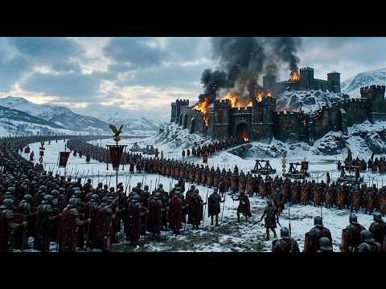
- 설명 앞부분: 4,000명의 전사가 60,000명의 로마 군단을 20년 동안 막아낸 비결은 무엇일까요? 이 다큐멘터리는 세계 역사 속에서 가장 잔혹했던 포위전의 진실을 파헤칩니다. 역사적 전투의 패러다임을 바꾼 누만시아 전쟁을 분석합니다. 스키피오 에밀리아누스는 칼 대신 삽을 들고 나타났습니다. 그는 군대 내부의 부패를 척결하기 위해 은식기와 매춘부, 점술가들을 쫓아내고 병사들에게 토목 공사를 강요했습니다. 강물에 설치된 칼날 달린 사슬, 9km에 달하는 거대한 이중 성벽, 그리고 지원군을 보내려던 청년 400명의 오른손을 잘라버린 냉혹한 결단…
- 같은 채널 평소 대비 ×70.5 (채널 최근 롱폼 중앙값 931회) · 평소 영상: 퐁트누아 전투 (841년): 로타르 황제에 맞선 대머리왕 카를과 루트비히 (931회) / 소쿠르 전투 (881년) — 18세의 루이 3세는 어떻게 바이킹으로부터 프랑크 왕국을 구… (914회)
- 대본 없음 (설명) — 음성인식이 끝나면 도입부·흐름이 들어감
- 댓글 24/24: 좋은 점 — 영상 2 · 감사·응원 3 · 더 알고 싶은 것 0 · 아쉬운 점 — 영상 1 · 반박·불만 — 의견 다름 0 · 정치·사회 2 · 경험 공유 0 · 구독·다음 기대 0
  - 좋은 점 — 영상 👍6 “생각할 것이 많은 좋은 영상 감사합니다. 이전에 자주보던 전쟁사와는 또다른 매력이 있네요. 담백하지만, 사실적으로..”
  - 좋은 점 — 영상 👍5 “좋은 영상입니다~ 꼭 영화를 보는것 같습니다.”
  - 감사·응원 👍6 “생각할 것이 많은 좋은 영상 감사합니다. 이전에 자주보던 전쟁사와는 또다른 매력이 있네요. 담백하지만, 사실적으로..”
  - 감사·응원 👍0 “감사합니다........”
  - 아쉬운 점 — 영상 👍8 “좀 지루하네. 30분이면 깔끔했을 것을.... 한 말 또하고, 또 하고, 또 하고....”

